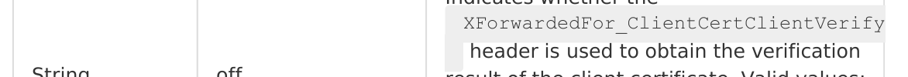
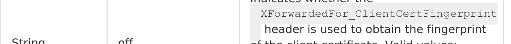
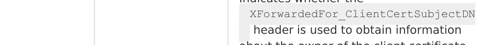

Alibaba Cloud  
Apsara Stack  
Server Load Balancer  
Developer Guide  
Product Version: v3.18.6-2607  
Document Version: 20260828

**Table of Contents**

- [1.Getting Started](#section-1)
    - [1.1. Apsara Stack documentation](#section-1-1)
    - [1.2. Procedure for API calls](#section-1-2)
- [2.Preparations](#section-2)
    - [2.1. Log on to OpenAPI Explorer](#section-2-1)
    - [2.2. Obtain API information and its endpoint](#section-2-2)
    - [2.3. Obtain an AccessKey pair](#section-2-3)
    - [2.4. Obtain STS credentials](#section-2-4)
    - [2.5. Obtain the values of common header parameters](#section-2-5)
    - [2.6. Obtain the SLB SDK](#section-2-6)
- [3.Use POP to make API calls](#section-3)
    - [3.1. Preparations](#section-3-1)
    - [3.2. SDK for Java](#section-3-2)
    - [3.3. SDK for Go](#section-3-3)
    - [3.4. Python version](#section-3-4)
- [4.Call examples for SDK for Java](#section-4)
    - [4.1. Quick start](#section-4-1)
    - [4.2. Work with SLB SDK for Java](#section-4-2)
        - [4.2.1. Install SLB SDK for Java](#section-4-2-1)
        - [4.2.2. Configure authentication credentials](#section-4-2-2)
        - [4.2.3. Call SLB SDK for Java](#section-4-2-3)
        - [4.2.4. Handle errors](#section-4-2-4)
- [5.Use SLB SDK for Python to make API calls](#section-5)
    - [5.1. Quick start](#section-5-1)
    - [5.2. Work with SLB SDK for Python](#section-5-2)
        - [5.2.1. Install SDK for Python](#section-5-2-1)
        - [5.2.2. Configure authentication credentials](#section-5-2-2)
        - [5.2.3. Set HTTPS requests](#section-5-2-3)
        - [5.2.4. Call SLB SDK for Python](#section-5-2-4)
        - [5.2.5. Troubleshooting](#section-5-2-5)
- [6.Use SLB SDK for Go to make API calls](#section-6)
    - [6.1. Quick start](#section-6-1)
    - [6.2. Work with SLB SDK for Go](#section-6-2)
        - [6.2.1. Install the core package of SDK for Go](#section-6-2-1)
        - [6.2.2. Configure authentication credentials](#section-6-2-2)
        - [6.2.3. Call SLB SDK for Go](#section-6-2-3)
        - [6.2.4. Troubleshooting](#section-6-2-4)
- [7.API Reference](#section-7)
    - [7.1. Access method](#section-7-1)
    - [7.2. RAM authentication](#section-7-2)
    - [7.3. Common parameters](#section-7-3)
    - [7.4. SLB instance](#section-7-4)
        - [7.4.1. DescribeLoadBalancerListeners](#section-7-4-1)
        - [7.4.2. DeleteLoadBalancerListener](#section-7-4-2)
        - [7.4.3. StopLoadBalancerListener](#section-7-4-3)
        - [7.4.4. StartLoadBalancerListener](#section-7-4-4)
        - [7.4.5. SetLoadBalancerModificationProtection](#section-7-4-5)
        - [7.4.6. SetLoadBalancerDeleteProtection](#section-7-4-6)
        - [7.4.7. SwitchMasterSlaveServerGroup](#section-7-4-7)
        - [7.4.8. SetLoadBalancerListenerAttributeEx](#section-7-4-8)
        - [7.4.9. ModifyHighDefinationMonitor](#section-7-4-9)
        - [7.4.10. EnableHighDefinationMonitor](#section-7-4-10)
        - [7.4.11. CreateLoadBalancer](#section-7-4-11)
        - [7.4.12. DeleteLoadBalancer](#section-7-4-12)
        - [7.4.13. ModifyLoadBalancerInstanceSpec](#section-7-4-13)
        - [7.4.14. ModifyLoadBalancerInternetSpec](#section-7-4-14)
        - [7.4.15. SetLoadBalancerName](#section-7-4-15)
        - [7.4.16. SetLoadBalancerStatus](#section-7-4-16)
        - [7.4.17. DescribeLoadBalancerAttribute](#section-7-4-17)
        - [7.4.18. DescribeLoadBalancers](#section-7-4-18)
        - [7.4.19. DescribeRegions](#section-7-4-19)
        - [7.4.20. DescribeZones](#section-7-4-20)
    - [7.5. Listeners](#section-7-5)
        - [7.5.1. TCP listeners](#section-7-5-1)
            - [7.5.1.1. CreateLoadBalancerTCPListener](#section-7-5-1-1)
            - [7.5.1.2. SetLoadBalancerTCPListenerAttribute](#section-7-5-1-2)
            - [7.5.1.3. DescribeLoadBalancerTCPListenerAttribute](#section-7-5-1-3)
        - [7.5.2. UDP listeners](#section-7-5-2)
            - [7.5.2.1. CreateLoadBalancerUDPListener](#section-7-5-2-1)
            - [7.5.2.2. SetLoadBalancerUDPListenerAttribute](#section-7-5-2-2)
            - [7.5.2.3. DescribeLoadBalancerUDPListenerAttribute](#section-7-5-2-3)
        - [7.5.3. HTTP listeners](#section-7-5-3)
            - [7.5.3.1. CreateLoadBalancerHTTPListener](#section-7-5-3-1)
            - [7.5.3.2. SetLoadBalancerHTTPListenerAttribute](#section-7-5-3-2)
            - [7.5.3.3. DescribeLoadBalancerHTTPListenerAttribute](#section-7-5-3-3)
        - [7.5.4. HTTPS listeners](#section-7-5-4)
            - [7.5.4.1. CreateLoadBalancerHTTPSListener](#section-7-5-4-1)
            - [7.5.4.2. SetLoadBalancerHTTPSListenerAttribute](#section-7-5-4-2)
            - [7.5.4.3. DescribeLoadBalancerHTTPSListenerAttribute](#section-7-5-4-3)
            - [7.5.4.4. DescribeHealthStatus](#section-7-5-4-4)
        - [7.5.5. Access control](#section-7-5-5)
            - [7.5.5.1. SetListenerAccessControlStatus](#section-7-5-5-1)
            - [7.5.5.2. DescribeListenerAccessControlAttribute](#section-7-5-5-2)
            - [7.5.5.3. AddListenerWhiteListItem](#section-7-5-5-3)
            - [7.5.5.4. RemoveListenerWhiteListItem](#section-7-5-5-4)
            - [7.5.5.5. CreateAccessControlList](#section-7-5-5-5)
            - [7.5.5.6. DeleteAccessControlList](#section-7-5-5-6)
            - [7.5.5.7. DescribeAccessControlLists](#section-7-5-5-7)
            - [7.5.5.8. DescribeAccessControlListAttribute](#section-7-5-5-8)
            - [7.5.5.9. SetAccessControlListAttribute](#section-7-5-5-9)
            - [7.5.5.10. AddAccessControlListEntry](#section-7-5-5-10)
            - [7.5.5.11. RemoveAccessControlListEntry](#section-7-5-5-11)
    - [7.6. Forwarding rules](#section-7-6)
    - [7.7. Access logs](#section-7-7)
    - [7.8. Server certificates](#section-7-8)
        - [7.8.1. UploadServerCertificate](#section-7-8-1)
        - [7.8.2. DeleteServerCertificate](#section-7-8-2)
        - [7.8.3. DescribeServerCertificates](#section-7-8-3)
        - [7.8.4. SetServerCertificateName](#section-7-8-4)
        - [7.8.5. UploadCACertificate](#section-7-8-5)
        - [7.8.6. DeleteCACertificate](#section-7-8-6)
        - [7.8.7. DescribeCACertificates](#section-7-8-7)
        - [7.8.8. SetCACertificateName](#section-7-8-8)
        - [7.8.9. DescribeCertificateRelations](#section-7-8-9)
    - [7.9. Backend servers](#section-7-9)
        - [7.9.1. AddBackendServers](#section-7-9-1)
        - [7.9.2. RemoveBackendServers](#section-7-9-2)
        - [7.9.3. SetBackendServers](#section-7-9-3)
    - [7.10. vServer groups](#section-7-10)
        - [7.10.1. CreateVServerGroup](#section-7-10-1)
        - [7.10.2. SetVServerGroupAttribute](#section-7-10-2)
        - [7.10.3. AddVServerGroupBackendServers](#section-7-10-3)
        - [7.10.4. RemoveVServerGroupBackendServers](#section-7-10-4)
        - [7.10.5. ModifyVServerGroupBackendServers](#section-7-10-5)
        - [7.10.6. DeleteVServerGroup](#section-7-10-6)
        - [7.10.7. DescribeVServerGroups](#section-7-10-7)
        - [7.10.8. DescribeVServerGroupAttribute](#section-7-10-8)
    - [7.11. Primary/secondary server groups](#section-7-11)
        - [7.11.1. CreateMasterSlaveServerGroup](#section-7-11-1)
        - [7.11.2. DeleteMasterSlaveServerGroup](#section-7-11-2)
        - [7.11.3. DescribeMasterSlaveServerGroups](#section-7-11-3)
        - [7.11.4. DescribeMasterSlaveServerGroupAttribute](#section-7-11-4)
    - [7.12. Tags](#section-7-12)
        - [7.12.1. AddTags](#section-7-12-1)
        - [7.12.2. DescribeTags](#section-7-12-2)
        - [7.12.3. RemoveTags](#section-7-12-3)
        - [7.12.4. UntagResources](#section-7-12-4)
        - [7.12.5. TagResources](#section-7-12-5)
        - [7.12.6. ListTagResources](#section-7-12-6)
    - [7.13. Error codes](#section-7-13)
- [8.Appendix](#section-8)
    - [8.1. STS overview](#section-8-1)
        - [8.1.1. What is STS?](#section-8-1-1)
        - [8.1.2. AssumeRole](#section-8-1-2)

<a id="section-1"></a>

# 1.Getting Started

<a id="section-1-1"></a>

## 1.1. Apsara Stack documentation

This topic describes how to view the references of an Apsara Stack service when you call Apsara Stack API.

**Workflow**

The following figure shows how to find your desired information in the Apsara Stack documentation.


**Prerequisites**

The Apsara Stack version is obtained from O&M personnel or an operations administrator.

**Procedure**

You can go to the Apsara Stack documentation center to view the documentation of an Apsara Stack service.

1. Go to the Apsara Stack documentation center.

2. Click the **Enterprise**, **Agility**, or **All-in-one** tab based on the Apsara Stack version that you use.

3. Select an Apsara Stack version from the drop-down list.

4. In the left-side navigation pane, select the Apsara Stack service.

5. In the upper-right corner of the documentation section, click **View Details** or **Download PDF**.

<a id="section-1-2"></a>

## 1.2. Procedure for API calls

Apsara Stack allows you to call API operations through the point of presence (POP) gateway. To ensure that Apsara Stack provides the same experience as Alibaba Cloud public cloud, API operations in Apsara Stack Enterprise V3.16.0 and later are called through the POP gateway by default. This topic describes how to use the POP gateway to call Apsara Stack API operations.

**Flowchart**


**Procedure**

1. Obtain an AccessKey pair.

   Obtain the AccessKey parameters required for the call. For more information, see Obtain an AccessKey pair or Obtain STS AccessKey credentials.

   > **Note**
   >
   > We recommend that you use the AccessKey pair of a personal account or an AccessKey pair assigned by Security Token Service (STS) to call the API operations of the Apsara Uni-manager Management Console and cloud services.

2. Obtain a region ID.

   Obtain the region ID parameter required for the call. For more information, see Obtain common header parameters.

3. Obtain the organization ID and resource set ID.

   You must obtain the organization ID by using an API operation. For more information about how to obtain the organization ID, see the *GetOrganizationList chapter* in the *Apsara Uni-m anager Management Console Developer Guide*.

   You must obtain the resource set ID by using an API operation. For more information about how to obtain the resource set ID, see the *ListResourceGroup chapter* in the *Apsara Uni-ma nager Management Console Developer Guide*.

   > **Note**
   >
   > When you call an API operation, add the organization ID  `<x-acs-organizationid>`  and resource set ID  `<x-acs-resourcegroupid>`  to the header parameters to specify the organization and resource set to which the resources belong. This allows you to perform isolated queries on instances.
   >
   > - If you do not specify the organization ID  `<x-acs-organizationid>` , the organization to which the current user belongs is used by default.
   >
   > - If you do not specify the resource set ID  `<x-acs-resourcegroupid>` , it is empty by default. If you want to specify a resource set, you must also specify the organization ID.

4. Obtain the developer guide for reference.

   You need to review the developer guide of the cloud service that you want to use to learn about the features and usage of the API operations. For more information about how to obtain the developer guide, see Instructions for using developer documentation.

5. Obtain the endpoint of the cloud service.

6. Obtain the service SDK and use it to call an operation of the service.

<a id="section-2"></a>

# 2.Preparations

<a id="section-2-1"></a>

## 2.1. Log on to OpenAPI Explorer

You can log on to OpenAPI Explorer from the Apsara Uni-manager Management Console.

**Prerequisites**

- The URL of the Apsara Uni-manager Management Console is obtained from the deployment engineer.

- A web browser is available. We recommend that you use Google Chrome.

**Procedure**

1. In the address bar of your browser, enter the endpoint of the Apsara Uni-manager Management Console and press Enter.

2. Enter your username and password.

   You can obtain the username and password from an operations administrator.

   > **Note**
   >
   > The first time you log on to the Apsara Uni-manager Management Console, you must change the password of your account as prompted. For security purposes, your password must be 10 to 32 characters in length and must contain at least two of the following types of characters:
   >
   > - Letters (A to Z and a to z)
   >
   > - Digits (0 to 9)
   >
   > - Special characters (such as exclamation point (!), at sign (@), number sign (#), dollar sign ($), and percent sign (%))

3. Click **Log On**.

4. If multi-factor authentication (MFA) is enabled for your account, perform the following operations based on your scenario:

   - You log on to the Apsara Uni-manager Management Console for the first time after MFA is enabled by the administrator:

     <ol type="a">

     <li>

     On the Bind Virtual MFA Device page, bind an MFA device as prompted.

     </li>

     <li>

     Re-enter your username and password as described in Step 2, and click **Log On**.

     </li>

     </ol>

     <ol type="i" start="100">

     <li>

     Enter the 6-digit MFA code and click **Authenticate**.

     </li>

     </ol>

   - You have enabled MFA and bound an MFA device:

     Enter the 6-digit MFA code and click **Authenticate**.

     > **Note**
     >
     > For more information about how to bind and enable an MFA device, see the **Bind and enable a virtual MFA device** section in the **Apsara Uni-manager Management Console User Guide**.

5. In the top menu bar, choose **Products > Application Services > OpenAPI Explorer**.

<a id="section-2-2"></a>

## 2.2. Obtain API information and its endpoint

To call an API operation of a cloud service, you must obtain information about the operation, including the service code, operation name, and API version.

**Background information**

The information on the API Directory page of the Apsara Uni-manager Management Console is for reference only. For more information about how to call API operations, see the developer guides of cloud services. If the information on the API Directory page differs from that in the developer guide of the corresponding cloud service, the information in the developer guide prevails.

**Procedure**

1. Log on to the Apsara Uni-manager Management Console.

2. In the top menu bar, choose **Products** > **Development Tools** > **API & SDK**> **OpenAPI Explorer**.

3. On the **OpenAPI Explorer** page, choose **API Integration** > **API Debugging**.

   

4. In the left-side navigation pane, select the cloud service that you want to manage.

5. From the **Version** drop-down list, select the API version.

6. In the API list, you can view all API operations of the current version.

7. Select the corresponding API operation and obtain the POP endpoint information of the cloud service under the parameter name.

   

<a id="section-2-3"></a>

## 2.3. Obtain an AccessKey pair

AccessKey credentials are assigned by Resource Access Management (RAM) or Security Token Service (STS). You only need to provide one type of AccessKey credential for authentication when you call API operations. This topic describes how to obtain an AccessKey pair that is assigned by RAM.

**Background information**

An AccessKey pair is used to verify the identity of request senders. An AccessKey pair consists of an AccessKey ID and an AccessKey secret that are used to implement symmetric encryption. The AccessKey ID is used to identify a user. The AccessKey secret is used to encrypt the signature string.

You can use RAM or STS to assign an AccessKey pair for authentication.

- An AccessKey pair that is assigned by RAM to a third party consists of an AccessKey ID and an AccessKey secret.

- An AccessKey 3-tuple that is assigned by STS to a third party consists of an AccessKey ID, an AccessKey secret, and a security token. For more information, see Obtain an STS AccessKey 3-tuple.

The Apsara Uni-manager Management Console provides AccessKey pairs to personal accounts or organizations. Only the administrators of level-1 organizations and operations administrators can obtain the AccessKey pairs of organizations. We recommend that you use the AccessKey pairs of personal accounts to call the operations provided by the Apsara Uni-manager Management Console and cloud services. If you use the AccessKey pair of a personal account, configure the header parameters that are described in the following table for access control. Otherwise, an error that indicates insufficient permissions may occur.

> **Warning**
>
> The AccessKey pair of a personal account is managed and controlled by
>
> the permission system of the Apsara Uni-manager Management Console. If you need to obtain the AccessKey pair of an organization, make sure that your operation is allowed by an administrator. This ensures security.

| Parameter | Description |
| --- | --- |
| x-acs-regionid | The ID of the region. Example: cn-hangzhou-\*. |
| x-acs-organizationid | The ID of the organization in the Apsara Uni-manager Management Console. For more information about how to obtain organization IDs, see the <strong>GetOrganizationList</strong> section in <strong>Apsara</strong> Uni-manager Management Console <strong>Developer Guide</strong>. |
| x-acs-resourcegroupid | The ID of the resource set in the Apsara Uni-manager Management Console. For more information about how to obtain resource set IDs, see the <strong>ListResourceGroup</strong> section in <strong>Apsara</strong> Uni-manager Management Console <strong>Developer Guide</strong>. |
| x-acs-instanceid | The ID of the instance that you want to manage.If you want to obtain the ID of an Elastic Compute Service (ECS) instance, you can obtain the ID from the ECS instance list. |

**Obtain the AccessKey pair of a personal account**

To obtain the AccessKey pair of a personal account, perform the following steps:

1. Log on to the Apsara Uni-manager Management Console.

2. Click the profile picture in the upper-right corner of the page and click **User Information**.

3. In the **AccessKey Pair** section, view the AccessKey pair of the personal account.

   

   > **Note**
   >
   > An AccessKey pair consists of an AccessKey ID and an AccessKey secret.
   >
   > These credentials provide full permissions on cloud resources within your account. You must keep the AccessKey pair confidential.

**Obtain the AccessKey pair of an organization**

To obtain the AccessKey pair of an organization, perform the following steps:

1. Log on to the Apsara Uni-manager Management Console as an administrator.

2. In the top navigation bar, click **Enterprise**.

3. In the left-side navigation pane, choose **Resources > Organizations**.

4. In the organization list, click the name of the level-1 organization whose AccessKey pair you want to obtain.

5. Click **Management AccessKey** on the right side of the page.

6. In the dialog box that appears, view the AccessKey pair of the organization.

<a id="section-2-4"></a>

## 2.4. Obtain STS credentials

This topic describes how to use Security Token Service (STS) credentials to make API calls.

**Background information**

Apsara Stack Security Token Service (STS) allows you to manage temporary credentials to your Apsara Stack resources. You can use STS credentials to make API calls.

To call Apsara Stack APIs, you must obtain an AccessKey ID, an AccessKey secret, and a security token assigned by STS. For more information, see STS.

**Procedure**

1. Obtain the  `Resource Access Management (RAM) role` .

   <ol type="i">

   <li>

   Log on to the Apsara Uni-manager Management Console.

   </li>

   <li>

   Click the profile picture in the upper-right corner of the page and click **User**

   </li>

   </ol>

   **Information**.

   <ol type="i" start="3">

   <li>

   Click **View Current Role Policy**.

   </li>

   </ol>

   In the **View Policies of Current Role** dialog box, you can obtain information about the  `RAM role`  that is assigned to the current user.

2. Obtain the STS credentials.

   > **Note**
   >
   > In the following code, replace the parameters with your actual information. Delete the angle brackets (<>) before you submit the code.
   >
   > The following section describes the parameters:
   >
   > - &lt;yourRegionID>: Replace it with the region ID.
   >
   > - &lt;yourAccessKeyID>: Replace it with your AccessKey ID.
   >
   > - &lt;yourAccessKeySecret>: Replace it with your AccessKey secret.
   >
   > - &lt;yourRoleSessionName>: Replace it with the name of the current session.
   >
   > - &lt;yourRoleArn>: Replace it with your RAM role.
   >
   > - "sts.aliyuns.com": Replace it with the endpoint of STS.

   ```xml
   public static void main(String[] args) {
       // Create and initialize a DefaultAcsClient instance. 
       // Specify the region ID, AccessKey ID, and AccessKey secret.
       DefaultProfile profile = DefaultProfile.getProfile("<yourRegionID>", "
   <yourAccessKeyID>", "<yourAccessKeySecret>");
       HttpClientConfig clientConfig = HttpClientConfig.getDefault();
       clientConfig.setIgnoreSSLCerts(true);
       clientConfig.setProtocolType(ProtocolType.HTTPS);
       profile.setHttpClientConfig(clientConfig);
       IAcsClient client = new DefaultAcsClient(profile);
       String assumeRole = callAssumeRole(client);
       if (StringUtils.isEmpty(assumeRole)) return;
       JSONObject assumeRoleJson = JSONObject.parseObject(assumeRole);
       JSONObject credentials = assumeRoleJson.getJSONObject("Credentials");
       // Obtain the AccessKey ID, AccessKey secret, and security token assigned by STS.
       String stsAK = credentials.getString("AccessKeyId");
       String stsSK = credentials.getString("AccessKeySecret");
       String stsToken = credentials.getString("SecurityToken");
   }

   private static String callAssumeRole(IAcsClient client) {
       CommonRequest request = new CommonRequest();
       // Replace "sts.aliyuns.com" with the actual endpoint of the STS. In most cases, endpoint is in the following format: sts-vpc.${global:region}.${global:internet-domain}.
       request.setSysDomain("sts.aliyuns.com");
       request.setSysProduct("Sts");
       request.setSysAction("AssumeRole");
       request.setSysVersion("2015-04-01");
       request.setSysMethod(MethodType.POST);
       request.setHttpContentType(FormatType.FORM);
       // Replace "<yourRoleSessionName>" with the name of the current session.
       request.putQueryParameter("RoleSessionName", "<yourRoleSessionName>");
       // Replace "<yourRoleArn>" with the ARN that you obtain in the preceding step.
       request.putQueryParameter("RoleArn", "<yourRoleArn>");
        try {
               CommonResponse response = client.getCommonResponse(request);
               return response.getData();
           } catch (ServerException e) {
               System.out.println(e.getErrCode());
               System.out.println(e.getErrMsg());
           } catch (ClientException e) {
               System.out.println(e.getErrCode());
               System.out.println(e.getErrMsg());
           } catch (com.aliyuncs.exceptions.ServerException e) {
               e.printStackTrace();
           } catch (ClientException e) {
               e.printStackTrace();
           }
       return null;
   }
   ```

3. The following sample code shows how to use STS credentials to call the DescribeLoadBalancers operation of the Server Load Balancer (SLB) API:

   > **Note**
   >
   > In the following code, replace the parameters with your actual information. Delete the angle brackets (<>) before you submit the code.
   >
   > The following section describes the parameters:
   >
   > - &lt;yourRegionID>: Replace it with the region ID.
   >
   > - &lt;yourStsAccesskeyID>: Replace it with your STS AccessKey ID.
   >
   > - &lt;yourAccessKeySecret>: Replace it with your STS AccessKey secret.
   >
   > - &lt;yourStsToken>. Replace it with your STS security token.
   >
   > - &lt;yourRegionID>: Replace it with the actual resource set ID.
   >
   > - &lt;yourRegionID>: Replace it with the actual organization ID.

   ```xml
   public static void main(String[] args) {
       // Replace "<yourRegionID>" with the region ID.
       // Replace "<yourStsAccessKeyID>" and "<yourStsAccessKeySecret>" with the AccessKey ID and AccessKey secret assigned by STS.
       DefaultProfile profile = DefaultProfile.getProfile("<yourRegionID>", "
   <yourStsAccesskey>", "<yourStsAccessSecret>");
       HttpClientConfig clientConfig = HttpClientConfig.getDefault();
       clientConfig.setIgnoreSSLCerts(true);
       clientConfig.setProtocolType(ProtocolType.HTTPS);
       profile.setHttpClientConfig(clientConfig);
       IAcsClient client = new DefaultAcsClient(profile);
       CommonRequest request = new CommonRequest();
       request.setSysDomain("ecs.aliyuns.com");
       request.setSysProduct("Slb");
       request.setSysAction("DescribeLoadBalancers");
       request.setSysVersion("2014-05-15");
       request.setSysMethod(MethodType.POST);
       request.setHttpContentType(FormatType.FORM);
       // Replace "<yourRegionID>" with the region ID.
       request.putHeadParameter("x-acs-regionid", "<yourRegionID>");
       // Replace "<yourStsToken>" with the security token assigned by STS.
       request.putQueryParameter("SecurityToken", "<yourStsToken>");
       // Optional. Replace it with your resource set ID.
       // request.putHeadParameter("x-acs-resourcegroupid", "<yourResourceGroupID>");
       // Required. Replace it with your organization ID.
       request.putHeadParameter("x-acs-organizationid", "<yourOrganizationID>");
       try {
           CommonResponse response = client.getCommonResponse(request);
           System.out.println(response.getData());
       } catch (ServerException e) {
           System.out.println(e.getErrCode());
           System.out.println(e.getErrMsg());
       } catch (ClientException e) {
           System.out.println(e.getErrCode());
           System.out.println(e.getErrMsg());
       }
   }
   ```

<a id="section-2-5"></a>

## 2.5. Obtain the values of common header parameters

You must set header parameters when you call API operations. This topic describes the header parameters and how to obtain the values of the parameters. This topic also describes the values of some response parameters after you call API operations.

**Header parameters**

| Parameter | Description |
| --- | --- |
| x-acs-regionid | The ID of the region. For more information about how to obtain region IDs, see Obtain a region ID. |
| x-acs-organizationid | The ID of the organization in the Apsara Uni-manager Management Console. For more information about how to obtain organization IDs, see Obtain an organization ID. |
| x-acs-resourcegroupid | The ID of the resource set in the Apsara Uni-manager Management Console. For more information about how to obtain resource set IDs, see Obtain a resource set ID. |
| x-acs-instanceid | The ID of the instance on which you want to perform operations. For more information about how to obtain instance IDs, see Obtain an instance ID. |

**Obtain a region ID**

1. Log on to the Apsara Uni-manager Management Console as an administrator.

2. In the top navigation bar, click **Enterprise**.

3. In the left-side navigation pane, choose **Resources** > **Regions**.

4. Click the name of the organization that you want to view.

5. View the region ID in the **Regions** section on the right.

**Obtain an organization ID**

You must call an operation to obtain an organization ID. For more information about how to obtain organization IDs, see the *GetOrganizationList* section in *Apsara Uni-manager Management Console Developer Guide*.

**Obtain a resource set ID**

You must call an operation to obtain a resource set ID. For more information about how to obtain resource set IDs, see the *ListResourceGroup* section in *Apsara Uni-manager Management Console Developer Guide*.

**Obtain an instance ID**

You can obtain the ID of an instance in the cloud service console of the Apsara Uni-manager Management Console. For example, to obtain the ID of an elastic IP address (EIP), perform the following steps:

1. Log on to the Apsara Uni-manager Management Console.

2. In the top navigation bar, choose **ProductsNetworkingServer Load Balancer**.

3. In the left-side navigation pane, choose **Instances & Images > Instances**.

4. View the **instance ID** in the instance list.

**Response parameters**

The following response parameters are returned by default when you call operations to query the instances of cloud services.

| Parameter | Description |
| --- | --- |
| ResourceGroupName | The name of the resource set. |
| ResourceGroup | The ID of the resource set. |
| DepartmentName | The name of the organization. |
| Department | The ID of the organization. |

<a id="section-2-6"></a>

## 2.6. Obtain the SLB SDK

When you call API operations of a cloud service in Apsara Stack by using the Portable OpenAPI Proxy (POP) gateway, you must use an SDK. This topic describes how to obtain Alibaba Cloud SDK.

**Background information**

To use Server Load Balancer (SLB) features, you must install both the SLB SDK and the Alibaba Cloud core library. For example, to use SLB SDK for Java, you must download  `aliyun-java-sdk-sl`  and  `aliyun-java-sdk-core` .

- The SLB SDK encapsulates the API released on May 15, 2014. The SDK identifies callers based on their AccessKey pairs and provides features such as automatic signing to allow you to create and manage resources by calling API operations. Alibaba Cloud SDK includes code and examples. You can create cloud applications by using an SDK in the programming language that you require.

- We recommend that you use the SDK core library that is provided on the Alibaba Cloud website. The SDK core library is ideal for all cloud services and is compatible with Apsara Stack.

**Instructions**

Alibaba Cloud SDK supports Java, Python, and Go. You can select an SDK from Alibaba Cloud SDK based on your business requirements.

> **Note**
>
> We recommend that you use an SDK for Java, Python, or Go. If you use SDKs in other programming languages, the SDKs may be incompatible with your system.

<a id="section-3"></a>

# 3.Use POP to make API calls

<a id="section-3-1"></a>

## 3.1. Preparations

You can use the POP gateway to call API operations in Apsara Stack in the same way as in Alibaba Cloud public cloud. This topic describes the preparations required before calling API operations.

**Background information**

To enable you to use the API call method in Apsara Stack as in Alibaba Cloud public cloud and provide a more convenient and consistent experience, we recommend that you use the POP gateway to call Apsara Stack API operations.

**Obtain an endpoint**

**Obtain an endpoint from the Developer Portal**

1. Go to the Apsara Uni-manager Management Console.

2. In the top menu bar, choose **Products** > **Development Tools** > **API & SDK** > **OpenAPI Explorer**.

3. On the **OpenAPI Explorer** page, choose **API Integration** > **API Debugging**.

   

4. In the left-side navigation pane, select the cloud service that you want to manage.

5. From the **Version** drop-down list, select the API version that you want to use.

6. In the API list, you can view all API operations of the current version.

7. Select the corresponding API operation and obtain the POP Endpoint information under the parameter name.

   

**Obtain an endpoint from Apsara Infrastructure Management**

To use the POP gateway to call Apsara Stack API operations, you must use the service endpoint. You can obtain an endpoint from onsite Alibaba Cloud O&M engineers.

You can also obtain service endpoints by yourself. In this example, API Gateway is used to demonstrate how to obtain the endpoints of a cloud service.

1. Go to the Apsara Uni-manager Operations Console.

2. In the top menu bar, choose **Platform Operation**> **Apsara Infrastructure Management** > **O&M Tools**.

3. In the left navigation bar, select **O&M Tools** > **Service Registration Variable Dashboard**.

4. On the Service Registration Variable Dashboard page, click **Advanced Filter**.

5. In the Service Registration text box, enter  `apigateway` , and click **Search**.

6. In the Service Registration column of the  `apigateway`  service, click the **Service**

   **Registration**  icon.

7. Click the text information in the **Service Registration** column of the  `apigateway`  service. In the **Registration Variable** dialog box that appears, view the apigateway.openapi.endpoint value, which is the  `Endpoint` .

**Obtain common parameters**

For information about how to obtain parameters such as organization ID, resource set ID, region ID, and instance ID that are used when you call Apsara Stack API operations through the POP gateway, see the **Obtain common header parameters** section under **Preparations** in this guide.

<a id="section-3-2"></a>

## 3.2. SDK for Java

Before you use point of presence (POP) SDK for Java to make API calls, you must first understand the remote procedure call (RPC) and resource-oriented architecture (ROA) styles.

**Prerequisites**

We recommend that you use CommonRequest to make API calls in Apsara Stack. You can go to the Apsara Uni-manager Management Console and choose **Products** > **Development Tools** > **API & SDK** > **OpenAPI Explorer,** and then select **API Integration** > **SDK Examples** to view the recommended SDK versions and sample code.

> **Important**
>
> We do not recommend that you download SDKs from the SDK Center for use in Apsara Stack scenarios. The SDKs for Alibaba Cloud public cloud may not support the APIs of Apsara Stack. Compatibility issues may occur. Use these SDKs with caution!

**Examples**

RPC call example with the following API information: product (apigateway), operation (DescribeApiGroups), and version (2016-07-14).

Sample code:

```java
import com.aliyuncs.CommonRequest;
import com.aliyuncs.CommonResponse;
import com.aliyuncs.DefaultAcsClient;
import com.aliyuncs.IAcsClient;
importcomaliyuncsexceptionsClientException;
import com.aliyuncs.exceptions.ServerException;
import com.aliyuncs.http.MethodType;
import com.aliyuncs.profile.DefaultProfile;

public class DescribeApiGroups {

    public static void main(String[] args) {
        // Create a DefaultAcsClient instance and initialize it.
        DefaultProfile profile = DefaultProfile.getProfile("", "", "");

        // Ignore SSL certificate verification.
        // HttpClientConfig clientConfig = HttpClientConfig.getDefault();
        // clientConfig.setIgnoreSSLCerts(true);
        // Specify the timeout period for a connection.
        // clientConfig.setConnectionTimeoutMillis(3000L);
        // Specify the read timeout period.
        // clientConfig.setReadTimeoutMillis(10000L);
        // profile.setHttpClientConfig(clientConfig);
        
        IAcsClient client = new DefaultAcsClient(profile);
        // Create an API request and set the parameters.
        CommonRequest request = new CommonRequest();
        // Specify the request method
        request.setSysMethod(MethodType.POST);
        // Specify the endpoint of the service.
        request.setSysDomain("");
        // Specify the API version.
        request.setSysVersion("2016-07-14");
        // Specify the service name.
        request.setSysLocationProduct("apigateway");
        // Specify the name of the API operation.
        request.setSysAction("DescribeApiGroups");
        
        // If you use the Security Token Service (STS) AccessKey pair to call RPC API operations, you must specify the SecurityToken parameter.
        // request.putBodyParameter("SecurityToken", "");

        // Set service-related parameters.
        request.putQueryParameter("PageSize", "10");
        request.putQueryParameter("PageNumber", "1");

        // (Required) Specify the call source.
        request.putHeadParameter("x-acs-caller-sdk-source", "ApiTestDemo");
        // (Optional) You must specify this parameter for Apsara Stack V3.15.0 or 
earlier.
        request.putHeadParameter("x-acs-regionid", "");
        // (Optional) Specify the ID of the resource set.
        request.putHeadParameter("x-acs-resourcegroupid", "");
        // (Required) Specify the organization ID.
        request.putHeadParameter("x-acs-organizationid", "");
        // (Optional) You must specify this parameter when you modify or delete 
resources.
        // request.putHeadParameter("x-acs-instanceid", "");

        try {
            // Initiate the request and handle the response or exceptions.
            CommonResponse response = client.getCommonResponse(request);
            System.out.println(response.getData());
        } catch (ServerException e) {
            e.printStackTrace();
        } catch (ClientException e) {
            System.out.println("ErrCode:" + e.getErrCode());
            System.out.println("ErrMsg:" + e.getErrMsg());
            System.out.println("RequestId:" + e.getRequestId());
        }

    }
}
```

ROA call example with the following API information: product (CR), operation (GetNamespaceList), and version (2016-06-07).

Sample code:

```java
import com.aliyuncs.CommonRequest;
import com.aliyuncs.CommonResponse;
import com.aliyuncs.DefaultAcsClient;
import com.aliyuncs.IAcsClient;
import com.aliyuncs.exceptions.ClientException;
import com.aliyuncs.exceptions.ServerException;
import com.aliyuncs.http.MethodType;
import com.aliyuncs.profile.DefaultProfile;

public class GetNamespaceList {

    public static void main(String[] args) {
        // Create a DefaultAcsClient instance and initialize it.
        DefaultProfile profile = DefaultProfile.getProfile("", "", "");

        // Ignore SSL certificate verification.
        // HttpClientConfig clientConfig = HttpClientConfig.getDefault();
        // clientConfig.setIgnoreSSLCerts(true);
        // Specify the timeout period for a connection.
        // clientConfig.setConnectionTimeoutMillis(3000L);
        // Specify the read timeout period.
        // clientConfig.setReadTimeoutMillis(10000L);
        // profile.setHttpClientConfig(clientConfig);
        
        IAcsClient client = new DefaultAcsClient(profile);
        // Create an API request and set the parameters.
        CommonRequest request = new CommonRequest();

        // Configure HTTPS access
        request.setSysProtocol(ProtocolType.HTTP);
        // Specify the request method
        request.setSysMethod(MethodType.GET);
        // Specify the endpoint of the service
        request.setSysDomain("");
        // Specify the API version
        request.setSysVersion("2016-06-07");
        // Set the URI pattern (required only for ROA calls)
        request.setSysUriPattern("/namespace");
        // Specify the service name
        request.setSysLocationProduct("cr");
        // Specify the name of the API operation
        request.setSysAction("GetNamespaceList");

        // (Required) Specify the call source.
        request.putHeadParameter("x-acs-caller-sdk-source", "ApiTestDemo");
        // (Optional) You must specify this parameter for Apsara Stack V3.15.0 or 
earlier.
        request.putHeadParameter("x-acs-regionid", "");
        // Optional. Specify the ID of the resource set.
        request.putHeadParameter("x-acs-resourcegroupid", "");
        // Required. Specify the organization ID.
        request.putHeadParameter("x-acs-organizationid", "");
        // (Optional) You must specify this parameter when you modify or delete 
resources.
        // request.putHeadParameter("x-acs-instanceid", "");


        // When you use an STS AccessKey pair to call ROA API operations, you must add the x-acs-security-token field to the header
        // request.putHeadParameter("x-acs-security-token", "");

        try {
            // Initiate the request and handle the response or exceptions.
            CommonResponse response = client.getCommonResponse(request);
            System.out.println(response.getData());
        } catch (ServerException e) {
            e.printStackTrace();
        } catch (ClientException e) {
            System.out.println("ErrCode:" + e.getErrCode());
            System.out.println("ErrMsg:" + e.getErrMsg());
            System.out.println("RequestId:" + e.getRequestId());
        }

    }
}
```

> **Important**
>
> By default, if you send API requests over HTTPS, the SDK enables certificate verification to verify the validity of SSL/TLS certificates. If no certificate is configured in the development environment, an error that indicates the certificate verification fails is reported.
>
> To ensure communication security in the production environment, we recommend that you enable certificate verification. If certificate verification must be disabled in the test environment, you can configure the following setting:
>
> Java
>
> ```text
> HttpClientConfig clientConfig = HttpClientConfig.getDefault();
> // Disable server certificate verification.
> clientConfig.setIgnoreSSLCerts(true)
> ```

<a id="section-3-3"></a>

## 3.3. SDK for Go

This topic describes how to work with the POP SDK for Go.

**Prerequisites**

For Apsara Stack, we recommend that you use CommonRequest to call API operations. You can view the recommended SDK versions and sample code in the Apsara Uni-manager Management Console by choosing **Products** > **Development Tools** > **API & SDK** > **OpenAPI Explorer**, and then selecting **API Integration** > **SDK Examples**.

> **Important**
>
> We do not recommend that you download SDKs from the SDK center for use in Apsara Stack environments. The SDKs for Alibaba Cloud public cloud may not support the API operations of Apsara Stack and may have compatibility issues. Use them with caution!

**Background information**

Remote procedure call (RPC) and resource-oriented architecture (ROA) styles are supported for API calls.

**Examples**

RPC example API information: product (apigateway), API operation (DescribeApiGroups), and version (2016-07-14).

The following sample code provides an example:

```go
package main

import (
    "fmt"
    "github.com/aliyun/alibaba-cloud-sdk-go/sdk"
    "github.com/aliyun/alibaba-cloud-sdk-go/sdk/requests"
  
)

func main() {
    client, err := sdk.NewClientWithAccessKey("", "", "")

    request := requests.NewCommonRequest()
    
    request.Method = "POST"
    request.Domain = ""
    request.Version = "2016-07-14"
    request.ApiName = "DescribeApiGroups"
    request.Product = "apigateway"
    // If you use the Security Token Service (STS) to AccessKey pair to call RPC API operations, you must specify the SecurityToken parameter.
    // request.QueryParams["SecurityToken"]=""

    // Required. Specify the call source.
    request.Headers["x-acs-caller-sdk-source"] = "ApiTestDemo"
    // Optional. You must specify this parameter for Apsara Stack V3.15.0 or earlier.
    request.Headers["x-acs-regionid"] = ""
    // Optional. Specify the ID of the resource set.
    request.Headers["x-acs-resourcegroupid"] = ""
    // Required. Specify the organization ID.
    request.Headers["x-acs-organizationid"] = ""
    // Optional. You must specify this parameter when you modify or delete resources.
    // request.Headers["x-acs-instanceid"] = ""

    response, err := client.ProcessCommonRequest(request)
    if err != nil {
        panic(err)
    }
    fmt.Print(response.GetHttpContentString())
}
```

ROA example API information: product (CR), API operation (GetNamespaceList), and version (2016-06-07).

Sample code:

```go
package main

import (
 "fmt"
 "github.com/aliyun/alibaba-cloud-sdk-go/sdk"
 "github.com/aliyun/alibaba-cloud-sdk-go/sdk/requests"
 "os"
)


func main() {
    client, err := sdk.NewClientWithAccessKey("", "", "")
 request := requests.NewCommonRequest()

 request.Method = "GET"
 request.Domain = ""
 request.Version = "2016-06-07"
 request.ApiName = "GetNamespaceList"
 request.Product = "cr"

 request.PathPattern = "/namespace"
 // If you use the STS AccessKey pair to call ROA API operations, you must add the x-
acs-security-token field to the header
 // request.Headers["x-acs-security-token"] = ""
 // Required. Specify the call source.
 request.Headers["x-acs-caller-sdk-source"] = "ApiTestDemo"
    // Optional. You must specify this parameter for Apsara Stack V3.15.0 or earlier.
    request.Headers["x-acs-regionid"] = ""
    // Optional. Specify the ID of the resource set.
    request.Headers["x-acs-resourcegroupid"] = ""
    // Required. Specify the organization ID.
    request.Headers["x-acs-organizationid"] = ""
 // Optional. You must specify this parameter when you modify or delete resources.
 // request.Headers["x-acs-instanceid"] = ""

 response, err := client.ProcessCommonRequest(request)
 if err != nil {
  panic(err)
 }
 fmt.Print(response.GetHttpContentString())
}
```

**Proxy settings**

You can configure a proxy in one of the following ways when you call API operations:

- Method 1: Configure a proxy by using environment variables.

  Specify the HTTP_PROXY and HTTPS_PROXY environment variables, or specify the NO_PROXY environment variable.

  Sample code:

  ```go
  import (
      "os"
  )
  func main(){
   os.Setenv("HTTP_PROXY", "http://x.x.x.x:xxxx") // Specify the HTTP_PROXY environment 
  variable.
   os.Setenv("HTTPS_PROXY", "https://x.x.x.x:xxxx") // Specify the HTTPS_PROXY environment variable.
  }
  ```

- Method 2: Configure a proxy on the client.

  Sample code:

  ```text
  // The proxy settings on the client take precedence over the environment variables.
  client.SetHttpProxy("http://x.x.x.x:xxxx")   // Configure the HTTP proxy.
  client.GetHttpProxy()                          // Query the HTTP proxy.

  client.SetHttpsProxy("https://x.x.x.x:xxxx")   // Configure the HTTPS proxy.
  client.GetHttpsProxy()                           // Query the HTTPS proxy.

  client.SetNoProxy("127.0.0.1,localhost")     // Configure the proxy whitelist.
  client.GetNoProxy()                          // Query the proxy whitelist.
  ```

**SSL verification**

**Summary**

You can configure SSL certificate verification for requests.

- If you set this parameter to  `true` , certificate verification is disabled. This is not secure. We recommend that you configure certificates.

- If you set this parameter to  `false` , SSL certificate verification is enabled. By default, the CA certificates provided by the operating system are used.

**Default value**

The default value is  `false` .

**Settings**

> **Important**
>
> By default, if you send API requests over HTTPS, the SDK enables certificate verification to verify the validity of SSL certificates. If no certificate is configured in the development environment, an error that indicates the certificate verification fails is reported. To ensure communication security in the production environment, we recommend that you enable certificate verification. If certificate verification must be disabled in the test environment, you can specify the following settings:

```text
// Configure HTTPSInsecure for the request (affects only the current request)
request.SetHTTPSInsecure(true)                           // Set HTTPSInsecure to true fo
r the request.
isInsecure := request.GetHTTPSInsecure()                 // Query the HTTPSInsecure sett
ing for the request.
```

The HTTPSInsecure setting takes effect for the client only when you do not specify the HTTPSInsecure parameter for the request.

```text
// Configure HTTPSInsecure for the client (affects all requests sent by the client).
client.SetHTTPSInsecure(true)                         // Set HTTPSInsecure to true for t
he client.
isInsecure := client.GetHTTPSInsecure()               // Query the HTTPSInsecure setting
for the client.
```

<a id="section-3-4"></a>

## 3.4. Python version

This topic describes how to use POP Python SDK to call cloud product APIs.

**Prerequisites**

We recommend using CommonRequest for API calls in Apsara Stack. You can view the recommended SDK version and sample code in the Apsara Uni-manager Management Console by navigating to **Products** > **Development Tools** > **API & SDK** > **OpenAPI Explorer**, and selecting **API Integration** > **SDK Examples**.

> **Important**
>
> We do not recommend downloading SDKs directly from the SDK Center for use in Apsara Stack scenarios. The public cloud SDKs may not support Apsara Stack APIs and may have compatibility issues. Please use with caution!

**Background information**

Currently, only the RPC method is supported for API calls.

**CommonRequest call example**

Example interface information: Product (ECS), Interface (DescribeInstances), Version (2014-05-26).

Sample code is as follows:

```python
from aliyunsdkcore.client import AcsClient
import os
from aliyunsdkcore.request import CommonRequest

# Create AcsClient instance
client = AcsClient(
    "<AccessKey ID>",
    "<AccessKey Secret>",
    "<your-RegionID>",
    timeout=1000,  # Set timeout
    verify=False, # Ignore certificate or verify='<certificate location>'
);
# Use with https
# client.set_verify(False)
# os.environ["HTTPS_PROXY"] = "http://127.0.0.1:8080"

# os.environ["HTTP_PROXY"] = "http://127.0.0.1:8080"
def describe_api_groups():
    # Create request and set parameters
    request = CommonRequest()

    # When using sts ak to call rpc interface, you need to add SecurityToken field in parameters
    # params = {"PageSize":"10","PageNumber":"1","SecurityToken":"<your-
SecurityToken>"};
    params = {"PageSize":"10","PageNumber":"1"};
    request.set_query_params(params)

    headers = {
        # Required, call source description
        "x-acs-caller-sdk-source":"ApiTestDemo",
        # Optional, required for historical versions before Enterprise Edition V3.15.0
        "x-acs-regionid":"<your-RegionID>",
        # Optional, resource set ID
        "x-acs-resourcegroupid":"<your-ResourceGroupID>",
        # Required, organization ID
        "x-acs-organizationid":"<your-OrganizationID>"
        # Optional, required for modify & delete operations
        # "x-acs-instanceid":"<your-InstanceID>"

    }
    request.set_headers(headers)
    request.set_version("2016-07-14")
    request.set_action_name("DescribeApiGroups")
    request.set_endpoint("<ApigatewayEndpoint>")   //Please replace Endpoint with the real address
    request.set_product("apigateway")
    request.set_method("POST")

    # Initiate API request and display return value
    response = client.do_action_with_exception(request)
    print(response)


if __name__ == '__main__':
    print("Hello Aliyun OpenApi!")
    describe_api_groups()
```

**Set proxy**

When calling APIs, you may need to set HTTP_PROXY and HTTPS_PROXY through environment variables.

Sample code is as follows:

```text
# https proxy 
os.environ["HTTPS_PROXY"] = "http://x.x.x.x:xxxx"

# http proxy
os.environ["HTTP_PROXY"] = "https://x.x.x.x:xxxx"
```

**HTTPS configuration**

The following describes how to access OpenAPI using HTTPS protocol.

**Using HTTPS protocol**

SDK uses HTTPS protocol by default.

```python
from aliyunsdkecs.request.v20140526.DescribeInstancesRequest import 
DescribeInstancesRequest
from aliyunsdkcore.client import AcsClient
client = AcsClient(
    region_id='<region_id>',  # Region ID
)

request = DescribeInstancesRequest()
request.set_protocol_type('https')  # Use https

client.do_action_with_exception(request)   
```

**Ignore certificate**

> **Important**
>
> - When accessing OpenAPI using HTTPS protocol, the SDK will verify SSL/TLS certificate validity by default. If your code environment does not have a certificate environment, it will report a certificate verification failure error.
>
> - To ensure communication security in production environments, we recommend keeping verification enabled. If you must ignore certificate verification in a test environment, you can set it through the  `verify`  parameter.

```python
from aliyunsdkcore.client import AcsClient
client = AcsClient(
    region_id='<region_id>',  # Region ID
    verify=False  # Ignore SSL certificate verification
)
```

**Specify CA certificate file**

```python
from aliyunsdkcore.client import AcsClient
client = AcsClient(
    region_id='<region_id>',  # Region ID
    verify='./cacert.pem'  # Certification path
)
```

<a id="section-4"></a>

# 4.Call examples for SDK for Java

<a id="section-4-1"></a>

## 4.1. Quick start

This topic describes how to obtain and use the Server Load Balancer (SLB) SDK for Java.

**Prerequisites**

- An Apsara Stack tenant account that has the required permissions and an AccessKey pair that consists of an AccessKey ID and an AccessKey secret are obtained. For more information about how to obtain an AccessKey pair in the Apsara Uni-manager Management Console, see Obtain an AccessKey pair.

- For more information about how to obtain the endpoint of the SLB API, see Obtain the endpoint of the SLB API.

- Java Development Kit (JDK) 1.8 or later is installed. SDKs for Java provided by Alibaba Cloudrequire JDK 1.8or later.

**Install Alibaba Cloud SDK for Java**

If you use Apache Maven to manage a Java project, import the JAR file to the pom.xml file of the project.

To use the SLB SDK, you must install the SDK core library and the SLB SDK. We recommend that you use version 4.5.17 or later for the SDK core library. In this example, the SLB SDK uses version 3.3.8.

**Procedure**

To use Apsara Stack SDK for Java, perform the following steps:

1. Create a DefaultAcsClient instance and initialize the instance.

2. Create an API request and set the required parameters.

3. Initiate the API request and process the response or exception.

   > **Note**
   >
   > In the following code, replace the parameters with your actual information. Delete the angle brackets (<>) in the final code.
   >
   > The following list describes the parameters:
   >
   > - &lt;yourRegionID>: Replace the parameter with the region ID.
   >
   > - &lt;yourAccessKeyID>: Replace the parameter with your AccessKey ID.
   >
   > - &lt;yourAccessKeySecret>: Replace the parameter with your AccessKey secret.

   ```java
   import com.aliyuncs.DefaultAcsClient;
   import com.aliyuncs.IAcsClient;
   import com.aliyuncs.exceptions.ClientException;
   import com.aliyuncs.exceptions.ServerException;
   import com.aliyuncs.profile.DefaultProfile;
   import com.alibaba.fastjson.JSON;
   import java.util.*;
   import com.aliyuncs.slb.model.v20140515.*;
   public class DescribeImages {

       public static void main(String[] args) {
           DefaultProfile profile = DefaultProfile.getProfile(
               "<yourRegionID>",
               "<yourAccessKeyID>",
               "<yourAccessKeySecret>");
           IAcsClient client = new DefaultAcsClient(profile);

           // Create an API request and set the required parameters.
           DescribeLoadBalancersRequest request = new DescribeLoadBalancersRequest();
           
           request.setResourceOwnerAccount("test"); // This value is for reference only. 
   Enter a value based on your business requirements.
           
           request.setResourceOwnerId("1"); // This value is for reference only. Enter avalue based on your business requirements.
           
           request.setRegionId("test"); // This value is for reference only. Enter a 
   value based on your business requirements.
           
           request.setServerId("test"); // This value is for reference only. Enter a 
   value based on your business requirements.
           
           request.setAddressIPVersion("test"); // This value is for reference only. 
   Enter a value based on your business requirements.
           
           request.setLoadBalancerStatus("test"); // This value is for reference only. Enter a value based on your business requirements.
           
           request.setLoadBalancerId("test"); // This value is for reference only. Enter 
   a value based on your business requirements.
           
           request.setLoadBalancerName("test"); // This value is for reference only. 
   Enter a value based on your business requirements.
           
           request.setServerIntranetAddress("test"); // This value is for reference 
   only. Enter a value based on your business requirements.
           
           request.setAddressType("test"); // This value is for reference only. Enter a value based on your business requirements.
           
           request.setInternetChargeType("test"); // This value is for reference only. Enter a value based on your business requirements.
           
           request.setVpcId("test"); // This value is for reference only. Enter a value based on your business requirements.
           
           request.setVSwitchId("test"); // This value is for reference only. Enter a value based on your business requirements.
           
           request.setNetworkType("test"); // This value is for reference only. Enter a value based on your business requirements.
           
           request.setAddress("test"); // This value is for reference only. Enter a 
   value based on your business requirements.
           
           request.setMasterZoneId("test"); // This value is for reference only. Enter avalue based on your business requirements.
           
           request.setSlaveZoneId("test"); // This value is for reference only. Enter a value based on your business requirements.
           
           request.setOwnerAccount("test"); // This value is for reference only. Enter avalue based on your business requirements.
           
           request.setTags("test"); // This value is for reference only. Enter a value based on your business requirements.
           
           request.setPayType("test"); // This value is for reference only. Enter a 
   value based on your business requirements.
           
           request.setResourceGroupId("test"); // This value is for reference only. 
   Enter a value based on your business requirements.
           

           try {
               DescribeLoadBalancersResponse response = client.getAcsResponse(request);
               System.out.println(JSON.toJSONString(response));
               // Print response parameters. In this example, the RequestId parameter isprinted.
               System.out.println(response.getRequestId());
           } catch (ServerException e) {
               e.printStackTrace();
           } catch (ClientException e) {
               // Print the error code.
               System.out.println("ErrCode:" + e.getErrCode());
               System.out.println("ErrMsg:" + e.getErrMsg());
               System.out.println("RequestId:" + e.getRequestId());
           }

       }
   }
   ```

<a id="section-4-2"></a>

## 4.2. Work with SLB SDK for Java

<a id="section-4-2-1"></a>

### 4.2.1. Install SLB SDK for Java

This topic describes how to install Server Load Balancer (SLB) SDK for Java and how to use the SDK to make API calls.

Apsara Stack SDK for Java supports Java Development Kit (JDK) 1.8 or later. You can install Apsara Stack SDK for Java by adding Maven dependencies or downloading the SDK. For more information, visit Alibaba Cloud SDKs.

Before you start, you must install the core library of Apsara Stack SDK for Java and SLB SDK for Java. We recommend that you use the core library version 4.5.17 or later, and use the SDK for Java 3.3.9.

To use SLB SDK for Java, you must install the core library of Apsara Stack SDK for Java and add the following dependencies to the pom.xml file. For more information about the specific SDK version, see Apsara Stack SDK.

```xml
<dependencies>
        <dependency>
            <groupId>com.aliyun</groupId>
            <artifactId>aliyun-java-sdk-core</artifactId>
            <version>4.5.17</version>
        </dependency>
        <dependency>
            <groupId>com.aliyun</groupId>
            <artifactId>aliyun-java-sdk-slb</artifactId>
            <version>3.3.9</version>
        </dependency>
</dependencies>
```

<a id="section-4-2-2"></a>

### 4.2.2. Configure authentication credentials

When you use Apsara Stack SDK to access Apsara Stack services, you must provide an Apsara Stack tenant account for authentication. This topic describes how to configure authentication credentials.

SDK for Java supports authentication through an AccessKey pair. For more information about how to obtain an AccessKey pair, see Obtain an AccessKey pair.

If you want to use your AccessKey pair to access Apsara Stack, you must specify the AccessKey pair when you initialize the client.

> **Note**
>
> Do not disclose any code that contains your AccessKey pair. For example, do not commit the code to public GitHub projects. Otherwise, your account may be compromised.

```text
DefaultProfile profile = DefaultProfile.getProfile(
    "<yourRegionID>",          // Replace it with your region ID.
    "<yourAccessKeyID>",      // Replace it with your AccessKey ID.
    "<yourAccessKeySecret>"); // Replace it with your AccessKey secret.
```

> **Note**
>
> Replace the preceding variables with your actual information. Remove the angle brackets (<>) when you specify the parameters.

<a id="section-4-2-3"></a>

### 4.2.3. Call SLB SDK for Java

This topic describes how to call SLB SDK for Java.

**Procedure**

1. Create an AcsClient.

   ```text
   IAcsClient client = new DefaultAcsClient(profile);
   ```

2. Create a request.

   The naming convention for requests is  `${apiName}Request` , where **${apiName}** is the API name such as DescribeLoadBalancers.

   When the SDKs of multiple services are used, different requests may have the same name. Differentiate the requests by SDK package.

   ```text
   DescribeLoadBalancersRequest request = new DescribeLoadBalancersRequest();
   // Set service-specific parameters.
   request.setResourceOwnerAccount("test"); // This value is for reference only. Enter avalue based on your business requirements.

   request.setResourceOwnerId("1"); // This value is for reference only. Enter a value based on your business requirements.

   request.setRegionId("test"); // This value is for reference only. Enter a value basedon your business requirements.

   request.setServerId("test"); // This value is for reference only. Enter a value basedon your business requirements.

   request.setAddressIPVersion("test"); // This value is for reference only. Enter a value based on your business requirements.

   request.setLoadBalancerStatus("test"); // This value is for reference only. Enter a value based on your business requirements.

   request.setLoadBalancerId("test"); // This value is for reference only. Enter a valuebased on your business requirements.

   request.setLoadBalancerName("test"); // This value is for reference only. Enter a value based on your business requirements.

   request.setServerIntranetAddress("test"); // This value is for reference only. Enter a value based on your business requirements.

   request.setAddressType("test"); // This value is for reference only. Enter a value based on your business requirements.

   request.setInternetChargeType("test"); // This value is for reference only. Enter a value based on your business requirements.

   request.setVpcId("test"); // This value is for reference only. Enter a value based onyour business requirements.

   request.setVSwitchId("test"); // This value is for reference only. Enter a value based on your business requirements.

   request.setNetworkType("test"); // This value is for reference only. Enter a value based on your business requirements.

   request.setAddress("test"); // This value is for reference only. Enter a value based on your business requirements.

   request.setMasterZoneId("test"); // This value is for reference only. Enter a value based on your business requirements.

   request.setSlaveZoneId("test"); // This value is for reference only. Enter a value based on your business requirements.

   request.setOwnerAccount("test"); // This value is for reference only. Enter a value based on your business requirements.

   request.setTags("test"); // This value is for reference only. Enter a value based on your business requirements.

   request.setPayType("test"); // This value is for reference only. Enter a value based on your business requirements.

   request.setResourceGroupId("test"); // This value is for reference only. Enter a value based on your business requirements.
   ```

3. Initiate the request and handle the response.

   ```java
   DescribeLoadBalancersResponse response = client.getAcsResponse(request);
   System.out.println(JSON.toJSONString(response));
   ```

<a id="section-4-2-4"></a>

### 4.2.4. Handle errors

Server Load Balancer (SLB) SDK for Java returns error codes and messages when errors occur on the server side or the SDK side.

You do not need to handle the errors returned by the SDK. You need to only handle the errors on the server side.

- `ServerException`  indicates a server error.

- `ClientException`  indicates an error returned by the SDK.

The following error indicates that the AccessKey ID is invalid. You must specify a valid AccessKey ID.

```text
com.aliyuncs.exceptions.ClientException: InvalidAccessKeyId.NotFound : Specified accesskey is not found.
```

The following code provides an example on how to handle errors returned by the SDK:

```java
try {
    FooResponse response = client.getAcsResponse(request);
    // Handle the response.
    // ...
}catch (ServerException e){
    // Add a computing logic for handling errors.
    // For example, you can obtain the error information.
    System.out.println("ErrorCode=" + e.getErrCode());
    System.out.println("ErrorMessage=" + e.getErrMsg());
    // If the error persists, you can submit a ticket with the request ID included.
    System.out.println("ResponseId=" + e.getRequestId());
}catch (ClientException e){
    // Add a computing logic for handling errors.
    // For example, you can obtain the error information.
    System.out.println("ErrorCode=" + e.getErrCode());
    System.out.println("ErrorMessage=" + e.getErrMsg());
}
```

<a id="section-5"></a>

# 5.Use SLB SDK for Python to make API calls

<a id="section-5-1"></a>

## 5.1. Quick start

This topic describes how to obtain and use Server Load Balancer (SLB) SDK for Python.

**Prerequisites**

- An authorized account and an AccessKey pair (AccessKey ID and AccessKey secret) are obtained. For more information, see Obtain an AccessKey pair.

- The endpoint of the SLB API is obtained. For more information, see Obtain the endpoint of the SLB API.

**Install SLB SDK for Python**

1. Install the SDK core library.

   - If you use Python 2.x, run the following command to install the core library of Alibaba Cloud SDK:

     ```bash
     pip install aliyun-python-sdk-core
     ```

   - If you use Python 3.x, run the following command to install the core library:

     ```bash
     pip3 install aliyun-python-sdk-core-v3
     ```

2. Install the SDK. The following example shows how to install SLB SDK for Python:

   - If you use Python 2.x, run the following command to install the SLB SDK:

     ```bash
     pip install aliyun-python-sdk-slb==3.3.8
     ```

   - If you use Python 3.x, run the following command to install the SLB SDK:

     ```bash
     pip3 install aliyun-python-sdk-slb==3.3.8
     ```

**Call SLB SDK for Python**

To call SLB SDK for Python, perform the following steps:

1. Create a client instance. When you create a client instance, you must obtain a region ID, your AccessKey ID, and your AccessKey secret.

2. Create an API request and set the required parameters.

3. Initiate the API request and process the response or exception.

   > **Note**
   >
   > In the following code, replace the parameters with your actual information.
   >
   > Delete the angle brackets (<>) in the final code.
   >
   > The following section describes the parameters:
   >
   > - &lt;yourRegionID>: Replace the parameter with the region ID.
   >
   > - &lt;yourAccessKeyID>: Replace the parameter with your AccessKey ID.
   >
   > - &lt;yourAccessKeySecret>: Replace the parameter with your AccessKey secret.
   >
   > - &lt;your-endpoint>: Replace the value of this parameter with the endpoint of the service.

   ```python
   #!/usr/bin/env python
   #coding=utf-8

   from aliyunsdkcore.client import AcsClient
   from aliyunsdkcore.acs_exception.exceptions import ClientException
   from aliyunsdkcore.acs_exception.exceptions import ServerException
   from aliyunsdkslb.request.v20140515.DescribeLoadBalancersRequest import 
   DescribeLoadBalancersRequest

   client = AcsClient('<yourAccessKeyID>', '<yourAccessKeySecret>', '<yourRegionID>')
   // Create an API request and set the required parameters.
   request = DescribeLoadBalancersRequest()

   // This value is for reference only. Enter a value based on your business 
   requirements.
   request.set_ResourceOwnerAccount("test")

   // This value is for reference only. Enter a value based on your business 
   requirements.
   request.set_ResourceOwnerId("1")

   // This value is for reference only. Enter a value based on your business 
   requirements.
   request.set_RegionId("test")

   // This value is for reference only. Enter a value based on your business 
   requirements.
   request.set_ServerId("test")

   // This value is for reference only. Enter a value based on your business 
   requirements.
   request.set_AddressIPVersion("test")

   // This value is for reference only. Enter a value based on your business 
   requirements.
   request.set_LoadBalancerStatus("test")

   // This value is for reference only. Enter a value based on your business 
   requirements.
   request.set_LoadBalancerId("test")

   // This value is for reference only. Enter a value based on your business 
   requirements.
   request.set_LoadBalancerName("test")

   // This value is for reference only. Enter a value based on your business 
   requirements.
   request.set_ServerIntranetAddress("test")

   // This value is for reference only. Enter a value based on your business 
   requirements.
   request.set_AddressType("test")

   // This value is for reference only. Enter a value based on your business 
   requirements.
   request.set_InternetChargeType("test")

   // This value is for reference only. Enter a value based on your business 
   requirements.
   request.set_VpcId("test")

   // This value is for reference only. Enter a value based on your business 
   requirements.
   request.set_VSwitchId("test")

   // This value is for reference only. Enter a value based on your business 
   requirements.
   request.set_NetworkType("test")

   // This value is for reference only. Enter a value based on your business 
   requirements.
   request.set_Address("test")

   // This value is for reference only. Enter a value based on your business 
   requirements.
   request.set_MasterZoneId("test")

   // This value is for reference only. Enter a value based on your business 
   requirements.
   request.set_SlaveZoneId("test")

   // This value is for reference only. Enter a value based on your business 
   requirements.
   request.set_OwnerAccount("test")

   // This value is for reference only. Enter a value based on your business 
   requirements.
   request.set_Tags("test")

   // This value is for reference only. Enter a value based on your business 
   requirements.
   request.set_PayType("test")

   // This value is for reference only. Enter a value based on your business 
   requirements.
   request.set_ResourceGroupId("test")


   response = client.do_action_with_exception(request)
   // Print the required return values.
   # python2:  print(response) 
   print(str(response, encoding='utf-8'))
   ```

<a id="section-5-2"></a>

## 5.2. Work with SLB SDK for Python

<a id="section-5-2-1"></a>

### 5.2.1. Install SDK for Python

This topic describes how to install and use Server Load Balancer (SLB) SDK for Python.

Apsara Stack SDK for Python supports Python 2.6.x, Python 2.7.x, and Python 3.x or later. You can install Apsara Stack SDK for Python by using pip.

> **Note**
>
> To use the SDK of an Apsara Stack service, you must install the core library of
>
> Alibaba Cloud SDK for Python. For example, if you want to use SLB SDK for Python, you must install the SDK core library for Python and SLB SDK for Python.

- If you use Python 2.x, run the following command to install the core library:

  ```bash
  pip install aliyun-python-sdk-core
  ```

- If you use Python 3.x, run the following command to install the core library:

  ```bash
  pip3 install aliyun-python-sdk-core-v3
  ```

The following example describes how to install the SLB SDK.

- If you use Python 2.x, run the following command:

  ```bash
  pip install aliyun-python-sdk-slb==3.3.8
  ```

- If you use Python 3.x, run the following command:

  ```bash
  pip3 install aliyun-python-sdk-slb==3.3.8
  ```

<a id="section-5-2-2"></a>

### 5.2.2. Configure authentication credentials

When you use Alibaba Cloud SDK to access Apsara Stack services, you must provide an Apsara Stack tenant account for authentication.

SDK for Python supports authentication through an AccessKey pair. For more information about how to obtain an AccessKey pair, see Obtain an AccessKey pair.

If you want to use your AccessKey pair to access Apsara Stack, you must specify the AccessKey pair when you initialize the client.

> **Important**
>
> Do not disclose any code that contains your AccessKey pair. For
>
> example, do not commit the code to public GitHub projects. Otherwise, your account may be compromised.

```text
clt = client.AcsClient(secret_id, secret_key, region_id)
```

<a id="section-5-2-3"></a>

### 5.2.3. Set HTTPS requests

SDK for Python allows you to send API requests by using HTTP and HTTPS.

You can specify a protocol (HTTP or HTTPS) for a specific request, or set a global default protocol.

> **Note**
>
> The default protocol of the service takes precedence over the global default
>
> protocol.

**Add OpenSSL support**

OpenSSL support in Python is required for sending HTTPS requests by using SDK for Python. To use Alibaba Cloud SDK for Python to send requests over HTTPS, you need to add OpenSSL support in Python. OpenSSL supports TLS 1.2 and later.

Run the  `python -c "import ssl"`  command to check whether your Python environment supports OpenSSL. If the error message

`ImportError: No module named ssl`  does not appear, OpenSSL is supported. If OpenSSL is not supported, run the following command to install it:

```bash
pip install pyopenssl
```

**Set the protocol to HTTP or HTTPS for a request**

The following code shows how to set HTTPS as the protocol for a request:

```text
request = DescribeLoadBalancersRequest()
request.set_protocol_type("https")
# Set the value to https or http.
```

**Set a global protocol for all service requests**

The following code shows how to set a global protocol for all service requests:

```python
import aliyunsdkcore.request
aliyunsdkcore.request.set_default_protocol_type("https")
# Create a request and call client.do_action_with_exception() to send the request.
```

<a id="section-5-2-4"></a>

### 5.2.4. Call SLB SDK for Python

This topic describes how to call Server Load Balancer (SLB) SDK for Python.

**Procedure**

1. Import SLB SDK for Python.

   ```python
   from aliyunsdkcore.client import AcsClient
   from aliyunsdkcore.acs_exception.exceptions import ClientException
   from aliyunsdkcore.acs_exception.exceptions import ServerException
   from aliyunsdkslb.request.v20140515.DescribeLoadBalancersRequest import 
   DescribeLoadBalancersRequest
   ```

2. Create an AcsClient instance.

   ```text
   client = AcsClient('<yourAccessKeyId>', '<yourAccessKeySecret>', '<yourRegionID>')
   ```

3. Create a Request object.

   ```text
   request = DescribeLoadBalancersRequest()
   // This value is for reference only. Enter a value based on your business 
   requirements.
   request.set_ResourceOwnerAccount("test")

   // This value is for reference only. Enter a value based on your business 
   requirements.
   request.set_ResourceOwnerId("1")

   // This value is for reference only. Enter a value based on your business 
   requirements.
   request.set_RegionId("test")

   // This value is for reference only. Enter a value based on your business 
   requirements.
   request.set_ServerId("test")

   // This value is for reference only. Enter a value based on your business 
   requirements.
   request.set_AddressIPVersion("test")

   // This value is for reference only. Enter a value based on your business 
   requirements.
   request.set_LoadBalancerStatus("test")

   // This value is for reference only. Enter a value based on your business 
   requirements.
   request.set_LoadBalancerId("test")

   // This value is for reference only. Enter a value based on your business 
   requirements.
   request.set_LoadBalancerName("test")

   // This value is for reference only. Enter a value based on your business 
   requirements.
   request.set_ServerIntranetAddress("test")

   // This value is for reference only. Enter a value based on your business 
   requirements.
   request.set_AddressType("test")

   // This value is for reference only. Enter a value based on your business 
   requirements.
   request.set_InternetChargeType("test")

   // This value is for reference only. Enter a value based on your business 
   requirements.
   request.set_VpcId("test")

   // This value is for reference only. Enter a value based on your business 
   requirements.
   request.set_VSwitchId("test")

   // This value is for reference only. Enter a value based on your business 
   requirements.
   request.set_NetworkType("test")

   // This value is for reference only. Enter a value based on your business 
   requirements.
   request.set_Address("test")

   // This value is for reference only. Enter a value based on your business 
   requirements.
   request.set_MasterZoneId("test")

   // This value is for reference only. Enter a value based on your business 
   requirements.
   request.set_SlaveZoneId("test")

   // This value is for reference only. Enter a value based on your business 
   requirements.
   request.set_OwnerAccount("test")

   // This value is for reference only. Enter a value based on your business 
   requirements.
   request.set_Tags("test")

   // This value is for reference only. Enter a value based on your business 
   requirements.
   request.set_PayType("test")

   // This value is for reference only. Enter a value based on your business 
   requirements.
   request.set_ResourceGroupId("test")
   ```

4. Initiate a call and handle the response.

   ```text
   response = client.do_action_with_exception(request)
   // Print the required return values.
   # python2:  print(response) 
   print(str(response, encoding='utf-8'))
   ```

<a id="section-5-2-5"></a>

### 5.2.5. Troubleshooting

The Python SDK returns error messages when errors occur on the server side or the SDK side. These errors contain detailed error information, including the error code and the error message.

You do not need to handle the errors returned by the SDK. You only need to handle server errors based on the error messages generated on the server side.

- `ServerException`  indicates a server error.

- `ClientException`  indicates an SDK error.

The following error indicates that the AccessKey ID is invalid. You must specify a valid AccessKey ID.

```text
aliyunsdkcore.acs\_exception.exceptions.ServerException: HTTP Status: 404 
Error:InvalidAccessKeyId.NotFound Specified access key is not found.
```

The following code provides an example on how to handle errors returned by SDK for Python:

```text
try:
    response = client.do_action_with_exception(request)
except ServerException as e:
    # Add your own computing logic for handling errors here.
    # For example, you can obtain the error information.
    print e.get_http_status()
    print e.get_error_code()
    print e.get_error_msg()
```

<a id="section-6"></a>

# 6.Use SLB SDK for Go to make API calls

<a id="section-6-1"></a>

## 6.1. Quick start

Alibaba Cloud SDK for Go allows you to access services without complex coding. This topic describes how to obtain and use Server Load Balancer (SLB) SDK for Go.

**Prerequisites**

- An Apsara Stack tenant account and an AccessKey pair, which consists of an AccessKey ID and an AccessKey secret, are obtained. For more information about how to obtain an AccessKey pair in the Apsara Uni-manager Management Console, see Obtain an AccessKey pair.

- The endpoint of the SLB API is obtained. For more information, see Obtain the endpoint of the SLB API.

**Install the core package of Apsara Stack SDK for Go**

Alibaba Cloud SDK for Go supports Go 1.10.x and later. You can run the following command to install the core package:

```text
go get -u github.com/aliyun/alibaba-cloud-sdk-go/sdk
```

**Call SLB SDK for Go**

To call SLB SDK for Go, perform the following steps:

1. Initialize a client instance.

2. Create an API request and set the required parameters.

3. Initiate the API request and manage the response or exceptions.

   > **Note**
   >
   > In the following code, replace the parameters with your actual information.
   >
   > Delete the angle brackets <> in the final code.
   >
   > The following list describes the parameters:
   >
   > - &lt;yourRegionID>: Replace the variable with the region ID.
   >
   > - &lt;yourAccessKeyID>: Replace the variable with your AccessKey ID.
   >
   > - &lt;yourAccessKeySecret>: Replace the variable with your AccessKey secret.
   >
   > - &lt;Endpoint>: Replace the variable with the endpoint.

   ```go
   package main

   import (
     "fmt"
     slb "github.com/aliyun/alibaba-cloud-sdk-go/services/slb"
   )

   func main() {
     client, err := slb.NewClientWithAccessKey("cn-hangzhou", "<yourAccessKeyID>", "<yourAccessKeySecret>")
     // Create an API request and set the required parameters.
     request := ecs.CreateDescribeLoadBalancersRequest()
     
     // This value is for reference only. Enter a value based on your business 
   requirements.
     request.ResourceOwnerAccount = "test"
     
     // This value is for reference only. Enter a value based on your business 
   requirements.
     request.ResourceOwnerId = "1"
     
     // This value is for reference only. Enter a value based on your business 
   requirements.
     request.RegionId = "test"
     
     // This value is for reference only. Enter a value based on your business 
   requirements.
     request.ServerId = "test"
     
     // This value is for reference only. Enter a value based on your business 
   requirements.
     request.AddressIPVersion = "test"
     
     // This value is for reference only. Enter a value based on your business 
   requirements.
     request.LoadBalancerStatus = "test"
     
     // This value is for reference only. Enter a value based on your business 
   requirements.
     request.LoadBalancerId = "test"
     
     // This value is for reference only. Enter a value based on your business 
   requirements.
     request.LoadBalancerName = "test"
     
     // This value is for reference only. Enter a value based on your business 
   requirements.
     request.ServerIntranetAddress = "test"
     
     // This value is for reference only. Enter a value based on your business 
   requirements.
     request.AddressType = "test"
     
     // This value is for reference only. Enter a value based on your business 
   requirements.
     request.InternetChargeType = "test"
     
     // This value is for reference only. Enter a value based on your business 
   requirements.
     request.VpcId = "test"
     
     // This value is for reference only. Enter a value based on your business 
   requirements.
     request.VSwitchId = "test"
     
     // This value is for reference only. Enter a value based on your business
   requirements.
     request.NetworkType = "test"
     
     // This value is for reference only. Enter a value based on your business 
   requirements.
     request.Address = "test"
     
     // This value is for reference only. Enter a value based on your business 
   requirements.
     request.MasterZoneId = "test"
     
     // This value is for reference only. Enter a value based on your business 
   requirements.
     request.SlaveZoneId = "test"
     
     // This value is for reference only. Enter a value based on your business 
   requirements.
     request.OwnerAccount = "test"
     
     // This value is for reference only. Enter a value based on your business 
   requirements.
     request.Tags = "test"
     
     // This value is for reference only. Enter a value based on your business 
   requirements.
     request.PayType = "test"
     
     // This value is for reference only. Enter a value based on your business 
   requirements.
     request.ResourceGroupId = "test"
     

     response, err := client.DescribeLoadBalancers(request)
     if err != nil {
       fmt.Println(err)
       return
     }
     // Print response parameters. In this example, the RequestId parameter is printed.
     fmt.Println(response.RequestId)
   }
   ```

4. Optional. Switch to HTTP or HTTPS.

   ```text
   request.Scheme = "HTTPS"
   ```

<a id="section-6-2"></a>

## 6.2. Work with SLB SDK for Go

<a id="section-6-2-1"></a>

### 6.2.1. Install the core package of SDK for Go

This topic describes how to install the core package of SDK for Go.

Apsara Stack SDK for Go supports Go 1.10.x and later. You can run the following command to install the core package:

```text
go get -u github.com/aliyun/alibaba-cloud-sdk-go/sdk
```

<a id="section-6-2-2"></a>

### 6.2.2. Configure authentication credentials

When you use Alibaba Cloud SDK to access Apsara Stack services, you must provide an Apsara Stack tenant account for authentication.

SDK for Go supports authentication based on an AccessKey pair. For more information, see Obtain an AccessKey pair.

If you want to use your AccessKey pair to access Apsara Stack, you must configure the AccessKey pair as the credentials when you initialize the client.

> **Important**
>
> Do not disclose any code containing your AccessKey pair. For example,
>
> do not commit the code to public GitHub projects. Otherwise, your account may be compromised.

```text
client, err := slb.NewClientWithAccessKey("<yourRegionID>", "<yourAccessKeyID>", "<your
AccessKeySecret>")
```

> **Note**
>
> In the preceding code, replace the parameters with your actual information.
>
> Delete the angle brackets (<>) in the final code.

<a id="section-6-2-3"></a>

### 6.2.3. Call SLB SDK for Go

This topic describes how to call Server Load Balancer (SLB) SDK for Go.

1. Import SLB SDK for Go.

   ```text
   import (
     "fmt"
     slb "github.com/aliyun/alibaba-cloud-sdk-go/services/slb"
   )
   ```

2. Create a client that includes all of the API operations.

   > **Note**
   >
   > In the following code, replace the parameters with your actual information.
   >
   > Delete the angle brackets (<>) in the final code.

   ```text
   client, err := slb.NewClientWithAccessKey("<yourRegionID>", "<yourAccessKeyID>", "<yourAccessKeySecret>")
   ```

3. Use the  `xxx.CreateXXXRequest`  method to create a request. The naming convention for this method is  `${service}.Create${apiName}Request` .

   - **${service}** specifies the service name in lowercase, such as slb.

   - **${apiName}** is an API name such as DescribeLoadBalancers.

   ```text
   request := slb.CreateDescribeLoadBalancersRequest()
    // This value is for reference only. Enter a value based on your business 
   requirements.
     request.ResourceOwnerAccount = "test"
     
     // This value is for reference only. Enter a value based on your business 
   requirements.
     request.ResourceOwnerId = "1"
     
     // This value is for reference only. Enter a value based on your business 
   requirements.
     request.RegionId = "test"
     
     // This value is for reference only. Enter a value based on your business 
   requirements.
     request.ServerId = "test"
     
     // This value is for reference only. Enter a value based on your business 
   requirements.
     request.AddressIPVersion = "test"
     
     // This value is for reference only. Enter a value based on your business 
   requirements.
     request.LoadBalancerStatus = "test"
     
     // This value is for reference only. Enter a value based on your business 
   requirements.
     request.LoadBalancerId = "test"
     
     // This value is for reference only. Enter a value based on your business 
   requirements.
     request.LoadBalancerName = "test"
     
     // This value is for reference only. Enter a value based on your business 
   requirements.
     request.ServerIntranetAddress = "test"
     
     // This value is for reference only. Enter a value based on your business 
   requirements.
     request.AddressType = "test"
     
     // This value is for reference only. Enter a value based on your business 
   requirements.
     request.InternetChargeType = "test"
     
     // This value is for reference only. Enter a value based on your business 
   requirements.
     request.VpcId = "test"
     
     // This value is for reference only. Enter a value based on your business 
   requirements.
     request.VSwitchId = "test"
     
     // This value is for reference only. Enter a value based on your business 
   requirements.
     request.NetworkType = "test"
     
     // This value is for reference only. Enter a value based on your business 
   requirements.
     request.Address = "test"
     
     // This value is for reference only. Enter a value based on your business 
   requirements.
     request.MasterZoneId = "test"
     
     // This value is for reference only. Enter a value based on your business 
   requirements.
     request.SlaveZoneId = "test"
     
     // This value is for reference only. Enter a value based on your business 
   requirements.
     request.OwnerAccount = "test"
     
     // This value is for reference only. Enter a value based on your business 
   requirements.
     request.Tags = "test"
     
     // This value is for reference only. Enter a value based on your business 
   requirements.
     request.PayType = "test"
     
     // This value is for reference only. Enter a value based on your business 
   requirements.
     request.ResourceGroupId = "test"
   ```

4. Initiate the call.

   ```text
   response, err := client.DescribeLoadBalancers(request)
   ```

<a id="section-6-2-4"></a>

### 6.2.4. Troubleshooting

When you use Alibaba Cloud SDK for Go, a  `ClientError`  or a  `ServerError`  is returned if an error occurs on the server side or on the SDK side. Both error types are included in  `sdk.errors` . The errors conform to the standard Go error interface, so they can be handled in a similar way as standard Go errors.

**Troubleshooting**

You can use the following code to handle errors:

```text
  response, err := client.DescribeLoadBalancers(request)
  if err != nil {
    fmt.Println(err)
    return
  }
```

**ClientError**

When you make a request, if an error occurs in the SDK and cannot be automatically handled, the SDK returns a  `ClientError` .

The following code shows how to identify and obtain the error message in the  `ClientError` :

> **Important**
>
> When you use a specific error struct, you must add the error package
>
> `github.com/aliyun/alibaba-cloud-sdk-go/sdk/errors`  by using the following code:
>
> ```go
> package main
> import (
> "github.com/aliyun/alibaba-cloud-sdk-go/sdk"
> "github.com/aliyun/alibaba-cloud-sdk-go/sdk/requests"
>     // The error package that you want to add.
>     "github.com/aliyun/alibaba-cloud-sdk-go/sdk/errors"
>     "fmt"
> )
> ```

```text
response, err := client.DescribeLoadBalancers(request)
if clientError, ok := err.(*errors.ClientError); ok{
    // Obtain the error code.
    clientError.ErrorCode()
    // Obtain the error message.
    clientError.Message()
    // Obtain the original error. The return value may be nil.
    clientError.OriginError()
}
```

**ServerError**

When the server returns an error message, the SDK wraps the message into a  `ServerError` and returns it to the client. In this case, you can still obtain the original HTTP response from the response.

The following code shows how to identify and obtain the error message in ServerError and Response:

> **Important**
>
> When you use a specific error struct, you must add the error package
>
> `github.com/aliyun/alibaba-cloud-sdk-go/sdk/errors`  by using the following code:
>
> ```go
> package main
> import (
> "github.com/aliyun/alibaba-cloud-sdk-go/sdk"
> "github.com/aliyun/alibaba-cloud-sdk-go/sdk/requests"
>     // The error package that you want to add.
>     "github.com/aliyun/alibaba-cloud-sdk-go/sdk/errors"
>     "fmt"
> )
> ```

```text
response, err := client.DescribeLoadBalancers(request)    
if serverError, ok := err.(*errors.ServerError); ok{
    // Obtain the error code.
    serverError.ErrorCode()
    // Obtain the error message.
    serverError.Message()
    // Obtain the original HTTP response.
    response.GetOriginHttpResponse()
}
```

<a id="section-7"></a>

# 7.API Reference

<a id="section-7-1"></a>

## 7.1. Access method

To call a Server Load Balancer (SLB) API operation, you need to send an HTTP GET request to the SLB API endpoint. You must include request parameters corresponding to the API operation you want to call. After you call the API operation, the system returns a response. Both requests and responses are encoded in UTF-8.

**Request syntax**

SLB API operations use the RPC protocol. You can call SLB API operations by sending HTTP GET requests.

The request syntax is as follows:

```text
http://Endpoint/?Action=xx&Parameters
```

Where:

- **Endpoint**: The endpoint of the SLB API is  `slb.example.com` .

  > **Note**
  >
  > `example.com`  is a custom domain name for your project. Contact your administrator to obtain this domain name. For more information, see Obtain the endpoint of Server Load Balancer (SLB).

- **Action**: The operation that you want to perform. For example, use DescribeLoadBalancers to query created SLB instances.

- **Version**: The version of the API that you want to use. The SLB API version is 2014-05-15.

- **Parameters**: The request parameters. Separate multiple parameters with ampersands (&).

  Request parameters include common parameters and operation-specific parameters. Common parameters include the API version number and authentication information. For more information, see Common parameters.

The following example shows how to call the DescribeLoadBalancers operation to query created SLB instances:

> **Note**
>
> The sample request is formatted to improve readability.

```text
https://slb.example.com/?Action=DescribeLoadBalancers
&Format=xml
&Version=2014-05-15
&Signature=xxxx%xxxx%3D
&SignatureMethod=HMAC-SHA1
&SignatureNonce=15215528852396
&SignatureVersion=1.0
&AccessKeyId=key-test
&TimeStamp=2016-02-23T12:46:24Z
…
```

**API authorization**

To ensure the security of your account, we recommend that you use a RAM user to call API operations. To call the SLB API as a RAM user, you must create and attach a permission policy to the RAM user.

For more information about the resources and API operations that can be authorized in SLB, see RAM authorization.

**Request signatures**

You must sign all API requests to ensure security. Apsara Stack uses the request signature to verify the identity of the API caller.

SLB implements symmetric encryption with an AccessKey pair to verify the identity of the request sender. An AccessKey is a security credential issued to Alibaba Cloud accounts and RAM users (similar to a logon password). The AccessKey ID identifies the user. The AccessKey secret is used to encrypt the signature string and verify the signature string on the server. You must keep your AccessKey secret strictly confidential. For more information, see Obtain an AccessKey pair.

You must add the signature to the API request in the following format:

```text
  https://endpoint/?SignatureVersion=1.0&SignatureMethod=HMAC-
SHA1&Signature=xxxx%xxxx%3D&SignatureNonce=3ee8c1b8-83d3-44af-a94f-4e0ad82fd6cf 
```

Take DescribeLoadBalancers as an example. If the AccessKey ID is  `testid`  and the AccessKey secret is  `testsecret` , the URL before the request is signed is as follows:

```text
http://slb.example.com/?Action=DescribeLoadBalancers
&TimeStamp=2016-02-23T12:46:24Z
&Format=XML
&AccessKeyId=testid
&SignatureMethod=HMAC-SHA1
&SignatureNonce=3ee8c1b8-83d3-44af-a94f-4e0ad82fd6cf
&Version=2014-05-26
&SignatureVersion=1.0
```

Perform the following operations to calculate the signature:

1. Use the request parameters to create a string-to-sign:

   ```text
   GET&%2F&AccessKeyId%3Dtestid&Action%3DDescribeLoadBalancers&Format%3DXML&SignatureMetho
   3DHMAC-SHA1&SignatureNonce%3D3ee8c1b8-83d3-44af-a94f-
   4e0ad82fd6cf&SignatureVersion%3D1.0&TimeStamp%3D2016-02-
   23T12%253A46%253A24Z&Version%3D2014-05-15
   ```

2. Calculate the HMAC value of the string to be signed.

   Append an ampersand (&) to the AccessKey secret as the key for calculating the HMAC value. In this example, the key is  `testsecret&` .

   ```text
   CT9X0VtwR86fNWSnsc6v8YG****E=
   ```

3. Add the signature string to the request:

   ```text
   http://slb.example.com/?Action=DescribeLoadBalancers
   &TimeStamp=2016-02-23T12:46:24Z
   &Format=XML
   &AccessKeyId=testid
   &SignatureMethod=HMAC-SHA1
   &SignatureNonce=3ee8c1b8-83d3-44af-a94f-4e0ad82fd6cf
   &Version=2014-05-15
   &SignatureVersion=1.0
   &Signature=xxxx%xxxx%3D
   ```

<a id="section-7-2"></a>

## 7.2. RAM authentication

Before calling an SLB API as a RAM user, you must use an Alibaba Cloud account to create an authorization policy to assign permissions to the RAM user. In the authorization policy, you must use an Alibaba Cloud Resource Name (ARN) as the unique identifier of the resource.

**Available SLB resources**

The following table describes the ARN format for different types of SLB resources.

<table>
  <tr>
    <th>Resource type</th>
    <th>ARN format</th>
  </tr>
  <tr>
    <td rowspan="4">LoadBalancer</td>
    <td><code>acs:slb:$regionid:$accountid:loadbalancer/$loadbalancerid</code></td>
  </tr>
  <tr>
    <td><code>acs:slb:$regionid:$accountid:loadbalancer/*</code></td>
  </tr>
  <tr>
    <td><code>acs:slb:*:$accountid:loadbalancer/*</code></td>
  </tr>
  <tr>
    <td><code>acs:slb:*:*:loadbalancer/*</code></td>
  </tr>
  <tr>
    <td rowspan="2">Certificate</td>
    <td><code>acs:slb:$regionid:$accountid:certificate/$servercertificateId</code></td>
  </tr>
  <tr>
    <td><code>acs:slb:$regionid:$accountid:certificate/*</code></td>
  </tr>
</table>

`$regionid/accoutid/servercertificateId`  is the resource ID.  `*`  indicates the corresponding resources.

**SLB APIs**

The following table lists the APIs that can be authorized and their corresponding ARN formats.

<table>
  <tr>
    <th>API</th>
    <th>ARN format</th>
  </tr>
  <tr>
    <td>CreateLoadBalancer</td>
    <td><code>acs:slb:$regionid:$accountid:loadbalancer/*</code></td>
  </tr>
  <tr>
    <td>ModifyLoadBalancerInternetSpec</td>
    <td><code>acs:slb:$regionid:$accountid:loadbalancer/$loadbalance</code><br><code>rid</code></td>
  </tr>
  <tr>
    <td>DeleteLoadBalancer</td>
    <td><code>acs:slb:$regionid:$accountid:loadbalancer/$loadbalance</code><br><code>rid</code></td>
  </tr>
  <tr>
    <td>SetLoadBalancerStatus</td>
    <td><code>acs:slb:$regionid:$accountid:loadbalancer/$loadbalance</code><br><code>rid</code></td>
  </tr>
  <tr>
    <td>SetLoadBalancerName</td>
    <td><code>acs:slb:$regionid:$accountid:loadbalancer/$loadbalance</code><br><code>rid</code></td>
  </tr>
  <tr>
    <td>DescribeLoadBalancers</td>
    <td><code>acs:slb:$regionid:$accountid:loadbalancer/*</code></td>
  </tr>
  <tr>
    <td>DescribeLoadBalancerAttribute</td>
    <td><code>acs:slb:$regionid:$accountid:loadbalancer/$loadbalance</code><br><code>rid</code></td>
  </tr>
  <tr>
    <td>DescribeRegions</td>
    <td><code>acs:slb:*:$accountid:*</code></td>
  </tr>
  <tr>
    <td>UploadServerCertificate</td>
    <td><code>acs:slb:%s:%s:certificate/*</code></td>
  </tr>
  <tr>
    <td>DeleteServerCertificate</td>
    <td><code>acs:slb:%s:%s:certificate/%</code></td>
  </tr>
  <tr>
    <td>DescribeServerCertificate</td>
    <td><code>acs:slb:%s:%s:certificate/%</code></td>
  </tr>
  <tr>
    <td>SetServerCertificateName</td>
    <td><code>acs:slb:%s:%s:certificate/%</code></td>
  </tr>
  <tr>
    <td>DescribeServerCertificates</td>
    <td><code>acs:slb:%s:%s:certificate/*</code></td>
  </tr>
  <tr>
    <td>CreateLoadBalancerHTTPListener</td>
    <td><code>acs:slb:$regionid:$accountid:loadbalancer/$loadbalance</code><br><code>rid</code></td>
  </tr>
  <tr>
    <td rowspan="2">CreateLoadBalancerHTTPSListener</td>
    <td><code>acs:slb:$regionid:$accountid:loadbalancer/$loadbalance</code><br><code>rid</code></td>
  </tr>
  <tr>
    <td><code>acs:slb:%s:%s:certificate/%</code></td>
  </tr>
  <tr>
    <td>CreateLoadBalancerTCPListener</td>
    <td><code>acs:slb:$regionid:$accountid:loadbalancer/$loadbalance</code><br><code>rid</code></td>
  </tr>
  <tr>
    <td>CreateLoadBalancerUDPListener</td>
    <td><code>acs:slb:$regionid:$accountid:loadbalancer/$loadbalance</code><br><code>rid</code></td>
  </tr>
  <tr>
    <td>DeleteLoadBalancerListener</td>
    <td><code>acs:slb:$regionid:$accountid:loadbalancer/$loadbalance</code><br><code>rid</code></td>
  </tr>
  <tr>
    <td>StartLoadBalancerListener</td>
    <td><code>acs:slb:$regionid:$accountid:loadbalancer/$loadbalance</code><br><code>rid</code></td>
  </tr>
  <tr>
    <td>StopLoadBalancerListener</td>
    <td><code>acs:slb:$regionid:$accountid:loadbalancer/$loadbalance</code><br><code>rid</code></td>
  </tr>
  <tr>
    <td>SetLoadBalancerHTTPListenerAttrib ute</td>
    <td><code>acs:slb:$regionid:$accountid:loadbalancer/$loadbalance</code><br><code>rid</code></td>
  </tr>
  <tr>
    <td rowspan="2">SetLoadBalancerHTTPSListenerAttri bute</td>
    <td><code>acs:slb:$regionid:$accountid:loadbalancer/$loadbalance</code><br><code>rid</code></td>
  </tr>
  <tr>
    <td><code>acs:slb:%s:%s:certificate/%</code></td>
  </tr>
  <tr>
    <td>SetLoadBalancerTCPListenerAttribu te</td>
    <td><code>acs:slb:$regionid:$accountid:loadbalancer/$loadbalance</code><br><code>rid</code></td>
  </tr>
</table>

```text
 acs:slb:$regionid:$accountid:loadbalancer/$loadbalance
```

SetLoadBalancerUDPListenerAttrib ute

```text
rid 

  acs:slb:$regionid:$accountid:loadbalancer/$loadbalance
```

DescribeLoadBalancerHTTPListener Attribute

```text
rid 

  acs:slb:$regionid:$accountid:loadbalancer/$loadbalance
```

DescribeLoadBalancerHTTPSListen erAttribute

```text
rid 
```

```text
 acs:slb:$regionid:$accountid:loadbalancer/$loadbalance
```

DescribeLoadBalancerTCPListenerA ttribute

```text
rid 
```

```text
 acs:slb:$regionid:$accountid:loadbalancer/$loadbalance
```

DescribeLoadBalancerUDPListener Attribute

```text
rid 
```

```text
  acs:slb:$regionid:$accountid:loadbalancer/$loadbalance
rid 
```

AddBackendServers

```text
 acs:ecs:$regionid:$accountid:instance/$instanceid 
```

```text
  acs:slb:$regionid:$accountid:loadbalancer/$loadbalance
rid 
```

RemoveBackendServers

```text
  acs:ecs:$regionid:$accountid:instance/$instanceid 

  acs:slb:$regionid:$accountid:loadbalancer/$loadbalance
rid 
```

SetBackendServers

```text
 acs:ecs:$regionid:$accountid:instance/$instanceid 
```

```text
 acs:slb:$regionid:$accountid:loadbalancer/$loadbalance
```

DescribeHealthStatus

```text
rid 

  acs:slb:$regionid:$accountid:loadbalancer/$loadbalance
rid 
```

CreateVServerGroup

```text
 acs:ecs:$regionid:$accountid:instance/$instanceid 
```

```text
 acs:slb:$regionid:$accountid:loadbalancer/$loadbalance
```

SetVServerGroupAttribute

```text
rid 
```

```text
 acs:slb:$regionid:$accountid:loadbalancer/$loadbalance
```

DeleteVServerGroup

```text
rid 

  acs:slb:$regionid:$accountid:loadbalancer/$loadbalance
```

DescribeVServerGroups

```text
rid 

  acs:slb:$regionid:$accountid:loadbalancer/$loadbalance
```

DescribeVServerGroupAttribute

```text
rid 

  acs:slb:$regionid:$accountid:loadbalancer/$loadbalance
rid 
```

AddVServerGroupBackendServers

```text
 acs:ecs:$regionid:$accountid:instance/$instanceid 
```

```text
  acs:slb:$regionid:$accountid:loadbalancer/$loadbalance
rid 
```

RemoveVServerGroupBackendServ ers

```text
  acs:ecs:$regionid:$accountid:instance/$instanceid 

  acs:slb:$regionid:$accountid:loadbalancer/$loadbalance
rid 
```

ModifyVServerGroupBackendServe rs

```text
 acs:ecs:$regionid:$accountid:instance/$instanceid 
```

<a id="section-7-3"></a>

## 7.3. Common parameters

**Common request parameters**

Common request parameters are request parameters that you must use when you call any API.

Table 1. Common request parameters

| Name | Type | Required | Description |
| --- | --- | --- | --- |
| Format | String | No | The format of the response. Valid values:<br>JSON (default) \| XML |
| Version | String | Yes | The API version in the format of <code> YYYY-MM-DD </code>. Valid values:<br>2014-05-15 |
| AccessKeyId | String | Yes | The AccessKey ID that is used to access a service. |
| Signature | String | Yes | The signature result string. |
| SignatureMethod | String | Yes | The algorithm used to create the request signature.Valid values:<br>HMAC-SHA1 |
| Timestamp | String | Yes | The request timestamp. The timestamp uses UTC and it complies with the ISO 8601 standard. The timestamp format is <code> YYYY-MM-DDThh:mm:ssZ </code>.<br>For example, 20:00:00 on January 1st, 2013 in China Standard Time (UTC +8) would be written as 2013-01-10T12:00:00Z. |
| SignatureVersion | String | Yes | The signature algorithm version. Valid value:<br>1.0 |
| SignatureNonce | String | Yes | A unique random number that is used to prevent network replay attacks.<br>You must use different random numbers for different requests. |

**Example**

```text
http://slb.example.com/?Action=DescribeLoadBalancers
&TimeStamp=2014-05-19T10%3A33%3A56Z
&Format=xml
&AccessKeyId=testid
&Action=DescribeLoadBalancerAttribute
&SignatureMethod=Hmac-SHA1
&LoadBalancerId=loadBalancerID
&SignatureNonce=NwDAxvLU6tFE0DVb
&Version=2014-05-15
&SignatureVersion=1.0
&Signature=Signature
```

**Common response parameters**

API responses use a unified format. The 2xx HTTP status code indicates a successful invocation. The 4xx or 5xx HTTP status code indicates a failed invocation. The responses can be returned in JSON or XML format. The XML format is used by default. You can specify the format when calling an API.

Each time a request is sent to call an API, the system returns a unique identifier **RequestId**, regardless of whether the invocation is successful.

- XML format

  ```text
  <? xml version="1.0" encoding="utf-8"? > 
      <!—Result root node-->
      <API name+Response>
          <!—Returned request tag-->
          <RequestId>4C467B38-3910-447D-87BC-AC049166F216</RequestId>
          <!—Returned result-->
      </API name+Response>
       
  ```

- JSON format

  ```json
  {
      "RequestId": "4C467B38-3910-447D-87BC-AC049166F216",
      /*Returned result*/
      }
  ```

<a id="section-7-4"></a>

## 7.4. SLB instance

<a id="section-7-4-1"></a>

### 7.4.1. DescribeLoadBalancerListeners

Queries the listeners of Server Load Balancer (SLB) instances.

**Prerequisites**

- v3.16.2r-slb-SP009 is installed.

- An SLB instance is created. For more information, see  `CreateLoadBalancer` .

- Listeners are configured for the SLB instance. For more information, see the following topics:

  ```text
   CreateLoadBalancerUDPListener 

   CreateLoadBalancerTCPListener 

   CreateLoadBalancerHTTPListener 

   CreateLoadBalancerHTTPSListener 
  ```

**Usage notes**

For more information about common request parameters, see  `Common parameters`  of the developer guide.

**Request headers**

This operation uses only common request headers. For more information, see the "Common headers" section of the "Common parameters" topic.

**Request parameters**

| Parame ter | Typ e | Positi on | Require d | Example | Description |
| --- | --- | --- | --- | --- | --- |
| RegionId | Strin g | Query | No | cn-hangzhou | The ID of the region where the SLB instance is created.<br>You can call the <code>DescribeRegions</code> operation to query the most recent region list.<br><em>If the endpoint of</em> <em>the region is</em> <em>slb.aliyuncs.com,</em> <em>you must specify </em> <em><code> RegionId </code></em><em>.</em> |
| Action | Strin g | Query | No | DescribeLoadBalancerLi steners | The operation that you want to perform. Set the value to DescribeLoadBalance rListeners. |
| OwnerId | Long | Query | No |  |  |
| Resource OwnerAcc ount | Strin g | Query | No |  |  |
| Resource OwnerId | Long | Query | No |  |  |
| OwnerAcc ount | Strin g | Query | No |  |  |
| NextToke n | Strin g | Query | No | FFmyTO70tTpLG6I3FmY AXGKPd\*\*\*\* | The pagination token that is used in the next request to retrieve a new page of results.Valid values:<br>• You do not need to specify this parameter for the first request.<br>• You must specify the token that is obtained from the previous query as the value of NextToken. |
| MaxResult s | Integ er | Query | No | 50 | The number of entries per page.<br>Valid values: <strong>1</strong> to 100. If you do not specify a value, the default value <strong>20</strong> is used. |
| ListenerPr otocol | Strin g | Query | No | http | The listener protocol.Valid values:<br>• tcp<br>• udp<br>• http<br>• https |
| LoadBalan cerId | Repe atList | Query | No | LoadBalancerId.1=lb-uf6so8u4g35prnvsw\*\*\*\*, LoadBalancerId.2=lb-uf6s1l1kukqv4u5nt\*\*\*\* | The SLB instance IDs.You can specify up to 10 IDs. |

**Response parameters**

| Parameter | Type | Example | Description |
| --- | --- | --- | --- |
| Listeners | Array |  | The listeners.<br><em>This parameter is not returned if no</em> <em>listener is configured for the SLB</em> <em>instance.</em> |
| -AclId | String | nacl-a2do9e413e0spzas x\*\*\*\* | The ACL ID. |
| -AclStatus | String | off | Indicates whether access control is enabled. Valid values:<br>• on<br>• off |
| -AclType | String | white | The type of ACL. Valid values:<br>• white: a whitelist. Only requests from the IP addresses or CIDR blocks in the ACL are forwarded. Whitelists apply to scenarios in which you want to allow only specific IP addresses to access an application. Your service may be adversely affected if the whitelist is not properly configured. If a whitelist is configured, only requests from the IP addresses that are added to the whitelist are forwarded by the listener.<br>If you enable a whitelist but do not add an IP address to the whitelist, the listener forwards all requests.<br>• black: a blacklist. All requests from the IP addresses or CIDR blocks in the ACL are denied. The blacklist applies to scenarios in which you want to deny access from specific IP addresses to an application.<br>If a blacklist is configured for a listener but no IP addresses are added to the blacklist, the listener forwards all requests. |
| -BackendServe rPort | Integer | 80 | The port of the backend server.<br><em>This parameter takes effect only if </em> <em><code> VServerGroupId </code></em><em> and </em> <em><code> MasterSlaveServerGroupId </code></em><em> are</em> <em>empty.</em> |
| -Bandwidth | Integer | -1 | The maximum bandwidth of the listener.Unit: Mbit/s. Valid values:<br>• -1: If -1 is returned, the bandwidth of the listener is unlimited.<br>• 1 to 5120: If a value from 1 to 5120 is returned, the value indicates the maximum bandwidth of the listener. The sum of the maximum bandwidth of all listeners added to an SLB instance does not exceed the maximum bandwidth of the SLB instance. |
| -Description | String | test | The description of the listener. |
| -ListenerPort | Integer | 80 | The listener port. |
| -ListenerProtoc ol | String | http | The listener protocol. |
| -LoadBalancerI d | String | lb-bp1b6c719dfa\*\*\*\* | The SLB instance ID. |
| -Scheduler | String | wrr | The scheduling algorithm. Valid values:<br>• wrr: Backend servers with higher weights receive more requests than those with lower weights.<br>• rr: Requests are distributed to backend servers in sequence. |
| -Status | String | running | The status of the listener. Valid values:<br>• running<br>• stopped |
| -VServerGroupI d | String | rsp-cige6j\*\*\*\* | The ID of the vServer group that is associated with the listener. |
| -HTTPListenerC onfig | Struct |  | The configuration of the HTTP listener. |
| --Cookie | String | B490B5EBF6F3CD4 02E515D22BCDA\*\* \*\* | The cookie that is configured on the backend server. |
| --CookieTimeout | Integer | 500 | The timeout period of a cookie. Unit: seconds.<br>Valid values: <strong>1</strong> to <strong>86400</strong>. |
| --ForwardPort | Integer | 80 | The listener port that is used to redirect requests from HTTP to HTTPS.<br><em>If </em><strong><em>ListenerForward</em></strong> <em> is set to </em><strong><em>off</em></strong><em>,</em> <em>this parameter is not returned.</em> |
| --Gzip | String | on | Indicates whether GZIP compression is enabled. Valid values:<br>• on<br>• off |
| --HealthCheck | String | on | Indicates whether the health check feature is enabled. Valid values:<br>• on<br>• off |
| --HealthCheckC onnectPort | Integer | 8080 | The port that is used for health checks.<br><em>This parameter takes effect only if</em> <strong><em>HealthCheck</em></strong> <em> is set to </em><strong><em>on</em></strong><em>.</em> |
| --HealthCheckD omain | String | www.example.com | The domain name that is used for health checks. |
| --HealthCheckHt tpCode | String | http_2xx,http_3xx | The HTTP status code for a successful health check. |
| --HealthCheckHt tpVersion | String | HTTP 1.0 | The HTTP version that is used for health checks. |
| --HealthCheckIn terval | Integer | 5 | The interval at which you want to perform health checks. Unit: seconds. |
| --HealthCheckM ethod | String | get | The health check method. Valid values: head and <strong>get</strong>. |
| --HealthCheckTi meout | Integer | 3 | The timeout period of a health check.Unit: seconds. |
| --HealthCheckT ype | String | tcp | The protocol that is used for health checks. |
| --HealthCheckU RI | String | /test/index.html | The URI that is used for health checks. |
| --HealthyThresh old | Integer | 4 | The number of times that an unhealthy backend server must consecutively pass health checks before it is declared healthy. In this case, the health status changes from <strong>fail</strong> to <strong>success</strong>.<br>Valid values: <strong>2</strong> to <strong>10</strong>. |
| --IdleTimeout | Integer | 15 | The timeout period of an idle connection.Unit: seconds. Valid values: <strong>1</strong> to <strong>60</strong>.<br>If no request is received within the specified timeout period, SLB closes the connection. When a request is received, SLB creates a new connection. |
| --ListenerForwar d | String | on | Indicates whether HTTP-to-HTTPS redirection is enabled. Valid values:<br>• on<br>• off |
| --RequestTimeo ut | Integer | 60 | The timeout period of a request. Unit: seconds. Valid values: <strong>1</strong> to <strong>180</strong>.<br>If no response is received from a backend server during the request timeout period, SLB sends the <code> HTTP 504 </code> status code to the client. |
| --StickySession | String | on | Indicates whether session persistence is enabled. Valid values:<br>• on<br>• off |
| --StickySessionT ype | String | insert | The method that is used to handle a cookie. Valid values:<br>• insert: inserts a cookie. SLB inserts a cookie (SERVERID) into the first HTTP or HTTPS response that is sent to a client.The next request from the client contains the cookie, and the listener forwards the request to the recorded backend server.<br>• server: rewrites a cookie. When SLB detects a user-defined cookie, SLB overwrites the original cookie with the user-defined cookie. The next request from the client contains the user-defined cookie, and the listener forwards the request to the recorded backend server. |
| --UnhealthyThre shold | Integer | 4 | The number of times that a healthy backend server must consecutively fail health checks before it is declared unhealthy. In this case, the health status changes from <strong>success</strong> to <strong>fail</strong>.<br>Valid values: <strong>2</strong> to <strong>10</strong>. |
| --XForwardedFo r | String | on | Indicates whether the <code> X-Forwarded-</code><code>For </code> header is used to obtain client IP addresses. Valid values:<br>• on<br>• off |
| --XForwardedFo r_ClientSrcPort | String | on | Indicates whether the <code>XForwardedFor_ClientSrcPort</code> header is used to obtain the client port.Valid values:<br>• on<br>• off |
| --XForwardedFo r_SLBID | String | on | Indicates whether the <code> SLB-ID </code> header is used to obtain the ID of the SLB instance. Valid values:<br>• on<br>• off |
| --XForwardedFo r_SLBIP | String | on | Indicates whether the <code> SLB-IP </code> header is used to obtain the virtual IP address (VIP) requested by the client. Valid values:<br>• on<br>• off |
| --XForwardedFo r_SLBPORT | String | on | Indicates whether the <code> XForwardedFor_SLBPORT </code> header is used to obtain the listener port of the SLB instance. Valid values:<br>• on<br>• off |
| --XForwardedFo r_proto | String | on | Indicates whether the <code> X-Forwarded-</code><code>Proto </code> header is used to obtain the listener protocol. Valid values:<br>• on<br>• off |
| -HTTPSListener Config | Struct |  | The configuration of the HTTPS listener. |
| --CACertificateId | String | idkp-234-cn-test-0\*\*\*\* | The ID of the CA certificate. |
| --Cookie | String | B490B5EBF6F3CD4 02E515D22BCDA\*\* \*\* | The cookie that is configured on the backend server. |
| --CookieTimeout | Integer | 500 | The timeout period of a cookie. Unit: seconds.<br>Valid values: <strong>1</strong> to <strong>86400</strong>. |
| --EnableHttp2 | String | off | Indicates whether <code> HTTP 2.0 </code> is enabled. Valid values:<br>• on<br>• off |
| --Gzip | String | on | Indicates whether GZIP compression is enabled. Valid values:<br>• on<br>• off |
| --HealthCheck | String | on | Indicates whether the health check feature is enabled. Valid values:<br>• on<br>• off |
| --HealthCheckC onnectPort | Integer | 8080 | The port that is used for health checks. |
| --HealthCheckD omain | String | www.example.com | The domain name that is used for health checks. |
| --HealthCheckHt tpCode | String | http_2xx,http_3xx | The HTTP status code for a successful health check. |
| --HealthCheckHt tpVersion | String | HTTP 1.0 | The HTTP version that is used for health checks. |
| --HealthCheckIn terval | Integer | 5 | The interval at which the system performs health checks. Unit: seconds. |
| --HealthCheckM ethod | String | get | The health check method. |
| --HealthCheckTi meout | Integer | 3 | The maximum timeout period of a health check. Unit: seconds. |
| --HealthCheckT ype | String | tcp | The protocol that is used for health checks. |
| --HealthCheckU RI | String | /test/index.html | The URI that is used for health checks. |
| --HealthyThresh old | Integer | 4 | The number of times that an unhealthy backend server must consecutively pass health checks before it is declared healthy. In this case, the health status changes from <strong>fail</strong> to <strong>success</strong>.<br>Valid values: <strong>2</strong> to <strong>10</strong>. |
| --IdleTimeout | Integer | 15 | The timeout period of an idle connection.Unit: seconds. Valid values: <strong>1</strong> to <strong>60</strong>.<br>If no request is received within the specified timeout period, SLB closes the connection. When a request is received, SLB creates a new connection. |
| --RequestTimeo ut | Integer | 60 | The request timeout period. Unit: seconds.Valid values: <strong>1</strong> to <strong>180</strong>.<br>If no response is received from a backend server during the request timeout period, SLB sends the <code> HTTP 504 </code> status code to the client. |
| --ServerCertifica teId | String | idkp-123-cn-test-0\*\*\*\* | The ID of the server certificate. |
| --StickySession | String | on | Indicates whether session persistence is enabled. Valid values:<br>• on<br>• off |
| --StickySessionT ype | String | insert | The method that is used to handle a cookie.<br>• insert: inserts a cookie. SLB inserts a cookie (SERVERID) into the first HTTP or HTTPS response that is sent to a client.The next request from the client contains the cookie, and the listener forwards the request to the recorded backend server.<br>• server: rewrites a cookie. When SLB detects a user-defined cookie, SLB overwrites the original cookie with the user-defined cookie. The next request from the client contains the user-defined cookie, and the listener forwards the request to the recorded backend server. |
|  |  |  | Each security policy contains TLS protocol versions and cipher suites available for HTTPS. Valid values:<br>• tls_cipher_policy_1_0:<br>Supported TLS versions: TLS 1.0, TLS 1.1, and TLS 1.2<br>Supported cipher suites: ECDHE-RSA-AES128-GCM-SHA256, ECDHE-RSA-AES256-GCM-SHA384, ECDHE-RSA-AES128-SHA256, ECDHE-RSA-AES256-SHA384, AES128-GCM-SHA256, AES256-GCM-SHA384, AES128-SHA256, AES256-SHA256, ECDHE-RSA-AES128-SHA, ECDHE-RSA-AES256-SHA, AES128-SHA, AES256-SHA, and DES-CBC3-SHA<br>• tls_cipher_policy_1_1:<br>Supported TLS versions: TLS 1.1 and TLS 1.2<br>Supported cipher suites: ECDHE-RSA-AES128-GCM-SHA256, ECDHE-RSA-AES256-GCM-SHA384, ECDHE-RSA-AES128-SHA256, ECDHE-RSA-AES256-SHA384, AES128-GCM-SHA256, AES256-GCM-SHA384, AES128-SHA256, AES256-SHA256, ECDHE-RSA-AES128-SHA, ECDHE-RSA-AES256-SHA, AES128-SHA, AES256-SHA, and DES-CBC3-SHA |
|  |  |  |  |
| Parameter | Type | Example | • tls_cipher_policy_1_2 Description Supported TLS version: TLS 1.2 |
| --TLSCipherPolic y | String | tls_cipher_policy_1 _0 | Supported cipher suites: ECDHE-RSA-AES128-GCM-SHA256, ECDHE-RSA-AES256-GCM-SHA384, ECDHE-RSA-AES128-SHA256, ECDHE-RSA-AES256-SHA384, AES128-GCM-SHA256, AES256-GCM-SHA384, AES128-SHA256, AES256-SHA256, ECDHE-RSA-AES128-SHA, ECDHE-RSA-AES256-SHA, AES128-SHA, AES256-SHA, and DES-CBC3-SHA<br>• tls_cipher_policy_1_2_strict<br>Supported TLS version: TLS 1.2<br>Supported cipher suites: ECDHE-RSA-AES128-GCM-SHA256, ECDHE-RSA-AES256-GCM-SHA384, ECDHE-RSA-AES128-SHA256, ECDHE-RSA-AES256-SHA384, ECDHE-RSA-AES128-SHA, and ECDHE-RSA-AES256-SHA<br>• tls_cipher_policy_1_2_strict_with_1_3<br>Supported TLS versions: TLS 1.2 and TLS 1.3<br>Supported cipher suites: TLS_AES_128_GCM_SHA256, TLS_AES_256_GCM_SHA384, TLS_CHACHA20_POLY1305_SHA256, TLS_AES_128_CCM_SHA256, TLS_AES_128_CCM_8_SHA256, ECDHE-ECDSA-AES128-GCM-SHA256, ECDHE-ECDSA-AES256-GCM-SHA384, ECDHE-ECDSA-AES128-SHA256, ECDHE-ECDSA-AES256-SHA384, ECDHE-RSA-AES128-GCM-SHA256, ECDHE-RSA-AES256-GCM-SHA384, ECDHE-RSA-AES128-SHA256, ECDHE-RSA-AES256-SHA384, ECDHE-ECDSA-AES128-SHA, ECDHE-ECDSA-AES256-SHA, ECDHE-RSA-AES128-SHA, and ECDHE-RSA-AES256-SHA |
| --UnhealthyThre shold | Integer | 4 | The number of times that a healthy backend server must consecutively fail health checks before it is declared unhealthy. In this case, the health status changes from <strong>success</strong> to <strong>fail</strong>.<br>Valid values: <strong>2</strong> to <strong>10</strong>. |
| --XForwardedFo r | String | on | Indicates whether the <code> X-Forwarded-</code><code>For </code> header is used to obtain client IP addresses. Valid values:<br>• on<br>• off |
| --XForwardedFo r_ClientCertCli entVerify | String | off | Indicates whether the <code>XForwardedFor_ClientCertClientVerify</code> <code> </code> header is used to obtain the verification result of the client certificate. Valid values:<br>• on<br>• off |
| --XForwardedFo r_ClientCertFin gerprint | String | off | Indicates whether the <code>XForwardedFor_ClientCertFingerprint</code> <code> </code> header is used to obtain the fingerprint of the client certificate. Valid values:<br>• on<br>• off |
| --XForwardedFo r_ClientCertIss uerDN | String | off | Indicates whether the <code>XForwardedFor_ClientCertIssuerDN</code> header is used to obtain information about the authority that issues the client certificate. Valid values:<br>• on<br>• off |
| --XForwardedFo r_ClientCertSu bjectDN | String | off | Indicates whether the <code>XForwardedFor_ClientCertSubjectDN</code> <code> </code> header is used to obtain information about the owner of the client certificate.Valid values:<br>• on<br>• off |
| --XForwardedFo r_ClientSrcPort | String | off | Indicates whether the <code>XForwardedFor_ClientSrcPort</code> header is used to obtain the client port.Valid values:<br>• on<br>• off |







| Parameter | Type | Example | Description |
| --- | --- | --- | --- |
| --XForwardedFo r_SLBID | String | on | Indicates whether the <code> SLB-ID </code> header is used to obtain the ID of the SLB instance. Valid values:<br>• on<br>• off |
| --XForwardedFo r_SLBIP | String | on | Indicates whether the <code> SLB-IP </code> header is used to obtain the VIP requested by the client. Valid values:<br>• on<br>• off |
| --XForwardedFo r_SLBPORT | String | off | Indicates whether the <code> XForwardedFor_SLBPORT </code> header is used to obtain the listener port. Valid values:<br>• on<br>• off |
| --XForwardedFo r_proto | String | on | Indicates whether the <code> X-Forwarded-</code><code>Proto </code> header is used to obtain the listener protocol. Valid values:<br>• on<br>• off |
| -TCPListenerCo nfig | Struct |  | The configuration of the TCP listener. |
| --ConnectionDra in | String | off | Indicates whether connection draining is enabled. Valid values:<br>• on<br>• off |
| --ConnectionDra inTimeout | Integer | 300 | The timeout period of connection draining.Unit: seconds.<br>Value values: <strong>10 to 900</strong>. |
| --EstablishedTi meout | Integer | 500 | The timeout period of a connection. Unit: seconds. |
| --HealthCheck | String | on | Indicates whether the health check feature is enabled. Valid values:<br>• on<br>• off |
| --HealthCheckC onnectPort | Integer | 8080 | The port that is used for health checks. |
| --HealthCheckC onnectTimeou t | Integer | 100 | The timeout period of health checks. Unit: seconds.<br>Valid values: <strong>1</strong> to <strong>300</strong>. |
| --HealthCheckD omain | String | www.example.com | The domain name that is used for health checks. |
| --HealthCheckHt tpCode | String | http_2xx,http_3xx | The HTTP status code for a successful health check. |
| --HealthCheckIn terval | Integer | 5 | The interval between two consecutive health checks. Unit: seconds. |
| --HealthCheckM ethod | String | get | The health check method. |
| --HealthCheckT ype | String | tcp | The protocol that is used for health checks. |
| --HealthCheckU RI | String | /test/index.html | The URI that is used for health checks. |
| --HealthyThresh old | Integer | 4 | The number of times that an unhealthy backend server must consecutively pass health checks before it is declared healthy. In this case, the health status changes from <strong>fail</strong> to <strong>success</strong>.<br>Valid values: <strong>2</strong> to <strong>10</strong>. |
| --MasterSlaveSe rverGroupId | String | rsp-0bfucw\*\*\*\*\* | The ID of the primary/secondary server group that is associated with the listener. |
| --PersistenceTi meout | Integer | 0 | Indicates whether session persistence is enabled. Unit: seconds.<br>Valid values: <strong>0</strong> to <strong>3600</strong>.<br>0 indicates that session persistence is disabled. |
| --UnhealthyThre shold | Integer | 4 | The number of times that a healthy backend server must consecutively fail health checks before it is declared unhealthy. In this case, the health status changes from <strong>success</strong> to <strong>fail</strong>.<br>Valid values: <strong>2</strong> to <strong>10</strong>. |
| -UDPListenerCo nfig | Struct |  | The configuration of the UDP listener. |
| --ConnectionDra in | String | off | Indicates whether connection draining is enabled. Valid values:<br>• on<br>• off |
| --ConnectionDra inTimeout | Integer | 300 | The timeout period of connection draining.Unit: seconds.<br>Valid values: <strong>10</strong> to <strong>900</strong>. |
| --HealthCheck | String | on | Indicates whether the health check feature is enabled. Valid values:<br>• on<br>• off |
| --HealthCheckC onnectPort | Integer | 8080 | The port that is used for health checks. |
| --HealthCheckC onnectTimeou t | Integer | 100 | The timeout period for a health check response. |
| --HealthCheckE xp | String | ok | The response string for UDP listener health checks. |
| --HealthCheckIn terval | Integer | 5 | The interval between two consecutive health checks. Unit: seconds. |
| --HealthCheckR eq | String | hello | The request string for UDP listener health checks. |
| --HealthyThresh old | Integer | 4 | The number of times that a backend server must consecutively pass health checks before it is declared healthy. |
| --MasterSlaveSe rverGroupId | String | rsp-0bfucw\*\*\*\* | The ID of the primary/secondary server group that is associated with the listener. |
| --UnhealthyThre shold | Integer | 4 | The number of times that a backend server must consecutively fail health checks before it is declared unhealthy. |
| MaxResults | Integer | 50 | The number of entries per page.<br>Valid values: <strong>1</strong> to <strong>100</strong>. If you do not specify this parameter, the default value 20 is used. |
| NextToken | String | FFmyTO70tTpLG6I 3FmYAXGKPd\*\*\*\* | A pagination token. It can be used in the next request to retrieve a new page of results. Valid values:<br>• If <strong>NextToken</strong> is empty, no next page exists.<br>• If a value is returned for <strong>NextToken</strong>, the value is the token that is used for the next query. |
| RequestId | String | 365F4154-92F6-4AE4-92F8-7FF34B540710 | The request ID. |
| TotalCount | Integer | 10 | The total number of entries returned. |

**Examples**

Sample requests

```text
http(s)://[Endpoint]/?Action=DescribeLoadBalancerListeners
&Common request parameters
```

Sample success responses

`JSON`  format

```text
HTTP/1.1 200 OK
Content-Type:application/json
{
 "Listeners":{
  "Status":"running",
  "ListenerPort":80,
  "VServerGroupId":"rsp-cige6j****",
  "Description":"test",
  "Scheduler":"wrr",
  "AclId":"nacl-a2do9e413e0spzasx****",
  "-HTTPListenerConfig":{
   "CookieTimeout":500,
   "UnhealthyThreshold":4,
   "HealthCheckURI":"/test/index.html",
   "HealthCheck":"on",
   "IdleTimeout":15,
   "XForwardedFor_SLBID":"on",
   "HealthCheckConnectPort":8080,
   "XForwardedFor_SLBPORT":"on",
   "HealthCheckMethod":"get",
   "Gzip":"on",
   "StickySessionType":"insert",
   "XForwardedFor_SLBIP":"on",
   "HealthCheckHttpCode":"http_2xx,http_3xx",
   "Cookie":"B490B5EBF6F3CD402E515D22BCDA****",
   "RequestTimeout":60,
   "HealthCheckInterval":5,
   "HealthCheckHttpVersion":"HTTP 1.0",
   "HealthCheckTimeout":3,
   "ListenerForward":"on",
   "StickySession":"on",
   "ForwardPort":80,
   "HealthyThreshold":4,
   "XForwardedFor":"on",
   "XForwardedFor_ClientSrcPort":"on",
   "HealthCheckDomain":"www.example.com",
   "XForwardedFor_proto":"on",
   "HealthCheckType":"tcp"
  },
  "-UDPListenerConfig":{
   "ConnectionDrainTimeout":300,
   "HealthCheckInterval":5,
   "HealthCheckConnectPort":8080,
   "HealthCheckReq":"hello",
   "UnhealthyThreshold":4,
   "HealthCheckExp":"ok",
   "HealthyThreshold":4,
   "HealthCheck":"on",
   "HealthCheckConnectTimeout":100,
   "MasterSlaveServerGroupId":"rsp-0bfucw****",
   "ConnectionDrain":"off"
  },
  "LoadBalancerId":"lb-bp1b6c719dfa****",
  "BackendServerPort":80,
  "ListenerProtocol":"http",
  "-HTTPSListenerConfig":{
   "CookieTimeout":500,
   "UnhealthyThreshold":4,
   "HealthCheckURI":"/test/index.html",
   "HealthCheck":"on",
   "IdleTimeout":15,
   "XForwardedFor_SLBID":"on",
   "HealthCheckConnectPort":8080,
   "XForwardedFor_SLBPORT":"off",
   "HealthCheckMethod":"get",
   "Gzip":"on",
   "ServerCertificateId":"idkp-123-cn-test-0****",
   "StickySessionType":"insert",
   "XForwardedFor_SLBIP":"on",
   "HealthCheckHttpCode":"http_2xx,http_3xx",
   "Cookie":"B490B5EBF6F3CD402E515D22BCDA****",
   "RequestTimeout":60,
   "HealthCheckInterval":5,
   "TLSCipherPolicy":"tls_cipher_policy_1_0",
   "CACertificateId":"idkp-234-cn-test-0****",
   "XForwardedFor_ClientCertSubjectDN":"off",
   "HealthCheckHttpVersion":"HTTP 1.0",
   "HealthCheckTimeout":3,
   "XForwardedFor_ClientCertIssuerDN":"off",
   "StickySession":"on",
   "HealthyThreshold":4,
   "XForwardedFor":"on",
   "XForwardedFor_ClientSrcPort":"off",
   "HealthCheckDomain":"www.example.com",
   "XForwardedFor_proto":"on",
   "EnableHttp2":"off",
   "XForwardedFor_ClientCertClientVerify":"off",
   "XForwardedFor_ClientCertFingerprint":"off",
   "HealthCheckType":"tcp"
  },
  "-TCPListenerConfig":{
   "HealthCheckInterval":5,
   "UnhealthyThreshold":4,
   "HealthCheckURI":"/test/index.html",
   "HealthCheck":"on",
   "HealthCheckConnectTimeout":100,
   "ConnectionDrain":"off",
   "ConnectionDrainTimeout":300,
   "PersistenceTimeout":0,
   "HealthCheckConnectPort":8080,
   "HealthCheckMethod":"get",
   "HealthyThreshold":4,
   "HealthCheckDomain":"www.example.com",
   "MasterSlaveServerGroupId":"rsp-0bfucw*****",
   "HealthCheckHttpCode":"http_2xx,http_3xx",
   "HealthCheckType":"tcp",
   "EstablishedTimeout":500
  },
  "AclStatus":"off",
  "Bandwidth":-1,
  "AclType":"white"
 },
 "TotalCount":10,
 "NextToken":"FFmyTO70tTpLG6I3FmYAXGKPd****",
 "RequestId":"365F4154-92F6-4AE4-92F8-7FF34B540710",
 "MaxResults":50
}
```

`XML`  format

```xml
<Listeners>
 <Status>running</Status>
 <ListenerPort>80</ListenerPort>
 <VServerGroupId>rsp-cige6j****</VServerGroupId>
 <Description>test</Description>
 <Scheduler>wrr</Scheduler>
 <AclId>nacl-a2do9e413e0spzasx****</AclId>
 <-HTTPListenerConfig>
  <CookieTimeout>500</CookieTimeout>
  <UnhealthyThreshold>4</UnhealthyThreshold>
  <HealthCheckURI>/test/index.html</HealthCheckURI>
  <HealthCheck>on</HealthCheck>
  <IdleTimeout>15</IdleTimeout>
  <XForwardedFor_SLBID>on</XForwardedFor_SLBID>
  <HealthCheckConnectPort>8080</HealthCheckConnectPort>
  <XForwardedFor_SLBPORT>on</XForwardedFor_SLBPORT>
  <HealthCheckMethod>get</HealthCheckMethod>
  <Gzip>on</Gzip>
  <StickySessionType>insert</StickySessionType>
  <XForwardedFor_SLBIP>on</XForwardedFor_SLBIP>
  <HealthCheckHttpCode>http_2xx,http_3xx</HealthCheckHttpCode>
  <Cookie>B490B5EBF6F3CD402E515D22BCDA****</Cookie>
  <RequestTimeout>60</RequestTimeout>
  <HealthCheckInterval>5</HealthCheckInterval>
  <HealthCheckHttpVersion>HTTP 1.0</HealthCheckHttpVersion>
  <HealthCheckTimeout>3</HealthCheckTimeout>
  <ListenerForward>on</ListenerForward>
  <StickySession>on</StickySession>
  <ForwardPort>80</ForwardPort>
  <HealthyThreshold>4</HealthyThreshold>
  <XForwardedFor>on</XForwardedFor>
  <XForwardedFor_ClientSrcPort>on</XForwardedFor_ClientSrcPort>
  <HealthCheckDomain>www.example.com</HealthCheckDomain>
  <XForwardedFor_proto>on</XForwardedFor_proto>
  <HealthCheckType>tcp</HealthCheckType>
 </-HTTPListenerConfig>
 <-UDPListenerConfig>
  <ConnectionDrainTimeout>300</ConnectionDrainTimeout>
  <HealthCheckInterval>5</HealthCheckInterval>
  <HealthCheckConnectPort>8080</HealthCheckConnectPort>
  <HealthCheckReq>hello</HealthCheckReq>
  <UnhealthyThreshold>4</UnhealthyThreshold>
  <HealthCheckExp>ok</HealthCheckExp>
  <HealthyThreshold>4</HealthyThreshold>
  <HealthCheck>on</HealthCheck>
  <HealthCheckConnectTimeout>100</HealthCheckConnectTimeout>
  <MasterSlaveServerGroupId>rsp-0bfucw****</MasterSlaveServerGroupId>
  <ConnectionDrain>off</ConnectionDrain>
 </-UDPListenerConfig>
 <LoadBalancerId>lb-bp1b6c719dfa****</LoadBalancerId>
 <BackendServerPort>80</BackendServerPort>
 <ListenerProtocol>http</ListenerProtocol>
 <-HTTPSListenerConfig>
  <CookieTimeout>500</CookieTimeout>
  <UnhealthyThreshold>4</UnhealthyThreshold>
  <HealthCheckURI>/test/index.html</HealthCheckURI>
  <HealthCheck>on</HealthCheck>
  <IdleTimeout>15</IdleTimeout>
  <XForwardedFor_SLBID>on</XForwardedFor_SLBID>
  <HealthCheckConnectPort>8080</HealthCheckConnectPort>
  <XForwardedFor_SLBPORT>off</XForwardedFor_SLBPORT>
  <HealthCheckMethod>get</HealthCheckMethod>
  <Gzip>on</Gzip>
  <ServerCertificateId>idkp-123-cn-test-0****</ServerCertificateId>
  <StickySessionType>insert</StickySessionType>
  <XForwardedFor_SLBIP>on</XForwardedFor_SLBIP>
  <HealthCheckHttpCode>http_2xx,http_3xx</HealthCheckHttpCode>
  <Cookie>B490B5EBF6F3CD402E515D22BCDA****</Cookie>
  <RequestTimeout>60</RequestTimeout>
  <HealthCheckInterval>5</HealthCheckInterval>
  <TLSCipherPolicy>tls_cipher_policy_1_0</TLSCipherPolicy>
  <CACertificateId>idkp-234-cn-test-0****</CACertificateId>
  <XForwardedFor_ClientCertSubjectDN>off</XForwardedFor_ClientCertSubjectDN>
  <HealthCheckHttpVersion>HTTP 1.0</HealthCheckHttpVersion>
  <HealthCheckTimeout>3</HealthCheckTimeout>
  <XForwardedFor_ClientCertIssuerDN>off</XForwardedFor_ClientCertIssuerDN>
  <StickySession>on</StickySession>
  <HealthyThreshold>4</HealthyThreshold>
  <XForwardedFor>on</XForwardedFor>
  <XForwardedFor_ClientSrcPort>off</XForwardedFor_ClientSrcPort>
  <HealthCheckDomain>www.example.com</HealthCheckDomain>
  <XForwardedFor_proto>on</XForwardedFor_proto>
  <EnableHttp2>off</EnableHttp2>
  <XForwardedFor_ClientCertClientVerify>off</XForwardedFor_ClientCertClientVerify>
  <XForwardedFor_ClientCertFingerprint>off</XForwardedFor_ClientCertFingerprint>
  <HealthCheckType>tcp</HealthCheckType>
 </-HTTPSListenerConfig>
 <-TCPListenerConfig>
  <HealthCheckInterval>5</HealthCheckInterval>
  <UnhealthyThreshold>4</UnhealthyThreshold>
  <HealthCheckURI>/test/index.html</HealthCheckURI>
  <HealthCheck>on</HealthCheck>
  <HealthCheckConnectTimeout>100</HealthCheckConnectTimeout>
  <ConnectionDrain>off</ConnectionDrain>
  <ConnectionDrainTimeout>300</ConnectionDrainTimeout>
  <PersistenceTimeout>0</PersistenceTimeout>
  <HealthCheckConnectPort>8080</HealthCheckConnectPort>
  <HealthCheckMethod>get</HealthCheckMethod>
  <HealthyThreshold>4</HealthyThreshold>
  <HealthCheckDomain>www.example.com</HealthCheckDomain>
  <MasterSlaveServerGroupId>rsp-0bfucw*****</MasterSlaveServerGroupId>
  <HealthCheckHttpCode>http_2xx,http_3xx</HealthCheckHttpCode>
  <HealthCheckType>tcp</HealthCheckType>
  <EstablishedTimeout>500</EstablishedTimeout>
 </-TCPListenerConfig>
 <AclStatus>off</AclStatus>
 <Bandwidth>-1</Bandwidth>
 <AclType>white</AclType>
</Listeners>
<TotalCount>10</TotalCount>
<NextToken>FFmyTO70tTpLG6I3FmYAXGKPd****</NextToken>
<RequestId>365F4154-92F6-4AE4-92F8-7FF34B540710</RequestId>
<MaxResults>50</MaxResults>
```

**Error codes**

| HttpCo de | Error code | Error message | Description |
| --- | --- | --- | --- |
| 400 | InvalidParam.Listen erProtocol | IllegalParam.ListenerProtocol | The param of ListenerProtocol is illegal. |
| 400 | InvalidParam.Page Size | IllegalParam.MaxResults | The param of MaxResults is illegal. |
| 400 | QueryTokenInvalid | IllegalParam.NextToken | The param of NextToken is illegal. |
| 400 | InvalidParamSize.L oadBalancerId | IllegalParamSize.LoadBalancerI d | The param size of LoadBalancerId is illegal. |

<a id="section-7-4-2"></a>

### 7.4.2. DeleteLoadBalancerListener

Deletes a listener.

> **Note**
>
> You can delete only listeners that are in the **stopped** or **running** state.

**Request parameters**

| Parameter | Type | Requir ed | Example | Description |
| --- | --- | --- | --- | --- |
| Action | String | Yes | DeleteLoadBala ncerListener | The operation that you want to perform.<br>Set the value to <strong>DeleteLoadBalancerListener</strong>. |
| ListenerPort | Integer | Yes | 80 | The frontend port that is used by the Server Load Balancer (SLB) instance.<br>Valid values: <strong>1 to 65535</strong>. |
| LoadBalancerId | String | Yes | lb-bp13jaf5qli5xm\* \*\*\* | The ID of the SLB instance. |

**Response parameters**

| Parameter | Type | Example | Description |
| --- | --- | --- | --- |
| RequestId | String | CEF72CEB-54B6-4AE8-B225-F876FF7BA984 | The ID of the request. |

**Examples**

Sample requests

```text
http(s)://[Endpoint]/?Action=DeleteLoadBalancerListener
&ListenerPort=80
&LoadBalancerId=lb-bp13jaf5qli5xm****
&<Common request parameters>
```

Sample success responses

`XML`  format

```xml
<DeleteLoadBalancerListenerResponse>
     <RequestId>791D8B68-AE0F-4174-AF54-088C8B3C5D54</RequestId>
  </DeleteLoadBalancerListenerResponse>
```

`JSON`  format

```json
{
    "RequestId": "791D8B68-AE0F-4174-AF54-088C8B3C5D54"
}
```

<a id="section-7-4-3"></a>

### 7.4.3. StopLoadBalancerListener

Disables a listener.

When you call this operation, take note of the following items:

- If the operation is successful, the listener switches to the Stopped state.

- You cannot perform the operation when the Server Load Balancer (SLB) instance to which the listener belongs is in the Locked state.

> **Note**
>
> After a listener is disabled, it stops forwarding requests to the associated
>
> backend servers. This may cause service interruptions. Proceed with caution.

**Request parameters**

| Parameter | Type | Requir ed | Example | Description |
| --- | --- | --- | --- | --- |
| Action | String | Yes | StopLoadBalanc erListener | The operation that you want to perform.<br>Set the value to <strong>StopLoadBalancerListener</strong>. |
| ListenerPort | Integer | Yes | 80 | The frontend port that is used by the SLB instance.<br>Valid values: <strong>1</strong> to <strong>65535</strong>. |
| LoadBalancerId | String | Yes | lb-bp13jaf5qli5xmg l\*\*\*\* | The ID of the SLB instance. |
| Tags | String | No | null | The key and value of the tag. |

**Response parameters**

| Parameter | Type | Example | Description |
| --- | --- | --- | --- |
| RequestId | String | CEF72CEB-54B6-4AE8-B225-F876FF7BA984 | The ID of the request. |

**Examples**

Sample requests

```text
http(s)://[Endpoint]/?Action=StopLoadBalancerListener
&ListenerPort=80
&LoadBalancerId=lb-bp13jaf5qli5xmgl****
&<Common request parameters>
```

Sample success responses

`XML`  format

```xml
<StopLoadBalancerListenerResponse>
     <RequestId>21D2B318-650E-4B0B-A3B5-693D462247B3</RequestId>
  </StopLoadBalancerListenerResponse>
```

`JSON`  format

```json
{
    "RequestId": "21D2B318-650E-4B0B-A3B5-693D462247B3"
}
```

<a id="section-7-4-4"></a>

### 7.4.4. StartLoadBalancerListener

Enables a listener.

When you call this operation, take note of the following items:

- You can call the operation only when the listener is in the Stopped state.

- If the operation is successful, the state of the listener changes to Starting.

- You cannot call the operation when the Server Load Balancer (SLB) instance to which the listener belongs is in the Locked state.

**Request parameters**

| Parameter | Type | Requir ed | Example | Description |
| --- | --- | --- | --- | --- |
| Action | String | Yes | StartLoadBalanc erListener | The operation that you want to perform.<br>Set the value to <strong>StartLoadBalancerListener</strong>. |
| ListenerPort | Integer | Yes | 80 | The frontend port that is used by the SLB instance.<br>Valid values: <strong>1</strong> to <strong>65535</strong>. |
| LoadBalancerId | String | Yes | lb-bp13jaf5qli5\*\*\*\* | The ID of the SLB instance. |
| Tags | String | No | {"tagKey":"Key1 ","tagValue":"Va lue1"} | The key and value of the tag. |

**Response parameters**

| Parameter | Type | Example | Description |
| --- | --- | --- | --- |
| RequestId | String | CEF72CEB-54B6-4AE8-B225-F876FF7BA984 | The ID of the request. |

**Examples**

Sample requests

```text
http(s)://[Endpoint]/?Action=StartLoadBalancerListener
&ListenerPort=80
&LoadBalancerId=lb-bp13jaf5qli5****
&<Common request parameters>
```

Sample success responses

`XML`  format

```xml
<StartLoadBalancerListenerResponse>
     <RequestId>CC000321-00F2-49B8-9BCA-60D822414960</RequestId>
  </StartLoadBalancerListenerResponse>
```

`JSON`  format

```json
{
    "RequestId": "CC000321-00F2-49B8-9BCA-60D822414960"
}
```

<a id="section-7-4-5"></a>

### 7.4.5. SetLoadBalancerModificationProtection

Enables or disables the configuration read-only mode for a Classic Load Balancer (CLB) instance.

**Prerequisites**

v3.16.2r-slb-hotfeature-SP006 is installed.

**Request parameters**

| Parameter | Type | Requir ed | Example | Description |
| --- | --- | --- | --- | --- |
| Action | String | Yes | SetLoadBalancer ModificationProt ection | Set the value to<br>SetLoadBalancerModifyProtectio <strong>n</strong>. |
| LoadBalancerId | String | Yes | lb-bp1b6c719dfa0 8e\*\*\*\*\* | The ID of the CLB instance. |
| ModificationProt ectionStatus | String | Yes | ConsoleProtectio n | Specifies whether to enable the configuration read-only mode for the CLB instance. Valid values:<br>• <strong>NonProtection</strong>: disables the configuration read-only mode. If you set ModificationProtectionStatus to NonProtection, the value of <code>ModificationProtectionReason</code> <code> </code> is cleared.<br>• <strong>ConsoleProtection</strong>: enables the configuration read-only mode. |
| LoadBalancerNa me | String | No | test1 | The CLB instance name. |
| access_key_id | String | No | acc-hp34s2h0xx1ht4 nwo\*\*\*\* | The AccessKey ID. |


<table>
  <tr>
    <td>Tags</td>
    <td>String</td>
    <td>No</td>
    <td>[{"tagKey":"Key 1","tagValue":"V alue1"}]</td>
    <td>The tags that are added to the CLB instance. The tags must be key-value pairs that are contained in a JSON dictionary.<br>You can specify up to 10 tags in each call.</td>
  </tr>
  <tr>
    <td>ModificationProt ectionReason</td>
    <td>String</td>
    <td>No</td>
    <td>Modify configurations</td>
    <td>The reason for enabling the configuration read-only mode. The value must be 1 to 80 characters in length. It must start with a letter and can contain digits, periods (.), underscores (_), and hyphens (-).<br>Note This parameter takes effect only if you set <code>ModificationProtectionStatu</code> <code>s </code> to <strong>ConsoleProtection</strong>.</td>
  </tr>
</table>

**Response parameters**

| Parameter | Type | Example | Details |
| --- | --- | --- | --- |
| RequestId | String | 791D8B68-AE0F-4174-AF54-088C8B3C5D54 | The ID of the request. |

**Examples**

Sample requests

```text
http(s)://[Endpoint]/?Action=SetLoadBalancerModificationProtection
&LoadBalancerId=lb-bp1b6c719dfa08e***** 
&ModificationProtectionStatus=ConsoleProtection
&<Common request parameters>
```

Sample success responses

`XML`  format

```xml
<RequestId>791D8B68-AE0F-4174-AF54-088C8B3C5D54</RequestId>
```

`JSON`  format

```json
{
    "RequestId": "791D8B68-AE0F-4174-AF54-088C8B3C5D54"
}
```

**Error code**

| HttpCod e | Error code | Error message | Details |
| --- | --- | --- | --- |
| 400 | OperationUnsuppor ted.SetLoadBalanc erStatus | The zone of the loadBalancer does not support this operation. | The current CLB instance does not support this operation. |
| 400 | InvalidParam.Modifi cationProtectionSta tus | The param ModificationProtectionStatus is invalid. | ModificationProtectionStatus is set to an invalid value. Specify a valid value and try again. |
| 400 | InvalidParam.Modifi cationProtectionRe ason | The param ModificationProtectionReason is invalid. | ModificationProtectionReason is set to an invalid value.Specify a valid value and try again. |

<a id="section-7-4-6"></a>

### 7.4.6. SetLoadBalancerDeleteProtection

Enables or disables deletion protection for a Classic Load Balancer (CLB) instance.

**Prerequisites**

v3.16.2r-slb-hotfeature-SP006 is installed.

**Request parameters**

| Parameter | Type | Requir ed | Example | Description |
| --- | --- | --- | --- | --- |
| Action | String | Yes | SetLoadBalancer DeleteProtection | The operation that you want to perform.<br>Set the value to SetLoadBalancerDeleteProtectio <strong>n</strong>. |
| DeleteProtection | String | Yes | off | Specifies whether to enable deletion protection for the CLB instance. Valid values:<br>• on<br>• off |
| LoadBalancerId | String | Yes | lb-bp1b6c719dfa0 8e\*\*\*\*\* | The CLB instance ID. |
| LoadBalancerNa me | String | No | test1 | The CLB instance name. |
| access_key_id | String | No | acc-hp34s2h0xx1ht4 nwo\*\*\*\* | The AccessKey ID. |
| Tags | String | No | \[{"tagKey":"Key 1","tagValue":"V alue1"}\] | The tags that are added to the CLB instance. The tags must be key-value pairs that are contained in a JSON dictionary. You can specify up to 10 tags in each call. |

**Response parameters**

| Parameter | Type | Example | Description |
| --- | --- | --- | --- |
| RequestId | String | 791D8B68-AE0F-4174-AF54-088C8B3C5D54 | The ID of the request. |

**Examples**

Sample requests

```text
http(s)://[Endpoint]/?Action=SetLoadBalancerDeleteProtection
&DeleteProtection=off
&LoadBalancerId=lb-bp1b6c719dfa08e*****
&<Common request parameters>
```

Sample success responses

`XML`  format

```xml
<RequestId>791D8B68-AE0F-4174-AF54-088C8B3C5D54</RequestId>
```

`JSON`  format

```json
{
    "RequestId": "791D8B68-AE0F-4174-AF54-088C8B3C5D54"
}
```

**Error code**

| HttpCod e | Error code | Error message | Description |
| --- | --- | --- | --- |
| 400 | OperationUnsuppor ted.DeleteProtectio nForPrePayInstanc e | The operation failed because prepay instance does not support delete protection. | Deletion protection is not supported by subscription CLB instances. |

<a id="section-7-4-7"></a>

### 7.4.7. SwitchMasterSlaveServerGroup

Switches between the primary and secondary server groups of a Server Load Balancer (SLB) instance.

**Request headers**

This operation uses only common request headers. For more information, see the Common request parameters document.

**Request parameters**

| Parame ter | Typ e | Positi on | Require d | Example | Description |
| --- | --- | --- | --- | --- | --- |
| Action | Strin g | Query | No | SwitchMasterSlaveServe rGroup | A required parameter.Set the value to SwitchMasterSlaveServe rGroup. |
| AccessKey Id | Strin g | Query | No | acc-hp34s2h0xx1ht4nwo\*\*\*\* | The AccessKey ID. |
| access_ke y_id | Strin g | Query | No | LTAI5tPmFGUpmyWwD8 gp\*\*\*\* | The AccessKey ID that Alibaba Cloud issues to a user for service access. |
| OwnerId | Long | Query | No | 1234567890 | A system parameter for authentication. Do not set this parameter. |
| Resource OwnerAcc ount | Strin g | Query | No | test | A system parameter for authentication. Do not set this parameter. |
| Resource OwnerId | Long | Query | No | 345678912345 | A system parameter for authentication. Do not set this parameter. |
| RegionId | Strin g | Query | Yes | cn-east-hangzhou-01 | The ID of the region where the Classic Load Balancer (CLB) instance is deployed. |
| OwnerAcc ount | Strin g | Query | No | test | A system parameter for authentication. Do not set this parameter. |
| LoadBalan cerId | Strin g | Query | Yes | lb-8vb86hxixo8lvsja8\*\*\*\* | The ID of the CLB instance. |
| TargetSer verGroupI d | Strin g | Query | Yes | 1234567890 | The ID of the server group to be set as the active server group. |
| ListenerPr otocol | Strin g | Query | Yes | https | The frontend protocol that is used by the SLB instance.<br><em>This parameter is</em> <em>required if listeners</em> <em>for the same port</em> <em>use different</em> <em>protocols.</em> |
| ListenerPo rt | Integ er | Query | Yes | 443 | The listener port. |

**Response parameters**

| Parameter | Type | Example | Description |
| --- | --- | --- | --- |
| RequestId | String | CEF72CEB-54B6-4AE8-B225-F876FF7BA984 | The ID of the request. |

**Examples**

Request example

```text
http(s)://[Endpoint]/?Action=SwitchMasterSlaveServerGroup
&RegionId=cn-east-hangzhou-01
&LoadBalancerId=lb-8vb86hxixo8lvsja8****
&TargetServerGroupId=1234567890
&ListenerProtocol=https
&ListenerPort=443
&<Common request parameters>
```

Response example

`JSON`  format

```text
HTTP/1.1 200 OK
Content-Type:application/json
{
 "RequestId":"CEF72CEB-54B6-4AE8-B225-F876FF7BA984"
}
```

**Error codes**

| HTTP status code | Error code | Error message | Description |
| --- | --- | --- | --- |
| 400 | ListenerNotSupport SuchAction | ListenerNotSupportSuchAction | The specified listener does not support this action for the failover strategy. |

<a id="section-7-4-8"></a>

### 7.4.8. SetLoadBalancerListenerAttributeEx

Modifies the advanced properties of a Server Load Balancer (SLB) listener.

**Request header**

This operation uses common request headers. It does not have special request headers. For more information, see Common request parameters.

**Request parameters**

| Parame ter | Typ e | Locati on | Require d | Example | Description |
| --- | --- | --- | --- | --- | --- |
| ListenerPo rt | Integ er | Query | Yes | 443 | The listener port. |
| LoadBalan cerId | Strin g | Query | Yes | lb-8vb86hxixo8lvsja8\*\*\*\* | The ID of the Classic Load Balancer (CLB) instance. |
| Protocol | Strin g | Query | Yes | https | The frontend protocol that is used by the SLB instance.<br><em>If listeners that use</em> <em>different protocols</em> <em>listen on the same</em> <em>port, this</em> <em>parameter is</em> <em>required.</em> |
| RegionId | Strin g | Query | Yes | cn-east-hangzhou-01 | The region ID of the CLB instance. |
| KvAttribut e | Repe atList | Query | No | role | The user's preferred currency, such as CNY or USD. |
| -Key | Strin g |  | No | TestKey | The key of a tag. N can be an integer from 1 to 20. This parameter cannot be an empty string.<br>The tag key can be up to 64 characters in length.It cannot start with <code> aliyun </code> or <code> acs: </code> and cannot contain <code> http:// </code> or <code> https:// </code>. |
| -Value | Strin g |  | No | TestValue | The value of a tag. N can be an integer from 1 to <strong>20</strong>. This parameter can be an empty string.The tag value can be up to 128 characters in length. It cannot start with <code> aliyun </code> or <code> acs: </code> and cannot contain <code> http:// </code> or <code> https:// </code>. |

**Response data**

| Parameter | Type | Example | Description |
| --- | --- | --- | --- |
| RequestId | String | CEF72CEB-54B6-4AE8-B225-F876FF7BA984 | The ID of the request. |

**Examples**

Request example

```text
http(s)://[Endpoint]/?Action=SetLoadBalancerListenerAttributeEx
&ListenerPort=443
&LoadBalancerId=lb-8vb86hxixo8lvsja8****
&Protocol=https
&RegionId=cn-east-hangzhou-01
&<Common request parameters>
```

Successful response example

`JSON`  format

```text
HTTP/1.1 200 OK
Content-Type:application/json
{
 "RequestId":"CEF72CEB-54B6-4AE8-B225-F876FF7BA984"
}
```

**Error codes**

| HTTP status code | Error code | Error message | Description |
| --- | --- | --- | --- |
| 400 | AccessLogNotConfi g | AccessLogNotConfig | Access log is not activated for specified instance. |
| 400 | InvalidParam.Proco tol | InvalidParam.Protocol | The param protocol is invalid. |
| 400 | ParamDuplicateErr or.ListenerAttribute Ex | ParamDuplicateError.ListenerA ttributeEx | The param is duplicate in request. |
| 400 | UnsupportedParam.Procotol | UnsupportedParam.Procotol | The specified protocol is not supported. |
| 400 | VipNotSupportConfi g | VipNotSupportConfig | The vip does not support config. |
| 400 | ListenerNotExist | ListenerNotExist | The specified listener does not exist. Check the protocol and listener port, and then try again. |
| 400 | InvalidParam.Listen erAttributeEx | InvalidParam.ListenerAttribute Ex | The key of attribute is invalid. |
| 400 | InvalidParam.Listen erPort | InvalidParam.ListenerPort | The param listener port is invalid. |
| 400 | MissingParam.Liste nerAttributeEx | MissingParam.ListenerAttribut eEx | The KvAttribute is required. |
| 400 | InvalidParam.Acces sLogTracingEnable | InvalidParam.AccessLogTracin gEnable | The specified value of key AccessLogTracingEnable in KvAttribute is invalid. |
| 400 | InvalidParam.Acces sLogTracingSample | InvalidParameter.AccessLogTr acingSample | The specified value of key AccessLogTracingSample in KvAttribute is invalid. |
| 400 | InvalidParam.Acces sLogTracingType | InvalidParameter.AccessLogTr acingType | The specified value of key AccessLogTracingType in KvAttribute is invalid. |
| 400 | MissingParam.Acce ssLogTracingSampl e | MissingParameter.AccessLogTr acingSample | The key AccessLogTracingSample in KvAttribute is required. |
| 400 | MissingParam.Acce ssLogTracingType | MissingParameter.AccessLogTr acingType | The key AccessLogTracingType in KvAttribute is required. |
| 400 | REGION_NOT_SUPP ORT_PARAMETER | InvalidParameter.RegionNotSu pport | The region does not support the parameter: %s. |
| 400 | HDMonitorRegional NotConfig | OperationNotAllowed.HighDefi nitionMonitorNotEnabled | The operation is not allowed because high-definition monitoring is not enabled in this region. |
| 400 | OperationDenied.M asterSlaveGroupMo deDisabled | OperationDenied.MasterSlave GroupModeDisabled | The operation is not allowed because the primary/secondary server group mode is disabled. |
| 400 | OperationDenied.M issingMasterSlaveG roupMonitor | OperationDenied.MissingMaste rSlaveGroupMonitor | The operation is not allowed because the listener for the primary/secondary server group is not found. |
| 400 | HDMonitorQuotaEx ceed | HDMonitorQuotaExceed | The number of listeners that have high-definition monitoring enabled exceeds the limit. |

<a id="section-7-4-9"></a>

### 7.4.9. ModifyHighDefinationMonitor

Modifies the configuration of fine-grained monitoring.

**Request header**

This operation uses common request headers. No special request headers are required. For more information, see Common request parameters.

**Request parameters**

| Parame ter | Typ e | Positi on | Require d | Example | Description |
| --- | --- | --- | --- | --- | --- |
| Action | Strin g | Query | No | ModifyHighDefinationMo nitor | A required parameter.Set the value to ModifyHighDefinationMo nitor. |
| OwnerId | Long | Query | No | 1234567890 | A system parameter for authentication. Leave this parameter empty. |
| Resource OwnerAcc ount | Strin g | Query | No | test | A system parameter for authentication. Leave this parameter empty. |
| Resource OwnerId | Long | Query | No | 345678912345 | A system parameter for authentication. Leave this parameter empty. |
| OwnerAcc ount | Strin g | Query | No | test | A system parameter for authentication. Leave this parameter empty. |
| RegionId | Strin g | Query | Yes | cn-east-hangzhou-01 | The region ID of the Classic Load Balancer instance. |
| LogProject | Strin g | Query | Yes | my-project | The name of the Simple Log Service LogProject.The name must be 4 to 63 characters in length.It can contain digits, lowercase letters, and hyphens (-). The name must start and end with a digit or a letter. |
| LogStore | Strin g | Query | Yes | my-log-store | The name of the Simple Log Service LogStore.The name must be 2 to 64 characters in length.It can contain digits, lowercase letters, hyphens (-), and underscores (_). The name must start and end with a digit or a letter. |

**Response parameters**

| Parameter | Type | Example | Description |
| --- | --- | --- | --- |
| Success | String | true | Indicates whether the request was successful. |
| RequestId | String | CEF72CEB-54B6-4AE8-B225-F876FF7BA984 | The ID of the request. |

**Examples**

Request example

```text
http(s)://[Endpoint]/?Action=ModifyHighDefinationMonitor
&RegionId=cn-east-hangzhou-01
&LogProject=my-project
&LogStore=my-log-store
&<Common request parameters>
```

Response example

`JSON`  format

```text
HTTP/1.1 200 OK
Content-Type:application/json
{
 "RequestId":"CEF72CEB-54B6-4AE8-B225-F876FF7BA984",
 "Success":"true"
}
```

**Error codes**

| HTTP status code | Error code | Error message | Description |
| --- | --- | --- | --- |
| 400 | HD_MONITOR_REGI ON_CONFIG_EXIST ED | OperationNotAllowed.HighDefi nitionMonitorEnabled | The operation is not allowed because HighDefinationMonitor is already enabled in this region. |
| 400 | UnsupportedFeatur e.User | UnsupportedFeature.User | The feature of HighDefinationMonitor is not supported. |
| 400 | NoPermission.Aliyu nServiceRoleForSlb LogDelivery | NoPermission.AliyunServiceRol eForSlbLogDelivery | You are not authorized to create the service linked role.Role Name: AliyunServiceRoleForSlbLogDel ivery. Service Name: logdelivery.slb.aliyuncs.com.Please ensure the user has been granted the ram:CreateServiceLinkedRole permission |
| 400 | HdMonitorVipExist | OperationDenied.HdMonitorLis tenerExist | The operation is denied because there are still listeners enabling HighDefinationMonitor. |
| 400 | HDMonitorRegional NotConfig | OperationNotAllowed.HighDefi nitionMonitorNotEnabled | The operation is not allowed because HighDefinationMonitor is not enabled in this region. |

<a id="section-7-4-10"></a>

### 7.4.10. EnableHighDefinationMonitor

Enables monitoring for an instance at one-second intervals.

**Request headers**

This operation uses common request headers. For more information, see Common request parameters.

**Request parameters**

| Parame ter | Typ e | Positi on | Require d | Example | Description |
| --- | --- | --- | --- | --- | --- |
| Action | Strin g | Query | No | EnableHighDefinationMo nitor | A required parameter.Set the value to EnableHighDefinationMo nitor. |
| OwnerId | Long | Query | No | 1234567890 | A system parameter for authentication. You do not need to specify this parameter. |
| Resource OwnerAcc ount | Strin g | Query | No | test | A system parameter for authentication. You do not need to specify this parameter. |
| Resource OwnerId | Long | Query | No | 345678912345 | A system parameter for authentication. You do not need to specify this parameter. |
| OwnerAcc ount | Strin g | Query | No | test | A system parameter for authentication. You do not need to specify this parameter. |
| Tags | Strin g | Query | No | \[{"tagKey":"Key1","tagV alue":"Value1"}\] | The list of tags attached to the Classic Load Balancer (CLB) instance.The value is a JSON dictionary that contains tag keys and tag values.<br>You can add up to 10 tags in each request. |
| RegionId | Strin g | Query | Yes | cn-east-hangzhou-01 | The region ID of the Classic Load Balancer (CLB) instance. |
| LogProject | Strin g | Query | Yes | my-project | The name of the Simple Log Service LogProject.The name must be 4 to 63 characters in length.It can contain digits, lowercase letters, and hyphens (-). The name must start and end with a digit or a letter. |
| LogStore | Strin g | Query | Yes | my-log-store | The name of the Simple Log Service LogStore.The name must be 2 to 64 characters in length.It can contain digits, lowercase letters, hyphens (-), and underscores (_). The name must start and end with a digit or a letter. |

**Response parameters**

| Parameter | Type | Example | Description |
| --- | --- | --- | --- |
| Success | String | true | Indicates whether the request was successful. |
| RequestId | String | CEF72CEB-54B6-4AE8-B225-F876FF7BA984 | The ID of the request. |

**Examples**

Request example

```text
http(s)://[Endpoint]/?Action=EnableHighDefinationMonitor
&RegionId=cn-east-hangzhou-01
&LogProject=my-project
&LogStore=my-log-store
&<Common request parameters>
```

Response example

`JSON`  format

```text
HTTP/1.1 200 OK
Content-Type:application/json
{
 "RequestId":"CEF72CEB-54B6-4AE8-B225-F876FF7BA984",
 "Success":"true"
}
```

**Error codes**

| HTTP status code | Error code | Error message | Description |
| --- | --- | --- | --- |
| 400 | HD_MONITOR_REGI ON_CONFIG_EXIST ED | OperationNotAllowed.HighDefi nitionMonitorEnabled | The operation is not allowed because HighDefinationMonitor is already enabled in this region. |
| 400 | UnsupportedFeatur e.User | UnsupportedFeature.User | The feature of HighDefinationMonitor is not supported. |
| 400 | NoPermission.Aliyu nServiceRoleForSlb LogDelivery | NoPermission.AliyunServiceRol eForSlbLogDelivery | You are not authorized to create the service-linked role.Role Name: AliyunServiceRoleForSlbLogDel ivery. Service Name: logdelivery.slb.aliyuncs.com.Make sure that the user is granted the ram:CreateServiceLinkedRole permission. |

<a id="section-7-4-11"></a>

### 7.4.11. CreateLoadBalancer

Creates a Server Load Balancer (SLB) instance.

Before you call this operation, take note of the following items:

- Before you create an SLB instance, call the DescribeAvailableResource operation to query the resources available for purchase in the zone where you want to create the SLB instance.

- You are charged for the SLB instances that you create. For more information, see Create an SLB instance.

- If you do not set **LoadBalancerSpec**, a shared-resource SLB instance is created. We recommend that you set the **LoadBalancerSpec** parameter to specify the specification of the SLB instance.

**Request parameters**

| Parameter | Type | Requir ed | Example | Description |
| --- | --- | --- | --- | --- |
| Action | String | Yes | CreateLoadBala ncer | The operation that you want to perform.<br>Set the value to <strong>CreateLoadBalancer</strong>. |
| RegionId | String | Yes | cn-east-hangzhou-01 | The ID of the region where you want to create the SLB instance.<br>You can call the DescribeRegions operation to query region IDs. |
| AddressType | String | No | internet | The network type of the SLB instance. Valid values: <strong>internet</strong> and <strong>intranet</strong>.<br>• <strong>internet</strong>: After an Internet-facing SLB instance is created, the system allocates a public IP address to the SLB instance. Then, the SLB instance can forward requests from the Internet.<br>• <strong>intranet</strong>: After an internal-facing SLB instance is created, the system allocates a private IP address to the SLB instance. Then, the SLB instance can forward only internal requests. |
| InternetChargeT ype | String | No | paybytraffic | The billing method of the Internet-facing SLB instance. Set the value to paybytraffic. |
| Bandwidth | Integer | No | 10 | The bandwidth limit of the listener.Unit: Mbit/s. Valid values: <strong>1 to 5120</strong> and <strong>-1</strong>.<br>• <strong>-1</strong>: For a pay-by-data-transfer Internet-facing SLB instance, you can set the value to <strong>-1</strong>. If you set the value to -1, the bandwidth is unlimited.<br>• <strong>1</strong> to <strong>5120</strong>: For a pay-by-bandwidth Internet-facing SLB instance, you can specify the bandwidth limit for each listener.The sum of bandwidth limit values that you set for all listeners cannot exceed the bandwidth limit of the SLB instance. For more information, see Bandwidth of a shared-resource SLB instance. |
| ClientToken | String | No | 5A2CFF0E-5718-45B5-9D4D-70B3FF3898 | This parameter is used to ensure the idempotence of the request. You can use the client to generate the value, but you must ensure that it is unique among different requests. The token can contain only ASCII characters and cannot exceed 64 characters in length. |
| LoadBalancerNa me | String | No | abc | The name of the SLB instance.<br>The name must be 1 to 80 characters in length, and can contain digits, periods (.), underscores (_), and hyphens (-). It must start with a letter.<br>If this parameter is not set, the system automatically creates a name for the SLB instance. |
| VpcId | String | No | vpc-bp1aevy8sofi8m h1\*\*\*\*\* | The ID of the virtual private cloud (VPC) to which the SLB instance belongs. |
| VSwitchId | String | No | vsw-bp12mw1f8k3jg y\*\*\*\*\* | The ID of the vSwitch to which the internal-facing SLB instance belongs.The vSwitch must be deployed in a VPC.<br>To create an internal-facing SLB instance that is deployed in a VPC, you must set this parameter. If this parameter is set, the value of the <strong>AddessType</strong> parameter is set to <strong>intranet</strong> by default. |
| MasterZoneId | String | No | cn-hangzhou-b | The ID of the primary zone to which the SLB instance belongs.<br>You can call the DescribeZone operation to query information about the primary and secondary zones in a region. |
| SlaveZoneId | String | No | cn-hangzhou-d | The ID of the secondary zone to which the SLB instance belongs.<br>You can call the DescribeZone operation to query information about the primary and secondary zones in a region. |
| access_key_id | String | No | 111 | The AccessKey ID. |
| Tags | String | No | test | The tags that you want to add to the SLB instance. |
| EnableVpcVipFlo w | String | No | 1 | The flow log. |
| LoadBalancerSp ec | String | No | slb.s2.small | Apsara Stack provides two types of SLB instance: shared-resource SLB instances and high-performance SLB instances.<br>You can create high-performance SLB instances of different specifications. Valid values:<br>• slb.s1.small<br>• slb.s2.small<br>• slb.s3.small<br>• slb.s2.medium<br>For more information about the specifications of high-performance SLB instances, see High-performance SLB instances. |
| AddressIPVersio n | String | No | ipv4 | The IP version that is used by the SLB instance. Valid values: ipv4 and ipv6. |

**Response parameters**

| Parameter | Type | Example | Description |
| --- | --- | --- | --- |
| LoadBalancerI d | String | lb-hddhfjg\*\*\*\*\*\*\* | The ID of the SLB instance. |
| Address | String | 42.250.\*\*.\*\* | The IP address that is allocated to the SLB instance. |
| VpcId | String | vpc-25dvzy9\*\*\*\*\* | The ID of the VPC to which the SLB instance belongs. |
| VSwitchId | String | vsw-255ecr\*\*\* | The ID of the vSwitch to which the SLB instance belongs. |
| LoadBalancer Name | String | abc | The name of the SLB instance. |
| AddressIPVersi on | String | ipv4 | The IP version that is used by the SLB instance. |
| NetworkType | String | classic | The type of network where the SLB instance is deployed. Valid values:<br>• <strong>vpc</strong>: a VPC<br>• <strong>classic</strong>: a classic network |
| RequestId | String | 365F4154-92F6-4AE4-92F8-7FF34B540710 | The ID of the request. |

**Examples**

Sample requests

```text
http(s)://[Endpoint]/?Action=CreateLoadBalancer
&RegionId=cn-east-hangzhou-01
&<Common request parameters>
```

Sample success responses

`XML`  format

```xml
<CreateLoadBalancerResponse>
    <NetworkType>vpc</NetworkType>
      <LoadBalancerName>abc</LoadBalancerName>
      <Address>192.168.0.**</Address>
      <ResourceGroupId>rg-acfmxazb***</ResourceGroupId>
      <RequestId>AB197CF0-D9E9-4475-A89D-35DBCCF13BBE</RequestId>
      <AddressIPVersion>ipv4</AddressIPVersion>
      <LoadBalancerId>lb-bp1b6c719dfa0***</LoadBalancerId>
      <VSwitchId>vsw-bp12mw1f8k3jgygk9****</VSwitchId>
      <VpcId>vpc-bp1aevy8sofi8mh1q***</VpcId>
</CreateLoadBalancerResponse>
```

`JSON`  format

```json
{"LoadBalancerName":"abc",
"VpcId":"vpc-25dvzy9*****",
"Address":"42.250.**.**",
"RequestId":"365F4154-92F6-4AE4-92F8-7FF34B540710",
"NetworkType":"classic",
"AddressIPVersion":"ipv4",
"VSwitchId":"vsw-255ecr***",
"LoadBalancerId":"lb-hddhfjg*******"}
```

<a id="section-7-4-12"></a>

### 7.4.12. DeleteLoadBalancer

Deletes a pay-as-you-go Server Load Balancer (SLB) instance.

> **Note**
>
> After you delete an SLB instance, the listeners configured for the SLB
>
> instance and the tags added to the SLB instance are deleted.

**Request parameters**

| Parameter | Type | Requir ed | Example | Description |
| --- | --- | --- | --- | --- |
| Action | String | Yes | DeleteLoadBala ncer | The operation that you want to perform.<br>Set the value to <strong>DeleteLoadBalancer</strong>. |
| LoadBalancerId | String | Yes | lb-bp1h66tp5uat8\* \*\*\* | The ID of the SLB instance. |

**Response parameters**

| Parameter | Type | Example | Description |
| --- | --- | --- | --- |
| RequestId | String | CEF72CEB-54B6-4AE8-B225-F876FF7BA984 | The ID of the request. |

If the SLB instance that you want to delete has deletion protection enabled, the system reports an error in the following formats:

- JSON format

  ```json
      {
   "RequestId": "7B7AB375-1EA6-4A18-9D1C-F258F2D57638",
   "HostId": "slb.aliyuncs.com",
   "Code": "OperationDenied.DeleteProtectionIsOn",
   "Message": "The loadbalancer can't be deleted due to DeleteProtection is enabled."
       }
     
  ```

- XML format

  ```xml
     <?xml version="1.0" encoding="UTF-8" ?>
          <DeleteLoadBabalancerResponse>
   <RequestId>7B7AB375-1EA6-4A18-9D1C-F258F2D57638</RequestId>
   <HostId>slb.aliyuncs.com</HostId>
   <Code>OperationDenied.DeleteProtectionIsOn</Code>
   <Message>The loadbalancer can't be deleted due to DeleteProtection is enabled.</Message>
         </DeleteLoadBabalancerResponse>
     
  ```

**Examples**

Sample requests

```text
http(s)://[Endpoint]/?Action=DeleteLoadBalancer
&LoadBalancerId=lb-bp1h66tp5uat8********
&<Common request parameters>
```

Sample success responses

`XML`  format

```xml
<DeleteLoadBabalancerResponse>
   <RequestId>E3F602B8-A162-4683-A7EC-49364E597259</RequestId>
</DeleteLoadBabalancerResponse>
```

`JSON`  format

```json
{
    "RequestId": "0D9B7343-AC1F-498C-A18A-78FE14A7C3A3"
}
```

<a id="section-7-4-13"></a>

### 7.4.13. ModifyLoadBalancerInstanceSpec

Call ModifyLoadBalancerInstanceSpec operation to modify the specification of an SLB instance.

**Request parameters**

| Parameter | Type | Requir ed | Example | Description |
| --- | --- | --- | --- | --- |
| Action | String | Yes | ModifyLoadBala ncerInstanceSpe c | The operation that you want to perform. Set the value to: ModifyLoadBalancerInstanceSpec. |
| LoadBalancerId | String | Yes | lb-bp1b6c719df\*\*\* \* | The ID of the SLB instance. |

<table>
  <tr>
    <td>LoadBalancerSp ec</td>
    <td>String</td>
    <td>Yes</td>
    <td>slb.s1.small</td>
    <td>The specification of the SLB instance.Valid values:<br>• slb.s1.small<br>• slb.s2.small<br>• slb.s3.small<br>• slb.s2.medium<br>• slb.s3.medium<br>• slb.s3.large<br>The available specifications vary by region.<br>Note<br>When you change a shared-resource SLB instance to a high-performance SLB instance, your service may be temporarily interrupted for 10 to 30 seconds.Therefore, we recommend that you modify the specification during off-peak hours. In addition, you can use Alibaba Cloud DNS (DNS) to schedule your workloads to another SLB instance before you modify the specification.</td>
  </tr>
  <tr>
    <td>access_key_id</td>
    <td>String</td>
    <td>No</td>
    <td>acc-hp34s2h0xx1ht4 nwo****</td>
    <td>The AccessKey ID.</td>
  </tr>
  <tr>
    <td>Tags</td>
    <td>String</td>
    <td>No</td>
    <td>{"tagKey":"Key1 ","tagValue":"Va lue1"}</td>
    <td>The tags attached to the SLB instance.</td>
  </tr>
</table>

**Response parameters**

| Parameter | Type | Example | Description |
| --- | --- | --- | --- |
| RequestId | String | 365F4154-92F6-4AE4-92F8-7FF34B540710 | The request ID. |

**Examples**

Example for request

```text
http(s)://[Endpoint]/?Action=ModifyLoadBalancerInstanceSpec
&LoadBalancerId=lb-bp1b6c719df****
&LoadBalancerSpec=slb.s2.small
&
```

Examples for successful responses

`XML`  format

```text
D456A34A-6E40-4379-8DAF-9175760FE215
```

`JSON`  format

```json
{
    "ModifyLoadBalancerInstanceSpecResponse": {
        "RequestId": "D456A34A-6E40-4379-8DAF-9175760FE215"
    }
}
```

**Error codes**

| HttpCod e | Error code | Error message | Description |
| --- | --- | --- | --- |
| 400 | ModifySpecNotAllo wed | LoadBalancerSpec not allowed for this instance | The error message returned because the specified SLB instance does not support the specification. |
| 400 | Operation.NotAllow ed | Operation Denied, Your account does not have enough balance. | The error message returned because the balance in your account is insufficient. |
| 400 | Operation.NotAllow ed | Operation Denied. Unfinished order exists. | The error message returned because a pending order exists. |
| 400 | Operation.NotAllow ed | Operation Denied. Unfinished purchase exists. | The error message returned because the payment of an order is not completed. |
| 400 | Operation.NotAllow ed | Operation Denied. Prepay instance only permitted to increase loadBalancerSpec. | The error message returned because prepaid instances only allow specification upgrades. |
| 400 | Operation.NotAllow ed | Operation Denied. The Purchase status of the instance is not valid. | The error message returned because a parameter in the SLB order is set to an invalid value. |
| 400 | InvalidParameter.B andwidth | The param Bandwidth is invalid. | The specified bandwidth is invalid. Please specify a valid parameter and try again. |
| 400 | ChangeLbSpecNotA llowed | You cannot change the specification for the specified load balancer. | The error message returned because you cannot modify the specification of the specified SLB instance. |

<a id="section-7-4-14"></a>

### 7.4.14. ModifyLoadBalancerInternetSpec

Modifies the billing method of an Internet-facing Server Load Balancer (SLB) instance.

You can modify the billing method of an Internet-facing SLB instance in the following ways:

- Change the bandwidth limit of a pay-by-bandwidth SLB instance. The new bandwidth limit immediately takes effect.

- Change the billing method of an SLB instance from pay-by-data-transfer to pay-by-bandwidth. The new billing method takes effect at 00:00 the following day.

- Change the billing method of an SLB instance from pay-by-bandwidth to pay-by-data-transfer. The new billing method takes effect at 00:00 the following day.

**Request parameters**

| Parameter | Type | Requir ed | Example | Description |
| --- | --- | --- | --- | --- |
| Action | String | Yes | ModifyLoadBala ncerInternetSpe c | The operation that you want to perform.<br>Set the value to ModifyLoadBalancerInternetSpec. |
| LoadBalancerId | String | Yes | lb-bp1b6c719dfa0 8ex\*\*\*\* | The ID of the SLB instance. |
| Bandwidth | Integer | No | 10 | The bandwidth limit of the Internet-facing SLB instance that is billed on a pay-by-bandwidth basis. Unit: Mbit/s.<br>Valid values: <strong>1 to 5000</strong>. The bandwidth limit varies based on the region where the SLB instance is created.<br>Note You do not need to set this parameter for pay-by-data-transfer SLB instances. In this case, the value of <strong>InternetChargeType</strong> is <strong>paybytraffic</strong>. |

**Response parameters**

| Parameter | Type | Example | Description |
| --- | --- | --- | --- |
| RequestId | String | CEF72CEB-54B6-4AE8-B225-F876FF7BA984 | The ID of the request. |

**Examples**

Sample requests

```text
http(s)://[Endpoint]/?Action=ModifyLoadBalancerInternetSpec
&LoadBalancerId=lb-bp1b6c719dfa08ex****
&<Common request parameters>
```

Sample success responses

`XML`  format

```xml
<ModifyLoadBalancerInternetSpecResponse>
      <RequestId>E4DD2D80-8DC0-4A2E-BFBA-BE983A31AFED</RequestId>
</ModifyLoadBalancerInternetSpecResponse>
```

`JSON`  format

```json
{
    "RequestId": "E4DD2D80-8DC0-4A2E-BFBA-BE983A31AFED"
}
```

<a id="section-7-4-15"></a>

### 7.4.15. SetLoadBalancerName

Modifies the name of a Server Load Balancer (SLB) instance.

**Request parameters**

| Parameter | Type | Requir ed | Example | Description |
| --- | --- | --- | --- | --- |
| Action | String | Yes | SetLoadBalancer Name | The operation that you want to perform.<br>Set the value to <strong>SetLoadBalancerName</strong>. |
| LoadBalancerId | String | Yes | lb-bp1b6c719dfa0 8e\*\*\*\* | The ID of the SLB instance. |
| LoadBalancerNa me | String | Yes | lb-instance-test | The name of the SLB instance.<br>The name must be 2 to 128 characters in length, and can contain letters, digits, periods (.), underscores (_), and hyphens (-). |

**Response parameters**

| Parameter | Type | Example | Description |
| --- | --- | --- | --- |
| RequestId | String | CEF72CEB-54B6-4AE8-B225-F876FF7BA984 | The ID of the request. |

**Examples**

Sample requests

```text
http(s)://[Endpoint]/?Action=SetLoadBalancerName
&LoadBalancerId=lb-bp1b6c719dfa08e****
&LoadBalancerName=abc1
&<Common request parameters>
```

Sample success responses

`XML`  format

```xml
<SetLoadBalancerStatusResponse>
   <RequestId>3C7F675E-9F82-4806-BA47-FF57E3ACC850</RequestId>
</SetLoadBalancerStatusResponse>
```

`JSON`  format

```json
{
    "RequestId": "3C7F675E-9F82-4806-BA47-FF57E3ACC850"
}
```

<a id="section-7-4-16"></a>

### 7.4.16. SetLoadBalancerStatus

Sets the state of a Server Load Balancer (SLB) instance.

**Request parameters**

| Parameter | Type | Requir ed | Example | Description |
| --- | --- | --- | --- | --- |
| Action | String | Yes | SetLoadBalancer Status | The operation that you want to perform.<br>Set the value to <strong>SetLoadBalancerStatus</strong>. |
| LoadBalancerId | String | Yes | lb-bp1b6c719dfa0 8e\*\*\*\* | The ID of the SLB instance. |
| LoadBalancerSta tus | String | Yes | active | The state of the SLB instance. Valid values: <strong>active</strong> and <strong>inactive</strong>.<br>• <strong>active</strong> (default)<br>When an SLB instance is in the Active state, listeners of the SLB instance can forward inbound traffic based on forwarding rules.<br>• inactive<br>When an SLB instance is in the <strong>inactive</strong> state, listeners of the SLB instance do not forward inbound traffic.<br>Note If all listeners of an SLB instance are deleted, the SLB instance automatically switches to the <strong>inactive</strong> state. |
| access_key_id | String | No | acc-hp34s2h0xx1ht4 nwo\*\*\*\* | The AccessKey ID. |
| Tags | String | No | {"tagKey":"Key1 ","tagValue":"Va lue1"} | The key and value of the tag. |

**Response parameters**

| Parameter | Type | Example | Description |
| --- | --- | --- | --- |
| RequestId | String | CEF72CEB-54B6-4AE8-B225-F876FF7BA984 | The ID of the request. |

**Examples**

Sample requests

```text
http(s)://[Endpoint]/?Action=SetLoadBalancerStatus
&LoadBalancerId=lb-bp1b6c719dfa08e******
&LoadBalancerStatus=active
&<Common request parameters>
```

Sample success responses

`XML`  format

```xml
<SetLoadBalancerStatusResponse>
     <RequestId>E6DDFE22-F019-4F34-B8DD-FD14973450A6</RequestId>
  </SetLoadBalancerStatusResponse>
```

`JSON`  format

```json
{
    "RequestId": "E6DDFE22-F019-4F34-B8DD-FD14973450A6"
}
```

<a id="section-7-4-17"></a>

### 7.4.17. DescribeLoadBalancerAttribute

Queries detailed information about a specified Server Load Balancer (SLB) instance.

**Request parameters**

| Parameter | Type | Requir ed | Example | Description |
| --- | --- | --- | --- | --- |
| Action | String | Yes | DescribeLoadBal ancerAttribute | The operation that you want to perform.<br>Set the value to <strong>DescribeLoadBalancerAttribute</strong>. |
| LoadBalancerId | String | Yes | lb-bp1b6c719dfa0 8ex\*\*\*\* | The ID of the SLB instance. |

**Response parameters**

| Parameter | Type | Example | Description |
| --- | --- | --- | --- |
| LoadBalancerI d | String | lb-dhhd\*\*\*\* | The ID of the SLB instance. |
| RegionId | String | cn-qingdao-env17-d01 | The ID of the region where the SLB instance is deployed. |
| RegionIdAlias | String | cn-qingdao-env17-d01 | The alias of the region where the SLB instance is deployed. |
| LoadBalancer Name | String | abc | The name of the SLB instance. |
| LoadBalancerS tatus | String | active | The state of the SLB instance. Valid values:<br>• <strong>inactive</strong>: The SLB instance is stopped.SLB instances in the inactive state do not forward traffic.<br>• <strong>active</strong>: The SLB instance runs as expected. Newly created SLB instances are in the <strong>active</strong> state by default.<br>• <strong>locked</strong>: The SLB instance is locked. SLB instances may be locked due to overdue payments or other reasons. |
| Address | String | 42.XX.XX.6 | The IP address that the SLB instance uses to provide services. |
| AddressType | String | internet | The type of IP address that the SLB instance uses to provide services. |
| NetworkType | String | vpc | The type of network where the SLB instance is deployed. |
| VpcId | String | vpc-25dvzy9f8\*\*\*\* | The ID of the virtual private cloud (VPC) where the internal-facing SLB instance is deployed. |
| Bandwidth | Integer | 5 | The bandwidth limit of the Internet-facing SLB instance that is billed on a pay-by-bandwidth basis. |
| CreateTime | String | 2017-08-31T02:49:05Z | The time when the SLB instance was created. |
| ListenerPorts | List | 80 | The list of frontend ports that are used by the SLB instance. |
| ListenerPortsA ndProtocol | Array of ListenerPortAn dProtocol |  | The list of frontend ports and protocols that are used by the SLB instance. |
| ListenerPortAn dProtocol |  |  |  |
| ListenerPort | Integer | 443 | The frontend port that is used by the SLB instance. |
| ListenerProtoc ol | String | https | The frontend protocol that is used by the SLB instance. |
| BackendServe rs | Array of BackendServe r |  | The list of backend servers that are added to the SLB instance. |
| BackendServe r |  |  |  |
| ServerId | String | i-djghr2\*\*\*\* | The ID of the backend server. |
| Weight | Integer | 90 | The weight of the backend server. |
| ServerIp | String | 192.168.0.1 | The IP address of the backend server. |
| Type | String | ecs | The type of the backend server. |
| MasterZoneId | String | cn-hangzhou-b | The ID of the primary zone to which the SLB instance belongs. |
| AutoReleaseTi me | Long | 1513947075 | The timestamp that indicates when the SLB instance was released. |
| CreateTimeSta mp | Long | 1504147745000 | The timestamp that indicates when the SLB instance was created. |
| EndTime | String | 2999-09-08T16:00:00Z | The time when the SLB instance was suspended. |
| EndTimeStam p | Long | 32493801600000 | The timestamp that indicates when the SLB instance was suspended. |
| InternetCharg eType | String | paybybandwidth | The billing method of the Internet-facing SLB instance.<br>Valid values: <strong>paybybandwidth</strong> and <strong>paybytraffic</strong>.<br>• <strong>paybybandwidth</strong>: pay-by-bandwidth<br>• <strong>paybytraffic</strong> (default): pay-by-data-transfer |
| ListenerPortsA ndProtocal | Array of ListenerPortAn dProtocal |  | The port and protocol of the listener. |
| ListenerPortAn dProtocal |  |  |  |
| ListenerPort | Integer | 443 | The frontend port that is used by the SLB instance. |
| ListenerProtoc al | String | http | The frontend protocol that is used by the SLB instance. |
| LoadBalancerS pec | String | slb.s2.small | The specification of the SLB instance. |
| PayType | String | PrePay | The billing method of the SLB instance.Valid values: <strong>PayOnDemand</strong> and <strong>PrePay</strong>. |
| RequestId | String | 365F4154-92F6-4AE4-92F8-7FF34B540710 | The ID of the request. |
| SlaveZoneId | String | cn-hangzhou-d | The ID of the secondary zone to which the SLB instance belongs. |
| VSwitchId | String | vsw-255ecrwq5\*\*\*\* | The ID of the vSwitch to which the internal-facing SLB instance belongs. |

**Examples**

Sample requests

```text
http(s)://[Endpoint]/?Action=DescribeLoadBalancerAttribute
&LoadBalancerId=lb-bp1b6c719dfa08ex****
&<Common request parameters>
```

Sample success responses

`XML`  format

```xml
<DescribeLoadBalancerAttributeResponse>
      <CreateTimeStamp>1541679713000</CreateTimeStamp>
   <RegionIdAlias>cn-hangzhou</RegionIdAlias>
   <BackendServers>
      <BackendServer>
         <ServerId>i-bp1c3zrr37ablp8ujo7v</ServerId>
         <Weight>100</Weight>
         <Type>ecs</Type>
      </BackendServer>
   </BackendServers>
   <HasReservedInfo>false</HasReservedInfo>
   <ListenerPorts></ListenerPorts>
   <InternetChargeType>paybytraffic</InternetChargeType>
   <VSwitchId>vsw-bp12mw1f8k3*********</VSwitchId>
   <VpcId>vpc-bp1aevy8sofi8mh*****</VpcId>
   <SlaveZoneId>cn-hangzhou-d</SlaveZoneId>
   <LoadBalancerSpec>slb.s2.small</LoadBalancerSpec>
   <NetworkType>vpc</NetworkType>
   <ListenerPortsAndProtocol></ListenerPortsAndProtocol>
   <PayType>PayOnDemand</PayType>
   <Bandwidth>5120</Bandwidth>
   <LoadBalancerName>abc1</LoadBalancerName>
   <ResourceGroupId>rg-acfmxazb4p*****</ResourceGroupId>
   <AddressIPVersion>ipv4</AddressIPVersion>
   <LoadBalancerId>lb-bp1b6c719dfa08e*****</LoadBalancerId>
   <EndTimeStamp>32493801600000</EndTimeStamp>
   <MasterZoneId>cn-hangzhou-b</MasterZoneId>
   <ListenerPortsAndProtocal></ListenerPortsAndProtocal>
   <Address>192.168.0.1</Address>
   <RegionId>cn-hangzhou</RegionId>
   <RequestId>35D745B3-1567-4855-9EF1-F5CED3C1670C</RequestId>
   <CreateTime>2018-11-08T12:21:53Z</CreateTime>
   <AddressType>intranet</AddressType>
   <EndTime>2999-09-08T16:00:00Z</EndTime>
   <LoadBalancerStatus>active</LoadBalancerStatus>
</DescribeLoadBalancerAttributeResponse>
```

`JSON`  format

```json
{
    "CreateTimeStamp": 1541679713000, 
    "RegionIdAlias": "cn-hangzhou", 
    "BackendServers": {
        "BackendServer": [
            {
                "ServerId": "i-bp1c3zrr37ab*****", 
                "Weight": 100, 
                "Type": "ecs"
            }
        ]
    }, 
    "HasReservedInfo": "false", 
    "ListenerPorts": {
        "ListenerPort": [ ]
    }, 
    "InternetChargeType": "paybytraffic", 
    "VSwitchId": "vsw-bp12mw1f8k******", 
    "VpcId": "vpc-bp1aevy8sofi8mh******", 
    "SlaveZoneId": "cn-hangzhou-d", 
    "LoadBalancerSpec": "slb.s2.small", 
    "NetworkType": "vpc", 
    "ListenerPortsAndProtocol": {
        "ListenerPortAndProtocol": [ ]
    }, 
    "PayType": "PayOnDemand", 
    "Bandwidth": 5120, 
    "LoadBalancerName": "abc1", 
    "ResourceGroupId": "rg-acfmxazb*****", 
    "AddressIPVersion": "ipv4", 
    "LoadBalancerId": "lb-bp1b6c719dfa08*****", 
    "EndTimeStamp": 32493801600000, 
    "MasterZoneId": "cn-hangzhou-b", 
    "ListenerPortsAndProtocal": {
        "ListenerPortAndProtocal": [ ]
    }, 
    "Address": "192.168.0.1", 
    "RegionId": "cn-hangzhou", 
    "RequestId": "35D745B3-1567-4855-9EF1-F5CED3C1670C", 
    "CreateTime": "2018-11-08T12:21:53Z", 
    "AddressType": "intranet", 
    "EndTime": "2999-09-08T16:00:00Z", 
    "LoadBalancerStatus": "active"
}
```

<a id="section-7-4-18"></a>

### 7.4.18. DescribeLoadBalancers

Queries Server Load Balancer (SLB) instances.

**Request parameters**

| Parameter | Type | Requir ed | Example | Description |
| --- | --- | --- | --- | --- |
| Action | String | Yes | DescribeLoadBal ancers | The operation that you want to perform.<br>Set the value to <strong>DescribeLoadBalancers</strong>. |
| RegionId | String | Yes | cn-qingdao-env17-d01 | The ID of the region where the SLB instance is deployed.<br>You can query the region ID from the Regions and zones list or by calling the DescribeRegions operation. |
| ServerId | String | No | vm-23\*\*\*\* | The ID of the backend server that is added to the SLB instance. |
| LoadBalancerId | String | No | lb-bp1b6c719dfa\*\* \*\* | The ID of the SLB instance.<br>You can specify at most 10 IDs in each request. Separate multiple IDs with commas (,). |
| LoadBalancerNa me | String | No | abc1 | The name of the SLB instance.<br>You can specify at most 10 names in each request. Separate multiple names with commas (,). |
| ServerIntranetA ddress | String | No | 10.XX.XX.6 | The private IP address of the backend server that is added to the SLB instance.<br>You can specify multiple IP addresses to query SLB instances.Separate multiple IP addresses with commas (,). |
| AddressType | String | No | intranet | The type of network where the SLB instance is deployed.<br>Valid values: <strong>intranet</strong> and <strong>internet</strong>.<br>• <strong>internet</strong>: After an Internet-facing SLB instance is created, the system allocates a public IP address to the SLB instance. Then, the SLB instance can forward requests from the Internet.<br>• <strong>intranet</strong>: After an internal-facing SLB instance is created, the system allocates a private IP address to the SLB instance. Then, the SLB instance can forward only internal requests. |
| InternetChargeT ype | String | No | paybybandwidth | The billing method of the Internet-facing SLB instance.<br>Valid values: <strong>paybybandwidth</strong> and <strong>paybytraffic</strong>.<br>• <strong>paybybandwidth</strong>: pay-by-bandwidth<br>• <strong>paybytraffic</strong>: pay-by-data-transfer.<br>Note If you do not specify this parameter, the billing method of the SLB instance remains unchanged. |
| VpcId | String | No | vpc-bp1aevy8sof\*\*\*\* | The ID of the virtual private cloud (VPC) to which the SLB instance belongs. |
| VSwitchId | String | No | vsw-bp12mw1f8k3\*\* \*\* | The ID of the vSwitch to which the SLB instance belongs. |
| NetworkType | String | No | vpc | The type of network where the internal-facing SLB instance is deployed. Valid values: <strong>vpc</strong> and <strong>classic</strong>.<br>• <strong>vpc</strong>: a VPC<br>• <strong>classic</strong>: a classic network |
| Address | String | No | 192.168.0.1 | The IP address that the SLB instance uses to provide services. |
| MasterZoneId | String | No | cn-hangzhou-b | The ID of the primary zone to which the SLB instance belongs. |
| SlaveZoneId | String | No | cn-hangzhou-d | The ID of the secondary zone to which the SLB instance belongs.<br>Multiple zones are not supported for users whose workloads are deployed on Alibaba Finance Cloud. |
| Tags | String | No | {"tagKey":"Key1 ","tagValue":"Va lue1"} | The list of tags that are added to the SLB instances. The tags must be key-value pairs in a JSON dictionary.<br>You can specify at most 10 tags in each request. |
| PayType | String | No | PayOnDemand | The billing method of the SLB instance.<br>Valid values: <strong>PayOnDemand</strong> and <strong>PrePay</strong>.<br>• <strong>PayOnDemand</strong>: pay-as-you-go<br>• <strong>PrePay</strong>: subscription |
| AddressIPVersio n | String | No | ipv4 | The IP version. Valid values: <strong>ipv4</strong> and <strong>ipv6</strong>.<br>Note You can create high-performance IPv6 SLB instances only in the following zones:<br>Hangzhou Zone E and Hangzhou Zone F in the China (Hangzhou) region, Beijing Zone F and Beijing Zone G in the China (Beijing) region, Nantong Zone D and Nantong Zone E in the China (Nantong) region, Zhangjiakou Zone A and Zhangjiakou Zone B in the China (Zhangjiakou) region, and Shenzhen Zone D and Shenzhen Zone E in the China (Shenzhen) region. |

**Response parameters**

| Parameter | Type | Example | Description |
| --- | --- | --- | --- |
| LoadBalancers | Array of LoadBalancer |  | The list of SLB instances. |
| LoadBalancer |  |  |  |
| LoadBalancerI d | String | lb-hjfng\*\*\*\* | The ID of the SLB instance. |
| LoadBalancer Name | String | def | The name of the SLB instance. |
| LoadBalancerS tatus | String | active | The state of the SLB instance. Valid values:<br>• <strong>inactive</strong>: Listeners do not forward requests.<br>• <strong>active</strong>: Newly created SLB instances are in the active state by default.<br>• <strong>locked</strong>: The SLB instance is locked. |
| Address | String | 100.XX.XX.28 | The IP address of the SLB instance. |
| RegionId | String | cn-qingdao-env17-d01 | The ID of the region where the SLB instance is deployed. |
| RegionIdAlias | String | cn-qingdao-env17-d01 | The name of the region where the SLB instance is deployed. |
| AddressType | String | intranet | The type of network where the SLB instance is deployed. |
| VSwitchId | String | vsw-255ecr\*\*\*\* | The ID of the vSwitch to which the internal-facing SLB instance belongs. |
| VpcId | String | vpc-25dvzy9f8\*\*\*\* | The ID of the VPC to which the internal-facing SLB instance belongs. |
| NetworkType | String | vpc | The type of network where the internal-facing SLB instance is deployed. Valid values:<br>• <strong>vpc</strong>: a VPC<br>• <strong>classic</strong>: a classic network |
| CreateTime | String | 2017-08-31T02:49:05Z | The time when the SLB instance was created. |
| MasterZoneId | String | cn-hangzhou-b | The ID of the primary zone where the SLB instance is deployed. |
| SlaveZoneId | String | cn-hangzhou-d | The ID of the secondary zone where the SLB instance is deployed. |
| AddressIPVersi on | String | ipv4 | The IP version. Valid values: ipv4 and ipv6. |
| CreateTimeSta mp | Long | 1504147745000 | The timestamp generated when the SLB instance was created. |
| InternetCharg eType | String | paybybandwidth | The billing method of the Internet-facing SLB instance. Set the value to paybytraffic.<br>• <strong>paybytraffic</strong> (default): pay-by-data-transfer<br>Note If the value of the PayType parameter is set to PrePay, only pay-by-bandwidth is supported. |
| PayType | String | PrePay | The billing method of the SLB instance.Valid values: <strong>PayOnDemand</strong> and <strong>PrePay</strong>. |
| RequestId | String | 365F4154-92F6-4AE4-92F8-7FF34B540710 | The ID of the request. |

**Examples**

Sample requests

```text
http(s)://[Endpoint]/?Action=DescribeLoadBalancers
&RegionId=cn-qingdao-env17-d01
&<Common request parameters>
```

Sample success responses

`XML`  format

```xml
<DescribeLoadBalancersResponse>
      <PageNumber>1</PageNumber>
      <TotalCount>1</TotalCount>
      <PageSize>50</PageSize>
      <LoadBalancers>
            <LoadBalancer>
                  <CreateTimeStamp>1541679713000</CreateTimeStamp>
                  <LoadBalancerName>abc1</LoadBalancerName>
                  <RegionIdAlias>cn-hangzhou</RegionIdAlias>
                  <ResourceGroupId>rg-acfmxaz*******y</ResourceGroupId>
                  <AddressIPVersion>ipv4</AddressIPVersion>
                  <LoadBalancerId>lb-bp1b6c********fuca5</LoadBalancerId>
                  <VSwitchId>vsw-bp12mw1f********bmlj</VSwitchId>
                  <InternetChargeType>4</InternetChargeType>
                  <VpcId>vpc-bp1aevy8*********5cm</VpcId>
                  <SlaveZoneId>cn-hangzhou-d</SlaveZoneId>
                  <NetworkType>vpc</NetworkType>
                  <MasterZoneId>cn-hangzhou-b</MasterZoneId>
                  <CreateTime>2018-11-08T20:21Z</CreateTime>
                  <Address>192.168.0.**</Address>
                  <RegionId>cn-hangzhou</RegionId>
                  <AddressType>intranet</AddressType>
                  <PayType>PayOnDemand</PayType>
                  <LoadBalancerStatus>active</LoadBalancerStatus>
            </LoadBalancer>
      </LoadBalancers>
      <RequestId>1C7445CB-C21C-4C19-9A3C-65C3190D1944</RequestId>
</DescribeLoadBalancersResponse>
```

`JSON`  format

```json
{
    "DescribeLoadBalancersResponse": {
        "PageNumber": 1,
        "TotalCount": 1,
        "PageSize": 50,
        "LoadBalancers": {
            "LoadBalancer": {
                "CreateTimeStamp": 1541679713000,
                "LoadBalancerName": "abc1",
                "RegionIdAlias": "cn-hangzhou",
                "ResourceGroupId": "rg-acfmxaz*******y",
                "AddressIPVersion": "ipv4",
                "LoadBalancerId": "lb-bp1b6c********fuca5",
                "VSwitchId": "vsw-bp12mw1f********bmlj",
                "InternetChargeType": 4,
                "VpcId": "vpc-bp1aevy8*********5cm",
                "SlaveZoneId": "cn-hangzhou-d",
                "NetworkType": "vpc",
                "MasterZoneId": "cn-hangzhou-b",
                "CreateTime": "2018-11-08T20:21Z",
                "Address": "192.168.0.**",
                "RegionId": "cn-hangzhou",
                "AddressType": "intranet",
                "PayType": "PayOnDemand",
                "LoadBalancerStatus": "active"
            }
        },
        "RequestId": "1C7445CB-C21C-4C19-9A3C-65C3190D1944"
    }
}
```

<a id="section-7-4-19"></a>

### 7.4.19. DescribeRegions

Queries regions.

**Request parameters**

| Parameter | Type | Requir ed | Example | Description |
| --- | --- | --- | --- | --- |
| Action | String | Yes | DescribeRegions | The operation that you want to perform.<br>Set the value to <strong>DescribeRegions</strong>. |

**Response parameters**

| Parameter | Type | Example | Description |
| --- | --- | --- | --- |
| Regions | Array of Region |  | The list of regions. |
| Region |  |  |  |
| RegionId | String | cn-qingdao-env17-d01 | The ID of the region. |
| LocalName | String | China (Qingdao) | The name of the region. |
| RequestId | String | 1651FBB6-4FBF-49FF-A9F5-DF5D696C7EC6 | The ID of the request. |

**Examples**

Sample requests

```text
http(s)://[Endpoint]/?Action=DescribeRegions
&<Common request parameters>
```

Sample success responses

`XML`  format

```xml
<RequestId>1651FBB6-4FBF-49FF-A9F5-DF5D696C7EC6</RequestId>
<Regions>
    <Region>
        <RegionId>cn-beijing</RegionId>
        <LocalName>China (Beijing)</LocalName>
    </Region>
</Regions>
```

`JSON`  format

```json
{
    "RequestId": "1651FBB6-4FBF-49FF-A9F5-DF5D696C7EC6",
    "Regions": {
        "Region": {
            "RegionId": "cn-beijing",
            "LocalName": "China (Beijing)"
        }
    }
}
```

**Error codes**

| HttpCod e | Error code | Error message | Description |
| --- | --- | --- | --- |
| 400 | InvalidParameter | Illegal parameter, query.namespace is not auth. | The error message returned because you are unauthorized to perform the operation.Acquire the permissions and try again. |

<a id="section-7-4-20"></a>

### 7.4.20. DescribeZones

Queries zones in a specified region.

**Request parameters**

| Parameter | Type | Requir ed | Example | Description |
| --- | --- | --- | --- | --- |
| Action | String | Yes | DescribeZones | The operation that you want to perform.<br>Set the value to <strong>DescribeZones</strong>. |
| RegionId | String | Yes | cn-qingdao-env17-d01 | The ID of the region where the Server Load Balancer (SLB) instance is deployed. |

**Response parameters**

| Parameter | Type | Example | Description |
| --- | --- | --- | --- |
| Zones | Array of Zone |  | The list of zones. |
| Zone |  |  |  |
| ZoneId | String | cn-hangzhou-b | The ID of the zone. |
| LocalName | String | Hangzhou Zone | The name of the zone. |
| SlaveZones | Array of SlaveZone |  | The list of secondary zones. |
| SlaveZone |  |  |  |
| ZoneId | String | cn-hangzhou-g | The ID of the secondary zone. |
| LocalName | String | Hangzhou Zone G | The name of the secondary zone. |
| RequestId | String | A48D35FF-440A-4BC0-A4A2-A9BF69B7E43A | The ID of the request. |

**Examples**

Sample requests

```text
http(s)://[Endpoint]/?Action=DescribeZones
&RegionId=cn-east-hangzhou-01
&<Common request parameters>
```

Sample success responses

`XML`  format

```xml
<DescribeZonesResponse>
  <RequestId>3FF183FF-F4AA-40E8-8B5D-90788C6799C2</RequestId>
   <Zones>
      <Zone>
         <SlaveZones>
            <SlaveZone>
               <ZoneId>cn-hangzhou-g</ZoneId>
               <LocalName>Hangzhou Zone G</LocalName>
            </SlaveZone>
            <SlaveZone>
               <ZoneId>cn-hangzhou-d</ZoneId>
               <LocalName>Hangzhou Zone D</LocalName>
            </SlaveZone>
         </SlaveZones>
         <ZoneId>cn-hangzhou-b</ZoneId>
         <LocalName>Hangzhou Zone B</LocalName>
      </Zone>
      <Zone>
         <SlaveZones>
            <SlaveZone>
               <ZoneId>cn-hangzhou-e</ZoneId>
               <LocalName>Hangzhou Zone E</LocalName>
            </SlaveZone>
         </SlaveZones>
         <ZoneId>cn-hangzhou-d</ZoneId>
         <LocalName>Hangzhou Zone D</LocalName>
      </Zone>
      <Zone>
         <SlaveZones>
            <SlaveZone>
               <ZoneId>cn-hangzhou-f</ZoneId>
               <LocalName>Hangzhou Zone F</LocalName>
            </SlaveZone>
            <SlaveZone>
               <ZoneId>cn-hangzhou-d</ZoneId>
               <LocalName>Hangzhou Zone D</LocalName>
            </SlaveZone>
         </SlaveZones>
         <ZoneId>cn-hangzhou-e</ZoneId>
         <LocalName>Hangzhou Zone E</LocalName>
      </Zone>
      <Zone>
         <SlaveZones>
            <SlaveZone>
               <ZoneId>cn-hangzhou-e</ZoneId>
               <LocalName>Hangzhou Zone E</LocalName>
            </SlaveZone>
         </SlaveZones>
         <ZoneId>cn-hangzhou-f</ZoneId>
         <LocalName>Hangzhou Zone F</LocalName>
      </Zone>
      <Zone>
         <SlaveZones>
            <SlaveZone>
               <ZoneId>cn-hangzhou-h</ZoneId>
               <LocalName>Hangzhou Zone H</LocalName>
            </SlaveZone>
            <SlaveZone>
               <ZoneId>cn-hangzhou-b</ZoneId>
               <LocalName>Hangzhou Zone B</LocalName>
            </SlaveZone>
         </SlaveZones>
         <ZoneId>cn-hangzhou-g</ZoneId>
         <LocalName>Hangzhou Zone G</LocalName>
      </Zone>
      <Zone>
         <SlaveZones>
            <SlaveZone>
               <ZoneId>cn-hangzhou-g</ZoneId>
               <LocalName>Hangzhou Zone G</LocalName>
            </SlaveZone>
         </SlaveZones>
         <ZoneId>cn-hangzhou-h</ZoneId>
         <LocalName>Hangzhou Zone H</LocalName>
      </Zone>
   </Zones>
</DescribeZonesResponse>
```

`JSON`  format

```json
{
    "DescribeZonesResponse": {
        "RequestId": "3FF183FF-F4AA-40E8-8B5D-90788C6799C2",
        "Zones": {
            "Zone": [
                {
                    "SlaveZones": {
                        "SlaveZone": [
                            {
                                "ZoneId": "cn-hangzhou-g",
                                "LocalName": "Hangzhou Zone G"
                            },
                            {
                                "ZoneId": "cn-hangzhou-d",
                                "LocalName": "Hangzhou Zone D"
                            }
                        ]
                    },
                    "ZoneId": "cn-hangzhou-b",
                    "LocalName": "Hangzhou Zone B"
                },
                {
                    "SlaveZones": {
                        "SlaveZone": {
                            ZoneId: cnhangzhoue,
                            "LocalName": "Hangzhou Zone E"
                        }
                    },
                    "ZoneId": "cn-hangzhou-d",
                    "LocalName": "Hangzhou Zone D"
                },
                {
                    "SlaveZones": {
                        "SlaveZone": [
                            {
                                "ZoneId": "cn-hangzhou-f",
                                "LocalName": "Hangzhou Zone F"
                            },
                            {
                                "ZoneId": "cn-hangzhou-d",
                                "LocalName": "Hangzhou Zone D"
                            }
                        ]
                    },
                    "ZoneId": "cn-hangzhou-e",
                    "LocalName": "Hangzhou Zone E"
                },
                {
                    "SlaveZones": {
                        "SlaveZone": {
                            "ZoneId": "cn-hangzhou-e",
                            "LocalName": "Hangzhou Zone E"
                        }
                    },
                    "ZoneId": "cn-hangzhou-f",
                    "LocalName": "Hangzhou Zone F"
                },
                {
                    "SlaveZones": {
                        "SlaveZone": [
                            {
                                "ZoneId": "cn-hangzhou-h",
                                "LocalName": "Hangzhou Zone H"
                            },
                            {
                                "ZoneId": "cn-hangzhou-b",
                                "LocalName": "Hangzhou Zone B"
                            }
                        ]
                    },
                    "ZoneId": "cn-hangzhou-g",
                    "LocalName": "Hangzhou Zone G"
                },
                {
                    "SlaveZones": {
                        "SlaveZone": {
                            "ZoneId": "cn-hangzhou-g",
                            "LocalName": "Hangzhou Zone G"
                        }
                    },
                    "ZoneId": "cn-hangzhou-h",
                    "LocalName": "Hangzhou Zone H"
                }
            ]
        }
    }
}
```

**Error codes**

| HttpCod e | Error code | Error message | Description |
| --- | --- | --- | --- |
| 400 | InvalidParameter | Illegal parameter, query.namespace is not auth. | The error message returned because you are unauthorized to perform the operation.Request the permissions and try again. |

<a id="section-7-5"></a>

## 7.5. Listeners

<a id="section-7-5-1"></a>

### 7.5.1. TCP listeners

<a id="section-7-5-1-1"></a>

#### 7.5.1.1. CreateLoadBalancerTCPListener

Creates a TCP listener.

> **Note**
>
> Newly created listeners are in the stopped state. After creation, you can call the  `StartLoadBalancerListener`  operation to start the listener to forward traffic.

**Request parameters**

| Parameter | Type | Requir ed | Example | Description |
| --- | --- | --- | --- | --- |
| Action | String | Yes | CreateLoadBala ncerTCPListener | The operation that you want to perform.<br>Valid value: <strong>CreateLoadBalancerTCPListener</strong>. |
| Bandwidth | Integer | Yes | -1 | The peak bandwidth of the listener.Unit: Mbit/s. Valid values: <strong>-1</strong> or <strong>1 to</strong> <strong>5120</strong>.<br>• <strong>-1</strong>: For an Internet-facing SLB instance that uses the pay-by-data-transfer billing method, you can set the bandwidth limit to <strong>-1</strong>, which specifies that the bandwidth is not limited.<br>• <strong>1</strong> to <strong>5120</strong>: For an Internet-facing SLB instance that uses the pay-by-bandwidth billing method, you can set the peak bandwidth for each listener. However, the sum of peak bandwidth values of all listeners cannot exceed the peak bandwidth of the SLB instance. |
| ListenerPort | Integer | Yes | 80 | The frontend port that you want to use for the SLB instance.<br>Valid values: <strong>1 to 65535</strong>. |
| LoadBalancerId | String | Yes | lb-bp1b6c719dfa0 8ex\*\*\*\* | The ID of the SLB instance. |
| BackendServerP ort | Integer | No | 80 | The backend port that you want to use for the SLB instance.<br>Valid values: <strong>1 to 65535</strong>.<br>This parameter is required if you do not use a server group (you do not specify <strong>VServerGroupId</strong>). |

<table>
  <tr>
    <td>Scheduler</td>
    <td>String</td>
    <td>No</td>
    <td>wrr</td>
    <td>The scheduling algorithm. Valid values:<br>• <strong>wrr</strong> (default): Backend servers that have higher weights receive more requests.<br>• <strong>wlc</strong>: Requests are distributed based on the weights and number of connections to backend servers.If two backend servers have the same weight, the backend server that has fewer connections receives more requests.<br>• <strong>rr</strong>: Requests are distributed to backend servers in sequence.<br>• <strong>sch</strong>: Consistent hashing based on source IP addresses. Requests from the same source IP address are distributed to the same backend server.<br>• <strong>tch</strong>: Consistent hashing based on four factors: source IP address, destination IP address, source port, and destination port.Requests that contain the same information based on the four factors are distributed to the same backend server.<br>Note<br>Only high-performance SLB instances support the sch and tch consistent hashing algorithms.</td>
  </tr>
  <tr>
    <td>PersistenceTime out</td>
    <td>Integer</td>
    <td>No</td>
    <td>0</td>
    <td>The timeout period of session persistence. Unit: seconds.<br>Valid values: <strong>0 to 3600</strong>.<br>Default value: <strong>0</strong>. This value indicates that session persistence is disabled.</td>
  </tr>
  <tr>
    <td>HealthyThreshol d</td>
    <td>Integer</td>
    <td>No</td>
    <td>4</td>
    <td>The number of consecutive successful health checks that must occur before a backend server is declared healthy (from <strong>failed</strong> to <strong>success</strong>).<br>Valid values: <strong>2 to 10</strong>.</td>
  </tr>
  <tr>
    <td>UnhealthyThres hold</td>
    <td>Integer</td>
    <td>No</td>
    <td>4</td>
    <td>The number of consecutive failed health checks that must occur before a backend server is declared unhealthy (from <strong>success</strong> to <strong>failed</strong>).<br>Valid values: <strong>2 to 10</strong>.</td>
  </tr>
  <tr>
    <td>HealthCheckCon nectTimeout</td>
    <td>Integer</td>
    <td>No</td>
    <td>100</td>
    <td>The timeout period of a health check response. Unit: seconds.<br>Valid values: <strong>1 to 300</strong>.<br>Default value: <strong>5</strong>.</td>
  </tr>
  <tr>
    <td>HealthCheckCon nectPort</td>
    <td>Integer</td>
    <td>No</td>
    <td>80</td>
    <td>The port that is used for health checks.<br>Valid values: <strong>1 to 65535</strong>.<br>If you do not set this parameter, the backend port is used for health checks.</td>
  </tr>
  <tr>
    <td>healthCheckInte rval</td>
    <td>Integer</td>
    <td>No</td>
    <td>3</td>
    <td>The interval between two consecutive health checks. Unit: seconds.<br>Valid values: <strong>1 to 50</strong>.</td>
  </tr>
  <tr>
    <td>HealthCheckDo main</td>
    <td>String</td>
    <td>No</td>
    <td>172.XX.XX.6</td>
    <td>The domain name used for health checks. Valid values:<br>• <strong>$_ip</strong>: The private IP address of the backend server. If you do not set the HealthCheckHost parameter or set the parameter to $SERVER_IP, the CLB instance uses the private IP addresses of backend servers for health checks.<br>• <strong>domain</strong>: The domain name must be 1 to 80 characters in length and can contain only letters, digits, periods (.), and hyphens (-).</td>
  </tr>
  <tr>
    <td>HealthCheckURI</td>
    <td>String</td>
    <td>No</td>
    <td>/test/index.html</td>
    <td>The URI that is used for health checks. The URI must be 1 to 80 characters in length and can contain only letters, digits, hyphens (-), forward slashes (/), periods (.), percent signs (%), number signs (#), and ampersands (&amp;amp;). The URL cannot be a single forward slash (/) but it must start with a forward slash (/).<br>You can set this parameter when the TCP listener requires HTTP health checks. If you do not set this parameter, TCP health checks are performed.</td>
  </tr>
  <tr>
    <td>HealthCheckHttp Code</td>
    <td>String</td>
    <td>No</td>
    <td>http_2xx,http_3x x</td>
    <td>The HTTP status code that is returned when a health check is successful. Separate multiple HTTP status codes with commas (,).<br>Valid values: <strong>http_2xx</strong> (default), <strong>http_3xx</strong>, <strong>http_4xx</strong>, and <strong>http_5xx</strong>.</td>
  </tr>
  <tr>
    <td>HealthCheckTyp e</td>
    <td>String</td>
    <td>No</td>
    <td>tcp</td>
    <td>The type of health check.<br>Valid values: <strong>tcp</strong> (default) and <strong>http</strong>.</td>
  </tr>
  <tr>
    <td>VServerGroupId</td>
    <td>String</td>
    <td>No</td>
    <td>rsp-cige6j****</td>
    <td>The ID of the vServer group.</td>
  </tr>
  <tr>
    <td>MasterSlaveServ erGroupId</td>
    <td>String</td>
    <td>No</td>
    <td>rsp-0bfucw****</td>
    <td>The ID of the primary/secondary server group.<br>Note<br>You cannot specify both VServerGroupId and MasterSlaveServerGroupId.</td>
  </tr>
  <tr>
    <td>EstablishedTime out</td>
    <td>Integer</td>
    <td>No</td>
    <td>500</td>
    <td>The connection timeout period. Unit: seconds.<br>Valid values: <strong>10 to 900</strong>.</td>
  </tr>
  <tr>
    <td>Description</td>
    <td>String</td>
    <td>No</td>
    <td>Create a listener</td>
    <td>The description of the listener.<br>The description must be 1 to 80 characters in length, and can contain letters, digits, hyphens (-), forward slashes (/), periods (.), and underscores (_). Chinese characters are supported.</td>
  </tr>
  <tr>
    <td>RegionId</td>
    <td>String</td>
    <td>Yes</td>
    <td>cn-east-hangzhou-01</td>
    <td>The ID of the region where the SLB instance is deployed.<br>You can call the <code> DescribeRegions </code> operation to query region IDs.</td>
  </tr>
  <tr>
    <td>AclId</td>
    <td>String</td>
    <td>No</td>
    <td>acl-bp1l0kk4gxce43 kz******</td>
    <td>The ID of the access control list (ACL) that you want to associate with the listener.<br>This parameter is required when the <strong>AclStatus</strong> parameter is set to <strong>on</strong>.</td>
  </tr>
  <tr>
    <td>AclType</td>
    <td>String</td>
    <td>No</td>
    <td>off</td>
    <td>Specifies whether to enable access control. Valid values:<br>• <strong>on</strong>: enables access control.<br>• <strong>off</strong> (default): disables access control.</td>
  </tr>
  <tr>
    <td>AclStatus</td>
    <td>String</td>
    <td>No</td>
    <td>white</td>
    <td>The type of the ACL. Valid values:<br>• <strong>white</strong>: Only requests from the IP addresses or CIDR blocks in the ACL are forwarded. Whitelists apply to scenarios in which you want to allow only specific IP addresses to access an application. After a whitelist is configured, only IP addresses in the whitelist can access the SLB listener. Risks may arise if the whitelist is improperly set.<br>If you enable a whitelist but do not add an IP address to the whitelist, the listener forwards all requests.<br>• <strong>black</strong>: Requests from the IP addresses or CIDR blocks in the ACL are not forwarded. Blacklists apply to scenarios in which you want to deny access from specific IP addresses to an application.<br>If you enable a blacklist but do not add an IP address to the blacklist, the listener forwards all requests.<br>Note<br>This parameter takes effect only when the <strong>AclStatus</strong> parameter is set to <strong>on</strong>.</td>
  </tr>
  <tr>
    <td>ConnectionDrain</td>
    <td>String</td>
    <td>No</td>
    <td>off</td>
    <td>Specifies whether to enable connection draining. Valid values:<br>• <strong>on</strong>: enables connection draining.<br>• <strong>off</strong>: disables connection draining.</td>
  </tr>
  <tr>
    <td>ConnectionDrain Timeout</td>
    <td>Integer</td>
    <td>No</td>
    <td>300</td>
    <td>The timeout period for connection draining. Unit: seconds.<br>Valid values: <strong>10</strong> to <strong>900</strong>.<br>Note<br>This parameter is required when <strong>ConnectionDrain</strong> is set to <strong>on</strong>.</td>
  </tr>
</table>

**Response parameters**

| Parameter | Type | Example | Description |
| --- | --- | --- | --- |
| RequestId | String | CEF72CEB-54B6-4AE8-B225-F876FF7BA984 | The request ID. |

**Examples**

Sample request

```text
http(s)://[Endpoint]/?Action=CreateLoadBalancerTCPListener
&Bandwidth=-1
&ListenerPort=80
&LoadBalancerId=lb-bp1b6c719dfa08ex****
&
```

Sample success responses

`XML`  format

```text
CEF72CEB-54B6-4AE8-B225-F876FF7BA984
```

`JSON`  format

```json
{"RequestId":"CEF72CEB-54B6-4AE8-B225-F876FF7BA984"}
```

**Error codes**

| HttpCod e | Error code | Error message | Description |
| --- | --- | --- | --- |
| 400 | InvalidParameterVa lue.SpecNotSuppor t | The loadBalancer of shared spec does not support the parameter value, %s. | Shared-resource CLB instances do not support the specified parameter value. |
| 400 | InvalidParameterVa lue.RegionNotSupp ort | The region does not support the parameter value, %s. | The specified parameter value is not supported in the current region. |
| 400 | Abs.VServerGroupI dAndMasterSlaveS erverGroupId.Miss Match | The parameters VServerGroupId or MasterSlaveServerGroupId miss match. | VServerGroupId and MasterSlaveServerGroupId conflict with each other. |
| 400 | IpVersionConflict | The ip version of this LoadBalancer and the Acl is conflict. | The specified IP version is not supported by the network ACL. |
| 400 | InvalidParameterVa lue.ZoneNotSuppor t | The zone does not support the parameter value, %s. | The specified parameter value is not supported in the current zone. |
| 400 | ListenerProcessing | A previous configuration of the listener is pending, please try again later. | The current listener is being configured. Try again later. |
| 400 | InvalidParameter.Li stenerPortConflict | There is conflict listener port exists. | The specified listener port already exists. |
| 400 | InvalidParameter.Z oneNotSupport | The zone does not support the parameter %s. | The specified parameter is not supported in the current zone. |
| 400 | InvalidParam.VServ erGroupId | The specified VServerGroupId is invalid. | VServerGroupId is set to an invalid value. Specify a valid resource ID and try again. |
| 400 | MissingParam.Heal thCheckConnectPor t | The parameter HealthCheckConnectPort is required. | HealthCheckConnectPort is not specified. |
| 400 | InvalidParam.Listen erPort | The specified ListenerPort is invalid. | ListenerPort is set to an invalid value. Specify a valid token and try again. |
| 400 | InvalidParam.StartP ort | The specified StartPort is invalid. | StartPort is set to an invalid value. Specify a valid key-value pair and try again. |
| 400 | InvalidParamSize.P ortRange | The size of param PortRange is invalid. | PortRange is set to an invalid value. Specify a valid tag and try again. |
| 400 | InvalidParam.EndP ort | The specified EndPort is invalid. | EndPort is set to an invalid value. Specify a valid tag key and try again. |
| 400 | QuotaLimitExceeds.AclAttachedToList ener | %s. | The number of listeners associated with the network ACL has reached the upper limit. |
| 400 | QuotaLimitExceeds.TotalAclEntry | %s. | The number of network ACL rules has reached the upper limit. |
| 400 | Duplicated.AclEntry | %s. | The specified ACL entry already exists. |
| 400 | OperationUnsuppor ted.SetAccessContr ol | The singleTunnel/anyTunnel loadbalancer does not support config AccessControlList. | Single Tunnel and Any Tunnel CLB instances do not support network ACLs. |
| 400 | InvalidParam.PortR ange | The specified PortRange is invalid. | PortRange is set to an invalid value. Specify a valid resource type and try again. |
| 400 | InvalidParameter.R egionNotSupport | The region does not support the parameter: %s. | The parameter is not supported in the current region. |
| 400 | LbNotSupportTcpss l | You cannot create a TCP SSL type listener for the specified load balancer. | The specified instance does not allow you to create TCP SSL listeners. |
| 400 | LbSupportTcpsslOn ly | The specified load balancer supports TCP SSL type listener only. | The specified instance allows you to create only TCP SSL listeners. |
| 400 | ListenerNotSupport Rule | You cannot create a rule for the specified listener. | The specified listener does not allow you to create forwarding rules. |
| 400 | ListenerPortConflict | The specified ListenerPort is conflict with other listener. | The specified listening port is occupied. |
| 400 | ResourceNotFound.VServerGroup | %s. | The specified server group does not exist. |
| 400 | IllegalParam.Failov erThreshold | The parameter FailoverThreshold is illegal. | FailoverThreshold is set to an invalid value. Specify a valid tag value and try again. |
| 400 | IllegalParam.Failov erStrategy | The parameter FailoverStrategy is illegal. | FailoverStrategy is set to an invalid value. Specify a valid UNIX timestamp representing the number of seconds that have elapsed since January 1, 1970, 00:00:00 UTC. |
| 400 | MasterSlaveServer Conflict | The servers are conflict for MasterSlaveGroup. | The backend servers in the primary/secondary server group must not be the same. |
| 400 | OperationDenied.H ealthCheckClosedF orMasterSlaveMode | The operation is denied because of HealthCheckClosedForMasterSl aveMode. | Health checks must be enabled in primary/secondary mode. |
| 400 | IllegalParam.Health Check | The param of HelathCheck is illegal. | HealthCheck is set to an invalid value. Specify a valid parameter and try again. |
| 400 | Mismatch.SlbSpecT ypeAndListenerProt ocol | The SlbSpecType and ListenerProtocol are mismatched. | The specified instance type and listener type do not match. |

<a id="section-7-5-1-2"></a>

#### 7.5.1.2. SetLoadBalancerTCPListenerAttribute

Modifes the configurations of a TCP listener.

**Request parameters**

| Parameter | Type | Requir ed | Example | Description |
| --- | --- | --- | --- | --- |
| Action | String | Yes | SetLoadBalancer TCPListenerAttri bute | The operation that you want to perform.<br>Set the value to SetLoadBalancerTCPListenerAttri <strong>bute</strong>. |
| ListenerPort | Integer | Yes | 80 | The frontend port that is used by the Server Load Balancer (SLB) instance.<br>Valid values: <strong>1</strong> to <strong>65535</strong>. |
| LoadBalancerId | String | Yes | lb-bp1ygod3yctvg1 y\*\*\*\* | The ID of the SLB instance. |

<table>
  <tr>
    <td>Bandwidth</td>
    <td>Integer</td>
    <td>No</td>
    <td>43</td>
    <td>The bandwidth limit of the listener.Unit: Mbit/s. Valid values: <strong>-1</strong> and <strong>1</strong> <strong>to 5120</strong>.<br>• <strong>-1</strong>: For a pay-by-data-transfer Internet-facing SLB instance, you can set the value to <strong>-1</strong>. If you set the value to -1, the bandwidth is unlimited.<br>• <strong>1 to 5120</strong>: For a pay-by-bandwidth Internet-facing SLB instance, you can specify the bandwidth limit of each listener.The sum of bandwidth limit values that you set for all listeners cannot exceed the bandwidth limit of the SLB instance.</td>
  </tr>
  <tr>
    <td>Scheduler</td>
    <td>String</td>
    <td>No</td>
    <td>wrr</td>
    <td>The scheduling algorithm. Valid values:<br>• <strong>wrr</strong>: Backend servers that have higher weights receive more requests than backend servers that have lower weights.<br>• <strong>wlc</strong>: Requests are distributed based on the weights and number of connections to backend servers.If two backend servers have the same weight, the backend server that has fewer connections receives more requests.<br>• <strong>rr</strong>: Requests are distributed to backend servers in sequence.<br>• <strong>sch</strong>: specifies consistent hashing that is based on source IP addresses. Requests from the same source IP address are distributed to the same backend server.<br>• <strong>tch</strong>: specifies consistent hashing that is based on four factors: source IP address, destination IP address, source port, and destination port. Requests that contain the same preceding information are distributed to the same backend server.<br>Note Only high-performance SLB instances support the sch and tch consistent hashing algorithms.</td>
  </tr>
  <tr>
    <td>PersistenceTime out</td>
    <td>Integer</td>
    <td>No</td>
    <td>0</td>
    <td>The timeout period of session persistence. Valid values: <strong>0</strong> to <strong>3600</strong>.Unit: seconds.<br>Default value: <strong>0</strong>. If you set the value to 0, session persistence is disabled.</td>
  </tr>
  <tr>
    <td>HealthyThreshol d</td>
    <td>Integer</td>
    <td>No</td>
    <td>4</td>
    <td>The number of health checks that an unhealthy backend server must consecutively pass before it can be declared healthy (from <strong>fail</strong> to <strong>success</strong>).<br>Valid values: <strong>2</strong> to <strong>10</strong>.</td>
  </tr>
  <tr>
    <td>UnhealthyThres hold</td>
    <td>Integer</td>
    <td>No</td>
    <td>4</td>
    <td>The number of health checks that a healthy backend server must consecutively fail before it can be declared unhealthy (from <strong>success</strong> to <strong>fail</strong>).<br>Valid values: <strong>2</strong> to <strong>10</strong>.</td>
  </tr>
  <tr>
    <td>HealthCheckCon nectTimeout</td>
    <td>Integer</td>
    <td>No</td>
    <td>100</td>
    <td>The timeout period for a health check response.<br>If a backend server does not respond within the specified timeout period, the health check fails.<br>Valid values: <strong>1</strong> to <strong>300</strong>. Unit: seconds.<br>Note If the value of the HealthCheckConnectTimeout parameter is smaller than that of the <strong>HealthCheckInterval</strong> parameter, the value of the <strong>HCTimeout</strong> parameter is ignored and the value of the HealthCheckInterval parameter is used as the timeout period.</td>
  </tr>
  <tr>
    <td>HealthCheckCon nectPort</td>
    <td>Integer</td>
    <td>No</td>
    <td>8080</td>
    <td>The port that is used for health checks.<br>Valid values: <strong>1</strong> to <strong>65535</strong>.<br>If this parameter is not set, the port specified in <strong>BackendServerPort</strong> is used for health checks.</td>
  </tr>
  <tr>
    <td>HealthCheckInte rval</td>
    <td>Integer</td>
    <td>No</td>
    <td>5</td>
    <td>The interval between two consecutive health checks. Valid values: <strong>1</strong> to <strong>50</strong>. Unit: seconds.</td>
  </tr>
  <tr>
    <td>HealthCheckDo main</td>
    <td>String</td>
    <td>No</td>
    <td>172.XX.XX.6</td>
    <td>The domain name that is used for health checks. You can set this parameter when the TCP listener requires HTTP health checks. If you do not set this parameter, TCP health checks are performed.<br>• <strong>$_ip</strong>: The private IP address of the backend server.<br>If you do not set this parameter or set the parameter to $_ip, the SLB instance uses the private IP address of each backend server as the domain name for health checks.<br>• <strong>domain</strong>: The domain name must be 1 to 80 characters in length. It can contain only letters, digits, periods (.),and hyphens (-).</td>
  </tr>
  <tr>
    <td>HealthCheckURI</td>
    <td>String</td>
    <td>No</td>
    <td>/test/index.html</td>
    <td>The URL that is used for health checks. The URL must be 1 to 80 characters in length, and can contain letters, digits, hyphens (-), forward slashes (/), periods (.), percent signs (%), question marks (?), number signs (#),<br>and ampersands (&amp;). The URL must not be a single forward slash (/).However, it must start with a forward slash (/). You can set this parameter when the TCP listener requires HTTP health checks. If you do not set this parameter, TCP health checks are performed. )</td>
  </tr>
  <tr>
    <td>HealthCheckHttp Code</td>
    <td>String</td>
    <td>No</td>
    <td>http_2xx</td>
    <td>The HTTP status code that indicates a successful health check. Separate multiple HTTP status codes with commas (,).<br>Valid values: <strong>http_2xx</strong>, <strong>http_3xx</strong>, <strong>http_4xx</strong>, and <strong>http_5xx</strong>.</td>
  </tr>
  <tr>
    <td>HealthCheckTyp e</td>
    <td>String</td>
    <td>No</td>
    <td>tcp</td>
    <td>The type of health checks.<br>Valid values: <strong>tcp</strong> and <strong>http</strong>.</td>
  </tr>
  <tr>
    <td>SynProxy</td>
    <td>String</td>
    <td>No</td>
    <td>enable</td>
    <td>Specifies whether to enable SynProxy to protect backend servers against attacks.<br>We recommend that you use the default value for this parameter.<br>Valid values: <strong>enable</strong> and <strong>disable</strong>.</td>
  </tr>
  <tr>
    <td>MaxConnection</td>
    <td>Integer</td>
    <td>No</td>
    <td>20</td>
    <td>The maximum number of connections.</td>
  </tr>
  <tr>
    <td>Tags</td>
    <td>String</td>
    <td>No</td>
    <td>{"tagKey":"Key1 ","tagValue":"Va lue1"}</td>
    <td>The key and value of the tag.</td>
  </tr>
  <tr>
    <td>VServerGroup</td>
    <td>String</td>
    <td>No</td>
    <td>on</td>
    <td>Specifies whether to use a vServer group.<br>Valid values: <strong>on</strong> and <strong>off</strong>.<br>You cannot set both <strong>VserverGroup</strong> and <strong>MasterSlaveServerGroup</strong> to <strong>on</strong>.</td>
  </tr>
  <tr>
    <td>VServerGroupId</td>
    <td>String</td>
    <td>No</td>
    <td>rsp-cige6j5****</td>
    <td>The ID of the vServer group.</td>
  </tr>
  <tr>
    <td>MasterSlaveServ erGroupId</td>
    <td>String</td>
    <td>No</td>
    <td>rsp-cige****</td>
    <td>The ID of the primary/secondary server group.<br>Note You cannot specify both VServerGroupId and MasterSlaveServerGroupId.</td>
  </tr>
  <tr>
    <td>MasterSlaveServ erGroup</td>
    <td>String</td>
    <td>No</td>
    <td>on</td>
    <td>Specifies whether to use a primary/secondary server group.<br>Valid values: <strong>on</strong> and <strong>off</strong>.<br>You cannot set both <strong>VserverGroup</strong> and <strong>MasterSlaveServerGroup</strong> to <strong>on</strong>.</td>
  </tr>
  <tr>
    <td>EstablishedTime out</td>
    <td>Integer</td>
    <td>No</td>
    <td>500</td>
    <td>The timeout period of connections.<br>Valid values: <strong>10</strong> to <strong>900</strong>. Unit: seconds.</td>
  </tr>
  <tr>
    <td>Description</td>
    <td>String</td>
    <td>No</td>
    <td>test</td>
    <td>The description of the TCP listener.</td>
  </tr>
</table>

**Response parameters**

| Parameter | Type | Example | Description |
| --- | --- | --- | --- |
| RequestId | String | CEF72CEB-54B6-4AE8-B225-F876FF7BA984 | The ID of the request. |

**Examples**

Sample requests

```text
http(s)://[Endpoint]/?Action=SetLoadBalancerTCPListenerAttribute
&ListenerPort=80
&LoadBalancerId=lb-bp1ygod3yctvg1y****
&<Common request parameters>
```

Sample success responses

`XML`  format

```xml
<SetLoadBalancerTCPListenerAttributeResponse>
     <RequestId>59B41B53-BC4B-481A-9D8D-2A0D20B3FCD1</RequestId>
</SetLoadBalancerTCPListenerAttributeResponse>
```

`JSON`  format

```json
{
    "RequestId": "59B41B53-BC4B-481A-9D8D-2A0D20B3FCD1"
}
```

<a id="section-7-5-1-3"></a>

#### 7.5.1.3. DescribeLoadBalancerTCPListenerAttribute

Queries the configurations of a TCP listener.

**Request parameters**

| Parameter | Type | Requir ed | Example | Description |
| --- | --- | --- | --- | --- |
| Action | String | Yes | DescribeLoadBal ancerTCPListene rAttribute | The operation that you want to perform.<br>Set the value to DescribeLoadBalancerTCPListene <strong>rAttribute</strong>. |
| ListenerPort | Integer | Yes | 80 | The frontend port that is used by the Server Load Balancer (SLB) instance.<br>Valid values: <strong>1 to 65535</strong>. |
| LoadBalancerId | String | Yes | lb-bp1ygod3yctvg1 y\*\*\*\* | The ID of the SLB instance. |

**Response parameters**

| Parameter | Type | Example | Description |
| --- | --- | --- | --- |
| ListenerPort | Integer | 80 | The frontend port that is used by the SLB instance. |
| BackendServe rPort | Integer | 80 | The backend port that is used by the SLB instance.<br>Note When the SLB instance uses a vServer group, this parameter is not displayed. |
| Bandwidth | Integer | -1 | The bandwidth limit of the listener. Unit: Mbit/s. Valid values:<br>• <strong>-1</strong>: For a pay-by-data-transfer Internet-facing SLB instance, this value is set to -<br>1. This indicates that the bandwidth is unlimited.<br>• <strong>1</strong> to <strong>5120</strong>: For a pay-by-bandwidth Internet-facing SLB instance, a bandwidth limit is set for each listener.The sum of bandwidth limit values that are set for all listeners of an SLB instance does not exceed the bandwidth limit of the SLB instance. |
| Status | String | stopped | The state of the listener.<br>Valid values: <strong>running</strong> and <strong>stopped</strong>.<br>• <strong>running</strong>: indicates that the listener runs as expected.<br>• <strong>stopped</strong>: indicates that the listener is stopped. |
| SynProxy | String | enable | Indicates whether SynProxy is enabled.SynProxy is a feature that protects SLB from attacks.<br>We recommend that you use the default value for this parameter. Valid values:<br>• <strong>Enable</strong>: SynProxy is enabled.<br>• <strong>Disable</strong>: SynProxy is disabled. |
| Scheduler | String | wrr | The scheduling algorithm. Valid values:<br>• <strong>wrr</strong> (default): Backend servers that have higher weights receive more requests than backend servers that have lower weights.<br>• <strong>wlc</strong>: Requests are distributed based on the weights and number of connections to backend servers. If two backend servers have the same weight, the backend server that has fewer connections receives more requests.<br>• <strong>rr</strong>: Requests are distributed to backend servers in sequence. |
| PersistenceTi meout | Integer | 0 | Indicates whether session persistence is enabled.<br>If the value is set to <strong>0</strong>, it indicates that session persistence is disabled. |
| HealthCheckT ype | String | tcp | The health check method that is used by the TCP listener.<br>Valid values: <strong>tcp</strong> and <strong>http</strong>. |
| HealthCheck | String | on | Indicates whether health checks are enabled.<br>Valid values: <strong>on</strong> and <strong>off</strong>. |
| HealthyThresh old | Integer | 4 | The healthy threshold. |
| UnhealthyThre shold | Integer | 4 | The unhealthy threshold. |
| HealthCheckC onnectPort | Integer | 8080 | The port that is used for health checks. |
| HealthCheckIn terval | Integer | 5 | The interval between two consecutive health checks. Unit: seconds. |
| HealthCheckD omain | String | www.domain.com | The domain name that is used for health checks. |
| HealthCheckU RI | String | /test/index.html | The URL that is used for health checks.<br>The value must be 1 to 80 characters in length, and can contain letters, digits, <code>hyphens (-), forward slashes (/),</code><br><code>periods (.),%?number signs (#), and</code> <code>ampersands (&amp;) </code>. The URL must not be a single forward slash (/) and it must start with a forward slash (/). |
| HealthCheckHt tpCode | String | http_2xx | The HTTP status code that indicates a successful health check. Valid values: <strong>http_2xx</strong>, <strong>http_3xx</strong>, <strong>http_4xx</strong>, and <strong>http_5xx</strong>. Default value: http_2xx. |
| VServerGroupI d | String | rsp-cige6\*\*\*\*\*\*8 | The ID of the associated vServer group. |

| Description | String | Description. | The description of the listener. The description must be 1 to 80 characters in length, and can contain letters, digits, hyphens (-), forward slashes (/), periods (.),and underscores (_). It can also contain Chinese characters. |
| --- | --- | --- | --- |
| EstablishedTi meout | Integer | 500 | The timeout period of connections. Valid values: <strong>10 to 900</strong>. Unit: seconds. |
| HealthCheckC onnectTimeou t | Integer | 100 | The timeout period of a health check response. |
| MasterSlaveSe rverGroupId | String | rsp-0bfucw\*\*\*\* | The ID of the primary/secondary server group that is associated with the listener. |
| MaxConnectio n | Integer | 10 | The maximum number of connections. |
| RequestId | String | 365F4154-92F6-4AE4-92F8-7FF34B540710 | The ID of the request. |

**Examples**

Sample requests

```text
http(s)://[Endpoint]/?Action=DescribeLoadBalancerTCPListenerAttribute
&ListenerPort=80
&LoadBalancerId=lb-bp1ygod3yctvg1y******
&<Common request parameters>
```

Sample success responses

`XML`  format

```xml
<DescribeLoadBalancerTCPListenerAttributeResponse>
     <HealthCheckHttpCode>http_2xx,http_3xx</HealthCheckHttpCode>
   <PersistenceTimeout>0</PersistenceTimeout>
   <HealthCheckType>tcp</HealthCheckType>
   <HealthyThreshold>3</HealthyThreshold>
   <Scheduler>wrr</Scheduler>
   <UnhealthyThreshold>3</UnhealthyThreshold>
   <Bandwidth>-1</Bandwidth>
   <Description>tcp_80</Description>
   <AclStatus>off</AclStatus>
   <HealthCheckURI>/</HealthCheckURI>
   <HealthCheck>on</HealthCheck>
   <HealthCheckConnectTimeout>5</HealthCheckConnectTimeout>
   <ListenerPort>80</ListenerPort>
   <Status>running</Status>
   <EstablishedTimeout>900</EstablishedTimeout>
   <HealthCheckDomain></HealthCheckDomain>
   <HealthCheckInterval>2</HealthCheckInterval>
   <RequestId>9A113A8C-BB8F-475E-9533-7819ECA2FFC1</RequestId>
   <BackendServerPort>80</BackendServerPort>
    </DescribeLoadBalancerTCPListenerAttributeResponse>
```

`JSON`  format

```json
{
    "HealthCheckHttpCode": "http_2xx,http_3xx", 
    "PersistenceTimeout": 0, 
    "HealthCheckType": "tcp", 
    "HealthyThreshold": 3, 
    "Scheduler": "wrr", 
    "UnhealthyThreshold": 3, 
    "Bandwidth": -1, 
    "Description": "tcp_80", 
    "AclStatus": "off", 
    "HealthCheckURI": "/", 
    "HealthCheck": "on", 
    "HealthCheckConnectTimeout": 5, 
    "ListenerPort": 80, 
    "Status": "running", 
    "EstablishedTimeout": 900, 
    "HealthCheckDomain": "", 
    "HealthCheckInterval": 2, 
    "RequestId": "9A113A8C-BB8F-475E-9533-7819ECA2FFC1", 
    "BackendServerPort": 80
}
```

<a id="section-7-5-2"></a>

### 7.5.2. UDP listeners

<a id="section-7-5-2-1"></a>

#### 7.5.2.1. CreateLoadBalancerUDPListener

Creates a UDP listener.

> **Note**
>
> You cannot view the source IP addresses of network traffic if you create UDP
>
> listeners for a Server Load Balancer (SLB) instance that is deployed in a classic network. In addition, newly created listeners are in the **stopped** state. After a listener is created, you must call the StartLoadBalancerListener operation to enable the listener. This way, the listener can forward network traffic.

**Request parameters**

| Parameter | Type | Requir ed | Example | Description |
| --- | --- | --- | --- | --- |
| Action | String | Yes | CreateLoadBala ncerUDPListener | The operation that you want to perform.<br>Set the value to <strong>CreateLoadBalancerUDPListener</strong>. |
| Bandwidth | Integer | Yes | 34 | The bandwidth limit of the listener.Unit: Mbit/s.<br>Set the value to <strong>-1</strong>.For a pay-by-data-transfer Internet-facing SLB instance, you can set the value to <strong>-1</strong>.If you set the value to -1, the bandwidth is unlimited. |
| ListenerPort | Integer | Yes | 80 | The frontend port that is used by the SLB instance.<br>Valid values: <strong>1 to 65535</strong>. |
| LoadBalancerId | String | Yes | lb-bp1ygod3yctvg1 y7\*\*\*\* | The ID of the SLB instance. |
| BackendServerP ort | Integer | No | 80 | The backend port that is used by the SLB instance. Valid values: <strong>1 to</strong> <strong>65535</strong>.<br>If the <strong>VServerGroupId</strong> parameter is not set, this parameter is required. |

<table>
  <tr>
    <td>Scheduler</td>
    <td>String</td>
    <td>No</td>
    <td>wrr</td>
    <td>The scheduling algorithm. Valid values:<br>• <strong>wrr</strong> (default): Backend servers that have higher weights receive more requests than backend servers that have lower weights.<br>• <strong>wlc</strong>: Requests are distributed based on the weights and number of connections to backend servers.If two backend servers have the same weight, the backend server that has fewer connections receives more requests.<br>• <strong>rr</strong>: Requests are distributed to backend servers in sequence.<br>• <strong>sch</strong>: specifies consistent hashing that is based on source IP addresses. Requests from the same source IP address are distributed to the same backend server.<br>• <strong>tch</strong>: specifies consistent hashing that is based on four factors: source IP address, destination IP address, source port, and destination port. Requests that contain the same preceding information are distributed to the same backend server.<br>• <strong>qch</strong>: specifies consistent hashing that is based on QUIC connection IDs. Requests that contain the same QUIC connection ID are distributed to the same backend server.<br>Note Only high-performance SLB instances support the sch, tch, and qch consistent hashing algorithms.</td>
  </tr>
  <tr>
    <td>HealthyThreshol d</td>
    <td>Integer</td>
    <td>No</td>
    <td>4</td>
    <td>The number of health checks that an unhealthy backend server must consecutively pass before it can be declared healthy (from <strong>fail</strong> to <strong>success</strong>).<br>Valid values: <strong>2 to 10</strong>.</td>
  </tr>
  <tr>
    <td>UnhealthyThres hold</td>
    <td>Integer</td>
    <td>No</td>
    <td>4</td>
    <td>The number of health checks that a healthy backend server must consecutively fail before it can be declared unhealthy (from <strong>success</strong> to <strong>fail</strong>).<br>Valid values: <strong>2 to 10</strong>.</td>
  </tr>
  <tr>
    <td>HealthCheckCon nectTimeout</td>
    <td>Integer</td>
    <td>No</td>
    <td>100</td>
    <td>The timeout period for a health check response.<br>If a backend server does not respond within the specified timeout period, the backend server is declared unhealthy.<br>Valid values: <strong>1 to 300</strong>. Unit: seconds.</td>
  </tr>
  <tr>
    <td>HealthCheckCon nectPort</td>
    <td>Integer</td>
    <td>No</td>
    <td>80</td>
    <td>The port that is used for health checks. Valid values: <strong>1 to 65535</strong>.<br>If you do not specify this parameter, the backend port is used to send health check probes.</td>
  </tr>
  <tr>
    <td>healthCheckInte rval</td>
    <td>Integer</td>
    <td>No</td>
    <td>3</td>
    <td>The interval between two consecutive health checks.<br>Valid values: <strong>1 to 50</strong>. Unit: seconds.</td>
  </tr>
  <tr>
    <td>healthCheckReq</td>
    <td>String</td>
    <td>No</td>
    <td>hello</td>
    <td>Specifies the request string for UDP listener health checks. The request string must be 1 to 500 characters in length, and can contain only letters and digits.</td>
  </tr>
  <tr>
    <td>healthCheckExp</td>
    <td>String</td>
    <td>No</td>
    <td>ok</td>
    <td>Specifies the response string for UDP listener health checks. The response string must be 1 to 500 characters in length, and can contain only letters and digits.</td>
  </tr>
  <tr>
    <td>VServerGroupId</td>
    <td>String</td>
    <td>No</td>
    <td>rsp-cige6j****8</td>
    <td>The ID of the vServer group.</td>
  </tr>
  <tr>
    <td>MasterSlaveServ erGroupId</td>
    <td>String</td>
    <td>No</td>
    <td>rsp-0bfucwu****</td>
    <td>The ID of the primary/secondary server group.<br>Note You cannot specify both VServerGroupId and MasterSlaveServerGroupId.</td>
  </tr>
  <tr>
    <td>Description</td>
    <td>String</td>
    <td>No</td>
    <td>test</td>
    <td>The description of the listener.<br>The description must be 1 to 80 characters in length, and can contain letters, digits, hyphens (-), forward slashes (/), periods (.),and underscores (_). It can also contain Chinese characters.</td>
  </tr>
</table>

**Response parameters**

| Parameter | Type | Example | Description |
| --- | --- | --- | --- |
| RequestId | String | CEF72CEB-54B6-4AE8-B225-F876FF7BA984 | The ID of the request. |

**Examples**

Sample requests

```text
http(s)://[Endpoint]/?Action=CreateLoadBalancerUDPListener
&Bandwidth=34
&ListenerPort=80
&LoadBalancerId=lb-bp1ygod3yctvg1y7******
&<Common request parameters>
```

Sample success responses

`XML`  format

```xml
<CreateLoadBalancerUDPListenerResponse>
      <RequestId>06F00FBB-3D9E-4CCE-9D43-1A6946A75456</RequestId>
</CreateLoadBalancerUDPListenerResponse>
```

`JSON`  format

```json
{
    "RequestId": "06F00FBB-3D9E-4CCE-9D43-1A6946A75456"
}
```

**Error codes**

| HttpCod e | Error code | Error message | Description |
| --- | --- | --- | --- |
| 400 | Abs.VServerGroupI dAndMasterSlaveS erverGroupId.Miss Match | The parameters VServerGroupId or MasterSlaveServerGroupId miss match. | The error message returned because the VServerGroupId parameter or the MasterSlaveServerGroupId parameter does not match. |

<a id="section-7-5-2-2"></a>

#### 7.5.2.2. SetLoadBalancerUDPListenerAttribute

Modifies the configurations of a UDP listener.

**Request parameters**

| Parameter | Type | Requir ed | Example | Description |
| --- | --- | --- | --- | --- |
| Action | String | Yes | SetLoadBalancer UDPListenerAttri bute | The operation that you want to perform.<br>Set the value to SetLoadBalancerUDPListenerAttr <strong>ibute</strong>. |
| ListenerPort | Integer | Yes | 80 | The frontend port that is used by the Server Load Balancer (SLB) instance.<br>Valid values: <strong>1</strong> to <strong>65535</strong>. |
| LoadBalancerId | String | Yes | lb-bp1rtfnodmywb 43ecu4sf-c\*\*\*\* | The ID of the SLB instance. |
| Bandwidth | Integer | No | -1 | The bandwidth limit of the listener.Unit: Mbit/s.<br>Valid values: <strong>1 to 5120</strong> and <strong>-1</strong>.<br>• <strong>-1</strong>: For a pay-by-data-transfer Internet-facing SLB instance, you can set the value to <strong>-1</strong>. If you set the value to -1, the bandwidth is unlimited.<br>• <strong>1 to 5120</strong>: For a pay-by-bandwidth Internet-facing SLB instance, you can specify a value as the bandwidth limit for each listener. The sum of maximum bandwidth values that you set for all listeners cannot exceed the bandwidth limit of the SLB instance. For more information, see Bandwidth limit of a shared-resource SLB instance. |

<table>
  <tr>
    <td>Scheduler</td>
    <td>String</td>
    <td>No</td>
    <td>wrr</td>
    <td>The scheduling algorithm. Valid values:<br>• <strong>wrr</strong>: Backend servers that have higher weights receive more requests than backend servers that have lower weights.<br>• <strong>wlc</strong>: Requests are distributed based on the weights and number of connections to backend servers.If two backend servers have the same weight, the backend server that has fewer connections receives more requests.<br>• <strong>rr</strong>: Requests are distributed to backend servers in sequence.<br>• <strong>sch</strong>: specifies consistent hashing that is based on source IP addresses. Requests from the same source IP address are distributed to the same backend server.<br>• <strong>tch</strong>: specifies consistent hashing that is based on four factors: source IP address, destination IP address, source port, and destination port. Requests that contain the same preceding information are distributed to the same backend server.<br>• <strong>qch</strong>: specifies consistent hashing that is based on QUIC connection IDs. Requests that contain the same QUIC connection ID are distributed to the same backend server.<br>Note Only high-performance SLB instances support the sch, tch, and qch consistent hashing algorithms.</td>
  </tr>
  <tr>
    <td>HealthyThreshol d</td>
    <td>Integer</td>
    <td>No</td>
    <td>4</td>
    <td>The number of health checks that an unhealthy backend server must consecutively pass before it can be declared healthy (from <strong>fail</strong> to <strong>success</strong>).<br>Valid values: <strong>2</strong> to <strong>10</strong>.</td>
  </tr>
  <tr>
    <td>UnhealthyThres hold</td>
    <td>Integer</td>
    <td>No</td>
    <td>4</td>
    <td>The number of health checks that a healthy backend server must consecutively fail before it can be declared unhealthy (from <strong>success</strong> to <strong>fail</strong>).<br>Valid values: <strong>2</strong> to <strong>10</strong>.</td>
  </tr>
  <tr>
    <td>HealthCheckCon nectTimeout</td>
    <td>Integer</td>
    <td>No</td>
    <td>100</td>
    <td>The timeout period for a health check response. If a backend server does not respond within the specified timeout period, the backend server is declared unhealthy.<br>Valid values: <strong>1</strong> to <strong>300</strong>.<br>Note If the value of the HealthCheckConnectTimeout parameter is smaller than that of the <strong>HealthCheckInterval</strong> parameter, the value of the HealthCheckConnectTimeout parameter is ignored and the value of the HealthCheckInterval parameter is regarded as the timeout period.</td>
  </tr>
  <tr>
    <td>HealthCheckCon nectPort</td>
    <td>Integer</td>
    <td>No</td>
    <td>80</td>
    <td>The port that is used for health checks.<br>Valid values: <strong>1</strong> to <strong>65535</strong>.</td>
  </tr>
  <tr>
    <td>HealthCheckInte rval</td>
    <td>Integer</td>
    <td>No</td>
    <td>5</td>
    <td>The interval between two consecutive health checks.<br>Valid values: <strong>1</strong> to <strong>50</strong>. Unit: seconds.</td>
  </tr>
  <tr>
    <td>healthCheckReq</td>
    <td>String</td>
    <td>No</td>
    <td>hello</td>
    <td>The request string for UDP listener health checks. The string must be 1 to 500 characters in length and can contain only letters and digits.</td>
  </tr>
  <tr>
    <td>healthCheckExp</td>
    <td>String</td>
    <td>No</td>
    <td>ok</td>
    <td>The response string for UDP listener health checks. The string must be 1 to 500 characters in length and can contain only letters and digits.</td>
  </tr>
  <tr>
    <td>MaxConnection</td>
    <td>Integer</td>
    <td>No</td>
    <td>10</td>
    <td>The maximum number of connections.</td>
  </tr>
  <tr>
    <td>Tags</td>
    <td>String</td>
    <td>No</td>
    <td>{"tagKey":"Key1 ","tagValue":"Va lue1"}</td>
    <td>The key and value of the tag.</td>
  </tr>
  <tr>
    <td>VServerGroup</td>
    <td>String</td>
    <td>No</td>
    <td>on</td>
    <td>Specifies whether to use a vServer group.<br>Valid values: <strong>on</strong> and <strong>off</strong>.<br>Note You cannot set both <strong>VserverGroup</strong> and <strong>MasterSlaveServerGroup</strong> to <strong>on</strong>.</td>
  </tr>
  <tr>
    <td>VServerGroupId</td>
    <td>String</td>
    <td>No</td>
    <td>rsp-cige6****</td>
    <td>The ID of the vServer group.</td>
  </tr>
  <tr>
    <td>MasterSlaveServ erGroupId</td>
    <td>String</td>
    <td>No</td>
    <td>rsp-0bfuc****</td>
    <td>The ID of the primary/secondary server group.<br>Note You cannot specify both VServerGroupId and MasterSlaveServerGroupId.</td>
  </tr>
  <tr>
    <td>MasterSlaveServ erGroup</td>
    <td>String</td>
    <td>No</td>
    <td>on</td>
    <td>Specifies whether to use a primary/secondary server group.<br>Valid values: <strong>on</strong> and <strong>off</strong>.<br>You cannot set both <strong>VserverGroup</strong> and <strong>MasterSlaveServerGroup</strong> to <strong>on</strong>.</td>
  </tr>
  <tr>
    <td>Description</td>
    <td>String</td>
    <td>No</td>
    <td>test</td>
    <td>The description of the listener.</td>
  </tr>
</table>

**Response parameters**

| Parameter | Type | Example | Description |
| --- | --- | --- | --- |
| RequestId | String | CEF72CEB-54B6-4AE8-B225-F876FF7BA984 | The ID of the request. |

**Examples**

Sample requests

```text
http(s)://[Endpoint]/?Action=SetLoadBalancerUDPListenerAttribute
&ListenerPort=80
&LoadBalancerId=lb-bp1rtfnodmywb43ecu4sf-c****
&<Common request parameters>
```

Sample success responses

`XML`  format

```xml
<SetLoadBalancerUDPListenerAttributeResponse>
     <RequestId>A0F0643E-D653-4F6F-A67F-205B2A92BE18</RequestId>
</SetLoadBalancerUDPListenerAttributeResponse>
```

`JSON`  format

```json
{
    "RequestId": "A0F0643E-D653-4F6F-A67F-205B2A92BE18"
}
```

<a id="section-7-5-2-3"></a>

#### 7.5.2.3. DescribeLoadBalancerUDPListenerAttribute

Queries the configuration of a UDP listener.

**Request parameters**

| Parameter | Type | Requir ed | Example | Description |
| --- | --- | --- | --- | --- |
| Action | String | Yes | DescribeLoadBal ancerUDPListen erAttribute | The operation that you want to perform.<br>Valid values: DescribeLoadBalancerUDPListene <strong>rAttribute</strong>. |
| ListenerPort | Integer | Yes | 80 | The frontend port that you want to use for the SLB instance.<br>Valid values: <strong>1 to 65535</strong>. |
| LoadBalancerId | String | Yes | lb-bp1rtfnodmywb 43e\*\*\*\* | The ID of the SLB instance. |
| RegionId | String | Yes | cn-east-hangzhou-01 | The region ID of the Server Load Balancer (SLB) instance.<br>You can call the <code> DescribeRegions </code> operation to query region IDs. |

**Response parameters**

| Parameter | Type | Example | Description |
| --- | --- | --- | --- |
| ListenerPort | Integer | 80 | The frontend port of the SLB instance. |
| BackendServe rPort | Integer | 53 | The backend port that is used by the SLB instance.<br>Note<br>If the listener is associated with a vServer group, this parameter is not returned. |
| Bandwidth | Integer | -1 | The maximum bandwidth of the listener.Unit: Mbit/s. Valid values:<br>• <strong>-1</strong>: For an Internet-facing SLB instance that is charged based on the pay-by-data-transfer billing method, you can set the maximum bandwidth to -1. This indicates that the bandwidth is not limited.<br>• <strong>1</strong> to <strong>5120</strong>: For an Internet-facing SLB instance that is charged based on the pay-by-bandwidth billing method, you can specify the maximum bandwidth of each listener. However, the total maximum bandwidth of all listeners cannot exceed the maximum bandwidth of the SLB instance. |
| Status | String | stopped | The listener status. Valid values:<br>• <strong>running</strong>: The listener is running.<br>• <strong>stopped</strong>: The listener is stopped. |
| Scheduler | String | wrr | The scheduling algorithm.<br>• <strong>wrr</strong> (default): Backend servers that have higher weights receive more requests.<br>• <strong>wlc</strong>: Requests are distributed based on the weights and connections of backend servers. If two backend servers have the same weight, the backend server that has fewer connections receives more requests.<br>If two backend servers have the same weight, the backend server that has fewer connections is expected to receive more requests.<br>• <strong>rr</strong>: Requests are distributed to backend servers in sequence. |
| HealthCheck | String | on | Indicates whether the health check feature is enabled.<br>Valid values: <strong>on</strong> or <strong>off</strong>. |
| HealthyThresh old | Integer | 4 | The number of consecutive successful health checks after which the health check status of the backend server is changed from <strong>failed</strong> to <strong>successful</strong>.<br>Valid values: <strong>2</strong> to <strong>10</strong>. |
| UnhealthyThre shold | Integer | 4 | The number of consecutive health check failures after which the health check status of the backend server is changed from <strong>Success</strong> to <strong>Failed</strong>.<br>Valid values: <strong>2</strong> to <strong>10</strong>. |
| HealthCheckC onnectTimeou t | Integer | 100 | The timeout period for a health check response. |
| HealthCheckC onnectPort | Integer | 8080 | The port that is used for health checks.<br>Note<br>This parameter takes effect only when the <strong>HealthCheck</strong> parameter is set to <strong>on</strong>. |
| HealthCheckIn terval | Integer | 5 | The interval between two consecutive health checks. Unit: seconds. |
| VServerGroupI d | String | rsp-cige6j\*\*\*\* | The ID of the vServer group that is associated with the listener. |
| AclId | String | acl-bp1l0kk4gxce43kz \*\*\*\*\*\* | The ID of the access control list (ACL) that is associated with the listener.<br>This parameter is required when the <strong>AclStatus</strong> parameter is set to <strong>on</strong>. |

<table>
  <tr>
    <td>AclStatus</td>
    <td>String</td>
    <td>white</td>
    <td>The type of the ACL. Valid values:<br>• <strong>white</strong>: Only requests from the IP addresses or CIDR blocks in the ACL are forwarded. Whitelists are applicable to scenarios in which an application allows access only from specific IP addresses.After a whitelist is configured, only IP addresses in the whitelist can access the SLB listener. Risks may arise if the whitelist is improperly set.<br>If you enable a whitelist but do not add an IP address to the ACL, the listener forwards all requests.<br>• <strong>black</strong>: Requests from the IP addresses or CIDR blocks in the ACL are not forwarded. Blacklists are applicable to scenarios in which an application denies access only from specific IP addresses.<br>If you enable a blacklist but do not add an IP address to the ACL, the listener forwards all requests.<br>Note<br>This parameter takes effect only when the AclStatus parameter is set to on.</td>
  </tr>
  <tr>
    <td>AclType</td>
    <td>String</td>
    <td>off</td>
    <td>Indicates whether access control is enabled. Valid values:<br>• <strong>on</strong>: enabled.<br>• <strong>off</strong>: disabled.</td>
  </tr>
  <tr>
    <td>Description</td>
    <td>String</td>
    <td>test</td>
    <td>The description of the listener.<br>The description must be 1 to 80 characters in length, and can contain letters, digits, hyphens (-), forward slashes (/), periods (.), and underscores (_).</td>
  </tr>
  <tr>
    <td>HealthCheckE xp</td>
    <td>String</td>
    <td>ok</td>
    <td>The response string for UDP listener health checks.</td>
  </tr>
  <tr>
    <td>HealthCheckR eq</td>
    <td>String</td>
    <td>hello</td>
    <td>The request string for UDP listener health checks.</td>
  </tr>
  <tr>
    <td>MasterSlaveSe rverGroupId</td>
    <td>String</td>
    <td>rsp-0bfucw****</td>
    <td>The ID of the primary/secondary server group that is associated with the listener.</td>
  </tr>
  <tr>
    <td>MaxConnectio n</td>
    <td>Integer</td>
    <td>10</td>
    <td>The maximum number of connections.</td>
  </tr>
  <tr>
    <td>PersistenceTi meout</td>
    <td>Integer</td>
    <td>0</td>
    <td>The timeout period for session persistence.</td>
  </tr>
  <tr>
    <td>RequestId</td>
    <td>String</td>
    <td>365F4154-92F6-4AE4-92F8-7FF34B540710</td>
    <td>The request ID.</td>
  </tr>
</table>

**Examples**

Sample request

```text
http(s)://[Endpoint]/?Action=DescribeLoadBalancerUDPListenerAttribute
&ListenerPort=80
&LoadBalancerId=lb-bp1rtfnodmywb43e****
&<Common request parameters>
```

Sample success responses

`XML`  format

```xml
<DescribeLoadBalancerUDPListenerAttributeResponse>
    <AclStatus>off</AclStatus>
    <HealthCheck>on</HealthCheck>
    <HealthCheckConnectTimeout>5</HealthCheckConnectTimeout>
    <PersistenceTimeout>0</PersistenceTimeout>
    <ListenerPort>80</ListenerPort>
    <Status>stopped</Status>
    <Scheduler>wrr</Scheduler>
    <HealthyThreshold>3</HealthyThreshold>
    <HealthCheckInterval>2</HealthCheckInterval>
    <RequestId>9C103591-2533-432B-9E6B-6DB098C0E65C</RequestId>
    <UnhealthyThreshold>3</UnhealthyThreshold>
    <BackendServerPort>34</BackendServerPort>
    <Bandwidth>67</Bandwidth>
</DescribeLoadBalancerUDPListenerAttributeResponse>
```

`JSON`  format

```json
{
 "AclStatus":"off",
 "HealthCheck":"on",
 "HealthCheckConnectTimeout":5,
 "PersistenceTimeout":0,
 "ListenerPort":80,
 "Status":"stopped",
 "Scheduler":"wrr",
 "HealthyThreshold":3,
 "HealthCheckInterval":2,
 "RequestId":"9C103591-2533-432B-9E6B-6DB098C0E65C",
 "UnhealthyThreshold":3,
 "BackendServerPort":34,
 "Bandwidth":67
}
```

<a id="section-7-5-3"></a>

### 7.5.3. HTTP listeners

<a id="section-7-5-3-1"></a>

#### 7.5.3.1. CreateLoadBalancerHTTPListener

Creates an HTTP listener.

> **Note**
>
> Newly created listeners are in the **stopped** state.

After a listener is created, you can call the  `StartLoadBalancerListener`  operation to enable the listener to forward traffic.

**Request parameters**

| Parameter | Type | Requir ed | Example | Description |
| --- | --- | --- | --- | --- |
| Action | String | Yes | CreateLoadBala ncerHTTPListene r | The operation that you want to perform.<br>Set the value to CreateLoadBalancerHTTPListener. |

<table>
  <tr>
    <td>Bandwidth</td>
    <td>Integer</td>
    <td>Yes</td>
    <td>-1</td>
    <td>The bandwidth limit of the listener.Unit: Mbit/s. Valid values:<br>• <strong>-1</strong>: If you set the value to -1, the bandwidth of the listener is unlimited.<br>• <strong>1 to 5120</strong>: If you set a value from 1 to 5120, the value that you specify equals the bandwidth limit of the listener. The sum of bandwidth limit values that you specify for all listeners of the Server Load Balancer (SLB) instance cannot exceed the bandwidth limit of the SLB instance.<br>Note This parameter applies only to mainland China.</td>
  </tr>
  <tr>
    <td>HealthCheck</td>
    <td>String</td>
    <td>Yes</td>
    <td>on</td>
    <td>Specifies whether to enable health checks.<br>Valid values: <strong>on</strong> and <strong>off</strong>.</td>
  </tr>
  <tr>
    <td>ListenerPort</td>
    <td>Integer</td>
    <td>Yes</td>
    <td>80</td>
    <td>The frontend port that is used by the SLB instance.<br>Valid values: <strong>1 to 65535</strong>.</td>
  </tr>
  <tr>
    <td>LoadBalancerId</td>
    <td>String</td>
    <td>Yes</td>
    <td>lb-bp1c9vixxjh92q 83tw****</td>
    <td>The ID of the SLB instance.</td>
  </tr>
  <tr>
    <td>StickySession</td>
    <td>String</td>
    <td>Yes</td>
    <td>off</td>
    <td>Specifies whether to enable session persistence.<br>Valid values: <strong>on</strong> and <strong>off</strong>.</td>
  </tr>
  <tr>
    <td>BackendServerP ort</td>
    <td>Integer</td>
    <td>No</td>
    <td>80</td>
    <td>The backend port that is used by the SLB instance.<br>Valid values: <strong>1 to 65535</strong>.<br>Note If the VServerGroupId parameter is not set, this parameter is required.</td>
  </tr>
  <tr>
    <td>XForwardedFor</td>
    <td>String</td>
    <td>No</td>
    <td>on</td>
    <td>Specifies whether to use the <code> X-</code><code>Forwarded-For </code> header to obtain the real IP address of the client.<br>Set the value to <strong>on</strong>.</td>
  </tr>
  <tr>
    <td>Scheduler</td>
    <td>String</td>
    <td>No</td>
    <td>wrr</td>
    <td>The scheduling algorithm. Valid values:<br>• <strong>wrr</strong> (default): Backend servers that have higher weights receive more requests than backend servers that have lower weights.<br>• <strong>wlc</strong>: Requests are distributed based on the weights and number of connections to backend servers.If two backend servers have the same weight, the backend server that has fewer connections receives more requests.<br>• <strong>rr</strong>: Requests are distributed to backend servers in sequence.</td>
  </tr>
  <tr>
    <td>StickySessionTy pe</td>
    <td>String</td>
    <td>No</td>
    <td>insert</td>
    <td>The method that is used to handle a cookie. Valid values:<br>• <strong>insert</strong>: inserts a cookie.<br>SLB inserts a cookie (SERVERID) into the first HTTP or HTTPS response that is sent to a client.The next request from the client will contain this cookie, and the listener will forward this request to the recorded backend server.<br>• <strong>server</strong>: rewrites a cookie.<br>When SLB detects a user-defined cookie, it overwrites the original cookie with the user-defined cookie. The next request from the client will contain the user-defined cookie, and the listener will forward the request to the recorded backend server.<br>Note If you set the <strong>StickySession</strong> parameter to <strong>on</strong>, this parameter is required.</td>
  </tr>
  <tr>
    <td>CookieTimeout</td>
    <td>Integer</td>
    <td>No</td>
    <td>500</td>
    <td>The timeout period of a cookie.<br>Valid values: <strong>1 to 86400</strong>. Unit: seconds.<br>Note If you set the <strong>StickySession</strong> parameter to <strong>on</strong> and the <strong>StickySessionType</strong> parameter to <strong>insert</strong>, this parameter is required.</td>
  </tr>
  <tr>
    <td>Cookie</td>
    <td>String</td>
    <td>No</td>
    <td>B490B5EBF6F3C D402E515D22B CDA1598</td>
    <td>The cookie to be configured on the backend server.<br>The value must be 1 to 200 characters in length, and can contain only ASCII characters and digits. It cannot contain commas (,), semicolons (;), or space characters. It cannot start with a dollar sign ($).<br>Note If you set the <strong>StickySession</strong> parameter to <strong>on</strong> and the <strong>StickySessionType</strong> parameter to <strong>server</strong>, this parameter is required.</td>
  </tr>
  <tr>
    <td>HealthCheckDo main</td>
    <td>String</td>
    <td>No</td>
    <td>172.XX.XX.6</td>
    <td>The domain name that is used for health checks. Valid values:<br>• <strong>$_ip</strong>: The private IP address of the backend server. If the $_ip parameter is set or the HealthCheckDomain parameter is not set, SLB uses the private IP addresses of backend servers as the domain names for health checks.<br>• <strong>domain</strong>: The domain name must be 1 to 80 characters in length. It can contain only letters, digits, periods (.),and hyphens (-).<br>Note This parameter takes effect only when the <strong>HealthCheck</strong> parameter is set to <strong>on</strong>.</td>
  </tr>
  <tr>
    <td>HealthCheckURI</td>
    <td>String</td>
    <td>No</td>
    <td>/test/index.html</td>
    <td>The URL that is used for health checks.<br>The value must be 1 to 80 characters in length, and can contain letters, digits, <code> hyphens (-), forward </code> <code>slashes (/), periods (.),%?</code><br><code>number signs (#), and</code> <code>ampersands (&amp;) </code>. The URL must not be a single forward slash (/) and it must start with a forward slash (/).<br>Note This parameter takes effect only when the <strong>HealthCheck</strong> parameter is set to <strong>on</strong>.</td>
  </tr>
  <tr>
    <td>HealthyThreshol d</td>
    <td>Integer</td>
    <td>No</td>
    <td>4</td>
    <td>The number of health checks that an unhealthy backend server must consecutively pass before it can be declared healthy (from <strong>fail</strong> to <strong>success</strong>).<br>Valid values: <strong>2 to 10</strong>.<br>Note This parameter takes effect only when the <strong>HealthCheck</strong> parameter is set to <strong>on</strong>.</td>
  </tr>
  <tr>
    <td>UnhealthyThres hold</td>
    <td>Integer</td>
    <td>No</td>
    <td>4</td>
    <td>The number of health checks that a healthy backend server must consecutively fail before it can be declared unhealthy (from <strong>success</strong> to <strong>fail</strong>).<br>Valid values: <strong>2 to 10</strong>.<br>Note This parameter takes effect only when the <strong>HealthCheck</strong> parameter is set to <strong>on</strong>.</td>
  </tr>
  <tr>
    <td>HealthCheckTim eout</td>
    <td>Integer</td>
    <td>No</td>
    <td>3</td>
    <td>The timeout period of a health check response. If a backend server does not respond within the specified timeout period, the backend server is declared unhealthy. This parameter takes effect only when the <strong>HealthCheck</strong> parameter is set to <strong>on</strong>.<br>Valid values: <strong>1 to 300</strong>. Unit: seconds.<br>Note If the value of the HealthCHeckTimeout parameter is smaller than that of the <strong>HealthCheckInterval</strong> parameter, the value of the HealthCHeckTimeout parameter is invalid and the value of the HealthCheckInterval parameter is used as the timeout period.</td>
  </tr>
  <tr>
    <td>HealthCheckCon nectPort</td>
    <td>Integer</td>
    <td>No</td>
    <td>80</td>
    <td>The backend port that is used for health checks.<br>Valid values: <strong>1 to 65535</strong>.<br>Note This parameter takes effect only when the <strong>HealthCheck</strong> parameter is set to <strong>on</strong>.</td>
  </tr>
  <tr>
    <td>HealthCheckInte rval</td>
    <td>Integer</td>
    <td>No</td>
    <td>5</td>
    <td>The interval between two consecutive health checks.<br>Valid values: <strong>1 to 50</strong>. Unit: seconds.<br>Note This parameter takes effect only when the <strong>HealthCheck</strong> parameter is set to <strong>on</strong>.</td>
  </tr>
  <tr>
    <td>HealthCheckHttp Code</td>
    <td>String</td>
    <td>No</td>
    <td>http_2xx,http_3x x</td>
    <td>The HTTP status code that indicates a successful health check. Separate multiple HTTP status codes with commas (,).<br>Default value: <strong>http_2xx</strong>.<br>Valid values: <strong>http_2xx</strong>, <strong>http_3xx</strong>, <strong>http_4xx</strong>, and <strong>http_5xx</strong>.<br>Note This parameter takes effect only when the <strong>HealthCheck</strong> parameter is set to <strong>on</strong>.</td>
  </tr>
  <tr>
    <td>VServerGroupId</td>
    <td>String</td>
    <td>No</td>
    <td>rsp-cige6j****</td>
    <td>The ID of the vServer group.</td>
  </tr>
  <tr>
    <td>XForwardedFor_SLBIP</td>
    <td>String</td>
    <td>No</td>
    <td>on</td>
    <td>Specifies whether to use the <code> SLB-</code><code>IP </code> header to obtain the real IP address of the client.<br>Valid values: <strong>on</strong> and <strong>off</strong>. Default value: off.</td>
  </tr>
  <tr>
    <td>XForwardedFor_SLBID</td>
    <td>String</td>
    <td>No</td>
    <td>on</td>
    <td>Specifies whether to use the <code> SLB-</code><code>ID </code> header to obtain the ID of the SLB instance.<br>Valid values: <strong>on</strong> and <strong>off</strong>. Default value: off.</td>
  </tr>
  <tr>
    <td>XForwardedFor_proto</td>
    <td>String</td>
    <td>No</td>
    <td>on</td>
    <td>Specifies whether to use the <code> X-</code><code>Forwarded-Proto </code> header to obtain the listener protocol of the SLB instance.<br>Valid values: <strong>on</strong> and <strong>off</strong>. Default value: off.</td>
  </tr>
  <tr>
    <td>Gzip</td>
    <td>String</td>
    <td>No</td>
    <td>on</td>
    <td>Specifies whether to enable gzip compression to compress specific types of files. Default value: <strong>on</strong>.<br>Valid values: <strong>on</strong> and <strong>off</strong>. Default value: off.</td>
  </tr>
  <tr>
    <td>IdleTimeout</td>
    <td>Integer</td>
    <td>No</td>
    <td>3</td>
    <td>The timeout period of an idle connection. Unit: seconds. Valid values: 1 to 60. Default value: 15.<br>If no request is received during the specified timeout period, the SLB instance closes the connection.When another request is received, the SLB instance establishes a new connection.</td>
  </tr>
  <tr>
    <td>RequestTimeout</td>
    <td>Integer</td>
    <td>No</td>
    <td>6</td>
    <td>The timeout period of a request.Unit: seconds. Valid values: 1 to 180.Default value: 60.<br>If no response is received from the backend server within the specified timeout period, SLB sends an <code> HTTP </code> <code>504 </code> error code to the client.</td>
  </tr>
  <tr>
    <td>ListenerForward</td>
    <td>String</td>
    <td>No</td>
    <td>off</td>
    <td>Specifies whether to enable HTTP-to-HTTPS redirection.<br>Valid values: <strong>on</strong> and <strong>off</strong>.</td>
  </tr>
  <tr>
    <td>ForwardPort</td>
    <td>Integer</td>
    <td>No</td>
    <td>443</td>
    <td>The listening port that is used to redirect HTTP requests to HTTPS.</td>
  </tr>
  <tr>
    <td>Description</td>
    <td>String</td>
    <td>No</td>
    <td>ListenerDescripti on</td>
    <td>The description of the listener.<br>The description must be 1 to 80 characters in length, and can contain letters, digits, hyphens (-), forward slashes (/), periods (.),and underscores (_). It can also contain Chinese characters.</td>
  </tr>
</table>

**Response parameters**

| Parameter | Type | Example | Description |
| --- | --- | --- | --- |
| RequestId | String | CEF72CEB-54B6-4AE8-B225-F876FF7BA984 | The ID of the request. |

**Examples**

Sample requests

```text
http(s)://[Endpoint]/?Action=CreateLoadBalancerHTTPListener
&HealthCheck=off
&ListenerPort=80
&LoadBalancerId=lb-bp1c9vixxjh92q83tw*****
&StickySession=off
&BackendServerPort=80
&<Common request parameters>
```

Sample success responses

`XML`  format

```xml
<CreateLoadBalancerHTTPListenerResponse>
   <RequestId>1FF504CB-BFFF-4508-A51A-58A416604FC8</RequestId>
</CreateLoadBalancerHTTPListenerResponse>
```

`JSON`  format

```json
{
    "RequestId": "1FF504CB-BFFF-4508-A51A-58A416604FC8"
}
```

<a id="section-7-5-3-2"></a>

#### 7.5.3.2. SetLoadBalancerHTTPListenerAttribute

Modifies the configurations of an HTTP listener.

**Request parameters**

| Parameter | Type | Requir ed | Example | Description |
| --- | --- | --- | --- | --- |
| Action | String | Yes | SetLoadBalancer HTTPListenerAtt ribute | The operation that you want to perform.<br>Set the value to SetLoadBalancerHTTPListenerAtt <strong>ribute</strong>. |
| ListenerPort | Integer | Yes | 80 | The frontend port that is used by the Server Load Balancer (SLB) instance.<br>Valid values: <strong>1</strong> to <strong>65535</strong>. |
| LoadBalancerId | String | Yes | lb-bp1qjwo61pqz3 ah\*\*\*\* | The ID of the SLB instance. |
| Bandwidth | Integer | No | -1 | The bandwidth limit of the listener.Unit: Mbit/s. Valid values:<br><strong>-1</strong>: For a pay-by-data-transfer Internet-facing SLB instance, you can set the value to <strong>-1</strong>. If you set the value to -1, the bandwidth is unlimited. |
| XForwardedFor | String | No | on | Specifies whether to use the <strong>X-</strong><strong>Forwarded-For</strong> header to obtain the real IP address of the client.<br>Set the value to <strong>on</strong>. |
| Scheduler | String | No | wrr | The scheduling algorithm. Valid values:<br>• <strong>wrr</strong>: Backend servers that have higher weights receive more requests than backend servers that have lower weights.<br>• <strong>wlc</strong>: Requests are distributed based on the weights and number of connections to backend servers.If two backend servers have the same weight, the backend server that has fewer connections receives more requests.<br>• <strong>rr</strong>: Requests are distributed to backend servers in sequence. |
| StickySession | String | No | on | Specifies whether to enable session persistence.<br>Valid values: <strong>on</strong> and <strong>off</strong>. |

<table>
  <tr>
    <td>StickySessionTy pe</td>
    <td>String</td>
    <td>No</td>
    <td>insert</td>
    <td>The method that is used to handle a cookie. Valid values:<br>• <strong>insert</strong>: inserts a cookie.<br>SLB inserts a cookie (SERVERID) into the first HTTP or HTTPS response that is sent to a client.The next request from the client will contain this cookie, and the listener will forward this request to the recorded backend server.<br>• <strong>server</strong>: rewrites a cookie.<br>When SLB detects a user-defined cookie, it overwrites the original cookie with the user-defined cookie. The next request from the client will contain the user-defined cookie, and the listener will forward the request to the recorded backend server.<br>Note If you set the <strong>StickySession</strong> parameter to <strong>on</strong>, this parameter is required.</td>
  </tr>
  <tr>
    <td>CookieTimeout</td>
    <td>Integer</td>
    <td>No</td>
    <td>500</td>
    <td>The timeout period of a cookie.<br>Valid values: <strong>1</strong> to <strong>86400</strong>. Unit: seconds.<br>Note If you set the <strong>StickySession</strong> parameter to <strong>on</strong> and the <strong>StickySessionType</strong> parameter to <strong>insert</strong>, this parameter is required.</td>
  </tr>
  <tr>
    <td>Cookie</td>
    <td>String</td>
    <td>No</td>
    <td>B490B5EBF6F3C D402E515D22B CDA1598</td>
    <td>The cookie to be configured on the backend server. The value must be <strong>1</strong> to <strong>200</strong> characters in length, and can contain only ASCII letters and digits.It cannot contain commas (,), semicolons (;), or space characters. It cannot start with a dollar sign ($).<br>Note If you set the <strong>StickySession</strong> parameter to <strong>on</strong> and the <strong>StickySessionType</strong> parameter to <strong>server</strong>, this parameter is required.</td>
  </tr>
  <tr>
    <td>HealthCheck</td>
    <td>String</td>
    <td>No</td>
    <td>on</td>
    <td>Specifies whether to enable health checks.<br>Valid values: <strong>on</strong> and <strong>off</strong>.</td>
  </tr>
  <tr>
    <td>HealthCheckDo main</td>
    <td>String</td>
    <td>No</td>
    <td>172.XX.XX.6</td>
    <td>The domain name that is used for health checks. Valid values:<br>• <strong>$_ip</strong>: The private IP address of the backend server. If the $_ip parameter is specified or the HealthCheckDomain parameter is not specified, the SLB instance uses the private IP address of the backend server as the domain name for health checks.<br>• <strong>domain</strong>: The domain name must be 1 to 80 characters in length. It can contain only letters, digits, periods (.),and hyphens (-).<br>Note This parameter takes effect only when the <strong>HealthCheck</strong> parameter is set to <strong>on</strong>.</td>
  </tr>
  <tr>
    <td>HealthCheckURI</td>
    <td>String</td>
    <td>No</td>
    <td>/test/index.html</td>
    <td>The URL that is used for health checks.<br>The value must be 1 to 80 characters in length, and can contain only letters, digits, hyphens (-), forward slashes (/), periods (.), percent signs (%), question marks (?), number signs (#), and ampersands (&amp;). The URL must not be a single forward slash (/). However, it must start with a forward slash (/).<br>Note This parameter takes effect only when the <strong>HealthCheck</strong> parameter is set to <strong>on</strong>.</td>
  </tr>
  <tr>
    <td>HealthyThreshol d</td>
    <td>Integer</td>
    <td>No</td>
    <td>4</td>
    <td>The number of health checks that an unhealthy backend server must consecutively pass before it can be declared healthy (from <strong>fail</strong> to <strong>success</strong>).<br>Valid values: <strong>2</strong> to <strong>10</strong>.<br>Note This parameter takes effect only when the <strong>HealthCheck</strong> parameter is set to <strong>on</strong>.</td>
  </tr>
  <tr>
    <td>UnhealthyThres hold</td>
    <td>Integer</td>
    <td>No</td>
    <td>4</td>
    <td>The number of health checks that a healthy backend server must consecutively fail before it can be declared unhealthy (from <strong>success</strong> to <strong>fail</strong>).<br>Valid values: <strong>2</strong> to <strong>10</strong>.<br>Note This parameter takes effect only when the <strong>HealthCheck</strong> parameter is set to <strong>on</strong>.</td>
  </tr>
  <tr>
    <td>HealthCheckTim eout</td>
    <td>Integer</td>
    <td>No</td>
    <td>3</td>
    <td>The timeout period of a health check response. If a backend server does not respond within the specified timeout period, the health check fails. This parameter takes effect only when the <strong>HealthCheck</strong> parameter is set to <strong>on</strong>.<br>Valid values: <strong>1</strong> to <strong>300</strong>. Unit: seconds.<br>Note If the value of the HealthCHeckTimeout parameter is smaller than that of the <strong>HealthCheckInterval</strong> parameter, the value of the HealthCHeckTimeout parameter is invalid and the value of the HealthCheckInterval parameter is used as the timeout period.</td>
  </tr>
  <tr>
    <td>HealthCheckInte rval</td>
    <td>Integer</td>
    <td>No</td>
    <td>5</td>
    <td>The interval between two consecutive health checks.<br>Valid values: <strong>1</strong> to <strong>50</strong>. Unit: seconds.<br>Note This parameter takes effect only when the <strong>HealthCheck</strong> parameter is set to <strong>on</strong>.</td>
  </tr>
  <tr>
    <td>HealthCheckCon nectPort</td>
    <td>Integer</td>
    <td>No</td>
    <td>8080</td>
    <td>The port that is used for health checks.<br>Valid values: <strong>1</strong> to <strong>65535</strong>.<br>Note This parameter takes effect only when the <strong>HealthCheck</strong> parameter is set to <strong>on</strong>.</td>
  </tr>
  <tr>
    <td>HealthCheckHttp Code</td>
    <td>String</td>
    <td>No</td>
    <td>http_2xx</td>
    <td>The HTTP status code that indicates a successful health check. Separate multiple HTTP status codes with commas (,).<br>Valid values: <strong>http_2xx</strong>, <strong>http_3xx</strong>, <strong>http_4xx</strong>, and <strong>http_5xx</strong>.<br>Note This parameter takes effect only when the <strong>HealthCheck</strong> parameter is set to <strong>on</strong>.</td>
  </tr>
  <tr>
    <td>MaxConnection</td>
    <td>Integer</td>
    <td>No</td>
    <td>10</td>
    <td>The maximum number of connections.</td>
  </tr>
  <tr>
    <td>VServerGroup</td>
    <td>String</td>
    <td>No</td>
    <td>on</td>
    <td>Specifies whether to use a vServer group.<br>Valid values: <strong>on</strong> and <strong>off</strong>.</td>
  </tr>
  <tr>
    <td>VServerGroupId</td>
    <td>String</td>
    <td>No</td>
    <td>rsp-cige6j****</td>
    <td>The ID of the server group.</td>
  </tr>
  <tr>
    <td>Tags</td>
    <td>String</td>
    <td>No</td>
    <td>{"tagKey":"Key1 ","tagValue":"Va lue1"}</td>
    <td>The key and value of the tag.</td>
  </tr>
  <tr>
    <td>XForwardedFor_SLBIP</td>
    <td>String</td>
    <td>No</td>
    <td>on</td>
    <td>Specifies whether to use the <code> SLB-</code><code>IP </code> header to obtain the real IP address of the client.<br>Valid values: <strong>on</strong> and <strong>off</strong>.</td>
  </tr>
  <tr>
    <td>XForwardedFor_SLBID</td>
    <td>String</td>
    <td>No</td>
    <td>on</td>
    <td>Specifies whether to use the <code> SLB-</code><code>ID </code> header to obtain the ID of the SLB instance.<br>Valid values: <strong>on</strong> and <strong>off</strong>.</td>
  </tr>
  <tr>
    <td>XForwardedFor_proto</td>
    <td>String</td>
    <td>No</td>
    <td>on</td>
    <td>Specifies whether to use the <code> X-</code><code>Forwarded-Proto </code> header to obtain the listener protocol of the SLB instance.<br>Valid values: <strong>on</strong> and <strong>off</strong>.</td>
  </tr>
  <tr>
    <td>Gzip</td>
    <td>String</td>
    <td>No</td>
    <td>on</td>
    <td>Specifies whether to enable gzip compression to compress specific types of files.<br>Valid values: <strong>on</strong> and <strong>off</strong>.</td>
  </tr>
  <tr>
    <td>IdleTimeout</td>
    <td>Integer</td>
    <td>No</td>
    <td>12</td>
    <td>The timeout period of an idle connection. Unit: seconds. Valid values: <strong>1</strong> to <strong>60</strong>. Default value: <strong>15</strong>.<br>If no request is received within the specified timeout period, SLB closes the connection. When another request is received, SLB establishes a new connection.</td>
  </tr>
  <tr>
    <td>RequestTimeout</td>
    <td>Integer</td>
    <td>No</td>
    <td>3</td>
    <td>The timeout period of a request.Unit: seconds. Valid values: <strong>1</strong> to <strong>180</strong>.Default value: <strong>60</strong>.<br>If no response is received from the backend server within the specified timeout period, SLB sends an <code> HTTP </code> <code>504 </code> error code to the client.</td>
  </tr>
  <tr>
    <td>Description</td>
    <td>String</td>
    <td>No</td>
    <td>test</td>
    <td>The description of the listener.</td>
  </tr>
</table>

**Response parameters**

| Parameter | Type | Example | Description |
| --- | --- | --- | --- |
| RequestId | String | CEF72CEB-54B6-4AE8-B225-F876FF7BA984 | The ID of the request. |

**Examples**

Sample requests

```text
http(s)://[Endpoint]/?Action=SetLoadBalancerHTTPListenerAttribute
&ListenerPort=80
&LoadBalancerId=lb-bp1qjwo61pqz3ah****
&<Common request parameters>
```

Sample success responses

`XML`  format

```xml
<SetLoadBalancerHTTPListenerAttributeResponse>
      <RequestId>CEF72CEB-54B6-4AE8-B225-F876FF7BA984</RequestId>
</SetLoadBalancerHTTPListenerAttributeResponse>
```

`JSON`  format

```json
{"RequestId":" CEF72CEB-54B6-4AE8-B225-F876FF7BA984"
        }
```

<a id="section-7-5-3-3"></a>

#### 7.5.3.3. DescribeLoadBalancerHTTPListenerAttribute

Queries the configurations of an HTTP listener.

**Request parameters**

| Parameter | Type | Requir ed | Example | Description |
| --- | --- | --- | --- | --- |
| Action | String | Yes | DescribeLoadBal ancerHTTPListen erAttribute | The operation that you want to perform.<br>Set the value to DescribeLoadBalancerHTTPListe <strong>nerAttribute</strong>. |
| ListenerPort | Integer | Yes | 80 | The frontend port that is used by the Server Load Balancer (SLB) instance.<br>Valid values: <strong>1 to 65535</strong>. |
| LoadBalancerId | String | Yes | lb-bp1o94dp5\*\*\*\* | The ID of the SLB instance. |
| RegionId | String | Yes | cn-east-hangzhou-01 | The ID of the region where the SLB instance is deployed.<br>You can call the <code> DescribeRegions </code> operation to query the most recent region list. |

**Response parameters**

| Parameter | Type | Example | Description |
| --- | --- | --- | --- |
| ListenerPort | Integer | 80 | The frontend port that is used by the SLB instance. |

<table>
  <tr>
    <td>Bandwidth</td>
    <td>Integer</td>
    <td>-1</td>
    <td>The maximum bandwidth of the listener.Unit: Mbit/s. Valid values:<br>• <strong>-1</strong>: If -1 is returned, it indicates that the bandwidth of the listener is unlimited.<br>• <strong>1 to 5120</strong>: the maximum bandwidth of the listener. The sum of the maximum bandwidth of all listeners added to an SLB instance cannot exceed the maximum bandwidth of the SLB instance.<br>Note This parameter is available only in the Chinese mainland.</td>
  </tr>
  <tr>
    <td>Status</td>
    <td>String</td>
    <td>stopped</td>
    <td>The status of the listener. Valid values:<br>• running<br>• stopped</td>
  </tr>
  <tr>
    <td>XForwardedFo r</td>
    <td>String</td>
    <td>on</td>
    <td>Indicates whether the X-Forwarded-For header is used to retrieve client IP addresses.<br>Valid values: <strong>on</strong> and <strong>off</strong>.</td>
  </tr>
  <tr>
    <td>Scheduler</td>
    <td>String</td>
    <td>wrr</td>
    <td>The scheduling algorithm.<br>Valid values: <strong>wrr</strong>, <strong>wlc</strong>, and <strong>rr</strong>.<br>• <strong>wrr</strong> (default): Backend servers with higher weights receive more requests than backend servers with lower weights.<br>• <strong>wlc</strong>: Requests are distributed based on the weight and load of each backend server. The load refers to the number of connections to a backend server. If two backend servers have the same weight, the backend server that has fewer connections is expected to receive more requests.<br>• <strong>rr</strong>: Requests are distributed to backend servers in sequence.</td>
  </tr>
  <tr>
    <td>StickySession</td>
    <td>String</td>
    <td>on</td>
    <td>Indicates whether session persistence is enabled.<br>Valid values: <strong>on</strong> and <strong>off</strong>. Default value: off.</td>
  </tr>
  <tr>
    <td>StickySessionT ype</td>
    <td>String</td>
    <td>insert</td>
    <td>The method that is used to handle a cookie.<br>Valid values: <strong>insert</strong> and <strong>server</strong>.<br>• <strong>insert</strong>: inserts a cookie.<br>SLB inserts a cookie (SERVERID) into the first HTTP or HTTPS response that is sent to a client. The next request from the client carries this cookie, and the listener will forward this request to the recorded backend server.<br>• <strong>server</strong>: rewrites a cookie.<br>When SLB detects a user-defined cookie, it overwrites the original cookie with the user-defined cookie. The next request from the client carries the user-defined cookie, and the listener will distribute this request to the recorded backend server.<br>Note This parameter is required if the <strong>StickySession</strong> parameter is set to <strong>on</strong>.</td>
  </tr>
  <tr>
    <td>CookieTimeout</td>
    <td>Integer</td>
    <td>500</td>
    <td>The timeout period of a cookie. Unit: seconds.<br>Valid values: <strong>1 to 86400</strong>.</td>
  </tr>
  <tr>
    <td>Cookie</td>
    <td>String</td>
    <td>B490B5EBF6F3CD4 02E515D22BCDA1 598</td>
    <td>The cookie that is configured on the backend server. The cookie is 1 to 200 characters in length, and can contain only ASCII characters and digits. It does not contain commas (,), semicolons (;), or space characters. It does not start with a dollar sign ($).</td>
  </tr>
  <tr>
    <td>HealthCheck</td>
    <td>String</td>
    <td>on</td>
    <td>Indicates whether the health check feature is enabled.<br>Valid values: <strong>on</strong> and <strong>off</strong>.</td>
  </tr>
  <tr>
    <td>HealthCheckD omain</td>
    <td>String</td>
    <td>www.example.com</td>
    <td>The domain name that is used for health checks.</td>
  </tr>
  <tr>
    <td>HealthCheckU RI</td>
    <td>String</td>
    <td>/test/index.html</td>
    <td>The URL path that is used for health checks.<br>It is 1 to 80 characters in length, and can contain letters, digits, hyphens (-), forward slashes (/), periods (.), percent signs (%), question marks (?), number signs (#), and ampersands (&amp;). The URL path is not a single forward slash (/) but it starts with a forward slash (/). )</td>
  </tr>
  <tr>
    <td>HealthyThresh old</td>
    <td>Integer</td>
    <td>4</td>
    <td>The number of times that an unhealthy backend server must consecutively pass health checks before it is declared healthy. In this case, the health status is changed from <strong>fail</strong> to <strong>success</strong>.<br>Valid values: <strong>2</strong> to <strong>10</strong>.</td>
  </tr>
  <tr>
    <td>UnhealthyThre shold</td>
    <td>Integer</td>
    <td>4</td>
    <td>The number of times that a healthy backend server must consecutively fail health checks before it is declared unhealthy. In this case, the health status is changed from <strong>success</strong> to <strong>fail</strong>.<br>Valid values: <strong>2</strong> to <strong>10</strong>.</td>
  </tr>
  <tr>
    <td>HealthCheckTi meout</td>
    <td>Integer</td>
    <td>3</td>
    <td>The timeout period of a health check response. Unit: seconds. Valid values: <strong>1</strong> to <strong>300</strong>.</td>
  </tr>
  <tr>
    <td>HealthCheckIn terval</td>
    <td>Integer</td>
    <td>5</td>
    <td>The interval at which health checks are performed. Unit: seconds. Valid values: <strong>1</strong> to <strong>50</strong>.</td>
  </tr>
  <tr>
    <td>HealthCheckHt tpCode</td>
    <td>String</td>
    <td>http_2xx</td>
    <td>The HTTP status code for a successful health check. Multiple HTTP status codes are separated by commas (,). Valid values: <strong>http_2xx</strong> (default), <strong>http_3xx</strong>, <strong>http_4xx</strong>, and <strong>http_5xx</strong>.<br>Note This parameter takes effect only when the <strong>HealthCheck</strong> parameter is set to <strong>on</strong>.</td>
  </tr>
  <tr>
    <td>HealthCheckC onnectPort</td>
    <td>Integer</td>
    <td>8080</td>
    <td>The port that is used for health checks.<br>Note This parameter takes effect only if the <strong>HealthCheck</strong> parameter is set to <strong>on</strong>.</td>
  </tr>
  <tr>
    <td>VServerGroupI d</td>
    <td>String</td>
    <td>rsp-cige6j****</td>
    <td>The ID of the vServer group that is associated with the forwarding rule.</td>
  </tr>
  <tr>
    <td>Gzip</td>
    <td>String</td>
    <td>on</td>
    <td>Indicates whether Gzip compression is enabled to compress specific types of files.<br>Valid values: <strong>on</strong> and <strong>off</strong>.</td>
  </tr>
  <tr>
    <td>AclId</td>
    <td>String</td>
    <td>acl-bp1l0kk4gxce43kz ******</td>
    <td>The ID of the network access control list (ACL) that is associated with the listener.<br>If <strong>AclStatus</strong> is set to <strong>on</strong>, this parameter is required.</td>
  </tr>
  <tr>
    <td>AclStatus</td>
    <td>String</td>
    <td>off</td>
    <td>Indicates whether access control is enabled. Valid values: <strong>on</strong> and <strong>off</strong>.</td>
  </tr>
  <tr>
    <td>AclType</td>
    <td>String</td>
    <td>white</td>
    <td>The type of the network ACL. Valid values:<br>• <strong>white</strong>: a whitelist. Only requests from the IP addresses or CIDR blocks in the network ACL are forwarded. Whitelists apply to scenarios in which you want to allow only specific IP addresses to access an application. After a whitelist is configured, only IP addresses in the whitelist can access the SLB listener.Risks may arise if the whitelist is improperly set.<br>If a whitelist is configured but no IP address is added to the whitelist, the listener forwards all requests.<br>• <strong>black</strong>: a blacklist. All requests from the IP addresses or CIDR blocks in the network ACL are blocked. Blacklists apply to scenarios in which you want to deny access from specific IP addresses to an application.<br>If a blacklist is configured for a listener but no IP address is added to the blacklist, the listener forwards all requests.<br>Note This parameter takes effect if <strong>AclStatus</strong> is set to <strong>on</strong>.</td>
  </tr>
  <tr>
    <td>BackendServe rPort</td>
    <td>Integer</td>
    <td>80</td>
    <td>The backend port that is used by the SLB instance.</td>
  </tr>
  <tr>
    <td>Description</td>
    <td>String</td>
    <td>test</td>
    <td>The description of the HTTP listener. The description is 1 to 80 characters in length, and can contain letters, digits, hyphens (-), forward slashes (/), periods (.), and underscores (_).</td>
  </tr>
  <tr>
    <td>ForwardPort</td>
    <td>Integer</td>
    <td>80</td>
    <td>The listening port that is used to redirect HTTP requests to HTTPS.<br>Note If the <strong>ListenerForward</strong> parameter is set to <strong>off</strong>, this parameter is not returned.</td>
  </tr>
  <tr>
    <td>IdleTimeout</td>
    <td>Integer</td>
    <td>2</td>
    <td>The timeout period of an idle connection.Unit: seconds.<br>Valid values: <strong>1~60</strong>. Default value: <strong>15</strong>.<br>If no request is received within the specified timeout period, SLB closes the connection. When another request is received, SLB establishes a new connection.</td>
  </tr>
  <tr>
    <td>ListenerForwar d</td>
    <td>String</td>
    <td>on</td>
    <td>Indicates whether HTTP-to-HTTPS redirection is enabled. Valid values:<br>• <strong>on</strong>: enabled<br>• <strong>off</strong>: disabled</td>
  </tr>
  <tr>
    <td>RequestId</td>
    <td>String</td>
    <td>365F4154-92F6-4AE4-92F8-7FF34B540710</td>
    <td>The ID of the request.</td>
  </tr>
  <tr>
    <td>RequestTimeo ut</td>
    <td>Integer</td>
    <td>34</td>
    <td>The request timeout period. Unit: seconds.<br>Valid values: <strong>1 to 180</strong>. Unit: seconds.Default value: <strong>60</strong>.<br>If no response is received from a backend server within the specified timeout period, SLB returns the HTTP 504 error code to the client.</td>
  </tr>
  <tr>
    <td>Rules</td>
    <td>Array of Rule</td>
    <td></td>
    <td>The list of forwarding rules.</td>
  </tr>
  <tr>
    <td>Rule</td>
    <td></td>
    <td></td>
    <td></td>
  </tr>
  <tr>
    <td>Domain</td>
    <td>String</td>
    <td>www.example.com</td>
    <td>The domain name.</td>
  </tr>
  <tr>
    <td>RuleId</td>
    <td>String</td>
    <td>rule-xjsq******</td>
    <td>The ID of the forwarding rule.</td>
  </tr>
  <tr>
    <td>RuleName</td>
    <td>String</td>
    <td>example</td>
    <td>The name of the forwarding rule.</td>
  </tr>
  <tr>
    <td>Url</td>
    <td>String</td>
    <td>/example</td>
    <td>The request path.</td>
  </tr>
  <tr>
    <td>VServerGroupI d</td>
    <td>String</td>
    <td>rsp-bp******</td>
    <td>The ID of the vServer group that is associated with the forwarding rule.</td>
  </tr>
  <tr>
    <td>SecurityStatus</td>
    <td>String</td>
    <td>on</td>
    <td>Indicates whether the listener is in the Secure state.<br>Valid values: <strong>on</strong> and <strong>off</strong>.</td>
  </tr>
  <tr>
    <td>XForwardedFo r_SLBID</td>
    <td>String</td>
    <td>on</td>
    <td>Indicates whether the <code> SLB-ID </code> header is used to retrieve the ID of the SLB instance.</td>
  </tr>
  <tr>
    <td>XForwardedFo r_SLBIP</td>
    <td>String</td>
    <td>on</td>
    <td>Indicates whether the <code> SLB-IP </code> header is used to retrieve the IP address of the SLB instance.</td>
  </tr>
  <tr>
    <td>XForwardedFo r_proto</td>
    <td>String</td>
    <td>on</td>
    <td>Indicates whether the <code> X-Forwarded-</code><code>Proto </code> header is used to retrieve the listening protocol.</td>
  </tr>
</table>

**Examples**

Sample requests

```text
http(s)://[Endpoint]/?Action=DescribeLoadBalancerHTTPListenerAttribute
&ListenerPort=80
&LoadBalancerId=lb-bp1o94dp5*********
&<Common request parameters>
```

Sample success responses

`XML`  format

```xml
<DescribeLoadBalancerHTTPListenerAttributeResponse>
    <ForwardPort>443</ForwardPort>
    <ListenerPort>80</ListenerPort>
    <Status>stopped</Status>
    <RequestId>99439CEF-192C-4B01-A45A-2D5BD5BCDA62</RequestId>
    <ListenerForward>on</ListenerForward>
</DescribeLoadBalancerHTTPListenerAttributeResponse>
```

`JSON`  format

```json
{"CookieTimeout":"500","VServerGroupId":"rsp-
cige6j****","Description":"test","UnhealthyThreshold":"4","HealthCheckURI":"/test/index.h
l","Scheduler":"wrr","HealthCheck":"on","IdleTimeout":"2","BackendServerPort":"80","XForw
dedFor_SLBID":"on","HealthCheckConnectPort":"8080","SecurityStatus":"on","Bandwidth":"-1","Gzip":"on","StickySessionType":"insert 
","XForwardedFor_SLBIP":"on","HealthCheckHttpCode":"http_2xx","Cookie":"B490B5EBF6F3CD402
15D22BCDA1598","Status":"stopped","RequestTimeout":"34","ListenerPort":"80","HealthCheckI
erval":"5","RequestId":"365F4154-92F6-4AE4-92F8-7FF34B540710","AclId":"acl-bp1l0kk4gxce43kz******","HealthCheckTimeout":"3","Rules":[{"VServerGroupId":"rsp-
bp******","RuleId":"rule-
xjsq******","Domain":"www.example.com","Url":"/example","RuleName":"example"}],"ListenerF
ward":"on","StickySession":"on","ForwardPort":"80","AclStatus":"off","HealthyThreshold":"
,"XForwardedFor":"on","HealthCheckDomain":"www.example.com","AclType":"white","XForwarded
r_proto":"on"}
```

<a id="section-7-5-4"></a>

### 7.5.4. HTTPS listeners

<a id="section-7-5-4-1"></a>

#### 7.5.4.1. CreateLoadBalancerHTTPSListener

Creates an HTTPS listener.

> **Note**
>
> Newly created listeners are in the stopped state. After a listener is created,
>
> call the  `StartLoadBalancerListener`  operation to enable the listener to forward network traffic.

**Request parameters**

| Parameter | Type | Requir ed | Example | Description |
| --- | --- | --- | --- | --- |
| Action | String | Yes | CreateLoadBala ncerHTTPSListen er | The operation that you want to perform.<br>Set the value to CreateLoadBalancerHTTPSListen <strong>er</strong>. |
| Bandwidth | Integer | Yes | -1 | The maximum bandwidth of the listener. Unit: Mbit/s. Valid values:<br>• <strong>-1</strong>: For a pay-by-data-transfer Internet-facing Server Load Balancer (SLB) instance, you can set this parameter to <strong>-1</strong>. This way, the bandwidth of the listener is unlimited.<br>• <strong>1</strong> to <strong>5120</strong>: For a pay-by-bandwidth Internet-facing SLB instance, you can specify the maximum bandwidth of each listener. The sum of the maximum bandwidth of all listeners cannot exceed the maximum bandwidth of the SLB instance. |
| HealthCheck | String | Yes | on | Specifies whether to enable the health check feature.<br>Valid values: <strong>on</strong> and <strong>off</strong>. |
| ListenerPort | Integer | Yes | 80 | The frontend port that is used by the SLB instance.<br>Valid values: <strong>1 to 65535</strong>. |
| LoadBalancerId | String | Yes | lb-bp1o94dp5i6ear r\*\*\*\* | The ID of the SLB instance. |
| StickySession | String | Yes | on | Specifies whether to enable session persistence.<br>Valid values: <strong>on</strong> and <strong>off</strong>. |
| BackendServerP ort | Integer | No | 80 | The backend port that is used by the SLB instance. Valid values: <strong>1 to</strong> <strong>65535</strong>.<br>If the <strong>VServerGroupId</strong> parameter is not set, this parameter is required. |
| XForwardedFor | String | No | on | Specifies whether to use the <code> X-</code><code>Forwarded-For </code> header to retrieve client IP addresses.<br>Set the value to <strong>on</strong>. |
| Scheduler | String | No | wrr | The routing algorithm. Valid values:<br>• <strong>wrr</strong> (default): Backend servers with higher weights receive more requests than backend servers with lower weights.<br>• <strong>wlc</strong>: Requests are distributed based on the weight and load of each backend server. The load refers to the number of connections to a backend server. If two backend servers have the same weight, the backend server that has fewer connections is expected to receive more requests.<br>• <strong>rr</strong>: Requests are distributed to backend servers in sequence. |

<table>
  <tr>
    <td>StickySessionTy pe</td>
    <td>String</td>
    <td>No</td>
    <td>insert</td>
    <td>The method that is used to handle a cookie. Default value: Insert. Valid values:<br>• <strong>insert</strong>: inserts a cookie.<br>SLB inserts a cookie (SERVERID) into the first HTTP or HTTPS response that is sent to a client.The next request from the client carries this cookie, and the listener will distribute the request to the recorded backend server.<br>• <strong>server</strong>: rewrites a cookie.<br>When SLB detects a user-defined cookie, SLB rewrites the original cookie with the user-defined cookie. The next request from the client carries the user-defined cookie, and the listener distributes the request to the recorded backend server.<br>Note This parameter is required when the StickySession parameter is set to <strong>on</strong>.</td>
  </tr>
  <tr>
    <td>CookieTimeout</td>
    <td>Integer</td>
    <td>No</td>
    <td>500</td>
    <td>The timeout period of a cookie. Unit: seconds.<br>Valid values: <strong>1 to 86400</strong>.<br>Note If <strong>StickySession</strong> is set to <strong>on</strong> and <strong>StickySessionType</strong> is set to <strong>insert</strong>, this parameter is required.</td>
  </tr>
  <tr>
    <td>Cookie</td>
    <td>String</td>
    <td>No</td>
    <td>B490B5EBF6F3C D402E515D22B CDA1598</td>
    <td>The cookie that is configured on the backend server.<br>It must be 1 to 200 characters in length, and can contain only ASCII characters and digits. It cannot contain commas (,), semicolons (;), or space characters. It cannot start with a dollar sign ($).<br>Note This parameter is required if the <strong>StickySession</strong> parameter is set to <strong>on</strong> and the <strong>StickySessionType</strong> parameter is set to <strong>server</strong>.</td>
  </tr>
  <tr>
    <td>HealthCheckMet hod</td>
    <td>String</td>
    <td>No</td>
    <td>get</td>
    <td>The health check method used in HTTP health checks. Valid values: <strong>head</strong> and <strong>get</strong>.<br>Note This parameter takes effect only if the HealthCheck parameter is set to on.</td>
  </tr>
  <tr>
    <td>HealthCheckDo main</td>
    <td>String</td>
    <td>No</td>
    <td>172.XX.XX.6</td>
    <td>The domain name that is used for health checks. Valid values:<br>• <strong>$_ip</strong>: the private IP addresses of the backend servers. If you do not set this parameter or set the parameter to $_ip, SLB uses the private IP address of each backend server for health checks.<br>• <strong>domain</strong>: The domain name must be 1 to 80 characters in length, and can contain only letters, digits, periods (.), and hyphens (-).<br>Note This parameter takes effect only when the <strong>HealthCheck</strong> parameter is set to <strong>on</strong>.</td>
  </tr>
  <tr>
    <td>HealthCheckURI</td>
    <td>String</td>
    <td>No</td>
    <td>/test/index.html</td>
    <td>The URI that is used for health checks.<br>It must be 1 to 80 characters in length, and can contain only letters, digits, and the following special characters: <code> - / . % ? # &amp; </code>. The URL path is not a single forward slash (/) but it starts with a forward slash (/).<br>Note This parameter takes effect when the <strong>HealthCheck</strong> parameter is set to <strong>on</strong>.</td>
  </tr>
  <tr>
    <td>HealthyThreshol d</td>
    <td>Integer</td>
    <td>No</td>
    <td>4</td>
    <td>The number of times that an unhealthy backend server must consecutively pass health checks before it is declared healthy. In this case, the health status is changed from <strong>fail</strong> to <strong>success</strong>.<br>Valid values: <strong>2 to 10</strong>.<br>Note This parameter takes effect only when the <strong>HealthCheck</strong> parameter is set to <strong>on</strong>.</td>
  </tr>
  <tr>
    <td>UnhealthyThres hold</td>
    <td>Integer</td>
    <td>No</td>
    <td>4</td>
    <td>The number of times that a healthy backend server must consecutively fail health checks before it is declared unhealthy. In this case, the health status is changed from <strong>success</strong> to <strong>fail</strong>.<br>Valid values: <strong>2 to 10</strong>.<br>Note This parameter takes effect only when the <strong>HealthCheck</strong> parameter is set to <strong>on</strong>.</td>
  </tr>
  <tr>
    <td>HealthCheckTim eout</td>
    <td>Integer</td>
    <td>No</td>
    <td>3</td>
    <td>The timeout period of a health check. If a backend server, such as an Elastic Compute Service (ECS) instance, does not return a health check response within the specified timeout period, the server fails the health check. Unit: seconds.<br>Valid values: <strong>1 to 300</strong>.<br>If the value of the <strong>HealthCheckTimeout</strong> parameter is smaller than that of the <strong>HealthCheckInterval</strong> parameter, the timeout period specified by the <strong>HealthCheckTimeout</strong> parameter is ignored and the value of the <strong>HealthCheckInterval</strong> parameter is used as the timeout period.<br>Note This parameter takes effect only when the <strong>HealthCheck</strong> parameter is set to <strong>on</strong>.</td>
  </tr>
  <tr>
    <td>HealthCheckCon nectPort</td>
    <td>Integer</td>
    <td>No</td>
    <td>8080</td>
    <td>The port that is used for health checks.<br>Valid values: <strong>1 to 65535</strong>.<br>Note This parameter takes effect only if the <strong>HealthCheck</strong> parameter is set to <strong>on</strong>.</td>
  </tr>
  <tr>
    <td>HealthCheckInte rval</td>
    <td>Integer</td>
    <td>No</td>
    <td>5</td>
    <td>The interval between two consecutive health checks. Unit: seconds.<br>Valid values: <strong>1 to 50</strong>.<br>Note This parameter takes effect only when the <strong>HealthCheck</strong> parameter is set to <strong>on</strong>.</td>
  </tr>
  <tr>
    <td>HealthCheckHttp Code</td>
    <td>String</td>
    <td>No</td>
    <td>http_2xx</td>
    <td>The HTTP status code that is returned when a health check is successful. Separate multiple HTTP status codes with commas (,).Default value: <strong>http_2xx</strong>.<br>Valid values: <strong>http_2xx</strong>, <strong>http_3xx</strong>, <strong>http_4xx</strong>, and <strong>http_5xx</strong>.<br>Note This parameter takes effect only when the <strong>HealthCheck</strong> parameter is set to <strong>on</strong>.</td>
  </tr>
  <tr>
    <td>ServerCertificate Id</td>
    <td>String</td>
    <td>No</td>
    <td>idkp-123-cn-test-****</td>
    <td>The ID of the server certificate.</td>
  </tr>
  <tr>
    <td>VServerGroupId</td>
    <td>String</td>
    <td>No</td>
    <td>rsp-cige6j5e7p****</td>
    <td>The ID of the server group.</td>
  </tr>
  <tr>
    <td>CACertificateId</td>
    <td>String</td>
    <td>No</td>
    <td>139a00604ad-cn-east-hangzh****</td>
    <td>The ID of the certification authority (CA) certificate.<br>• To enable mutual authentication, upload a CA certificate and a server certificate.<br>• To enable one-way authentication, upload only a server certificate.</td>
  </tr>
  <tr>
    <td>XForwardedFor_SLBIP</td>
    <td>String</td>
    <td>No</td>
    <td>on</td>
    <td>Specifies whether to use the <code> SLB-</code><code>IP </code> header to retrieve client IP addresses.<br>Valid values: <strong>on</strong> and <strong>off</strong>. Default value: off.</td>
  </tr>
  <tr>
    <td>XForwardedFor_SLBID</td>
    <td>String</td>
    <td>No</td>
    <td>on</td>
    <td>Specifies whether to use the <code> SLB-</code><code>ID </code> header to retrieve the ID of the SLB instance.<br>Valid values: <strong>on</strong> and <strong>off</strong>. Default value: off.</td>
  </tr>
  <tr>
    <td>XForwardedFor_proto</td>
    <td>String</td>
    <td>No</td>
    <td>on</td>
    <td>Specifies whether to use the <code> X-</code><code>Forwarded-Proto </code> header to retrieve the listener protocol.<br>Valid values: <strong>on</strong> and <strong>off</strong>. Default value: off.</td>
  </tr>
  <tr>
    <td>Gzip</td>
    <td>String</td>
    <td>No</td>
    <td>on</td>
    <td>Specifies whether to enable gzip compression to compress specific types of files.<br>Valid values: <strong>on</strong> and <strong>off</strong>. Default value: off.</td>
  </tr>
  <tr>
    <td>IdleTimeout</td>
    <td>Integer</td>
    <td>No</td>
    <td>12</td>
    <td>The timeout period of an idle connection. Unit: seconds. Valid values: <strong>1 to 60</strong>. Default value: <strong>15</strong>.<br>If no request is received within the specified timeout period, SLB closes the connection. When a request is received, SLB establishes a new connection.</td>
  </tr>
  <tr>
    <td>RequestTimeout</td>
    <td>Integer</td>
    <td>No</td>
    <td>23</td>
    <td>The timeout period of a request.Unit: seconds. Valid values: <strong>1 to</strong><br><strong>180</strong>. Default value: <strong>60</strong>.<br>If no response is received from the backend server within the request timeout period, SLB returns the HTTP 504 error code to the client.</td>
  </tr>
  <tr>
    <td>TLSCipherPolicy</td>
    <td>String</td>
    <td>No</td>
    <td>tls_cipher_policy _1_1</td>
    <td>You can specify the TLSCipherPolicy parameter only for a high-performance SLB instance. Each security policy includes TLS protocol versions and cipher suites that are available for HTTPS.<br>The following security policies are supported. For more information about the differences, see Differences in TLS security policies.<br>• <strong>tls_cipher_policy_1_0</strong>:<br>• Supported TLS versions: TLS 1.0, TLS 1.1, and TLS 1.2<br>• Supported cipher suites: ECDHE-RSA-AES128-GCM-SHA256, ECDHE-RSA-AES256-GCM-SHA384, ECDHE-RSA-AES128-SHA256, ECDHE-RSA-AES256-SHA384, AES128-GCM-SHA256, AES256-GCM-SHA384, AES128-SHA256, AES256-SHA256, ECDHE-RSA-AES128-SHA, ECDHE-RSA-AES256-SHA, AES128-SHA, AES256-SHA, and DES-CBC3-SHA<br>• <strong>tls_cipher_policy_1_1</strong>:<br>• Supported TLS versions: TLS 1.1 and TLS 1.2<br>• Supported cipher suites: ECDHE-RSA-AES128-GCM-SHA256, ECDHE-RSA-AES256-GCM-SHA384, ECDHE-RSA-AES128-SHA256, ECDHE-RSA-AES256-SHA384, AES128-GCM-SHA256, AES256-GCM-SHA384, AES128-SHA256, AES256-SHA256, ECDHE-RSA-AES128-SHA, ECDHE-RSA-AES256-SHA, AES128-SHA, AES256-SHA, and DES-CBC3-SHA<br>• tls_cipher_policy_1_2<br>• Supported TLS version: TLS 1.2<br>• Supported cipher suites: ECDHE-RSA-AES128-GCM-SHA256, ECDHE-RSA-AES256-GCM-SHA384, ECDHE-RSA-AES128-SHA256, ECDHE-RSA-AES256-SHA384, AES128-GCM-SHA256, AES256-GCM-SHA384, AES128-SHA256, AES256-SHA256, ECDHE-RSA-AES128-SHA, ECDHE-RSA-AES256-SHA, AES128-SHA, AES256-SHA, and DES-CBC3-SHA<br>• tls_cipher_policy_1_2_strict<br>• Supported TLS version: TLS 1.2<br>• Supported cipher suites: ECDHE-RSA-AES128-GCM-</td>
  </tr>
  <tr>
    <td>Description</td>
    <td>String</td>
    <td>No</td>
    <td>CreateListeners</td>
    <td>SHA256, ECDHE-RSA-AES256-The description of the listener. TheGCM-SHA384, ECDHE-RSA-description must be 1 to 80AES128-SHA256, ECDHE-RSA-characters in length, and can containAES256-SHA384, ECDHE-RSA-letters, digits, hyphens (-), forwardAES128-SHA, and ECDHE-RSA-slashes (/), periods (.), andAES256-SHA underscores (_).</td>
  </tr>
  <tr>
    <td>RegionId</td>
    <td>String</td>
    <td>Yes</td>
    <td>cn-east-hangzhou-01</td>
    <td>The ID of the region where the SLB instance is deployed.<br>You can call the <code> DescribeRegions </code> operation to query the most recent region list.</td>
  </tr>
  <tr>
    <td>AclId</td>
    <td>String</td>
    <td>No</td>
    <td>acl-bp1l0kk4gxce43 kz******</td>
    <td>The ID of the network ACL that is associated with the listener.<br>If <strong>AclStatus</strong> is set to <strong>on</strong>, this parameter is required.</td>
  </tr>
  <tr>
    <td>AclType</td>
    <td>String</td>
    <td>No</td>
    <td>white</td>
    <td>The type of the ACL. Valid values:<br>• <strong>white</strong>: an allowlist. Only requests from the IP addresses or CIDR blocks in the network ACL are forwarded. Allowlists apply to scenarios in which you want to allow only specified IP addresses to access an application. After an allowlist is configured, only IP addresses in the allowlist can access the SLB listener. Risks may arise if the allowlist is improperly set.<br>If an allowlist is configured but no IP address is added to the allowlist, the listener forwards all requests.<br>• <strong>black</strong>: a denylist. All requests from the IP addresses or CIDR blocks in the network ACL are blocked. Denylists apply to scenarios in which you want to deny access from specific IP addresses or CIDR blocks to an application.<br>If a denylist is configured for a listener but no IP address is added to the denylist, the listener forwards all requests.<br>Note If <strong>AclStatus</strong> is set to <strong>on</strong>, this parameter is required.</td>
  </tr>
  <tr>
    <td>AclStatus</td>
    <td>String</td>
    <td>No</td>
    <td>off</td>
    <td>Specifies whether to enable access control. Valid values:<br>Valid values: <strong>on</strong> and <strong>off</strong>. Default value: off.</td>
  </tr>
  <tr>
    <td>EnableHttp2</td>
    <td>String</td>
    <td>No</td>
    <td>off</td>
    <td>Specifies whether to enable HTTP/2.<br>Valid values: <strong>on</strong> and <strong>off</strong>. Default value: off.</td>
  </tr>
</table>

**Response parameters**

| Parameter | Type | Example | Description |
| --- | --- | --- | --- |
| RequestId | String | CEF72CEB-54B6-4AE8-B225-F876FF7BA984 | The ID of the request. |

**Examples**

Sample requests

```text
http(s)://[Endpoint]/?Action=CreateLoadBalancerHTTPSListener
&Bandwidth=-1
&HealthCheck=on
&ListenerPort=80
&LoadBalancerId=lb-bp1o94dp5i6earr*****
&StickySession=on
&<Common request parameters>
```

Sample responses

`XML`  format

```xml
<CreateLoadBalancerHTTPSListenerResponse>
   <RequestId>CEF72CEB-54B6-4AE8-B225-F876FF7BA984</RequestId>
</CreateLoadBalancerHTTPSListenerResponse>
```

`JSON`  format

```json
{"RequestId":" CEF72CEB-54B6-4AE8-B225-F876FF7BA984"
  }
```

**Error codes**

| HttpCod e | Error code | Error message | Description |
| --- | --- | --- | --- |
| 400 | ParamDuplicateErr or | The specified parameter value of XForwardedFor_ClientCertSubj ectDNAlias is duplicate. Please change to a different one. | The error message returned because the value of XForwardedFor_ClientCertSubj ectDNAlias is duplicate. |
| 400 | ParamDuplicateErr or | The specified parameter value of XForwardedFor_ClientCertIssu erDNAlias is duplicate. Please change to a different one. | The error message returned because the value of XForwardedFor_ClientCertIssu erDNAlias is duplicate. |
| 400 | ParamDuplicateErr or | The specified parameter value of XForwardedFor_ClientCertFing erprintAlias is duplicate.Please change to a different one. | The error message returned because the value of XForwardedFor_ClientCertFing erprintAlias is duplicate. |
| 400 | ParamDuplicateErr or | The specified parameter value of XForwardedFor_ClientCertClien tVerifyAlias is duplicate.Please change to a different one. | The error message returned because the value of XForwardedFor_ClientCertClien tVerifyAlias is duplicate. |
| 400 | IpVersionConflict | The ip version of this LoadBalancer and the Acl is conflict. | The error message returned because the specified IP version is not supported by the network ACL. |
| 400 | InvalidParameter.Id leTimeout | The specified IdleTimeout exceeds the limit. | The error message returned because the specified timeout period of idle connections is invalid. Specify a valid value and try again. |
| 400 | InvalidParameter.R equestTimeout | The specified RequestTimeout exceeds the limit. | The error message returned because the specified timeout period of requests is invalid.Specify a valid value and try again. |
| 400 | ListenerForwardNot Support | X-Forward-For is not supported to a ipv6 instance. | The error message returned because SLB instances that have IPv6 enabled do not support the X-Forward-For header. |
| 400 | InvalidParameter.R egionNotSupport | The region does not support the parameter: %s. | The error message returned because the parameter is not supported in the region. |
| 400 | InvalidParameter.S pecNotSupport | The loadBalancer of shared spec does not support the parameter: %s. | The error message returned because the parameter is not supported by shared-resource SLB instances. |
| 400 | ListenerProcessing | A previous configuration of the listener is pending,please try again later. | The error message returned because the specified listener is being configured. Try again later. |
| 400 | Certkey.Forbidden | The specified certkey is not owned by the current user. | The error message returned because the specified certificate key does not belong to the current account. |
| 400 | InvalidParameter.Li stenerPortConflict | There is conflict listener port exists. | The error message returned because the specified listening port already exists. |
| 400 | ResourceNotAvailib le.HttpsListener | The specified Zone did not have enough resource. | The error message returned because resources are insufficient in the specified zone. |
| 400 | OperationUnsuppor ted.CreateLoadBal ancerLayer7Listene r | The slb instance does not support create HTTP or HTTPS listener. | The error message returned because the specified SLB instance does not support HTTP or HTTPS listeners. |
| 400 | InvalidParameter.V ServerGroupId | The MasterSlaveServerGroup can not be attached to HTTP or HTTPS listener. | The error message returned because HTTP and HTTPS listeners do not support primary/secondary server groups. |
| 400 | MissingParam.Heal thCheckDomain | The HealthCheckDomain is required when HealthCheckHttpVersion is http1.1. | The error message returned because the HealthCheckDomain parameter is not set. |
| 400 | InvalidParameter.H ealthCheckHttpVer sion | The param HealthCheckHttpVersion is invalid. | The error message returned because the specified HTTP version for health checks is invalid. Specify a valid value and try again. |
| 400 | QuotaLimitExceeds.AclAttachedToList ener | %s. | The error message returned because the number of listeners associated with the network ACL has reached the upper limit. |
| 400 | QuotaLimitExceeds.TotalAclEntry | %s. | The error message returned because the number of network ACL rules has reached the upper limit. |
| 400 | Duplicated.AclEntry | %s. | The error message returned because the specified ACL rule already exists. |
| 400 | CertificateNotExist | The specified CertificateId does not exist. | The error message returned because the specified certificate does not exist. |
| 400 | OperationFailed.Ins ufficientResources | The loadbalancer does not support this operation because of insufficient resources. | The error message returned because the operation failed due to insufficient resources. |
| 400 | InvalidTLSPolicyId.NotExist | The specified TLS cipher policy does not exist. | The error message returned because the specified TLS policy does not exist. |
| 400 | TLSPolicyConfigurin g | The specified TLS cipher policy is configuring. | The error message returned because the specified TLS policy is being modified. |
| 400 | TLSCipherPolicyVip RelationOverLimit | The number of listeners associated with a policy has exceeded. | The error message returned because the number of TLS policies has reached the upper limit. |
| 400 | CertificateTypeMis matched | The certificate type does not match. | The error message returned because the specified certificate type is invalid. |
| 400 | MissingParam.Serv erCertificates | Server certificates are required. | The error message returned because the ServerCertificates parameter is not set. |
| 400 | TooManyCertificate s | The number of certificates must not be greater than one. | The error message returned because the number of certificates cannot exceed 1. |
| 400 | CnCertificateNotSu pport | The cn certificate is not support. | The error message returned because ShangMi (SM) cipher suites are not supported. |
| 400 | InvalidParam.Certifi cateBindingType | The param CertificateBindingType is invalid. | The error message returned because the CertificateBindingType parameter is set to an invalid value. Specify a valid value and try again. |
| 400 | InvalidParamSize.S erverCertificates | The size of param ServerCertificates is invalid. | The error message returned because the value of the ServerCertificates parameter is in an invalid length. Specify a valid value and try again. |
| 400 | TooManyCertificate s.ServerCertificates | The number of certificates must not be greater than one. | The error message returned because the number of certificates cannot exceed 1. |
| 400 | LbNotSupportTcpss l | You cannot create a TCP SSL type listener for the specified load balancer. | The error message returned because the specified instance does not allow you to create TCP SSL listeners. |
| 400 | LbSupportTcpsslOn ly | The specified load balancer supports TCP SSL type listener only. | The error message returned because the specified instance allows you to create only TCP SSL listeners. |
| 400 | ListenerNotSupport Rule | You cannot create a rule for the specified listener. | The error message returned because the specified listener does not allow you to create forwarding rules. |
| 400 | Mismatch.SlbSpecT ypeAndListenerProt ocol | The SlbSpecType and ListenerProtocol are mismatched. | The error message returned because the specified instance type and listener type do not match. |

<a id="section-7-5-4-2"></a>

#### 7.5.4.2. SetLoadBalancerHTTPSListenerAttribute

Modifies the configurations of an HTTPS listener.

**Request parameters**

| Parameter | Type | Requir ed | Example | Description |
| --- | --- | --- | --- | --- |
| Action | String | Yes | SetLoadBalancer HTTPSListenerAt tribute | The operation that you want to perform.<br>Set the value to SetLoadBalancerHTTPSListenerA <strong>ttribute</strong>. |

<table>
  <tr>
    <td>ListenerPort</td>
    <td>Integer</td>
    <td>Yes</td>
    <td>80</td>
    <td>The frontend port that is used by the Server Load Balancer (SLB) instance.<br>Valid values: <strong>1 to 65535</strong>.</td>
  </tr>
  <tr>
    <td>LoadBalancerId</td>
    <td>String</td>
    <td>Yes</td>
    <td>lb-sjhfdji****</td>
    <td>The ID of the SLB instance.</td>
  </tr>
  <tr>
    <td>Bandwidth</td>
    <td>Integer</td>
    <td>No</td>
    <td>-1</td>
    <td>Specify the bandwidth limit of the listener.<br>Valid values: <strong>1 to 5120</strong> and <strong>-1</strong>.<br>• <strong>-1</strong>: If you set the value to -1, the bandwidth is unlimited.<br>• <strong>1 to 5120</strong>: If you set a value from 1 to 5120, the value that you specify equals the bandwidth limit of the listener. The sum of bandwidth limit values that you specify for all listeners of the SLB instance cannot exceed the bandwidth limit of the SLB instance.</td>
  </tr>
  <tr>
    <td>XForwardedFor</td>
    <td>String</td>
    <td>No</td>
    <td>on</td>
    <td>Specifies whether to use the X-Forwarded-For header to obtain the real IP address of the client.<br>Valid values: <strong>on</strong> and <strong>off</strong>.</td>
  </tr>
  <tr>
    <td>Scheduler</td>
    <td>String</td>
    <td>No</td>
    <td>wrr</td>
    <td>The scheduling algorithm. Valid values:<br>• <strong>wrr</strong> (default): Backend servers that have higher weights receive more requests than backend servers that have lower weights.<br>• <strong>wlc</strong>: Requests are distributed based on the weights and number of connections to backend servers.If two backend servers have the same weight, the backend server that has fewer connections receives more requests.<br>• <strong>rr</strong>: Requests are distributed to backend servers in sequence.</td>
  </tr>
  <tr>
    <td>StickySession</td>
    <td>String</td>
    <td>No</td>
    <td>on</td>
    <td>Specifies whether to enable session persistence.<br>Valid values: <strong>on</strong> and <strong>off</strong>.</td>
  </tr>
  <tr>
    <td>StickySessionTy pe</td>
    <td>String</td>
    <td>No</td>
    <td>insert</td>
    <td>The method that is used to handle a cookie. Valid values:<br>• <strong>insert</strong>: inserts a cookie.<br>SLB inserts a cookie (SERVERID) into the first HTTP or HTTPS response that is sent to a client.The next request from the client will contain this cookie, and the listener will forward this request to the recorded backend server.<br>• <strong>server</strong>: rewrites the original cookie.<br>When SLB detects a user-defined cookie, it overwrites the original cookie with the user-defined cookie. The next request from the client will contain the user-defined cookie, and the listener will distribute the request to the recorded backend server.<br>Note If you set the <strong>StickySession</strong> parameter to <strong>on</strong>, this parameter is required.</td>
  </tr>
  <tr>
    <td>CookieTimeout</td>
    <td>Integer</td>
    <td>No</td>
    <td>500</td>
    <td>The timeout period of a cookie.<br>Valid values: <strong>1 to 86400</strong>. Unit: seconds.<br>Note If you set the <strong>StickySession</strong> parameter to <strong>on</strong> and the <strong>StickySessionType</strong> parameter to <strong>insert</strong>, this parameter is required.</td>
  </tr>
  <tr>
    <td>Cookie</td>
    <td>String</td>
    <td>No</td>
    <td>B490B5EBF6F3C D402E515D22B CDA1598</td>
    <td>The cookie that is configured on the backend server.<br>The value must be 1 to 200 characters in length, and can contain only ASCII characters and digits. It cannot contain commas (,), semicolons (;), or spaces. It cannot start with a dollar sign ($).<br>Note If you set the <strong>StickySession</strong> parameter to <strong>on</strong> and the <strong>StickySessionType</strong> parameter to <strong>server</strong>, this parameter is required.</td>
  </tr>
  <tr>
    <td>HealthCheck</td>
    <td>String</td>
    <td>No</td>
    <td>on</td>
    <td>Specifies whether to enable health checks.<br>Valid values: <strong>on</strong> and <strong>off</strong>.</td>
  </tr>
  <tr>
    <td>HealthCheckDo main</td>
    <td>String</td>
    <td>No</td>
    <td>172.XX.XX.6</td>
    <td>The domain name that is used for health checks. Valid values:<br>• <strong>$_ip</strong>: The private IP address of the backend server. If the $_ip parameter is set or the HealthCheckDomain parameter is not set, SLB uses the private IP addresses of backend servers as the domain names for health checks.<br>• <strong>domain</strong>: The domain name must be 1 to 80 characters in length, and can contain only letters, digits, periods (.),and hyphens (-).<br>Note This parameter takes effect only when the <strong>HealthCheck</strong> parameter is set to <strong>on</strong>.</td>
  </tr>
  <tr>
    <td>HealthCheckURI</td>
    <td>String</td>
    <td>No</td>
    <td>/test/index.html</td>
    <td>The URL that is used for health checks.<br>The URL must be 1 to 80 characters in length and can contain only letters, digits, hyphens (-), forward slashes (/), periods (.), percent signs (%), question marks (?), number signs (#), and ampersands (&amp;). The URL must not be a single forward slash (/). However, it must start with a forward slash (/).<br>Note This parameter takes effect only when the <strong>HealthCheck</strong> parameter is set to <strong>on</strong>.</td>
  </tr>
  <tr>
    <td>HealthyThreshol d</td>
    <td>Integer</td>
    <td>No</td>
    <td>4</td>
    <td>The number of health checks that an unhealthy backend server must consecutively pass before it can be declared healthy (from <strong>fail</strong> to <strong>success</strong>).<br>Valid values: <strong>2 to 10</strong>.<br>Note This parameter takes effect only when the <strong>HealthCheck</strong> parameter is set to <strong>on</strong>.</td>
  </tr>
  <tr>
    <td>UnhealthyThres hold</td>
    <td>Integer</td>
    <td>No</td>
    <td>4</td>
    <td>The number of health checks that a healthy backend server must consecutively fail before it can be declared unhealthy (from <strong>success</strong> to <strong>fail</strong>).<br>Valid values: <strong>2 to 10</strong>.<br>Note This parameter takes effect only when the <strong>HealthCheck</strong> parameter is set to <strong>on</strong>.</td>
  </tr>
  <tr>
    <td>HealthCheckTim eout</td>
    <td>Integer</td>
    <td>No</td>
    <td>3</td>
    <td>The timeout period of a health check response. If a backend server does not respond within the specified timeout period, the backend server is declared unhealthy.<br>Valid values: <strong>1 to 300</strong>. Unit: seconds.<br>Note<br>• If the value of the HealthCheckTimeout parameter is smaller than that of the HealthCheckInterval parameter, the value of the HealthCheckTimeout parameter is ignored and the value of the HealthCheckInterval parameter is used as the timeout period.<br>• This parameter takes effect only when the <strong>HealthCheck</strong> parameter is set to <strong>on</strong>.</td>
  </tr>
  <tr>
    <td>HealthCheckInte rval</td>
    <td>Integer</td>
    <td>No</td>
    <td>5</td>
    <td>The interval between two consecutive health checks.<br>Valid values: <strong>1 to 50</strong>. Unit: seconds.<br>Note This parameter takes effect only when the <strong>HealthCheck</strong> parameter is set to <strong>on</strong>.</td>
  </tr>
  <tr>
    <td>HealthCheckCon nectPort</td>
    <td>Integer</td>
    <td>No</td>
    <td>8080</td>
    <td>The port that is used for health checks.<br>Valid values: <strong>1 to 65535</strong>.<br>Note This parameter takes effect only when the <strong>HealthCheck</strong> parameter is set to <strong>on</strong>.</td>
  </tr>
  <tr>
    <td>HealthCheckHttp Code</td>
    <td>String</td>
    <td>No</td>
    <td>http_2xx,http_3x x</td>
    <td>The HTTP status code that indicates a successful health check. Separate multiple HTTP status codes with commas (,).<br>Valid values: <strong>http_2xx</strong>, <strong>http_3xx</strong>, <strong>http_4xx</strong>, and <strong>http_5xx</strong>.<br>Note This parameter takes effect only when the <strong>HealthCheck</strong> parameter is set to <strong>on</strong>.</td>
  </tr>
  <tr>
    <td>ServerCertificate Id</td>
    <td>String</td>
    <td>No</td>
    <td>idkp-123-cn-te****</td>
    <td>The ID of the server certificate.</td>
  </tr>
  <tr>
    <td>CACertificateId</td>
    <td>String</td>
    <td>No</td>
    <td>139a00604ad-cn-east-****</td>
    <td>The ID of the CA certificate.<br>• If both the CA certificate and the server certificate are uploaded, two-factor authentication is used.<br>• If you upload only the server certificate, single-factor authentication is used.</td>
  </tr>
  <tr>
    <td>VServerGroup</td>
    <td>String</td>
    <td>No</td>
    <td>on</td>
    <td>Specifies whether to use a vServer group.<br>Valid values: <strong>on</strong> and <strong>off</strong>.</td>
  </tr>
  <tr>
    <td>VServerGroupId</td>
    <td>String</td>
    <td>No</td>
    <td>rsp-cige6j****</td>
    <td>The ID of the vServer group.</td>
  </tr>
  <tr>
    <td>Tags</td>
    <td>String</td>
    <td>No</td>
    <td>loadbalancerhtt ps****</td>
    <td>The tags.</td>
  </tr>
  <tr>
    <td>XForwardedFor_SLBIP</td>
    <td>String</td>
    <td>No</td>
    <td>on</td>
    <td>Specifies whether to use the <code> SLB-</code><code>IP </code> header to obtain the real IP address of the client.<br>Valid values: <strong>on</strong> and <strong>off</strong>.</td>
  </tr>
  <tr>
    <td>XForwardedFor_SLBID</td>
    <td>String</td>
    <td>No</td>
    <td>on</td>
    <td>Specifies whether to use the <code> SLB-</code><code>ID </code> header to obtain the ID of the SLB instance.<br>Valid values: <strong>on</strong> and <strong>off</strong>.</td>
  </tr>
  <tr>
    <td>XForwardedFor_proto</td>
    <td>String</td>
    <td>No</td>
    <td>on</td>
    <td>Specifies whether to use the <code> X-</code><code>Forwarded-Proto </code> header to obtain the listener protocol of the SLB instance.<br>Valid values: <strong>on</strong> and <strong>off</strong>.</td>
  </tr>
  <tr>
    <td>Gzip</td>
    <td>String</td>
    <td>No</td>
    <td>on</td>
    <td>Specifies whether to enable gzip compression to compress specific types of files.<br>Valid values: <strong>on</strong> and <strong>off</strong>.</td>
  </tr>
  <tr>
    <td>IdleTimeout</td>
    <td>Integer</td>
    <td>No</td>
    <td>23</td>
    <td>The timeout period of an idle connection. Unit: seconds. Valid values: <strong>1 to 60</strong>. Default value: <strong>15</strong>.<br>If no request is received during the specified timeout period, the SLB instance closes the connection.When another request is received, the SLB instance establishes a new connection.</td>
  </tr>
  <tr>
    <td>RequestTimeout</td>
    <td>Integer</td>
    <td>No</td>
    <td>223</td>
    <td>The timeout period of a request.Unit: seconds. Valid values: <strong>1 to</strong><br><strong>180</strong>. Default value: <strong>60</strong>.<br>If no response is received from the backend server during the specified timeout period, SLB sends an HTTP 504 error code to the client.</td>
  </tr>
  <tr>
    <td>TLSCipherPolicy</td>
    <td>String</td>
    <td>No</td>
    <td>tls_cipher_policy _1_2</td>
    <td>You can specify the TLSCipherPolicy parameter only for a high-performance SLB instance. Each security policy includes TLS protocol versions and cipher suites that are available for HTTPS.<br>You can select a security policy based on your requirements. The following security policies are supported:<br>• <strong>tls_cipher_policy_1_0</strong>:<br>• Supported TLS versions: TLSv1.0, TLSv1.1, and TLSv1.2.<br>• Supported cipher suites: ECDHE-RSA-AES128-GCM-SHA256, ECDHE-RSA-AES256-GCM-SHA384, ECDHE-RSA-AES128-SHA256, ECDHE-RSA-AES256-SHA384, AES128-GCM-SHA256, AES256-GCM-SHA384, AES128-SHA256, AES256-SHA256, ECDHE-RSA-AES128-SHA, ECDHE-RSA-AES256-SHA, AES128-SHA, AES256-SHA, and DES-CBC3-SHA.<br>• <strong>tls_cipher_policy_1_1</strong>:<br>• Supported TLS versions: TLSv1.1 and TLSv1.2.<br>• Supported cipher suites: ECDHE-RSA-AES128-GCM-SHA256, ECDHE-RSA-AES256-GCM-SHA384, ECDHE-RSA-AES128-SHA256, ECDHE-RSA-AES256-SHA384, AES128-GCM-SHA256, AES256-GCM-SHA384, AES128-SHA256, AES256-SHA256, ECDHE-RSA-AES128-SHA, ECDHE-RSA-AES256-SHA, AES128-SHA, AES256-SHA, and DES-CBC3-SHA.<br>• tls_cipher_policy_1_2<br>• Supported TLS version: TLSv1.2.<br>• Supported cipher suites: ECDHE-RSA-AES128-GCM-SHA256, ECDHE-RSA-AES256-GCM-SHA384, ECDHE-RSA-AES128-SHA256, ECDHE-RSA-AES256-SHA384, AES128-GCM-SHA256, AES256-GCM-SHA384, AES128-SHA256, AES256-SHA256, ECDHE-RSA-AES128-SHA, ECDHE-RSA-AES256-SHA, AES128-SHA, AES256-SHA, and DES-CBC3-SHA.<br>• tls_cipher_policy_1_2_strict<br>• Supported TLS version: TLSv1.2.<br>• Supported cipher suites: ECDHE-RSA-AES128-GCM-SHA256, ECDHE-RSA-AES256-GCM-SHA384, ECDHE-RSA-AES128-SHA256, ECDHE-RSA-AES256-SHA384, ECDHE-RSA-AES128-SHA, and ECDHE-RSA-AES256-SHA.</td>
  </tr>
  <tr>
    <td>Description</td>
    <td>String</td>
    <td>No</td>
    <td>ListenerDescripti on</td>
    <td>The description of the listener. The description must be 2 to 256 characters in length. It can contain only characters in the following string: <code> ^([^\x00-\xff]&#124;</code> <code>[\w.,;/@-]){2,256}$ </code>.</td>
  </tr>
</table>

**Response parameters**

| Parameter | Type | Example | Description |
| --- | --- | --- | --- |
| RequestId | String | CEF72CEB-54B6-4AE8-B225-F876FF7BA984 | The ID of the request. |

**Examples**

Sample requests

```text
http(s)://[Endpoint]/?Action=SetLoadBalancerHTTPSListenerAttribute
&ListenerPort=80
&LoadBalancerId=lb-sjhfdji****************
&<Common request parameters>
```

Sample success responses

`XML`  format

```xml
<SetLoadBalancerHTTPSListenerAttributeResponse>
    <RequestId>CEF72CEB-54B6-4AE8-B225-F876FF7BA984</RequestId>
</SetLoadBalancerHTTPSListenerAttributeResponse>
```

`JSON`  format

```json
{
 "RequestId":" CEF72CEB-54B6-4AE8-B225-F876FF7BA984"
}
```

<a id="section-7-5-4-3"></a>

#### 7.5.4.3. DescribeLoadBalancerHTTPSListenerAttribute

Queries the configurations of an HTTPS listener.

**Request parameters**

| Parameter | Type | Requir ed | Example | Description |
| --- | --- | --- | --- | --- |
| Action | String | Yes | DescribeLoadBal ancerHTTPSListe nerAttribute | The operation that you want to perform.<br>Set the value to DescribeLoadBalancerHTTPSList <strong>enerAttribute</strong>. |
| ListenerPort | Integer | Yes | 80 | The frontend port that is used by the Server Load Balancer (SLB) instance.<br>Valid values: <strong>1 to 65535</strong>. |
| LoadBalancerId | String | Yes | lb-bp1mxu5r8lau\*\* \*\* | The ID of the SLB instance. |

**Response parameters**

| Parameter | Type | Example | Description |
| --- | --- | --- | --- |
| ListenerPort | Integer | 80 | The frontend port that is used by the SLB instance. |
| BackendServe rPort | Integer | 80 | The backend port that is used by the SLB instance. |
| Bandwidth | Integer | -1 | The bandwidth limit of the listener. |
| Status | String | stopped | The state of the listener.<br>Valid values: <strong>running</strong> and <strong>stopped</strong>. |
| XForwardedFo r | String | on | Indicates whether the X-Forwarded-For header is used to obtain the real IP address of the client.<br>Valid values: <strong>on</strong> and <strong>off</strong>. |
| Scheduler | String | wrr | The scheduling algorithm.<br>Valid values: <strong>wrr</strong>, <strong>wlc</strong>, and <strong>rr</strong>.<br>• <strong>wrr</strong> (default): Backend servers that have higher weights receive more requests than backend servers that have lower weights.<br>• <strong>wlc</strong>: Requests are distributed based on the weights and number of connections to backend servers. If two backend servers have the same weight, the backend server that has fewer connections receives more requests.<br>• <strong>rr</strong>: Requests are distributed to backend servers in sequence. |
| StickySession | String | on | Indicates whether session persistence is enabled.<br>Valid values: <strong>on</strong> and <strong>off</strong>. |
| StickySessionT ype | String | insert | The method that is used to handle a cookie. If you set the StickySession parameter to <strong>on</strong>, this parameter is required.<br>Valid values: <strong>insert</strong> and <strong>server</strong>.<br>• <strong>insert</strong>: inserts a cookie into the response.<br>SLB inserts a cookie (SERVERID) into the first HTTP or HTTPS response that is sent to a client. The next request from the client will contain this cookie, and the listener will forward this request to the recorded backend server.<br>• <strong>server</strong>: rewrites the original cookie.<br>When SLB detects a user-defined cookie, it overwrites the original cookie with the user-defined cookie. The next request from the client will contain the user-defined cookie, and the listener will distribute the request to the recorded backend server.<br>Note If you set the <strong>StickySession</strong> parameter to <strong>on</strong>, this parameter is required. |
| CookieTimeout | Integer | 500 | The timeout period of a cookie. |
| Cookie | String | B490B5EBF6F3CD4 02E515D22BCDA1 598 | The cookie configured on the backend server. |
| HealthCheck | String | on | Indicates whether health checks are enabled.<br>Valid values: <strong>on</strong> and <strong>off</strong>. |
| HealthCheckD omain | String | www.test.com | The domain name that is used for health checks. |
| HealthCheckU RI | String | /test/index.html | The URL that is used for health checks.<br>The URL must be 1 to 80 characters in length and can contain only letters, digits, hyphens (-), forward slashes (/), periods (.), percent signs (%), question marks (?), number signs (#), and ampersands (&amp;).The URL must start with a forward slash (/) but cannot contain only a forward slash (/). |
| HealthyThresh old | Integer | 4 | The healthy threshold. |
| UnhealthyThre shold | Integer | 4 | The unhealthy threshold. |
| HealthCheckTi meout | Integer | 3 | The timeout period of a health check response. Unit: seconds. |
| HealthCheckIn terval | Integer | 5 | The time interval between two consecutive health checks. Unit: seconds.<br>Valid values: <strong>1 to 50</strong>. |
| HealthCheckHt tpCode | String | http_2xx | The HTTP status code that indicates a successful health check. Multiple status codes are separated with commas (,).Valid values: <strong>http_2xx</strong> (default), <strong>http_3xx</strong>, <strong>http_4xx</strong>, and <strong>http_5xx</strong>. |
| HealthCheckC onnectPort | Integer | 8080 | The port that is used for health checks.<br>Note This parameter takes effect only when the <strong>HealthCheck</strong> parameter is set to <strong>on</strong>. |
| ServerCertifica teId | String | idkp-123-cn-test-\*\*\*\* | The ID of the server certificate. |
| CACertificateId | String | idkp-234-cn-test-\*\*\*\* | The ID of the CA certificate. |
| VServerGroupI d | String | rsp-cige6j5e\*\*\*\* | The ID of the associated vServer group. |
| Gzip | String | on | Indicates whether gzip compression is enabled.<br>Valid values: <strong>on</strong> and <strong>off</strong>. |
| Description | String | ListenerDescription | The description of the listener. The description must be 2 to 256 characters in length. It can contain only Chinese characters and characters in the following string: /^(\[^\\x00-\\xff\]\|\[\\w.,;/@-\]){2,256}$/. |
| IdleTimeout | Integer | 23 | The timeout period of an idle connection.Unit: seconds. Valid values: 1 to 60.Default value: 15.<br>If no request is received during the specified timeout period, SLB closes the connection. When another request is received, SLB establishes a new connection. |
| MaxConnectio n | Integer | 10 |  |
| RequestId | String | 365F4154-92F6-4AE4-92F8-7FF34B540710 | The ID of the request. |
| RequestTimeo ut | Integer | 43 | The timeout period of a request. Unit: seconds. Valid values: 1 to 180. Default value: 60.<br>If the backend server does not respond within the specified timeout period, SLB returns the HTTP 504 error code to the client. |
| SecurityStatus | String | on | The security status.<br>Valid values: <strong>on</strong> and <strong>off</strong>. |
| TLSCipherPolic y | String | tls_cipher_policy_1 _0 | The security policy. You can specify the TLSCipherPolicy parameter only for a high-performance SLB instance. Each security policy includes different TLS protocol versions and cipher suites for HTTPS.<br>The following security policies are supported. For more information about the differences, see Differences in TLS security policies. You can specify a security policy based on your requirements. Valid values:<br>• <strong>tls_cipher_policy_1_0</strong>:<br>Supported TLS versions: TLSv1.0, TLSv1.1, and TLSv1.2.Supported cipher suites: ECDHE-RSA-AES128-GCM-SHA256, ECDHE-RSA-AES256-GCM-SHA384, ECDHE-RSA-AES128-SHA256, ECDHE-RSA-AES256-SHA384, AES128-GCM-SHA256, AES256-GCM-SHA384, AES128-SHA256, AES256-SHA256, ECDHE-RSA-AES128-SHA, ECDHE-RSA-AES256-SHA, AES128-SHA, AES256-SHA, and DES-CBC3-SHA.<br>• <strong>tls_cipher_policy_1_1</strong>:<br>Supported TLS versions: TLSv1.1 and TLSv1.2.<br>Supported cipher suites: ECDHE-RSA-AES128-GCM-SHA256, ECDHE-RSA-AES256-GCM-SHA384, ECDHE-RSA-AES128-SHA256, ECDHE-RSA-AES256-SHA384, AES128-GCM-SHA256, AES256-GCM-SHA384, AES128-SHA256, AES256-SHA256, ECDHE-RSA-AES128-SHA, ECDHE-RSA-AES256-SHA, AES128-SHA, AES256-SHA, and DES-CBC3-SHA.<br>• tls_cipher_policy_1_2<br>Supported TLS version: TLSv1.2.<br>Supported cipher suites: ECDHE-RSA-AES128-GCM-SHA256, ECDHE-RSA-AES256-GCM-SHA384, ECDHE-RSA-AES128-SHA256, ECDHE-RSA-AES256-SHA384, AES128-GCM-SHA256, AES256-GCM-SHA384, AES128-SHA256, AES256-SHA256, ECDHE-RSA-AES128-SHA, ECDHE-RSA-AES256-SHA, AES128-SHA, AES256-SHA, and DES-CBC3-SHA.<br>• tls_cipher_policy_1_2_strict<br>Supported TLS version: TLSv1.2.<br>Supported cipher suites: ECDHE-RSA-AES128-GCM-SHA256, ECDHE-RSA-AES256-GCM-SHA384, ECDHE-RSA-AES128-SHA256, ECDHE-RSA-AES256-SHA384, ECDHE-RSA-AES128-SHA, and ECDHE-RSA-AES256-SHA. |
| XForwardedFo r_SLBID | String | on | Indicates whether the <code> SLB-ID </code> header is used to obtain the ID of the SLB instance.<br>Valid values: <strong>on</strong> and <strong>off</strong>. |
| XForwardedFo r_SLBIP | String | on | Indicates whether the <code> SLB-IP </code> header is used to obtain the real IP address of the client.<br>Valid values: <strong>on</strong> and <strong>off</strong>. |
| XForwardedFo r_proto | String | on | Indicates whether the <code> X-Forwarded-</code><code>Proto </code> header is used to obtain the listener protocol of the SLB instance.<br>Valid values: <strong>on</strong> and <strong>off</strong>. |

**Examples**

Sample requests

```text
http(s)://[Endpoint]/?Action=DescribeLoadBalancerHTTPSListenerAttribute
&ListenerPort=80
&LoadBalancerId=lb-bp1mxu5r8lau*******
&<Common request parameters>
```

Sample success responses

`XML`  format

```xml
<DescribeLoadBalancerHTTPSListenerAttributeResponse>
   <RequestId>11F52428-64ED-40F7-98C2-DBB6D0BB0AD7</RequestId>
      <HealthCheckHttpCode>http_2xx,http_3xx</HealthCheckHttpCode>
      <HealthCheckTimeout>5</HealthCheckTimeout>
      
<ServerCertificateId>1231579xxxxxxxx_15dbf6ff26f_1991415478_2054196746</ServerCertificate
>
      <XForwardedFor_SLBID>off</XForwardedFor_SLBID>
      <Gzip>on</Gzip>
      <HealthyThreshold>3</HealthyThreshold>
      <Scheduler>wrr</Scheduler>
      <StickySession>off</StickySession>
      <UnhealthyThreshold>3</UnhealthyThreshold>
      <XForwardedFor_SLBIP>off</XForwardedFor_SLBIP>
      <XForwardedFor_proto>off</XForwardedFor_proto>
      <Bandwidth>-1</Bandwidth> 
      <HealthCheckURI>/</HealthCheckURI>
      <VServerGroupId>rsp-0xiju72x******</VServerGroupId>
      <HealthCheck>on</HealthCheck>
      <ListenerPort>443</ListenerPort>
      <Status>running</Status>
      <XForwardedFor>on</XForwardedFor>
      <HealthCheckDomain></HealthCheckDomain>
      <HealthCheckInterval>2</HealthCheckInterval>
      <BackendServerPort>443</BackendServerPort>
</DescribeLoadBalancerHTTPSListenerAttributeResponse>
```

`JSON`  format

```json
{
    "RequestId": "11F52428-64ED-40F7-98C2-DBB6D0BB0AD7",
    "HealthCheckHttpCode": "http_2xx,http_3xx",
    "HealthCheckTimeout": 5,
    "ServerCertificateId": "1231579xxxxxxxx_15dbf6ff26f_1991415478_2054196746",
    "XForwardedFor_SLBID": "off",
    "Gzip": "on",
    "HealthyThreshold": 3,
    "Scheduler": "wrr",
    "StickySession": "off",
    "UnhealthyThreshold": 3,
    "XForwardedFor_SLBIP": "off",
    "XForwardedFor_proto": "off",
    "Bandwidth": -1,
    "HealthCheckURI": "/",
    "VServerGroupId": "rsp-0xiju72x******",
    "HealthCheck": "on",
    "ListenerPort": 443,
    "Status": "running",
    "XForwardedFor": "on",
    "HealthCheckDomain": "",
    "HealthCheckInterval": 2,
    "BackendServerPort": 443
}
```

<a id="section-7-5-4-4"></a>

#### 7.5.4.4. DescribeHealthStatus

Queries the health status of backend servers.

**Request parameters**

| Parameter | Type | Requir ed | Example | Description |
| --- | --- | --- | --- | --- |
| Action | String | Yes | DescribeHealthS tatus | The operation that you want to perform.<br>Set the value to <strong>DescribeHealthStatus</strong>. |
| LoadBalancerId | String | Yes | lb-bp1qjwo61pqz3 ah\*\*\*\* | The ID of the Server Load Balancer (SLB) instance. |
| ListenerPort | Integer | No | 80 | The frontend port that is used by the SLB instance.<br>Valid values: <strong>1 to 65535</strong>.<br>Note If you do not specify this parameter, the health status of all ports is returned. |
| RegionId | String | Yes | cn-hangzhou | The ID of the region where the SLB instance is deployed. |

**Response parameters**

| Parameter | Type | Example | Description |
| --- | --- | --- | --- |
| BackendServe rs | Array of BackendServe r |  | The list of backend servers. |
| BackendServe r |  |  |  |
| ServerId | String | i-bp1h5u3fv54ytf\*\*\* \* | The ID of the Elastic Compute Service (ECS) instance or elastic network interface (ENI). |
| ServerHealthS tatus | String | abnormal | The health status of the backend server:<br>• <strong>normal</strong>: The backend server is healthy.<br>• <strong>abnormal</strong>: The backend server is unhealthy.<br>• <strong>unavailable</strong>: The health check is not completed. |
| ListenerPort | Integer | 80 | The frontend port that is used by the SLB instance. |
| port | Integer | 80 |  |
| RequestId | String | 365F4154-92F6-4AE4-92F8-7FF34B540710 | The ID of the request. |

**Examples**

Sample requests

```text
http(s)://[Endpoint]/?Action=DescribeHealthStatus
&LoadBalancerId=lb-bp1qjwo61pqz3ah****
&<Common request parameters>
```

Sample success responses

`XML`  format

```xml
<DescribeHealthStatusResponse>
  <RequestId>E69BA4CE-2B55-45EC-94CA-E47B16759459</RequestId>
  <BackendServers>
        <BackendServer>
              <ListenerPort>80</ListenerPort>
              <ServerId>i-bp1h5u3fv54ytf0******</ServerId>
              <Port>80</Port>
              <ServerIp>192.168.0.**</ServerIp>
              <ServerHealthStatus>abnormal</ServerHealthStatus>
              <Protocol>http</Protocol>
        </BackendServer>
        <BackendServer>
              <ListenerPort>8080</ListenerPort>
              <ServerId>i-bp1h5u3fv54ytf0******</ServerId>
              <Port>80</Port>
              <ServerIp>192.168.0.**</ServerIp>
              <ServerHealthStatus>abnormal</ServerHealthStatus>
              <Protocol>tcp</Protocol>
        </BackendServer>
  </BackendServers>
</DescribeHealthStatusResponse>
```

`JSON`  format

```json
{
    "RequestId": "E69BA4CE-2B55-45EC-94CA-E47B16759459", 
    "BackendServers": {
        "BackendServer": [
            {
                "ListenerPort": 80, 
                "ServerId": "i-bp1h5u3fv54ytf*****", 
                "Port": 80, 
                "ServerIp": "192.168.**.**", 
                "ServerHealthStatus": "abnormal", 
                "Protocol": "http"
            }, 
            {
                "ListenerPort": 8080, 
                "ServerId": "i-bp1h5u3fv54ytf0******", 
                "Port": 80, 
                "ServerIp": "192.168.**.**", 
                "ServerHealthStatus": "abnormal", 
                "Protocol": "tcp"
            }
        ]
    }
}
```

<a id="section-7-5-5"></a>

### 7.5.5. Access control

<a id="section-7-5-5-1"></a>

#### 7.5.5.1. SetListenerAccessControlStatus

Enables or disables the whitelist of a specified listener.

**Request parameters**

| Parameter | Type | Requir ed | Example | Description |
| --- | --- | --- | --- | --- |
| Action | String | Yes | SetListenerAcce ssControlStatus | The operation that you want to perform.<br>Set the value to <strong>SetListenerAccessControlStatus</strong>. |
| AccessControlSt atus | String | Yes | open_white_list | Specifies whether to enable the whitelist. Valid values:<br>• <strong>open_white_list</strong>: enables the whitelist.<br>• <strong>close</strong>: disables the whitelist.<br>Note After the whitelist is enabled, if no IP address is added to the whitelist, the Server Load Balancer (SLB) instance does not distribute network traffic. |
| ListenerPort | Integer | Yes | 80 | The frontend port that is used by the SLB instance.<br>Valid values: <strong>1 to 65535</strong>. |
| LoadBalancerId | String | Yes | lb-bp1b6c719dfa0 8ex\*\*\*\* | The ID of the SLB instance. |
| access_key_id | String | No | acc-hp34s2h0xx1ht4 nwo\*\*\*\* | The AccessKey ID. |
| Tags | String | No | {"tagKey":"Key1 ","tagValue":"Va lue1"} | The key and value of the tag. |

**Response parameters**

| Parameter | Type | Example | Description |
| --- | --- | --- | --- |
| RequestId | String | CEF72CEB-54B6-4AE8-B225-F876FF7BA984 | The ID of the request. |

**Examples**

Sample requests

```text
http(s)://[Endpoint]/?Action=SetListenerAccessControlStatus
&AccessControlStatus=open_white_list
&ListenerPort=80
&LoadBalancerId=lb-bp1b6c719dfa08ex****
&<Common request parameters>
```

Sample success responses

`XML`  format

```xml
<SetListenerAccessControlStatusResponse>
    <RequestId>CEF72CEB-54B6-4AE8-B225-F876FF7BA984</RequestId>
</SetListenerAccessControlStatusResponse>
```

`JSON`  format

```json
{"RequestId":" CEF72CEB-54B6-4AE8-B225-F876FF7BA984"}
```

<a id="section-7-5-5-2"></a>

#### 7.5.5.2. DescribeListenerAccessControlAttribute

Queries the whitelist configurations of a listener.

**Request parameters**

| Parameter | Type | Requir ed | Example | Description |
| --- | --- | --- | --- | --- |
| Action | String | Yes | DescribeListener AccessControlAt tribute | The operation that you want to perform.<br>Set the value to DescribeListenerAccessControlAt <strong>tribute</strong>. |
| ListenerPort | Integer | Yes | 80 | The frontend port that is used by the Server Load Balancer (SLB) instance.<br>Valid values: <strong>1 to 65535</strong>. |
| LoadBalancerId | String | Yes | lb-8vb86hxixo8\*\*\* \*\*\*\*6jaz | The ID of the SLB instance. |
| Tags | String | No | listeneraccessco ntrolslb\*\*\*\* | The tags. |

**Response parameters**

| Parameter | Type | Example | Description |
| --- | --- | --- | --- |
| AccessControl Status | String | open_white_list | Indicates whether the whitelist is enabled.Valid values:<br>• <strong>open_white_list</strong>: the whitelist is enabled.<br>• <strong>close</strong>: the whitelist is disabled. |
| SourceItems | String | 192.168.0.1 | The IP addresses or CIDR blocks that are added to the whitelist. |
| RequestId | String | 365F4154-92F6-4AE4-92F8-7FF34B540710 | The ID of the request. |

**Examples**

Sample requests

```text
http(s)://[Endpoint]/?Action=DescribeListenerAccessControlAttribute
&ListenerPort=80
&LoadBalancerId=lb-8vb86hxixo8*******6jaz
&<Common request parameters>
```

Sample success responses

`XML`  format

```xml
<DescribeListenerAccessControlAttributeResponse>
   <RequestId>365F4154-92F6-4AE4-92F8-7FF34B540710</RequestId>
   <AccessControlStatus>open_white_list</AccessControlStatus>
   <SourceItems>192.168.0.1</SourceItems>
</DescribeListenerAccessControlAttributeResponse>
```

`JSON`  format

```json
{"AccessControlStatus":"open_white_list",
"RequestId":"365F4154-92F6-4AE4-92F8-7FF34B540710",
"SourceItems":"192.168.0.1"}
```

<a id="section-7-5-5-3"></a>

#### 7.5.5.3. AddListenerWhiteListItem

Adds IP addresses to the whitelist of a listener.

**Request parameters**

| Parameter | Type | Requir ed | Example | Description |
| --- | --- | --- | --- | --- |
| Action | String | Yes | AddListenerWhit eListItem | The operation that you want to perform.<br>Set the value to <strong>AddListenerWhiteListItem</strong>. |
| ListenerPort | Integer | Yes | 80 | The frontend port that is used by the Server Load Balancer (SLB) instance.<br>Valid values: <strong>1 to 65535</strong>. |
| LoadBalancerId | String | Yes | 139a00604ad-cn-east-hangzhou-01 | The ID of the SLB instance. |
| SourceItems | String | Yes | 1.XX.XX.1,1.XX.XX.0/21 | The IP addresses or CIDR blocks that you want to add to the whitelist.<br>This parameter takes effect only when <strong>AccessControlStatus</strong> of the listener is set to <strong>open_white_list</strong>.<br>Separate multiple IP addresses or CIDR blocks with commas (,).<br>You cannot enter 0.0.0.0 or 0.0.0.0/0.You can call the <code>SetListenerAccessControlStatus</code> <code> </code> operation to set the value of the <strong>AccessControlStatus</strong> parameter to <strong>close</strong>. This indicates that access control is disabled. |


**Response parameters**

| Parameter | Type | Example | Description |
| --- | --- | --- | --- |
| RequestId | String | CEF72CEB-54B6-4AE8-B225-F876FF7BA984 | The ID of the request. |

**Examples**

Sample requests

```text
http(s)://[Endpoint]/?Action=AddListenerWhiteListItem
&ListenerPort=80
&LoadBalancerId=139a00604ad-cn-east-hangzhou-01
&SourceItems=1.XX.XX.1,XX.XX.1.0/21
&<Common request parameters>
```

Sample success responses

`XML`  format

```xml
<AddListenerWhiteListItemResponse>
      <RequestId>CEF72CEB-54B6-4AE8-B225-F876FF7BA984</RequestId>
</AddListenerWhiteListItemResponse>
```

`JSON`  format

```json
{
    "AddListenerWhiteListItemResponse": {
        "RequestId": "CEF72CEB-54B6-4AE8-B225-F876FF7BA984"
    }
}
```

<a id="section-7-5-5-4"></a>

#### 7.5.5.4. RemoveListenerWhiteListItem

Removes IP addresses from the whitelist of a listener.

**Request parameters**

| Parameter | Type | Requir ed | Example | Description |
| --- | --- | --- | --- | --- |
| Action | String | Yes | RemoveListener WhiteListItem | The operation that you want to perform.<br>Set the value to <strong>RemoveListenerWhiteListItem</strong>. |
| ListenerPort | Integer | Yes | 80 | The listener port.<br>Valid values: <strong>1 to 65535</strong>. |
| LoadBalancerId | String | Yes | lb-bp1b6c719dfa0 8ex\*\*\*\* | The ID of the Server Load Balancer (SLB) instance. |
| SourceItems | String | Yes | 192.168.0.1/24 | The IP addresses or CIDR blocks to be removed. Separate multiple IP addresses or CIDR blocks with commas (,).<br>Note If all IP addresses are removed from the whitelist, the listener does not forward requests. |

**Response parameters**

| Parameter | Type | Example | Description |
| --- | --- | --- | --- |
| RequestId | String | CEF72CEB-54B6-4AE8-B225-F876FF7BA984 | The ID of the request. |

**Examples**

Sample requests

```text
http(s)://[Endpoint]/?Action=RemoveListenerWhiteListItem
&ListenerPort=80
&LoadBalancerId=lb-bp1b6c719dfa08ex****
&SourceItems=192.168.0.1
&<Common request parameters>
```

Sample success responses

`XML`  format

```xml
<RemoveListenerWhiteListItemResponse>
    <RequestId>CEF72CEB-54B6-4AE8-B225-F876FF7BA984</RequestId>
</RemoveListenerWhiteListItemResponse>
```

`JSON`  format

```json
{"RequestId":" CEF72CEB-54B6-4AE8-B225-F876FF7BA984"}
```

<a id="section-7-5-5-5"></a>

#### 7.5.5.5. CreateAccessControlList

Creates an access control list (ACL).

You can create multiple ACLs. Each ACL can contain one or more IP addresses or CIDR blocks. Before you create an ACL, take note of the following limits:

- Each Apsara Stack tenant account can create at most 50 ACLs in a region.

- The maximum number of IP addresses that an Apsara Stack tenant account can add to an ACL is 50.

- The maximum number of IP addresses or CIDR blocks that can be added to an ACL is 300.

- The maximum number of ACLs that can be associated with a listener is 50.

**Request parameters**

| Parameter | Type | Requir ed | Example | Description |
| --- | --- | --- | --- | --- |
| Action | String | Yes | CreateAccessCo ntrolList | The operation that you want to perform. Set the value to <strong>CreateAccessControlList</strong>. |
| AclName | String | Yes | rule1 | The name of the ACL. ACL names must be unique within the region. |
| RegionId | String | Yes | cn-hangzhou | The ID of the region where you want to create the ACL. |
| AddressIPVersio n | String | No | ipv4 | The IP version. Valid values: ipv4 and ipv6.<br>Note You can create high-performance IPv6 Server Load Balancer (SLB) instances only in the following zones: Hangzhou Zone E and Hangzhou Zone F, Beijing Zone F and Beijing Zone G, Shenzhen Zone D and Shenzhen Zone E, and all zones in the China (Shanghai) region. |
| ResourceGroupI d | String | No | rg-atstuj3rt\*\*\*\* | The ID of the resource group to which the ACL belongs. |

**Response parameters**

| Parameter | Type | Example | Description |
| --- | --- | --- | --- |
| AclId | String | acl-rj9xpxzcwxrukois\*\* \*\* | The ID of the ACL. |
| RequestId | String | 988CB45E-1643-48C0-87B4-928DDF77EA49 | The ID of the request. |

**Examples**

Sample requests

```text
http(s)://[Endpoint]/?Action=CreateAccessControlList
&AclName=rule1
&RegionId=cn-hangzhou
&<Common request parameters>
```

Sample responses

`XML`  format

```xml
<CreateAccessControlListResponse>
    <RequestId>988CB45E-1643-48C0-87B4-928DDF77EA49</RequestId>
    <AclId>acl-rj9xpxzcwxrukois******</AclId>
</CreateAccessControlListResponse>
```

`JSON`  format

```json
{"RequestId":"988CB45E-1643-48C0-87B4-928DDF77EA49","AclId":"acl-rj9xpxzcwxrukois****"}
```

**Error codes**

| HttpCod e | Error code | Error message | Description |
| --- | --- | --- | --- |
| 400 | InvalidAction.Regio nNotSupport | The region does not support this action. | The error message returned because the parameter is not supported in the current region. |
| 400 | AclNumberOverLim it | The Acl number has reached to the max quota limit. | The error message returned because the number of ACLs has reached the upper limit. |
| 400 | InvalidResourceGro upId.NotFound | The specified ResourceGroupId is not found. | The error message returned because the specified resource group does not exist. |
| 400 | ResourceInConfigur ing.Acl | The specified resource is configuring, please try again later. | The error message returned because the specified ACL is being configured. Try again later. |

<a id="section-7-5-5-6"></a>

#### 7.5.5.6. DeleteAccessControlList

Deletes an access control list (ACL).

You can delete an ACL only if it is not associated with a listener.

**Request parameters**

| Parameter | Type | Requir ed | Example | Description |
| --- | --- | --- | --- | --- |
| Action | String | Yes | DeleteAccessCo ntrolList | The operation that you want to perform. Set the value to <strong>DeleteAccessControlList</strong>. |
| AclId | String | Yes | acl-bp1l0kk4gxce43 kz\*\*\*\* | The ID of the ACL. |
| RegionId | String | Yes | cn-hangzhou | The ID of the region where the ACL is created.<br>You can call the <code> DescribeRegions </code> operation to query the most recent region list. |

**Response parameters**

| Parameter | Type | Example | Description |
| --- | --- | --- | --- |
| RequestId | String | 988CB45E-1643-48C0-87B4-928DDF77EA49 | The ID of the request. |

**Examples**

Sample requests

```text
http(s)://[Endpoint]/?Action=DeleteAccessControlList
&AclId=acl-bp1l0kk4gxce43kz******
&RegionId=cn-hangzhou
&<Common request parameters>
```

Sample responses

`XML`  format

```xml
<DeleteAccessControlListResponse>
    <RequestId>988CB45E-1643-48C0-87B4-928DDF77EA49</RequestId>
</DeleteAccessControlListResponse>
```

`JSON`  format

```json
{
    "RequestId": "988CB45E-1643-48C0-87B4-928DDF77EA49"
}
```

**Error codes**

| HttpCod e | Error code | Error message | Description |
| --- | --- | --- | --- |
| 400 | OperationFailed.Acl BindedWithVip | The ACL has binded with vip. | The error message returned because the ACL is associated with a listener and the operation failed. |

<a id="section-7-5-5-7"></a>

#### 7.5.5.7. DescribeAccessControlLists

Queries network access control lists (ACLs).

**Request parameters**

| Parameter | Type | Requir ed | Example | Description |
| --- | --- | --- | --- | --- |
| Action | String | Yes | DescribeAccess ControlLists | The operation that you want to perform. Set the value to <strong>DescribeAccessControlLists</strong>. |
| RegionId | String | Yes | cn-hangzhou | The ID of the region where the network ACL is created.<br>You can call the <code> DescribeRegions </code> operation to query the most recent region list. |
| AclName | String | No | acl | The name of the network ACL. The name must be 1 to 80 characters in length, and can contain letters, digits, periods (.), hyphens (-), forward slashes (/), and underscores (_). The name of the network ACL must be unique within the region. |
| AddressIPVersio n | String | No | ipv4 | The IP version of the Server Load Balancer (SLB) instance with which the network ACL is associated. Valid values:<br>• <strong>ipv4</strong>: IPv4<br>• <strong>ipv6</strong>: IPv6 |
| PageSize | Integer | No | 10 | The number of entries to return on each page. Maximum value: <strong>50</strong>.Default value: <strong>10</strong>. |
| PageNumber | Integer | No | 1 | The number of the page to return.Default value: <strong>1</strong>. |
| ResourceGroupI d | String | No | rg-atstuj3rtop\*\*\*\* | The ID of the resource group. |

**Response parameters**

| Parameter | Type | Example | Description |
| --- | --- | --- | --- |
| Acls | Array of Acl |  | A list of network ACLs. |
| Acl |  |  |  |
| AclId | String | acl-bp1l0kk4gxce43k\* \*\*\*\* | The ID of the network ACL. |
| AclName | String | rule1 | The name of the network ACL. |
| AddressIPVersi on | String | ipv4 | The IP version that is used by the associated SLB instance. |
| ResourceGrou pId | String | rg-jfenf\*\*\*\*\*\*\*\*\*\*\* | The ID of the resource group. |
| Count | Integer | 5 | The number of network ACLs on the current page. |
| PageNumber | Integer | 2 | The number of the returned page.Minimum value: 1. Default value: 1. |
| PageSize | Integer | 3 | The number of entries returned per page.<br>Default value: <strong>10</strong>. |
| RequestId | String | 3CB646EF-6147-4566-A9D9-CE8FBE86F971 | The ID of the request. |
| TotalCount | Integer | 3 | The number of network ACLs. |

**Examples**

Sample requests

```text
http(s)://[Endpoint]/?Action=DescribeAccessControlLists
&RegionId=cn-hangzhou
&<Common request parameters>
```

Sample responses

`XML`  format

```xml
<DescribeAccessControlListsResponse>
   <RequestId>3CB646EF-6147-4566-A9D9-CE8FBE86F971</RequestId>
   <Acls>
      <Acl>
         <AclId>acl-bp1j9vn2g7wm9wn0*****</AclId>
         <AclName>test</AclName>
         <AddressIPVersion>ipv4</AddressIPVersion>
      </Acl>
      <Acl>
         <AclId>acl-bp1l0kk4gxce43*****</AclId>
         <AclName>doctest</AclName>
         <AddressIPVersion>ipv4</AddressIPVersion>
      </Acl>
   </Acls>
</DescribeAccessControlListsResponse>
```

`JSON`  format

```json
{
    "RequestId": "3CB646EF-6147-4566-A9D9-CE8FBE86F971", 
    "Acls": {
        "Acl": [
            {
                "AclId": "acl-bp1j9vn2g7wm9wn0****", 
                "AclName": "test", 
                "AddressIPVersion": "ipv4"
            }, 
            {
                "AclId": "acl-bp1l0kk4gxce43*****", 
                "AclName": "doctest", 
                "AddressIPVersion": "ipv4"
            }
        ]
    }
}
```

**Error codes**

| HttpCod e | Error code | Error message | Description |
| --- | --- | --- | --- |
| 400 | InvalidResourceGro upId.NotFound | The specified ResourceGroupId is not found. | The error message returned because the specified resource group does not exist. |

<a id="section-7-5-5-8"></a>

#### 7.5.5.8. DescribeAccessControlListAttribute

Queries the configurations of a network access control list (ACL).

**Request parameters**

| Parameter | Type | Requir ed | Example | Description |
| --- | --- | --- | --- | --- |
| Action | String | Yes | DescribeAccess ControlListAttrib ute | The operation that you want to perform. Set the value to DescribeAccessControlListAttrib <strong>ute</strong>. |
| AclId | String | Yes | acl-bp1l0kk4gxce43 kzet04s | The ID of the network ACL that you want to query. |
| RegionId | String | Yes | cn-hangzhou | The ID of the region where the network ACL is created.<br>You can call the <code> DescribeRegions </code> operation to query the most recent region list. |
| AclEntryComme nt | String | No | test | The description of the network ACL entry. |

**Response parameters**

| Parameter | Type | Example | Description |
| --- | --- | --- | --- |
| AclEntrys | Array of AclEntry |  | A list of ACL entries. |
| AclEntry |  |  |  |
| AclEntryComm ent | String | The network ACL entry. | The description of the ACL entry. |
| AclEntryIP | String | 192.168.0.1 | The IP address specified in the network ACL entry. |
| AclId | String | acl-bp1l0kk4gxce43kz et04s | The ID of the network ACL. |
| AclName | String | doctest | The name of the network ACL. |
| AddressIPVersi on | String | ipv4 | The IP version of the instance with which the network ACL is associated. |
| RelatedListene rs | Array of RelatedListene r |  | A list of listeners with which the network ACL is associated. |
| RelatedListene r |  |  |  |
| AclType | String | white | The type of the network ACL. Valid values:<br>• <strong>black</strong>: a denylist.<br>• <strong>white</strong>: an allowlist. |
| ListenerPort | Integer | 443 | The frontend port of the listener with which the network ACL is associated. |
| LoadBalancerI d | String | lb-bp13jaf5qli5xmgl1 miup | The ID of the SLB instance. |
| Protocol | String | https | The type of protocol that the associated listener uses. Valid values:<br>• tcp<br>• udp<br>• http<br>• https |
| RequestId | String | C9906A1D-86F7-4C9C-A369-54DA42EF206A | The ID of the request. |
| ResourceGrou pId | String | rg-atstuj3rtop\*\*\*\* | The ID of the resource group. |

**Examples**

Sample requests

```text
/?Action=DescribeAccessControlListAttribute
&AclId=acl-bp1l0kk4gxce43kzet04s
&RegionId=cn-hangzhou
&<Common request parameters>
```

Sample responses

`XML`  format

```xml
<DescribeAccessControlListAttributeResponse>
   <AclId>acl-bp1l0kk4gxce43kzet04s</AclId>
   <RelatedListeners>
      <RelatedListener>
         <AclType>white</AclType>
         <LoadBalancerId>lb-bp13jaf5qli5xmgl1miup</LoadBalancerId>
         <Protocol>https</Protocol>
         <ListenerPort>443</ListenerPort>
      </RelatedListener>
   </RelatedListeners>
   <AclName>doctest</AclName>
   <RequestId>C9906A1D-86F7-4C9C-A369-54DA42EF206A</RequestId>
   <AddressIPVersion>ipv4</AddressIPVersion>
</DescribeAccessControlListAttributeResponse>
```

`JSON`  format

```text
clEntrys":{"AclEntry":[{"AclEntryComment":"Network ACL 
entry","AclEntryIP":"192.168.0.1"}]},"ResourceGroupId":"rg-
******************","RequestId":"C9906A1D-86F7-4C9C-A369-
54DA42EF206A","AddressIPVersion":"ipv4","AclId":"acl-
bp1l0kk4gxce43kzet04s","RelatedListeners":{"RelatedListener":
[{"ListenerPort":"443","AclType":"white","LoadBalancerId":"lb-
bp13jaf5qli5xmgl1miup","Protocol":"https"}]},"AclName":"doctest"}{"A
```

<a id="section-7-5-5-9"></a>

#### 7.5.5.9. SetAccessControlListAttribute

Changes the name of a network access control list (ACL).

**Request parameters**

| Parameter | Type | Requir ed | Example | Description |
| --- | --- | --- | --- | --- |
| Action | String | Yes | SetAccessContro lListAttribute | The operation that you want to perform. Set the value to <strong>SetAccessControlListAttribute</strong>. |
| AclId | String | Yes | acl-bp1l0kk4gxce43 kzet04s | The ID of the network ACL. |
| AclName | String | Yes | test1 | The name of the network ACL. The name must be 1 to 80 characters in length, and can contain letters, digits, periods (.), hyphens (-), forward slashes (/), and underscores (_). The name of the network ACL must be unique within the region. |
| RegionId | String | Yes | cn-hangzhou | The ID of the region where the network ACL is created.<br>You can call the <code> DescribeRegions </code> operation to query the most recent region list. |

**Response parameters**

| Parameter | Type | Example | Description |
| --- | --- | --- | --- |
| AclId | String | acl-bp1l0kk4gxce43kz et04s | The ID of the network ACL. |
| RequestId | String | 988CB45E-1643-48C0-87B4-928DDF77EA49 | The ID of the request. |

**Examples**

Sample requests

```text
http(s)://[Endpoint]/?Action=SetAccessControlListAttribute
&AclId=acl-bp1l0kk4gxce43kzet04s
&AclName=test1
&RegionId=cn-hangzhou
&<Common request parameters>
```

Sample responses `XML`  format

```xml
<SetAccessControlListAttributeResponse>
    <RequestId>988CB45E-1643-48C0-87B4-928DDF77EA49</RequestId>
</SetAccessControlListAttributeResponse>
```

`JSON`  format

```json
{
    "RequestId": "988CB45E-1643-48C0-87B4-928DDF77EA49"
}
```

<a id="section-7-5-5-10"></a>

#### 7.5.5.10. AddAccessControlListEntry

Adds IP addresses to an access control list (ACL).

Each ACL can contain one or more IP addresses or CIDR blocks. The limits on ACLs are:

- The maximum number of IP addresses that an Apsara Stack tenant account can add to an ACL in each call is **50**.

- The maximum number of IP addresses or CIDR blocks that can be added to an ACL is **300**.

**Request parameters**

| Parameter | Type | Requir ed | Example | Description |
| --- | --- | --- | --- | --- |
| Action | String | Yes | AddAccessContr olListEntry | The operation that you want to perform. Set the value to <strong>AddAccessControlListEntry</strong>. |
| AclId | String | Yes | acl-bp1l0kk4gxce43 kze\*\*\*\*\* | The ID of the ACL. |
| RegionId | String | Yes | cn-hangzhou | The ID of the region where the ACL is created. |

<table>
  <tr>
    <td>AclEntrys</td>
    <td>String</td>
    <td>No</td>
    <td>[{"entry":"10.0.* *.**/24","comme nt":"privaterule1 "}, {"entry":"192.16 8.**.**/16","com ment":"privateru le2"}]</td>
    <td>The IP addresses that you want to add to the ACL.<br>• <strong>entry</strong>: the IP addresses or CIDR blocks that you want to add to the ACL. Separate multiple IP addresses or CIDR blocks with commas (,).<br>• <strong>comment</strong>: the comment on the ACL.<br>Note You can add at most 50 IP addresses or CIDR blocks to an ACL in each call. If the IP address or CIDR block that you want to add to an ACL already exists, the IP address or CIDR block is not added.</td>
  </tr>
</table>

**Response parameters**

| Parameter | Type | Example | Description |
| --- | --- | --- | --- |
| RequestId | String | 988CB45E-1643-48C0-87B4-928DDF77EA4 | The ID of the request. |

**Examples**

Sample requests

```text
http(s)://[Endpoint]/?Action=AddAccessControlListEntry
&AclId=acl-bp1l0kk4gxce43kze*****
&RegionId=cn-hangzhou
&<Common request parameters>
```

Sample responses

`XML`  format

```xml
<AddAccessControlListEntryResponse>
    <RequestId>988CB45E-1643-48C0-87B4-928DDF77EA49</RequestId>
</AddAccessControlListEntryResponse>
```

`JSON`  format

```json
{
    "RequestId": "988CB45E-1643-48C0-87B4-928DDF77EA49"
}
```

**Error codes**

| HttpCod e | Error code | Error message | Description |
| --- | --- | --- | --- |
| 400 | InvalidParam.AclEn tryExists | The specified aclEntry already exists in the acl. | The error message returned because the IP address or CIDR block is already in the ACL. |
| 400 | IllegalEntry | Entry version is conflict to the acl version. | The error message returned because the version of the IP address or CIDR block conflicts with the version of the ACL. |
| 400 | InvalidEntry | %s. | The error message returned because the value of a parameter is invalid. Specify a valid value and try again. |
| 400 | InvalidParam.Com ment | The specified comment is invalid. | The error message returned because Comment is set to an invalid value. |
| 503 | ServiceUnavailable | Service is unavailable now. | The error message returned because the service is unavailable. |
| 400 | AclEntryExceedLimi t | The maximum number of ACL entries is exceeded. | The error message returned because the number of specified IP addresses or CIDR blocks exceeds the upper limit. |

<a id="section-7-5-5-11"></a>

#### 7.5.5.11. RemoveAccessControlListEntry

Removes IP addresses from an access control list (ACL).

**Request parameters**

| Parameter | Type | Requir ed | Example | Description |
| --- | --- | --- | --- | --- |
| Action | String | Yes | RemoveAccessC ontrolListEntry | The operation that you want to perform. Set the value to <strong>RemoveAccessControlListEntry</strong>. |
| AclId | String | Yes | acl-bp1l0kk4gxce43 k\*\*\*\*\*\* | The ID of the ACL. |
| RegionId | String | Yes | cn-hangzhou | The ID of the region where the ACL is created.<br>You can call the <code> DescribeRegions </code> operation to query the most recent region list. |
| AclEntrys | String | No | \[{"entry":"10.0.\* \*.\*\*/24","comme nt":"privaterule1 "}\] | The IP addresses that you want to remove from the ACL.<br>• <strong>entry</strong>: the IP address or CIDR block that you want to remove from the ACL. Separate multiple IP addresses or CIDR blocks with commas (,).<br>• <strong>comment</strong>: the comment of the ACL.<br>Note If the ACL is associated with a listener, you cannot remove all IP addresses from the ACL. |

**Response parameters**

| Parameter | Type | Example | Description |
| --- | --- | --- | --- |
| RequestId | String | 988CB45E-1643-48C0-87B4-928DDF77EA49 | The ID of the request. |

**Examples**

Sample requests

```text
http(s)://[Endpoint]/?Action=RemoveAccessControlListEntry
&AclId=acl-bp1l0kk4gxce43k******
&RegionId=cn-hangzhou
&<Common request parameters>
```

Sample responses

`XML`  format

```xml
<RemoveAccessControlListEntryResponse>
    <RequestId>988CB45E-1643-48C0-87B4-928DDF77EA49</RequestId>
</RemoveAccessControlListEntryResponse>
```

`JSON`  format

```json
{
    "RequestId": "988CB45E-1643-48C0-87B4-928DDF77EA49"
}
```

<a id="section-7-6"></a>

## 7.6. Forwarding rules

<a id="section-7-7"></a>

## 7.7. Access logs

<a id="section-7-8"></a>

## 7.8. Server certificates

<a id="section-7-8-1"></a>

### 7.8.1. UploadServerCertificate

Uploads a server certificate.

You can upload only one server certificate and its private key in each request.

The request is successful only when the server certificate and its private key are both uploaded. If the server certificate or its private key is not uploaded, the request fails. After a server certificate and its private key are uploaded, the fingerprints of all server certificates that belong to your account are returned.

**Request parameters**

| Parameter | Type | Requir ed | Example | Description |
| --- | --- | --- | --- | --- |
| Action | String | Yes | UploadServerCe rtificate | The operation that you want to perform.<br>Set the value to <strong>UploadServerCertificate</strong>. |
| RegionId | String | Yes | cn-qingdao-env17-d01 | The ID of the region where the server certificate is created.<br>You can call the <code> DescribeRegions </code> operation to query region IDs. |
| AliCloudCertifica teId | String | No | 730912673\*\*\*\*\* \*_15d97e7709a_71445759hr_78 92\*\*\*\*\*\* | The ID of the server certificate that is provided by Apsara Stack SSL Certificates Service.<br>This parameter is required if you use a server certificate that is provided by Apsara Stack SSL Certificates Service. |
| AliCloudCertifica teName | String | No | testcertkey | The name of the server certificate that is provided by Apsara Stack SSL Certificates Service. |
| ServerCertificate | String | No | test | The public key certificate that you want to upload.<br>Note This parameter is required if you use a server certificate that is provided by a third party. |
| PrivateKey | String | No | wmsa\*\*\*\* | The private key that you want to upload.<br>Note This parameter is required if you use a server certificate that provided by a third party. |
| ServerCertificate Name | String | No | mycert01 | The name of the server certificate that you want to upload.<br>The name must be 1 to 80 characters in length and can contain digits, periods (.), underscores (_), and hyphens (-). It must start with a letter. |
| Tags | String | No | ServerCertificat e\*\*\*\* | The tag that you want to add to the server certificate. |
| StandardType | String | No | ServerCertificat e | The type of the server certificate. |

**Response parameters**

| Parameter | Type | Example | Description |
| --- | --- | --- | --- |
| ServerCertifica teId | String | xxxxidkp-123-cn-test\*\*\*\* | The ID of the server certificate. |
| ServerCertifica teName | String | mycert01 | The name of the server certificate. |
| Fingerprint | String | 01:DF:AB:\*\* | The fingerprint of the server certificate. |
| AliCloudCertifi cateId | String | 730912xxxxx_15d9 7e7709a_7144575 9hr_7\*\*\*\* | The ID of the server certificate if the server certificate is provided by Apsara Stack SSL Certificates Service. |
| AliCloudCertifi cateName | String | testcert\*\*\*\* | The name of the server certificate if the server certificate is provided by Apsara Stack SSL Certificates Service. |
| IsAliCloudCerti ficate | Integer | 0 | Indicates whether the server certificate is provided by Apsara Stack SSL Certificates Service. Valid values:<br>• 0: The server certificate is provided by a third-party CA.<br>• 1: The server certificate is provided by Apsara Stack SSL Certificates Service. |
| RegionId | String | cn-qingdao-env17-d01 | The ID of the region where the server certificate is created. |
| RegionIdAlias | String | hangzhou | The name of the region where the server certificate is created. |
| RequestId | String | 365F4154-92F6-4AE4-92F8-7FF34B540710 | The ID of the request. |

**Examples**

Sample requests

```text
http(s)://[Endpoint]/?Action=UploadServerCertificate
&RegionId=cn-east-hangzhou-01
&<Common request parameters>
```

Sample success responses

`XML`  format

```xml
<UploadServerCertificateResponse>
      <RegionIdAlias>cn-east-hangzhou-01</RegionIdAlias>
      <Fingerprint>01:DF:AB:**</Fingerprint>
      <AliCloudCertificateName>testcert***</AliCloudCertificateName>
      <RequestId>365F4154-92F6-4AE4-92F8-7FF34B540710</RequestId>
      <IsAliCloudCertificate>0</IsAliCloudCertificate>
      <ServerCertificateId>xxxxidkp-123-cn-test******</ServerCertificateId>
      <ServerCertificateName>mycert01</ServerCertificateName>
      <RegionId>cn-hangzhou</RegionId>
      <AliCloudCertificateId>730912xxxxx_15d97e7709a_71445759hr_7*******
</AliCloudCertificateId>
</UploadServerCertificateResponse>
```

`JSON`  format

```json
{
    "UploadServerCertificateResponse": {
        "RegionIdAlias": "cn-east-hangzhou-01",
        "Fingerprint": "01:DF:AB:**",
        "AliCloudCertificateName": "testcert***",
        "RequestId": "365F4154-92F6-4AE4-92F8-7FF34B540710",
        "IsAliCloudCertificate": 0,
        "ServerCertificateId": "xxxxidkp-123-cn-test******",
        "ServerCertificateName": "mycert01",
        "RegionId": "cn-hangzhou",
        "AliCloudCertificateId": "730912xxxxx_15d97e7709a_71445759hr_7*******"
    }
}
```

<a id="section-7-8-2"></a>

### 7.8.2. DeleteServerCertificate

Deletes a server certificate.

> **Note**
>
> You cannot delete a server certificate that is in use.

**Request parameters**

| Parameter | Type | Requir ed | Example | Description |
| --- | --- | --- | --- | --- |
| Action | String | Yes | DeleteServerCer tificate | The operation that you want to perform.<br>Set the value to <strong>DeleteServerCertificate</strong>. |
| ServerCertificate Id | String | Yes | 123157\*\*\*\*_166 f8204689_1714 763408_7099\*\*\* \* | The ID of the server certificate. |
| RegionId | String | Yes | cn-qingdao-env17-d01 | The ID of the region where the Server Load Balancer (SLB) instance is deployed.<br>You can call the <code> DescribeRegions </code> operation to query region IDs. |

**Response parameters**

| Parameter | Type | Example | Description |
| --- | --- | --- | --- |
| RequestId | String | CEF72CEB-54B6-4AE8-B225-F876FF7BA984 | The ID of the request. |

**Examples**

Sample requests

```text
http(s)://[Endpoint]/?Action=DeleteServerCertificate
&ServerCertificateId=123157****_166f8204689_1714763408_7099****
&<Common request parameters>
```

Sample success responses

`XML`  format

```xml
<DeleteServerCertificateResponse>
      <RequestId>CEF72CEB-54B6-4AE8-B225-F876FF7BA984</RequestId>
</DeleteServerCertificateResponse>
```

`JSON`  format

```json
{
    "DeleteServerCertificateResponse": {
        "RequestId": "CEF72CEB-54B6-4AE8-B225-F876FF7BA984"
    }
}
```

<a id="section-7-8-3"></a>

### 7.8.3. DescribeServerCertificates

Queries server certificates in a specified region.

> **Note**
>
> For security reasons, only fingerprints and names of the server certificates
>
> are returned. The content of the server certificates and private keys is not returned.

**Request parameters**

| Parameter | Type | Requir ed | Example | Description |
| --- | --- | --- | --- | --- |
| Action | String | Yes | DescribeServerC ertificates | The operation that you want to perform.<br>Set the value to <strong>DescribeServerCertificates</strong>. |
| RegionId | String | Yes | cn-qingdao-env17-d01 | The ID of the region where the Server Load Balancer (SLB) instance is deployed.<br>You can call the <code> DescribeRegions </code> operation to query region IDs. |
| ServerCertificate Id | String | No | 12315790xxxxx xx_166f8204689 _1714763408_7 09\*\*\*\*\* | The ID of the server certificate. |

**Response parameters**

| Parameter | Type | Example | Description |
| --- | --- | --- | --- |
| ServerCertifica tes | Array of ServerCertifica te |  | The list of server certificates. |
| ServerCertifica te |  |  |  |
| ServerCertifica teId | String | 123157xxxxxxxx_1 66f8204689_17147 63408_709981430-cn-east-hangz\*\*\*\*\*\* | The ID of the server certificate. |
| ServerCertifica teName | String | slb | The name of the server certificate. |
| RegionId | String | cn-qingdao-env17-d01 | The ID of the region where the server certificate is created. |
| Fingerprint | String | 68:08:1a:f8:2c:97: 69:a3:a1:e6:16:41: 4b:ca:4f:5d:ee:a5:e f:0d | The fingerprint of the server certificate. |
| AliCloudCertifi cateId | String | 7309xxxxxxxx_15d 97e7709a_714457 59hr_78928\*\*\*\*\* | The ID of the server certificate from Apsara Stack SSL Certificates Service. |
| AliCloudCertifi cateName | String | testcertkey | The name of the server certificate from Apsara Stack SSL Certificates Service. |
| IsAliCloudCerti ficate | Integer | 0 | Indicates whether the server certificate is from Apsara Stack SSL Certificates Service. Valid values:<br>• <strong>1</strong>: yes<br>• <strong>0</strong>: no |
| RegionIdAlias | String | cn-qingdao-env17-d01 | The name of the region where the SLB instance is deployed. |
| StandardType | String | ServerCertificate | The type of the server certificate. |
| RequestId | String | 365F4154-92F6-4AE4-92F8-7FF34B540710 | The ID of the request. |

**Examples**

Sample requests

```text
http(s)://[Endpoint]/?Action=DescribeServerCertificates
&<Common request parameters>
```

Sample success responses

`XML`  format

```xml
<DescribeServerCertificatesResponse>
      <RequestId>9FFF450B-CC09-4FFB-900F-E347EB7AA2CC</RequestId>
      <ServerCertificates>
            <ServerCertificate>
                  <CreateTimeStamp>1541761156000</CreateTimeStamp>
                  <CommonName>*.example1.com</CommonName>
                  <RegionIdAlias>cn-hangzhou</RegionIdAlias>
                  <ResourceGroupId>rg-acfmxazb4ph6aiy</ResourceGroupId>
                  
<Fingerprint>68:08:1a:f8:2c:97:69:a3:a1:e6:16:41:4b:ca:4f:5d:ee:a5:ef:0d</Fingerprint>
                  
<ServerCertificateId>1231579xxxxxx_166f8204689_1714763408_709981430</ServerCertificateId>

                  <ExpireTimeStamp>1558161264000</ExpireTimeStamp>
                  <AliCloudCertificateId>1501739</AliCloudCertificateId>
                  <ExpireTime>2019-05-18T06:34:24Z</ExpireTime>
                  <RegionId>cn-hangzhou</RegionId>
                  <CreateTime>2018-11-09T10:59:16Z</CreateTime>
                  <ServerCertificateName>*.example1.com</ServerCertificateName>
                  <IsAliCloudCertificate>1</IsAliCloudCertificate>
                  <AliCloudCertificateName>slb</AliCloudCertificateName>
            </ServerCertificate>
            <ServerCertificate>
                  <CreateTimeStamp>1481623069000</CreateTimeStamp>
                  <RegionIdAlias>cn-hangzhou</RegionIdAlias>
                  <ResourceGroupId>rg-acfmxazb4ph6aiy</ResourceGroupId>
                  
<Fingerprint>cd:90:1b:7b:49:4d:1d:90:f6:01:de:9a:81:7d:31:a7:38:1d:84:8d</Fingerprint>
                  <ServerCertificateId>1231579085xxxx_158f79de306</ServerCertificateId>
                  <ExpireTimeStamp>1732169065000</ExpireTimeStamp>
                  <AliCloudCertificateId>0</AliCloudCertificateId>
                  <ExpireTime>2024-11-21T06:04:25Z</ExpireTime>
                  <RegionId>cn-hangzhou</RegionId>
                  <CreateTime>2016-12-13T09:57:49Z</CreateTime>
                  <ServerCertificateName>test_certificate</ServerCertificateName>
                  <IsAliCloudCertificate>0</IsAliCloudCertificate>
                  <AliCloudCertificateName></AliCloudCertificateName>
            </ServerCertificate>
      </ServerCertificates>
</DescribeServerCertificatesResponse>
```

`JSON`  format

```json
{
    "DescribeServerCertificatesResponse": {
        "RequestId": "9FFF450B-CC09-4FFB-900F-E347EB7AA2CC",
        "ServerCertificates": {
            "ServerCertificate": [
                {
                    "CreateTimeStamp": 1541761156000,
                    "CommonName": "*.example1.com",
                    "RegionIdAlias": "cn-hangzhou",
                    "ResourceGroupId": "rg-acfmxazb4ph6aiy",
                    "Fingerprint": 
"68:08:1a:f8:2c:97:69:a3:a1:e6:16:41:4b:ca:4f:5d:ee:a5:ef:0d",
                    "ServerCertificateId": 
"1231579xxxxxx_166f8204689_1714763408_709981430",
                    "ExpireTimeStamp": 1558161264000,
                    "AliCloudCertificateId": 1501739,
                    "ExpireTime": "2019-05-18T06:34:24Z",
                    "RegionId": "cn-hangzhou",
                    "CreateTime": "2018-11-09T10:59:16Z",
                    "ServerCertificateName": "*.example1.com",
                    "IsAliCloudCertificate": 1,
                    "AliCloudCertificateName": "slb"
                },
                {
                    "CreateTimeStamp": 1481623069000,
                    "RegionIdAlias": "cn-hangzhou",
                    "ResourceGroupId": "rg-acfmxazb4ph6aiy",
                    "Fingerprint": 
"cd:90:1b:7b:49:4d:1d:90:f6:01:de:9a:81:7d:31:a7:38:1d:84:8d",
                    "ServerCertificateId": "1231579085xxxx_158f79de306",
                    "ExpireTimeStamp": 1732169065000,
                    "AliCloudCertificateId": 0,
                    "ExpireTime": "2024-11-21T06:04:25Z",
                    "RegionId": "cn-hangzhou",
                    "CreateTime": "2016-12-13T09:57:49Z",
                    "ServerCertificateName": "test_certificate",
                    "IsAliCloudCertificate": 0,
                    "AliCloudCertificateName": ""
                }
            ]
        }
    }
}
```

<a id="section-7-8-4"></a>

### 7.8.4. SetServerCertificateName

Sets the name of a server certificate.

**Request parameters**

| Parameter | Type | Requir ed | Example | Description |
| --- | --- | --- | --- | --- |
| Action | String | Yes | SetServerCertifi cateName | The operation that you want to perform.<br>Set the value to <strong>SetServerCertificateName</strong>. |
| RegionId | String | Yes | cn-qingdao-env17-d01 | The ID of the region where the Server Load Balancer (SLB) instance is deployed.<br>You can call the <code> DescribeRegions </code> operation to query region IDs. |
| ServerCertificate Id | String | Yes | 139a\*\*\*\*-cn-qingdao-env17-d01 | The ID of the server certificate. |
| ServerCertificate Name | String | Yes | slb-servercertificate -cn-east-hangzhou\*\*\*\* | The name of the server certificate.The name must be 1 to 80 characters in length and can contain digits, periods (.), underscores (_), and hyphens (-). It must start with a letter. |

**Response parameters**

| Parameter | Type | Example | Description |
| --- | --- | --- | --- |
| RequestId | String | CEF72CEB-54B6-4AE8-B225-F876FE7BA984 | The ID of the request. |

**Examples**

Sample requests

```text
http(s)://[Endpoint]/?Action=SetServerCertificateName
&RegionId=cn-east-hangzhou-01
&ServerCertificateId=139a****-cn-east-hangzhou-01
&ServerCertificateName=slb-servercertificate-cn-east-hangzhou****
&<Common request parameters>
```

Sample success responses

`XML`  format

```xml
<SetServerCertificateNameResponse>
      <RequestId>CEF72CEB-54B6-4AE8-B225-F876FE7BA984</RequestId>
</SetServerCertificateNameResponse>
```

`JSON`  format

```json
{
    "SetServerCertificateNameResponse": {
        "RequestId": "CEF72CEB-54B6-4AE8-B225-F876FE7BA984"
    }
}
```

<a id="section-7-8-5"></a>

### 7.8.5. UploadCACertificate

Uploads a CA certificate.

You can upload only one CA certificate in each call. After a CA certificate is uploaded, the ID, name, and fingerprint of the certificate are returned.

**Request parameters**

| Parameter | Type | Requir ed | Example | Description |
| --- | --- | --- | --- | --- |
| Action | String | Yes | UploadCACertific ate | The operation that you want to perform.<br>Set the value to <strong>UploadCACertificate</strong>. |
| RegionId | String | Yes | cn-qingdao-env17-d01 | The ID of the region where the Server Load Balancer (SLB) instance is deployed.<br>You can call the <code> DescribeRegions </code> operation to query region IDs. |
| CACertificate | String | Yes | test | The content of the CA certificate that you want to upload. |
| CACertificateNa me | String | No | mycacert01 | The name of the CA certificate. |

**Response parameters**

| Parameter | Type | Example | Description |
| --- | --- | --- | --- |
| CACertificateId | String | 139a00604ad-cn-east-hangzh\*\*\*\* | The ID of the CA certificate. |
| CACertificateN ame | String | mycacert01 | The name of the CA certificate. |
| Fingerprint | String | 02:DF:AB:ED | The fingerprint of the CA certificate. |
| RequestId | String | 365F4154-92F6-4AE4-92F8-7FF34B540710 | The ID of the request. |

**Examples**

Sample requests

```text
http(s)://[Endpoint]/?Action=UploadCACertificate
&RegionId=cn-qingdao-env17-d01
&CACertificate=test
&<Common request parameters>
```

Sample success responses

`XML`  format

```xml
<UploadCACertificateResponse>
      <Fingerprint>02:DF:AB:ED</Fingerprint>
      <RequestId>365F4154-92F6-4AE4-92F8-7FF34B540710</RequestId>
      <CACertificateId>139a00604ad-cn-east-hangzh*****</CACertificateId>
      <CACertificateName>mycacert01</CACertificateName>
</UploadCACertificateResponse>
```

`JSON`  format

```json
{
    "UploadCACertificateResponse": {
        "Fingerprint": "02:DF:AB:ED",
        "RequestId": "365F4154-92F6-4AE4-92F8-7FF34B540710",
        "CACertificateId": "139a00604ad-cn-east-hangzh*****",
        "CACertificateName": "mycacert01"
    }
}
```

<a id="section-7-8-6"></a>

### 7.8.6. DeleteCACertificate

Deletes a CA certificate.

> **Note**
>
> You cannot delete a CA certificate that is in use.

**Request parameters**

| Parameter | Type | Requir ed | Example | Description |
| --- | --- | --- | --- | --- |
| Action | String | Yes | DeleteCACertific ate | The operation that you want to perform.<br>Set the value to <strong>DeleteCACertificate</strong>. |
| RegionId | String | Yes | cn-qingdao-env17-d01 | The ID of the region where the Server Load Balancer (SLB) instance is created.<br>You can call the <code> DescribeRegions </code> operation to query region IDs. |
| CACertificateId | String | Yes | 123157908\*\*\*\*_15c73d77203_-986300114_-2110544\*\*\*\* | The ID of the CA certificate. |

**Response parameters**

| Parameter | Type | Example | Description |
| --- | --- | --- | --- |
| RequestId | String | CEF72CEB-54B6-4AE8-B225-F876FF7BA984 | The ID of the request. |

**Examples**

Sample requests

```text
http(s)://[Endpoint]/?Action=DeleteCACertificate
&RegionId=cn-east-hangzhou-01
&CACertificateId=123157908****_15c73d77203_-986300114_-211054****
&<Common request parameters>
```

Sample success responses

`XML`  format

```xml
<DeleteCACertificateResponse>
      <RequestId>CEFxxxxx72CEB-54B6-4AE8-B225-F876FF7BA984</RequestId>
</DeleteCACertificateResponse>
```

`JSON`  format

```json
{
    "DeleteCACertificateResponse": {
        "RequestId": "CEFxxxxx72CEB-54B6-4AE8-B225-F876FF7BA984"
    }
}
```

<a id="section-7-8-7"></a>

### 7.8.7. DescribeCACertificates

Queries CA certificates.

> **Note**
>
> For security reasons, only fingerprints and names of the CA certificates are
>
> returned, the content of the CA certificates is not returned.

**Request parameters**

| Parameter | Type | Requir ed | Example | Description |
| --- | --- | --- | --- | --- |
| Action | String | Yes | DescribeCACerti ficates | The operation that you want to perform.<br>Set the value to <strong>DescribeCACertificates</strong>. |
| RegionId | String | Yes | cn-qingdao-env17-d01 | The ID of the region where the CA certificate is created.<br>You can call the <code> DescribeRegions </code> operation to query region IDs. |
| CACertificateId | String | No | 139a006\*\*\*\*-cn-qingdao-env17-d01 | The ID of the CA certificate. |

**Response parameters**

| Parameter | Type | Example | Description |
| --- | --- | --- | --- |
| CACertificates | Array of CACertificate |  | Information about the CA certificate. |
| CACertificate |  |  |  |
| CACertificateId | String | 139a006\*\*\*\*-cn-qingdao-env17-d01 | The ID of the CA certificate. |
| CACertificateN ame | String | test | The name of the CA certificate. |
| RegionId | String | cn-qingdao-env17-d01 | The ID of the region where the CA certificate is created. |
| Fingerprint | String | AC:BE:FD | The fingerprint of the CA certificate. |
| RequestId | String | 365F4154-92F6-4AE4-92F8-7FF34B540710 | The ID of the request. |

**Examples**

Sample requests

```text
http(s)://[Endpoint]/?Action=DescribeCACertificates
&RegionId=cn-qingdao-env17-d01 
&<Common request parameters>
```

Sample success responses

`XML`  format

```xml
<DescribeCACertificateResponse>
      <RequestId>365F4154-92F6-4AE4-92F8-7FF34B540710</RequestId>
      <CACertificates>
            <CACertificateName>test</CACertificateName>
            <Fingerprint>AC:BE:FD</Fingerprint>
            <RegionId>cn-east-hangzhou-01</RegionId>
            <CACertificateId>139a006****-cn-east-hangzhou-02</CACertificateId>
      </CACertificates>
</DescribeCACertificateResponse>
```

`JSON`  format

```json
{
    "DescribeCACertificateResponse": {
        "RequestId": "365F4154-92F6-4AE4-92F8-7FF34B540710",
        "CACertificates": {
            "CACertificateName": "test",
            "Fingerprint": "AC:BE:FD",
            "RegionId": "cn-east-hangzhou-01",
            "CACertificateId": "139a006****-cn-east-hangzhou-02"
        }
    }
}
```

<a id="section-7-8-8"></a>

### 7.8.8. SetCACertificateName

Sets the name of a CA certificate.

**Request parameters**

| Parameter | Type | Requir ed | Example | Description |
| --- | --- | --- | --- | --- |
| Action | String | Yes | SetCACertificate Name | The operation that you want to perform.<br>Set the value to <strong>SetCACertificateName</strong>. |
| RegionId | String | Yes | cn-qingdao-env17-d01 | The ID of the region where the Server Load Balancer (SLB) instance is deployed.<br>You can call the <code> DescribeRegions </code> operation to query region IDs. |
| CACertificateId | String | Yes | 139a0\*\*\*\*-cn-qingdao-env17-d01 | The ID of the CA certificate. |
| CACertificateNa me | String | Yes | mycacert02 | The name of the CA certificate. The name must be 1 to 80 characters in length, and can contain digits, periods (.), underscores (_), and hyphens (-). It must start with a letter. |
| access_key_id | String | No | acc-hp34s2h0xx1ht4 nwo\*\*\*\* | The AccessKey ID. |

**Response parameters**

| Parameter | Type | Example | Description |
| --- | --- | --- | --- |
| RequestId | String | CEF72CEB-54B6-4AE8-B225-F876FE7BA984 | The ID of the request. |

**Examples**

Sample requests

```text
http(s)://[Endpoint]/?Action=SetCACertificateName
&RegionId=cn-qingdao-env17-d01
&CACertificateId=139a0****-cn-qingdao-env17-d01
&CACertificateName=mycacert02
&<Common request parameters>
```

Sample success responses

`XML`  format

```xml
<SetCACertificateNameResponse>
      <RequestId>CEF72CEB-54B6-4AE8-B225-F876FE7BA984</RequestId>
</SetCACertificateNameResponse>
```

`JSON`  format

```json
{
    "SetCACertificateNameResponse": {
        "RequestId": "CEF72CEB-54B6-4AE8-B225-F876FE7BA984"
    }
}
```

<a id="section-7-8-9"></a>

### 7.8.9. DescribeCertificateRelations

Queries the resources associated with a specified certificate in Server Load Balancer.

**Request headers**

This operation uses only common request headers. For more information, see the Common parameters document.

**Request parameters**

| Parame ter | Typ e | Positi on | Require d | Example | Description |
| --- | --- | --- | --- | --- | --- |
| Action | Strin g | Query | No | DescribeCertificateRelati ons | A required parameter.Set the value to DescribeCertificateRelati ons. |
| OwnerId | Long | Query | No | 1234567890 | A system parameter for authentication. Do not specify this parameter. |
| Resource OwnerAcc ount | Strin g | Query | No | test | A system parameter for authentication. Do not specify this parameter. |
| Resource OwnerId | Long | Query | No | 345678912345 | A system parameter for authentication. Do not specify this parameter. |
| RegionId | Strin g | Query | Yes | cn-east-hangzhou-01 | The region ID of the Classic Load Balancer instance. |
| Certificate Id | Strin g | Query | Yes | 12345678-1234-1234-1234-12345678\*\*\*\* | The ID of the certificate. |
| CertType | Strin g | Query | Yes | ca/server | The type of the certificate. |
| OwnerAcc ount | Strin g | Query | No | test | A system parameter for authentication. Do not specify this parameter. |
| Tags | Strin g | Query | No | \[{"tagKey":"Key1","tagV alue":"Value1"}\] | The list of tags that are attached to the Classic Load Balancer instance.The value is a JSON dictionary that contains tag keys and tag values.<br>Each request supports a maximum of 10 tags. |

**Response parameters**

| Parameter | Type | Example | Description |
| --- | --- | --- | --- |
| DomainExtens ions | Array | uk | The list of additional domain names. |
| -LoadBalancerI d | String | lb-bp1b6c719dfa\*\*\*\* | The ID of the Classic Load Balancer instance. |
| -ListenerPort | Integer | 53 | The frontend port that is used by the instance. |
| -DomainExtens ionId | String | de-bp1rp7ta19\*\*\*\*\*\* | The ID of the additional domain name. |
| -Domain | String | example.com | The domain name. |
| Listeners | Array | \[{\\"InstanceId\\":\\"d dosDip-sg-4hr2b3l\*\*\*\*\\",\\"Fro ntendPort\\":2020,\\" Protocol\\":\\"udp\\"}\] | The list of listeners. |
| -LoadBalancerI d | String | lb-bp1b6c719dfa\*\*\*\* | The ID of the Classic Load Balancer instance. |
| -ListenerPort | Integer | 53 | The frontend port that is used by the instance. |
| RequestId | String | CEF72CEB-54B6-4AE8-B225-F876FF7BA984 | The ID of the request. |

**Examples**

Request example

```text
http(s)://[Endpoint]/?Action=DescribeCertificateRelations
&RegionId=cn-east-hangzhou-01
&CertificateId=12345678-1234-1234-1234-12345678****
&CertType=cas
&<Common request parameters>
```

Response example

`JSON`  format

```text
HTTP/1.1 200 OK
Content-Type:application/json
{
 "Listeners":[
  {
   "ListenerPort":53,
   "LoadBalancerId":"lb-bp1b6c719dfa****"
  }
 ],
 "RequestId":"CEF72CEB-54B6-4AE8-B225-F876FF7BA984",
 "DomainExtensions":[
  {
   "ListenerPort":53,
   "DomainExtensionId":"de-bp1rp7ta19******",
   "LoadBalancerId":"lb-bp1b6c719dfa****",
   "Domain":"example.com"
  }
 ]
}
```

**Error codes**

| HTTP status code | Error code | Error message | Description |
| --- | --- | --- | --- |
| 400 | CertificateNotExist | CertificateNotExist | The specified CertificateId does not exist. |

<a id="section-7-9"></a>

## 7.9. Backend servers

<a id="section-7-9-1"></a>

### 7.9.1. AddBackendServers

Adds backend servers.

> **Note**
>
> If multiple identical Elastic Compute Service (ECS) instances are specified in a
>
> request, only the first ECS instance is added. The other ECS instances are ignored. If the backend server that you add is the same as one of the existing backend servers that are already associated with the listener, an error message is returned.

**Request parameters**

| Parameter | Type | Requir ed | Example | Description |
| --- | --- | --- | --- | --- |
| Action | String | Yes | AddBackendSer vers | The operation that you want to perform.<br>Set the value to <strong>AddBackendServers</strong>. |
| LoadBalancerId | String | Yes | lb-2ze7o5h52g02k kzz\*\*\*\* | The ID of the Server Load Balancer (SLB) instance. |
| BackendServers | String | Yes | \[{ "ServerId": "eni-xxxxxxxxx", "Weight": "100", "Type": "eni", "ServerIp": "192.XX.XX.6", "Port":"80","Des cription":"test-112" },{"ServerId": "eni-xxxxxxxxx", "Weight": "100", "Type": "eni", "ServerIp": "172.XX.XX.6", "Port":"80","Des cription":"test-cription":"test-113" }\] | The list of backend servers that you want to add to the SLB instance.<br>The following parameters are used to specify the backend servers:<br>• <strong>ServerId</strong>: Required. Specify the ID of the backend server. This parameter must be of the STRING type. You can specify the ID of an ECS instance or an elastic network interface (ENI). If <strong>ServerId</strong> is set to the ID of an ENI, the <strong>Type</strong> parameter is required.<br>• <strong>Weight</strong>: The weight of the backend server.<br>• Valid values: <strong>0 to 100</strong>.<br>• Default value: <strong>100</strong>.<br>Note If the weight is set to 0, no requests are forwarded to the backend server.<br>• <strong>Description</strong>: Optional. This parameter must be of the STRING type. The description must be 1 to 80 characters in length, and can contain letters, digits, hyphens (-), forward slashes (/), periods (.),and underscores (_). It can also contain Chinese characters.<br>• <strong>Type</strong>: Specify the type of backend server. Valid values:<br>• <strong>ecs</strong> (default): an ECS instance.<br>• <strong>eni</strong>: an ENI.<br>• <strong>ServerIp</strong>: Specify the IP address of the ECS instance or ENI.<br>Examples:<br>• ECS: <code> [{ "ServerId": "i-</code><code>xxxxxxxxx", "Weight": "100",</code><br><code>"Type": "ecs",</code><br><code>"Port":"80","Description":"tes</code><br><code>t-112" }]</code><br>• ENI: <code> [{ "ServerId": "eni-</code><code>xxxxxxxxx", "Weight": "100",</code><br><code>"Type": "eni", "ServerIp":</code><br><code>"192.168.**.**",</code><br><code>"Port":"80","Description":"tes</code><br><code>t-112" }]</code><br>• ENI with multiple IP addresses: <code>[{ "ServerId": "eni-</code><br><code>xxxxxxxxx", "Weight": "100",</code><br><code>"Type": "eni", "ServerIp":</code><br><code>"192.168.**.**",</code><br><code>"Port":"80","Description":"tes</code><br><code>t-112" },{ "ServerId": "eni-</code><br><code>xxxxxxxxx", "Weight": "100",</code><br><code>"Type": "eni", "ServerIp":</code><br><code>"172.166.**.**",</code><br><code>"Port":"80","Description":"tes</code><br><code>t-113" }]</code><br>Note Only backend servers that are in the Running state can be added to an SLB instance. You can add at most 20 backend servers in each call.<br>• You can specify ENIs as backend servers only for high-performance SLB instances. |

**Response parameters**

| Parameter | Type | Example | Description |
| --- | --- | --- | --- |
| LoadBalancerI d | String | lb-2ze7o5h52g02kkzz \*\*\*\* | The ID of the SLB instance. |
| BackendServe rs | Array of BackendServe r |  | The list of backend servers. |
| BackendServe r |  |  |  |
| ServerId | String | i-2zej4lxhjoq1icu\*\*\*\* | The ID of the ECS instance or ENI. |
| Weight | String | 100 | The weight of the backend server.<br>Valid values: <strong>0 to 100</strong>.<br>Default value: <strong>100</strong>. If the value is set to <strong>0</strong>, the SLB instance does not forward requests to the backend server. |
| Description | String | BackendServer | The description of the backend server. |
| RequestId | String | 34B82C81-F13B-4EEB-99F6-A048C67CC830 | The ID of the request. |

**Examples**

Sample requests

```text
http(s)://[Endpoint]/?Action=AddBackendServers
&LoadBalancerId=lb-2ze7o5h52g02kkzz****
&<Common request parameters>
```

Sample success responses

`XML`  format

```xml
<AddBackendServersResponse>
    <BackendServers>
        <BackendServer>
            <ServerId>i-2zej4lxhjoq1icu*****</ServerId>
            <Weight>100</Weight>
            <Type>ecs</Type>
        </BackendServer>
        <BackendServer>
            <ServerId>i-2ze1u9ywulp5pbv*****</ServerId>
            <Weight>100</Weight>
            <Type>ecs</Type>
        </BackendServer>
    </BackendServers>
    <RequestId>34B82C81-F13B-4EEB-99F6-A048C67CC830</RequestId>
    <LoadBalancerId>lb-2ze7o5h52g02kkzz*****</LoadBalancerId>
</AddBackendServersResponse>
```

`JSON`  format

```json
{
    "AddBackendServersResponse": {
        "BackendServers": {
            "BackendServer": [
                {
                    "ServerId": "i-2zej4lxhjoq1icu*****",
                    "Weight": 100,
                    "Type": "ecs"
                },
                {
                    "ServerId": "i-2ze1u9ywulp5pbv*****",
                    "Weight": 100,
                    "Type": "ecs"
                }
            ]
        },
        "RequestId": "34B82C81-F13B-4EEB-99F6-A048C67CC830",
        "LoadBalancerId": "lb-2ze7o5h52g02kkzz*****"
    }
}
```

<a id="section-7-9-2"></a>

### 7.9.2. RemoveBackendServers

Removes backend servers.

> **Note**
>
> If the backend server that you want to remove does not belong to the
>
> specified Server Load Balancer (SLB) instance, the request fails. However, the system does not report an error.

**Request parameters**

| Parameter | Type | Requir ed | Example | Description |
| --- | --- | --- | --- | --- |
| Action | String | Yes | RemoveBackend Servers | The operation that you want to perform.<br>Set the value to <strong>RemoveBackendServers</strong>. |

<table>
  <tr>
    <td>BackendServers</td>
    <td>String</td>
    <td>Yes</td>
    <td>[{"ServerId":"i-2zej4lxhjoq****", "Type": "ecs","Weight":" 100"}]</td>
    <td>The backend servers to be removed.Valid values:<br>• <strong>ServerId</strong>: Required. Specify the ID of the backend server. This parameter must be of the STRING type.<br>• <strong>Weight</strong>: Required. Specify the weight of the backend server. This parameter must be of the INTEGER type. Valid values: <strong>0 to</strong> <strong>100</strong>.<br>• <strong>Type</strong>: Specify the type of the backend server. Valid values:<br>• <strong>ecs</strong>: an Elastic Compute Service (ECS) instance. This is the default value.<br>• <strong>eni</strong>: an elastic network interface (ENI).<br>Note You can remove up to 20 backend servers in each call.<br>Examples:<br>• ECS: <code> [{"ServerId":"i- 2zej </code> <code>4lxhjoq ***", "Type":</code><br><code>"ecs","Weight":"100"}]</code><br>• ENI: <code> [{"ServerId":"eni- 2ze </code> <code>1sdp 5***","Type":</code><br><code>"eni","Weight":"100"}]</code></td>
  </tr>
  <tr>
    <td>LoadBalancerId</td>
    <td>String</td>
    <td>Yes</td>
    <td>lb-bp1qjwo61pqz3 ahl****</td>
    <td>The ID of the SLB instance.</td>
  </tr>
</table>

**Response parameters**

| Parameter | Type | Example | Description |
| --- | --- | --- | --- |
| LoadBalancerI d | String | lb-bp1vjkb671z53\*\*\*\* | The ID of the SLB instance. |
| BackendServe rs | Array of BackendServe r |  | The list of backend servers. |
| BackendServe r |  |  |  |
| ServerId | String | i-jjgjgjgggd\*\*\*\* | The ID of the backend server. |
| Weight | Integer | 100 | The weight of the backend server. Valid values: <strong>0 to 100</strong>. |
| RequestId | String | 365F4154-92F6-4AE4-92F8-7FF34B540710 | The ID of the request. |

**Examples**

Sample requests

```text
http(s)://[Endpoint]/?Action=RemoveBackendServers
&BackendServers=[{"ServerId":"i-2zej4lxhjoq****", "Type": "ecs","Weight":"100"}]
&LoadBalancerId=lb-bp1qjwo61pqz3ahl****
&<Common request parameters>
```

Sample success responses

`XML`  format

```xml
<RemoveBackendServersResponse>
  <RequestId>365F4154-92F6-4AE4-92F8-7FF34B540710</RequestId>
  <LoadBalancerId>lb-bp1vjkb671z53cy******</LoadBalancerId>
  <BackendServers>
        <BackendServer>
              <ServerId>i-jjgjgjg*****</ServerId>
              <Weight>100</Weight>
        </BackendServer>
        <BackendServer>
              <ServerId>i-jjgjgituitu****</ServerId>
              <Weight>100</Weight>
        </BackendServer>
  </BackendServers>
</RemoveBackendServersResponse>
```

`JSON`  format

```json
{
    "RemoveBackendServers": {
        "RequestId": "365F4154-92F6-4AE4-92F8-7FF34B540710",
        "LoadBalancerId": "lb-bp1vjkb671z53cy******",
        "BackendServers": {
            "BackendServer": [
                {
                    "ServerId": "i-jjgjgjg*****",
                    "Weight": 100
                },
                {
                    "ServerId": "i-jjgjgituitu****",
                    "Weight": 100
                }
            ]
        }
    }
}
```

<a id="section-7-9-3"></a>

### 7.9.3. SetBackendServers

Sets the weights of backend servers.

**Request parameters**

| Parameter | Type | Requir ed | Example | Description |
| --- | --- | --- | --- | --- |
| Action | String | Yes | SetBackendServ ers | The operation that you want to perform.<br>Set the value to <strong>SetBackendServers</strong>. |
| LoadBalancerId | String | Yes | lb-bp1qjwo61pqz3 a\*\*\*\* | The ID of the Server Load Balancer (SLB) instance. |
| BackendServers | String | Yes | \[{ "ServerId": "i-xxxxxxxxx", "Weight": "100", "Type": "ecs", "Port":"80","Des cription":"test-112" }\] | The list of backend servers that you want to add to the SLB instance.<br>The value of this parameter must be a STRING list in the JSON format. You can specify at most 20 elements for this parameter in each request.<br>• <strong>ServerId</strong>: Required. Specify the ID of the backend server. This parameter must be of the STRING type.<br>• <strong>Port</strong>: Required. Specify the port that is used by the backend server. This parameter must be of the INTEGER type. Valid values: <strong>1</strong> to <strong>65535</strong>.<br>• <strong>Weight</strong>: Required. Specify the weight of the backend server. This parameter must be of the INTEGER type. Valid values: <strong>0</strong> to <strong>100</strong>.<br>• <strong>Description</strong>: Optional. The description of the backend server.This parameter must be of the STRING type. The description must be 1 to 80 characters in length and can contain letters, digits, hyphens (-), forward slashes (/), periods (.),and underscores (_). It can also contain Chinese characters.<br>• <strong>Type</strong>: Specify the type of backend server. This parameter must be of the STRING type. Valid values:<br>• <strong>ecs</strong> (default): an Elastic Compute Service (ECS) instance<br>• <strong>eni</strong>: an elastic network interface (ENI)<br>• <strong>ServerIp</strong>: Specify the IP address of the ECS instance or ENI.Examples:<br>• ECS: <code> [{ "ServerId": "i-</code><code>xxxxxxxxx", "Weight": "100",</code><br><code>"Type": "ecs",</code><br><code>"Port":"80","Description":"tes</code><br><code>t-112" }]</code><br>• ENI: <code> [{ "ServerId": "eni-</code><code>xxxxxxxxx", "Weight": "100",</code><br><code>"Type": "eni", "ServerIp":</code><br><code>"192.168.**.**",</code><br><code>"Port":"80","Description":"tes</code><br><code>t-112" }]</code><br>• ENI with multiple IP addresses: <code>[{ "ServerId": "eni-</code><br><code>xxxxxxxxx", "Weight": "100",</code><br><code>"Type": "eni", "ServerIp":</code><br><code>"192.168.**.**",</code><br><code>"Port":"80","Description":"tes</code><br><code>t-112" },{ "ServerId": "eni-</code><br><code>xxxxxxxxx", "Weight": "100",</code><br><code>"Type": "eni", "ServerIp":</code><br><code>"172.166.**.**",</code><br><code>"Port":"80","Description":"tes</code><br><code>t-113" }]</code><br>Note The backend servers that you add to an SLB instance must be in the Running state. You can add at most 20 backend servers to an SLB instance in each call. In addition, you can specify ENIs as backend servers only for high-performance SLB instances. |

**Response parameters**

| Parameter | Type | Example | Description |
| --- | --- | --- | --- |
| LoadBalancerI d | String | lb-bp1qjwo61pqz3a\*\* \*\* | The ID of the SLB instance. |
| BackendServe rs | Array of BackendServe r |  | The list of backend servers. |
| BackendServe r |  |  |  |
| ServerId | String | eni-hg231\*\*\*\* | The ID of the ECS instance. |
| Weight | String | 100 | The weight of the backend server. |
| Description | String | BackendServer | The description of the backend server. |
| Type | String | ecs | The type of backend server. Valid values:<br>• <strong>ecs</strong> (default): an ECS instance<br>• <strong>eni</strong>: an ENI |
| RequestId | String | 365F4154-92F6-4AE4-92F8-7FF34B540710 | The ID of the request. |

**Examples**

Sample requests

```text
http(s)://[Endpoint]/?Action=SetBackendServers
&LoadBalancerId=lb-bp1qjwo61pqz3a****
&<Common request parameters>
```

Sample success responses

`XML`  format

```xml
<SetBackendServersResponse>
      <RequestId>365F4154-92F6-4AE4-92F8-7FF34B540710</RequestId>
      <LoadBalancerId>lb-dhf13*******</LoadBalancerId>
      <BackendServers>
            <BackendServer>
                  <ServerId>eni-hg231**</ServerId>
                  <Weight>100</Weight>
                              <Type>eni</Type>
            </BackendServer>
            <BackendServer>
                  <ServerId>eni-hfhf***</ServerId>
                  <Weight>100</Weight>
                              <Type>eni</Type>
            </BackendServer>
      </BackendServers>
</SetBackendServersResponse>
```

`JSON`  format

```json
{
    "SetBackendServersResponse": {
        "RequestId": "365F4154-92F6-4AE4-92F8-7FF34B540710",
        "LoadBalancerId": "lb-dhf13*******",
        "BackendServers": {
            "BackendServer": [
                {
                    "ServerId": "eni-hg231**",
                    "Weight": 100,
                    "Type": "eni"
                },
                {
                    "ServerId": "eni-hfhf***",
                    "Weight": 100,
                    "Type": "eni"
                }
            ]
        }
    }
}
```

<a id="section-7-10"></a>

## 7.10. vServer groups

<a id="section-7-10-1"></a>

### 7.10.1. CreateVServerGroup

Creates a vServer group and adds backend servers to the vServer group.

**Request parameters**

| Parameter | Type | Requir ed | Example | Description |
| --- | --- | --- | --- | --- |
| Action | String | Yes | CreateVServerG roup | The operation that you want to perform.<br>Set the value to <strong>CreateVServerGroup</strong>. |
| LoadBalancerId | String | Yes | lb-bp1qjwo61pqz3 ahl\*\*\*\* | The ID of the Server Load Balancer (SLB) instance. |
| RegionId | String | Yes | cn-qingdao-env17-d01 | The ID of the region where the SLB instance is deployed. |
| VServerGroupNa me | String | No | Group1 | The name of the vServer group.<br>The name must be 1 to 80 characters in length and can contain letters, digits, hyphens (-), forward slashes (/), periods (.),and underscores (_). |
| BackendServers | String | No | \[{ "ServerId": "eni-xxxxxxxxx", "Weight": "100", "Type": "eni", "ServerIp": "192.XX.XX.6", "Port":"80","Des cription":"test-112" }, {"ServerId": "eni-xxxxxxxxx", "Weight": "100", "Type": "eni", "ServerIp": "192.XX.XX.6", "Port":"80","Des cription":"test-112" }\] | The list of backend servers to be added.<br>The value of this parameter must be a STRING list in the JSON format. You can specify at most 20 elements in a list for each request.<br>• <strong>ServerId</strong>: Required. Specify the ID of an Elastic Compute Service (ECS) instance or an elastic network interface (ENI). This parameter must be of the STRING type.<br>• <strong>Port</strong>: Required. Specify the port that is used by the backend server. This parameter must be of the INTEGER type. Valid values: <strong>1</strong> to <strong>65535</strong>.<br>• <strong>Weight</strong>: Required. Specify the weight of the backend server. This parameter must be of the INTEGER type. Valid values: <strong>0</strong> to <strong>100</strong>.<br>• <strong>Description</strong>: Optional. The description of the backend server.This parameter must be of the STRING type. The description must be 1 to 80 characters in length and can contain letters, digits, hyphens (-), forward slashes (/), periods (.),and underscores (_). It can also contain Chinese characters.<br>• <strong>Type</strong>: Required. Specify the type of the backend server. This parameter must be of the STRING type. Valid values:<br>• <strong>ecs</strong> (default): an ECS instance<br>• <strong>eni</strong>: an ENI.<br>• <strong>ServerIp</strong>: The IP address of the ECS instance or ENI.<br>Examples:<br>• ECS: <code> [{ "ServerId": "i-</code><code>xxxxxxxxx", "Weight": "100",</code><br><code>"Type": "ecs",</code><br><code>"Port":"80","Description":"tes</code><br><code>t-112" }]</code><br>• ENI: <code> [{ "ServerId": "eni-</code><code>xxxxxxxxx", "Weight": "100",</code><br><code>"Type": "eni", "ServerIp":</code><br><code>"192.168.**.**",</code><br><code>"Port":"80","Description":"tes</code><br><code>t-112" }]</code><br>• ENI with multiple IP addresses: <code>[{ "ServerId": "eni-</code><br><code>xxxxxxxxx", "Weight": "100",</code><br><code>"Type": "eni", "ServerIp":</code><br><code>"192.168.**.**",</code> <code>"Port":"80","Description":"tes</code><br><code>t-112" },{ "ServerId": "eni-</code><br><code>xxxxxxxxx", "Weight": "100",</code><br><code>"Type": "eni", "ServerIp":</code><br><code>"172.166.**.**",</code><br><code>"Port":"80","Description":"tes</code><br><code>t-113" }]</code> |

**Response parameters**

| Parameter | Type | Example | Description |
| --- | --- | --- | --- |
| VServerGroupI d | String | rsp-cige6\*\*\*\* | The ID of the vServer group. |
| BackendServe rs | Array of BackendServe r |  | The list of backend servers. |
| BackendServe r |  |  |  |
| ServerId | String | vm-2\*\*\*\* | The ID of the ECS instance or ENI. |
| Port | Integer | 70 | The port that is used by the backend server. |
| Weight | Integer | 100 | The weight of the backend server. |
| Description | String | vServerGroup | The description of the vServer group. |
| ServerType | String | ECS |  |
| Type | String | Type | The type of backend server. Valid values:<br>• <strong>ecs</strong> (default): an ECS instance<br>• <strong>eni</strong>: an ENI |
| RequestId | String | 9DEC9C28-AB05-4DDF-9A78-6B08EC9CE18C | The ID of the request. |

**Examples**

Sample requests

```text
http(s)://[Endpoint]/?Action=CreateVServerGroup
&LoadBalancerId=lb-bp1qjwo61pqz3ahl****
&RegionId=cn-qingdao-env17-d01
&<Common request parameters>
```

Sample success responses `XML`  format

```xml
<CreateVServerGroupResponse>
  <VServerGroupId>rsp-bp1i4c******</VServerGroupId>
  <RequestId>3EBBDBAE-8E8B-438F-A109-95C2FDB2C333</RequestId>
  <BackendServers>
        <BackendServer>
              <Type>ecs</Type>
              <ServerId>i-bp1ds2yjlk66********</ServerId>
              <Description>test-11244</Description>
              <Port>80</Port>
              <Weight>100</Weight>
        </BackendServer>
  </BackendServers>
</CreateVServerGroupResponse>
```

`JSON`  format

```json
{
  "VServerGroupId": "rsp-bp1i4c3******",
  "RequestId": "3EBBDBAE-8E8B-438F-A109-95C2FDB2C333",
  "BackendServers": {
    "BackendServer": [
      {
        "Type": "ecs",
        "ServerId": "i-bp1ds2yjlk666******",
        "Description": "test-11244",
        "Port": 80,
        "Weight": 100
      }
    ]
  }
}
```

<a id="section-7-10-2"></a>

### 7.10.2. SetVServerGroupAttribute

Modifies the configurations of a vServer group.

This operation allows you to modify only the name of a server group and the weights of the backend servers in the server group:

- If you want to modify a vServer group, see the  `ModifyVServerGroupBackendServers` operation.

- If you want to add backend servers, see the  `AddVServerGroupBackendServers`  operation.

**Request parameters**

| Parameter | Type | Requir ed | Example | Description |
| --- | --- | --- | --- | --- |
| Action | String | Yes | SetVServerGrou pAttribute | The operation that you want to perform.<br>Valid value: <strong>SetVServerGroupAttribute</strong>. |
| RegionId | String | Yes | cn-qingdao-env17-d01 | The ID of the region where the Server Load Balancer instance is deployed. |
| VServerGroupId | String | Yes | rsp-cige6\*\*\*\* | The ID of the server group. |
| VServerGroupNa me | String | No | vserver-group-test | The name of the virtual server group. |
| BackendServers | String | No | \[{ "ServerId": "eni-xxxxxxxxx", "Weight": "100", "Type": "eni", "ServerIp": "192.XX.XX.6", "Port":"80","Des cription":"test-112" },{"ServerId": "eni-xxxxxxxxx", "Weight": "100", "Type": "eni", "ServerIp": "172.XX.XX.6", "Port":"80","Des cription":"test-113" }\] | The list of virtual server groups.<br>You can add up to 20 backend servers in each request.<br>• <strong>ServerId</strong>: String type, required.The ID of the backend server instance or Elastic Network Interface (ENI) instance.<br>• <strong>Port</strong>: Integer type, required. The port used by the backend server.Valid values: <strong>1</strong> to <strong>65535</strong>.<br>• <strong>Weight</strong>: Integer type, required.The weight of the backend server.Valid values: <strong>0</strong> to <strong>100</strong>.<br>• <strong>Description </strong>: String type, optional. The description of the backend server. The description must be 1 to 80 characters in length and can contain letters, digits, hyphens (-), forward slashes (/), periods (.), and underscores (_). It can also contain Chinese characters.<br>• <strong>Type</strong>: String type. The type of the backend server. Valid values:<br>• <strong>ecs</strong> (default): ECS instance.<br>• <strong>eni</strong>: Elastic Network Interface (ENI).<br>• <strong>ServerIp</strong>: The IP address of the ECS instance or ENI.<br>Examples:<br>• Attach an ECS instance: <code> [{ </code><code>"ServerId": "i-xxxxxxxxx",</code><br><code>"Weight": "100", "Type":</code><br><code>"ecs",</code><br><code>"Port":"80","Description":"tes</code><br><code>t-112" }]</code><br>• Attach an ENI: <code> [{ "ServerId": </code> <code>"eni-xxxxxxxxx", "Weight":</code><br><code>"100", "Type": "eni",</code><br><code>"ServerIp": "192.168.**.**",</code><br><code>"Port":"80","Description":"tes</code><br><code>t-112" }]</code><br>• Attach multiple IP addresses to an ENI: <code> [{ "ServerId": "eni-</code><code>xxxxxxxxx", "Weight": "100",</code><br><code>"Type": "eni", "ServerIp":</code><br><code>"192.168.**.**",</code><br><code>"Port":"80","Description":"tes</code><br><code>t-112" },{ "ServerId": "eni-</code><br><code>xxxxxxxxx", "Weight": "100",</code><br><code>"Type": "eni", "ServerIp":</code><br><code>"172.166.**.**",</code><br><code>"Port":"80","Description":"tes</code> |

```text
t-113" }] 
```

**Response parameters**

| Parameter | Type | Example | Description |
| --- | --- | --- | --- |
| VServerGroupI d | String | rsp-cige6\*\*\*\* | The ID of the server group. |
| VServerGroup Name | String | Group1 | The name of the virtual server group. |
| BackendServe rs | Array of BackendServe r |  | The backend servers. |
| BackendServe r |  |  |  |
| ServerId | String | i-bp1ek6yd7jvkx\*\*\*\* | The ID of the ECS instance or ENI. |
| Port | Integer | 70 | The port that is used by the backend server. |
| Weight | Integer | 100 | The weight of the backend server. |
| Description | String | The description of the server group. | The description of the server group. |
| Type | String | ecs | The type of backend server. Valid values:<br>• <strong>ecs</strong>: ECS instance.<br>• <strong>eni</strong>: Elastic Network Interface (ENI). |
| RequestId | String | 9DEC9C28-AB05-4DDF-9A78-6B08EC9CE18C | The request ID. |

**Examples**

Sample request

```text
http(s)://[Endpoint]/?Action=SetVServerGroupAttribute
&RegionId=cn-qingdao-env17-d01
&VServerGroupId=rsp-cige6****
&<Common request parameters>
```

Sample success responses

`XML`  format

```xml
<SetVServerGroupAttributeResponse>
  <BackendServers>
        <BackendServer>
              <ServerId>i-bp1ek6yd7jvkx*****</ServerId>
              <Port>80</Port>
              <Weight>100</Weight>
              <Type>ecs</Type>
        </BackendServer>
  </BackendServers>
  <RequestId>A4FDF333-F904-4540-88FC-ED6F87AEFFCB</RequestId>
  <VServerGroupId>rsp-bp1d2e3*****</VServerGroupId>
  <VServerGroupName>test1</VServerGroupName>
</SetVServerGroupAttributeResponse>
```

`JSON`  format

```json
{"VServerGroupId":"rsp-cige6****","RequestId":"9DEC9C28-AB05-4DDF-9A78-
6B08EC9CE18C","VServerGroupName":"Group1","BackendServers":
[{"Type":"ecs","Description":"The description of the server group.","ServerId":"i-bp1ek6yd7jvkx****","Port":"70","Weight":"100"}]}
```

**Error codes**

| HttpCod e | Error code | Error message | Description |
| --- | --- | --- | --- |
| 400 | MissingParameter | The VServerGroupName or BackendServers is required at lease one. | At least one of the VServerGroupName and BackendServers parameters must be specified. |
| 400 | InvalidParameter.Z oneNotSupport | The zone does not support the parameter %s. | The specified parameter is not supported in the current zone. |

<a id="section-7-10-3"></a>

### 7.10.3. AddVServerGroupBackendServers

Adds backend servers to a specified vServer group.

**Request parameters**

| Parameter | Type | Requir ed | Example | Description |
| --- | --- | --- | --- | --- |
| Action | String | Yes | AddVServerGrou pBackendServer s | The operation that you want to perform.<br>Set the value to AddVServerGroupBackendServer <strong>s</strong>. |
| BackendServers | String | Yes | \[{ "ServerId": "eni-xxxxxxxxx", "Weight": "100", "Type": "eni", "ServerIp": "192.XX.XX.6\*", "Port":"80","Des cription":"test-112" },{"ServerId": "eni-xxxxxxxxx", "Weight": "100", "Type": "eni", "ServerIp": "172.XX.XX.6", "Port":"80","Des cription":"test-113" }\] | The list of backend servers that you want to add to the vServer group.You can specify up to 20 backend servers in each request.<br>The following parameters are used to specify the backend servers:<br>• <strong>ServerId</strong>: The ID of the backend server. You can specify the ID of an Elastic Compute Service (ECS) instance or an elastic network interface (ENI).<br>• <strong>Port</strong>: Required. The port that is used by the backend server. Valid values: <strong>1 to 65535</strong>.<br>• <strong>Weight</strong>: The weight of the backend server. Valid values: <strong>0 to</strong><br><strong>100</strong>. Default value: 100. If the value is set to 0, no requests are forwarded to the backend server.<br>• <strong>Type</strong>: The type of backend server.Valid values:<br>• <strong>ecs</strong>: an ECS instance. This is the default value.<br>• <strong>eni</strong>: an ENI.<br>• <strong>Description</strong>: Optional. The description of the backend server.This parameter must be of the STRING type. The description must be 1 to 80 characters in length, and can contain letters, digits, hyphens (-), forward slashes (/), periods (.),and underscores (_). It can also contain Chinese characters.<br>• <strong>ServerIp</strong>: The IP address of the ECS instance or ENI.<br>Examples:<br>• ECS: <code> [{ "ServerId": "i-</code><code>xxxxxxxxx", "Weight": "100",</code><br><code>"Type": "ecs",</code><br><code>"Port":"80","Description":"tes</code><br><code>t-112" }]</code><br>• ENI: <code> [{ "ServerId": "eni-</code><code>xxxxxxxxx", "Weight": "100",</code><br><code>"Type": "eni", "ServerIp":</code><br><code>"192.168.**.**",</code><br><code>"Port":"80","Description":"tes</code><br><code>t-112" }]</code><br>• ENI with multiple IP addresses: <code>[{ "ServerId": "eni-</code><br><code>xxxxxxxxx", "Weight": "100",</code><br><code>"Type": "eni", "ServerIp":</code><br><code>"192.168.**.**",</code><br><code>"Port":"80","Description":"tes</code><br><code>t-112" },{ "ServerId": "eni-</code><br><code>xxxxxxxxx", "Weight": "100",</code><br><code>"Type": "eni", "ServerIp":</code><br><code>"172.166.**.**",</code><br><code>"Port":"80","Description":"tes</code><br><code>t-113" }]</code> |
| RegionId | String | Yes | cn-qingdao-env17-d01 | The ID of the region where the Server Load Balancer (SLB) instance is deployed. |
| VServerGroupId | String | Yes | rsp-cige6\*\*\*\* | The ID of the vServer group. |

**Response parameters**

| Parameter | Type | Example | Description |
| --- | --- | --- | --- |
| VServerGroupI d | String | rsp-cige6j\*\*\*\* | The ID of the vServer group. |
| BackendServe rs | Array of BackendServe r |  | The list of backend servers. |
| BackendServe r |  |  |  |
| ServerId | String | vm-231 | The ID of the ECS instance or ENI. |
| Port | Integer | 70 | The port that is used by the backend server. |
| Weight | Integer | 100 | The weight of the backend server. |
| Description | String | test | The description of the vServer group. |
| Type | String | ecs | The type of backend server. Valid values:<br>• <strong>ecs</strong> (default): an ECS instance<br>• <strong>eni</strong>: an ENI |
| RequestId | String | 9DEC9C28-AB05-4DDF-9A78-6B08EC9CE18C | The ID of the request. |

**Examples**

Sample requests

```text
http(s)://[Endpoint]/?Action=AddVServerGroupBackendServers
&BackendServers=[{ "ServerId": "eni-xxxxxxxxx", "Weight": "100", "Type": "eni", "Server
Ip": "192.XX.XX.6", "Port":"80","Description":"test-112" },{ "ServerId": "eni-xxxxxxxxx
", "Weight": "100", "Type": "eni", "ServerIp": "172.XX.XX.6", 
"Port":"80","Description":"test-113" }]
&RegionId=cn-qingdao-env17-d01
&VServerGroupId=rsp-cige6****
&<Common request parameters>
```

Sample success responses

`XML`  format

```xml
<AddVServerGroupBackendServersResponse>
  <VServerGroupId>rsp-cige6j******</VServerGroupId>
  <RequestId>9DEC9C28-AB05-4DDF-9A78-6B08EC9CE18C</RequestId>
  <BackendServers>
        <Type>ecs</Type>
        <Description>test</Description>
        <ServerId>vm-231</ServerId>
        <Weight>100</Weight>
        <Port>70</Port>
  </BackendServers>
</AddVServerGroupBackendServersResponse>
```

`JSON`  format

```json
{"VServerGroupId":"rsp-cige6j******",
"RequestId":"9DEC9C28-AB05-4DDF-9A78-6B08EC9CE18C",
"BackendServers":[
    {"Type":"ecs","Description":"test","ServerId":"vm-231","Weight":"100","Port":"70"}
    ]
    }
```

<a id="section-7-10-4"></a>

### 7.10.4. RemoveVServerGroupBackendServers

Removes a backend server from a specified vServer group.

> **Note**
>
> If one or more backend servers specified by **BackendServers** do not exist in
>
> the vServer group, the backend servers are ignored and no error message is returned.

**Request parameters**

| Parameter | Type | Requir ed | Example | Description |
| --- | --- | --- | --- | --- |
| Action | String | Yes | RemoveVServer GroupBackendS ervers | The operation that you want to perform.<br>Set the value to RemoveVServerGroupBackendSe <strong>rvers</strong>. |

<table>
  <tr>
    <td>BackendServers</td>
    <td>String</td>
    <td>Yes</td>
    <td>[{ "ServerId": "eni-xxxxxxxxx", "Weight": "100", "Type": "eni", "ServerIp": "192.XX.XX.6", "Port":"80","Des cription":"test-112" },{"ServerId": "eni-xxxxxxxxx", "Weight": "100", "Type": "eni", "ServerIp": "172.XX.XX.6", "Port":"80","Des cription":"test-113" }]</td>
    <td>The list of backend servers that you want to remove from the vServer group.<br>You can specify at most 20 backend servers for a vServer group in each call.<br>The value of this parameter must be a STRING list in the JSON format. You can specify at most 20 elements for this parameter in each request.<br>• <strong>ServerId</strong>: Required. Specify the ID of an Elastic Compute Service (ECS) instance or an elastic network interface (ENI). This parameter must be of the STRING type.<br>• <strong>Port</strong>: Required. Specify the port that is used by the backend server. This parameter must be of the INTEGER type. Valid values: <strong>1</strong> <strong>to 65535</strong>.<br>• <strong>Weight</strong>: Required. Specify the weight of the backend server. This parameter must be of the INTEGER type. Valid values: <strong>0 to</strong> <strong>100</strong>.<br>• <strong>Description</strong>: Optional. The description of the backend server.This parameter must be of the STRING type. The description must be 1 to 80 characters in length and can contain letters, digits, hyphens (-), forward slashes (/), periods (.),and underscores (_). It can also contain Chinese characters.<br>• <strong>Type</strong>: Specify the type of backend server. This parameter must be of the STRING type. Valid values:<br>• <strong>ecs</strong>: an ECS instance. This is the default value.<br>• <strong>eni</strong>: an ENI.<br>• <strong>ServerIp</strong>: Specify the IP address of the ECS instance or ENI.</td>
  </tr>
  <tr>
    <td>RegionId</td>
    <td>String</td>
    <td>Yes</td>
    <td>cn-qingdao-env17-d01</td>
    <td>The ID of the region where the Server Load Balancer (SLB) instance is deployed.</td>
  </tr>
  <tr>
    <td>VServerGroupId</td>
    <td>String</td>
    <td>Yes</td>
    <td>rsp-cige6****</td>
    <td>The ID of the vServer group.</td>
  </tr>
</table>

**Response parameters**

| Parameter | Type | Example | Description |
| --- | --- | --- | --- |
| VServerGroupI d | String | rsp-cige6j\*\*\*\* | The ID of the vServer group. |
| BackendServe rs | Array of BackendServe r |  | The list of backend servers. |
| BackendServe r |  |  |  |
| ServerId | String | vm-230 | The ID of the ECS instance or ENI. |
| Port | Integer | 80 | The port that is used by the backend server. |
| Weight | Integer | 100 | The weight of the backend server. |
| RequestId | String | 9DEC9C28-AB05-4DDF-9A78-6B08EC9CE18C | The ID of the request. |

**Examples**

Sample requests

```text
http(s)://[Endpoint]/?Action=RemoveVServerGroupBackendServers
&BackendServers=[{ "ServerId": "eni-xxxxxxxxx", "Weight": "100", "Type": "eni", "Server
Ip": "192.XX.XX.6", "Port":"80","Description":"test-112" },{ "ServerId": "eni-xxxxxxxxx
", "Weight": "100", "Type": "eni", "ServerIp": "172.XX.XX.6", 
"Port":"80","Description":"test-113" }]
&RegionId=cn-qingdao-env17-d01
&VServerGroupId=rsp-cige6****
&<Common request parameters>
```

Sample success responses

`XML`  format

```xml
<RemoveVServerGroupBackendServersResponse>
   <RequestId>9DEC9C28-AB05-4DDF-9A78-6B08EC9CE18C</RequestId>
   <VServerGroupId>rsp-cige6******</VServerGroupId>
   <BackendServers>
      <BackendServer>
         <ServerId>vm-231</ServerId>
         <Port>70</Port>
         <Weight>100</Weight>
                              <Type>ecs</Type>
      </BackendServer>
   </BackendServers>
</RemoveVServerGroupBackendServersResponse>
```

`JSON`  format

```json
{
  "RemoveVServerGroupBackendServersResponse": {
    "RequestId": "9DEC9C28-AB05-4DDF-9A78-6B08EC9CE18C",
    "VServerGroupId": "rsp-cige6******",
    "BackendServers": {
      "BackendServer": {
        "ServerId": "vm-231",
        "Port": "70",
        "Weight": "100",
        "Type": "ecs"
      }
    }
  }
}
```

<a id="section-7-10-5"></a>

### 7.10.5. ModifyVServerGroupBackendServers

Replaces backend servers in a specified vServer group.

You can call this operation to replace the backend servers in a specified vServer group. To modify the configurations of the backend servers, such as their weights, you can call the  `SetVServerGroupAttribute`  operation.

**Request parameters**

| Parameter | Type | Requir ed | Example | Description |
| --- | --- | --- | --- | --- |
| Action | String | Yes | ModifyVServerG roupBackendSer vers | The operation that you want to perform.<br>Set the value to ModifyVServerGroupBackendSer <strong>vers</strong>. |
| RegionId | String | Yes | cn-qingdao-env17-d01 | The ID of the region where the Server Load Balancer (SLB) instance is deployed. |
| VServerGroupId | String | Yes | rsp-cige6j\*\*\*\* | The ID of the vServer group. |
| OldBackendServ ers | String | No | \[{ "ServerId": "i-xxxxxxxxx", "Weight": "100", "Type": "ecs", "Port":"80","Des cription":"test-112" }\] | The list of backend servers to be replaced.<br>The value of this parameter must be a STRING list in the JSON format. You can specify at most 20 elements for this parameter in each request.<br>• <strong>ServerId</strong>: Required. Specify the ID of the backend server. This parameter must be of the STRING type.<br>• <strong>Port</strong>: Required. Specify the port that is used by the backend server. This parameter must be of the INTEGER type. Valid values: <strong>1</strong> <strong>to 65535</strong>.<br>• <strong>Weight</strong>: Required. Specify the weight of the backend server. This parameter must be of the INTEGER type. Valid values: <strong>0 to</strong> <strong>100</strong>.<br>• <strong>Description</strong>: Optional. Specify the description of the backend server.This parameter must be of the STRING type. The description must be 1 to 80 characters in length, and can contain letters, digits, hyphens (-), forward slashes (/), periods (.),and underscores (_). It can also contain Chinese characters.<br>• <strong>Type</strong>: Specify the type of backend server. This parameter must be of the STRING type. Valid values:<br>• <strong>ecs</strong> (default): an Elastic Compute Service (ECS) instance<br>• <strong>eni</strong>: an ENI<br>• <strong>ServerIp</strong>: Specify the IP address of the ECS instance or ENI<br>Examples:<br>• ECS: <code> [{ "ServerId": "i-</code><code>xxxxxxxxx", "Weight": "100",</code><br><code>"Type": "ecs",</code><br><code>"Port":"80","Description":"tes</code><br><code>t-112" }]</code><br>• ENI: <code> [{ "ServerId": "eni-</code><code>xxxxxxxxx", "Weight": "100",</code><br><code>"Type": "eni", "ServerIp":</code><br><code>"192.168.**.**",</code><br><code>"Port":"80","Description":"tes</code><br><code>t-112" }]</code><br>• ENI with multiple IP addresses: <code>[{ "ServerId": "eni-</code><br><code>xxxxxxxxx", "Weight": "100",</code><br><code>"Type": "eni", "ServerIp":</code><br><code>"192.168.**.**",</code><br><code>"Port":"80","Description":"tes</code><br><code>t-112" },{ "ServerId": "eni-</code><br><code>xxxxxxxxx", "Weight": "100",</code><br><code>"Type": "eni", "ServerIp":</code><br><code>"172.166.**.**",</code><br><code>"Port":"80","Description":"tes</code><br><code>t-113" }]</code> |
| NewBackendSer vers | String | No | \[{ "ServerId": "eni-xxxxxxxxx", "Weight": "100", "Type": "eni", "ServerIp": "192.XX.XX.6", "Port":"80","Des cription":"test-112" },{"ServerId": "eni-xxxxxxxxx", "Weight": "100", "Type": "eni", "ServerIp": "172.XX.XX.6", "Port":"80","Des cription":"test-113" }\] | The list of backend servers to be added.You can specify at most 20 backend servers for a vServer group in each call.<br>The value of this parameter must be a STRING list in the JSON format. You can specify at most 20 elements for this parameter in each request.<br>• <strong>ServerId</strong>: Required. Specify the ID of the backend server. This parameter must be of the STRING type.<br>• <strong>Port</strong>: Required. Specify the port that is used by the backend server. This parameter must be of the INTEGER type. Valid values: <strong>1</strong> <strong>to 65535</strong>.<br>• <strong>Weight</strong>: Required. Specify the weight of the backend server. This parameter must be of the INTEGER type. Valid values: <strong>0 to</strong> <strong>100</strong>.<br>• <strong>Description</strong>: Optional. The description of the backend server.This parameter must be of the STRING type. It can contain letters, digits, hyphens (-), forward slashes (/), periods (.),and underscores (_). It can also contain Chinese characters.<br>• <strong>Type</strong>: The type of the backend server. This parameter must be of the STRING type. Valid values:<br>• <strong>ecs</strong> (default): an ECS instance<br>• <strong>eni</strong>: an ENI<br>• <strong>ServerIp</strong>: the IP address of the ECS instance or ENI<br>Examples:<br>• ECS: <code> [{ "ServerId": "i-</code><code>xxxxxxxxx", "Weight": "100",</code><br><code>"Type": "ecs",</code><br><code>"Port":"80","Description":"tes</code><br><code>t-112" }]</code><br>• ENI: <code> [{ "ServerId": "eni-</code><code>xxxxxxxxx", "Weight": "100",</code><br><code>"Type": "eni", "ServerIp":</code><br><code>"192.168.**.**",</code><br><code>"Port":"80","Description":"tes</code><br><code>t-112" }]</code><br>• ENI with multiple IP addresses: <code>[{ "ServerId": "eni-</code><br><code>xxxxxxxxx", "Weight": "100",</code><br><code>"Type": "eni", "ServerIp":</code><br><code>"192.168.**.**",</code><br><code>"Port":"80","Description":"tes</code><br><code>t-112" },{ "ServerId": "eni-</code><br><code>xxxxxxxxx", "Weight": "100",</code> <code>"Type": "eni", "ServerIp":</code><br><code>"172.166.**.**",</code><br><code>"Port":"80","Description":"tes</code> |

```text
t-113" }] 
```

**Response parameters**

| Parameter | Type | Example | Description |
| --- | --- | --- | --- |
| VServerGroupI d | String | rsp-cige6j\*\*\*\* | The ID of the vServer group. |
| BackendServe rs | Array of BackendServe r |  | The list of backend servers. |
| BackendServe r |  |  |  |
| ServerId | String | vm-236 | The ID of the ECS instance or ENI. |
| Port | Integer | 70 | The port that is used by the backend server. |
| Weight | Integer | 100 | The weight of the backend server. |
| RequestId | String | 9DEC9C28-AB05-4DDF-9A78-6B08EC9CE18C | The ID of the request. |

**Examples**

Sample requests

```text
http(s)://[Endpoint]/?Action=ModifyVServerGroupBackendServers
&RegionId=cn-qingdao-env17-d01
&VServerGroupId=rsp-cige6j****
&<Common request parameters>
```

Sample success responses

`XML`  format

```xml
<ModifyVServerGroupBackendServersResponse>
      <VServerGroupId>rsp-cige6j******</VServerGroupId>
      <RequestId>9DEC9C28-AB05-4DDF-9A78-6B08EC9CE18C</RequestId>
      <BackendServers>
            <ServerId>vm-236</ServerId>
            <Weight>100</Weight>
            <Port>70</Port>
      </BackendServers>
</ModifyVServerGroupBackendServersResponse>
```

`JSON`  format

```json
{
    "ModifyVServerGroupBackendServersResponse": {
        "VServerGroupId": "rsp-cige6j******",
        "RequestId": "9DEC9C28-AB05-4DDF-9A78-6B08EC9CE18C",
        "BackendServers": {
            "ServerId": "vm-236",
            "Weight": 100,
            "Port": 70
        }
    }
}
```

<a id="section-7-10-6"></a>

### 7.10.6. DeleteVServerGroup

Deletes a vServer group.

**Request parameters**

| Parameter | Type | Requir ed | Example | Description |
| --- | --- | --- | --- | --- |
| Action | String | Yes | DeleteVServerGr oup | The operation that you want to perform.<br>Set the value to <strong>DeleteVServerGroup</strong>. |
| RegionId | String | Yes | cn-qingdao-env17-d01 | The ID of the region where the Server Load Balancer (SLB) instance is deployed. |
| VServerGroupId | String | Yes | rsp-cige6j\*\*\*\* | The ID of the vServer group.<br>Note You cannot delete a vServer group that is in use. |

**Response parameters**

| Parameter | Type | Example | Description |
| --- | --- | --- | --- |
| RequestId | String | 9DEC9C28-AB05-4DDF-9A78-6B08EC9CE18C | The ID of the request. |

**Examples**

Sample requests

```text
http(s)://[Endpoint]/?Action=DeleteVServerGroup
&RegionId=cn-qingdao-env17-d01
&VServerGroupId=rsp-cige6j****
&<Common request parameters>
```

Sample success responses

`XML`  format

```xml
<DeleteVServerGroupResponse>
   <RequestId>9DEC9C28-AB05-4DDF-9A78-6B08EC9CE18C</RequestId>
</DeleteVServerGroupResponse>
```

`JSON`  format

```json
{
"RequestId":"9DEC9C28-AB05-4DDF-9A78-6B08EC9CE18C"
}
```

<a id="section-7-10-7"></a>

### 7.10.7. DescribeVServerGroups

Queries the vServer groups of a Server Load Balancer (SLB) instance.

**Request parameters**

| Parameter | Type | Requir ed | Example | Description |
| --- | --- | --- | --- | --- |
| Action | String | Yes | DescribeVServer Groups | The operation that you want to perform.<br>Set the value to <strong>DescribeVServerGroups</strong>. |
| LoadBalancerId | String | Yes | lb-bp1o94dp5i6ea\* \*\*\* | The ID of the SLB instance. |
| RegionId | String | Yes | cn-qingdao-env17-d01 | The ID of the region where the SLB instance is deployed. |

**Response parameters**

| Parameter | Type | Example | Description |
| --- | --- | --- | --- |
| VServerGroup s | Array of VServerGroup |  | The list of backend servers. |
| VServerGroup |  |  |  |
| VServerGroupI d | String | rsp-bp1oygn\*\*\*\* | The ID of the vServer group. |
| VServerGroup Name | String | k8s/31065/nginx-ingress-lb/kube-system/clust\*\*\*\*" | The name of the vServer group. |
| RequestId | String | 9DEC9C28-AB05-4DDF-9A78-6B08EC9CE18C | The ID of the request. |

**Examples**

Sample requests

```text
http(s)://[Endpoint]/?Action=DescribeVServerGroups
&LoadBalancerId=lb-bp1o94dp5i6ea****
&RegionId=cn-qingdao-env17-d01
&<Common request parameters>
```

Sample success responses

`XML`  format

```xml
<DescribeVServerGroupsResponse>
  <VServerGroups>
        <VServerGroup>
              <VServerGroupId>rsp-bp1oygn******</VServerGroupId>
              <VServerGroupName>k8s/31065/nginx-ingress-lb/kube-system/clust****</VServe
rGroupName>
              <AssociatedObjects>
                    <Listeners>
            </Listeners>
                    <Rules>
            </Rules>
              </AssociatedObjects>
        </VServerGroup>
        <VServerGroup>
              <VServerGroupId>rsp-bp1i6sn******</VServerGroupId>
              <VServerGroupName>k8s/31605/nginx-ingress-lb/kube-
system/clusterid</VServerGroupName>
              <AssociatedObjects>
                    <Listeners>
            </Listeners>
                    <Rules>
            </Rules>
              </AssociatedObjects>
        </VServerGroup>
        <VServerGroup>
              <VServerGroupId>rsp-bp1f85n******</VServerGroupId>
              <VServerGroupName>VSG1</VServerGroupName>
              <AssociatedObjects>
                    <Listeners>
            </Listeners>
                    <Rules>
            </Rules>
              </AssociatedObjects>
        </VServerGroup>
  </VServerGroups>
  <RequestId>31ADDBCD-275F-4C37-B0A3-5DFC8564E686</RequestId>
</DescribeVServerGroupsResponse>
```

`JSON`  format

```json
{
 "VServerGroups": {
  "VServerGroup": [
   {
    "VServerGroupId": "rsp-bp1oygn******",
    "VServerGroupName": "k8s/31065/nginx-ingress-lb/kube-system/clust****",
    "AssociatedObjects": {
     "Listeners": {
      "Listener": []
     },
     "Rules": {
      "Rule": []
     }
    }
   },
   {
    "VServerGroupId": "rsp-bp1i6sn******",
    "VServerGroupName": "k8s/31605/nginx-ingress-lb/kube-system/clusterid",
    "AssociatedObjects": {
     "Listeners": {
      "Listener": []
     },
     "Rules": {
      "Rule": []
     }
    }
   },
   {
    "VServerGroupId": "rsp-bp1f85n******",
    "VServerGroupName": "VSG1",
    "AssociatedObjects": {
     "Listeners": {
      "Listener": []
     },
     "Rules": {
      "Rule": []
     }
    }
   }
  ]
 },
 "RequestId": "31ADDBCD-275F-4C37-B0A3-5DFC8564E686"
}
```

<a id="section-7-10-8"></a>

### 7.10.8. DescribeVServerGroupAttribute

Queries detailed information about a vServer group.

**Request parameters**

| Parameter | Type | Requir ed | Example | Description |
| --- | --- | --- | --- | --- |
| Action | String | Yes | DescribeVServer GroupAttribute | The operation that you want to perform.<br>Set the value to <strong>DescribeVServerGroupAttribute</strong>. |
| RegionId | String | Yes | cn-qingdao-env17-d01 | The ID of the region where the Server Load Balancer (SLB) instance is deployed. |
| VServerGroupId | String | Yes | rsp-cige6\*\*\*\* | The ID of the vServer group. |

**Response parameters**

| Parameter | Type | Example | Description |
| --- | --- | --- | --- |
| VServerGroupI d | String | rsp-cige6\*\*\*\* | The ID of the vServer group. |
| VServerGroup Name | String | Group1 | The name of the vServer group. The name is 1 to 80 characters in length, and can contain Chinese characters, letters, digits, hyphens (-), forward slashes (/), periods (.),and underscores (_). |
| BackendServe rs | Array of BackendServe r |  | The list of backend servers. |
| BackendServe r |  |  |  |
| ServerId | String | vm-233 | The ID of the Elastic Compute Service (ECS) instance. |
| Port | Integer | 90 | The port that is used by the backend server. |
| Weight | Integer | 100 | The weight of the backend server. |
| Description | String | vServerGroupDescr iption. | The description of the vServer group. |
| ServerType | String | ecs |  |
| Type | String | ecs | The type of backend server. Valid values:<br>• <strong>ecs</strong> (default): an Elastic Compute Service (ECS) instance<br>• <strong>eni</strong>: an elastic network interface (ENI) |
| RequestId | String | 9DEC9C28-AB05-4DDF-9A78-6B08EC9CE18C | The ID of the request. |

**Examples**

Sample requests

```text
http(s)://[Endpoint]/?Action=DescribeVServerGroupAttribute
&RegionId=cn-qingdao-env17-d01
&VServerGroupId=rsp-cige6****
&<Common request parameters>
```

Sample success responses

`XML`  format

```xml
<DescribeVServerGroupAttributeResponse>
   <RequestId>9DEC9C28-AB05-4DDF-9A78-6B08EC9CE18C</RequestId>
   <VServerGroupId>rsp-cige6******</VServerGroupId>
   <VServerGroupName>Group1</VServerGroupName>
   <BackendServers>
      <BackendServer>
         <ServerId>vm-232</ServerId>
         <Port>80</Port>
         <Weight>100</Weight>
      </BackendServer>
      <BackendServer>
         <ServerId>vm-233</ServerId>
         <Port>90</Port>
         <Weight>100</Weight>
      </BackendServer>
   </BackendServers>
</DescribeVServerGroupAttributeResponse>
```

`JSON`  format

```json
{"VServerGroupId":"rsp-cige6*****","RequestId":"9DEC9C28-AB05-4DDF-9A78-
6B08EC9CE18C","VServerGroupName":"Group1","BackendServers":
[{"ServerType":"ecs","Type":"ecs","ServerId":"vm-
233","Description":"vServerGroupDescription.","VpcId":"vpc-
**","Port":"90","ServerIp":"192.168.*.*","Weight":"100"}]}
```

<a id="section-7-11"></a>

## 7.11. Primary/secondary server groups

<a id="section-7-11-1"></a>

### 7.11.1. CreateMasterSlaveServerGroup

Creates a primary/secondary server group. A primary/secondary server group contains only two Elastic Compute Service (ECS) instances. One of the ECS instances serves as the primary server. The other ECS instance serves as the secondary server.

**Request parameters**

| Parameter | Type | Requir ed | Example | Description |
| --- | --- | --- | --- | --- |
| Action | String | Yes | CreateMasterSla veServerGroup | The operation that you want to perform.<br>Set the value to <strong>CreateMasterSlaveServerGroup</strong>. |
| LoadBalancerId | String | Yes | lb-bp1hv944r69al4 j\*\*\*\* | The ID of the Server Load Balancer (SLB) instance. |
| RegionId | String | Yes | cn-qingdao-env17-d01 | The ID of the region where the SLB instance is deployed. |
| MasterSlaveServ erGroupName | String | No | sg-atstuj3rtopty\*\*\*\* | The name of the primary/secondary server group. |
| MasterSlaveBac kendServers | String | No | \[{ "ServerId": "i-xxxxxxxxx", "Weight": "100", "Type": "ecs", "Port":"80","Serv erType":"Master ","Description":" test-112" }, {"ServerId": "i-xxxxxxxxx", "Weight": "100", "Type": "ecs", "Port":"80","Serv erType":"Slave", "Description":"te st-112" }\] | The list of backend servers in the primary/secondary server group.<br>The value of this parameter must be a STRING list in the JSON format. You can specify at most 20 elements for this parameter in each call.<br>• <strong>ServerId</strong>: Required. Specify the ID of the backend server. This parameter must be of the STRING type.<br>• <strong>Port</strong>: Required. Specify the port that is used by the backend server. This parameter must be of the INTEGER type. Valid values: <strong>1</strong> <strong>to 65535</strong>.<br>• <strong>Weight</strong>: Required. Specify the weight of the backend server. This parameter must be of the INTEGER type. Valid values: <strong>0 to</strong> <strong>100</strong>.<br>• <strong>Description</strong>: Optional. The description of the backend server.This parameter must be of the STRING type. The description must be 1 to 80 characters in length and can contain letters, digits, hyphens (-), forward slashes (/), periods (.),and underscores (_). The description can contain Chinese characters.<br>• <strong>ServerType</strong>: Specify the type of the backend server. This parameter must be of the STRING type. Valid values:<br>• <strong>Master</strong>: primary server<br>• <strong>Slave</strong>: secondary server<br>• <strong>Type</strong>: The type of the backend server. This parameter must be of the STRING type. Valid values:<br>• <strong>ecs</strong> (default): an ECS instance<br>• <strong>eni</strong>: an elastic network interface (ENI)<br>• <strong>ServerIp</strong>: the IP address of the ECS instance or ENI.<br>A primary/secondary server group can contain at most two backend servers.<br>If you do not set this parameter, an empty primary/secondary server group is created.<br>Examples:<br>• ECS: <code> [{ "ServerId": "i-</code><code>xxxxxxxxx", "Weight": "100",</code><br><code>"Type": "ecs",</code><br><code>"Port":"80","ServerType":"Mast</code><br><code>er","Description":"test-112"</code><br><code>},</code><br><code>{ "ServerId": "i-xxxxxxxxx",</code><br><code>"Weight": "100", "Type":</code><br><code>"ecs",</code><br><code>"Port":"80","ServerType":"Slav</code><br><code>e","Description":"test-112"</code><br><code>}]</code><br>• ENI: <code> [{ "ServerId": "eni-</code><code>xxxxxxxxx", "Weight": "100",</code><br><code>"Type": "eni",</code><br><code>"Port":"80","ServerType":"Mast</code><br><code>er","Description":"test-112"</code><br><code>},</code><br><code>{ "ServerId": "eni-</code><br><code>xxxxxxxxx", "Weight": "100",</code><br><code>"Type": "eni", "ServerIp":</code><br><code>"192.168.**.**",</code><br><code>"Port":"80","ServerType":"Slav</code><br><code>e","Description":"test-112"</code><br><code>}]</code><br>• ENI with multiple IP addresses: <code>[{ "ServerId": "eni-</code><br><code>xxxxxxxxx", "Weight": "100",</code><br><code>"Type": "eni","ServerIp":</code><br><code>"192.168.**.**",</code><br><code>"Port":"80","ServerType":"Mast</code><br><code>er","Description":"test-112"</code><code>},</code><br><code>{ "ServerId": "eni-</code><br><code>xxxxxxxxx", "Weight": "100",</code><br><code>"Type": "eni","ServerIp":</code><br><code>"192.168.**.**",</code><br><code>"Port":"80","ServerType":"Slav</code><br><code>e","Description":"test-112"</code><br><code>}]</code> |

**Response parameters**

| Parameter | Type | Example | Description |
| --- | --- | --- | --- |
| MasterSlaveSe rverGroupId | String | rsp-cige6j\*\*\*\* | The ID of the primary/secondary server group. |
| MasterSlaveBa ckendServers | Array of MasterSlaveBa ckendServer |  | The list of backend servers in the primary/secondary server group. |
| MasterSlaveBa ckendServer |  |  |  |
| ServerId | String | vm-2h\*\*\*\* | The ID of the ECS instance or ENI that is added. |
| Port | Integer | 90 | The port that is used by the backend server. |
| Weight | Integer | 100 | The weight of the backend server. |
| ServerType | String | Slave | Indicates whether the backend server is a primary or secondary server.<br>Valid values: <strong>Master</strong> and <strong>Slave</strong>. Default value: Master. |
| Description | String | Primary/Secondary ServerGroupDescri ption. | The description of the primary/secondary server group. The description is 1 to 80 characters in length and can contain letters, digits, hyphens (-), forward slashes (/), periods (.),and underscores (_). |
| Type | String | ecs | The type of backend server. Valid values:<br>• <strong>ecs</strong> (default): an ECS instance<br>• <strong>eni</strong>: an ENI |
| RequestId | String | 9DEC9C28-AB05-4DDF-9A78-6B08EC9CE18C | The ID of the request. |

**Examples**

Sample requests

```text
http(s)://[Endpoint]/?Action=CreateMasterSlaveServerGroup
&LoadBalancerId=lb-bp1hv944r69al4j****
&RegionId=cn-qingdao-env17-d01
&<Common request parameters>
```

Sample success responses

`XML`  format

```xml
<CreateMasterSlaveServerGroupResponse>
      <RequestId>9DEC9C28-AB05-4DDF-9A78-6B08EC9CE18C</RequestId>
      <MasterSlaveServerGroupId>rsp-cige******</MasterSlaveServerGroupId>
      <MasterSlaveBackendServers>
            <MasterSlaveBackendServers>
                  <ServerId>vm-gtgt***</ServerId>
                  <Port>80</Port>
                  <Weight>100</Weight>
                  <ServerType>Master</ServerType>
            </MasterSlaveBackendServers>
            <MasterSlaveBackendServers>
                  <ServerId>vm-tygtyg****</ServerId>
                  <Port>90</Port>
                  <Weight>100</Weight>
                  <ServerType>Slave</ServerType>
            </MasterSlaveBackendServers>
      </MasterSlaveBackendServers>
</CreateMasterSlaveServerGroupResponse>
```

`JSON`  format

```json
{
    "CreateMasterSlaveServerGroupResponse": {
        "RequestId": "9DEC9C28-AB05-4DDF-9A78-6B08EC9CE18C",
        "MasterSlaveServerGroupId": "rsp-cige******",
        "MasterSlaveBackendServers": {
            "MasterSlaveBackendServers": [
                {
                    "ServerId": "vm-gtgt***",
                    "Port": 80,
                    "Weight": 100,
                    "ServerType": "Master"
                },
                {
                    "ServerId": "vm-tygtyg****",
                    "Port": 90,
                    "Weight": 100,
                    "ServerType": "Slave"
                }
            ]
        }
    }
}
```

**Error codes**

| HttpCod e | Error code | Error message | Description |
| --- | --- | --- | --- |
| 400 | BACKEND_SERVER S_NUM_MUST_BE_T WO | Backend servers num must be 2. | The error message returned because two backend servers must be specified. |
| 400 | BACKEND_SERVER S_HAVE_SAME_POR T_AND_SERVERID | Backend servers have same port and serverId. | The error message returned because a backend server with the same port and ID is already specified in the server group. |
| 400 | BACKEND_SERVER S_CAN_ONLY_CONT AIN_ONE_MASTER_AND_ONE_SLAVE | Backend servers can only contain one master and one slave. | The error message returned because a primary/secondary server group can contain only one primary server and one secondary server. |
| 400 | BACKEND_SERVER_ID_CAN_NOT_EMPT Y | Backend server id can not empty. | The error message returned because the ID of the backend server is not specified. |
| 400 | INVALID_SERVER_T YPE | Invalid server type. | The error message returned because the specified type of backend server is invalid. |
| 400 | BACKEND_SERVER_PORT_CAN_NOT_E MPTY | Backend server port can not empty. | The error message returned because the port of the backend server is not specified. |
| 400 | RealServerPortNotS upport | Real server port not support. | The error message returned because the specified port of the backend server is invalid. |

<a id="section-7-11-2"></a>

### 7.11.2. DeleteMasterSlaveServerGroup

Deletes a specified primary/secondary server group.

**Request parameters**

| Parameter | Type | Requir ed | Example | Description |
| --- | --- | --- | --- | --- |
| Action | String | Yes | DeleteMasterSla veServerGroup | The operation that you want to perform.<br>Set the value to <strong>DeleteMasterSlaveServerGroup</strong>. |
| MasterSlaveServ erGroupId | String | Yes | rsp-cige6\*\*\*\* | The ID of the primary/secondary server group.<br>Note You cannot delete a primary/secondary server group that is in use. |
| RegionId | String | Yes | cn-qingdao-env17-d01 | The ID of the region where the Server Load Balancer (SLB) instance is deployed. |

**Response parameters**

| Parameter | Type | Example | Description |
| --- | --- | --- | --- |
| RequestId | String | 9DEC9C28-AB05-4DDF-9A78-6B08EC9CE18C | The ID of the request. |

**Examples**

Sample requests

```text
http(s)://[Endpoint]/?Action=DeleteMasterSlaveServerGroup
&MasterSlaveServerGroupId=rsp-cige6****
&RegionId=cn-qingdao-env17-d01
&<Common request parameters>
```

Sample success responses

`XML`  format

```xml
<DeleteMasterSlaveServerGroupResponse>
   <RequestId>9DEC9C28-AB05-4DDF-9A78-6B08EC9CE18C</RequestId>
</DeleteMasterSlaveServerGroupResponse>
```

`JSON`  format

```json
{
"RequestId":"9DEC9C28-AB05-4DDF-9A78-6B08EC9CE18C"
}
```

<a id="section-7-11-3"></a>

### 7.11.3. DescribeMasterSlaveServerGroups

Queries backend servers in a primary/secondary server group.

**Request parameters**

| Parameter | Type | Requir ed | Example | Description |
| --- | --- | --- | --- | --- |
| Action | String | Yes | DescribeMasterS laveServerGroup s | The operation that you want to perform.<br>Set the value to DescribeMasterSlaveServerGroup <strong>s</strong>. |
| LoadBalancerId | String | Yes | lb-bp14zi0n66zpg6 o\*\*\*\* | The ID of the Server Load Balancer (SLB) instance. |
| RegionId | String | Yes | cn-qingdao-env17-d01 | The ID of the region where the SLB instance is deployed. |

**Response parameters**

| Parameter | Type | Example | Description |
| --- | --- | --- | --- |
| MasterSlaveSe rverGroups | Array of MasterSlaveSe rverGroup |  | The list of backend servers in the primary/secondary server group. |
| MasterSlaveSe rverGroup |  |  |  |
| MasterSlaveSe rverGroupId | String | rsp-0bfuc\*\*\*\* | The ID of the primary/secondary server group. |
| MasterSlaveSe rverGroupNam e | String | Group3 | The name of the primary/secondary server group. |
| RequestId | String | 9DEC9C28-AB05-4DDF-9A78-6B08EC9CE18C | The ID of the request. |

**Examples**

Sample requests

```text
http(s)://[Endpoint]/?Action=DescribeMasterSlaveServerGroups
&LoadBalancerId=lb-bp14zi0n66zpg6o****
&RegionId=cn-qingdao-env17-d01
&<Common request parameters>
```

Sample success responses

`XML`  format

```xml
<DescribeMasterSlaveServerGroupsResponse>
      <RequestId>2631BB5E-B576-4925-BDED-07A66D23E5DE</RequestId>
      <MasterSlaveServerGroups>
     <MasterSlaveServerGroup>
        <MasterSlaveServerGroupId>rsp-bp1ro3mw******</MasterSlaveServerGroupId>
        <MasterSlaveServerGroupName>test</MasterSlaveServerGroupName>
     </MasterSlaveServerGroup>
      </MasterSlaveServerGroups>
</DescribeMasterSlaveServerGroupsResponse>
```

`JSON`  format

```json
{
    "RequestId": "265989FE-136B-4D6A-B549-FD40E7", 
    "MasterSlaveServerGroups": {
        "MasterSlaveServerGroup": [
            {
                "MasterSlaveServerGroupId": "rsp-bp1nly******", 
                "MasterSlaveServerGroupName": "primary/secondary1", 
                "AssociatedObjects": {
                    "Listeners": {
                        "Listener": [ ]
                    }
                }
            }
        ]
    }
}
```

<a id="section-7-11-4"></a>

### 7.11.4. DescribeMasterSlaveServerGroupAttribute

Queries detailed information about a primary/secondary server group.

**Request parameters**

| Parameter | Type | Requir ed | Example | Description |
| --- | --- | --- | --- | --- |
| Action | String | Yes | DescribeMasterS laveServerGroup Attribute | The operation that you want to perform.<br>Set the value to DescribeMasterSlaveServerGroup <strong>Attribute</strong>. |
| MasterSlaveServ erGroupId | String | Yes | rsp-cige6j\*\*\*\* | The ID of the primary/secondary server group. |
| RegionId | String | Yes | cn-qingdao-env17-d01 | The ID of the region where the Server Load Balancer (SLB) instance is created. |

**Response parameters**

| Parameter | Type | Example | Description |
| --- | --- | --- | --- |
| MasterSlaveSe rverGroupId | String | rsp-cige6\*\*\*\* | The ID of the primary/secondary server group. |
| MasterSlaveSe rverGroupNam e | String | Group1 | The name of the primary/secondary server group. |
| MasterSlaveBa ckendServers | Array of MasterSlaveBa ckendServer |  | The list of backend servers in the primary/secondary server group. |
| MasterSlaveBa ckendServer |  |  |  |
| ServerId | String | vm-hrf\*\*\*\* | The ID of the Elastic Compute Service (ECS) instance or elastic network interface (ENI). |
| Port | Integer | 90 | The port that is used by the backend server. |
| Weight | Integer | 100 | The weight of the backend server. |
| ServerType | String | Slave | The type of backend server. Valid values: <strong>Master</strong> and <strong>Slave</strong>. Default value: Master. |
| Description | String | Primary/Secondary ServerGroupDescri ption. | The description of the primary/secondary server group. |
| Type | String | ecs | The type of backend server. Valid values:<br>• <strong>ecs</strong>: an ECS instance. This is the default value.<br>• <strong>eni</strong>: an ENI. |
| RequestId | String | 9DEC9C28-AB05-4DDF-9A78-6B08EC9CE18C | The ID of the request. |

**Examples**

Sample requests

```text
http(s)://[Endpoint]/?Action=DescribeMasterSlaveServerGroupAttribute
&MasterSlaveServerGroupId=rsp-cige6j****
&RegionId=cn-qingdao-env17-d01
&<Common request parameters>
```

Sample success responses

`XML`  format

```xml
<DescribeMasterSlaveServerGroupAttributeResponse>
    <RequestId>9DEC9C28-AB05-4DDF-9A78-6B08EC9CE18C</RequestId>
    <MasterSlaveServerGroupId>rsp-cige6******</MasterSlaveServerGroupId>
    <MasterSlaveBackendServers>
          <MasterSlaveBackendServers>
                <ServerId>vm-sshssh****</ServerId>
                <Port>80</Port>
                <Weight>100</Weight>
                <ServerType>Master</ServerType>
          </MasterSlaveBackendServers>
          <MasterSlaveBackendServers>
                <ServerId>vm-ffff*****</ServerId>
                <Port>90</Port>
                <Weight>100</Weight>
                <ServerType>Slave</ServerType>
          </MasterSlaveBackendServers>
    </MasterSlaveBackendServers>
</DescribeMasterSlaveServerGroupAttributeResponse>
```

`JSON`  format

```json
{
  "DescribeMasterSlaveServerGroupAttributeResponse": {
    "RequestId": "9DEC9C28-AB05-4DDF-9A78-6B08EC9CE18C",
    "MasterSlaveServerGroupId": "rsp-cige6******",
    "MasterSlaveBackendServers": {
      "MasterSlaveBackendServers": [
        {
          "ServerId": "vm-sshssh****",
          "Port": "80",
          "Weight": "100",
          "ServerType": "Master"
        },
        {
          "ServerId": "vm-ffff*****",
          "Port": "90",
          "Weight": "100",
          "ServerType": "Slave"
        }
      ]
    }
  }
}
```

<a id="section-7-12"></a>

## 7.12. Tags

<a id="section-7-12-1"></a>

### 7.12.1. AddTags

Adds tags to a Server Load Balancer (SLB) instance.

When you call this operation, take note of the following items:

- You can add at most 10 tags to an SLB instance.

- You can specify at most five tags in each request.

- All tags and keys added to an SLB instance must be unique.

- If you add a tag that has the same key as an existing tag but with a different value, the new tag overwrites the existing tag.

**Request parameters**

| Parameter | Type | Requir ed | Example | Description |
| --- | --- | --- | --- | --- |
| Action | String | Yes | AddTags | The operation that you want to perform.<br>Set the value to <strong>AddTags</strong>. |
| LoadBalancerId | String | Yes | lb-bp1b6c719dfa0 8ex\*\*\*\* | The ID of the SLB instance. |
| RegionId | String | Yes | cn-qingdao-env17-d01 | The ID of the region where the SLB instance is deployed. |
| Tags | String | Yes | \[{"TagKey":"Key 1","TagValue":" Value1"}, {"TagKey":"Key 2","TagValue":" Value2"}\] | The list of tags to be added. |

**Response parameters**

| Parameter | Type | Example | Description |
| --- | --- | --- | --- |
| RequestId | String | 365F4154-92F6-4AE4-92F8-7FF34B540710 | The ID of the request. |

**Examples**

Sample requests

```text
http(s)://[Endpoint]/?Action=AddTags
&LoadBalancerId=lb-bp1b6c719dfa08ex****
&RegionId=cn-qingdao-env17-d01
&Tags=[{"TagKey":"Key1","TagValue":"Value1"},{"TagKey":"Key2","TagValue":"Value2"}]
&<Common request parameters>
```

Sample success responses

`XML`  format

```xml
<AddTagsResponse>
   <RequestId>365F4154-92F6-4AE4-92F8-7FF34B540710</RequestId>
</AddTagsResponse>
```

`JSON`  format

```json
{
  "RequestId":"365F4154-92F6-4AE4-92F8-7FF34B540710"
}
```

<a id="section-7-12-2"></a>

### 7.12.2. DescribeTags

Queries a list of tags.

When you call this operation, take note of the following items:

- You can query tags by instance ID, tag key, and tag value. If the operation is successful, the system returns all tags that match the specified conditions.

- If the logical relationship among the specified conditions is  `AND` , only tags that match all of the specified conditions are returned.

- If the Tagkey parameter is specified and the Tagvalue parameter is not specified, all tags that contain the specified tag key are returned.

- If you have specified the Tagvalue parameter in a request, you must also specify the Tagkey parameter in this request.

- If you specify both the Tagkey and Tagvalue parameters, tags with the specified key-value pair are returned.

**Request parameters**

| Parameter | Type | Requir ed | Example | Description |
| --- | --- | --- | --- | --- |
| Action | String | Yes | DescribeTags | The operation that you want to perform.<br>Set the value to <strong>DescribeTags</strong>. |
| RegionId | String | Yes | cn-qingdao-env17-d01 | The ID of the region where the Server Load Balancer (SLB) instance is deployed. |
| LoadBalancerId | String | No | lb-bp1b6c719dfa0 8ex\*\*\*\* | The ID of the SLB instance. |
| Tags | String | No | \[{"TagKey":"Key 1","TagValue":" Value1"}, {"TagKey":"Key 2","TagValue":" Value2"}\] | The list of tags to be queried. |
| DistinctKey | Boolean | No | false | Specifies whether the tag is DistinctKey.<br>Valid values: <strong>true</strong> and <strong>false</strong>. |
| PageSize | Integer | No | 50 | The number of entries to return on each page. Default value: <strong>50</strong>.Maximum value: <strong>100</strong>. |
| PageNumber | Integer | No | 1 | The number of the page to return.Minimum value: <strong>1</strong>. Default value: <strong>1</strong>. |

**Response parameters**

| Parameter | Type | Example | Description |
| --- | --- | --- | --- |
| TagSets | Array of TagSet |  | The list of tags. |
| TagSet |  |  |  |
| TagKey | String | test | The key of the tag. |
| TagValue | String | api | The value of the tag. |
| InstanceCount | Integer | 10 | The number of instances to which the tag is added. |
| PageSize | Integer | 50 | The number of entries returned on each page. Default value: <strong>50</strong>. Maximum value: <strong>100</strong>. |
| PageNumber | Integer | 1 | The number of the returned page.Minimum value: <strong>1</strong>. Default value: <strong>1</strong>. |
| TotalCount | Integer | 1 | The total number of instances that are returned after the tags are matched against the specified conditions. |
| RequestId | String | 365F4154-92F6-4AE4-92F8-7FF34B540710 | The ID of the request. |

**Examples**

Sample requests

```text
http(s)://[Endpoint]/?Action=DescribeTags
&RegionId=cn-qingdao-env17-d01
&<Common request parameters>
```

Sample success responses

`XML`  format

```xml
<DescribeTagsResponse>
   <RequestId>365F4154-92F6-4AE4-92F8-7FF34B540710</RequestId>
    <TagSets>
            <TagSet>
                  <TagKey>test</TagKey>
                  <TagValue>api</TagValue>
            </TagSet>
      </TagSets>
   <PageSize>50</PageSize>
   <PageNumber>1</PageNumber>
   <TotalCount>1</TotalCount>
</DescribeTagsResponse>
```

`JSON`  format

```json
{
    "RequestId": "365F4154-92F6-4AE4-92F8-7FF34B540710",
    "TagSets": {
        "TagSet": [
            {
                "TagKey": "test",
                "TagValue": "api"
            }
        ],
        "PageNumber": 1,
        "PageSize": 50,
        "TotalCount": 1
    }
}
```

<a id="section-7-12-3"></a>

### 7.12.3. RemoveTags

Removes tags from a Server Load Balancer (SLB) instance.

**Request parameters**

| Parameter | Type | Requir ed | Example | Description |
| --- | --- | --- | --- | --- |
| Action | String | Yes | RemoveTags | The operation that you want to perform.<br>Set the value to <strong>RemoveTags</strong>. |
| LoadBalancerId | String | Yes | lb-bp1b6c719dfa0 8ex\*\*\*\* | The ID of the SLB instance. |
| RegionId | String | Yes | cn-qingdao-env17-d01 | The ID of the region where the SLB instance is deployed. |
| Tags | String | Yes | \[{"TagKey":"Key 1","TagValue":" Value1"}, {"TagKey":"Key 2","TagValue":" Value2"}\] | The list of tags that you want to remove. |

**Response parameters**

| Parameter | Type | Example | Description |
| --- | --- | --- | --- |
| RequestId | String | 365F4154-92F6-4AE4-92F8-7FF34B540710 | The ID of the request. |

**Examples**

Sample requests

```text
http(s)://[Endpoint]/?Action=RemoveTags
&LoadBalancerId=lb-bp1b6c719dfa08ex****
&RegionId=cn-qingdao-env17-d01
&Tags=[{"TagKey":"Key1","TagValue":"Value1"},{"TagKey":"Key2","TagValue":"Value2"}]
&<Common request parameters>
```

Sample success responses

`XML`  format

```xml
<RemoveTagsResponse>
   <RequestId>365F4154-92F6-4AE4-92F8-7FF34B540710</RequestId>
</RemoveTagsResponse>
```

`JSON`  format

```json
{ "RequestId": "365F4154-92F6-4AE4-92F8-7FF34B540710" }
```

<a id="section-7-12-4"></a>

### 7.12.4. UntagResources

Removes tags from specified resources.

**Request headers**

This operation uses common request headers and has no special request headers. For more information, see Common parameters.

**Request parameters**

| Parame ter | Typ e | Positi on | Require d | Example | Description |
| --- | --- | --- | --- | --- | --- |
| Action | Strin g | Query | No | UntagResources | A required parameter.Set the value to UntagResources. |
| OwnerId | Long | Query | No | 1234567890 | A system parameter for authentication. Do not specify this parameter. |
| OwnerAcc ount | Strin g | Query | No | test | A system parameter for authentication. Do not specify this parameter. |
| RegionId | Strin g | Query | Yes | cn-east-hangzhou-01 | The region ID of the Classic Load Balancer instance. |
| ResourceT ype | Strin g | Query | Yes | instance | The resource type. Valid values:<br>• instance: an SLB instance.<br>• certificate: a certificate.<br>• acl: a network access control list (ACL). |
| ResourceI d | Repe atList | Query | Yes | lb-bp16qjewdsunr41m1\*\*\* \* | To change the resource group of a resource, you need the resource ID. |
| TagKey | Repe atList | Query | No | TestKey | Specifies the tag value for the resource. N is an integer from <strong>1</strong> to 20.<br>The tag key can be up to 128 characters in length. It cannot start with <code> aliyun </code> or <code> acs: </code>, and it cannot contain <code> http:// </code> or <code> https:// </code>.<br><em>If you do not</em> <em>specify </em><strong><em>TagKey</em></strong><em>,</em> <em>all tags are</em> <em>removed from the</em> <em>instance.</em> |
| All | Boole an | Query | No | false | Specifies whether to remove all tags. This parameter is valid only when <strong>TagKey.N</strong> is not specified.<br>Valid values: <strong>true</strong> and false. |

**Response parameters**

| Parameter | Type | Example | Description |
| --- | --- | --- | --- |
| RequestId | String | CEF72CEB-54B6-4AE8-B225-F876FF7BA984 | The request ID. |

**Examples**

Sample request

```text
http(s)://[Endpoint]/?Action=UntagResources
&RegionId=cn-east-hangzhou-01
&ResourceType=instance
&ResourceId=lb-bp16qjewdsunr41m1****
&<Common request parameters>
```

Sample response

`JSON`  format

```text
HTTP/1.1 200 OK
Content-Type:application/json
{
 "RequestId":"CEF72CEB-54B6-4AE8-B225-F876FF7BA984"
}
```

**Error codes**

| HTTP status code | Error code | Error message | Description |
| --- | --- | --- | --- |
| 400 | TagTypeNotSame | TagTypeNotSame | The category of tags in the same request must be the same. |
| 400 | ResourceNotExist | ResourceNotExist | %s. |
| 400 | DeniedForNoneTag Creator | DeniedForNoneTagCreator | %s. |
| 400 | DeniedForScopeNo tEqual | DeniedForScopeNotEqual | %s. |
| 400 | InvalidParam.Reso urceType | InvalidParam.ResourceType | The specified ResourceType is invalid. |
| 400 | InvalidParam.TagK ey | InvalidParam.TagKey | The specified TagKey is invalid. |
| 400 | InvalidParam.TagV alue | InvalidParam.TagValue | The specified TagValue is invalid. |
| 400 | InvalidParam.Categ ory | InvalidParam.TagKeyOrValue | The specified TagKey or TagValue is invalid. |
| 400 | InvalidParam.TagO wnerUid | InvalidParam.TagOwnerUid | The specified TagOwnerUid is invalid. |
| 400 | InvalidParam.TagO wnerBid | InvalidParam.TagOwnerBid | The specified TagOwnerBid is invalid. |
| 400 | MissingParam.Tag OwnerUid | MissingParam.TagOwnerUid | The parameter TagOwnerUid is required. |
| 400 | MissingParam.Tag OwnerBid | MissingParam.TagOwnerBid | The parameter TagOwnerBid is required. |
| 400 | RegionNotExist | InvalidParameter.RegionId | The specified RegionId does not exist. |
| 400 | MissingParam.Reso urceId | MissingParam.ResourceId | The parameter ResourceId is required. |
| 400 | DeniedForOperate CustomTag | DeniedForOperateCustomTag | %s. |
| 400 | Duplicate.TagKey | Duplicate.TagKey | The TagKey parameter has a duplicate value. |
| 400 | SizeLimitExceeded.ResourceId | SizeLimitExceeded.ResourceId | The ResourceId exceeds the maximum size. |
| 400 | SizeLimitExceeded.TagKey | SizeLimitExceeded.TagKey | The number of specified tag keys exceeds the upper limit. |

<a id="section-7-12-5"></a>

### 7.12.5. TagResources

Adds tags to specified resources.

**Request headers**

This operation uses common request headers. No special request headers are required. For more information, see Common request parameters.

**Request parameters**

| Parame ter | Typ e | Positi on | Require d | Example | Description |
| --- | --- | --- | --- | --- | --- |
| Action | Strin g | Query | No | TagResources | A required system parameter. Set the value to TagResources. |
| OwnerId | Long | Query | No | 1234567890 | A system parameter for authentication. Do not specify this parameter. |
| OwnerAcc ount | Strin g | Query | No | test | A system parameter for authentication. Do not specify this parameter. |
| RegionId | Strin g | Query | Yes | cn-east-hangzhou-01 | The region ID of the Classic Load Balancer instance. |
| ResourceT ype | Strin g | Query | Yes | instance | The resource type. Valid values:<br>• instance: an SLB instance.<br>• certificate: a certificate.<br>• acl: a network access control list (ACL). |
| ResourceI d | Repe atList | Query | Yes | lb-bp16qjewdsunr41m1\*\*\* \* | Modify the ID of the target resource in the resource group. |
| Tag | Repe atList | Query | Yes | UploadCACertificate | The collection of tags associated with the listener. |
| -Key | Strin g |  | No | TestKey | The key of tag N. The value of N can be from 1 to <strong>20</strong>. The tag key cannot be an empty string.<br>The tag key can be up to 64 characters in length.It cannot start with <code> aliyun </code> or <code> acs: </code>.It cannot contain <code> http:// </code> or <code> https:// </code>. |
| -Value | Strin g |  | No | TestValue | The value of tag N. The value of N can be from 1 to <strong>20</strong>. The tag value can be an empty string.The tag value can be up to 128 characters in length. It cannot start with <code> aliyun </code> or <code> acs: </code>. It cannot contain <code> http:// </code> or <code> https:// </code>. |

**Response parameters**

| Parameter | Type | Example | Description |
| --- | --- | --- | --- |
| RequestId | String | CEF72CEB-54B6-4AE8-B225-F876FF7BA984 | The ID of the request. |

**Examples**

Sample request

```text
http(s)://[Endpoint]/?Action=TagResources
&RegionId=cn-east-hangzhou-01
&ResourceType=instance
&ResourceId=lb-bp16qjewdsunr41m1****
&Tag=UploadCACertificate
&<Common request parameters>
```

Sample success response

`JSON`  format

```text
HTTP/1.1 200 OK
Content-Type:application/json
{
 "RequestId":"CEF72CEB-54B6-4AE8-B225-F876FF7BA984"
}
```

**Error codes**

| HTTP status code | Error code | Error message | Description |
| --- | --- | --- | --- |
| 400 | TagTypeNotSame | TagTypeNotSame | The category of tags in the same request must be the same. |
| 400 | ResourceNotExist | ResourceNotExist | %s. |
| 400 | DeniedForNoneTag Creator | DeniedForNoneTagCreator | %s. |
| 400 | DeniedForScopeNo tEqual | DeniedForScopeNotEqual | %s. |
| 400 | QuotaLimitExceeds | QuotaLimitExceeds | %s. |
| 400 | InvalidParam.Scope | InvalidParam.Scope | The specified Scope is invalid. |
| 400 | InvalidParam.Reso urceType | InvalidParam.ResourceType | The specified ResourceType is invalid. |
| 400 | InvalidParam.TagK ey | InvalidParam.TagKey | The specified TagKey is invalid. |
| 400 | InvalidParam.TagV alue | InvalidParam.TagValue | The specified TagValue is invalid. |
| 400 | InvalidParam.Categ ory | InvalidParam.TagKeyOrValue | The specified TagKey or TagValue is invalid. |
| 400 | InvalidParam.TagO wnerUid | InvalidParam.TagOwnerUid | The specified TagOwnerUid is invalid. |
| 400 | InvalidParam.TagO wnerBid | InvalidParam.TagOwnerBid | The specified TagOwnerBid is invalid. |
| 400 | MissingParam.TagK ey | MissingParam.TagKey | The parameter TagKey is required. |
| 400 | MissingParam.Scop e | MissingParam.Scope | The parameter Scope is required. |
| 400 | MissingParam.Tag OwnerUid | MissingParam.TagOwnerUid | The parameter TagOwnerUid is required. |
| 400 | MissingParam.Tag OwnerBid | MissingParam.TagOwnerBid | The parameter TagOwnerBid is required. |
| 400 | RegionNotExist | InvalidParameter.RegionId | The specified RegionId does not exist. |
| 400 | DeniedForOperate CustomTag | DeniedForOperateCustomTag | %s. |
| 400 | MissingParam.Reso urceId | MissingParam.ResourceId | The parameter ResourceId is required. |
| 400 | Duplicate.TagKey | Duplicate.TagKey | The TagKey parameter has a duplicate value. |
| 400 | SizeLimitExceeded.ResourceId | SizeLimitExceeded.ResourceId | The maximum size of ResourceId is exceeded. |
| 400 | SizeLimitExceeded.Tag | SizeLimitExceeded.Tag | The maximum size of Tag is exceeded. |

<a id="section-7-12-6"></a>

### 7.12.6. ListTagResources

Lists the tags of specified resources.

**Request headers**

This operation uses only common request headers. For more information, see Common parameters.

**Request parameters**

| Parame ter | Typ e | Locati on | Require d | Example | Description |
| --- | --- | --- | --- | --- | --- |
| Action | Strin g | Query | No | ListTagResources | A required system parameter. Set the value to ListTagResources. |
| OwnerId | Long | Query | No | 1234567890 | A system parameter for authentication. Do not specify this parameter. |
| OwnerAcc ount | Strin g | Query | No | test | A system parameter for authentication. Do not specify this parameter. |
| RegionId | Strin g | Query | Yes | cn-east-hangzhou-01 | The region ID of the Classic Load Balancer instance. |
| ResourceT ype | Strin g | Query | Yes | instance | The resource type. Valid values:<br>• instance: an SLB instance.<br>• certificate: a certificate.<br>• acl: an access control list. |
| NextToke n | Strin g | Query | No | FFmyTO70tTpLG6I3FmY AXGKPd\*\*\*\* | The token that is used to retrieve the next page of results. Valid values:<br>• You do not need to specify this parameter for the first request.<br>• For a subsequent request, set this parameter to the value of NextToken that is returned from the previous call. |
| ResourceI d | Repe atList | Query | No | lb-bp16qjewdsunr41m1\*\*\* \* | Modify the ID of the target resource in the resource group. |
| Tag | Repe atList | Query | No | UploadCACertificate | A collection of tags. |
| -Key | Strin g |  | No | TestKey | The key of tag N. N is an integer from 1 to <strong>20</strong>.The tag key cannot be an empty string.<br>The tag key can be up to 64 characters in length.It cannot start with <code> aliyun </code> or <code> acs: </code> and cannot contain <code> http:// </code> or <code> https:// </code>. |
| -Value | Strin g |  | No | TestValue | The value of tag N. N is an integer from 1 to 20. The tag value can be an empty string. The tag value can be up to 128 characters in length. It cannot start with <code> aliyun </code> or <code> acs: </code> and cannot contain <code> http:// </code> or <code> https:// </code>. |

**Response parameters**

| Parameter | Type | Example | Description |
| --- | --- | --- | --- |
| TagResources | Array | resource123 | A collection of resources and their tags.The collection includes resource IDs, resource types, and tag key-value pairs. |
| -TagValue | String | api | The tag value. N is an integer from <strong>1</strong> to 20. The tag value can be an empty string. It can be up to 128 characters in length, cannot start with <code> acs: </code>, and cannot contain <code> http:// </code> or <code> https:// </code>. |
| -ResourceType | String | instance | The resource type. |
| -ResourceId | String | lb-bp16qjewdsunr4\*\* \*\* | The resource ID. |
| -TagKey | String | TestKey | The tag key. N is an integer from <strong>1</strong> to 20. The tag key cannot be an empty string.<br>It can be up to 64 characters in length, cannot start with <code> aliyun </code> or <code> acs: </code>, and cannot contain <code> http:// </code> or <code> https:// </code>. |
| NextToken | String | FFmyTO70tTpLG6I 3FmYAXGKPd\*\*\*\* | The token that is used to retrieve the next page of results. Valid values:<br>• If <strong>NextToken</strong> is empty, no more results are returned.<br>• If a value is returned for <strong>NextToken</strong>, the value is the token that is used to retrieve the next page of results. |
| RequestId | String | CEF72CEB-54B6-4AE8-B225-F876FF7BA984 | The request ID. |

**Examples**

Request example

```text
http(s)://[Endpoint]/?Action=ListTagResources
&RegionId=cn-east-hangzhou-01
&ResourceType=instance
&<Common request parameters>
```

Response example

`JSON`  format

```text
HTTP/1.1 200 OK
Content-Type:application/json
{
 "NextToken":"FFmyTO70tTpLG6I3FmYAXGKPd****",
 "RequestId":"CEF72CEB-54B6-4AE8-B225-F876FF7BA984",
 "TagResources":[
  {
   "ResourceId":"lb-bp16qjewdsunr4****",
   "TagKey":"TestKey",
   "ResourceType":"instance",
   "TagValue":"api"
  }
 ]
}
```

**Error codes**

| HTTP status code | Error code | Error message | Description |
| --- | --- | --- | --- |
| 400 | TagTypeNotSame | TagTypeNotSame | The category of tags in the same request must be the same. |
| 400 | ResourceNotExist | ResourceNotExist | %s. |
| 400 | QueryTokenNotExis t | QueryTokenNotExist | The specified NextToken does not exist. |
| 400 | QueryTokenInvalid | InvalidParam.NextToken | The specified NextToken is invalid. |
| 400 | InvalidParam.Scope | InvalidParam.Scope | The specified Scope is invalid. |
| 400 | InvalidParam.Reso urceType | InvalidParam.ResourceType | The specified ResourceType is invalid. |
| 400 | InvalidParam.TagK ey | InvalidParam.TagKey | The specified TagKey is invalid. |
| 400 | InvalidParam.TagV alue | InvalidParam.TagValue | The specified TagValue is invalid. |
| 400 | InvalidParam.Categ ory | InvalidParam.TagKeyOrValue | The specified TagKey or TagValue is invalid. |
| 400 | InvalidParam.TagO wnerUid | InvalidParam.TagOwnerUid | The specified TagOwnerUid is invalid. |
| 400 | InvalidParam.TagO wnerBid | InvalidParam.TagOwnerBid | The specified TagOwnerBid is invalid. |
| 400 | MissingParam.Scop e | MissingParam.Scope | The parameter Scope is required. |
| 400 | MissingParam.Tag OwnerUid | MissingParam.TagOwnerUid | The parameter TagOwnerUid is required. |
| 400 | MissingParam.Tag OwnerBid | MissingParam.TagOwnerBid | The parameter TagOwnerBid is required. |
| 400 | RegionNotExist | InvalidParameter.RegionId | The specified RegionId does not exist. |
| 400 | MissingParam.Tag OrResourceId | MissingParam.TagOrResourceI d | You must specify the Tag or ResourceId parameter. |
| 400 | SizeLimitExceeded.ResourceId | SizeLimitExceeded.ResourceId | The number of resource IDs exceeds the limit. |
| 400 | SizeLimitExceeded.Tag | SizeLimitExceeded.Tag | The number of tags exceeds the limit. |

<a id="section-7-13"></a>

## 7.13. Error codes

| Error code | Error message | HTTP status code | Description |
| --- | --- | --- | --- |
| <code>CertificateAndPriv</code><br><code>ateKeyIsRefered</code> | <code>Certificate and</code><br><code>PrivateKey Is</code><br><code>Refered.</code> | 400 | The error message returned because the certificate is used by other resources. |
| <code>CertificateNotMatc</code><br><code>hPrivateKey</code> | <code>Certificate and</code><br><code>key does not</code><br><code>match.</code> | 400 | The error message returned because the certificate and the private key do not match. |
| <code>CheckedListenerNot</code><br><code>Found</code> | <code>No health-</code><br><code>checked Listener</code><br><code>to the specified</code><br><code>port of the Load</code><br><code>Balancer.</code> | 404 | The error message returned because health checks are disabled. |
| <code>Forbbiden.SubUser</code> | <code>User not</code><br><code>authorized to</code><br><code>operate on the</code><br><code>specified</code><br><code>resource as your</code><br><code>account is</code><br><code>created by</code><br><code>another user.</code> | 403 | The error message returned because you are unauthorized to perform the operation. |
| <code>Forbidden</code> | <code>User not</code><br><code>authorized to</code><br><code>operate on the</code><br><code>specified</code><br><code>resource.</code> | 403 | The error message returned because you are unauthorized to perform the operation. |
| <code>IncorrectListenerA</code><br><code>ccessControlStatusSt</code><br><code>atus</code> | <code>Current</code><br><code>listener access</code><br><code>control status</code><br><code>does not support</code><br><code>this</code><br><code>operation.</code> | 500 | The error message returned because the access control configuration of the listener is in a state that does not support the operation. |
| <code>InternalError</code> | <code>The request</code><br><code>processing has</code><br><code>failed due to</code><br><code>backend service</code><br><code>exception.</code> | 400 | The error message returned because an internal error occurred. |
| <code>InternalInvokeErro</code><br><code>r</code> | <code>The request</code><br><code>processing has</code><br><code>failed due to</code><br><code>some unknown</code><br><code>error, exception</code><br><code>or failure.</code> | 500 | The error message returned because an internal error occurred. |
| <code>InvalidBackendServ</code><br><code>ers.Inconsistent</code> | <code>Specified</code><br><code>LoadBalancer</code><br><code>instance's</code><br><code>addresstype is</code><br><code>private, so it</code><br><code>is</code><br><code>forbidden to add</code><br><code>ecs vpc</code><br><code>backendservers</code><br><code>for now.</code> | 400 | The error message returned because the network types of the Elastic Compute Service (ECS) instances and that of the Server Load Balancer (SLB) instance do not match. |
| <code>InvalidBackendServ</code><br><code>ers.Inconsistent</code> | <code>All</code><br><code>BackendServers</code><br><code>on one Specified</code><br><code>LoadBalancer</code><br><code>have to be in</code><br><code>the same</code><br><code>vpc or all</code><br><code>classic</code> | 400 | The error message returned because you cannot specify both ECS instances in a classic network and ECS instances in a virtual private cloud (VPC) as the backend servers of an SLB instance. |
| <code>InvalidIdentity</code> | <code>The request</code><br><code>identity was not</code><br><code>allowed</code><br><code>operated.</code> | 400 | The error message returned because you are unauthorized to perform the operation. |
| <code>InvalidLoadBalance</code><br><code>rId.NotFound</code> | <code>LoadBalancerId</code><br><code>does not</code><br><code>exist.</code> | 404 | The error message returned because the specified SLB instance is invalid. |
| <code>InvalidParameter</code> | <code>The specified</code><br><code>parameter</code><br><code>ServerCertificate</code><br><code>format is</code><br><code>error.</code> | 404 | The error message returned because the specified certificate is invalid. |
| <code>InvalidParameter</code> | <code>The specified</code><br><code>parameter</code><br><code>ServerCertificate</code><br><code>Id is empty.</code> | 404 | The error message returned because the certificate is not specified. |
| <code>InvalidParameter</code> | <code>The specified</code><br><code>parameter</code><br><code>ServerCertificate</code><br><code>Id is not</code><br><code>support.</code> | 404 | The error message returned because the ID of the server certificate is invalid. |
| <code>InvalidParameter</code> | <code>The specified</code><br><code>parameter</code><br><code>ServerCertificate</code><br><code>or Key is</code><br><code>empty.</code> | 404 | The error message returned because the certificate and the private key are not specified. |
| <code>InvalidParameter</code> | <code>The specified</code><br><code>parameter key</code><br><code>format is</code><br><code>error.</code> | 404 | The error message returned because the specified private key is invalid. |
| <code>InvalidParameter</code> | <code>Specified</code><br><code>region does not</code><br><code>supported.</code> | 404 | The error message returned because the specified region does not support the operation. |
| <code>InvalidParameter</code> | <code>Port is not</code><br><code>Integer.</code> | 400 | The error message returned because the specified port is invalid. Valid values: 1 to 65535. |
| <code>InvalidParameter</code> | <code>The specified</code><br><code>port is not</code><br><code>valid.</code> | 400 | The error message returned because the specified port is invalid. Valid values: 1 to 65535. |
| <code>InvalidParameter</code> | <code>The specified</code><br><code>bandwidth is not</code><br><code>valid.</code> | 400 | The error message returned because the specified bandwidth limit is invalid. |
| <code>InvalidParameter</code> | <code>Specified</code><br><code>parameter Check</code><br><code>is not valid.</code> | 400 | The error message returned because a specified parameter is invalid. |
| <code>InvalidParameter</code> | <code>The specified</code><br><code>parameter</code><br><code>HealthCheckHttpCo</code><br><code>de is not</code><br><code>valid.</code> | 400 | The error message returned because the specified value of <strong>HealthCheckHttpCode</strong> is invalid. |
| <code>InvalidParameter</code> | <code>The specified</code><br><code>parameter</code><br><code>bandwidth is not</code><br><code>valid, out of</code><br><code>the instance</code><br><code>total</code><br><code>bandwidth.</code> | 400 | The error message returned because the specified value of <strong>Bandwidth</strong> exceeds the bandwidth limit of the instance. |
| <code>InvalidParameter</code> | <code>The specified</code><br><code>parameter</code><br><code>bandwidth is not</code><br><code>valid.</code> | 400 | The error message returned because the specified value of <strong>Bandwidth</strong> is invalid. |
| <code>InvalidParameter</code> | <code>The specified</code><br><code>parameter</code><br><code>HealthCheck is</code><br><code>not valid.</code> | 400 | The error message returned because the specified health check configuration is invalid. |
| <code>InvalidParameter</code> | <code>The specified</code><br><code>parameter</code><br><code>SourceItem is</code><br><code>not valid.</code> | 400 | The error message returned because the specified value of <strong>SourceItem</strong> is invalid. |
| <code>InvalidParameter</code> | <code>The specified</code><br><code>protocol is not</code><br><code>valid.</code> | 400 | The error message returned because the specified protocol type is invalid. |
| <code>InvalidParameter</code> | <code>RS Pool is</code><br><code>empty.</code> | 400 | The error message returned because no backend server is available. |
| <code>InvalidParameter</code> | <code>RS Pool doesn't</code><br><code>exist.</code> | 400 | The error message returned because no backend server is available. |
| <code>InvalidParameter</code> | <code>Illegal user</code><br><code>ID.</code> | 400 | The error message returned because the user ID is invalid. |
| <code>InvalidParameter</code> | <code>User ID is</code><br><code>null</code> | 400 | The error message returned because the user ID is not specified. |
| <code>InvalidParameter</code> | <code>The specified</code><br><code>parameter</code><br><code>lb_type is not</code><br><code>valid.</code> | 400 | The error message returned because the specified type of SLB instance is invalid. |
| <code>InvalidParameter</code> | <code>The specified</code><br><code>parameter mode</code><br><code>is not valid..</code> | 400 | The error message returned because the specified value of <strong>Mode</strong> is invalid. |
| <code>InvalidParameter</code> | <code>The specified</code><br><code>parameter</code><br><code>AccessControlStat</code><br><code>us is not</code><br><code>valid.</code> | 400 | The error message returned because the specified value of <strong>AccessControlStatus</strong> is invalid. |
| <code>InvalidParameter</code> | <code>The specified</code><br><code>parameter</code><br><code>SourceItems is</code><br><code>not valid.</code> | 400 | The error message returned because the specified value of <strong>SourceItem</strong> is invalid. |
| <code>InvalidParameter</code> | <code>The specified</code><br><code>parameter</code><br><code>BackendServers</code><br><code>is not valid.</code> | 404 | The error message returned because the specified value of <strong>BackendServers</strong> is invalid. |
| <code>InvalidParameter</code> | <code>Specified</code><br><code>parameter is not</code><br><code>valid.</code> | 400 | The error message returned because a specified parameter is invalid. |
| <code>InvalidParameter</code> | <code>The specified</code><br><code>parameter Domain</code><br><code>is not valid.</code> | 400 | The error message returned because the specified value of <strong>Domain</strong> is invalid. |
| <code>InvalidParameter</code> | <code>The specified</code><br><code>parameter URI is</code><br><code>not valid.</code> | 400 | The error message returned because the specified value of <strong>URI</strong> is invalid. |
| <code>InvalidParameter</code> | <code>The specified</code><br><code>parameter</code><br><code>Scheduler is not</code><br><code>valid.</code> | 400 | The error message returned because the specified value of <strong>Scheduler</strong> is invalid. |
| <code>InvalidParameter</code> | <code>The specified</code><br><code>parameter</code><br><code>ListenerStatus</code><br><code>is not valid.</code> | 400 | The error message returned because the specified value of <strong>ListenerStatus</strong> is invalid. |
| <code>InvalidParameter</code> | <code>The specified</code><br><code>parameter</code><br><code>PersistenceTimeou</code><br><code>t is not</code><br><code>valid.</code> | 400 | The error message returned because the specified value of <strong>PersistenceTimeout</strong> is invalid. |
| <code>InvalidParameter</code> | <code>The specified</code><br><code>parameter</code><br><code>ConnectPort is</code><br><code>not valid.</code> | 400 | The error message returned because the specified value of <strong>ConnectPort</strong> is invalid. |
| <code>InvalidParameter</code> | <code>The specified</code><br><code>parameter</code><br><code>ConnectTimeou is</code><br><code>not valid.</code> | 400 | The error message returned because the specified value of <strong>ConnectTimeout</strong> is invalid. |
| <code>InvalidParameter</code> | <code>The specified</code><br><code>parameter</code><br><code>StickySessionType</code><br><code>is not</code><br><code>valid.</code> | 400 | The error message returned because the specified value of <strong>StickySessionType</strong> is invalid. |
| <code>InvalidParameter</code> | <code>The specified</code><br><code>parameter</code><br><code>HealthyThreshold</code><br><code>is not valid.</code> | 400 | The error message returned because the specified value of <strong>HealthyThreshold</strong> is invalid. |
| <code>InvalidParameter</code> | <code>The specified</code><br><code>parameter</code><br><code>UnhealthyThreshol</code><br><code>d is not</code><br><code>valid.</code> | 400 | The error message returned because the specified value of <strong>UnhealthyThreshold</strong> is invalid. |
| <code>InvalidParameter</code> | <code>The specified</code><br><code>parameter</code><br><code>Interval is not</code><br><code>valid.</code> | 400 | The error message returned because the specified value of <strong>Interval</strong> is invalid. |
| <code>InvalidParameter</code> | <code>The specified</code><br><code>parameter</code><br><code>XForwardedFor is</code><br><code>not valid.</code> | 400 | The error message returned because the specified value of <strong>XForwardedFor</strong> is invalid. |
| <code>InvalidParameter</code> | <code>The specified</code><br><code>parameter</code><br><code>IsPublicAddress</code><br><code>is not valid.</code> | 400 | The error message returned because the specified value of <strong>IsPublicAddress</strong> is invalid. |
| <code>InvalidRegionId.No</code><br><code>tFound</code> | Specified region does not exist. | 404 | The error message returned because the specified region is invalid. |
| <code>InvalidServerId.Ma</code><br><code>lformed</code> | <code>A specified</code><br><code>server ID is not</code><br><code>valid, flush</code><br><code>control ip chain</code><br><code>fail.</code> | 400 | The error message returned because the ID of the backend server is invalid. |
| <code>InvalidServerId.No</code><br><code>tFound</code> | <code>The specified</code><br><code>server is not</code><br><code>found.</code> | 400 | The error message returned because the specified backend server is invalid. |
| <code>InvalidWeight.Malf</code><br><code>ormed</code> | <code>A specified</code><br><code>weight is not</code><br><code>valid.</code> | 400 | The error message returned because the specified value of <strong>weight</strong> is invalid. |
| <code>IpNotAvailable</code> | <code>The specified</code><br><code>parameter</code><br><code>Address is not</code><br><code>valid.</code> | 400 | The error message returned because the specified value of <strong>Address</strong> is invalid. |
| <code>ListenerAlreadyExi</code><br><code>sts</code> | <code>There is</code><br><code>already a</code><br><code>listener bound</code><br><code>to the port on</code><br><code>the specified</code><br><code>load</code><br><code>balancer.</code> | 400 | The error message returned because the specified listener already exists. |
| <code>ListenerNotFound</code> | <code>No Listener to</code><br><code>the specified</code><br><code>port of the Load</code><br><code>Balancer.</code> | 404 | The error message returned because the specified listener is invalid. |
| <code>MissingParameter</code> | <code>The input</code><br><code>parameter Cookie</code><br><code>that is</code><br><code>mandatory for</code><br><code>processing this</code><br><code>request is not</code><br><code>supplied.</code> | 400 | The error message returned because the <strong>Cookie</strong> parameter is not specified. |
| <code>MissingParameter</code> | <code>The input</code><br><code>parameter</code><br><code>BackendServerPort</code><br><code>that is</code><br><code>mandatory for</code><br><code>processing</code><br><code>this request is</code><br><code>not supplied.</code> | 400 | The error message returned because the <strong>BackendServerPort</strong> parameter is not specified. |
| <code>MissingParameter</code> | <code>The input</code><br><code>parameter</code><br><code>LoadBalancerId</code><br><code>that is</code><br><code>mandatory for</code><br><code>processing</code><br><code>this request is</code><br><code>not supplied.</code> | 400 | The error message returned because the <strong>LoadBalancerId</strong> parameter is not specified. |
| <code>MissingParameter</code> | <code>The input</code><br><code>parameter</code><br><code>RegionId that is</code><br><code>mandatory for</code><br><code>processing this</code><br><code>request is not</code><br><code>supplied.</code> | 400 | The error message returned because the <strong>RegionId</strong> parameter is not specified. |
| <code>MissingParameter</code> | <code>The combination</code><br><code>of some</code><br><code>parameters</code><br><code>violates the</code><br><code>spec.</code> | 400 | The error message returned because a required parameter is not specified. |
| <code>MissingParameter</code> | <code>The input</code><br><code>parameter</code><br><code>OwnerId,OwnerAcco</code><br><code>unt that is</code><br><code>mandatory for</code><br><code>processing this</code><br><code>request is not</code><br><code>supplied.</code> | 403 | The error message returned because <strong>OwnerAccount</strong> and <strong>OwnerId</strong> are not specified. |
| <code>PrivateKeyEncrypti</code><br><code>on</code> | <code>Key has</code><br><code>Encrypted .</code> | 400 | The error message returned because the private key is encrypted. |
| <code>ProcessingSameRequ</code><br><code>est</code> | <code>The same</code><br><code>request is being</code><br><code>processed.</code><br><code>Please try</code><br><code>later.</code> | 400 | The error message returned because the same request is being processed. Try again later. |
| <code>ServerCertificateI</code><br><code>d.NotFound</code> | <code>Specified</code><br><code>ServerCertificate</code><br><code>Id does not</code><br><code>exist.</code> | 404 | The error message returned because the specified certificate is invalid. |
| <code>ServiceUnavailable</code> | <code>The request has</code><br><code>failed due to a</code><br><code>temporary</code><br><code>failure of the</code><br><code>server.</code> | 503 | The error message returned because the service is unavailable. |
| <code>ServiceUnavailable</code> | <code>The specified</code><br><code>loadbalancer</code><br><code>name has been</code><br><code>used.</code> | 503 | The error message returned because the specified name already exists. |
| <code>TcpNotSupportForHy</code><br><code>bridLb</code> | <code>Hybrid type</code><br><code>loadbalancer</code><br><code>doesn't support</code><br><code>TCP type</code><br><code>listener.</code> | 400 | The error message returned because you cannot create TCP listeners. |
| <code>TooManyBackendServ</code><br><code>ers</code> | <code>The total</code><br><code>number of input</code><br><code>real servers</code><br><code>exceeds max</code><br><code>supported</code><br><code>number:</code><br><code>20.</code> | 400 | The error message returned because you cannot add more than 20 backend servers in each call. |
| <code>TooManyBackendServ</code><br><code>ers</code> | <code>The backend</code><br><code>server parameter</code><br><code>has too many</code><br><code>entries.</code> | 400 | The error message returned because the number of backend servers exceeds the limit. |
| <code>UnsupportedOperati</code><br><code>on</code> | <code>The</code><br><code>Loadbalancer</code><br><code>doesn't support</code><br><code>this function.</code> | 400 | The error message returned because the specified type of SLB instance does not support the operation. |
| <code>UnsupportedOperati</code><br><code>on</code> | <code>The specified</code><br><code>action is not</code><br><code>supported.</code> | 400 | The error message returned because you cannot perform the operation. |
| <code>UnsupportedOperati</code><br><code>ononfixedprotocalpor</code><br><code>t</code> | <code>The specified</code><br><code>port has been</code><br><code>assigned one</code><br><code>type of</code><br><code>protocal, and</code><br><code>this</code><br><code>protocal doesn't</code><br><code>support this</code><br><code>operation.</code> | 400 | The error message returned because the protocol of the specified port does not support the operation. |
| <code>UnsupportedParamet</code><br><code>er</code> | <code>The input</code><br><code>parameter is not</code><br><code>unsupported.</code> | 400 | The error message returned because a specified parameter is invalid. |
| <code>VipNotMatchRspool</code> | <code>The vip</code><br><code>protocol is not</code><br><code>match with</code><br><code>Rspool.</code> | 400 | The error message returned because the protocol type of the listener and the protocol type of the backend server do not match. |
| <code>VipTooManyListener</code><br><code>s</code> | <code>The total</code><br><code>number of input</code><br><code>listeners</code><br><code>exceeds max</code><br><code>supported</code><br><code>number:</code><br><code>50.</code> | 400 | The error message returned because you cannot add more than 50 listeners in each call. |
| <code>InvalidParameter</code> | <code>The specified</code><br><code>resource does</code><br><code>not exist.</code> | 400 | The error message returned because the specified resource does not exist. |
| <code>ServiceUnavailable</code> | <code>The specified</code><br><code>loadbalancer is</code><br><code>configuring,</code><br><code>please retry</code><br><code>later.</code> | 503 | The error message returned because the specified instance is being configured. Try again later. |
| <code>ServiceUnavailable</code> | <code>Obtain Ip Fail,</code><br><code>please make sure</code><br><code>the ECS exists</code><br><code>and the status</code><br><code>is</code><br><code>running.</code> | 503 | The error message returned because the system fails to obtain the IP address. Check whether the specified ECS instance exists and is in the Running state. |
| <code>ServiceUnavailable</code> | <code>The specified</code><br><code>region not</code><br><code>support VPC.</code> | 503 | The error message returned because the specified region does not support VPCs. |
| <code>InvalidParameter</code> | <code>The specified</code><br><code>vpc cloud</code><br><code>instance has</code><br><code>deleted.</code> | 400 | The error message returned because the specified VPC is deleted. |

<a id="section-8"></a>

# 8.Appendix

<a id="section-8-1"></a>

## 8.1. STS overview

<a id="section-8-1-1"></a>

### 8.1.1. What is STS?

Apsara Stack Security Token Service (STS) allows you to manage temporary credentials to your Apsara Stack resources. Resource Access Management (RAM) provides RAM users and roles. A RAM role does not have permanent identity credentials. A RAM role can be assumed for Apsara Stack resource access only by using an STS token. When an STS token is issued, you can specify a validity period and access permissions for the STS token.

**Use an STS token to assume a RAM role**

An authorized RAM user can use an AccessKey pair to call the AssumeRole operation. This way, the RAM user can obtain an STS token of a RAM role and use the STS token to access Apsara Stack resources.

**Benefits**

- STS tokens reduce the risks of AccessKey pair leaks. An AccessKey pair is a long-term credential for a RAM user.

- STS tokens are temporary credentials. You can specify a validity period for an STS token. You do not need to rotate STS tokens when they expire.

- You can attach policies to STS tokens to create fine-grained permissions on cloud resources based on your business requirements.

<a id="section-8-1-2"></a>

### 8.1.2. AssumeRole

Obtains a Security Token Service (STS) token to assume a Resource Access Management (RAM) role. In this example, an Apsara Stack tenant account is used as the trusted entity of the RAM role.

**Request parameters**

| Parameter | Type | Requ ired | Example | Description |
| --- | --- | --- | --- | --- |
| Action | String | Yes | AssumeRole | The operation that you want to perform. Set the value to AssumeRole. |
| RoleArn | String | Yes | acs:ram::123456 789012\*\*\*\*:role/adminrole | The Apsara Stack Resource Name (ARN) of the RAM role.<br>The trusted entity of the RAM role is an Apsara Stack tenant account. |
| RoleSessionNa me | String | Yes | alice | The custom name of the role session.<br>Set this parameter based on your business requirements. In most cases, you can set this parameter to the identity of the API caller. For example, you can specify a username. You can specify <strong>RoleSessionName</strong> to identify API callers that assume the same RAM role in ActionTrail logs. This allows you to track the users that perform the operations.<br>The value must be 2 to 64 characters in length and can contain letters, digits, periods (.), at signs (@), hyphens (-), and underscores (_). |
| Policy | String | No | {"Statement": \[{"Action": \["\*"\],"Effect": "Allow","Resourc e": \["\*"\]}\],"Version":" 1"} | The policy that specifies the permissions of the returned STS token.This allows you to implement more fine-grained access control. Limits:<br>The policy must be 1 to 1,024 characters in length. |

**Response parameters**

| Parameter | Type | Example | Description |
| --- | --- | --- | --- |
| RequestId | String | 6894B13B-6D71-4EF5-88FA-F32781734A7F | The ID of the request. |
| Credentials | N/A | N/A | The STS credentials. |
| AccessKeyId | String | STS.L4aBSCSJVMuK g5U1\*\*\*\* | The AccessKey ID. |
| AccessKeySecret | String | wyLTSmsyPGP1ohv vw8xYgB29dlGI8KM iH2pK\*\*\*\* | The AccessKey secret. |
| SecurityToken | String | \*\*\*\*\*\*\*\* | The STS token. |
| Expiration | String | 2015-04-09T11:52:19Z | The expiration time. |
| AssumedRoleUser | N/A | N/A | The temporary identity that you use to assume the RAM role. |
| Arn | String | acs:ram::12345678 9012\*\*\*\*:role/admi nrole/alice | The ARN of the temporary identity that you use to assume the RAM role. |
| AssumedRoleId | String | 34458433936495\*\* \*\*:alice | The ID of the temporary identity that you use to assume the RAM role. |

**Example**

**Add Project Object Model (POM) dependencies**

The Alibaba Cloud core library is required. Perform the following steps to add the Alibaba Cloud core library to POM:

```xml
    <dependency>
      <groupId>com.aliyun</groupId>
      <artifactId>aliyun-java-sdk-core</artifactId>
      <version>[4.4.9,5.0.0)</version>
    </dependency>
```

**Call an API operation to obtain the STS credentials.**

In the following sample code, the  `Sts::AssumeRole::2015-04-01`  operation is used to obtain the credentials.

```xml
package com.aliyuns.test;

import com.alibaba.fastjson.JSONObject;
import com.aliyuncs.CommonRequest;
import com.aliyuncs.CommonResponse;
import com.aliyuncs.DefaultAcsClient;
import com.aliyuncs.IAcsClient;
import com.aliyuncs.exceptions.ClientException;
import com.aliyuncs.exceptions.ServerException;
import com.aliyuncs.http.FormatType;
import com.aliyuncs.http.HttpClientConfig;
import com.aliyuncs.http.MethodType;
import com.aliyuncs.http.ProtocolType;
import com.aliyuncs.profile.DefaultProfile;
import org.apache.commons.lang3.StringUtils;

public class STSAccessKeyDemo {
    public static void main(String[] args) {
        // Create and initialize a DefaultAcsClient instance. 
        DefaultProfile profile = DefaultProfile.getProfile("<yourRegionID>", "
<yourAccessKeyID>", "<yourAccessKeySecret>");
        HttpClientConfig clientConfig = HttpClientConfig.getDefault();
        clientConfig.setIgnoreSSLCerts(true);
        clientConfig.setProtocolType(ProtocolType.HTTPS);
        profile.setHttpClientConfig(clientConfig);
        IAcsClient client = new DefaultAcsClient(profile);
        CommonRequest request = new CommonRequest();
        // Replace "sts.aliyuns.com" with the actual endpoint of the STS API. In most cases, endpoint is in the following format: sts-vpc.${global:region}.${global:internet-domain}.
        request.setSysDomain("sts.aliyuns.com");
        request.setSysProduct("Sts");
        request.setSysAction("AssumeRole");
        request.setSysVersion("2015-04-01");
        request.setSysMethod(MethodType.POST);
        request.setHttpContentType(FormatType.FORM);
        // Replace "<yourRoleSessionName>" with the name of the role session.
        request.putQueryParameter("RoleSessionName", "<yourRoleSessionName>");
        // Replace "<yourRoleArn>" with the ARN that you obtain in the preceding step.
        request.putQueryParameter("RoleArn", "<yourRoleArn>");
        try {
            CommonResponse response = client.getCommonResponse(request);
            String assumeRole = response.getData();
            if (StringUtils.isEmpty(assumeRole)) return;
            JSONObject assumeRoleJson = JSONObject.parseObject(assumeRole);
            JSONObject credentials = assumeRoleJson.getJSONObject("Credentials");
            // Obtain the STS credentials.
            String stsAK = credentials.getString("AccessKeyId");
            String stsSK = credentials.getString("AccessKeySecret");
            String stsToken = credentials.getString("SecurityToken");
            System.out.println("stsAk: " + stsAK +"\nstsSk: " + stsSK + "\nstsToken: " 
+ stsToken);
        } catch (ServerException e) {
            System.out.println(e.getErrCode());
            System.out.println(e.getErrMsg());
        } catch (ClientException e) {
            System.out.println(e.getErrCode());
            System.out.println(e.getErrMsg());
        }
    }
}
```

**Sample code**

In this example, the  `DescribeZones`  operation is called to query the zones of Elastic Compute Service (ECS).

```xml
package com.aliyuns.test;

import com.aliyuncs.CommonRequest;
import com.aliyuncs.CommonResponse;
import com.aliyuncs.DefaultAcsClient;
import com.aliyuncs.IAcsClient;
import com.aliyuncs.exceptions.ClientException;
import com.aliyuncs.exceptions.ServerException;
import com.aliyuncs.http.FormatType;
import com.aliyuncs.http.HttpClientConfig;
import com.aliyuncs.http.MethodType;
import com.aliyuncs.http.ProtocolType;
import com.aliyuncs.profile.DefaultProfile;

public class DescribeZonesDemo {
    public static void main(String[] args) {
        // Replace "<yourRegionID>" with the actual region ID.
        // Replace "<yourStsAccesskey>" and "<yourStsAccessKeySecret>" with the 
AccessKey ID and the AccessKey secret obtained in the preceding step. The AccessKey ID and the AccessKey secret are assigned by STS.
        DefaultProfile profile = DefaultProfile.getProfile("<yourRegionID>", "
<yourStsAccessKey>", "<yourStsAccessKeySecret>");
        HttpClientConfig clientConfig = HttpClientConfig.getDefault();
        clientConfig.setIgnoreSSLCerts(true);
        clientConfig.setProtocolType(ProtocolType.HTTPS);
        profile.setHttpClientConfig(clientConfig);
        IAcsClient client = new DefaultAcsClient(profile);
        CommonRequest request = new CommonRequest();
        request.setSysDomain("ecs.aliyuns.com");
        request.setSysProduct("Ecs");
        request.setSysAction("DescribeZones");
        request.setSysVersion("2014-05-26");
        request.setSysMethod(MethodType.POST);
        request.setHttpContentType(FormatType.FORM);
        //Replace "<yourRegionID>" with the actual region ID.
        request.putHeadParameter("x-acs-regionid", "<yourRegionID>");
        // Replace "<yourStsToken>" with the STS token that you obtained in the preceding step.
        request.putQueryParameter("SecurityToken", "<yourStsToken>");
        // Optional. Specify the resource set ID.
        // request.putHeadParameter("x-acs-resourcegroupid", "<yourResourceGroupID>");
        // Required. Specify the organization ID.
        request.putHeadParameter("x-acs-organizationid", "<yourOrganizationID>");
        try {
            CommonResponse response = client.getCommonResponse(request);
            System.out.println(response.getData());
        } catch (ServerException e) {
            System.out.println(e.getErrCode());
            System.out.println(e.getErrMsg());
        } catch (ClientException e) {
            System.out.println(e.getErrCode());
            System.out.println(e.getErrMsg());
        }
    }
}
```

**Error codes**

| HttpCode | Error code | Error message | Description |
| --- | --- | --- | --- |
| 400 | InvalidParameter | The parameter RoleArn is wrongly formed. | The error message returned because the ARN format of the RAM role is invalid. |
| 400 | InvalidParameter.Role Arn | The parameter RoleArn is wrongly formed. | The error message returned because the ARN format of the RAM role is invalid. |
| 400 | InvalidParameter.Role SessionName | The parameter RoleSessionName is wrongly formed. | The error message returned because the format of the RoleSessionName parameter is invalid.The value must be 2 to 64 characters in length and can contain letters, digits, periods (.), at signs (@), hyphens (-), and underscores (_). |
| 400 | InvalidParameter.Dura tionSeconds | The Min/Max value of DurationSeconds is 15min/1hr. | The error message returned because the value of the DurationSeconds parameter is invalid.The value must be greater than or equal to 900 and less than or equal to the MaxSessionDuration value. |
| 400 | InvalidParameter.Polic yGrammar | The parameter Policy has not passed grammar check. | The error message returned because the syntax of the specified policy is invalid. |
| 400 | InvalidParameter.Polic ySize | The size of Policy must be smaller than 1024 bytes. | The error message returned because the length of the specified policy string exceeds the upper limit. The policy string can be up to 1,024 characters in length. |
| 403 | NoPermission | You are not authorized to do this action. You should be authorized by RAM. | The error message returned because the STS token does not have the required permissions. |
| 404 | EntityNotExist.Role | The specified Role not exists. | The error message returned because the specified RAM role does not exist. |
| 500 | InternalError | STS Server Internal Error happened. | The error message returned because an internal server error has occurred. |
