Alibaba Cloud  
Apsara Stack  
Server Load Balancer  
Operations and Maintenance  
Guide  
Product Version: v3.18.6-2607  
Document Version: 20260828

**Table of Contents**

- [1.Log on to the Apsara Uni-manager Operations Console](#section-1)
- [2.Network services](#section-2)
    - [2.1. SLB O&M](#section-2-1)
        - [2.1.1. SLB cluster management](#section-2-1-1)
        - [2.1.2. SLB management](#section-2-1-2)
    - [2.2. Proxy O&M](#section-2-2)
        - [2.2.1. Proxy management](#section-2-2-1)
        - [2.2.2. ALB proxy management](#section-2-2-2)
- [3.Network resources](#section-3)
    - [3.1. Cloud instance management](#section-3-1)

# 1.Log on to the Apsara Uni-manager Operations Console

This topic describes how users such as O&M engineers log on to the Apsara Uni-manager Operations Console.

**Prerequisites**

- The endpoint of the Apsara Uni-manager Operations Console and the username and password that are used to log on to the console are obtained from a deployment engineer or an administrator.

  The endpoint of the Apsara Uni-manager Operations Console is in the following format: *regi on-id*.ops.console.*intranet-domain-id*.

- A web browser is available. We recommend that you use Google Chrome.

**Procedure**

1. Open your browser.

2. In the address bar, enter the endpoint of the Apsara Uni-manager Operations Console. Press the ENTER key.

   

   > **Note**
   >
   > You can click the current language in the upper-right corner to switch to another language. Simplified Chinese, English, and traditional Chinese are supported.

3. Enter the username and password.

   > **Note**
   >
   > - Obtain the username and password that are used to log on to the Apsara Uni-manager Operations Console from a deployment engineer or an administrator.
   >
   > - If you enter an invalid password for three consecutive times, the system enables the image verification logon feature. If you enter an invalid password for five consecutive times, the account is locked. Contact the administrator to activate the account.

   If this is the first time you log on to the Apsara Uni-manager Operations Console, you must change the password as prompted.

   To enhance security, your password must meet the following requirements:

   - The password contains uppercase and lowercase letters.

   - The password contains digits.

   - The password contains at least one of the following special characters: ! @ # $ %

   - The password is 10 to 20 characters in length.

4. Click **Log In**.

# 2.Network services

## 2.1. SLB O&M

### 2.1.1. SLB cluster management

After you add tags to Server Load Balancer (SLB) clusters, you can easily find the desired clusters in the tenant console.

**Procedure**

1. Log in to the Apsara Uni-manager Operations Console.

2. In the top navigation bar, choose **Product Operation** > **Networking** > **Network Operations Console**.

3. In the left-side navigation pane, choose **Network Services** > **SLB O&M** > **SLB Cluster Management**.

4. On the **SLB Cluster Management** page, select a zone and click **Search** to view information about the desired cluster.

   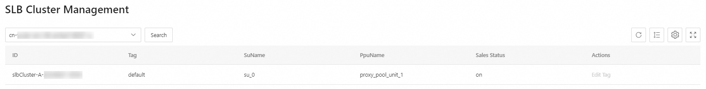

5. Click **Edit Tag** in the **Actions** column of the desired cluster. In the dialog box that appears, modify the tag keys and click **OK**.

   > **Note**
   >
   > You cannot modify the tags of the default cluster.

### 2.1.2. SLB management

The SLB Management page displays Layer 4 service resources and monitoring and O&M information of Server Load Balancer (SLB) clusters and SLB instances.

**Prerequisites**

The NetworkBaseServiceCluster cluster for BaseServiceAll is deployed and has reached the desired state.

**SLB clusters**

The SLB Cluster tab displays the basic information, maximum inbound bits per second (BPS), maximum outbound BPS, maximum inbound packets per second (PPS), maximum outbound PPS, maximum number of active connections, maximum number of inactive connections, and usage data of a single node in an SLB cluster.

**Procedure**

1. Log in to the Apsara Uni-manager Operations Console.

2. In the top navigation bar, choose **Product Operation** > **Networking** > **Network Operations Console**.

3. In the left-side navigation pane, choose **Network Services** > **SLB O&M** > **SLB Management**.

4. On the **SLB Management** tab, click the **SLB Cluster** tab, and select the cluster that you want to view from the **Cluster** drop-down list. You can then view information displayed in the **Node Information** and **Cluster Resource Usage** sections.

   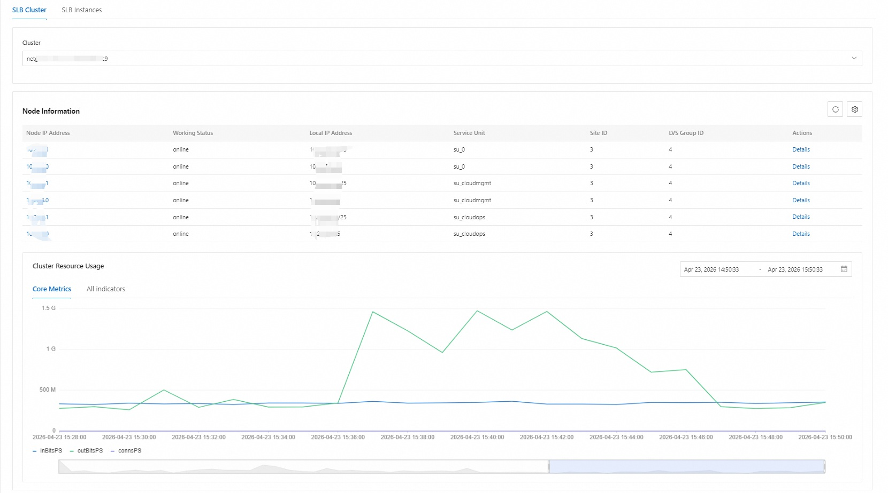

   - In the **Node Information** section, you can view node information in the columns, including **Node IP Address**, **Working Status**, **Local IP Address**, **Service Unit**, **Site ID**, and **LVS Group ID**.

     **View node details**: Click **Details** in the **Actions** column of the node that you want to view to go to the **SLB Node Details** page. Then, you can view **Node Information** and **Usage Data**.

     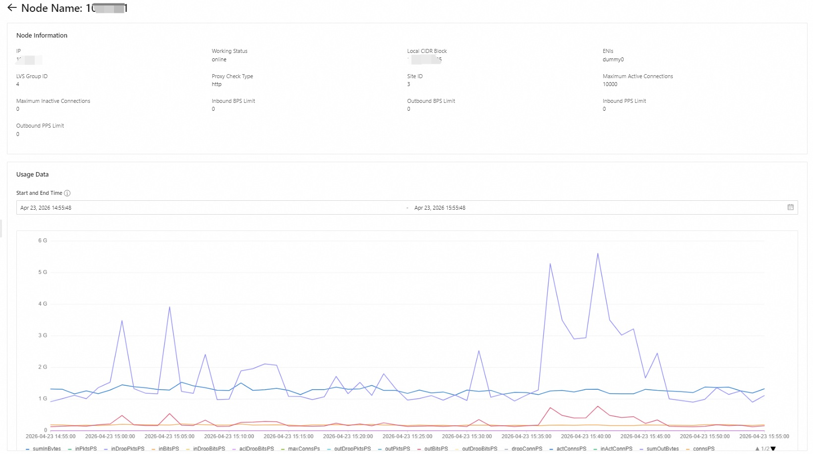

     - The **Node Information** section displays the following information: **IP**, **Working Status**, **Local CIDR Block**, **ENIs**, **LVS Group ID**, **Proxy Check Type**, **Site ID**, **Maximum Active Connections**, **Maximum Inactive Connections**, **Inbound BPS Limit**, **Outbound BPS Limit**, **Inbound PPS Limit**, and **Outbound PPS Limit**.

     - In the **Usage Data** section, specify **Start and End Time** to view the usage data of the node within the specified time range. For more information about the definitions of the metrics, see the Node and instance usage metrics section of this topic.

       > **Note**
       >
       > - The interval between the start time and end time must not exceed 12 hours.
       >
       > - You can click **Last5Minutes**, **Last30Minutes**, **Last1Hour**, or **Last6Hours** to query the usage data within the selected time range.
       >
       > - You can move the pointer over a point in time in a chart to view the values of all metrics at the point in time.

   - In the **Cluster Resource Usage** section, specify a time range to view the usage data of the cluster within the specified time range. You can click the **Core Metrics** or **All indicators** tab to view the corresponding information. For more information about the definitions of the metrics, see Cluster usage metrics.

     > **Note**
     >
     > - The interval between the start time and end time must not exceed 12 hours.
     >
     > - You can click **Last 1 Hour**, **Last 3 Hours**, **Last 6 Hours**, or **Last 12 Hours** to query the usage data within the specified time range.
     >
     > - You can move the pointer over a point in time in a chart to view the values of all metrics at the point in time.

**SLB instances**

The SLB Instances tab displays the basic information and usage data of SLB instances, including the inbound and outbound BPS and PPS.

**Procedure**

1. Log in to the Apsara Uni-manager Operations Console.

2. In the top navigation bar, choose **Product Operation** > **Networking** > **Network Operations Console**.

3. In the left-side navigation pane, choose **Network Services** > **SLB O&M** > **SLB Management**.

4. On the **SLB Management** page, click the **SLB Instances** tab to view the information about the SLB instances in the columns, including **IP Address**, **Instance ID**, **Network Type**, **Product**, **Zone**, and **Updated At**.

   Click **Advanced Filter** and filter SLB instances by **IP Address Version**, **IP Address**, **Instance ID**, **Product Name**, **Network Type**, or any combination of them.

   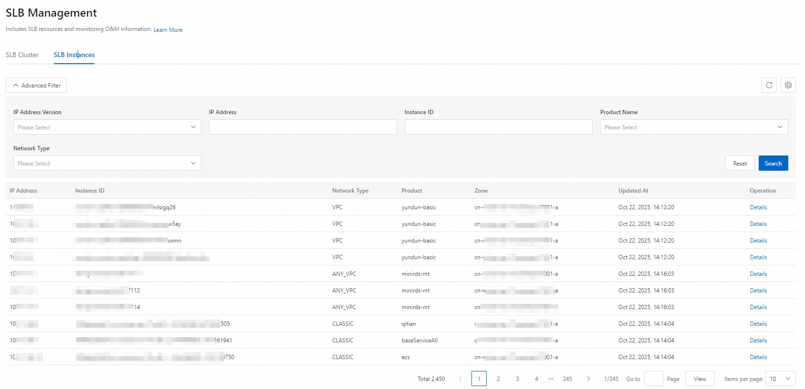

5. Click **Details** in the **Actions** column of an SLB instance to go to the **SLB Instance Details** page. On this page, you can view **Instance Information**, **Server Group Information**, and **Usage Data**.

   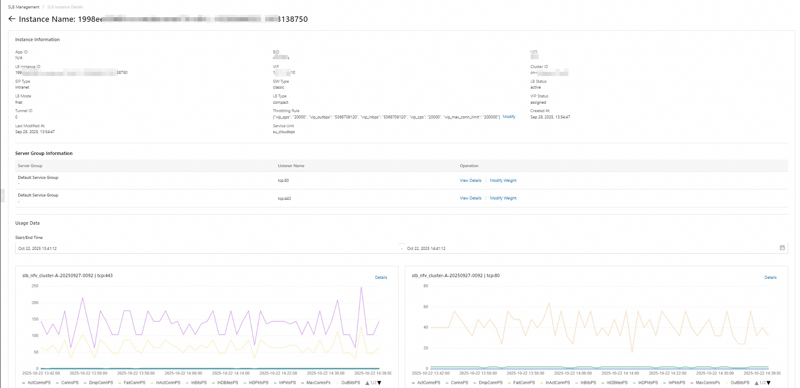

   - In the **Instance Information** section, view the basic information about the SLB instance, which can be used by O&M engineers to troubleshoot faults and confirm the ownership of the device.

     You can click **Modify** next to the **Throttling Rule** parameter to modify the throttling rule of the SLB instance. The throttling parameters vary depending on the status of the **SLB instance switch**. For more information, see the **Switch list (switch management)** section of the **Product console configuration management** topic below **UniConsole** in **Apsara Uni-manager Operations Console User Guide** and view the switch list in the **networkops** console.

     - When the SLB instance switch is **turned on**, you can modify the following throttling parameters.

       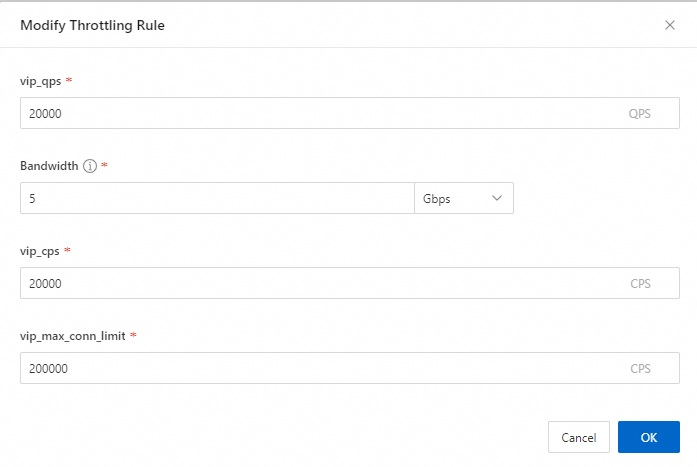

     - When the SLB instance switch is **turned off**, you can modify only the bandwidth parameter.

       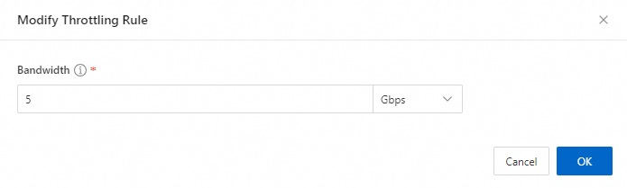

     > **Note**
     >
     > The maximum values of the throttling parameters are as follows:
     >
     > - vip_qps: 50000 QPS.
     >
     > - Bandwidth: 15 Gbit/s. The actual value is in bytes and rounded up.
     >
     > - vip_cps: 100000 CPS.
     >
     > - vip_max_conn_limit: 1000000 CPS.

   - In the **Server Group Information** section, view the server group information of the SLB instance, including **Server Group** and **Listener Name**.

     - To view the weight modification details, click **View Details** in the **Actions** column of the desired server group.

       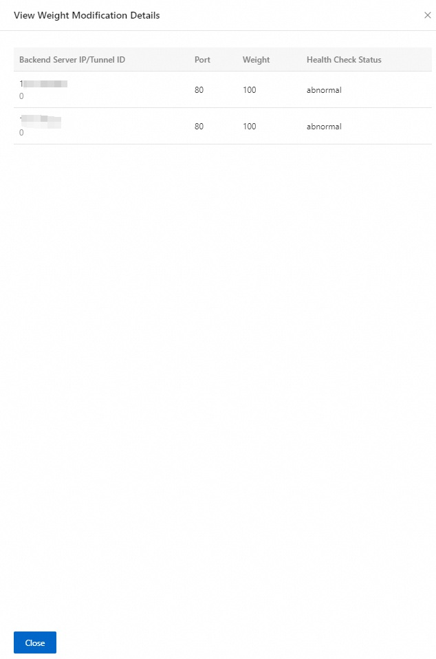

     - Modify weights

       <ol type="a">

       <li>

       Click **Modify Weight** in the **Actions** column of a server group. In the panel that appears, change the values in the **Weight** column and click **OK**.

       </li>

       <li>

       In the message that appears, confirm the information and click **OK**.

       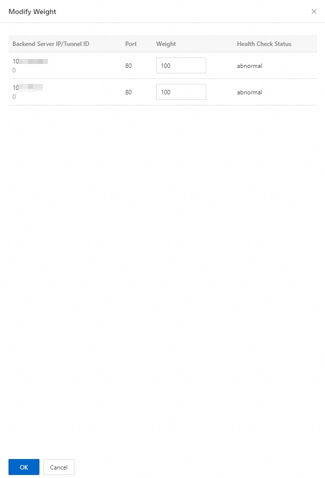

       </li>

       </ol>

       > **Note**
       >
       > - After maintenance or emergency repair is performed, we recommend that you restore the weight settings. When you perform zone-disaster recovery across two data centers, the system restores the default weight settings. The restored weight settings take effect after your confirmation.
       >
       > - If an SLB instance is enabled by a tenant, you can go to the Apsara Uni-manager Management Console to modify the weight settings of the SLB instance.

   - In the **Usage Data** section, specify **Start/End Time** and **Node** to view the usage data of the SLB instance within the specified time range. For more information about the definitions of the metrics, see the Node and instance usage metrics section of this topic.

     > **Note**
     >
     > - The interval between the start time and end time must not exceed 12 hours.
     >
     > - You can click **Last5Minutes**, **Last30Minutes**, **Last1Hour**, or **Last6Hours** to query the usage data within the selected time range.
     >
     > - You can move the pointer over a point in time in a chart to view the values of all metrics at the point in time.

     Click **Details** in the upper-right corner of the resource usage chart to view the details of the resource usage of backend servers.

     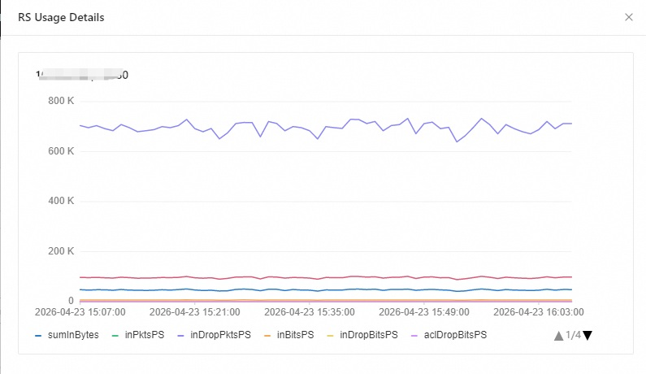

**Cluster usage metrics**

| Category | Metric | Description | Example |
| --- | --- | --- | --- |

The number of

**inBitsPS**

inbound bits per

248

second.

The number of

**Core Metrics**

**outBitsPS**

outbound bits per

208

second.

The number of

**connsPS**

connections created

1

per second.

The number of

**sumInBytes**

248

inbound bytes.

The number of

**inPktsPS**

inbound packets per

1

second.

The number of

**inDropPktsPS**

inbound packets

0

dropped per second.

The number of

**inBitsPS**

inbound bits per

248

second.

The number of

**inDropBitsPS**

inbound bits dropped

0

per second.

The number of bits dropped by the access

**aclDropBitsPS**

0

control list (ACL) per second.

The number of concurrent

**maxConnsPs**

1

connections per second.

The number of

**outDropPktsPS**

outbound packets

0

dropped per second.

The number of

**outPktsPS**

outbound packets per

1

second.

**All Metrics**

The number of

**outBitsPS**

outbound bits per

208

second.

The number of

**outDropBitsPS**

outbound bits dropped

0

per second.

The number of

**dropConnsPS**

connections dropped

0

per second.

The number of active

**actConnsPS**

0

connections.

The number of

**inActConnPS**

1

inactive connections.

The number of

**sumOutBytes**

248

outbound bytes.

The number of

**connsPS**

connections created

1

per second.

The number of packets dropped by access

**aclDropPktsPS**

0

control list (ACL) rules per second.

The number of failed

**failConnPS**

connections per

0

second.

**Node and instance usage metrics**

| Metric | Description | Example |
| --- | --- | --- |
| sumInBytes | The number of inbound bytes. | 248 |
| inPktsPS | The number of inbound packets per second. | 1 |
| inDropPktsPS | The number of inbound packets dropped per second. | 0 |
| inBitsPS | The number of inbound bits per second. | 248 |
| inDropBitsPS | The number of inbound bits dropped per second. | 0 |
| aclDropBitsPS | The number of bits dropped by ACL rules per second. | 0 |
| maxConnsPs | The number of concurrent connections per second. | 1 |
| outDropPktsPS | The number of outbound packets dropped per second. | 0 |
| outPktsPS | The number of outbound packets per second. | 1 |
| outBitsPS | The number of outbound bits per second. | 208 |
| outDropBitsPS | The number of outbound bits dropped per second. | 0 |
| dropConnPS | The number of connections dropped per second. | 0 |
| actConnsPS | The number of active connections. | 0 |
| inActConnPS | The number of inactive connections. | 1 |
| sumOutBytes | The number of outbound bytes. | 248 |
| connsPS | The number of connections created per second. | 1 |
| aclDropPktsPS | The number of packets dropped by ACL rules per second. | 0 |
| failConnPS | The number of failed connections per second. | 0 |

## 2.2. Proxy O&M

### 2.2.1. Proxy management

The proxy management module displays Layer 7 service resources and monitoring and maintenance information of Server Load Balancer (SLB).

**View information about proxy clusters**

On the Proxy Cluster tab, you can view the node status, usage data, and cluster aggregation metrics of an SLB proxy cluster.

**Procedure**

1. Log in to the Apsara Uni-manager Operations Console.

2. In the top navigation bar, choose **Product Operation** > **Networking** > **Network Operations Console**.

3. In the left-side navigation pane, choose **Network Services** > **Proxy O&M** > **SLB Proxy Management**.

4. On the **Proxy Cluster** tab of the **SLB Proxy Management** page, select the cluster that you want to view from the **Cluster** drop-down list. Then, view the cluster information in the **Node Information** and **Cluster Aggregation Monitoring** sections.

   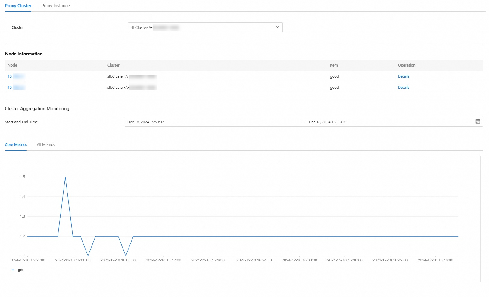

5. View information in the **Node Information** section.

   - View node information in the node list, including **Node**, **Cluster**, and **Item**.

   - Find the node whose details you want to view and click **Details** in the **Operation** column. On the **SLB Proxy Node Details** page, specify **Start and End Time** and view the metrics of the node in the **Usage Data** section.

     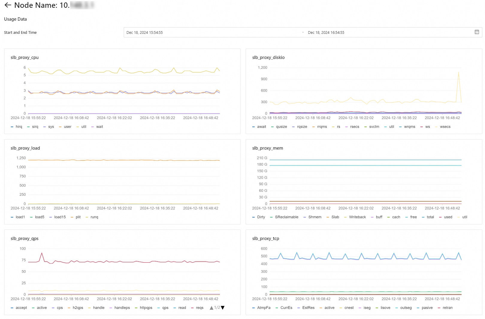

     > **Note**
     >
     > - The interval between the start time and end time must not exceed 12 hours.
     >
     > - You can click **Last5Minutes**, **Last30Minutes**, **Last1Hour**, or **Last6Hours** to query the usage data within the selected time range.
     >
     > - You can move the pointer over a point in time in a chart to view the values of all metrics at the point in time.

     The following table describes the metrics.

     **Category**

     **Metric**

     **Description**

     The ratio of the time that the system takes to handle

     **hirq**

     hardware interrupts to the total time.

     The ratio of the time that the system takes to handle

     **sirq**

     software interrupts to the total time.

     **sys**

     The system CPU utilization.

     **slb_proxy_cpu**

     The ratio of the time that the CPU takes to execute

     **user**

     user processes to the total time.

     **util**

     The ratio of the CPU usage time to the total time.

     The ratio of the time that the CPU waits for I/O

     **wait**

     operations to the total time.

     The average amount of time required to send I/O

     **await**

     requests to the device that requests the service. Unit: milliseconds.

     The average queue length of requests sent to the

     **qusize**

     device.

     The average size of requests sent to the device by

     **rqsize**

     sector.

     The number of sectors read from the device per

     **rrqms**

     second.

     The number of read requests sent to the device per second.

     **rs**

     **slb_proxy_diskio**

     The number of sectors read from the device per

     **rsecs**

     second.

     The average amount of time required to serve the

     **svctm**

     device to which I/O requests are sent. Unit: milliseconds.

     The ratio of the time that CPU takes to send I/O

     **util**

     requests to the device to the total CPU time, which indicates the bandwidth utilization of the device.

     The number of merged write requests sent to the

     **wrqms**

     device per second.

     The number of write requests sent to the device per

     **ws**

     second.

     The number of sectors written to the device per

     **wsecs**

     second.

     **load1**

     The average system load within 1 minute. Unit: %.

     **load5**

     The average system load within 5 minutes. Unit: %.

     **slb_proxy_load**

     **load15**

     The average system load within 15 minutes. Unit: %.

     The number of active tasks in the system during the

     **plit**

     sampling time, excluding completed tasks.

     The number of tasks in the queue during the

     **runq**

     sampling time.

     The volume of data pending to be written back to

     **Dirty**

     the disk. Unit: KB.

     **SReclaimable**

     The amount of reclaimable slab memory. Unit: KB.

     The amount of shared memory that has been

     **Shmem**

     allocated. Unit: KB.

     **Slab**

     The cache size of kernel data structure. Unit: KB.

     The volume of data being written back. Unit: KB.

     **Writeback**

     **slb_proxy_mem**

     **buff**

     The amount of memory used as a buffer. Unit: KB.

     The amount of memory allocated by the operating

     **cach**

     system to the file buffer. Unit: KB.

     **free**

     The amount of idle physical memory. Unit: KB.

     **total**

     The total amount of system memory. Unit: KB.

     **used**

     The amount of used memory. Unit: KB.

     **util**

     The memory usage.

     **accept**

     The total number of received TCP connections.

     The number of active TCP connections, including

     **active**

     connections that are receiving data, sending data, and waiting.

     The average number of TCP connections received

     **cps**

     per second.

     The number of HTTP/2 requests processed per

     **h2qps**

     second.

     **handle**

     The total number of processed TCP connections.

     The average number of connections processed per

     **handleps**

     second.

     **httpqps**

     The number of HTTP requests processed per second.

     **qps**

     The number of requests processed per second.

     The number of TCP connections that receive request

     **read**

     data.

     **slb_proxy_qps**

     **reqs**

     The total number of generated requests.

     **rt**

     The average response time. Unit: milliseconds.

     The number of SPDY requests processed per

     **spdyps**

     second.

     **sslf**

     The number of failed SSL connections.

     The average amount of time for an SSL handshake.

     **sslhst**

     Unit: milliseconds.

     **sslqps**

     The number of SSL requests processed per second.

     **sslv3f**

     The number of failed SSLv3 connections.

     The number of persistent TCP connections that are

     **wait**

     waiting.

     The number of TCP connections that send response

     **write**

     data to users.

     **AtmpFa**

     The number of failed TCP connections per second.

     **CurrEs**

     The current number of TCP connections.

     The number of times that TCP connections are reset

     **EstRes**

     per second.

     The number of TCP connections that are proactively

     **active**

     initiated per second.

     **slb_proxy_tcp**

     **iseg**

     The number of inbound TCP segments per second.

     The number of TCP requests dropped because the

     **lisove**

     listenaccept queue is full.

     **outseg**

     The number of outbound TCP segments per second.

     The number of passively established TCP

     **pasive**

     connections per second.

     The retransmission rate of segments. The value is

     **retran**

     calculated based on the re-transmitted segments and the total segments.

6. In the **Cluster Aggregation Monitoring** section, specify **Start and End Time** and view the cluster aggregation metrics on the **Core Metrics** and **All Metrics** tabs.

   > **Note**
   >
   > - The interval between the start time and end time must not exceed 12 hours.
   >
   > - You can move the pointer over a point in time in a chart to view the values of all metrics at the point in time.

   The following table describes the metrics.

   **Tab**

   **Metric**

   **Description**

   **Core Metrics**

   **qps**

   The number of requests processed per second.

   **accept**

   The total number of received TCP connections.

   The number of active TCP connections, including

   **active**

   connections that are receiving data, sending data, and waiting.

   The average number of TCP connections received per

   **cps**

   second.

   The number of HTTP/2 requests processed per

   **h2qps**

   second.

   **handle**

   The total number of processed TCP connections.

   The average number of connections processed per

   **handleps**

   second.

   **httpqps**

   The number of HTTP requests processed per second.

   **qps**

   The number of requests processed per second.

   **全部指标**

   The number of TCP connections that receive request

   **read**

   data.

   **reqs**

   The total number of generated requests.

   The average response time. Unit: milliseconds.

   **rt**

   **spdyps**

   The number of SPDY requests processed per second.

   **sslf**

   The number of failed SSL connections.

   The average amount of time for an SSL handshake.

   **sslhst**

   Unit: milliseconds.

   **sslqps**

   The number of SSL requests processed per second.

   **sslv3f**

   The number of failed SSLv3 connections.

   The number of persistent TCP connections that are

   **wait**

   waiting.

   The number of TCP connections that send response

   **write**

   data to users.

**View information about proxy instances**

You can view the metrics and usage data of SLB proxy instances.

**Prerequisites**

The NetworkBaseServiceCluster cluster for BaseServiceAll is deployed and has reached the desired state.

**Procedure**

1. Log in to the Apsara Uni-manager Operations Console.

2. In the top navigation bar, choose **Product Operation** > **Networking** > **Network Operations Console**.

3. In the left-side navigation pane, choose **Network Services** > **Proxy O&M** > **SLB Proxy Management**.

4. On the **SLB Proxy Management** page, click the **Proxy Instance** tab.

5. Select a cluster from the **Cluster** drop-down list, enter an instance ID or virtual IP address (VIP), specify **Listener** and **Start and End Time**, and click **Search**.

6. Click the **Request**, **Connection**, **Traffic**, **Latency**, and **Status Code** tabs to view the corresponding metrics and usage data.

   The following table describes the metrics.

   **Metric**

   **Description**

   The average number of requests received per

   **qps**

   second.

   **Request**

   **req_concurrent**

   The number of concurrent requests.

   The number of requests that are not

   **REQ_DROP**

   forwarded due to rate limiting.

   **conn_concurrent**

   The number of concurrent connections.

   **Connection**

   The average number of connections received

   **cps**

   per second.

   The inbound traffic rate. Unit: bits/s.

   **inBitsPS**

   **Traffic**

   **outBitsPS**

   The outbound traffic rate. Unit: bits/s.

   The average request processing latency. Unit:

   **rt**

   milliseconds.

   **Latency**

   The average request processing latency of

   **upstream_rt**

   backend Elastic Compute Service (ECS) instances. Unit: milliseconds.

   The number of requests for which a 2xx

   **status_code_2xx**

   status code is returned.

   The number of requests for which a 3xx

   **status_code_3xx**

   status code is returned.

   The number of requests for which a 4xx

   **status_code_4xx**

   status code is returned.

   **Status Code**

   The number of requests for which a 5xx

   **status_code_5xx**

   status code is returned.

   The number of requests for which a status

   **status_code_other**

   code other than 2xx, 3xx, 4xx, and 5xx is returned.

   The number of requests for which a 4xx

   **upstream_code_4xx**

   status code is returned by backend ECS instances.

   The number of requests for which a 5xx

   **upstream_code_5xx**

   status code is returned by backend ECS instances.

### 2.2.2. ALB proxy management

The ALB Proxy Management page displays information about Application Load Balancer (ALB) resources and monitoring O&M.

**View information about ALB proxy clusters**

On the ALB Proxy Cluster tab, you can view the node status, usage data, and aggregate metrics of an ALB proxy cluster.

**Procedure**

1. Log in to the Apsara Uni-manager Operations Console.

2. In the top navigation bar, choose **Product Operation** > **Networking** > **Network Operations Console**.

3. In the left-side navigation pane, choose **Network Services** > **Proxy O&M** > **ALB Proxy Management**.

4. On the **ALB Proxy Cluster** tab, select the cluster that you want to view from the **Cluster** drop-down list. Then, view the cluster information in the **Node Information** and **Cluster Aggregation Monitoring** sections.

   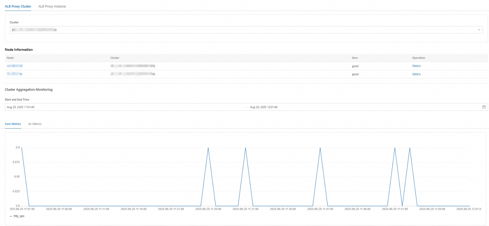

5. View the cluster information in the **Node Information** section.

   - View node information in the node list, including the **Node**, **Cluster**, and **Item** columns.

   - Find the node whose details you want to view and click **Details** in the **Actions** column. On the ALB Proxy Node Details page, specify the start time and end time, and view the metrics of the node in the Usage Data section. By default, the data within the last hour is displayed.

     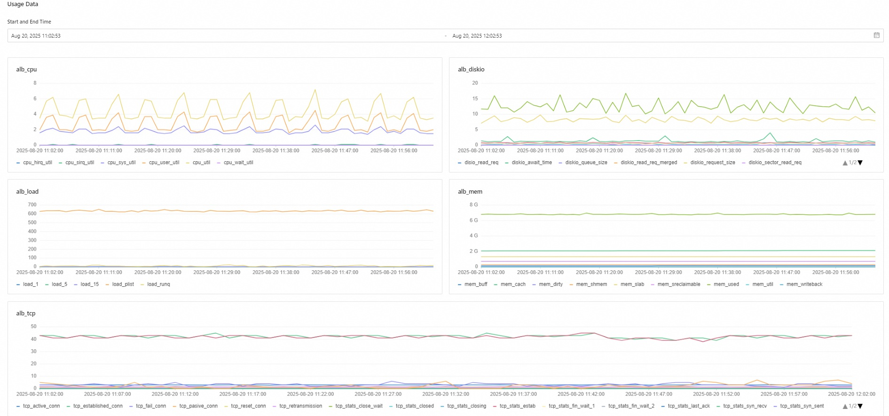

     > **Note**
     >
     > - The interval between the start time and end time cannot exceed 12 hours.
     >
     > - After you click the Start and End Time field, you can click **Last5Minutes**, **Last30Minutes**, **Last1Hour**, or **Last6Hours** to view the usage data within the selected time range.
     >
     > - You can move the pointer over a point in time in a chart to view the values of all metrics at the point in time.

     The following table describes the metrics.

     **Category**

     **Metric**

     **Description**

     The percentage of the amount of time that the

     **cpu_hirq_util**

     system takes to handle hardware interrupts to the total amount of time.

     The percentage of the amount of time that the

     **cpu_sirq_util**

     system takes to handle software interrupts to the total amount of time.

     The percentage of the amount of time that the

     **cpu_sys_util**

     system takes to run content to the total amount of time.

     **alb_cpu**

     The percentage of the amount of time that the

     **cpu_user_util**

     CPU takes to run user processes to the total amount of time.

     The percentage of the amount of CPU usage

     **cpu_util**

     time to the total amount of time.

     The percentage of the amount of time that the

     **cpu_wait_util**

     CPU waits for I/O operations to the total amount of time.

     The number of read requests sent to the device

     **diskio_read_req**

     per second.

     The average amount of time required to send I/O

     **diskio_await_time**

     requests to the device. Unit: milliseconds.

     The average queue length of requests sent to

     **diskio_quese_size**

     the device.

     **diskio_read_req_merge**

     The number of merged read requests sent to the

     **d**

     device per second.

     The average size of requests sent to the device

     **diskio_request_size**

     by sector.

     The number of sectors read from the device per

     **diskio_sector_read_req**

     second.

     **alb_diskio**

     **diskio_sector_write_re**

     The number of sectors written to the device per

     **q**

     second.

     The average amount of time required to serve

     **diskio_service_time**

     the device to which I/O requests are sent. Unit: milliseconds.

     The percentage of the amount of time that the CPU takes to send I/O requests to the device to

     **diskio_util**

     the total amount of CPU time, which indicates the bandwidth utilization of the device.

     The number of write requests sent to the device

     **diskio_write_req**

     per second.

     **diskio_write_req_merg**

     The number of merged write requests sent to

     **ed**

     the device per second.

     The average system load within 1 minute. Unit:

     **load1**

     %.

     The average system load within 5 minutes. Unit:

     **load5**

     %.

     The average system load within 15 minutes.

     **load15**

     Unit: %.

     **alb_load**

     The number of active tasks in the system during the sampling time, excluding tasks that are

     **load_plist**

     complete.

     The number of tasks in the queue during the

     **load_runq**

     sampling time.

     The amount of memory used as a buffer. Unit:

     **mem_buff**

     KB.

     The amount of memory used as a cache. Unit:

     **mem_cach**

     KB.

     The volume of data waiting to be written back to

     **mem_dirty**

     the disk. Unit: KB.

     The amount of shared memory that has been

     **mem_shmem**

     allocated. Unit: KB.

     **alb_mem**

     **mem_slab**

     The cache size of kernel data structure. Unit: KB.

     The amount of reclaimable slab memory. Unit:

     **mem_sreclaimable**

     KB.

     **mem_used**

     The amount of used memory. Unit: KB.

     **mem_util**

     The memory usage.

     **mem_writeback**

     The volume of data being written back. Unit: KB.

     The number of TCP connections that are

     **tcp_active_conn**

     proactively initiated per second.

     **tcp_established_conn**

     The current number of TCP connections.

     The number of failed TCP connections per

     **tcp_fail_conn**

     second.

     The number of passively established TCP

     **tcp_pasive_conn**

     connections per second.

     The number of times that TCP connections are

     **tcp_reset_conn**

     reset per second.

     The retransmission rate of segments. The value

     **tcp_retransmission**

     is calculated based on the re-transmitted segments and the total segments.

     The number of TCP connections in the

     **tcp_stats_close_wait**

     CLOSE_WAIT state.

     The number of TCP connections in the CLOSED

     **tcp_stats_closed**

     state.

     **alb_tcp**

     The number of TCP connections in the CLOSING

     **tcp_stats_closing**

     state.

     The number of TCP connections in the

     **tcp_stats_estab**

     ESTABLISH state.

     The number of TCP connections in the

     **tcp_stats_fin_wait_1**

     FIN_WAIT_1 state.

     The number of TCP connections in the

     **tcp_stats_fin_wait_2**

     FIN_WAIT_2 state.

     The number of TCP connections in the LAST_ACK

     **tcp_stats_last_ack**

     state.

     The number of TCP connections in the SYN_RECV

     **tcp_stats_syn_recv**

     state.

     The number of TCP connections in the SYN_SENT

     **tcp_stats_syn_sent**

     state.

     The number of TCP connections in the

     **tcp_stats_time_wait**

     TIME_WAIT state.

6. In the **Cluster Aggregation Monitoring** section, specify the start time and end time, and view the aggregate metrics of the cluster on the **Core Metrics** and **All Metrics** tabs. By default, the data within the last hour is displayed.

   > **Note**
   >
   > - The interval between the start time and end time cannot exceed 12 hours.
   >
   > - You can move the pointer over a point in time in a chart to view the values of all metrics at the point in time.

   The following table describes the metrics.

   **Tab**

   **Metric**

   **Description**

   The number of HTTP requests processed per second. The value equals the result of the average number of

   **Core Metrics**

   **http_qps**

   requests received per second minus the number of SSL requests processed per second.

   **conn_accept_1m**

   The total number of received TCP connections.

   The number of active TCP connections, including

   **conn_active_1m**

   connections that are receiving data, sending data, and waiting.

   **conn_handle_1m**

   The total number of processed TCP connections.

   The number of TCP connections that receive request

   **conn_read_1m**

   data.

   The number of persistent TCP connections that are

   **conn_wait_1m**

   waiting.

   The number of TCP connections that send response

   **conn_write_1m**

   data to users.

   The number of HTTP/2 requests processed per

   **http2_qps**

   second.

   **All Metrics**

   The number of HTTP requests processed per second. The value equals the result of the average number of

   **http_qps**

   requests received per second minus the number of SSL requests processed per second.

   **requests_1m**

   The total number of requests processed.

   **rt**

   The average response time. Unit: milliseconds.

   **spdy_ps**

   The number of SPDY requests processed per second.

   **ssl_failed_1m**

   The number of failed SSL connections.

   **ssl_handshake_ti**

   The average amount of time required for an SSL

   **me**

   handshake. Unit: milliseconds.

   **ssl_qps**

   The number of SSL requests processed per second.

   **sslv3_failed_1m**

   The number of failed SSLv3 connections.

   **tls_failed_1m**

   The number of failed TLS connections.

**View information about ALB proxy instances**

On the ALB Proxy Instance tab, you can view the metrics and usage data of an ALB proxy instance.

**Prerequisites**

The master branch for BaseServiceAll is deployed and at desired state.

**Procedure**

1. Log in to the Apsara Uni-manager Operations Console.

2. In the top navigation bar, choose **Product Operation** > **Networking** > **Network Operations Console**.

3. In the left-side navigation pane, choose **Network Services** > **Proxy O&M** > **ALB Proxy Management**.

4. On the **ALB Proxy Instance** tab, select a cluster from the **Cluster** drop-down list, enter an instance ID or a virtual IP address in the **Instance ID or VIP** field, select a listener from the **Listener** drop-down list, and then click **Search**.

5. Click the **Request**, **Connection**, **Traffic**, **Latency**, and **Status Code** tabs to view the usage data charts of the corresponding metrics.

   The following table describes the metrics.

   **Metric**

   **Description**

   The average number of requests received per

   **qps**

   second.

   **Request**

   **req_concurrent**

   The number of concurrent requests.

   **conn_concurrent**

   The number of concurrent connections.

   **Connection**

   The average number of connections received per

   **cps**

   second.

   **in_bytes_1m**

   The inbound traffic rate. Unit: bits/s.

   **Traffic**

   **out_bytes_1m**

   The outbound traffic rate. Unit: bits/s.

   The average request processing latency. Unit:

   **rt**

   milliseconds.

   **Latency**

   The average request processing latency of

   **upstream_rt**

   backend Elastic Compute Service (ECS) instances. Unit: milliseconds.

   The number of requests for which the 100 status

   **100**

   code is returned per second.

   The number of requests for which the 101 status

   **101**

   code is returned per second.

   The number of requests for which the 200 status

   **200**

   code is returned per second.

   The number of requests for which the 206 status

   **206**

   code is returned per second.

   The number of requests for which the 301 status

   **301**

   code is returned per second.

   The number of requests for which the 302 status

   **302**

   code is returned per second.

   The number of requests for which the 304 status

   **304**

   code is returned per second.

   The number of requests for which the 400 status

   **400**

   code is returned per second.

   The number of requests for which the 403 status

   **403**

   code is returned per second.

   The number of requests for which the 404 status

   **404**

   code is returned per second.

   The number of requests for which the 416 status code is returned per second.

   **416**

   The number of requests for which the 499 status

   **499**

   code is returned per second.

   The number of requests for which the 500 status

   **500**

   code is returned per second.

   The number of requests for which the 502 status

   **502**

   code is returned per second.

   The number of requests for which the 503 status

   **503**

   code is returned per second.

   The number of requests for which the 504 status

   **504**

   code is returned per second.

   The number of requests for which the 508 status

   **508**

   code is returned per second.

   The number of requests for which a 2xx status

   **status_code_2xx**

   code is returned per second.

   The number of requests for which a 3xx status

   **status_code_3xx**

   code is returned per second.

   The number of requests for which a 4xx status

   **status_code_4xx**

   code is returned per second.

   The number of requests for which a 5xx status

   **status_code_5xx**

   code is returned per second.

   **Status Code**

   The number of requests for which a status code

   **status_code_other**

   other than 2xx, 3xx, 4xx, and 5xx is returned per second.

   The number of requests for which a 4xx status

   **upstream_code_4xx**

   code is returned by backend ECS instances per second.

   The number of requests for which a 5xx status

   **upstream_code_5xx**

   code is returned by backend ECS instances per second.

   The number of requests for which the 100 status

   **upstream_100**

   code is returned by the upstream per second.

   The number of requests for which the 101 status

   **upstream_101**

   code is returned by the upstream per second.

   The number of requests for which the 200 status

   **upstream_200**

   code is returned by the upstream per second.

   The number of requests for which the 206 status

   **upstream_206**

   code is returned by the upstream per second.

   The number of requests for which the 301 status

   **upstream_301**

   code is returned by the upstream per second.

   The number of requests for which the 302 status

   **upstream_302**

   code is returned by the upstream per second.

   The number of requests for which the 304 status

   **upstream_304**

   code is returned by the upstream per second.

   The number of requests for which the 400 status

   **upstream_400**

   code is returned by the upstream per second.

   The number of requests for which the 403 status

   **upstream_403**

   code is returned by the upstream per second.

   The number of requests for which the 404 status code is returned by the upstream per second.

   **upstream_404**

   The number of requests for which the 416 status

   **upstream_416**

   code is returned by the upstream per second.

   The number of requests for which the 499 status

   **upstream_499**

   code is returned by the upstream per second.

   The number of requests for which the 500 status

   **upstream_500**

   code is returned by the upstream per second.

   The number of requests for which the 502 status

   **upstream_502**

   code is returned by the upstream per second.

   The number of requests for which the 503 status

   **upstream_503**

   code is returned by the upstream per second.

   The number of requests for which the 504 status

   **upstream_504**

   code is returned by the upstream per second.

   The number of requests for which the 508 status

   **upstream_508**

   code is returned by the upstream per second.

   The number of requests for which other status

   **upstream_other_code**

   codes are returned by the upstream per second.

# 3.Network resources

## 3.1. Cloud instance management

This topic describes how to manage the lifecycle of cloud service instances, including creating, deleting, and querying instance status.

**Create an instance**

1. Log on to the Apsara Uni-manager Operations Console.

2. In the top navigation bar, choose **Product Operation** > **Networking** > **Network Operations Console**.

3. In the left-side navigation pane, choose **Network Resources** > **Cloud Instance Management**.

4. On the Cloud Instance Management page, choose Create Instance > **Create Instance**.

5. In the **Create VPC** step of the Create Instance wizard, configure the parameters described in the following table and click **Create**.

   | Parameter | Description |
   | --- | --- |
   | Region ID | The ID of the region in which the instance resides. |
   | Cloud Service Instance ID | The ID of the instance. |
   | Tunnel Type | • <strong>SingleTunnel</strong>: A virtual IP address (VIP) of the SingleTunnel type allows the Elastic Compute Service (ECS) instances in a single virtual private cloud (VPC) to access external cloud services. • <strong>AnyTunnel</strong>: A VIP of the AnyTunnel type allows the ECS instances in all VPCs to access the specified cloud service. |
   | CloudInstance IP | The VIP that you want to assign to the instance. If you do not specify a VIP, the system automatically assigns a VIP. |
   | vSwitch ID | This parameter is available only when the <strong>Tunnel Type</strong> parameter is set to <strong>SingleTunnel</strong>. The ID of any vSwitch in the VPC to which the ECS instance that needs to access external cloud services belongs. |
   | UID | This parameter is available only when the <strong>Tunnel Type</strong> parameter is set to <strong>SingleTunnel</strong>. The UID of the user that creates the vSwitch. This parameter is required if the user is not the API caller. |
   | BID | This parameter is available only when the <strong>Tunnel Type</strong> parameter is set to <strong>SingleTunnel</strong>. The BID of the user that creates the vSwitch. This parameter is required if the user is not the API caller. |
   | CIDR Type | This parameter is available only when the <strong>Tunnel Type</strong> parameter is set to <strong>AnyTunnel</strong>. • <strong>Link_local (Regular Cloud Services)</strong>: The AnyTunnel VIP assigned to Application Load Balancer (ALB) is allocated from a subnet mask that does not belong to the 100.100.100.0/24 CIDR block. • <strong>Special Inner (ECS META Server)</strong>: The AnyTunnel VIP assigned to ALB is allocated from a subnet mask of the 100.100.100.0/24 CIDR block. |

   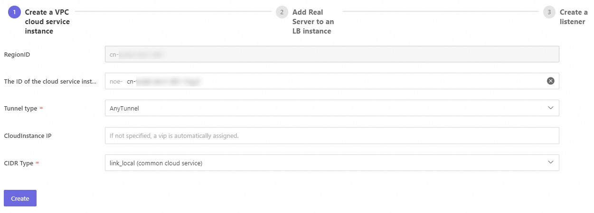

6. In the **Add RS to SLB Instance** step, configure the parameters described in the following table and click **Create**.

   | Parameter | Description |
   | --- | --- |
   | VPC ID | The ID of the VPC to which the ECS instance belong. This parameter is required if the ECS instance is deployed in a VPC. |
   | RS List | The backend servers that you want to add to the instance. Click <strong>Add RS</strong> and configure the <strong>IP</strong> and <strong>weight</strong> parameters. Valid value of the <strong>weight</strong> parameter: 0 to 1000. If you do not configure this parameter, the default value 100 is used. Note To delete a real server (RS), click <strong>Delete</strong> in the <strong>Actions</strong> column. |

   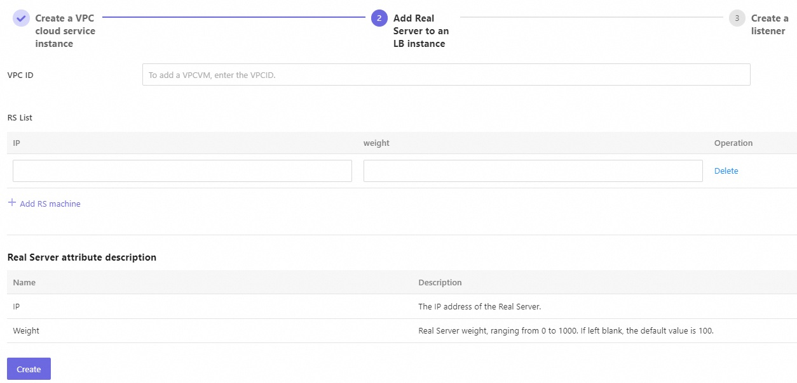

7. In the **Create Listener** step, configure the parameters described in the following table and click **Create**.

   | Parameter | Description |
   | --- | --- |
   | Agreement | The listener protocol. Valid values: • Tcp • Udp |
   | Front-end port | The frontend port of the VIP. |
   | Backend Port | The service port of the RS. |
   | Configuration | Click <strong>Configuration</strong> to specify configurations such as polling policy and health check. |
   | Delete | Click <strong>Delete</strong> to delete the listener configurations. |

   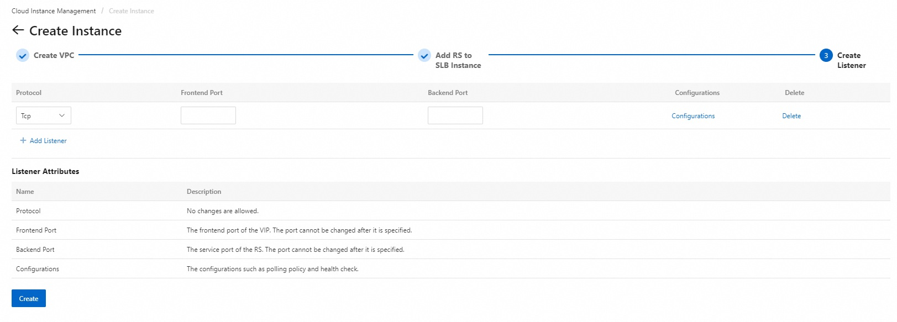

8. Return to the Cloud Instance Management page. If an instance whose tunnel type is **AnyTunnel** or **SingleTunnel** is displayed, the cloud service instance is created.

**Apply for a Direct AnyTunnel VIP**

1. On the Cloud Instance Management page, choose **Create Instance** > **Create Direct Any Tunnel**.

2. On the Create Direct Any Tunnel VIP page, configure the parameters described in the following table and click **Create**.

   | Parameter | Description |
   | --- | --- |
   | RegionID | The ID of the region in which the instance resides. |
   | Cloud Service Instance ID | The ID of the instance. |
   | Tunnel Type | <strong>Direct Any Tunnel</strong>: After a Direct Any Tunnel VIP is applied, all ECS instances in the VPC can use the VIP to access the specified cloud service. |
   | CloudInstance IP | The VIP that you want to assign to the instance. If you do not specify a VIP, the system automatically assigns a VIP. |
   | CIDR Type | • <strong>Link_local (Regular Cloud Services)</strong>: The Direct Any Tunnel VIP is allocated from a subnet mask that does not belong to the 100.100.100.0/24 CIDR block. • <strong>Special Inner (ECS META Server)</strong>: The Direct Any Tunnel VIP is allocated from a subnet mask of the 100.100.100.0/24 CIDR block. |

   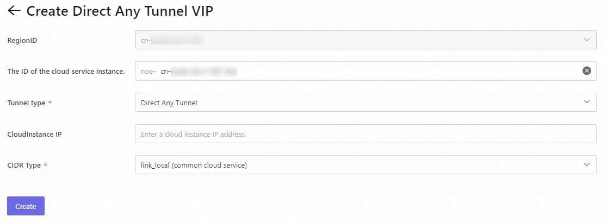

3. Return to the Cloud Instance Management page. If an instance whose tunnel type is **DirectAnyTunnel** is displayed, the Direct Any Tunnel VIP is applied.

**Import existing resources**

**Prerequisites**

Existing resources have not been imported.

**Procedure**

1. In the upper part of the Cloud Instance Management page, click **Existing Resource Management**.

2. After the page is refreshed, if cloud service instances whose IDs do not start with noe appear, the existing resources are imported as expected.

   > **Note**
   >
   > - After all resources are successfully processed, Existing Resource Management is dimmed and you cannot click it to import existing resources.
   >
   > - If an instance whose tunnel type is **InvalidResource** appears, the instance is an abnormal resource on the original platform due to reasons such as interrupted creation or invalid resource. After the instance is imported, you can only view or delete the instance but cannot manage the instance. For example, you cannot modify the RS or listener configurations.

**What to do next**

| Operation | Procedure |
| --- | --- |
| Modify RS configurations | Note You cannot modify RS configurations for instances whose tunnel type is <strong>InvalidResource</strong>. 1. Find the cloud service instance that you want to manage and click <strong>Edit</strong> <strong>RS</strong> in the <strong>Operation</strong> column. 2. In the dialog box that appears, modify the RS configurations and click <strong>OK</strong>. For more information about the parameters, see Step 6 of this topic. |
| Modify listener configurations | Note You cannot modify listener configurations for instances whose tunnel type is <strong>InvalidResource</strong>. 1. Find the cloud service instance that you want to manage and click <strong>Modify</strong> <strong>Listener</strong> in the <strong>Operation</strong> column. 2. In the dialog box that appears, modify the listener configurations and click <strong>OK</strong>. For more information about the parameters, see Step 7 of this topic. |
| Delete a cloud service instance | 1. Find the cloud service instance that you want to delete and click <strong>Delete</strong> in the <strong>Operation</strong> column. 2. In the message that appears, click <strong>OK</strong>. |
