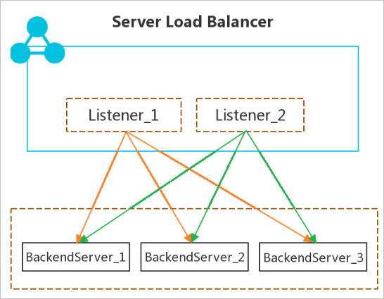

Alibaba Cloud  
Apsara Stack  
Server Load Balancer  
Product Introduction  
Product Version: v3.18.6-2607  
Document Version: 20260828

**Table of Contents**

- [1.What is SLB?](#section-1)
    - [1.1. Service details](#section-1-1)
    - [1.2. Benefits](#section-1-2)
    - [1.3. Scenarios](#section-1-3)
    - [1.4. Features](#section-1-4)

# 1.What is SLB?

This topic provides an overview of Server Load Balancer (SLB). SLB distributes inbound network traffic across multiple Elastic Compute Service (ECS) instances that function as backend servers based on forwarding rules. You can use SLB to improve the responsiveness and availability of your applications.

**Overview**

After you attach ECS instances that are deployed in the same region to an SLB instance, SLB uses virtual IP addresses (VIPs) to virtualize these ECS instances into backend servers in a high-performance server pool that ensures high availability. Client requests are distributed to the ECS instances based on forwarding rules.

SLB checks the health status of the ECS instances and automatically removes unhealthy ones from the server pool to eliminate single points of failure (SPOFs). This enhances the resilience of your applications.

**Components**

SLB consists of three components:

- SLB instances

  An SLB instance is a running SLB service entity that receives traffic and distributes traffic to backend servers. To get started with SLB, you must create an SLB instance, configure at least one listener for the SLB instance, and attach at least two ECS instances to the SLB instance.

- Listeners

  A listener checks client requests and forwards them to backend servers. It also performs health checks on backend servers.

- Backend servers

  ECS instances are used as backend servers to receive distributed requests. You can add ECS instances one by one to the server pool, or use vServer groups or primary/secondary server groups to add and manage multiple ECS instances at a time.

**Benefits**

- High availability

  SLB is designed with full redundancy that prevents SPOFs and supports zone-disaster recovery.

  SLB can be scaled based on application loads and can provide continuous services during traffic fluctuations.

- High scalability

  You can increase or decrease the number of backend servers to adjust the load balancing capability of your applications.

- High cost efficiency

  SLB can save 60% of load balancing costs compared with traditional hardware solutions.

- Outstanding security

  You can integrate SLB with Apsara Stack Security to defend your applications against DDoS attacks of up to 5 Gbit/s.

- High concurrency An SLB cluster supports hundreds of millions of concurrent connections. A single SLB instance supports tens of millions of concurrent connections.

## 1.1. Service details

The Server Load Balancer (SLB) service consists of SLB instances, listeners, and backend servers.

**SLB instances**

An SLB instance is a running entity of the SLB service that receives and distributes traffic to backend servers. To get started with SLB, you must create an SLB instance and add at least one listener and two Elastic Compute Service (ECS) instances to the SLB instance.

SLB allows you to list, query, create, update, and delete SLB instances. You can also add ECS instances to and remove ECS instances from SLB instances.

**Listeners**

A listener is used to check client requests and forward the requests to one or more backend servers. TCP, UDP, HTTP, and HTTPS listeners are supported. Listeners can perform health checks on backend servers and automatically isolate unhealthy backend servers.

**Backend servers**

Backend servers are ECS instances that are added to an SLB instance to receive requests. You can add individual ECS instances to the default server group of an SLB instance. You can also add multiple ECS instances to vServer groups or primary/secondary server groups.

## 1.2. Benefits

Server Load Balancer provides high availability, scalability, low cost, security, and high concurrency. This topic describes the high availability benefits of Server Load Balancer for single SLB instances, multiple SLB instances, and backend ECS instances.

**High availability**

Server Load Balancer uses a fully redundant design with no single point of failure and supports Multi-zone Disaster Recovery. It scales out elastically based on your application's payload. This ensures that services remain available during traffic fluctuations.

| Object | Description of high availability benefits |
| --- | --- |
| Server Load Balancer | SLB instances are deployed in a cluster to enable session synchronization.This eliminates single points of failure, improves redundancy, and ensures service stability. Layer 4 load balancing is implemented using Linux Virtual Server (LVS) with keepalived. Layer 7 load balancing is implemented using Tengine. Tengine is a web server project that is based on Nginx and optimized for high-traffic websites. Requests from the Internet reach the LVS cluster through Equal-Cost Multipath Routing (ECMP). Each LVS server in the cluster uses multicast messages to synchronize sessions with other LVS servers in the same cluster. This ensures session synchronization across all servers in the LVS cluster. The LVS cluster also performs health checks on the Tengine cluster.Server Load Balancer removes abnormal devices from the Tengine cluster to ensure the availability of Layer 7 load balancing. |
| Single SLB instance | Alibaba Cloud lets you create multi-zone deployments in a region to achieve high availability for a single SLB instance. If the primary zone fails or becomes unavailable, Server Load Balancer can switch to the secondary zone and resume service in about 30 seconds. When the primary zone recovers, Server Load Balancer automatically switches back to the primary zone. |
| High availability of multiple SLB instances | If you have extremely high availability requirements, the built-in availability mechanisms of a single SLB instance might not be sufficient. For example, if an SLB instance becomes unavailable due to a network attack or a configuration error, a zone-level failover is not triggered. This is because the issue is not a zone-wide fault. In this case, you can create multiple SLB instances and use Alibaba Cloud DNS to schedule traffic. You can also use a global load balancing solution to implement cross-region disaster recovery and backup. |
| High availability of backend ECS instances | Server Load Balancer uses health checks to determine the availability of backend ECS instances. The health check mechanism improves the overall availability of your frontend application. It prevents abnormal backend ECS instances from affecting your service. After you enable health checks, if a backend ECS instance becomes unhealthy, Server Load Balancer automatically forwards new requests to other healthy ECS instances. When the unhealthy instance recovers, Server Load Balancer automatically restores it to the service. For more information about health checks, see Health check overview in the User Guide. |

**Scalability**

You can add or remove backend servers at any time to scale your application's service capacity as needed.

**Low cost**

Server Load Balancer costs less than traditional hardware load balancers. This protects your investment.

**High concurrency**

A cluster can support tens of millions of concurrent connections. A single instance can support millions of concurrent connections.

## 1.3. Scenarios

Server Load Balancer (SLB) is suitable for scenarios where you want to handle large volumes of traffic, scale applications, eliminate single points of failure (SPOFs), and implement cross-zone or cross-region disaster recovery.

**Handle large volumes of traffic**

SLB instances route traffic to Elastic Compute Service (ECS) instances that act as backend servers based on listening rules. This allows you to avoid overloaded servers that may negatively affect user experience. The session persistence feature can be used to forward all requests from a client to the same backend ECS instance to improve access efficiency.

**Scale applications**

SLB can be used as traffic ingress points for both web servers and application servers. This allows you to scale the service capability of your applications by adding or removing backend ECS instances in response to business requirements.

**Eliminate SPOFs**

SLB instances act as the single point of contact for clients. You can add multiple ECS instances to an SLB instance. When an ECS instance malfunctions, SLB automatically isolates the ECS instance and distributes inbound requests to other healthy ECS instances. This ensures that your applications continue to run as expected.

**Implement zone-disaster recovery (multi-zone disaster recovery)**

To provide more stable and reliable load balancing services, SLB supports cross-zone deployment in most regions. You can deploy an SLB instance across multiple zones within the same region to improve disaster tolerance and ensure the reliability of your applications. When the primary zone fails or has no healthy ECS instances, the SLB instance automatically fails over services to the secondary zone. This process is completed within 30 seconds. When the primary zone recovers, the SLB instance automatically switches services back to the primary zone. You can plan the deployment of backend servers based on your business needs. We recommend that you add at least one backend server in each zone to maximize the load balancing capabilities of SLB.

ECS instances that reside in different zones can be added to an SLB instance. Under normal circumstances, the SLB instance evenly distributes inbound traffic to ECS instances in the primary zone (Zone A) and to those in the secondary zone (Zone B). If Zone A fails, the SLB instance distributes inbound traffic only to ECS instances in Zone B. This deployment mode is tolerant to zone-level failures at the expense of latency. However, you can deploy core services across zones to make up for this.

**Implement cross-region disaster recovery**

You can deploy SLB instances in different regions and add the ECS instances of different zones within each of these regions to the SLB instance in the same region. You can use Alibaba Cloud DNS to resolve domain names to the service addresses of SLB instances in different regions for global load balancing. When a region becomes unavailable, you can temporarily stop DNS resolution in the region without affecting traffic to your applications.

## 1.4. Features

This topic describes the features of Alibaba Cloud Server Load Balancer (SLB). SLB supports Layer 4 and Layer 7 load balancing. It provides health checks, session persistence, and domain forwarding to ensure high availability for backend services.

**SLB Instances**

**Feature**

**Description**

You can edit the name and

Modify instance properties

description of an SLB instance.

You can create an SLB instance

Create an instance

and specify a scheduling algorithm.

You can delete an existing SLB

Delete an instance

instance.

SLB instance management

You can start or stop a

Start or stop an instance

specified SLB instance.

You can view the detailed

View instance details

configuration of a specified SLB instance.

You can import or export SLB

SLB configuration details

configuration details.

Maximum connections: 50,000

New connections per second

Medium I

(CPS): 5,000

slb.s2.small

Queries per second (QPS): 5,000

Maximum connections: 5,000

New connections per second

Small I

(CPS): 3,000

slb.s1.small

Queries per second (QPS): 1,000

Maximum connections: 200,000

New connections per second

Large I

(CPS): 50,000

slb.s3.small

Queries per second (QPS): 30,000 Maximum connections: 500,000

New connections per second

Large II

(CPS): 20,000

slb.s3.medium

Queries per second (QPS): 20,000

SLB instance types

Maximum connections: 1,000,000

Super large I

New connections per second (CPS): 100,000

slb.s3.large

Queries per second (QPS): 50,000

Maximum connections: 100,000

New connections per second

Medium II

(CPS): 10,000

slb.s2.medium

Queries per second (QPS): 10,000

Maximum connections: 5,020,000

New connections per second

slb.i40g.large

(CPS): 500,000

Queries per second (QPS): 100,000

Maximum connections: 5,020,000

New connections per second

slb.i20g.large

(CPS): 500,000

Queries per second (QPS): 100,000

6to4 support

6to4 is supported.

Supports IPv6-to-IPv6

6to6 support

translation.

IPv6

Multi-zone Disaster Recovery

SLB supports Multi-zone

for IPv6

Disaster Recovery for IPv6.

SLB supports attaching to the

SLB supports attaching classic

classic IPv6 network over the

IPv6 networks to the public

public network.

network.

**Listeners**

**Feature**

**Description**

You can create a Layer 4 or Layer 7 listener and configure

Create a listener

health checks to ensure the availability of backend servers.

You can delete a specified listener from the load balancer.

Delete a listener

This action stops the port from receiving and distributing requests.

Listener

You can start or stop a listener

Start or stop a listener

to control whether it receives and distributes requests.

You can modify the configuration of an existing

Edit a listener

listener, such as its port, protocol, or advanced settings.

SLB uses cookies to maintain session persistence. This ensures that requests from the same user session are routed

Session persistence

to the same backend server.

SLB automatically monitors the health status of backend servers and forwards requests only to healthy servers.

- HTTP health check: Confirms

Health check

the server status using HTTP requests.

- TCP health check: Confirms the server status using TCP handshakes.

You can configure the listener protocol.

- HTTP: You can set the listener port and protocol

Listener support

type as required.

- HTTPS: You can set the listener port and protocol type as required.

SLB supports multiple

Application protocol support

protocols, such as HTTP 1.0/1.1/2.0 and WebSocket(S).

Gzip compresses data during transmission to reduce

Support for gzip compression

bandwidth usage and improve efficiency.

You can configure automatic

Layer 7 listeners

redirection from HTTP to HTTPS. This configuration

Support for HTTP redirection

ensures data security and maintains compatibility for users who access services using legacy links.

IPv6 access to backend servers

Supports the IPv6 protocol.

You can configure domain

Layer 7 content-based load

name or URL forwarding rules

balancing

to route requests to different backend servers.

SLB provides certificate hosting and offloading to help reduce

Certificate management

certificate licensing costs.

Layer 7 load balancing supports domain name or URL forwarding rules. These rules

Forwarding rule

route requests from different domain names or URLs to different ECS instances.

SLB supports multiple load balancing scheduling algorithms to optimize traffic distribution.

- Round Robin (RR): Distributes requests to

Scheduling algorithm

backend servers in sequence.

- Weighted Round Robin (WRR): Distributes requests based on the configured weights of backend servers.

SLB maintains session persistence based on the source IP address. This ensures

Session persistence

that requests from the same client are routed to the same backend server during a session.

SLB automatically monitors the health status of backend servers and forwards requests only to healthy servers.

- HTTP health check: Confirms

Health check

the server status using HTTP requests.

- TCP health check: Confirms the server status using TCP handshakes.

You can configure the listener protocol.

- TCP: You can set the listener port and protocol type as

Listener support

required.

- UDP: You can set the listener port and protocol type as required.

Layer 4 listeners

IPv6 access to backend servers

Supports the IPv6 protocol.

SLB supports multiple load balancing scheduling algorithms to optimize traffic distribution.

- Round Robin (RR): Distributes requests to backend servers in sequence.

- Weighted Round Robin

Scheduling algorithm

(WRR): Distributes requests based on the configured weights of backend servers.

- Consistent Hashing (CH): Uses a hash algorithm that is based on the source IP address. This ensures that requests from a specific client are always assigned to the same backend server.

<table>
  <tr>
    <td rowspan="3">Forwarding rule</td>
    <td>Configure a forwarding rule</td>
    <td>Layer 7 load balancing supports domain name or URL forwarding rules. These rules route requests from different domain names or URLs to different ECS instances.</td>
  </tr>
  <tr>
    <td rowspan="2">Graceful connection termination for SLB Layer 4</td>
    <td>SLB Layer 4 supports graceful connection termination. If you remove a backend server or if a health check fails, existing connections continue to operate for a specified period.</td>
  </tr>
  <tr>
    <td>The graceful termination period can be set to a maximum of 900 seconds.</td>
  </tr>
  <tr>
    <td rowspan="2">Session persistence</td>
    <td>Source IP address and cookie-based session persistence</td>
    <td>SLB supports session persistence based on the source IP address and cookies.</td>
  </tr>
  <tr>
    <td>Long-lived connections remain active during hot migration of applications</td>
    <td>SLB supports long-lived connections that remain active during hot migration of backend applications.</td>
  </tr>
</table>

**Backend Servers**

**Feature**

**Description**

Modify the weight of an added ECS instance. Higher-weighted

Modify the weight of an ECS

ECS instances receive more

instance

requests. Set weights based on the service capacity of each ECS instance.

Add an ECS instance to handle

Add a backend server

connection requests forwarded from the frontend.

Backend servers

Remove an ECS instance from

Remove an ECS instance

the SLB instance.

Backend servers support

Backend servers support

descriptions

descriptions.

Add an ECS instance to handle

Add a backend server

connection requests forwarded from the frontend.

View the status and port

View the default server group

configuration of ECS instances in the server group.

Default server group

Modify the weight of an added ECS instance. Higher-weighted ECS instances receive more

Edit a backend server

requests. Set weights based on the service capacity of each ECS instance.

Remove an ECS instance from

Remove a backend server

the SLB instance.

Create a server group. A server group is a collection of ECS instances. By associating

Create a vServer group

different listeners with different server groups, SLB can route different requests to different ECS instances.

View the status and port

View a vServer group

configuration of ECS instances in the server group.

Rename the server group. Modify the weights of ECS

Edit a vServer group

instances in the group. Add new ECS instances or remove existing ones.

vServer group

Delete a specified server group. Remove associated ECS

Delete a vServer group

instances from the SLB instance.

vServer groups display

SLB vServer group

associated listener information.

<table>
  <tr>
    <td rowspan="3">Primary/secondary server group</td>
    <td>Create a primary/secondary server group</td>
    <td>A primary/secondary server group contains one primary server and one secondary server. When the primary server is healthy, traffic is routed to it. When the primary server fails, traffic switches to the secondary server group.</td>
  </tr>
  <tr>
    <td>Delete a primary/secondary server group</td>
    <td>Delete a specified primary/secondary server group.</td>
  </tr>
  <tr>
    <td>Support for primary/secondary server groups and primary/secondary IPAM pools</td>
    <td>Customize the number of real servers (RS) behind the primary and secondary servers in a primary/secondary server group.</td>
  </tr>
</table>

**Access Control**

<table>
  <tr>
    <th colspan="2">Feature</th>
    <th>Description</th>
  </tr>
  <tr>
    <td rowspan="2">Access control</td>
    <td>Create and manage policy groups</td>
    <td>Specify which IP addresses can access the SLB service by configuring listener-level access control policy groups.</td>
  </tr>
  <tr>
    <td>Modify the access control quota limit</td>
    <td>Provide a page to increase the access control quota limit.</td>
  </tr>
</table>

**Certificate Management**

<table>
  <tr>
    <th colspan="2">Feature</th>
    <th>Description</th>
  </tr>
  <tr>
    <td>Certificate</td>
    <td>Upload a certificate</td>
    <td>Store certificates in the SLB certificate management system instead of deploying them directly to backend ECS servers. Private keys uploaded to the certificate management system are encrypted at rest.</td>
  </tr>
  <tr>
    <td>Chinese cryptographic algorithm</td>
    <td>Support for Chinese cryptographic algorithms</td>
    <td>When clients encrypt messages using Chinese cryptographic algorithms (client support required), SLB can decrypt the encrypted messages.</td>
  </tr>
</table>

**Monitoring and Alerting**

<table>
  <tr>
    <th colspan="2">Feature</th>
    <th>Description</th>
  </tr>
  <tr>
    <td rowspan="4">Monitoring</td>
    <td>Multi-dimensional monitoring and comparison</td>
    <td>Supports multi-dimensional monitoring.</td>
  </tr>
  <tr>
    <td>Monitor connections between SLB and backend RS</td>
    <td>Monitor connections between SLB and backend real servers (RS).</td>
  </tr>
  <tr>
    <td>Operation log</td>
    <td>View instance operation logs.</td>
  </tr>
  <tr>
    <td>Fine-grained monitoring</td>
    <td>The SLS Pub component requires Simple Log Service, and SLB offers fine-grained monitoring.</td>
  </tr>
  <tr>
    <td>Alerting</td>
    <td>Provide alerting</td>
    <td>Provide alerting.</td>
  </tr>
</table>

**Security**

<table>
  <tr>
    <th colspan="2">Feature</th>
    <th>Description</th>
  </tr>
  <tr>
    <td rowspan="4">Security</td>
    <td>Access control list (ACL)</td>
    <td>Supports access control lists (ACLs).</td>
  </tr>
  <tr>
    <td>SLB supports blacklists and whitelists</td>
    <td>SLB access control uses blacklists to block malicious IP addresses from accessing SLB services.</td>
  </tr>
  <tr>
    <td>SLB whitelist limit</td>
    <td>Number of entries allowed in an SLB whitelist.</td>
  </tr>
  <tr>
    <td>Set a listener whitelist</td>
    <td>Add a whitelist to specify which IP addresses can access the SLB service.</td>
  </tr>
</table>

**Network Interconnection**

| Feature | Description |
| --- | --- |

<table>
  <tr>
    <td rowspan="5">Network interconnection</td>
    <td>Frontend networking capability</td>
    <td>Attach an Elastic IP Address (EIP) to an SLB instance. This allows a virtual private cloud (VPC) SLB instance to accept traffic from the Internet.</td>
  </tr>
  <tr>
    <td rowspan="4">Backend networking capability</td>
    <td>Attach a load balancer directly to an Elastic Network Interface (ENI) for flexible network configuration.</td>
  </tr>
  <tr>
    <td>Configure multiple secondary IP addresses on an ENI and use them as backend servers for SLB.</td>
  </tr>
  <tr>
    <td>Connect to on-premises IDCs using leased lines. Connect to on-premises IDCs using the Internet.</td>
  </tr>
  <tr>
    <td>Attach ECS instances across multiple zones to improve system availability and disaster recovery capability.</td>
  </tr>
</table>

**Cluster Scalability**

<table>
  <tr>
    <th colspan="2">Feature</th>
    <th>Description</th>
  </tr>
  <tr>
    <td rowspan="5">Cluster scalability</td>
    <td>Multi-zone Disaster Recovery in multi-cluster mode</td>
    <td>In multi-cluster mode, SLB supports Multi-zone Disaster Recovery. If the primary cluster fails, traffic is switched to the secondary cluster.</td>
  </tr>
  <tr>
    <td rowspan="2">Multi-cluster deployment for physical SLB servers</td>
    <td>You can create SLB instances in a specified cluster.</td>
  </tr>
  <tr>
    <td>Supports tenant-based multi-cluster isolation.</td>
  </tr>
  <tr>
    <td rowspan="2">Horizontal scaling within a cluster</td>
    <td>SLB supports horizontal scaling within a cluster.</td>
  </tr>
  <tr>
    <td>You can scale out to the maximum number of supported nodes.</td>
  </tr>
</table>

**High Availability and High Performance**

<table>
  <tr>
    <th colspan="2">Feature</th>
    <th>Description</th>
  </tr>
  <tr>
    <td rowspan="2">High availability</td>
    <td>Cross-zone disaster recovery</td>
    <td>Virtual IP address (VIP) cross-zone disaster recovery.</td>
  </tr>
  <tr>
    <td>Support for multiple regions</td>
    <td>Supports multiple regions.</td>
  </tr>
  <tr>
    <td rowspan="2">High performance</td>
    <td>SLB supports 100 Gbps network architecture</td>
    <td>Physical servers support 100 Gbps network architecture.</td>
  </tr>
  <tr>
    <td>SLB supports 100 Gbps network architecture</td>
    <td>Virtualized gateways support 100 Gbps network architecture.</td>
  </tr>
  <tr>
    <td rowspan="2">Multiple data centers</td>
    <td>SLB supports Multi-region 2.0</td>
    <td>Business Foundation System (BFS) unitization: physical servers.</td>
  </tr>
  <tr>
    <td>SLB supports 3-AZ deployment</td>
    <td>Supports physical server deployment.</td>
  </tr>
  <tr>
    <td>Real server (RS) hot migration</td>
    <td>SLB maintains long-lived TCP connections during hot migration of clients or backend real servers (RS)</td>
    <td>Long-lived TCP connections remain active during hot migration of cloud hosts. This improves infrastructure stability and application decoupling. For ECS acting as clients or RS, TCP connections remain active during hot migration. LVS must support inner-layer RSS (for 40 Gbps hardware).</td>
  </tr>
</table>

**Hardware Compatibility and Product Forms**

**Feature**

**Description**

Intel

Supports physical server deployment.

Hygon

Supports physical server deployment.

Kunpeng

Supports physical server deployment.

Phytium

Supports physical server deployment.

Support for V8

Supports physical server deployment.

Domestic

Support for 8U

Supports physical server deployment.

Software and Hardware

Intel support for

Ecosystem

virtualized

Virtualization gateways are supported.

gateway SLB

Hygon support for virtualized

Supports virtualization gateways.

gateway SLB

V8 support for virtualized

It supports virtualization gateway.

gateway SLB

8U support for virtualized

Support for virtualization gateways.

gateway SLB

ConnectX-5 NICs

Supported for physical server deployments.

Dual-port

Supported for physical server deployments.

ConnectX-6 NICs

Network Interface Controller

ConnectX-5 NICs

Supported for virtualized gateways.

(NIC)

for virtualized SLB

Dual-port ConnectX-6 NICs

Supported for virtualized gateways.

for virtualized SLB

LVS on Docker

Supports containerized deployment.

Multi-zone Disaster Recovery

Supports Multi-zone Disaster Recovery.

for LVS on Docker

Supports Network Functions Virtualization (NFV) on ECS

Proxy on NFV

deployment.

Multi-zone Disaster Recovery

Supports Multi-zone Disaster Recovery.

for Proxy on NFV KeyServer on NFV

Supports NFV on ECS deployment.

Virtualized gateway

Multi-zone Disaster Recovery

Supports Multi-zone Disaster Recovery.

for KeyServer on NFV

Chinese cryptographic

Supports Chinese cryptographic algorithms.

algorithm support for SLB on NFV

The Virtualized Gateway SLB

The virtualized gateway SLB supports Layer 4 attachment to on-

supports attaching

premises Internet Data Centers (IDCs).

to on-premises IDCs.

Support for multi-

SLB supports a unitized architecture for multi-region

region

deployments.

architecture
