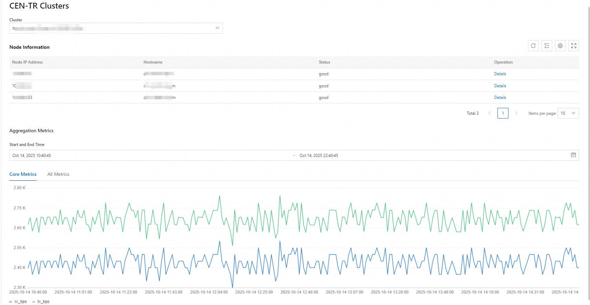
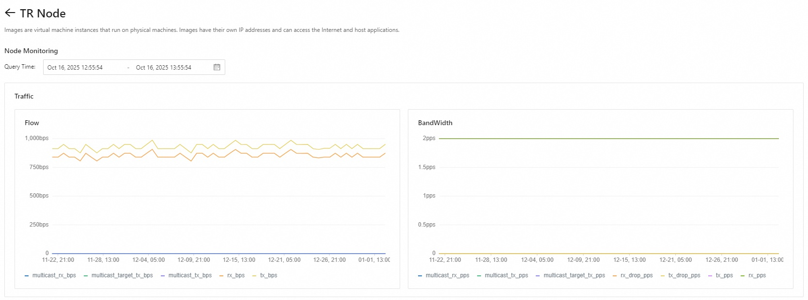
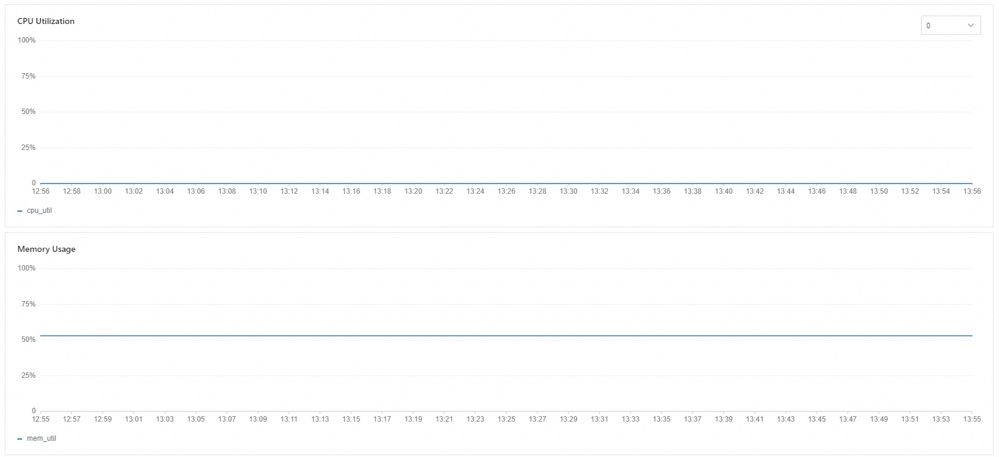
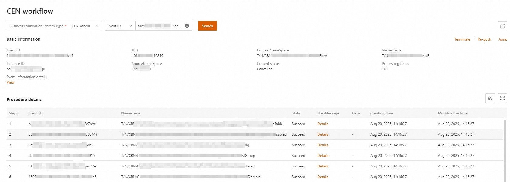
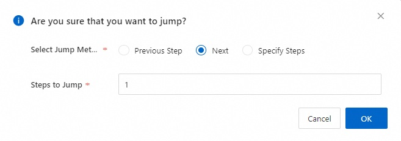

Alibaba Cloud  
Apsara Stack  
TransitRouter  
Operations and Maintenance  
Guide  
Product Version: v3.18.6-2607  
Document Version: 20260828

**Table of Contents**

- [1.Log on to the Apsara Uni-manager Operations Console](#section-1)
- [2.CEN O&M](#section-2)
    - [2.1. Manage CEN-TR clusters](#section-2-1)
    - [2.2. Manage CEN workflows](#section-2-2)

# 1.Log on to the Apsara Uni-manager Operations Console

This topic describes how users such as O&M engineers log on to the Apsara Uni-manager Operations Console.

**Prerequisites**

- The endpoint of the Apsara Uni-manager Operations Console and the username and password that are used to log on to the console are obtained from a deployment engineer or an administrator.

  The endpoint of the Apsara Uni-manager Operations Console is in the following format: *regi on-id*.ops.console.*intranet-domain-id*.

- A web browser is available. We recommend that you use Google Chrome.

**Procedure**

1. Open your browser.

2. In the address bar, enter the endpoint of the Apsara Uni-manager Operations Console. Press the ENTER key.

   

   > **Note**
   >
   > You can click the current language in the upper-right corner to switch to another language. Simplified Chinese, English, and traditional Chinese are supported.

3. Enter the username and password.

   > **Note**
   >
   > - Obtain the username and password that are used to log on to the Apsara Uni-manager Operations Console from a deployment engineer or an administrator.
   >
   > - If you enter an invalid password for three consecutive times, the system enables the image verification logon feature. If you enter an invalid password for five consecutive times, the account is locked. Contact the administrator to activate the account.

   If this is the first time you log on to the Apsara Uni-manager Operations Console, you must change the password as prompted.

   To enhance security, your password must meet the following requirements:

   - The password contains uppercase and lowercase letters.

   - The password contains digits.

   - The password contains at least one of the following special characters: ! @ # $ %

   - The password is 10 to 20 characters in length.

4. Click **Log In**.

# 2.CEN O&M

> **Note**
>
> By default, the CEN O&M module is not displayed. To use this module, perform the following operations: Log on to the Apsara Uni-manager Operations Console. In the top navigation bar, click **User Authorities**. In the left-side navigation pane, click **Menu Management**. On the Menu management page, modify the menu settings to display the CEN O&M module.

## 2.1. Manage CEN-TR clusters

Virtual machines (VMs) that run on physical machines have their own IP addresses, and can access the Internet and host applications.

**Procedure**

1. Log in to the Apsara Uni-manager Operations Console.

2. In the top navigation bar, choose **Product Operation** > **Networking** > **Network Operations Console**.

3. In the left-side navigation pane, choose **Network Services** > **CEN O&M** > **CEN-TR Clusters**.

4. On the **CEN-TR Clusters** page, view the **node information** and **aggregate metrics**.

   

   - **Node Information**: Select a cluster from the **Cluster** drop-down list. The information about the selected cluster is displayed, including the **node IP address**, **hostname**, and **status**.

   - **Aggregated Metrics**: By default, the metrics within the last hour are displayed. You can view metrics on the **Core Metrics** and **All Metrics** tab.

     The following table describes the metrics.

     | Metric | Description |
     | --- | --- |
     | multicast_rx_bps | The rate of inbound multicast data that is transmitted to the transit router node. Unit: bit/s. |
     | multicast_rx_pps | The number of inbound multicast packets that are sent to the transit router node per second. |
     | multicast_target_tx_bps | The expected rate of outbound multicast data that is transmitted from the transit router node. Unit: bit/s. |
     | multicast_target_tx_pps | The expected number of outbound multicast packets that are sent from the transit router node per second. |
     | multicast_tx_bps | The rate of outbound multicast data that is transmitted from the transit router node. Unit: bit/s. |
     | multicast_tx_pps | The number of outbound multicast packets that are sent from the transit router node per second. |
     | rx_bps (core metric) | The rate of inbound data that is transmitted to the transit router node. Unit: bit/s. |
     | rx_drop_pps | The number of dropped inbound packets that are sent to the transit router node per second. |
     | rx_pps | The number of inbound packets that are sent to the transit router node per second. |
     | tx_bps (core metric) | The rate of outbound data that is transmitted from the transit router node. Unit: bit/s. |
     | tx_drop_pps | The number of dropped outbound packets that are sent from the transit router node per second. |
     | tx_pps | The number of outbound packets that are sent from the transit router node per second. |

     > **Note**
     >
     > - Configure **Start Time and End Time** to filter and view metrics within the specified time range.
     >
     > - Click **Last 1 Hour**, **Last 3 Hours**, **Last 6 Hours**, or **Last 12 Hours** to quickly filter metrics.
     >
     > - The interval between the start and end times cannot be greater than 12 hours.

**What to do next**

**View node monitoring data**

In the **Node Information** list, find the node that you want to view and click **Details** in the **Operation** column. On the **TR Node** page, view the monitoring data of the node within a specific period of time, including the **traffic**, **CPU utilization**, and **memory usage**.

The following table describes the key monitoring metrics.

| Category | Metric | Description |
| --- | --- | --- |

The rate of inbound multicast data

multicast_rx_bps

that is transmitted to the transit router node. Unit: bit/s.

The expected rate of outbound multicast data that is transmitted

multicast_target_tx_bps

from the transit router node. Unit: bit/s.

The rate of outbound multicast data

**Flow**

multicast_tx_bps

that is transmitted from the transit router node. Unit: bit/s.

The rate of inbound data that is

rx_bps

transmitted to the transit router node. Unit: bit/s.

The rate of outbound data that is

tx_bps

transmitted from the transit router node. Unit: bit/s.

The number of inbound multicast

multicast_rx_pps

packets that are sent to the transit router node per second.

The number of outbound multicast

**Traffic**

multicast_tx_pps

packets that are sent from the transit router node per second.

The expected number of outbound

multicast_target_tx_pps

multicast packets that are sent from the transit router node per second.

The number of dropped inbound

rx_drop_pps

packets that are sent to the transit router node per second.

**BandWidth**

The number of dropped outbound packets that are sent from the

tx_drop_pps

transit router node per second.

The number of outbound packets

tx_pps

that are sent from the transit router node per second.

The number of inbound packets that

rx_pps

are sent to the transit router node per second.

**CPU Utilization**

cpu_util

The CPU utilization, in percentage.

**Memory Usage**

mem_util

The memory usage, in percentage.

> **Note**
>
> - Select a time range from the **Query Time** drop-down list to filter metrics within the selected time range.
>
> - Click **Last 1 Hour**, **Last 3 Hours**, **Last 6 Hours**, and **Last 1 Day** to quickly filter metrics.
>
> - Select a CPU model from the drop-down list in the upper-right corner of the **CPU Utilization** list to view CPU utilization by CPU model.

## 2.2. Manage CEN workflows

On the CEN workflows page, you can view the workflow event details and relevant information about a Cloud Enterprise Network (CEN) instance. If a workflow is in an abnormal state, you can re-push, skip, and terminate the workflow.

**Procedure**

1. Log in to the Apsara Uni-manager Operations Console.

2. In the top navigation bar, choose **Product Operation** > **Networking** > **Network Operations Console**.

3. In the left-side navigation pane, choose **Network Services** > **CEN O&M** > **CEN Workflows**.

4. On the page that appears, select an option from the **Business Foundation System Type** drop-down list, enter an event ID in the **Event ID** field, and then click **Search**.

   You can select **CEN Yaochi** or **BR Yaochi** from the **Business Foundation System Type** drop-down list.

5. View the **basic information** and **procedure details** about the workflow.

   

   - **Basic information**: displays the following parameters: **Event ID**, **UID**, **ContextNameSpace**, **NameSpace**, **Instance ID**, **SourceNameSpace**, **Current status**, **Processing times**, and **Event information details**.

     Move the pointer over **View** next to **Event information details** to view the details of the event.

   - **Procedure details:** displays the step serial number and the following parameters: **Event ID,** **Namespace,** **State,** **StepMessage,** **Data,** **Creation time, and Modification time.**

     Move the pointer over **Details** in the **StepMessage** column to view the details of the step.

**What to do next**

| Operation | Procedure |
| --- | --- |
| Terminate a workflow | 1. In the <strong>Basic information</strong> section, click <strong>Terminate</strong> in the upper-right corner. 2. In the message that appears, click <strong>OK</strong>. |
| Re-push a workflow | When the event status of a workflow is not in the <strong>Succeed</strong> state, you can perform a retry on the workflow. 1. In the <strong>Basic information</strong> section, click <strong>Re-push</strong> in the upper-right corner. 2. In the message that appears, click <strong>OK</strong>. |
| Skip a workflow | 1. In the <strong>Basic information</strong> section, click <strong>Jump</strong> in the upper-right corner. 2. In the dialog box that appears, configure the Select Jump Method and Steps to Jump parameters.  • <strong>Select Jump Method</strong>: Select a skip method. Valid values: <strong>Previous</strong> <strong>Step</strong>, <strong>Next</strong>, and <strong>Specify Steps</strong>. • <strong>Steps to Jump</strong>: Enter the number of steps to skip. This parameter takes effect and is required if you set the Select Jump Method parameter to <strong>Specify Steps</strong>. 3. Click <strong>OK</strong>. |
