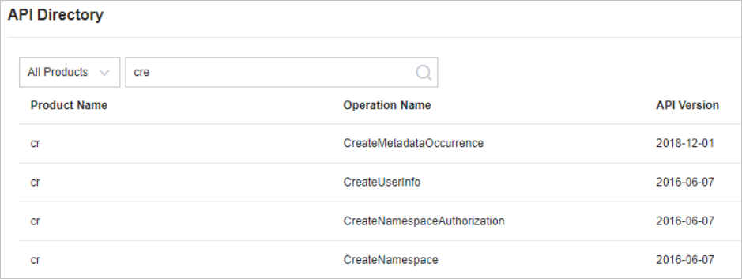
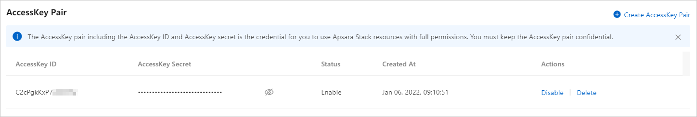

Alibaba Cloud  
Apsara Stack  
VPN Gateway  
Developer Guide  
Product Version: v3.18.6-2607  
Document Version: 20260828

**Table of Contents**

- [1.Getting started](#section-1)
    - [1.1. Usage notes on development documentation](#section-1-1)
    - [1.2. Call an API operation](#section-1-2)
- [2.Preparations](#section-2)
    - [2.1. Log on to OpenAPI Explorer](#section-2-1)
    - [2.2. View the information about API operations](#section-2-2)
    - [2.3. Obtain an AccessKey pair](#section-2-3)
    - [2.4. Obtain an STS AccessKey 3-tuple](#section-2-4)
    - [2.5. Obtain the values of common header parameters](#section-2-5)
    - [2.6. Obtain the endpoint of VPN Gateway](#section-2-6)
    - [2.7. Obtain a VPN Gateway SDK](#section-2-7)
- [3.Call examples for SDK for Java](#section-3)
    - [3.1. Getting started](#section-3-1)
    - [3.2. Use SDK](#section-3-2)
        - [3.2.1. Install VPC SDK for Java](#section-3-2-1)
        - [3.2.2. Configure authentication credentials](#section-3-2-2)
        - [3.2.3. Configure connection requests](#section-3-2-3)
        - [3.2.4. Initiate a request](#section-3-2-4)
        - [3.2.5. Troubleshooting](#section-3-2-5)
        - [3.2.6. Use CommonRequest to call API operations](#section-3-2-6)
- [4.Call examples for SDK for Python](#section-4)
    - [4.1. Getting started](#section-4-1)
    - [4.2. Use SDK](#section-4-2)
        - [4.2.1. Install VPC SDK for Python](#section-4-2-1)
        - [4.2.2. Configure authentication credentials](#section-4-2-2)
        - [4.2.3. Set HTTPS requests](#section-4-2-3)
        - [4.2.4. Initiate a request](#section-4-2-4)
        - [4.2.5. Handle errors](#section-4-2-5)
        - [4.2.6. Use CommonRequest to call API operations](#section-4-2-6)
- [5.Call examples for SDK for Go](#section-5)
    - [5.1. Quick start](#section-5-1)
    - [5.2. Use SDK](#section-5-2)
        - [5.2.1. Install the core package of SDK for Go](#section-5-2-1)
        - [5.2.2. Configure authentication credentials](#section-5-2-2)
        - [5.2.3. Initiate a request](#section-5-2-3)
        - [5.2.4. Handle errors](#section-5-2-4)
        - [5.2.5. Use CommonRequest to call API operations](#section-5-2-5)
- [6.API reference](#section-6)
    - [6.1. List of operations by function](#section-6-1)
    - [6.2. Make API requests](#section-6-2)
        - [6.2.1. Request syntax](#section-6-2-1)
        - [6.2.2. API authorization](#section-6-2-2)
        - [6.2.3. Request signatures](#section-6-2-3)
        - [6.2.4. RAM authentication](#section-6-2-4)
        - [6.2.5. Common parameters](#section-6-2-5)
    - [6.3. VPN gateway](#section-6-3)
        - [6.3.1. CreateVpnGateway](#section-6-3-1)
        - [6.3.2. ModifyVpnGatewayAttribute](#section-6-3-2)
        - [6.3.3. DescribeVpnGateways](#section-6-3-3)
        - [6.3.4. DescribeVpnGateway](#section-6-3-4)
        - [6.3.5. DeleteVpnGateway](#section-6-3-5)
        - [6.3.6. DescribeRegions](#section-6-3-6)
    - [6.4. Customer gateway](#section-6-4)
        - [6.4.1. CreateCustomerGateway](#section-6-4-1)
        - [6.4.2. ModifyCustomerGatewayAttribute](#section-6-4-2)
        - [6.4.3. DescribeCustomerGateways](#section-6-4-3)
        - [6.4.4. DescribeCustomerGateway](#section-6-4-4)
        - [6.4.5. DeleteCustomerGateway](#section-6-4-5)
    - [6.5. Routes for VPN gateways](#section-6-5)
        - [6.5.1. CreateVpnRouteEntry](#section-6-5-1)
        - [6.5.2. ModifyVpnRouteEntryWeight](#section-6-5-2)
        - [6.5.3. DeleteVpnRouteEntry](#section-6-5-3)
        - [6.5.4. DescribeVpnRouteEntries](#section-6-5-4)
        - [6.5.5. PublishVpnRouteEntry](#section-6-5-5)
        - [6.5.6. CreateVpnPbrRouteEntry](#section-6-5-6)
        - [6.5.7. ModifyVpnPbrRouteEntryWeight](#section-6-5-7)
        - [6.5.8. DeleteVpnPbrRouteEntry](#section-6-5-8)
        - [6.5.9. DescribeVpnPbrRouteEntries](#section-6-5-9)
    - [6.6. IPsec-VPN](#section-6-6)
        - [6.6.1. CreateVpnConnection](#section-6-6-1)
        - [6.6.2. ModifyVpnConnectionAttribute](#section-6-6-2)
        - [6.6.3. DescribeVpnConnections](#section-6-6-3)
        - [6.6.4. DescribeVpnConnection](#section-6-6-4)
        - [6.6.5. DownloadVpnConnectionConfig](#section-6-6-5)
        - [6.6.6. DeleteVpnConnection](#section-6-6-6)
    - [6.7. SSL-VPN](#section-6-7)
        - [6.7.1. CreateSslVpnServer](#section-6-7-1)
        - [6.7.2. ModifySslVpnServer](#section-6-7-2)
        - [6.7.3. DescribeSslVpnServers](#section-6-7-3)
        - [6.7.4. DescribeVpnSslServerLogs](#section-6-7-4)
        - [6.7.5. DeleteSslVpnServer](#section-6-7-5)
        - [6.7.6. CreateSslVpnClientCert](#section-6-7-6)
        - [6.7.7. ModifySslVpnClientCert](#section-6-7-7)
        - [6.7.8. DescribeSslVpnClientCerts](#section-6-7-8)
        - [6.7.9. DescribeSslVpnClientCert](#section-6-7-9)
        - [6.7.10. DeleteSslVpnClientCert](#section-6-7-10)
- [7.Appendixes](#section-7)
    - [7.1. STS overview](#section-7-1)
        - [7.1.1. What is STS?](#section-7-1-1)
        - [7.1.2. AssumeRole](#section-7-1-2)

<a id="section-1"></a>

# 1.Getting started

<a id="section-1-1"></a>

## 1.1. Usage notes on development documentation

This topic describes how to view the desired product development documentation when you use Apsara Stack API (ASAPI).

**Procedure**

You can follow the procedure described in the following figure to view the desired development documentation.


**Prerequisites**

The Apsara Stack version is obtained from an O&M personnel or operations administrator.

**Procedure**

You can go to the Apsara Stack documentation center and view the desired product documentation.

1. Go to the Apsara Stack Documentation Centerpage by using a browser.

2. Click the **Enterprise**, **Agility**, or **All-in-one** tab based on the Apsara Stack version that you use.

3. Select an Apsara Stack version from the drop-down list.

4. In the left-side navigation pane, select the name of the product that you want to view.

5. In the upper-right corner of the product documentation section, click **View Details** or **Download PDF**.

<a id="section-1-2"></a>

## 1.2. Call an API operation

Apsara Stack allows you to call API operations by using the point of presence (POP) gateway. To ensure that Apsara Stack provides the same experience as Alibaba Cloud Public Cloud, API operations in Apsara Stack Enterprise V3.16.0 and later are called by using the POP gateway by default. This topic describes how to use the POP gateway to call Apsara Stack API operations.

**Flowchart**


**Procedure**

1. Obtain AccessKey credentials.

   Obtain the AccessKey credentials that are required when you call an API operation. For more information, see Obtain an AccessKey pair or Obtain STS AccessKey credentials.

   > **Note**
   >
   > We recommend that you use an AccessKey pair or STS AccessKey credentials of a personal account to call the API operations of the Apsara Uni-manager Management Console and cloud services.

2. Obtain the region ID.

   For more information, see Obtain common header parameters.

3. Obtain the organization ID and the resource set ID.

   You must call an API operation to obtain an organization ID. For more information, see *GetO rganizationList* in *Apsara Uni-manager Management Console Developer Guide*.

   You must call an API operation to obtain a resource set ID. For more information, see *ListRe sourceGroup* in *Apsara Uni-manager Management Console Developer Guide*.

   > **Note**
   >
   > When you call an API operation, set the  `<x-acs-organizationid>`  header to the organization ID that you queried, and set the  `<x-acs-resourcegroupid>`  header to the resource set ID that you queried. This way, you can query resources in the specified organization and resource set.
   >
   > - If you do not specify the  `<x-acs-organizationid>`  parameter, the organization to which the current user belongs is used.
   >
   > - If you do not specify the  `<x-acs-resourcegroupid>`  parameter, this parameter is left empty. If you specify a resource set ID, you must also specify an organization ID.

4. View the developer guide of the cloud service that you want to use to learn how to make the API call.

   For more information, see Usage notes on development documentation.

5. Obtain the cloud service endpoint.

6. Obtain the cloud service SDK and call an API operation.

<a id="section-2"></a>

# 2.Preparations

<a id="section-2-1"></a>

## 2.1. Log on to OpenAPI Explorer

You can log on to OpenAPI Explorer from the Apsara Uni-manager Management Console.

**Prerequisites**

- The URL of the Apsara Uni-manager Management Console is obtained from the deployment personnel.

- A browser is available. We recommend that you use Google Chrome.

**Procedure**

1. Enter the URL of the Apsara Uni-manager Management Console in the address bar of a browser and press the Enter key.

2. Enter your username and password.

   Obtain the username and password from an operations administrator.

   > **Note**
   >
   > The first time you log on to the Apsara Uni-manager Management Console, you must change the password of your account. For security purposes, your password must meet the minimum complexity requirements. The password must be 10 to 32 characters in length and must contain at least two of the following character types:
   >
   > - Letters
   >
   > - Digits
   >
   > - Special characters, including exclamation points (!), at signs (@), number signs (#), dollar signs ($), and percent signs (%)

3. Click **Log on**.

4. If multi-factor authentication (MFA) is enabled for your account, perform the corresponding operations in the following scenarios:

   - The first time you log on to the Apsara Uni-manager Management Console after MFA is enabled by the administrator.

     <ol type="a">

     <li>

     On the Bind Virtual MFA Device page, bind an MFA device.

     </li>

     <li>

     Re-enter the username and password as in Step 2 and click **Log On**.

     </li>

     </ol>

     <ol type="i" start="100">

     <li>

     Enter a six-digit MFA verification code and click **Authenticate**.

     </li>

     </ol>

   - You have enabled MFA and bound an MFA device.

     Enter a six-digit MFA verification code and click **Authenticate**.

     > **Note**
     >
     > For more information, see the **Bind a virtual MFA device to enable MFA** topic in **Apsara Uni-manager Management Console User Guide**.

5. In the top navigation bar, choose **Products > Application Services > OpenAPI Explorer**.

<a id="section-2-2"></a>

## 2.2. View the information about API operations

This topic describes how to view the information about API operations. The information includes service names, API operation names, and API versions. The information is required when you use an SDK to call API operations.

**Background information**

The API operations on the API Directory page are only for reference. For information about how to call API operations, see developer guides of the corresponding cloud services. If the information on the API Directory page is inconsistent with that in the developer guide of the corresponding cloud service, the information in the developer guide prevails.

**Procedure**

1. Go to the API Tool console. For more information, see Log on to OpenAPI Explorer.

2. In the left-side navigation pane, click **API Directory**.

3. On the **API Directory** page, select the service that you want to use from the drop-down list, enter a keyword of an API operation name in the search box, and then click Search.

   

4. View and record the service name, API operation name, and API version of the API operation that you want to call.

<a id="section-2-3"></a>

## 2.3. Obtain an AccessKey pair

AccessKey credentials are provided by Resource Access Management (RAM) or Security Token Service (STS). You can use one type of AccessKey credentials for authentication when you call API operations. This topic describes how to obtain an AccessKey pair that is provided by RAM.

**Background information**

An AccessKey ID and an AccessKey secret are used to implement symmetric encryption and verify the identity of request senders. The AccessKey ID is used to identify a user. The AccessKey secret is a string that is used to encrypt the signature.

AccessKey credentials can be provided by RAM or STS:

- An AccessKey pair that is provided by RAM to a third party consists of an AccessKey ID and an AccessKey secret.

- An AccessKey 3-tuple that is provided by STS to a third party consists of an AccessKey ID, an AccessKey secret, and a security token. For more information, see Obtain an STS AccessKey 3-tuple.

The Apsara Uni-manager Management Console provides AccessKey pairs for personal accounts or organizations. Only the administrators of level-1 organizations and operations administrators can obtain the AccessKey pairs of organizations. We recommend that you use the AccessKey pairs of personal accounts to call the operations provided by the Apsara Uni-manager Management Console and cloud services. If you use the AccessKey pair of a personal account, configure the header parameters that are described in the following table for access control. Otherwise, an error that indicates insufficient permissions can occur.

> **Warning**
>
> The AccessKey pair of a personal account is managed and controlled by
>
> the permission system of the Apsara Uni-manager Management Console. If you need to obtain the AccessKey pair of an organization, make sure that your operation is allowed by an administrator. This ensures security.

| Parameter | Description |
| --- | --- |
| x-acs-regionid | The ID of the region. Example:<br><br><code>cn-hangzhou-*</code>. |
| x-acs-organizationid | The ID of the organization in the Apsara Uni-manager Management Console. For more information about how to obtain organization IDs, see the <strong>GetOrganizationList</strong> section in <strong>Apsara</strong> Uni-manager Management Console <strong>Developer Guide</strong>. |
| x-acs-resourcegroupid | The ID of the resource set in the Apsara Uni-manager Management Console. For more information about how to obtain resource set IDs, see the <strong>ListResourceGroup</strong> section in <strong>Apsara</strong> Uni-manager Management Console <strong>Developer Guide</strong>. |
| x-acs-instanceid | The ID of the instance that you want to manage.You can obtain instance IDs from the instance list. |

**Obtain the AccessKey pair of a personal account**

1. Log on to the Apsara Uni-manager Management Console.

2. In the upper-right corner of the homepage, move the pointer over the profile picture and click **User Information**.

3. In the **AccessKey Pair** section, view the AccessKey pair of your account.

   

   > **Note**
   >
   > An AccessKey pair consists of an **AccessKey ID** and an **AccessKey**
   >
   > **secret**. These credentials provide full permissions on cloud resources within your account. You must keep the AccessKey pair confidential.

**Obtain the AccessKey pair of an organization**

1. Log on to the Apsara Uni-manager Management Console as an administrator.

2. In the top navigation bar, click **Enterprise**.

3. In the left-side navigation pane, choose **Resources > Organizations**.

4. In the organization list, click the name of the level-1 organization whose AccessKey pair you want to obtain.

5. Click **Management Accesskey**.

6. In the dialog box that appears, view the AccessKey pair of the organization.

<a id="section-2-4"></a>

## 2.4. Obtain an STS AccessKey 3-tuple

This topic describes how to use Security Token Service (STS) to call API operations in Apsara Stack.

**Background information**

STS allows you to manage temporary credentials to your Apsara Stack resources. You can use STS to call API operations in Apsara Stack.

An STS AccessKey 3-tuple consists of an AccessKey ID, an AccessKey secret, and a security token. When you use STS to call API operations, you must specify an STS AccessKey 3-tuple. For more information about STS, see What is STS.

**Procedure**

1. Obtain the  `RAM role` .

   <ol type="i">

   <li>

   Log on to the Apsara Uni-manager Management Console.

   </li>

   <li>

   Click the profile picture in the upper-right corner of the page and click **User**

   </li>

   </ol>

   **Information**.

   <ol type="i" start="3">

   <li>

   Click **View Current Role Policy**.

   </li>

   </ol>

   In the **View Policies of Current Role** dialog box, view your  `RAM role` .

2. Obtain the STS AccessKey 3-tuple.

   > **Note**
   >
   > In the following code, replace the variable parameters with your actual information. Delete the angle brackets (<>) in the final code.
   >
   > The following section describes the variable parameters:
   >
   > - &lt;yourRegionID>: Replace the parameter with the region ID.
   >
   > - &lt;yourAccessKeyID>: Replace the parameter with your AccessKey ID.
   >
   > - &lt;yourAccessKeySecret>: Replace the parameter with your AccessKey secret.
   >
   > - &lt;yourRoleSessionName>: Replace the parameter with the name of the current session.
   >
   > - &lt;yourRoleArn>: Replace the parameter with your RAM role.
   >
   > - &lt;sts.aliyuns.com>: Replace the parameter with the STS endpoint.

   ```xml
   public static void main(String[] args) {
       // Create and initialize a DefaultAcsClient instance. 
       // Specify the region ID, AccessKey ID, and AccessKey secret.
       DefaultProfile profile = DefaultProfile.getProfile("<yourRegionID>", "
   <yourAccessKeyID>", "<yourAccessKeySecret>");
       HttpClientConfig clientConfig = HttpClientConfig.getDefault();
       clientConfig.setIgnoreSSLCerts(true);
       clientConfig.setProtocolType(ProtocolType.HTTPS);
       profile.setHttpClientConfig(clientConfig);
       IAcsClient client = new DefaultAcsClient(profile);
       String assumeRole = callAssumeRole(client);
       if (StringUtils.isEmpty(assumeRole)) return;
       JSONObject assumeRoleJson = JSONObject.parseObject(assumeRole);
       JSONObject credentials = assumeRoleJson.getJSONObject("Credentials");
       // Obtain the 3-tuple.
       String stsAK = credentials.getString("AccessKeyId");
       String stsSK = credentials.getString("AccessKeySecret");
       String stsToken = credentials.getString("SecurityToken");
   }

   private static String callAssumeRole(IAcsClient client) {
       CommonRequest request = new CommonRequest();
       // Replace "<sts.aliyuns.com>" with the STS endpoint. The general format is sts-vpc.${global:region}.${global:internet-domain}.
       request.setSysDomain("<sts.aliyuns.com>");
       request.setSysProduct("Sts");
       request.setSysAction("AssumeRole");
       request.setSysVersion("2015-04-01");
       request.setSysMethod(MethodType.POST);
       request.setHttpContentType(FormatType.FORM);
       // Replace "<yourRoleSessionName>" with the name of the current session.
       request.putQueryParameter("RoleSessionName", "<yourRoleSessionName>");
       // Replace "<yourRoleArn>" with the RAM role ARN that is obtained in the previousstep.
       request.putQueryParameter("RoleArn", "<yourRoleArn>");
       try {
           CommonResponse response = client.getCommonResponse(request);
           return response.getData();
       } catch (ServerException e) {
           System.out.println(e.getErrCode());
           System.out.println(e.getErrMsg());
       } catch (ClientException e) {
           System.out.println(e.getErrCode());
           System.out.println(e.getErrMsg());
       }
       return null;
   }
   ```

3. Use the STS AccessKey 3-tuple to call an API operation of a cloud service. The following sample code provides an example on how to call the  `DescribeCustomerGateway`  operation of VPN Gateway.

   > **Note**
   >
   > In the following code, replace the variable parameters with your actual information. Delete the angle brackets (<>) in the final code.
   >
   > The following section describes the variable parameters:
   >
   > - &lt;yourRegionID>: Replace the parameter with the region ID.
   >
   > - &lt;yourStsAccesskeyID>: Replace the parameter with your STS AccessKey ID.
   >
   > - &lt;yourStsAccessKeySecret>: Replace the parameter with your STS AccessKey secret.
   >
   > - &lt;yourStsToken>. Replace the parameter with your security token.
   >
   > - &lt;yourResourceGroupID>: Replace the parameter with the resource set ID.
   >
   > - &lt;yourOrganizationID>: Replace the parameter with the organization ID.

   ```xml
   public static void main(String[] args) {
       // Replace "<yourRegionID>" with the region ID.
       // Replace "<yourStsAccessKeyID>" and "<yourStsAccessKeySecret>" with the AccessKey ID and AccessKey secret of the 3-tuple obtained in the previous step.
       DefaultProfile profile = DefaultProfile.getProfile("<yourRegionID>", "
   <yourStsAccesskey>", "<yourStsAccessSecret>");
       HttpClientConfig clientConfig = HttpClientConfig.getDefault();
       clientConfig.setIgnoreSSLCerts(true);
       clientConfig.setProtocolType(ProtocolType.HTTPS);
       profile.setHttpClientConfig(clientConfig);
       IAcsClient client = new DefaultAcsClient(profile);
       CommonRequest request = new CommonRequest();
       request.setSysDomain("vpc.aliyuncs.com");
       request.setSysProduct("Vpc");
       request.setSysAction("DescribeCustomerGateway");
       request.setSysVersion("2016-04-28");
       request.setSysMethod(MethodType.POST);
       request.setHttpContentType(FormatType.FORM);
       // Replace "<yourRegionID>" with the region ID.
       request.putHeadParameter("x-acs-regionid", "<yourRegionID>");
       // Replace "<yourStsToken>" with the security token of the 3-tuple obtained in the previous step.
       request.putQueryParameter("SecurityToken", "<yourStsToken>");
       // Optional. Replace the parameter with the resource set ID.
       // request.putHeadParameter("x-acs-resourcegroupid", "<yourResourceGroupID>");
       // Required. Replace the parameter with the organization ID.
       request.putHeadParameter("x-acs-organizationid", "<yourOrganizationID>");
       try {
           CommonResponse response = client.getCommonResponse(request);
           System.out.println(response.getData());
       } catch (ServerException e) {
           System.out.println(e.getErrCode());
           System.out.println(e.getErrMsg());
       } catch (ClientException e) {
           System.out.println(e.getErrCode());
           System.out.println(e.getErrMsg());
       }
   }
   ```

<a id="section-2-5"></a>

## 2.5. Obtain the values of common header parameters

You must set header parameters when you call API operations. This topic describes the header parameters and how to obtain the values of the parameters. This topic also describes the return values of some parameters after you call API operations.

**Header parameters**

| Parameter | Description |
| --- | --- |
| x-acs-regionid | The ID of the region. For more information about how to obtain region IDs, see Obtain a region ID. |
| x-acs-organizationid | The ID of the organization in the Apsara Uni-manager Management Console. For more information about how to obtain organization IDs, see Obtain an organization ID. |
| x-acs-resourcegroupid | The ID of the resource set in the Apsara Uni-manager Management Console. For more information about how to obtain resource set IDs, see Obtain a resource set ID. |
| x-acs-instanceid | The ID of the instance on which you want to perform operations. For more information about how to obtain instance IDs, see Obtain an instance ID. |

**Obtain a region ID**

1. Log on to the Apsara Uni-manager Management Console as an administrator.

2. In the top navigation bar, click **Enterprise**.

3. In the left-side navigation pane, choose **Resources** > **Regions**.

4. Click the name of the organization that you want to view.

5. View the region ID in the **Regions** section on the right.

**Obtain an organization ID**

You must call an API operation to obtain an organization ID. For more information about how to obtain organization IDs, see the *GetOrganizationList* section in *Apsara Uni-manager Management Console Developer Guide*.

**Obtain a resource set ID**

You must call an API operation to obtain a resource set ID. For more information about how to obtain resource set IDs, see the *ListResourceGroup* section in *Apsara Uni-manager Management Console Developer Guide*.

**Obtain an instance ID**

You can obtain the ID of an instance in the cloud service console of the Apsara Uni-manager Management Console. For example, to obtain the ID of a VPN gateway, perform the following steps:

1. Log on to the Apsara Uni-manager Management Console.

2. In the top navigation bar, choose **Products** > **Networking** > **Virtual Private Cloud**.

3. In the left-side navigation pane, choose **VPN** > **VPN Gateways**.

4. View **the IDs** and **names** of VPN gateways on the **VPN gateway** page.

**Response parameters**

The following response parameters are returned by default when you call API operations to query the instances of cloud services.

| Parameter | Description |
| --- | --- |
| ResourceGroupName | The name of the resource set. |
| ResourceGroup | The ID of the resource set. |
| DepartmentName | The name of the organization. |
| Department | The ID of the organization. |

<a id="section-2-6"></a>

## 2.6. Obtain the endpoint of VPN Gateway

This topic describes how to obtain the endpoint of VPN Gateway.

To call an API operation of a cloud service, you must obtain the information about the operation, including the service code, operation name, and API version.

**Procedure**

1. Log on to the Apsara Uni-manager Management Console.

2. In the top navigation bar, choose **Products** > **Application Services** > **OpenAPI Explorer**.

3. On the **OpenAPI Explorer** page, choose **API Integration** > **API Debugging** in the top navigation bar.

   

4. In the left-side navigation pane, select the cloud service that you want to manage.

5. Select an API version from the **Version** drop-down list.

6. In the API operation list, you can view all API operations of the current version.

7. Click the operation that you want to call. Obtain the endpoint from the Endpoint parameter on the Parameter tab.

   

<a id="section-2-7"></a>

## 2.7. Obtain a VPN Gateway SDK

When you call API operations in Apsara Stack by using the point of presence (POP) gateway, you must use an SDK of your cloud service. This topic describes how to obtain Apsara Stack SDKs.

An SDK includes code and examples. You can create cloud applications by using an SDK in the programming language that you require.

**Background information**

To use VPN gateways, you must install a virtual private cloud (VPC) SDK and the Apsara Stack core library. For example, to use VPC SDK for Java, you must download  `aliyun-java-sdk-vpc`  and  `aliyun-java-sdk-core` .

- A VPC SDK encapsulates the API released on April 28, 2016. The SDK identifies callers based on their AccessKey pairs and provides features such as automatic signing to allow you to create and manage resources by calling API operations. An Apsara Stack SDK includes code and examples. You can create cloud applications by using an SDK in the programming language that you require.

- We recommend that you use the SDK core library that is provided on the Alibaba Cloud official website. The SDK core library is applicable to all cloud services and is compatible with Apsara Stack.

**Obtain VPC SDKs**

The SDKs for Java, Python, and Go are provided. You can obtain the SDKs from Apsara Stack SDKs based on your business requirements.

> **Note**
>
> We recommend that you use an SDK for Java, Python, or Go. If you use SDKs for other programming languages, the SDKs may be incompatible with your system.

<a id="section-3"></a>

# 3.Call examples for SDK for Java

<a id="section-3-1"></a>

## 3.1. Getting started

This topic describes how to obtain and use Virtual Private Cloud (VPC) SDK for Java. To use the features of VPN Gateway, you must use a VPC SDK.

**Prerequisites**

- An authorized account and an AccessKey pair are obtained. The AccessKey pair consists of an AccessKey ID and an AccessKey secret. For more information, see Obtain an AccessKey pair.

- The endpoint of VPN Gateway is obtained. For more information, see Obtain the endpoint of VPN Gateway.

- SDKs for Java provided by Apsara Stack require Java Development Kit (JDK) 1.8 or later.

**Install VPC SDK for Java**

If you use Apache Maven to manage Java projects, you need to only import Maven files to the pom.xml file of the projects.

To use a VPC SDK, you must install the SDK core library and the VPC SDK. We recommend that you use version 4.5.17 or later for the SDK core library. In this example, the VPC SDK uses version 3.2.0.

```xml
<dependencies>
        <dependency>
            <groupId>com.aliyun</groupId>
            <artifactId>aliyun-java-sdk-core</artifactId>
            <version>4.5.17</version>
        </dependency>
        <dependency>
            <groupId>com.aliyun</groupId>
            <artifactId>aliyun-java-sdk-vpc</artifactId>
            <version>3.2.0</version>
        </dependency>
</dependencies>
```

**Use VPC SDK for Java**

To use VPC SDK for Java, perform the following steps:

1. Create and initialize a DefaultAcsClient instance.

2. Create an API request and set the required parameters.

3. Initiate the API request and process the response or exception.

   > **Note**
   >
   > In the following code, replace the variable parameters with your actual information. Delete the angle brackets (<>) in the final code.
   >
   > The following section describes the variable parameters:
   >
   > - &lt;yourRegionID>: Replace the parameter with the region ID.
   >
   > - &lt;yourAccessKeyID>: Replace the parameter with your AccessKey ID.
   >
   > - &lt;yourAccessKeySecret>: Replace the parameter with your AccessKey secret.
   >
   > - &lt;Product>: Replace the parameter with the name of the current service.
   >
   > - &lt;Endpoint>: Replace the parameter with the endpoint of the current service.
   >
   > - &lt;readTimeout>: Replace the parameter with a read timeout period based on your business requirements. Unit: milliseconds.
   >
   > - &lt;connectionTimeout>: Replace the parameter with a connection timeout period based on your business requirements. Unit: milliseconds.
   >
   > - &lt;maxRequestsPerHost>: Replace the parameter with the maximum number of requests that are supported by each host.
   >
   > - &lt;maxRequests>: Replace the parameter with the maximum number of requests.
   >
   > - &lt;http://192.168.XX.XX:33XX>: Replace the parameter with the IP address and port of the proxy.

   ```java
   import com.aliyuncs.http.HttpClientConfig;
   import com.aliyuncs.http.ProtocolType;
   import com.aliyuncs.profile.DefaultProfile;
   import com.aliyuncs.DefaultAcsClient;
   import com.aliyuncs.IAcsClient;
   import com.aliyuncs.exceptions.ClientException;
   import com.aliyuncs.exceptions.ServerException;
   import com.aliyuncs.vpc.model.v20160428.*;
   import com.google.gson.Gson;
   public class Main {
        public static void main(String[] args) {
           // Create and initialize a DefaultAcsClient instance.
           DefaultProfile profile = DefaultProfile.getProfile(
               "<yourRegionID>",          // Replace the parameter with the region ID.
               "<yourAccessKeyID>",      // Replace the parameter with your AccessKey ID.
               "<yourAccessKeySecret>"); // Replace the parameter with your AccessKey 
   secret.
           // Specify the endpoint of the current service. Replace the variable parameter with the endpoint. 
           profile.addEndpoint("<yourRegionID>", "<Product>", "<Endpoint>");
           // Configure the request parameters.
           HttpClientConfig clientConfig = HttpClientConfig.getDefault();
           clientConfig.setIgnoreSSLCerts(true);// Ignore this parameter.
           clientConfig.setReadTimeoutMillis(<readTimeout>);// Optional. Specify the read timeout period. Unit: milliseconds.
           clientConfig.setConnectionTimeoutMillis(<connectionTimeout>);// Optional. Specify the connection timeout period. Unit: milliseconds.
           clientConfig.setMaxRequestsPerHost(<maxRequestsPerHost>);// Optional. Specify 
   the maximum number of requests per host.
           clientConfig.setMaxRequests(<maxRequests>);// Optional. Specify the maximum number of requests.
           clientConfig.setProtocolType(ProtocolType.HTTP); // Optional. Specify the request protocol. Default value: HTTP.
           /* Optional. Specify the IP address and port of the proxy.
           clientConfig.setHttpProxy("<http://192.168.XX.XX:33XX>");
           or
           clientConfig.setHttpsProxy("<https://192.168.XX.XX:33XX>");
           */
           profile.setHttpClientConfig(clientConfig);
           IAcsClient client = new DefaultAcsClient(profile);
           // Create an API request and set the request parameters.
           DescribeCustomerGatewayRequest request = new 
   DescribeCustomerGatewayRequest();
           // Configure service-related parameters.
           request.setCustomerGatewayId("<yourInstanceID>");
           // Specify the organization ID and resource set ID to query specified 
   resources.
           request.putHeaderParameter("x-acs-organizationid", "appstrea****");
           request.putHeaderParameter("x-acs-resourcegroupid", "rs-
   1018fc75f29c0aab491e****");
           // Send the request and handle the response or exception.
           DescribeCustomerGatewayResponse response;
          try {
               DescribeCustomerGatewayResponse response = 
   client.getAcsResponse(request);
               System.out.println(new Gson().toJson(response));
           } catch (ServerException e) {
               e.printStackTrace();
           } catch (ClientException e) {
               System.out.println("ErrCode:" + e.getErrCode());
               System.out.println("ErrMsg:" + e.getErrMsg());
               System.out.println("RequestId:" + e.getRequestId());
           }
        }
    }
   ```

<a id="section-3-2"></a>

## 3.2. Use SDK

<a id="section-3-2-1"></a>

### 3.2.1. Install VPC SDK for Java

This topic describes how to install and use Virtual Private Cloud (VPC) SDK for Java. The features of VPN Gateway are implemented by using VPC SDK for Java.

Apsara Stack SDK for Java supports Java Development Kit (JDK) 1.8 or later. You can install Apsara Stack SDK for Java by adding Maven dependencies or downloading Apsara Stack SDK.

To use the development tool kit for VPC, you must install the core library of Apsara Stack SDK for Java and VPC SDK for Java. We recommend that you use the core library version 4.5.17 or later, and use Apsara Stack SDK for Java 3.2.0.

To use VPC SDK for Java, you must install the core library of Apsara Stack SDK for Java and add the following dependencies to the pom.xml file. For more information about the specific SDK version, see Apsara Stack SDK.

```xml
<dependencies>
        <dependency>
            <groupId>com.aliyun</groupId>
            <artifactId>aliyun-java-sdk-core</artifactId>
            <version>4.5.17</version>
        </dependency>
        <dependency>
            <groupId>com.aliyun</groupId>
            <artifactId>aliyun-java-sdk-vpc</artifactId>
            <version>3.2.0</version>
        </dependency>
</dependencies>
```

<a id="section-3-2-2"></a>

### 3.2.2. Configure authentication credentials

When you use Apsara Stack SDK to access Apsara Stack services, you must provide an Apsara Stack tenant account for authentication. This topic describes how to configure authentication credentials.

Apsara SDK for Java supports authentication through AccessKey pairs. For more information about how to obtain an AccessKey pair, see Obtain an AccessKey pair.

If you use an AccessKey pair as the access credential, you must configure your credential when you initialize the client.

> **Note**
>
> Do not disclose code containing your AccessKey pair (for example, do not commit the code to public GitHub projects). Otherwise, your Apsara Stack tenant account may be compromised.

```text
DefaultProfile profile = DefaultProfile.getProfile(
    "<yourRegionID>",          // Replace with the actual region ID.
    "<yourAccessKeyID>",      // Replace with your AccessKey ID.
    "<yourAccessKeySecret>"); // Replace with your AccessKey secret.
```

> **Note**
>
> In the preceding sample code, replace the variable parameters with the actual information. Remove the brackets (<>) in the final code.

<a id="section-3-2-3"></a>

### 3.2.3. Configure connection requests

This topic describes how to configure a connection request by using the HttpClientConfig object.

You can use the following code to configure the HttpClientConfig object. We recommend that you select and configure the following parameters based on your business requirements.

> **Note**
>
> You must use actual values to replace the variables in the following sample code. Do not retain the angle brackets (<>) in the final code.
>
> The following list describes the variables:
>
> - &lt;readTimeout>: Specify the read timeout period based on your business requirements. Unit: milliseconds.
>
> - &lt;connectionTimeout>: Specify the connection timeout period based on your business requirements. Unit: milliseconds.
>
> - &lt;maxRequestsPerHost>: Specify the maximum number of requests that are supported by each server based on your business requirements. The supported data type is INTEGER.
>
> - &lt;maxRequests>: Specify the maximum number of requests based on your business requirements. The supported data type is INTEGER.
>
> - &lt;http://192.168.XX.XX:33XX>: Replace it with the actual IP address and port of the proxy.

```text
// Obtain the HttpClientConfig object.
HttpClientConfig clientConfig = HttpClientConfig.getDefault();
// Specify whether to ignore certificates.
clientConfig.setIgnoreSSLCerts(true);
// (Optional) Specify the read timeout period. Unit: milliseconds.
clientConfig.setReadTimeoutMillis(<readTimeout>);
// (Optional) Specify the connection timeout period. Unit: milliseconds.
clientConfig.setConnectionTimeoutMillis(<connectionTimeout>);
// (Optional) Specify the maximum number of requests that are supported by each server.
The supported data type is INTEGER.
clientConfig.setMaxRequestsPerHost(<maxRequestsPerHost>);
// (Optional) Specify the maximum number of requests. The supported data type is INTEGE
R.
clientConfig.setMaxRequests(<maxRequests>);
// (Optional) Specify the protocol type.
clientConfig.setProtocolType(ProtocolType.HTTP);
/** (Optional) Specify whether to configure the proxy based on your business 
requirements. The following code is available:
clientConfig.setHttpProxy("<http://192.168.XX.XX:33XX>");
Or
clientConfig.setHttpsProxy("<https://192.168.XX.XX:33XX>");
Replace https://192.168.XX.XX:33XX with the actual IP address and port of the proxy.
*/
profile.setHttpClientConfig(clientConfig);
```

<a id="section-3-2-4"></a>

### 3.2.4. Initiate a request

This topic describes how to use Virtual Private Cloud (VPC) SDK for Java to initiate a request.

**Procedure**

1. Create an AcsClient.

   ```text
   IAcsClient client = new DefaultAcsClient(profile);
   ```

2. Create a request.

   Name the request in the following format:  `${apiName}Request` . Replace **${apiName}** with the API name, for example, DescribeCustomerGateway.

   When multiple service SDKs are used, different requests may have the same name. You can differentiate the requests based on package names.

   ```text
   DescribeCustomerGatewayRequest request = new DescribeCustomerGatewayRequest();
   // A customer gateway ID is used in the following example. Replace the ID with the actual ID of your customer gateway.
   request.setCustomerGatewayId("cgw-ow25mqjb6mxnk****");
   // Special header parameters. Specify the organization ID and resource set ID. Resources are isolated.
   request.putHeaderParameter("x-acs-organizationid", "appstrea****");
   request.putHeaderParameter("x-acs-resourcegroupid", "rs-1018fc75f29c0aab****");
   ```

3. Initiate the request and handle the response.

   ```java
   DescribeCustomerGatewayResponse response;
   try {
       DescribeCustomerGatewayResponse response = client.getAcsResponse(request);  
           System.out.println(new Gson().toJson(response));
       }
    catch (ServerException e) {
       e.printStackTrace();
   } catch (ClientException e) {
       e.printStackTrace();
   }
   ```

   In normal cases, all returned fields are deserialized into the response. You can directly use  `response.getXXX()`  to obtain the response fields.

   ```text
   instanceStatus := response.getStatus();
   ```

   If an exception occurs or you need the original HTTP response, use  `doAction()`  to obtain the original response.

   ```text
   HttpResponse response = client.doAction(request);
   ```

<a id="section-3-2-5"></a>

### 3.2.5. Troubleshooting

If the server or SDK encounters an error when you use SDK for Java, it returns an error response. The error response contains an error code and an error message.

In most cases, you do not need to handle the errors returned by SDK for Java. You need to only handle the errors returned by the server based on error messages.

- `ServerException`  indicates a server error.

- `ClientException`  indicates an SDK error.

For example, when the following error occurs, you can modify the AccessKey ID based on the error message to solve the problem:

```text
com.aliyuncs.exceptions.ClientException: InvalidAccessKeyId.NotFound : Specified accesskey is not found.
```

If you want to handle SDK errors, refer to the following example to write your code:

```java
try {
    FooResponse response = client.getAcsResponse(request);
    // Handle the response.
    // ...
}catch (ServerException e){
    // You can add your logic to handle errors.
    // For example, print the error message.
    System.out.println("ErrorCode=" + e.getErrCode());
    System.out.println("ErrorMessage=" + e.getErrMsg());
    // If the error persists, you can submit a ticket with the request ID included.
    System.out.println("ResponseId=" + e.getRequestId());
}catch (ClientException e){
    // You can add your logic to handle errors.
    // For example, print the error message.
    System.out.println("ErrorCode=" + e.getErrCode());
    System.out.println("ErrorMessage=" + e.getErrMsg());
}
```

<a id="section-3-2-6"></a>

### 3.2.6. Use CommonRequest to call API operations

If you want to call the API operations of a cloud service that does not provide SDKs, or the requests and responses of API operations that you call by using an SDK do not meet your business requirements, you can use CommonRequest to call API operations. You can use CommonRequest to call all API operations.

**Usage notes**

We recommend that you use CommonRequest to call Apsara Stack APIs. To view the recommended SDK version and sample code, log on to the Apsara Uni-manager Management Console and choose **Products** > **Application Services** > **OpenAPI Explorer** in the top navigation bar. On the OpenAPI Explorer page, choose **API Integration** > **SDK Sample Code** in the top navigation bar.

> **Important**
>
> We recommend that you do not download SDKs from the SDK Center and use them in Apsara Stack. SDKs for the public cloud may not support Apsara Stack APIs and may have compatibility issues. Proceed with caution.

**Examples**

The following sample code provides an example on how to call RPC APIs. In this example, the DescribeApiGroups operation of API Gateway is called, and the API version is 2016-07-14.

Sample code:

```xml
import com.aliyuncs.CommonRequest;
import com.aliyuncs.CommonResponse;
import com.aliyuncs.DefaultAcsClient;
import com.aliyuncs.IAcsClient;
import com.aliyuncs.exceptions.ClientException;
import com.aliyuncs.exceptions.ServerException;
import com.aliyuncs.http.MethodType;
import com.aliyuncs.profile.DefaultProfile;

public class DescribeApiGroups {

    public static void main(String[] args) {
        // Create and initialize a DefaultAcsClient instance. 
        DefaultProfile profile = DefaultProfile.getProfile("<your-regionid>", "
<yourAccessKeyId>", "<yourAccessSecret>");

        // Ignore SSL certificate validation.
        // HttpClientConfig clientConfig = HttpClientConfig.getDefault();
        // clientConfig.setIgnoreSSLCerts(true);
        // Specify the connection timeout period.
        // clientConfig.setConnectionTimeoutMillis(3000L);
        // Specify the read timeout period.
        // clientConfig.setReadTimeoutMillis(10000L);
        // profile.setHttpClientConfig(clientConfig);
        
        IAcsClient client = new DefaultAcsClient(profile);
        // Create an API request and specify the request parameters. 
        CommonRequest request = new CommonRequest();
        // Specify the request method.
        request.setSysMethod(MethodType.POST);
        // Specify the service endpoint.
        request.setSysDomain("<apigatewayEndpoint>");
        // Specify the API version.
        request.setSysVersion("2016-07-14");
        // Specify the service code.
        request.setSysLocationProduct("apigateway");
        // Specify the name of the API operation.
        request.setSysAction("DescribeApiGroups");
        
        // If you use Security Token Service (STS) to call RPC API operations, you mustspecify the SecurityToken parameter.
        // request.putBodyParameter("SecurityToken", "<your-SecurityToken>");

        // Specify service-related parameters.
        request.putQueryParameter("PageSize", "10");
        request.putQueryParameter("PageNumber", "1");

        // Required. The call source.
        request.putHeadParameter("x-acs-caller-sdk-source", "ApiTestDemo");
        // Optional. The region ID. This parameter is required for Apsara Stack V3.15.0and earlier.
        request.putHeadParameter("x-acs-regionid", "<your-regionid>");
        // Optional. The resource set ID.
        request.putHeadParameter("x-acs-resourcegroupid", "<your-resourcegroupid>");
        // Required. The organization ID.
        request.putHeadParameter("x-acs-organizationid", "<your-organizationid>");
        // Optional. The instance ID. This parameter is required for modify and delete operations.
        // request.putHeadParameter("x-acs-instanceid", "<your-instanceid>");

        try {
            // Initiate the request and handle the response or exceptions. 
            CommonResponse response = client.getCommonResponse(request);
            System.out.println(response.getData());
        } catch (ServerException e) {
            e.printStackTrace();
        } catch (ClientException e) {
            System.out.println("ErrCode:" + e.getErrCode());
            System.out.println("ErrMsg:" + e.getErrMsg());
            System.out.println("RequestId:" + e.getRequestId());
        }

    }
}
```

<a id="section-4"></a>

# 4.Call examples for SDK for Python

<a id="section-4-1"></a>

## 4.1. Getting started

This topic describes how to obtain and use Virtual Private Cloud (VPC) SDK for Python. To use the features of VPN Gateway, you must use a VPC SDK.

**Prerequisites**

- An authorized account and an AccessKey pair (AccessKey ID and AccessKey secret) are obtained. For more information, see Obtain an AccessKey pair.

- The endpoint of VPN Gateway is obtained. For more information, see Obtain the endpoint of VPN Gateway.

**Install VPC SDK for Python**

1. Install the SDK core library.

   - If you use Python 2.x, run the following command:

     ```bash
     pip install aliyun-python-sdk-core
     ```

   - If you use Python 3.x, run the following command:

     ```bash
     pip3 install aliyun-python-sdk-core-v3
     ```

2. Install the SDK. The following commands show how to install VPC SDK for Python:

   - If you use Python 2.x, run the following command:

     ```bash
     pip install aliyun-python-sdk-vpc
     ```

   - If you use Python 3.x, run the following command:

     ```bash
     pip3 install aliyun-python-sdk-vpc
     ```

**Use VPC SDK for Python**

To use VPC SDK for Python, perform the following steps:

1. Create a client instance. When you create a client instance, you must obtain the region ID, AccessKey ID, and AccessKey secret.

2. Create an API request and set the required parameters.

3. Initiate the API request and process the response or exception.

   > **Note**
   >
   > In the following code, replace the variable parameters with your actual
   >
   > information. Delete the angle brackets (<>) in the final code.
   >
   > The following section describes the variable parameters:
   >
   > - &lt;yourRegionID>: Replace the parameter with the region ID.
   >
   > - &lt;yourAccessKeyID>: Replace the parameter with your AccessKey ID.
   >
   > - &lt;yourAccessKeySecret>: Replace the parameter with your AccessKey secret.

   ```python
   #!/usr/bin/env python
   #coding=utf-8
   from aliyunsdkcore import client
   from aliyunsdkcore.profile import region_provider
   from aliyunsdkvpc.request.v20160428 import DescribeCustomerGateways
   # global config
   region_id = '<yourRegionID>' # Specify the region ID.
   access_key = '<yourAccessKeyID>' # Specify the AccessKey ID.
   acces_secret = '<yourAccessKeySecret>' # Specify the AccessKey secret.
   # product config
   product_name = 'Vpc' # Specify the service name.
   endpoint = '<vpc.aliyuns.com>' # Specify the endpoint of the service.
   # create client
   region_provider.modify_point(product_name, region_id, endpoint)
   clt = client.AcsClient(access_key, acces_secret, region_id)
   # setup request
   request = DescribeCustomerGatewaysRequest.DescribeCustomerGatewaysRequest()
   request.set_accept_format('json') # Specify the response format.
   # get response
   response = clt.do_action_with_exception(request)
   print response # If you use Python 3.x, the default value is print (response).
   ```

<a id="section-4-2"></a>

## 4.2. Use SDK

<a id="section-4-2-1"></a>

### 4.2.1. Install VPC SDK for Python

This topic describes how to install and use Virtual Private Cloud (VPC) SDK for Python. To use the features of VPN Gateway, you must use a VPC SDK.

SDKs for Python of Apsara Stack support Python 2.6.x, 2.7.x, 3.x, and later versions. You can install an SDK for Python by using pip.

> **Note**
>
> To use the SDK of a cloud service, you must install the SDK core library for
>
> Python. For example, if you want to use VPC SDK for Python, you must install the SDK core library for Python and VPC SDK for Python.

- If you use Python 2.x, run the following command:

  ```bash
  pip install aliyun-python-sdk-core
  ```

- If you use Python 3.x, run the following command:

  ```bash
  pip3 install aliyun-python-sdk-core-v3
  ```

Install the SDK of the service. The following examples show how to install VPC SDK for Python:

- If you use Python 2.x, run the following command:

  ```bash
  pip install aliyun-python-sdk-vpc
  ```

- If you use Python 3.x, run the following command:

  ```bash
  pip3 install aliyun-python-sdk-vpc
  ```

<a id="section-4-2-2"></a>

### 4.2.2. Configure authentication credentials

When you use an Apsara Stack SDK to access Apsara Stack services, you must provide an authorized account for authentication.

SDKs for Python support authentication through an AccessKey pair. For more information about how to obtain an AccessKey pair, see Obtain an AccessKey pair.

If you want to use your AccessKey pair to access Apsara Stack, you must configure the AccessKey pair as the credentials when you initialize the client.

> **Important**
>
> Do not disclose any code containing your AccessKey pair. For example,
>
> do not commit the code to public GitHub projects. Otherwise, your account may be compromised.

```text
clt = client.AcsClient(secret_id, secret_key, region_id)
```

<a id="section-4-2-3"></a>

### 4.2.3. Set HTTPS requests

Apsara Stack SDK for Python allows you to initiate API requests over HTTP and HTTPS.

You can specify the HTTP or HTTPS protocol for a specific request, or set a global default protocol.

> **Note**
>
> The default HTTP or HTTPS protocol of a service takes precedence over the
>
> global default protocol.

**Add OpenSSL support**

The HTTPS protocol support of Apsara Stack SDK for Python is based on the OpenSSL support in Python. To use Apsara Stack SDK for Python to send HTTPS requests, you must add OpenSSL support in Python. OpenSSL supports TLS 1.2 and later.

Run the  `python -c "import ssl"`  command to check whether your Python environment supports OpenSSL. If the error message

`ImportError: No module named ssl`  is not returned, OpenSSL is already supported. Otherwise, run the following command to install it:

```bash
pip install pyopenssl
```

**Set the protocol to HTTP or HTTPS for a single request**

The following sample code provides an example on how to set HTTPS as the protocol for a request:

```text
request = DescribeInstancesRequest()
request.set_protocol_type("https")
# Set the value to https or http.
```

**Set a global default protocol**

The following sample code provides an example on how to set a global default protocol:

```python
import aliyunsdkcore.request
aliyunsdkcore.request.set_default_protocol_type("https")
# Create a request and call client.do_action_with_exception() to send the request.
```

<a id="section-4-2-4"></a>

### 4.2.4. Initiate a request

This topic describes how to use VPC SDK for Python to initiate a request. To use the features of VPN Gateway, you must use a VPC SDK.

**Procedure**

1. Import the VPC SDK.

   ```python
   from aliyunsdkcore import client
   from aliyunsdkcore.profile import region_provider
   from aliyunsdkvpc.request.v20160428 import DescribeCustomerGateways
   ```

2. Create an AcsClient instance.

   ```text
   client.region_provider.modify_point(product_name, region_id, endpoint)
   clt = client.AcsClient(access_key, access_secret, region_id)
   ```

3. Create a request object.

   ```text
   request = DescribeCustomerGatewaysRequest.DescribeCustomerGatewaysRequest()
   request.set_accept_format('json')
   ```

4. Initiate the request and process the response.

   ```text
   response = clt.do_action_with_exception(request)

   print response
   ```

<a id="section-4-2-5"></a>

### 4.2.5. Handle errors

If an error occurs on the server side or SDK side when you use the Python SDK, the Python SDK returns the corresponding exception message. An exception message contains the detailed error information, namely the error code and the error message.

Generally, you are not required to handle the errors returned by the Python SDK. You are only required to handle the errors on the server side according to the error message.

- `ServerException`  is the error message on the server side.

- `ClientException`  is the error message on the SDK side.

For example, if the following error occurs, modify the ID of AccessKey according to the detailed error message.

```text
aliyunsdkcore.acs\_exception.exceptions.ServerException: HTTP Status: 404 
Error:InvalidAccessKeyId.NotFound Specified access key is not found.
```

To handle the errors returned by the Python SDK, see the following code example for reference:

```text
try:
    response = client.do_action_with_exception(request)
except ServerException as e:
    # Add your own error handling logic here.
    # For example, print the detailed error message.
    print e.get_http_status()
    print e.get_error_code()
    print e.get_error_msg()
```

<a id="section-4-2-6"></a>

### 4.2.6. Use CommonRequest to call API operations

If you want to call the API operations of a cloud service that does not provide SDKs, or the requests and responses of API operations that you call by using an SDK do not meet your business requirements, you can use CommonRequest to call API operations. You can use CommonRequest to call all API operations.

**Usage notes**

We recommend that you use CommonRequest to call Apsara Stack APIs. To view the recommended SDK version and sample code, log on to the Apsara Uni-manager Management Console and choose **Products** > **Application Services** > **OpenAPI Explorer** in the top navigation bar. On the OpenAPI Explorer page, choose **API Integration** > **SDK Sample Code** in the top navigation bar.

> **Important**
>
> We recommend that you do not download SDKs from the SDK Center and use them in Apsara Stack. SDKs for the public cloud may not support Apsara Stack APIs and may have compatibility issues. Proceed with caution.

**Background information**

Only remote procedure call (RPC) APIs are supported.

**Example**

The following sample code provides an example on how to make an API call. In this example, the DescribeInstances operation of Elastic Compute Service (ECS) is called, and the API version is 2014-05-26.

Sample code:

```python
from aliyunsdkcore.client import AcsClient
import os
from aliyunsdkcore.request import CommonRequest

# Create an AcsClient instance.
client = AcsClient(
    "<AccessKey ID>",
    "<AccessKey Secret>",
    "<your-RegionID>",
    timeout=1000,  # Specify the timeout period.
    verify=False, # Disable SSL certificate verification. To enable SSL certificate verification, specify verify='<The path of the certificate>'.
);
# Set the following parameters for the HTTPS request protocol:
# client.set_verify(False)
# os.environ["HTTPS_PROXY"] = "http://127.0.0.1:8080"

# os.environ["HTTP_PROXY"] = "http://127.0.0.1:8080"
def describe_api_groups():
    # Create an API request and specify the required parameters.
    request = CommonRequest()

    # If you use Security Token Service (STS) to call RPC API operations, you must specify the SecurityToken parameter.
    # params = {"PageSize":"10","PageNumber":"1","SecurityToken":"<your-
SecurityToken>"};
    params = {"PageSize":"10","PageNumber":"1"};
    request.set_query_params(params)

    headers = {
        # Required. The call source.
        "x-acs-caller-sdk-source":"ApiTestDemo",
        # Optional. The region ID. This parameter is required for Apsara Stack Enterprise Edition V3.15.0 and earlier.
        "x-acs-regionid":"<your-RegionID>",
        # Optional. The resource set ID.
        "x-acs-resourcegroupid":"<your-ResourceGroupID>",
        # Required. The organization ID.
        "x-acs-organizationid":"<your-OrganizationID>"
        # Optional. The instance ID. This parameter is required for modify and delete operations.
        # "x-acs-instanceid":"<your-InstanceID>"

    }
    request.set_headers(headers)
    request.set_version("2016-07-14")
    request.set_action_name("DescribeApiGroups")
    request.set_endpoint("<ApigatewayEndpoint>")   // Replace <ApigatewayEndpoint> withthe actual endpoint.
    request.set_product("apigateway")
    request.set_method("POST")

    # Initiate the API request and display the response.
    response = client.do_action_with_exception(request)
    print(response)


if __name__ == '__main__':
    print("Hello Aliyun OpenApi!")
    describe_api_groups()
```

**Proxy configuration**

You can configure a proxy for API calls by setting the HTTP_PROXY or HTTPS_PROXY environment variable.

Sample code:

```text
# Configure the HTTPS proxy. 
os.environ["HTTPS_PROXY"] = "http://x.x.x.x:xxxx"

# Configure the HTTP proxy.
os.environ["HTTP_PROXY"] = "https://x.x.x.x:xxxx"
```

**HTTPS configuration**

This section describes related configurations for sending API requests over HTTPS.

**Use HTTPS**

By default, the SDKs use HTTPS as the request protocol.

```python
from aliyunsdkecs.request.v20140526.DescribeInstancesRequest import 
DescribeInstancesRequest
from aliyunsdkcore.client import AcsClient
client = AcsClient(
    region_id='<region_id>',  # The region ID.
)

request = DescribeInstancesRequest()
request.set_protocol_type('https')  # Set the protocol to HTTPS.

client.do_action_with_exception(request)   
```

**Disable certificate verification**

> **Important**
>
> - By default, if you send API requests over HTTPS, the SDK enables certificate verification to verify the validity of SSL/TLS certificates. If no certificate is configured in the development environment, an error that indicates the certificate verification fails is reported.
>
> - To ensure communication security in the production environment, we recommend that you enable certificate verification. If certificate verification must be ignored in the test environment, you can set the  `verify`  parameter to false.

```python
from aliyunsdkcore.client import AcsClient
client = AcsClient(
    region_id='<region_id>',  # The region ID.
    verify=False  # Disable SSL certificate verification.
)
```

**Enable certificate verification**

```python
from aliyunsdkcore.client import AcsClient
client = AcsClient(
    region_id='<region_id>',  # The region ID.
    verify='./cacert.pem'  # The path of the certificate authority (CA) certificate.
)
```

<a id="section-5"></a>

# 5.Call examples for SDK for Go

<a id="section-5-1"></a>

## 5.1. Quick start

Alibaba Cloud SDK for Go allows you to access services without complex coding. This topic describes how to obtain and use Virtual Private Cloud (VPC) SDK for Go. To use the features of VPN Gateway, you must use VPC SDK.

**Prerequisites**

- An Apsara Stack tenant account and an AccessKey pair, which consists of an AccessKey ID and an AccessKey secret, are obtained. For more information, see Obtain an AccessKey pair.

- The endpoint of VPN Gateway is obtained. For more information, see Obtain the endpoint of VPN Gateway.

**Install the core package of Alibaba Cloud SDK for Go**

Alibaba Cloud SDK for Go supports Go 1.10.x and later. You can run the following command to install the core package:

```text
go get -u github.com/aliyun/alibaba-cloud-sdk-go/sdk
```

**Use Alibaba Cloud SDK for Go**

The following sample code shows you how to use Alibaba Cloud SDK for Go:

1. Initialize a client instance.

2. Create an API request and set the required parameters.

3. Initiate the API request and process the response or exceptions.

   > **Note**
   >
   > In the following code, replace the parameters with your actual information.
   >
   > Delete the angle brackets (<>) in the final code.
   >
   > The following section describes the parameters:
   >
   > - &lt;yourRegionID>: Replace the parameter with the region ID.
   >
   > - &lt;yourAccessKeyID>: Replace the parameter with your AccessKey ID.
   >
   > - &lt;yourAccessKeySecret>: Replace the parameter with your AccessKey secret.
   >
   > - &lt;Endpoint>: Replace the parameter with the endpoint.

   ```go
   package main
   import (
       "github.com/aliyun/alibaba-cloud-sdk-go/services/vpc"
       "github.com/aliyun/alibaba-cloud-sdk-go/sdk/requests"
       "fmt"
   )
   func main() { 
       // Create a vpcClient instance.
       vpcClient, err := vpc.NewClientWithAccessKey(
           "<yourRegionID>",             // Replace the parameter with the region ID.
           "<yourAccessKeyID>",         // Replace the parameter with your AccessKey ID.
           "<yourAccessKeySecret>")        // Replace the parameter with your AccessKey secret.
       if err != nil {
           // Handle exceptions.
           panic(err)
       }
       // Create a request and set the required parameters.
       request := vpc.CreateDescribeCustomerGatewaysRequest()
       // Specify the endpoint of the service. 
       request.Domain = "<Endpoint>"
       // Set request.PageSize to 10.
       request.PageSize = requests.NewInteger(10)
       // Initiate the request and handle exceptions.
       response, err := vpcClient.DescribeCustomerGateways(request)
       if err != nil {
           // Handle exceptions.
           panic(err)
       }
       fmt.Println(response)
   }
   ```

4. Optional. Switch to HTTP or HTTPS.

   ```text
   request.Scheme = "HTTPS"
   ```

<a id="section-5-2"></a>

## 5.2. Use SDK

<a id="section-5-2-1"></a>

### 5.2.1. Install the core package of SDK for Go

This topic describes how to install the core package of SDK for Go.

Apsara Stack SDK for Go supports Go 1.10.x and later. You can run the following command to install the core package:

```text
go get -u github.com/aliyun/alibaba-cloud-sdk-go/sdk
```

<a id="section-5-2-2"></a>

### 5.2.2. Configure authentication credentials

When you use Alibaba Cloud SDK to access Apsara Stack services, you must provide an Apsara Stack tenant account for authentication.

SDK for Go supports authentication through an AccessKey pair. For more information about how to obtain an AccessKey pair, see Obtain an AccessKey pair.

If you want to use your AccessKey pair to access Apsara Stack, you must configure the AccessKey pair as the credentials when you initialize the client.

> **Important**
>
> Do not disclose any code containing your AccessKey pair. For example,
>
> do not commit the code to public GitHub projects. Otherwise, your account may be compromised.

The following code provides an example on how to initialize a vpcClient instance for VPN Gateway.

```text
// Initialize a vpcClient instance.
vpcClient, err := vpc.NewClientWithAccessKey(
        "<yourRegionID>",                 // Replace the parameter with the region ID.
        "<yourAccessKeyID>",             // Replace the parameter with your AccessKey ID
.
        "<yourAccessKeySecret>")        // Replace the parameter with your AccessKey 
secret.
```

> **Note**
>
> In the preceding code, replace the parameters with your actual information.
>
> Delete the angle brackets (<>) in the final code.

<a id="section-5-2-3"></a>

### 5.2.3. Initiate a request

This topic describes how to use Virtual Private Cloud (VPC) SDK for Go to initiate a request. To use the features of VPN Gateway, you must use VPC SDK.

The following example shows how to use VPC SDK for Go to initiate a request of VPN Gateway.

1. Import VPC SDK for Go.

   ```text
   import github.com/aliyun/alibaba-cloud-sdk-go/services/vpc
   ```

2. Create a VPC client. The client includes all APIs of VPC.

   > **Note**
   >
   > In the following code, replace the parameters with your actual information.
   >
   > Delete the angle brackets (<>) in the final code.

   ```text
   vpcClient,err := <vpc>.NewClientWithAccessKey(  //Replace the parameter with the nameof the service.
       "<yourRegionID>",  // Replace the parameter with the region ID.         
       "<yourAccessKeyID>",  // Replace the parameter with your AccessKey ID.            

       "<yourAccessKeySecret>")  // Replace the parameter with your AccessKey secret.
   vpcClient.Domain = "vpc.aliyuns.com" //Specify the endpoint of the service. 
   ```

3. Use the  `xxx.CreateXXXRequest`  method to create a request. The naming convention for this method is  `${service}.Create${apiName}Request` .

   - **${service}** specifies the service name in lowercase, such as vpc.

   - **${apiName}** specifies the name of an API operation, such as DescribeCustomerGateways.

   ```text
   request := vpc.CreateDescribeCustomerGatewaysRequest()
   request.InstanceId = ""
   ```

4. Initiate a call.

   ```text
   response, err := vpcClient.DescribeCustomerGateways(request)
   ```

<a id="section-5-2-4"></a>

### 5.2.4. Handle errors

When you use Alibaba Cloud SDK for Go, a  `ClientError`  or a  `ServerError`  is returned when an error occurs on the server side or on the SDK side. Both error types are included in  `sdk.errors` . The errors conform to the standard Go error interface, so they can be handled in a similar way as standard Go errors.

**Handle errors**

You can use the following code to handle errors:

```text
response,err  := vpcClient.DescribeCustomerGateways(request)
if err != nil {
    // Obtain the error information.
   err.Error()
}
```

**ClientError**

When you send a request, if an error occurs in the SDK and cannot be automatically handled, the SDK returns a  `ClientError` .

The following code shows how to determine and obtain the error message in a  `ClientError` of VPN Gateway:

> **Important**
>
> When you use a specific error struct, you must add the error package
>
> `github.com/aliyun/alibaba-cloud-sdk-go/sdk/errors`  by using the following code:
>
> ```go
> package main
> import (
>     "github.com/aliyun/alibaba-cloud-sdk-go/services/vpc" // Replace vpc with the name of the service.
>     "github.com/aliyun/alibaba-cloud-sdk-go/sdk/requests"
>     // The error package that you want to add.
>     "github.com/aliyun/alibaba-cloud-sdk-go/sdk/errors"
>     "fmt"
> )
> ```

```text
response, err := vpcClient.DescribeCustomerGateways(request)
if clientError, ok := err.(*errors.ClientError); ok{
    // Obtain the error code.
    clientError.ErrorCode()
    // Obtain the error message.
    clientError.Message()
    // Obtain the original error. The return value may be nil.
    clientError.OriginError()
}
```

**ServerError**

When the server returns an error message, the SDK wraps the message into a  `ServerError` and returns it to the client. In this case, you can still obtain the original HTTP response from the response.

The following code shows how to determine and obtain the error message in a server error and a response of VPN Gateway:

> **Important**
>
> When you use a specific error struct, you must add the error package
>
> `github.com/aliyun/alibaba-cloud-sdk-go/sdk/errors`  by using the following code:
>
> ```go
> package main
> import (
>     "github.com/aliyun/alibaba-cloud-sdk-go/services/vpc" // Replace vpc with the name of the service.
>     "github.com/aliyun/alibaba-cloud-sdk-go/sdk/requests"
>     // The error package that you want to add.
>     "github.com/aliyun/alibaba-cloud-sdk-go/sdk/errors"
>     "fmt"
> )
> ```

```text
response, err := vpcClient.DescribeCustomerGateways(request)    
if serverError, ok := err.(*errors.ServerError); ok{
    // Obtain the error code.
    serverError.ErrorCode()
    // Obtain the error message.
    serverError.Message()
    // Obtain the original HTTP response.
    response.GetOriginHttpResponse()
}
```

<a id="section-5-2-5"></a>

### 5.2.5. Use CommonRequest to call API operations

If you want to call the API operations of a cloud service that does not provide SDKs, or the requests and responses of API operations that you call by using an SDK do not meet your business requirements, you can use CommonRequest to call API operations. You can use CommonRequest to call all API operations.

**Usage notes**

We recommend that you use CommonRequest to call Apsara Stack APIs. To view the recommended SDK version and sample code, log on to the Apsara Uni-manager Management Console and choose **Products** > **Application Services** > **OpenAPI Explorer** in the top navigation bar. On the OpenAPI Explorer page, choose **API Integration** > **SDK Sample Code** in the top navigation bar.

> **Important**
>
> We recommend that you do not download SDKs from the SDK Center and use them in Apsara Stack. SDKs for the public cloud may not support Apsara Stack APIs and may have compatibility issues. Proceed with caution.

**Background information**

Remote Procedure Call (RPC) and Resource-Oriented Architecture (ROA) APIs are supported.

**Examples**

The following sample code provides an example on how to call RPC APIs. In this example, the DescribeApiGroups operation of API Gateway is called, and the API version is 2016-07-14.

Sample code:

```go
package main

import (
    "fmt"
    "github.com/aliyun/alibaba-cloud-sdk-go/sdk"
    "github.com/aliyun/alibaba-cloud-sdk-go/sdk/requests"
  
)

func main() {
    client, err := sdk.NewClientWithAccessKey("<your-RegionID>", "<AccessKey ID>", "<AccessKey Secret>")

    request := requests.NewCommonRequest()
    
    request.Method = "POST"
    request.Domain = "<ApigatewayEndpoint>"
    request.Version = "2016-07-14"
    request.ApiName = "DescribeApiGroups"
    request.Product = "apigateway"
    // If you use Security Token Service (STS) to call RPC API operations, you must specify the SecurityToken parameter.
    // request.QueryParams["SecurityToken"]="<your-SecurityToken>"

    // Required. The call source.
    request.Headers["x-acs-caller-sdk-source"] = "ApiTestDemo"
    // Optional. The region ID. This parameter is required for Apsara Stack V3.15.0 andearlier.
    request.Headers["x-acs-regionid"] = "<your-RegionID>"
    // Optional. The resource set ID.
    request.Headers["x-acs-resourcegroupid"] = "<your-ResourceGroupID>"
    // Required. The organization ID.
    request.Headers["x-acs-organizationid"] = "<your-OrganizationID>"
    // Optional. The instance ID. This parameter is required for modify and delete operations.
    // request.Headers["x-acs-instanceid"] = "<your-InstanceID>"

    response, err := client.ProcessCommonRequest(request)
    if err != nil {
        panic(err)
    }
    fmt.Print(response.GetHttpContentString())
}
```

The following sample code provides an example on how to call ROA APIs. In this example, the GetNamespaceList operation of Container Registry is called, and the API version is 2016-06-07.

Sample code:

```xml
package main

import (
 "fmt"
 "github.com/aliyun/alibaba-cloud-sdk-go/sdk"
 "github.com/aliyun/alibaba-cloud-sdk-go/sdk/requests"
 "os"
)


func main() {
    client, err := sdk.NewClientWithAccessKey("<your-regionid>", "<yourAccessKeyId>", "
<yourAccessSecret>")
 request := requests.NewCommonRequest()

 request.Method = "GET"
 request.Domain = "<crEndpoint>"
 request.Version = "2016-06-07"
 request.ApiName = "GetNamespaceList"
 request.Product = "cr"

 request.PathPattern = "/namespace"
 // If you use STS to call ROA API operations, you must specify the x-acs-security-
token header.
 // request.Headers["x-acs-security-token"] = "<your-SecurityToken>"
 // Required. The call source.
 request.Headers["x-acs-caller-sdk-source"] = "ApiTestDemo"
    // Optional. The region ID. This parameter is required for Apsara Stack V3.15.0 andearlier.
    request.Headers["x-acs-regionid"] = "<your-RegionID>"
    // Optional. The resource set ID.
    request.Headers["x-acs-resourcegroupid"] = "<your-ResourceGroupID>"
    // Required. The organization ID.
    request.Headers["x-acs-organizationid"] = "<your-OrganizationID>"
 // Optional. The instance ID. This parameter is required for modify and delete operations.
 // request.Headers["x-acs-instanceid"] = "<your-InstanceID>"

 response, err := client.ProcessCommonRequest(request)
 if err != nil {
  panic(err)
 }
 fmt.Print(response.GetHttpContentString())
}
```

**Proxy configuration**

You can configure proxies for API calls in one of the following ways:

- Configure proxies by using environment variables.

  Set the HTTP_PROXY, HTTPS_PROXY, or NO_PROXY environment variable.

  Sample code:

  ```go
  import (
      "os"
  )
  func main(){
   os.Setenv("HTTP_PROXY", "http://x.x.x.x:xxxx") // Set the HTTP_PROXY environment variable.
   os.Setenv("HTTPS_PROXY", "https://x.x.x.x:xxxx") // Set the HTTPS_PROXY environment variable.
  }
  ```

- Configure proxies on the client.

  Sample code:

  ```text
  // The proxies that are configured on the client take precedence over those that are configured by using environment variables.
  client.SetHttpProxy("http://x.x.x.x:xxxx")   // Configure the HTTP proxy.
  client.GetHttpProxy()                          // Query the HTTP proxy.

  client.SetHttpsProxy("https://x.x.x.x:xxxx")   // Configure the HTTPS proxy.
  client.GetHttpsProxy()                           // Query the HTTPS proxy.

  client.SetNoProxy("127.0.0.1,localhost")     // Configure the proxy whitelist.
  client.GetNoProxy()                          // Query the proxy whitelist.
  ```

**SSL verification**

**Description**

You can configure SSL verification for requests.

- If you set the HTTPSInsecure parameter to  `true` , certificate verification is disabled. To ensure connection security, we recommend that you enable certificate verification.

- If you set the HTTPSInsecure parameter to  `false` , certificate verification is enabled. By default, certificate authority (CA) certificates on the operating systems are used.

**Default value**

```text
 false 
```

**Configuration methods**

> **Important**
>
> By default, if you send API requests over HTTPS, the SDK enables certificate verification to verify the validity of SSL/TLS certificates. If no certificate is configured in the development environment, an error that indicates the certificate verification fails is reported. To ensure communication security in the production environment, we recommend that you enable certificate verification. If certificate verification must be ignored in the test environment, you can specify the following settings:

```text
// If you configure the HTTPSInsecure parameter for a request, the setting takes effectonly on the current request.
request.SetHTTPSInsecure(true)                           // Set the HTTPSInsecure parame
ter to true for the request.
isInsecure := request.GetHTTPSInsecure()                 // Query the setting of the HTT
PSInsecure parameter for the request.
```

If you do not configure the HTTPSInsecure parameter for a request, the setting for a client takes effect.

```text
// If you configure the HTTPSInsecure parameter for the client, the setting takes effect on all requests that are initiated by the client. 
client.SetHTTPSInsecure(true)                         // Set the HTTPSInsecure parameter 
to true for the client.
isInsecure := client.GetHTTPSInsecure()               // Query the setting of the HTTPSI
nsecure parameter for the client.
```

<a id="section-6"></a>

# 6.API reference

<a id="section-6-1"></a>

## 6.1. List of operations by function

The following tables list API operations that are available for use in VPN Gateway.

**VPN gateways**

| API | Description |
| --- | --- |
| CreateVpnGateway | Creates a VPN gateway. |
| ModifyVpnGatewayAttribute | Modifies the name and description of a VPN gateway. |
| DescribeVpnGateways | Queries VPN gateways. |
| DescribeVpnGateway | Queries detailed information about a specified VPN gateway. |
| DeleteVpnGateway | Deletes a VPN gateway. |
| DescribeRegions | Queries available regions. |

**Customer gateways**

| API | Description |
| --- | --- |
| CreateCustomerGateway | Creates a customer gateway. |
| ModifyCustomerGatewayAttribute | Modifies the name and description of a customer gateway. |
| DescribeCustomerGateways | Queries customer gateways. |
| DescribeCustomerGateway | Queries detailed information about a customer gateway. |
| DeleteCustomerGateway | Deletes a specified customer gateway. |

**VPN gateway routes**

| API | Description |
| --- | --- |
| CreateVpnRouteEntry | Creates a destination-based route entry for a VPN gateway. |
| CreateVpnPbrRouteEntry | Creates a policy-based route entry for a VPN gateway. |
| PublishVpnRouteEntry | Advertises a route entry of a VPN gateway to a virtual private cloud (VPC). |
| DescribeVpnRouteEntries | Queries destination-based route entries of a VPN gateway. |
| DescribeVpnPbrRouteEntries | Queries policy-based route entries of a VPN gateway. |
| ModifyVpnRouteEntryWeight | Modifies the weight of a destination-based route entry for a VPN gateway. |
| ModifyVpnPbrRouteEntryWeight | Modifies the weight of a policy-based route entry for a VPN gateway. |
| DeleteVpnRouteEntry | Deletes a destination-based route entry of a VPN gateway. |
| DeleteVpnPbrRouteEntry | Deletes a policy-based route entry of a VPN gateway. |

**IPsec-VPN**

| API | Description |
| --- | --- |
| CreateVpnConnection | Creates an IPsec-VPN connection. |
| ModifyVpnConnectionAttribute | Modifies the configuration of an IPsec-VPN connection. |
| DescribeVpnConnections | Queries IPsec-VPN connections. |
| DescribeVpnConnection | Queries detailed information about an IPsec-VPN connection. |
| DownloadVpnConnectionConfig | Downloads the configuration of an IPsec-VPN connection. |
| DeleteVpnConnection | Deletes a specified IPsec-VPN connection. |

**SSL-VPN**

| API | Description |
| --- | --- |
| CreateSslVpnServer | Creates an SSL-VPN server. |
| ModifySslVpnServer | Modifies the configuration of an SSL-VPN server. |
| DescribeSslVpnServers | Queries SSL-VPN servers. |
| DescribeVpnSslServerLogs | Queries the logs of an SSL-VPN server. |
| DeleteSslVpnServer | Deletes an SSL-VPN server. |
| CreateSslVpnClientCert | Creates an SSL-VPN client certificate. |
| ModifySslVpnClientCert | Modifies the name of an SSL-VPN client certificate. |
| DescribeSslVpnClientCerts | Queries SSL-VPN client certificates. |
| DescribeSslVpnClientCert | Queries detailed information about an SSL-VPN client certificate. |
| DeleteSslVpnClientCert | Deletes an SSL-VPN client certificate. |

<a id="section-6-2"></a>

## 6.2. Make API requests

<a id="section-6-2-1"></a>

### 6.2.1. Request syntax

To call a VPN Gateway API operation, you must send an HTTP GET request to the endpoint of the VPN Gateway API. Before you send a request, you must specify the request parameters for the operation. A response is returned for each request. Requests and responses are encoded in UTF-8.

VPN Gateway API operations use the RPC protocol. You can call VPN Gateway API operations by sending HTTP GET requests.

The following request syntax is used:

```text
http://Endpoint/?Action=xx&Parameters
```

The following section describes the parameters:

- **Endpoint**: the endpoint of the API. The endpoint of the VPN Gateway API is  `vpc.example.com` .

  > **Note**
  >
  > `example.com`  is a custom domain name. You can obtain the endpoint in the Apsara Uni-manager Operations Console. For more information, see Obtain the endpoint of VPN Gateway.

- **Action**: the operation that you want to call. For example, you can call DescribeVpnGateways to query VPN gateways.

- **Version**: the version of the API that you want to call. The current version of the VPN Gateway API is 2016-04-28.

- **Parameters**: the request parameters for the operation. Separate multiple parameters with ampersands (&).

  Request parameters include common parameters and operation-specific parameters. Common parameters include the API version and authentication information. For more information about common parameters, see Common parameters.

The following example shows how to call the DescribeVpnGateways operation to query VPN gateways.

> **Note**
>
> The following code has been formatted for ease of reading.

```text
https://vpc.example.com/?Action=DescribeVpnGateways
&Format=xml 
&Version=2016-04-28
&Signature=xxxx%xxxx%3D
&SignatureMethod=HMAC-SHA1
&SignatureNonce=15215528852396
&SignatureVersion=1.0
&AccessKeyId=key-test
&Timestamp=2012-06-01T12:00:00Z
```

<a id="section-6-2-2"></a>

### 6.2.2. API authorization

To ensure the security of your account, we recommend that you call API operations as a Resource Access Management (RAM) user. Before you call the VPN Gateway API as a RAM user, you must create a RAM user and grant the RAM user the required permissions.

For more information about VPN resources and API operations that you can authorize a RAM user to use, see RAM authentication.

<a id="section-6-2-3"></a>

### 6.2.3. Request signatures

You must sign all API requests to ensure security. Alibaba Cloud uses the request signature to verify the identity of the API caller.

VPN Gateway implements symmetric encryption with an AccessKey pair to verify the identity of the request sender. An AccessKey pair is an identity credential issued to Alibaba Cloud accounts and Resource Access Management (RAM) users that is similar to a logon username and password. An AccessKey pair consists of an AccessKey ID and an AccessKey secret. The AccessKey ID is used to verify the identity of the user and the AccessKey secret is used to encrypt and verify the signature string. You must keep your AccessKey secret strictly confidential. For more information about how to create an AccessKey pair, see Obtain an AccessKey pair.

You must add the signature to the API request in the following format:

```text
  https://endpoint/?SignatureVersion=1.0&SignatureMethod=HMAC-
SHA1&Signature=xxxx%xxxx%3D&SignatureNonce=3ee8c1b8-83d3-44af-a94f-4e0ad82fd6cf 
```

For example, you want to call the DescribeVpnGateways operation. The AccessKey ID is  `testid`  and the AccessKey secret is  `testsecret` . The following code block shows the URL of the request before the request is signed:

```text
http://vpc.example.com/?Action=DescribeVpnGateways
&Timestamp=2016-02-23T12:46:24Z
&Format=XML
&AccessKeyId=testid 
&SignatureMethod=HMAC-SHA1
&SignatureNonce=3ee8c1b8-83d3-44af-a94f-4e0ad82fd6cf
&Version=2016-04-28
&SignatureVersion=1.0
```

Perform the following operations to calculate the signature:

1. Use the request parameters to compose a string-to-sign.

   ```text
   GET&%2F&AccessKeyId%3Dtestid&Action%3DDescribeVpnGateways&Format%3DXML&SignatureMethod%
   HMAC-SHA1&SignatureNonce%3D3ee8c1b8-83d3-44af-a94f-
   4e0ad82fd6cf&SignatureVersion%3D1.0&TimeStamp%3D2016-02-
   23T12%253A46%253A24Z&Version%3D2016-04-28
   ```

2. Calculate the HMAC value of the string-to-sign.

   Append an ampersand (&) to the end of the AccessKey secret as the key to calculate the HMAC value. In this example, the key is  `testsecret&` .

   ```text
   CT9X0VtwR86fNWSnsc6v8YGOjuE=
   ```

3. Add the signature string to the request as the Signature parameter.

   ```text
   http://vpc.example.com/?Action=DescribeVpnGateways
   &Timestamp=2016-02-23T12:46:24Z
   &Format=XML
   &AccessKeyId=testid
   &SignatureMethod=HMAC-SHA1
   &SignatureNonce=3ee8c1b8-83d3-44af-a94f-4e0ad82fd6cf
   &Version=2016-04-28
   &SignatureVersion=1.0
   &Signature=xxxx%xxxx%3D
   ```

<a id="section-6-2-4"></a>

### 6.2.4. RAM authentication

Before you call the VPN Gateway API as a RAM user, you must use an Apsara Stack tenant account to create a permission policy to assign permissions to the RAM user. In the permission policy, you must use an Alibaba Cloud Resource Name (ARN) to specify the resource that you want this RAM user to access.

**Resources types of VPN Gateway that can be authorized**

The following table lists the VPN Gateway resources that can be authorized and the ARNs of these resources.

**Resource type**

**ARN**

```text
 acs:vpc:$regionid:$accountid:vpngateway/$vpngatewayid  
```

VPN gateway

```text
 acs:vpc:$regionid:$accountid:vpngateway/*  
```

```text
 acs:vpc:*:$accountid:vpngateway/* 
```

```text
 acs:vpc:$regionid:$accountid:customergateway/$customergatewayid 
```

Customer gateway

```text
 acs:vpc:$regionid:$accountid:customergateway/*  
```

```text
 acs:vpc:*:$accountid:customergateway/* 
```

```text
 acs:vpc:$regionid:$accountid:vpnconnection/$vpnconnectionid 
```

```text
 acs:vpc:$regionid:$accountid:vpnconnection/* 
```

IPsec-VPN connection

```text
 acs:vpc:*:$accountid:vpnconnection/* 
```

```text
 acs:vpc:$regionid:$accountid:sslvpnserver/$sslvpnserverid 
```

SSL-VPN server

```text
 acs:vpc:$regionid:$accountid:sslvpnserver/* 
```

```text
 acs:vpc:*:$accountid:sslvpnserver/* 
```

```text
 acs:vpc:$regionid:$accountid:sslvpnclientcert/$sslvpnclientcertid
```

SSL-VPN client certificate

```text
 acs:vpc:$regionid:$accountid:sslvpnclientcert/* 
```

```text
 acs:vpc:*:$accountid:sslvpnclientcert/* 
```

```text
 acs:vpc:$regionid:$accountid:*  
```

General-purpose resource

```text
 acs:vpc:*:$accountid:* 
```

`$regionid/accoutid/vrouterid`  are the IDs of specific resources.  `*`  represents all resources.

**VPN Gateway API operations that can be authorized**

The following table lists the VPN Gateway API operations that can be authorized and the ARNs of these API operations.

| API | ARN |
| --- | --- |
| ModifyVpnGatewayAttr ibute | <code>acs:vpc:$regionid:$accountid:vpngateway/$vpngatewayid</code> |
| DescribeVpnGateways | <code>acs:vpc:$regionid:$accountid:vpngateway/*</code> |
| DescribeVpnGateway | <code>acs:vpc:$regionid:$accountid:vpngateway/$vpngatewayid</code> |
| DeleteVpnGateway | <code>acs:vpc:$regionid:$accountid:vpngateway/$vpngatewayid</code> |
| CreateCustomerGatew ay | <code>acs:vpc:$regionid:$accountid:customergateway/*</code> |
| DeleteCustomerGatew ay | <code>acs:vpc:$regionid:$accountid:customergateway/$customergatewayid</code> |
| DescribeCustomerGat eway | <code>acs:vpc:$regionid:$accountid:customergateway/$customergatewayid</code> |
| DescribeCustomerGat eways | <code>acs:vpc:$regionid:$accountid:customergateway/*</code> |
| ModifyCustomerGatew ayAttribute | <code>acs:vpc:$regionid:$accountid:customergateway/$customergatewayid</code> |
| CreateVpnConnection | <code>acs:vpc:$regionid:$accountid:vpnconnection/*</code> |
| DeleteVpnConnection | <code>acs:vpc:$regionid:$accountid:vpnconnection/$vpnconnectionid</code> |
| DescribeVpnConnectio n | <code>acs:vpc:$regionid:$accountid:vpnconnection/$vpnconnectionid</code> |
| DescribeVpnConnectio ns | <code>acs:vpc:$regionid:$accountid:vpnconnection/*</code> |
| ModifyVpnConnection Attribute | <code>acs:vpc:$regionid:$accountid:vpnconnection/$vpnconnectionid</code> |
| DownloadVpnConnecti onConfig | <code>acs:vpc:$regionid:$accountid:vpnconnection/$vpnconnectionid</code> |

<a id="section-6-2-5"></a>

### 6.2.5. Common parameters

Common parameters include common request parameters and common response parameters.

**Common request parameters**

Common request parameters must be included in all virtual private cloud (VPC) API requests. The following table describes the common request parameters.

| Parameter | Type | Requi red | Description |
| --- | --- | --- | --- |
| Format | Strin g | No | The format in which to return the response. Valid values:<br>JSON and XML. Default value: JSON. |
| Version | Strin g | Yes | The version number of the API. Format: <code> YYYY-MM-DD </code>. Valid values:<br>2016-04-28 |
| AccessKeyId | Strin g | Yes | The AccessKey ID that is used to call VPC API operations. |
| Signature | Strin g | Yes | The signature string of the current request. |
| SignatureMe thod | Strin g | Yes | The encryption method of the signature string. Set the value to<br>HMAC-SHA1 |
| Timestamp | Strin g | Yes | The timestamp of the request. Specify the time in the ISO 8601 standard in the <code> yyyy-MM-ddTHH:mm:ssZ </code> format. The time must be in UTC.<br>For example, you can use 2022-01-10T01:00:00Z to specify January 10, 2022, 09:00:00 (UTC+8). |
| SignatureVer sion | Strin g | Yes | The version of the signature encryption algorithm. Set the value to<br>1.0 |
| SignatureNo nce | Strin g | Yes | A unique random number that is used to prevent replay attacks.<br>You must use a unique random number for each request. |

**Common response parameters**

API responses use the HTTP response format where a 2xx status code indicates a successful call and a 4xx or 5xx status code indicates a failed call. Responses can be returned in the JSON or XML format. The default response format is JSON. You can specify the response format when you call an operation.

Every response returns a unique **RequestId** regardless of whether the call is successful.

- XML format

  ```xml
  <?xml version="1.0" encoding="utf-8"?> 
      <!--Result root node-->
      <Operation name + Response>
          <!--Returned request tag-->
          <RequestId>4C467B38-3910-447D-87BC-AC049166F216</RequestId>
          <!--Returned data-->
      </Operation name + Response>
                      
  ```

- JSON format

  ```json
  {
      "RequestId":"4C467B38-3910-447D-87BC-AC049166F216",
      /*Returned data*/
  }
  ```

<a id="section-6-3"></a>

## 6.3. VPN gateway

<a id="section-6-3-1"></a>

### 6.3.1. CreateVpnGateway

Creates a VPN gateway.

**Request parameters**

| Parameter | Type | Requir ed | Example | Description |
| --- | --- | --- | --- | --- |
| Action | String | Yes | CreateVpnGate way | The operation that you want to perform. Set the value to: <strong>CreateVpnGateway</strong>. |
| Bandwidth | Integer | Yes | 5 | The public bandwidth of the VPN gateway. Unit: Mbit/s.<br>Valid values:<strong> 5, 10, 20, 50, and</strong> <strong>100</strong>. |
| RegionId | String | Yes | cn-qingdao-env66-d01 | The ID of the region where you want to create the VPN gateway. You can call the DescribeRegions operation to query the most recent region list. |
| VpcId | String | Yes | vpc-bp1ub1yt9cvako elj\*\*\*\* | The ID of the virtual private cloud (VPC) where the VPN gateway is deployed. |
| EnableIpsec | Boolean | No | true | Specifies whether to enable the IPsec-VPN feature. Valid values:<br>• <strong>true</strong>: enables the IPsec-VPN feature.<br>• <strong>false</strong>: disables the IPsec-VPN feature. This is the default value. |
| EnableSsl | Boolean | No | true | Specifies whether to enable the SSL-VPN feature. Valid values:<br>• <strong>true</strong>: enables the SSL-VPN feature.<br>• <strong>false</strong>: disables the SSL-VPN feature. This is the default value. |
| Name | String | No | MYVPN | The name of the VPN gateway. The default value is the ID of the VPN gateway.<br>The name must be 2 to 128 characters in length, and can contain letters, digits, underscores (_), and hyphens (-). The name must start with a letter, and cannot start with <code> http:// </code>or<code> https:// </code>. |
| SslConnection s | Integer | No | 5 | The maximum number of concurrent connections. Valid values: <strong>5</strong>, <strong>10</strong>, and <strong>20</strong>. |
| VSwitchId | String | No | vsw-bp1j5miw2bae9 s2vt\*\*\*\* | The ID of the vSwitch to which the VPN gateway belongs. |

**Response parameters**

| Parameter | Type | Example | Description |
| --- | --- | --- | --- |
| Name | String | myVpn | The name of the VPN gateway. |
| RequestId | String | 54B48E3D-DF70-471B-AA93-08E683A1B457 | The ID of the request. |
| VpnGatewayId | String | vpn-bp1q8bgx4xnkm2o gj\*\*\*\* | The ID of the VPN gateway. |

**Examples**

Sample requests

```text
http(s)://vpc.example.com/?Action=CreateVpnGateway &amp;Bandwidth=5 &amp;RegionId=cn-qingdao-env66-d01 &amp;VpcId=vpc-bp1ub1yt9cvakoelj**** &amp;<公共请求参数>
```

Sample success responses

`XML`  format

```xml
<CreateVpnGatewayResponse>
      <Name>myVpn</Name>
      <VpnGatewayId>vpn-bp1q8bgx4xnkm2ogj****</VpnGatewayId>
      <RequestId>54B48E3D-DF70-471B-AA93-08E683A1B457</RequestId>
</CreateVpnGatewayResponse>
```

`JSON`  format

```text
{ &quot;CreateVpnGatewayResponse&quot;:{ &quot;Name&quot;:&quot;myVpn&quot;, 
&quot;VpnGatewayId&quot;:&quot;vpn-bp1q8bgx4xnkm2ogj****&quot;, 
&quot;RequestId&quot;:&quot;54B48E3D-DF70-471B-AA93-08E683A1B457&quot; } }
```

<a id="section-6-3-2"></a>

### 6.3.2. ModifyVpnGatewayAttribute

Modifies the name and description of a VPN gateway.

**Request parameters**

| Parameter | Type | Requir ed | Example | Description |
| --- | --- | --- | --- | --- |
| Action | String | Yes | ModifyVpnGate wayAttribute | The operation that you want to perform.<br>Set the value to <strong>ModifyVpnGatewayAttribute</strong>. |
| RegionId | String | Yes | cn-qingdao-env66-d01 | The ID of the region where the VPN gateway is created. You can call the DescribeRegions operation to query the most recent region list. |
| VpnGatewayId | String | Yes | vpn-bp1q8bgx4xnkm 2ogj\*\*\*\* | The ID of the VPN gateway. |
| ClientToken | String | No | 02fb3da4-130e-11e9-8e44-0016e04115b | The client token that is used to ensure the idempotence of the request.<br>You can use the client to generate a token, but you must make sure that it is unique among different requests. The token can only contain ASCII characters and cannot exceed 64 characters in length. |
| Description | String | No | vpngateway | The description of the VPN gateway.<br>The description must be 2 to 256 characters in length. It must start with a letter and cannot start with <code> http:// </code>or <code> https:// </code>. |
| Name | String | No | myvpn | The name of the VPN gateway.<br>The name must be 2 to 128 characters in length, and can contain digits, periods (.), underscores (_), and hyphens (-). It must start with a letter, and cannot start with<code> http:// </code>or <code> https:// </code>. |

**Response parameters**

| Parameter | Type | Example | Description |
| --- | --- | --- | --- |
| VpnGatewayId | String | vpn-bp1q8bgx4xnkm2o gj\*\*\*\* | The ID of the VPN gateway. |
| VpcId | String | vpc-bp1ub1yt9cvakoel\* \*\*\* | The ID of the virtual private cloud (VPC) to which the VPN gateway belongs. |
| VSwitchId | String | vsw-bp1y9ovl1cu9ou4t v\*\*\*\* | The ID of the vSwitch to which the VPN gateway belongs. |
| InternetIp | String | 116.XX.XX.69 | The public IP address of the VPN gateway. |
| CreateTime | Long | 1492753580000 | The timestamp generated when the VPN gateway was created. |
| EndTime | Long | 1495382400000 | The timestamp to be generated when the VPN gateway expires. |
| Spec | String | 5 Mbps | The specification of the VPN gateway. |
| Name | String | test | The name of the VPN gateway. |
| Description | String | test | The description of the VPN gateway. |
| Status | String | active | The status of the VPN gateway. |
| IntranetIp | String | 172.XX.XX.104 | The private IP address of the VPN gateway. |
| RequestId | String | 54B48E3D-DF70-471B-AA93-08E683A1B457 | The ID of the request. |

**Examples**

Sample requests

```text
https://vpc.example.com/?Action=ModifyVpnGatewayAttribute
&RegionId=cn-qingdao-env66-d01
&VpnGatewayId=vpn-bp1q8bgx4xnkm2ogj****
&<公共请求参数>
```

Sample success responses

`XML`  format

```xml
<ModifyVpnGatewayAttributeResponse>
      <Name>aaa</Name>
      <Status>active</Status>
      <VpnGatewayId>vpn-bp1q8bgx4xnkm2ogj****</VpnGatewayId>
      <Spec>5M</Spec>
      <CreateTime>1492753580000</CreateTime>
      <IntranetIp>172.XX.XX.104</IntranetIp>
      <RequestId>54B48E3D-DF70-471B-AA93-08E683A1B457</RequestId>
      <InternetIp>116.XX.XX.69</InternetIp>
      <EndTime>1495382400000</EndTime>
      <VSwitchId>vsw-bp1y9ovl1cu9ou4tv****</VSwitchId>
      <VpcId>vpc-bp1ub1yt9cvakoelj****</VpcId>
</ModifyVpnGatewayAttributeResponse>
```

`JSON`  format

```json
{
 "Name":"aaa",
 "Status":"active",
 "VpnGatewayId":"vpn-bp1q8bgx4xnkm2ogj****",
 "Spec":"5M",
 "RequestId":"BA56EAF8-E3A9-4BE6-8511-8F03512153E2",
 "IntranetIp":"172.XX.XX.104",
 "CreateTime":1492753580000,
 "InternetIp":"116.XX.XX.69",
 "EndTime":1495382400000,
 "VSwitchId":"vsw-bp1y9ovl1cu9ou4tv****",
 "VpcId":"vpc-bp1ub1yt9cvakoelj****"
}
```

<a id="section-6-3-3"></a>

### 6.3.3. DescribeVpnGateways

Queries VPN gateways.

**Request parameters**

| Parameter | Type | Requir ed | Example | Description |
| --- | --- | --- | --- | --- |
| Action | String | Yes | DescribeVpnGat eways | The operation that you want to perform.<br>Set the value to <strong>DescribeVpnGateways</strong>. |
| RegionId | String | Yes | cn-qingdao-env66-d01 | The ID of the region where the VPN gateway is created.<br>You can call the <code> DescribeRegions </code> operation to query the most recent region list. |
| VpcId | String | No | vpc-bp1ub1yt9cvako elj\*\*\*\* | The ID of the virtual private cloud (VPC) to which the VPN gateway belongs. |
| VpnGatewayId | String | No | vpn-bp1q8bgx4xnkm 2ogj\*\*\*\* | The ID of the VPN gateway. |

<table>
  <tr>
    <td>Status</td>
    <td>String</td>
    <td>No</td>
    <td>init</td>
    <td>The status of the VPN gateway. Valid values:<br>• <strong>init</strong>: The VPN gateway is being initialized.<br>• <strong>provisioning </strong>: The VPN gateway is being prepared.<br>• <strong>active</strong>: The VPN gateway is running as expected.<br>• <strong>updating</strong>: The VPN gateway is being updated.<br>• <strong>Deleting</strong>: The VPN gateway is being deleted.</td>
  </tr>
  <tr>
    <td>BusinessStatus</td>
    <td>String</td>
    <td>No</td>
    <td>Normal</td>
    <td>The payment status of the VPN gateway. Valid values:<br>• <strong>Normal</strong>: The VPN gateway does not have overdue payments and is running as expected.<br>• <strong>FinancialLocked</strong>: The VPN gateway is locked due to overdue payments.</td>
  </tr>
  <tr>
    <td>PageNumber</td>
    <td>Integer</td>
    <td>No</td>
    <td>1</td>
    <td>The number of the page to return.Default value: <strong>1</strong>.</td>
  </tr>
  <tr>
    <td>PageSize</td>
    <td>Integer</td>
    <td>No</td>
    <td>10</td>
    <td>The number of entries to return on each page. Maximum value: <strong>50</strong>.Default value: <strong>10</strong>.</td>
  </tr>
</table>

**Response parameters**

| Parameter | Type | Example | Description |
| --- | --- | --- | --- |
| VpnGateways | Array of VpnGateway |  | Detailed information about the VPN gateways. |
| VpnGateway |  |  |  |
| VpnGatewayId | String | vpn-bp1q8bgx4xnkm2o gj\*\*\*\* | The ID of the VPN gateway. |
| VpcId | String | vpc-bp1ub1yt9cvakoelj \*\*\*\* | The ID of the VPC to which the VPN gateway belongs. |
| VSwitchId | String | vsw-bp1y9ovl1cu9ou4t v\*\*\*\* | The ID of the vSwitch to which the VPN gateway belongs. |
| InternetIp | String | 116.XX.XX.69 | The public IP address of the VPN gateway. |
| CreateTime | Long | 1515383700000 | The timestamp generated when the VPN gateway was created. |
| EndTime | Long | 1518105600000 | The timestamp to be generated when the VPN gateway expires. |
| Spec | String | 5 Mbps | The bandwidth limit of the VPN gateway. |
| Name | String | test | The name of the VPN gateway. |
| Description | String | test | The description of the VPN gateway. |
| Status | String | active | The status of the VPN gateway. |
| BusinessStatu s | String | Normal | The payment status of the VPN gateway. |
| ChargeType | String | Prepay | The billing method of the VPN gateway.Valid value: <strong>PostpayByFlow</strong>. |
| IpsecVpn | String | enable | Indicates whether the IPsec-VPN feature is enabled. Valid values:<br>• <strong>enable</strong>: enabled<br>• <strong>disable</strong>: disabled |
| SslMaxConnec tions | Long | 5 | The maximum number of concurrent SSL-VPN connections. |
| SslVpn | String | enable | Indicates whether the SSL-VPN feature is enabled. Valid values:<br>• <strong>enable</strong>: enabled<br>• <strong>disable</strong>: disabled |
| Tag | String | 1 | The tag of the VPN gateway. |
| TotalCount | Integer | 1 | The total number of entries returned. |
| PageNumber | Integer | 1 | The page number of the returned page. |
| PageSize | Integer | 10 | The number of entries returned per page. |
| RequestId | String | DF11D6F6-E35A-41C3-9B20-6FC8A901FE65 | The ID of the request. |

**Examples**

Sample requests

```text
http(s)://[Endpoint]/?Action=DescribeVpnGateways
&RegionId=cn-qingdao-env66-d01
&<Common request parameters>
```

Sample success responses

`XML`  format

```xml
<DescribeVpnGatewaysResponse>
      <PageNumber>1</PageNumber>
      <TotalCount>1</TotalCount>
      <PageSize>10</PageSize>
      <VpnGateways>
            <VpnGateway>
                  <Status>active</Status>
                  <VpnGatewayId>vpn-bp1q8bgx4xnkm2ogj****</VpnGatewayId>
                  <BusinessStatus>Normal</BusinessStatus>
                  <Spec>5M</Spec>
                  <CreateTime>1492753580000</CreateTime>
                  <InternetIp>116.XX.XX.69</InternetIp>
                  <EndTime>1495382400000</EndTime>
                  <VSwitchId>vsw-bp1y9ovl1cu9ou4tv****</VSwitchId>
                  <VpcId>vpc-bp1ub1yt9cvakoelj****</VpcId>
            </VpnGateway>
      </VpnGateways>
      <RequestId>DF11D6F6-E35A-41C3-9B20-6FC8A901FE65</RequestId>
</DescribeVpnGatewaysResponse>
```

`JSON`  format

```json
{
    "PageNumber": 1,
    "TotalCount": 1,
    "VpnGateways": {
        "VpnGateway": [
            {
                "Status": "active",
                "VpnGatewayId": "vpn-bp1q8bgx4xnkm2ogj****",
                "BusinessStatus": "Normal",
                "Spec": "5M",
                "CreateTime": 1492753580000,
                "InternetIp": "116.XX.XX.69",
                "EndTime": 1495382400000,
                "VSwitchId": "vsw-bp1y9ovl1cu9ou4tv****",
                "VpcId": "vpc-bp1ub1yt9cvakoelj****"
            }
        ]
    },
    "PageSize": 10,
    "RequestId": "B2CD1315-CA2B-47B1-9DA5-8F1D69C48E82"
}
```

**Error codes**

| HttpCod e | Error code | Error message | Description |
| --- | --- | --- | --- |
| 403 | Forbbiden.SubUser | User not authorized to operate on the specified resource as your account is created by another user. | The error message returned because you are unauthorized to perform this operation on the specified resource. Apply for the required permissions and try again. |
| 403 | Forbidden | User not authorized to operate on the specified resource. | The error message returned because you are unauthorized to perform this operation on the specified resource. To acquire the required permissions, submit a ticket. |

<a id="section-6-3-4"></a>

### 6.3.4. DescribeVpnGateway

Queries the details of a specified VPN gateway.

**Request parameters**

| Parameter | Type | Requir ed | Example | Description |
| --- | --- | --- | --- | --- |
| Action | String | Yes | DescribeVpnGat eway | The operation that you want to perform. Set the value to <strong>DescribeVpnGateway</strong>. |
| RegionId | String | Yes | cn-qingdao-env66-d01 | The ID of the region where the VPN gateway is created.<br>You can call the <code> DescribeRegions </code> operation to query the most recent region list. |
| VpnGatewayId | String | Yes | vpn-bp1q8bgx4xnkm 2ogj\*\*\*\* | The ID of the VPN gateway. |

**Response parameters**

| Parameter | Type | Example | Description |
| --- | --- | --- | --- |
| VpnGatewayId | String | vpn-bp1q8bgx4xnkm2o gj\*\*\*\* | The ID of the VPN gateway. |
| VpcId | String | vpc-bp1ub1yt9cvakoelj \*\*\*\* | The ID of the VPC for which the VPN gateway is created. |
| VSwitchId | String | vsw-bp1y9ovl1cu9ou4t v\*\*\*\* | The ID of the vSwitch to which the VPN gateway is attached. |
| InternetIp | String | 116.XX.XX.222 | The public IP address of the VPN gateway. |
| CreateTime | Long | 1495382400000 | The timestamp generated when the VPN gateway was created. |
| EndTime | Long | 1495382400000 | The timestamp to be generated when the VPN gateway expires. |
| Spec | String | 5 M | The maximum bandwidth of the VPN gateway. Unit: Mbit/s. |
| Name | String | vpngatewayname | The name of the VPN gateway. |
| Description | String | vpngatewaydescrip tion | The description of the VPN gateway. |

<table>
  <tr>
    <td>Status</td>
    <td>String</td>
    <td>init</td>
    <td>The status of the VPN gateway.<br>• <strong>init</strong>: The VPN gateway is being initialized.<br>• <strong>provisioning </strong>: The VPN gateway is being prepared.<br>• <strong>active</strong>: The VPN gateway is running as expected.<br>• <strong>updating</strong>: The VPN gateway is being updated.<br>• <strong>Deleting</strong>: The VPN gateway is being deleted.</td>
  </tr>
  <tr>
    <td>BusinessStatu s</td>
    <td>String</td>
    <td>Normal</td>
    <td>The payment status of the VPN gateway.<br>• <strong>Normal</strong>: The VPN gateway is running as expected.<br>• <strong>FinancialLocked</strong>: The VPN gateway is locked due to overdue payments.</td>
  </tr>
  <tr>
    <td>ChargeType</td>
    <td>String</td>
    <td>PostpayByFlow</td>
    <td>The billing method of the VPN gateway.Valid value: <strong>PostpayByFlow</strong>.</td>
  </tr>
  <tr>
    <td>IpsecVpn</td>
    <td>String</td>
    <td>enable</td>
    <td>Indicates whether the IPsec-VPN feature is enabled.<br>• <strong>enable</strong>: IPsec-VPN is enabled.<br>• <strong>disable</strong> : IPsec-VPN is disabled.</td>
  </tr>
  <tr>
    <td>RequestId</td>
    <td>String</td>
    <td>E98A9651-7098-40C7-8F85-C818D1EBBA85</td>
    <td>The ID of the request.</td>
  </tr>
  <tr>
    <td>SslMaxConnec tions</td>
    <td>Long</td>
    <td>5</td>
    <td>The maximum number of concurrent SSL-VPN connections.</td>
  </tr>
  <tr>
    <td>SslVpn</td>
    <td>String</td>
    <td>enable</td>
    <td>Indicates whether the SSL-VPN feature is enabled.<br>• <strong>enable</strong>: SSL-VPN is enabled.<br>• <strong>disable</strong> : SSL-VPN is disabled.</td>
  </tr>
  <tr>
    <td>Tag</td>
    <td>String</td>
    <td>tag1</td>
    <td>The tag of the VPN gateway.</td>
  </tr>
</table>

**Examples**

Sample requests

```text
http(s)://[Endpoint]/?Action=DescribeVpnGateway
&RegionId=cn-qingdao-env66-d01
&VpnGatewayId=vpn-bp1q8bgx4xnkm2ogj****
&<Common request parameters>
```

Sample success responses

`XML`  format

```xml
<DescribeVpnGatewayResponse>
      <Status>active</Status>
      <VpnGatewayId>vpn-bp1q8bgx4xnkm2ogj****</VpnGatewayId>
      <Spec>5M</Spec>
      <BusinessStatus>Normal</BusinessStatus>
      <RequestId>E98A9651-7098-40C7-8F85-C818D1EBBA85</RequestId>
      <CreateTime>1492753580000</CreateTime>
      <InternetIp>116.XX.XX.222</InternetIp>
      <EndTime>1495382400000</EndTime>
      <VSwitchId>vsw-bp1y9ovl1cu9ou4tv****</VSwitchId>
      <VpcId>vpc-bp1ub1yt9cvakoelj****</VpcId>
</DescribeVpnGatewayResponse>
```

`JSON`  format

```json
{
    "Status": "active",
    "VpnGatewayId": "vpn-bp1q8bgx4xnkm2ogj****",
    "BusinessStatus": "Normal",
    "Spec": "5M",
    "CreateTime": 1492753580000,
    "RequestId": "E98A9651-7098-40C7-8F85-C818D1EBBA85",
    "InternetIp": "116.XX.XX.222",
    "EndTime": 1495382400000,
    "VSwitchId": "vsw-bp1y9ovl1cu9ou4tv****",
    "VpcId": "vpc-bp1ub1yt9cvakoelj****"
}
```

**Error codes**

| HttpCod e | Error code | Error message | Description |
| --- | --- | --- | --- |
| 403 | Forbbiden.SubUser | User not authorized to operate on the specified resource as your account is created by another user. | The error message returned because you are unauthorized to perform this operation on the specified resource. You can apply for the required permissions and try again. |
| 403 | Forbidden | User not authorized to operate on the specified resource. | The error message returned because you are unauthorized to perform the operation on the specified resource. To acquire the required permissions, submit a ticket. |
| 404 | InvalidVpnGateway InstanceId.NotFoun d | The specified vpn gateway instance id does not exist. | The error message returned because the specified VPN gateway does not exist. Check whether the configuration of the VPN gateway is valid. |

<a id="section-6-3-5"></a>

### 6.3.5. DeleteVpnGateway

Deletes a specified VPN gateway.

> **Note**
>
> You cannot delete a VPN gateway that is associated with an IPsec-VPN
>
> connection.

**Request parameters**

| Parameter | Type | Requir ed | Example | Description |
| --- | --- | --- | --- | --- |
| Action | String | Yes | DeleteVpnGatew ay | The operation that you want to perform.<br>Set the value to <strong>DeleteVpnGateway</strong>. |
| RegionId | String | Yes | cn-qingdao-env66-d01 | The ID of the region where the VPN gateway is created.<br>You can call the <code> DescribeRegions </code> operation to query the most recent region list. |
| VpnGatewayId | String | Yes | vpn-bp1q8bgx4xnkm 2ogj\*\*\*\* | The ID of the VPN gateway. |
| ClientToken | String | No | 02fb3da4-130e-11e9-8e44-0016e04115b | The client token that is used to ensure the idempotence of the request.<br>You can use the client to generate a token, but you must make sure that it is unique among different requests. The token can contain only ASCII characters and cannot exceed 64 characters in length. |

**Response parameters**

| Parameter | Type | Example | Description |
| --- | --- | --- | --- |
| RequestId | String | 0ED8D006-F706-4D23-88ED-E11ED28DCAC0 | The ID of the request. |

**Examples**

Sample requests

```text
http(s)://[Endpoint]/?Action=DeleteVpnGateway
&RegionId=cn-qingdao-env66-d01
&VpnGatewayId=vpn-bp1q8bgx4xnkm2ogj****
&<Common request parameters>
```

Sample success responses

`XML`  format

```xml
<DeleteNatGatewayResponse>
      <RequestId>0ED8D006-F706-4D23-88ED-E11ED28DCAC0</RequestId>
</DeleteNatGatewayResponse>
```

`JSON`  format

```json
{ 
    "RequestId": "0ED8D006-F706-4D23-88ED-E11ED28DCAC0"
}
```

**Error codes**

| HttpCod e | Error code | Error message | Description |
| --- | --- | --- | --- |
| 403 | Forbbiden.SubUser | User not authorized to operate on the specified resource as your account is created by another user. | The error message returned because you are unauthorized to perform this operation on the specified resource. You can apply for the required permissions and try again. |
| 403 | Forbidden | User not authorized to operate on the specified resource. | The error message returned because you are unauthorized to perform the operation on the specified resource. To acquire the required permissions, submit a ticket. |
| 404 | InvalidVpnGateway InstanceId.NotFoun d | The specified vpn gateway instance id does not exist. | The error message returned because the specified VPN gateway does not exist. Check whether the configuration of the VPN gateway is valid. |
| 403 | ForbiddenRelease | Forbidden to release a prepaid instance within validity period | The error message returned because you cannot release a subscription VPN gateway within the subscription duration. |
| 400 | VpnGateway.Config uring | The specified service is configuring. | The error message returned because the operation is not allowed when the specified service is being configured.Try again later. |
| 400 | VpnGateway.Config uring | The specified VPN gateway is being configured. | The error message returned because the VPN gateway is being configured. |

<a id="section-6-3-6"></a>

### 6.3.6. DescribeRegions

Queries the most recent region list.

**Request parameters**

| Parameter | Type | Requir ed | Example | Description |
| --- | --- | --- | --- | --- |
| Action | String | Yes | DescribeRegions | The operation that you want to perform. Set the value to <strong>DescribeRegions</strong>. |
| ProductType | String | No | ECS | The type of the cloud service. |
| AcceptLanguage | String | No | zh-CN | The language of the response. Valid values:<br>• <strong>zh-CN</strong>: Chinese. This is the default value.<br>• <strong>en-US</strong>: English |

**Response parameters**

| Parameter | Type | Example | Description |
| --- | --- | --- | --- |
| Regions | Array of Region |  | The list of regions. |
| Region |  |  |  |
| LocalName | String | China (Qingdao) | The name of the region. |
| RegionEndpoin t | String | vpc.aliyuncs.com | The endpoint of the region. |
| RegionId | String | cn-qingdao-env17-d01 | The ID of the region. |
| RequestId | String | 611CB80C-B6A9-43DB-9E38-0B0AC3D9B58F | The ID of the request. |

**Examples**

Sample requests

```text
http(s)://[Endpoint]/?Action=DescribeRegions
&<Common request parameters>
```

Sample success responses

`XML`  format

```xml
<DescribeRegionsResponse>
  <RequestId>611CB80C-B6A9-43DB-9E38-0B0AC3D9B58F</RequestId>
  <Regions>
        <RegionId>cn-qingdao-env17-d01</RegionId>
        <RegionEndpoint>vpc.aliyuncs.com</RegionEndpoint>
        <LocalName>China (Qingdao)</LocalName>
  </Regions>
</DescribeRegionsResponse>
```

`JSON`  format

```json
{
    "RequestId": "611CB80C-B6A9-43DB-9E38-0B0AC3D9B58F",
    "Regions": {
        "RegionId": "cn-qingdao-env17-d01",
        "RegionEndpoint": "vpc.aliyuncs.com",
        "LocalName": "China (Qingdao)"
    }
}
```

<a id="section-6-4"></a>

## 6.4. Customer gateway

<a id="section-6-4-1"></a>

### 6.4.1. CreateCustomerGateway

Creates a customer gateway.

**Request parameters**

| Parameter | Type | Requir ed | Example | Description |
| --- | --- | --- | --- | --- |
| Action | String | Yes | CreateCustomer Gateway | The operation that you want to perform.<br>Set the value to <strong>CreateCustomerGateway</strong>. |
| IpAddress | String | Yes | 116.XX.XX.222 | The IP address of the customer gateway. |
| RegionId | String | Yes | cn-qingdao-env66-d01 | The ID of the region where you want to create the customer gateway.<br>You can call the <code> DescribeRegions </code> operation to query the most recent region list. |
| ClientToken | String | No | 02fb3da4-130e-11e9-8e44-0016e04115b | The client token is used to ensure the idempotence of the request.<br>You can use the client to generate a token, but you must make sure that the token is unique among different requests. The token can contain only ASCII characters and cannot exceed 64 characters in length. |
| Name | String | No | Gateway | The name of the customer gateway.<br>The name must be 2 to 128 characters in length and can contain digits, periods (.), underscores (_), and hyphens (-). It must start with a letter. However, the name cannot start with <code> http:// </code> or <code> https:// </code>. |
| Description | String | No | Gateway | The description of the customer gateway.<br>The description must be 2 to 256 characters in length, and contain digits, hyphens (-), underscores (_), full width periods (。), full width commas (，), and full width colons (：). The description cannot start with <code> http:// </code> or <code> https:// </code>. |

**Response parameters**

| Parameter | Type | Example | Description |
| --- | --- | --- | --- |
| CustomerGate wayId | String | cgw-bp1aw0a5nfff03xp 1\*\*\*\* | The ID of the customer gateway. |
| IpAddress | String | 100.XX.XX.1 | The IP address of the customer gateway. |
| Name | String | test | The name of the customer gateway. |
| Description | String | test | The description of the customer gateway. |
| CreateTime | Long | 1493363486000 | The timestamp generated when the customer gateway was created. |
| RequestId | String | cgw-bp1aw0a5nfff03xp 1pcqc | The ID of the request. |

**Examples**

Sample requests

```text
http(s)://[Endpoint]/?Action=CreateCustomerGateway
&IpAddress=116.XX.XX.222
&RegionId=cn-qingdao-env66-d01
&<Common request parameters>
```

Sample success responses

`XML`  format

```xml
<CreateCustomerGatewayResponse>
      <CustomerGatewayId>cgw-bp1aw0a5nfff03xp****</CustomerGatewayId>
      <RequestId>185E81B1-3916-4667-B48F-C52409B33F2B</RequestId>
      <CreateTime>1493363486000</CreateTime>
      <IpAddress>100.XX.XX.1</IpAddress>
</CreateCustomerGatewayResponse>
```

`JSON`  format

```json
{
    "CustomerGatewayId": "cgw-bp1jrawp82av6bws9****",
    "CreateTime": 1493363599000,
    "RequestId": "D32B3C26-6C6C-4988-93E9-D2A6444CE6AE",
    "IpAddress": "100.XX.XX.1"
}
```

**Error codes**

| HttpCod e | Error code | Error message | Description |
| --- | --- | --- | --- |
| 403 | Forbbiden.SubUser | User not authorized to operate on the specified resource as your account is created by another user. | The error message returned because you are unauthorized to perform this operation on the specified resource. You can apply for the required permissions and try again. |
| 403 | Forbidden | User not authorized to operate on the specified resource. | The error message returned because you are unauthorized to perform the operation on the specified resource. To acquire the required permissions, submit a ticket. |
| 400 | InvalidIpAddress.Al readyExist | Specified IpAddress is already exist. | The error message returned because the specified IP address already exists. The IP addresses must be unique in the same region. |
| 400 | InvalidIpAddress.W rongFormat | Specified IpAddress is invalid. | The error message returned because the specified IP address is invalid. |
| 400 | InvalidName | The name is not valid | The error message returned because the specified name is in an invalid format. |
| 400 | InvalidDescription | The description is not valid | The error message returned because the description format of the specified parameter is invalid. |
| 400 | Resource.QuotaFull | The quota of resource is full | The error message returned because the resource quota is reached. |

<a id="section-6-4-2"></a>

### 6.4.2. ModifyCustomerGatewayAttribute

Modifies the name and description of a customer gateway.

**Request parameters**

| Parameter | Type | Requir ed | Example | Description |
| --- | --- | --- | --- | --- |
| Action | String | Yes | ModifyCustomer GatewayAttribut e | The operation that you want to perform.<br>Set the value to ModifyCustomerGatewayAttribut <strong>e</strong>. |
| CustomerGatew ayId | String | Yes | vpn-bp1q8bgx4xnkm 2ogj\*\*\*\* | The ID of the customer gateway. |
| RegionId | String | Yes | cn-qingdao-env66-d01 | The ID of the region where the customer gateway is created.<br>You can call the <code> DescribeRegions </code> operation to query the most recent region list. |
| ClientToken | String | No | 02fb3da4-130e-11e9-8e44-0016e04115b | The client token that is used to ensure the idempotence of the request.<br>You can use the client to generate the value, but you must make sure that it is unique among different requests. The token can contain only ASCII characters and cannot exceed 64 characters in length. |
| Name | String | No | test | The name of the customer gateway.<br>The name must be 2 to 128 characters in length, and can contain letters, digits, periods (.), underscores (_), and hyphens (-). The name must start with a letter. It cannot start with <code> http://  </code> or <code> https:// </code>. |
| Description | String | No | test | The description of the customer gateway.<br>The description must be 2 to 256 characters in length and can contain digits, hyphens (-), underscores (_), periods (.), commas (,), and colons (:). The description must start with a letter, and cannot start with <code> http:// </code> or <code> https:// </code>. |

**Response parameters**

| Parameter | Type | Example | Description |
| --- | --- | --- | --- |
| CustomerGate wayId | String | cgw-bp1pvpl9r9adju6l5 \*\*\*\* | The ID of the customer gateway. |
| Name | String | test | The name of the customer gateway. |
| Description | String | test | The description of the customer gateway. |
| IpAddress | String | 139.XX.XX.55 | The IP address of the customer gateway. |
| CreateTime | Long | 1492747187000 | The timestamp generated when the customer gateway was created. |
| RequestId | String | E61293C8-AF07-4E87-A272-542680038F93 | The ID of the request. |

**Examples**

Sample requests

```text
http(s)://[Endpoint]/?Action=ModifyCustomerGatewayAttribute
&CustomerGatewayId=vpn-bp1q8bgx4xnkm2ogj****
&RegionId=cn-qingdao-env66-d01
&<Common request parameters>
```

Sample success responses

`XML`  format

```xml
<ModifyCustomerGatewayAttributeResponse>
      <CustomerGatewayId>cgw-bp1pvpl9r9adju6l5****</CustomerGatewayId>
      <RequestId>E61293C8-AF07-4E87-A272-542680038F93</RequestId>
      <CreateTime>1492747187000</CreateTime>
      <IpAddress>139.XX.XX.55</IpAddress>
      <Description>modify</Description>
</ModifyCustomerGatewayAttributeResponse>
```

`JSON`  format

```json
{
    "CustomerGatewayId": "cgw-bp1pvpl9r9adju6l5****",
    "RequestId": "8AA5CE21-2E6A-4530-BDF5-F055849476E6",
    "CreateTime": 1492747187000,
    "IpAddress": "139.XX.XX.55",
    "Description": "modify"
    }
```

**Error codes**

| HttpCod e | Error code | Error message | Description |
| --- | --- | --- | --- |
| 403 | Forbbiden.SubUser | User not authorized to operate on the specified resource as your account is created by another user. | The error message returned because you are unauthorized to perform this operation on the specified resource. Apply for the required permissions and try again. |
| 403 | Forbidden | User not authorized to operate on the specified resource. | The error message returned because you are unauthorized to perform this operation on the specified resource. To acquire the required permissions, submit a ticket. |
| 404 | InvalidCustomerGa tewayInstanceId.No tFound | The specified customer gateway instance id does not exist. | The error message returned because the specified instance ID does not exist. |
| 400 | InvalidName | The name is not valid | The error message returned because the format of the name is invalid. |
| 400 | InvalidDescription | The description is not valid | The error message returned because the format of the description is invalid. |

<a id="section-6-4-3"></a>

### 6.4.3. DescribeCustomerGateways

Queries customer gateways in a specified region.

**Request parameters**

| Parameter | Type | Requir ed | Example | Description |
| --- | --- | --- | --- | --- |
| Action | String | Yes | DescribeCustom erGateways | The operation that you want to perform. Set the value to <strong>DescribeCustomerGateways</strong>. |
| RegionId | String | Yes | cn-qingdao-env66-d01 | The region ID of the customer gateway.<br>You can call the <code> DescribeRegions </code> operation to query the most recent region list. |
| CustomerGatew ayId | String | No | cgw-bp1pvpl9r9adju 6l5\*\*\*\* | The ID of the customer gateway. |
| PageNumber | Integer | No | 1 | The number of the page to return.Default value: <strong>1</strong>. |
| PageSize | Integer | No | 10 | The number of entries to return on each page. Maximum value: <strong>50</strong>.Default value: <strong>10</strong>. |

**Response parameters**

| Parameter | Type | Example | Description |
| --- | --- | --- | --- |
| CustomerGate ways | Array of CustomerGate way |  | The details about the customer gateways. |
| CustomerGate way |  |  |  |
| CustomerGate wayId | String | cgw-bp1pvpl9r9adju6l5 \*\*\*\* | The ID of the customer gateway. |
| Name | String | test | The name of the customer gateway. |
| Description | String | test | The description of the customer gateway. |
| IpAddress | String | 139.XX.XX.55 | The IP address of the customer gateway. |
| CreateTime | Long | 1492747187000 | The timestamp generated when the customer gateway was created. |
| TotalCount | Integer | 1 | The number of entries returned. |
| PageNumber | Integer | 1 | The page number of the returned page. |
| PageSize | Integer | 10 | The number of entries returned per page. |
| RequestId | String | 5BE01CD7-5A50-472D-AC14-CA181C5C03BE | The ID of the request. |

**Examples**

Sample requests

```text
http(s)://[Endpoint]/?Action=DescribeCustomerGateways
&RegionId=cn-qingdao-env66-d01
&<Common request parameters>
```

Sample success responses

`XML`  format

```xml
<DescribeCustomerGatewaysResponse>
      <PageNumber>1</PageNumber>
      <TotalCount>1</TotalCount>
      <PageSize>10</PageSize>
      <RequestId>5BE01CD7-5A50-472D-AC14-CA181C5C03BE</RequestId>
      <CustomerGateways>
            <CustomerGateway>
                  <Name>test</Name>
                  <CustomerGatewayId>cgw-bp1pvpl9r9adju6l5****</CustomerGatewayId>
                  <CreateTime>1492747187000</CreateTime>
                  <IpAddress>139.XX.XX.55</IpAddress>
            </CustomerGateway>
      </CustomerGateways>
</DescribeCustomerGatewaysResponse>
```

`JSON`  format

```json
{
    "PageNumber": 1,
    "TotalCount": 1,
    "PageSize": 10,
    "RequestId": "E82612A9-CB90-4D7E-B394-1DB7F6509B29",
    "CustomerGateways": {
        "CustomerGateway": [
            {
                "Name": "test",
                "CustomerGatewayId": "cgw-bp1pvpl9r9adju6l5****",
                "CreateTime": 1492747187000,
                "IpAddress": "139.XX.XX.55"
            }
        ]
    }
}
```

**Error codes**

| HttpCod e | Error code | Error message | Description |
| --- | --- | --- | --- |
| 403 | Forbbiden.SubUser | User not authorized to operate on the specified resource as your account is created by another user. | The error message returned because you are unauthorized to perform this operation on the specified resource. Acquire the required permissions and try again. |
| 403 | Forbidden | User not authorized to operate on the specified resource. | The error message returned because you are unauthorized to perform the operation on the specified resource. Acquire the required permissions and try again. |

<a id="section-6-4-4"></a>

### 6.4.4. DescribeCustomerGateway

Queries details of a specified customer gateway.

**Request parameters**

| Parameter | Type | Requir ed | Example | Description |
| --- | --- | --- | --- | --- |
| Action | String | Yes | DescribeCustom erGateway | The operation that you want to perform. Set the value to <strong>DescribeCustomerGateway</strong>. |
| CustomerGatew ayId | String | Yes | cgw-bp1pvpl9r9adju 6l5\*\*\*\* | The ID of the customer gateway. |
| RegionId | String | Yes | cn-qingdao-env66-d01 | The region ID of the customer gateway.<br>You can call the <code> DescribeRegions </code> operation to query the most recent region list. |

**Response parameters**

| Parameter | Type | Example | Description |
| --- | --- | --- | --- |
| CustomerGate wayId | String | cgw-bp1pvpl9r9adju6l5 \*\*\*\* | The ID of the customer gateway. |
| Name | String | test | The name of the customer gateway. |
| Description | String | test | The description of the customer gateway. |
| IpAddress | String | 139.XX.XX.32 | The IP address of the customer gateway. |
| RequestId | String | 99506ECB-218F-45A5-AE8E-79518451F615 | The ID of the request. |
| CreateTime | Long | 1492747187000 | The timestamp generated when the customer gateway was created. |

**Examples**

Sample requests

```text
http(s)://[Endpoint]/?Action=DescribeCustomerGateway
&CustomerGatewayId=vpn-bp1q8bgx4xnkm2ogj****
&RegionId=cn-qingdao-env66-d01
&<Common request parameters>
```

Sample success responses

`XML`  format

```xml
<DescribeCustomerGatewayResponse>
      <Name>test</Name>
      <CustomerGatewayId>cgw-bp1pvpl9r9adju6l5****</CustomerGatewayId>
      <CreateTime>1492747187000</CreateTime>
      <RequestId>99506ECB-218F-45A5-AE8E-79518451F615</RequestId>
      <IpAddress>139.XX.XX.32</IpAddress>
</DescribeCustomerGatewayResponse>
```

`JSON`  format

```json
{
    "CustomerGatewayId": "cgw-bp1pvpl9r9adju6l5****",
    "Name": "test",
    "RequestId": "A0457BC9-6C0F-4437-AB9D-FB2EABC1D6A2",
    "CreateTime": 1492747187000,
    "IpAddress": "139.XX.XX.32"
}
```

**Error codes**

| HttpCod e | Error code | Error message | Description |
| --- | --- | --- | --- |
| 403 | Forbbiden.SubUser | User not authorized to operate on the specified resource as your account is created by another user. | The error message returned because you are unauthorized to perform this operation on the specified resource. Acquire the required permissions and try again. |
| 403 | Forbidden | User not authorized to operate on the specified resource. | The error message returned because you are unauthorized to perform this operation on the specified resource. You can apply for the required permissions and try again. |
| 404 | InvalidCustomerGa tewayInstanceId.No tFound | The specified customer gateway instance id does not exist. | The error message returned because the specified customer gateway does not exist. Check whether the ID of the customer gateway is valid. |

<a id="section-6-4-5"></a>

### 6.4.5. DeleteCustomerGateway

Deletes a specified customer gateway.

**Request parameters**

| Parameter | Type | Requir ed | Example | Description |
| --- | --- | --- | --- | --- |
| Action | String | Yes | DeleteCustomer Gateway | The operation that you want to perform. Set the value to <strong>DeleteCustomerGateway</strong>. |
| CustomerGatew ayId | String | Yes | cgw-2zllmw9lqrcdis3 bd\*\*\*\* | The ID of the customer gateway. |
| RegionId | String | Yes | cn-qingdao-env66-d01 | The ID of the region where the customer gateway is created.<br>You can call the <code> DescribeRegions </code> operation to query the most recent region list. |
| ClientToken | String | No | 02fb3da4-130e-11e9-8e44-0016e04115b | The client token is used to ensure the idempotence of the request.<br>You can use the client to generate a token, but you must make sure that the token is unique among different requests. The token can contain only ASCII characters and cannot exceed 64 characters in length. |

**Response parameters**

| Parameter | Type | Example | Description |
| --- | --- | --- | --- |
| RequestId | String | 606998F0-B94D-48FE-8316-ACA81BB230DA | The ID of the request. |

**Examples**

Sample requests

```text
http(s)://[Endpoint]/?Action=DeleteCustomerGateway
&CustomerGatewayId=vpn-bp1q8bgx4xnkm2ogj****
&RegionId=cn-qingdao-env66-d01
&<Common request parameters>
```

Sample success responses

`XML`  format

```xml
<DeleteCustomerGatewayResesponse>
      <RequestId>606998F0-B94D-48FE-8316-ACA81BB230DA</RequestId>
</DeleteCustomerGatewayResesponse>
```

`JSON`  format

```json
{
  "RequestId":"606998F0-B94D-48FE-8316-ACA81BB230DA"
}
```

**Error codes**

| HttpCod e | Error code | Error message | Description |
| --- | --- | --- | --- |
| 403 | Forbbiden.SubUser | User not authorized to operate on the specified resource as your account is created by another user. | The error message returned because you are unauthorized to perform this operation on the specified resource. You can apply for the required permissions and try again. |
| 403 | Forbidden | User not authorized to operate on the specified resource. | The error message returned because you are unauthorized to perform the operation on the specified resource. To acquire the required permissions, submit a ticket. |
| 404 | InvalidCustomerGa tewayInstanceId.No tFound | The specified customer gateway instance id does not exist. | The error message returned because the specified instance ID does not exist. |

<a id="section-6-5"></a>

## 6.5. Routes for VPN gateways

<a id="section-6-5-1"></a>

### 6.5.1. CreateVpnRouteEntry

Creates a destination-based route on a VPN gateway.

**Request parameters**

| Parameter | Type | Requir ed | Example | Description |
| --- | --- | --- | --- | --- |
| Action | String | Yes | CreateVpnRoute Entry | The operation that you want to perform. Set the value to <strong>CreateVpnRouteEntry</strong>. |
| NextHop | String | Yes | vco-bp15oes1py4i66 rmd\*\*\*\* | The next hop of the destination-based route. |
| PublishVpc | Boolean | Yes | true | Specifies whether to advertise the destination-based route to the route table of the associated virtual private cloud (VPC).<br>• <strong>true</strong>: advertises the destination-based route to the route table of the associated VPC.<br>• <strong>false</strong>: does not advertise the destination-based route to the route table of the associated VPC. |
| RegionId | String | Yes | cn-qingdao-env66-d01 | The ID of the region where the destination-based route is created.You can call the <code> DescribeRegions </code> operation to query the most recent region list. |
| RouteDest | String | Yes | 10.0.0.0/24 | The destination CIDR block of the destination-based route. |
| VpnGatewayId | String | Yes | vpn-bp1a3kqjiiq9legf x\*\*\*\* | The ID of the VPN gateway. |
| Weight | Integer | Yes | 0 | The weight of the destination-based route. Valid values:<br>• <strong>0</strong>: specifies a low priority for the route.<br>• <strong>100</strong>:specifies a high priority for the route.<br>Note If two destination-based route entries are configured with the same destination CIDR block, you cannot set the weights of both route entries to 100. |
| ClientToken | String | No | d7d24a21-f4ba-4454-9173-b3828dae492b | The client token that is used to ensure the idempotence of the request.<br>You can use the client to generate a token, but you must make sure that it is unique among different requests. The token can contain only ASCII characters and cannot exceed 64 characters in length. |
| Description | String | No | mytest | The description of the destination-based route. |
| OverlayMode | String | No | Ipsec | The overlay mode. |

**Response parameters**

| Parameter | Type | Example | Description |
| --- | --- | --- | --- |
| CreateTime | Long | 1492747187000 | The timestamp generated when the destination-based route was created. |
| Description | String | mytest | The description of the destination-based route. |
| NextHop | String | vco-bp15oes1py4i66rm d\*\*\*\* | The next hop of the destination-based route. |
| OverlayMode | String | Ipsec | The overlay mode. |
| RequestId | String | 5BE01CD7-5A50-472D-AC14-CA181C5C03BE | The ID of the request. |
| RouteDest | String | 10.0.0.0/24 | The destination CIDR block of the destination-based route. |
| State | String | published | The status of the destination-based route.<br>• <strong>published</strong>: The route is advertised.<br>• <strong>normal</strong>: The route is not advertised. |
| VpnInstanceId | String | vpn-bp1cmw7jh1nfe43 m9\*\*\*\* | The ID of the VPN gateway. |
| Weight | Integer | 0 | The weight of the destination-based route.Valid values: <strong>0</strong> and <strong>100</strong>. |

**Examples**

Sample requests

```text
http(s)://[Endpoint]/?Action=CreateVpnRouteEntry
&NextHop=vco-bp15oes1py4i66rmd**** 
&PublishVpc=true
&RegionId=cn-qingdao-env66-d01
&RouteDest=10.0.0.0/24
&VpnGatewayId=vpn-bp1a3kqjiiq9legfx****
&Weight=0
&<Common request parameters>
```

Sample success responses

`XML`  format

```xml
<CreateVpnRouteEntryResponse>
   <RouteDest>10.0.0.0/24</RouteDest>
   <VpnInstanceId>vpn-bp1cmw7jh1nfe43m9****</VpnInstanceId>
   <OverlayMode>Ipsec</OverlayMode>
   <State>published</State>
   <Weight>100</Weight>
   <CreateTime>1563873294331</CreateTime>
   <NextHop>vco-bp1tui07ob10fmuro****</NextHop>
      <RequestId>EE4C2417-9437-4333-BDEB-8493F7AA7258</RequestId>
</CreateVpnRouteEntryResponse>
```

`JSON`  format

```json
{
    "RouteDest": "10.0.0.0/24",
    "VpnInstanceId": "vpn-bp1cmw7jh1nfe43m9****",
    "OverlayMode": "Ipsec",
    "State": "published",
    "Weight": 100,
    "CreateTime": 1563873294331,
    "NextHop": "vco-bp1tui07ob10fmuro****",
    "RequestId":"CB2793A8-845F-444C-8E93-76F1BBDF9C78"
}
```

**Error codes**

| HttpCod e | Error code | Error message | Description |
| --- | --- | --- | --- |
| 403 | Forbbiden.SubUser | User not authorized to operate on the specified resource as your account is created by another user. | The error message returned because you are unauthorized to perform this operation on the specified resource. You can apply for the required permissions and try again. |
| 403 | Forbidden | User not authorized to operate on the specified resource. | The error message returned because you are unauthorized to perform the operation on the specified resource. To acquire the required permissions, submit a ticket. |
| 400 | Resource.QuotaFull | The quota of resource is full | The error message returned because the resource quota is reached. |
| 404 | InvalidVpnGateway InstanceId.NotFoun d | The specified vpn gateway instance id does not exist. | The error message returned because the specified VPN gateway does not exist. Check whether the configuration of the VPN gateway is valid. |
| 400 | VpnGateway.Config uring | The specified service is configuring. | The error message returned because the operation is not allowed when the specified service is being configured.Try again later. |
| 400 | VpnGateway.Finan cialLocked | The specified service is financial locked. | The error message returned because the service is suspended due to overdue payments. Top up your account first. |

<a id="section-6-5-2"></a>

### 6.5.2. ModifyVpnRouteEntryWeight

Modifies the weight of a destination-based route for a VPN gateway.

**Request parameters**

| Parameter | Type | Requir ed | Example | Description |
| --- | --- | --- | --- | --- |
| Action | String | Yes | ModifyVpnRoute EntryWeight | The operation that you want to perform. Set the value to <strong>ModifyVpnRouteEntryWeight</strong>. |
| NewWeight | Integer | Yes | 100 | The new weight you want to set for the destination-based route.<br>• <strong>0</strong>: specifies a low priority for the route entry.<br>• <strong>100</strong>: specifies a high priority for the route entry.<br>Note If two destination-based route entries are configured with the same destination CIDR block, you cannot set the weights of both route entries to 100. |
| NextHop | String | Yes | vco-bp15oes1py4i66 rmd\*\*\*\* | The next hop of the destination-based route. |
| RegionId | String | Yes | cn-qingdao-env66-d01 | The ID of the region where the destination-based route is created.You can call the <code> DescribeRegions </code> operation to query the most recent region list. |
| RouteDest | String | Yes | 10.0.0.0/24 | The destination CIDR block of the destination-based route. |
| VpnGatewayId | String | Yes | vpn-bp1a3kqjiiq9legf x\*\*\*\* | The ID of the VPN gateway. |
| Weight | Integer | Yes | 0 | The current weight of the destination-based route. Valid values: <strong>0</strong> and <strong>100</strong>. |
| ClientToken | String | No | d7d24a21-f4ba-4454-9173-b3828dae492b | The client token that is used to ensure the idempotence of the request.<br>You can use the client to generate a token, but you must make sure that it is unique among different requests. The token can contain only ASCII characters and cannot exceed 64 characters in length. |
| OverlayMode | String | No | Ipsec | The overlay mode. Set the value to <strong>Ipsec</strong> (IPsec tunneling). |

**Response parameters**

| Parameter | Type | Example | Description |
| --- | --- | --- | --- |
| RequestId | String | 5BE01CD7-5A50-472D-AC14-CA181C5C03BE | The ID of the request. |

**Examples**

Sample requests

```text
http(s)://[Endpoint]/?Action=ModifyVpnRouteEntryWeight
&NewWeight=100
&NextHop=vco-bp15oes1py4i66rmd**** 
&RegionId=cn-qingdao-env66-d01
&RouteDest=10.0.0.0/24
&VpnGatewayId=vpn-bp1a3kqjiiq9legfx****
&Weight=0
&<Common request parameters>
```

Sample success responses

`XML`  format

```xml
<ModifyVpnRouteEntryWeightResponse>
        <RequestId>5BE01CD7-5A50-472D-AC14-CA181C5C03BE</RequestId>
</ModifyVpnRouteEntryWeightResponse>
```

`JSON`  format

```json
{
    "RequestId": "E82612A9-CB90-4D7E-B394-1DB7F6509B29"
}
```

**Error codes**

| HttpCod e | Error code | Error message | Description |
| --- | --- | --- | --- |
| 403 | Forbbiden.SubUser | User not authorized to operate on the specified resource as your account is created by another user. | The error message returned because you are unauthorized to perform this operation on the specified resource. You can apply for the required permissions and try again. |
| 403 | Forbidden | User not authorized to operate on the specified resource. | The error message returned because you are unauthorized to perform the operation on the specified resource. To acquire the required permissions, submit a ticket. |
| 400 | Resource.QuotaFull | The quota of resource is full | The error message returned because the resource quota is reached. |
| 404 | InvalidVpnGateway InstanceId.NotFoun d | The specified vpn gateway instance id does not exist. | The error message returned because the specified VPN gateway does not exist. Check whether the configuration of the VPN gateway is valid. |
| 400 | VpnGateway.Config uring | The specified service is configuring. | The error message returned because the operation is not allowed when the specified service is being configured.Try again later. |
| 400 | VpnGateway.Finan cialLocked | The specified service is financial locked. | The error message returned because the service is suspended due to overdue payments. Top up your account first. |

<a id="section-6-5-3"></a>

### 6.5.3. DeleteVpnRouteEntry

Deletes a destination-based route from a VPN gateway.

**Request parameters**

| Parameter | Type | Requir ed | Example | Description |
| --- | --- | --- | --- | --- |
| Action | String | Yes | DeleteVpnRoute Entry | The operation that you want to perform. Set the value to <strong>DeleteVpnRouteEntry</strong>. |
| NextHop | String | Yes | vco-bp15oes1py4i66 rmd\*\*\*\* | The next hop of the destination-based route. |
| RegionId | String | Yes | cn-qingdao-env66-d01 | The ID of the region where the destination-based route is created.You can call the <code> DescribeRegions </code> operation to query the most recent region list. |
| RouteDest | String | Yes | 10.0.0.0/24 | The destination CIDR block of the destination-based route. |
| VpnGatewayId | String | Yes | vpn-bp1a3kqjiiq9legf x\*\*\*\* | The ID of the VPN gateway. |
| Weight | Integer | Yes | 0 | The weight of the destination-based route. Valid values:<br>• <strong>0:</strong>: specifies a low priority for the route entry.<br>• <strong>100</strong>: specifies a high priority for the route entry.<br>Note If two destination-based route entries are configured with the same destination CIDR block, you cannot set the weights of both route entries to 100. |
| ClientToken | String | No | d7d24a21-f4ba-4454-9173-b3828dae492b | The client token that is used to ensure the idempotence of the request.<br>You can use the client to generate a token, but you must make sure that it is unique among different requests. The token can contain only ASCII characters and cannot exceed 64 characters in length. |
| OverlayMode | String | No | Ipsec | The overlay mode. Set the value to <strong>Ipsec</strong> (IPsec tunneling). |

**Response parameters**

| Parameter | Type | Example | Description |
| --- | --- | --- | --- |
| RequestId | String | 5BE01CD7-5A50-472D-AC14-CA181C5C03BE | The ID of the request. |

**Examples**

Sample requests

```text
http(s)://[Endpoint]/?Action=DeleteVpnRouteEntry
&NextHop=vco-bp15oes1py4i66rmd****
&RegionId=cn-qingdao-env66-d01
&RouteDest=10.0.0.0/24 
&VpnGatewayId=vpn-bp1a3kqjiiq9legfx****
&Weight=0
&<Common request parameters>
```

Sample success responses

`XML`  format

```xml
<DeleteVpnRouteEntryResponse>
        <RequestId>5BE01CD7-5A50-472D-AC14-CA181C5C03BE</RequestId>
</DeleteVpnRouteEntryResponse>
```

`JSON`  format

```json
{
 "RequestId":"E82612A9-CB90-4D7E-B394-1DB7F6509B29"
}
```

**Error codes**

| HttpCod e | Error code | Error message | Description |
| --- | --- | --- | --- |
| 403 | Forbbiden.SubUser | User not authorized to operate on the specified resource as your account is created by another user. | The error message returned because you are unauthorized to perform this operation on the specified resource. You can apply for the required permissions and try again. |
| 403 | Forbidden | User not authorized to operate on the specified resource. | The error message returned because you are unauthorized to perform the operation on the specified resource. To acquire the required permissions, submit a ticket. |
| 400 | Resource.QuotaFull | The quota of resource is full | The error message returned because the resource quota is reached. |
| 404 | InvalidVpnGateway InstanceId.NotFoun d | The specified vpn gateway instance id does not exist. | The error message returned because the specified VPN gateway does not exist. Check whether the configuration of the VPN gateway is valid. |
| 400 | VpnGateway.Config uring | The specified service is configuring. | The error message returned because the operation is not allowed when the specified service is being configured.Try again later. |
| 400 | VpnGateway.Finan cialLocked | The specified service is financial locked. | The error message returned because the service is suspended due to overdue payments. Top up your account first. |

<a id="section-6-5-4"></a>

### 6.5.4. DescribeVpnRouteEntries

Queries destination-based routes of a VPN gateway.

**Request parameters**

| Parameter | Type | Requir ed | Example | Description |
| --- | --- | --- | --- | --- |
| Action | String | Yes | DescribeVpnRou teEntries | The operation that you want to perform. Set the value to <strong>DescribeVpnRouteEntries</strong>. |
| RegionId | String | Yes | cn-qingdao-env66-d01 | The ID of the region where the destination-based routes are created.You can call the <code> DescribeRegions </code> operation to query the most recent region list. |
| VpnGatewayId | String | Yes | vpn-bp1a3kqjiiq9legf x\*\*\*\* | The ID of the VPN gateway. |
| PageNumber | Integer | No | 1 | The number of the page to return.Default value: <strong>1</strong>. |
| PageSize | Integer | No | 10 | The number of entries to return on each page. Maximum value: <strong>50</strong>.Default value: <strong>10</strong>. |

**Response parameters**

| Parameter | Type | Example | Description |
| --- | --- | --- | --- |
| PageNumber | Integer | 10 | The page number of the returned page. |
| PageSize | Integer | 10 | The number of entries returned per page. |
| RequestId | String | 0ED8D006-F706-4D23-88ED-E11ED28DCAC0 | The ID of the request. |
| TotalCount | Integer | 10 | The number of returned entries. |
| VpnRouteEntri es | Array of VpnRouteEntr y |  | The detailed information about the destination-based routes. |
| VpnRouteEntr y |  |  |  |
| CreateTime | Long | 1492747187000 | The timestamp generated when the destination-based route was created. |
| NextHop | String | vco-bp15oes1py4i66rm d\*\*\*\* | The next hop of the destination-based route. |
| RouteDest | String | 10.0.0.0/24 | The destination CIDR block of the destination-based route. |
| State | String | published | The status of the destination-based route.<br>• <strong>published</strong>: The route is advertised.<br>• <strong>normal</strong>: The route is not advertised. |
| VpnInstanceId | String | vpn-bp1cmw7jh1nfe43 m9\*\*\*\* | The ID of the VPN gateway. |
| Weight | Integer | 0 | The weight of the destination-based route.Valid values:<br>• <strong>0</strong>: indicates that the priority of the route entry is low.<br>• <strong>100</strong>: indicates that the priority of the route entry is high. |

**Examples**

Sample requests

```text
http(s)://[Endpoint]/?Action=DescribeVpnRouteEntries
&RegionId=cn-qingdao-env66-d01
&VpnGatewayId=vpn-bp1a3kqjiiq9legfx****
&<Common request parameters>
```

Sample success responses

`XML`  format

```xml
<DescribeVpnRouteEntriesResponse>
   <PageNumber>1</PageNumber>
   <TotalCount>1</TotalCount>
   <VpnRouteEntries>
      <VpnRouteEntry>
         <RouteDest>10.0.0.0/24</RouteDest>
         <VpnInstanceId>vpn-bp1cmw7jh1nfe43m9****</VpnInstanceId>
         <State>normal</State>
         <Weight>100</Weight>
         <CreateTime>1563874074000</CreateTime>
         <NextHop>vco-bp1tui07ob10fmuro****</NextHop>
      </VpnRouteEntry>
   </VpnRouteEntries>
   <PageSize>10</PageSize>
   <RequestId>BF3995A6-FA4F-4C74-B90F-89ECF4BFF4D5</RequestId>
</DescribeVpnRouteEntriesResponse>
```

`JSON`  format

```json
{
 "PageNumber": 1,
 "TotalCount": 1,
 "VpnRouteEntries": {
  "VpnRouteEntry": [
   {
    "RouteDest": "10.0.0.0/24",
    "VpnInstanceId": "vpn-bp1cmw7jh1nfe43m9****",
    "State": "normal",
    "Weight": 100,
    "CreateTime": 1563874074000,
    "NextHop": "vco-bp1tui07ob10fmuro****"
   }
  ]
 },
 "PageSize": 10,
 "RequestId": "BF3995A6-FA4F-4C74-B90F-89ECF4BFF4D5"
}
```

**Error codes**

| HttpCod e | Error code | Error message | Description |
| --- | --- | --- | --- |
| 403 | Forbbiden.SubUser | User not authorized to operate on the specified resource as your account is created by another user. | The error message returned because you are unauthorized to perform this operation on the specified resource. You can apply for the required permissions and try again. |
| 403 | Forbidden | User not authorized to operate on the specified resource. | The error message returned because you are unauthorized to perform the operation on the specified resource. To acquire the required permissions, submit a ticket. |

<a id="section-6-5-5"></a>

### 6.5.5. PublishVpnRouteEntry

Advertises a route of a VPN gateway to the route table of the associated virtual private cloud (VPC).

**Request parameters**

| Parameter | Type | Requir ed | Example | Description |
| --- | --- | --- | --- | --- |
| Action | String | Yes | PublishVpnRout eEntry | The operation that you want to perform. Set the value to <strong>PublishVpnRouteEntry</strong>. |
| NextHop | String | Yes | vco-bp15oes1py4i66 rmd\*\*\*\* | The next hop of the route. |
| PublishVpc | Boolean | Yes | true | Specifies whether to advertise the route of the VPN gateway to the route table of the associated VPC.<br>• <strong>true</strong>: advertises the route to the route table of the associated VPC.<br>• <strong>false</strong>: does not advertise the route to the route table of the associated VPC. |
| RegionId | String | Yes | cn-qingdao-env66-d01 | The ID of the region where the route of the VPN gateway is deployed. You can call the <code> DescribeRegions </code> operation to query the most recent region list. |
| RouteDest | String | Yes | 10.0.0.0/24 | The destination CIDR block of the route of the VPN gateway. |
| RouteType | String | Yes | pbr | The type of the route of the VPN gateway. Valid values:<br>• <strong>pbr</strong>: policy-based route.<br>• <strong>dbr</strong>: destination-based route. |
| VpnGatewayId | String | Yes | vpn-bp1a3kqjiiq9legf x\*\*\*\* | The ID of the VPN gateway. |
| ClientToken | String | No | d7d24a21-f4ba-4454-9173-b3828dae492b | The client token that is used to ensure the idempotence of the request.<br>You can use the client to generate a token, but you must make sure that it is unique among different requests. The token can contain only ASCII characters and cannot exceed 64 characters in length. |

**Response parameters**

| Parameter | Type | Example | Description |
| --- | --- | --- | --- |
| RequestId | String | 5BE01CD7-5A50-472D-AC14-CA181C5C03BE | The ID of the request. |

**Examples**

Sample requests

```text
http(s)://[Endpoint]/?Action=PublishVpnRouteEntry
&NextHop=vco-bp15oes1py4i66rmd****
&PublishVpc=true
&RegionId=cn-qingdao-env66-d01
&RouteDest=10.0.0.0/24
&RouteType=pbr
&VpnGatewayId=vpn-bp1a3kqjiiq9legfx****
&<Common request parameters>
```

Sample success responses

`XML`  format

```xml
<PublishVpnRouteEntryResponse>
      <RequestId>EE4C2417-9437-4333-BDEB-8493F7AA7258</RequestId>
</PublishVpnRouteEntryResponse>
```

`JSON`  format

```json
{
    "RequestId":"CB2793A8-845F-444C-8E93-76F1BBDF9C78"
}
```

**Error codes**

| HttpCod e | Error code | Error message | Description |
| --- | --- | --- | --- |
| 403 | Forbbiden.SubUser | User not authorized to operate on the specified resource as your account is created by another user. | The error message returned because you are unauthorized to perform this operation on the specified resource. You can apply for the required permissions and try again. |
| 403 | Forbidden | User not authorized to operate on the specified resource. | The error message returned because you are unauthorized to perform the operation on the specified resource. To acquire the required permissions, submit a ticket. |
| 400 | Resource.QuotaFull | The quota of resource is full | The error message returned because the resource quota is reached. |
| 404 | InvalidVpnGateway InstanceId.NotFoun d | The specified vpn gateway instance id does not exist. | The error message returned because the specified VPN gateway does not exist. Check whether the configuration of the VPN gateway is valid. |
| 400 | VpnGateway.Config uring | The specified service is configuring. | The error message returned because the operation is not allowed when the specified service is being configured.Try again later. |
| 400 | VpnGateway.Finan cialLocked | The specified service is financial locked. | The error message returned because the service is suspended due to overdue payments. Top up your account first. |

<a id="section-6-5-6"></a>

### 6.5.6. CreateVpnPbrRouteEntry

Creates a policy-based route for a VPN gateway.

**Request parameters**

| Parameter | Type | Requir ed | Example | Description |
| --- | --- | --- | --- | --- |
| Action | String | Yes | CreateVpnPbrRo uteEntry | The operation that you want to perform. Set the value to <strong>CreateVpnPbrRouteEntry</strong>. |
| NextHop | String | Yes | vco-bp15oes1py4i66 rmd\*\*\*\* | The next hop of the policy-based route. |
| PublishVpc | Boolean | Yes | true | Specifies whether to advertise the policy-based route to the route table of the associated virtual private cloud (VPC). Valid values:<br>• <strong>true</strong>: advertises the policy-based route to the route table of the associated VPC .<br>• <strong>false</strong>: does not advertise the policy-based route to the route table of the associated VPC. |
| RegionId | String | Yes | cn-qingdao-env66-d01 | The ID of the region where you want to create the policy-based route for the VPN gateway. You can call the <code> DescribeRegions </code> operation to query the most recent region list. |
| RouteDest | String | Yes | 10.0.0.0/24 | The destination CIDR block of the policy-based route. |
| RouteSource | String | Yes | 192.168.1.0/24 | The source CIDR block of the policy-based route. |
| VpnGatewayId | String | Yes | vpn-bp1a3kqjiiq9legf x\*\*\*\* | The ID of the VPN gateway. |
| Weight | Integer | Yes | 0 | The weight of the policy-based route.Valid values:<br>• <strong>0</strong>: specifies a low priority for the route entry.<br>• <strong>100</strong>: specifies a high priority for the route entry.<br>Note If two policy-based route entries are configured with the same destination CIDR block, you cannot set the weights of both route entries to 100. |
| ClientToken | String | No | d7d24a21-f4ba-4454-9173-b3828dae492b | The client token that is used to ensure the idempotence of the request.<br>You can use the client to generate a token, but you must make sure that it is unique among different requests. The token can contain only ASCII characters and cannot exceed 64 characters in length. |
| Description | String | No | vpnroute1 | The description of the policy-based route. |
| OverlayMode | String | No | Ipsec | The overlay mode. |

**Response parameters**

| Parameter | Type | Example | Description |
| --- | --- | --- | --- |
| CreateTime | Long | 1492747187000 | The timestamp generated when the policy-based route was created. |
| Description | String | vpnroute1 | The description of the policy-based route. |
| NextHop | String | vco-bp15oes1py4i66rm d\*\*\*\* | The next hop of the policy-based route. |
| OverlayMode | String | Ipsec | The overlay mode. |
| RequestId | String | 5BE01CD7-5A50-472D-AC14-CA181C5C03BE | The ID of the request. |
| RouteDest | String | 10.0.0.0/24 | The destination CIDR block of the policy-based route. |
| RouteSource | String | 192.168.1.0/24 | The source CIDR block of the policy-based route. |
| State | String | normal | The status of the policy-based route. Valid values:<br>• <strong>published</strong>: The route is advertised.<br>• <strong>normal</strong>: The route is not advertised. |
| VpnInstanceId | String | vpn-bp1cmw7jh1nfe43 m9\*\*\*\* | The ID of the VPN gateway. |
| Weight | Integer | 0 | The weight of the policy-based route. Valid values: <strong>0</strong> and <strong>100</strong>. |

**Examples**

Sample requests

```text
http(s)://[Endpoint]/?Action=CreateVpnPbrRouteEntry
&NextHop=vco-bp15oes1py4i66rmd****
&PublishVpc=true
&RegionId=cn-qingdao-env66-d01
&RouteDest=10.0.0.0/24
&RouteSource=192.168.1.0/24
&VpnGatewayId=vpn-bp1a3kqjiiq9legfx****
&Weight=0
&<Common request parameters>
```

Sample success responses

`XML`  format

```xml
<CreateVpnPbrRouteEntryResponse>
   <RouteDest>10.0.0.0/24</RouteDest>
   <RouteSource>192.168.1.0/24</RouteSource>
   <VpnInstanceId>vpn-bp1cmw7jh1nfe43m9****</VpnInstanceId>
   <OverlayMode>Ipsec</OverlayMode>
   <State>published</State>
   <Weight>100</Weight>
   <CreateTime>1563873294331</CreateTime>
   <NextHop>vco-bp1tui07ob10fmuro****</NextHop>
</CreateVpnPbrRouteEntryResponse>
```

`JSON`  format

```json
{
    "RouteDest": "10.0.0.0/24",
    "RouteSource": "192.168.1.0/24",
    "VpnInstanceId": "vpn-bp1cmw7jh1nfe43m9****",
    "OverlayMode": "Ipsec",
    "State": "published",
    "Weight": 100,
    "CreateTime": 1563873294331,
    "NextHop": "vco-bp1tui07ob10fmuro****"
}
```

**Error codes**

| HttpCod e | Error code | Error message | Description |
| --- | --- | --- | --- |
| 403 | Forbbiden.SubUser | User not authorized to operate on the specified resource as your account is created by another user. | The error message returned because you are unauthorized to perform this operation on the specified resource. You can apply for the required permissions and try again. |
| 403 | Forbidden | User not authorized to operate on the specified resource. | The error message returned because you are unauthorized to perform the operation on the specified resource. To acquire the required permissions, submit a ticket. |
| 400 | Resource.QuotaFull | The quota of resource is full | The error message returned because the resource quota is reached. |
| 404 | InvalidVpnGateway InstanceId.NotFoun d | The specified vpn gateway instance id does not exist. | The error message returned because the specified VPN gateway does not exist. Check whether the configuration of the VPN gateway is valid. |
| 400 | VpnGateway.Config uring | The specified service is configuring. | The error message returned because the operation is not allowed when the specified service is being configured.Try again later. |
| 400 | VpnGateway.Finan cialLocked | The specified service is financial locked. | The error message returned because the service is suspended due to overdue payments. Top up your account first. |

<a id="section-6-5-7"></a>

### 6.5.7. ModifyVpnPbrRouteEntryWeight

Modifies the weight of a policy-based route of a VPN gateway.

**Request parameters**

| Parameter | Type | Requir ed | Example | Description |
| --- | --- | --- | --- | --- |
| Action | String | Yes | ModifyVpnPbrRo uteEntryWeight | The operation that you want to perform. Set the value to <strong>ModifyVpnPbrRouteEntryWeight</strong>. |
| NewWeight | Integer | Yes | 100 | The new weight you want to set for the policy-based route.<br>• <strong>0</strong>: specifies a low priority for the route entry.<br>• <strong>100</strong>: specifies a high priority for the route entry.<br>Note If two policy-based route entries are configured with the same destination CIDR block, you cannot set the weights of both route entries to 100. |
| NextHop | String | Yes | vco-bp15oes1py4i66 rmd\*\*\*\* | The next hop of the policy-based route. |
| RegionId | String | Yes | cn-qingdao-env66-d01 | The ID of the region where the policy-based route is created. You can call the <code> DescribeRegions </code> operation to query the most recent region list. |
| RouteDest | String | Yes | 10.0.0.0/24 | The destination CIDR block of the policy-based route. |
| RouteSource | String | Yes | 192.168.1.0/24 | The source CIDR block of the policy-based route. |
| VpnGatewayId | String | Yes | vpn-bp1a3kqjiiq9legf x\*\*\*\* | The ID of the VPN gateway. |
| Weight | Integer | Yes | 0 | The original weight of the policy-based route. Valid values: <strong>0</strong> and <strong>100</strong>. |
| ClientToken | String | No | d7d24a21-f4ba-4454-9173-b3828dae492b | The client token that is used to ensure the idempotence of the request.<br>You can use the client to generate a token, but you must make sure that it is unique among different requests. The token can contain only ASCII characters and cannot exceed 64 characters in length. |
| OverlayMode | String | No | Ipsec | The overlay mode. Set the value to <strong>Ipsec</strong> (IPsec tunneling). |

**Response parameters**

| Parameter | Type | Example | Description |
| --- | --- | --- | --- |
| RequestId | String | 5BE01CD7-5A50-472D-AC14-CA181C5C03BE | The ID of the request. |

**Examples**

Sample requests

```text
http(s)://[Endpoint]/?Action=ModifyVpnPbrRouteEntryWeight
&NewWeight=100
&NextHop=vco-bp15oes1py4i66rmd**** 
&RegionId=cn-qingdao-env66-d01
&RouteDest=10.0.0.0/24
&RouteSource=192.168.1.0/24
&VpnGatewayId=vpn-bp1a3kqjiiq9legfx****
&Weight=0
&<Common request parameters>
```

Sample success responses

`XML`  format

```xml
<ModifyVpnPbrRouteEntryWeightResponse>
        <RequestId>5BE01CD7-5A50-472D-AC14-CA181C5C03BE</RequestId>
</ModifyVpnPbrRouteEntryWeightResponse>
```

`JSON`  format

```json
{
 "RequestId":"E82612A9-CB90-4D7E-B394-1DB7F6509B29"
}
```

**Error codes**

| HttpCod e | Error code | Error message | Description |
| --- | --- | --- | --- |
| 403 | Forbbiden.SubUser | User not authorized to operate on the specified resource as your account is created by another user. | The error message returned because you are unauthorized to perform this operation on the specified resource. You can apply for the required permissions and try again. |
| 403 | Forbidden | User not authorized to operate on the specified resource. | The error message returned because you are unauthorized to perform the operation on the specified resource. To acquire the required permissions, submit a ticket. |
| 400 | Resource.QuotaFull | The quota of resource is full | The error message returned because the resource quota is reached. |
| 404 | InvalidVpnGateway InstanceId.NotFoun d | The specified vpn gateway instance id does not exist. | The error message returned because the specified VPN gateway does not exist. Check whether the configuration of the VPN gateway is valid. |
| 400 | VpnGateway.Config uring | The specified service is configuring. | The error message returned because the operation is not allowed when the specified service is being configured.Try again later. |
| 400 | VpnGateway.Finan cialLocked | The specified service is financial locked. | The error message returned because the service is suspended due to overdue payments. Top up your account first. |

<a id="section-6-5-8"></a>

### 6.5.8. DeleteVpnPbrRouteEntry

Deletes a policy-based route from a VPN gateway.

**Request parameters**

| Parameter | Type | Requir ed | Example | Description |
| --- | --- | --- | --- | --- |
| Action | String | Yes | DeleteVpnPbrRo uteEntry | The operation that you want to perform. Set the value to <strong>DeleteVpnPbrRouteEntry</strong>. |
| NextHop | String | Yes | vco-bp15oes1py4i66 rmd\*\*\*\* | The next hop of the policy-based route. |
| RegionId | String | Yes | cn-qingdao-env66-d01 | The ID of the region where the policy-based route is created. You can call the <code> DescribeRegions </code> operation to query the most recent region list. |
| RouteDest | String | Yes | 10.0.0.0/24 | The destination CIDR block of the policy-based route. |
| RouteSource | String | Yes | 192.168.1.0/24 | The source CIDR block of the policy-based route. |
| VpnGatewayId | String | Yes | vpn-bp1a3kqjiiq9legf x\*\*\*\* | The ID of the VPN gateway. |
| Weight | Integer | Yes | 0 | The weight of the policy-based route.Valid values:<br>• <strong>0</strong>: specifies a low priority for the route.<br>• <strong>100</strong>: specifies a high priority for the route entry.<br>Note If two policy-based route entries are configured with the same destination CIDR block, you cannot set the weights of both route entries to 100. |
| ClientToken | String | No | d7d24a21-f4ba-4454-9173-b3828dae492b | The client token that is used to ensure the idempotence of the request.<br>You can use the client to generate a token, but you must make sure that it is unique among different requests. The token can contain only ASCII characters and cannot exceed 64 characters in length. |
| OverlayMode | String | No | Ipsec | The overlay mode. Set the value to <strong>Ipsec</strong> (IPsec tunneling). |

**Response parameters**

| Parameter | Type | Example | Description |
| --- | --- | --- | --- |
| RequestId | String | 5BE01CD7-5A50-472D-AC14-CA181C5C03BE | The ID of the request. |

**Examples**

Sample requests

```text
http(s)://[Endpoint]/?Action=DeleteVpnPbrRouteEntry
&NextHop=vco-bp15oes1py4i66rmd****
&RegionId=cn-qingdao-env66-d01
&RouteDest=10.0.0.0/24
&RouteSource=192.168.1.0/24
&VpnGatewayId=vpn-bp1a3kqjiiq9legfx****
&Weight=0
&<Common request parameters>
```

Sample success responses

`XML`  format

```xml
<DeleteVpnPbrRouteEntryResponse>
      <RequestId>5BE01CD7-5A50-472D-AC14-CA181C5C03BE</RequestId>
</DeleteVpnPbrRouteEntryResponse>
```

`JSON`  format

```json
{
 "RequestId":"E82612A9-CB90-4D7E-B394-1DB7F6509B29"
}
```

**Error codes**

| HttpCod e | Error code | Error message | Description |
| --- | --- | --- | --- |
| 403 | Forbbiden.SubUser | User not authorized to operate on the specified resource as your account is created by another user. | The error message returned because you are unauthorized to perform this operation on the specified resource. You can apply for the required permissions and try again. |
| 403 | Forbidden | User not authorized to operate on the specified resource. | The error message returned because you are unauthorized to perform the operation on the specified resource. To acquire the required permissions, submit a ticket. |
| 400 | Resource.QuotaFull | The quota of resource is full | The error message returned because the resource quota is reached. |
| 404 | InvalidVpnGateway InstanceId.NotFoun d | The specified vpn gateway instance id does not exist. | The error message returned because the specified VPN gateway does not exist. Check whether the configuration of the VPN gateway is valid. |
| 400 | VpnGateway.Config uring | The specified service is configuring. | The error message returned because the operation is not allowed when the specified service is being configured.Try again later. |
| 400 | VpnGateway.Finan cialLocked | The specified service is financial locked. | The error message returned because the service is suspended due to overdue payments. Top up your account first. |

<a id="section-6-5-9"></a>

### 6.5.9. DescribeVpnPbrRouteEntries

Queries policy-based routes of a VPN gateway.

**Request parameters**

| Parameter | Type | Requir ed | Example | Description |
| --- | --- | --- | --- | --- |
| Action | String | Yes | DescribeVpnPbr RouteEntries | The operation that you want to perform. Set the value to <strong>DescribeVpnPbrRouteEntries</strong>. |
| RegionId | String | Yes | cn-qingdao-env66-d01 | The ID of the region where the policy-based routes are created. You can call the <code> DescribeRegions </code> operation to query the most recent region list. |
| VpnGatewayId | String | Yes | vpn-bp1a3kqjiiq9legf x\*\*\*\* | The ID of the VPN gateway. |
| PageNumber | Integer | No | 10 | The number of the page to return.Default value: <strong>1</strong>. |
| PageSize | Integer | No | 10 | The number of entries to return on each page. Maximum value: <strong>50</strong>.Default value: <strong>10</strong>. |

**Response parameters**

| Parameter | Type | Example | Description |
| --- | --- | --- | --- |
| PageNumber | Integer | 1 | The page number of the returned page. |
| PageSize | Integer | 10 | The number of entries returned per page. |
| RequestId | String | 5BE01CD7-5A50-472D-AC14-CA181C5C03BE | The ID of the request. |
| TotalCount | Integer | 12 | The number of returned entries. |
| VpnPbrRouteE ntries | Array of VpnPbrRouteE ntry |  | The detailed information about the policy-based routes. |
| VpnPbrRouteE ntry |  |  |  |
| CreateTime | Long | 1492747187000 | The timestamp generated when the policy-based route was created. |
| NextHop | String | vco-bp15oes1py4i66rm d\*\*\*\* | The next hop of the policy-based route. |
| RouteDest | String | 10.0.0.0/24 | The destination CIDR block of the policy-based route. |
| RouteSource | String | 192.xx.0.0/24 | The source CIDR block of the policy-based route. |
| State | String | published | The status of the policy-based route. Valid values:<br>• <strong>published</strong>: The route is advertised.<br>• <strong>normal</strong>: The route is not advertised. |
| VpnInstanceId | String | vpn-bp1cmw7jh1nfe43 m9\*\*\*\* | The ID of the VPN gateway. |
| Weight | Integer | 0 | The weight of the policy-based route. Valid values:<br>• <strong>0</strong>: indicates that the priority of the route entry is low.<br>• <strong>100</strong>: indicates that the priority of the route entry is high. |

**Examples**

Sample requests

```text
http(s)://[Endpoint]/?Action=DescribeVpnPbrRouteEntries
&RegionId=cn-qingdao-env66-d01
&VpnGatewayId=vpn-bp1a3kqjiiq9legfx****
&<Common request parameters>
```

Sample success responses

`XML`  format

```xml
<DescribeVpnPbrRouteEntriesResponse>
   <PageNumber>1</PageNumber>
   <TotalCount>1</TotalCount>
   <RequestId>E5D94DC7-AEC7-4E73-A203-61B04D1F1160</RequestId>
   <PageSize>10</PageSize>
   <VpnPbrRouteEntries>
      <VpnPbrRouteEntry>
         <RouteDest>10.0.0.0/32</RouteDest>
         <VpnInstanceId>vpn-bp1cmw7jh1nfe43m9****</VpnInstanceId>
         <State>published</State>
         <Weight>100</Weight>
         <CreateTime>1563881012000</CreateTime>
         <NextHop>vco-bp1tui07ob10fmuro****</NextHop>
         <RouteSource>11.0.0.0/32</RouteSource>
      </VpnPbrRouteEntry>
   </VpnPbrRouteEntries>
</DescribeVpnPbrRouteEntriesResponse>
```

`JSON`  format

```json
{
    "PageNumber": 1,
    "TotalCount": 1,
    "RequestId": "E5D94DC7-AEC7-4E73-A203-61B04D1F1160",
    "PageSize": 10,
    "VpnPbrRouteEntries": {
        "VpnPbrRouteEntry": [
            {
                "RouteDest": "10.0.0.0/32",
                "VpnInstanceId": "vpn-bp1cmw7jh1nfe43m9****",
                "State": "published",
                "Weight": 100,
                "CreateTime": 1563881012000,
                "NextHop": "vco-bp1tui07ob10fmuro****",
                "RouteSource": "11.0.0.0/32"
            }
        ]
    }
}
```

**Error codes**

| HttpCod e | Error code | Error message | Description |
| --- | --- | --- | --- |
| 403 | Forbbiden.SubUser | User not authorized to operate on the specified resource as your account is created by another user. | The error message returned because you are unauthorized to perform this operation on the specified resource. You can apply for the required permissions and try again. |
| 403 | Forbidden | User not authorized to operate on the specified resource. | The error message returned because you are unauthorized to perform the operation on the specified resource. To acquire the required permissions, submit a ticket. |

<a id="section-6-6"></a>

## 6.6. IPsec-VPN

<a id="section-6-6-1"></a>

### 6.6.1. CreateVpnConnection

Creates an IPsec-VPN connection.

**Request parameters**

| Parameter | Type | Requir ed | Example | Description |
| --- | --- | --- | --- | --- |
| Action | String | Yes | CreateVpnConn ection | The operation that you want to perform. Set the value to <strong>CreateVpnConnection</strong>. |
| CustomerGatew ayId | String | Yes | vpn-bp1q8bgx4xnk\* \*\*\* | The ID of the customer gateway. |
| LocalSubnet | String | Yes | 10.1.1.0/24,10.1.2.0/24 | The CIDR block of the virtual private cloud (VPC) that is used to connect with the data center. This CIDR block is used in Phase 2 negotiations.<br>Separate multiple CIDR blocks with commas (,). Example: 192.168.1.0/24,192.168.2.0/24. |
| RegionId | String | Yes | cn-qingdao-env66-d01 | The region ID of the IPsec-VPN connection. You can call the <code> DescribeRegions </code> operation to query the most recent region list. |
| RemoteSubnet | String | Yes | 10.10.1.0/24,10.10.2.0/24 | The CIDR block of the data center.The peer CIDR block is used in Phase 2 negotiations.<br>Separate multiple CIDR blocks with commas (,). Example: 192.168.3.0/24,192.168.4.0/24. |
| VpnGatewayId | String | Yes | vpn-bp1q8bgx4xnkm \*\*\*\* | The ID of the VPN gateway. |
| ClientToken | String | No | 02fb3da4-130e-11e9-8e44-001\*\*\*\* | The client token that is used to ensure the idempotence of the request.<br>You can use the client to generate a token, but you must make sure that the token is unique among different requests. The token can contain only ASCII characters and cannot exceed 64 characters in length. |
| Name | String | No | IPsec | The name of the IPsec-VPN connection.<br>The name must be 2 to 128 characters in length, and can contain digits, periods (.), underscores (_), and hyphens (-). It must start with a letter and cannot start with <code> http:// </code> or <code> https:// </code>. |
| EffectImmediate ly | Boolean | No | false | Specifies whether to delete the current IPsec tunnel and reinitiate negotiations. Valid values:<br>• <strong>true</strong>: initiates negotiations after the configuration is completed.<br>• <strong>false</strong>: initiates negotiations when inbound traffic is detected. This is the default value. |

<table>
  <tr>
    <td>IkeConfig</td>
    <td>String</td>
    <td>No</td>
    <td>{"IkeVersion":"ik ev1","IkeMode": "main","IkeEncAl g":"aes","IkeAut hAlg":"sha1","Ik ePfs":"group2","I keLifetime":864 00}</td>
    <td>The configuration of Phase 1 negotiations:<br>• <strong>IkeConfig.Psk</strong>: the pre-shared key that is used to authenticate the VPN gateway and the customer gateway. By default, a random value is generated. You can also specify a pre-shared key.The description cannot exceed 100 characters in length.<br>• <strong>IkeConfig.IkeVersion</strong>: The version of the IKE protocol. Valid values: <strong>ikev1</strong> and <strong>ikev2</strong>. Default value: <strong>ikev1</strong>.<br>• <strong>IkeConfig.IkeMode</strong>: the negotiation mode of IKE V1. Valid values: <strong>main</strong> and <strong>aggressive</strong>.Default value: <strong>main</strong>.<br>• <strong>IkeConfig.IkeEncAlg</strong>: The encryption algorithm used in Phase 1 negotiations. Valid values: <strong>aes</strong>, <strong>aes192</strong>, <strong>aes256</strong>, <strong>des</strong>, and <strong>3des</strong>. Default value: <strong>aes</strong>.<br>• <strong>IkeConfig.IkeAuthAlg</strong>: The authentication algorithm used in Phase 1 negotiations. Valid values: <strong>md5</strong> and <strong>sha1</strong>. Default value: <strong>md5</strong>.<br>• <strong>IkeConfig.IkePfs</strong>: The Diffie-Hellman key exchange algorithm used in Phase 1 negotiations. Valid values: <strong>group1</strong>, <strong>group2</strong>, <strong>group5</strong>, <strong>group14</strong>, and <strong>group24</strong>. Default value: <strong>group2</strong>.<br>• <strong>IkeConfig.IkeLifetime</strong>: the SA lifetime as a result of Phase 1 negotiations. Valid values: <strong>0 to</strong><br><strong>86400</strong>. Unit: seconds. Default value: <strong>86400</strong>.<br>• <strong>IkeConfig.LocalIdIPsec</strong>: the identifier of the VPN gateway. This parameter can contain up to 100 characters. The default value is the public IP address of the VPN gateway.<br>• <strong>IkeConfig.RemoteId</strong>: the identifier of the customer gateway. This parameter can contain up to 100 characters. By default, it is the public IP address of the customer gateway.</td>
  </tr>
  <tr>
    <td>IpsecConfig</td>
    <td>String</td>
    <td>No</td>
    <td>{"IpsecEncAlg":" aes","IpsecAuth Alg":"sha1","Ips ecPfs":"group2", "IpsecLifetime": 86400}</td>
    <td>The configuration of Phase 2 negotiations:<br>• <strong>IpsecConfig.IpsecEncAlg</strong>: The encryption algorithm used in Phase 2 negotiations. Valid values: <strong>aes</strong>, <strong>aes192</strong>, <strong>aes256</strong>, <strong>des</strong>, and <strong>3des</strong>. Default value: <strong>aes</strong>.<br>• <strong>IpsecConfig. IpsecAuthAlg</strong>: The authentication algorithm used in Phase 2 negotiations. Valid values: <strong>md5</strong> and <strong>sha1</strong>. Default value: <strong>md5</strong>.<br>• <strong>IpsecConfig. IpsecPfs</strong>: the Diffie-Hellman group for perfect forward secrecy (PFS). If you set this parameter, the system forwards packets of all protocols. The Diffie-Hellman key exchange algorithm used in Phase 2 negotiations. Valid values: <strong>group1</strong>, <strong>group2</strong>, <strong>group5</strong>, <strong>group14</strong>, and <strong>group24</strong>. Default value: <strong>group2</strong>.<br>• <strong>IpsecConfig. IpsecLifetime</strong>: the SA lifetime as a result of Phase 2 negotiations. Valid values: <strong>0 to</strong><br><strong>86400</strong>. Unit: seconds. Default value: <strong>86400</strong>.</td>
  </tr>
  <tr>
    <td>HealthCheckCon fig</td>
    <td>String</td>
    <td>No</td>
    <td>{"enable":"true","dip":"192.168.xx.2","sip":"192.168.xx.2","interv al":"3","retry":"3 "}</td>
    <td>The health check configuration:<br>• <strong>HealthCheckConfig.enable</strong>: specifies whether to enable health checks. Valid values: <strong>true and</strong> <strong>false</strong>. Default value: false.<br>• <strong>HealthCheckConfig.dip</strong>: the destination IP address configured for health checks.<br>• <strong>HealthCheckConfig.sip</strong>: the source IP address configured for health checks.<br>• <strong>HealthCheckConfig.interval</strong>: the time interval of health check retries. Unit: seconds.<br>• <strong>HealthCheckConfig.retry</strong>: the maximum number of health check retries.</td>
  </tr>
  <tr>
    <td>AutoConfigRoute</td>
    <td>Boolean</td>
    <td>No</td>
    <td>true</td>
    <td>Specifies whether to automatically configure routes. Valid values:<br>• <strong>true</strong>: enables automatic configuration.<br>• <strong>false</strong>: disables automatic configuration. This is the default value.</td>
  </tr>
</table>

**Response parameters**

| Parameter | Type | Example | Description |
| --- | --- | --- | --- |
| VpnConnectio nId | String | vco-bp15oes1py4i6\*\*\*\* | The ID of the IPsec-VPN connection. |
| CreateTime | Long | 1544666102000 | The timestamp generated when the IPsec-VPN connection was created. |
| Name | String | test | The name of the IPsec-VPN connection. |
| RequestId | String | 082AD562-B8DB-4BB2-861F-DA1FCA01FD76 | The ID of the request. |

**Examples**

Sample requests

```text
http(s)://[Endpoint]/?Action=CreateVpnConnection
&CustomerGatewayId=vpn-bp1q8bgx4xnk****
&LocalSubnet=10.1.1.0/24,10.1.2.0/24
&RegionId=cn-qingdao-env66-d01
&RemoteSubnet=10.10.1.0/24,10.10.2.0/24
&VpnGatewayId=vpn-bp1q8bgx4xnkm****
&<Common request parameters>
```

Sample success responses

`XML`  format

```xml
<CreateVpnConnectionResponse>
      <VpnConnectionId>vco-bp1bbi27hojx8****</VpnConnectionId>
      <CreateTime>1493363928000</CreateTime>
</CreateVpnConnectionResponse>
```

`JSON`  format

```json
{
    "CreateTime": 1544666102000,
    "VpnConnectionId": "vco-bp15oes1py4i6****"
}
```

**Error codes**

| HttpCod e | Error code | Error message | Description |
| --- | --- | --- | --- |
| 403 | Forbbiden.SubUser | User not authorized to operate on the specified resource as your account is created by another user. | The error message returned because you are unauthorized to perform this operation on the specified resource. You can apply for the required permissions and try again. |
| 403 | Forbidden | User not authorized to operate on the specified resource. | The error message returned because you are unauthorized to perform the operation on the specified resource. To acquire the required permissions, submit a ticket. |
| 400 | Resource.QuotaFull | The quota of resource is full | The error message returned because the resource quota is reached. |
| 404 | InvalidCustomerGa tewayInstanceId.No tFound | The specified customer gateway instance id does not exist. | The error message returned because the specified instance ID does not exist. |
| 404 | InvalidVpnGateway InstanceId.NotFoun d | The specified vpn gateway instance id does not exist. | The error message returned because the specified VPN gateway does not exist. Check whether the configuration of the VPN gateway is valid. |
| 400 | InvalidVpnConnecti on.AlreadyExists | Vpn connection already exists. | The error message returned because the IPsec-VPN connection already exists. |
| 400 | VpnGateway.Config uring | The specified service is configuring. | The error message returned because the operation is not allowed when the specified service is being configured.Try again later. |
| 400 | VpnGateway.Finan cialLocked | The specified service is financial locked. | The error message returned because the service is suspended due to overdue payments. Top up your account first. |

<a id="section-6-6-2"></a>

### 6.6.2. ModifyVpnConnectionAttribute

Modifies the configuration of an IPsec-VPN connection.

**Request parameters**

| Parameter | Type | Requir ed | Example | Description |
| --- | --- | --- | --- | --- |
| Action | String | Yes | ModifyVpnConn ectionAttribute | The operation that you want to perform. Set the value to <strong>ModifyVpnConnectionAttribute</strong>. |
| RegionId | String | Yes | cn-qingdao-env66-d01 | The ID of the region where the IPsec-VPN connection is created.<br>You can call the <code> DescribeRegions </code> operation to query the most recent region list. |
| VpnConnectionId | String | Yes | vco-bp1bbi27hojx80 nck\*\*\*\* | The ID of the IPsec-VPN connection. |
| ClientToken | String | No | 02fb3da4-130e-11e9-8e44-0016e04115b | The client token is used to ensure the idempotence of the request.<br>You can use the client to generate a token, but you must make sure that the token is unique among different requests. The token can contain only ASCII characters and cannot exceed 64 characters in length. |
| Name | String | No | IPsec | The name of the IPsec-VPN connection.<br>The name must be 2 to 128 characters in length, and can contain digits, periods (.), underscores (_), and hyphens (-). It must start with a letter. However, the name cannot start with <code> http://  </code> or <code> https:// </code>. |
| LocalSubnet | String | No | 10.1.1.0/24,10.1.2.0/24 | The CIDR block of the virtual private cloud (VPC) that is used to connect with the data center. This CIDR block is used in Phase 2 negotiations.<br>Separate multiple CIDR blocks with commas (,). Example: 192.168.1.0/24,192.168.2.0/24. |
| RemoteSubnet | String | No | 10.10.1.0/24,10.10.2.0/24 | The CIDR block of the data center.This CIDR block is used in Phase 2 negotiations.<br>Separate multiple CIDR blocks with commas (,). Example: 192.168.3.0/24,192.168.4.0/24. |
| EffectImmediate ly | Boolean | No | false | Specifies whether to delete the current IPsec tunnel and reinitiate negotiations. Valid values:<br>• <strong>true</strong>: initiates negotiations after the configuration is completed.<br>• <strong>false</strong>: initiates negotiations when inbound traffic is detected. This is the default value. |
| IkeConfig | String | No | {"IkeVersion":"ik ev1","IkeMode": "main","IkeEncAl g":"aes","IkeAut hAlg":"sha1","Ik ePfs":"group2","I keLifetime":864 00} | The configuration of Phase 1 negotiations:<br>• <strong>IkeConfig.Psk</strong>: the pre-shared key that is used to authenticate the VPN gateway and the customer gateway. You can specify a key or use the default key that is randomly generated by the system. The key must be 1 to 100 characters in length.<br>• <strong>IkeConfig.IkeVersion</strong>: the version of the IKE protocol. Valid values: <strong>ikev1</strong> and <strong>ikev2</strong>. Default value: <strong>ikev1</strong>.<br>• <strong>IkeConfig.IkeMode</strong>: the negotiation mode of IKE V1. Valid values: <strong>main</strong> and <strong>aggressive</strong>.Default value: <strong>main</strong>.<br>• <strong>IkeConfig.IkeEncAlg</strong>: The encryption algorithm of Phase 1 negotiations. Valid values: <strong>aes</strong>, <strong>aes192</strong>, <strong>aes256</strong>, <strong>des</strong>, and <strong>3des</strong>.Default value: <strong>aes</strong>.<br>• <strong>IkeConfig.IkeAuthAlg</strong>: The authentication algorithm of Phase 1 negotiations. Valid values: <strong>md5</strong> and <strong>sha1</strong>. Default value: <strong>sha1</strong>.<br>IkeConfig.IkePfs: The Diffie-Hellman key exchange algorithm of Phase 1 negotiations. Valid values: <strong>group1</strong>, <strong>group2</strong>, <strong>group5</strong>, <strong>group14</strong>, and <strong>group24</strong>. Default value: <strong>group2</strong>.<br>• <strong>IkeConfig.IkeLifetime</strong>: the SA lifetime as a result of Phase 1 negotiations. Valid values: <strong>0</strong> to<br><strong>86400</strong>. Unit: seconds. Default value: <strong>86400</strong>.<br>• <strong>IkeConfig.LocalIdIPsec</strong>: the identifier of the VPN gateway. This parameter can contain up to 100 characters. By default, it is the public IP address of the VPN gateway.<br>• <strong>IkeConfig.RemoteId</strong>: the identifier of the customer gateway. This parameter can contain up to 100 characters. By default, it is the public IP address of the customer gateway. |
| IpsecConfig | String | No | {"IpsecEncAlg":" aes","IpsecAuth Alg":"sha1","Ips ecPfs":"group2", "IpsecLifetime": 86400} | The configuration of Phase 2 negotiations:<br>• <strong>IpsecConfig.IpsecEncAlg</strong>: The encryption algorithm of Phase 2 negotiations. Valid values: <strong>aes</strong>, <strong>aes192</strong>, <strong>aes256</strong>, <strong>des</strong>, and <strong>3des</strong>.Default value: <strong>aes</strong>.<br>• <strong>IpsecConfig. IpsecAuthAlg</strong>: The authentication algorithm of Phase 2 negotiations. Valid values: <strong>md5</strong> and <strong>sha1</strong>. Default value: <strong>sha1</strong>.<br>• <strong>IpsecConfig. IpsecPfs</strong>: the Diffie-Hellman group for perfect forward secrecy (PFS). If you set this parameter, the system forwards packets of all protocols. The Diffie-Hellman key exchange algorithm of Phase 2 negotiations. Valid values: <strong>group1</strong>, <strong>group2</strong>, <strong>group5</strong>, <strong>group14</strong>, and <strong>group24</strong>. Default value: <strong>group2</strong>.<br>• <strong>IpsecConfig. IpsecLifetime</strong>: the SA lifetime as a result of Phase 2 negotiations. Valid values: <strong>0</strong> to<br><strong>86400</strong>. Unit: seconds. Default value: <strong>86400</strong>. |
| HealthCheckCon fig | String | No | {"enable":"true","dip":"192.168.xx.2","sip":"192.168.xx.2","interv al":"3","retry":"3 "} | The health check configuration:<br>• <strong>HealthCheckConfig.enable</strong>: specifies whether to enable health checks. Valid values: <strong>true and</strong> <strong>false</strong>. Default value: false.<br>• <strong>HealthCheckConfig.dip</strong>: the destination IP address configured for the health check.<br>• <strong>HealthCheckConfig.sip</strong>: the source IP address configured for the health check.<br>• <strong>HealthCheckConfig.interval</strong>: the time interval of health check retries. Unit: seconds.<br>• <strong>HealthCheckConfig.retry</strong>: the maximum number of health check retries. |
| AutoConfigRoute | Boolean | No | true | Specifies whether to automatically advertise routes. Valid values:<br>• <strong>true</strong>: enables automatic advertising.<br>• <strong>false</strong>: disables automatic advertising. This is the default value. |

**Response parameters**

| Parameter | Type | Example | Description |
| --- | --- | --- | --- |
| VpnConnectio nId | String | vco-bp1bbi27hojx80nc k\*\*\*\* | The ID of the IPsec-VPN connection. |
| CustomerGate wayId | String | vpn-bp1q8bgx4xnkm2o gj\*\*\*\* | The ID of the customer gateway. |
| VpnGatewayId | String | vpn-bp1q8bgx4xnkm2o gj\*\*\*\* | The ID of the VPN gateway. |
| Name | String | test | The name of the IPsec-VPN connection. |
| LocalSubnet | String | 10.1.1.0/24,10.1.2.0/24 | The CIDR block of the VPC. |
| RemoteSubnet | String | 10.10.1.0/24,10.10.2.0/24 | The CIDR block of the data center. |
| CreateTime | Long | 1492753817000 | The timestamp generated when the IPsec-VPN connection was created. |
| Description | String | description | The description of the IPsec-VPN connection. |
| EffectImmedia tely | Boolean | false | Indicates whether IPsec-VPN negotiations are initiated immediately. Valid values:<br>• <strong>true</strong>: initiates negotiations after the configuration is completed.<br>• <strong>false</strong>: initiates negotiations when inbound traffic is detected. |
| IkeConfig | Struct |  | The configuration of Phase 1 negotiations. |
| IkeAuthAlg | String | sha1 | The IKE authentication algorithm. |
| IkeEncAlg | String | aes | The IKE encryption algorithm. |
| IkeLifetime | Long | 86400 | The IKE lifetime. |
| IkeMode | String | main | The IKE mode. |
| IkePfs | String | group2 | The DH group. |
| IkeVersion | String | ikev1 | The IKE version. |
| LocalId | String | 116.XX.XX.64 | The local ID. The default value is the IP address of the VPN gateway. Both fully qualified domain names (FQDNs) and IP addresses are supported. |
| Psk | String | pgw6dy7d1i8i\*\*\*\* | The pre-shared key. |
| RemoteId | String | 139.XX.XX.167 | The peer ID. The default value is the IP address of the customer gateway. Both FQDNs and IP addresses are supported. |
| IpsecConfig | Struct |  | The configuration of Phase 2 negotiations. |
| IpsecAuthAlg | String | sha1 | The IPsec authentication algorithm. |
| IpsecEncAlg | String | aes | The IPsec encryption algorithm. |
| IpsecLifetime | Long | 86400 | The IPsec lifetime. |
| IpsecPfs | String | group2 | The DH group. |
| RequestId | String | 7DB79D0C-5F27-4AB5-995B-79BE55102F90 | The ID of the request. |
| VcoHealthChe ck | Struct |  | The health check configuration. |
| Dip | String | 1.XX.XX.1 | The destination IP address. |
| Enable | String | true | Indicates whether health checks are enabled. Valid values:<br>• <strong>true</strong>: Health checks are enabled.<br>• <strong>false</strong>: Health checks are disabled. |
| Interval | Integer | 3 | The interval between two consecutive health checks. Unit: seconds. |
| Retry | Integer | 1 | The maximum number of health check retries. |
| Sip | String | 2.XX.XX.2 | The source IP address. |

**Examples**

Sample requests

```text
http(s)://[Endpoint]/?Action=ModifyVpnConnectionAttribute
&RegionId=cn-qingdao-env66-d01
&VpnConnectionId=vco-bp1bbi27hojx80nck****
&<Common request parameters>
```

Sample success responses

`XML`  format

```xml
<ModifyVpnConnectionAttributeResponse>
      <Name>vpn</Name>
      <CustomerGatewayId>cgw-bp1pvpl9r9adju6l5****</CustomerGatewayId>
      <RemoteSubnet>172.16.2.0/24</RemoteSubnet>
      <IpsecConfig>
            <IpsecLifetime>86400</IpsecLifetime>
            <IpsecAuthAlg>sha1</IpsecAuthAlg>
            <IpsecPfs>group2</IpsecPfs>
            <IpsecEncAlg>aes</IpsecEncAlg>
      </IpsecConfig>
      <EffectImmediately>false</EffectImmediately>
      <VpnGatewayId>vpn-bp1q8bgx4xnkm2ogj****</VpnGatewayId>
      <CreateTime>1492753817000</CreateTime>
      <VpnConnectionId>vco-bp10lz7aejumd2vxo****</VpnConnectionId>
      <RequestId>57070A3D-38F2-40A6-A1C9-DB14542EF54D</RequestId>
      <LocalSubnet>10.1.1.0/24,10.1.2.0/24</LocalSubnet>
      <IkeConfig>
            <IkeEncAlg>aes</IkeEncAlg>
            <RemoteId>139.XX.XX.32</RemoteId>
            <IkePfs>group2</IkePfs>
            <IkeAuthAlg>sha1</IkeAuthAlg>
            <Psk>pgw6dy7d1i8i****</Psk>
            <IkeMode>main</IkeMode>
            <IkeLifetime>86400</IkeLifetime>
            <IkeVersion>ikev1</IkeVersion>
            <LocalId>116.XX.XX.69</LocalId>
      </IkeConfig>
</ModifyVpnConnectionAttributeResponse>
```

`JSON`  format

```json
{
    "Name": "vpn",
    "CustomerGatewayId": "cgw-bp1pvpl9r9adju6l5****",
    "RemoteSubnet": "172.16.2.0/24",
    "IpsecConfig": {
        "IpsecLifetime": 86400,
        "IpsecAuthAlg": "sha1",
        "IpsecPfs": "group2",
        "IpsecEncAlg": "aes"
    },
    "EffectImmediately": false,
    "VpnGatewayId": "vpn-bp1q8bgx4xnkm2ogj****",
    "CreateTime": 1492753817000,
    "VpnConnectionId": "vco-bp10lz7aejumd2vxo****",
    "RequestId": "7DB79D0C-5F27-4AB5-995B-79BE55102F90",
    "LocalSubnet": "10.1.1.0/24,10.1.2.0/24",
    "IkeConfig": {
        "IkeEncAlg": "aes",
        "RemoteId": "139.XX.XX.32",
        "IkePfs": "group2",
        "IkeAuthAlg": "sha1",
        "Psk": "pgw6dy7d1i8i****",
        "IkeMode": "main",
        "IkeLifetime": 86400,
        "IkeVersion": "ikev1",
        "LocalId": "116.XX.XX.69"
    }
}
```

**Error codes**

| HttpCod e | Error code | Error message | Description |
| --- | --- | --- | --- |
| 403 | Forbbiden.SubUser | User not authorized to operate on the specified resource as your account is created by another user. | The error message returned because you are unauthorized to perform this operation on the specified resource. You can apply for the required permissions and try again. |
| 403 | Forbidden | User not authorized to operate on the specified resource. | The error message returned because you are unauthorized to perform the operation on the specified resource. To acquire the required permissions, submit a ticket. |
| 404 | InvalidVpnConnecti onInstanceId.NotFo und | The specified vpn connection instance id does not exist. | The error message returned because the specified IPsec-VPN connection does not exist.You can check whether the configuration of the connection is valid. |
| 400 | VpnGateway.Config uring | The specified service is configuring. | The error message returned because the operation is not allowed when the specified service is being configured.Try again later. |
| 400 | VpnGateway.Finan cialLocked | The specified service is financial locked. | The error message returned because the service is suspended due to overdue payments. Top up your account first. |
| 400 | InvalidName | The name is not valid | The error message returned because the specified name is in an invalid format. |

<a id="section-6-6-3"></a>

### 6.6.3. DescribeVpnConnections

Queries one or more IPsec-VPN connections.

**Request parameters**

| Parameter | Type | Requir ed | Example | Description |
| --- | --- | --- | --- | --- |
| Action | String | Yes | DescribeVpnCon nections | The operation that you want to perform. Set the value to <strong>DescribeVpnConnections</strong>. |
| RegionId | String | Yes | cn-qingdao-env66-d01 | The ID of the region where the IPsec-VPN connections are created.<br>You can call the <code> DescribeRegions </code> operation to query the most recent region list. |
| VpnGatewayId | String | No | vpn-bp1q8bgx4xnkx \*\*\*\* | The ID of the VPN gateway. |
| CustomerGatew ayId | String | No | cgw-bp1mvj4g9kogw \*\*\*\* | The ID of the customer gateway. |
| PageNumber | Integer | No | 1 | The number of the page to return.Default value: <strong>1</strong>. |
| PageSize | Integer | No | 10 | The number of entries to return on each page. Maximum value: <strong>50</strong>.Default value: <strong>10</strong>. |
| VpnConnectionId | String | No | vco-bp15oes1py4i6\* \*\*\* | The ID of the IPsec-VPN connection. |

**Response parameters**

| Parameter | Type | Example | Description |
| --- | --- | --- | --- |
| VpnConnectio ns | Array of VpnConnectio n |  | The detailed information about the IPsec-VPN connections. |
| VpnConnectio n |  |  |  |
| IkeConfig | Struct |  | The configuration of Phase 1 negotiations. |
| IkeAuthAlg | String | sha1 | The IKE authentication algorithm. Valid values: <strong>sha1</strong> and <strong>MD5</strong>. |
| IkeEncAlg | String | aes | The IKE encryption algorithm. |
| IkeLifetime | Long | 86400 | The IKE lifetime. Unit: seconds. |
| IkeMode | String | main | The IKE mode. Valid values: <strong>main</strong> and <strong>aggressive </strong>.<br>The <strong>main</strong> mode offers higher security. If NAT traversal is enabled, we recommend that you select the <strong>aggressive</strong> mode. |
| IkePfs | String | group2 | The DH group. Valid values: <strong>group1,</strong> <strong>group2, group5, group14,</strong> and <strong>group24</strong>. |
| IkeVersion | String | ikev1 | The IKE version. |
| LocalId | String | 116.XX.XX.64 | The local ID. The default value is the IP address of the VPN gateway. Both fully qualified domain names (FQDNs) and IP addresses are supported. |
| Psk | String | pgw6dy7d\*\*\*\* | The pre-shared key. |
| RemoteId | String | 139.XX.XX.167 | The peer ID. The default value is the IP address of the customer gateway. Both FQDNs and IP addresses are supported. |
| IpsecConfig | Struct |  | The configuration of Phase 2 negotiations. |
| IpsecAuthAlg | String | sha1 | The IPsec authentication algorithm.Valid values: <strong>sha1</strong> and <strong>md5</strong>. |
| IpsecEncAlg | String | aes | The IPsec encryption algorithm. |
| IpsecLifetime | Long | 86400 | The IPsec lifetime. |
| IpsecPfs | String | group2 | The DH group. |
| VpnConnectio nId | String | vco-bp10lz7aejumd\*\*\*\* | The ID of the IPsec-VPN connection. |
| CustomerGate wayId | String | cgw-bp1mvj4g9kogw\*\*\* \* | The ID of the customer gateway. |
| VpnGatewayId | String | vpn-bp1q8bgx4xnkm\*\* \*\* | The ID of the VPN gateway. |
| Name | String | name | The name of the IPsec-VPN connection. |
| LocalSubnet | String | 10.1.1.0/24,10.1.2.0/24 | The CIDR block of the VPC. |
| RemoteSubnet | String | 10.10.1.0/24,10.10.2.0/24 | The CIDR block of the data center. |
| CreateTime | Long | 1492753817000 | The timestamp generated when the IPsec-VPN connection was created. |
| Status | String | ipsec_sa_establish ed | The status of the IPsec-VPN connection.Valid values:<br>• <strong>ike_sa_not_established</strong>: indicates that Phase 1 negotiations failed.<br>• <strong>ike_sa_established</strong>: indicates that Phase 1 negotiations succeeded.<br>• <strong>ipsec_sa_not_established</strong>: indicates that Phase 2 negotiations failed.<br>• <strong>ipsec_sa_established</strong>: indicates that Phase 2 negotiations succeeded. |
| EffectImmedia tely | Boolean | true | Indicates whether IPsec-VPN negotiations are initiated immediately. Valid values:<br>• <strong>true</strong>: Negotiations are reinitiated when the configuration is changed.<br>• <strong>false</strong>: Negotiations are reinitiated when traffic is detected. When negotiations are reinitiated, transient connections may occur. |
| VcoHealthChe ck | Struct |  | The configuration of health checks. |
| Dip | String | 8.XX.XX.8 | The destination IP address. |
| Enable | String | true | Indicates whether health checks are enabled. Valid values:<br>• <strong>true</strong>: Health checks are enabled.<br>• <strong>false</strong>: Health checks are disabled. |
| Interval | Integer | 2 | The interval between two consecutive health checks. Unit: seconds. |
| Retry | Integer | 1 | The maximum number of health check retries. |
| Sip | String | 192.XX.XX.66 | The source IP address that is used for health checks. |
| Status | String | failed | The status of the health check. Valid values:<br>• <strong>failed</strong>: The health check failed.<br>• <strong>success</strong>: The health check was successful. |
| TotalCount | Integer | 10 | The number of entries. |
| PageNumber | Integer | 1 | The page number of the returned page. |
| PageSize | Integer | 10 | The number of entries returned on each page. |
| RequestId | String | 54A4B3D0-DF4D-4C54-B8DC-5DC8DD49C939 | The ID of the request. |

**Examples**

Sample requests

```text
http(s)://[Endpoint]/?Action=DescribeVpnConnections
&RegionId=cn-qingdao-env66-d01
&<Common request parameters>
```

Sample success responses

`XML`  format

```xml
<DescribeVpnConnections>
   <PageNumber>1</PageNumber>
   <VpnConnections>
      <VpnConnection>
         <Name>VPN connection test</Name>
         <CustomerGatewayId>cgw-bp1pvpl9r9adjxxxxxxxx</CustomerGatewayId>
         <RemoteSubnet>172.16.2.0/24</RemoteSubnet>
         <IpsecConfig>
            <IpsecLifetime>86400</IpsecLifetime>
            <IpsecAuthAlg>sha1</IpsecAuthAlg>
            <IpsecPfs>group2</IpsecPfs>
            <IpsecEncAlg>aes</IpsecEncAlg>
         </IpsecConfig>
         <EffectImmediately>true</EffectImmediately>
         <VpnGatewayId>vpn-bp1q8bgx4xnkmxxxxxxxx</VpnGatewayId>
         <CreateTime>1492753817000</CreateTime>
         <VpnConnectionId>vco-bp10lz7aejumdxxxxxxxx</VpnConnectionId>
         <status>ipsec_sa_established</status>
         <LocalSubnet>10.1.1.0/24,10.1.2.0/24</LocalSubnet>
         <IkeConfig>
            <IkeEncAlg>aes</IkeEncAlg>
            <RemoteId>139.XX.XX.167</RemoteId>
            <IkePfs>group2</IkePfs>
            <IkeAuthAlg>sha1</IkeAuthAlg>
            <Psk>pgw6dy****</Psk>
            <IkeMode>main</IkeMode>
            <IkeLifetime>86400</IkeLifetime>
            <IkeVersion>ikev1</IkeVersion>
            <LocalId>116.XX.XX.64</LocalId>
         </IkeConfig>
      </VpnConnection>
   </VpnConnections>
   <TotalCount>1</TotalCount>
   <PageSize>10</PageSize>
   <RequestId>54A4B3D0-DF4D-4C54-B8DC-5DC8DD49C939</RequestId>
</DescribeVpnConnections>
```

`JSON`  format

```json
{
    "PageNumber": 1,
    "VpnConnections": {
        "VpnConnection": [
            {
                "Name": "vpn connection test",
                "CustomerGatewayId": "cgw-bp1pvpl9r9adjxxxxxxxx",
                "RemoteSubnet": "172.16.2.0/24",
                "IpsecConfig": {
                    "IpsecLifetime": 86400,
                    "IpsecAuthAlg": "sha1",
                    "IpsecPfs": "group2",
                    "IpsecEncAlg": "aes"
                },
                "EffectImmediately": true,
                "VpnGatewayId": "vpn-bp1q8bgx4xnkmxxxxxxxx",
                "CreateTime": 1492753817000,
                "VpnConnectionId": "vco-bp10lz7aejumdxxxxxxxx",
                "status": "ipsec_sa_established",
                "LocalSubnet": "10.1.1.0/24,10.1.2.0/24",
                "IkeConfig": {
                    "IkeEncAlg": "aes",
                    "RemoteId": "139.XX.XX.167",
                    "IkePfs": "group2",
                    "IkeAuthAlg": "sha1",
                    "Psk": "pgw6dy****",
                    "IkeMode": "main",
                    "IkeLifetime": 86400,
                    "IkeVersion": "ikev1",
                    "LocalId": "116.XX.XX.64"
                }
            }
        ]
    },
    "TotalCount": 1,
    "PageSize": 10,
    "RequestId": "54A4B3D0-DF4D-4C54-B8DC-5DC8DD49C939"
}
```

**Error codes**

| HttpCod e | Error code | Error message | Description |
| --- | --- | --- | --- |
| 403 | Forbbiden.SubUser | User not authorized to operate on the specified resource as your account is created by another user. | The error message returned because you are unauthorized to perform this operation on the specified resource. You can apply for the required permissions and try again. |
| 403 | Forbidden | User not authorized to operate on the specified resource. | The error message returned because you are unauthorized to perform the operation on the specified resource. To acquire the required permissions, submit a ticket. |

<a id="section-6-6-4"></a>

### 6.6.4. DescribeVpnConnection

Queries the details of an IPsec-VPN connection.

**Request parameters**

| Parameter | Type | Requir ed | Example | Description |
| --- | --- | --- | --- | --- |
| Action | String | Yes | DescribeVpnCon nection | The operation that you want to perform. Set the value to <strong>DescribeVpnConnection</strong>. |
| RegionId | String | Yes | cn-qingdao-env66-d01 | The ID of the region where the IPsec-VPN connection is created.<br>You can call the <code> DescribeRegions </code> operation to query the most recent region list. |
| VpnConnectionId | String | Yes | vco-bp1bbi27hojx80 nck\*\*\*\* | The ID of the IPsec-VPN connection. |

**Response parameters**

| Parameter | Type | Example | Description |
| --- | --- | --- | --- |
| VpnConnectio nId | String | vco-bp1bbi27hojx80nc k\*\*\*\* | The ID of the IPsec-VPN connection. |
| CustomerGate wayId | String | cgw-bp1mvj4g9kogwwc xk\*\*\*\* | The ID of the customer gateway. |
| VpnGatewayId | String | vpn-bp1q8bgx4xnkm2o gj\*\*\*\* | The ID of the VPN gateway. |
| Name | String | ipsec1 | The name of the IPsec-VPN connection. |
| LocalSubnet | String | 10.1.1.0/24,10.1.2.0/24 | The CIDR block of the VPC. |
| RemoteSubnet | String | 10.10.1.0/24,10.10.2.0/24 | The CIDR block of the data center. |
| CreateTime | Long | 1492753817000 | The time when the IPsec-VPN connection was created. |
| Status | String | ike_sa_not_establis hed | The status of the IPsec-VPN connection.Valid values:<br>• <strong>ike_sa_not_established</strong>: indicates that Phase 1 negotiations failed.<br>• <strong>ike_sa_established</strong>: indicates that Phase 1 negotiations succeeded.<br>• <strong>ipsec_sa_not_established</strong>: indicates that Phase 2 negotiations failed.<br>• <strong>ipsec_sa_established</strong>: indicates that Phase 2 negotiations succeeded. |
| EffectImmedia tely | Boolean | true | Indicates whether the IPsec-VPN connection immediately takes effect. Valid values:<br>• <strong>true</strong>: Negotiations are reinitiated when the configuration is changed.<br>• <strong>false</strong>: Negotiations are reinitiated when traffic is detected. When negotiations are reinitiated, transient connections may occur. |
| IkeConfig | Struct |  | The configuration of Phase 1 negotiations. |
| IkeAuthAlg | String | sha1 | The IKE authentication algorithm. |
| IkeEncAlg | String | aes | The IKE encryption algorithm. |
| IkeLifetime | Long | 86400 | The IKE lifetime. |
| IkeMode | String | main | The IKE mode. Both <strong>main</strong> and <strong>aggressive</strong> modes are supported. The main mode provides higher security. If NAT traversal is enabled, we recommend that you select the <strong>aggressive</strong> mode. |
| IkePfs | String | group2 | The DH group. |
| IkeVersion | String | ikev1 | The IKE version. |
| LocalId | String | 116.XX.XX.69 | The local ID. The default value is the IP address of the VPN gateway. Both fully qualified domain names (FQDNs) and IP addresses are supported. |
| Psk | String | pgw6dy7d1i8in7x5 | The pre-shared key. |
| RemoteId | String | 139.XX.XX.32 | The peer ID. The default value is the IP address of the customer gateway. Both FQDNs and IP addresses are supported. |
| IpsecConfig | Struct |  | The configuration of Phase 2 negotiations. |
| IpsecAuthAlg | String | sha1 | The IPsec authentication algorithm. |
| IpsecEncAlg | String | aes | The IPsec encryption algorithm. |
| IpsecLifetime | Long | 86400 | The IPsec lifetime. |
| IpsecPfs | String | group2 | The DH group. |
| RequestId | String | F2310D45-BCF6-4E2E-9082-B4503844BA4C | The ID of the request. |
| VcoHealthChe ck | Struct |  | The information about health checks. |
| Dip | String | 10.XX.XX.1 | The destination IP address. |
| Enable | String | true | Indicates whether health checks are enabled. Valid values:<br>• <strong>false</strong>: Health checks are disabled.<br>• <strong>true</strong>: Health checks are enabled. |
| Interval | Integer | 3 | The interval between two consecutive health checks. Unit: seconds. |
| Retry | Integer | 3 | The maximum number of health check retries. |
| Sip | String | 192.XX.XX.2 | The source IP address for health checks. |
| Status | String | failed | The status of the health check. |

**Examples**

Sample requests

```text
http(s)://[Endpoint]/?Action=DescribeVpnConnection
&RegionId=cn-qingdao-env66-d01
&VpnConnectionId=vco-bp1bbi27hojx80nck****
&<Common request parameters>
```

Sample success responses

`XML`  format

```xml
<DescribeVpnConnectionResponse>
      <PageNumber>1</PageNumber>
      <VpnConnections>
            <VpnConnection>
                  <Name>c2</Name>
                  <CustomerGatewayId>cgw-bp1wl8dtz3auwlav****</CustomerGatewayId>
                  <Status>ike_sa_not_established</Status>
                  <RemoteSubnet>192.168.0.0/16</RemoteSubnet>
                  <IpsecConfig>
                        <IpsecLifetime>86400</IpsecLifetime>
                        <IpsecAuthAlg>md5</IpsecAuthAlg>
                        <IpsecPfs>group2</IpsecPfs>
                        <IpsecEncAlg>aes</IpsecEncAlg>
                  </IpsecConfig>
                  <EffectImmediately>false</EffectImmediately>
                  <VpnGatewayId>vpn-bp1yfrjxn4d5t63tb****</VpnGatewayId>
                  <CreateTime>1519391420000</CreateTime>
                  <VpnConnectionId>vco-bp1w3m1p23iftycvs****</VpnConnectionId>
                  <LocalSubnet>172.16.0.0/12</LocalSubnet>
                  <IkeConfig>
                        <IkeEncAlg>aes</IkeEncAlg>
                        <RemoteId>47.XX.XX.176</RemoteId>
                        <IkePfs>group2</IkePfs>
                        <IkeAuthAlg>sha1</IkeAuthAlg>
                        <Psk>1234567</Psk>
                        <IkeMode>aggressive</IkeMode>
                        <IkeLifetime>86400</IkeLifetime>
                        <IkeVersion>ikev1</IkeVersion>
                        <LocalId>116.XX.XX.119</LocalId>
                  </IkeConfig>
            </VpnConnection>
      </VpnConnections>
      <TotalCount>1</TotalCount>
      <PageSize>10</PageSize>
      <RequestId>7D598A10-26EF-44F2-9F47-E417842F3CEA</RequestId>
</DescribeVpnConnectionResponse>
```

`JSON`  format

```json
{
    "PageNumber": 1,
    "VpnConnections": {
        "VpnConnection": [
            {
                "Name": "c2",
                "CustomerGatewayId": "cgw-bp1wl8dtz3auwlavw****",
                "Status": "ike_sa_not_established",
                "RemoteSubnet": "192.168.0.0/16",
                "IpsecConfig": {
                    "IpsecLifetime": 86400,
                    "IpsecAuthAlg": "md5",
                    "IpsecPfs": "group2",
                    "IpsecEncAlg": "aes"
                },
                "EffectImmediately": false,
                "VpnGatewayId": "vpn-bp1yfrjxn4d5t63t****",
                "CreateTime": 1519391420000,
                "VpnConnectionId": "vco-bp1w3m1p23iftycv****",
                "LocalSubnet": "172.16.0.0/12",
                "IkeConfig": {
                    "IkeEncAlg": "aes",
                    "RemoteId": "47.XX.XX.176",
                    "IkePfs": "group2",
                    "IkeAuthAlg": "sha1",
                    "Psk": "1234567",
                    "IkeMode": "aggressive",
                    "IkeLifetime": 86400,
                    "IkeVersion": "ikev1",
                    "LocalId": "116.XX.XX.119"
                }
            }
        ]
    },
    "TotalCount": 1,
    "PageSize": 10,
    "RequestId": "7D598A10-26EF-44F2-9F47-E417842F3CEA"
}
```

**Error codes**

| HttpCod e | Error code | Error message | Description |
| --- | --- | --- | --- |
| 403 | Forbbiden.SubUser | User not authorized to operate on the specified resource as your account is created by another user. | The error message returned because you are unauthorized to perform this operation on the specified resource. You can apply for the required permissions and try again. |
| 403 | Forbidden | User not authorized to operate on the specified resource. | The error message returned because you are unauthorized to perform the operation on the specified resource. To acquire the required permissions, submit a ticket. |
| 404 | InvalidVpnConnecti onInstanceId.NotFo und | The specified vpn connection instance id does not exist. | The error message returned because the specified IPsec-VPN connection does not exist.Check whether the ID of the IPsec-VPN connection is valid. |

<a id="section-6-6-5"></a>

### 6.6.5. DownloadVpnConnectionConfig

Queries the configuration of an IPsec-VPN connection.

**Request parameters**

| Parameter | Type | Requir ed | Example | Description |
| --- | --- | --- | --- | --- |
| Action | String | Yes | DownloadVpnCo nnectionConfig | The operation that you want to perform. Set the value to <strong>DownloadVpnConnectionConfig</strong>. |
| RegionId | String | Yes | cn-qingdao-env66-d01 | The ID of the region where the IPsec-VPN connection is created.<br>You can call the <code> DescribeRegions </code> operation to query the most recent region list. |
| VpnConnectionId | String | Yes | vco-bp1bbi27hojx80 nck\*\*\*\* | The ID of the IPsec-VPN connection. |

**Response parameters**

| Parameter | Type | Example | Description |
| --- | --- | --- | --- |
| RequestId | String | 0C68048B-0F70-40DA-B8AE-1B79B5CF62E3 | The ID of the request. |
| VpnConnectio nConfig | Struct |  | The configuration of the IPsec-VPN connection. |
| IkeConfig | Struct |  | The IKE configuration. |
| IkeAuthAlg | String | sha1 | The IKE authentication algorithm. Valid values: <strong>sha1</strong> and <strong>md5</strong>. |
| IkeEncAlg | String | aes | The IKE encryption algorithm. |
| IkeLifetime | Long | 86400 | The IKE lifetime. Unit: seconds. |
| IkeMode | String | main | The IKE mode. Valid values: <strong>main</strong> and <strong>aggressive</strong>. The main mode offers higher security. If NAT traversal is enabled, we recommend that you select the <strong>aggressive</strong> mode. |
| IkePfs | String | group2 | The DH group. |
| IkeVersion | String | ikev1 | The IKE version. |
| LocalId | String | 116.XX.XX.69 | The local ID. The default value is the IP address of the VPN gateway. Both fully qualified domain names (FQDNs) and IP addresses are supported. |
| Psk | String | pgw6dy7d1i8i\*\*\*\* | The pre-shared key. |
| RemoteId | String | 139.XX.XX.32 | The peer ID. The default value is the IP address of the customer gateway. Both FQDNs and IP addresses are supported. |
| IpsecConfig | Struct |  | The configuration of the IPsec-VPN connection. |
| IpsecAuthAlg | String | sha1 | The IPsec authentication algorithm. Valid values: <strong>sha1</strong> and <strong>md5</strong>. |
| IpsecEncAlg | String | aes | The IPsec encryption algorithm. |
| IpsecLifetime | Long | 86400 | The IPsec lifetime. Unit: seconds. |
| IpsecPfs | String | group2 | The DH group. |
| Local | String | 139.XX.XX.32 | The ID of the VPN gateway. |
| LocalSubnet | String | 10.1.1.0/24,10.1.2.0/24 | The CIDR block of the VPC. |
| Remote | String | 116.XX.XX.69 | The ID of the customer gateway. |
| RemoteSubnet | String | 10.10.1.0/24,10.10.2.0/24 | The CIDR block of the data center. |

**Examples**

Sample requests

```text
http(s)://[Endpoint]/?Action=DownloadVpnConnectionConfig
&RegionId=cn-qingdao-env66-d01
&VpnConnectionId=vco-bp1bbi27hojx80nck****
&<Common request parameters>
```

Sample success responses

`XML`  format

```xml
<DownloadVpnConnectionConfigResponse>
      <RequestId>0C68048B-0F70-40DA-B8AE-1B79B5CF62E3</RequestId>
      <VpnConnectionConfig>
            <RemoteSubnet>10.10.1.0/24,10.10.2.0/24</RemoteSubnet>
            <Local>139.XX.XX.32</Local>
            <IpsecConfig>
                  <IpsecLifetime>86400</IpsecLifetime>
                  <IpsecAuthAlg>sha1</IpsecAuthAlg>
                  <IpsecPfs>group2</IpsecPfs>
                  <IpsecEncAlg>aes</IpsecEncAlg>
            </IpsecConfig>
            <Remote>116.XX.XX.69x</Remote>
            <LocalSubnet>172.16.2.0/24</LocalSubnet>
            <IkeConfig>
                  <IkeEncAlg>aes</IkeEncAlg>
                  <IkePfs>group2</IkePfs>
                  <RemoteId>116.XX.XX.69</RemoteId>
                  <IkeAuthAlg>sha1</IkeAuthAlg>
                  <Psk>pgw6dy7d1i8i****</Psk>
                  <IkeMode>main</IkeMode>
                  <IkeLifetime>86400</IkeLifetime>
                  <IkeVersion>ikev1</IkeVersion>
                  <LocalId>139.XX.XX.32</LocalId>
            </IkeConfig>
      </VpnConnectionConfig>
</DownloadVpnConnectionConfigResponse>
```

`JSON`  format

```json
{
    "RequestId": "0C68048B-0F70-40DA-B8AE-1B79B5CF62E3",
    "VpnConnectionConfig": {
        "RemoteSubnet": "10.10.1.0/24,10.10.2.0/24",
        "Local": "139.XX.XX.32",
        "IpsecConfig": {
            "IpsecLifetime": 86400,
            "IpsecAuthAlg": "sha1",
            "IpsecPfs": "group2",
            "IpsecEncAlg": "aes"
        },
        "Remote": "116.XX.XX.69",
        "LocalSubnet": "172.16.2.0/24",
        "IkeConfig": {
            "IkeEncAlg": "aes",
            "IkePfs": "group2",
            "RemoteId": "116.XX.XX.69",
            "IkeAuthAlg": "sha1",
            "Psk": "pgw6dy7d1i8i****",
            "IkeMode": "main",
            "IkeLifetime": 86400,
            "IkeVersion": "ikev1",
            "LocalId": "139.XX.XX.32"
        }
    }
}
```

**Error codes**

| HttpCod e | Error code | Error message | Description |
| --- | --- | --- | --- |
| 403 | Forbbiden.SubUser | User not authorized to operate on the specified resource as your account is created by another user. | The error message returned because you are unauthorized to perform this operation on the specified resource. You can apply for the required permissions and try again. |
| 403 | Forbidden | User not authorized to operate on the specified resource. | The error message returned because you are unauthorized to perform the operation on the specified resource. To acquire the required permissions, submit a ticket. |
| 404 | InvalidVpnConnecti onInstanceId.NotFo und | The specified vpn connection instance id does not exist. | The error message returned because the specified IPsec-VPN connection does not exist.Check whether the ID of the IPsec-VPN connection is valid. |

<a id="section-6-6-6"></a>

### 6.6.6. DeleteVpnConnection

Deletes a specified IPsec-VPN connection.

> **Note**
>
> After an IPsec-VPN connection between a virtual private cloud (VPC) and a
>
> data center is deleted, the communication between the VPC and data center is interrupted.

**Request parameters**

| Parameter | Type | Requir ed | Example | Description |
| --- | --- | --- | --- | --- |
| Action | String | Yes | DeleteVpnConne ction | The operation that you want to perform.<br>Set the value to <strong>DeleteVpnConnection</strong>. |
| RegionId | String | Yes | cn-qingdao-env66-d01 | The ID of the region where the IPsec-VPN connection is created.<br>You can call the <code> DescribeRegions </code> operation to query the most recent region list. |
| VpnConnectionId | String | Yes | vco-bp1bbi27hojx80 nck\*\*\*\* | The ID of the IPsec-VPN connection. |
| ClientToken | String | No | 02fb3da4-130e-11e9-8e44-0016e04115b | The client token is used to ensure the idempotence of the request.<br>You can use the client to generate a token, but you must make sure that the token is unique among different requests. The token can contain only ASCII characters and cannot exceed 64 characters in length. |

**Response parameters**

| Parameter | Type | Example | Description |
| --- | --- | --- | --- |
| RequestId | String | 606998F0-B94D-48FE-8316-ACA81BB230DA | The ID of the request. |

**Examples**

Sample requests

```text
http(s)://[Endpoint]/?Action=DeleteVpnConnection
&RegionId=cn-qingdao-env66-d01
&VpnConnectionId=vco-bp1bbi27hojx80nck****
&<Common request parameters>
```

Sample success responses

`XML`  format

```xml
<DeleteVpnConnectionResponse>
      <RequestId>606998F0-B94D-48FE-8316-ACA81BB230DA</RequestId>
</DeleteVpnConnectionResponse>
```

`JSON`  format

```json
{
  "RequestId":"606998F0-B94D-48FE-8316-ACA81BB230DA"
}
```

**Error codes**

| HttpCod e | Error code | Error message | Description |
| --- | --- | --- | --- |
| 403 | Forbbiden.SubUser | User not authorized to operate on the specified resource as your account is created by another user. | The error message returned because you are unauthorized to perform this operation on the specified resource. You can apply for the required permissions and try again. |
| 403 | Forbidden | User not authorized to operate on the specified resource. | The error message returned because you are unauthorized to perform the operation on the specified resource. To acquire the required permissions, submit a ticket. |
| 404 | InvalidVpnConnecti onInstanceId.NotFo und | The specified vpn connection instance id does not exist. | The error message returned because the specified IPsec-VPN connection does not exist.Check whether the ID of the IPsec-VPN connection is valid. |
| 400 | VpnGateway.Config uring | The specified service is configuring. | The error message returned because the operation is not allowed when the specified service is being configured.Try again later. |

<a id="section-6-7"></a>

## 6.7. SSL-VPN

<a id="section-6-7-1"></a>

### 6.7.1. CreateSslVpnServer

Creates an SSL-VPN server.

**Request parameters**

| Parameter | Type | Requir ed | Example | Description |
| --- | --- | --- | --- | --- |
| Action | String | Yes | CreateSslVpnSer ver | The operation that you want to perform. Set the value to <strong>CreateSslVpnServer</strong>. |
| ClientIpPool | String | Yes | 192.168.1.0/24 | The CIDR block that is allocated to the virtual network interface of the client. It is not the CIDR block where the client resides.<br>When the client accesses the server through an SSL-VPN connection, the VPN gateway selects an IP address from the specified CIDR block and assigns it to the client.<br>This CIDR block must not conflict with the value of <strong>LocalSubnet</strong>. |
| LocalSubnet | String | Yes | 10.0.0.0/8 | The CIDR block to be accessed by the client through the SSL-VPN connection.<br>You can set the value to the CIDR block of a VPC, a vSwitch, a data center that is connected to the VPC through an Express Connect circuit, or an Alibaba Cloud service, such as ApsaraDB RDS or OSS. |
| RegionId | String | Yes | cn-qingdao-env66-d01 | The ID of the region where the VPN gateway is created.<br>You can call the <code> DescribeRegions </code> operation to query the most recent region list. |
| VpnGatewayId | String | Yes | vpn-bp1hgim8by0kc 9nga\*\*\*\* | The ID of the VPN gateway. |
| ClientToken | String | No | 02fb3da4-130e-11e9-8e44-0016e04115b | The client token that is used to ensure the idempotence of the request.<br>You can use the client to generate a token, but you must make sure that it is unique among different requests. The token can contain only ASCII characters and cannot exceed 64 characters in length. |
| Name | String | No | sslvpnname | The name of the SSL-VPN server.<br>The name must be 2 to 128 characters in length and can contain digits, periods (.), underscores (_), and hyphens (-). It must start with a letter, but cannot start with <code> http:// </code>or <code> https:// </code>. |
| Proto | String | No | UDP | The protocol that is used by the SSL-VPN server. Valid values:<br>• <strong>TCP</strong>: TCP.<br>• <strong>UDP</strong> : UDP. This is the default value. |
| Cipher | String | No | AES-128-CBC | The encryption algorithm that is used in the SSL-VPN connection.Valid values:<br>• <strong>AES-128-CBC</strong>: the AES-128-CBC algorithm. This is the default value.<br>• <strong>AES-192-CBC</strong>: the AES-192-CBC algorithm.<br>• <strong>AES-256-CBC</strong>: the AES-256-CBC algorithm.<br>• <strong>none</strong>: If the parameter is set to this value, no encryption algorithm is used. |
| Port | Integer | No | 1194 | The port that is used by the SSL-VPN server. Default value: <strong>1194</strong>. The following ports cannot be used:<br>22, 2222, 22222, 9000, 9001, 9002, 7505, 80, 443, 53, 68, 123, <strong>4510, 4560, 500, and 4500</strong>. |
| Compress | Boolean | No | false | Specifies whether to enable data compression. Valid values:<br>• <strong>true</strong>: enables data compression.<br>• <strong>false</strong>: disables data compression.This is the default value. |

**Response parameters**

| Parameter | Type | Example | Description |
| --- | --- | --- | --- |
| Name | String | test | The name of the SSL-VPN server. |
| RequestId | String | E98A9651-7098-40C7-8F85-C818D1EBBA85 | The ID of the request. |
| SslVpnServerI d | String | vss-bp18q7hzj6largv4v \*\*\*\* | The ID of the SSL-VPN server. |

**Examples**

Sample requests

```text
http(s)://[Endpoint]/?Action=CreateSslVpnServer
&ClientIpPool=192.168.1.0/24
&LocalSubnet=10.0.0.0/8
&RegionId=cn-qingdao-env66-d01
&VpnGatewayId=vpn-bp1hgim8by0kc9nga****
&<Common request parameters>
```

Sample success responses

`XML`  format

```xml
<CreateSslVpnServerResponse>
      <RequestId>E98A9651-7098-40C7-8F85-C818D1EBBA85</RequestId>
      <SslVpnServerId>vss-bp18q7hzj6largv4v****</SslVpnServerId>
      <Name>test</Name>
</CreateSslVpnServerResponse>
```

`JSON`  format

```json
{
    "RequestId": "E98A9651-7098-40C7-8F85-C818D1EBBA85",
    "SslVpnServerId": "vss-bp18q7hzj6largv4v****",
    "Name": "test"
}
```

**Error codes**

| HttpCod e | Error code | Error message | Description |
| --- | --- | --- | --- |
| 403 | Forbbiden.SubUser | User not authorized to operate on the specified resource as your account is created by another user. | The error message returned because you are unauthorized to perform this operation on the specified resource. You can apply for the required permissions and try again. |
| 403 | Forbidden | User not authorized to operate on the specified resource. | The error message returned because you are unauthorized to perform the operation on the specified resource. To acquire the required permissions, submit a ticket. |
| 400 | Resource.QuotaFull | The quota of resource is full | The error message returned because the resource quota is reached. |
| 400 | InvalidName | The name is not valid | The error message returned because the format of the specified name is invalid. |
| 404 | InvalidVpnGateway InstanceId.NotFoun d | The specified vpn gateway instance id does not exist. | The error message returned because the specified VPN gateway does not exist. Check whether the configuration of the VPN gateway is valid. |
| 400 | VpnGateway.Config uring | The specified service is configuring. | The error message returned because the operation is not allowed when the specified service is being configured.Try again later. |
| 400 | VpnGateway.Finan cialLocked | The specified service is financial locked. | The error message returned because the service is suspended due to overdue payments. Top up your account first. |

<a id="section-6-7-2"></a>

### 6.7.2. ModifySslVpnServer

Modifies the configuration of an SSL-VPN server.

**Request parameters**

| Parameter | Type | Requir ed | Example | Description |
| --- | --- | --- | --- | --- |
| Action | String | Yes | ModifySslVpnSer ver | The operation that you want to perform. Set the value to <strong>ModifySslVpnServer</strong>. |
| RegionId | String | Yes | cn-qingdao-env66-d01 | The ID of the region where the VPN gateway is created.<br>You can call the <code> DescribeRegions </code> operation to query the most recent region list. |
| SslVpnServerId | String | Yes | vss-bp18q7hzj6largv 4v\*\*\*\* | The ID of the SSL-VPN server. |
| ClientToken | String | No | 02fb3da4-130e-11e9-8e44-0016e04115b | The client token that is used to ensure the idempotence of the request.<br>You can use the client to generate a token, but you must make sure that it is unique among different requests. The token can contain only ASCII characters and cannot exceed 64 characters in length. |
| Name | String | No | test | The name of the SSL-VPN server.<br>The name must be 2 to 128 characters in length and can contain digits, periods (.), underscores (_), and hyphens (-). It must start with a letter, and cannot start with <code> http:// </code>or <code> https:// </code>. |
| ClientIpPool | String | No | 10.30.30.0/24 | The client IP address pool. |
| LocalSubnet | String | No | 10.20.20.0/24 | The CIDR block of the VPC. |
| Proto | String | No | UDP | The protocol that is used by the SSL-VPN server. Valid values:<br>• <strong>TCP</strong>: TCP<br>• <strong>UDP</strong>: UDP. This is the default value. |
| Cipher | String | No | AES-128-CBC | The encryption algorithm that is used in the SSL-VPN connection.Valid values:<br>• <strong>AES-128-CBC</strong>: the AES-128-CBC algorithm. This is the default value.<br>• <strong>AES-192-CBC</strong>: the AES-192-CBC algorithm.<br>• <strong>AES-256-CBC</strong>: the AES-256-CBC algorithm.<br>• <strong>none</strong>: If the parameter is set to this value, no encryption algorithm is used. |
| Port | Integer | No | 1194 | The port that is used by the SSL-VPN server. Default value: <strong>1194</strong>. The following ports cannot be used:<br>22, 2222, 22222, 9000, 9001, 9002, 7505, 80, 443, 53, 68, 123, <strong>4510, 4560, 500, and 4500</strong>. |
| Compress | Boolean | No | false | Specifies whether to enable data compression. Valid values:<br>• <strong>true</strong>: enables data compression.<br>• <strong>false</strong>: disables data compression.This is the default value. |

**Response parameters**

| Parameter | Type | Example | Description |
| --- | --- | --- | --- |
| Cipher | String | AES-128-CBC | The encryption algorithm. |
| ClientIpPool | String | 10.30.30.0/24 | The client IP address pool. |
| Compress | Boolean | false | Indicates whether data compression is enabled. |
| Connections | Integer | 0 | The total number of current connections. |
| CreateTime | Long | 1492753580000 | The time when the SSL-VPN server was created. |
| InternetIp | String | 47.XX.XX.98 | The public IP address. |
| LocalSubnet | String | 10.20.20.0/24 | The CIDR block of the VPC. |
| MaxConnectio ns | Integer | 5 | The maximum number of connections. |
| Name | String | test | The name of the SSL-VPN server. |
| Port | Integer | 1194 | The port that is used by the SSL-VPN server. |
| Proto | String | UDP | The protocol that is used by the SSL-VPN server. |
| RegionId | String | cn-qingdao-env66-d01 | The region ID of the SSL-VPN server. |
| RequestId | String | DF11D6F6-E35A-41C3-9B20-6FC8A901FE65 | The ID of the request. |
| SslVpnServerI d | String | vss-bp18q7hzj6largv4v \*\*\*\* | The ID of the SSL-VPN server. |
| VpnGatewayId | String | vpn-bp1q8bgx4xnkm2o gj\*\*\*\* | The ID of the VPN gateway. |

**Examples**

Sample requests

```text
http(s)://[Endpoint]/?Action=ModifySslVpnServer
&RegionId=cn-qingdao-env66-d01
&SslVpnServerId=vss-bp18q7hzj6largv4v****
&<Common request parameters>
```

Sample success responses

`XML`  format

```xml
<ModifySslVpnServerResponse>
      <PageNumber>1</PageNumber>
      <TotalCount>1</TotalCount>
      <PageSize>10</PageSize>
      <SslVpnServers>
            <SslVpnServer>
                  <RegionId>cn-qingdao-env66-d01</RegionId>
                  <SslVpnServerId>vss-bp18q7hzj6largv4v****</SslVpnServerId>
                  <VpnGatewayId>vpn-bp1q8bgx4xnkm2ogj****</VpnGatewayId>
                  <Name>test</Name>
                  <CLientIpPool>10.30.30.0/24</CLientIpPool>
                  <LocalSubnet>10.20.20.0/24</LocalSubnet>
                  <Proto>UDP</Proto>
                  <Port>1194</Port>
                  <Cipher>AES-128-CBC</Cipher>
                  <Compress>true</Compress>
                  <CreateTime>1492753580000</CreateTime>
                  <Connections>0</Connections>
                  <MaxConnections>5</MaxConnections>
                  <InternetIp>47.XX.XX.98</InternetIp>
            </SslVpnServer>
      </SslVpnServers>
      <RequestId>DF11D6F6-E35A-41C3-9B20-6FC8A901FE65</RequestId>
</ModifySslVpnServerResponse>
```

`JSON`  format

```json
{
    "PageNumber": "1",
    "TotalCount": "1",
    "PageSize": "10",
    "SslVpnServers": {
        "SslVpnServer": {
            "RegionId": "cn-qingdao-env66-d01",
            "SslVpnServerId": "vss-bp18q7hzj6largv4v****",
            "VpnGatewayId": "vpn-bp1q8bgx4xnkm2ogj****",
            "Name": "test",
            "CLientIpPool": "10.30.30.0/24",
            "LocalSubnet": "10.20.20.0/24",
            "Proto": "UDP",
            "Port": "1194",
            "Cipher": "AES-128-CBC",
            "Compress": "true",
            "CreateTime": "1492753580000",
            "Connections": "0",
            "MaxConnections": "5",
            "InternetIp": "47.XX.XX.98"
        }
    },
    "RequestId": "DF11D6F6-E35A-41C3-9B20-6FC8A901FE65"
}
```

**Error codes**

| HttpCod e | Error code | Error message | Description |
| --- | --- | --- | --- |
| 403 | Forbbiden.SubUser | User not authorized to operate on the specified resource as your account is created by another user. | The error message returned because you are unauthorized to perform this operation on the specified resource. You can apply for the required permissions and try again. |
| 403 | Forbidden | User not authorized to operate on the specified resource. | The error message returned because you are unauthorized to perform the operation on the specified resource. To acquire the required permissions, submit a ticket. |
| 400 | InvalidName | The name is not valid | The error message returned because the specified name is in an invalid format. |
| 400 | VpnGateway.Config uring | The specified service is configuring. | The error message returned because the operation is not allowed when the specified service is being configured.Try again later. |
| 400 | VpnGateway.Finan cialLocked | The specified service is financial locked. | The error message returned because the service is suspended due to overdue payments. Top up your account first. |

<a id="section-6-7-3"></a>

### 6.7.3. DescribeSslVpnServers

Queries one or more SSL-VPN servers.

**Request parameters**

| Parameter | Type | Requir ed | Example | Description |
| --- | --- | --- | --- | --- |
| Action | String | Yes | DescribeSslVpnS ervers | The operation that you want to perform.<br>Set the value to <strong>DescribeSslVpnServers</strong>. |
| RegionId | String | Yes | cn-qingdao-env66-d01 | The ID of the region where the SSL-VPN servers are created.<br>You can call the <code> DescribeRegions </code> operation to query the most recent region list. |
| SslVpnServerId | String | No | vss-bp15j3du13gq1 dgey\*\*\*\* | The ID of the SSL-VPN server. |
| VpnGatewayId | String | No | vpn-bp1on0xae9d77 1ggi\*\*\*\* | The ID of the VPN gateway. |
| Name | String | No | test | The name of the SSL-VPN server. |
| PageNumber | Integer | No | 1 | The number of the page to return.Default value: <strong>1</strong>. |
| PageSize | Integer | No | 10 | The number of entries to return on each page. Maximum value: <strong>50</strong>.Default value: <strong>10</strong>. |

**Response parameters**

| Parameter | Type | Example | Description |
| --- | --- | --- | --- |
| PageNumber | Integer | 1 | The page number of the returned page. |
| PageSize | Integer | 10 | The number of entries returned on each page. |
| RequestId | String | 085CA5EA-1E76-43A8-981B-E0208DECA0CB | The ID of the request. |
| SslVpnServers | Array of SslVpnServer |  | The detailed information about the SSL-VPN servers. |
| SslVpnServer |  |  |  |
| Cipher | String | AES-128-CBC | The encryption algorithm. |
| ClientIpPool | String | 10.10.1.0/24 | The client IP address pool. |
| Compress | Boolean | false | Indicates whether the transmitted data is compressed. |
| Connections | Integer | 0 | The total number of current connections. |
| CreateTime | Long | 1544668844000 | The timestamp generated when the SSL-VPN server was created. |
| InternetIp | String | 47.XX.XX.167 | The public IP address. |
| LocalSubnet | String | 192.168.0.0/24 | The CIDR block of the client. |
| MaxConnectio ns | Integer | 5 | The maximum number of connections. |
| Name | String | test | The name of the SSL-VPN server. |
| Port | Integer | 1194 | The port that is used by the SSL-VPN server. |
| Proto | String | UDP | The protocol that is used by the SSL-VPN server. |
| RegionId | String | cn-qingdao-env66-d01 | The ID of the region where the SSL-VPN server is created. |
| SslVpnServerI d | String | vss-bp15j3du13gq1dge y\*\*\*\* | The ID of the SSL-VPN server. |
| VpnGatewayId | String | vpn-bp1on0xae9d771g gi\*\*\*\* | The ID of the VPN gateway. |
| TotalCount | Integer | 1 | The total number of entries returned. |

**Examples**

Sample requests

```text
http(s)://[Endpoint]/?Action=DescribeSslVpnServers
&RegionId=cn-qingdao-env66-d01
&<Common request parameters>
```

Sample success responses

`XML`  format

```xml
<DescribeSslVpnServersResponse>
      <PageNumber>1</PageNumber>
      <TotalCount>1</TotalCount>
      <PageSize>10</PageSize>
      <SslVpnServers>
            <SslVpnServer>
                  <RegionId>cn-qingdao-env66-d01</RegionId>
                  <SslVpnServerId>vss-bp18q7hzj6largv4v****</SslVpnServerId>
                  <VpnGatewayId>vpn-bp1q8bgx4xnkm2ogj****</VpnGatewayId>
                  <Name>test</Name>
                  <CLientIpPool>10.10.10.0/24</CLientIpPool>
                  <LocalSubnet>10.10.20.0/24</LocalSubnet>
                  <Proto>UDP</Proto>
                  <Port>1194</Port>
                  <Cipher>AES-128-CBC</Cipher>
                  <Compress>true</Compress>
                  <CreateTime>1492753580000</CreateTime>
                  <Connections>0</Connections>
                  <MaxConnections>5</MaxConnections>
                  <InternetIp>47.XX.XX.167</InternetIp>
            </SslVpnServer>
      </SslVpnServers>
      <RequestId>DF11D6F6-E35A-41C3-9B20-6FC8A901FE65</RequestId>
</DescribeSslVpnServersResponse>
```

`JSON`  format

```json
{
    "PageNumber": "1",
    "TotalCount": "1",
    "PageSize": "10",
    "SslVpnServers": {
        "SslVpnServer": {
            "RegionId": "cn-qingdao-env66-d01",
            "SslVpnServerId": "vss-bp18q7hzj6largv4v****",
            "VpnGatewayId": "vpn-bp1q8bgx4xnkm2ogj****",
            "Name": "test",
            "CLientIpPool": "10.10.10.0/24",
            "LocalSubnet": "10.10.20.0/24",
            "Proto": "UDP",
            "Port": "1194",
            "Cipher": "AES-128-CBC",
            "Compress": "true",
            "CreateTime": "1492753580000",
            "Connections": "0",
            "MaxConnections": "5",
            "InternetIp": "47.XX.XX.167"
        }
    },
    "RequestId": "DF11D6F6-E35A-41C3-9B20-6FC8A901FE65"
}
```

**Error codes**

| HttpCod e | Error code | Error message | Description |
| --- | --- | --- | --- |
| 403 | Forbbiden.SubUser | User not authorized to operate on the specified resource as your account is created by another user. | The error message returned because you are unauthorized to perform this operation on the specified resource. You can apply for the required permissions and try again. |
| 403 | Forbidden | User not authorized to operate on the specified resource. | The error message returned because you are unauthorized to perform the operation on the specified resource. To acquire the required permissions, submit a ticket. |

<a id="section-6-7-4"></a>

### 6.7.4. DescribeVpnSslServerLogs

Queries the logs of an SSL-VPN server.

**Request parameters**

| Parameter | Type | Requir ed | Example | Description |
| --- | --- | --- | --- | --- |
| Action | String | Yes | DescribeVpnSslS erverLogs | The operation that you want to perform. Set the value to <strong>DescribeVpnSslServerLogs</strong>. |
| RegionId | String | Yes | cn-qingdao-env66-d01 | The ID of the region where the SSL-VPN server is created.<br>You can call the <code> DescribeRegions </code> operation to query the most recent region list. |
| VpnSslServerId | String | Yes | vss-bp155e9yclsg1x gq4\*\*\*\* | The name of the SSL-VPN server. |
| From | Integer | No | 2018020201 | The beginning of the time range to query. Specify the time in the ISO 8601 standard in the yyyy-MM-ddTHH:mm:ssZ format.<br>If the<strong> From </strong>parameter is set, you must set the <strong>To</strong> or <strong>MinutePeriod</strong> parameter. |
| To | Integer | No | 2018020206 | The end of the time range to query.Specify the time in the ISO 8601 standard in the yyyy-MM-ddTHH:mm:ssZ format.<br>If the <strong>From</strong> parameter is set, you must set the <strong>To</strong> or <strong>MinutePeriod</strong> parameter. |
| MinutePeriod | Integer | No | 10 | The cycle of the logs.<br>If the <strong>From</strong> and <strong>To</strong> parameters are not set, you must set the <strong>MinutePeriod</strong> parameter. |
| PageNumber | Integer | No | 1 | The number of the page to return.Default value: <strong>1</strong>. |
| PageSize | Integer | No | 10 | The number of entries to return on each page. Maximum value: <strong>50</strong>.Default value: <strong>10</strong>. |

**Response parameters**

| Parameter | Type | Example | Description |
| --- | --- | --- | --- |
| Count | Integer | 10 | The number of log entries. |
| Data | List | test | An array of log entries. Each item in the array indicates a log entry. |
| IsCompleted | Boolean | true | Indicates whether the log data is accurate.Valid values:<br>• <strong>true</strong>: accurate<br>• <strong>false</strong>: inaccurate |
| PageNumber | Integer | 1 | The page number of the returned page. |
| PageSize | Integer | 1 | The number of entries returned per page. |
| RequestId | String | 5BE01CD7-5A50-472D-AC14-CA181C5C03BE | The ID of the request. |

**Examples**

Sample requests

```text
http(s)://[Endpoint]/?Action=DescribeVpnSslServerLogs
&RegionId=cn-qingdao-env66-d01
&VpnSslServerId=vss-bp155e9yclsg1xgq4****
&<Common request parameters>
```

Sample success responses

`XML`  format

```xml
<DescribeVpnSslServerLogsResponse>
   <Data></Data>
   <PageNumber>1</PageNumber>
   <Count>0</Count>
   <PageSize>10</PageSize>
   <IsCompleted>true</IsCompleted>
   <RequestId>26641E42-66C7-4942-9FEC-F99213914F8F</RequestId>
</DescribeVpnSslServerLogsResponse>
```

`JSON`  format

```json
{
 "Data": {
  "Logs": []
 },
 "PageNumber": 1,
 "Count": 0,
 "PageSize": 10,
 "IsCompleted": true,
 "RequestId": "26641E42-66C7-4942-9FEC-F99213914F8F"
}
```

**Error codes**

| HttpCod e | Error code | Error message | Description |
| --- | --- | --- | --- |
| 403 | Forbbiden.SubUser | User not authorized to operate on the specified resource as your account is created by another user. | The error message returned because you are unauthorized to perform this operation on the specified resource. You can apply for the required permissions and try again. |
| 403 | Forbidden | User not authorized to operate on the specified resource. | The error message returned because you are unauthorized to perform the operation on the specified resource. To acquire the required permissions, submit a ticket. |

<a id="section-6-7-5"></a>

### 6.7.5. DeleteSslVpnServer

Deletes an SSL-VPN server.

**Request parameters**

| Parameter | Type | Requir ed | Example | Description |
| --- | --- | --- | --- | --- |
| Action | String | Yes | DeleteSslVpnSer ver | The operation that you want to perform.<br>Set the value to <strong>DeleteSslVpnServer</strong>. |
| RegionId | String | Yes | cn-qingdao-env66-d01 | The ID of the region where the SSL-VPN server is created.<br>You can call the <code> DescribeRegions </code> operation to query the most recent region list. |
| SslVpnServerId | String | Yes | vss-bp18q7hzj6largv 4v\*\*\*\* | The ID of the SSL-VPN server. |

<table>
  <tr>
    <td>ClientToken</td>
    <td>String</td>
    <td>No</td>
    <td>02fb3da4-130e-11e9-8e44-0016e04115b</td>
    <td>The client token that is used to ensure the idempotence of the request.<br>You can use the client to generate the value, but you must make sure that it is unique among different requests. The token can contain only ASCII characters and cannot exceed 64 characters in length.</td>
  </tr>
</table>

**Response parameters**

| Parameter | Type | Example | Description |
| --- | --- | --- | --- |
| RequestId | String | 606998F0-B94D-48FE-8316-ACA81BB230DA | The ID of the request. |

**Examples**

Sample requests

```text
http(s)://[Endpoint]/?Action=DeleteSslVpnServer
&RegionId=cn-qingdao-env66-d01
&SslVpnServerId=vss-bp18q7hzj6largv4v****
&<Common request parameters>
```

Sample success responses

`XML`  format

```xml
<DeleteSslVpnServerResponse>
      <RequestId>606998F0-B94D-48FE-8316-ACA81BB230DA</RequestId>
</DeleteSslVpnServerResponse>
```

`JSON`  format

```json
{
  "RequestId":"606998F0-B94D-48FE-8316-ACA81BB230DA"
}
```

**Error codes**

| HttpCod e | Error code | Error message | Description |
| --- | --- | --- | --- |
| 403 | Forbbiden.SubUser | User not authorized to operate on the specified resource as your account is created by another user. | The error message returned because you are unauthorized to perform this operation on the specified resource. You can apply for the required permissions and try again. |
| 403 | Forbidden | User not authorized to operate on the specified resource. | The error message returned because you are unauthorized to perform the operation on the specified resource. To acquire the required permissions, submit a ticket. |
| 400 | VpnGateway.Config uring | The specified service is configuring. | The error message returned because the operation is not allowed when the specified service is being configured.Try again later. |
| 400 | VpnGateway.Finan cialLocked | The specified service is financial locked. | The error message returned because the service is suspended due to overdue payments. Top up your account first. |

<a id="section-6-7-6"></a>

### 6.7.6. CreateSslVpnClientCert

Creates an SSL-VPN client certificate.

**Request parameters**

| Parameter | Type | Requir ed | Example | Description |
| --- | --- | --- | --- | --- |
| Action | String | Yes | CreateSslVpnCli entCert | The operation that you want to perform.<br>Set the value to <strong>CreateSslVpnClientCert</strong>. |
| RegionId | String | Yes | cn-qingdao-env66-d01 | The ID of the region where the VPN gateway is created.<br>You can call the <code> DescribeRegions </code> operation to query the most recent region list. |
| SslVpnServerId | String | Yes | vss-m5et0q3iy1qex 328w\*\*\*\* | The ID of the SSL-VPN server. |
| ClientToken | String | No | 02fb3da4-130e-11e9-8e44-0016e04115b | The client token that is used to ensure the idempotence of the request.<br>You can use the client to generate a token, but you must make sure that it is unique among different requests. The token can only contain ASCII characters and cannot exceed 64 characters in length. |
| Name | String | No | SslVpnClientCert 1 | The name of the SSL-VPN client certificate.<br>The name must be 2 to 128 characters in length, and can contain digits, periods (.), underscores (_), and hyphens (-). It must start with a letter, and cannot start with <code> http://  </code>or <code> https:// </code>. |

**Response parameters**

| Parameter | Type | Example | Description |
| --- | --- | --- | --- |
| Name | String | SslVpnClientCert | The name of the SSL-VPN client certificate. |
| RequestId | String | 079874CD-AEC1-43E6-AC03-ADD96B6E4907 | The ID of the request. |
| SslVpnClientC ertId | String | vsc-m5euof6s5jy8vs5k d\*\*\*\* | The ID of the SSL-VPN client certificate. |

**Examples**

Sample requests

```text
http(s)://[Endpoint]/?Action=CreateSslVpnClientCert
&RegionId=cn-qingdao-env66-d01
&SslVpnServerId=vss-m5et0q3iy1qex328w****
&<Common request parameters>
```

Sample success responses

`XML`  format

```xml
<CreateSslVpnClientCertResponse>
      <SslVpnClientCertId>vsc-bp1n8wcf134yl0osr****</SslVpnClientCertId>
      <RequestId>606998F0-B94D-48FE-8316-ACA81BB230DA</RequestId>
</CreateSslVpnClientCertResponse>
```

`JSON`  format

```json
{
    "SslVpnClientCertId": "vsc-bp1n8wcf134yl0osr****",
    "RequestId": "606998F0-B94D-48FE-8316-ACA81BB230DA"
}
```

**Error codes**

| HttpCod e | Error code | Error message | Description |
| --- | --- | --- | --- |
| 403 | Forbbiden.SubUser | User not authorized to operate on the specified resource as your account is created by another user. | The error message returned because you are unauthorized to perform this operation on the specified resource. You can apply for the required permissions and try again. |
| 403 | Forbidden | User not authorized to operate on the specified resource. | The error message returned because you are unauthorized to perform the operation on the specified resource. To acquire the required permissions, submit a ticket. |
| 400 | Resource.QuotaFull | The quota of resource is full | The error message returned because the resource quota is reached. |
| 400 | VpnGateway.Config uring | The specified service is configuring. | The error message returned because the operation is not allowed when the specified service is being configured.Try again later. |
| 400 | VpnGateway.Finan cialLocked | The specified service is financial locked. | The error message returned because the service is suspended due to overdue payments. Top up your account first. |
| 400 | InvalidName | The name is not valid | The error message returned because the specified name is in an invalid format. |

<a id="section-6-7-7"></a>

### 6.7.7. ModifySslVpnClientCert

Modifies the name of an SSL-VPN client certificate.

**Request parameters**

| Parameter | Type | Requir ed | Example | Description |
| --- | --- | --- | --- | --- |
| Action | String | Yes | ModifySslVpnCli entCert | The operation that you want to perform.<br>Set the value to <strong>ModifySslVpnClientCert</strong>. |
| RegionId | String | Yes | cn-qingdao-env66-d01 | The ID of the region where the SSL-VPN client certificate is created.<br>You can call the <code> DescribeRegions </code> operation to query the most recent region list. |
| SslVpnClientCert Id | String | Yes | vsc-bp1n8wcf134yl0 osrc\*\*\*\* | The ID of the SSL-VPN client certificate. |
| ClientToken | String | No | 02fb3da4-130e-11e9-8e44-0016e04115b | The client token that is used to ensure the idempotence of the request.<br>You can use the client to generate a token, but you must make sure that the token is unique among different requests. The token can contain only ASCII characters and cannot exceed 64 characters in length. |
| Name | String | No | cert2 | The name of the SSL-VPN client certificate.<br>The name must be 2 to 128 characters in length and can contain digits, periods (.), underscores (_), and hyphens (-). It must start with a letter. However, the name cannot start with <code> http:// </code> or <code> https:// </code>. |

**Response parameters**

| Parameter | Type | Example | Description |
| --- | --- | --- | --- |
| Name | String | cert2 | The name of the SSL-VPN client certificate. |
| RequestId | String | 606998F0-B94D-48FE-8316-ACA81BB230DA | The ID of the request. |
| SslVpnClientC ertId | String | vsc-bp1n8wcf134yl0os r\*\*\*\* | The ID of the SSL-VPN client certificate. |

**Examples**

Sample requests

```text
http(s)://[Endpoint]/?Action=ModifySslVpnClientCert
&RegionId=cn-qingdao-env66-d01
&SslVpnClientCertId=vsc-bp1n8wcf134yl0osrc****
&<Common request parameters>
```

Sample success responses

`XML`  format

```xml
<ModifySslVpnClientCertResponse>
      <SslVpnClientCertId>vsc-bp1n8wcf134yl0osr****</SslVpnClientCertId>
      <Name>cert2</Name>
      <RequestId>606998F0-B94D-48FE-8316-ACA81BB230DA</RequestId>
</ModifySslVpnClientCertResponse>
```

`JSON`  format

```json
{
    "SslVpnClientCertId": "vsc-bp1n8wcf134yl0osr****",
    "Name": "cert2",
    "RequestId": "606998F0-B94D-48FE-8316-ACA81BB230DA"
}
```

**Error codes**

| HttpCod e | Error code | Error message | Description |
| --- | --- | --- | --- |
| 403 | Forbbiden.SubUser | User not authorized to operate on the specified resource as your account is created by another user. | The error message returned because you are unauthorized to perform this operation on the specified resource. You can apply for the required permissions and try again. |
| 403 | Forbidden | User not authorized to operate on the specified resource. | The error message returned because you are unauthorized to perform the operation on the specified resource. To acquire the required permissions, submit a ticket. |
| 400 | InvalidName | The name is not valid | The error message returned because the specified name is in an invalid format. |

<a id="section-6-7-8"></a>

### 6.7.8. DescribeSslVpnClientCerts

Queries one or more SSL-VPN client certificates.

**Request parameters**

| Parameter | Type | Requir ed | Example | Description |
| --- | --- | --- | --- | --- |
| Action | String | Yes | DescribeSslVpn ClientCerts | The operation that you want to perform. Set the value to <strong>DescribeSslVpnClientCerts</strong>. |
| RegionId | String | Yes | cn-qingdao-env66-d01 | The region ID of the SSL-VPN client certificates to be queried.<br>You can call the <code> DescribeRegions </code> operation to query the most recent region list. |
| SslVpnServerId | String | No | vss-bp18q7hzj6largv 4v\*\*\*\* | The ID of the SSL-VPN server. |
| SslVpnClientCert Id | String | No | vsc-bp1n8wcf134yl0 osr\*\*\*\* | The ID of the SSL-VPN client certificate. |
| Name | String | No | cert1 | The name of the SSL-VPN client certificate. |
| PageNumber | Integer | No | 1 | The number of the page to return.Default value: <strong>1</strong>. |
| PageSize | Integer | No | 10 | The number of entries to return on each page. Maximum value: <strong>50</strong>.Default value: <strong>10</strong>. |

**Response parameters**

| Parameter | Type | Example | Description |
| --- | --- | --- | --- |
| PageNumber | Integer | 1 | The page number of the returned page. |
| PageSize | Integer | 10 | The number of entries returned per page. |
| RequestId | String | 5BE01CD7-5A50-472D-AC14-CA181C5C03BE | The ID of the request. |
| SslVpnClientC ertKeys | Array of SslVpnClientC ertKey |  | The detailed information about the queried SSL client certificates. |
| SslVpnClientC ertKey |  |  |  |
| CreateTime | Long | 1492747187000 | The timestamp generated when the SSL client certificate was created. |
| EndTime | Long | 1494966335000 | The time to be generated when the SSL client certificate expires. |
| Name | String | cert1 | The name of the SSL-VPN client certificate. |
| RegionId | String | cn-qingdao-env66-d01 | The region ID of the SSL-VPN client certificate. |
| SslVpnClientC ertId | String | vsc-bp1n8wcf134yl0os r\*\*\*\* | The ID of the SSL-VPN client certificate. |
| SslVpnServerI d | String | vss-bp18q7hzj6largv4v \*\*\*\* | The ID of the SSL-VPN server. |
| Status | String | normal | The status of the SSL-VPN client certificate. Valid values:<br>• <strong>expiring-soon</strong>: The SSL-VPN client certificate expires in one week.<br>• <strong>normal</strong>: The certificate is normal.<br>• <strong>expired</strong>: The certificate has expired. |
| TotalCount | Integer | 1 | The number of returned entries. |

**Examples**

Sample requests

```text
http(s)://[Endpoint]/?Action=DescribeSslVpnClientCerts
&RegionId=cn-qingdao-env66-d01
&<Common request parameters>
```

Sample success responses

`XML`  format

```xml
<DescribeSslVpnServersResponse>
      <PageNumber>1</PageNumber>
      <TotalCount>1</TotalCount>
      <PageSize>10</PageSize>
      <SslVpnServers>
            <SslVpnServer>
                  <RegionId>cn-qingdao-env66-d01</RegionId>
                  <SslVpnServerId>vss-bp18q7hzj6largv4v****</SslVpnServerId>
                  <VpnGatewayId>vpn-bp1q8bgx4xnkm2ogj****</VpnGatewayId>
                  <Name>test</Name>
                  <CLientIpPool>10.10.20.0/24</CLientIpPool>
                  <LocalSubnet>10.10.10.0/24</LocalSubnet>
                  <Proto>UDP</Proto>
                  <Port>1194</Port>
                  <Cipher>AES-128-CBC</Cipher>
                  <Compress>true</Compress>
                  <CreateTime>1492753580000</CreateTime>
                  <Connections>0</Connections>
                  <MaxConnections>5</MaxConnections>
                  <InternetIp>47.XX.XX.98</InternetIp>
            </SslVpnServer>
      </SslVpnServers>
      <RequestId>DF11D6F6-E35A-41C3-9B20-6FC8A901FE65</RequestId>
</DescribeSslVpnServersResponse>
```

`JSON`  format

```json
{
    "DescribeSslVpnServersResponse": {
        "PageNumber": "1",
        "TotalCount": "1",
        "PageSize": "10",
        "SslVpnServers": {
            "SslVpnServer": {
                "RegionId": "cn-qingdao-env66-d01",
                "SslVpnServerId": "vss-bp18q7hzj6largv4v****",
                "VpnGatewayId": "vpn-bp1q8bgx4xnkm2ogj****",
                "Name": "test",
                "CLientIpPool": "10.10.20.0/24",
                "LocalSubnet": "10.10.10.0/24",
                "Proto": "UDP",
                "Port": "1194",
                "Cipher": "AES-128-CBC",
                "Compress": "true",
                "CreateTime": "1492753580000",
                "Connections": "0",
                "MaxConnections": "5",
                "InternetIp": "47.XX.XX.98"
            }
        },
        "RequestId": "DF11D6F6-E35A-41C3-9B20-6FC8A901FE65"
    }
}
```

**Error codes**

| HttpCod e | Error code | Error message | Description |
| --- | --- | --- | --- |
| 403 | Forbbiden.SubUser | User not authorized to operate on the specified resource as your account is created by another user. | The error message returned because you are unauthorized to perform this operation on the specified resource. You can apply for the required permissions and try again. |
| 403 | Forbidden | User not authorized to operate on the specified resource. | The error message returned because you are unauthorized to perform the operation on the specified resource. To acquire the required permissions, submit a ticket. |

<a id="section-6-7-9"></a>

### 6.7.9. DescribeSslVpnClientCert

Queries a specified SSL-VPN client certificate.

**Request parameters**

| Parameter | Type | Requir ed | Example | Description |
| --- | --- | --- | --- | --- |
| Action | String | Yes | DescribeSslVpn ClientCert | The operation that you want to perform. Set the value to <strong>DescribeSslVpnClientCert</strong>. |
| RegionId | String | Yes | cn-qingdao-env66-d01 | The ID of the region where the SSL-VPN client certificate that you want to query is created.<br>You can call the <code> DescribeRegions </code> operation to query the most recent region list. |
| SslVpnClientCert Id | String | Yes | vsc-bp17r58rjf5r1gjy r\*\*\*\* | The ID of the SSL-VPN client certificate that you want to query. |

**Response parameters**

| Parameter | Type | Example | Description |
| --- | --- | --- | --- |
| CaCert | String | The CA certificate | The CA certificate. |
| ClientCert | String | The SSL-VPN client certificate | The SSL-VPN client certificate. |
| ClientConfig | String | The configuration of the client | The configuration of the client. |
| ClientKey | String | The key of the client | The key of the client. |
| CreateTime | Long | 1552550980000 | The timestamp generated when the SSL-VPN client certificate was created. |
| EndTime | Long | 1647158980000 | The timestamp to be generated when the SSL-VPN client certificate expires. |
| Name | String | abc | The name of the SSL-VPN client certificate. |
| RegionId | String | cn-qingdao-env66-d01 | The ID of the region where the SSL-VPN client certificate is created. |
| RequestId | String | 5BE01CD7-5A50-472D-AC14-CA181C5C03BE | The ID of the request. |
| SslVpnClientC ertId | String | vsc-bp13k5mp4tg8v3z 9b\*\*\*\* | The ID of the SSL-VPN client certificate. |
| SslVpnServerI d | String | vss-bp155e9yclsg1xgq 4\*\*\*\* | The ID of the SSL-VPN server. |
| Status | String | normal | The status of the SSL-VPN client certificate. Valid values:<br>• <strong>expiring-soon</strong>: The SSL-VPN client certificate expires in one week.<br>• <strong>normal</strong>: The certificate is normal.<br>• <strong>expired</strong>: The certificate has expired. |

**Examples**

Sample requests

```text
http(s)://[Endpoint]/?Action=DescribeSslVpnClientCert
&RegionId=cn-qingdao-env66-d01
&SslVpnClientCertId=vsc-bp17r58rjf5r1gjyr****
&<Common request parameters>
```

Sample success responses

`XML`  format

```xml
<DescribeSslVpnServersResponse>
      <Name>df</Name>
      <Status>normal</Status>
      <ClientConfig>****</ClientConfig>
      <ClientCert>****</ClientCert>
      <CreateTime>1552550980000</CreateTime>
      <RegionId>cn-qingdao-env66-d01</RegionId>
      <RequestId>49D54005-6E0E-4132-B305-F3A24DEDDDC9</RequestId>
      <EndTime>1647158980000</EndTime>
      <SslVpnClientCertId>vsc-bp13k5mp4tg8v3z9b****</SslVpnClientCertId>
      <ClientKey>****</ClientKey>
      <CaCert>****</CaCert>
      <SslVpnServerId>vss-bp155e9yclsg1xgq4****</SslVpnServerId>
</DescribeSslVpnServersResponse>
```

`JSON`  format

```json
{
 "Name": "df",
 "Status": "normal",
 "ClientConfig": "****",
 "ClientCert": "****",
 "CreateTime": 1552550980000,
 "RegionId": "cn-qingdao-env66-d01",
 "RequestId": "49D54005-6E0E-4132-B305-F3A24DEDDDC9",
 "EndTime": 1647158980000,
 "SslVpnClientCertId": "vsc-bp13k5mp4tg8v3z9b****",
 "ClientKey": "****",
 "CaCert": "****",
 "SslVpnServerId": "vss-bp155e9yclsg1xgq4****"
}
```

**Error codes**

| HttpCod e | Error code | Error message | Description |
| --- | --- | --- | --- |
| 403 | Forbbiden.SubUser | User not authorized to operate on the specified resource as your account is created by another user. | The error message returned because you are unauthorized to perform this operation on the specified resource. You can apply for the required permissions and try again. |
| 403 | Forbidden | User not authorized to operate on the specified resource. | The error message returned because you are unauthorized to perform the operation on the specified resource. To acquire the required permissions, submit a ticket. |

<a id="section-6-7-10"></a>

### 6.7.10. DeleteSslVpnClientCert

Deletes an SSL-VPN client certificate.

**Request parameters**

| Parameter | Type | Requir ed | Example | Description |
| --- | --- | --- | --- | --- |
| Action | String | Yes | DeleteSslVpnCli entCert | The operation that you want to perform.<br>Set the value to <strong>DeleteSslVpnClientCert</strong>. |
| RegionId | String | Yes | cn-qingdao-env66-d01 | The ID of the region where the SSL-VPN client certificate is created.<br>You can call the <code> DescribeRegions </code> operation to query the most recent region list. |
| SslVpnClientCert Id | String | Yes | vsc-bp1n8wcf134yl0 osr\*\*\*\* | The ID of the SSL-VPN client certificate. |
| ClientToken | String | No | 02fb3da4-130e-11e9-8e44-0016e04115b | The client token that is used to ensure the idempotence of the request.<br>You can use the client to generate a token, but you must make sure that it is unique among different requests. The token can contain only ASCII characters and cannot exceed 64 characters in length. |

**Response parameters**

| Parameter | Type | Example | Description |
| --- | --- | --- | --- |
| RequestId | String | 606998F0-B94D-48FE-8316-ACA81BB230DA | The ID of the request. |

**Examples**

Sample requests

```text
http(s)://[Endpoint]/?Action=DeleteSslVpnClientCert
&RegionId=cn-qingdao-env66-d01
&SslVpnClientCertId=vsc-bp1n8wcf134yl0osr****
&<Common request parameters>
```

Sample success responses

`XML`  format

```xml
<DeleteSslVpnClientCertResponse>
      <RequestId>606998F0-B94D-48FE-8316-ACA81BB230DA</RequestId>
</DeleteSslVpnClientCertResponse>
```

`JSON`  format

```json
{
  "RequestId":"606998F0-B94D-48FE-8316-ACA81BB230DA"
}
```

**Error codes**

| HttpCod e | Error code | Error message | Description |
| --- | --- | --- | --- |
| 403 | Forbbiden.SubUser | User not authorized to operate on the specified resource as your account is created by another user. | The error message returned because you are unauthorized to perform this operation on the specified resource. You can apply for the required permissions and try again. |
| 403 | Forbidden | User not authorized to operate on the specified resource. | The error message returned because you are unauthorized to perform the operation on the specified resource. To acquire the required permissions, submit a ticket. |
| 400 | VpnGateway.Config uring | The specified service is configuring. | The error message returned because the operation is not allowed when the specified service is being configured.Try again later. |

<a id="section-7"></a>

# 7.Appendixes

<a id="section-7-1"></a>

## 7.1. STS overview

<a id="section-7-1-1"></a>

### 7.1.1. What is STS?

Security Token Service (STS) allows you to manage temporary credentials to your Apsara Stack resources. Resource Access Management (RAM) provides RAM users and RAM roles. A RAM role does not have permanent identity credentials. A RAM role can be assumed to access Apsara Stack resources by using an issued STS token. When the STS token is issued, you can specify a validity period and access permissions for the STS token.

**Use a RAM user to obtain an STS token**

An authorized RAM user can use an AccessKey pair to call the AssumeRole operation. This way, the RAM user can obtain an STS token of a RAM role and can use the STS token to access Apsara Stack resources.

**Benefits**

- STS tokens help reduce the risks of AccessKey pair leaks. An AccessKey pair is a long-term credential for a RAM user.

- STS tokens are temporary credentials. You can specify the validity period for STS tokens. After STS tokens expire, they become invalid. Therefore, you do not need to rotate the STS tokens on a regular basis.

- You can attach custom policies to STS tokens for flexible and fine-grained authorization.

<a id="section-7-1-2"></a>

### 7.1.2. AssumeRole

Obtains a Security Token Service (STS) token that is used by a RAM user to assume a RAM role. In this example, an Apsara Stack tenant account is used as the trusted entity of the RAM role.

**Request parameters**

| Parameter | Type | Requ ired | Example | Description |
| --- | --- | --- | --- | --- |
| Action | String | Yes | AssumeRole | The operation that you want to perform. Set the value to AssumeRole. |
| RoleArn | String | Yes | acs:ram::123456 789012\*\*\*\*:role/adminrole | The Apsara Stack Resource Name (ARN) of the RAM role.<br>The trusted entity of the RAM role is an Apsara Stack tenant account. |
| RoleSessionNa me | String | Yes | alice | The name of the role session.<br>Set this parameter based on your business requirements. In most cases, you can set this parameter to the identity of the user who calls the operation. For example, specify a username. In ActionTrail logs, you can distinguish the users who assume the same RAM role to perform operations based on the value of the <strong>RoleSessionName</strong> parameter. This way, you can perform user-specific auditing.<br>The name must be 2 to 64 characters in length and can contain letters, digits, periods (.), at signs (@), hyphens (-), and underscores (_). |
| Policy | String | No | {"Statement": \[{"Action": \["\*"\],"Effect": "Allow","Resourc e": \["\*"\]}\],"Version":" 1"} | The policy that specifies the permissions of the STS token. You can use this parameter to grant the STS token fewer permissions than the permissions granted to the RAM role.<br>The policy must be 1 to 1,024 characters in length. |

**Responses**

| Parameter | Type | Example | Description |
| --- | --- | --- | --- |
| RequestId | String | 6894B13B-6D71-4EF5-88FA-F32781734A7F | The ID of the request. |
| Credentials | None | None | The access credentials. |
| AccessKeyId | String | STS.L4aBSCSJVMuK g5U1\*\*\*\* | The AccessKey ID. |
| AccessKeySecret | String | wyLTSmsyPGP1ohv vw8xYgB29dlGI8KM iH2pK\*\*\*\* | The AccessKey secret. |
| SecurityToken | String | \*\*\*\*\*\*\*\* | The security token. |
| Expiration | String | 2015-04-09T11:52:19Z | The time when the STS token expires. |
| AssumedRoleUser | None | None | The temporary identity that you use to assume the RAM role. |
| Arn | String | acs:ram::12345678 9012\*\*\*\*:role/admi nrole/alice | The ARN of the temporary identity that you use to assume the RAM role. |
| AssumedRoleId | String | 34458433936495\*\* \*\*:alice | The ID of the temporary identity that you use to assume the RAM role. |

**Examples**

**Add Project Object Model (POM) dependencies**

The Alibaba Cloud core library is required. Perform the following steps to add the Alibaba Cloud core library to POM:

```xml
    <dependency>
      <groupId>com.aliyun</groupId>
      <artifactId>aliyun-java-sdk-core</artifactId>
      <version>[4.4.9,5.0.0)</version>
    </dependency>
```

**Call an API operation to obtain the STS AccessKey 3-tuple.**

In the following sample code, the  `Sts::AssumeRole::2015-04-01`  operation is used to obtain the 3-tuple.

```xml
package com.aliyuns.test;

import com.alibaba.fastjson.JSONObject;
import com.aliyuncs.CommonRequest;
import com.aliyuncs.CommonResponse;
import com.aliyuncs.DefaultAcsClient;
import com.aliyuncs.IAcsClient;
import com.aliyuncs.exceptions.ClientException;
import com.aliyuncs.exceptions.ServerException;
import com.aliyuncs.http.FormatType;
import com.aliyuncs.http.HttpClientConfig;
import com.aliyuncs.http.MethodType;
import com.aliyuncs.http.ProtocolType;
import com.aliyuncs.profile.DefaultProfile;
import org.apache.commons.lang3.StringUtils;

public class STSAccessKeyDemo {
    public static void main(String[] args) {
        // Create and initialize a DefaultAcsClient instance. 
        DefaultProfile profile = DefaultProfile.getProfile("<yourRegionID>", "
<yourAccessKeyID>", "<yourAccessKeySecret>");
        HttpClientConfig clientConfig = HttpClientConfig.getDefault();
        clientConfig.setIgnoreSSLCerts(true);
        clientConfig.setProtocolType(ProtocolType.HTTPS);
        profile.setHttpClientConfig(clientConfig);
        IAcsClient client = new DefaultAcsClient(profile);
        CommonRequest request = new CommonRequest();
        // Replace "sts.aliyuns.com" with the actual endpoint of STS. In most cases, the endpoint is in the following format: sts-vpc.${global:region}.${global:internet-domain}.
        request.setSysDomain("sts.aliyuns.com");
        request.setSysProduct("Sts");
        request.setSysAction("AssumeRole");
        request.setSysVersion("2015-04-01");
        request.setSysMethod(MethodType.POST);
        request.setHttpContentType(FormatType.FORM);
        // Replace "<yourRoleSessionName>" with the alias that you specify for the current role session.
        request.putQueryParameter("RoleSessionName", "<yourRoleSessionName>");
        // Replace "<yourRoleArn>" with the actual ARN that you obtained for the RAM role in the preceding step.
        request.putQueryParameter("RoleArn", "<yourRoleArn>");
        try {
            CommonResponse response = client.getCommonResponse(request);
            String assumeRole = response.getData();
            if (StringUtils.isEmpty(assumeRole)) return;
            JSONObject assumeRoleJson = JSONObject.parseObject(assumeRole);
            JSONObject credentials = assumeRoleJson.getJSONObject("Credentials");
            // Obtain the STS AccessKey 3-tuple.
            String stsAK = credentials.getString("AccessKeyId");
            String stsSK = credentials.getString("AccessKeySecret");
            String stsToken = credentials.getString("SecurityToken");
            System.out.println("stsAk: " + stsAK +"\nstsSk: " + stsSK + "\nstsToken: " 
+ stsToken);
        } catch (ServerException e) {
            System.out.println(e.getErrCode());
            System.out.println(e.getErrMsg());
        } catch (ClientException e) {
            System.out.println(e.getErrCode());
            System.out.println(e.getErrMsg());
        }
    }
}
```

**Call examples**

In the following sample code, the  `DescribeZones`  operation in Elastic Compute Service (ECS) is used.

```xml
package com.aliyuns.test;

import com.aliyuncs.CommonRequest;
importcomaliyuncsCommonResponse;
import com.aliyuncs.DefaultAcsClient;
import com.aliyuncs.IAcsClient;
import com.aliyuncs.exceptions.ClientException;
import com.aliyuncs.exceptions.ServerException;
import com.aliyuncs.http.FormatType;
import com.aliyuncs.http.HttpClientConfig;
import com.aliyuncs.http.MethodType;
import com.aliyuncs.http.ProtocolType;
import com.aliyuncs.profile.DefaultProfile;

public class DescribeZonesDemo {
    public static void main(String[] args) {
        // Replace "<yourRegionID>" with the actual region ID.
        // Replace "<yourStsAccesskey>" and "<yourStsAccessKeySecret>" with the 
AccessKey ID and secret in the 3-tuple that you obtained in the preceding step.
        DefaultProfile profile = DefaultProfile.getProfile("<yourRegionID>", "
<yourStsAccessKey>", "<yourStsAccessKeySecret>");
        HttpClientConfig clientConfig = HttpClientConfig.getDefault();
        clientConfig.setIgnoreSSLCerts(true);
        clientConfig.setProtocolType(ProtocolType.HTTPS);
        profile.setHttpClientConfig(clientConfig);
        IAcsClient client = new DefaultAcsClient(profile);
        CommonRequest request = new CommonRequest();
        request.setSysDomain("ecs.aliyuns.com");
        request.setSysProduct("Ecs");
        request.setSysAction("DescribeZones");
        request.setSysVersion("2014-05-26");
        request.setSysMethod(MethodType.POST);
        request.setHttpContentType(FormatType.FORM);
        //Replace "<yourRegionID>" with the actual region ID.
        request.putHeadParameter("x-acs-regionid", "<yourRegionID>");
        // Replace "<yourStsToken>" with the STS token in the 3-tuple that you obtained 
in the preceding step.
        request.putQueryParameter("SecurityToken", "<yourStsToken>");
        // Optional. Specify the resource set ID.
        // request.putHeadParameter("x-acs-resourcegroupid", "<yourResourceGroupID>");
        // Required. Specify the organization ID.
        request.putHeadParameter("x-acs-organizationid", "<yourOrganizationID>");
        try {
            CommonResponse response = client.getCommonResponse(request);
            System.out.println(response.getData());
        } catch (ServerException e) {
            System.out.println(e.getErrCode());
            System.out.println(e.getErrMsg());
        } catch (ClientException e) {
            System.out.println(e.getErrCode());
            System.out.println(e.getErrMsg());
        }
    }
}
```

**Error codes**

| HttpCode | Error code | Error message | Description |
| --- | --- | --- | --- |
| 400 | InvalidParameter | The parameter RoleArn is wrongly formed. | The error message returned because the ARN format of the RAM role is invalid. |
| 400 | InvalidParameter.Role Arn | The parameter RoleArn is wrongly formed. | The error message returned because the ARN format of the RAM role is invalid. |
| 400 | InvalidParameter.Role SessionName | The parameter RoleSessionName is wrongly formed. | The error message returned because the value of the RoleSessionName parameter is in an invalid format. The value must be 2 to 64 characters in length and can contain letters, digits, periods (.), at signs (@), hyphens (-), and underscores (_). |
| 400 | InvalidParameter.Dura tionSeconds | The Min/Max value of DurationSeconds is 15min/1hr. | The error message returned because the value of the DurationSeconds parameter is invalid.The minimum value is 900, and the maximum value is equal to the value of the MaxSessionDuration parameter. |
| 400 | InvalidParameter.Polic yGrammar | The parameter Policy has not passed grammar check. | The error message returned because the syntax of the policy is invalid. |
| 400 | InvalidParameter.Polic ySize | The size of Policy must be smaller than 1024 bytes. | The error message returned because the length of the specified policy string exceeds the upper limit. The policy string can be up to 1,024 characters in length. |
| 403 | NoPermission | You are not authorized to do this action. You should be authorized by RAM. | The error message returned because the STS token does not have the required permissions. |
| 404 | EntityNotExist.Role | The specified Role not exists. | The error message returned because the specified RAM role does not exist. |
| 500 | InternalError | STS Server Internal Error happened. | The error message returned because an internal server error occurred. |
