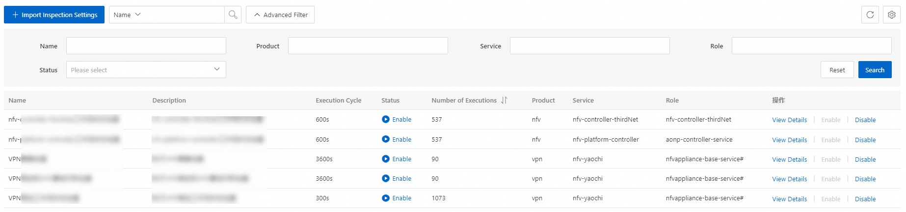
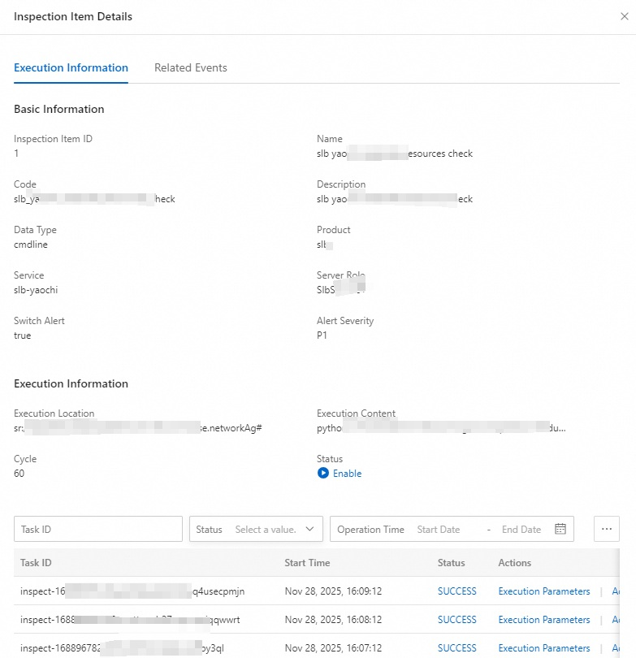
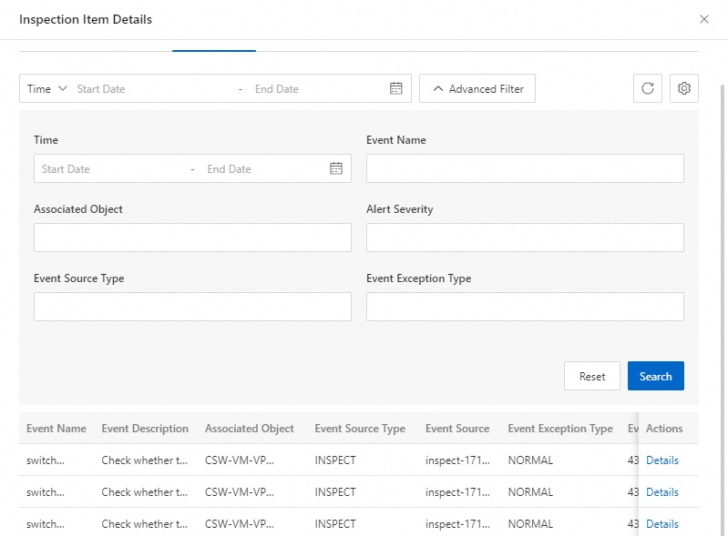
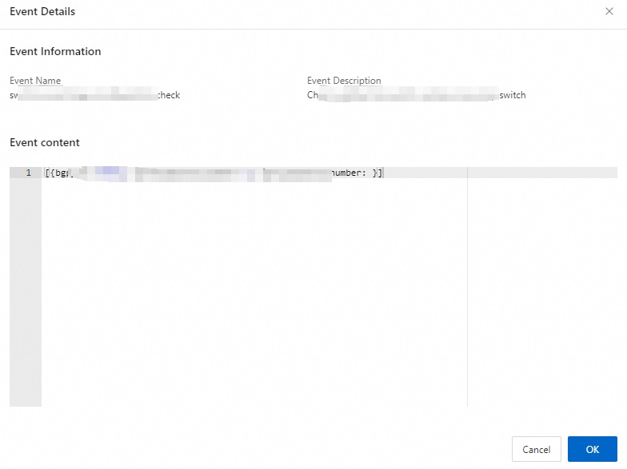

Alibaba Cloud  
Apsara Stack  
VPN Gateway  
Operations and Maintenance  
Guide  
Product Version: v3.18.6-2607  
Document Version: 20260828

**Table of Contents**

- [1.VPN inspection](#section-1)
    - [1.1. Network inspection](#section-1-1)

# 1.VPN inspection

You can use the network inspection feature to configure and view VPN metrics. When alerts are reported, you can process and recover the metrics based on the phenomena and impacts.

**VPN metrics**

You can use the **network inspection** feature to perform the following operations:

- Import VPN inspection configurations.

- Enter vpn for the service name to filter and view the list of configured VPN inspections.

- Enable or disable configured VPN inspection items.

- Obtain the details of an inspection item, including the task information and event list.

For more information, see Network inspection.

**Inspection processing**

For more information about VPN metrics and alert plans, see Inspection guide.

## 1.1. Network inspection

The network inspection feature allows you to schedule network inspection tasks on a regular basis and convert inspection results into inspection events or alerts.

**Procedure**

1. Log in to the Apsara Uni-manager Operations Console.

2. In the top navigation bar, choose **Product Operation** > **Networking** > **Network Operations Console**.

3. In the left-side navigation pane, choose **Intelligent Diagnostics** > **Network Inspection**.

4. On the **Network Inspection** page, view the inspection configuration list.

   - The information about inspection configurations includes **Name**, **Description**, **Execution Cycle**, **Status**, **Number of Executions**, **Product**, **Service**, and **Role**.

   - You can click **Advanced Filter** and filter inspection configurations by **Name**, **Product**, **Service**, **Role**, **Status**, or their combinations.

   

   > **Note**
   >
   > Click the
   >
   > icon next to **Number of Executions** to sort data in ascending or
   >
   > 
   >
   > descending order.

5. In the inspection configuration list, find the inspection configuration that you want to view and click **View Details** in the **Actions** column. In the panel that appears, view the inspection item details.

   - On the **Execution Information** tab, view the **Basic Information**, **Execution Information**, and execution task list.

     

     - In the **Basic Information** section, you can view the following information: **Inspection Item ID**, **Name**, **Code**, **Description**, **Data Type**, **Product**, **Service**, **Service Role**, **Switch Alert**, and **Alert Severity**.

     - In the **Execution Information** section, you can view the following information: **Execution Location**, **Execution Content**, **Cycle**, and **Status**.

     - In the execution task list, you can view task information such as **Task ID**, **Start Time**, and **Status**.

       - You can filter tasks by **Task ID**, **Status**, **Operation Time**, or their combinations.

       - Find the task that you want to view, and move the pointer over the value in the **Status** column to view the execution result.

         > **Note**
         >
         > Description of execution states:
         >
         > - **WAITING**: The inspection task is waiting to be triggered.
         >
         > - **RUNNING**: The inspection task is running.
         >
         > - **SUCCESS**: The inspection task is successfully executed.
         >
         > - **FAILED**: The inspection task failed to be executed.
         >
         > - **TIMEOUT**: The inspection task timed out.
         >
         > - **CLEANED**: The inspection task is deleted when the cloud platform is initialized.

       - Find the task that you want to view and move the pointer over **Execution Parameters** in the **Actions** column to view execution parameters.

       - Find the task that you want to view and move the pointer over **Additional Information** in the **Actions** column to view additional information.

   - On the **Related Events** tab, view the related events.

     

     - The event information includes **Event Name**, **Event Description**, **Associated Object**, **Event Source Type**, **Event Source**, **Event Exception Type**, **Event Timeout Period**, **Event Severity**, **Associated Alert ID**, and **Triggered At**.

     - Click **Advanced Filter** and filter events by **Time**, **Event Name**, **Associated Object**, **Alert Severity**, **Event Source Type**, **Event Exception Type**, or their combinations.

     - Find the event that you want to view, and click **Details** in the **Actions** column to view the event details.

       The event details include **Event Information** and **Event content**. The event details vary based on the event type. The displayed information prevails.

       

**Related operations**

| Operation | Description |
| --- | --- |
| Import an inspection configuration | 1. On the <strong>Network Inspection</strong> page, click <strong>Import Inspection Settings</strong>. 2. Select the inspection configuration file that you want to import and click <strong>Open</strong>. |
| Enable an inspection configuration | Note You can enable only inspection configurations whose <strong>Status</strong> is <strong>Disable</strong>. 1. In the inspection configuration list, find the inspection configuration that you want to enable and click <strong>Enable</strong> in the <strong>Actions</strong> column. 2. In the message that appears, click <strong>OK</strong>. |
| Disable an inspection configuration | Note You can disable only inspection configurations whose <strong>Status</strong> is <strong>Enable</strong>. 1. In the inspection configuration list, find the inspection configuration that you want to disable and click <strong>Disable</strong> in the <strong>Actions</strong> column. 2. In the message that appears, click <strong>OK</strong>. |
