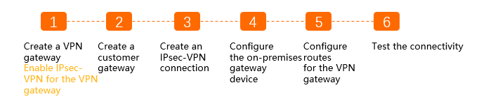
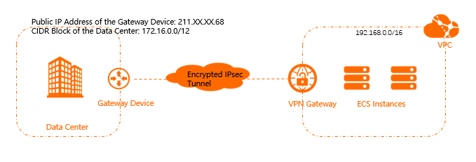
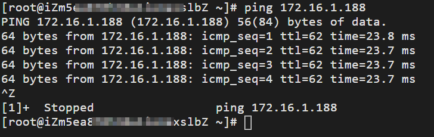
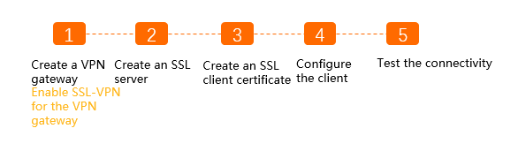
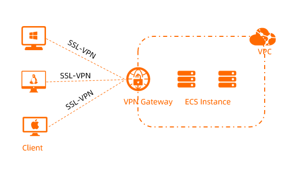
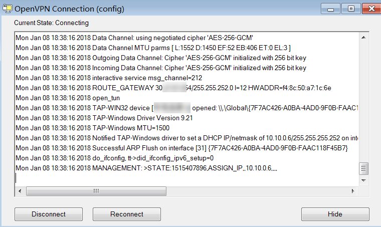

Alibaba Cloud  
Apsara Stack  
VPN Gateway  
User Guide  
Product Version: v3.18.6-2607  
Document Version: 20260828

**Table of Contents**

- [1.Log on to the VPC console](#section-1)
- [2.Getting started](#section-2)
    - [2.1. Get started with IPsec-VPN](#section-2-1)
        - [2.1.1. Overview of IPsec-VPN connections](#section-2-1-1)
        - [2.1.2. Connect a data center to a VPC](#section-2-1-2)
    - [2.2. Get started with SSL-VPN](#section-2-2)
        - [2.2.1. Overview of SSL-VPN](#section-2-2-1)
        - [2.2.2. Connect a client to a VPC](#section-2-2-2)
    - [2.3. Overview of gateway routes](#section-2-3)
- [3.VPN gateways](#section-3)
    - [3.1. Create and manage a VPN gateway](#section-3-1)
    - [3.2. Configure routes of a VPN Gateway](#section-3-2)
        - [3.2.1. Manage destination-based routes](#section-3-2-1)
        - [3.2.2. Manage a policy-based route](#section-3-2-2)
- [4.Customer gateways](#section-4)
    - [4.1. Create and manage a customer gateway](#section-4-1)
- [5.Configure IPsec-VPN connections](#section-5)
    - [5.1. Create and manage IPsec-VPN connections](#section-5-1)
    - [5.2. Configure a security group](#section-5-2)
- [6.Configure SSL-VPN](#section-6)
    - [6.1. Create and manage an SSL server](#section-6-1)
    - [6.2. Configure a security group](#section-6-2)
    - [6.3. Create and manage an SSL client certificate](#section-6-3)
- [7.Manage tags](#section-7)
- [8.Monitoring and maintenance](#section-8)
    - [8.1. View monitoring data](#section-8-1)
    - [8.2. View operation logs](#section-8-2)

<a id="section-1"></a>

# 1.Log on to the VPC console

This topic describes how to log on to the Apsara Uni-manager Management Console to manage your virtual private clouds (VPCs). In this example, the Google Chrome browser is used.

**Prerequisites**

- The URL of the Apsara Uni-manager Management Console is obtained from the deployment engineers.

- A web browser is available. We recommend that you use Google Chrome.

**Procedure**

1. Enter the URL of the Apsara Uni-manager Management Console in the address bar and press the Enter key.

   

   > **Note**
   >
   > - You can select a language from the drop-down list in the upper-right corner of the page.

2. Enter the correct username and password.

   Obtain the username and password that you use to log on to the Apsara Uni-manager Management Console from the operations administrator.

   > **Note**
   >
   > - **First logon**
   >
   >   The first time that you log on to the Apsara Uni-manager Management Console, you need to change the password of your account. Follow the instructions to complete the password change. For security purposes, the password must be 10 to 32 characters in length. It must contain all of the following character types: uppercase letters, lowercase letters, digits, and special characters. The following special characters are supported: ! @ # $ %
   >
   > - **Forgot password**
   >
   >   If you forgot your password, click Forgot Password and enter the username of your account, the email address that was used to create your account, and the verification code. Then, a URL is sent to the specified email address. You can click the URL to reset the password.

3. Click **Log On**.

4. If your account has MFA (Multi-Factor Authentication) enabled, perform the following operations based on your scenario:

   - Scenario 1: You log on to the Apsara Uni-manager Management Console for the first time after MFA is enabled by the administrator.

     <ol type="a">

     <li>

     On the Bind Virtual MFA Device page, follow the instructions to bind an MFA device.

     </li>

     <li>

     Re-enter your username and password as described in Step 2, and click **Log On**.

     </li>

     </ol>

     <ol type="i" start="100">

     <li>

     Enter the 6-digit MFA code and click **Authenticate**.

     </li>

     </ol>

   - Scenario 2: You have enabled MFA and bound an MFA device.

     Enter the 6-digit MFA code and click **Authenticate**.

     > **Note**
     >
     > For information about how to bind and enable MFA, see the **Security Center** > **Multi-factor Authentication** > **Manage Multi-factor Authentication** section in the Apsara Uni-manager Management Console User Guide.

5. In the top navigation bar, choose **Products > Networking > Virtual Private Cloud**.

<a id="section-2"></a>

# 2.Getting started

<a id="section-2-1"></a>

## 2.1. Get started with IPsec-VPN

<a id="section-2-1-1"></a>

### 2.1.1. Overview of IPsec-VPN connections

You can connect a data center to a virtual private cloud (VPC) through an IPsec-VPN connection. This topic provides an overview of IPsec-VPN connections.

**Prerequisites**

Before you use IPsec-VPN to connect a data center to a VPC, make sure that the following requirements are met:

- The gateway device in the data center supports the IKEv1 and IKEv2 protocols.

  IPsec-VPN supports the IKEv1 and IKEv2 protocols. All gateway devices that support the two protocols can connect to VPN gateways on Apsara Stack.

- A static public IP address is assigned to the gateway device in the data center.

- The CIDR block of the data center does not overlap with the CIDR block of the VPC.

- You have read and understand the security group rules that apply to the Elastic Cloud Service (ECS) instances in VPCs, and the security group rules allow gateway devices in the data center to access cloud resources.

**Procedure**



1. Create a VPN gateway

   You need to enable the IPsec-VPN feature for the VPN gateway. Then, you can establish more than one IPsec-VPN connection to the VPN gateway.

2. Create a customer gateway

   You need to load the configuration of the gateway device in the data center to the customer gateway on Apsara Stack.

3. Create an IPsec-VPN connection

   An IPsec-VPN connection is a VPN tunnel between a VPN gateway and a gateway device in the data center. The data center can communicate with Apsara Stack through an encrypted tunnel only after an IPsec-VPN connection is established.

4. Configure the gateway device in the data center

   You must load the configuration of the VPN gateway on Apsara Stack to the gateway device in the data center.

5. Configure routes on a VPN gateway

   You need to add routes to the VPN gateway and advertise these routes to the VPC route table. Then, the VPC can communicate with the data center. For more information, see Overview of gateway routes.

6. Test the connectivity

   Log on to an ECS instance that is not assigned a public IP address in the VPC. Then, run the **ping** command to **ping** the private IP address of a server in the data center.

**Use cases**

Connect a data center to a VPC

<a id="section-2-1-2"></a>

### 2.1.2. Connect a data center to a VPC

This topic describes how to use IPsec-VPN to connect a data center to a virtual private cloud (VPC). After you establish an IPsec-VPN connection, the data center and the VPC can communicate with each other.

**Prerequisites**

- The gateway device in the data center supports the IKEv1 and IKEv2 protocols. All gateway devices that support these protocols can connect to a VPN gateway.

- A static public IP address is assigned to the gateway device in the data center.

- The CIDR block of the data center does not overlap with the CIDR block of the VPC.

- You have read and understand the security group rules that apply to the Elastic Cloud Service (ECS) instances in VPCs, and the security group rules allow gateway devices in the data center to access cloud resources.

**Background information**

The following scenario is used as an example in this topic. An enterprise has created a VPC on Apsara Stack. The CIDR block of the VPC is 192.168.0.0/16. The CIDR block of the data center is 172.16.0.0/16. The static public IP address of the gateway device in the data center is 211.XX.XX.68. To meet business requirements, the enterprise needs to connect the data center to the VPC. You can establish an IPsec-VPN connection between the data center and the VPC, as shown in the following figure. This way, the data center and the VPC can share resources with each other.



**Step 1: Create a VPN gateway**

1. Log in to the VPC console.

2. In the left-side navigation pane, choose **VPN > VPN Gateway**.

3. In the top navigation bar, select the region in which the VPN gateway resides.

4. On the **VPN Gateways** page, click **Create a VPN Gateway**.

5. On the **Create VPN** page, configure the parameters. The following table describes the parameters.

   <table>
     <tr>
       <th>Parameter</th>
       <th>Description</th>
     </tr>
     <tr>
       <td colspan="2">Region</td>
     </tr>
     <tr>
       <td>Organization</td>
       <td>The organization to which the VPN gateway belongs.</td>
     </tr>
     <tr>
       <td>Resource Set</td>
       <td>The resource set to which the VPN gateway belongs.</td>
     </tr>
     <tr>
       <td>Region</td>
       <td>The region where you want to deploy the VPN gateway.<br>You can create IPsec-VPN connections on VPN gateways to connect a data center to a VPC or connect two VPCs. Make sure that the VPC and the VPN gateway associated with the VPC are deployed in the same region.</td>
     </tr>
     <tr>
       <td>Zone</td>
       <td>The zone to which the VPN gateway belongs.</td>
     </tr>
     <tr>
       <td colspan="2">Billing configuration</td>
     </tr>
     <tr>
       <td>Billing method</td>
       <td>The billing method of the VPN gateway. Use the default value <strong>Pay-as-</strong><strong>you-go</strong>.<br><strong>Pay-as-you-go</strong>: suits scenarios in which the business volume fluctuates and is difficult to predict.</td>
     </tr>
     <tr>
       <td colspan="2">Basic Configurations</td>
     </tr>
     <tr>
       <td>Instance Name</td>
       <td>The name of the VPN gateway.<br>The name must be 2 to 100 characters in length, and can contain letters, digits, underscores (_), and hyphens (-). It must start with a letter and cannot start with http:// or https://.</td>
     </tr>
     <tr>
       <td>VPC</td>
       <td>The VPC that you want to associate with the VPN gateway.<br>Note<br>You can also click <strong>Create VPC</strong> to create a VPC.</td>
     </tr>
     <tr>
       <td>VSwitch</td>
       <td>The vSwitch that you want to associate with the VPN gateway. You can only select the vSwitch in the same zone as the VPC.<br>Note<br>You can also click <strong>Create vSwitch</strong> to create a vSwitch in the VPC.</td>
     </tr>
     <tr>
       <td>Bandwidth</td>
       <td>The maximum bandwidth value of the VPN gateway. Unit: Mbit/s.<br>The bandwidth is used for data transfer over the Internet.</td>
     </tr>
     <tr>
       <td colspan="2">Advanced Settings</td>
     </tr>
     <tr>
       <td>IPsec-VPN</td>
       <td>Specifies whether to enable IPsec-VPN. In this example, <strong>Disable</strong> is selected.</td>
     </tr>
     <tr>
       <td>SSL-VPN</td>
       <td>Specifies whether to enable SSL-VPN. In this example, <strong>Enable</strong> is selected.</td>
     </tr>
     <tr>
       <td>SSL-VPN Connections</td>
       <td>The number of SSL-VPN connections based on the maximum number of clients that can connect at the same time.</td>
     </tr>
   </table>

6. Create a VPN gateway.

   - Confirm the parameters and click **Confirm Order** if the following requirements are met: On the Service Management page, a service is created, and **VPN Gateway** is displayed in the **Cloud resources** column of the service.

   - If no service whose **Cloud resources** value is **VPN Gateway** exists on the Service Management page, confirm the parameters and click **Submit**.

   For more information about service management, see the **Manage services** topic in **Apsara Uni-manager Operations Console User Guide**.

7. Return to the VPN Gateways page to view the VPN gateway that you created.

   A newly created VPN gateway is in the **Preparing** state and changes to the **Normal** state in about 1 to 5 minutes. After the state of the VPN gateway changes to **Normal**, the VPN gateway is ready for use.

**Step 2: Create a customer gateway**

1. Log in to the VPC console.

2. In the left-side navigation pane, choose **VPN > Customer Gateway**.

3. In the top navigation bar, select the region in which you want to create the customer gateway.

4. On the **Customer Gateways** page, click **Create Customer Gateway**.

5. On the **Create Customer Gateway** page, configure the parameters. The following table describes the parameters.

   <table>
     <tr>
       <th>Parameter</th>
       <th>Description</th>
     </tr>
     <tr>
       <td colspan="2">Region</td>
     </tr>
     <tr>
       <td>Organization/Resou rce Set</td>
       <td>The organization and resource set to which the customer gateway belongs.</td>
     </tr>
     <tr>
       <td>Region/Zone</td>
       <td>The region and zone in which you want to deploy the customer gateway.<br>Note<br>Make sure that the customer gateway and the VPN gateway to be connected are deployed in the same region.</td>
     </tr>
     <tr>
       <td colspan="2">Basic Configurations</td>
     </tr>
     <tr>
       <td>Name</td>
       <td>The name of the customer gateway.<br>The name must be 2 to 100 characters in length, and can contain letters, digits, underscores (_), and hyphens (-). It must start with a letter and cannot start with http:// or https://.</td>
     </tr>
     <tr>
       <td>IP Address</td>
       <td>Enter the static public IP address of the gateway device in the data center.</td>
     </tr>
     <tr>
       <td>Description</td>
       <td>Enter a description for the customer gateway.<br>The description must be 2 to 100 characters in length. The description can contain digits, hyphens (-), underscores (_), full-width periods (。), full-width commas (，), and full-width colons (：). It must start with a letter and cannot start with http:// or https://.</td>
     </tr>
   </table>

   > **Note**
   >
   > Before you click Submit to create the instance, you can view and check the configurations of the instance in the right-side **Configuration overview** section.
   >
   > You can click a field to go to the corresponding parameter and modify the parameter setting based on your business requirements.

6. Create a customer gateway.

   - Confirm the parameters and click **Confirm Order** if the following requirements are met: On the Service Management page, a service is created, and **Customer Gateway** is displayed in the **Cloud resources** column of the service.

   - If no service whose **Cloud resources** value is **Customer Gateway** exists on the Service Management page, confirm the parameters and click **Submit**.

   For more information about service management, see the **Manage services** topic in **Apsara Uni-manager Operations Console User Guide**.

**Step 3: Create an IPsec-VPN connection**

1. In the left-side navigation pane, choose **VPN > IPsec-VPN Connection**.

2. In the top navigation bar, select the region in which you want to create an IPsec-VPN connection.

3. On the **IPsec Connections** page, click **Create IPsec-VPN Connection**.

4. On the **Create IPSec Connection** page, configure the parameters. The following table describes the parameters.

   <table>
     <tr>
       <th>Parameter</th>
       <th>Description</th>
     </tr>
     <tr>
       <td colspan="2">Region</td>
     </tr>
     <tr>
       <td>Organization</td>
       <td>The organization to which the IPsec-VPN connection belongs.</td>
     </tr>
     <tr>
       <td>Resource Set</td>
       <td>The resource set to which the IPsec-VPN connection belongs.</td>
     </tr>
     <tr>
       <td>Region</td>
       <td>The region to which the IPsec-VPN connection belongs.<br>Note<br>Make sure that the IPsec-VPN connection and the VPN gateway to be connected are deployed in the same region.</td>
     </tr>
     <tr>
       <td>Zone</td>
       <td>The zone to which the IPsec-VPN connection belongs.</td>
     </tr>
     <tr>
       <td colspan="2">Basic Configurations</td>
     </tr>
     <tr>
       <td>Name</td>
       <td>The name of the IPsec-VPN connection.<br>The name must be 2 to 100 characters in length, and can contain letters, digits, underscores (_), and hyphens (-). It must start with a letter and cannot start with http:// or https://.</td>
     </tr>
     <tr>
       <td>VPN Gateway</td>
       <td>The VPN gateway to which you want to connect through the IPsec-VPN connection.<br>Note<br>You can also click <strong>Create VPN Gateway</strong> to create a VPN gateway to which you want to connect the IPsec-VPN connection.</td>
     </tr>
     <tr>
       <td>Customer Gateway</td>
       <td>The customer gateway to which you want to connect through the IPsec-VPN connection.<br>Note<br>You can also click <strong>Create Customer Gateway</strong> to create a customer gateway to which you want to connect the IPsec-VPN connection.</td>
     </tr>
     <tr>
       <td>Local CIDR Block</td>
       <td>The CIDR block of the VPC in which the VPN gateway is deployed. In this example, 192.168.0.0/16 is used.</td>
     </tr>
     <tr>
       <td>Peer CIDR Block</td>
       <td>The CIDR block of the data center. In this example, 172.16.0.0/16 is used.</td>
     </tr>
     <tr>
       <td>Effective Immediately</td>
       <td>Specifies whether to immediately start negotiations for the connection.Valid values:<br>• <strong>Yes</strong>: starts negotiations after the configuration takes effect. When negotiations are reinitiated, transient connections may occur.<br>• <strong>No</strong> (default): starts negotiations when inbound traffic is detected. When negotiations are reinitiated, transient connections may occur.</td>
     </tr>
     <tr>
       <td colspan="2">Group</td>
     </tr>
     <tr>
       <td>Advanced Settings</td>
       <td>The type of advanced settings. Select <strong>Default</strong>. By default, a pre-shared key is automatically generated. Valid values:<br>• <strong>Default</strong>: Use the default advanced settings.<br>• <strong>Configure</strong>: Use custom settings.</td>
     </tr>
   </table>

**Step 4: Load the configuration of the IPsec-VPN connections to the gateway devices in the data center**

1. In the left-side navigation pane, choose **VPN > IPsec-VPN Connection**.

2. In the top navigation bar, select the region in which you want to create an IPsec-VPN connection.

3. On the **IPsec Connections** page, find the IPsec-VPN connection that you want to manage and click **Download Peer Configuration** in the **Actions** column.

4. In the **IPsec Connection Configuration** dialog box, copy and save the configuration information.

   > **Note**
   >
   > The values of RemoteSubnet and LocalSubnet in the downloaded configuration file are opposite to the values that you specified when you create the IPsec-VPN connection. For a VPN gateway, RemoteSubnet refers to the CIDR block of the data center, whereas LocalSubnet refers to the CIDR block of the VPC. For a gateway device, LocalSubnet refers to the CIDR block of the data center, whereas RemoteSubnet refers to the CIDR block of the VPC.

5. Load the configuration of the IPsec-VPN connection to the gateway device in the data center. For more information, consult the vendor of your gateway device.

**Step 5: Configure routes for the VPN gateway**

1. In the left-side navigation pane, choose **VPN > VPN Gateway**.

2. In the top navigation bar, select the region in which the VPN gateway resides.

3. On the **VPN Gateways** page, find the VPN gateway and click the gateway ID in the **VPN Gateway ID/Name** column.

4. On the **VPN Gateway Details** tab, click the **Destination-based Route Table** tab.

5. Click **Add Route Entry**. In the **Add Route Entry** dialog box, configure the following parameters and click **OK**.

   | Parameter | Description |
   | --- | --- |
   | Destination CIDR Block | The private CIDR block of the data center. In this example, 172.16.0.0/16 is used. |
   | Next Hop Type | Select <strong>IPsec Connection</strong>. |
   | Next Hop | The IPsec-VPN connection for which you want to create a destination-based route. |
   | Publish to VPC | Specify whether to publish the route to VPC route table. In this example, <strong>Yes</strong> is selected. |
   | Weight | The weight. In this example, <strong>100</strong> is selected. Valid values:<br>• <strong>100</strong>: specifies a high priority for the destination-based route.<br>• <strong>0</strong>: specifies a low priority for the destination-based route.<br>Note<br>If two routes are configured with the same destination CIDR block, you cannot set the weights of both routes to 100. |

**Step 6: Test the connectivity**

1. Log on to an ECS instance that is not assigned a public IP address in the VPC.

2. Run the **ping** command to ping a server in the data center to test the network connectivity.

   

<a id="section-2-2"></a>

## 2.2. Get started with SSL-VPN

<a id="section-2-2-1"></a>

### 2.2.1. Overview of SSL-VPN

SSL-VPN allows remote clients to connect to a virtual private cloud (VPC) and access the applications or services that are deployed in the VPC securely. This topic describes how to use SSL-VPN.

**Prerequisites**

Before you use SSL-VPN to connect a client to a VPC, make sure that the following requirements are met:

- The private CIDR block of the client does not overlap with the private CIDR block of the VPC. Otherwise, the client and the VPC cannot communicate with each other.

- The client can access the Internet.

- You have read and understand the security group rules that apply to the Elastic Cloud Service (ECS) instances in VPCs, and the security group rules allow gateway devices in the data center to access cloud resources.

**Procedure**



| Step | Description |
| --- | --- |
| 1 | Create a VPN gateway and enable the SSL-VPN feature. |
| 2 | On the SSL server, specify the private CIDR block that the client needs to access and the CIDR block that is used by the client. |
| 3 | Create and download a client certificate based on the SSL server configuration. |
| 4 | Download and install VPN software on the client, load the SSL client certificate, and then initiate an SSL-VPN connection. |
| 5 | Open the CLI on the client, and run the <strong>ping</strong> command to ping an Elastic Compute Service (ECS) instance in the VPC. |

**Use cases**

Connect a client to a VPC.

<a id="section-2-2-2"></a>

### 2.2.2. Connect a client to a VPC

This topic describes how to connect a client to a virtual private cloud (VPC) by using SSL-VPN.

**Prerequisites**

- The private CIDR block of the client does not overlap with the private CIDR block of the VPC. Otherwise, the client and the VPC cannot communicate with each other.

- The client can access the Internet.

- You have read and understand the security group rules that apply to the Elastic Cloud Service (ECS) instances in VPCs, and the security group rules allow gateway devices in the data center to access cloud resources.

**Background information**

The scenario in the following figure is used as an example to describe how to connect Linux, Windows, and Mac clients to a VPC by using SSL-VPN.



**Step 1: Create a VPN gateway**

1. Log in to the VPC console.

2. In the left-side navigation pane, choose **VPN > VPN Gateway**.

3. In the top navigation bar, select the region in which the VPN gateway resides.

4. On the **VPN Gateways** page, click **Create a VPN Gateway**.

5. On the **Create VPN** page, configure the parameters. The following table describes the parameters.

   <table>
     <tr>
       <th>Parameter</th>
       <th>Description</th>
     </tr>
     <tr>
       <td colspan="2">Region</td>
     </tr>
     <tr>
       <td>Organization</td>
       <td>The organization to which the VPN gateway belongs.</td>
     </tr>
     <tr>
       <td>Resource Set</td>
       <td>The resource set to which the VPN gateway belongs.</td>
     </tr>
     <tr>
       <td>Region</td>
       <td>The region where you want to deploy the VPN gateway.<br>You can create IPsec-VPN connections on VPN gateways to connect a data center to a VPC or connect two VPCs. Make sure that the VPC and the VPN gateway associated with the VPC are deployed in the same region.</td>
     </tr>
     <tr>
       <td>Zone</td>
       <td>The zone to which the VPN gateway belongs.</td>
     </tr>
     <tr>
       <td colspan="2">Billing configuration</td>
     </tr>
     <tr>
       <td>Billing method</td>
       <td>The billing method of the VPN gateway. Use the default value <strong>Pay-as-</strong><strong>you-go</strong>.<br><strong>Pay-as-you-go</strong>: suits scenarios in which the business volume fluctuates and is difficult to predict.</td>
     </tr>
     <tr>
       <td colspan="2">Basic Configurations</td>
     </tr>
     <tr>
       <td>Instance Name</td>
       <td>The name of the VPN gateway.<br>The name must be 2 to 100 characters in length, and can contain letters, digits, underscores (_), and hyphens (-). It must start with a letter and cannot start with http:// or https://.</td>
     </tr>
     <tr>
       <td>VPC</td>
       <td>The VPC that you want to associate with the VPN gateway.<br>Note<br>You can also click <strong>Create VPC</strong> to create a VPC.</td>
     </tr>
     <tr>
       <td>VSwitch</td>
       <td>The vSwitch that you want to associate with the VPN gateway. You can only select the vSwitch in the same zone as the VPC.<br>Note<br>You can also click <strong>Create vSwitch</strong> to create a vSwitch in the VPC.</td>
     </tr>
     <tr>
       <td>Bandwidth</td>
       <td>The maximum bandwidth value of the VPN gateway. Unit: Mbit/s.<br>The bandwidth is used for data transfer over the Internet.</td>
     </tr>
     <tr>
       <td colspan="2">Advanced Settings</td>
     </tr>
     <tr>
       <td>IPsec-VPN</td>
       <td>Specifies whether to enable IPsec-VPN. In this example, <strong>Disable</strong> is selected.</td>
     </tr>
     <tr>
       <td>SSL-VPN</td>
       <td>Specifies whether to enable SSL-VPN. In this example, <strong>Enable</strong> is selected.</td>
     </tr>
     <tr>
       <td>SSL-VPN Connections</td>
       <td>The number of SSL-VPN connections based on the maximum number of clients that can connect at the same time.</td>
     </tr>
   </table>

6. Create a VPN gateway.

   - Confirm the parameters and click **Confirm Order** if the following requirements are met: On the Service Management page, a service is created, and **VPN Gateway** is displayed in the **Cloud resources** column of the service.

   - If no service whose **Cloud resources** value is **VPN Gateway** exists on the Service Management page, confirm the parameters and click **Submit**.

   For more information about service management, see the **Manage services** topic in **Apsara Uni-manager Operations Console User Guide**.

7. Return to the VPN Gateways page to view the VPN gateway that you created.

   A newly created VPN gateway is in the **Preparing** state and changes to the **Normal** state in about 1 to 5 minutes. After the state of the VPN gateway changes to **Normal**, the VPN gateway is ready for use.

**Step 2: Create an SSL server**

1. In the left-side navigation pane, choose **VPN > SSL Server**.

2. In the top navigation bar, select the region in which you want to create an SSL server.

   > **Note**
   >
   > Make sure that the SSL server and the VPN gateway that you created reside in the same region.

3. On the **SSL Servers** page, click **Create SSL Server**.

4. On the **Create SSL Server** page, configure the parameters. The following table describes the parameters.

   <table>
     <tr>
       <th>Parameter</th>
       <th>Description</th>
     </tr>
     <tr>
       <td colspan="2">Region</td>
     </tr>
     <tr>
       <td>Organization</td>
       <td>The organization to which the SSL server belongs.</td>
     </tr>
     <tr>
       <td>Resource Set</td>
       <td>The resource set to which the SSL server belongs.</td>
     </tr>
     <tr>
       <td>Region</td>
       <td>The region in which you want to deploy the SSL server.</td>
     </tr>
     <tr>
       <td>Zone</td>
       <td>The zone in which you want to deploy the SSL server.</td>
     </tr>
     <tr>
       <td colspan="2">Basic Settings</td>
     </tr>
     <tr>
       <td>Name</td>
       <td>The name of the SSL server.<br>The name must be 2 to 100 characters in length, and can contain letters, digits, underscores (_), and hyphens (-). It must start with a letter and cannot start with http:// or https://.</td>
     </tr>
     <tr>
       <td>VPN Gateway</td>
       <td>The VPN gateway that you want to associate with the SSL server.<br>Note<br>You can also click <strong>Create VPN Gateway</strong> to create a VPN gateway.</td>
     </tr>
     <tr>
       <td>Local CIDR Block</td>
       <td>The local CIDR block that your client needs to access by using the SSL-VPN connection. It can be the CIDR block of a VPC, a vSwitch, a data center connected to a VPC through an Express Connect circuit, or a cloud service such as ApsaraDB RDS or Object Storage Service (OSS).<br>You can enter multiple local CIDR blocks. Separate local CIDR blocks with commas (,).<br>Note<br>The subnet mask of the specified CIDR block must be 16 to 29 bits in length.</td>
     </tr>
     <tr>
       <td>Client CIDR Block</td>
       <td>The CIDR block from which an IP address is allocated to the virtual network interface controller (NIC) of the client. Do not enter the private CIDR block of the client. When the client accesses the destination network by using an SSL-VPN connection, the associated VPN gateway allocates an IP address from the client CIDR block to the client.<br>Note<br>Make sure that the local CIDR block and the client CIDR block do not overlap with each other.</td>
     </tr>
     <tr>
       <td colspan="2">Advanced Settings</td>
     </tr>
     <tr>
       <td>Advanced Settings</td>
       <td>The type of advanced settings. Select <strong>Default</strong>.</td>
     </tr>
   </table>

**Step 3: Create and download an SSL client certificate**

1. In the left-side navigation pane, choose **VPN > SSL Client**.

2. In the top navigation bar, select the region in which you want to create an SSL client.

3. On the **SSL Clients** page, click **Create SSL Client**.

4. On the **Create SSL Client Certificate** page, configure the parameters. The following table describes the parameters.

   <table>
     <tr>
       <th>Parameter</th>
       <th>Description</th>
     </tr>
     <tr>
       <td colspan="2">Region</td>
     </tr>
     <tr>
       <td>Organization/Resource Set</td>
       <td>Select the organization and resource set to which the SSL client belongs.</td>
     </tr>
     <tr>
       <td>Region/Zone</td>
       <td>Select the region and zone to which the SSL client belongs.</td>
     </tr>
     <tr>
       <td colspan="2">Basic Configurations</td>
     </tr>
     <tr>
       <td>Name</td>
       <td>Enter a name for the SSL client certificate.<br>The name must be 2 to 100 characters in length, and can contain letters, digits, underscores (_), and hyphens (-). It must start with a letter and cannot start with http:// or https://.</td>
     </tr>
     <tr>
       <td>VPN Gateway</td>
       <td>The VPN gateway that you want to associate with the SSL client.<br>Note<br>You can also click <strong>Create VPN Gateway</strong> to create a VPN gateway.</td>
     </tr>
     <tr>
       <td>SSL Server</td>
       <td>Select the SSL server that you want to associate with the SSL client.<br>Note<br>You can also click <strong>Create SSL Server</strong> to create an SSL server to be associated.</td>
     </tr>
   </table>

   > **Note**
   >
   > Before you click Submit to create the instance, you can view and check the configurations of the instance in the right-side **Configuration overview** section.
   >
   > You can click a field to go to the corresponding parameter and modify the parameter setting based on your business requirements.

5. On the **SSL Clients** page, find the desired SSL client and click **Download** in the **Actions** column.

6. View the downloaded SSL client certificate on your on-premises machine.

**Step 4: Configure the client**

The following section describes how to configure clients that run Linux, Mac, and Windows.

- Configure a client that runs Linux

  <ol type="i">

  <li>

  Run the following command to install the OpenVPN client:

  ```bash
  yum install -y openvpn
  ```

  </li>

  <li>

  Decompress the SSL client certificate package that you downloaded and copy the SSL

  </li>

  </ol>

  client certificate to the /etc/openvpn/conf/ directory.

  <ol type="i" start="3">

  <li>

  Go to the /etc/openvpn/conf/ directory and run the following command to start OpenVPN:

  </li>

  </ol>

  ```text
  openvpn --config /etc/openvpn/conf/config.ovpn --daemon
  ```

- Configure a client that runs Windows

  <ol type="i">

  <li>

  Download and install OpenVPN.

  Download OpenVPN.

  </li>

  <li>

  Decompress the downloaded SSL client certificate package and copy the SSL client

  </li>

  </ol>

  certificate to the OpenVPN\\config directory.

  In this example, the certificate is copied to C:\\Program Files\\OpenVPN\\config. You need to copy the certificate to the directory in which OpenVPN is installed.

  <ol type="i" start="3">

  <li>

  Start OpenVPN and click **Connect** to initiate a connection.

  </li>

  </ol>

  

- Configure a client that runs macOS

  <ol type="i">

  <li>

  Run the following command to install the OpenVPN client:

  ```text
  brew install openvpn
  ```

  > **Note**
  >
  > Make sure that homebrew is installed before you install OpenVPN.

  </li>

  <li>

  Copy the SSL client certificate package that you downloaded in Step 3 to the

  </li>

  </ol>

  configuration directory of OpenVPN and decompress the package. Then, initiate an SSL-VPN connection.

  <ol type="a">

  <li>

  Back up all configuration files in the /usr/local/etc/openvpn folder.

  </li>

  <li>

  Run the following command to delete the configuration files of OpenVPN:

  ```text
  rm /usr/local/etc/openvpn/*
  ```

  </li>

  </ol>

  <ol type="i" start="100">

  <li>

  Run the following command to copy the downloaded SSL client certificate package to the configuration directory of OpenVPN:

  ```text
  cp cert_location /usr/local/etc/openvpn/
  ```

  `cert_location`  is the path of the SSL client certificate downloaded in Step 3. Example: /Users/example/Downloads/certs6.zip.

  </li>

  <li value="500">

  Run the following command to decompress the SSL client certificate package:

  ```bash
  cd  /usr/local/etc/openvpn/
  unzip /usr/local/etc/openvpn/certs6.zip
  ```

  </li>

  </ol>

  <ol type="a" start="5">

  <li>

  Run the following command to initiate a connection:

  ```bash
  sudo /usr/local/opt/openvpn/sbin/openvpn --config 
  /usr/local/etc/openvpn/config.ovpn
  ```

  </li>

  </ol>

**Step 5: Test the network connectivity**

1. Open the CLI of the client.

2. Run the **ping** command to ping an ECS instance in the VPC.

<a id="section-2-3"></a>

## 2.3. Overview of gateway routes

After you create an IPsec-VPN connection by using a VPN gateway, you must add a route to the VPN gateway.

Route-based IPsec-VPN allows you to route network traffic in multiple ways and facilitates the configuration and maintenance of VPN policies.

You can add the following two types of route to a VPN gateway:

- Policy-based routes

- Destination-based routes

> **Note**
>
> Policy-based routes take precedence over destination-based routes.

**Policy-based routes**

Policy-based routes forward traffic based on source and destination IP addresses. For more information, see Manage policy-based routes.

**Destination-based routes**

Destination-based routes forward traffic to specified destination IP addresses. For more information, see Manage destination-based routes.

<a id="section-3"></a>

# 3.VPN gateways

<a id="section-3-1"></a>

## 3.1. Create and manage a VPN gateway

This topic describes how to create a VPN gateway. You must create a VPN gateway before you can use the IPsec-VPN and SSL-VPN features. After you create a VPN gateway, a public IP address is assigned to the VPN gateway.

**Create a VPN gateway**

1. Log in to the VPC console.

2. In the left-side navigation pane, choose **VPN > VPN Gateway**.

3. In the top navigation bar, select the region in which the VPN gateway resides.

4. On the **VPN Gateways** page, click **Create a VPN Gateway**.

5. On the **Create VPN** page, configure the parameters. The following table describes the parameters.

   <table>
     <tr>
       <th>Parameter</th>
       <th>Description</th>
     </tr>
     <tr>
       <td colspan="2">Billing configuration</td>
     </tr>
     <tr>
       <td>Billing method</td>
       <td>The billing method of the VPN gateway. Use the default value <strong>Pay-as-</strong><strong>you-go</strong>.<br><strong>Pay-as-you-go</strong>: Fees are generated based on the actual amount of consumed resources. This method is suitable for scenarios in which business usage frequently fluctuates, which allows users to flexibly utilize resources based on actual needs and avoid waste.<br>Note<br>This parameter is available only if the administrator has configured billing rules in the operations center. For more information about the billing rules, see the <strong>Management billing configurations</strong> topic in <strong>Apsara Uni-manager Operations Console User Guide</strong>.</td>
     </tr>
     <tr>
       <td colspan="2">Region</td>
     </tr>
     <tr>
       <td>Organization/Resou rce Set</td>
       <td>The organization and resource set to which the VPN gateway belongs.</td>
     </tr>
     <tr>
       <td>Region/Zone</td>
       <td>The region and zone where you want to deploy the VPN gateway.<br>You can create IPsec-VPN connections on VPN gateways to connect a data center to a virtual private cloud (VPC) or connect two VPCs. Make sure that the VPC and the VPN gateway associated with the VPC are deployed in the same region.</td>
     </tr>
     <tr>
       <td colspan="2">Basic Configuration</td>
     </tr>
     <tr>
       <td>Instance Name</td>
       <td>The name of the VPN gateway.<br>The name must be 2 to 100 characters in length, and can contain letters, digits, underscores (_), hyphens (-), and periods (.). It must start with a letter and cannot start with http:// or https://.</td>
     </tr>
     <tr>
       <td>VPC</td>
       <td>The VPC to be associated with the VPN gateway.<br>Note<br>You can also click <strong>Create VPC</strong> to create a VPC.</td>
     </tr>
     <tr>
       <td>VSwitch</td>
       <td>The vSwitch to be associated with the VPN gateway. You can select only the vSwitch in the same zone with the VPC.<br>Note<br>You can also click <strong>Create vSwitch</strong> to create a vSwitch in the VPC.</td>
     </tr>
     <tr>
       <td>Bandwidth Specification</td>
       <td>The maximum bandwidth of the VPN gateway. Unit: Mbps.<br>The bandwidth is used for data transfer over the Internet.</td>
     </tr>
     <tr>
       <td colspan="2">Advanced Configuration</td>
     </tr>
     <tr>
       <td>IPsec-VPN</td>
       <td>Specifies whether to enable IPsec-VPN. The default value is <strong>Enable</strong>. Valid values:<br>• <strong>Enable</strong>: After IPsec-VPN is enabled, you can create IPsec-VPN connections between a data center and a VPC, or between two VPCs.<br>• Disable</td>
     </tr>
     <tr>
       <td>SSL-VPN</td>
       <td>Specifies whether to enable SSL-VPN. The default value is <strong>Disable</strong>. Valid values:<br>• <strong>Enable</strong>: SSL-VPN connections are point-to-site connections. SSL-VPN allows you to connect a client to Apsara Stack without the need to configure a customer gateway.<br>• Disable</td>
     </tr>
     <tr>
       <td>SSL Connections</td>
       <td>The number of SSL-VPN connections based on the maximum number of clients that can connect at the same time.<br>Note<br>This parameter is required only if you set <strong>SSL-VPN</strong> to <strong>Enable</strong>.</td>
     </tr>
   </table>

   > **Note**
   >
   > Before you click Submit to create the instance, you can view and check the configurations of the instance in the right-side **Configuration overview** section.
   >
   > - You can click a field to go to the corresponding parameter and modify the parameter setting based on your business requirements.
   >
   > - You can click **Quota Management** (the organization/resource set does not have quotas) or click **Quota Management** (the organization/resource set has quotas) in the **Quota** section to manage quotas for cloud services.
   >
   >   For more information about quota management, see the **Quota management** topic in **Apsara Uni-manager Management Console User Guide**.

6. Create a VPN gateway.

   - Confirm the parameters and click **Confirm Order** if the following requirements are met: On the Service Management page, a service is created, and **VPN Gateway** is displayed in the **Cloud resources** column of the service.

   - If no service whose **Cloud resources** value is **VPN Gateway** exists on the Service Management page, confirm the parameters and click **Submit**.

   For more information about service management, see the **Manage services** topic in **Apsara Uni-manager Operations Console User Guide**.

**What to do next**

**View the VPN gateway list**

On the **VPN Gateways** page, you can view the details of VPN gateways.

- You can use a keyword or a specific filter condition to filter VPN gateways.

- Click the  icon next to a column to sort VPN gateways.

- Click the  icon in the upper-right corner to show or hide items in the VPN gateway list.

  You can also drag and drop the items to adjust their order.

- Click the  icon next to the **Status** column to filter VPN gateways by status.

- Click the VPC ID in the **VPC ID/Name** column to view the basic information about the VPC to which the VPN gateway belongs.

- In the **Monitoring** column, click the  icon to view the monitoring information about the

  VPN gateway.

- Click the  icon next to the VPN gateway name in the **VPN Gateway ID/Name** column to

  modify the name of a VPN gateway.

- Click the  icon next to the username in the **Creator** column to modify the creator of the

  VPN gateway.

**Manage tags**

On the **VPN Gateways** page, you can add tags to VPN gateways for management. For more information, see Manage tags.

**Delete a VPN gateway**

You can delete VPN gateways that you no longer need. After you delete a VPN gateway, you can no longer establish IPsec-VPN or SSL-VPN connections to the VPN gateway.

> **Note**
>
> Before you delete a VPN gateway, make sure that the following conditions are met:
>
> - The IPsec-VPN connections established to the VPN gateway are deleted. For more information, see the Delete an IPsec-VPN connection section of the Create and manage IPsec-VPN connections topic.
>
> - The SSL server associated with the VPN gateway is deleted. For more information, see the Delete an SSL server section of the Create and manage an SSL server topic.

1. On the **VPN Gateways** page, find the VPN gateway that you want to delete, and then click **Delete** in the **Actions** column.

2. In the **Delete** dialog box, click **Release**.

3. In the **Release Resource** message, click **OK**.

4. In the message that appears, click **OK**.

**Manage a VPN gateway**

1. On the **VPN Gateways** page, find the VPN gateway and click the gateway ID in the **VPN Gateway ID/Name** column.

2. On the **VPN Gateway Details** page, you can manage the VPN gateway.

   - Click the **Basic Information** tab to view and manage the basic information about the VPN gateway.

     - In the **Basic Information** section, click the VPC ID next to the **VPC ID** parameter to view the basic information about the VPC to which the VPN gateway belongs.

     - In the **Basic Information** section, click the  icon next to the **VPN Gateway Name**

       parameter to modify the name of the VPN gateway.

       The name must be 2 to 100 characters in length, and can contain letters, digits, underscores (_), hyphens (-), and periods (.). It must start with a letter and cannot start with http:// or https://.

     - In the **Basic Information** section, click the  icon next to the **Description** parameter

       to modify the description of the VPN gateway.

       The description must be 2 to 100 characters in length. It must start with a letter and cannot start with http:// or https://.

   - Click the **Destination-based Route Table** tab to manage the destination-based routes of the VPN gateway. For more information, see Manage destination-based routes.

   - Click the **Policy-based Route Table** tab to manage the policy-based routes of the VPN gateway. For more information, see Manage a policy-based route.

   - Click the **Monitoring** tab to view the monitoring information about the VPN gateway. For more information, see View monitoring data.

   - On the **Operation Log** tab, you can view all operation logs of the VPN gateway. For more information, see View operation logs.

<a id="section-3-2"></a>

## 3.2. Configure routes of a VPN Gateway

<a id="section-3-2-1"></a>

### 3.2.1. Manage destination-based routes

Destination-based routes forward traffic to specified destination IP addresses. This topic describes how to create, publish, modify, and delete a destination-based route.

**Prerequisites**

An IPsec-VPN connection is created. For more information, see Create an IPsec-VPN connection.

**Create a destination-based route**

After you create an IPsec-VPN connection, you can create a destination-based route for the IPsec-VPN connection.

1. Log in to the VPC console.

2. In the left-side navigation pane, choose **VPN > VPN Gateway**.

3. In the top navigation bar, select the region in which the VPN gateway resides.

4. On the **VPN Gateways** page, find the VPN gateway and click the gateway ID in the **VPN Gateway ID/Name** column.

5. On the **VPN Gateway Details** tab, click the **Destination-based Route Table** tab.

6. Click **Add Route Entry**. In the **Add Route Entry** dialog box, configure the following parameters and click **OK**.

   | Parameter | Description |
   | --- | --- |
   | Destination CIDR Block | The private CIDR block that you want to access. |
   | Next Hop Type | The type of the next hop. Select IPsec connection. |
   | Next Hop | Select the IPsec-VPN connection for which you want to create a destination-based route. |
   | Publish to VPC | Specify whether to publish the route to virtual private cloud (VPC) route table.<br>• <strong>Yes</strong> (default): publishes the route to the VPC route table.<br>• <strong>No</strong>: does not publish the route to the VPC route table.<br>Note<br>If you select <strong>No</strong>, you must manually publish the route to the VPC route table. |
   | Weight | The weight. Valid values:<br>• <strong>100</strong>: specifies a high priority for the destination-based route.<br>• <strong>0</strong>: specifies a low priority for the destination-based route.<br>Note<br>If a route table contains multiple destination-based routes that have the same destination CIDR block and weight, a destination-based route is randomly selected to forward traffic. |

**Modify a destination-based route**

You can change the weight of a destination-based route.

1. On the **VPN Gateway Details** tab, click the **Destination-based Route Table** tab.

2. In the route list, find the route that you want to modify and click **Edit** in the **Actions** column.

3. In the **Edit route entry** dialog box, select a new **weight** and click **OK**.

**Publish/Unpublish destination-based routes**

You can publish destination-based routes you create or unpublish destination-based routes based on your business requirements.

1. On the **VPN Gateway Details** tab, click the **Destination-based Route Table** tab.

2. In the route list, find the route that you want to manage and click **Advertise** or **Withdraw** in the **Actions** column.

3. In the message that appears, click **OK**.

**Delete a destination-based route**

1. On the **VPN Gateway Details** tab, click the **Destination-based Route Table** tab.

2. In the route list, find the route that you want to delete and click **Delete** or **Withdraw** in the **Actions** column.

3. In the **Delete Route Entry** message, click **OK**.

<a id="section-3-2-2"></a>

### 3.2.2. Manage a policy-based route

A policy-based route forwards traffic based on source and destination IP addresses. This topic describes how to create, advertise, modify, and delete a policy-based route.

**Prerequisites**

An IPsec-VPN connection is created. For more information, see Create an IPsec-VPN connection.

**Create a policy-based route**

After you create an IPsec-VPN connection, you can create a policy-based route for the IPsec-VPN connection.

1. Log in to the VPC console.

2. In the left-side navigation pane, choose **VPN > VPN Gateway**.

3. In the top navigation bar, select the region in which the VPN gateway resides.

4. On the **VPN Gateways** page, find the VPN gateway and click the gateway ID in the **VPN Gateway ID/Name** column.

5. On the **VPN Gateway Details** page, click the **Policy-based Route Table** tab.

6. Click **Add Route Entry**. In the **Add Route Entry** dialog box, configure the following parameters and click **OK**.

   | Parameter | Description |
   | --- | --- |
   | Destination CIDR Block | Enter the private CIDR block that you want to access. |
   | Source CIDR Block | Enter the private CIDR block of the virtual private cloud (VPC). |
   | Next Hop Type | Select <strong>IPsec Connection</strong>. |
   | Next Hop | Select the IPsec-VPN connection for which you want to create a policy-based route. |
   | Publish to VPC | Specify whether to advertise the route to VPC route table.<br>• <strong>Yes</strong> (default): advertises the route to the VPC route table.<br>• <strong>No</strong>: does not advertise the route to the VPC route table.<br>Note<br>If you select <strong>No</strong>, you must manually advertise the route to the VPC route table. |

   <table>
     <tr>
       <td>Weight</td>
       <td>Select a weight for the route.<br>• <strong>100</strong> (default): a high priority for the route.<br>• <strong>0</strong>: a low priority for the route.<br>Note<br>If a route table contains multiple policy-based routes that have the same source CIDR block, destination CIDR block, and weight, a policy-based route is randomly selected to forward traffic.</td>
     </tr>
   </table>

**Modify a policy-based route**

You can change the weight of a policy-based route.

1. On the **VPN Gateway Details** page, click the **Policy-based Route Table** tab.

2. In the route list, find the route that you want to manage and click **Edit** or **Withdraw** in the **Actions** column.

3. In the **Edit Route Entry** dialog box, select a new **weight** and click **OK**.

**Publish or withdraw a policy-based route**

You can advertise or withdraw policy-based routes based on your business requirements.

1. On the **VPN Gateway Details** page, click the **Policy-based Route Table** tab.

2. In the route list, find the route that you want to manage and click **Advertise** or **Withdraw** in the **Actions** column.

3. In the **Advertise Route** message, click **OK**.

**Delete a policy-based route**

1. On the **VPN Gateway Details** page, click the **Policy-based Route Table** tab.

2. In the route list, find the route that you want to delete and click **Delete** or **Withdraw** in the **Actions** column.

3. In the **Delete Route Entry** message, click **OK**.

<a id="section-4"></a>

# 4.Customer gateways

<a id="section-4-1"></a>

## 4.1. Create and manage a customer gateway

This topic describes how to create a customer gateway. You can use a customer gateway to establish an IPsec-VPN connection between a virtual private cloud (VPC) and a data center or between two VPCs. After you create a customer gateway, you can update the information about a gateway device in the data center to Alibaba Cloud. Then, you can connect the customer gateway to a VPN gateway. A customer gateway can connect to multiple VPN gateways.

**Create a customer gateway**

1. Log in to the VPC console.

2. In the left-side navigation pane, choose **VPN > Customer Gateway**.

3. In the top navigation bar, select the region in which you want to create the customer gateway.

4. On the **Customer Gateways** page, click **Create Customer Gateway**.

5. On the **Create Customer Gateway** page, configure the parameters. The following table describes the parameters.

   <table>
     <tr>
       <th>Parameter</th>
       <th>Description</th>
     </tr>
     <tr>
       <td colspan="2">Region</td>
     </tr>
     <tr>
       <td>Organization/Resou rce Set</td>
       <td>The organization and resource set to which the customer gateway belongs.</td>
     </tr>
     <tr>
       <td>Region/Zone</td>
       <td>The region and zone in which you want to deploy the customer gateway.<br>Note<br>Make sure that the customer gateway and the VPN gateway to be connected are deployed in the same region.</td>
     </tr>
     <tr>
       <td colspan="2">Basic Configurations</td>
     </tr>
     <tr>
       <td>Name</td>
       <td>The name of the customer gateway.<br>The name must be 2 to 100 characters in length, and can contain letters, digits, underscores (_), and hyphens (-). It must start with a letter and cannot start with http:// or https://.</td>
     </tr>
     <tr>
       <td>IP Address</td>
       <td>Enter the static public IP address of the gateway device in the data center.</td>
     </tr>
     <tr>
       <td>Description</td>
       <td>Enter a description for the customer gateway.<br>The description must be 2 to 100 characters in length. The description can contain digits, hyphens (-), underscores (_), full-width periods (。), full-width commas (，), and full-width colons (：). It must start with a letter and cannot start with http:// or https://.</td>
     </tr>
   </table>

   > **Note**
   >
   > Before you click Submit to create the instance, you can view and check the configurations of the instance in the right-side **Configuration overview** section.
   >
   > You can click a field to go to the corresponding parameter and modify the parameter setting based on your business requirements.

6. Create a customer gateway.

   - Confirm the parameters and click **Confirm Order** if the following requirements are met: On the Service Management page, a service is created, and **Customer Gateway** is displayed in the **Cloud resources** column of the service.

   - If no service whose **Cloud resources** value is **Customer Gateway** exists on the Service Management page, confirm the parameters and click **Submit**.

   For more information about service management, see the **Manage services** topic in **Apsara Uni-manager Operations Console User Guide**.

**What to do next**

**View the customer gateway List**

On the **Customer Gateways** page, you can view the details of the created gateways in the list.

- You can use a keyword or a specific filter condition to filter gateways.

- Click the  icon next to a column to sort gateways.

- Click the  icon in the upper-right corner to show or hide items in the gateway list. You

  can also drag and drop the items to adjust their order.

- Click the  icon next to the customer gateway name in the **Customer Gateway ID/Name**

  column to modify the name of a customer gateway.

- Click the  icon next to the description in the **Description** column to modify the

  description of the customer gateway.

- Click the  icon next to the username in the **Creator** column to change the creator of the

  customer gateway.

**Manage tags**

On the Customer Gateways page, you can add tags to customer gateways for management. For more information, see Manage tags.

**Delete a customer gateway**

You can delete a customer gateway you no longer need.

> **Note**
>
> Before you delete a customer gateway, make sure that the IPsec-VPN connection that is associated with the customer gateway is deleted. For more information, see the Delete an IPsec-VPN connection section of the Create and manage IPsec-VPN connections topic.

1. On the **Customer Gateways** page, find the customer gateway that you want to delete, and then click **Delete** in the **Actions** column.

2. In the **Delete** dialog box, click **Release**.

3. In the **Release Resource** message, click **OK**.

4. In the message that appears, click **OK**.

<a id="section-5"></a>

# 5.Configure IPsec-VPN connections

<a id="section-5-1"></a>

## 5.1. Create and manage IPsec-VPN connections

This topic describes how to create an IPsec-VPN connection. After you create a VPN gateway and a customer gateway, you can create an IPsec-VPN connection between the two gateways to encrypt data transmission.

**Prerequisites**

- A VPN gateway is created, and the IPsec-VPN feature is enabled. For more information, see Create a VPN gateway.

- A customer gateway is created. For more information, see Create a customer gateway.

**Create an IPsec-VPN connection**

1. Log in to the VPC console.

2. In the left-side navigation pane, choose **VPN > IPsec-VPN Connection**.

3. In the top navigation bar, select the region in which you want to create an IPsec-VPN connection.

4. On the **IPsec Connections** page, click **Create IPsec-VPN Connection**.

5. On the **Create IPSec Connection** page, configure the parameters. The following table describes the parameters.

   <table>
     <tr>
       <th>Parameter</th>
       <th>Description</th>
     </tr>
     <tr>
       <td colspan="2">Region</td>
     </tr>
     <tr>
       <td>Organization/Resou rce Set</td>
       <td>Select the organization and resource set to which the IPsec-VPN connection belongs.</td>
     </tr>
     <tr>
       <td>Region/Zone</td>
       <td>Select the organization and zone to which the IPsec-VPN connection belongs.<br>Note<br>Make sure that the IPsec-VPN connection and the VPN gateway to be connected are deployed in the same region.</td>
     </tr>
     <tr>
       <td colspan="2">Basic Configurations</td>
     </tr>
     <tr>
       <td>Name</td>
       <td>The name of the IPsec-VPN connection.<br>The name must be 2 to 100 characters in length, and can contain letters, digits, underscores (_), and hyphens (-). It must start with a letter and cannot start with http:// or https://.</td>
     </tr>
     <tr>
       <td>VPN Gateway</td>
       <td>Select the VPN gateway to be connected through the IPsec-VPN connection.<br>Note<br>You can also click <strong>Create VPN Gateway</strong> to create a VPN gateway to which you want to connect through the IPsec-VPN connection.</td>
     </tr>
     <tr>
       <td>Customer Gateway</td>
       <td>Select the customer gateway to be connected through the IPsec-VPN connection.<br>Note<br>You can also click <strong>Create Customer Gateway</strong> to create a customer gateway to which you want to connect through the IPsec-VPN connection.</td>
     </tr>
     <tr>
       <td>Local CIDR Block</td>
       <td>Enter the CIDR block on the virtual private cloud (VPC) side. The CIDR block is used in Phase 2 negotiations.<br>You can specify multiple local CIDR blocks. Separate CIDR blocks with commas (,).</td>
     </tr>
     <tr>
       <td>Peer CIDR Block</td>
       <td>Enter the CIDR block on the data center side. This CIDR block is used in Phase 2 negotiations.<br>You can specify multiple peer CIDR blocks. Separate CIDR blocks with commas (,).</td>
     </tr>
     <tr>
       <td>Effective Immediately</td>
       <td>Specifies whether to immediately start negotiations for the connection.Valid values:<br>• <strong>Yes</strong>: starts negotiations after the configuration takes effect. When negotiations are reinitiated, transient connections may occur.<br>• <strong>No</strong> (default): starts negotiations when inbound traffic is detected. When negotiations are reinitiated, transient connections may occur.</td>
     </tr>
     <tr>
       <td colspan="2">Group</td>
     </tr>
     <tr>
       <td>Advanced Settings</td>
       <td>Select the type of advanced settings. Valid values:<br>• <strong>Default</strong>: Use the default advanced settings.<br>• <strong>Configure</strong>: Use custom settings.</td>
     </tr>
     <tr>
       <td colspan="2"><strong>IKE Settings</strong> (Custom advanced settings)</td>
     </tr>
     <tr>
       <td>Pre-shared Key</td>
       <td>The pre-shared key used for authentication between the VPN gateway and the customer gateway. You can specify a key, or use the key that is randomly generated by the system.<br>By default, the system generates a 16-character string. To establish the IPsec-VPN connection, you must use the same key for the local side and the peer side.</td>
     </tr>
     <tr>
       <td>Version</td>
       <td>The IKE version. Valid values:<br>• <strong>ikev1</strong> (default)<br>• ikev2<br>IKEv1 and IKEv2 are supported. Compared with IKEv1, IKEv2 simplifies the SA negotiation process and provides better support for scenarios in which multiple CIDR blocks are used. We recommend that you select IKEv2.</td>
     </tr>
     <tr>
       <td>Negotiation Mode</td>
       <td>The negotiation mode. Default value: main. Valid values:<br>• <strong>main</strong> (default): This mode offers higher security during negotiations.<br>• <strong>aggressive</strong>: This mode is faster and has a higher success rate. If the NAT crossing feature is enabled, we recommend that you select the aggressive mode.<br>Connections negotiated in both modes ensure the same level of security for data transmission.</td>
     </tr>
     <tr>
       <td>Encryption Algorithm</td>
       <td>The encryption algorithm that is used in Phase 1 negotiations.<br>Supported algorithms are <strong>aes</strong> (default), <strong>aes192</strong>, <strong>aes256</strong>, <strong>des</strong>, and <strong>3des</strong>.</td>
     </tr>
     <tr>
       <td>Authentication Algorithm</td>
       <td>The authentication algorithm that is used in Phase 1 negotiations.<br>Valid values: <strong>sha1</strong> (default) and <strong>md5</strong>.</td>
     </tr>
     <tr>
       <td>DH Group</td>
       <td>The Diffie-Hellman (DH) key exchange algorithm that is used in Phase 1 negotiations. Default value: group2. Valid values:<br>• <strong>group1</strong>: DH group 1.<br>• <strong>group2</strong>: DH group 2.<br>• <strong>group5</strong>: DH group 5.<br>• <strong>group14</strong>: DH group 14.</td>
     </tr>
     <tr>
       <td>SA Life Cycle (Seconds)</td>
       <td>The SA lifecycle after Phase 1 negotiations succeed.<br>Valid values: 0 to 86400. Default value: <strong>86400</strong>.</td>
     </tr>
     <tr>
       <td>LocalId</td>
       <td>The identifier of the VPN gateway. The identifier is used in Phase 1 negotiations.<br>The default value is the public IP address of the VPN gateway. Both fully qualified domain names (FQDNs) and IP addresses are supported. If you set LocalId to a value in the FQDN format, we recommend that you set Negotiation Mode to <strong>aggressive</strong>.</td>
     </tr>
     <tr>
       <td>RemoteId</td>
       <td>The identifier of the customer gateway. The identifier is used in Phase 1 negotiations.<br>FQDN and IP formats are supported. The default value is the IP address of the customer gateway. If you set RemoteId to a value in the FQDN format, we recommend that you set Negotiation Mode to <strong>aggressive</strong>.</td>
     </tr>
     <tr>
       <td colspan="2"><strong>IPsec Settings</strong> (Custom advanced settings)</td>
     </tr>
     <tr>
       <td>Encryption Algorithm</td>
       <td>The encryption algorithm that is used in Phase 2 negotiations.<br>Valid values: <strong>aes</strong> (default), <strong>aes192</strong>, <strong>aes256</strong>, <strong>des</strong>, and <strong>3des</strong>.</td>
     </tr>
     <tr>
       <td>Authentication Algorithm</td>
       <td>The authentication algorithm that is used in Phase 2 negotiations.<br>Valid values: <strong>sha1</strong> and <strong>md5</strong> (default).</td>
     </tr>
     <tr>
       <td>DH Group</td>
       <td>The DH key exchange algorithm that is used in Phase 2 negotiations.Default value: group2. Valid values:<br>• <strong>disabled</strong>: does not use a DH key exchange algorithm.<br>• For clients that do not support perfect forward secrecy (PFS), select <strong>disabled</strong>.<br>• If you select a value other than <strong>disabled</strong>, the PFS feature is enabled by default, which requires a key update for every renegotiation.Therefore, you must also enable PFS for the client.<br>• <strong>group1</strong>: DH group 1.<br>• <strong>group2</strong>: DH group 2.<br>• <strong>group5</strong>: DH group 5.<br>• <strong>group14</strong>: DH group 14.</td>
     </tr>
     <tr>
       <td>SA Life Cycle (Seconds)</td>
       <td>The SA lifecycle after Phase 2 negotiations succeed.<br>Valid values: 0 to 86400. Default value: <strong>86400</strong>.</td>
     </tr>
     <tr>
       <td>DPD Configuration</td>
       <td>Specifies whether to enable the dead peer detection (DPD) feature.Default value: <strong>Enabled</strong>.<br>After you enable DPD, the initiator of the IPsec-VPN connection sends DPD packets to check the existence and availability of the peer. If no response is received from the peer within the specified period of time, the connection fails. Then, the Internet Security Association and Key Management Protocol (ISAKMP) SA, IPsec SA, and IPsec tunnel are deleted.</td>
     </tr>
     <tr>
       <td>NAT Traversal</td>
       <td>Specifies whether to enable the NAT traversal feature. Default value: <strong>Enabled</strong>.<br>After you enable NAT traversal, the initiator does not check UDP ports during Internet Key Exchange (IKE) negotiations and can automatically discover NAT gateway devices along the IPsec tunnel.</td>
     </tr>
   </table>

   > **Note**
   >
   > Before you click Submit to create the instance, you can view and check the configurations of the instance in the right-side **Configuration overview** section.
   >
   > You can click a field to go to the corresponding parameter and modify the parameter setting based on your business requirements.

6. Create an IPsec-VPN connection.

   - Confirm the parameters and click **Confirm Order** if the following requirements are met: On the Service Management page, a service is created, and **IPsec Connection** is displayed in the **Cloud resources** column of the service.

   - If no service whose **Cloud resources** value is **IPsec Connection** exists on the Service Management page, confirm the parameters and click **Submit**.

   For more information about service management, see the **Manage services** topic in **Apsara Uni-manager Operations Console User Guide**.

**What to do next**

**View the IPsec-VPN connection list**

On the IPsec Connections page, you can view the details of the created IPsec-VPN connection.

- Use a keyword or a specific filter condition to filter IPsec-VPN connections.

- Click the  icon next to a column to sort IPsec-VPN connections.

- Click the  icon in the upper-right corner to show or hide items in the IPsec-VPN

  connection list. You can also drag and drop the items to adjust their order.

- Click the  icon next to the **Status** column to filter IPsec-VPN connections by status.

- Click the VPN gateway ID in the **VPN Gateway ID/Name** column to view the basic information of the VPN gateway to be connected through the IPsec-VPN connection.

- Click the customer gateway ID in the **Customer Gateway ID/Name** column to view the basic information of the customer gateway to be connected through the IPsec-VPN connection.

- Click the  icon next to the name in the **IPsec Connection ID/Name** column to modify

  the name of the IPsec-VPN connection.

- Click the  icon next to the username in the **Creator** column to change the name of the

  user who created the IPsec-VPN connection.

**Manage tags**

On the **IPsec Connections** page, you can add tags to IPsec-VPN connections for management. For more information, see Manage tags.

**Modify an IPsec-VPN connection**

After you create an IPsec-VPN connection, you can modify its configurations.

1. On the **IPsec Connections** page, find the IPsec-VPN connection that you want to modify and click **Edit** in the **Actions** column.

2. In the **Edit IPsec Connection** dialog box, modify the name, advanced settings, and CIDR block of the IPsec-VPN connection, and then click **OK**.

**Download the configurations of an IPsec-VPN connection**

After you create an IPsec-VPN connection, you can download its configuration.

1. On the **IPsec Connections** page, find the IPsec-VPN connection that you want to manage and click **Download Peer Configuration** in the **Actions** column.

2. In the **IPsec Connection Configuration** dialog box, copy and save the configuration information.

   > **Note**
   >
   > The values of RemoteSubnet and LocalSubnet in the downloaded configuration file are opposite to the values that you specified when you create the IPsec-VPN connection. For a VPN gateway, RemoteSubnet refers to the CIDR block of the data center, whereas LocalSubnet refers to the CIDR block of the VPC. For a gateway device, LocalSubnet refers to the CIDR block of the data center, whereas RemoteSubnet refers to the CIDR block of the VPC.

**Delete an IPsec-VPN connection**

You can delete an IPsec-VPN connection you no longer need.

1. On the **IPsec Connections** page, find the IPsec-VPN connection that you want to delete and click **Delete** in the **Actions** column.

2. In the **Delete** dialog box, confirm the IPsec-VPN connection information and click **Release**.

3. In the **Release Resource** message, click **OK**.

<a id="section-5-2"></a>

## 5.2. Configure a security group

This topic describes how to configure a security group to control the inbound and outbound traffic of Elastic Compute Service (ECS) instances in the security group.

**Procedure**

> **Important**
>
> You can modify or delete security group rules in the ECS console.

1. Log in to the VPC console.

2. In the left-side navigation pane, choose **VPN > IPsec-VPN Connection**.

3. In the top navigation bar, select the region in which you want to create an IPsec-VPN connection.

4. On the **IPsec Connections** page, find the IPsec-VPN connection that you want to manage and click **Configure Routing Security Groups** in the **Actions** column.

5. In the **Configure Routing Security Groups** dialog box, configure the following parameters and click **OK**.

   | Parameter | Description |
   | --- | --- |
   | VPC | Select the VPC to which the security group belongs.<br>You can enter a keyword or specify advanced filter conditions to search for a specific VPC. |
   | Security Group | Select a security group for which you want to configure rules based on the selected VPC.<br>You can use a keyword or a specific filter condition to filter security groups. |
   | Rule Direction | The direction to which the security group rule applies.<br>• <strong>Outbound</strong>: controls data transfer from the ECS instances in the security group to the Internet or other ECS instances.<br>• <strong>Inbound Direction</strong>: controls data transfer from the Internet or other ECS instances to the ECS instances in the security group. |
   | Authorization Policy | The action to be performed on the requests that match the rule.<br>• <strong>Allow</strong>: accepts requests.<br>• <strong>Rejection</strong>: rejects requests without returning a response.<br>If two security group rules use the same settings except for the action, the <strong>Rejection</strong> action prevails over the <strong>Allow</strong> action. |
   | Protocol Type | Select a protocol for the security group rule. Valid values: <strong>ALL</strong>, <strong>TCP</strong>, <strong>UDP</strong>, <strong>ICMP</strong>, and <strong>GRE</strong>. |
   | Port Range | The port range for the security group rule. Valid values: 1 to 65535. A value of -1/-1 specifies all ports. Do not specify this value.<br>Examples:<br>• 1/200: specifies port 1 to port 200.<br>• 80/80: specifies port 80. |
   | Priority | The priority of the rule. Valid values: 1 to 100. The default value is 1, which indicates the highest priority. |
   | Authorization Type | The type of addresses that the security group rule allows or denies.<br>Only <strong>Address Segment Access</strong> is supported. |
   | NIC Type | The type of data transfer that the security group rule controls. You can set the parameter only to <strong>Intranet</strong>, which indicates that the security group rule applies only to the internal network. |
   | Authorization Object | The CIDR blocks that you want the security group rule to allow or deny. You can specify at most 10 groups of authorization objects. |
   | Automatic Routing | Specify whether to automatically advertise routes. By default, this feature is disabled. |
   | Description | The description for the security group rule.<br>This parameter is optional. If you enter a description, the description must be 2 to 256 characters in length, and cannot start with <code> http:// </code> or <code> https:// </code>. |

<a id="section-6"></a>

# 6.Configure SSL-VPN

<a id="section-6-1"></a>

## 6.1. Create and manage an SSL server

This topic describes how to create an SSL server. Before you can create an SSL-VPN connection, you must create an SSL server.

**Prerequisites**

A VPN gateway is created, and SSL-VPN is enabled for the VPN gateway. For more information, see Create a VPN gateway.

**Create an SSL server**

1. Log in to the VPC console.

2. In the left-side navigation pane, choose **VPN > SSL Server**.

3. In the top navigation bar, select the region in which you want to create an SSL server.

   > **Note**
   >
   > Make sure that the SSL server and the VPN gateway that you created reside in the same region.

4. On the **SSL Servers** page, click **Create SSL Server**.

5. On the **Create SSL Server** page, configure the parameters. The following table describes the parameters.

   <table>
     <tr>
       <th>Parameter</th>
       <th>Description</th>
     </tr>
     <tr>
       <td colspan="2">Region</td>
     </tr>
     <tr>
       <td>Organization/Resou rce Set</td>
       <td>Select the organization and resource set to which the SSL server belongs.</td>
     </tr>
     <tr>
       <td>Region/Availability Zone</td>
       <td>Select the region and zone to which the SSL server belongs.</td>
     </tr>
     <tr>
       <td colspan="2">Basic Configuration</td>
     </tr>
     <tr>
       <td>Name</td>
       <td>The name of the SSL server.<br>The name must be 2 to 100 characters in length, and can contain letters, digits, underscores (_), and hyphens (-). It must start with a letter and cannot start with http:// or https://.</td>
     </tr>
     <tr>
       <td>VPN Gateway</td>
       <td>The VPN gateway that you want to associate with the SSL server.<br>Note<br>You can also click <strong>Create VPN Gateway</strong> to create a VPN Gateway to be associated with.</td>
     </tr>
     <tr>
       <td>Local CIDR Block</td>
       <td>The local CIDR block that your client needs to access by using the SSL-VPN connection. It can be the CIDR block of a virtual private cloud (VPC), a vSwitch, a data center connected to a VPC through an Express Connect circuit, or a cloud service such as ApsaraDB RDS or Object Storage Service (OSS).<br>You can enter multiple local CIDR blocks. Separate local CIDR blocks with commas (,).<br>Note<br>The subnet mask of the specified CIDR block must be 16 to 29 bits in length.</td>
     </tr>
     <tr>
       <td>Client CIDR Block</td>
       <td>The CIDR block from which an IP address is allocated to the virtual network interface controller (NIC) of the client. Do not enter the private CIDR block of the client. When the client accesses the destination network by using an SSL-VPN connection, the associated VPN gateway allocates an IP address from the client CIDR block to the client.<br>Note<br>Make sure that the local CIDR block and the client CIDR block do not overlap with each other.</td>
     </tr>
     <tr>
       <td colspan="2">Advanced Configuration</td>
     </tr>
     <tr>
       <td>Advanced Configuration</td>
       <td>Select the type of advanced settings. Valid values:<br>• <strong>Default</strong>: Use the default settings.<br>• <strong>Configuration</strong>: Use custom settings. You can set the following parameters:<br>• <strong>Protocol</strong>: Select a protocol for the SSL-VPN connection. Valid values: <strong>UDP</strong> (default) and <strong>TCP</strong>.<br>• <strong>Port</strong>: Specify the port used by the SSL-VPN connection.<br>You cannot use the following port numbers: 22, 2222, 22222, 9000, 9001, 9002, 7505, 80, 443, 53, 68, 123, 4510, 4560, 500, and 4500.<br>• <strong>Encryption Algorithm</strong>: Select the encryption algorithm for the SSL-VPN connection. Valid values: <strong>AES-128-CBC</strong> (default), <strong>AES-192-CBC</strong>, <strong>AES-256-CBC</strong>, and <strong>none</strong>.<br>• <strong>Compression Enabled</strong>: specifies whether to compress the data that is transmitted over an SSL-VPN connection. Default value: <strong>No</strong>.</td>
     </tr>
     <tr>
       <td>Two-factor Authentication</td>
       <td>Specifies whether to enable two-factor authentication for an SSL-VPN connection. By default, two-factor authentication is disabled.</td>
     </tr>
     <tr>
       <td>IDaaS Instance</td>
       <td>Select the Identity-as-a-Service Enterprise Identity Access Management (IDaaS EIAM) instance used for authentication.<br>Note<br>This parameter is required when you enable two-factor authentication.</td>
     </tr>
     <tr>
       <td>IDaaS Application</td>
       <td>Select the ID of the IDaaS application used for authentication.<br>Note<br>This parameter is required when you enable two-factor authentication.</td>
     </tr>
   </table>

   > **Note**
   >
   > Before you click Submit to create the instance, you can view and check the configurations of the instance in the right-side **Configuration overview** section.
   >
   > You can click a field to go to the corresponding parameter and modify the parameter setting based on your business requirements.

6. Create an SSL server.

   - Confirm the parameters and click **Confirm Order** if the following requirements are met: On the Service Management page, a service is created, and **SSL Server** is displayed in the **Cloud resources** column of the service.

   - If no service whose **Cloud resources** value is **SSL Server** exists on the Service Management page, confirm the parameters and click **Submit**.

   For more information about service management, see the **Manage services** topic in **Apsara Uni-manager Operations Console User Guide**.

**What to do next**

**View the SSL server list**

On the **SSL Servers** page, you can view the details of the created instance in the list.

- Use a keyword or a specific filter condition to filter SSL servers.

- Click the  icon next to a column to sort SSL servers.

- Click the  icon in the upper-right corner to show or hide items in the SSL server list. You

  can also drag and drop the items to adjust their order.

- Click the instance ID in the **VPN Gateway ID/Name** column to view the basic information of the VPN gateway associated with the SSL server.

- Click the  icon next to the instance name in the **SSL Server ID/Name** column to modify

  the name of the SSL server.

- Click the  icon next to the username in the **Creator** column to modify the creator of the

  SSL server.

**Manage tags**

On the **SSL Servers** page, you can add tags to instances for management. For more information, see Manage tags.

**Modify an SSL server**

After you create an SSL server, you can modify its configurations.

1. On the **SSL Servers** page, find the SSL server you want to modify and click **Edit** in the **Actions** column.

2. In the **Edit SSL Server** dialog box, modify the **name**, **local CIDR block**, **client CIDR block**, and **advanced settings** of the SSL server, and then click **OK**.

**View details of an SSL server**

1. On the **SSL Servers** page, find the SSL server that you want to manage and click **Details** in the **Actions** column.

2. On the **Details** page, view the configuration of the SSL server.

**Delete an SSL server**

You can delete an SSL server that you no longer require.

1. On the **SSL Servers** page, find the target SSL server and click **Delete** in the **Actions** column.

2. In the **Delete** dialog box, confirm the SSL server information and click **Release**.

3. In the **Release Resource** message, click **OK**.

<a id="section-6-2"></a>

## 6.2. Configure a security group

This topic describes how to configure a security group to control the inbound and outbound traffic of Elastic Compute Service (ECS) instances in the security group after an IPsec-VPN connection is created.

**Procedure**

1. Log in to the VPC console.

2. In the left-side navigation pane, choose **VPN > SSL Server**.

3. In the top navigation bar, select the region in which you want to create an SSL server.

   > **Note**
   >
   > Make sure that the SSL server and the VPN gateway that you created reside in the same region.

4. On the **SSL Servers** page, find the SSL server that you want to manage and click **Configure Routing Security Groups** in the **Actions** column.

5. In the **Configure Routing Security Groups** dialog box, configure the following parameters and click **OK**.

   | Parameter | Description |
   | --- | --- |
   | Security Group | The security group to which you want to add the security group rule. |
   | Regular Direction | The direction to which the security group rule applies. Valid values:<br>• <strong>Outbound</strong>: controls data transfer from the ECS instances in the security group to the Internet or other ECS instances.<br>• <strong>Inbound</strong>: controls data transfer from the Internet or other ECS instances to the ECS instances in the security group. |
   | Authorization Policy | The action to be performed on the requests that match the rule. Valid values:<br>• <strong>Allow</strong>: accepts requests.<br>• <strong>Rejection</strong>: rejects requests without returning a response.<br>If two security group rules use the same settings except for the action, the <strong>Rejection</strong> action prevails over the <strong>Allow</strong> action. |
   | Protocol Type | The protocol for the security group rule. |
   | Port Range | The port range for the security group rule. Valid values: -1 and 1 to 65535. You cannot enter only -1.<br>Examples:<br>• 1/200 specifies ports 1 to 200.<br>• 80/80 specifies port 80.<br>• -1/-1 specifies all ports. |
   | Priority | The priority of the rule. Valid values: 1 to 100. The default value is 1, which indicates the highest priority. |
   | Authorization Type | The type of addresses that the security group rule allows or denies.<br>Only <strong>Address Segment Access</strong> is supported. |
   | NIC Type | The type of data transfer that the security group rule controls. Valid values:<br>• <strong>Intranet</strong>: controls data transfer within Apsara Stack.<br>• <strong>Public Network</strong>: controls data transfer over the Internet. |
   | Authorization Object | The CIDR blocks that you want the security group rule to allow or deny.<br>You can specify at most 10 CIDR blocks. |
   | Description | The description for the security group rule.<br>This parameter is optional. If you enter a description, the description must be 2 to 256 characters in length, and cannot start with <code> http:// </code> or <code> https:// </code>. |

<a id="section-6-3"></a>

## 6.3. Create and manage an SSL client certificate

After you create an SSL server, you must create an SSL client certificate based on the configuration of the SSL server.

**Prerequisites**

An SSL server is created. For more information, see the "Create an SSL server" section of the Create and manage an SSL server topic.

**Create an SSL client**

1. Log in to the VPC console.

2. In the left-side navigation pane, choose **VPN > SSL Client**.

3. In the top navigation bar, select the region in which you want to create an SSL client.

4. On the **SSL Clients** page, click **Create SSL Client**.

5. On the **Create SSL Client Certificate** page, configure the parameters. The following table describes the parameters.

   <table>
     <tr>
       <th>Parameter</th>
       <th>Description</th>
     </tr>
     <tr>
       <td colspan="2">Region</td>
     </tr>
     <tr>
       <td>Organization/Resource Set</td>
       <td>Select the organization and resource set to which the SSL client belongs.</td>
     </tr>
     <tr>
       <td>Region/Zone</td>
       <td>Select the region and zone to which the SSL client belongs.</td>
     </tr>
     <tr>
       <td colspan="2">Basic Configurations</td>
     </tr>
     <tr>
       <td>Name</td>
       <td>Enter a name for the SSL client certificate.<br>The name must be 2 to 100 characters in length, and can contain letters, digits, underscores (_), and hyphens (-). It must start with a letter and cannot start with http:// or https://.</td>
     </tr>
     <tr>
       <td>VPN Gateway</td>
       <td>The VPN gateway that you want to associate with the SSL client.<br>Note<br>You can also click <strong>Create VPN Gateway</strong> to create a VPN gateway.</td>
     </tr>
     <tr>
       <td>SSL Server</td>
       <td>Select the SSL server that you want to associate with the SSL client.<br>Note<br>You can also click <strong>Create SSL Server</strong> to create an SSL server to be associated.</td>
     </tr>
   </table>

   > **Note**
   >
   > Before you click Submit to create the instance, you can view and check the configurations of the instance in the right-side **Configuration overview** section.
   >
   > You can click a field to go to the corresponding parameter and modify the parameter setting based on your business requirements.

6. Create an SSL client.

   - Confirm the parameters and click **Confirm Order** if the following requirements are met: On the Service Management page, a service is created, and **SSL Client** is displayed in the **Cloud resources** column of the service.

   - If no service whose **Cloud resources** value is **SSL Client** exists on the Service Management page, confirm the parameters and click **Submit**.

   For more information about service management, see the **Manage services** topic in **Apsara Uni-manager Operations Console User Guide**.

**What to do next**

**View the SSL client list**

On the **SSL Clients** page, you can view the details about the created instances.

- You can use a keyword or a specific filter condition to filter instances.

- Click the  icon next to a column to sort instances.

- Click the  icon in the upper-right corner to show or hide items in the list. You can also

  drag and drop the items to adjust their order.

- Click the  icon next to the **Status** column to filter instances by status.

- Click the instance ID in the **SSL Server ID/Name** column to view the basic information of the SSL server associated with the SSL client.

- Click the  icon next to the name in the **SSL Client ID/Name** column to modify the name

  of the SSL client certificate.

- Click the  icon next to the username in the **Creator** column to modify the creator of the

  SSL server.

**Manage tags**

On the **SSL Clients** page, you can add tags to instances for management. For more information, see Manage tags.

**Download an SSL client certificate**

To connect an SSL client to SSL-VPN, load an SSL client certificate. You can download an SSL client certificate in the VPN Gateway console.

1. On the **SSL Clients** page, find the desired SSL client and click **Download** in the **Actions** column.

2. View the downloaded SSL client certificate on your on-premises machine.

**Delete an SSL client certificate**

You can delete an SSL client certificate that you no longer need.

1. On the **SSL Clients** page, find the desired SSL client and click **Delete** in the **Actions** column.

2. In the **Delete** dialog box, confirm the instance information and click **Release**.

3. In the **Release Resource** message, click **OK**.

<a id="section-7"></a>

# 7.Manage tags

VPN Gateway allows you to use tags to mark and classify related resources. This facilitates resource search and aggregation. This topic describes how to add tags to VPN gateways and manage the tags. You can use tags to manage other VPN gateway resources by performing similar operations.

**Overview**

As the number of VPN gateways increases, management of VPN gateways becomes more complex. To facilitate instance search and filtering, you can use tags to group VPN gateways.

Tags are used to mark instances. Each tag consists of a key and a value. Before you use tags, take note of the following limits:

- You can manage tags for VPN gateways, customer gateways, IPsec connections, SSL servers, and SSL clients.

- Each tag key that is added to an instance must be unique.

- You can modify the key and value of a tag or remove a tag from a resource. If you delete a resource, all tags added to the resource are removed. This operation does not affect the tags added to other resources.

- You can add up to 20 tags to an instance. This quota cannot be increased.

**Add tags to a VPN gateway**

1. Log in to the VPC console.

2. In the left-side navigation pane, choose **VPN > VPN Gateway**.

3. In the top navigation bar, select the region in which the VPN gateway resides.

4. On the **VPN Gateways** page, add tags to a VPN gateway.

   - Add tags to a single VPN gateway.

     <ol type="a">

     <li>

     On the **VPN Gateways** page, find the VPN gateway whose tags you want to manage,

     move the pointer over the  icon in the **Tag** column, and then click **Edit**.

     </li>

     <li>

     In the **Edit Tags** dialog box, configure the following parameters, click **Add** to add multiple tags, and then click **OK**.

     | Parameter | Description |
     | --- | --- |
     | Tag Key | The key of the tag. You can select or enter a tag key.<br>The tag key can be up to 64 characters in length, and cannot contain <code> http:// </code> or <code> https:// </code>. It cannot start with <code> aliyun </code> or <code> acs: </code>. |
     | Tag Value | The value of the tag. You can select or enter a tag value.<br>The tag value can be up to 128 characters in length, and cannot contain <code> http:// </code> or <code> https:// </code>. It cannot start with <code> aliyun </code> or <code> acs: </code>. |

     </li>

     </ol>

     <ol type="i" start="100">

     <li>

     In the **Configure Tags successfully** dialog box, confirm the tag information and click **Close**.

     </li>

     </ol>

   - Add tags to multiple VPN gateways at a time.

     <ol type="a">

     <li>

     On the **VPN Gateways** page, select the VPN gateways to which you want to add tags. In the lower-left corner of the page, click **Batch Add Tags**.

     </li>

     <li>

     In the **Batch Add Tags** dialog box, click **Add**, configure the **Tag Key** and **Tag Value** parameters, and then click **OK**.

     </li>

     </ol>

     <ol type="i" start="100">

     <li>

     In the **Configure Tags successfully** dialog box, confirm the tag information and click **Close**.

     </li>

     </ol>

**Filter VPN gateways by tag**

After you add tags to VPN gateways, you can efficiently filter VPN gateways by tag.

1. Log in to the VPC console.

2. In the left-side navigation pane, choose **VPN > VPN Gateway**.

3. In the top navigation bar, select the region in which the VPN gateway resides.

4. On the **VPN Gateways** page, select **Tag** from the drop-down list next to **Create a VPN Gateway**.

5. In the dialog box that appears, select a **tag key** and a **tag value**, and click **Search**. The VPN gateways with the specified tag key and tag value are displayed.

**Remove tags from VPN gateways**

1. Log in to the VPC console.

2. In the left-side navigation pane, choose **VPN > VPN Gateway**.

3. In the top navigation bar, select the region in which the VPN gateway resides.

4. On the **VPN Gateways** page, perform the following operations to remove tags from VPN gateway:

   - Remove tags from a single VPN gateway

     <ol type="a">

     <li>

     On the **VPN Gateways** page, find the VPN gateway whose tags you want to manage,

     move the pointer over the  icon in the **Tag** column, and then click **Edit**.

     </li>

     <li>

     In the **Edit Tags** dialog box, click the  icon next to the tag that you want to remove

     and click **OK**.

     </li>

     </ol>

     <ol type="i" start="100">

     <li>

     In the **Configure Tags successfully** dialog box, confirm the tag information and click **Close**.

     </li>

     </ol>

   - Remove tags from multiple VPN gateways at a time

     <ol type="a">

     <li>

     On the **VPN Gateways** page, select the VPN gateways from which you want to remove tags. In the lower-left corner of the page, click **Batch Remove Tags**.

     </li>

     <li>

     In the **Batch Remove Tags** dialog box, select the tags that you want to remove in the **Tags to Remove** section and click **OK**.

     </li>

     </ol>

     <ol type="i" start="100">

     <li>

     In the **Configure Tags successfully** dialog box, confirm the tag information and click **Close**.

     </li>

     </ol>

<a id="section-8"></a>

# 8.Monitoring and maintenance

<a id="section-8-1"></a>

## 8.1. View monitoring data

This topic describes how to monitor a VPN gateway by using CloudMonitor. You can also set threshold-triggered alert rules and monitor the traffic of a VPN gateway. When a threshold is reached, a notification is sent to you.

**Prerequisites**

Before you start, make sure that the following requirements are met:

- Simple Log Service is activated.

- CloudMonitor is activated.

**View monitoring data**

1. Log in to the VPC console.

2. In the left-side navigation pane, choose **VPN > VPN Gateway**.

3. In the top navigation bar, select the region in which the VPN gateway resides.

4. You can use the following methods to view the monitoring data of a VPN gateway.

   - View the monitoring data on the VPN Gateways page.

     <ol type="a">

     <li>

     On the **VPN Gateways** page, click  in the **Monitor** column of the desired VPN

     gateway.

     </li>

     <li>

     The **Monitor** panel appears. You can view the monitoring information on this page.

     </li>

     </ol>

   - View the monitoring data on the details page.

     <ol type="a">

     <li>

     On the **VPN Gateways** page, find the desired VPN gateway and click its ID.

     </li>

     <li>

     On the page that appears, click the **Monitor** tab.

     </li>

     </ol>

   > **Note**
   >
   > By default, the system displays the monitoring data within the last hour. You can also choose 3 hours, 6 hours, or 12 hours or specify a **custom** time period.

   VPN Gateway provides the following monitoring information:

   | Metric | Description |
   | --- | --- |
   | Inbound Packet Rate of VPN Gateway | The rate at which packets are received by the VPN gateway. |
   | Outbound Packet Rate of VPN Gateway | The rate at which packets are sent by the VPN gateway. |
   | Inbound Traffic Rate of VPN Gateway | The rate of inbound traffic. |
   | Outbound Traffic Rate of VPN Gateway | The rate of outbound traffic. |
   | Number of SSL Clients | The number of clients that are connected to Alibaba Cloud by using the SSL-VPN connection. |

**What to do next**

**Create threshold-triggered alert rules**

In the **Monitor** panel, you can create threshold-triggered alert rules. When the value of a metric exceeds the threshold, a notification is sent to you.

1. On the **Monitor** page, click  next to a metric.

2. In the **Create Alert Rule** dialog box, configure parameters and click **OK**.

   > **Note**
   >
   > The following table describes only the parameters that are related to this topic. For other parameters, see **Alert rules** > **Create an alert rule** in **Alerting service** of **CloudMonitor CMS User Guide**.

   | Parameter | Description |
   | --- | --- |
   | Alert Rule | The name of the threshold-triggered alert rule. |
   | Metric | The metric of the cloud service that you want to monitor. By default, the current metric is selected. |
   | Metric Dimensions | The metric dimensions, excluding the instance ID dimension. This parameter is displayed only if you set the <strong>Resource Range</strong> parameter to <strong>Instance</strong>. |

   <table>
     <tr>
       <td>Threshold and Alert Level</td>
       <td>• Valid values of the alert level: <strong>Critical</strong>, <strong>Warning</strong>, and <strong>Info</strong>.<br>• Valid values of the aggregate value type: <strong>Average</strong>, <strong>Minimum</strong>, and <strong>Maximum</strong>.<br>• Valid values of the monitoring period: <strong>continuous</strong>, <strong>5 consecutive</strong> <strong>cycles</strong>, <strong>10 consecutive cycles</strong>, <strong>15 consecutive cycles</strong>, <strong>30</strong> <strong>consecutive cycles</strong>, and <strong>60 consecutive cycles</strong>.<br>• Valid values of the comparison relationship between the monitoring data and alert threshold: <strong>&gt;</strong>, <strong>&gt;=</strong>, <strong>&lt;</strong>, <strong>&lt;=</strong>, <strong>=</strong>, <strong>!=</strong>, <strong>Year-on-year increase</strong> <strong>at the same time yesterday</strong>, <strong>Year-on-year decline at the same</strong> <strong>time yesterday</strong>, <strong>Increase compared with the last monitoring</strong> <strong>cycle</strong>, <strong>Decline compared with the last monitoring cycle</strong>, <strong>Increase</strong> <strong>compared with the last week</strong>, and <strong>Decline compared with the</strong> <strong>last week</strong>. You also need to set an alert threshold and a trigger count.An alert is generated if the monitoring data reaches the specified threshold for the specified number of times at a specific interval.</td>
     </tr>
   </table>

<a id="section-8-2"></a>

## 8.2. View operation logs

This topic describes how to view operation logs on a VPN gateway. This helps analyze and track operations.

**Procedure**

1. Log in to the VPC console.

2. In the left-side navigation pane, choose **VPN > VPN Gateway**.

3. In the top navigation bar, select the region in which the VPN gateway resides.

4. On the **VPN Gateways** page, find the VPN gateway that you want to manage and click its ID.

5. On the VPN gateway details page, click the **Operation Records** tab.

6. On the **Operation Records** tab, you can view the operation records.

   - Operation records are retained for seven days. To adjust the retention period, modify the logging configuration as an administrator.

     If you extend the retention period by modifying the logging configuration, the previous log data is not recorded.

   - You can filter operation records by **Operation Name** and **Operator**. The following table describes the supported filter conditions.

   | Filtering condition | Description |
   | --- | --- |
   | Performed by | Type the name of the operator. |
   | Operation Name | Select the API operation performed on the VPC gateway. |
   | Execution status | The execution status. Valid values: <strong>Success</strong> and <strong>Failed</strong>. |
   | Operation Source IP | Type the source IP address of the operation. |
   | Operation Time | Specify the time range that you want to query. |

7. **Optional**: Find the event that you want to view and click **Operation Details** in the **Operation** column to view details.
