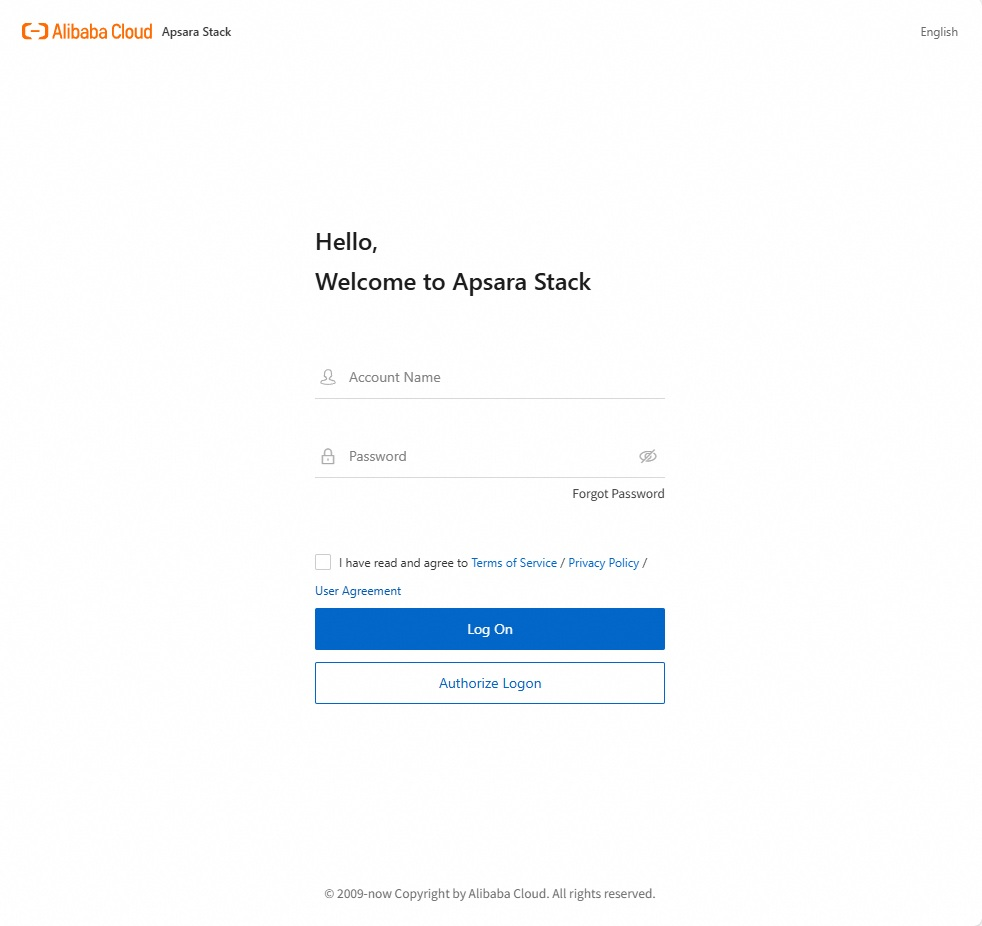
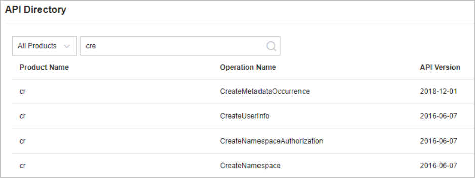
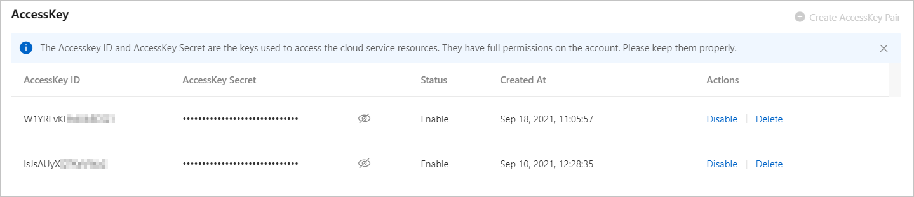
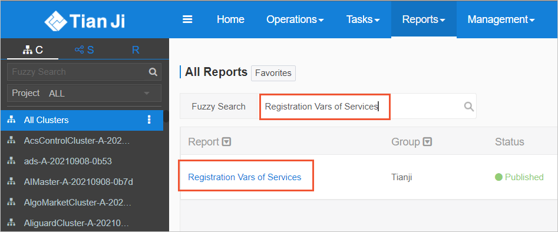
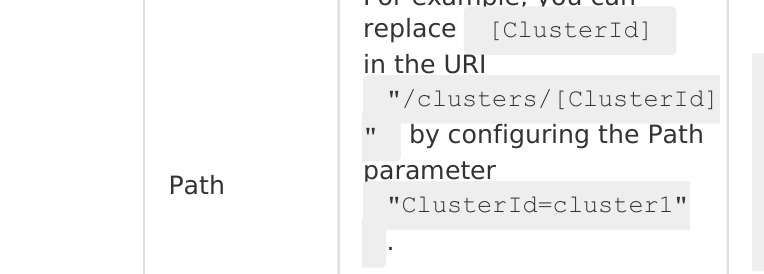
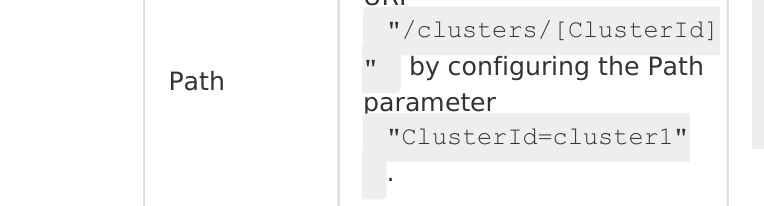

Alibaba Cloud  
Apsara Stack  
Virtual Private Cloud  
Developer Guide  
Product Version: v3.18.6-2607  
Document Version: 20260828

**Table of Contents**

- [1.Getting started](#section-1)
    - [1.1. Usage notes on development documentation](#section-1-1)
    - [1.2. Procedure for API calls](#section-1-2)
- [2.Preparations](#section-2)
    - [2.1. Log in to OpenAPI Explorer](#section-2-1)
    - [2.2. View the information about API operations](#section-2-2)
    - [2.3. Obtain an AccessKey pair](#section-2-3)
    - [2.4. Obtain an STS AccessKey 3-tuple](#section-2-4)
    - [2.5. Obtain the values of common headers](#section-2-5)
    - [2.6. Obtain the endpoint of VPC](#section-2-6)
    - [2.7. Obtain VPC SDK](#section-2-7)
- [3.Call examples for SDK for Java](#section-3)
    - [3.1. Quick start](#section-3-1)
    - [3.2. Use SDK](#section-3-2)
        - [3.2.1. Install VPC SDK for Java](#section-3-2-1)
        - [3.2.2. Configure authentication credentials](#section-3-2-2)
        - [3.2.3. Configure connection requests](#section-3-2-3)
        - [3.2.4. Initiate a request](#section-3-2-4)
        - [3.2.5. Handle errors](#section-3-2-5)
        - [3.2.6. Use CommonRequest to call API operations](#section-3-2-6)
- [4.Call Python SDK](#section-4)
    - [4.1. Quick start](#section-4-1)
    - [4.2. Use SDK](#section-4-2)
        - [4.2.1. Install VPC SDK for Python](#section-4-2-1)
        - [4.2.2. Configure authentication credentials](#section-4-2-2)
        - [4.2.3. Set HTTPS requests](#section-4-2-3)
        - [4.2.4. Initiate a request](#section-4-2-4)
        - [4.2.5. Handle errors](#section-4-2-5)
        - [4.2.6. Use CommonRequest to call API operations](#section-4-2-6)
- [5.Call Go SDK](#section-5)
    - [5.1. Quick start](#section-5-1)
    - [5.2. Use SDK](#section-5-2)
        - [5.2.1. Install Go SDK](#section-5-2-1)
        - [5.2.2. Configure authentication credentials](#section-5-2-2)
        - [5.2.3. Initiate a request](#section-5-2-3)
        - [5.2.4. Troubleshooting](#section-5-2-4)
        - [5.2.5. Use CommonRequest to call API operations](#section-5-2-5)
- [6.API reference](#section-6)
    - [6.1. List of operations by function](#section-6-1)
    - [6.2. Call VPC APIs](#section-6-2)
        - [6.2.1. Request syntax](#section-6-2-1)
        - [6.2.2. API authorization](#section-6-2-2)
        - [6.2.3. Sign an API request](#section-6-2-3)
    - [6.3. RAM authentication](#section-6-3)
    - [6.4. Common parameters](#section-6-4)
    - [6.5. VPC](#section-6-5)
        - [6.5.1. CreateVpc](#section-6-5-1)
        - [6.5.2. DeleteVpc](#section-6-5-2)
        - [6.5.3. ModifyVpcAttribute](#section-6-5-3)
        - [6.5.4. DescribeVpcAttribute](#section-6-5-4)
        - [6.5.5. AssociateVpcCidrBlock](#section-6-5-5)
        - [6.5.6. UnassociateVpcCidrBlock](#section-6-5-6)
        - [6.5.7. MoveResourceGroup](#section-6-5-7)
        - [6.5.8. ListVpcIpv6Isps](#section-6-5-8)
        - [6.5.9. DescribeVSwitchGatewayIpService](#section-6-5-9)
        - [6.5.10. CreateVpcPrefixList](#section-6-5-10)
        - [6.5.11. ModifyVpcPrefixList](#section-6-5-11)
        - [6.5.12. DeleteVpcPrefixList](#section-6-5-12)
        - [6.5.13. GetVpcPrefixListEntries](#section-6-5-13)
        - [6.5.14. ListPrefixLists](#section-6-5-14)
        - [6.5.15. DetailVpc](#section-6-5-15)
        - [6.5.16. DeleteNqa](#section-6-5-16)
        - [6.5.17. DeleteExpressCloudConnection](#section-6-5-17)
    - [6.6. Route table](#section-6-6)
        - [6.6.1. ModifyRouteTableAttributes](#section-6-6-1)
        - [6.6.2. CreateRouteTable](#section-6-6-2)
        - [6.6.3. CreateRouteEntry](#section-6-6-3)
        - [6.6.4. DeleteRouteEntry](#section-6-6-4)
        - [6.6.5. DescribeRouteEntryList](#section-6-6-5)
        - [6.6.6. ModifyRouteEntry](#section-6-6-6)
        - [6.6.7. AssociateRouteTable](#section-6-6-7)
        - [6.6.8. DeleteRouteTable](#section-6-6-8)
        - [6.6.9. DescribeRouteTableList](#section-6-6-9)
        - [6.6.10. UnassociateRouteTable](#section-6-6-10)
    - [6.7. vSwitch](#section-6-7)
        - [6.7.1. CreateVSwitch](#section-6-7-1)
        - [6.7.2. DeleteVSwitch](#section-6-7-2)
        - [6.7.3. ModifyVSwitchAttribute](#section-6-7-3)
        - [6.7.4. DescribeVSwitchAttributes](#section-6-7-4)
    - [6.8. ACLs](#section-6-8)
        - [6.8.1. CreateNetworkAcl](#section-6-8-1)
        - [6.8.2. AssociateNetworkAcl](#section-6-8-2)
        - [6.8.3. ModifyNetworkAclAttributes](#section-6-8-3)
        - [6.8.4. UpdateNetworkAclEntries](#section-6-8-4)
        - [6.8.5. UnassociateNetworkAcl](#section-6-8-5)
        - [6.8.6. CopyNetworkAclEntries](#section-6-8-6)
        - [6.8.7. DeleteNetworkAcl](#section-6-8-7)
        - [6.8.8. DescribeNetworkAcls](#section-6-8-8)
        - [6.8.9. DescribeNetworkAclAttributes](#section-6-8-9)
        - [6.8.10. UpdateNetworkAclEntriesEnable](#section-6-8-10)
    - [6.9. Elastic IP addresses](#section-6-9)
        - [6.9.1. ListEipIsps](#section-6-9-1)
        - [6.9.2. AllocateEipAddress](#section-6-9-2)
        - [6.9.3. AllocateEipAddressPro](#section-6-9-3)
        - [6.9.4. AssociateEipAddress](#section-6-9-4)
        - [6.9.5. ModifyEipAddressAttribute](#section-6-9-5)
        - [6.9.6. DescribeEipAddresses](#section-6-9-6)
        - [6.9.7. UnassociateEipAddress](#section-6-9-7)
        - [6.9.8. ReleaseEipAddress](#section-6-9-8)
        - [6.9.9. DescribeEipGatewayInfo](#section-6-9-9)
        - [6.9.10. DescribeHighDefinitionMonitorLogAttribute](#section-6-9-10)
    - [6.10. NAT gateways](#section-6-10)
        - [6.10.1. CreateNatGateway](#section-6-10-1)
        - [6.10.2. ModifyNatGatewayAttribute](#section-6-10-2)
        - [6.10.3. ModifyNatGatewaySpec](#section-6-10-3)
        - [6.10.4. DeleteNatGateway](#section-6-10-4)
        - [6.10.5. DescribeNatGateways](#section-6-10-5)
        - [6.10.6. CreateForwardEntry](#section-6-10-6)
        - [6.10.7. DescribeForwardTableEntries](#section-6-10-7)
        - [6.10.8. ModifyForwardEntry](#section-6-10-8)
        - [6.10.9. DeleteForwardEntry](#section-6-10-9)
        - [6.10.10. CreateSnatEntry](#section-6-10-10)
        - [6.10.11. DescribeSnatTableEntries](#section-6-10-11)
        - [6.10.12. ModifySnatEntry](#section-6-10-12)
        - [6.10.13. DeleteSnatEntry](#section-6-10-13)
        - [6.10.14. ModifyBandwidthPackageSpec](#section-6-10-14)
        - [6.10.15. DeleteBandwidthPackage](#section-6-10-15)
        - [6.10.16. CreateBandwidthPackage](#section-6-10-16)
        - [6.10.17. DescribeBandwidthPackages](#section-6-10-17)
        - [6.10.18. ModifyBandwidthPackageAttribute](#section-6-10-18)
        - [6.10.19. AddBandwidthPackageIps](#section-6-10-19)
    - [6.11. IPv6 gateways](#section-6-11)
        - [6.11.1. CreateIpv6Gateway](#section-6-11-1)
        - [6.11.2. DeleteIpv6Gateway](#section-6-11-2)
        - [6.11.3. DescribeIpv6Gateways](#section-6-11-3)
        - [6.11.4. ModifyIpv6GatewaySpec](#section-6-11-4)
        - [6.11.5. DescribeIpv6EgressOnlyRules](#section-6-11-5)
        - [6.11.6. CreateIpv6EgressOnlyRule](#section-6-11-6)
        - [6.11.7. DeleteIpv6EgressOnlyRule](#section-6-11-7)
        - [6.11.8. DeleteIpv6InternetBandwidth](#section-6-11-8)
        - [6.11.9. DescribeIpv6GatewayAttribute](#section-6-11-9)
        - [6.11.10. DescribeIpv6Addresses](#section-6-11-10)
        - [6.11.11. ModifyIpv6InternetBandwidth](#section-6-11-11)
        - [6.11.12. AllocateIpv6InternetBandwidth](#section-6-11-12)
        - [6.11.13. ModifyIpv6AddressAttribute](#section-6-11-13)
        - [6.11.14. ModifyIpv6GatewayAttribute](#section-6-11-14)
    - [6.12. HAVIPs](#section-6-12)
        - [6.12.1. CreateHaVip](#section-6-12-1)
        - [6.12.2. DescribeHaVips](#section-6-12-2)
        - [6.12.3. ModifyHaVipAttribute](#section-6-12-3)
        - [6.12.4. AssociateHaVip](#section-6-12-4)
        - [6.12.5. UnassociateHaVip](#section-6-12-5)
        - [6.12.6. DeleteHaVip](#section-6-12-6)
    - [6.13. DHCP options sets](#section-6-13)
        - [6.13.1. CreateDhcpOptionsSet](#section-6-13-1)
        - [6.13.2. AttachDhcpOptionsSetToVpc](#section-6-13-2)
        - [6.13.3. DetachDhcpOptionsSetFromVpc](#section-6-13-3)
        - [6.13.4. ReplaceVpcDhcpOptionsSet](#section-6-13-4)
        - [6.13.5. GetDhcpOptionsSet](#section-6-13-5)
        - [6.13.6. ListDhcpOptionsSets](#section-6-13-6)
        - [6.13.7. UpdateDhcpOptionsSetAttribute](#section-6-13-7)
        - [6.13.8. DeleteDhcpOptionsSet](#section-6-13-8)
    - [6.14. vRouter](#section-6-14)
        - [6.14.1. ModifyVRouterAttribute](#section-6-14-1)
        - [6.14.2. DescribeVRouters](#section-6-14-2)
    - [6.15. Region](#section-6-15)
        - [6.15.1. ListGWAzone](#section-6-15-1)
        - [6.15.2. DescribeRegions](#section-6-15-2)
        - [6.15.3. DescribeZones](#section-6-15-3)
    - [6.16. Tag](#section-6-16)
        - [6.16.1. TagResources](#section-6-16-1)
        - [6.16.2. ListTagResources](#section-6-16-2)
        - [6.16.3. UnTagResources](#section-6-16-3)
    - [6.17. VPN gateways](#section-6-17)
        - [6.17.1. VPN gateway](#section-6-17-1)
            - [6.17.1.1. CreateVpnGateway](#section-6-17-1-1)
            - [6.17.1.2. DescribeVpnGateways](#section-6-17-1-2)
            - [6.17.1.3. DescribeVpnGateway](#section-6-17-1-3)
            - [6.17.1.4. DeleteVpnGateway](#section-6-17-1-4)
            - [6.17.1.5. ModifyVpnGatewayAttribute](#section-6-17-1-5)
            - [6.17.1.6. CreateVbrHa](#section-6-17-1-6)
        - [6.17.2. Customer gateway](#section-6-17-2)
            - [6.17.2.1. CreateCustomerGateway](#section-6-17-2-1)
            - [6.17.2.2. DescribeCustomerGateways](#section-6-17-2-2)
            - [6.17.2.3. DescribeCustomerGateway](#section-6-17-2-3)
            - [6.17.2.4. DeleteCustomerGateway](#section-6-17-2-4)
            - [6.17.2.5. ModifyCustomerGatewayAttribute](#section-6-17-2-5)
        - [6.17.3. Routes for VPN gateways](#section-6-17-3)
            - [6.17.3.1. DeleteVpnPbrRouteEntry](#section-6-17-3-1)
            - [6.17.3.2. DeleteVpnRouteEntry](#section-6-17-3-2)
            - [6.17.3.3. DescribeVpnRouteEntries](#section-6-17-3-3)
            - [6.17.3.4. ModifyVpnRouteEntryWeight](#section-6-17-3-4)
            - [6.17.3.5. CreateVpnRouteEntry](#section-6-17-3-5)
            - [6.17.3.6. ModifyVpnPbrRouteEntryWeight](#section-6-17-3-6)
            - [6.17.3.7. DescribeVpnPbrRouteEntries](#section-6-17-3-7)
            - [6.17.3.8. PublishVpnRouteEntry](#section-6-17-3-8)
            - [6.17.3.9. CreateVpnPbrRouteEntry](#section-6-17-3-9)
        - [6.17.4. IPsec-VPN](#section-6-17-4)
            - [6.17.4.1. DescribeVpnConnection](#section-6-17-4-1)
            - [6.17.4.2. DeleteVpnConnection](#section-6-17-4-2)
            - [6.17.4.3. DownloadVpnConnectionConfig](#section-6-17-4-3)
            - [6.17.4.4. CreateVpnConnection](#section-6-17-4-4)
            - [6.17.4.5. DescribeVpnConnections](#section-6-17-4-5)
            - [6.17.4.6. ModifyVpnConnectionAttribute](#section-6-17-4-6)
        - [6.17.5. SSL-VPN](#section-6-17-5)
            - [6.17.5.1. CreateSslVpnServer](#section-6-17-5-1)
            - [6.17.5.2. DeleteSslVpnServer](#section-6-17-5-2)
            - [6.17.5.3. ModifySslVpnServer](#section-6-17-5-3)
            - [6.17.5.4. DeleteSslVpnClientCert](#section-6-17-5-4)
            - [6.17.5.5. ModifySslVpnClientCert](#section-6-17-5-5)
            - [6.17.5.6. CreateSslVpnClientCert](#section-6-17-5-6)
            - [6.17.5.7. DescribeSslVpnClientCerts](#section-6-17-5-7)
            - [6.17.5.8. DescribeSslVpnClientCert](#section-6-17-5-8)
            - [6.17.5.9. DescribeSslVpnServers](#section-6-17-5-9)
            - [6.17.5.10. DescribeVpnSslServerLogs](#section-6-17-5-10)
- [7.Appendixes](#section-7)
    - [7.1. STS overview](#section-7-1)
        - [7.1.1. What is STS?](#section-7-1-1)
        - [7.1.2. AssumeRole](#section-7-1-2)

<a id="section-1"></a>

# 1.Getting started

<a id="section-1-1"></a>

## 1.1. Usage notes on development documentation

This topic describes how to view the desired product development documentation when you use Apsara Stack API (ASAPI).

**Procedure**

You can follow the procedure described in the following figure to view the desired development documentation.


**Prerequisites**

The Apsara Stack version is obtained from an O&M personnel or operations administrator.

**Procedure**

You can go to the Apsara Stack documentation center and view the desired product documentation.

1. Go to the Apsara Stack Documentation Centerpage by using a browser.

2. Click the **Enterprise**, **Agility**, or **All-in-one** tab based on the Apsara Stack version that you use.

3. Select an Apsara Stack version from the drop-down list.

4. In the left-side navigation pane, select the name of the product that you want to view.

5. In the upper-right corner of the product documentation section, click **View Details** or **Download PDF**.

<a id="section-1-2"></a>

## 1.2. Procedure for API calls

Apsara Stack allows you to call API operations by using the point of presence (POP) gateway. To ensure that Apsara Stack provides the same experience as Alibaba Cloud public cloud, API operations in Apsara Stack Enterprise V3.16.0 and later are called by using the POP gateway by default. This topic describes how to use the POP gateway to call Apsara Stack API operations.

**Flowchart**


**Procedure**

1. Obtain the AccessKey credential.

   Obtain the AccessKey credentials that are required when you call an API operation. For more information, see Obtain an AccessKey pair or Obtain an STS AccessKey 3-tuple.

   > **Note**
   >
   > We recommend that you use the AccessKey pair of a personal account assigned by Resource Access Management (RAM) or an access credential assigned by Security Token Service (STS) to call the API operations of the Apsara Uni-manager Management Console and cloud services.

2. Obtain the region ID.

   For more information, see Obtain the values of common header parameters.

3. Obtain an organization ID and a resource set ID.

   Call an API operation to obtain the organization ID. For more information about how to obtain organization IDs, see *GetOrganizationList* in *Apsara Uni-manager Management Cons ole Developer Guide*.

   Call an API operation to obtain the resource set ID. For more information about how to obtain resource set IDs, see *ListResourceGroup* in *Apsara Uni-manager Management Consol e Developer Guide*.

   > **Note**
   >
   > When you call an API operation, you can specify the organization ID by using  `<x-acs-organizationid>`  and the resource set ID by using  `<x-acs-resourcegroupid>`  to query only resources that belong to the specified resource set and organization.
   >
   > - If you do not specify the  `<x-acs-organizationid>`  parameter, the organization to which the current user belongs is used.
   >
   > - If you do not specify the  `<x-acs-resourcegroupid>`  parameter, this parameter is left empty. If you specify a resource set, you must also specify an organization ID.

4. Obtain the API references.

   For more information about how to view, use, and obtain the developer guide of a specific service, and understand the features and usage methods of operations, see Usage notes.

5. Obtain the endpoint of a cloud service.

6. Obtain the service SDK and use the SDK to call the API operations of the service.

<a id="section-2"></a>

# 2.Preparations

<a id="section-2-1"></a>

## 2.1. Log in to OpenAPI Explorer

You can log in to OpenAPI Explorer from the Apsara Uni-manager Management Console.

**Prerequisites**

- Before you log in to the Apsara Uni-manager Management Console, confirm that you have obtained the service domain name for the Apsara Uni-manager Management Console from the deployment personnel.

- We recommend that you use the Chrome browser.

**Procedure**

1. In the address bar of your browser, enter the service domain name for the Apsara Uni-manager Management Console and press Enter.

   

   > **Note**
   >
   > - You can click the current language in the upper-right corner to switch to another language.
   >
   > - 由于浏览器证书过期或环境开启HTTPS认证等出现多次单击继续访问或无Apsara Uni-manager运营控制台地址入口等现象，此时需要安装证书才能正常访问。单击页面右上角的**浏览器证书安装**，可打开浏览器证书安装指南。

2. Enter your username and password.

   > **Note**
   >
   > - You can obtain the username and logon password from an operations administrator.
   >
   > - If this is your first time logging on to the Apsara Uni-manager Management Console, you must change your password. For security, the password must be 10 to 32 characters long and contain uppercase letters, lowercase letters, digits, and special characters. The supported special characters are: !, @, #, $, and %.

3. Select **I Have Read And Agree To The Product Service Agreement, Privacy Agreement, And User Agreement**.

   > **Note**
   >
   > - The link text on the logon page is the title of the agreement document. You can click the link to view the details of the agreement.
   >
   > - The **Product Service Agreement**, **Privacy Agreement**, and **User Agreement** are displayed only if they have been published. If none of these agreements are published, you can skip this step.

4. Click **Account Logon** or **Authorized Logon**.

   > **Note**
   >
   > The Authorized Logon button is displayed only if the global IdP setting for third-party authentication is enabled. This display name can be customized. The default name is "Authorized Logon".

5. If multi-factor authentication (MFA) is enabled for your account, follow the steps for one of the following scenarios:

   > **Note**
   >
   > When you log on from the Internet, multi-factor authentication (MFA) is mandatory by default.

   - **First logon after MFA is enabled**

     <ol type="a">

     <li>

     After you log on with your username and password, the Bind Virtual MFA Device page appears.

     </li>

     <li>

     On the Bind Virtual MFA Device page, follow the on-screen instructions to bind a virtual MFA device.

     </li>

     </ol>

     <ol type="i" start="100">

     <li>

     You have logged in to the console.

     </li>

     </ol>

   - **MFA is already enabled and a device is bound**

     Enter the six-digit MFA code and click **Authenticate**.

6. In the top navigation bar, select **Products** > **Developer Tools** > **OpenAPI Explorer**.

<a id="section-2-2"></a>

## 2.2. View the information about API operations

This topic describes how to view the information about API operations. The information includes service names, API operation names, and API versions. The information is required when you use an SDK to call API operations.

**Background information**

The API operations on the API Directory page are only for reference. For information about how to call API operations, see developer guides of the corresponding cloud services. If the information on the API Directory page is inconsistent with that in the developer guide of the corresponding cloud service, the information in the developer guide prevails.

**Procedure**

1. Go to the API Tool console. For more information, see Log in to OpenAPI Explorer.

2. In the left-side navigation pane, click **API Directory**.

3. On the **API Directory** page, select the service that you want to use from the drop-down list, enter a keyword of an API operation name in the search box, and then click Search.

   

4. View and record the service name, API operation name, and API version of the API operation that you want to call.

<a id="section-2-3"></a>

## 2.3. Obtain an AccessKey pair

AccessKey credentials are provided by Resource Access Management (RAM) or Security Token Service (STS). You can use one type of AccessKey credentials for authentication when you call API operations. This topic describes how to obtain an AccessKey pair that is provided by RAM.

**Background information**

An AccessKey ID and an AccessKey secret are used to implement symmetric encryption and verify the identity of request senders. The AccessKey ID is used to identify a user. The AccessKey secret is used to encrypt a signature string.

You can use RAM or STS to assign AccessKey credentials:

- An AccessKey pair that is provided by RAM to a third party consists of an AccessKey ID and an AccessKey secret.

- An AccessKey 3-tuple that is provided by STS to a third party consists of an AccessKey ID, an AccessKey secret, and a security token. For more information, see Obtain an STS AccessKey 3-tuple.

The Apsara Uni-manager Management Console provides AccessKey pairs for personal accounts and organizations. Only operations administrators and the administrators of level-1 organizations can obtain the AccessKey pairs of organizations. We recommend that you use the AccessKey pairs of personal accounts to call the operations provided by the Apsara Uni-manager Management Console and cloud services. If you use the AccessKey pair of a personal account, configure the request headers that are described in the following table for access control. Otherwise, an error that indicates insufficient permissions may occur.

> **Warning**
>
> The AccessKey pair of a personal account is managed by the permission
>
> system of the Apsara Uni-manager Management Console. If you need to obtain the AccessKey pair of an organization, make sure that your operation is allowed by an administrator. This ensures security.

| Parameter | Description |
| --- | --- |
| x-acs-regionid | The ID of the region, for example, cn-hangzhou-\*. |
| x-acs-organizationid | The ID of the organization in the Apsara Uni-manager Management Console. For more information about how to obtain organization IDs, see the <strong>GetOrganizationList</strong> section in <strong>Apsara</strong> Uni-manager Management Console <strong>Developer Guide</strong>. |
| x-acs-resourcegroupid | The ID of the resource set in the Apsara Uni-manager Management Console. For more information about how to obtain resource set IDs, see the <strong>ListResourceGroup</strong> section in <strong>Apsara</strong> Uni-manager Management Console <strong>Developer Guide</strong>. |
| x-acs-instanceid | The ID of the instance that you want to manage.If you want to obtain the ID of an Elastic Compute Service (ECS) instance, you can obtain the ID from the ECS instance list. |

**Obtain the AccessKey pair of a personal account**

To obtain the AccessKey pair of a personal account, perform the following steps:

1. Log on to the Apsara Uni-manager Management Console.

2. In the upper-right corner of the homepage, click the profile picture and then click **User Information**.

3. In the **AccessKey Pair** section, view the AccessKey pair of your account.

   

   > **Note**
   >
   > An AccessKey pair consists of an AccessKey ID and an AccessKey secret.
   >
   > These credentials provide full permissions on cloud resources within your account. You must keep the AccessKey pair confidential.

**Obtain the AccessKey pair of an organization**

To obtain the AccessKey pair of an organization, perform the following steps:

1. Log on to the Apsara Uni-manager Management Console as an administrator.

2. In the top navigation bar, click **Enterprise**.

3. In the left-side navigation pane, choose **Resources > Organizations**.

4. In the organization list, click the name of the level-1 organization whose AccessKey pair you want to obtain.

5. Click **Management Accesskey**.

6. In the dialog box that appears, view the AccessKey pair of the organization.

<a id="section-2-4"></a>

## 2.4. Obtain an STS AccessKey 3-tuple

This topic describes how to use Security Token Service (STS) to call Apsara Stack API operations.

**Background information**

STS allows you to manage temporary credentials to your Apsara Stack resources. You can use STS to call Apsara Stack API operations.

An STS AccessKey 3-tuple consists of an AccessKey ID, an AccessKey secret, and a security token. When you use STS to call API operations, you must specify an STS AccessKey 3-tuple. For more information about STS, see What is STS.

**Procedure**

1. Obtain the  `RAM role` .

   <ol type="i">

   <li>

   Log on to the Apsara Uni-manager Management Console.

   </li>

   <li>

   Click the profile picture in the upper-right corner of the page and click **User**

   </li>

   </ol>

   **Information**.

   <ol type="i" start="3">

   <li>

   Click **View Current Role Policy**.

   </li>

   </ol>

   In the **View Policies of Current Role** dialog box, view your  `RAM role` .

2. Obtain the STS AccessKey 3-tuple.

   > **Note**
   >
   > In the following sample code, replace the parameters with the actual information. Remove the angle brackets (<>) in the final code.
   >
   > The following list describes the parameters:
   >
   > - &lt;yourRegionID>: Replace the parameter with the region ID.
   >
   > - &lt;yourAccessKeyID>: Replace the parameter with your AccessKey ID.
   >
   > - &lt;yourAccessKeySecret>: Replace the parameter with your AccessKey secret.
   >
   > - &lt;yourRoleSessionName>: Replace the parameter with the name of the current session.
   >
   > - &lt;yourRoleArn>: Replace the parameter with your RAM role.
   >
   > - "sts.aliyuns.com": Replace the parameter with the endpoint of STS.

   ```xml
   public static void main(String[] args) {
       // Create a DefaultAcsClient instance and initialize it. 
       // Specify the region ID, AccessKey ID, and AccessKey secret.
       DefaultProfile profile = DefaultProfile.getProfile("<yourRegionID>", "
   <yourAccessKeyID>", "<yourAccessKeySecret>");
       HttpClientConfig clientConfig = HttpClientConfig.getDefault();
       clientConfig.setIgnoreSSLCerts(true);
       clientConfig.setProtocolType(ProtocolType.HTTPS);
       profile.setHttpClientConfig(clientConfig);
       IAcsClient client = new DefaultAcsClient(profile);
       String assumeRole = callAssumeRole(client);
       if (StringUtils.isEmpty(assumeRole)) return;
       JSONObject assumeRoleJson = JSONObject.parseObject(assumeRole);
       JSONObject credentials = assumeRoleJson.getJSONObject("Credentials");
       // Obtain the STS AccessKey 3-tuple.
       String stsAK = credentials.getString("AccessKeyId");
       String stsSK = credentials.getString("AccessKeySecret");
       String stsToken = credentials.getString("SecurityToken");
   }

   private static String callAssumeRole(IAcsClient client) {
       CommonRequest request = new CommonRequest();
       // Replace "sts.aliyuns.com" with the endpoint of STS. The format of an STS endpoint is sts-vpc.${global:region}.${global:internet-domain}.
       request.setSysDomain("sts.aliyuns.com");
       request.setSysProduct("Sts");
       request.setSysAction("AssumeRole");
       request.setSysVersion("2015-04-01");
       request.setSysMethod(MethodType.POST);
       request.setHttpContentType(FormatType.FORM);
       // Replace "<yourRoleSessionName>" with the name of the current session.
       request.putQueryParameter("RoleSessionName", "<yourRoleSessionName>");
       // Replace "<yourRoleArn>" with the RAM role ARN that is obtained in the previousstep.
       request.putQueryParameter("RoleArn", "<yourRoleArn>");
       try {
           CommonResponse response = client.getCommonResponse(request);
           return response.getData();
       } catch (ServerException e) {
           System.out.println(e.getErrCode());
           System.out.println(e.getErrMsg());
       } catch (ClientException e) {
           System.out.println(e.getErrCode());
           System.out.println(e.getErrMsg());
       }
       return null;
   }
   ```

3. Use the STS AccessKey 3-tuple to call an API operation of a cloud service. The following sample code provides an example on how to call the  `DescribeVpcs`  operation of Virtual Private Cloud (VPC).

   > **Note**
   >
   > In the following sample code, replace the parameters with the actual information. Remove the angle brackets (<>) in the final code.
   >
   > The following list describes the parameters:
   >
   > - &lt;yourRegionID>: Replace the parameter with the region ID.
   >
   > - &lt;yourStsAccesskeyID>: Replace the parameter with your STS AccessKey ID.
   >
   > - &lt;yourStsAccessKeySecret>: Replace the parameter with your STS AccessKey secret.
   >
   > - &lt;yourStsToken>. Replace the parameter with your security token.
   >
   > - &lt;yourResourceGroupID>: Replace the parameter with the resource set ID.
   >
   > - &lt;yourRegionID>: Replace the parameter with the organization ID.

   ```xml
   public static void main(String[] args) {
       // Replace "<yourRegionID>" with the region ID.
       // Replace "<yourStsAccessKeyID>" and "<yourStsAccessKeySecret>" with the AccessKey ID and AccessKey secret of the 3-tuple obtained in the previous step.
       DefaultProfile profile = DefaultProfile.getProfile("<yourRegionID>", "
   <yourStsAccesskey>", "<yourStsAccessSecret>");
       HttpClientConfig clientConfig = HttpClientConfig.getDefault();
       clientConfig.setIgnoreSSLCerts(true);
       clientConfig.setProtocolType(ProtocolType.HTTPS);
       profile.setHttpClientConfig(clientConfig);
       IAcsClient client = new DefaultAcsClient(profile);
       CommonRequest request = new CommonRequest();
       request.setSysDomain("vpc.aliyuns.com");
       request.setSysProduct("vpc");
       request.setSysAction("DescribeVpcs");
       request.setSysVersion("2016-04-28");
       request.setSysMethod(MethodType.POST);
       request.setHttpContentType(FormatType.FORM);
       // Replace "<yourRegionID>" with the region ID.
       request.putHeaderParameter("x-acs-regionid", "<yourRegionID>");
       // Replace "<yourStsToken>" with the security token of the 3-tuple obtained in the previous step.
       request.putQueryParameter("SecurityToken", "<yourStsToken>");
       // Optional. Replace the parameter with the resource set ID.
       // request.putHeaderParameter("x-acs-resourcegroupid", "<yourResourceGroupID>");
       // Required. Replace the parameter with the organization ID.
       request.putHeaderParameter("x-acs-organizationid", "<yourOrganizationID>");
       try {
           CommonResponse response = client.getCommonResponse(request);
           System.out.println(response.getData());
       } catch (ServerException e) {
           System.out.println(e.getErrCode());
           System.out.println(e.getErrMsg());
       } catch (ClientException e) {
           System.out.println(e.getErrCode());
           System.out.println(e.getErrMsg());
       }
   }
   ```

<a id="section-2-5"></a>

## 2.5. Obtain the values of common headers

You must provide multiple headers when you call Apsara Stack operations. This topic describes the headers and how to obtain the values of the headers. This topic also describes the return values of specific headers after you call Apsara Stack operations.

**Headers**

| Type | Description |
| --- | --- |
| x-acs-regionid | The region ID. For more information,see Obtain a region ID. |
| x-acs-organizationid | The ID of the organization in the Apsara Uni-manager Management Console. For more information, seeObtain an organization ID. |
| x-acs-resourcegroupid | The ID of the resource set in the Apsara Uni-manager Management Console. For more information, see Obtain the ID of a resource set. |
| x-acs-instanceid | The ID of the instance that you want to manage.For more information, see Obtain an instance ID. |

**Obtain a region ID**

1. Log on to the Apsara Uni-manager Management Console as an administrator.

2. In the top navigation bar, click **Enterprise**.

3. In the left-side navigation pane, choose **Resources** > **Regions**.

4. Click the name of the required organization.

5. View the region ID in the **Regions** window on the right.

**Obtain an organization ID**

You can call the GetOrganizationList operation to obtain the organization ID. For more information, see *GetOrganizationList* in *Apsara Uni-manager Management Console Developer Guide*.

**Obtain a resource set ID**

You can call the ListResourceGroup operation to obtain the resource set ID. For more information, see *ListResourceGroup* in *Apsara Uni-manager Management Console Developer Guide*.

**Obtain an instance ID**

You can obtain the ID of an instance in the cloud service console of the Apsara Uni-manager Management Console. For example, to obtain the ID of a virtual private cloud (VPC), perform the following steps:

1. Log on to the Apsara Uni-manager Management Console.

2. In the top navigation bar, choose **Products** > **Networking** > **Virtual Private Cloud**.

3. In the left-side navigation pane, click **Virtual Private Clouds**.

4. View the **VPC ID/name** in the **VPC** list.

**Response parameters**

The following additional response parameters are returned by default when you call operations to query the instances of cloud services.

| Type | Description |
| --- | --- |
| ResourceGroupName | The name of the resource set. |
| ResourceGroup | The ID of the resource set. |
| DepartmentName | The name of the organization. |
| Department | The ID of the organization. |

<a id="section-2-6"></a>

## 2.6. Obtain the endpoint of VPC

This topic describes how to obtain the endpoint of Virtual Private Cloud (VPC).

**Background information**

To use (Portable OpenAPI Proxy) POP Gateway to call Apsara Stack API operations, you must use a service endpoint. You can obtain a service endpointfrom Apsara Stack onsite O&M engineers. You can also perform the following steps to obtain an endpoint.

**Procedure**

1. Log on to the Apsara Infrastructure Management console.

   <ol type="i">

   <li>

   Log on to the Apsara Uni-manager Operations Console.

   </li>

   <li>

   In the top navigation bar, choose **Products** > **Platforms** > **Apsara Infrastructure**

   </li>

   </ol>

   **Management Framework**.

2. In the left-side navigation pane, click **Reports**.

3. On the **All Reports** page, search for  `Registration Vars of Services`  and click the report name.

   

4. On the **Registration Vars of Services** page, click the  icon next to **Service** and search

   for  `VPC` .

5. Find  `vpc-yaochi` . Right-click the value in the **Service Registration** column and select **Show More**.

   On the **Details** page, view the value of **vpc-internal.openapi.endpoint**. The value indicates the  `endpoint`  of VPC.

<a id="section-2-7"></a>

## 2.7. Obtain VPC SDK

When you call Apsara Stack API operations by using the Portable OpenAPI Proxy (POP) gateway, you must use an SDK of your cloud service. This topic describes how to obtain Virtual Private Cloud (VPC) SDK.

**Background information**

To use VPC features, you must install both the VPC SDK and the Alibaba Cloud core library. For example, to use VPC SDK for Java, you must download  `aliyun-java-sdk-vpc`  and  `aliyun-java-sdk-core` .

- VPC SDK encapsulates the API released on April 28, 2016. The SDK identifies callers based on their AccessKey pairs and provides features such as automatic signing to allow you to create and manage resources by calling API operations. Alibaba Cloud SDK includes code and examples. You can create cloud applications by using an SDK in the programming language that you require.

- We recommend that you use the SDK core library that is provided on the Alibaba Cloud official website. The SDK core library is applicable to all cloud services and is compatible with Apsara Stack.

**Instructions**

Alibaba Cloud SDK supports Java, Python, and Go. You can select an SDK from Alibaba Cloud SDK based on your business requirements.

> **Note**
>
> We recommend that you use an SDK for Java, Python, or Go. If you use SDKs in other programming languages, the SDKs may be incompatible with your system.

<a id="section-3"></a>

# 3.Call examples for SDK for Java

<a id="section-3-1"></a>

## 3.1. Quick start

This topic describes how to obtain and use Virtual Private Cloud (VPC) SDK for Java.

**Prerequisites**

- You must have an Apsara Stack tenant account and an AccessKey pair (AccessKey ID and AccessKey secret) to use SDK for Java. For more information, see Obtain an AccessKey pair.

- Obtain the endpoint of VPC. For more information, see Obtain the endpoint of VPC.

- To install Alibaba Cloud SDK for Java,you must useJava Development Kit (JDK) 1.8 or later.

**Install VPC SDK for Java**

If you use Apache Maven to manage Java projects, you need to only add Maven commands to the pom.xml file of the projects.

To use the VPC SDK, you must install the SDK core library and VPC SDK. We recommend that you use the core library version 4.5.17 or later, and use the SDK version 3.2.0.

```xml
<dependencies>
        <dependency>
            <groupId>com.aliyun</groupId>
            <artifactId>aliyun-java-sdk-core</artifactId>
            <version>4.5.17</version>
        </dependency>
        <dependency>
            <groupId>com.aliyun</groupId>
            <artifactId>aliyun-java-sdk-vpc</artifactId>
            <version>3.2.0</version>
        </dependency>
</dependencies>
```

**Use VPC SDK for Java**

To use VPC SDK for Java, perform the following steps:

1. Create a DefaultAcsClient instance and initialize the instance.

2. Create an API request and set the required parameters.

3. Initiate the API request and process the response or exceptions.

   > **Note**
   >
   > In the following sample code, replace the parameters with the actual information. Remove the angle brackets (<>) in the final code.
   >
   > The following list describes the parameters:
   >
   > - &lt;yourRegionID>: Replace the parameter with the region ID.
   >
   > - &lt;yourAccessKeyID>: Replace the parameter with your AccessKey ID.
   >
   > - &lt;yourAccessKeySecret>: Replace the parameter with your AccessKey secret.
   >
   > - &lt;Product>: Replace the parameter with the service name.
   >
   > - &lt;Endpoint>: Replace the parameter with the endpoint of the service.
   >
   > - &lt;readTimeout>: Replace the parameter with a read timeout period based on your business requirements. Unit: milliseconds.
   >
   > - &lt;connectionTimeout>: Replace the parameter with a connection timeout period based on your business requirements. Unit: milliseconds.
   >
   > - &lt;maxRequestsPerHost>: Replace the parameter with the maximum number of requests that are supported by each host.
   >
   > - &lt;maxRequests>: Replace the parameter with the maximum number of requests.
   >
   > - &lt;http://192.168.XX.XX:33XX>: Replace the parameter with the IP address and port of the proxy.

   ```java
   import com.aliyuncs.http.HttpClientConfig;
   import com.aliyuncs.http.ProtocolType;
   import com.aliyuncs.profile.DefaultProfile;
   import com.aliyuncs.DefaultAcsClient;
   import com.aliyuncs.IAcsClient;
   import com.aliyuncs.exceptions.ClientException;
   import com.aliyuncs.exceptions.ServerException;
   import com.aliyuncs.vpc.model.v20160428.*;
   import com.google.gson.Gson;
   public class Main {
        public static void main(String[] args) {
           // Create a DefaultAcsClient instance and initialize the instance.
           DefaultProfile profile = DefaultProfile.getProfile(
               "<yourRegionID>",          // Replace the parameter with the region ID.
               "<yourAccessKeyID>",      // Replace the parameter with your AccessKey ID.
               "<yourAccessKeySecret>"); // Replace the parameter with your AccessKey 
   secret.
           // Replace the parameter with the endpoint of the service. 
           profile.addEndpoint("<yourRegionID>", "<Product>", "<Endpoint>");
           // Set the request configuration.
           HttpClientConfig clientConfig = HttpClientConfig.getDefault();
           clientConfig.setIgnoreSSLCerts(true);// Ignore the certificate.
           clientConfig.setReadTimeoutMillis(<readTimeout>);// Optional. Set the read timeout period. Unit: milliseconds.
           clientConfig.setConnectionTimeoutMillis(<connectionTimeout>);// Optional. Setthe connection timeout period. Unit: milliseconds.
           clientConfig.setMaxRequestsPerHost(<maxRequestsPerHost>);// Optional. Set themaximum number of requests for each host.
           clientConfig.setMaxRequests(<maxRequests>);// Optional. Set the maximum number of requests.
           clientConfig.setProtocolType(ProtocolType.HTTP); // Optional. Set the request 
   protocol. Default value: HTTP.
           /* Optional. Set the proxy IP address and port.
           clientConfig.setHttpProxy("<http://192.168.XX.XX:33XX>");
           or
           clientConfig.setHttpsProxy("<https://192.168.XX.XX:33XX>");
           */
           profile.setHttpClientConfig(clientConfig);
           IAcsClient client = new DefaultAcsClient(profile);
           // Create an API request and set the parameters.
           DescribeVpcsRequest request = new DescribeVpcsRequest();
           // Set service-related parameters.
           request.setPageSize(10);
           request.setPageNumber(1);
           // Specify the organization ID and resource set ID to query specified 
   resources.
           request.putHeaderParameter("x-acs-organizationid", "1");
           request.putHeaderParameter("x-acs-resourcegroupid", "11");
           // Send the request and handle the response or exception.
           DescribeVpcsResponse response;
          try {
               DescribeVpcsResponse response = client.getAcsResponse(request);
               System.out.println(new Gson().toJson(response));
           } catch (ServerException e) {
               e.printStackTrace();
           } catch (ClientException e) {
               System.out.println("ErrCode:" + e.getErrCode());
               System.out.println("ErrMsg:" + e.getErrMsg());
               System.out.println("RequestId:" + e.getRequestId());
           }
        }
    }
   ```

<a id="section-3-2"></a>

## 3.2. Use SDK

<a id="section-3-2-1"></a>

### 3.2.1. Install VPC SDK for Java

This topic describes how to install and use Virtual Private Cloud (VPC) SDK for Java.

Alibaba Cloud SDK for Java supports Java Development Kit (JDK) 1.8 or later. You can install Alibaba Cloud SDK for Java by adding Maven dependencies or downloading Alibaba Cloud SDK.

To use VPC SDK, you must install the core library of Alibaba Cloud SDK for Java and VPC SDK for Java. We recommend that you use the core library version 4.5.17 or later, and use VPC SDK for Java 3.2.0.

To use VPC SDK for Java, you must install the core library of Alibaba Cloud SDK for Java and add the following dependencies to the pom.xml file. For more information about the specific SDK version, see Alibaba Cloud SDK.

```xml
<dependencies>
        <dependency>
            <groupId>com.aliyun</groupId>
            <artifactId>aliyun-java-sdk-core</artifactId>
            <version>4.5.17</version>
        </dependency>
        <dependency>
            <groupId>com.aliyun</groupId>
            <artifactId>aliyun-java-sdk-vpc</artifactId>
            <version>3.2.0</version>
        </dependency>
</dependencies>
```

<a id="section-3-2-2"></a>

### 3.2.2. Configure authentication credentials

When using Alibaba Cloud SDK to access Apsara Stack services, you must provide an Apsara Stack tenant account for authentication. This topic describes how to configure authentication credentials.

SDK for Java supports authentication through an AccessKey pair. For more information about how to obtain an AccessKey pair, see Obtain an AccessKey pair.

If you want to use your AccessKey pair to access Alibaba Cloud, you must configure the AccessKey pair as a credential when you initialize the client.

> **Note**
>
> Do not disclose any code that may contain your AccessKey pair. For example, do not commit the code to public GitHub projects. Otherwise, your account may be compromised.

```text
DefaultProfile profile = DefaultProfile.getProfile(
    "<yourRegionID>",          // Replace the parameter with the region ID.
    "<yourAccessKeyID>",      // Replace the parameter with your AccessKey ID.
    "<yourAccessKeySecret>"); // Replace the parameter with your AccessKey secret.
```

> **Note**
>
> In the preceding sample code,replace the parameterswith the actual information. Remove the angle brackets (<>) in the final code.

<a id="section-3-2-3"></a>

### 3.2.3. Configure connection requests

This topic describes how to configure a connection request by using the HttpClientConfig object.

You can use the following code to configure the HttpClientConfig object. We recommend that you select and configure the following parameters based on your business requirements.

> **Note**
>
> You must use actual values to replace the variables in the following sample code. Do not retain the angle brackets (<>) in the final code.
>
> The following list describes the variables:
>
> - &lt;readTimeout>: Specify the read timeout period based on your business requirements. Unit: milliseconds.
>
> - &lt;connectionTimeout>: Specify the connection timeout period based on your business requirements. Unit: milliseconds.
>
> - &lt;maxRequestsPerHost>: Specify the maximum number of requests that are supported by each server based on your business requirements. The supported data type is INTEGER.
>
> - &lt;maxRequests>: Specify the maximum number of requests based on your business requirements. The supported data type is INTEGER.
>
> - &lt;http://192.168.XX.XX:33XX>: Replace it with the actual IP address and port of the proxy.

```text
// Obtain the HttpClientConfig object.
HttpClientConfig clientConfig = HttpClientConfig.getDefault();
// Specify whether to ignore certificates.
clientConfig.setIgnoreSSLCerts(true);
// (Optional) Specify the read timeout period. Unit: milliseconds.
clientConfig.setReadTimeoutMillis(<readTimeout>);
// (Optional) Specify the connection timeout period. Unit: milliseconds.
clientConfig.setConnectionTimeoutMillis(<connectionTimeout>);
// (Optional) Specify the maximum number of requests that are supported by each server.
The supported data type is INTEGER.
clientConfig.setMaxRequestsPerHost(<maxRequestsPerHost>);
// (Optional) Specify the maximum number of requests. The supported data type is INTEGE
R.
clientConfig.setMaxRequests(<maxRequests>);
// (Optional) Specify the protocol type.
clientConfig.setProtocolType(ProtocolType.HTTP);
/** (Optional) Specify whether to configure the proxy based on your business 
requirements. The following code is available:
clientConfig.setHttpProxy("<http://192.168.XX.XX:33XX>");
Or
clientConfig.setHttpsProxy("<https://192.168.XX.XX:33XX>");
Replace https://192.168.XX.XX:33XX with the actual IP address and port of the proxy.
*/
profile.setHttpClientConfig(clientConfig);
```

<a id="section-3-2-4"></a>

### 3.2.4. Initiate a request

This topic describes how to use Virtual Private Cloud (VPC) SDK for Java to initiate a request.

**Procedure**

1. Create an AcsClient instance.

   ```text
   IAcsClient client = new DefaultAcsClient(profile);
   ```

2. Create a request.

   Name the request in the following format:  `${apiName}Request` . Replace **${apiName}** with the API name, for example, DescribeVpcs.

   When multiple service SDKs are used, different requests may have the same name. You can differentiate the requests based on package names.

   ```text
   DescribeVpcsRequest request = new DescribeVpcsRequest();
   // Set service-related parameters.
   request.setPageSize(10);
   request.setPageNumber(1);
   // Specify the organization ID and resource set ID to query specified resources.
   request.putHeaderParameter("x-acs-organizationid", "1");
   request.putHeaderParameter("x-acs-resourcegroupid", "");
   ```

3. Initiate the request and handle the response.

   ```java
   DescribeVpcsResponse response;
   try {
     DescribeVpcsResponse response = client.getAcsResponse(request);
     System.out.println(new Gson().toJson(response));
   } catch (ServerException e) {
       e.printStackTrace();
   } catch (ClientException e) {
       e.printStackTrace();
   }
   ```

   In normal cases, all returned fields are deserialized into the response. You can directly use  `response.getXXX()`  to obtain the response fields.

   ```text
   instanceStatus := response.getStatus()
   ```

   If an exception occurs or you need the original HTTP response, use  `doAction()`  to obtain the original response.

   ```text
   HttpResponse response = client.doAction(request);
   ```

<a id="section-3-2-5"></a>

### 3.2.5. Handle errors

If an error occurs on the server side or SDK side, the Apsara Stack Java SDK returns the corresponding exception message. An exception message contains the detailed error information, namely the error code and the error message.

Generally, you are not required to handle the errors returned by the Apsara Stack Java SDK. You are only required to handle the errors on the server side according to the error message.

- `ServerException`  is the error message on the server side.

- `ClientException`  is the error message on the SDK side.

For example, if the following error occurs, modify the ID of AccessKey according to the detailed error message.

```text
com.aliyuncs.exceptions.ClientException: InvalidAccessKeyId.NotFound : Specified accesskey is not found.
```

To handle the errors returned by the Apsara Stack Java SDK, see the following code example for reference:

```java
try {
    FooResponse response = client.getAcsResponse(request);
    // Handle the response.
    // ...
}catch (ServerException e){
    // Add your own error handling logic here.
    // For example, print the detailed error message.
    System.out.println("ErrorCode=" + e.getErrCode());
    System.out.println("ErrorMessage=" + e.getErrMsg());
    // If the problem is tricky, open a ticket and provide the RequestId for us.
    System.out.println("ResponseId=" + e.getRequestId());
}catch (ClientException e){
    // Add your own error handling logic here.
    // For example, print the detailed error message.
    System.out.println("ErrorCode=" + e.getErrCode());
    System.out.println("ErrorMessage=" + e.getErrMsg());
}
```

<a id="section-3-2-6"></a>

### 3.2.6. Use CommonRequest to call API operations

If you want to call the API operations of a cloud service that does not provide SDKs, or you cannot use an SDK to call API operations whose requests and responses meet your business requirements, you can use CommonRequest to call API operations. You can use CommonRequest to call all API operations.

**Characteristics of CommonRequest calling**

The CommonRequest calling method has the following characteristics:

- Light weight: You only need the core package to initiate the call, without downloading or installing the SDK of each product.

- Easy and convenient: You can call the latest API without updating the SDK.

- Fast iteration

**Use CommonRequest to call API operations**

If you want to send a CommonRequest request, you must obtain the values of the following parameters: You can obtain the values of these parameters from the API references.

- Domain: the endpoint of the service.

- Version: the version of the API in the YYYY-MM-DD format.

  You can obtain the API version from the sections about common parameters in the API references.

- Operation information: the name of the API operation that you want to call.

  You must obtain the value of the **Action** parameter and specify an API operation in  `request.setSysAction("<Action>")` .

  For example, if you want to call the DescribeVpcs operation, you must use  `request.setSysAction("DescribeVpcs")`  to specify the API operation when you initiate a CommonRequest request.

**Example: Call an RPC API operation**

The following code provides an example of how to call the  `DescribeVpcs`  operation to query virtual private clouds (VPCs). VPC API operations are RPC operations.

> **Note**
>
> In the following sample code, replace the parameters with the actual
>
> information. Remove the angle brackets (<>) in the final code.
>
> The following list describes the parameters:
>
> - &lt;yourRegionID>: Replace the parameter with the region ID.
>
> - &lt;yourAccessKeyID>: Replace the parameter with your AccessKey ID.
>
> - &lt;yourAccessKeySecret>: Replace the parameter with your AccessKey secret.
>
> - &lt;yourSecurityToken>: Replace the parameter with your security token.
>
> - &lt;yourResourceGroupID>: Replace the parameter with the resource set ID.
>
> - &lt;yourOrganizationID>: Replace the parameter with the organization ID.
>
> - &lt;yourInstanceID>: Replace the parameter with the instance ID.
>
> - &lt;http://192.168.XX.XX:33XX>: Replace the parameter with the IP address and port of the proxy.

```java
import com.aliyuncs.CommonRequest;
import com.aliyuncs.CommonResponse;
import com.aliyuncs.DefaultAcsClient;
import com.aliyuncs.IAcsClient;
import com.aliyuncs.exceptions.ClientException;
import com.aliyuncs.exceptions.ServerException;
import com.aliyuncs.profile.DefaultProfile;
import com.aliyuncs.http.HttpClientConfig;
import com.aliyuncs.http.ProtocolType;
public class Sample {
    public static void main(String[] args) {
        // Create a DefaultAcsClient instance and initialize the instance.
        DefaultProfile profile = DefaultProfile.getProfile(
            "<yourRegionUD>",          // Replace the parameter with the region ID.
            "<yourAccessKeyID>",      // Replace the parameter with your AccessKey ID.
            "<yourAccessKeySecret>"); // Replace the parameter with your AccessKey 
secret.
        HttpClientConfig clientConfig = HttpClientConfig.getDefault();
        clientConfig.setProtocolType(ProtocolType.HTTP);
        /**
        Optional. Configure the HTTP proxy based on your business requirements.
        Format:
        clientConfig.setHttpProxy("<http://192.168.XX.XX:33XX>");
        Specify the IP address and port of the proxy.
        */
        profile.setHttpClientConfig(clientConfig);
        IAcsClient client = new DefaultAcsClient(profile);
        // Create an API request and set the parameters.
        CommonRequest request = new CommonRequest();
        // Specify the endpoint of the service.
        request.setSysDomain("vpc.aliyuncs.com");
        request.setSysProduct("Vpc");
        request.setSysVersion("2016-04-28");
        request.setSysAction(DescribeVpcs);
        request.putQueryParameter("PageNumber", "1");
        request.putQueryParameter("PageSize", "30");
        request.putHeadParameter("x-acs-resourcegroupid", "<yourResourceGroupID>");// Optional. Specify the resource set ID.
        request.putHeadParameter("x-acs-organizationid", "<yourOrganizationID>");// Required. Specify the organization ID.
        request.putHeadParameter("x-acs-regionid", "<yourRegionID>");// Optional. 
Specify the region ID. If you use Apsara Stack Enterprise V3.15.0 or earlier versions, this parameter is required.
        // request.putHeadParameter("x-acs-instanceid", "<yourInstanceID>");// Optional 
Specify the instance ID. This parameter is required when you want to delete, modify, orquery an instance.
        /** 
        When you use STS AccessKey credentials to call an API operation, you must add the SecurityToken field in the request parameters.
        Format:
        request.putQueryParameter("SecurityToken", "<yourSecurityToken>");
        Specify your security token.
        */
        try {
            CommonResponse response = client.getCommonResponse(request);
            System.out.println(response.getData());
        } catch (ServerException e) {
            // TODO Auto-generated catch block
            e.printStackTrace();
        } catch (ClientException e) {
            // TODO Auto-generated catch block
            e.printStackTrace();
        }
    }
}
```

<a id="section-4"></a>

# 4.Call Python SDK

After installing the Alibaba Cloud Python SDK, you can write code to use the Alibaba Cloud Python SDK to access the POP gateway of Apsara Stack and call API operations of the Apsara Uni-manager Management Console.

**Prerequisites**

- You have obtained an AccessKey pair or an STS AccessKey pair. For more information, see Obtain AccessKey credentials.

- You have obtained the endpoint of the Apsara Uni-manager Management Console. For more information, see Obtain the endpoint of the Apsara Uni-manager Management Console.

**Install the Python SDK and dependencies**

**Install the Python SDK**

Alibaba Cloud Python SDK supports Python 2.6.x, 2.7.x, and 3.x or later. You can install the Alibaba Cloud Python SDK by using pip.

> **Note**
>
> We recommend that you use Python 3.x.

- For Python 3.x, run the following command:

  ```bash
  # Install the core library of Alibaba Cloud SDK.
  pip3 install aliyun-python-sdk-core-v3
  ```

- For Python 2.x, run the following command:

  ```bash
  # Install the core library of Alibaba Cloud SDK.
  pip install aliyun-python-sdk-core
  ```

**Import dependencies**

Run the following code to import the dependency packages of the Python SDK.

```python
from aliyunsdkcore.client import AcsClient
from aliyunsdkcore.request import CommonRequest
from aliyunsdkcore.auth.credentials import AccessKeyCredential
from aliyunsdkcore.auth.credentials import StsTokenCredential
```

**Set up authentication**

The Python SDK supports authentication by using an AccessKey pair or an STS AccessKey pair.

> **Important**
>
> Ensure that the code containing your AccessKey pair or STS AccessKey pair does not leak (for example, to a publicly accessible GitHub project). Otherwise, your information security will be compromised.

```xml
credentials = StsTokenCredential(
    '<yourAccessKeyID>', # Replace this with your actual AccessKey ID.
    '<yourAccessKeySecret>', # Replace this with your actual AccessKey secret.
    '<yourSecurityToken>'
    # When you use an STS AccessKey pair for authentication, replace 
<yourSecurityToken> with your actual SecurityToken.
    # When you use an AccessKey pair for authentication, set <yourSecurityToken> to None.
)
```

> **Note**
>
> In the preceding code example,  `<yourAccessKeyID>` ,  `<yourAccessKeySecret>` , and  `<yourSecurityToken>`  are variable parameters. You must replace them with their actual values. Do not retain the angle brackets (<>) in the final code.

**Create and configure a request connection**

You can configure HttpClientConfig by using the following code. Select and configure items based on your service capabilities.

```text
client = AcsClient(region_id='<your-region-id>',
                   credential=credentials,
                   # (Optional) Set the connection timeout period. Unit: milliseconds.
                   connect_timeout=<connectionTimeout>,
                   # (Optional) Set the read timeout period. Unit: milliseconds.
                   read_timeout=<readTimeout>,
                   # (Optional) Determine whether to configure a proxy based on your bus
iness requirements. Sample configuration:
                   # proxy={
                   #     "http":"<http://192.168.XX.XX:33XX>",
                   #     "https":"<http://192.168.XX.XX:33XX>"
                   # }
                   )
```

> **Note**
>
> In the preceding code example,  `<connectionTimeout>` ,  `<readTimeout>` , and  `<http://192.168.XX.XX:33XX>`  are variable parameters. You must replace them with their actual values. Do not retain the angle brackets (<>) in the final code.

**Create a CommonRequest**

You can use CommonRequest to call any OpenAPI operation.

```text
# Create an API request and configure parameters.
request = CommonRequest()
# Product interface information parameters.
request.set_product("ascm")
request.set_version('2019-05-10')
request.set_uri_pattern("<yourCallUriPattern>")
# The endpoint of Apsara Uni-manager Management Console.
request.set_domain('<ascmEndpoint>')
# Set the request method.
request.set_method('POST')
# Set the request protocol type: HTTP or HTTPS.
request.set_protocol_type('https')
# Set headers.
# Set an identity to identify the source of the call. This parameter is required but has no practical effect. You can set it to any value.
request.add_header("x-acs-caller-sdk-source", "<yourCallerSdkSource>")
# Configure API-specific parameters.
...
# Set Content-Type.
request.set_content_type('application/json')
```

> **Note**
>
> In the preceding code example,  `<yourCallUriPattern>` ,  `<ascmEndpoint>` , and  `<yourCallerSdkSource>`  are variable parameters. You must replace them with their actual values based on your service. Do not retain the angle brackets (<>) in the final code.

**Configure Alibaba Cloud core library SDK parameters**

While using the Alibaba Cloud core library SDK to initiate an API request, you can configure four types of parameters: Path, Query, Body, and Header. When you call a specific API, configure the parameters based on their positions specified in the development documentation.

| Parameter type | Description | Example |
| --- | --- | --- |

<table>
  <tr>
    <td>Path</td>
    <td>Path parameters replace variables in the UriPattern configured in the request.<br>For example, you can replace <code> [ClusterId] </code> in the URI <code>"/clusters/[ClusterId]</code> <code>" </code> by configuring the Path parameter <code>"ClusterId=cluster1"</code><code> </code>.<br>The final URI of the HTTP request becomes <code>"/clusters/clusterId01</code> <code>" </code>.</td>
    <td><code>request = CommonRequest()</code><br><code>request.set_uri_pattern("/clusters/[ClusterId]"</code><br><code>)</code><br><code>request.add_path_param("ClusterId",</code><br><code>"clusterId01")</code></td>
  </tr>
  <tr>
    <td>Query</td>
    <td>Query parameters configure URL parameters in the requests (typically used for GET requests).<br>Example: “http://aliyun.com/api/? ClusterId=clusterId01&amp;Clu sterName=clusterName01 ”.</td>
    <td><code>request = CommonRequest()</code><br><code>request.add_query_param("ClusterId",</code><br><code>"clusterId01");</code><br><code>request.add_query_param("ClusterName", "");</code></td>
  </tr>
</table>



<table>
  <tr>
    <td>Body</td>
    <td>Body parameters configure the HTTP content in the requests (typically used for POST or PUT requests).<br>Two formats are supported:<br>• application/json<br>• application/x-www-form-urlencoded<br>Note<br>When you configure Body parameters, you must also set the HTTP Content-Type.</td>
    <td>• Configure Body parameters in key-value pairs and set HttpContentType.<br><code>request = CommonRequest()</code><br><code>request.add_body_params("ClusterId",</code><br><code>"clusterId01");</code><br><code>request.add_body_params("ClusterName",</code><br><code>"clusterName01");</code><br><code>// If you set Content-Type to</code><br><code>application/x-www-form-urlencoded, the</code><br><code>request data is a string in the format of</code><br><code>"ClusterId=clusterId01&amp;ClusterName=clusterNam</code><br><code>e01".</code><br><code>request.set_content_type("application/x-</code><br><code>www-form-urlencoded");</code><br><code>// If you set Content-Type to</code><br><code>application/json, the request data is a</code><br><code>JSON string in the format of "</code><br><code>{\"ClusterId\":\"clusterId01\",\"ClusterName\</code><br><code>":\"clusterName01\"}".</code><br><code>request.set_content_type("application/json");</code><br>• Construct the HTTP content of the request and configure it.<br><code>request = CommonRequest()</code><br><code>// Set the HTTP content in application/json</code><br><code>format.</code><br><code>body = '''{"ClusterId": "clusterId01",</code><br><code>"ClusterName": "clusterName01"}''';</code><br><code>request.set_content(body.encode("utf-8"));</code><br><code>request.set_content_type("application/json");</code><br><code>// Set the HTTP content in application/x-</code><br><code>www-form-urlencoded format.</code><br><code>body =</code><br><code>'''ClusterId=clusterId01&amp;ClusterName=clusterN</code><br><code>ame01''';</code><br><code>request.set_content(body.encode("utf-8"));</code><br><code>request.set_content_type("application/x-</code><br><code>www-form-urlencoded");</code></td>
  </tr>
  <tr>
    <td>Header</td>
    <td>Header parameters configure HTTP headers in the requests.</td>
    <td><code>request = CommonRequest()</code><br><code>request.add_header("x-acs-organizationid",</code><br><code>"3")</code><br><code>request.add_header("x-acs-resourcegroupid",</code><br><code>"2")</code></td>
  </tr>
</table>

**Initiate a call and handle the response**

```text
# Initiate a request and obtain the response.
response = client.do_action_with_exception(request)
# python2:  print(response)
print(str(response, encoding='utf-8'))
```

**Error handling**

The Python SDK returns an exception if an error occurs on the server side or in the SDK. This exception contains specific error information, including the error code and error message.

In most cases, you do not need to handle errors that Python SDK returns. You only need to handle server-side errors based on the error messages that the server returns.

- `ServerException`  indicates a server-side error.

- `ClientException`  indicates an SDK-side error.

For example, when the following error occurs, you can modify the AccessKey ID based on the specific error message.

```text
aliyunsdkcore.acs\_exception.exceptions.ServerException: HTTP Status: 404 
Error:InvalidAccessKeyId.NotFound Specified access keey is not found.
```

To handle SDK errors, you can write code by referring to the following example:

```text
try:
    response = client.do_action_with_exception(request)
except ServerException as e:
    # Add your own error handling logic here.
    # For example, print specific error information.
    print e.get_http_status()
    print e.get_error_code()
    print e.get_error_msg()
```

**Complete call example**

The following code shows how to call the  `GetOrganizationList`  operation of ASCM to obtain a list of organizations.

```python
# coding=utf-8
# Import dependencies.
from aliyunsdkcore.client import AcsClient
from aliyunsdkcore.request import CommonRequest
from aliyunsdkcore.auth.credentials import AccessKeyCredential
from aliyunsdkcore.auth.credentials import StsTokenCredential

# The API call example provided in this topic is for reference only. For more information about how to call API operations, see Quick Start in the developer guide.
credentials = AccessKeyCredential('<yourAccessKeyID>', '<yourAccessKeySecret>')
client = AcsClient(region_id='<yourRegionID>', credential=credentials)
# Create an API request and configure parameters.
request = CommonRequest()
# Parameters for the Apsara Uni-manager Management Console API.
request.set_product("ascm")
request.set_version('2019-05-10')
request.set_uri_pattern("/ascm/auth/organization/queryList")
# The endpoint of Apsara Uni-manager Management Console.
request.set_domain('<ascmEndpoint>')
# Set the request method.
request.set_method('POST')
# Set the request protocol type.
request.set_protocol_type('http')
# Configure headers.
# Set an identity to identify the source of the call. This parameter is required but has no practical effect. You can set it to any value.
request.add_header("x-acs-caller-sdk-source", "<yourCallerSdkSource>")
# When you call Apsara Stack API operations, you must configure multiple common header parameters, such as x-acs-regionid, x-acs-organizationid, x-acs-resourcegroupid, and x-acs-instanceid. For more information, see Obtain common header parameters in the developer guide.

# Configure API-specific parameters.
request.add_body_params("id", "1")
request.set_content_type('application/json')
# Initiate the request and obtain the response.
response = client.do_action_with_exception(request)
# python2:  print(response)
print(str(response, encoding='utf-8'))
```

> **Note**
>
> In the preceding code example,  `<yourRegionID>` ,  `<yourAccessKeyID>` ,  `<yourAccessKeySecret>` ,  `<ascmEndpoint>` , and  `<yourCallerSdkSource>`  are variable parameters. You must replace them with their actual values. Do not retain the angle brackets (<>) in the final code.

<a id="section-4-1"></a>

## 4.1. Quick start

This topic describes how to obtain and use Virtual Private Cloud (VPC) SDK for Python.

**Prerequisites Prerequisites**

- You must have an Apsara Stack tenant account and an AccessKey pair (AccessKey ID and AccessKey secret) to use VPC SDK for Python. For more information, see Obtain an AccessKey pair.

- Obtain the endpoint of VPC. For more information, see Obtain the endpoint of VPC.

**Install VPC SDK for Python**

1. Install the SDK core library.

   - If you use Python 2.x, run the following command:

     ```bash
     pip install aliyun-python-sdk-core
     ```

   - If you use Python 3.x, run the following command:

     ```bash
     pip3 install aliyun-python-sdk-core-v3
     ```

2. Install VPC SDK for Python. The following examples describe how to install VPC SDK for Python:

   - If you use Python 2.x, run the following command:

     ```bash
     pip install aliyun-python-sdk-vpc
     ```

   - If you use Python 3.x, run the following command:

     ```bash
     pip3 install aliyun-python-sdk-vpc
     ```

**Use VPC SDK for Python**

To use VPC SDK for Python, perform the following steps:

1. Create a client instance. When you create a client, you must specify a region ID, an AccessKey ID, and an AccessKey secret.

2. Create an API request and set the required parameters.

3. Initiate the API request and process the response or exceptions.

   > **Note**
   >
   > In the following sample code, replace the parameters with the actual
   >
   > information. Remove the angle brackets (<>) in the final code.
   >
   > The following list describes the parameters:
   >
   > - &lt;yourRegionID>: Replace the parameter with the region ID.
   >
   > - &lt;yourAccessKeyID>: Replace the parameter with your AccessKey ID.
   >
   > - &lt;yourAccessKeySecret>: Replace the parameter with your AccessKey secret.
   >
   > - &lt;vpc.aliyuns.com>: Replace the parameter with the service endpoint.

   ```python
   #!/usr/bin/env python
   #coding=utf-8
   from aliyunsdkcore import client
   from aliyunsdkcore.profile import region_provider
   from aliyunsdkvpc.request.v20160428 import DescribeVpcsRequest
   # global config
   region_id = '<yourRegionID>' # Specify the region ID.
   access_key = '<yourAccessKeyID>' # Specify the AccessKey ID.
   acces_secret = '<yourAccessKeySecret>' # Specify the AccessKey secret.
   # product config
   product_name = 'Vpc' # Specify the service name.
   endpoint = '<vpc.aliyuns.com>' # Specify the endpoint of the service.
   # create client
   region_provider.modify_point(product_name, region_id, endpoint)
   clt = client.AcsClient(access_key, acces_secret, region_id)
   # setup request
   request = DescribeVpcsRequest.DescribeVpcsRequest()
   request.set_accept_format('json') # Specify the response format.
   # get response
   response = clt.do_action_with_exception(request)
   print response # If you use Python 3.x, the default value is print (response).
   ```

<a id="section-4-2"></a>

## 4.2. Use SDK

<a id="section-4-2-1"></a>

### 4.2.1. Install VPC SDK for Python

This topic describes how to install and use Virtual Private Cloud (VPC) SDK for Python.

Apsara Stack SDK for Python supports Python 2.6.x, Python 2.7.x, and Python 3.x or later. You can install Apsara Stack SDK for Python by using pip.

> **Note**
>
> To use the SDK of a cloud service, you must install the SDK core library for
>
> Python. For example, if you want to use VPC SDK for Python, you must install the SDK core library for Python and VPC SDK for Python.

- If you use Python 2.x, run the following command:

  ```bash
  pip install aliyun-python-sdk-core
  ```

- If you use Python 3.x, run the following command:

  ```bash
  pip3 install aliyun-python-sdk-core-v3
  ```

The following example describes how to install VPC SDK.

- If you use Python 2.x, run the following command:

  ```bash
  pip install aliyun-python-sdk-vpc
  ```

- If you use Python 3.x, run the following command:

  ```bash
  pip3 install aliyun-python-sdk-vpc
  ```

<a id="section-4-2-2"></a>

### 4.2.2. Configure authentication credentials

When using Alibaba Cloud SDK to access Apsara Stack services, you must provide an Apsara Stack tenant account for authentication.

SDK for Python supports authentication through an AccessKey pair. For more information about how to obtain an AccessKey pair, see Obtain AccessKey credentials.

If you want to use your AccessKey pair to access Alibaba Cloud, you must configure the AccessKey pair as a credential when you initialize the client.

> **Important**
>
> Do not disclose any code that may contain your AccessKey pair. For
>
> example, do not commit the code to public GitHub projects. Otherwise, your account may be compromised.

```text
clt = client.AcsClient(secret_id, secret_key, region_id)
```

<a id="section-4-2-3"></a>

### 4.2.3. Set HTTPS requests

The Python SDK supports using HTTP and HTTPS to initiate API requests.

When using the Python SDK, you can specify a protocol (HTTP or HTTPS) for a specific request to use, or set a global default protocol for all requests to use.

> **Note**
>
> The default protocol (HTTP or HTTPS) of a product takes precedence over the
>
> global default protocol you set.

**Add OpenSSL dependency**

HTTPS of the Python SDK depends on the OpenSSL support in Python. To use Alibaba Cloud SDK to send HTTPS requests, you must add OpenSSL support in Python.

Run the  `python -c "import ssl"`  command to check if the Python environment supports OpenSSL. If the  `ImportError: No module named ssl`  error message does not appear, OpenSSL is supported in Python.

If Python does not support OpenSSL, run the following command to install OpenSSL:

```bash
pip install pyopenssl
```

**Set HTTP/HTTPS for a request**

See the following code example for reference to set the HTTPS call for an API:

```text
request = CreateInstanceRequest.CreateInstanceRequest()
request.set_protocol_type("https")
# Value: "https" or "http"
```

**Set global default protocol for all requests**

See the following code example for reference to set the global default protocol for all requests:

```python
import aliyunsdkcore.request
aliyunsdkcore.request.set_default_protocol_type("https")
# Create a request and call client.do_action_with_exception() to send the request.
```

<a id="section-4-2-4"></a>

### 4.2.4. Initiate a request

This topic describes how to use Virtual Private Cloud (VPC) SDK for Python to initiate a request.

**Procedure**

1. Import the VPC SDK.

   ```python
   from aliyunsdkcore import client
   from aliyunsdkcore.profile import region_provider
   from aliyunsdkvpc.request.v20160428 import DescribeVpcsRequest
   ```

2. Create an AcsClient instance.

   ```text
   client.region_provider.modify_point(product_name, region_id, endpoint)
   clt = client.AcsClient(access_key, access_secret, region_id)
   ```

3. Create a request object.

   ```text
   request = DescribeVpcsRequest.DescribeVpcsRequest()
   request.set_accept_format('json')
   ```

4. Initiate the request and process the response.

   ```text
   response = clt.do_action_with_exception(request)

   print response # If you use Python 3.x, the default value is print (response).
   ```

<a id="section-4-2-5"></a>

### 4.2.5. Handle errors

If an error occurs on the server side or SDK side when you use the Python SDK, the Python SDK returns the corresponding exception message. An exception message contains the detailed error information, namely the error code and the error message.

Generally, you are not required to handle the errors returned by the Python SDK. You are only required to handle the errors on the server side according to the error message.

- `ServerException`  is the error message on the server side.

- `ClientException`  is the error message on the SDK side.

For example, if the following error occurs, modify the ID of AccessKey according to the detailed error message.

```text
aliyunsdkcore.acs\_exception.exceptions.ServerException: HTTP Status: 404 
Error:InvalidAccessKeyId.NotFound Specified access key is not found.
```

To handle the errors returned by the Python SDK, see the following code example for reference:

```text
try:
    response = client.do_action_with_exception(request)
except ServerException as e:
    # Add your own error handling logic here.
    # For example, print the detailed error message.
    print e.get_http_status()
    print e.get_error_code()
    print e.get_error_msg()
```

<a id="section-4-2-6"></a>

### 4.2.6. Use CommonRequest to call API operations

If you want to call the API operations of a cloud service that does not provide SDKs, or you cannot use an SDK to call API operations whose requests and responses meet your business requirements, you can use CommonRequest to call API operations. You can use CommonRequest to call all API operations.

**Characteristics of CommonRequest calling**

The CommonRequest calling method has the following characteristics:

- Light weight: You only need the core package to initiate the call, without downloading or installing the SDK of each product.

- Easy and convenient: You can call the latest API without updating the SDK.

- Fast iteration

**Use CommonRequest to call API operations**

If you want to send a CommonRequest request, you must obtain the values of the following parameters: You can obtain the values of these parameters from the API references.

- Domain: the endpoint of the service.

- Version: the version of the API in the YYYY-MM-DD format.

  You can obtain the API version from the sections about common parameters in the API references.

- Operation information: the name of the API operation that you want to call.

  To call an RPC API operation:

  You must obtain the value of the **Action** parameter and use  `request.set_action_name('Action')`  to specify the API operation.

  For example, if you want to call the DescribeVpcs operation, you must use  `request.set_action_name('DescribeVpcs')`  to specify the API operation when you initiate a CommonRequest request.

**Example: Call an RPC API operation**

The following code provides an example of how to call the  `DescribeVpcs`  operation to query virtual private clouds (VPCs). VPC API operations are RPC operations.

> **Note**
>
> In the following sample code, replace the parameters with the actual
>
> information. Remove the angle brackets (<>) in the final code.
>
> The following list describes the parameters:
>
> - &lt;yourRegionID>: Replace the parameter with the region ID.
>
> - &lt;yourAccessKeyID>: Replace the parameter with your AccessKey ID.
>
> - &lt;yourAccessKeySecret>: Replace the parameter with your AccessKey secret.
>
> - &lt;yourSecurityToken>: Replace the parameter with your security token.
>
> - &lt;yourResourceGroupID>: Replace the parameter with the resource set ID.
>
> - &lt;yourOrganizationID>: Replace the parameter with the organization ID.
>
> - &lt;yourInstanceID>: Replace the parameter with the instance ID.
>
> - &lt;vpc.aliyuncs.com>: Replace the parameter with the endpoint of the service.

```python
from aliyunsdkcore.client import AcsClient
from aliyunsdkcore.request import CommonRequest
# Specify the AccessKey ID, the AccessKey secret, and the region ID.
client = AcsClient('{<yourAccessKeyID>}', '{<yourAccessKeySecret>}', 
'{<yourRegionID>}')
request = CommonRequest()
request.set_product('Vpc')
request.set_action_name('DescribeVpcs')
request.set_version('2016-04-28')
request.set_domain('<vpc.aliyuncs.com>') # Specify the endpoint of the service.
# or:
# request = = CommonRequest(product='Vpc', action_name='DescribeVpcs',version='2016-04-28',domain='vpc.aliyuncs.com')
######
# Specify the request protocol. Valid values: https and http. Default value: http.
# You can specify HTTPS as the protocol in the following manner:
# request.set_protocol_type('https') 
######
request.set_accept_format('json')
request.set_method('POST')
request.add_query_param('PageNumber', '1')
request.add_query_param('PageSize', '30')
######
# When you use an STS AccessKey 3-tuple to call an API operation, you must add the SecurityToken field in the request parameters.
# Format:
# request.add_query_param("SecurityToken", "<yourSecurityToken>");
# Specify your security token.
######
# Optional. Specify the resource set ID.
request.add_header("x-acs-resourcegroupid", "<yourResourceGroupID>")
# Required. Specify the organization ID.
request.add_header("x-acs-caller-sdk-source","ApiTestDemo")
# Optional. Specify the region ID. This parameter is required if you use Apsara Stack Enterprise V3.15.0 or earlier.
request.add_header("x-acs-regionid", "<yourRegionID>")
# Optional. Specify the instance ID. This parameter is required if you want to modify, delete, or query an instance.
# request.add_header("x-acs-instanceid", "<yourInstanceID>")
response = client.do_action_with_exception(request)
print(str(response, encoding = 'utf-8'))
```

<a id="section-5"></a>

# 5.Call Go SDK

After installing the Alibaba Cloud Go SDK, you can write code to access the POP Gateway of Alibaba Cloud and call API operations of the Apsara Uni-manager Management Console.

**Prerequisites**

- You have obtained an AccessKey pair or an STS AccessKey pair. For more information, see Obtain AccessKey credentials.

- You have obtained the endpoint of the Apsara Uni-manager Management Console. For more information, see Obtain the endpoint of the Apsara Uni-manager Management Console.

**Install the Go SDK**

The Alibaba Cloud Go SDK supports Go 1.10.x or later. Run the following command to download and install the core library of the Go SDK.

```text
go get -u github.com/aliyun/alibaba-cloud-sdk-go/sdk
```

If a network error occurs, try one of the following methods to download the SDK.

- Use the official download method.

  ```text
  GOPROXY=https://goproxy.cn,direct  go get -u github.com/aliyun/alibaba-cloud-sdk-go/sdk
  ```

- Download the SDK by using a proxy server.

  ```text
  go env -W GOPROXY='https://goproxy.cn,direct'
  ```

**Configure authentication**

The Go SDK supports authentication by using an AccessKey pair or an STS AccessKey pair.

> **Important**
>
> Ensure that the code containing your AccessKey pair or STS AccessKey pair does not leak (for example, to a publicly accessible GitHub project). Otherwise, your information security will be compromised.

```text
credential := credentials.NewStsTokenCredential(
    "<yourAccessKeyID>",  // Replace this with your actual AccessKey ID.
    "<yourAccessKeySecret>", // Replace this with your actual AccessKey Secret.
    "<yourStsToken>", 
    // When you use an STS AccessKey for authentication, replace <yourStsToken> with your actual Security Token.
    // When you use an AccessKey for authentication, set <yourStsToken> to "".
)
```

> **Note**
>
> In the preceding code example,  `<yourAccessKeyID>` ,  `<yourAccessKeySecret>` , and  `<yourSecurityToken>`  are variable parameters. You must replace them with their actual values. Do not retain angle brackets (<>) in the final code.

**Create and configure a request connection**

You can configure HttpClientConfig by using the following code. Select and configure items based on your service capabilities.

```text
client, err := sdk.NewClientWithOptions("<your-region-id>", sdk.NewConfig(), credential
)
if err != nil {
    panic(err)
}
// Specify whether to ignore certificates. true: Ignore certificates. false: Do not ignore certificates.
client.SetHTTPSInsecure(true)
// (Optional) Set the connection timeout period in nanoseconds. Formula: X seconds * time.Second = X * 1000000000 nanoseconds.
client.SetConnectTimeout(1 * time.Second)
// (Optional) Set the read timeout period in nanoseconds. Formula: X seconds * time.Second = X * 1000000000 nanoseconds.
client.SetReadTimeout(10 * time.Second)
/** (Optional) Determine whether to configure a proxy based on your business 
requirements. Configure the proxy as follows. Replace the proxy IP address and port with your actual values.
client.SetHttpProxy("<http://192.168.XX.XX:33XX>")
client.SetHttpsProxy("<https://192.168.XX.XX:33XX>")
*/
```

> **Note**
>
> In the preceding code example,  `<connectionTimeout>` ,  `<readTimeout>` , and  `<http://192.168.XX.XX:33XX>`  are variable parameters. You must replace them with their actual values based on your service requirements. Do not retain angle brackets (<>) in the final code.

**Create a CommonRequest**

You can use CommonRequest to call any Open API operation.

```text
// Create an API request and configure parameters.
request := requests.NewCommonRequest()
// Parameters related to the Apsara Uni-manager Management Console API.
request.Product ="ascm"
request.Version = "2019-05-10"
// The RESTful path of the API operation to be called. For example, the RESTful path ofthe GetOrganizationList operation is /ascm/auth/organization/queryList. For other operations, see the corresponding API documentation.
request.PathPattern = "<yourCallUriPattern>"
// The endpoint of the Apsara Uni-manager Management Console.
request.Domain = "<ascmEndpoint>"
// Set the request method.
request.Method = "POST"
// Set the protocol type: https or http.
request.Scheme = "https"
// Set headers.
// Set an identity identifier to indicate the source of the call. This parameter has nopractical effect and can be set to any value. This parameter is required.
request.Headers["x-acs-caller-sdk-source"] = "<yourCallerSdkSource>"
// Configure API-specific parameters.
...
// Set the Content-Type.
request.SetContentType("application/json")
```

> **Note**
>
> In the preceding code example,  `<yourCallUriPattern>` ,  `<ascmEndpoint>` , and  `<yourCallerSdkSource>`  are variable parameters. You must replace them with their actual values based on your service requirements. Do not retain angle brackets (<>) in the final code.

**Configure Alibaba Cloud core SDK parameters**

While using the Alibaba Cloud core SDK to initiate an API request, you can configure four types of parameters: Path, Query, Body, and Header. When you call a specific API operation, configure parameters based on their positions specified in the API documentation.

| Parameter type | Description | Example |
| --- | --- | --- |

<table>
  <tr>
    <td>Path</td>
    <td>Path parameters replace variables in the UriPattern configured in the request.<br>For example, you can replace [ClusterId] in the URI <code>"/clusters/[ClusterId]</code> <code>" </code> by configuring the Path parameter <code>"ClusterId=cluster1"</code><code> </code>.<br>The final URI of the HTTP request becomes <code>"/clusters/clusterId01</code> <code>" </code>.</td>
    <td><code>request := requests.NewCommonRequest()</code><br><code>request.PathPattern = "/clusters/[ClusterId]"</code><br><code>request.PathParams["ClusterId"] =</code><br><code>"clusterId01"</code></td>
  </tr>
  <tr>
    <td>Query</td>
    <td>Query parameters configure URL parameters in the requests (typically used for GET requests).<br>Example: “http://aliyun.com/api/? ClusterId=clusterId01&amp;Clu sterName=clusterName01 ”.</td>
    <td><code>request := requests.NewCommonRequest()</code><br><code>request.QueryParams["ClusterId"] =</code><br><code>"clusterId01"</code><br><code>request.QueryParams["ClusterName"] =</code><br><code>"clusterName01"</code></td>
  </tr>
  <tr>
    <td>Body</td>
    <td>Body parameters configure the HTTP content in the requests (typically used for POST or PUT requests).<br>The following formats are supported:<br>• application/json<br>• application/x-www-form-urlencoded<br>Note<br>When you configure body parameters, you must also set the HTTP Content-Type.</td>
    <td>Construct the HTTP content and directly set HttpContent.<br><code>request := requests.NewCommonRequest()</code><br><code>// Set the HTTP content in application/json</code><br><code>format.</code><br><code>body :=</code><br><code>`{"ClusterId":"clusterId01","ClusterName":"clus</code><br><code>terName01"}`</code><br><code>request.Content = []byte(body)</code><br><code>request.SetContentType(requests.Json)</code><br><code>// Set the HTTP content in application/x-www-</code><br><code>form-urlencoded format.</code><br><code>body :=</code><br><code>`ClusterId=clusterId01&amp;ClusterName=clusterName0</code><br><code>1`</code><br><code>request.Content = []byte(body)</code><br><code>request.SetContentType(requests.Form)</code></td>
  </tr>
</table>



<table>
  <tr>
    <td>Header</td>
    <td>Header parameters configure HTTP headers in the requests.</td>
    <td><code>request := requests.NewCommonRequest()</code><br><code>request.Headers["x-acs-organizationid"] = "3"</code><br><code>request.Headers["x-acs-resourcegroupid"] =</code><br><code>"2"</code></td>
  </tr>
</table>

**Initiate a call and process the response**

You can initiate a request and process the response by using the following code.

```text
response, err := client.ProcessCommonRequest(request)
if err != nil {
   panic(err)
}
fmt.Print(response.GetHttpContentString())
```

**Error handling**

When an error occurs on the server side or in the SDK, the Alibaba Cloud Go SDK returns an error message from the sdk.errors package: ClientError or ServerError. These errors implement Go's standard Error interface. You can handle errors that the Alibaba Cloud Go SDK returns in the same way you handle standard Go errors.

**Handle exceptions simply**

You can handle errors with the following code.

```text
response,err  := ecsClient.DescribeInstances(request)
if err != nil {
    //Obtain execption information
   err.Error()
}
```

**ClientError**

When any call inside the SDK produces an error that cannot be handled automatically, the SDK returns a ClientError<strong>,</strong> and you can use the following code to identify and retrieve error information from ClientError.

> **Important**
>
> To use specific error structures, import the error package  `github.com/aliyun/alibaba-cloud-sdk-go/sdk/errors` . Refer to the following code for the import method.
>
> ```go
> package main
> import (
>     "github.com/aliyun/alibaba-cloud-sdk-go/sdk/requests"
>     // New error package.
>     "github.com/aliyun/alibaba-cloud-sdk-go/sdk/errors"
>     "fmt"
> )
> ```

```text
response, err := client.ProcessCommonRequest(request)
if clientError, ok := err.(*errors.ClientError); ok{
    // Obtain the error code.
    clientError.ErrorCode()
    // Obtain the error message.
    clientError.Message()
    // Obtain the original error (may be nil).
    clientError.OriginError()
}
```

**ServerError**

When the server returns an incorrect response, the SDK wraps that response into a ServerError. In this case, you can still obtain the original HTTP response from Response. Use the following code to identify ServerError and retrieve error information from ServerError and Response.

> **Important**
>
> To use specific error structures, import the error package  `github.com/aliyun/alibaba-cloud-sdk-go/sdk/errors` . Refer to the following code for the import method.
>
> ```go
> package main
> import (
>     "github.com/aliyun/alibaba-cloud-sdk-go/sdk/requests"
>     // New error package.
>     "github.com/aliyun/alibaba-cloud-sdk-go/sdk/errors"
>     "fmt"
> )
> ```

```text
response, err := client.ProcessCommonRequest(request) 
if serverError, ok := err.(*errors.ServerError); ok{
    // Obtain the error code.
    serverError.ErrorCode()
    // Obtain the error message.
    serverError.Message()
    // Obtain the original HTTP response
    response.GetOriginHttpResponse()
}
```

**Complete call example**

The following code shows how to call the  `GetOrganizationList`  operation of ASCM to obtain a list of organizations.

```go
package main

import (
 "fmt"
 "time"
 "github.com/aliyun/alibaba-cloud-sdk-go/sdk"
 "github.com/aliyun/alibaba-cloud-sdk-go/sdk/auth/credentials"
 "github.com/aliyun/alibaba-cloud-sdk-go/sdk/errors"
 "github.com/aliyun/alibaba-cloud-sdk-go/sdk/requests"
)

func main() {
 credential := credentials.NewStsTokenCredential(
  "<yourAccessKeyID>",     // Replace this with your actual AccessKey ID.
  "<yourAccessKeySecret>", // Replace this with your actual AccessKey Secret.
  "<yourStsToken>",        // Replace this with your actual Security Token (use "" if not using STS).
 )
 client, err := sdk.NewClientWithOptions("<yourRegionID>", sdk.NewConfig(), credential)
 if err != nil {
  panic(err)
 }
 // Set whether to ignore certificates.
 client.SetHTTPSInsecure(true)
 // (Optional) Set connection timeout.
 client.SetConnectTimeout(1 * time.Second)
 // (Optional) Set read timeout.
 client.SetReadTimeout(10 * time.Second)
 /** (Optional) Determine whether to set a proxy based on your actual situation. Replace the following with your actual proxy IP and port.
 client.SetHttpProxy("<http://192.168.XX.XX:33XX>")
 client.SetHttpsProxy("<https://192.168.XX.XX:33XX>")
 */
 request := requests.NewCommonRequest()
 request.Product = "ascm"
 request.Version = "2019-05-10"
 // The RESTful path of the called API. For example, the RESTful path for GetOrganizationList is: /ascm/auth/organization/queryList. Check the corresponding API documentation 
for other operations.
 request.PathPattern = "/ascm/auth/organization/queryList"
 request.Domain = "<ascmEndpoint>"
 request.Method = "POST"
 request.Scheme = "https" // https | http
 request.Headers["Content-Type"] = "application/json"
 request.Headers["x-acs-caller-sdk-source"] = "<yourCallerSdkSource>"
 request.SetContentType("application/json")
 body := `{"id": "1"}`
 request.Content = []byte(body)

 response, err := client.ProcessCommonRequest(request)
 if err != nil {
  if clientError, ok := err.(*errors.ClientError); ok {
   // Get the error code.
   fmt.Println(clientError.ErrorCode())
   // Get the error message.
   fmt.Println(clientError.Message())
   // Get the original error (may be nil).
   fmt.Println(clientError.OriginError())
   return
  } else if serverError, ok := err.(*errors.ServerError); ok {
   // Get the error code.
   fmt.Println(serverError.ErrorCode())
   // Get the error message.
   fmt.Println(serverError.Message())
   // Get the original HTTP response.
   fmt.Println(response.GetOriginHttpResponse())
   return
  } else {
   fmt.Println(err.Error())
   return
  }
 }
 fmt.Print(response.GetHttpContentString())
}
```

> **Note**
>
> In the preceding code example,  `<yourRegionID>` ,  `<yourAccessKeyID>` ,  `<yourAccessKeySecret>` ,  `<http://192.168.XX.XX:33XX>` ,  `<ascmEndpoint>` , and  `<yourCallerSdkSource>`  are variable parameters. You must replace them with their actual values. Do not retain the angle brackets (<>) in the final code.

<a id="section-5-1"></a>

## 5.1. Quick start

Alibaba Cloud SDK for Go allows you to access services without complex coding. This topic describes how to obtain and use Virtual Private Cloud (VPC) SDK for Go.

**Prerequisites**

- You must have an Apsara Stack tenant account and an AccessKey pair (AccessKey ID and AccessKey secret) to use VPC SDK. For more information, see Obtain an AccessKey pair.

- Obtain the endpoint of VPC. For more information, see Obtain the endpoint of VPC.

**Install the core package of Alibaba Cloud SDK for Go**

Alibaba Cloud SDK for Go supports Go 1.10.x and later. You can run the following command to install the core package: You can check whether the latest version of the core package is installed on the Alibaba Cloud SDK for Go page.

```text
go get -u github.com/aliyun/alibaba-cloud-sdk-go/sdk
```

**Usage**

The following sample code shows you how to use Alibaba Cloud SDK for Go:

1. Initialize a client instance.

2. Create an API request and set the required parameters.

3. Initiate the API request and process the response or exceptions.

   > **Note**
   >
   > In the following sample code, replace the parameters with the actual
   >
   > information. Remove the angle brackets (<>) in the final code.
   >
   > The following list describes the parameters:
   >
   > - &lt;yourRegionID>: Replace the parameter with the region ID.
   >
   > - &lt;yourAccessKeyID>: Replace the parameter with your AccessKey ID.
   >
   > - &lt;yourAccessKeySecret>: Replace the parameter with your AccessKey secret.
   >
   > - &lt;Endpoint>: Replace the parameter with the endpoint.

   ```go
   package main
   import (
       "github.com/aliyun/alibaba-cloud-sdk-go/services/vpc"
       "github.com/aliyun/alibaba-cloud-sdk-go/sdk/requests"
       "fmt"
   )
   func main() { 
       // Create a vpcClient instance.
       vpcClient, err := vpc.NewClientWithAccessKey(
           "<yourRegionID>",             // Replace the parameter with the region ID.
           "<yourAccessKeyID>",         // Replace the parameter with your AccessKey ID.
           "<yourAccessKeySecret>")        // Replace the parameter with your AccessKey secret.
       if err != nil {
           // Handle exceptions.
           panic(err)
       }
       // Create a request and set the required parameters.
       request := vpc.CreateDescribeVpcsRequest()
       // Specify the endpoint of the service. 
       request.Domain = "<Endpoint>"
       // Set request.PageSize to 10.
       request.PageSize = requests.NewInteger(10)
       // Initiate the request and handle exceptions.
       response, err := vpcClient.DescribeVpcs(request)
       if err != nil {
           // Handle exceptions.
           panic(err)
       }
       fmt.Println(response)
   }
   ```

4. Optional. Switch to HTTP or HTTPS.

   ```text
   request.Scheme = "HTTPS"
   ```

<a id="section-5-2"></a>

## 5.2. Use SDK

<a id="section-5-2-1"></a>

### 5.2.1. Install Go SDK

This topic describes how to install the Go SDK.

The Alibaba Cloud Go SDK supports Go 1.7 or later versions. Install the Go SDK manually.

1. Download the source code of the Go SDK from the official site of Apsara Stack.

2. Extract the package to the directory where the GO_PATH file of the current user resides.

<a id="section-5-2-2"></a>

### 5.2.2. Configure authentication credentials

When using Alibaba Cloud SDK to access Apsara Stack services, you must provide an Apsara Stack tenant account for authentication.

SDK for Go supports authentication through an AccessKey pair. For more information, see Obtain an AccessKey pair.

If you want to use your AccessKey pair to access Apsara Stack, you must configure the AccessKey pair as the credentials when you initialize the client.

> **Important**
>
> Do not disclose any code containing your AccessKey pair. For example,
>
> do not commit the code to public GitHub projects. Otherwise, your account may be compromised.

The following code provides an example to show how to initialize a vpcClient instance.

```text
// Initialize a vpcClient instance.
vpcClient, err := vpc.NewClientWithAccessKey(
        "<yourRegionID>",                 // Replace the parameter with the region ID.
        "<yourAccessKeyID>",             // Replace the parameter with your AccessKey ID
.
        "<yourAccessKeySecret>")        // Replace the parameter with your AccessKey 
secret.
```

> **Note**
>
> In the preceding sample code, replace the parameters with the actual
>
> information. Delete the angle brackets (<>) in the final code.

<a id="section-5-2-3"></a>

### 5.2.3. Initiate a request

This topic describes how to use Virtual Private Cloud (VPC) SDK for Go to initiate a request.

The following example shows how to use VPC SDK for Go to initiate a request.

1. Import VPC SDK for Go.

   ```text
   import github.com/aliyun/alibaba-cloud-sdk-go/services/vpc
   ```

2. Create a VPC client. The client includes all APIs of the VPC.

   > **Note**
   >
   > In the following sample code, replace the parameters with the actual
   >
   > information. Delete the angle brackets (<>) in the final code.

   ```text
   vpcClient,err := <vpc>.NewClientWithAccessKey(  //Replace the parameter with the nameof the service.
       "<yourRegionID>",  // Replace the parameter with the region ID.         
       "<yourAccessKeyID>",  // Replace the parameter with your AccessKey ID.            

       "<yourAccessKeySecret>")  // Replace the parameter with your AccessKey secret.
   vpcClient.Domain = "vpc.aliyuns.com" //Specify the endpoint of the service. 
   ```

3. Use the  `xxx.CreateXXXRequest`  method to create a request.

   Specify the name in  `${service}.Create${apiName}Request`  format.

   - **${service}** specifies the service name in lowercase, such as vpc.

   - **${apiName}** is the API name, such as DescribeVpcs.

   ```text
   request := vpc.CreateDescribeVpcsRequest()
   request.InstanceId = ""
   ```

4. Initiate a request.

   ```text
   response, err := vpcClient.DescribeVpcs(request)
   ```

<a id="section-5-2-4"></a>

### 5.2.4. Troubleshooting

When you use Alibaba Cloud SDK for Go, a  `ClientError`  or a  `ServerError`  is returned when an error occurs on the server side or on the SDK side. Both error types are included in  `sdk.errors` . The errors conform to the standard Go error interface, so they can be handled in a similar way as standard Go errors.

**Handle errors**

You can use the following code to handle errors:

```text
response,err  := vpcClient.DescribeVpcs(request)
if err != nil {
    // Obtain the error information.
   err.Error()
}
```

**ClientError**

When you send a request, if an error occurs in the SDK and cannot be automatically handled, the SDK returns a  `ClientError` .

The following code shows how to determine and obtain the error message in a  `ClientError` of Virtual Private Cloud (VPC) SDK for Go:

> **Important**
>
> When you use a specific error struct, you must add the error package
>
> `github.com/aliyun/alibaba-cloud-sdk-go/sdk/errors`  by using the following code:
>
> ```go
> package main
> import (
>     "github.com/aliyun/alibaba-cloud-sdk-go/services/vpc" // Replace vpc with the name of the service.
>     "github.com/aliyun/alibaba-cloud-sdk-go/sdk/requests"
>     // The error package that you want to add.
>     "github.com/aliyun/alibaba-cloud-sdk-go/sdk/errors"
>     "fmt"
> )
> ```

```text
response, err := vpcClient.DescribeVpcs(request)
if clientError, ok := err.(*errors.ClientError); ok{
    // Obtain the error code.
    clientError.ErrorCode()
    // Obtain the error message.
    clientError.Message()
    // Obtain the original error. The return value may be nil.
    clientError.OriginError()
}
```

**ServerError**

When the server returns an error message, the SDK wraps the message into a  `ServerError` and returns it to the client. In this case, you can still obtain the original HTTP response from the response.

The following code shows how to determine and obtain the error message in a server error and response of VPC SDK for Go:

> **Important**
>
> When you use a specific error struct, you must add the error package
>
> `github.com/aliyun/alibaba-cloud-sdk-go/sdk/errors`  by using the following code:
>
> ```go
> package main
> import (
>     "github.com/aliyun/alibaba-cloud-sdk-go/services/vpc" // Replace vpc with the name of the service.
>     "github.com/aliyun/alibaba-cloud-sdk-go/sdk/requests"
>     // The error package that you want to add.
>     "github.com/aliyun/alibaba-cloud-sdk-go/sdk/errors"
>     "fmt"
> )
> ```

```text
response, err := vpcClient.DescribeVpcs(request)    
if serverError, ok := err.(*errors.ServerError); ok{
    // Obtain the error code.
    serverError.ErrorCode()
    // Obtain the error message.
    serverError.Message()
    // Obtain the original HTTP response.
    response.GetOriginHttpResponse()
}
```

<a id="section-5-2-5"></a>

### 5.2.5. Use CommonRequest to call API operations

If you want to call the API operations of a cloud service that does not provide SDKs, or you cannot use an SDK to call API operations whose requests and responses meet your business requirements, you can use CommonRequest to call API operations. You can use CommonRequest to call all API operations.

**Example: Call an RPC API operation**

The following code provides an example of how to call the  `DescribeVpcs`  operation to query virtual private clouds (VPCs). VPC API operations are RPC operations.

> **Note**
>
> In the following code, replace the parameters with the actual information.
>
> Delete the angle brackets (<>) in the final code.
>
> The following section describes the parameters:
>
> - &lt;yourRegionID>: Replace the parameter with the region ID.
>
> - &lt;yourAccessKeyID>: Replace the parameter with your AccessKey ID.
>
> - &lt;yourAccessKeySecret>: Replace the parameter with your AccessKey secret.
>
> - &lt;vpc.aliyuncs.com>: Replace the parameter with the endpoint of the service.
>
> - &lt;yourSecurityToken>: Replace the parameter with your security token.
>
> - &lt;yourResourceGroupID>: Replace the parameter with the resource set ID.
>
> - &lt;yourOrganizationID>: Replace the parameter with the organization ID.
>
> - &lt;yourInstanceID>: Replace the parameter with the instance ID.

```go
package main
import (
    "github.com/aliyun/alibaba-cloud-sdk-go/sdk/requests"
    "github.com/aliyun/alibaba-cloud-sdk-go/sdk"
    "fmt"
)
func main() {
    client, err := sdk.NewClientWithAccessKey(
        "<yourRegionID>",        //Replace the parameter with the region ID.
        "<yourAccessKeyID>",     //Replace the parameter with the AccessKey ID.
        "<yourAccessKeySecret>") //Replace the parameter with your AccessKey secret.
    if err != nil {
        panic(err)
    }
    request := requests.NewCommonRequest()
    request.Method = "POST"
    request.Domain = "<vpc.aliyuncs.com>" // Replace the parameter with the endpoint ofthe service.
    request.Product = "Vpc"
    request.Version = "2016-04-28"
    // This is an RPC API operation. Therefore, the APIName(Action) parameter must be specified.
    request.ApiName = "DescribeVpcs"
    // Configure service-related parameters.
    request.QueryParams["PageNumber"] = "1"
    request.QueryParams["PageSize"] = "30"
    /* 
     When you use STS AccessKey credentials to call an RPC API operation, you must add the SecurityToken field in the request parameters.
     Format:
     request.QueryParams["SecurityToken"]="<yourSecurityToken>"
     Specify your security token.
     */
    request.Headers["x-acs-caller-sdk-source"] = "ApiTestDemo" // Required. Specify thesource of the call.
    request.Headers["x-acs-regionid"] = "<yourRegionID>" // Optional. Specify your region ID. This parameter is required if you use Apsara Stack Enterprise V3.15.0 or earlier.
    request.Headers["x-acs-resourcegroupid"] = "<yourResourceGroupID>" // Optional. Specify the resource set ID.
    request.Headers["x-acs-organizationid"] = "<yourOrganizationID>" // Required. Specify the organization ID.
    // request.Headers["x-acs-instanceid"] = "<yourInstanceID>" // Optional. Specify the instance ID. This parameter is required if you want to modify, delete, or query an instance.
    response, err := client.ProcessCommonRequest(request)
    if err != nil {
        panic(err)
    }
    fmt.Print(response.GetHttpContentString())
}
```

<a id="section-6"></a>

# 6.API reference

<a id="section-6-1"></a>

## 6.1. List of operations by function

The following tables list the API operations available for use in Virtual Private Cloud (VPC).

**Virtual private cloud (VPC) API**

| API | Description |
| --- | --- |
| CreateVpc | Creates a VPC. |
| DeleteVpc | Deletes a VPC. |
| ModifyVpcAttribute | Modifies the name and description of a specified VPC. |
| DescribeVpcAttribute | Queries the configuration of a specified VPC. |
| AssociateVpcCidrBlock | Adds a secondary IPv4 CIDR block to a VPC. |
| UnassociateVpcCidrBlock | Deletes a secondary IPv4 CIDR block from a VPC. |
| MoveResourceGroup | Modifies the resource group to which a cloud resource belongs. |
| ListVpcIpv6Isps | Queries the IPv6 line types of a VPC. |
| CreateVpcPrefixList | Creates a prefix list. |
| ModifyVpcPrefixList | Modifies the configuration of a prefix list. |
| DeleteVpcPrefixList | Deletes a prefix list. |
| GetVpcPrefixListEntries | Queries information about a specified prefix list. |
| ListPrefixLists | Queries a list of prefix lists. |
| DetailVpc | Queries the details of a specified VPC. |
| DescribeVSwitchGatewayIpService | Queries the vSwitch gateway IP service. |
| DeleteNqa | Deletes a specified Network Quality Analyzer (NQA) instance. |
| DeleteExpressCloudConnection | Deletes a specified Apsara Stack connection instance. |

**vSwitch API**

| API | Description |
| --- | --- |
| CreateVSwitch | Creates a vSwitch. |
| DeleteVSwitch | Deletes a vSwitch. |
| ModifyVSwitchAttribute | Modifies the name and description of a specified vSwitch. |
| DescribeVSwitches | Queries created vSwitches. |

**Router API**

| API | Description |
| --- | --- |
| ModifyVRouterAttribute | Modifies the name and description of a vRouter. |
| DescribeVRouters | Queries a list of vRouters in a specified region. |

**Route table**

| API | Description |
| --- | --- |
| CreateRouteTable | Creates a custom route table. |
| CreateRouteEntry | Creates a custom route on a VPC router or virtual border router. |
| DeleteRouteEntry | Deletes a custom route. |
| DescribeRouteEntryList | Queries a list of routes. |
| ModifyRouteEntry | Modifies the name and description of a custom route. |
| AssociateRouteTable | Associates a created custom route table with a vSwitch in the same VPC. |
| DeleteRouteTable | Deletes a custom route table. |
| DescribeRouteTableList | Queries a list of route tables. |
| UnassociateRouteTable | Detaches a route table from a vSwitch. |

**Regions**

| API | Description |
| --- | --- |
| DescribeRegions | Queries available regions. |
| DescribeZones | Queries a list of zones in a specified region. |

**Tag**

| API | Description |
| --- | --- |
| TagResources | Creates and adds tags to specified resources. |
| ListTagResources | Queries the tags that are added to instances. |
| UnTagResources | Removes tags from specified resources. |

**VPN Gateway**

| API | Description |
| --- | --- |
| CreateVpnGateway | Creates a VPN Gateway. |
| DescribeVpnGateways | Queries created VPN Gateways. |
| DescribeVpnGateway | Queries the details of a specified VPN Gateway. |
| DeleteVpnGateway | Deletes a specified VPN Gateway. |
| ModifyVpnGatewayAttribute | Modifies the name and description of a VPN Gateway. |
| DescribeRegions | Queries available regions. |
| CreateCustomerGateway | Creates a customer gateway. |
| DescribeCustomerGateways | Queries created customer gateways. |
| DescribeCustomerGateway | Queries the details of a created customer gateway. |
| DeleteCustomerGateway | Deletes a specified customer gateway. |
| ModifyCustomerGatewayAttribute | Modifies the name and description of a customer gateway. |
| DeleteVpnPbrRouteEntry | Deletes a policy-based route. |
| DeleteVpnRouteEntry | Deletes a destination-based route. |
| DescribeVpnRouteEntries | Queries destination-based routes. |
| ModifyVpnRouteEntryWeight | Modifies the weight of a destination-based route. |
| CreateVpnRouteEntry | Creates a destination-based route. |
| ModifyVpnPbrRouteEntryWeight | Modifies the weight of a policy-based route. |
| DescribeVpnPbrRouteEntries | Queries policy-based routes. |
| PublishVpnRouteEntry | Publishes a VPN route to a VPC. |
| CreateVpnPbrRouteEntry | Creates a policy-based route. |
| DescribeVpnConnection | Queries the details of a created IPsec-VPN connection. |
| DeleteVpnConnection | Deletes a specified IPsec-VPN connection. |
| DownloadVpnConnectionConfig | Downloads the configuration of an IPsec-VPN connection. |
| CreateVpnConnection | Creates an IPsec-VPN connection. |
| DescribeVpnConnections | Queries created IPsec-VPN connections. |
| ModifyVpnConnectionAttribute | Modifies the configuration of an IPsec-VPN connection. |
| CreateSslVpnServer | Creates an SSL server. |
| DeleteSslVpnServer | Deletes an SSL server instance. |
| ModifySslVpnServer | Modifies the configuration of an SSL server. |
| DeleteSslVpnClientCert | Deletes an SSL client certificate. |
| ModifySslVpnClientCert | Modifies the name of an SSL client certificate. |
| CreateSslVpnClientCert | Creates an SSL client certificate. |
| DescribeSslVpnClientCerts | Queries created SSL client certificates. |
| DescribeSslVpnClientCert | Queries information about a specified SSL client certificate. |
| DescribeSslVpnServers | Queries created SSL servers. |
| DescribeVpnSslServerLogs | Queries the logs of an SSL server. |

**NAT Gateway**

| API | Description |
| --- | --- |
| CreateNatGateway | Creates a NAT Gateway. |
| ModifyNatGatewayAttribute | Modifies the configuration of a NAT Gateway. |
| ModifyNatGatewaySpec | Modifies the specification of a NAT Gateway. |
| DeleteNatGateway | Deletes a specified NAT Gateway. |
| DescribeNatGateways | Queries created NAT Gateways. |
| CreateForwardEntry | Adds a DNAT entry to a DNAT list. |
| DescribeForwardTableEntries | Queries the DNAT entries in a specified DNAT list. |
| ModifyForwardEntry | Modifies a specified DNAT entry. |
| DeleteForwardEntry | Deletes a specified DNAT entry. |
| CreateSnatEntry | Adds an SNAT entry to an SNAT list. |
| DescribeSnatTableEntries | Queries created SNAT entries. |
| ModifySnatEntry | Modifies a specified SNAT entry. |
| DeleteSnatEntry | Deletes a specified SNAT entry. |
| ModifyBandwidthPackageSpec | Modifies the bandwidth of a specified NAT service plan. |
| DeleteBandwidthPackage | Deletes a specified NAT service plan. |
| CreateBandwidthPackage | Creates a NAT service plan. |
| DescribeBandwidthPackages | Queries the NAT service plans in a specified region. |
| ModifyBandwidthPackageAttribute | Modifies the name and description of a specified NAT service plan. |
| AddBandwidthPackageIps | Adds EIPs to a NAT service plan. |

**EIP**

| API | Description |
| --- | --- |
| AllocateEipAddress | Applies for an EIP. |
| AllocateEipAddressPro | Applies for a specified EIP. |
| AssociateEipAddress | Attaches an EIP to a cloud resource. |
| AllocateEipSegmentAddress | Applies for a contiguous EIP group. |
| DescribeEipSegment | Queries contiguous EIP groups. |
| ReleaseEipSegmentAddress | Releases a contiguous EIP group. |
| ModifyEipAddressAttribute | Modifies the name, description, and peak bandwidth of a specified EIP. |
| DescribeEipAddresses | Queries the EIPs created in a specified region. |
| UnassociateEipAddress | Detaches an EIP from a cloud resource. |
| ReleaseEipAddress | Releases a specified EIP. |
| DescribeEipGatewayInfo | Queries the gateway and mask of an EIP. |
| DescribeEipMonitorData | Queries the monitoring data of an EIP. |
| MoveResourceGroup | Modifies the resource group to which a cloud resource belongs. |
| DescribeHighDefinitionMonitorLogAttribute | Queries the configuration of fine-grained monitoring for an EIP. |

**High-availability IP address (HAVIP)**

| API | Description |
| --- | --- |
| CreateHaVip | Creates a high-availability virtual IP address (HaVip). |
| DescribeHaVips | Queries HaVip instances in a specified region. |
| ModifyHaVipAttribute | Modifies the description of an HaVip instance. |
| AssociateHaVip | Attaches an HaVip to an ECS instance in a VPC. |
| UnassociateHaVip | Detaches an HaVip from an ECS instance. |
| DeleteHaVip | Deletes an HaVip. |

**Network access control list (ACL)**

| API | Description |
| --- | --- |
| CreateNetworkAcl | Creates a network ACL. |
| AssociateNetworkAcl | Associates a network ACL with a vSwitch. |
| ModifyNetworkAclAttributes | Modifies the properties of a network ACL. |
| UpdateNetworkAclEntries | Updates the rules of a network ACL. |
| UnassociateNetworkAcl | Disassociates a network ACL from a vSwitch. |
| CopyNetworkAclEntries | Copies the rules of a network ACL. |
| DeleteNetworkAcl | Deletes a network ACL. |
| DescribeNetworkAcls | Queries a list of network ACLs. |
| DescribeNetworkAclAttributes | Queries the details of a network ACL. |

**IPv6 gateway**

| API | Description |
| --- | --- |
| CreateIpv6Gateway | Creates an IPv6 gateway. |
| DeleteIpv6Gateway | Deletes an IPv6 gateway. |
| DescribeIpv6Gateways | Queries created IPv6 gateways. |
| ModifyIpv6GatewaySpec | Modifies the specification of an IPv6 gateway. |
| DescribeIpv6EgressOnlyRules | Queries created Egress-only rules. |
| CreateIpv6EgressOnlyRule | Adds an Egress-only rule to an IPv6 address. |
| DeleteIpv6EgressOnlyRule | Deletes an Egress-only rule. |
| DeleteIpv6InternetBandwidth | Deletes the public bandwidth. |
| DescribeIpv6GatewayAttribute | Queries the details of a specified IPv6 gateway. |
| DescribeIpv6Addresses | Queries a list of IPv6 addresses. |
| ModifyIpv6InternetBandwidth | Modifies the public bandwidth of an IPv6 address. |
| AllocateIpv6InternetBandwidth | Purchases public bandwidth for an IPv6 address. |
| ModifyIpv6AddressAttribute | Modifies the name and description of an IPv6 address. |
| ModifyIpv6GatewayAttribute | Modifies the information about an IPv6 gateway. |

<a id="section-6-2"></a>

## 6.2. Call VPC APIs

<a id="section-6-2-1"></a>

### 6.2.1. Request syntax

To call a Virtual Private Cloud (VPC) API operation, you must send an HTTP GET request to the endpoint of the VPC API. Before you send a request, you must specify the request parameters for the operation. A response is returned for each request. Requests and responses are encoded in UTF-8.

VPC API operations use the RPC protocol. You can call VPC API operations by sending HTTP GET requests.

The following request syntax is used:

```text
http://Endpoint/?Action=xx&Parameters
```

Take note of the following items:

- **Endpoint**: the endpoint of the API. The endpoint of the VPC API is  `vpc.example.com` .

  > **Note**
  >
  > `example.com`  is a custom domain name.

- **Action**: the operation that you want to perform. For example, to query VPCs, you must set the Action parameter to DescribeVpcs.

- **Version**: the version of the API that you want to call. The current VPC API version is 2016-04-28.

- **Parameters**: the request parameters for the operation. Separate multiple parameters with ampersands (&).

  Request parameters include common parameters and operation-specific parameters. Common parameters include the API version and authentication information. For more information about common parameters, see Common parameters.

The following example describes how to call the DescribeVpcs operation.

> **Note**
>
> The example in this topic is formatted to improve readability.

```text
https://vpc.example.com/?Action=DescribeVpcs
&Format=xml 
&Version=2016-04-28
&Signature=xxxx%xxxx%3D
&SignatureMethod=HMAC-SHA1
&SignatureNonce=15215528852396
&SignatureVersion=1.0
&AccessKeyId=key-test
&Timestamp=2021-06-01T12:00:00Z
```

<a id="section-6-2-2"></a>

### 6.2.2. API authorization

To ensure the security of your account, we recommend that you call VPC APIs as a RAM user. Before you can use a RAM account to call a VPC API, you must create a RAM account and assign corresponding permissions to it.

For more information about VPC resources and APIs you can assign permissions on, see RAM authentication.

<a id="section-6-2-3"></a>

### 6.2.3. Sign an API request

You must sign all API requests to ensure security. Virtual Private Cloud (VPC) uses the request signature to verify the identity of the API caller.

VPC implements symmetric encryption with an AccessKey pair to verify the identity of the request sender. An AccessKey pair is an identity credential issued to Alibaba Cloud accounts and RAM users that is similar to a logon username and password. An AccessKey pair consists of an AccessKey ID and an AccessKey secret. The AccessKey ID is used to verify the identity of the user, while the AccessKey secret is used to encrypt and verify the signature string. You must keep your AccessKey secret strictly confidential. For more information about how to create an AccessKey pair, see Obtain an AccessKey pair.

You must add the signature to an RPC API request in the following format:

```text
  https://endpoint/?SignatureVersion=1.0&SignatureMethod=HMAC-
SHA1&Signature=xxxx%xxxx%3D&SignatureNonce=3ee8c1b8-83d3-44af-a94f-4e0ad82fd6cf 
```

Take DescribeVpcs as an example. Assume that the AccessKey ID is  `testid`  and the AccessKey secret is  `testsecret` . The original request URL is formatted as the following example:

```text
http://vpc.example.com/?Action=DescribeVpcs
&Timestamp=2016-02-23T12:46:24Z
&Format=XML
&AccessKeyId=testid 
&SignatureMethod=HMAC-SHA1
&SignatureNonce=3ee8c1b8-83d3-44af-a94f-4e0ad82fd6cf
&Version=2016-04-28
&SignatureVersion=1.0
```

Perform the following operations to calculate the signature:

1. Use the request parameters to create a string-to-sign.

   ```text
   GET&%2F&AccessKeyId%3Dtestid&Action%3DDescribeVpcs&Format%3DXML&SignatureMethod%3DHMAC-
   SHA1&SignatureNonce%3D3ee8c1b8-83d3-44af-a94f-
   4e0ad82fd6cf&SignatureVersion%3D1.0&TimeStamp%3D2016-02-
   23T12%253A46%253A24Z&Version%3D2014-05-15
   ```

2. Calculate the HMAC value of the string-to-sign.

   Append an ampersand (&) to the end of the AccessKey secret as the key to calculate the HMAC value. In this example, the key is  `testsecret&` .

   ```text
   CT9X0VtwR86fNWSnsc6v8YGOjuE=
   ```

3. Add the signature string to the request:

   ```text
   http://vpc.example.com/?Action=DescribeVpcs
   &Timestamp=2016-02-23T12:46:24Z
   &Format=XML
   &AccessKeyId=testid
   &SignatureMethod=HMAC-SHA1
   &SignatureNonce=3ee8c1b8-83d3-44af-a94f-4e0ad82fd6cf
   &Version=2016-04-28
   &SignatureVersion=1.0
   &Signature=xxxx%xxxx%3D
   ```

<a id="section-6-3"></a>

## 6.3. RAM authentication

Before calling a VPC API using a RAM user, you must use an Apsara Stack tenant account to create an authorization policy to assign permissions to the RAM user. In the authorization policy, an Alibaba Cloud Resource Name (ARN) is used as the unique identifier of the resource to authorize.

**VPC resources**

The following table lists the VPC resources that can be authorized and their corresponding ARN formats.

**Resource type**

**ARN format**

```text
 acs:vpc:$regionid:$accountid:vpc/$vpcid  
```

Virtual Private Cloud

```text
 acs:vpc:$regionid:$accountid:vpc/*  
```

(VPC)

```text
 acs:vpc:*:$accountid:vpc/* 

 acs:vpc:$regionid:$accountid:vrouter/$vrouterid  
```

VRouter

```text
 acs:vpc:$regionid:$accountid:vrouter/*  

 acs:vpc:*:$accountid:vrouter/* 
```

```text
 acs:vpc:$regionid:$accountid:vswitch/$vswitchid  
```

VSwitch

```text
 acs:vpc:$regionid:$accountid:vswitch/*  
```

```text
 acs:vpc:*:$accountid:vswitch/* 

 acs:vpc:$regionid:$accountid:routetable/$routetableid  
```

Routing table

```text
 acs:vpc:$regionid:$accountid:routetable/*  

 acs:vpc:*:$accountid:routetable/* 
```

```text
 acs:vpc:$regionid:$accountid:eip/$allocationid  
```

Elastic IP Address

```text
 acs:vpc:$regionid:$accountid:eip/*  
```

(EIP)

```text
 acs:vpc:*:$accountid:eip/* 
```

```text
 acs:vpc:$regionid:$accountid:natgateway/$natgatewayid  
```

NAT Gateway

```text
 acs:vpc:$regionid:$accountid:natgateway/*  
```

```text
 acs:vpc*:$accountid:vpc/* 

 acs:vpc:$regionid:$accountid:bandwidthpackage/$bandwidthpackageid 
```

NAT Gateway

```text
 acs:vpc:$regionid:$accountid:bandwidthpackage/*  
```

service plan

```text
 aacs:vpc:*:$accountid:vpc/* 
```

<table>
  <tr>
    <td rowspan="3">Forwarding table</td>
    <td><code>acs:vpc:$regionid:$accountid:forwardtable/$forwardtableid</code></td>
  </tr>
  <tr>
    <td><code>acs:vpc:$regionid:$accountid:forwardtable/*</code></td>
  </tr>
  <tr>
    <td><code>acs:vpc:*:$accountid:vpc/*</code></td>
  </tr>
  <tr>
    <td rowspan="3">SNAT table</td>
    <td><code>acs:vpc:$regionid:$accountid:snattable/$snattableid</code></td>
  </tr>
  <tr>
    <td><code>acs:vpc:$regionid:$accountid:snattable/*</code></td>
  </tr>
  <tr>
    <td><code>acs:vpc:*:$accountid:vpc/*</code></td>
  </tr>
  <tr>
    <td rowspan="2">General resource</td>
    <td><code>acs:vpc:$regionid:$accountid:*</code></td>
  </tr>
  <tr>
    <td><code>acs:vpc:*:$accountid:*</code></td>
  </tr>
</table>

`$regionid/accoutid/vrouterid`  are IDs of the specific resources,  `*`  represents all resources.

**VPC API operations**

The following table lists the API operations that can be authorized and their corresponding ARN formats.

**Operation**

**ARN format**

vpc:CreateVpc

```text
 acs:vpc:$regionid:$accountid:vpc/* 
```

vpc:DeleteVpc

```text
 acs:vpc:$regionid:$accountid:vpc/$vpcid 
```

vpc:DescribeVpcs

```text
 vpc:$regionid:$accountid:vpc/* 
```

vpc:ModifyVpcAttribute

```text
 acs:vpc:$regionid:$accountid:vpc/$vpcid 

 acs:vpc:$regionid:$accountid:vrouter/*  
```

The VRouter ID is specified:

```text
 "vpc:Vpc":"acs:vpc:$regionid:$accountid:vpc/$vpcid"
```

vpc:DescribeVRouters

The VRouter ID is not specified:

```text
 "vpc:Vpc":"acs:vpc:$regionid:$accountid:vpc/*" 
```

vpc:ModifyVRouterAttribute

```text
 acs:vpc:$regionid:$accountid:vrouter/$vrouterid 

 acs:vpc:$regionid:$accountid:vswitch/* 
```

vpc:CreateVSwitch

```text
 acs:vpc:$regionid:$accountid:vpc/$vpcid 
```

vpc:DeleteVSwitch

```text
 acs:vpc:$regionid:$accountid:vswitch/$vswitchid 
```

```text
 acs:vpc:$regionid:$accountid:vswitch/*  
```

vpc:DescribeVSwitches

```text
 "vpc:Vpc":"acs:vpc:$regionid:$accountid:vpc/$vpcid"
```

vpc:ModifyVSwitchAttribute

```text
 acs:vpc:$regionid:$accountid:vswitch/$vswitchid 
```

```text
 acs:vpc:$regionid:$accountid:routetable/$routetableid
```

vpc:CreateRouteEntry

```text
 acs:vpc:$regionid:$accountid:routetable/$routetableid
```

vpc:DeleteRouteEntry

```text
 acs:vpc:$regionid:$accountid:routetable/*  
```

vpc:DescribeRouteTables

```text
  "vpc:VRouter":"acs:vpc$regionid:$accountid:vrouter/$vr
outerid" 
```

vpc:AllocateEipAddress

```text
 acs:vpc:$regionid:$accountid:eip/* 

 acs:vpc:$regionid:$accountid:eip/* 
```

Bind an ECS instance

vpc:AssociateEipAddres

```text
 acs:vpc:$regionid:$accountid:eip/$allocationid 
 acs:ecs:$regionid:$accountid:instance/$instanceid  
```

vpc:DescribeEipAddresses

```text
 acs:vpc:$regionid:$accountid:eip/* 
```

Bind an ECS instance

```text
 acs:vpc:$regionid:$accountid:eip/$allocationid 
```

vpc:UnassociateEipAddress

```text
 acs:ecs:$regionid:$accountid:instance/$instanceid  
```

vpc:ReleaseEipAddress

```text
 acs:vpc:$regionid:$accountid:eip/$allocationid 

 acs:vpc:$regionid:$accountid:eip/$allocationid 
```

vpc:DescribeEipMonitorData

```text
 acs:ecs:$regionid:$accountid:instance/$instanceid 
```

vpc:CreateNatGateway

```text
 acs:vpc:$regionid:$accountid:natgateway/* 
```

```text
 acs:vpc:$regionid:$accountid:natgateway/$natgatewayid
```

vpc:DescribeNatGateways

```text
 acs:vpc:$regionid:$accountid:natgateway/* 

 acs:vpc:$regionid:$accountid:natgateway/$natgatewayid
```

vpc:ModifyNatGatewaySpec

```text
 acs:vpc:$regionid:$accountid:natgateway/$natgatewayid
```

vpc:ModifyNatGatewayAttribute

```text
 acs:ecs:$regionid:$accountid:instance/$instanceid 
 acs:vpc:$regionid:$accountid:natgateway/$natgatewayid
```

vpc:DeleteNatGateway

```text
 acs:ecs:$regionid:$accountid:instance/$instanceid 
```

vpc:CreateBandwidthPackage

```text
  acs:vpc:$regionid:$accountid:bandwidthpackage/* 

  acs:vpc:$regionid:$accountid:bandwidthpackage/$bandwid
thpackageid 
```

vpc:DescribeBandwidthPackages

```text
 acs:vpc:$regionid:$accountid:bandwidthpackage/* 

 acs:vpc:$regionid:$accountid:bandwidthpackage/$bandwid
```

vpc:ModifyBandwidthPackageSpec

```text
thpackageid 

  acs:vpc:$regionid:$accountid:bandwidthpackage/$bandwid
```

vpc:ModifyBandwidthPackageAttrib ute

```text
thpackageid 
```

```text
 acs:vpc:$regionid:$accountid:bandwidthpackage/$bandwid
```

vpc:AddBandwidthPackageIps

```text
thpackageid 
```

```text
 acs:vpc:$regionid:$accountid:bandwidthpackage/$bandwid
```

vpc:RemoveBandwidthPackageIps

```text
thpackageid 
```

```text
 acs:vpc:$regionid:$accountid:bandwidthpackage/$bandwid
```

vpc:DeleteBandwidthPackage

```text
thpackageid 

  acs:vpc:$regionid:$accountid:forwardtable/$forwardtabl
```

vpc:CreateForwardEntry

```text
eid 

  acs:vpc:$regionid:$accountid:forwardtable/$forwardtabl
```

vpc:DeleteForwardEntry

```text
eid 

  acs:vpc:$regionid:$accountid:forwardtable/$forwardtabl
```

vpc:ModifyForwardEntry

```text
eid 
```

```text
 acs:vpc:$regionid:$accountid:forwardtable/$forwardtabl
```

vpc:DescribeForwardTableEntries

```text
eid 
```

vpc:CreateSnatEntry

```text
 acs:vpc:$regionid:$accountid:snattable/* 

 acs:vpc:$regionid:$accountid:snattable/$snattableid
```

vpc:ModifySnatEntry

```text
 acs:vpc:$regionid:$accountid:snattable/$snattableid
```

vpc:DescribeSnatTableEntries

```text
 acs:vpc:$regionid:$accountid:snattable/$snattableid
```

vpc:DeleteSnatEntry

<a id="section-6-4"></a>

## 6.4. Common parameters

**Common request parameters**

Common request parameters are request parameters that you must use when you call each API.

Table 1. Common request parameters

| Name | Typ e | Require d | Description |
| --- | --- | --- | --- |
| Format | Strin g | No | The format of the response. Valid values:<br>JSON (default) \| XML |
| Version | Strin g | Yes | The API version in the format of <code> YYYY-MM-DD </code>. Valid value:<br>2016-04-28 |
| AccessKeyId | Strin g | Yes | The AccessKey ID that you use to call an API. |
| Signature | Strin g | Yes | The signature result string. |
| SignatureMe thod | Strin g | Yes | The algorithm used to create the request signature. Valid value:<br>HMAC-SHA1 |
| Timestamp | Strin g | Yes | The timestamp of the request. The timestamp uses UTC and it complies with the ISO 8601 standard. Its format is <code> YYYY-MM-</code><code>DDThh:mm:ssZ </code>.<br>For example, 20:00:00 on January 10, 2013 in China Standard Time (UTC +8) is written as 2013-01-10T12:00:00Z. |
| SignatureVe rsion | Strin g | Yes | The version of the signature algorithm. Valid value:<br>1.0 |
| SignatureNo nce | Strin g | Yes | A unique random number that is used to prevent network replay attacks.<br>You must use different random numbers for different requests. |

**Example**

```text
http://vpc.example.com/?Action=DescribeVpcs
&Timestamp=2016-02-23T12:46:24Z
&Format=XML
&AccessKeyId=testid 
&SignatureMethod=HMAC-SHA1
&SignatureNonce=3ee8c1b8-83d3-44af-a94f-4e0ad82fd6cf
&Version=2016-04-28
&SignatureVersion=1.0
```

**Common response parameters**

API responses use a unified format. 2xx HTTP status codes indicate a successful invocation. 4xx or 5xx HTTP status codes indicate a failed invocation. The responses can be returned in JSON or XML format. The XML format is used by default. You can specify the format when calling an API.

Each time you send a request to call an API, the system returns a unique identifier **RequestId**, regardless of whether the invocation is successful or not.

- XML format

  ```text
  <? xml version="1.0" encoding="utf-8"? > 
        <!—Result root node-->
        <API name+Response>
        <!—Returned request tag-->
        <RequestId>4C467B38-3910-447D-87BC-AC049166F216</RequestId>
        <!—Returned results-->
        </API name+Response>
       
  ```

- JSON format

  ```json
  {
        "RequestId":"4C467B38-3910-447D-87BC-AC049166F216",
        /*Returned results*/
    }
  ```

<a id="section-6-5"></a>

## 6.5. VPC

<a id="section-6-5-1"></a>

### 6.5.1. CreateVpc

Deletes a virtual private cloud (VPC).

**Descriptions**

When you call this operation, take note of the following rules:

- You can specify only one CIDR block for a VPC. The CIDR block must be 172.16.0.0/16, 192.168.0.0/16, or their subnets, and the subnet mask must be 8 to 24 bits in length. The default CIDR block is 192.168.0.0/16.

- After you create a VPC, you cannot modify its CIDR block.

- In each VPC, cloud services can use a maximum of 60,000 private IP addresses. You cannot increase the quota.

- After you create a VPC, a vRouter and a route table are automatically created.

- At most three customer-side CIDR blocks can be added to a VPC. If a user CIDR block includes another user CIDR block, the one with the shorter subnet mask takes effect. For example, if 192.168.0.0/16 and 192.168.0.0/24 are specified, only 192.168.0.0/16 takes effect.

**Request parameters**

| Parameter | Type | Requir ed | Example | Description |
| --- | --- | --- | --- | --- |
| Action | String | Yes | CreateVpc | The operation that you want to perform. Set the value to <strong>CreateVpc</strong>. |
| RegionId | String | Yes | cn-qingdao-env17-d01 | The ID of the region to which the VPC belongs. You can call the <code> DescribeRegions </code> operation to query the most recent region list. |
| CidrBlock | String | No | 172.16.0.0/16 | The CIDR block of the VPC. You can use one of the following CIDR blocks or their subnets as the CIDR block of your VPC:<br>• <strong>172.16.0.0/16</strong>.<br>• <strong>192.168.0.0/16</strong> (default). |
| Ipv6CidrBlock | String | No | 1007:XXXX:0:40::/56 | The IPv6 CIDR block of the VPC. |
| EnableIpv6 | Boolean | No | false | Specifies whether to enable the IPv6 CIDR block. Valid values:<br>• <strong>false</strong> (default): disables the IPv6 CIDR block.<br>• <strong>true</strong>: enables the IPv6 CIDR block. |
| VpcName | String | No | abc | The name of the VPC.<br>The name must be 2 to 128 characters in length, and can contain digits, periods (.), underscores (_), and hyphens (-). It must start with a letter and cannot start with <code> http:// </code> or <code> https:// </code>. |
| Description | String | No | This is my first Vpc. | The description of the VPC.<br>The description must be 2 to 256 characters in length. It must start with a letter and cannot start with <code> http:// </code> or <code> https:// </code>. |
| ResourceGroupI d | String | No | rg-acfmxazb4ph6ai y\*\*\*\* | The ID of the resource group. |
| DryRun | Boolean | No | false | Specifies whether to precheck this request. Valid values:<br>• <strong>true</strong>: sends a check request without creating a VPC. The system checks the required parameters, request format and service limits. An error message is returned if the request fails the precheck. If the request passes the precheck, the <code> DryRunOperation </code> error code is returned.<br>• <strong>false</strong>: sends the request. This is the default value. If the request passes the precheck, a 2XX HTTP status code is returned and the a VPC is created. |
| ClientToken | String | No | 123e4567-e89b-12d3-a456-426655440000 | The client token that is used to ensure the idempotence of the request. You can use the client to generate the value, but you must make sure that it is unique among different requests. <strong>ClientToken</strong> can contain only ASCII characters and cannot exceed 64 characters in length. |
| UserCidr | String | No | 189.XX.XX.0/12 | The user CIDR block. Separate multiple CIDR blocks with commas (,). At most three CIDR blocks are supported. |

**Response parameters**

| Parameter | Type | Example | Description |
| --- | --- | --- | --- |
| VpcId | String | vpc-bp15zckdt37pq72z v\*\*\*\* | The ID of the created VPC. |
| VRouterId | String | vrt-bp1lhl0taikrteen8\* \*\*\* | The ID of the vRouter that is automatically created by the system after the VPC is created. |
| RouteTableId | String | vtb-bp145q7glnuzdv\*\* \*\* | The ID of the route table that is automatically created by the system after the VPC is created. |
| RequestId | String | 0ED8D006-F706-4D23-88ED-E11ED28DCAC0 | The ID of the request. |
| ResourceGrou pId | String | rg-acfmxazb4ph6aiy\* \*\*\* | The ID of the resource group to which the EIP belongs. |

**Examples**

Sample requests

```text
http(s)://[Endpoint]/?Action=CreateVpc
&RegionId=cn-qingdao-env17-d01
&<Common request parameters>
```

Sample success responses

`XML`  format

```xml
<CreateVpcResponse>
      <ResourceGroupId>rg-acfmxazb4ph****</ResourceGroupId>
      <RequestId>8B2F5262-6B57-43F2-97C4-971425462DFE</RequestId>
      <RouteTableId>vtb-bp1krxxzp0c2****</RouteTableId>
      <VRouterId>vrt-bp1jcg5cmxjbl9xgc****</VRouterId>
      <VpcId>vpc-bp1qpo0kug3a20qqe****</VpcId>
</CreateVpcResponse>
```

`JSON`  format

```json
{
    "CreateVpcResponse": {
        "ResourceGroupId": "rg-acfmxazb4ph****",
        "RequestId": "8B2F5262-6B57-43F2-97C4-971425462DFE",
        "RouteTableId": "vtb-bp1krxxzp0c2****",
        "VRouterId": "vrt-bp1jcg5cmxjbl9xgc****",
        "VpcId": "vpc-bp1qpo0kug3a20qqe****"
    }
}
```

**Error codes**

| HttpCod e | Error code | Error message | Description |
| --- | --- | --- | --- |
| 404 | InvalidRegionId.Not Found | Specified value of "regionId" is not supported. | The error message returned because the specified region ID does not exist. Check whether the region ID is valid. |
| 400 | InvalidParameter | Specified CIDR block is not valid | The error message returned because the specified CIDR block is invalid. |
| 400 | ResourceNotAvaila ble | Resource you requested is not available in this region or zone. | The error message returned because you cannot create a vSwitch in the current region or zone. |
| 400 | InvalidVpcName.M alformed | Specified VPC name is not valid. | The error message returned because the format of the VPC name is invalid. Enter a valid VPC name and try again. |
| 400 | InvalidVpcDiscripti on.Malformed | Specified VPC description is not valid. | The error message returned because the format of the VPC description is invalid. |
| 403 | Forbbiden | User not authorized to operate on the specified resource. | The error message returned because you are unauthorized to perform this operation on the specified resource. You can apply for the permissions and try again. |
| 400 | QuotaExceeded.Vp c | VPC quota exceeded. | The error message returned because the number of VPCs that belong to the Apsara Stack tenant account has reached the upper limit. You can submit a ticket to request a quota increase. |
| 400 | ResourceNotAvaila ble.Vpc | Resource you requested is not available in this region or zone. | The error message returned because the resource you requested is not available in this region or zone. |
| 400 | InvalidParameter | Specified UserCidr invalid format. | The error message returned because the format of the user CIDR block is invalid. |
| 400 | InvalidParameter | Specified UserCidr Subnet mask is not valid . | The error message returned because the subnet mask of the user CIDR block is invalid. |
| 400 | InvalidUserCidr.Qu ota | Specified UserCidr number is greater than 3. | The error message returned because the UserCidr value has reached the upper limit. |
| 400 | InvalidUserCidr.Mal formed | Specified UserCidr overlapping in of 100.64.0.0/10. | The error message returned because the UserCidr value overlaps with 100.64.0.0/10. |
| 500 | InternalError | The request processing has failed due to some unknown error. | The error message returned because an unknown error occurred. |
| 400 | InvalidResourceGro upId | The specified ResourceGroupId does not exist. | The error message returned because the specified resource group ID is invalid. |
| 400 | OperationUnsuppor ted.ResourceGroup Id | ResourceGroup is not supported in this region. | The error message returned because the resource group feature is not enabled. |

<a id="section-6-5-2"></a>

### 6.5.2. DeleteVpc

Deletes a virtual private cloud (VPC).

**Descriptions**

When you call this operation, take note of the following limits:

- Before you delete a VPC, make sure that you have released or removed all resources deployed in the VPC, such as vSwitches, instances, and high-availability virtual IP addresses (HAVIPs).

- You can delete only a VPC that is in the **Available** state.

**Request parameters**

| Parameter | Type | Requir ed | Example | Description |
| --- | --- | --- | --- | --- |
| Action | String | Yes | DeleteVpc | The operation that you want to perform. Set the value to <strong>DeleteVpc</strong>. |
| VpcId | String | Yes | vpc-bp1m7v25emi1 h5mtc\*\*\*\* | The ID of the VPC that you want to delete. |
| RegionId | String | Yes | cn-qingdao-env17-d01 | The ID of the region where the VPC is deployed. |

**Response parameters**

| Parameter | Type | Example | Description |
| --- | --- | --- | --- |
| RequestId | String | 0ED8D006-F706-4D23-88ED-E11ED28DCAC0 | The ID of the request. |

**Examples**

Sample requests

```text
http(s)://[Endpoint]/?Action=DeleteVpc
&VpcId=vpc-bp1m7v25emi1h5mtc****
&<Common request parameters>
```

Sample success responses

`XML`  format

```xml
<DeleteVpcResponse>
      <RequestId>0ED8D006-F706-4D23-88ED-E11ED28DCAC0</RequestId>
</DeleteVpcResponse>
```

`JSON`  format

```json
{ 
    "RequestId": "0ED8D006-F706-4D23-88ED-E11ED28DCAC0"
}
```

**Error codes**

| HttpCod e | Error code | Error message | Description |
| --- | --- | --- | --- |
| 403 | OperationDenied | The operation is not supported in this status. | The error message returned because the state of the VPC is invalid and the operation cannot be performed. |
| 403 | OperationDenied | The snapshot creation for the specified disk is not finished yet. | The error message returned because the snapshot of the specified disk is being created. |
| 400 | IncorrectVpcStatus | Current VPC status does not support this operation. | The error message returned because the state of the VPC does not support this operation. |
| 400 | DependencyViolati on.RouteEntry | Specified object has dependent resources | The error message returned because custom route entries exist in the VPC and the VPC cannot be deleted. |
| 400 | DependencyViolati on.Instance | Specified object has dependent resources | The error message returned because the VPC is associated with a resource. |
| 400 | DependencyViolati on.VSwitch | Specified object has dependent resources | The error message returned because vSwitches exist in the VPC and the VPC cannot be deleted. Delete the vSwitches and try again. |
| 400 | DependencyViolati on.SecurityGroup | Specified object has dependent resources | The error message returned because security groups exist in the VPC and the VPC cannot be deleted. Delete the security groups and try again. |
| 404 | InvalidVpcId.NotFo und | Specified VPC does not exist. | The error message returned because the specified VPC does not exist. |
| 400 | DependencyViolati on.RouteInterface | Specified object has dependent route interface . | The error message returned because the vSwitch is associated with a router interface and cannot be deleted. |
| 400 | DependencyViolati on.Tunnel | Specified object has dependent tunnel. | The error message returned because the VPC is associated with a tunnel. |
| 500 | InternalError | The request processing has failed due to some unknown error. | The error message returned because an unknown error occurred. |
| 400 | DependencyViolati on.NatGateway | Specified object has dependent resources NatGateway. | The error message returned because NAT gateways exist in the VPC and the VPC cannot be deleted. Delete the NAT gateways and try again. |
| 400 | DependencyViolati on.RouterInterface | Specified object has dependent resources RouterInterface. | The error message returned because the VPC is associated with a router interface. |
| 400 | DependencyViolati on.SecurityGroup | Specified object has dependent resources SecurityGroup. | The error message returned because security groups exist in the VPC and the VPC cannot be deleted. Delete the security groups and try again. |
| 400 | Forbidden.VpcNotF ound | Specified VPC can not found. | The error message returned because the specified VPC does not exist. Check whether the specified VPC ID is valid. |
| 400 | Forbbiden | Active custom route in vpc. | The error message returned because you must add a custom route entry to the VPC. |
| 400 | DependencyViolati on.DhcpOptionsSet | The VPC cannot be deleted when it is associated with dhcpOptionsSet. | The error message returned because DHCP options sets exist in the VPC and the VPC cannot be deleted. Delete the DHCP options sets and try again. |

<a id="section-6-5-3"></a>

### 6.5.3. ModifyVpcAttribute

Modifies the name and description of a virtual private cloud (VPC).

**Usage notes**

You can call the **ModifyVpcAttribute**

operation to enable IPv6 for a VPC. However, you

cannot modify the IPv6 CIDR block or IPv6 CIDR block type for a VPC that has IPv6 enabled.

**Request header**

This operation uses only common request headers and does not have operation-specific request headers. For more information, see the Common headers section of the Common parameters topic.

**Request parameters**

| Parame ter | Typ e | Locati on | Require d | Examples | Description |
| --- | --- | --- | --- | --- | --- |
| Action | Strin g | Query | No | ModifyVpcAttribute | The operation that you want to perform. Set the value to ModifyVpcAttribute. |
| OwnerId | Long | Query | No | 123456\*\*\*\* | The account ID of the VPC. |
| Resource OwnerAcc ount | Strin g | Query | No | test | The Apsara Stack tenant account to which the resource you want to access belongs, which is the username. |
| Resource OwnerId | Long | Query | No | 123456\*\*\*\* | The ID of the Apsara Stack tenant account to which the resource belongs. |
| VpcId | Strin g | Query | Yes | vpc-bp1qtbach57ywecf\*\*\*\* | The ID of the VPC that you want to modify. |
| Descriptio n | Strin g | Query | No | This is my VPC. | The new description of the VPC.<br>The description must be 1 to 256 characters in length, and cannot start with <code> http:// </code> or <code> https:// </code>. |
| VpcName | Strin g | Query | No | Vpc-1 | The new name of the VPC.<br>The name must be 1 to 128 characters in length, and cannot start with <code> http:// </code> or <code> https:// </code>. |
| CidrBlock | Strin g | Query | No | 192.168.0.0/24 | The new IPv4 CIDR block of the VPC.<br>You can specify a larger or smaller IPv4 CIDR block than the IPv4 CIDR block of the VPC. The subnet mask must be 8 to 28 bits in length. If you specify a smaller IPv4 CIDR block and existing IP addresses do not fall within the CIDR block, the modification fails.<br><em>Your services are</em> <em>not affected when</em> <em>you modify the VPC</em> <em>CIDR block.</em> |
| RegionId | Strin g | Query | No | cn-hangzhou | The ID of the region where the VPC is deployed.<br>You can call the DescribeRegions operation to query the most recent region list. |
| EnableIPv 6 | Boole an | Query | No | false | Specifies whether to enable IPv6 CIDR blocks.Valid values:<br>• true<br>• false (default) |
| OwnerAcc ount | Strin g | Query | No | test | The Apsara Stack tenant account to which the resource belongs, which is the username. |
| Ipv6CidrBl ock | Strin g | Query | No | 2408:XXXX:0:6a::/56 | The IPv6 CIDR blocks of the VPC. |
| Ipv6Isp | Strin g | Query | No | BGP | The type of the IPv6 CIDR block. Valid values:<br>• BGP (default)<br>• ChinaMobile<br>• ChinaUnicom<br>• ChinaTelecom<br><em>If your Alibaba</em> <em>Cloud account is</em> <em>allowed to activate</em> <em>single-ISP</em> <em>bandwidth, valid</em> <em>values are:</em> <strong><em>ChinaTelecom</em></strong><em>,</em> <strong><em>ChinaUnicom</em></strong><em>,</em> <em>and</em> <strong><em>ChinaMobile</em></strong><em>.</em> |

**Response parameters**

| Parameter | Type | Examples | Description |
| --- | --- | --- | --- |
| RequestId | String | 43B72D30-25E1-4FA3-96A8-89374A521D1A | The request ID. |

**Examples**

Sample requests

```text
http(s)://[Endpoint]/?Action=ModifyVpcAttribute
&VpcId=vpc-bp1qtbach57ywecf****
&Common request parameters
```

Sample success responses

`JSON`  format

```text
HTTP/1.1 200 OK
Content-Type:application/json
{
 "RequestId":"43B72D30-25E1-4FA3-96A8-89374A521D1A"
}
```

**Error codes**

| HttpCo de | Error code | Error message | Description |
| --- | --- | --- | --- |
| 400 | Forbidden.VpcNotF ound | Forbidden.VpcNotFound | Specified VPC does not exist. |
| 400 | Abs.Vpc.InvalidDes cription.Malformed | InvalidDescription.Malformed | description not valid.. |
| 404 | VPC_NOT_EXIST | InvalidVpcId.NotFound | Specified VPC does not exist. |
| 400 | NAME_ILLEGAL | InvalidVpcName.Malformed | Specified VPC name is not valid. |
| 400 | DESCRIPTION_ILLE GAL | InvalidVpcDiscription.Malforme d | Specified VPC description is not valid. |
| 400 | Abs.InvalidDescript ion.Malformed | InvalidVpcDiscription.Malforme d | Specified VPC description is not valid. |
| 400 | InvalidVpcName.M alformed | InvalidVpcName.Malformed | Specified VPC name is not valid. |
| 400 | -1013121 | InvalidParameter | Specified UserCidr invalid format. |
| 400 | -1013122 | InvalidParameter | Specified UserCidr Subnet mask is not valid . |
| 400 | -1013120 | InvalidUserCidr.Quota | Specified UserCidr number is greater than 3. |
| 400 | -1013123 | InvalidUserCidr.Malformed | Specified UserCidr overlapping in of 100.64.0.0/10. |
| 400 | -1013163 | InvalidUserCidr.Malformed | Specified UserCird status is wrong, do not allow operation |
| 400 | -1013022 | InvalidVpcId.NotFound | Specified VPC name is not valid. |
| 400 | -1013009 | IncorrectVpcStatus | Current VPC status does not support this operation. |
| 400 | -1013005 | IllegalCidrBlock | Some subnet cidrBlock is not in the cidrBlock. |
| 400 | VPC_GET_REGION_I D_ERROR | InvalidRegion.Malformed | Specified RegionId is not vaild. |
| 400 | CIDR_BLOCK_INVAL ID | InvalidCidrBlock.Malformed | Specified CIDR block is not valid. |
| 400 | OperationUnsuppor ted.DisableIpv6 | OperationUnsupported.Disable Ipv6 | %s |
| 400 | OperationUnsuppor ted.Ipv6Feature | OperationUnsupported.Ipv6Fe ature | %s |
| 400 | PARAMETER_ILLEG AL | ParamExclusive.EnableIpv6An dCidrBlock | EnableIpv6 and CidrBlock is mutually exclusive. |
| 400 | -1013281 | OperationFailed.ClassicLinkEna bled | Operation failed because classicLink is enabled. |
| 400 | OperationFailed.IpV 6VSwitchInuse | OperationFailed.IpV6VSwitchIn use | %s |

<a id="section-6-5-4"></a>

### 6.5.4. DescribeVpcAttribute

Queries the detailed information about a specified virtual private cloud (VPC).

**Request parameters**

| Parameter | Type | Requir ed | Example | Description |
| --- | --- | --- | --- | --- |
| Action | String | Yes | DescribeVpcAttri bute | The operation that you want to perform. Set the value to <strong>DescribeVpcAttribute</strong>. |
| RegionId | String | Yes | cn-qingdao-env17-d01 | The region ID of the VPC.<br>You can call the <code> DescribeRegions </code> operation to query the most recent region list. |
| VpcId | String | Yes | vpc-bp18sth14qii3pn v\*\*\*\* | The ID of the VPC that you want to query. |
| DryRun | Boolean | No | false | Specifies whether to precheck the request.<br>• <strong>true</strong>: prechecks the API request.Resources are not queried. The system checks whether your AccessKey pair is valid, whether the RAM user is authorized, and whether required parameters are set. If the request fails the precheck, the corresponding error message is returned. If the request passes the precheck, the <code> DryRunOperation </code> error code is returned.<br>• <strong>false</strong>: sends the request. This is the default value. If the request passes the precheck, a 2xx HTTP status code is returned and resources are queried. |
| IsDefault | Boolean | No | false | Specifies whether the VPC is the default one. Valid values:<br>• <strong>false</strong>: no<br>• <strong>true</strong> (default): yes |

**Response parameters**

| Parameter | Type | Example | Description |
| --- | --- | --- | --- |
| AssociatedCen s | Array of AssociatedCen |  | The list of Cloud Enterprise Network (CEN) instances that are associated with the VPC.<br>If the VPC is not associated with a CEN instance, the parameter is not returned. |
| AssociatedCen |  |  |  |
| CenId | String | cen-7qthudw0ll6jmc\*\*\* \* | The ID of the CEN instance that is associated with the VPC. |
| CenOwnerId | Long | 111111111111 | The ID of the Apsara Stack tenant account to which the CEN instance belongs. |
| CenStatus | String | Attached | The status of the associated CEN instance.<br><strong>Attached</strong> is returned only when the VPC is associated with a CEN instance. |
| CidrBlock | String | 192.168.0.0/16 | The IPv4 CIDR block of the VPC. |
| ClassicLinkEna bled | Boolean | false | Indicates whether the ClassicLink feature is enabled. Valid values:<br>• <strong>true</strong>: yes<br>• <strong>false</strong>: no |
| CloudResource s | Array of CloudResource SetType |  | The list of resources deployed in the VPC. |
| CloudResource SetType |  |  |  |
| ResourceCoun t | Integer | 1 | The number of resources deployed in the VPC. |
| ResourceType | String | VSwitch | The type of resources deployed in the VPC. Valid values:<br>• <strong>VSwitch</strong>: vSwitches<br>• <strong>VRouter</strong>: vRouters<br>• <strong>RouteTable</strong>: route tables |
| CreationTime | String | 2018-10-16T07:31:09Z | The time when the VPC was created. |
| Description | String | VPC | The description of the VPC. |
| DhcpOptionsS etId | String | dopt-o6w0df4epg9zo8is y\*\*\*\* | The ID of the DHCP options set. |
| DhcpOptionsS etStatus | String | Available | The status of the DHCP options set. Valid values:<br>• <strong>Available</strong>: The DHCP options set is available.<br>• <strong>InUse</strong>: The DHCP options set is being used.<br>• <strong>Deleted</strong>: The DHCP options set is deleted.<br>• <strong>Pending</strong>: The DHCP options set is being configured. |
| Ipv6CidrBlock | String | 2408:XXXX:0:a600::/56 | The IPv6 CIDR block of the VPC. |
| IsDefault | Boolean | false | Indicates whether the VPC is the default one. Valid values:<br>• <strong>true</strong>: yes<br>• <strong>false</strong>: no |
| OwnerId | Long | 3253532535 | The ID of the owner. |
| RegionId | String | cn-qingdao-env17-d01 | The region ID of the VPC.<br>You can call the <code> DescribeRegions </code> operation to query the most recent region list. |
| RequestId | String | 7486AE4A-129D-43DB-A714-2432C074BA04 | The ID of the request. |
| ResourceGrou pId | String | rg-acfmxazbvgb4ph\*\* \*\* | The ID of the resource group to which the VPC belongs. |
| SecondaryCidr Blocks | List | 192.168.20.0/24 | The secondary IPv4 CIDR block of the VPC. |
| Status | String | Available | The status of the VPC. Valid values:<br>• <strong>Available</strong>: available<br>• <strong>Pending</strong>: being configured |
| UserCidrs | List | 172.16.0.1/24 | The user CIDR block. Multiple CIDR blocks are separated by commas (,). At most three CIDR blocks are returned. |
| VRouterId | String | vrt-bp1jso6ng1at0ajsc \*\*\*\* | The ID of the vRouter that belongs to the VPC. |
| VSwitchIds | List | vsw-bp1nhbnpv2blyz8d l\*\*\*\* | The list of vSwitches deployed in the VPC. |
| VpcId | String | vpc-bp18sth14qii3pnvo \*\*\*\* | The ID of the VPC. |
| VpcName | String | doctest2 | The name of the VPC. |

**Examples**

Sample requests

```text
http(s)://[Endpoint]/?Action=DescribeVpcAttribute
&RegionId=cn-qingdao-env17-d01
&VpcId=vpc-bp18sth14qii3pnv****
&<Common request parameters>
```

Sample success responses

`XML`  format

```xml
<DescribeVpcAttributeResponse>
      <VpcName>doctest2</VpcName>
      <Description></Description>
      <IsDefault>false</IsDefault>
      <ResourceGroupId>rg-acfmxazb4ph****</ResourceGroupId>
      <UserCidrs></UserCidrs>
      <ClassicLinkEnabled>false</ClassicLinkEnabled>
      <AssociatedCens>
            <AssociatedCen>
                  <CenStatus>Attached</CenStatus>
                  <CenOwnerId>12315790855****</CenOwnerId>
                  <CenId>cen-7qthudw0ll6jmc****</CenId>
            </AssociatedCen>
      </AssociatedCens>
      <VRouterId>vrt-bp1jso6ng1at0ajs****</VRouterId>
      <VpcId>vpc-bp18sth14qii3pnvo****</VpcId>
      <CreationTime>2018-10-16T07:31:09Z</CreationTime>
      <CidrBlock>192.168.0.0/16</CidrBlock>
      <Status>Available</Status>
      <VSwitchIds>
            <VSwitchId>vsw-bp14cagpfysr29fe****</VSwitchId>
      </VSwitchIds>
      <RequestId>7486AE4A-129D-43DB-A714-2432C074BA04</RequestId>
      <RegionId>cn-hangzhou</RegionId>
      <CloudResources>
            <CloudResourceSetType>
                  <ResourceType>VSwitch</ResourceType>
                  <ResourceCount>1</ResourceCount>
            </CloudResourceSetType>
            <CloudResourceSetType>
                  <ResourceType>VRouter</ResourceType>
                  <ResourceCount>1</ResourceCount>
            </CloudResourceSetType>
            <CloudResourceSetType>
                  <ResourceType>RouteTable</ResourceType>
                  <ResourceCount>1</ResourceCount>
            </CloudResourceSetType>
      </CloudResources>
</DescribeVpcAttributeResponse>
```

`JSON`  format

```json
{
    "DescribeVpcAttributeResponse": {
        "VpcName": "doctest2",
        "Description": "",
        "IsDefault": false,
        "ResourceGroupId": "rg-acfmxazb4ph****",
        "UserCidrs": "",
        "ClassicLinkEnabled": false,
        "AssociatedCens": {
            "AssociatedCen": {
                "CenStatus": "Attached",
                "CenOwnerId": "12315790855****",
                "CenId": "cen-7qthudw0ll6jmc****"
            }
        },
        "VRouterId": "vrt-bp1jso6ng1at0ajs****",
        "VpcId": "vpc-bp18sth14qii3pnvo****",
        "CreationTime": "2018-10-16T07:31:09Z",
        "CidrBlock": "192.168.0.0/16",
        "Status": "Available",
        "VSwitchIds": {
            "VSwitchId": "vsw-bp14cagpfysr29fe****"
        },
        "RequestId": "7486AE4A-129D-43DB-A714-2432C074BA04",
        "RegionId": "cn-hangzhou",
        "CloudResources": {
            "CloudResourceSetType": [
                {
                    "ResourceType": "VSwitch",
                    "ResourceCount": 1
                },
                {
                    "ResourceType": "VRouter",
                    "ResourceCount": 1
                },
                {
                    "ResourceType": "RouteTable",
                    "ResourceCount": 1
                }
            ]
        }
    }
}
```

**Error codes**

| HttpCod e | Error code | Error message | Description |
| --- | --- | --- | --- |
| 500 | InternalError | The request processing has failed due to some unknown error. | The error message returned because an unknown error occurred. |
| 400 | IncorrectVpcStatus | Current VPC status does not support this operation. | The error message returned because this operation cannot be performed while the VPC is in the current state. |
| 404 | InvalidVpcId.NotFo und | Specified VPC does not exist. | The error message returned because the specified VPC does not exist. |

<a id="section-6-5-5"></a>

### 6.5.5. AssociateVpcCidrBlock

Adds a secondary IPv4 CIDR block to a virtual private cloud (VPC).

Before you call this operation, make sure that the following requirements are met:

- The region ID of the VPC is obtained. You can call the DescribeRegions operation to query the most recent region list.

- The VPC ID is valid and the status of the VPC is normal.

- The secondary CIDR block belongs to 192.168.0.0/16, 172.16.0.0/12, 10.0.0.0/8, or their subsets. The mask length of the secondary CIDR block is from 8 to 24. It must not overlap with the primary CIDR block or other existing secondary CIDR blocks of the VPC.

- At least one of the following parameters is specified: SecondaryCidrBlock and Ipv6CidrBlock.

- The account that you use has permissions to manage the VPC.

**Request headers**

This operation does not have operation-specific request headers and uses only common request headers. For more information, see the "Common request parameters" section of the Common parameters topic.

**Request parameters**

| Parame ter | Typ e | Positi on | Require d | Example | Description |
| --- | --- | --- | --- | --- | --- |
| RegionId | Strin g | Query | Yes | ch-qingdao-env17-d01 | The ID of the region where the VPC is deployed. You can call the DescribeRegions operation to query the most recent region list. |
| VpcId | Strin g | Query | Yes | vpc-o6wrloqsdqc9io3mg\*\*\*\* | The ID of the VPC. |
| Secondary CidrBlock | Strin g | Query | No | 192.168.0.0/16 | The secondary IPv4 CIDR block. You can specify one of the following standard IPv4 CIDR blocks or their subnets as the secondary IPv4 CIDR block: 192.168.0.0/16, 172.16.0.0/12, and 10.0.0.0/8. The secondary IPv4 CIDR block must not start with 0. Its mask length is from 8 to 24. It must not overlap with the primary CIDR block or other existing secondary CIDR blocks of the VPC. |
| IPv6CidrBl ock | Strin g | Query | No | 2408:XXXX:0:6a::/56 | The IPv6 CIDR block that you want to add to the VPC. |
| Ipv6Isp | Strin g | Query | No | BGP | The IPv6 CIDR block type of the VPC. |
| IpVersion | Strin g | Query | No | The IP version. | IPV4 |
| Action | Strin g | Query | No | AssociateVpcCidrBlock | The operation that you want to perform. Set the value to AssociateVpcCidrBlock. |
| OwnerId | Long | Query | No | 123456\*\*\*\* | The system parameter related to authentication. Leave this parameter empty. |
| Resource OwnerAcc ount | Strin g | Query | No | test | The system parameter related to authentication. Leave this parameter empty. |
| Resource OwnerId | Long | Query | No | 123456\*\*\*\* | The system parameter related to authentication. Leave this parameter empty. |
| OwnerAcc ount | Strin g | Query | No | aliyun123 | The system parameter related to authentication. Leave this parameter empty. |

Notes:

- If you specify both the SecondaryCidrBlock and Ipv6CidrBlock parameters, the ParamExclusive.SecondaryCidrAndIpv6Cidr error is thrown.

- IPv6-related parameters such as Ipv6CidrBlock, ipv6CidrBlockType, ipv6Isp, and ipVersion are not provided in detail in the HTML document. However, they are defined as optional request parameters in XML.

- The HTML document displays only the Action, RegionId, VpcId, and SecondaryCidrBlock parameters. Therefore, this section is generated strictly based on the HTML content and does not include other XML parameters that are not displayed in the HTML table, such as OwnerId and ResourceOwnerAccount.

**Response parameters**

| Parameter | Type | Example | Description |
| --- | --- | --- | --- |
| RequestId | String | C1221A1F-2ACD-4592-8F27-474E02883159 | The request ID. |

**Examples**

Sample requests

```text
http(s)://[Endpoint]/?Action=AssociateVpcCidrBlock
&RegionId=ch-qingdao-env17-d01
&VpcId=vpc-o6wrloqsdqc9io3mg****
&Common request parameters
```

Sample responses

`JSON`  format

```text
HTTP/1.1 200 OK
Content-Type:application/json
{
 "RequestId":"C1221A1F-2ACD-4592-8F27-474E02883159"
}
```

**Error codes**

| HttpCo de | Error code | Error message | Description |
| --- | --- | --- | --- |
| 400 | InvalidVpc.NotFoun d | InvalidVpc.NotFound | %s |
| 400 | IncorrectStatus.Vpc | IncorrectStatus.Vpc | %s |
| 400 | ParamExclusive.Se condaryCidrAndIpv 6Cidr | ParamExclusive.SecondaryCidr AndIpv6Cidr | %s |
| 400 | OperationUnsuppor ted.VpcMultiCidr | OperationUnsupported.VpcMul tiCidr | %s |
| 400 | MissingParam.Seco ndaryCidrOrIpv6Cid r | MissingParam.SecondaryCidrO rIpv6Cidr | %s |
| 400 | OperationUnsuppor ted.IPv6ULA | OperationUnsupported.IPv6UL A | %s |
| 400 | OperationFailed.Ipv 6CidrBlockExisted | OperationFailed.Ipv6CidrBlock Existed | %s |
| 400 | InvalidIpv6ULACidr Block.Malformed | InvalidIpv6ULACidrBlock.Malfor med | %s |
| 400 | QuotaExceeded.GU AIpv6CidrBlock | QuotaExceeded.GUAIpv6CidrBl ock | %s |
| 400 | IllegalParam.Ipv6Ci drType | IllegalParam.Ipv6CidrType | %s |
| 400 | OperationUnsuppor ted.OnlyULA | OperationUnsupported.OnlyUL A | %s |
| 400 | InvalidCidrBlock.Ma lformed | Specified CIDR block is not valid. | The error message returned because the format of the specified CIDR block is invalid. |
| 403 | Forbbiden | User not authorized to operate on the specified resource. | The error message returned because you are unauthorized to perform this operation on the specified resource. Apply for the required permissions and try again. |
| 400 | IllegalParam.Secon daryCidrBlock | IllegalParam.SecondaryCidrBlo ck | %s |
| 400 | Duplicated.Second aryCidrBlock | Duplicated.SecondaryCidrBloc k | %s |
| 400 | OperationFailed.Co nflictWithEntry | OperationFailed.ConflictWithEn try | %s |
| 400 | QuotaExceeded.Vp cMultiCidr | QuotaExceeded.VpcMultiCidr | %s |
| 400 | MissingParam.Seco ndaryCidrBlockOrIp v6CidrBlock | Either SecondaryCidrBlock or Ipv6CidrBlock must be specified. | The error message returned because the secondary IPv4 CIDR block or the IPv6 CIDR block is not set. |
| 400 | MissingParam.VpcI d | You must specify VpcId. | The error message returned because the VpcId parameter is not configured. |
| 400 | UnsupportedFeatur e.Ipv6Isp | UnsupportedFeature.Ipv6Isp | The Ipv6Isp feature is not supported. |
| 400 | IllegalParam.IpVers ion | IllegalParam.IpVersion | %s |
| 400 | OperationDenied.G UAIpv6CidrBlock | OperationDenied.GUAIpv6Cidr Block | The operation is not allowed because this ipv6 CIDR is not reserved. |
| 400 | OperationFailed.IPv 6CidrNotReserved | OperationFailed.IPv6CidrNotRe served | Operation failed because this ipv6 cidr is not reserved. |
| 400 | VPC_IPV4_CIDR_QU OTA_ERROR | VPC_IPV4_CIDR_QUOTA_ERRO R | vpc ipv4 cidr quota error |
| 400 | VPC_IPV6_CIDR_QU OTA_ERROR | VPC_IPV6_CIDR_QUOTA_ERRO R | vpc ipv6 cidr quota error |

**Additional information**

This operation is a system-level API operation provided by VPC. You can call this operation to extend the address space of a VPC. After you successfully call this operation, the newly added IPv4 CIDR block can be used to create vSwitches or assign private IP addresses to Elastic Compute Service (ECS) instances. When you call this operation, strictly comply with the CIDR planning rules in case of network conflicts.

<a id="section-6-5-6"></a>

### 6.5.6. UnassociateVpcCidrBlock

Deletes a secondary IPv4 CIDR block from a virtual private cloud (VPC).

**Descriptions**

Before you delete a secondary IPv4 CIDR block from a VPC, delete the vSwitch which is created with the IPv4 CIDR block. For more information, see  `DeleteVSwitch` .

**Request parameters**

| Parameter | Type | Requir ed | Example | Description |
| --- | --- | --- | --- | --- |
| Action | String | Yes | UnassociateVpc CidrBlock | The operation that you want to perform. Set the value to <strong>UnassociateVpcCidrBlock</strong>. |
| RegionId | String | Yes | ch-qingdao-env17-d01 | The ID of the region to which the secondary IPv4 CIDR block to be deleted belongs. You can call the <code> DescribeRegions </code> operation to query the most recent region list. |
| VpcId | String | Yes | vpc-o6wrloqsdqc9io 3mg\*\*\*\* | The ID of the VPC from which you want to delete a secondary IPv4 CIDR block. |
| SecondaryCidrBl ock | String | No | 192.XX.XX.0/16 | The secondary IPv4 CIDR block. |

**Response parameters**

| Parameter | Type | Example | Description |
| --- | --- | --- | --- |
| RequestId | String | C1221A1F-2ACD-4592-8F27-474E02883159 | The ID of the request. |

**Examples**

Sample requests

```text
http(s)://[Endpoint]/?Action=UnassociateVpcCidrBlock
&RegionId=ch-qingdao-env17-d01
&VpcId=vpc-o6wrloqsdqc9io3mg****
&<Common request parameters>
```

Sample success responses

`XML`  format

```xml
<UnassociateVpcCidrBlockResponse>
         <RequestId>C1221A1F-2ACD-4592-8F27-474E02883159</RequestId>
</UnassociateVpcCidrBlockResponse>
```

`JSON`  format

```json
{
 "RequestId":"C1221A1F-2ACD-4592-8F27-474E02883159"
}
```

<a id="section-6-5-7"></a>

### 6.5.7. MoveResourceGroup

Moves a resource to a different resource group.

**Request parameters**

| Parameter | Type | Requir ed | Example | Description |
| --- | --- | --- | --- | --- |
| Action | String | Yes | MoveResourceG roup | The operation that you want to perform. Set the value to <strong>MoveResourceGroup</strong>. |
| NewResourceGr oupId | String | Yes | rg-acfm3peow3k\*\* \*\* | The ID of the resource group to which the cloud resource is to be moved.<br>Note You can use resource groups to manage resources owned by your Apsara Stack account. Resource groups simplify the resource and permission management of your Apsara Stack account. |
| RegionId | String | Yes | cn-qingdao-env17-d01 | The region ID of the cloud resource.<br>You can call the <code> DescribeRegions </code> operation to query the most recent region list. |
| ResourceId | String | Yes | vpc-hp31psbg8ec30 23s6\*\*\*\* | The ID of the instance that you want to move. |
| ResourceType | String | Yes | vpc | The type of the cloud resource. Valid values:<br>• <strong>vpc</strong>: a virtual private cloud (VPC)<br>• <strong>eip</strong>: an elastic IP address (EIP) |

**Response parameters**

| Parameter | Type | Example | Description |
| --- | --- | --- | --- |
| RequestId | String | F84A05B3-7275-4C8B-8AEE-9088C639C271 | The ID of the request. |

**Examples**

Sample requests

```text
http(s)://[Endpoint]/?Action=MoveResourceGroup
&NewResourceGroupId=rg-acfm3peow3k****
&RegionId=cn-qingdao-env17-d01
&ResourceId=vpc-hp31psbg8ec3023s6****
&ResourceType=vpc
&<Common request parameters>
```

Sample success responses

`XML`  format

```xml
<MoveResourceGroup>
  <RequestId>F84A05B3-7275-4C8B-8AEE-9088C639C271</RequestId>
</MoveResourceGroup>
```

`JSON`  format

```json
{
    "RequestId": "F84A05B3-7275-4C8B-8AEE-9088C639C271"
}
```

**Error codes**

| HttpCod e | Error code | Error message | Description |
| --- | --- | --- | --- |
| 400 | InvalidResourceGro upId | The specified ResourceGroupId does not exist. | The error message returned because the specified resource group ID is invalid. |

<a id="section-6-5-8"></a>

### 6.5.8. ListVpcIpv6Isps

Queries the IPv6 Internet service providers (ISPs) for a Virtual Private Cloud (VPC).

**Request headers**

This operation uses common request headers. For more information about the common request headers, see Common request parameters.

**Request parameters**

| Parame ter | Typ e | Locati on | Require d | Example | Description |
| --- | --- | --- | --- | --- | --- |
| RegionId | Strin g | Query | Yes | cn-hangzhou | The ID of the region where the resource is located.<br>• You can call the DescribeRegions operation to obtain the region ID. |
| AvailableZ oneId | Strin g | Query | No | cn-wulan-envxx-amtestxxxxxx-a | Zone |
| Type | Strin g | Query | No |  |  |
| Action | Strin g | Query | No | ListVpcIpv6Isps | The operation to perform. |
| OwnerId | Long | Query | No |  | A system parameter for authentication. Do not specify this parameter. |
| Resource OwnerAcc ount | Strin g | Query | No |  | A system parameter for authentication. Do not specify this parameter. |
| Resource OwnerId | Long | Query | No |  | A system parameter for authentication. Do not specify this parameter. |
| OwnerAcc ount | Strin g | Query | No |  | A system parameter for authentication. Do not specify this parameter. |
| ClientToke n | Strin g | Query | No | 123e4567-e89b-12d3-a456-426655440000 | A client token that is used to ensure the idempotence of the request. |

**Response parameters**

| Parameter | Type | Example | Description |
| --- | --- | --- | --- |
| VpcIpv6Isps | Array |  |  |
| -ServiceProvide r | String | BGP | The type of the address pool. |
| -AvailableZoneI d | String | cn-wulan-envxx-amtestxxxxxx-a | Zone |
| -Type | String | vpc | The product type. |
| -CidrBlock | String | xx.xxx.x.x/xx | The CIDR block. |
| -AvailableCoun t | String | 10 | The number of available resources. |
| -InUseCount | String | 10 | The number of resources in use. |
| -TotalCount | String | 100 | The total number of resources. |
| -LockStatus | String | unlocked | The lock status. |
| -NeedDeclare | String |  |  |
| -PoolId | String | ispv6-xxxxxxxxxxxxx |  |
| -Ula | Boolean | false |  |
| RequestId | String | 079874CD-AEC1-43E6-AC03-ADD96B6E4907 | The request ID. |

**Error codes**

| HTTP status code | Error code | Error message | Description |
| --- | --- | --- | --- |
| 404 | -1000003 | InvalidType.NotCorrect | Specified value of Type is not correct. |
| 404 | RAM_FORBIDDEN | RAM_FORBIDDEN | User not authorized to operate on the specified resource. |

<a id="section-6-5-9"></a>

### 6.5.9. DescribeVSwitchGatewayIpService

Queries the gateway IP service information of a vSwitch.

**Request headers**

This operation does not have operation-specific request headers and uses only common request headers. For more information, see the "Common request parameters" section of the Common parameters topic.

**Request parameters**

| Parame ter | Typ e | Positi on | Require d | Example | Description |
| --- | --- | --- | --- | --- | --- |
| VSwitchIn stanceId | Strin g | Query | Yes | vsw-2ze36seq79n992\*\*\*\* | The vSwitch ID. |
| RegionId | Strin g | Query | Yes | cn-qingdao-env66-d01 | The ID of the region in which the IPsec-VPN connection is created.<br>You can call the DescribeRegions operation to query the most recent region list. |
| AliUid | Long | Query | No | 123456789 | The user ID. |
| Action | Strin g | Query | No | DescribeVSwitchGatewa yIpService | The operation that you want to perform. Set the value to DescribeVSwitchGatewa yIpService. |
| OwnerId | Long | Query | No | 1234567890 | The system parameter related to authentication. Leave this parameter empty. |
| Resource OwnerAcc ount | Strin g | Query | No | test | The system parameter related to authentication. Leave this parameter empty. |
| Resource OwnerId | Long | Query | No | 345678912345 | The system parameter related to authentication. Leave this parameter empty. |
| OwnerAcc ount | Strin g | Query | No | test | The system parameter related to authentication. Leave this parameter empty. |

**Response parameters**

| Parameter | Type | Example | Description |
| --- | --- | --- | --- |
| RegionId | String | cn-hangzhou | The region ID. |
| VSwitchId | String | vsw-25navfgbue4g\*\*\*\* | The ID of the vSwitch to which the VPN gateway belongs. |
| VpcId | String | vpc-bp1gsk7h12ew7oe gk\*\*\*\* | The ID of the virtual private cloud (VPC) to which the VPN gateway belongs. |
| ZoneId | String | cn-hangzhou-d | The ID of the zone to which the vSwitch belongs. |
| SecondaryZon eId | String | cn-hangzhou-i | The ID of the zone to which the disaster recovery site belongs. |
| CidrBlock | String | 47.0.XX.XX/24 | The IPv4 CIDR block of the VPC. |
| Ipv6CidrBlock | String | 2408:4002:10c4:4e 03::/64 | The IPv6 CIDR block of the VPC. |
| Description | String | NAT | The description of the VPN gateway. |
| VSwitchName | String | test | The name of the vSwitch. |
| RouteTableId | String | vtb-bp145q7glnuzdvzu 2\*\*\*\* | The ID of the route table. |
| AliUid | Long | 125012345612345 6 | The Apsara Stack tenant account ID of the hosted Express Connect circuit owner. |
| Bid | String | 26842 | The request ID. |
| Type | String | pconnVBR | The type of the tag key. Valid values:<br>• Custom<br>• System |
| ResourceGrou pId | String | rg-acfmzs372yg\*\*\*\* | The ID of the resource group to which the traffic mirroring session belongs. |
| IsDefault | Boolean | true | Indicates whether the vSwitch is the default vSwitch. Valid values:<br>• true: yes<br>• false: no |
| IsCgw | Boolean | true | Indicates whether the gateway is a customer gateway. Valid values:<br>• true: yes<br>• false (default): no |
| Status | String | BINDED | The status of the VPN gateway. Valid values:<br>• init<br>• provisioning<br>• active<br>• updating<br>• deleting |
| CreationTime | String | 2021-06-08T12:20:55 | The time when the gateway endpoint was created. The time follows the ISO 8601 standard in the YYYY-MM-DDThh:mm:ssZ format. The time must be in UTC. |
| OwnerId | Long | 253460731706911 258 | The ID of the Apsara Stack tenant account to which the resource belongs. |
| ShareType | String | Shared | Indicates whether the IP address pool is shared. Valid values:<br>• Shared: The IP address pool is shared.<br>• Empty: The IP address pool is not shared. |
| GatewayIP | String | 192.168.1.1 | The IP address of the router or gateway device in the LAN, which is used to connect to external networks. |
| Ipv6Gateway | String | 2020:213:2:92::/64 | The address of the IPv6 gateway. |
| Ipv6Netmask | String | ffff:ffff:ffff:ffff:: | The subnet mask of the IPv6 network. |
| Netmask | String | 255.255.0.0 | The subnet mask of the IPv4 network. |

**Examples**

Sample requests

```text
http(s)://[Endpoint]/?Action=DescribeVSwitchGatewayIpService
&VSwitchInstanceId=vsw-2ze36seq79n992****
&RegionId=cn-qingdao-env66-d01
&Common request parameters
```

Sample responses

`JSON`  format

```text
HTTP/1.1 200 OK
Content-Type:application/json
{
 "IsDefault":true,
 "Status":"BINDED",
 "Description":"NAT",
 "RouteTableId":"vtb-bp145q7glnuzdvzu2****",
 "ZoneId":"cn-hangzhou-d",
 "ResourceGroupId":"rg-acfmzs372yg****",
 "VSwitchId":"vsw-25navfgbue4g****",
 "CidrBlock":"47.0.XX.XX/24",
 "SecondaryZoneId":"cn-hangzhou-i",
 "Type":"pconnVBR",
 "IsCgw":true,
 "VpcId":"vpc-bp1gsk7h12ew7oegk****",
 "OwnerId":253460731706911258,
 "CreationTime":"2021-06-08T12:20:55",
 "GatewayIP":"192.168.1.1",
 "VSwitchName":"test",
 "RegionId":"cn-hangzhou\t",
 "Ipv6CidrBlock":"2408:4002:10c4:4e03::/64",
 "Bid":"26842",
 "AliUid":1250123456123456,
 "ShareType":"Shared"
}
```

**Error codes**

| HttpCo de | Error code | Error message | Description |
| --- | --- | --- | --- |
| 400 | VSWITCH_NOT_EXI ST | VSWITCH_NOT_EXIST | vSwitch not exists. |
| 400 | CONTROLLER_VSWI TCH_NOT_EXIST | CONTROLLER_VSWITCH_NOT_EXIST | controller vSwitch not exists. |
| 404 | RAM_FORBIDDEN | RAM_FORBIDDEN | User not authorized to operate on the specified resource. |

<a id="section-6-5-10"></a>

### 6.5.10. CreateVpcPrefixList

Creates a prefix list.

**Request header**

This operation uses only common request headers. For more information, see the Common parameters document.

**Request parameters**

| Parame ter | Typ e | Positi on | Require d | Example | Description |
| --- | --- | --- | --- | --- | --- |
| Action | Strin g | System | Yes | CreateVpcPrefixList | A required parameter.Set the value to CreateVpcPrefixList. |
| PrefixListN ame | Strin g | Query | No | name | The name of the prefix list.<br>The name must be 1 to 128 characters in length and cannot start with <code> http:// </code> or <code> https:// </code>. |
| PrefixList Descriptio n | Strin g | Query | No | description | The description of the prefix list.<br>The description must be 1 to 256 characters in length and must not start with <code> http:// </code>or <code> https:// </code>. |
| ClientToke n | Strin g | Query | No | 123e4567-e89b-12d3-a456-426655440000 | The client token. It is used to ensure the idempotence of the request.<br>Generate a value from your client to make sure that the value is unique among different requests. The ClientToken can contain only ASCII characters.<br><em>If you do not</em> <em>specify a</em> <em>ClientToken, the</em> <em>system</em> <em>automatically uses</em> <em>the </em><strong><em>RequestId</em></strong> <em> of</em> <em>the API request as</em> <em>the </em><strong><em>ClientToken</em></strong><em>.</em><em>The </em><strong><em>RequestId</em></strong> <em>is unique for each</em> <em>API request.</em> |
| DryRun | Boole an | Query | No | false | Specifies whether to perform a dry run. Valid values:<br>• true: Sends a check request to verify the required parameters, request format, and business limits without creating the prefix list. If the check fails, a corresponding error is returned. If the check passes, the error code <code>DryRunOperation</code> is returned.<br>• false (default): Sends a normal request. After the check passes, an HTTP 2xx status code is returned and the prefix list is created. |
| MaxEntrie s | Integ er | Query | No | 50 | The maximum number of Classless Inter-Domain Routing (CIDR) block entries in the prefix list. The default value is 50. |
| IpVersion | Strin g | Query | No | IPv4 | The IP version. Valid values:<br>• IPv4 (default): IPv4.<br>• IPv6: IPv6. |
| PrefixListE ntries | Repe atList | Query | No | \["10.0.0.0/16", "192.168.1.0/24"\] | The CIDR block information of the prefix list. |
| -Cidr | Strin g |  | No | 192.168.0.0/16 | The CIDR block of the prefix list. |
| -Descriptio n | Strin g |  | No | CIDR | The description of the CIDR block in the prefix list.<br>The description must be 1 to 256 characters in length and cannot start with <code> http:// </code> or <code> https:// </code>. |
| RegionId | Strin g | Query | Yes | cn-hangzhou | The region ID of the prefix list that you want to create.<br>You can call the DescribeRegions operation to query the most recent region list. |

**Response parameters**

| Parameter | Type | Example | Description |
| --- | --- | --- | --- |
| PrefixListId | String | pl-0b700s2ee3\*\*\* | The ID of the prefix list. |
| RequestId | String | 54B48E3D-DF70-471B-AA93-08E683A1B45 | The request ID. |
| ResourceGrou pId | String | rg-bp67acfmxazb4ph\* \*\*\* | The ID of the resource group to which the prefix list belongs. |

**Examples**

Example request

```text
http(s)://[Endpoint]/?Action=CreateVpcPrefixList
&RegionId=cn-hangzhou
&<Common request parameters>
```

Example response

`JSON`  format

```text
HTTP/1.1 200 OK
Content-Type:application/json
{
 "RequestId":"54B48E3D-DF70-471B-AA93-08E683A1B45",
 "ResourceGroupId":"rg-bp67acfmxazb4ph****",
 "PrefixListId":"pl-0b700s2ee3***"
}
```

**Error codes**

| HTTP status code | Error code | Error message | Description |
| --- | --- | --- | --- |
| 400 | UnsupportedFeatur e.IpVersion | UnsupportedFeature.IpVersion | The IP version is not supported. |
| 400 | QuotaExceeded.Pre fixListCidrCount | QuotaExceeded.PrefixListCidrC ount | The quota for the maximum number of entries in a prefix list is exceeded. |
| 400 | OperationFailed.Cid rCountExceedMaxC ount | OperationFailed.CidrCountExce edMaxCount | The operation failed because the number of CIDR blocks exceeds the maximum limit. |
| 400 | IllegalParam.CidrBl ock | IllegalParam.CidrBlock | The value of the CidrBlock parameter is invalid. |
| 400 | IllegalParam.CidrN ame | IllegalParam.CidrName | The value of the CidrName parameter is invalid. |
| 400 | DuplicatedParam.C idrBlock | DuplicatedParam.CidrBlock | The value of the CidrBlock parameter is a duplicate. |
| 400 | QuotaExceeded.Pre fixListCount | QuotaExceeded.PrefixListCoun t | The quota for prefix lists is exceeded. |

<a id="section-6-5-11"></a>

### 6.5.11. ModifyVpcPrefixList

You can call the ModifyVpcPrefixList operation to modify the configuration of a prefix list.

**Request headers**

This operation uses only common request headers. For more information, see Common parameters.

**Request parameters**

| Parame ter | Typ e | Positi on | Require d | Example | Description |
| --- | --- | --- | --- | --- | --- |
| PrefixListI d | Strin g | Query | Yes | pl-0b7hwu67\*\*\*\* | The ID of the prefix list that you want to modify. |
| PrefixListN ame | Strin g | Query | No | newname | The new name of the prefix list.<br>The name must be 1 to 128 characters in length and cannot start with <code> http:// </code> or <code> https:// </code>. |
| ClientToke n | Strin g | Query | No | 123e4567-e89b-12d3-a456-426655440000 | The client token that is used to ensure the idempotence of the request.<br>Generate a value for this parameter from your client to make sure that the value is unique among different requests. The client token supports only ASCII characters.<br><em>If you do not</em> <em>specify this</em> <em>parameter, the</em> <em>system</em> <em>automatically uses</em> <em>the </em><strong><em>RequestId</em></strong> <em> of</em> <em>the API request as</em> <em>the </em><strong><em>ClientToken</em></strong><em>.</em><em>The </em><strong><em>RequestId</em></strong> <em>may be different for</em> <em>each API request.</em> |
| DryRun | Boole an | Query | No | false | Specifies whether to perform a dry run. Valid values:<br>• true: Sends a check request but does not modify the configuration of the prefix list. The system checks the required parameters, the request format, and service limits. If the request fails the check, the corresponding error is returned. If the request passes the check, the <code>DryRunOperation</code> error code is returned.<br>• false (default): Sends a normal request. If the request passes the check, an HTTP 2xx status code is returned and the configuration of the prefix list is modified. |
| AddPrefix ListEntry | Repe atList | Query | No | Example: {"Cidr":"192.168.1.0/24","Description":"Test CIDR"} | The list of Classless Inter-Domain Routing (CIDR) block entries to add to the prefix list. |
| -Cidr | Strin g |  | No | 172.16.0.0/12 | The CIDR block to add to the prefix list.<br><em>If the CIDR block</em> <em>that you want to</em> <em>add already exists</em> <em>in the prefix list,</em> <em>only the value of</em> <strong><em>AddPrefixListEntr</em></strong> <strong><em>y.N.Description</em></strong> <em>is modified. This</em> <em>means only the</em> <em>description of the</em> <em>CIDR block is</em> <em>updated.</em> |
| -Descriptio n | Strin g |  | No | newcidr | The description of the CIDR block to add.<br>The description must be 1 to 256 characters in length and cannot start with <code> http:// </code> or <code> https:// </code>. |
| RemovePr efixListEnt ry | Repe atList | Query | No | Example: {"Cidr":"192.168.1.0/24","Description":"Test network"} | The list of CIDR block entries to remove from the prefix list. |
| -Cidr | Strin g |  | No | 192.168.0.0/16 | The CIDR block to remove from the prefix list. |
| -Descriptio n | Strin g |  | No | cidr | The description of the CIDR block to remove. |
| RegionId | Strin g | Query | Yes | cn-hangzhou | The region ID of the prefix list whose configuration you want to modify. |
| PrefixList Descriptio n | Strin g | Query | No | newdescription | The new description of the prefix list.<br>The description must be 1 to 256 characters in length and cannot start with <code> http:// </code> or <code> https:// </code>. |
| MaxEntrie s | Integ er | Query | No | 20 | The new maximum number of entries that the prefix list can contain. |

**Response parameters**

| Parameter | Type | Example | Description |
| --- | --- | --- | --- |
| RequestId | String | 54B48E3D-DF70-471B-AA93-08E683A1B45 | The request ID. |
| PrefixListId | String | pl-0b7hwu67\*\*\*\* | The ID of the prefix list. |

**Examples**

Request example

```text
http(s)://[Endpoint]/?Action=ModifyVpcPrefixList
&PrefixListId=pl-0b7hwu67****
&RegionId=cn-hangzhou
&Common request parameters
```

Response example

`JSON`  format

```text
HTTP/1.1 200 OK
Content-Type:application/json
{
 "RequestId":"54B48E3D-DF70-471B-AA93-08E683A1B45",
 "PrefixListId":"pl-0b7hwu67****"
}
```

**Error codes**

| HTTP status code | Error code | Error message | Description |
| --- | --- | --- | --- |
| 400 | ResourceNotFound.PrefixList | ResourceNotFound.PrefixList | The specified prefix list is not found. |
| 400 | OperationFailed.Cid rCountExceedMaxC ount | OperationFailed.CidrCountExce edMaxCount | The operation failed because the number of CIDR block entries exceeds the maximum limit. |
| 400 | OperationDenied.R emoveCountExcee dExistCount | OperationDenied.RemoveCoun tExceedExistCount | The operation is not allowed because the number of entries to remove exceeds the number of existing entries. |
| 400 | DuplicatedParam.C idrBlock | DuplicatedParam.CidrBlock | The specified CIDR block is a duplicate. |
| 400 | IllegalParam.CidrBl ock | IllegalParam.CidrBlock | The specified CIDR block is invalid. |
| 400 | IllegalParam.CidrN ame | IllegalParam.CidrName | The specified name for the CIDR block is invalid. |
| 400 | OperationDenied.S ystemPrefixList | OperationDenied.SystemPrefix List | You cannot modify a system prefix list. |
| 400 | OperationFailed.Op erateShareResourc e | OperationFailed.OperateShare Resource | You cannot modify a shared prefix list. |
| 400 | IncorrectStatus.Pre fixList | IncorrectStatus.PrefixList | The prefix list is in an invalid state. |
| 400 | QuotaExceeded.Pre fixListCidrCount | QuotaExceeded.PrefixListCidrC ount | The number of entries in the prefix list exceeds the quota. |
| 400 | VPC_RULE_QUOTA_CHECK_ERROR | QuotaExceeded | The number of route entries in the associated route table exceeds the quota. |

<a id="section-6-5-12"></a>

### 6.5.12. DeleteVpcPrefixList

Deletes a prefix list.

**Request headers**

This operation uses only common request headers. For more information, see Common parameters.

**Request parameters**

| Parame ter | Typ e | Locati on | Require d | Example | Description |
| --- | --- | --- | --- | --- | --- |
| PrefixListI d | Strin g | Query | Yes | pl-0b78hw45f\*\*\*\* | The ID of the prefix list to delete. |
| ClientToke n | Strin g | Query | No | 123e4567-e89b-12d3-a456-426655440000 | The client token that is used to ensure the idempotence of the request.<br>Generate a value from your client to make sure that the value is unique among different requests. The client token supports only ASCII characters.<br><em>If you do not</em> <em>specify this</em> <em>parameter, the</em> <em>system</em> <em>automatically uses</em> <em>the </em><strong><em>RequestId</em></strong> <em> of</em> <em>the request as the</em> <strong><em>ClientToken</em></strong><em>.</em><em>The </em><strong><em>RequestId</em></strong> <em>may be different for</em> <em>each request.</em> |
| DryRun | Boole an | Query | No | false | Specifies whether to perform a dry run. Valid values:<br>• true: performs a dry run, but does not delete the prefix list.The system checks the required parameters, the request format, and service limits. If the check fails, an error message is returned.If the check succeeds, the <code>DryRunOperation</code> error code is returned.<br>• false (default): sends the request. If the request passes the check, an HTTP 2xx status code is returned and the prefix list is deleted. |
| RegionId | Strin g | Query | Yes | cn-hangzhou | The region ID of the prefix list.<br>You can call the DescribeRegions operation to obtain the region ID. |

**Response data**

| Parameter | Type | Example | Description |
| --- | --- | --- | --- |
| RequestId | String | 64B48E3D-DF70-471B-AA93-08E683A1B45 | The request ID. |

**Examples**

Sample request

```text
http(s)://[Endpoint]/?Action=DeleteVpcPrefixList
&PrefixListId=pl-0b78hw45f****
&RegionId=cn-hangzhou
&<Common request parameters>
```

Sample response

`JSON`  format

```text
HTTP/1.1 200 OK
Content-Type:application/json
{
 "RequestId":"64B48E3D-DF70-471B-AA93-08E683A1B45"
}
```

**Error codes**

| HTTP status code | Error code | Error message | Description |
| --- | --- | --- | --- |
| 400 | ResourceNotFound.PrefixList | ResourceNotFound.PrefixList | The specified prefix list is not found. |
| 400 | OperationDenied.S ystemPrefixList | IncorrectStatus.SystemPrefixLi st | You cannot perform this operation on a system prefix list. |
| 400 | OperationDenied.D eleteShareResourc e | OperationDenied.DeleteShare Resource | You cannot delete a shared prefix list. |
| 400 | IncorrectStatus.Pre fixList | IncorrectStatus.PrefixList | The prefix list is in an invalid state. |
| 400 | DependencyViolati on.PrefixListRelatio n | DependencyViolation.PrefixList Relation | The operation cannot be completed because the specified prefix list is associated with other resources. |
| 400 | DependencyViolati on.ShareResource | DependencyViolation.ShareRe source | The operation cannot be completed because the specified prefix list is a shared resource. |

<a id="section-6-5-13"></a>

### 6.5.13. GetVpcPrefixListEntries

You can call the GetVpcPrefixListEntries operation to query the entries in a specified prefix list.

**Request header**

This operation uses common request headers. No special request headers are required. For more information, see Common request parameters.

**Request parameters**

| Parameter | Type | Posit ion | Required | Example value | Description |
| --- | --- | --- | --- | --- | --- |
| PrefixListId | Strin g | Quer y | Yes | pl-0b7hwu67\*\*\*\* | The ID of the prefix list that you want to query. |
| RegionId | Strin g | Quer y | Yes | cn-hangzhou | The ID of the region where the prefix list is located.<br>Call the DescribeRegions operation to obtain the region ID. |

**Response parameters**

| Parameter | Type | Example value | Description |
| --- | --- | --- | --- |
| TotalCount | Long | 1 | The total number of entries. |
| RequestId | String | 4EC47282-1B74-4534-BD0E-403F3EE64CAF | The request ID. |
| PrefixListEntry | Array |  | The entries of the prefix list. |
| -PrefixListId | String | pl-0b7hwu67\*\*\*\* | The ID of the prefix list. |
| -Cidr | String | 192.168.0.0/16 | The Classless Inter-Domain Routing (CIDR) block of the entry. |
| -Description | String | description | The description of the entry. |
| -RegionId | String | cn-hangzhou | The ID of the region to which the prefix list belongs. |
| Count | int | 1 | The number of entries returned in the current response. |

**Examples**

Request example

```text
http(s)://[Endpoint]/?Action=GetVpcPrefixListEntries
&PrefixListId=pl-0b7hwu67****
&RegionId=cn-hangzhou
&<Common request parameters>
```

Response example

`JSON`  format

```text
HTTP/1.1 200 OK
Content-Type:application/json
{
 "TotalCount":1,
 "RequestId":"4EC47282-1B74-4534-BD0E-403F3EE64CAF",
 "NextToken":"FFmyTO70tTpLG6I3FmYAXGKPd****",
 "PrefixListEntry":[
  {
   "Description":"description",
   "Cidr":"192.168.0.0/16",
   "PrefixListId":"pl-0b7hwu67****",
   "RegionId":"cn-hangzhou"
  }
 ],
 "Count":1
}
```

**Error codes**

| HTTP status code | Error code | Error message | Description |
| --- | --- | --- | --- |
| 400 | IllegalParam.NextT oken | IllegalParam.NextToken | The specified NextToken is invalid. |
| 400 | ResourceNotFound.PrefixList | ResourceNotFound.PrefixList | The specified resource of prefixList is not found. |

<a id="section-6-5-14"></a>

### 6.5.14. ListPrefixLists

You can call the ListPrefixLists operation to query prefix lists.

**Request headers**

This operation uses only common request headers. For more information, see Common request parameters.

**Request parameters**

| Parameter | Type | Posit ion | Required | Example | Description |
| --- | --- | --- | --- | --- | --- |
| PrefixListId s | Repe atLis t | Quer y | No | pl-m5estsqsdqwg88hjf\*\*\*\* | The IDs of the prefix lists.You can specify up to 100 prefix list IDs. |
| MaxResult s | Long | Quer y | No | 20 | The number of entries to return on each page.Valid values: <strong>1</strong> to <strong>100</strong>.Default value: <strong>20</strong>. |
| RegionId | Strin g | Quer y | Yes | cn-hangzhou | The region ID of the prefix list.<br>You can call the DescribeRegions operation to query the most recent region list. |
| PrefixListN ame | Strin g | Quer y | No | name | The name of the prefix list.<br>The name must be 1 to 128 characters in length and cannot start with <code> http:// </code> or <code> https:// </code>. |
| ClientToke n | Strin g | Quer y | No | 123e4567-e89b-12d3-a456-426655440000 | The client token that is used to ensure the idempotence of the request.<br>Generate a unique value from your client for each request.<br>The ClientToken can contain only ASCII characters. If you do not specify this parameter, the system uses the request ID as the ClientToken. The request ID is different for each API request. |
| PrefixListD escription | Strin g | Quer y | No |  | The prefix list name to query.<br>The description must be 1 to 256 characters in length and cannot start with <code> http:// </code> or <code> https:// </code>. |
| MaxEntries | int | Quer y | No | 50 | Specifies the maximum number of entries to display. The default value is <strong>50</strong>. |
| DryRun | Bool ean | Quer y | No | false | Specifies whether to perform a dry run. Valid values: \`true\`: Sends a check request to verify the required parameters, request format, and business limits. This action does not modify the prefix list configuration. If the check fails, an error is returned.If the check passes, the \`DryRunOperation\` error code is returned. \`false\` (default): Sends a normal request. If the request passes the check, an HTTP 2xx status code is returned and the prefix list configuration is modified. |

**Response parameters**

| Parameter | Type | Example | Description |
| --- | --- | --- | --- |
| TotalCount | Long | 1 | The total number of entries returned. |
| RequestId | String | DF72F7BB-5DFA-529C-887E-B0BB70D89C4F | The request ID. |
| MaxResults | Long | 20 | The number of entries returned on each page. Valid values: <strong>1</strong> to <strong>100</strong>. Default value: <strong>20</strong>. |
| PrefixLists | Array | \["192.168.1.0/24", "10.0.0.0/8", "172.16.0.0/12"\] | A list of prefix lists. |
| -PrefixListId | String | pl-m5estsqsdqwg88hj f\*\*\*\* | The ID of the prefix list. |
| -PrefixListNam e | String | test | The name of the prefix list. |
| -PrefixListDescr iption | String | Created with oss service by system. | The description of the prefix list. |
| -IpVersion | String | IPV4 | The IP version of the prefix list. Valid values:<br>• <strong>IPV4</strong>: IPv4<br>• <strong>IPV6</strong>: IPv6 |
| -CreationTime | String | 2022-07-12T14:22:32Z | The time when the prefix list was created. |
| -ShareType | String | Shared | The share type of the prefix list. Valid values:<br>• <strong>Shared</strong>: The prefix list is shared.<br>• An empty value: The prefix list is not shared. |
| -MaxEntries | Integer | 10 | The maximum number of entries in the prefix list. |
| -Status | String | Created | The status of the prefix list. Valid values:<br>• <strong>Created</strong>: The resource now exists.<br>• <strong>Deleted</strong>: The item has been deleted.<br>• <strong>Modifying</strong>: The resource is undergoing modification. |
| -OwnerId | String | 121012345612345 6 | The ID of the Alibaba Cloud account to which the prefix list belongs. |
| -PrefixListStatu s | String | Created | The status of the prefix list. Valid values:<br>• <strong>Created</strong>: The item now exists.<br>• <strong>Deleted</strong>: The item has been deleted.<br>• <strong>Modifying</strong>: The prefix list is being modified.<br><em>This parameter is the same as</em> <strong><em>Status</em></strong><em> in terms of meaning and valid</em> <em>values.</em> |
| -RegionId | String | cn-hangzhou | The region ID of the prefix list. |
| -ResourceGrou pId | String | rg-bp67acfmxazb4ph\* \*\*\* | The ID of the resource group to which the prefix list belongs. |
| -PrefixListType | String | Custom | The type of the prefix list. |
| -Tags | Array |  | The list of tags. |
| --Key | String |  |  |
| --Value | String |  |  |
| -CidrBlocks | String |  |  |

**Examples**

Sample request

```text
http(s)://[Endpoint]/?Action=ListPrefixLists
&RegionId=cn-hangzhou
&<Common request parameters>
```

Sample response

`JSON`  format

```text
HTTP/1.1 200 OK
Content-Type:application/json
{
 "TotalCount":1,
 "RequestId":"DF72F7BB-5DFA-529C-887E-B0BB70D89C4F",
 "NextToken":"FFmyTO70tTpLG6I3FmYAXGKPd****",
 "MaxResults":20,
 "PrefixLists":[
  {
   "Status":"Created",
   "MaxEntries":10,
   "ResourceGroupId":"rg-bp67acfmxazb4ph****",
   "PrefixListId":"pl-m5estsqsdqwg88hjf****",
   "IpVersion":"IPV4",
   "PrefixListName":"test",
   "Tags":[
    {
     "Value":"",
     "Key":""
    }
   ],
   "PrefixListType":"Custom",
   "CidrBlocks":"",
   "PrefixListDescription":"Created with oss service by system.",
   "OwnerId":"1210123456123456",
   "CreationTime":"2022-07-12T14:22:32Z",
   "RegionId":"cn-hangzhou",
   "PrefixListStatus":"Created",
   "ShareType":"Shared"
  }
 ]
}
```

**Error codes**

| HTTP status code | Error code | Error message | Description |
| --- | --- | --- | --- |
| 400 | IllegalParam.NextT oken | IllegalParam.NextToken | The specified NextToken is invalid. |

<a id="section-6-5-15"></a>

### 6.5.15. DetailVpc

Queries the details of a specified VPC.

**Request headers**

This operation uses common request headers and does not have any special request headers. For more information, see Common request parameters.

**Request parameters**

| Parame ter | Typ e | Locati on | Require d | Example | Description |
| --- | --- | --- | --- | --- | --- |
| VpcId | Strin g | Query | Yes | vpc-bp1b1xjllp3ve5yze\*\*\*\* | The ID of the VPC. |
| RegionId | Strin g | Query | Yes | cn-qingdao-env66-d01 | The ID of the region where the VPC is located. You can call the DescribeRegions operation to obtain the region ID. |
| Resource OwnerAcc ount | Strin g | Query | No | test | The Alibaba Cloud account that owns the resource. |
| Resource OwnerId | Long | Query | No | 1000000\*\*\*\* | The Alibaba Cloud account ID of the resource owner. |
| OwnerId | Long | Query | No | 123456\*\*\*\* | The ID of the account to which the VPC belongs. |
| OwnerAcc ount | Strin g | Query | No | test | The username of the resource owner. |

**Response parameters**

| Parameter | Type | Example | Description |
| --- | --- | --- | --- |
| UserCidrs | List | "UserCidr": \[\] | A list of user-side CIDR blocks. |
| RequestId | String | 5BE01CD7-5A50-472D-AC14-CA181C5C03BE | The request ID. |
| VpcId | String | vpc-bp1gsk7h12ew7oe gk\*\*\*\* | The ID of the associated VPC. |
| TunnelId | Integer | 1362851 | The tunnel ID. |
| CidrBlock | String | 47.0.XX.XX/24 | The CIDR block. |
| Status | String | working | The status of the VPC. |
| ClassicLinkEna bled | Boolean | false | Indicates whether the ClassicLink feature is enabled. Valid values:<br>• true: Enabled.<br>• false (default): Not enabled. |
| ClassicLinkCidr | String | empty | The CIDR block for ClassicLink. |
| VpcForwardMo de | String | forwardByIp | The traffic forwarding mode. |

**Error codes**

| HTTP status code | Error code | Error message | Description |
| --- | --- | --- | --- |
| 500 | -96 | -96 | Vpc master system error. |
| 400 | -1013033 | -1013033 | Vpc id and tunnel id must not be both null. |
| 400 | ResourceNotFound.Vpc | ResourceNotFound.Vpc | The specified resource of vpc instance is not found. |
| 400 | VPC_ID_IS_NULL | VPC_ID_IS_NULL | Vpc id can not be null. |

<a id="section-6-5-16"></a>

### 6.5.16. DeleteNqa

Deletes a specified Network Quality Analyzer (NQA) instance.

**Request headers**

This operation uses only common request headers. For more information, see Common parameters.

**Request parameters**

| Parame ter | Typ e | Positi on | Require d | Example | Description |
| --- | --- | --- | --- | --- | --- |
| Action | Strin g | Query | No | DeleteNqa | A required system parameter. Set the value to DeleteNqa. |
| OwnerId | Long | Query | No | 1234567890 | A system parameter for authentication. Do not set this parameter. |
| Resource OwnerAcc ount | Strin g | Query | No | test | A system parameter for authentication. Do not set this parameter. |
| Resource OwnerId | Long | Query | No | 345678912345 | A system parameter for authentication. Do not set this parameter. |
| RegionId | Strin g | Query | Yes | cn-qingdao-env66-d01 | The ID of the region where the IPsec-VPN connection is deployed.<br>Call the DescribeRegions operation to obtain the region ID. |
| NqaId | Strin g | Query | Yes | nqa-xxxxxxxxxxx | The ID of the NQA instance. |
| ClientToke n | Strin g | Query | No | 02fb3da4-130e-11e9-8e44-0016e04115b | A client-generated token that is used to ensure the idempotence of the request.<br>Make sure that the token is unique for each request.<br><em>If you do not</em> <em>specify this</em> <em>parameter, the</em> <em>system uses the</em> <em>RequestId as the</em> <em>ClientToken. The</em> <em>RequestId may be</em> <em>different for each</em> <em>request.</em> |
| OwnerAcc ount | Strin g | Query | No | test | A system parameter for authentication. Do not set this parameter. |

**Response data**

| Parameter | Type | Example | Description |
| --- | --- | --- | --- |
| RequestId | String | 5BE01CD7-5A50-472D-AC14-CA181C5C03BE | The request ID. |

**Examples**

Sample request

```text
http(s)://[Endpoint]/?Action=DeleteNqa
&RegionId=cn-qingdao-env66-d01
&NqaId=nqa-xxxxxxxxxxx
&<Common request parameters>
```

Sample response

`JSON`  format

```text
HTTP/1.1 200 OK
Content-Type:application/json
{
 "RequestId":"5BE01CD7-5A50-472D-AC14-CA181C5C03BE"
}
```

**Error codes**

| HTTP status code | Error code | Error message | Description |
| --- | --- | --- | --- |
| 404 | REGION_NOT_FOUN D | InvalidRegionId.NotFound | The specified value of "regionId" is not supported. |
| 400 | BGP_PEER_COUNT_PER_VBR_QUOTA_E XCEED | QuotaExceeded.Bgp | The number of Border Gateway Protocol (BGP) peers for the VBR has reached the quota. |
| 400 | NQA_COUNT_PER_VBR_QUOTA_EXCE ED | QuotaExceeded.Nqa | The number of NQA instances for the VBR has reached the quota. |
| 400 | BGP_NETWORK_CO UNT_PER_VBR_QUO TA_EXCEED | QuotaExceeded.BgpNetwork | The number of BGP networks for the VBR has reached the quota. |
| 400 | MULTI_PCONN_PEE R_IP_ADDRESS_CA NNOT_BE_NULL | InvalidPeerIpAddress | The peer IP address cannot be null for a connection with multiple physical connections. |
| 400 | VBR_NETWORK_NO T_EXISTS | InvalidVbrNetwork | The specified VBR network does not exist. |
| 400 | BGP_GROUP_NOT_EXISTS | InvalidBgpGroup | The specified BGP group does not exist. |
| 400 | NAME_ILLEGAL | InvalidBgpName.Malformed | The specified BGP Group name is not valid. |
| 400 | DESCRIPTION_ILLE GAL | InvalidBgpDiscription.Malforme d | The specified BGP Group description is not valid. |
| 400 | AUTH_KEY_ILLEGAL | InvalidBgpAuthkey.Malformed | The specified BGP Group authentication key is not valid. |
| 404 | REGION_NOT_FOUN D | InvalidRegionId.NotFound | The specified RegionId is not found. |
| 400 | IP_MALFORMED | InvalidIP.Malformed | The specified IP address is malformed. |
| 400 | PEER_ASN_CANNO T_EQUALS_ALIYUN_PUBLIC_ASN | InvalidPeerAsn.Malformed | The peer ASN cannot be the same as the Alibaba Cloud ASN<br>(45104). |
| 400 | PARAMETER_MUST _NOT_NULL | InvalidParams.NotNull | The peer ASN cannot be the Alibaba Cloud ASN (45104). |
| 400 | INSTANCE_NOT_EXI STS | InvalidParams.NotFound | The specified instance does not exist. |
| 400 | VPC_NOT_EXIST | InvalidParams.NotFound | The specified VPC instance does not exist. |
| 400 | BGP_NETWORK_CI DR_EXISTS | InvalidParams.AlreadyExists | The specified BGP network already exists. |
| 400 | NOT_STABLE_STAT US_CAN_NOT_OPER ATION | InvalidStatus.CannotOperate | The operation cannot be performed due to an invalid status. |
| 400 | ERROR_VBR_HAS_0 _OR_MORE_THAN_1 _SUBIF | InvalidParams.PeerIpAddressM ustPointOut | You must specify the peer IP address because the VBR has zero or more than one subinterface. |
| 400 | BGP_PEER_IP_ADD RESS_ALREADY_US ED_CANNOT_CREA TE_BGP_PEER | InvalidParams.PeerIpAddressIn Use | A BGP peer cannot be created because the specified peer IP address is already in use. |
| 404 | REGION_NOT_FOUN D | InvalidRegionId.NotFound | The specified RegionId does not exist in our records. |

<a id="section-6-5-17"></a>

### 6.5.17. DeleteExpressCloudConnection

Deletes a specified Express Connect connection instance in Apsara Stack.

**Request headers**

This operation uses common request headers. No special request headers are required. For more information, see Common parameters.

**Request parameters**

| Parame ter | Typ e | Positi on | Require d | Example | Description |
| --- | --- | --- | --- | --- | --- |
| Action | Strin g | Query | No | DeleteExpressCloudCon nection | A required parameter.Set the value to DeleteExpressCloudCon nection. |
| OwnerAcc ount | Strin g | Query | No | test | This is a system parameter for authentication. Do not set this parameter. |
| OwnerId | Long | Query | No | 1234567890 | This is a system parameter for authentication. Do not set this parameter. |
| Resource OwnerAcc ount | Strin g | Query | No | test | This is a system parameter for authentication. Do not set this parameter. |
| Resource OwnerId | Long | Query | No | 345678912345 | This is a system parameter for authentication. Do not set this parameter. |
| RegionId | Strin g | Query | Yes | cn-qingdao-env66-d01 | The ID of the region where the IPsec-VPN connection is located.<br>You can call the DescribeRegions operation to obtain the region ID. |
| EccId | Strin g | Query | Yes | ecc-xxxxxxxxx | The ID of the Express Connect connection instance. |

**Response parameters**

| Parameter | Type | Example | Description |
| --- | --- | --- | --- |
| RequestId | String | 5BE01CD7-5A50-472D-AC14-CA181C5C03BE | The request ID. |

**Examples**

Sample request

```text
http(s)://[Endpoint]/?Action=DeleteExpressCloudConnection
&RegionId=cn-qingdao-env66-d01
&EccId=ecc-xxxxxxxxx
&<Common request parameters>
```

Sample response

`JSON`  format

```text
HTTP/1.1 200 OK
Content-Type:application/json
{
 "RequestId":"5BE01CD7-5A50-472D-AC14-CA181C5C03BE"
}
```

**Error codes**

| HTTP status code | Error code | Error message | Description |
| --- | --- | --- | --- |
| 400 | InvalidEccId.NotFou nd | InvalidEccId.NotFound | %s |
| 400 | IllegalParam.AliUid | IllegalParam.AliUid | %s |
| 400 | MissingParam.Regi onNo | MissingParam.RegionNo | %s |
| 400 | MissingParam.Insta nceId | MissingParam.InstanceId | %s |
| 400 | MissingParam.AliUi d | MissingParam.AliUid | %s |
| 400 | IllegalParam.EccId | IllegalParam.EccId | %s |
| 400 | InvalidEccApplicati on.NotFound | InvalidEccApplication.NotFoun d | %s |
| 400 | IncorrectStatus.Ecc Application | IncorrectStatus.EccApplication | %s |
| 400 | OperationFailed.Rel easeVirtualBorderR outer | OperationFailed.ReleaseVirtual BorderRouter | %s |

<a id="section-6-6"></a>

## 6.6. Route table

<a id="section-6-6-1"></a>

### 6.6.1. ModifyRouteTableAttributes

Modifies the properties of a route table.

**Request headers**

This operation uses common request headers. No special request headers are required. For more information, see Common request parameters.

**Request parameters**

| Parame ter | Typ e | Locati on | Require d | Example | Description |
| --- | --- | --- | --- | --- | --- |
| RouteTabl eId | Strin g | Query | Yes | vtb-bp145q7glnuzdvzu2\*\*\*\* | The ID of the route table. |
| RouteTabl eName | Strin g | Query | No | myRouteTable | The name of the route table. |
| Descriptio n | Strin g | Query | No | Description | Description of the vSwitch.<br>The description must be 2 to 256 characters in length. It must start with a letter and cannot start with <code> http:// </code> or <code> https:// </code>. |
| Action | Strin g | Query | No | ModifyRouteTableAttribu tes | API reference |
| OwnerId | Long | Query | No | 123456\*\*\*\* | The ID of the account that owns the VPC. |
| Resource OwnerAcc ount | Strin g | Query | No | test | A system parameter for authentication. Do not set this parameter. |
| Resource OwnerId | Long | Query | No | 123456\*\*\*\* | A system parameter for authentication. Do not set this parameter. |
| Bandwidth | Strin g | Query | No | 10240 | The bandwidth. |
| KbpsBand width | Strin g | Query | No | 50 | The bandwidth in Kbps. |
| OwnerAcc ount | Strin g | Query | No | test | A system parameter for authentication. Do not set this parameter. |
| Resource Bid | Strin g | Query | No | 26842 | The user BID. |
| Resource Uid | Long | Query | No | 325432523xxxxx | The user UID. |
| RegionId | Strin g | Query | Yes | cn-qingdao-env66-d01 | The ID of the region where the route table is located. You can call the DescribeRegions operation to obtain the most recent region list. |

**Returned data**

| Parameter | Type | Example | Description |
| --- | --- | --- | --- |
| RequestId | String | 5BE01CD7-5A50-472D-AC14-CA181C5C03BE | The request ID. |
| Code | String | 200 | The status code. |
| Message | String | test | The returned message. |
| Success | Boolean | true | Indicates whether the call is successful.Valid values:<br>• true: The call is successful.<br>• false: The call failed. |

**Error codes**

| HTTP status code | Error code | Error message | Description |
| --- | --- | --- | --- |
| 403 | Forbidden | Forbidden | You are not authorized to perform this operation on the specified resource. |
| 400 | Abs.InvalidTableNa me.Malformed | Abs.InvalidTableName.Malform ed | The format of the table name is invalid. |
| 400 | Abs.InvalidDescript ion.Malformed | Abs.InvalidDescription.Malform ed | The format of the description is invalid. |
| 400 | VPC_ROUTER_TABL E_NOT_EXIST | Abs.InvalidRouteTableId.NotExi st | The specified route table ID does not exist. |
| 400 | Abs.Vpc.InvalidDes cription.Malformed | InvalidDescription.Malformed | The format of the description is invalid. |

<a id="section-6-6-2"></a>

### 6.6.2. CreateRouteTable

Creates a custom route table.

**Request parameters**

| Parameter | Type | Requir ed | Example | Description |
| --- | --- | --- | --- | --- |
| Action | String | Yes | CreateRouteTabl e | The operation that you want to perform. Set the value to <strong>CreateRouteTable</strong>. |
| RegionId | String | Yes | cn-qingdao-env17-d01 | The region ID of the virtual private cloud (VPC) to which the custom route table belongs.<br>You can call the <code> DescribeRegions </code> operation to query the most recent region list. |
| VpcId | String | Yes | vpc-bp1qpo0kug3a2 0qqe\*\*\*\* | The ID of the VPC to which the custom route table belongs. |
| RouteTableNam e | String | No | myRouteTable | The name of the route table.<br>The name must be 2 to 128 characters in length, and can contain letters, digits, underscores (_), and hyphens (-). The name must start with a letter but cannot start with <code> http:// </code> or <code> https:// </code>. |
| Description | String | No | abc | The description of the route table.<br>The description must be 2 to 256 characters in length. It must start with a letter but cannot start with <code> http:// </code> or <code> https:// </code>. |
| ClientToken | String | No | 02fb3da4-130e-11e9-8e44-0016e04\*\*\*\* | The client token that is used to ensure the idempotence of the request. You can use the client to generate the value, but you must make sure that it is unique among different requests. <code> ClientToken </code> can contain only ASCII characters. It cannot exceed 64 characters in length. |

**Response parameters**

| Parameter | Type | Example | Description |
| --- | --- | --- | --- |
| RequestId | String | 62172DD5-6BAC-45DF-8D44-E11ED28DCAC0 | The ID of the request. |
| RouteTableId | String | vtb-bp145q7glnuzdvzu 2\*\*\*\* | The ID of the route table. |

**Examples**

Sample requests

```text
http(s)://[Endpoint]/?Action=CreateRouteTable
&RegionId=cn-qingdao-env17-d01
&VpcId=vpc-bp1qpo0kug3a20qqe****
&<Common request parameters>
```

Sample success responses

`XML`  format

```xml
<CreateRouteTableResponse>
      <RequestId>62172DD5-6BAC-45DF-8D44-E11ED28DCAC0</RequestId>
      <RouteTableId>vtb-bp145q7glnuzdvzu2****</RouteTableId>
</CreateRouteTableResponse>
```

`JSON`  format

```json
{
    "RequestId": "62172DD5-6BAC-45DF-8D44-E11ED28DCAC0",
    "RouteTableId": "vtb-bp145q7glnuzdvzu2****"
}
```

**Error codes**

| HttpCod e | Error code | Error message | Description |
| --- | --- | --- | --- |
| 400 | InvalidParameter.D escription.Malform ed | The specified Description is not valid. | The error message returned because the specified description is invalid. |
| 404 | InvalidVpcId.NotFo und | Specified VPC does not exist. | The error message returned because the specified VPC does not exist. |

<a id="section-6-6-3"></a>

### 6.6.3. CreateRouteEntry

Adds a custom route entry to the route table of a vRouter or a virtual border router (VBR).

**Descriptions**

**When you call this operation to add a custom route entry to the route table of a vRouter, take note of the following limits:**

- The number of custom route entries in a route table cannot exceed 48.

- The destination CIDR block (**DestinationCidrBlock**) of a custom route entry cannot be the same as or overlap with the CIDR block of a vSwitch in the virtual private cloud (VPC).

- The destination CIDR block (**DestinationCidrBlock**) of a custom route entry cannot be 100.64.0.0/10 or a subset of it.

- The destination CIDR blocks (**DestinationCidrBlock**) of route entries in the same route table must be unique.

- If you do not include the mask length when you specify the destination CIDR block (**DestinationCidrBlock**), the destination CIDR block is considered a host IP address whose mask length is 32 bits.

- Multiple custom route entries can be destined for the same next hop (**NextHopId**).

- The next hop (**NextHopId**) of a custom route entry must belong to the same VPC as the route table.

- Equal-cost multi-path (ECMP) route entries can be configured by specifying the **NextHopList** parameter.

  - If you want to add a non-ECMP route entry, you must specify **DestinationCidrBlock**, **NextHopType**, and **NextHopId**, and you cannot specify **NextHopList**.

  - If you want to add an ECMP route entry, you must specify **DestinationCidrBlock** and **NextHopList**, and you cannot specify **NextHopType** or **NextHopId**.

**When you call this operation to add a custom route entry to the route table of a VBR, take note of the following limits:**

- The number of custom route entries in a route table cannot exceed 48.

- The **NextHopList** parameter is not supported.

- The destination CIDR block (**DestinationCidrBlock**) of a custom route entry cannot be 100.64.0.0/10 or a subset of it.

- The destination CIDR blocks (**DestinationCidrBlock**) of route entries in the same route table must be unique.

- If you do not include the mask length when you specify the destination CIDR block (**DestinationCidrBlock**), the destination CIDR block is considered a host IP address whose mask length is 32 bits.

- Multiple custom route entries can be destined for the same next hop (**NextHopId**).

- The next hop (**NextHopId**) of a custom route entry must be a router interface associated with the VBR.

- You can add route entries only when the VBR is in the **Active** state, and the Express Connect circuit associated with the VBR is in the **Enabled** state.

- Only non-ECMP route entries are supported. When you add non-ECMP route entries, you must specify **DestinationCidrBlock**, **NextHopType**, and **NextHopId**, and you cannot specify **NextHopList**.

**Request parameters**

| Parameter | Type | Requir ed | Example | Description |
| --- | --- | --- | --- | --- |
| Action | String | Yes | CreateRouteEntr y | The operation that you want to perform. Set the value to <strong>CreateRouteEntry</strong>. |
| DestinationCidrB lock | String | Yes | 192.168.0.0/24 | The destination CIDR block of the custom route entry. Both IPv4 and IPv6 CIDR blocks are supported.Make sure that the destination CIDR block meets the following requirements:<br>• The destination CIDR block is not 100.64.0.0/10 or a subset of 100.64.0.0/10.<br>• The destination CIDR block of the custom route entry is different from the destination CIDR blocks of other route entries in the same route table.<br>• If the specified destination CIDR block is an IPv4 address, a 32-bit subnet mask is used.<br>• If the specified destination CIDR block is an IPv6 address, a 128-bit subnet mask is used. |
| RouteTableId | String | Yes | vtb-bp145q7glnuzd\* \*\*\* | The ID of the route table to which you want to add a custom route entry. |
| RegionId | String | Yes | cn-qingdao-env17-d01 | The region ID of the route table. You can call the <code> DescribeRegions </code> operation to query the most recent region list. |
| NextHopId | String | No | ri-2zeo3xzyf38r4\*\* \*\* | The ID of the next hop. |
| ClientToken | String | No | 02fb3da4-130e-11e9-8e44-001\*\*\*\* | The client token that is used to ensure the idempotence of the request. You can use the client to generate a value, but you must make sure that it is unique among different requests. <strong>ClientToken</strong> can contain only ASCII characters. It cannot exceed 64 characters in length. |
| RouteEntryNam e | String | No | test | The name of the custom route entry that you want to add.<br>The name must be 2 to 128 characters in length and can contain digits, underscores (_), and hyphens (-). The name must start with a letter. |
| Description | String | No | abc | The description of the custom route entry. |
| NextHopType | String | No | RouterInterface | The type of the next hop of the custom route entry. Valid values:<br>• <strong>Instance</strong>: an Elastic Compute Service (ECS) instance. This is the default value.<br>• <strong>HaVip</strong>: a high-availability virtual IP address (HAVIP).<br>• <strong>RouterInterface</strong>: a router interface.<br>• <strong>NetworkInterface</strong>: an elastic network interface (ENI).<br>• <strong>VpnGateway</strong>: a VPN gateway.<br>• <strong>IPv6Gateway</strong>: an IPv6 gateway.<br>• <strong>NatGateway</strong>: a NAT gateway. |
| NextHopList.N.N extHopType | String | No | RouterInterface | The type of the next hop of the ECMP route entry. Set the value to <strong>RouterInterface</strong> (router interface). |
| NextHopList.N.N extHopId | String | No | ri-2zeo3xzyf3cd8r 4\*\*\*\* | The ID of the next hop of the ECMP route entry. |
| NextHopList.N.W eight | Integer | No | 10 | The weight of the next hop of the ECMP route entry. Valid values: <strong>0</strong> to <strong>100</strong>. |

**Response parameters**

| Parameter | Type | Example | Description |
| --- | --- | --- | --- |
| RequestId | String | 0ED8D006-F706-4D23-88ED-E11ED28DCAC0 | The ID of the request. |

**Examples**

Sample requests

```text
http(s)://[Endpoint]/?Action=CreateRouteEntry
&DestinationCidrBlock=192.168.0.0/24
&RouteTableId=vtb-bp145q7glnuzd****
&<Common request parameters>
```

Sample success responses

`XML`  format

```xml
<CreateRouteEntryResponse>
<RequestId>0ED8D006-F706-4D23-88ED-E11ED28DCAC0</RequestId>
<CreateRouteEntryResponse>
```

`JSON`  format

```json
{
    "RequestId": "0ED8D006-F706-4D23-88ED-E11ED28DCAC0"
}
```

**Error codes**

| HttpCod e | Error code | Error message | Description |
| --- | --- | --- | --- |
| 404 | InvalidInstanId.Not Found | Specified instance does not exist. | The error message returned because the specified instance does not exist. Check whether the instance ID is valid. |
| 400 | MissingParameter | Miss mandatory parameter. | The error message returned because one or more required parameters are not set. Check whether you have set all the required parameters before you call this operation. |
| 400 | InvalidCidrBlock.Ma lformed | Specified CIDR block is not valid. | The error message returned because the format of the specified CIDR block is invalid. |
| 404 | InvalidNextHopId.N otFound | Specified next hop does not exist. | The error message returned because the specified next hop does not exist. |
| 404 | InvalidRouteTableI d.NotFound | Specified route table does not exist. | The error message returned because the specified route table does not exist. |
| 400 | InvalidCIDRBlock.D uplicate | Specified CIDR block is already exists. | The error message returned because the specified CIDR block already exists in the route table. |
| 400 | IncorrectVpcStatus | Current VPC status does not support this operation. | The error message returned because this operation cannot be performed while the VPC is in the current state. |
| 400 | IncorrectInstanceSt atus | Current instance status does not support this operation. | The error message returned because this operation cannot be performed while the instance is in the current state. |
| 400 | QuotaExceeded | Route entry quota exceeded in this route table. | The error message returned because the number of route entries in the route table has reached the upper limit. |
| 400 | IncorrectRouteEntr yStatus | Some route entry status blocked this operation. | The error message returned because one or more route entries in the current route table are in the Pending or Modifying state. |
| 400 | InvalidCidrBlock | Specified CIDR block is not valid. | The error message returned because: 1.You are unauthorized to use the 10.0.0.0/8 CIDR block. Check whether your account is included in the whitelist to use the CIDR block. 2.The destination CIDR block of the added custom route entry cannot be a subset of the CIDR blocks of the vSwitches in the VPC. 3.The CIDR block cannot be 100.64.0.0/10. |
| 400 | InvalidNextHopTyp e | Specified parameter "NextHopType" is not valid | The error message returned because the specified next hop type is invalid. |
| 400 | InvalidNextHop.Not Found | Specified next hop does not exist. | The error message returned because the specified next hop does not exist. |
| 400 | InvalidVRouter.Not Found | vRouter not exists. | The error message returned because the specified vRouter does not exist. Check whether the specified vRouter is valid. |
| 400 | InvalidVPC.NotFoun d | vpc not exists. | The error message returned because the specified VPC does not exist. Check whether the specified VPC is valid. |
| 400 | InvalidNexthopTyp eAndList.BothNull | both nexthopType and nextHopList are null. | The error message returned because the NextHopType and NextHopList parameters are not specified. |
| 400 | InvalidNexthopTyp eAndList.BothNotN ull | both nexthopType and nextHopList are not null. | The error message returned because you cannot leave both the NextHopType and the NextHopList parameters empty. |
| 400 | InvalidRouterInterf ace | invalid router interface. | The error message returned because the specified router interface does not exist. |
| 400 | InvalidOppositeRou terType | nexthop list cannot only contain router interface whose opposite router interface is on vbr. | The error message returned because the specified next hop is invalid. The peer router of the router interface that you specify as the next hop must be a VBR. |
| 400 | InvalidNexthopList Size | nexthop size is illegal. Must be between 2 and 4. | The error message returned because you must specify two to four router interfaces as next hops. |
| 400 | InvalidEntryRuleQu ota.NotFound | Route entry quota rule not exists. | The error message returned because the quota of route entries does not exist. |
| 400 | Forbidden.CheckEn tryRuleQuota | Route entry quota rule check error. | The error message returned because an error occurred when the system was checking the quota of route entries. |
| 400 | InvalidVBRStatus | invalid virtual border router status. | The error message returned because the VBR is in an invalid state. |
| 400 | InvalidPhysicalCon nectionBusinessSta tus | invalid physical connection business status. | The error message returned because the Express Connect circuit is in an invalid state. |
| 404 | InvalidHaVipId.NotF ound | The specified HaVip does not exist in the specified VPC. | The error message returned because the specified HAVIP does not exist in the VPC. |
| 400 | IncorrectHaVipStat us | This operation is denied because satus of the specified HaVip is neither Available nor InUse. | The error message returned because you cannot perform the operation when the specified HAVIP is in the Available or InUse state. |
| 400 | CountLimitExceed.HaVipRouteEntry | There can be 5 route entry to HaVip at most in one route table. | The error message returned because the number of route entries that point to the HAVIP has reached the upper limit. |
| 400 | InvalidRouteEntry.Duplicate | The route entry already exist. | The error message returned because the specified route entry already exists. |
| 403 | IncorrectInstanceSt atus | The current status of the resource does not support this operation. | The error message returned because the specified resource is in a state that does not support the operation. |
| 400 | IncorrectRouteEntr yStatus | Specified routeEntry status error. | The error message returned because one or more route entries in the current route table are in the Pending or Modifying state. |
| 400 | IncorrectRouteEntr yStatus | VBR has NotStable route entry. | The error message returned because one or more route entries in the current VBR are in the Pending or Modifying state. |
| 400 | InvalidParam | The Ecmp routerEntry with router interfaces local vgw vip not match. | The error message returned because the route entry does not match the gateway IP address of the router interface. |
| 400 | INVALID_WEIGHT_P ARAM | Specified value of weight invalid | The error message returned because the specified weight is invalid. |
| 400 | FORBIDDEN_USE_V PC_AS_INTERNET_G ATEWAY | The Specified CIDR must be in vpc CIDR. | The error message returned because the specified CIDR block must be a subset of the VPC CIDR block. |
| 400 | INVALID_VPC_ID | The Specified VpcId not match. | The error message returned because the specified VPC does not exist. Check whether the specified VPC ID is valid. |
| 400 | InvalidRouteEntrySi ze | The Specified routerEntry size not legal. | The error message returned because you must specify two to four router interfaces as next hops if you want to configure ECMP routing. |
| 400 | InvalidRouteEntry | Specified routeEntry not exist. | The error message returned because the specified route entry does not exist. |

<a id="section-6-6-4"></a>

### 6.6.4. DeleteRouteEntry

Deletes a custom route from a route table.

**Description**

When you call this operation, take note of the following rules:

- You can delete only a custom route entry that is in the **Available**

  state.

- You cannot delete a custom route entry from a virtual private cloud (VPC) where a vSwitch is being created or deleted.

- When you delete an IPv6 route entry, if the route entry has multiple next hops of the ECMP type, including NextHopList, you must specify **NextHopId**

  to delete the next hops one by

  one.

**Request header**

This operation uses only common request headers. For more information, see the "Common request headers" topic.

**Request parameters**

| Parame ter | Typ e | Locati on | Require d | Examples | Description |
| --- | --- | --- | --- | --- | --- |
| Action | Strin g | Query | No | DeleteRouteEntry | The operation that you want to perform. Set the value to DeleteRouteEntry. |
| OwnerId | Long | Query | No | 123456\*\*\*\* | The ID of the Apsara Stack tenant account to which the VPC belongs. |
| Resource OwnerAcc ount | Strin g | Query | No | test | The Apsara Stack tenant account to which the resource you want to access belongs, which is the username. |
| Resource OwnerId | Long | Query | No | 123456\*\*\*\* | The ID of the Apsara Stack tenant account to which the resource belongs. |
| RegionId | Strin g | Query | No | cn-qingdao-env17-d01 | The region ID of the route table.<br>You can call the DescribeRegions operation to query the most recent region list. |
| RouteTabl eId | Strin g | Query | Yes | vtb-hp37isva36oj7839j\*\*\*\* | The ID of the route table to which the route entry belongs. |
| RouteEntr yId | Strin g | Query | No | rte-bp1mnnr2al0naomn\*\*\*\* | The ID of the route entry that you want to delete. |
| Destinatio nCidrBloc k | Strin g | Query | Yes | 10.0.0.0/16 | The destination CIDR block of the route entry.IPv4 and IPv6 CIDR blocks are supported. |
| NextHopId | Strin g | Query | No | ngw-bp1vpo4l2vd7zef8o\*\*\*\* | The ID of the next hop. |
| OwnerAcc ount | Strin g | Query | No | test | The Apsara Stack tenant account to which the resource belongs, which is the username. |
| NextHopLi st | Repe atList | Query | No |  | The list of next hops. |

**Response parameters**

| Parameter | Type | Examples | Description |
| --- | --- | --- | --- |
| RequestId | String | 0ED8D006-F706-4D23-88ED-E11ED28DCAC0 | The request ID. |

**Examples**

Sample requests

```text
http(s)://[Endpoint]/?Action=DeleteRouteEntry
&RouteTableId=vtb-hp37isva36oj7839j****
&DestinationCidrBlock=10.0.0.0/16
&Common request parameters
```

Sample success responses

`JSON`  format

```text
HTTP/1.1 200 OK
Content-Type:application/json
{
 "RequestId":"0ED8D006-F706-4D23-88ED-E11ED28DCAC0"
}
```

**Error codes**

| HttpCo de | Error code | Error message | Description |
| --- | --- | --- | --- |
| 400 | NEXT_HOP_ID_AND _NEXT_HOP_LIST_B OTH_NULL | MissingParameter | Either nexthopId or nextHopList should be specified |
| 400 | PARAMETER_MUST _NOT_NULL | MissingParameter | Miss mandatory parameter. |
| 400 | VPC_SWTICH_STAT US_ERROR | IncorrcetRouteEntryStatus | Some route entry status blocked this operation. |
| 400 | VPC_ROUTER_ENTR Y_STATUS_ERROR | IncorrcetRouteEntryStatus | Some route entry status blocked this operation. |
| 400 | CIDR_BLOCK_INVAL ID | InvalidCidrBlock.Malformed | Specified CIDR block is not valid. |
| 404 | VPC_ROUTER_TABL E_NOT_EXIST | InvalidRouteTableId.NotFound | Specified route table does not exist. |
| 400 | VPC_SYSTEM_ENTR Y_NOT_SUPPORT_D ELETE | OperationDenied | Specified operation is denied as route entry type is system. |
| 400 | VPC_ROUTER_ENTR Y_NOT_EXIST | InvalidRouteEntry.NotFound | Route entry not exists. |
| 400 | VROUTER_NOT_EXI ST | InvalidVRouter.NotFound | vRouter not exists. |
| 400 | VPC_SWITCH_STAT US_ERROR | IncorrectRouteEntryStatus | Some route entry status blocked this operation. |
| 400 | -1100006 | IncorrectRouteEntryStatus | VBR has NotStable route entry. |
| 404 | -1013022 | InvalidVpcId.NotFound | Specified value of VpcId is not found in our record. |
| 400 | VPC_ROUTE_ENTRY _STATUS_ERROR | IncorrectRouteEntryStatus | Specified routeEntry status error. |
| 400 | CAN_NOT_DELETE_NATGATE_ROUTE | Forbbiden | Specified RouteEntry cannot allowed delete by openApi. |
| 400 | NEXT_HOP_ID_AND _NEXT_HOP_LIST_B OTH_NULL | InvalidNextHop | Specified nexthop and nexthop list cannot both null. |
| 400 | -1013014 | InvalidRouteEntry | Specified routeEntry not exist. |
| 400 | -1013043 | IncorrectRouteEntryStatus | Specified routeEntry status error. |
| 500 | VPC_ERROR | Vpc.Error | error code 500,Internal server error. |
| 400 | Forbidden.VRouter NotFound | Forbidden.VRouterNotFound | pecified virtual switch is not found during access authentication. |
| 500 | INTERNAL_ERROR | Internal.Error | The request processing has failed due to some unknown error, exception or failure. |
| 400 | VPC_TASK_CONFLI CT | TaskConflict | The operation is too frequent, TaskConflict. |
| 400 | INVALID_ROUTE_EN TRY_ID | InvalidRouteEntryId.NotFound | Specified RouteEntryId does not exist. |
| 400 | VPC_INCORRECT_S TATUS | IncorrectVpcStatus | Current VPC status does not support this operation. |
| 400 | InvalidVpnInstanceI d.NotFound | InvalidVpnInstanceId.NotFound | %s |
| 400 | ParamExclusive.Ro uteEntryIdAndRout eTableIdOrDestCidr Block | ParamExclusive.RouteEntryIdA ndRouteTableIdOrDestCidrBloc k | %s |
| 400 | INVALID_NEXT_HOP _LIST_SIZE | InvalidNextHopList.Size | Nexthop list size should be between 2 and 16 |
| 400 | NEXT_HOP_ID_AND _NEXT_HOP_LIST_B OTH_NOT_NULL | ParamExclusive.NextHopIdAnd List | NextHopId and NextHopList cannot both be not null. |
| 400 | -1013611 | OperationFailed.DeleteMultiSc opeEntry | Multi or ecmp scope must delete with force. |
| 400 | -1000006 | OperationFailed.DistibuteLock | Distibute lock fail. |

<a id="section-6-6-5"></a>

### 6.6.5. DescribeRouteEntryList

Queries information about route entries in a route table.

**Request parameters**

| Parameter | Type | Requir ed | Example | Description |
| --- | --- | --- | --- | --- |
| Action | String | Yes | DescribeRouteE ntryList | The operation that you want to perform. Set the value to <strong>DescribeRouteEntryList</strong>. |
| RegionId | String | Yes | cn-qingdao-env17-d01 | The region ID of the route table to which the route entries belong. You can call the <code> DescribeRegions </code> operation to query the most recent region list. |
| RouteTableId | String | Yes | vtb-bp1r9pvl4xen8s 9ju\*\*\*\* | The ID of the route table that you want to query. |
| RouteEntryId | String | No | rte-bp1mnnr2al0na omnp\*\*\*\* | The ID of the route entry that you want to query. |
| DestinationCidrB lock | String | No | 192.168.2.0/24 | The destination CIDR block of the route entry. IPv4 and IPv6 CIDR blocks are supported.<br>Note Only the Alibaba Cloud China site supports IPv6 CIDR blocks. |
| RouteEntryNam e | String | No | abc | The name of the route entry. |
| IpVersion | String | No | IPv4 | The IP version. Valid values:<br>• <strong>IPv4</strong>: IPv4<br>• <strong>IPv6</strong>: IPv6<br>Note Only the Alibaba Cloud China site supports IPv6. |
| RouteEntryType | String | No | System | The type of the route entry. Valid values:<br>• <strong>Custom</strong>: a custom route entry<br>• <strong>System</strong>: a system route entry |
| NextHopId | String | No | vpn-bp10zyaph5cc8 b7c7\*\*\*\* | The ID of the next hop. |
| NextHopType | String | No | Instance | The type of the next hop. Valid values:<br>• <strong>Instance</strong>: an Elastic Compute Service (ECS) instance<br>• <strong>HaVip</strong>: a high-availability virtual IP address (HAVIP)<br>• <strong>VpnGateway</strong>: a VPN gateway<br>• <strong>NatGateway</strong>: a NAT gateway<br>• <strong>NetworkInterface</strong>: a secondary elastic network interface (ENI)<br>• <strong>RouterInterface</strong>: a router interface<br>• <strong>IPv6Gateway</strong>: an IPv6 gateway |
| MaxResult | Integer | No | 50 | The number of entries to return on each page. Valid values: <strong>20</strong> to <strong>100</strong>.Default value: <strong>50</strong>. |
| NextToken | String | No | caeba0bbb2be0 3f84eb48b699f0 a4\*\*\*\* | The token used to start the next query. |

**Response parameters**

| Parameter | Type | Example | Description |
| --- | --- | --- | --- |
| NextToken | String | caeba0bbb2be03f8 4eb48b699f0a4\*\*\* \* | The token used to start the next query. |
| RequestId | String | 14A07460-EBE7-47CA-9757-12CC4761D47A | The ID of the request. |
| RouteEntrys | Array of RouteEntry |  | The information about the route entries. |
| RouteEntry |  |  |  |
| Description | String | RouteEntryDescript ion | The description of the route entry. |
| DestinationCid rBlock | String | 10.0.0.0/24 | The destination CIDR block of the route entry. |
| IpVersion | String | IPv4 | The IP version. Valid values:<br>• <strong>IPv4</strong>: IPv4<br>• <strong>IPv6</strong>: IPv6 |
| NextHops | Array of NextHop |  | The information about the next hops. |
| NextHop |  |  |  |
| Enabled | Integer | 0 | Indicates whether the route entry is available. Valid values:<br>• <strong>0</strong>: unavailable<br>• <strong>1</strong>: available |
| NextHopId | String | vpn-bp10zyaph5cc8b7c 7\*\*\*\* | The ID of the next hop. |
| NextHopRegio nId | String | cn-qingdao-env17-d01 | The region ID of the next hop. |
| NextHopRelat edInfo | Struct |  | The information about the instance associated with the next hop. |
| InstanceId | String | vpc-bp1t36rn9l53iwbsf \*\*\*\* | The ID of the instance associated with the next hop. |
| InstanceType | String | VPC | The type of the instance associated with the next hop. Valid values:<br>• <strong>VPC</strong>: a virtual private cloud (VPC)<br>• <strong>VBR</strong>: a virtual border router (VBR) |
| RegionId | String | ch-qingdao-env17-d01 | The region ID of the instance associated with the next hop. Valid values: |
| NextHopType | String | Instance | The type of the next hop. Valid values:<br>• <strong>Instance</strong>: an ECS instance<br>• <strong>HaVip</strong>: an HAVIP<br>• <strong>VpnGateway</strong>: a VPN gateway<br>• <strong>NatGateway</strong>: a NAT gateway<br>• <strong>NetworkInterface</strong>: a secondary ENI<br>• <strong>RouterInterface</strong>: a router interface<br>• <strong>IPv6Gateway</strong>: an IPv6 gateway<br>Note Only the Alibaba Cloud China site supports IPv6 gateways as next hops. |
| Weight | Integer | 100 | The weight of the route entry. |
| RouteEntryId | String | rte-bp1mnnr2al0naom np\*\*\*\* | The ID of the route entry. |
| RouteEntryNa me | String | aaa | The name of the route entry. |
| RouteTableId | String | vtb-bp15w5q90d2rk3b ww\*\*\*\* | The ID of the route table. |
| Status | String | Available | The status of the route entry. Valid values:<br>• <strong>Pending</strong>: being configured<br>• <strong>Available</strong>: available<br>• <strong>Modifying</strong>: being modified |
| Type | String | Custom | The type of the route entry. Valid values:<br>• <strong>Custom</strong>: a custom route entry<br>• <strong>System</strong>: a system route entry |

**Examples**

Sample requests

```text
http(s)://[Endpoint]/?Action=DescribeRouteEntryList
&RegionId=cn-qingdao-env17-d01
&RouteTableId=vtb-bp1r9pvl4xen8s9ju****
&<Common request parameters>
```

Sample success responses

`XML`  format

```xml
<DescribeRouteEntryListResponse>
  <NextToken>caeba0bbb2be03f84eb48b699f0a4****</NextToken>
  <RequestId>14A07460-EBE7-47CA-9757-12CC4761D47A </RequestId>
  <RouteEntrys>
        <Status>Available</Status>
        <RouteEntryId>rte-bp1mnnr2al0naomnp****</RouteEntryId>
        <Type>Custom</Type>
        <Description>RouteEntryDescription</Description>
        <RouteTableId>vtb-bp15w5q90d2rk3bww****</RouteTableId>
        <IpVersion>IPv4</IpVersion>
        <RouteEntryName>aaa</RouteEntryName>
        <DestinationCidrBlock>10.0.0.0/24</DestinationCidrBlock>
        <NextHops>
              <NextHopRegionId>cn-qingdao-env17-d01</NextHopRegionId>
              <NextHopType>Instance</NextHopType>
              <NextHopId>vpn-bp10zyaph5cc8b7c7****</NextHopId>
              <Enabled>0</Enabled>
              <Weight>100</Weight>
              <NextHopRelatedInfo>
                    <InstanceId>vpc-bp1t36rn9l53iwbsf****</InstanceId>
                    <RegionId>ch-qingdao-env17-d01</RegionId>
                    <InstanceType>VPC</InstanceType>
              </NextHopRelatedInfo>
        </NextHops>
  </RouteEntrys>
</DescribeRouteEntryListResponse>
```

`JSON`  format

```json
{
    "NextToken": "caeba0bbb2be03f84eb48b699f0a4****",
    "RequestId": "14A07460-EBE7-47CA-9757-12CC4761D47A",
    "RouteEntrys": {
        "Status": "Available",
        "RouteEntryId": "rte-bp1mnnr2al0naomnp****",
        "Type": "Custom",
        "Description": "RouteEntryDescription",
        "RouteTableId": "vtb-bp15w5q90d2rk3bww****",
        "IpVersion": "IPv4",
        "RouteEntryName": "aaa",
        "DestinationCidrBlock": "10.0.0.0/24",
        "NextHops": {
            "NextHopRegionId": "cn-qingdao-env17-d01",
            "NextHopType": "Instance",
            "NextHopId": "vpn-bp10zyaph5cc8b7c7****",
            "Enabled": 0,
            "Weight": 100,
            "NextHopRelatedInfo": {
                "InstanceId": "vpc-bp1t36rn9l53iwbsf****",
                "RegionId": "ch-qingdao-env17-d01",
                "InstanceType": "VPC"
            }
        }
    }
}
```

**Error codes**

| HttpCod e | Error code | Error message | Description |
| --- | --- | --- | --- |
| 400 | OperationFailed.Qu eryCenEntry | Operation is denied because getting CEN route entry has failed. | The error message returned because the system cannot obtain the Cloud Enterprise Network (CEN) routes. |

<a id="section-6-6-6"></a>

### 6.6.6. ModifyRouteEntry

Modifies the name and description of a custom route entry.

**Request parameters**

| Parameter | Type | Requir ed | Example | Description |
| --- | --- | --- | --- | --- |
| Action | String | Yes | ModifyRouteEntr y | The operation that you want to perform. Set the value to <strong>ModifyRouteEntry</strong>. |
| RegionId | String | Yes | cn-qingdao-env17-d01 | The ID of the region to which the route entry belongs. You can call the <code> DescribeRegions </code> operation to query the most recent region list. |
| RouteEntryId | String | Yes | rte-acfvgfsghfdd\*\*\* \* | The ID of the custom route entry. |
| RouteEntryNam e | String | No | EntryName | The name of the route entry.<br>The name must be 2 to 128 characters in length, and can contain digits, periods (.), underscores (_), and hyphens (-). It must start with a letter but cannot start with <code> http:// </code> or <code> https:// </code>. |
| Description | String | No | EntryDescription | The description of the route entry.<br>The description must be 2 to 256 characters in length. The description must start with a letter but cannot start with <code> http:// </code> or <code> https:// </code>. |

**Response parameters**

| Parameter | Type | Example | Description |
| --- | --- | --- | --- |
| RequestId | String | 861E6630-AEC0-4B2D-B214-6CB5E44B7F04 | The ID of the request. |

**Examples**

Sample requests

```text
http(s)://[Endpoint]/?Action=ModifyRouteEntry
&RegionId=cn-qingdao-env17-d01
&RouteEntryId=rte-acfvgfsghfdd****
&<Common request parameters>
```

Sample success response

`XML`  format

```xml
<ModifyRouteEntryResponse>
    <RequestId>861E6630-AEC0-4B2D-B214-6CB5E44B7F04</RequestId>
</ModifyRouteEntryResponse>
```

`JSON`  format

```json
{
 "RequestId": "861E6630-AEC0-4B2D-B214-6CB5E44B7F04"
}
```

**Error codes**

| HttpCod e | Error code | Error message | Description |
| --- | --- | --- | --- |
| 403 | Forbbiden | User not authorized to operate on the specified resource. | The error message returned because you are unauthorized to perform this operation on the specified resource. You can apply for the permissions and try again. |
| 400 | InvalidRouteEntryId.NotFound | The specified routeEntry does not exist. | The error message returned because the specified route entry does not exist. |

<a id="section-6-6-7"></a>

### 6.6.7. AssociateRouteTable

Associates a custom route table with a vSwitch in the same virtual private cloud (VPC).

**Request parameters**

| Parameter | Type | Requir ed | Example | Description |
| --- | --- | --- | --- | --- |
| Action | String | Yes | AssociateRouteT able | The operation that you want to perform. Set the value to <strong>AssociateRouteTable</strong>. |
| RegionId | String | Yes | cn-qingdao-env17-d01 | The region ID of the VPC to which the route table belongs. You can call the <code> DescribeRegions </code> operation to the most recent region list. |
| RouteTableId | String | Yes | vtb-bp145q7glnuzdv zu2\*\*\*\* | The ID of the route table. |
| VSwitchId | String | Yes | vsw-25ncdvfaue4\*\*\* \* | The ID of the vSwitch. |
| ClientToken | String | No | 02fb3da4-130e-11e9-8e44-0016e04115b | The client token that is used to ensure the idempotence of the request. You can use the client to generate the value, but you must make sure that it is unique among different requests. <code> ClientToken </code> can contain only ASCII characters. It cannot exceed 64 characters in length. |

**Response parameters**

| Parameter | Type | Example | Description |
| --- | --- | --- | --- |
| RequestId | String | DC668356-BCB4-42FD-9BC3-FA2B2E04B634 | The ID of the request. |

**Examples**

Sample requests

```text
http(s)://[Endpoint]/?Action=AssociateRouteTable
&RegionId=cn-qingdao-env17-d01
&RouteTableId=vtb-bp145q7glnuzdvzu2****
&VSwitchId=vsw-25ncdvfaue4****
&<Common request parameters>
```

Sample success responses

`XML`  format

```xml
<AssociateRouteTableResponse>
  <RequestId>DC668356-BCB4-42FD-9BC3-FA2B2E04B634</RequestId>
</AssociateRouteTableResponse>
```

`JSON`  format

```json
{"RequestId":"DC668356-BCB4-42FD-9BC3-FA2B2E04B634"}
```

**Error codes**

| HttpCod e | Error code | Error message | Description |
| --- | --- | --- | --- |
| 404 | InvalidRouteTableI d.NotFound | Specified route table does not exist. | The error message returned because the specified route table does not exist. |

<a id="section-6-6-8"></a>

### 6.6.8. DeleteRouteTable

Deletes a custom route table.

**Descriptions**

Before you delete a custom route table, disassociate the vSwitch that is associated with the custom route table.

**Request parameters**

| Parameter | Type | Requir ed | Example | Description |
| --- | --- | --- | --- | --- |
| Action | String | Yes | DeleteRouteTabl e | The operation that you want to perform. Set the value to <strong>DeleteRouteTable</strong>. |
| RegionId | String | Yes | cn-qingdao-env17-d01 | The region ID of the virtual private cloud (VPC) to which the route table belongs. You can call the <code> DescribeRegions </code> operation to query the most recent region list. |
| RouteTableId | String | Yes | vtb-bp145q7glnuzdv zu2\*\*\*\* | The ID of the route table to be deleted. |

**Response parameters**

| Parameter | Type | Example | Description |
| --- | --- | --- | --- |
| RequestId | String | DC668356-BCB4-42FD-9BC3-FA2B2E04B634 | The ID of the request. |

**Examples**

Sample requests

```text
http(s)://[Endpoint]/?Action=DeleteRouteTable
&RegionId=cn-qingdao-env17-d01
&RouteTableId=vtb-bp145q7glnuzdvzu2****
&<Common request parameters>
```

Sample success responses

`XML`  format

```xml
<DeleteRouteTableResponse>
      <RequestId>DC668356-BCB4-42FD-9BC3-FA2B2E04B634</RequestId>
</DeleteRouteTableResponse>
```

`JSON`  format

```json
{
  "RequestId": "DC668356-BCB4-42FD-9BC3-FA2B2E04B634"
}
```

**Error codes**

| HttpCod e | Error code | Error message | Description |
| --- | --- | --- | --- |
| 400 | IncorrectVSwitchSt atus | The current virtual switch status does not support this operation. | The error message returned because the vSwitch is in the Configuring state and cannot be deleted. |

<a id="section-6-6-9"></a>

### 6.6.9. DescribeRouteTableList

Queries route tables.

**Request parameters**

| Parameter | Type | Requir ed | Example | Description |
| --- | --- | --- | --- | --- |
| Action | String | Yes | DescribeRouteT ableList | The operation that you want to perform. Set the value to <strong>DescribeRouteTableList</strong>. |
| RegionId | String | Yes | cn-qingdao-env17-d01 | The region ID of the virtual private cloud (VPC) to which the route table belongs. You can call the <code> DescribeRegions </code> operation to query the most recent region list. |
| RouterType | String | No | VBR | The type of the router to which the route table belongs. Valid values:<br>• <strong>VRouter</strong> (default): a vRouter<br>• <strong>VBR</strong>: a virtual border router (VBR) |
| RouterId | String | No | vrt-bp1lhl0taikrteen 8\*\*\*\* | The ID of the router to which the route table belongs. |
| VpcId | String | No | vpc-bp15zckdt37pq7 2\*\*\*\* | The ID of the VPC to which the route table belongs.<br>When this parameter is specified, the value of the <strong>RouterType</strong> parameter is automatically set to <strong>VRouter</strong>. |
| RouteTableId | String | No | vtb-bp145q7glnuzdv zu2\*\*\*\* | The ID of the route table that you want to query. |
| RouteTableNam e | String | No | doctest | The name of the route table that you want to query. |
| PageNumber | Integer | No | 1 | The number of the page to return.Default value: <strong>1</strong>. |
| PageSize | Integer | No | 10 | The number of entries to return on each page. Maximum value: <strong>50</strong>.Default value: <strong>10</strong>. |
| ResourceGroupI d | String | No | rg-acfmxazb4ph\*\*\* \* | The ID of the resource group to which the route table to be queried belongs. |
| Tag.N.Key | String | No | Key1 | The tag key. |
| Tag.N.Value | String | No | Value1 | The tag value. |

**Response parameters**

| Parameter | Type | Example | Description |
| --- | --- | --- | --- |
| Code | String | 200 | The response code.<br>Note The HTTP status code 200 indicates that the call was successful. |
| Message | String | successful | The returned message. |
| PageNumber | Integer | 1 | The number of the returned page. |
| PageSize | Integer | 10 | The number of entries returned per page. |
| RequestId | String | DC668356-BCB4-42FD-9BC3-FA2B2E04B634 | The ID of the request. |
| RouterTableLis t | Array of RouterTableLis tType |  | The list of route tables. |
| RouterTableLis tType |  |  |  |
| CreationTime | String | 2017-08-22T10:40:25Z | The time when the route table was created. |
| Description | String | This is Route Table. | The description of the route table. |
| OwnerId | Long | 12345678 | The ID of the Apsara Stack tenant account to which the route table belongs. |
| ResourceGrou pId | String | rg-acfmxazb4ph\*\*\*\* | The ID of the resource group to which the route table belongs. |
| RouteTableId | String | vtb-bp145q7glnuzdvzu 2\*\*\*\* | The ID of the route table. |
| RouteTableNa me | String | doctest | The name of the route table. |
| RouteTableTyp e | String | System | The type of the route table.<br>• <strong>Custom</strong>: a custom route table<br>• <strong>System</strong>: a system route table |
| RouterId | String | vrt-bp1lhl0taikrteen8\* \*\*\* | The ID of the router to which the route table belongs. |
| RouterType | String | VBR | The type of the router to which the route table belongs. Valid values:<br>• <strong>VRouter</strong>: a vRouter<br>• <strong>VBR</strong>: a virtual border router (VBR) |
| Status | String | Available | The status of the route table.<br>• <strong>Pending</strong>: The route table is being configured.<br>• <strong>Available</strong>: The route table is available. |
| Tags | Array of Tag |  | The tags of the route table. |
| Tag |  |  |  |
| Key | String | type | The key of the tag that is added to the route table. |
| Value | String | ingress | The value of the tag that is added to the route table. |
| VSwitchIds | List | vsw-bp12mw1f8k3jgyg k9\*\*\*\* | The list of vSwitches deployed in the VPC. |
| VpcId | String | vpc-bp15zckdt37pq72\* \*\*\* | The ID of the VPC to which the route table belongs. |
| Success | Boolean | true | Indicates whether the call is successful.Valid values:<br>• <strong>true</strong>: yes<br>• <strong>false</strong>: no |
| TotalCount | Integer | 1 | The number of entries returned. |

**Examples**

Sample requests

```text
http(s)://[Endpoint]/?Action=DescribeRouteTableList
&RegionId=cn-qingdao-env17-d01
&<Common request parameters>
```

Sample success responses

`XML`  format

```xml
<DescribeRouteTableListResponse>
  <TotalCount>1</TotalCount>
  <PageSize>10</PageSize>
  <Message>successful</Message>
  <RequestId>DC668356-BCB4-42FD-9BC3-FA2B2E04B634</RequestId>
  <PageNumber>1</PageNumber>
  <RouterTableList>
        <Status>Available</Status>
        <Description>This is Route Table.</Description>
        <RouteTableId>vtb-bp145q7glnuzdvzu2****</RouteTableId>
        <OwnerId>12345678</OwnerId>
        <ResourceGroupId>rg-acfmxazb4ph****</ResourceGroupId>
        <VpcId>vpc-bp15zckdt37pq72****</VpcId>
        <RouterType>VBR</RouterType>
        <CreationTime>2017-08-22T10:40:25Z</CreationTime>
        <RouterId>vrt-bp1lhl0taikrteen8****</RouterId>
        <RouteTableType>System</RouteTableType>
        <RouteTableName>doctest</RouteTableName>
        <Tags>
              <Value>ingress</Value>
              <Key>type</Key>
        </Tags>
        <VSwitchIds>vsw-bp12mw1f8k3jgygk9****</VSwitchIds>
  </RouterTableList>
  <Code>200</Code>
  <Success>true</Success>
</DescribeRouteTableListResponse>
```

`JSON`  format

```json
{
    "TotalCount": 1,
    "PageSize": 10,
    "Message": "successful",
    "RequestId": "DC668356-BCB4-42FD-9BC3-FA2B2E04B634",
    "PageNumber": 1,
    "RouterTableList": {
        "Status": "Available",
        "Description": "This is Route Table.",
        "RouteTableId": "vtb-bp145q7glnuzdvzu2****",
        "OwnerId": 12345678,
        "ResourceGroupId": "rg-acfmxazb4ph****",
        "VpcId": "vpc-bp15zckdt37pq72****",
        "RouterType": "VBR",
        "CreationTime": "2017-08-22T10:40:25Z",
        "RouterId": "vrt-bp1lhl0taikrteen8****",
        "RouteTableType": "System",
        "RouteTableName": "doctest",
        "Tags": {
            "Value": "ingress",
            "Key": "type"
        },
        "VSwitchIds": "vsw-bp12mw1f8k3jgygk9****"
    },
    "Code": 200,
    "Success": true
}
```

**Error codes**

| HttpCod e | Error code | Error message | Description |
| --- | --- | --- | --- |
| 403 | Forbbiden | User not authorized to operate on the specified resource. | The error message returned because you are unauthorized to perform this operation on the specified resource. Apply for the permissions and try again. |

<a id="section-6-6-10"></a>

### 6.6.10. UnassociateRouteTable

Disassociates a route table from a vSwitch.

**Request parameters**

| Parameter | Type | Requir ed | Example | Description |
| --- | --- | --- | --- | --- |
| Action | String | Yes | UnassociateRout eTable | The operation that you want to perform. Set the value to <strong>UnassociateRouteTable</strong>. |
| RegionId | String | Yes | cn-qingdao-env17-d01 | The region ID of the virtual private cloud (VPC) to which the route table belongs. You can call the <code> DescribeRegions </code> operation to query the most recent region list. |
| RouteTableId | String | Yes | vtb-bp145q7glnuzdv zu2\*\*\*\* | The ID of the route table. |
| VSwitchId | String | Yes | vsw-25naucfvfbgte4\* \*\*\* | The ID of the vSwitch from which you want to disassociate the route table. |
| ClientToken | String | No | 02fb3da4-130e-11e9-8e44-0016e04115b | The client token that is used to ensure the idempotence of the request. You can use the client to generate the value, but you must make sure that it is unique among different requests. <code> ClientToken </code> can contain only ASCII characters. It cannot exceed 64 characters in length. |

**Response parameters**

| Parameter | Type | Example | Description |
| --- | --- | --- | --- |
| RequestId | String | 62172DD5-6BAC-45DF-8D44-62172DD5 | The ID of the request. |

**Examples**

Sample requests

```text
http(s)://[Endpoint]/?Action=UnassociateRouteTable
&RegionId=cn-qingdao-env17-d01
&RouteTableId=vtb-bp145q7glnuzdvzu2****
&VSwitchId=vsw-25naucfvfbgte4****
&<Common request parameters>
```

Sample success responses

`XML`  format

```xml
<UnassociateRouteTableResponse>
      <RequestId>62172DD5-6BAC-45DF-8D44-62172DD5</RequestId>
</UnassociateRouteTableResponse>
```

`JSON`  format

```json
{
  "RequestId": "62172DD5-6BAC-45DF-8D44-62172DD5"
}
```

**Error codes**

| HttpCod e | Error code | Error message | Description |
| --- | --- | --- | --- |
| 404 | InvalidRouteTableI d.NotFound | Specified route table does not exist. | The error message returned because the specified route table does not exist. |

<a id="section-6-7"></a>

## 6.7. vSwitch

<a id="section-6-7-1"></a>

### 6.7.1. CreateVSwitch

Creates a vSwitch.

You can call this operation to create a vSwitch in the specified virtual private cloud (VPC). Make sure that the specified VPC and zone exist and the CIDR block meets the requirement.

**Usage notes**

:

- Make sure that the values of the  `RegionId` ,  `ZoneId` , and  `VpcId`  parameters are valid.

- The CIDR block must comply with the VPC planning rules and must not overlap with other CIDR blocks of the VPC.

- If IPv6 is enabled, make sure that the corresponding configuration is correct.

**Request headers**

This operation does not have operation-specific request headers and uses only common request headers. For more information, see the "Common request parameters" section of the Common parameters topic.

**Request parameters**

| Parame ter | Typ e | Positi on | Require d | Example | Description |
| --- | --- | --- | --- | --- | --- |
| Action | Strin g | Query | No | CreateVSwitch | The operation that you want to perform. Set the value to CreateVSwitch. |
| Resource OwnerAcc ount | Strin g | Query | No | test | The ID of the Apsara Stack tenant account to which the resource belongs. |
| Resource OwnerId | Long | Query | No | 123456\*\*\*\* | The ID of the Apsara Stack tenant account to which the resource belongs. |
| IsCgw | Boole an | Query | No | true | Specifies whether the gateway is a customer gateway. Valid value:<br>• true: yes<br>• false (default): no |
| ZoneId | Strin g | Query | Yes | cn-hangzhou-b | The ID of the zone to which the vSwitch belongs. |
| RegionId | Strin g | Query | No | cn-hangzhou | The ID of the region to which the vSwitch belongs. |
| VpcId | Strin g | Query | Yes | vpc-1234567890abcdef | The ID of the VPC to which the vSwitch belongs. |
| VSwitchN ame | Strin g | Query | No | MyVSwitch | The name of the vSwitch. |
| Descriptio n | Strin g | Query | No | This is a test VSwitch. | The description of the vSwitch. |
| OwnerAcc ount | Strin g | Query | No | test@example.com | The account of the resource owner. |
| Ipv6CidrBl ock | Integ er | Query | No | 12 | The last eight bits of the IPv6 CIDR block of the vSwitch. Valid values: 0 to 255. If IPv6 is enabled for the VPC, you can specify this parameter to assign an IPv6 CIDR block to the vSwitch.After an IPv6 CIDR block is assigned, it cannot be changed to another CIDR block. CIDR blocks of vSwitches in the same VPC must not overlap with each other. |
| VpcIpv6Ci drBlock | Strin g | Query | No | 2408:XXXX:0:6a::/56 | The IPv6 CIDR block of the VPC to which the vSwitch belongs. |
| ClientToke n | Strin g | Query | No | 1234567890abcdef | The unique identifier that is used to ensure the idempotence of the request. |
| OwnerId | Long | Query | No | 123456\*\*\*\* | The ID of the Apsara Stack tenant account to which the VPC belongs. |
| CidrBlock | Strin g | Query | Yes | 192.168.0.0/16 | The IPv4 CIDR block of the vSwitch. The CIDR block must comply with the VPC planning rules and must not overlap with other CIDR blocks of the VPC. |

**Response parameters**

| Parameter | Type | Example | Description |
| --- | --- | --- | --- |
| RequestId | String | ABCDE-12345-FGHIJ | The unique identifier of the request, which is used for troubleshooting and tracking the status of the request. |
| VSwitchId | String | vsw-1234567890abcdef | The ID of the vSwitch. |

**Examples**

Sample requests

```text
http(s)://[Endpoint]/?Action=CreateVSwitch
&ZoneId=cn-hangzhou-b
&CidrBlock=192.168.0.0/16
&VpcId=vpc-1234567890abcdef
&Common request parameters
```

Sample responses

`JSON`  format

```text
HTTP/1.1 200 OK
Content-Type:application/json
{
 "RequestId":"ABCDE-12345-FGHIJ",
 "VSwitchId":"vsw-1234567890abcdef"
}
```

`XML`  format

```xml
<RequestId>861E6630-AEC0-4B2D-B214-6CB5E44B7F04</RequestId>
<VSwitchId>vsw-25navfgbue4g****</VSwitchId>
```

**Error codes**

| HttpCo de | Error code | Error message | Description |
| --- | --- | --- | --- |
| 404 | InvalidZoneId.NotF ound | Specified zone does not exist. | The error message returned because the specified zone does not exist. |
| 404 | InvalidVpcId.NotFo und | Specified VPC does not exist. | The error message returned because the specified VPC does not exist. |
| 400 | NAME_ILLEGAL | InvalidVSwitchName.Malforme d | Specified virtual switch name is not valid. |
| 400 | Abs.InvalidDescript ion.Malformed | InvalidVSwitchDiscription.Malf ormed | Specified virtual switch description is not valid. |
| 400 | Abs.InvalidVSwitch Name.MalFormed | Abs.Vpc.InvalidDescription.Mal formed | Specified virtual switch name is not valid. |
| 400 | Abs.InvalidDescript ion.Malformed | InvalidVSwitchDiscription.Malf ormed | Specified virtual switch description is not valid. |
| 400 | -1012902 | ResourceNotAvailable | Resource you requested is not available in this region or zone. |
| 400 | VPC_SWITCH_CIDR _BLOCK_NOT_CONT AIN | InvalidParameter | Specified CIDR block is not valid in VPC. |
| 400 | VPC_ENTRY_CIDR_BLOCK_DUPLICATE | InvalidCidrBlock.Overlapped | Specified CIDR block overlapped with other entry. |
| 400 | QuotaExceeded.VS witch | Virtual switch quota exceeded. | The error message returned because the vSwitch quota is exhausted. |
| 400 | VPC_ROUTER_ENTR Y_STATUS_ERROR | IncorrectRouteEntryStatus | Some route entry status blocked this operation. |
| 400 | VPC_GET_LOCK_FAI LED | IncorrectVSwitchStatus | VSwitch Creation simultaneously is not supported. |
| 400 | VPC_SWITCH_MASK _INVALID | InvalidCirdrBlock.MaskLength | Specified CIDR block is not valid . |
| 400 | VPC_STATUS_ERRO R | IncorrectVpcStatus | Current VPC status does not support this operation. |
| 400 | INCORRECT_STATU S_CBNSTATUS | IncorrectStatus.cbnStatus | Current CBN status does not support this operation. |
| 400 | InvalidCidrBlock.Ma lformed | Specified CIDR block is not valid. | The error message returned because the format of the CIDR block is invalid. |
| 400 | InvalidCidrBlock.Ma lformed | Specified CIDR block is not valid. | The error message returned because the format of the CIDR block is invalid. |
| 400 | InvalidCidrBlock.Ov erlapped | Specified CIDR block overlapped with other subnets. | The error message returned because the specified CIDR block overlaps with other CIDR blocks. |
| 400 | PARAMETER_MUST _NOT_NULL | MissingParameter | Miss mandatory parameter. |
| 400 | VPC_GET_LOCK_FAI LED | IncorrectVSwitchStatus | VSwitch Creation simultaneously is not supported. |
| 400 | VPC_TASK_CONFLI CT | TaskConflict | The operation is too frequent, TaskConflict. |
| 400 | VPC_SWITCH_RULE _QUOTA_NOT_EXIS TS | VPC.SWITCH.RULE.QUOTA.NOT.EXISTS | vSwitch quota rule not exists. |
| 400 | Forbidden.VpcNotF ound | Forbidden.VpcNotFound | Specified VPC can not found. |
| 400 | VRC_ROUTE_CONF LICT | RouteConflict.AlreadyExist | Route conflict exists in routing table. |
| 400 | -1013278 | OperationFailed.CidrAcross | Classic link instance cidr must not across. |
| 400 | Duplicated.ClientTo ken | Duplicated.ClientToken | %s |
| 400 | OperationFailed.Ipv 6CidrBlockExisted | OperationFailed.Ipv6CidrBlock Existed | %s |
| 400 | -1013005 | IllegalParam.Ipv6CidrBlock | Subnet cidr block must included in vpc cidr. |
| 400 | OperationFailed.Vp cIpv6Disabled | OperationFailed.VpcIpv6Disabl ed | %s |
| 400 | INCORRECT_STATU S_CBNSTATUS | IncorrectStatus.cbnStatus | Current CBN status does not support this operation. |
| 400 | CREATE_CEN_ROUT E_ENTRY_FAILED | OperationFailed.NotifyCenCrea te | Failed to notify cen when create vswitch. |
| 400 | -1000006 | OperationFailed.DistibuteLock | Distibute lock fail. |
| 400 | -1012902 | ResourceNotAvailable | Resource you requested is not available in this region or zone. |
| 400 | -1013005 | IllegalParam.Ipv6CidrBlock | Subnet cidr block must included in vpc cidr. |
| 400 | MissingParam.Ipv6 CidrBlock | MissingParam.Ipv6CidrBlock | The parameter Ipv6CidrBlock is mandatory. |
| 400 | UnsupportedFeatur e.CloudBoxIpv6 | UnsupportedFeature.CloudBoxI pv6 | The IPv6 feature is not supported by cloud box. |
| 400 | IllegalParam.VpcIp v6CidrBlock | IllegalParam.VpcIpv6CidrBlock | %s |
| 400 | VSWITCH_QUOTA_E RROR | VSWITCH_QUOTA_ERROR | vswitch quota error |
| 400 | CREATE_CGWIPV6S WITCH_FAIL | CREATE_CGWIPV6SWITCH_FAI L | the cgw switchs must ipv4 in vpc |
| 400 | CREATE_CGWIPV4S WITCH_FAIL | CREATE_CGWIPV4SWITCH_FAI L | the cgw switchs must ipv6 in vpc |
| 400 | CREATE_CGWSWIT CH_FAIL | CREATE_CGWSWITCH_FAIL | the cgw switchs are both ipv4 and ipv6 in vpc,please close ipv6 cgw switch |
| 400 | InvalidDescription.Malformed | Invalid description. | The error message returned because the format of the Description parameter is invalid. |
| 404 | VPC_SWITCH_RULE _MASK_NOT_EXIST S | Invalid.NotExist | The error message returned because the subnet mask does not exist. Check whether the corresponding configuration is correct. |
| 400 | InvalidCidrBlock.Ov erlapped | Specified CIDR block overlapped with other subnets. | The error message returned because the specified CIDR block overlaps with other CIDR blocks. Change the CIDR block. |
| 400 | TOKEN_PROCESSIN G | OperationFailed.IdempotentTo kenProcessing | The error message returned because the operation is in progress. Try again later. |
| 404 | VPC_ROUTE_ENTRY _STATUS_ERROR | InvalidStatus.RouteEntry | The error message returned because the status of route entries is abnormal. Check whether the corresponding configuration is correct. |
| 404 | REGION_NOT_FOUN D | InvalidRegionId.NotFound | The error message returned because the specified region ID is not supported. Specify a valid region ID. |

<a id="section-6-7-2"></a>

### 6.7.2. DeleteVSwitch

Deletes a vSwitch.

**Descriptions**

When you call this operation, take note of the following limits:

- Before you delete a vSwitch, delete all the resources that are deployed in the vSwitch first, including Elastic Compute Service (ECS) instances, Server Load Balancer (SLB) instances, and ApsaraDB RDS instances.

- If SNAT entries and high-availability virtual IP addresses (HAVIPs) are configured in the vSwitch, delete them before you delete the vSwitch.

- You can delete only vSwitches that are in the **Available** state.

- You cannot delete a vSwitch from a virtual private cloud (VPC) if a vSwitch is being created, a vSwitch is being deleted, or a route entry is being deleted in the VPC.

**Request parameters**

| Parameter | Type | Requir ed | Example | Description |
| --- | --- | --- | --- | --- |
| Action | String | Yes | DeleteVSwitch | The operation that you want to perform. Set the value to <strong>DeleteVSwitch</strong>. |
| VSwitchId | String | Yes | vsw-asdfjcdvflna\*\*\*\* | The ID of the vSwitch that you want to delete. |
| RegionId | String | Yes | cn-qingdao-env17-d01 | The region ID of the vSwitch. You can call the <code> DescribeRegions </code> operation to query the most recent region list. |

**Response parameters**

| Parameter | Type | Example | Description |
| --- | --- | --- | --- |
| RequestId | String | 0ED8D006-F706-4D23-88ED-E11ED28DCAC0 | The ID of the request. |

**Examples**

Sample requests

```text
http(s)://vpc.aliyuncs.com/?Action=DeleteVSwitch
&VSwitchId=vsw-asdfjcdvflna****
&<Common request parameters>
```

Sample success responses

`XML`  format

```xml
<DeleteVSwitchResponse>
      <RequestId>0ED8D006-F706-4D23-88ED-E11ED28DCAC0</RequestId>
</DeleteVSwitchResponse>
```

`JSON`  format

```json
{ 
    "RequestId": "0ED8D006-F706-4D23-88ED-E11ED28DCAC0"
}
```

**Error codes**

| HttpCod e | Error code | Error message | Description |
| --- | --- | --- | --- |
| 400 | IncorrectVSwitchSt atus | The current virtual switch status does not support this operation. | The error message returned because the vSwitch is in the Pending state and cannot be deleted. |
| 400 | DependencyViolati on | Specified object has dependent resources. | The error message returned because resources deployed in the vSwitch are not deleted and the vSwitch cannot be deleted. Delete the resources deployed in the VPC first before you delete the VPC. |
| 400 | DependencyViolati on | Some route entry status blocked this operation. | The error message returned because one or more route entries in the current route table are in the Pending or Modifying state. |
| 400 | IncorrectRouteEntr yStatus | Some route entry status blocked this operation. | The error message returned because one or more route entries in the current route table are in the Pending or Modifying state. |
| 400 | DependencyViolati on.HaVip | VSwitch cannot be deleted when there are some HaVip dependent with it. | The error message returned because the vSwitch is associated with an HAVIP and the vSwitch cannot be deleted. |
| 400 | MissingParameter | Miss mandatory parameter. | The error message returned because one or more required parameters are not set. Check whether you have set all the required parameters before you call this operation. |
| 404 | InvalidVSwitchId.N otFound | VSwitch not exist. | The error message returned because the specified vSwitch does not exist. Check whether you specify a valid vSwitch. |
| 404 | IncorrectStatus | Vswtich status not stable. | The error message returned because the vSwitch is in the Pending or Modifying state. Try again later. |

<a id="section-6-7-3"></a>

### 6.7.3. ModifyVSwitchAttribute

Modifies the name and description of a vSwitch.

**Request parameters**

| Parameter | Type | Requir ed | Example | Description |
| --- | --- | --- | --- | --- |
| Action | String | Yes | ModifyVSwitchAt tribute | The operation that you want to perform. Set the value to <strong>ModifyVSwitchAttribute</strong>. |
| VSwitchId | String | Yes | vsw-25nacdfvue4\*\*\* \* | The ID of the vSwitch. |
| VSwitchName | String | No | VSwitch-1 | The new name for the vSwitch.<br>The name must be 2 to 128 characters in length, and can contain, digits, periods (.), underscores (_), and hyphens (-). It must start with a letter The name cannot start with <code> http:// </code> or <code> https:// </code>. |
| RegionId | String | Yes | cn-qingdao-env17-d01 | The ID of the region where the vSwitch is deployed. You can call the <code> DescribeRegions </code> operation to the most recent region list. |
| Description | String | No | This is my vswitch. | The description of the vSwitch.<br>The description must be 2 to 256 characters in length. It must start with a letter but cannot start with <code> http:// </code> or <code> https:// </code>. |
| Ipv6CidrBlock | Integer | No | 10 | The last eight bits of the IPv6 CIDR block of the vSwitch. Valid values: <strong>0</strong> to <strong>255</strong>.<br>You can set this parameter only when the VPC to which the vSwitch belongs has the IPv6 feature enabled. |

**Response parameters**

| Parameter | Type | Example | Description |
| --- | --- | --- | --- |
| RequestId | String | 0ED8D006-F706-4D23-88ED-E11ED28DCAC0 | The ID of the request. |

**Examples**

Sample requests

```text
http(s)://[Endpoint]/?Action=ModifyVSwitchAttribute
&VSwitchId=vsw-25nacdfvue4****
&<Common request parameters>
```

Sample success responses

`XML`  format

```xml
<ModifyVSwitchAttributeResponse>
      <RequestId>0ED8D006-F706-4D23-88ED-E11ED28DCAC0</RequestId>
</ModifyVSwitchAttributeResponse>
```

`JSON`  format

```json
{ 
    "RequestId": "0ED8D006-F706-4D23-88ED-E11ED28DCAC0" 
}
```

**Error codes**

| HttpCod e | Error code | Error message | Description |
| --- | --- | --- | --- |
| 404 | InvalidVSwitchId.N otFound | The specified virtual switch does not exists. | The error message returned because the specified vSwitch does not exist. Check whether the specified ID is valid. |
| 400 | InvalidVSwitchNam e.Malformed | Specified virtual switch name is not valid. | The error message returned because the format of the specified vSwitch name is invalid. Check whether the specified name is valid. |
| 400 | InvalidVSwitchDiscr iption.Malformed | Specified virtual switch description is not valid. | The error message returned because the format of the specified vSwitch description is invalid. Check whether the specified description is valid. |
| 400 | InvalidVSwitchDiscr iption.Malformed | Specified virtual switch description is not valid. | The error message returned because the specified description of the vSwitch is invalid. |

<a id="section-6-7-4"></a>

### 6.7.4. DescribeVSwitchAttributes

Queries detailed information about a vSwitch.

**Request parameters**

| Parameter | Type | Requir ed | Example | Description |
| --- | --- | --- | --- | --- |
| Action | String | Yes | DescribeVSwitch Attributes | The operation that you want to perform. Set the value to <strong>DescribeVSwitchAttributes</strong>. |
| VSwitchId | String | Yes | vsw-25naue4g\*\*\*\* | The ID of the vSwitch that you want to query. |
| RegionId | String | Yes | cn-qingdao-env17-d01 | The ID of the region where the vSwitch is deployed. You can call the <code> DescribeRegions </code> operation to query the most recent region list. |
| DryRun | Boolean | No | false | Specifies whether to precheck this request. Valid values:<br>• <strong>true</strong>: prechecks the API request.Resources are not queried. The system checks whether your AccessKey pair is valid, whether the RAM user is authorized, and whether required parameters are set. If the request fails the precheck, an error message is returned. If the request passes the precheck, the <code> DryRunOperation </code> error code is returned.<br>• <strong>false</strong>: sends the request. This is the default value. If the request passes the precheck, a 2XX HTTP status code is returned and the resource is queried. |

**Response parameters**

| Parameter | Type | Example | Description |
| --- | --- | --- | --- |
| AvailableIpAdd ressCount | Long | 12 | The number of available IP addresses. |
| CidrBlock | String | 192.168.0.1/24 | The IPv4 CIDR block of the vSwitch. |
| CloudResource s | Array of CloudResource SetType |  | The list of resources deployed in the VPC. |
| CloudResource SetType |  |  |  |
| ResourceCoun t | Integer | 1 | The number of resources deployed in the VPC. |
| ResourceType | String | VSwitch | The types of resources deployed in the VPC. Valid values:<br>• <strong>VSwitch</strong>: vSwitches<br>• <strong>VRouter</strong>: vRouters<br>• <strong>RouteTable</strong>: route tables |
| CreationTime | String | 2017-08-22T10:40:25Z | The time when the vSwitch was created. |
| Description | String | abc | The description of the vSwitch. |
| Ipv6CidrBlock | String | 2408:XXXX:0:2900::/64 | The IPv6 CIDR block of the vSwitch. |
| IsCgw | Boolean | false | Indicates whether the gateway is a customer gateway. Valid values:<br>• <strong>true</strong>: yes<br>• <strong>false</strong> (default): no |
| IsDefault | Boolean | false | Indicates whether the vSwitch is the default vSwitch. Valid values:<br>• <strong>true</strong>: yes<br>• <strong>false</strong> (default): no |
| NetworkAclId | String | nacl-2zesich96aa37rl29 \*\*\*\* | The ID of the network ACL that is associated with the vSwitch. |
| OwnerId | Long | 12345678 | The ID of the Alibaba Cloud account to which the vSwitch belongs. |
| RequestId | String | 7B48B4B9-1EAD-469F-B488-594DAB4B6A1A | The ID of the request. |
| ResourceGrou pId | String | rg-acfmxazb4pbgfh\*\* \*\* | The ID of the resource group. |
| RouteTable | Struct |  | The information about the route table that is associated with the vSwitch. |
| RouteTableId | String | vtb-bp145q7glnuzdv\*\* \*\* | The ID of the route table that is associated with the vSwitch. |
| RouteTableTyp e | String | System | The type of the route table.<br>• <strong>System</strong> : a system route table<br>• <strong>Custom</strong>: a custom route table |
| Status | String | Pending | The state of the vSwitch. Valid values:<br>• <strong>Pending</strong>: The vSwitch is being configured.<br>• <strong>Available</strong>: The vSwitch is available. |
| VSwitchId | String | vsw-25b7pcdfvv15t\*\*\*\* | The ID of the vSwitch. |
| VSwitchName | String | test | The name of the vSwitch. |
| VpcId | String | vpc-257gqcfv642n\*\*\*\* | The ID of the VPC to which the vSwitch belongs. |
| ZoneId | String | cn-qingdao-env17-amtest11001-a | The ID of the zone to which the vSwitch belongs. |

**Examples**

Sample requests

```text
http(s)://[Endpoint]/?Action=DescribeVSwitchAttributes
&VSwitchId=vsw-25naue4g****
&<Common request parameters>
```

Sample success responses

`XML`  format

```xml
<DescribeVSwitchAttributesResponse>
  <IsDefault>false</IsDefault>
  <Status>Pending</Status>
  <Description>abc</Description>
  <NetworkAclId>nacl-2zesich96aa37rl29****</NetworkAclId>
  <ResourceGroupId>rg-acfmxazb4pbgfh****</ResourceGroupId>
  <ZoneId>cn-qingdao-env17-amtest11001-a</ZoneId>
  <RequestId>7B48B4B9-1EAD-469F-B488-594DAB4B6A1A</RequestId>
  <AvailableIpAddressCount>12</AvailableIpAddressCount>
  <VSwitchId>vsw-25b7pcdfvv15t****</VSwitchId>
  <CidrBlock>192.168.0.1/24</CidrBlock>
  <RouteTable>
        <RouteTableId>vtb-bp145q7glnuzdv****</RouteTableId>
        <RouteTableType>System</RouteTableType>
  </RouteTable>
  <IsCgw>false</IsCgw>
  <OwnerId>12345678</OwnerId>
  <VpcId>vpc-257gqcfv642n****</VpcId>
  <CreationTime>2017-08-22T10:40:25Z</CreationTime>
  <VSwitchName>test</VSwitchName>
  <Ipv6CidrBlock>2408:XXXX:0:2900::/64</Ipv6CidrBlock>
  <CloudResources>
        <ResourceCount>1</ResourceCount>
        <ResourceType>VSwitch</ResourceType>
  </CloudResources>
</DescribeVSwitchAttributesResponse>
```

`JSON`  format

```json
{
    "IsDefault": false,
    "Status": "Pending",
    "Description": "abc",
    "NetworkAclId": "nacl-2zesich96aa37rl29****",
    "ResourceGroupId": "rg-acfmxazb4pbgfh****",
    "ZoneId": "cn-qingdao-env17-amtest11001-a",
    "RequestId": "7B48B4B9-1EAD-469F-B488-594DAB4B6A1A",
    "AvailableIpAddressCount": 12,
    "VSwitchId": "vsw-25b7pcdfvv15t****",
    "CidrBlock": "192.168.0.1/24",
    "RouteTable": {
        "RouteTableId": "vtb-bp145q7glnuzdv****",
        "RouteTableType": "System"
    },
    "IsCgw": false,
    "OwnerId": 12345678,
    "VpcId": "vpc-257gqcfv642n****",
    "CreationTime": "2017-08-22T10:40:25Z",
    "VSwitchName": "test",
    "Ipv6CidrBlock": "2408:XXXX:0:2900::/64",
    "CloudResources": {
        "ResourceCount": 1,
        "ResourceType": "VSwitch"
    }
}
```

<a id="section-6-8"></a>

## 6.8. ACLs

<a id="section-6-8-1"></a>

### 6.8.1. CreateNetworkAcl

Creates a network access control list (ACL).

**Request parameters**

| Parameter | Type | Requir ed | Example | Description |
| --- | --- | --- | --- | --- |
| Action | String | Yes | CreateNetworkA cl | The operation that you want to perform. Set the value to <strong>CreateNetworkAcl</strong>. |
| RegionId | String | Yes | cn-qingdao-env17-d01 | The ID of the region to which the network ACL belongs. You can call the <code> DescribeRegions </code> operation to the most recent region list. |
| VpcId | String | Yes | vpc-dsfd34356vdf\*\*\* \* | The ID of the virtual private cloud (VPC) to which you want to apply the network ACL. |
| NetworkAclNam e | String | No | acl-1 | The name of the network ACL.<br>The name must be 2 to 128 characters in length, and can contain letters, digits, underscores (_), and hyphens (-). The name must start with a letter and cannot start with <code> http:// </code> or <code> https:// </code>. |
| Description | String | No | This is my NetworkAcl. | The description of the network ACL.<br>The description must be 2 to 256 characters in length. The description must start with a letter but cannot start with <code> http:// </code> or <code> https:// </code>. |
| ClientToken | String | No | 0c593ea1-3bea-11e9-b96b-88e9fe637760 | The client token that is used to ensure the idempotence of the request. You can use the client to generate the value, but you must make sure that it is unique among different requests. <code> ClientToken </code> can contain only ASCII characters. It cannot exceed 64 characters in length. |

**Response parameters**

| Parameter | Type | Example | Description |
| --- | --- | --- | --- |
| NetworkAclAtt ribute | Struct |  | The attributes of the network ACL. |
| CreationTime | String | 2019-04-25 11:33:27 | The time when the network ACL was created. |
| Description | String | This is my NetworkAcl. | The description of the network ACL. |
| EgressAclEntri es | Array of EgressAclEntry |  | The outbound rules. |
| EgressAclEntry |  |  |  |
| Description | String | This is EgressAclEntries. | The description of the outbound rule. |
| DestinationCid rIp | String | 10.0.0.0/24 | The destination CIDR block. |
| EntryType | String | custom | The type of the rule. Valid values:<br>• <strong>custom</strong>: a custom rule.<br>• <strong>system</strong>: a system rule. |
| NetworkAclEnt ryId | String | nae-a2d447uw4tillxsdc \*\*\*\* | The ID of the outbound rule. |
| NetworkAclEnt ryName | String | acl-2 | The name of the outbound rule. |
| Policy | String | accept | The action to be performed on network traffic that matches the rule. Valid values:<br>• <strong>accept</strong>: allows the network traffic.<br>• <strong>drop</strong>: blocks the network traffic. |
| Port | String | -1/-1 | The destination ports. |
| Protocol | String | all | The transport layer protocols. Valid values:<br>• icmp<br>• gre<br>• tcp<br>• udp<br>• <strong>all</strong>: all protocols supported |
| IngressAclEntri es | Array of IngressAclEntr y |  | The inbound rules. |
| IngressAclEntr y |  |  |  |
| Description | String | This is IngressAclEntries. | The description of the inbound rule. |
| EntryType | String | custom | The type of the rule. Valid values:<br>• <strong>custom</strong>: a custom rule.<br>• <strong>system</strong>: a system rule. |
| NetworkAclEnt ryId | String | nae-a2dk86arlydmexsc d\*\*\*\* | The ID of the inbound rule. |
| NetworkAclEnt ryName | String | acl-3 | The name of the inbound rule. |
| Policy | String | accept | The action to be performed on network traffic that matches the rule. Valid values:<br>• <strong>accept</strong>: allows the network traffic.<br>• <strong>drop</strong>: blocks the network traffic. |
| Port | String | -1/-1 | The source ports. |
| Protocol | String | all | The transport layer protocols. Valid values:<br>• icmp<br>• gre<br>• tcp<br>• udp<br>• <strong>all</strong>: all protocols supported |
| SourceCidrIp | String | 10.0.0.0/24 | The source CIDR block. |
| NetworkAclId | String | nacl-a2do9e413e0spdef r\*\*\*\* | The description of the network ACL. |
| NetworkAclNa me | String | acl-1 | The name of the network ACL. |
| RegionId | String | cn-qingdao-env17-d01 | The region where the network ACL is deployed. |
| Resources | Array of Resource |  | The resources that are associated with the network ACL. |
| Resource |  |  |  |
| ResourceId | String | vsw-bp1de348lntdwgth y\*\*\*\* | The ID of the associated resource. |
| ResourceType | String | VSwitch | The type of the associated resource. |
| Status | String | BINDED | The state of the associated resource. Valid values:<br>• <strong>BINDED</strong>: The resource is associated with the network ACL.<br>• <strong>BINDING</strong>: The resource is being associated with the network ACL.<br>• <strong>UNBINDING</strong>: The resource is disassociated from the network ACL. |
| Status | String | Modifying | The state of the network ACL. Valid values:<br>• <strong>Available</strong>: The network ACL is available for use.<br>• <strong>Modifying</strong>: The network ACL is being configured. |
| VpcId | String | vpc-a2d33rfpl72k5xssc d\*\*\*\* | The ID of the VPC to which the network ACL applies. |
| NetworkAclId | String | nacl-a2do9e413e0spzas x\*\*\*\* | The description of the network ACL. |
| RequestId | String | 0ED8D006-F706-4D23-88ED-E11ED28DCAC0 | The ID of the request. |

**Examples**

Sample requests

```text
http(s)://[Endpoint]/?Action=CreateNetworkAcl
&RegionId=cn-qingdao-env17-d01
&VpcId=vpc-dsfd34356vdf****
&<Common request parameters>
```

Sample success responses

`XML`  format

```xml
<CreateNetworkAclResponse>
  <NetworkAclId>nacl-a2do9e413e0spzasx****</NetworkAclId>
  <RequestId>0ED8D006-F706-4D23-88ED-E11ED28DCAC0</RequestId>
  <NetworkAclAttribute>
        <Status>Modifying</Status>
        <Description>This is my NetworkAcl.</Description>
        <VpcId>vpc-a2d33rfpl72k5xsscd****</VpcId>
        <NetworkAclId>nacl-a2do9e413e0spdefr****</NetworkAclId>
        <CreationTime>2019-04-25 11:33:27</CreationTime>
        <NetworkAclName>acl-1 </NetworkAclName>
        <RegionId>cn-qingdao-env17-d01</RegionId>
        <IngressAclEntries>
              <Policy>accept</Policy>
              <Description>This is IngressAclEntries. </Description>
              <EntryType>custom</EntryType>
              <Port>-1/-1 </Port>
              <SourceCidrIp>10.0.0.0/24 </SourceCidrIp>
              <NetworkAclEntryName>acl-3 </NetworkAclEntryName>
              <Protocol>all</Protocol>
              <NetworkAclEntryId>nae-a2dk86arlydmexscd****</NetworkAclEntryId>
        </IngressAclEntries>
        <EgressAclEntries>
              <Policy>accept</Policy>
              <Description>This is EgressAclEntries.</Description>
              <EntryType>custom</EntryType>
              <DestinationCidrIp>10.0.0.0/24</DestinationCidrIp>
              <Port>-1/-1 </Port>
              <NetworkAclEntryName>acl-2</NetworkAclEntryName>
              <Protocol>all</Protocol>
              <NetworkAclEntryId>nae-a2d447uw4tillxsdc****</NetworkAclEntryId>
        </EgressAclEntries>
        <Resources>
              <Status>BINDED</Status>
              <ResourceId>vsw-bp1de348lntdwgthy****</ResourceId>
              <ResourceType>VSwitch</ResourceType>
        </Resources>
  </NetworkAclAttribute>
</CreateNetworkAclResponse>
```

`JSON`  format

```json
{
    "NetworkAclId": "nacl-a2do9e413e0spzasx****",
    "RequestId": "0ED8D006-F706-4D23-88ED-E11ED28DCAC0",
    "NetworkAclAttribute": {
        "Status": "Modifying",
        "Description": "This is my NetworkAcl.",
        "VpcId": "vpc-a2d33rfpl72k5xsscd****",
        "NetworkAclId": "nacl-a2do9e413e0spdefr****",
        "CreationTime": "2019-04-25 11:33:27",
        "NetworkAclName": "acl-1",
        "RegionId": "cn-qingdao-env17-d01",
        "IngressAclEntries": {
            "Policy": "accept",
            "Description": "This is IngressAclEntries.",
            "EntryType": "custom",
            "Port": "-1/-1",
            "SourceCidrIp": "10.0.0.0/24",
            "NetworkAclEntryName": "acl-3",
            "Protocol": "all",
            "NetworkAclEntryId": "nae-a2dk86arlydmexscd****"
        },
        "EgressAclEntries": {
            "Policy": "accept",
            "Description": "This is EgressAclEntries.",
            "EntryType": "custom",
            "DestinationCidrIp": "10.0.0.0/24",
            "Port": "-1/-1",
            "NetworkAclEntryName": "acl-2",
            "Protocol": "all",
            "NetworkAclEntryId": "nae-a2d447uw4tillxsdc****"
        },
        "Resources": {
            "Status": "BINDED",
            "ResourceId": "vsw-bp1de348lntdwgthy****",
            "ResourceType": "VSwitch"
        }
    }
}
```

<a id="section-6-8-2"></a>

### 6.8.2. AssociateNetworkAcl

Associates a network access control list (ACL) with a vSwitch.

**Request parameters**

| Parameter | Type | Requir ed | Example | Description |
| --- | --- | --- | --- | --- |
| Action | String | Yes | AssociateNetwor kAcl | The operation that you want to perform. Set the value to <strong>AssociateNetworkAcl</strong>. |
| NetworkAclId | String | Yes | nacl-a2do9e413e0sp xscd\*\*\*\* | The ID of the network ACL. |
| RegionId | String | Yes | cn-qingdao-env17-d01 | The ID of the region to which the network ACL belongs. You can call the <code> DescribeRegions </code> operation to query the most recent region list. |
| Resource.N.Reso urceType | String | No | VSwitch | The type of the resource with which you want to associate the network ACL. Set the value to <strong>VSwitch</strong>. |
| Resource.N.Reso urceId | String | No | vsw-bp1de348lntdwb gnh\*\*\*\* | The ID of the resource with which you want to associate the network ACL. |
| ClientToken | String | No | 123e4567-e89b-12d3-a456-426655440000 | The client token that is used to ensure the idempotence of the request. You can use the client to generate the value, but you must make sure that it is unique among different requests. <code> ClientToken </code> can contain only ASCII characters. It cannot exceed 64 characters in length. |

**Response parameters**

| Parameter | Type | Example | Description |
| --- | --- | --- | --- |
| RequestId | String | 4CF20CC7-D1FC-425B-A15B-DF7C8E2131A7 | The ID of the request. |

**Examples**

Sample requests

```text
http(s)://[Endpoint]/?Action=AssociateNetworkAcl
&NetworkAclId=nacl-a2do9e413e0spxscd****
&RegionId=cn-qingdao-env17-d01
&<Common request parameters>
```

Sample success responses

`XML`  format

```xml
<AssociateNetworkAclResponse>
     <RequestId>4CF20CC7-D1FC-425B-A15B-DF7C8E2131A7</RequestId>
</AssociateNetworkAclResponse>
```

`JSON`  format

```json
{
    "RequestId":"4CF20CC7-D1FC-425B-A15B-DF7C8E2131A7"
}
```

<a id="section-6-8-3"></a>

### 6.8.3. ModifyNetworkAclAttributes

Modifies the attributes of a network access control list (ACL).

**Request parameters**

| Parameter | Type | Requir ed | Example | Description |
| --- | --- | --- | --- | --- |
| Action | String | Yes | ModifyNetworkA clAttributes | The operation that you want to perform. Set the value to <strong>ModifyNetworkAclAttributes</strong>. |
| NetworkAclId | String | Yes | acl-bp1lhl0taik\*\*\*\* | The ID of the network ACL. |
| RegionId | String | Yes | cn-qingdao-env17-d01 | The region where to which the network ACL belongs. You can call the <code> DescribeRegions </code> operation to query the most recent region list. |
| NetworkAclNam e | String | No | acl-1 | The name of the network ACL.<br>The name must be 2 to 128 characters in length, and can contain letters, digits, underscores (_), and hyphens (-). The name must start with a letter and cannot start with <code> http:// </code> or <code> https:// </code>. |
| Description | String | No | This is my NetworkAcl. | The description of the network ACL.<br>The description must be 2 to 256 characters in length. The description must start with a letter but cannot start with <code> http:// </code> or <code> https:// </code>. |
| ClientToken | String | No | 123e4567-e89b-12d3-a456-426655440000 | The client token that is used to ensure the idempotence of the request. You can use the client to generate the value, but you must make sure that it is unique among different requests. <code> ClientToken </code> can contain only ASCII characters. It must be 1 to 64 characters in length. |

**Response parameters**

| Parameter | Type | Example | Description |
| --- | --- | --- | --- |
| RequestId | String | 8F76C3E4-B39F-465D-B8B3-50BAF03CA833 | The ID of the request. |

**Examples**

Sample requests

```text
http(s)://[Endpoint]/?Action=ModifyNetworkAclAttributes
&NetworkAclId=acl-bp1lhl0taik****
&RegionId=cn-qingdao-env17-d01
&<Common request parameters>
```

Sample success response

`XML`  format

```xml
<ModifyNetworkAclAttributesResponse>
     <RequestId>8F76C3E4-B39F-465D-B8B3-50BAF03CA833</RequestId>
</ModifyNetworkAclAttributesResponse>
```

`JSON`  format

```json
{
    "RequestId": "8F76C3E4-B39F-465D-B8B3-50BAF03CA833"
    }
```

<a id="section-6-8-4"></a>

### 6.8.4. UpdateNetworkAclEntries

Updates the rules of a network access control list (ACL).

**Request parameters**

| Parameter | Type | Requir ed | Example | Description |
| --- | --- | --- | --- | --- |
| Action | String | Yes | UpdateNetwork AclEntries | The operation that you want to perform. Set the value to <strong>UpdateNetworkAclEntries</strong>. |
| NetworkAclId | String | Yes | nacl-bp1lhl0taikrzxsc \*\*\*\* | The ID of the network ACL. |
| RegionId | String | Yes | cn-qingdao-env17-d01 | The region to which the network ACL belongs. You can call the <strong>DescribeRegions</strong> operation to query the most recent region list. |
| IngressAclEntrie s.N.NetworkAclE ntryName | String | No | acl-3 | The name of the inbound rule. |
| IngressAclEntrie s.N.NetworkAclE ntryId | String | No | nae-2zepn32de59j8 m4\*\*\*\* | The ID of the inbound rule. |
| IngressAclEntrie s.N.Policy | String | No | accept | The action to be performed on network traffic that matches the rule. Valid values:<br>• <strong>accept</strong>: allows the network traffic.<br>• <strong>drop</strong>: blocks the network traffic. |
| IngressAclEntrie s.N.Protocol | String | No | all | The transport layer protocols. Valid values:<br>• <strong>icmp</strong>: Internet Control Message Protocol (ICMP)<br>• <strong>gre</strong>: Generic Routing Encapsulation (GRE)<br>• <strong>tcp</strong>: TCP<br>• <strong>udp</strong>: UDP<br>• <strong>all</strong>: All protocols are supported. |
| IngressAclEntrie s.N.SourceCidrIp | String | No | 10.0.0.0/24 | The source CIDR block. |
| IngressAclEntrie s.N.Port | String | No | -1/-1 | The source ports. |
| IngressAclEntrie s.N.EntryType | String | No | custom | The type of the rule. Valid values:<br>• <strong>custom</strong> (default): a custom rule.<br>• <strong>system</strong>: a system rule. |
| IngressAclEntrie s.N.Description | String | No | This is IngressAclEntrie s. | The description of the inbound rule. |
| EgressAclEntries.N.NetworkAclEn tryName | String | No | acl-2 | The name of the outbound rule. |
| EgressAclEntries.N.NetworkAclEn tryId | String | No | nae-2zecs97e0brcge 46\*\*\*\* | The ID of the outbound rule. |
| EgressAclEntries.N.Policy | String | No | accept | The action to be performed on network traffic that matches the rule. Valid values:<br>• <strong>accept</strong>: allows the network traffic.<br>• <strong>drop</strong>: blocks the network traffic. |
| EgressAclEntries.N.Protocol | String | No | all | The transport layer protocols. Valid values:<br>• <strong>icmp</strong>: ICMP<br>• <strong>gre</strong>: GRE<br>• <strong>tcp</strong>: TCP<br>• <strong>udp</strong>: UDP<br>• <strong>all</strong>: All protocols are supported. |
| EgressAclEntries.N.DestinationCi drIp | String | No | 10.0.0.0/24 | The destination CIDR block. |
| EgressAclEntries.N.Port | String | No | -1/-1 | The destination ports. |
| EgressAclEntries.N.EntryType | String | No | custom | The type of the rule. Valid values:<br>• <strong>custom</strong> (default): a custom rule<br>• <strong>system</strong>: a system rule |
| EgressAclEntries.N.Description | String | No | This is EgressAclEntries. | The description of the outbound rule. |
| UpdateIngressAc lEntries | Boolean | No | false | Specifies whether to update the inbound rule. Valid rules:<br>• <strong>true</strong>: updates the inbound rule.<br>• <strong>false</strong> (default): does not update the inbound rule. |
| UpdateEgressAcl Entries | Boolean | No | false | Specifies whether to update the outbound rule. Valid rules:<br>• <strong>true</strong>: updates the outbound rule.<br>• <strong>false</strong> (default): does not update the outbound rule. |
| ClientToken | String | No | 0c593ea1-3bea-11e9-b96b-88e9fe637760 | The client token that is used to guarantee the idempotence of the request. You can use the client to generate the value, but you must make sure that it is unique among different requests. <code> ClientToken </code> can contain only ASCII characters. It cannot exceed 64 characters in length. |

**Response parameters**

| Parameter | Type | Example | Description |
| --- | --- | --- | --- |
| RequestId | String | 1170A5A0-E760-4331-9133-A7D38D973215 | The ID of the request. |

**Examples**

Sample requests

```text
http(s)://[Endpoint]/?Action=UpdateNetworkAclEntries
&NetworkAclId=nacl-bp1lhl0taikrzxsc****
&RegionId=cn-qingdao-env17-d01
&<Common request parameters>
```

Sample success responses

`XML`  format

```xml
<UpdateNetworkAclEntriesResponse>
     <RequestId>1170A5A0-E760-4331-9133-A7D38D973215</RequestId>
</UpdateNetworkAclEntriesResponse>
```

`JSON`  format

```json
{
    "RequestId": "1170A5A0-E760-4331-9133-A7D38D973215"
}
```

<a id="section-6-8-5"></a>

### 6.8.5. UnassociateNetworkAcl

Disassociates a network access control list (ACL) from a vSwitch.

**Request parameters**

| Parameter | Type | Requir ed | Example | Description |
| --- | --- | --- | --- | --- |
| Action | String | Yes | UnassociateNet workAcl | The operation that you want to perform. Set the value to <strong>UnassociateNetworkAcl</strong>. |
| NetworkAclId | String | Yes | nacl-a2do9e413e0sp \*\*\*\* | The ID of the network ACL. |
| RegionId | String | Yes | cn-qingdao-env17-d01 | The ID of the region where the network ACL is deployed. You can call the <code> DescribeRegions </code> operation to query the most recent region list. |
| Resource.N.Reso urceType | String | No | VSwitch | The type of the resource associated with the network ACL. |
| Resource.N.Reso urceId | String | No | vsw-bp1de348lntdw\* \*\*\* | The ID of the associated resource. |
| ClientToken | String | No | 123e4567-e89b-12d3-a456-426655440000 | The client token that is used to ensure the idempotence of the request. You can use the client to generate the value, but you must make sure that it is unique among different requests. <code> ClientToken </code> can contain only ASCII characters. It cannot exceed 64 characters in length. |

**Response parameters**

| Parameter | Type | Example | Description |
| --- | --- | --- | --- |
| RequestId | String | AD024BAA-2D91-48FD-810B-8FB7489B6EE6 | The ID of the request. |

**Examples**

Sample requests

```text
http(s)://[Endpoint]/?Action=UnassociateNetworkAcl
&NetworkAclId=nacl-a2do9e413e0sp****
&RegionId=cn-qingdao-env17-d01
&<Common request parameters>
```

Sample success response

`XML`  format

```xml
<UnassociateNetworkAclResponse>
     <RequestId>AD024BAA-2D91-48FD-810B-8FB7489B6EE6</RequestId>
</UnassociateNetworkAclResponse>
```

`JSON`  format

```json
{
    "RequestId": "AD024BAA-2D91-48FD-810B-8FB7489B6EE6"
    }
```

<a id="section-6-8-6"></a>

### 6.8.6. CopyNetworkAclEntries

Copies rules of a network access control list (ACL).

**Request parameters**

| Parameter | Type | Requir ed | Example | Description |
| --- | --- | --- | --- | --- |
| Action | String | Yes | CopyNetworkAcl Entries | The operation that you want to perform. Set the value to <strong>CopyNetworkAclEntries</strong>. |
| NetworkAclId | String | Yes | nacl-a2do9e413e0sp \*\*\*\* | The ID of the network ACL. |
| RegionId | String | Yes | cn-qingdao-env17-d01 | The ID of the region to which the network ACL belongs. You can call the <code> DescribeRegions </code> operation to query the most recent region list. |
| SourceNetworkA clId | String | Yes | nacl-ghuo9ehg3e0sp \*\*\*\* | The ID of the network ACL whose rules you want to copy. |

**Response parameters**

| Parameter | Type | Example | Description |
| --- | --- | --- | --- |
| RequestId | String | 6608E72F-F276-440F-ABEF-419971CEC4D1 | The ID of the request. |

**Examples**

Sample requests

```text
http(s)://[Endpoint]/?Action=CopyNetworkAclEntries
&NetworkAclId=nacl-a2do9e413e0sp****
&RegionId=cn-qingdao-env17-d01
&SourceNetworkAclId=nacl-ghuo9ehg3e0sp****
&<Common request parameters>
```

Sample success responses

`XML`  format

```xml
<CopyNetworkAclEntriesResponse>
     <RequestId>6608E72F-F276-440F-ABEF-419971CEC4D1</RequestId>
</CopyNetworkAclEntriesResponse>
```

`JSON`  format

```json
{
    "RequestId": "6608E72F-F276-440F-ABEF-419971CEC4D1"
    }
```

<a id="section-6-8-7"></a>

### 6.8.7. DeleteNetworkAcl

Deletes a network access control list (ACL).

**Request parameters**

| Parameter | Type | Requir ed | Example | Description |
| --- | --- | --- | --- | --- |
| Action | String | Yes | DeleteNetworkA cl | The operation that you want to perform. Set the value to <strong>DeleteNetworkAcl</strong>. |
| NetworkAclId | String | Yes | nacl-bp1q8bgx4xnkm \*\*\*\* | The ID of the network ACL. |
| RegionId | String | Yes | cn-qingdao-env17-d01 | The ID of the region to which the network ACL belongs.<br>You can call the <code> DescribeRegions </code> operation to query the most recent region list. |
| ClientToken | String | No | 123e4567-e89b-12d3-a456-426655440000 | The client token that is used to ensure the idempotence of the request. You can use the client to generate the value, but you must make sure that it is unique among different requests. <code> ClientToken </code> can contain only ASCII characters. It cannot exceed 64 characters in length. |

**Response parameters**

| Parameter | Type | Example | Description |
| --- | --- | --- | --- |
| RequestId | String | 34F1206D-04B0-4A05-9D8A-80521E288BD1 | The ID of the request. |

**Examples**

Sample requests

```text
http(s)://[Endpoint]/?Action=DeleteNetworkAcl
&NetworkAclId=nacl-bp1q8bgx4xnkm****
&RegionId=cn-qingdao-env17-d01
&<Common request parameters>
```

Sample success responses

`XML`  format

```xml
<DeleteNetworkAclResponse>
     <RequestId>34F1206D-04B0-4A05-9D8A-80521E288BD1</RequestId>
</DeleteNetworkAclResponse>
```

`JSON`  format

```json
{
    "RequestId": "34F1206D-04B0-4A05-9D8A-80521E288BD1"
    }
```

<a id="section-6-8-8"></a>

### 6.8.8. DescribeNetworkAcls

Queries network ACLs.

**Request parameters**

| Parameter | Type | Requir ed | Example | Description |
| --- | --- | --- | --- | --- |
| Action | String | Yes | DescribeNetwor kAcls | The operation that you want to perform. Set the value to <strong>DescribeNetworkAcls</strong>. |
| RegionId | String | Yes | cn-qingdao-env17-d01 | The region where the network ACL is deployed.<br>You can call the <code> DescribeRegions </code> operation to query the most recent region list. |
| NetworkAclId | String | No | nacl-bp1lhl0taikrbgn h\*\*\*\* | The description of the network ACL. |
| NetworkAclNam e | String | No | acl-1 | The name of the network ACL.<br>The name must be 2 to 128 characters in length, and can contain letters, digits, underscores (_), and hyphens (-). The name must start with a letter and cannot start with <code> http:// </code> or <code> https:// </code>. |
| VpcId | String | No | vpc-1234\*\*\*\* | The ID of the VPC to which the network ACL applies. |
| ResourceType | String | No | VSwitch | The type of the associated instance.Set the value to <strong>VSwitch</strong>.<br>This parameter is valid only when <code> ResourceType </code> and <code> ResourceId </code> are both set. |
| ResourceId | String | No | vsw-bp1de348lntdwn hbg\*\*\*\* | The ID of the associated instance.<br>This parameter is valid only when <code> ResourceType </code> and <code> ResourceId </code> are both set. |
| PageNumber | Integer | No | 1 | The number of the page to return.Pages start from page 1. Default value: <strong>1</strong>. |
| PageSize | Integer | No | 10 | The number of entries to return on each page. Maximum value: <strong>50</strong>.Default value: <strong>10</strong>. |
| ClientToken | String | No | 0c593ea1-3bea-11e9-b96b-88e9fe63\*\*\*\* | The token used to ensure idempotence. You can use the client to generate the value, but you must make sure that it is unique among different requests. ClientToken can contain only ASCII characters. It cannot exceed 64 characters in length. |

**Response parameters**

| Parameter | Type | Example | Description |
| --- | --- | --- | --- |
| NetworkAcls | Array of NetworkAcl |  | The details about the network ACL. |
| NetworkAcl |  |  |  |
| CreationTime | String | 2019-04-25 11:44:17 | The time when the network ACL was created. |
| Description | String | This is my NetworkAcl. | The description of the network ACL. |
| EgressAclEntri es | Array of EgressAclEntry |  | The outbound rules. |
| EgressAclEntry |  |  |  |
| Description | String | This is EgressAclEntries. | The description of the outbound rule. |
| DestinationCid rIp | String | 10.0.0.0/24 | The destination CIDR block. |
| EntryType | String | custom | The type of the rule. Valid values:<br>• <strong>custom</strong>: a custom rule<br>• <strong>system</strong>: a system rule |
| NetworkAclEnt ryId | String | nae-a2d447uw4tillfvgb\* \*\*\* | The ID of the outbound rule. |
| NetworkAclEnt ryName | String | acl-2 | The name of the outbound rule. |
| Policy | String | accept | The action to be performed on network traffic that matches the rule. Valid values:<br>• <strong>accept</strong>: allows the network traffic.<br>• <strong>drop</strong>: blocks the network traffic. |
| Port | String | -1/-1 | The destination ports. |
| Protocol | String | all | The transport layer protocols. Valid values:<br>• <strong>icmp</strong>: Internet Control Message Protocol (ICMP)<br>• <strong>gre</strong>: Generic Routing Encapsulation (GRE)<br>• <strong>tcp</strong>: TCP<br>• <strong>udp</strong>: UDP<br>• <strong>all</strong>: All protocols are supported. |
| IngressAclEntri es | Array of IngressAclEntr y |  | Information about inbound rules. |
| IngressAclEntr y |  |  |  |
| Description | String | This is IngressAclEntries. | The description of the inbound rule. |
| EntryType | String | custom | The type of the rule. Valid values:<br>• <strong>custom</strong>: a custom rule<br>• <strong>system</strong>: a system rule |
| NetworkAclEnt ryId | String | nae-a2dk86arlydmezas w\*\*\*\* | The ID of the inbound rule. |
| NetworkAclEnt ryName | String | acl-3 | The name of the inbound rule. |
| Policy | String | accept | The action to be performed on network traffic that matches the rule. Valid values:<br>• <strong>accept</strong>: allows the network traffic.<br>• <strong>drop</strong>: blocks the network traffic. |
| Port | String | -1/-1 | The source ports. |
| Protocol | String | all | The transport layer protocols. Valid values:<br>• <strong>icmp</strong>: ICMP<br>• <strong>gre</strong>: GRE<br>• <strong>tcp</strong>: TCP<br>• <strong>udp</strong>: UDP<br>• <strong>all</strong>: All protocols are supported. |
| SourceCidrIp | String | 10.0.0.0/24 | The source CIDR block. |
| NetworkAclId | String | nacl-a2do9e413e0spxsc d\*\*\*\* | The ID of the network ACL. |
| NetworkAclNa me | String | acl-8 | The name of the network ACL. |
| OwnerId | Long | 12345678 | The ID of the Apsara Stack tenant account to which the network ACL belongs. |
| RegionId | String | cn-qingdao-env17-d01 | The ID of the region to which the network ACL belongs. |
| Resources | Array of Resource |  | The resources that are associated with the network ACL. |
| Resource |  |  |  |
| ResourceId | String | vsw-bp1de348lntdwcdf \*\*\*\* | The ID of the resource with which you want to associate the network ACL. |
| ResourceType | String | VSwitch | The type of the associated resource. |
| Status | String | BINDED | The status of the associated resource.Valid values:<br>• <strong>BINDED</strong>: The resource is associated with the network ACL.<br>• <strong>BINDING</strong>: The resource is being associated with the network ACL.<br>• <strong>UNBINDING</strong>: The resource is disassociated from the network ACL. |
| Status | String | Available | The status of the network ACL. Valid values:<br>• <strong>Available</strong>: The network ACL is available for use.<br>• <strong>Modifying</strong>: The network ACL is being configured. |
| VpcId | String | vpc-a2d33rfpl72k5defr \*\*\*\* | The ID of the associated VPC. |
| PageNumber | String | 1 | The page number of the returned page. |
| PageSize | String | 10 | The number of entries on the current page. |
| RequestId | String | F7DDDC17-FA06-4AC2-8F35-59D2470FCFC1 | The ID of the request. |
| TotalCount | String | 2 | The total number of entries returned. |

**Examples**

Sample requests

```text
http(s)://[Endpoint]/?Action=DescribeNetworkAcls
&RegionId=cn-qingdao-env17-d01
&<Common request parameters>
```

Sample success responses

`XML`  format

```xml
<DescribeNetworkAclsResponse>
  <TotalCount>2</TotalCount>
  <NetworkAcls>
        <Status>Available</Status>
        <Description>This is my NetworkAcl.</Description>
        <OwnerId>12345678</OwnerId>
        <VpcId>vpc-a2d33rfpl72k5defr****</VpcId>
        <NetworkAclId>nacl-a2do9e413e0spxscd****</NetworkAclId>
        <CreationTime>2019-04-25 11:44:17</CreationTime>
        <NetworkAclName>acl-8</NetworkAclName>
        <RegionId>cn-qingdao-env17-d01</RegionId>
        <IngressAclEntries>
              <Policy>accept</Policy>
              <Description>This is IngressAclEntries. </Description>
              <EntryType>custom</EntryType>
              <Port>-1/-1 </Port>
              <SourceCidrIp>10.0.0.0/24 </SourceCidrIp>
              <NetworkAclEntryName>acl-3 </NetworkAclEntryName>
              <Protocol>all</Protocol>
              <NetworkAclEntryId>nae-a2dk86arlydmezasw****</NetworkAclEntryId>
        </IngressAclEntries>
        <EgressAclEntries>
              <Policy>accept</Policy>
              <Description>This is EgressAclEntries. </Description>
              <EntryType>custom</EntryType>
              <DestinationCidrIp>10.0.0.0/24 </DestinationCidrIp>
              <Port>-1/-1 </Port>
              <NetworkAclEntryName>acl-2 </NetworkAclEntryName>
              <Protocol>all</Protocol>
              <NetworkAclEntryId>nae-a2d447uw4tillfvgb****</NetworkAclEntryId>
        </EgressAclEntries>
        <Resources>
              <Status>BINDED</Status>
              <ResourceId>vsw-bp1de348lntdwcdf****</ResourceId>
              <ResourceType>VSwitch</ResourceType>
        </Resources>
  </NetworkAcls>
  <PageSize>10</PageSize>
  <RequestId>F7DDDC17-FA06-4AC2-8F35-59D2470FCFC1</RequestId>
  <PageNumber>1</PageNumber>
</DescribeNetworkAclsResponse>
```

`JSON`  format

```json
{
    "TotalCount": 2,
    "NetworkAcls": {
        "Status": "Available",
        "Description": "This is my NetworkAcl.",
        "OwnerId": 12345678,
        "VpcId": "vpc-a2d33rfpl72k5defr****",
        "NetworkAclId": "nacl-a2do9e413e0spxscd****",
        "CreationTime": "2019-04-25 11:44:17",
        "NetworkAclName": "acl-8",
        "RegionId": "cn-qingdao-env17-d01",
        "IngressAclEntries": {
            "Policy": "accept",
            "Description": "This is IngressAclEntries.",
            "EntryType": "custom",
            "Port": "-1/-1",
            "SourceCidrIp": "10.0.0.0/24",
            "NetworkAclEntryName": "acl-3",
            "Protocol": "all",
            "NetworkAclEntryId": "nae-a2dk86arlydmezasw****"
        },
        "EgressAclEntries": {
            "Policy": "accept",
            "Description": "This is EgressAclEntries.",
            "EntryType": "custom",
            "DestinationCidrIp": "10.0.0.0/24",
            "Port": "-1/-1",
            "NetworkAclEntryName": "acl-2",
            "Protocol": "all",
            "NetworkAclEntryId": "nae-a2d447uw4tillfvgb****"
        },
        "Resources": {
            "Status": "BINDED",
            "ResourceId": "vsw-bp1de348lntdwcdf****",
            "ResourceType": "VSwitch"
        }
    },
    "PageSize": 10,
    "RequestId": "F7DDDC17-FA06-4AC2-8F35-59D2470FCFC1",
    "PageNumber": 1
}
```

<a id="section-6-8-9"></a>

### 6.8.9. DescribeNetworkAclAttributes

Queries details about a network access control list (ACL).

**Request parameters**

| Parameter | Type | Requir ed | Example | Description |
| --- | --- | --- | --- | --- |
| Action | String | Yes | DescribeNetwor kAclAttributes | The operation that you want to perform. Set the value to <strong>DescribeNetworkAclAttributes</strong>. |
| NetworkAclId | String | Yes | nacl-a2do9e413e0sp zasx\*\*\*\* | The ID of the network ACL. |
| RegionId | String | Yes | cn-qingdao-env17-d01 | The region ID of the network ACL.You can call the <code> DescribeRegions </code> operation to query the most recent region list. |
| ClientToken | String | No | 0c593ea1-3bea-11e9-b96b-88e9fe\*\*\*\* | The client token that is used to ensure the idempotence of the request. You can use the client to generate the value, but you must make sure that it is unique among different requests. ClientToken can contain only ASCII characters. It cannot exceed 64 characters in length. |

**Response parameters**

| Parameter | Type | Example | Description |
| --- | --- | --- | --- |
| NetworkAclAtt ribute | Struct |  | The details about the network ACL. |
| CreationTime | String | 2019-04-25 11:33:27 | The time when the network ACL was created. |
| Description | String | This is my NetworkAcl. | The description of the network ACL. |
| EgressAclEntri es | Array of EgressAclEntry |  | The information about outbound rules of the network ACL. |
| EgressAclEntry |  |  |  |
| Description | String | This is EgressAclEntries. | The description of the outbound rule. |
| DestinationCid rIp | String | 10.0.0.0/24 | The destination CIDR block. |
| EntryType | String | custom | The type of the rule. Valid values:<br>• <strong>custom</strong>: a custom rule<br>• <strong>system</strong>: a system rule |
| NetworkAclEnt ryId | String | nae-a2d447uw4tillxdcv \*\*\*\* | The ID of the outbound rule. |
| NetworkAclEnt ryName | String | acl-2 | The name of the outbound rule. |
| Policy | String | accept | The action to be performed on network traffic that matches the rule. Valid values:<br>• <strong>accept</strong>: allows the network traffic.<br>• <strong>drop</strong>: blocks the network traffic. |
| Port | String | -1/-1 | The destination port range. |
| Protocol | String | all | The transport layer protocol. Valid values:<br>• <strong>icmp</strong>: Internet Control Message Protocol (ICMP)<br>• <strong>gre</strong>: Generic Routing Encapsulation (GRE)<br>• <strong>tcp</strong>: TCP<br>• <strong>udp</strong>: UDP<br>• <strong>all</strong>: all protocols |
| IngressAclEntri es | Array of IngressAclEntr y |  | The information about inbound rules of the network ACL. |
| IngressAclEntr y |  |  |  |
| Description | String | This is IngressAclEntries. | The description of the inbound rule. |
| EntryType | String | custom | The type of the rule. Valid values:<br>• <strong>custom</strong>: a custom rule<br>• <strong>system</strong>: a system rule |
| NetworkAclEnt ryId | String | nae-a2dk86arlydmevfb g\*\*\*\* | The ID of the inbound rule. |
| NetworkAclEnt ryName | String | acl-3 | The name of the inbound rule. |
| Policy | String | accept | The action to be performed on network traffic that matches the rule. Valid values:<br>• <strong>accept</strong>: allows the network traffic.<br>• <strong>drop</strong>: blocks the network traffic. |
| Port | String | -1/-1 | The source port range. |
| Protocol | String | all | The transport layer protocol. Valid values:<br>• <strong>icmp</strong>: ICMP<br>• <strong>gre</strong>: GRE<br>• <strong>tcp</strong>: TCP<br>• <strong>udp</strong>: UDP<br>• <strong>all</strong>: all protocols |
| SourceCidrIp | String | 10.0.0.0/24 | The CIDR block of the source address. |
| NetworkAclId | String | nacl-a2do9e413e0spnh mj\*\*\*\* | The ID of the network ACL. |
| NetworkAclNa me | String | acl-1 | The name of the network ACL. |
| OwnerId | Long | 12345678 | The ID of the Apsara Stack tenant account to which the network ACL belongs. |
| RegionId | String | cn-qingdao-env17-d01 | The region ID of the network ACL. |
| Resources | Array of Resource |  | The resources that are associated with the network ACL. |
| Resource |  |  |  |
| ResourceId | String | vsw-bp1de348lntdwxsc d\*\*\*\* | The ID of the associated resource. |
| ResourceType | String | VSwitch | The type of the associated resource. |
| Status | String | BINDED | The status of the associated resource.Valid values:<br>• <strong>BINDED</strong>: The resource is associated with the network ACL.<br>• <strong>BINDING</strong>: The resource is being associated with the network ACL.<br>• <strong>UNBINDING</strong>: The resource is disassociated from the network ACL. |
| Status | String | Available | The status of the associated resource.Valid values:<br>• <strong>Available</strong>: The resource is available.<br>• <strong>Modifying</strong>: The resource is being configured. |
| VpcId | String | vpc-a2d33rfpl72k5defr \*\*\*\* | The ID of the virtual private cloud (VPC) to which the network ACL applies. |
| RequestId | String | F5905F9C-0161-4E72-9CB1-1F3F3CF6268A | The ID of the request. |

**Examples**

Sample requests

```text
http(s)://[Endpoint]/?Action=DescribeNetworkAclAttributes
&NetworkAclId=nacl-a2do9e413e0spzasx****
&RegionId=cn-qingdao-env17-d01
&<Common request parameters>
```

Sample success responses

`XML`  format

```xml
<DescribeNetworkAclAttributesResponse>
  <RequestId>F5905F9C-0161-4E72-9CB1-1F3F3CF6268A</RequestId>
  <NetworkAclAttribute>
        <Status>Available</Status>
        <Description>This is my NetworkAcl.</Description>
        <OwnerId>12345678</OwnerId>
        <VpcId>vpc-a2d33rfpl72k5defr****</VpcId>
        <NetworkAclId>nacl-a2do9e413e0spnhmj****</NetworkAclId>
        <CreationTime>2019-04-25 11:33:27</CreationTime>
        <NetworkAclName>acl-1</NetworkAclName>
        <RegionId>cn-qingdao-env17-d01</RegionId>
        <IngressAclEntries>
              <Policy>accept</Policy>
              <Description>This is IngressAclEntries.</Description>
              <EntryType>custom</EntryType>
              <Port>-1/-1</Port>
              <SourceCidrIp>10.0.0.0/24</SourceCidrIp>
              <NetworkAclEntryName>acl-3</NetworkAclEntryName>
              <Protocol>all</Protocol>
              <NetworkAclEntryId>nae-a2dk86arlydmevfbg****</NetworkAclEntryId>
        </IngressAclEntries>
        <EgressAclEntries>
              <Policy>accept</Policy>
              <Description>This is EgressAclEntries.</Description>
              <EntryType>custom</EntryType>
              <DestinationCidrIp>10.0.0.0/24</DestinationCidrIp>
              <Port>-1/-1</Port>
              <NetworkAclEntryName>acl-2</NetworkAclEntryName>
              <Protocol>all</Protocol>
              <NetworkAclEntryId>nae-a2d447uw4tillxdcv****</NetworkAclEntryId>
        </EgressAclEntries>
        <Resources>
              <Status>BINDED</Status>
              <ResourceId>vsw-bp1de348lntdwxscd****</ResourceId>
              <ResourceType>VSwitch</ResourceType>
        </Resources>
  </NetworkAclAttribute>
</DescribeNetworkAclAttributesResponse>
```

`JSON`  format

```json
{
    "RequestId": "F5905F9C-0161-4E72-9CB1-1F3F3CF6268A",
    "NetworkAclAttribute": {
        "Status": "Available",
        "Description": "This is my NetworkAcl.",
        "OwnerId": 12345678,
        "VpcId": "vpc-a2d33rfpl72k5defr****",
        "NetworkAclId": "nacl-a2do9e413e0spnhmj****",
        "CreationTime": "2019-04-25 11:33:27",
        "NetworkAclName": "acl-1",
        "RegionId": "cn-qingdao-env17-d01",
        "IngressAclEntries": {
            "Policy": "accept",
            "Description": "This is IngressAclEntries.",
            "EntryType": "custom",
            "Port": "-1/-1",
            "SourceCidrIp": "10.0.0.0/24",
            "NetworkAclEntryName": "acl-3",
            "Protocol": "all",
            "NetworkAclEntryId": "nae-a2dk86arlydmevfbg****"
        },
        "EgressAclEntries": {
            "Policy": "accept",
            "Description": "This is EgressAclEntries.",
            "EntryType": "custom",
            "DestinationCidrIp": "10.0.0.0/24",
            "Port": "-1/-1",
            "NetworkAclEntryName": "acl-2",
            "Protocol": "all",
            "NetworkAclEntryId": "nae-a2d447uw4tillxdcv****"
        },
        "Resources": {
            "Status": "BINDED",
            "ResourceId": "vsw-bp1de348lntdwxscd****",
            "ResourceType": "VSwitch"
        }
    }
}
```

**Error codes**

| HttpCod e | Error code | Error message | Description |
| --- | --- | --- | --- |
| 500 | InternalError | The request processing has failed due to some unknown error. | The error message returned because an unknown error occurred. |

<a id="section-6-8-10"></a>

### 6.8.10. UpdateNetworkAclEntriesEnable

Enables or disables ACL rules.

**Request headers**

This operation uses only common request headers. For more information, see common request parameters.

**Request parameters**

| Parame ter | Typ e | Positi on | Require d | Example | Description |
| --- | --- | --- | --- | --- | --- |
| NetworkA clId | Strin g | Query | Yes | nacl-xxxxxx | The ID of the network ACL. |
| RegionId | Strin g | Query | Yes | cn-hangzhou | The region ID. You can call the DescribeRegions operation to get a list of region IDs. |
| IngressEn able | Boole an | Query | No | true | Indicates whether to enable inbound rules.<br>Valid values: <code> true </code> (default) and <code> false </code>. |
| EgressEna ble | Boole an | Query | No | true | Indicates whether to enable outbound rules.<br>Valid values: <code> true </code> (default) and <code> false </code>. |
| OwnerId | Long | Query | No | 123456\*\*\*\* | A system parameter for authentication. You do not need to specify this parameter. |
| Resource OwnerAcc ount | Strin g | Query | No | aliyun123 | A system parameter for authentication. You do not need to specify this parameter. |
| Resource OwnerId | Long | Query | No | 123456\*\*\*\* | A system parameter for authentication. You do not need to specify this parameter. |
| OwnerAcc ount | Strin g | Query | No | test | A system parameter for authentication. You do not need to specify this parameter. |

**Response parameters**

| Parameter | Type | Example | Description |
| --- | --- | --- | --- |
| RequestId | String | 0ED8D006-F706-4D23-88ED-E11ED28DCAC0 | The request ID. |

**Examples**

Request example

```text
http(s)://[Endpoint]/?Action=UpdateNetworkAclEntriesEnable
```

Successful response example

`JSON`  format

```text
HTTP/1.1 200 OK
Content-Type:application/json
{}
```

**Error codes**

| HTTP status code | Error code | Error message | Description |
| --- | --- | --- | --- |
| 400 | ParameterMissing.RegionId | ParameterMissing.RegionId | The RegionId parameter is required. |
| 400 | ParameterEmpty.R egionId | ParameterEmpty.RegionId | The value of the RegionId parameter cannot be an empty string. |
| 400 | ParameterMissing.NetworkAclId | ParameterMissing.NetworkAclI d | The NetworkAclId parameter is required. |
| 400 | ParameterEmpty.N etworkAclId | ParameterEmpty.NetworkAclId | The value of the NetworkAclId parameter cannot be an empty string. |
| 400 | NACL_NOT_FOUND | InvalidNetworkAcl.NotFound | The specified network ACL was not found. |
| 400 | NACL_IN_MODIFYIN G | NetworkStatus.Modifying | The specified network ACL is being modified. Try again later. |
| 400 | BINDING_STATUS_E RROR | ResourceStatus.Error | The associated instance is in an unstable state. |
| 400 | NETWORK_ACL_UN DER_TEST | NotSupport.NetworkAcl | The operation is not supported for this network ACL. |
| 500 |  | InternalError | The request failed due to an internal error. |

<a id="section-6-9"></a>

## 6.9. Elastic IP addresses

<a id="section-6-9-1"></a>

### 6.9.1. ListEipIsps

The ListEipIsps operation queries the address pools of Elastic IP addresses (EIPs).

**Request headers**

This operation uses only common request headers. For more information, see Common request parameters.

**Request parameters**

| Parame ter | Typ e | Positi on | Require d | Example | Description |
| --- | --- | --- | --- | --- | --- |
| RegionId | Strin g | Query | Yes | cn-hangzhou | The ID of the region where the VPC is located.<br>• To obtain the region ID, call the DescribeRegions operation. |
| AvailableZ oneId | Strin g | Query | No | cn-wulan-envxx-amtestxxxxxx-a | The zone. |
| IpType | Strin g | Query | No | publicIp | The IP address type. |
| Action | Strin g | Query | No |  | The operation to perform. Set the value to ListEipIsps. |
| OwnerId | Long | Query | No |  | A system parameter for authentication. Do not specify this parameter. |
| Resource OwnerAcc ount | Strin g | Query | No |  | A system parameter for authentication. Do not specify this parameter. |
| Resource OwnerId | Long | Query | No |  | A system parameter for authentication. Do not specify this parameter. |
| OwnerAcc ount | Strin g | Query | No |  | A system parameter for authentication. Do not specify this parameter. |
| ClientToke n | Strin g | Query | No | 123e4567-e89b-12d3-a456-426655440000 | The client token that is used to ensure the idempotence of the request. |

**Response data**

| Parameter | Type | Example | Description |
| --- | --- | --- | --- |
| EipIsps | Array |  |  |
| -ServiceProvide r | String | BGP | The type of the address pool. |
| -AvailableZoneI d | String | cn-wulan-envxx-amtestxxxxxx-a | The zone. |
| -IpType | String | publicIp | The IP address type. |
| -CidrBlock | String | xx.xxx.x.x/xx | The CIDR block of the address pool. |
| -AvailableCoun t | String | 50 | Total available amount. |
| -InUseCount | String | 20 | Total used. |
| -TotalCount | String | 50 | Total |
| RequestId | String | 079874CD-AEC1-43E6-AC03-ADD96B6E4907 | The request ID. |

**Error codes**

| HTTP status code | Error code | Error message | Description |
| --- | --- | --- | --- |
| 404 | -1000003 | InvalidIpType.NotCorrect | The specified value of IpType is not correct. |
| 404 | RAM_FORBIDDEN | RAM_FORBIDDEN | The user is not authorized to perform the operation on the specified resource. |

<a id="section-6-9-2"></a>

### 6.9.2. AllocateEipAddress

Applies for an elastic IP address (EIP).

**Description**

After you call this operation, the system randomly allocates an EIP that is in the **Available** state in the specified region. EIPs support only the ICMP, TCP, and UDP transport layer protocols. The IGMP and SCTP protocols are not supported.

**Request parameters**

| Parameter | Type | Requir ed | Example | Description |
| --- | --- | --- | --- | --- |
| Action | String | Yes | AllocateEipAddr ess | The operation that you want to perform. Set the value to <strong>AllocateEipAddress</strong>. |
| RegionId | String | Yes | cn-qingdao-env17-d01 | The ID of the region where you want to apply for an EIP. You can call the <code> DescribeRegions </code> operation to query region IDs. |
| Bandwidth | String | No | 1 | The bandwidth limit of the EIP. Valid values: <strong>1</strong> to <strong>200</strong>. Unit: Mbit/s.<br>Default value: <strong>1</strong>. |
| Period | Integer | No | 1 | The subscription duration of the EIP.<br>When <strong>PricingCycle</strong> is set to <strong>Month</strong>, <strong>Period</strong> can be set from <strong>1 to 9</strong>.<br>When <strong>PricingCycle</strong> is set to <strong>Year</strong>, <strong>Period</strong> can be set from <strong>1 to 3</strong>.<br>This parameter is required when <strong>InstanceChargeType</strong> is set to <strong>PrePaid</strong>. When <strong>InstanceChargeType</strong> is set to <strong>PostPaid</strong>, ignore this parameter.<br>Note This parameter is unavailable for EIPs that are purchased on the Alibaba Cloud International site. |
| ISP | String | No | BGP | The line type. Default value: <strong>BGP</strong>.<br>• If your account is in the single-path BGP whitelist, you can set the parameter to <strong>ChinaTelecom</strong>, <strong>ChinaUnicom</strong>, or <strong>ChinaMobile</strong>.<br>• This parameter is required if your workloads are deployed in the China East 1 Finance region. In this case, set the value to <strong>BGP_FinanceCloud</strong>. |
| ActivityId | Long | No | 111111 | The promotion code. You can leave this parameter empty. |
| Netmode | String | No | public | The type of network. Set the value to <strong>public</strong> (Internet). |
| AutoPay | Boolean | No | false | Specifies whether to enable automatic payment. Valid values:<br><strong>false</strong>: disables automatic payment.After an order is generated, you must go to the order center to complete the payment.<br><strong>true</strong>: enables automatic payment.After an order is generated, the system automatically deducts fees from your account balance to pay for the order.<br>This parameter is required when <strong>InstanceChargeType</strong> is set to <strong>PrePaid</strong>. When <strong>InstanceChargeType</strong> is set to <strong>PostPaid</strong>, this parameter is not required.<br>Note This parameter is unavailable for EIPs that are purchased on the Alibaba Cloud International site. |

<table>
  <tr>
    <td>PricingCycle</td>
    <td>String</td>
    <td>No</td>
    <td>Month</td>
    <td>The billing cycle of the subscription EIP. Valid values:<br><strong>Month</strong>: billed on a monthly basis.This is the default value.<br><strong>Year</strong>: billed on an annual basis.<br>This parameter is required when <strong>InstanceChargeType</strong> is set to <strong>PrePaid</strong>. When <strong>InstanceChargeType</strong> is set to <strong>PostPaid</strong>, this parameter is not required.<br>Note This parameter is unavailable for EIPs that are purchased on the Alibaba Cloud International site.</td>
  </tr>
  <tr>
    <td>InstanceChargeT ype</td>
    <td>String</td>
    <td>No</td>
    <td>PostPaid</td>
    <td>The billing method of the EIP. Valid values:<br><strong>PrePaid</strong>: subscription.<br><strong>PostPaid</strong>: pay-as-you-go. This is the default value.<br>When <strong>InstanceChargeType</strong> is set to <strong>PrePaid</strong>, you must set <strong>InternetChargeType</strong> to <strong>PayByBandwidth</strong>. When <strong>InstanceChargeType</strong> is set to <strong>PostPaid</strong>, you can set <strong>InternetChargeType</strong> to <strong>PayByBandwidth</strong> or <strong>PayByTraffic</strong>.<br>Note If you want to purchase an EIP from the Alibaba Cloud International site, you must set this parameter to <strong>PostPaid</strong> (pay-as-you-go).</td>
  </tr>
  <tr>
    <td>InternetChargeT ype</td>
    <td>String</td>
    <td>No</td>
    <td>PayByTraffic</td>
    <td>The metering method of the EIP.Valid values:<br><strong>PayByBandwidth</strong>: pay-by-bandwidth. This is the default value.<br><strong>PayByTraffic</strong>: pay-by-data-transfer.<br>When <strong>InstanceChargeType</strong> is set to <strong>PrePaid</strong>, <strong>InternetChargeType</strong> must be set to <strong>PayByBandwidth</strong>.<br>When <strong>InstanceChargeType</strong> is set to <strong>PostPaid</strong>, <strong>InternetChargeType</strong> can be set to <strong>PayByBandwidth</strong> or <strong>PayByTraffic</strong>.</td>
  </tr>
  <tr>
    <td>ResourceGroupI d</td>
    <td>String</td>
    <td>No</td>
    <td>rg-acfmxazffggds** **</td>
    <td>The ID of the enterprise resource group.</td>
  </tr>
  <tr>
    <td>ClientToken</td>
    <td>String</td>
    <td>No</td>
    <td>0c593ea1-3bea-11e9-b96b-88e9fe637760</td>
    <td>The client token that is used to ensure the idempotence of the request. You can use the client to generate the value, but you must ensure that it is unique among different requests. <strong>ClientToken</strong> can contain only ASCII characters and cannot exceed 64 characters in length.</td>
  </tr>
</table>

**Response parameters**

| Parameter | Type | Example | Description |
| --- | --- | --- | --- |
| EipAddress | String | 10.XX.XX.78 | The allocated EIP. |
| AllocationId | String | eip-25877c70gddh\*\*\*\* | The ID of the EIP. |
| OrderId | Long | 10 | The order number. This parameter is returned only when <strong>InstanceChargeType</strong> is set to <strong>PrePaid</strong>. |
| RequestId | String | 4EC47282-1B74-4534-BD0E-403F3EE64CAF | The ID of the request. |
| ResourceGrou pId | String | rg-acfmxazfdgdg\*\*\*\* | The ID of the enterprise resource group. |

**Examples**

Sample requests

```text
http(s)://[Endpoint]/?Action=AllocateEipAddress
&RegionId=cn-qingdao-env17-d01
&<Common request parameters>
```

Sample success responses

`XML`  format

```xml
<AllocateEipAddressrResponse>
  <ResourceGroupId>rg-acfmxazfdgdg****</ResourceGroupId>
  <RequestId>4EC47282-1B74-4534-BD0E-403F3EE64CAF</RequestId>
  <AllocationId>eip-25877c70gddh****</AllocationId>
  <EipAddress>10.XX.XX.78</EipAddress>
  <OrderId>10</OrderId>
</AllocateEipAddressrResponse>
```

`JSON`  format

```json
{
    "AllocateEipAddressrResponse": {
        "ResourceGroupId": "rg-acfmxazfdgdg****",
        "RequestId": "4EC47282-1B74-4534-BD0E-403F3EE64CAF",
        "AllocationId": "eip-25877c70gddh****",
        "EipAddress": "10.XX.XX.78",
        "OrderId": 10
    }
}
```

**Error codes**

| HttpCod e | Error code | Error message | Description |
| --- | --- | --- | --- |
| 403 | Forbbiden | User not authorized to operate on the specified resource. | The error message returned because you are unauthorized to perform the operation on the specified resource. Apply for permissions and try again. |
| 400 | QuotaExceeded.Eip | Elastic IP address quota exceeded | The error message returned because the number of EIPs reaches the quota. You can submit a ticket to request a quota increase. We recommend that you use NAT gateways. |
| 400 | InvalidParameter | Specified value of "InternetChargeType" is not valid | The error message returned because InternetChargeType is set to an invalid value. |
| 400 | InvalidParameter | Specified value of "Bandwidth" is not valid. | The error message returned because the specified bandwidth limit is invalid. |
| 400 | InsufficientBalance | Your account does not have enough balance. | The error message returned because the balance in your account is insufficient. Top up your account and try again. |
| 400 | QuotaExceeded.Eip | Elastic IP address quota exceeded. | The error message returned because the number of EIPs reaches the quota. You can submit a ticket to request a quota increase. We recommend that you use NAT gateways. |
| 400 | ReserveIpFail | Reserve eip failed. | The error message returned because the system failed to reserve the EIP. |
| 400 | InvalidRegion.NotS upport | The specified region does not support. | The error message returned because the specified region does not support this operation. |
| 400 | InvalidResourceGro upId | The specified ResourceGroupId does not exist. | The error message returned because the specified resource group ID does not exist. |
| 409 | OperationConflict | Request was denied due to conflict with a previos request. | The error message returned because a request conflict occurs. Try again later or submit a ticket to report the problem. |

<a id="section-6-9-3"></a>

### 6.9.3. AllocateEipAddressPro

Applies for a specified EIP.

**Request parameters**

| Parameter | Type | Requir ed | Example | Description |
| --- | --- | --- | --- | --- |
| Action | String | Yes | AllocateEipAddr essPro | The operation that you want to perform. Set the value to <strong>AllocateEipAddressPro</strong>. |
| RegionId | String | Yes | cn-qingdao-env17-d01 | The region ID of the specified EIP for which you want to apply.<br>You can call the <code> DescribeRegions </code> operation to query the most recent region list. |
| IpAddress | String | No | 12.XX.XX.23 | The IP address of the specified EIP.<br>Specify <strong>IpAddress</strong> or <strong>InstanceId</strong>. If you leave both parameters empty, the system randomly allocates an EIP. |
| InstanceId | String | No | eip-25877c70gddh\* \*\*\* | The ID of the specified EIP.<br>Specify <strong>IpAddress</strong> or <strong>InstanceId</strong>. If you leave both parameters empty, the system randomly allocates an EIP. |
| Bandwidth | String | No | 5 | The bandwidth limit of the specified EIP. Unit: Mbit/s.<br>Default value: <strong>1</strong>. |
| Period | Integer | No | 1 | The subscription duration of the EIP.<br>If <strong>PricingCycle</strong> is set to <strong>Month</strong>, set Period to a value from <strong>1</strong> to <strong>9</strong>.<br>If <strong>PricingCycle</strong> is set to <strong>Year</strong>, set Period to a value from <strong>1</strong> to <strong>3</strong>.<br>This parameter is required when <strong>InstanceChargeType</strong> is set to <strong>PrePaid</strong>.<br>Leave this parameter empty when <strong>InstanceChargeType</strong> is set to <strong>PostPaid</strong>. |
| ISP | String | No | BGP | The line type. Default value: <strong>BGP</strong>.<br>If your account is in the single-path BGP whitelist, you can set the parameter to <strong>ChinaTelecom</strong>, <strong>ChinaUnicom</strong>, or <strong>ChinaMobile</strong>.<br>This parameter is required if your workloads are deployed in the China East 1 Finance region. In this case, set the value to <strong>BGP_FinanceCloud</strong>. |
| Netmode | String | No | public | The type of network. Set the value to <strong>public</strong> (Internet).<br>Default value: <strong>public</strong> (Internet). |
| Name | String | No | Test123 | The name of the EIP.<br>The name must be 2 to 128 characters in length and can contain digits, periods (.), underscores (_), and hyphens (-). It must start with a letter. It cannot start with <code> http:// </code> or <code> https:// </code>. |
| Description | String | No | abc | The description of the EIP.<br>The description must be 2 to 256 characters in length. It must start with a letter but cannot start with <code> http:// </code> or <code> https:// </code>. |

<table>
  <tr>
    <td>AutoPay</td>
    <td>Boolean</td>
    <td>No</td>
    <td>true</td>
    <td>Specifies whether to enable automatic payment. Valid values:<br><strong>false</strong>: disables automatic payment.After an order is generated, you must go to the Order Center to make the payment.<br><strong>true</strong>: enables automatic payment.Payments are automatically made.<br>This parameter is required when <strong>InstanceChargeType</strong> is set to <strong>PrePaid</strong>.<br>Leave this parameter empty when <strong>InstanceChargeType</strong> is set to <strong>PostPaid</strong>.</td>
  </tr>
  <tr>
    <td>PricingCycle</td>
    <td>String</td>
    <td>No</td>
    <td>Month</td>
    <td>The billing cycle of the subscription EIP. Valid values:<br>• <strong>Month</strong> (default): The instance is billed on a monthly basis.<br>• <strong>Year</strong>: The instance is billed on an annual basis.<br>This parameter is required if <strong>InstanceChargeType</strong> is set to <strong>PrePaid</strong>. This parameter is optional if <strong>InstanceChargeType</strong> is set to <strong>PostPaid</strong>.</td>
  </tr>
  <tr>
    <td>InstanceChargeT ype</td>
    <td>String</td>
    <td>No</td>
    <td>PostPaid</td>
    <td>The billing method of the specified EIP. Valid values:<br><strong>PrePaid</strong>: subscription<br><strong>PostPaid</strong> (default): pay-as-you-go<br>If <strong>InstanceChargeType</strong> is set to <strong>PrePaid</strong>, you must set <strong>InternetChargeType</strong> to <strong>PayByBandwidth</strong>.<br>If <strong>InstanceChargeType</strong> is set to <strong>PostPaid</strong>, you can set <strong>InternetChargeType</strong> to <strong>PayByBandwidth</strong> or <strong>PayByTraffic</strong>.</td>
  </tr>
</table>

<table>
  <tr>
    <td>InternetChargeT ype</td>
    <td>String</td>
    <td>No</td>
    <td>PayByBandwidth</td>
    <td>The metering method of the specified EIP. Valid values:<br><strong>PayByBandwidth</strong> (default): pay-by-bandwidth<br><strong>PayByTraffic</strong>: pay-by-data-transfer<br>If <strong>InstanceChargeType</strong> is set to <strong>PrePaid</strong>, you must set <strong>InternetChargeType</strong> to <strong>PayByBandwidth</strong>.<br>If <strong>InstanceChargeType</strong> is set to <strong>PostPaid</strong>, you can set <strong>InternetChargeType</strong> to <strong>PayByBandwidth</strong> or <strong>PayByTraffic</strong>.</td>
  </tr>
  <tr>
    <td>ResourceGroupI d</td>
    <td>String</td>
    <td>No</td>
    <td>rg-resourcegroup** **</td>
    <td>The ID of the resource group to which the EIP belongs.</td>
  </tr>
  <tr>
    <td>ClientToken</td>
    <td>String</td>
    <td>No</td>
    <td>0c593ea1-3bea-11e9-b96b-88e9fe637760</td>
    <td>The client token that is used to ensure the idempotence of the request. You can use the client to generate the value, but you must make sure that it is unique among different requests. <strong>ClientToken</strong> can contain only ASCII characters and cannot exceed 64 characters in length.</td>
  </tr>
</table>

**Response parameters**

| Parameter | Type | Example | Description |
| --- | --- | --- | --- |
| AllocationId | String | eip-25877c70gddh\*\*\*\* | The ID of the specified EIP. |
| EipAddress | String | 12.XX.XX.23 | The IP address of the specified EIP. |
| OrderId | Long | 20190000 | the ID of the order. |
| RequestId | String | 4EC47282-1B74-4534-BD0E-403F3EE64CAF | The ID of the request. |
| ResourceGrou pId | String | rg-resourcegroup\*\*\*\* | The ID of the resource group. |

**Examples**

Sample requests

```text
http(s)://[Endpoint]/?Action=AllocateEipAddressPro
&RegionId=cn-qingdao-env17-d01
&<Common request parameters>
```

Sample success responses

`XML`  format

```xml
<AllocateEipAddressProResponse>
  <ResourceGroupId>rg-resourcegroup****</ResourceGroupId>
  <RequestId>4EC47282-1B74-4534-BD0E-403F3EE64CAF</RequestId>
  <AllocationId>eip-25877c70gddh****</AllocationId>
  <EipAddress>12.XX.XX.23</EipAddress>
  <OrderId>20190000</OrderId>
</AllocateEipAddressProResponse>
```

`JSON`  format

```json
{
    "ResourceGroupId": "rg-resourcegroup****",
    "RequestId": "4EC47282-1B74-4534-BD0E-403F3EE64CAF",
    "AllocationId": "eip-25877c70gddh****",
    "EipAddress": "12.XX.XX.23",
    "OrderId": 20190000
}
```

**Error codes**

| HttpCod e | Error code | Error message | Description |
| --- | --- | --- | --- |
| 403 | Forbbiden | User not authorized to operate on the specified resource. | The error message returned because you are unauthorized to perform the operation on the specified resource. Apply for permissions and try again. |
| 400 | QuotaExceeded.Eip | Elastic IP address quota exceeded | The error message returned because the number of EIPs reaches the quota. You can submit a ticket to request a quota increase. We recommend that you use NAT gateways. |
| 400 | InvalidParameter | Specified value of "InternetChargeType" is not valid | The error message returned because InternetChargeType is set to an invalid value. |
| 400 | InvalidParameter | Specified value of "Bandwidth" is not valid. | The error message returned because the specified bandwidth limit is invalid. |
| 400 | InsufficientBalance | Your account does not have enough balance. | The error message returned because the balance in your account is insufficient. Top up your account and try again. |
| 400 | QuotaExceeded.Eip | Elastic IP address quota exceeded. | The error message returned because the number of EIPs reaches the quota. You can submit a ticket to request a quota increase. We recommend that you use NAT gateways. |
| 400 | ReserveIpFail | Reserve eip failed. | The error message returned because the system failed to reserve the EIP. |
| 400 | InvalidRegion.NotS upport | The specified region does not support. | The error message returned because the specified region does not support this operation. |
| 400 | InvalidResourceGro upId | The specified ResourceGroupId does not exist. | The error message returned because the specified resource group ID does not exist. |

<a id="section-6-9-4"></a>

### 6.9.4. AssociateEipAddress

Associates an elastic IP address (EIP) with an instance in the same region.

**Description**

When you call the operation, take note of the following items:

- You can associate an EIP with an Elastic Compute Service (ECS) instance, a Server Load Balancer (SLB) instance, a secondary elastic network interface (ENI), or a NAT gateway that is deployed in a virtual private cloud (VPC). The EIP and the instance with which you want to associate the EIP must belong to the same region.

- To associate an EIP with a NAT gateway, make sure that no NAT service plan that was purchased before November 3, 2017 exists in your account.

**Request parameters**

| Parameter | Type | Requir ed | Example | Description |
| --- | --- | --- | --- | --- |
| Action | String | Yes | AssociateEipAdd ress | The operation that you want to perform. Valid values: <strong>AssociateEipAddress</strong> . |
| AllocationId | String | Yes | eip-2zeerraiwb7ujsx dc\*\*\*\* | The ID of the EIP that you want to associate with an instance. |
| InstanceId | String | Yes | i-2zebb08phyczza we\*\*\*\* | The ID of the instance with which you want to associate the EIP.<br>NAT gateways, SLB instances, ECS instances, secondary ENIs, and high-availability virtual IP addresses (HAVIPs) are supported. |
| RegionId | String | Yes | cn-qingdao-env17-d01 | The ID of the region to which the EIP belongs. |
| InstanceType | String | No | EcsInstance | The type of instance with which you want to associate the EIP. Valid values:<br>• <strong>Nat</strong> : NAT Gateway.<br>• <strong>SlbInstance</strong> : SLB SLB.<br>• <strong>EcsInstance</strong> : ECS instances.<br>• <strong>NetworkInterface</strong> : auxiliary Elastic Network Interface.<br>• <strong>HaVip</strong> : High-availability virtual IP addresses. |
| InstanceRegionI d | String | No | cn-hangzhou | The ID of the region where the instance to be associated with the EIP is deployed.<br>Note This parameter is required only when the EIP is associated with a shared-bandwidth Global Accelerator (GA) instance. |
| PrivateIpAddress | String | No | 192.1.XX.XX | An IP address that belongs to the CIDR block of a vSwitch.<br>If you do not set this parameter, the system allocates a private IP address based on the VPC ID and vSwitch ID. |
| Mode | String | No | NAT | The binding mode. Valid values:<br>• <strong>NAT</strong> : NAT mode (normal mode).<br>• <strong>MULTI_BINDED</strong> : The multi-EIP network interface controller visible mode.<br>• <strong>BINDED</strong> : The visible mode of the EIP network interface controller.<br>Only <strong>InstanceType</strong> Configure as <strong>NetworkInterface</strong> this parameter is required. |
| ClientToken | String | No | 02fb3da4-130e-11e9-8e44-001sdfg | Guaranteed request idempotence.You can use the client to generate the value, but you must ensure that it is unique among different requests. <code>  ClientToken  </code> Only ASCII characters are supported and cannot exceed 64 characters in length. |

**Response parameters**

| Parameter | Type | Example | Description |
| --- | --- | --- | --- |
| RequestId | String | C0FD0EED-F90D-4479-803D-DD62335357E5 | The ID of the request. |

**Examples**

Sample requests

```text
http(s)://[Endpoint]/?Action=AssociateEipAddress
&AllocationId=eip-2zeerraiwb7ujsxdc****
&InstanceId=i-2zebb08phyczzawe****
&<Public request parameters>
```

Sample success responses

`XML`  format

```xml
<AssociateEipAddressResponse>
  <RequestId>C0FD0EED-F90D-4479-803D-DD62335357E5</RequestId>
</AssociateEipAddressResponse>
```

`JSON`  format

```json
{
  "RequestId": "C0FD0EED-F90D-4479-803D-DD62335357E5" 
}    
```

**Error codes**

| HttpCod e | Error code | Error message | Description |
| --- | --- | --- | --- |
| 400 | InvalidAssociation.Duplicated | Specified instance already is associated. | The error message returned because an EIP or a GA instance is already associated with the specified instance.You must disassociate the EIP or GA instance from the specified instance before you can perform the operation. |
| 400 | OperationDenied | Specified instance is not in VPC. | The error message returned because the specified instance does not exist in the VPC. |
| 400 | InvalidParameter.M ismatch | Specified elastic IP address and ECS instance are not in the same region. | The error message returned because the specified EIP and ECS instance do not belong to the same region. |
| 400 | IncorrectEipStatus | Current elastic IP status does not support this operation | The error message returned because the state of the EIP does not support the operation. |
| 404 | InvalidInstanId.Not Found | Specified instance does not exist. | The error message returned because the specified instance does not exist. Check whether the ID is valid. |
| 400 | IncorrectInstanceSt atus | Current instance status does not support this operation. | The error message returned because this operation cannot be performed while the instance is in the current state. |
| 400 | InvalidInstanceTyp e.ValueNotSupport ed | The specified value of InstanceType is not supported. | The error message returned because InstanceType is set to an invalid value. |
| 400 | IncorrectHaVipStat us | HaVip can be operated by this action only when it's status is Available or InUse. | The error message returned because the state of the HAVIP does not support the operation. You can perform the operation only when the HAVIP is in the Available or InUse state. |
| 400 | InvalidParameter | The specified parameter is not valid. | The error message returned because the specified value of the parameter is invalid. |
| 400 | OperationDenied | Eip of default vpc not allow this operation | The error message returned because the operation is not supported by EIPs in the default VPC. |
| 400 | Forbbiden | The eip instance owener error | The error message returned because you are unauthorized to perform the operation on the EIP. |
| 400 | InvalidBindingStatu s | The eip binding status invalid. | The error message returned because the EIP is in an invalid state. |
| 400 | BIND_INSTANCE_H AVE_PORTMAP_OR_BIND_EIP | The instance may have portMap or already bind eip. | The error message returned because a port forwarding rule is configured for the ECS instance. Delete the port forwarding rule and try again. |
| 400 | BIND_INSTANCE_O WENER_ERROR | Cannot operate the eip. | The error message returned because you are unauthorized to manage the specified EIP. |
| 404 | InvalidAllocationId.NotFound | Specified allocation ID is not found | The error message returned because the specified EIP does not exist. Check whether the value of the parameter is valid. |
| 400 | InvalidParams.NotF ound | instance not found | The error message returned because the specified instance does not exist. |
| 503 | ServiceUnavailable | The request has failed due to a temporary failure of the server. | The error message returned because the request failed due to a temporary malfunction of the server. |

<a id="section-6-9-5"></a>

### 6.9.5. ModifyEipAddressAttribute

Modifies the name, description, and bandwidth limit of a specified elastic IP address (EIP).

**Request parameters**

| Parameter | Type | Requir ed | Example | Description |
| --- | --- | --- | --- | --- |
| Action | String | Yes | ModifyEipAddres sAttribute | The operation that you want to perform. Set the value to <strong>ModifyEipAddressAttribute</strong>. |
| AllocationId | String | Yes | eip-2zeerraiwb7uj6i 0d\*\*\*\* | The ID of the EIP that you want to modify. |
| Bandwidth | String | No | 100 | The bandwidth limit of the EIP. Valid values: <strong>1</strong> to <strong>200</strong>. Unit: Mbit/s. |
| RegionId | String | Yes | cn-qingdao-env17-d01 | The ID of the region to which the EIP belongs. |
| Name | String | No | Test123 | The name of the EIP.<br>The name must be 2 to 128 characters in length, and can contain, digits, periods (.), underscores (_), and hyphens (-). It must start with a letter. The name cannot start with <code> http:// </code> or <code> https:// </code>. |
| Description | String | No | abc | The description of the EIP.<br>The description must be 2 to 256 characters in length. It must start with a letter but cannot start with <code> http:// </code> or <code> https:// </code>. |

**Response parameters**

| Parameter | Type | Example | Description |
| --- | --- | --- | --- |
| RequestId | String | 4EC47282-1B74-4534-BD0E-403F3EE64CAF | The ID of the request. |

**Examples**

Sample requests

```text
http(s)://[Endpoint]/?Action=ModifyEipAddressAttribute
&AllocationId=eip-2zeerraiwb7uj6i0d****
&<Common request parameters>
```

Sample success responses

`XML`  format

```xml
<ModifyEipAddressAttributeResponse>
      <RequestId>0ED8D006-F706-4D23-88ED-E11ED28DCAC0</RequestId>
</ModifyEipAddressAttributeResponse>
```

`JSON`  format

```json
{
    "ModifyEipAddressAttributeResponse": {
        "RequestId": "0ED8D006-F706-4D23-88ED-E11ED28DCAC0"
    }
}
```

**Error codes**

| HttpCod e | Error code | Error message | Description |
| --- | --- | --- | --- |
| 400 | InsufficientBalance.Eip | Your account does not have enough balance. | The error message returned because the balance in your account is insufficient. Top up your account and try again. |
| 404 | InvalidAllocationId.NotFound | Specified allocation ID is not found | The error message returned because the specified EIP does not exist. Check whether the value of the parameter is valid. |
| 400 | InvalidParameter | Specified value of "Bandwidth" is not supported. | The error message returned because the specified bandwidth limit is invalid. |
| 500 | InternalError | The request processing has failed due to some unknown error. | The error message returned because an unknown error occurred. |
| 400 | IncorrectEipStatus | Current elastic IP status does not support this operation. | The error message returned because the state of the EIP does not support this operation. |
| 404 | InvalidAllocationId.NotFound | Specified allocation ID is not found.. | The error message returned because the specified EIP does not exist. Check whether the value of the parameter is valid. |
| 400 | InvalidParameter | The parameter is invalid. | The error message returned because the parameter is set to an invalid value. |
| 404 | Forbidden.RegionN otFound | Specified region is not found during access authentication. | The error message returned because the specified region does not exist. Check whether the specified region ID is valid. |

<a id="section-6-9-6"></a>

### 6.9.6. DescribeEipAddresses

Queries elastic IP addresses (EIPs) created in a specific region.

**Request parameters**

| Parameter | Type | Requir ed | Example | Description |
| --- | --- | --- | --- | --- |
| Action | String | Yes | DescribeEipAddr esses | The operation that you want to perform. Set the value to <strong>DescribeEipAddresses</strong>. |
| RegionId | String | Yes | cn-qingdao-env17-d01 | The region ID of the EIP. You can call the <code> DescribeRegions </code> operation to query the most recent region list. |
| Tag.N.Key | String | No | TestKey | The key of tag N of the instance that you want to query. Valid values of N: <strong>1</strong> to <strong>20</strong>. |
| Tag.N.Value | String | No | TestValue | The value of tag N of the instance that you want to query. Valid values of N: <strong>1</strong> to <strong>20</strong>. |
| IncludeReservati onData | Boolean | No | true | Specify whether to return data of orders that have not taken effect.Valid values:<br>• <strong>false</strong>: does not return data of orders that have not taken effect.This is the default value.<br>• <strong>true</strong>: returns data of orders that have not taken effect. |
| Status | String | No | Available | The status of the EIP. Valid values:<br>• <strong>Associating</strong>: The EIP is being associated with an instance.<br>• <strong>Unassociating</strong>: The EIP is being disassociated from an instance.<br>• <strong>InUse</strong>: The EIP is associated with an instance.<br>• <strong>Available</strong>: The EIP is available. |
| EipAddress | String | No | 116.xx.xx.28 | The IP address of the EIP that you want to query.<br>You can enter up to 50 IP addresses of EIPs. Separate multiple IP addresses with commas (,).<br>Note If both the <strong>EipAddress</strong> and <strong>AllocationId</strong> parameters are set, you can enter up to 50 IP addresses of EIPs in <strong>EipAddress</strong>, and enter up to 50 IDs of EIPs in <strong>AllocationId</strong>. |
| AllocationId | String | No | eip-2zeerraiwb7ujxs cd\*\*\*\* | The ID of the EIP that you want to query.<br>You can enter up to 50 IDs of EIPs.Separate multiple IDs with commas (,).<br>Note If both the <strong>EipAddress</strong> and <strong>AllocationId</strong> parameters are set, you can enter up to 50 IDs of EIPs in <strong>AllocationId</strong>, and enter up to 50 IP addresses of EIPs in <strong>EipAddress</strong>. |
| SegmentInstanc eId | String | No | eipsg-t4nr90yik5oy38 xdy\*\*\*\* | The IDs of contiguous EIPs. |
| ResourceGroupI d | String | No | rg-acfmxazb4pcdvf \*\*\*\* | The ID of the resource group to which the EIPs belong. |
| PageNumber | Integer | No | 10 | The number of the page to return.Default value: <strong>1</strong>. |
| PageSize | Integer | No | 10 | The number of entries to return on each page. Maximum value: <strong>100</strong>.Default value: <strong>10</strong>. |
| ISP | String | No | BGP | The Internet service provider (ISP).Set the value to <strong>BGP</strong>. |
| Filter.1.Key | String | No | CreationStartTi me | The filter key used to query resources. Set the value to <strong>CreationStartTime</strong>, which indicates the time when the system started to create the resource. |
| Filter.2.Key | String | No | CreationEndTim e | The filter key used to query resources. Set the value to <strong>CreationEndTime</strong>, which indicates the time when the system completed creating the resource. |
| Filter.1.Value | String | No | 2018-01-22T09:12Z | The filter value used to query resources. Specify the time in the ISO 8601 standard in <code> YYYY-MM-</code><code>DDThh:mmZ </code> format. The time must be in UTC. |
| Filter.2.Value | String | No | 2018-01-22T09:15Z | The filter value used to query resources. Specify the time in the ISO 8601 standard in <code> YYYY-MM-</code><code>DDThh:mmZ </code> format. The time must be in UTC. |
| LockReason | String | No | financial | The reason why the EIP is locked.Valid values:<br>• <strong>financial</strong>: The EIP is locked due to overdue payments.<br>• <strong>security</strong>: The EIP is locked for security reasons. |

<table>
  <tr>
    <td>AssociatedInstan ceType</td>
    <td>String</td>
    <td>No</td>
    <td>EcsInstance</td>
    <td>The type of the cloud resource with which you want to associate the EIP.Valid values:<br>• <strong>EcsInstance</strong>: an Elastic Compute Service (ECS) instance in a virtual private cloud (VPC). This is the default value.<br>• <strong>SlbInstance</strong>: a Server Load Balancer (SLB) instance in a VPC.<br>• <strong>Nat</strong>: a NAT gateway.<br>• <strong>HaVip</strong>: a high-availability virtual IP address (HAVIP).<br>• <strong>NetworkInterface</strong>: a secondary elastic network interface (ENI).<br>You can associate only one EIP with each ECS instance, SLB instance, or HAVIP. You can associate multiple EIPs with each NAT gateway. The number of EIPs that can be associated with a secondary ENI depends on the EIP association mode.</td>
  </tr>
  <tr>
    <td>AssociatedInstan ceId</td>
    <td>String</td>
    <td>No</td>
    <td>i-2zebb08phyccd vf****</td>
    <td>The ID of the cloud resource with which the EIP is associated.</td>
  </tr>
  <tr>
    <td>ChargeType</td>
    <td>String</td>
    <td>No</td>
    <td>None</td>
    <td>The billing method of the EIP. Valid values:<br>• <strong>PostPaid</strong>: pay-as-you-go<br>• <strong>PrePaid</strong>: subscription</td>
  </tr>
  <tr>
    <td>DryRun</td>
    <td>Boolean</td>
    <td>No</td>
    <td>false</td>
    <td>Specifies whether to precheck only this request. Valid values:<br>• <strong>true</strong>: prechecks the request only.EIPs are not queried. The system checks the required parameters, request syntax, and service limits.If the request fails the precheck, the corresponding error message is returned. If the request passes the precheck, the <code> DryRunOperation </code> error code is returned.<br>• <strong>false</strong>: prechecks the request. This is the default value. After the request passes the check, a 2xx HTTP status code is returned and EIPs are queried.</td>
  </tr>
</table>

**Response parameters**

| Parameter | Type | Example | Description |
| --- | --- | --- | --- |
| EipAddresses | Array of EipAddress |  | The details about the EIP. |
| EipAddress |  |  |  |
| AllocationId | String | eip-2zeerraiwb7ujcdvf\* \*\*\* | The ID of the EIP. |
| AllocationTime | String | 2019-04-23T01:37:38Z | The time when the EIP was created. |
| AvailableRegio ns | List | cn-east-hangzhou-01 | The ID of the region to which the EIP belongs. |
| Bandwidth | String | 5 | The bandwidth limit of the EIP. Unit: Mbit/s. |
| BandwidthPac kageBandwidt h | String | 50 | The bandwidth of the EIP bandwidth plan.Unit: Mbit/s. |
| BandwidthPac kageId | String | cbwp-bp1ego3i4j07ccdvf \*\*\*\* | The ID of the EIP bandwidth plan. |
| BandwidthPac kageType | String | CommonBandwidth Package | The type of the bandwidth. Only <strong>CommonBandwidthPackage</strong> (EIP Bandwidth Plan) is returned. |
| ChargeType | String | PostPaid | The billing method of the EIP.<br>• <strong>PrePaid</strong>: subscription<br>• <strong>PostPaid</strong>: pay-as-you-go |
| DeletionProtec tion | Boolean | true | Indicates whether deletion protection is enabled. Valid values:<br>• <strong>true</strong>: enabled<br>• <strong>false</strong>: disabled |
| Descritpion | String | abc | The description of the EIP. |
| EipBandwidth | String | 101 | The bandwidth limit of the EIP when it is not associated with an EIP bandwidth plan. |
| ExpiredTime | String | 2019-04-29T02:00Z | The expiration date. The time follows the ISO 8601 standard and is displayed in UTC. Format: <code> YYYY-MM-ddTHH:mmZ </code>. |
| HDMonitorStat us | String | false | Indicates whether fine-grained monitoring is enabled for the EIP. Valid values:<br>• <strong>false</strong>: disabled<br>• <strong>true</strong>: enabled |
| HasReservatio nData | String | false | Indicates whether renewal data is included.<br>This parameter returns <strong>true</strong> only when the <strong>IncludeReservationData</strong> parameter is set to <strong>true</strong> and some orders have not taken effect. |
| ISP | String | BGP | The ISP. |
| InstanceId | String | i-bp15zckdt37cdvf\*\* \*\* | The ID of the instance with which the EIP is associated. |
| InstanceRegio nId | String | cn-east-hangzhou-01 | The region ID of the associated resource. |
| InstanceType | String | EcsInstance | The type of the instance associated with the EIP. Valid values:<br>• <strong>EcsInstance</strong>: an ECS instance in a VPC.<br>• <strong>SlbInstance</strong>: an SLB instance in a VPC.<br>• <strong>Nat</strong>: a NAT gateway.<br>• <strong>HaVip</strong>: an HAVIP.<br>• <strong>NetworkInterface</strong>: a secondary ENI. |
| InternetCharg eType | String | PayByBandwidth | The metering method of the EIP. Valid values:<br>• <strong>PayByBandwidth</strong>: pay-by-bandwidth<br>• <strong>PayByTraffic</strong>: pay-by-data-transfer |
| IpAddress | String | 101.xx.xx.36 | The IP address of the EIP. |
| Mode | String | NAT | The association mode. Valid values:<br>• <strong>NAT</strong> (default): the standard NAT mode<br>• <strong>MULTI_BINDED</strong>: multi-EIP-to-ENI mode<br>• <strong>BINDED</strong>: cut-through mode<br>This parameter is returned only when <strong>InstanceType</strong> is set to <strong>NetworkInterface</strong>. |
| Name | String | test | The name of the EIP. |
| Netmode | String | public | The type of network. The value <strong>public</strong> (Internet) is returned. |
| OperationLock s | Array of LockReason |  | The details about the locked EIP. |
| LockReason |  |  |  |
| LockReason | String | financial | The reason why the EIP is locked. Valid values:<br>• <strong>financial</strong>: The EIP is locked due to overdue payments.<br>• <strong>security</strong>: The EIP is locked for security reasons. |
| PrivateIpAddre ss | String | 192.1.XX.XX | An IP address in the CIDR block of the vSwitch. |
| RegionId | String | cn-east-hangzhou-01 | The ID of the region to which the EIP belongs. |
| ReservationAc tiveTime | String | 2019-03-11T16:00:00Z | The time when the renewal takes effect. |
| ReservationBa ndwidth | String | 12 | The bandwidth after the renewal takes effect. |
| ReservationInt ernetChargeTy pe | String | PayByBandwidth | The metering method of the renewal. Valid values:<br>• <strong>PayByBandwidth</strong>: pay-by-bandwidth<br>• <strong>PayByTraffic</strong>: pay-by-data-transfer |
| ReservationOr derType | String | RENEWCHANGE | The type of the renewal order. Valid values:<br>• <strong>RENEWCHANGE</strong>: upgrade or downgrade<br>• <strong>TEMP_UPGRADE</strong>: temporary upgrade<br>• <strong>UPGRADE</strong>: upgrade |
| ResourceGrou pId | String | rg-acfmxazcdxs\*\*\*\* | The ID of the resource group. |
| SecondLimited | Boolean | false | Indicates whether level-2 throttling is configured. Valid values:<br>• <strong>true</strong>: yes<br>• <strong>false</strong>: no |
| SegmentInsta nceId | String | eipsg-t4nr90yik5oy38xdy jth8 | The IDs of contiguous EIPs.<br>This value is returned only when contiguous EIPs are specified. |
| Status | String | Associating | The status of the EIP. Valid values:<br>• <strong>Associating</strong>: The EIP is being associated with an instance.<br>• <strong>Unassociating</strong>: The EIP is being disassociated from an instance.<br>• <strong>InUse</strong>: The EIP is associated with an instance.<br>• <strong>Available</strong>: The EIP is available. |
| Tags | Array of Tag |  | The tags used to query resources. |
| Tag |  |  |  |
| Key | String | testX | The filter key used to query resources. |
| Value | String | testY | The filter value used to query resources. |
| TotalCount | Integer | 10 | The total number of entries returned. |
| PageNumber | Integer | 10 | The page number of the returned page. |
| PageSize | Integer | 10 | The number of entries returned per page. |
| RequestId | String | 4EC47282-1B74-4534-BD0E-403F3EE64CAF | The ID of the request. |

**Examples**

Sample requests

```text
http(s)://[Endpoint]/?Action=DescribeEipAddresses
&RegionId=cn-qingdao-env17-d01
&<Common request parameters>
```

Sample success responses

`XML`  format

```xml
<DescribeEipAddressesResponse>
  <TotalCount>10</TotalCount>
  <PageSize>10</PageSize>
  <RequestId>4EC47282-1B74-4534-BD0E-403F3EE64CAF</RequestId>
  <EipAddresses>
        <HDMonitorStatus>false</HDMonitorStatus>
        <PrivateIpAddress>192.1.XX.XX</PrivateIpAddress>
        <ResourceGroupId>rg-acfmxazcdxs****</ResourceGroupId>
        <AllocationId>eip-2zeerraiwb7ujcdvf****</AllocationId>
        <SecondLimited>false</SecondLimited>
        <Name>test</Name>
        <SegmentInstanceId>eipsg-t4nr90yik5oy38xdyjth8</SegmentInstanceId>
        <ReservationOrderType>RENEWCHANGE</ReservationOrderType>
        <InstanceRegionId>cn-east-hangzhou-01</InstanceRegionId>
        <ExpiredTime>2019-04-29T02:00Z</ExpiredTime>
        <Bandwidth>5</Bandwidth>
        <BandwidthPackageId>cbwp-bp1ego3i4j07ccdvf****</BandwidthPackageId>
        <ReservationActiveTime>2019-03-11T16:00:00Z</ReservationActiveTime>
        <InstanceType>EcsInstance</InstanceType>
        <ReservationBandwidth>12</ReservationBandwidth>
        <Status>Associating</Status>
        <InstanceId>i-bp15zckdt37cdvf****</InstanceId>
        <Mode>NAT</Mode>
        <ISP>BGP</ISP>
        <HasReservationData>false</HasReservationData>
        <DeletionProtection>true</DeletionProtection>
        <BandwidthPackageType>CommonBandwidthPackage</BandwidthPackageType>
        <BandwidthPackageBandwidth>50</BandwidthPackageBandwidth>
        <ReservationInternetChargeType>PayByBandwidth</ReservationInternetChargeType>
        <InternetChargeType>PayByBandwidth</InternetChargeType>
        <AllocationTime>2019-04-23T01:37:38Z</AllocationTime>
        <Descritpion>abc</Descritpion>
        <EipBandwidth>101</EipBandwidth>
        <Netmode>public</Netmode>
        <ChargeType>PostPaid</ChargeType>
        <IpAddress>101.xx.xx.36</IpAddress>
        <RegionId>cn-east-hangzhou-01</RegionId>
        <OperationLocks>
              <LockReason>financial</LockReason>
        </OperationLocks>
        <Tags>
              <Value>testY</Value>
              <Key>testX</Key>
        </Tags>
        <AvailableRegions>cn-east-hangzhou-01</AvailableRegions>
  </EipAddresses>
  <PageNumber>10</PageNumber>
</DescribeEipAddressesResponse>
```

`JSON`  format

```json
{
    "TotalCount": 10,
    "PageSize": 10,
    "RequestId": "4EC47282-1B74-4534-BD0E-403F3EE64CAF",
    "EipAddresses": {
        "HDMonitorStatus": false,
        "PrivateIpAddress": "192.1.XX.XX",
        "ResourceGroupId": "rg-acfmxazcdxs****",
        "AllocationId": "eip-2zeerraiwb7ujcdvf****",
        "SecondLimited": false,
        "Name": "test",
        "SegmentInstanceId": "eipsg-t4nr90yik5oy38xdyjth8",
        "ReservationOrderType": "RENEWCHANGE",
        "InstanceRegionId": "cn-east-hangzhou-01",
        "ExpiredTime": "2019-04-29T02:00Z",
        "Bandwidth": 5,
        "BandwidthPackageId": "cbwp-bp1ego3i4j07ccdvf****",
        "ReservationActiveTime": "2019-03-11T16:00:00Z",
        "InstanceType": "EcsInstance",
        "ReservationBandwidth": 12,
        "Status": "Associating",
        "InstanceId": "i-bp15zckdt37cdvf****",
        "Mode": "NAT",
        "ISP": "BGP",
        "HasReservationData": false,
        "DeletionProtection": true,
        "BandwidthPackageType": "CommonBandwidthPackage",
        "BandwidthPackageBandwidth": 50,
        "ReservationInternetChargeType": "PayByBandwidth",
        "InternetChargeType": "PayByBandwidth",
        "AllocationTime": "2019-04-23T01:37:38Z",
        "Descritpion": "abc",
        "EipBandwidth": 101,
        "Netmode": "public",
        "ChargeType": "PostPaid",
        "IpAddress": "101.xx.xx.36",
        "RegionId": "cn-east-hangzhou-01",
        "OperationLocks": {
            "LockReason": "financial"
        },
        "Tags": {
            "Value": "testY",
            "Key": "testX"
        },
        "AvailableRegions": "cn-east-hangzhou-01"
    },
    "PageNumber": 10
}
```

**Error codes**

| HttpCod e | Error code | Error message | Description |
| --- | --- | --- | --- |
| 404 | Forbidden.RegionN otFound | Specified region is not found during access authentication. | The error message returned because the specified region does not exist. Check whether the region is valid. |
| 404 | InvalidLockReason.NotFound | The specified LockReason is not found | The error message returned because the reason why the EIP is locked is unknown. |
| 400 | InvalidIAssociatedI nstanceType.Value NotSupported | The specified value of AssociatedInstanceType is not supported. | The error message returned because AssociatedInstanceType is set to an invalid value. Check whether the value is valid. |
| 400 | InvalidChargeType.ValueNotSupported | The specified ChargeType is not supported. | The error message returned because the specified billing method is not supported. Set a supported billing method. |
| 400 | InvalidResourceGro upId | The specified ResourceGroupId does not exist. | The error message returned because the specified resource group ID does not exist. |
| 400 | OperationUnsuppor ted.ResourceGroup Id | ResourceGroup is not supported in this region. | The error message returned because the resource group feature is disabled. |

<a id="section-6-9-7"></a>

### 6.9.7. UnassociateEipAddress

Disassociates an elastic IP address (EIP) from an instance.

**Request parameters**

| Parameter | Type | Requir ed | Example | Description |
| --- | --- | --- | --- | --- |
| Action | String | Yes | UnassociateEipA ddress | The operation that you want to perform. Set the value to <strong>UnassociateEipAddress</strong>. |
| AllocationId | String | Yes | eip-2zeerraiwb7uj6i 0d\*\*\*\* | The ID of the EIP that you want to disassociate. |
| InstanceId | String | Yes | i-hp3akk9irtd69ja d\*\*\*\* | The ID of the instance from which you want to disassociate the EIP. |
| Force | Boolean | No | false | Specifies whether to disassociate the EIP from a NAT gateway if a DNAT or SNAT entry is added to the NAT gateway. Valid values:<br>• <strong>false</strong> (default): does not disassociate the EIP from a NAT gateway if a DNAT or SNAT entry is added to the NAT gateway.<br>• <strong>true</strong>: disassociates the EIP from a NAT gateway if a DNAT or SNAT entry is added to the NAT gateway. |
| RegionId | String | Yes | cn-qingdao-env17-d01 | The ID of the region to which the EIP belongs. |
| InstanceType | String | No | EcsInstance | The type of instance from which you want to disassociate the EIP. Valid values:<br>• <strong>EcsInstance</strong> (default): an Elastic Compute Service (ECS) instance that is deployed in a virtual private cloud (VPC)<br>• <strong>SlbInstance</strong>: a Server Load Balancer (SLB) instance that is deployed in a VPC<br>• <strong>NetworkInterface</strong>: a secondary elastic network interface (ENI) that is deployed in a VPC<br>• <strong>Nat</strong>: a NAT gateway<br>• <strong>HaVip</strong> a high-availability virtual IP address (HAVIP) |
| PrivateIpAddress | String | No | 192.XX.XX.2 | The private IP address of the ECS instance or the secondary ENI from which you want to disassociate the EIP. |
| ClientToken | String | No | 02fb3da4-130e-11e9-8e44-001\*\*\* | The client token that is used to ensure the idempotence of the request. You can use the client to generate the value, but you must ensure that it is unique among different requests. ClientToken can contain only ASCII characters and cannot exceed 64 characters in length. |

**Response parameters**

| Parameter | Type | Example | Description |
| --- | --- | --- | --- |
| RequestId | String | 0ED8D006-F706-4D23-88ED-E11ED28DCAC0 | The ID of the request. |

**Examples**

Sample requests

```text
http(s)://[Endpoint]/?Action=UnassociateEipAddress
&AllocationId=eip-2zeerraiwb7uj6i0d****
&InstanceId=i-hp3akk9irtd69jad****
&<Common request parameters>
```

Sample success responses

`XML`  format

```xml
<UnassociateEipAddressResponse>
   <RequestId>0ED8D006-F706-4D23-88ED-E11ED28DCAC0</RequestId>
</UnassociateEipAddressResponse>
```

`JSON`  format

```json
{ 
    "RequestId": "0ED8D006-F706-4D23-88ED-E11ED28DCAC0"
}
```

**Error codes**

| HttpCod e | Error code | Error message | Description |
| --- | --- | --- | --- |
| 404 | InvalidAllocationId.NotFound | Specified allocation ID is not found | The error message returned because the specified EIP does not exist. Check whether the value of the parameter is valid. |
| 400 | IncorrectEipStatus | Current elastic IP status does not support this operation. | The error message returned because the state of the EIP does not support this operation. |
| 400 | InvalidInstanceId.N otFound | Specified instance does not exist. | The error message returned because the specified instance does not exist. Check whether the specified instance is valid. |
| 400 | IncorrectInstanceSt atus | The current status of instance does not support this operation. | The error message returned because the state of the instance does not support the operation. |
| 400 | InvalidInstanceTyp e.ValueNotSupport ed | The specified value of InstanceType is not supported. | The error message returned because InstanceType is set to an invalid value. |
| 400 | IncorrectHaVipStat us | This operation is denied because satus of the specified HaVip is neither Available nor InUse. | The error message returned because you cannot perform the operation when the specified HAVIP is in the Available or InUse state. |
| 400 | OperationDenied | Eip of default vpc not allow this operation | The error message returned because EIPs in the default VPC do not support the operation. |
| 404 | Forbidden.RegionN otFound | Specified region is not found during access authentication. | The error message returned because the specified region does not exist. Check whether the specified region ID is valid. |
| 400 | InvalidParameter | The specified parameter is not valid. | The error message returned because the parameter is set to an invalid value. |
| 400 | Forbbiden | The eip instance owener error | The error message returned because you are unauthorized to perform the operation on the EIP. |
| 400 | InvalidBindingStatu s | The eip binding status invalid. | The error message returned because the binding mode of the EIP is invalid. |

<a id="section-6-9-8"></a>

### 6.9.8. ReleaseEipAddress

Releases a specified elastic IP address (EIP).

**Description**

Before you release an EIP, make sure that the EIP meets the following requirements:

- You can release only EIPs that are in the **Available** state.

- You can release only EIPs that are billed on a pay-as-you-go basis. You cannot release subscription EIPs.

**Request parameters**

| Parameter | Type | Requir ed | Example | Description |
| --- | --- | --- | --- | --- |
| Action | String | Yes | ReleaseEipAddr ess | The operation that you want to perform. Set the value to <strong>ReleaseEipAddress</strong>. |
| AllocationId | String | Yes | eip-2zeerraiwb7uj6i 0d\*\*\*\* | The ID of the EIP that you want to release. |
| RegionId | String | Yes | cn-qingdao-env17-d01 | The ID of the region to which the EIP belongs. You can call the <code> DescribeRegions </code> operation to query region IDs. |

**Response parameters**

| Parameter | Type | Example | Description |
| --- | --- | --- | --- |
| RequestId | String | 748C38F6-9A3D-482E-83FB-DB6C39C68AEA | The ID of the request. |

**Examples**

Sample requests

```text
http(s)://[Endpoint]/?Action=ReleaseEipAddress
&AllocationId=eip-2zeerraiwb7uj6i0d****
&<Common request parameters>
```

Sample success responses

`XML`  format

```xml
<ReleaseEipAddressResponse>
      <RequestId>748C38F6-9A3D-482E-83FB-DB6C39C68AEA</RequestId>
</ReleaseEipAddressResponse>
```

`JSON`  format

```json
{
  "RequestId": "748C38F6-9A3D-482E-83FB-DB6C39C68AEA"
}
```

**Error codes**

| HttpCod e | Error code | Error message | Description |
| --- | --- | --- | --- |
| 404 | InvalidAllocationId.NotFound | Specified allocation ID is not found | The error message returned because the specified EIP does not exist. Check whether the value of the parameter is valid. |
| 400 | IncorrectEipStatus | Current elastic IP status does not support this operation. | The error message returned because the state of the EIP does not support this operation. |
| 500 | InternalError | The request processing has failed due to some unknown error. | The error message returned because an unknown error occurred. |
| 404 | Forbidden.RegionN otFound | Specified region is not found during access authentication. | The error message returned because the specified region does not exist. Check whether the specified region ID is valid. |
| 400 | Forbidden.ChargeT ypeIsPrepaid | It's forbidden to release a prepaid EIP | The error message returned because you cannot release subscription EIPs. |
| 400 | Forbbiden | The eip instance owener error | The error message returned because you are unauthorized to perform the operation on the EIP. |
| 400 | TaskConflict.Associ ateGlobalAccelerati onInstance | Operate too frequent. | The error message returned because the number of requests that you send exceeds the upper limit. |

<a id="section-6-9-9"></a>

### 6.9.9. DescribeEipGatewayInfo

Queries information about the gateway and subnet mask of an elastic IP address (EIP).

**Description**

You can query only EIPs that are associated with secondary elastic network interfaces (ENIs) in multi-EIP to ENI mode.

**Request parameters**

| Parameter | Type | Requir ed | Example | Description |
| --- | --- | --- | --- | --- |
| Action | String | Yes | DescribeEipGate wayInfo | The operation that you want to perform. Set the value to <strong>DescribeEipGatewayInfo</strong>. |
| InstanceId | String | Yes | eni-bp1d66qjxb3qoi n3\*\*\*\* | The ID of the secondary ENI that is associated with the EIP. |
| RegionId | String | Yes | cn-qingdao-env17-d01 | The region to which the EIP that you want to query belongs. You can call the <code> DescribeRegions </code> operation to query region IDs. |

**Response parameters**

| Parameter | Type | Example | Description |
| --- | --- | --- | --- |
| Code | String | 200 | The status code of the operation. |
| EipInfos | Array of EipInfo |  | Detailed information about the EIP. |
| EipInfo |  |  |  |
| Ip | String | 47.XX.XX.236 | The IP address of the EIP. |
| IpGw | String | 47.XX.XX.1 | The IP address of the gateway that is associated with the EIP. |
| IpMask | String | 255.255.255.0 | The subnet mask of the EIP. |
| Message | String | successful | The result of the operation. |
| RequestId | String | C0FD0EED-F90D-4479-803D-DD62335357E5 | The ID of the request. |

**Examples**

Sample requests

```text
http(s)://[Endpoint]/?Action=DescribeEipGatewayInfo
&InstanceId=eni-bp1d66qjxb3qoin3****
&RegionId=cn-qingdao-env17-d01
&<Common request parameters>
```

Sample success responses

`XML`  format

```xml
<DescribeEipGatewayInfoResponse>
  <Message>successful</Message>
  <RequestId>C0FD0EED-F90D-4479-803D-DD62335357E5    </RequestId>
  <Code>200</Code>
  <EipInfos>
        <IpMask>255.255.255.0</IpMask>
        <IpGw>47.XX.XX.1</IpGw>
        <Ip>47.XX.XX.236</Ip>
  </EipInfos>
</DescribeEipGatewayInfoResponse>
```

`JSON`  format

```json
{
    "Message": "successful",
    "RequestId": "C0FD0EED-F90D-4479-803D-DD62335357E5",
    "Code": 200,
    "EipInfos": {
        "IpMask": "255.255.255.0",
        "IpGw": "47.XX.XX.1",
        "Ip": "47.XX.XX.236"
    }
}
```

**Error codes**

| HttpCod e | Error code | Error message | Description |
| --- | --- | --- | --- |
| 403 | Forbbiden | User not authorized to operate on the specified resource. | The error message returned because you are unauthorized to perform the operation on the specified resource. Apply for permissions and try again. |

<a id="section-6-9-10"></a>

### 6.9.10. DescribeHighDefinitionMonitorLogAttribute

Queries configurations about the fine-grained monitoring feature of an elastic IP address (EIP).

**Request parameters**

| Parameter | Type | Requir ed | Example | Description |
| --- | --- | --- | --- | --- |
| Action | String | Yes | DescribeHighDef initionMonitorLo gAttribute | The operation that you want to perform. Set the value to DescribeHighDefinitionMonitorLo <strong>gAttribute</strong>. |
| InstanceId | String | Yes | eip-wz9fi6qboho9fw gx7\*\*\*\* | The ID of the instance whose fine-grained monitoring configurations you want to query. |
| RegionId | String | Yes | cn-qingdao-env66-d01 | The region ID of the instance.<br>You can call the <code> DescribeRegions </code> operation to query the most recent region list. |
| InstanceType | String | No | EIP | The type of the instance. Set the value to <strong>EIP</strong>. |

**Response parameters**

| Parameter | Type | Example | Description |
| --- | --- | --- | --- |
| InstanceId | String | eip-wz9fi6qboho9fwgx 7\*\*\*\* | The ID of the instance whose fine-grained monitoring configurations you want to query. |
| InstanceType | String | EIP | The type of the monitoring instance that is queried. The value is set to <strong>EIP</strong>. |
| LogProject | String | hdmonitor-cn-qingdao-165820696\*\*\*\* | The name of the project of Log Service. |
| LogStore | String | hdmonitor | The name of the Logstore of Log Service. |
| RequestId | String | 54B48E3D-DF70-471B-AA93-08E683A1B457 | The ID of the request. |
| Success | String | true | Indicates whether the operation is performed. Valid values:<br>• <strong>true</strong>: yes<br>• <strong>false</strong>: no |

**Examples**

Sample requests

```text
http(s)://[Endpoint]/?Action=DescribeHighDefinitionMonitorLogAttribute
&InstanceId=eip-wz9fi6qboho9fwgx7****
&RegionId=cn-qingdao-env66-d01
&<Common request parameters>
```

Sample success responses

`XML`  format

```xml
<DescribeHighDefinitionMonitorLogAttribute>
  <RequestId>54B48E3D-DF70-471B-AA93-08E683A1B457</RequestId>
  <LogStore>hdmonitor</LogStore>
  <InstanceId>eip-wz9fi6qboho9fwgx7****</InstanceId>
  <InstanceType>EIP</InstanceType>
  <LogProject>hdmonitor-cn-qingdao-165820696****</LogProject>
  <Success>true</Success>
</DescribeHighDefinitionMonitorLogAttribute>
```

`JSON`  format

```json
{
    "DescribeHighDefinitionMonitorLogAttribute": {
        "RequestId": "54B48E3D-DF70-471B-AA93-08E683A1B457",
        "LogStore": "hdmonitor",
        "InstanceId": "eip-wz9fi6qboho9fwgx7****",
        "InstanceType": "EIP",
        "LogProject": "hdmonitor-cn-qingdao-165820696****",
        "Success": true
    }
}
```

<a id="section-6-10"></a>

## 6.10. NAT gateways

<a id="section-6-10-1"></a>

### 6.10.1. CreateNatGateway

Creates a NAT gateway.

**Descriptions**

When you call this operation, take note of the following items:

- You cannot deploy a NAT gateway and a user-created SNAT gateway in the same virtual private cloud (VPC) if the SNAT gateway is an Elastic Compute Service (ECS) instance.

- After a NAT gateway is created, a route entry is automatically added to the route table of the VPC. The destination CIDR block of the route entry is 0.0.0.0/0 and the next hop of the route entry is the NAT gateway. The route entry ensures that traffic is routed to the NAT gateway.

- If the route table of the VPC already contains a route entry whose destination CIDR block is 0.0.0.0/0, delete the route entry. Otherwise, you cannot create a NAT gateway.

**Request parameters**

| Parameter | Type | Requir ed | Example | Description |
| --- | --- | --- | --- | --- |
| Action | String | Yes | CreateNatGatew ay | The operation that you want to perform. Set the value to <strong>CreateNatGateway</strong>. |
| RegionId | String | Yes | cn-qingdao-env17-d01 | The ID of the region where the NAT gateway is deployed.<br>You can call the <code> DescribeRegions </code> operation to query the most recent region list. |
| VpcId | String | Yes | vpc-bp1di7uewzmtvf uq8\*\*\*\* | The ID of the VPC. |
| Name | String | No | fortest | The name of the NAT gateway.<br>The name must be 2 to 128 characters in length and can contain digits, periods (.), underscores (_), and hyphens (-). It must start with a letter and cannot start with <code> http:// </code> or <code> https:// </code>.<br>If you do not specify this parameter, the ID of the NAT gateway is used by default. |
| Description | String | No | testnat | The description of the NAT gateway.<br>The description must be 2 to 256 characters in length. It cannot start with <code> http:// </code> or <code> https:// </code>. |
| ClientToken | String | No | shefffxxddjehfh\* \*\*\* | The client token that is used to ensure the idempotence of the request. You can use the client to generate the value, but you must make sure that it is unique among different requests. The token can contain only ASCII characters and cannot exceed 64 characters in length. |
| Spec | String | No | Small | The size of the NAT gateway. Valid values:<br>• <strong>Small</strong>(default): small<br>• <strong>Middle</strong>: middle<br>• <strong>Large</strong>: large<br>• <strong>XLarge.1</strong>: super large |
| BandwidthPacka ge.N.IpCount | Integer | No | 5 | The number of public IP addresses in the NAT service plan. Valid values: <strong>1</strong> to <strong>50</strong>.<br>N indicates the sequence number of the NAT service plan. Valid values: <strong>1</strong> to <strong>4</strong>. |
| BandwidthPacka ge.N.Bandwidth | Integer | No | 5 | The bandwidth limit of NAT service plan N. Unit: Mbit/s. Valid values: <strong>5</strong> to <strong>5000</strong>. |
| BandwidthPacka ge.N.Zone | String | No | cn-neimeng-env133-d01 | The zone of NAT service plan N. If you do not set this parameter, the service plan is randomly allocated to a zone.<br>Even if the IP addresses of the NAT service plan and the backend ECS instances belong to different zones, the ECS instances can still connect to the NAT gateway. However, you can reduce the network latency by allocating the NAT service plan to the zone where your ECS instances are deployed. |
| BandwidthPacka ge.N.ISP | String | No | BGP | By default, the type of Internet Service Provider (ISP) line of NAT service plan N is <strong>BGP</strong> (Multi-ISP). |
| BandwidthPacka ge.N.InternetCh argeType | String | No | 95 | Specifies the billing method of the NAT service plan. |
| InstanceChargeT ype | String | No | PostPaid | The billing method. Valid values:<br>• <strong>PrePaid</strong>: subscription<br>• <strong>PostPaid</strong> (default): pay-as-you-go |
| PricingCycle | String | No | Month | The billing cycle of a subscription NAT service plan. Valid values:<br>• <strong>Month</strong> (default): The NAT service plan is billed on a monthly basis.<br>• <strong>Year</strong>: The NAT service plan is billed on an annual basis.<br>This parameter is required if <strong>InstanceChargeType</strong> is set to <strong>PrePaid</strong>. This parameter is optional if <strong>InstanceChargeType</strong> is set to <strong>PostPaid</strong>. |
| Duration | String | No | 1 | The subscription duration.<br>• If <strong>PricingCycle</strong> is set to <strong>Month</strong>, set <strong>Period</strong> to a value from <strong>1 to 9</strong>.<br>• If <strong>PricingCycle</strong> is set to <strong>Year</strong>, set <strong>Period</strong> to a value from <strong>1 to 3</strong>.<br>• This parameter is required when <strong>InstanceChargeType</strong> is set to <strong>PrePaid</strong>. |
| AutoPay | Boolean | No | false | Specifies whether to enable automatic payment. Valid values:<br>• <strong>false</strong>: disables automatic payment. After an order is generated, you must go to the Order Center to make the payment.<br>• <strong>true</strong>: enables automatic payment.Payments are automatically made.<br>This parameter is required when <strong>InstanceChargeType</strong> is set to <strong>PrePaid</strong>. This parameter is optional when <strong>InstanceChargeType</strong> is set to <strong>PostPaid</strong>. |
| VSwitchId | String | No | vsw-n2yf2tj1k2bfey5 pq\*\*\*\* | The ID of the vSwitch. |
| NatType | String | No | Normal | The type of the NAT gateway. |
| InternetChargeT ype | String | No | PayByLcu | The metering method of the NAT gateway. |

**Response parameters**

| Parameter | Type | Example | Description |
| --- | --- | --- | --- |
| NatGatewayId | String | ngw-112za33e4\*\*\*\* | The ID of the NAT gateway.<br>The ID is a unique identifier that is automatically generated by the system. |
| ForwardTableI ds | List | ftb-11tc6xgmv\*\*\*\* | The list of DNAT entries. |
| BandwidthPac kageIds | List | bwp-11odxu2k7\*\*\*\* | The list of NAT service plans. |
| RequestId | String | 2315DEB7-5E92-423A-91F7-4C1EC9AD97C3 | The ID of the request. |
| SnatTableIds | List | stb-SnatTableIds\*\*\*\* | The list of SNAT entries. |

**Examples**

Sample requests

```text
https://vpc.aliyuncs.com/?Action=CreateNatGateway
&RegionId=cn-hangzhou
&VpcId= vpc-bp1di7uewzmtvfuq8****
&<Common request parameters>
```

Sample success responses

`XML`  format

```xml
<CreateNatGatewayResponse>
    <BandwidthPackageIds>
  </BandwidthPackageIds>
    <RequestId>7C01CA72-73FD-4056-B16A-42E392D47625</RequestId>
    <SnatTableIds>
          <SnatTableId>stb-wz9aq9mec6f843j45****</SnatTableId>
    </SnatTableIds>
    <ForwardTableIds>
          <ForwardTableId>ftb-wz9sl3znmxhy605f8****</ForwardTableId>
    </ForwardTableIds>
    <NatGatewayId>ngw-wz95lh0c2wj9b6r1z****</NatGatewayId>
</CreateNatGatewayResponse>
```

`JSON`  format

```json
{
    "BandwidthPackageIds": {
        "BandwidthPackageId": []
    },
    "RequestId": "7C01CA72-73FD-4056-B16A-42E392D47625",
    "SnatTableIds": {
        "SnatTableId": [
            "stb-wz9aq9mec6f843j45****"
        ]
    },
    "ForwardTableIds": {
        "ForwardTableId": [
            "ftb-wz9sl3znmxhy605f8****"
        ]
    },
    "NatGatewayId": "ngw-wz95lh0c2wj9b6r1z****"
}
```

**Error codes**

| HttpCod e | Error code | Error message | Description |
| --- | --- | --- | --- |
| 400 | InvalidVPCStatus | vpc incorrect status. | The error message returned because the operation is not supported when the VPC is in the current state. Check whether the status of the VPC is valid. |
| 404 | InvalidRegionId.Not Found | The specified RegionId does not exist in our records. | The error message returned because the specified region ID does not exist. |
| 400 | InvalidNatGateway Name.MalFormed | NatGateway name is not valid. | The error message returned because the specified gateway name is invalid. |
| 400 | InvalidNatGateway Description.MalFor med | NatGateway description is not valid. | The error message returned because the description of the specified gateway is invalid. |
| 400 | MissingParameter.BandwidthPackage | only support one BandwidthPackage be created with NatGateway. | The error message returned because no NAT service plan is specified. |
| 404 | InvalidVpcId.NotFo und | Specified value of VpcId is not found in our record. | The error message returned because the specified VPC does not exist. Check whether the specified VPC is valid. |
| 400 | MissingParameter | Miss mandatory parameter. | The error message returned because the required parameters are not set. Check whether you have set all the required parameters before you call this operation. |
| 404 | InvalidZoneId.NotF ound | Specified value of ZoneId is not exists. | The error message returned because the specified zone does not exist. |
| 404 | InvalidZoneId.NotF ound | Can not find ZoneId for allocated ip. | The error message returned because the zone of the specified IP address is invalid. |
| 400 | QuotaExceeded.Ba ndwidthPackageIps | The specified ipCount exceeded quota. | The error message returned because the number of IP addresses has reached the upper limit. Go to the Quota Management page and request a quota increase. |
| 400 | InvalidParameter.N ame.Malformed | The specified Name is not valid. | The error message returned because the specified name is invalid. Enter the name in the correct format. |
| 400 | InvalidParameter.D escription.Malform ed | The specified Description is not valid. | The error message returned because the specified description is invalid. |
| 400 | ZONE_NO_AVAILAB LE_IP | The Zone have no available ip. | The error message returned because no IP addresses are available in the zone. |
| 400 | InvalidParameter.B andwidthPackage.n.ISP.ValueNotSuppo rt | The specified ISP of BandwidthPackage is not valid. | The error message returned because the specified ISP of the NAT service plan is invalid. |
| 400 | InvalidNatGatewayI d.NotFound | The NatGatewayId not exist. | The error message returned because the specified NAT gateway ID does not exist.Check whether the NAT gateway ID is valid. |
| 400 | VswitchStatusError | The VSwitch is creating . | The error message returned because the operation is not supported when the system is creating the vSwitch. |
| 400 | VpcStatusError | The Vpc is creating . | The error message returned because the operation is not supported when the system is creating the VPC. |
| 400 | InvalidParameter.S pec.ValueNotSuppo rted | The specified Spec is not valid. | The error message returned because the specified gateway size is invalid. |
| 400 | Forbidden.CheckEn tryRuleQuota | Route entry quota rule check error. | The error message returned because an error occurs when the system checks the quota of route entries. |

<a id="section-6-10-2"></a>

### 6.10.2. ModifyNatGatewayAttribute

Modifies the name and description of a NAT gateway.

**Request parameters**

| Parameter | Type | Requir ed | Example | Description |
| --- | --- | --- | --- | --- |
| Action | String | Yes | ModifyNatGatew ayAttribute | The operation that you want to perform. Set the value to <strong>ModifyNatGatewayAttribute</strong>. |
| NatGatewayId | String | Yes | ngw-2ze0dcn4mq31q x2jc\*\*\*\* | The ID of the NAT gateway that you want to modify. |
| RegionId | String | Yes | cn-qingdao-env17-d01 | The ID of the region where the NAT gateway is deployed.<br>You can call the <code> DescribeRegions </code> operation to query the most recent region list. |
| Name | String | No | nat123 | The name of the NAT gateway that you want to modify.<br>The name must be 2 to 128 characters in length and can contain digits, periods (.), underscores (_), and hyphens (-). It must start with a letter. The name cannot start with <code> http:// </code> or <code> https:// </code>.<br>Note You must specify at least one of the following parameters: <strong>Name</strong> and <strong>Description</strong>. |
| Description | String | No | fortest | The description of the NAT gateway.<br>The description must be 2 to 256 characters in length, and must start with a letter. It cannot start with <code> http:// </code> or <code> https:// </code>.<br>Note You must specify at least one of the following parameters: <strong>Name</strong> and <strong>Description</strong>. |

**Response parameters**

| Parameter | Type | Example | Description |
| --- | --- | --- | --- |
| RequestId | String | AB5F62CF-2B60-4458-A756-42C9DFE108D1 | The ID of the request. |

**Examples**

Sample requests

```text
http(s)://[Endpoint]/?Action=ModifyNatGatewayAttribute
&NatGatewayId=ngw-2ze0dcn4mq31qx2jc****
&RegionId=cn-qingdao-env17-d01
&<Common request parameters>
```

Sample success responses

`XML`  format

```xml
<ModifyNatGatewayAttributeResponse>
  <RequestId>AB5F62CF-2B60-4458-A756-42C9DFE108D1</RequestId>
</ModifyNatGatewayAttributeResponse>
```

`JSON`  format

```json
{"RequestId":"AB5F62CF-2B60-4458-A756-42C9DFE108D1"}
```

**Error codes**

| HttpCod e | Error code | Error message | Description |
| --- | --- | --- | --- |
| 404 | InvalidRegionId.Not Found | The specified RegionId does not exist in our records. | The error message returned because the specified region ID does not exist. |
| 404 | InvalidNatGatewayI d.NotFound | The specified NatGatewayId does not exist in our records. | The error message returned because the specified NAT gateway ID does not exist.Check whether the NAT gateway ID is valid. |
| 400 | InvalidParameter.N ame.Malformed | The specified Name is not valid. | The error message returned because the specified name is invalid. |
| 400 | InvalidParameter.D escription.Malform ed | The specified Description is not valid. | The error message returned because the specified description is invalid. |

<a id="section-6-10-3"></a>

### 6.10.3. ModifyNatGatewaySpec

Resizes a NAT gateway.

**Description**

NAT gateways are available in different sizes. The size of a NAT gateway determines the Source Network Address Translation (SNAT) performance of the gateway, such as the maximum number of connections and the number of new connections per second. However, the data throughput is not affected.

The following table describes the correlations between different sizes of NAT gateways and SNAT performance metrics.

| Size | Maximum connection | Number of new connections per second |
| --- | --- | --- |
| Small | 10,000 | 1,000 |
| Medium | 50,000 | 5,000 |
| Large | 200,000 | 10,000 |

**Request parameters**

| Parameter | Type | Requir ed | Example | Description |
| --- | --- | --- | --- | --- |
| Action | String | Yes | ModifyNatGatew aySpec | The operation that you want to perform. Set the value to <strong>ModifyNatGatewaySpec</strong>. |
| NatGatewayId | String | Yes | ngw-bp1uewa15k4iy 5770\*\*\*\* | The ID of the NAT gateway. |
| RegionId | String | Yes | cn-qingdao-env17-d01 | The ID of the region where the NAT gateway is deployed. |
| Spec | String | Yes | Small | The size of the NAT gateway. Valid values:<br>• <strong>Small</strong>: a small-sized NAT gateway<br>• <strong>Middle</strong>: a middle-sized NAT gateway<br>• <strong>Large</strong>: a large-sized NAT gateway |
| AutoPay | Boolean | No | false | Specifies whether to enable automatic payment. Valid values:<br>• <strong>true</strong>: enables automatic payment.<br>• <strong>false</strong>: disables automatic payment. This is the default value. |
| ClientToken | String | No | SHA234js12122 3\*\*\*\* | The client token that is used to ensure the idempotence of the request.<br>You can use the client to generate the value, but you must make sure that it is unique among different requests. The token can contain only ASCII characters, and cannot exceed 64 characters in length. |

**Response parameters**

| Parameter | Type | Example | Description |
| --- | --- | --- | --- |
| RequestId | String | DBD4E4A2-786E-4BD2-8EB6-107FFC2B5B7D | The ID of the request. |

**Examples**

Sample requests

```text
http(s)://[Endpoint]/?Action=ModifyNatGatewaySpec
&NatGatewayId=ngw-bp1uewa15k4iy5770****
&RegionId=cn-qingdao-env17-d01
&Spec=Small
&<Common request parameters>
```

Sample success responses

`XML`  format

```xml
<ModifyNatGatewaySpecResponse>
      <RequestId>DBD4E4A2-786E-4BD2-8EB6-107FFC2B5B7D</RequestId>
</ModifyNatGatewaySpecResponse>
```

`JSON`  format

```json
{
    "RequestId":"DBD4E4A2-786E-4BD2-8EB6-107FFC2B5B7D"
}
```

**Error codes**

| HttpCod e | Error code | Error message | Description |
| --- | --- | --- | --- |
| 404 | InvalidRegionId.Not Found | The specified RegionId does not exist in our records. | The error message returned because the specified region ID does not exist. |
| 404 | InvalidNatGatewayI d.NotFound | The specified NatGatewayId does not exist in our records. | The error message returned because the specified NAT gateway ID does not exist.Check whether the NAT gateway ID is valid. |
| 400 | NATGW_MODIFY_S PEC_SAME | The specified Spec is same with now. | The error message returned because the specified gateway size is the same as the current one. |
| 400 | InvalidParameter.S pec.ValueNotSuppo rted | The specified Spec is not valid. | The error message returned because the specified gateway size is invalid. |

<a id="section-6-10-4"></a>

### 6.10.4. DeleteNatGateway

Deletes a specified NAT gateway.

> **Note**
>
> Before you delete a NAT gateway, you must disassociate NAT service plans
>
> from the NAT gateway.

**Request parameters**

| Parameter | Type | Requir ed | Example | Description |
| --- | --- | --- | --- | --- |
| Action | String | Yes | DeleteNatGatew ay | The operation that you want to perform. Set the value to <strong>DeleteNatGateway</strong>. |
| NatGatewayId | String | Yes | ngw-bp1uewa15k4iy 5770\*\*\*\* | The ID of the NAT gateway. |
| RegionId | String | Yes | cn-qingdao-env17-d01 | The ID of the region where the NAT gateway is deployed.<br>You can call the <code> DescribeRegions </code> operation to query the most recent region list. |
| Force | Boolean | No | false | Specifies whether to forcibly delete the NAT gateway. Valid values:<br>• <strong>true</strong>: forcibly deletes the NAT gateway.<br>• <strong>false</strong>: does not forcibly delete the NAT gateway. |

**Response parameters**

| Parameter | Type | Example | Description |
| --- | --- | --- | --- |
| RequestId | String | 4EC47282-1B74-4534-BD0E-403F3EE64CAF | The ID of the request. |

**Examples**

Sample requests

```text
http(s)://[Endpoint]/?Action=DeleteNatGateway
&NatGatewayId=ngw-bp1uewa15k4iy5770****
&RegionId=cn-qingdao-env17-d01
&<Common request parameters>
```

Sample success responses

`XML`  format

```xml
<DeleteNatGatewayResponse>
  <RequestId>4EC47282-1B74-4534-BD0E-403F3EE64CAF</RequestId>
</DeleteNatGatewayResponse>
```

`JSON`  format

```json
{
    "RequestId": "4EC47282-1B74-4534-BD0E-403F3EE64CAF"
}
```

**Error codes**

| HttpCod e | Error code | Error message | Description |
| --- | --- | --- | --- |
| 404 | InvalidRegionId.Not Found | The specified RegionId does not exist in our records. | The error message returned because the specified region ID does not exist. |
| 404 | InvalidNatGatewayI d.NotFound | The specified NatGatewayId does not exist in our records. | The error message returned because the specified NAT gateway ID does not exist.Check whether the NAT gateway ID is valid. |
| 400 | DependencyViolati on.BandwidthPacka ges | There are BandwidthPackages on specified NatGateway not deleted. | The error message returned because one or more NAT service plans are associated with the NAT gateway.Disassociate all NAT service plans from the NAT gateway and try again. |

<a id="section-6-10-5"></a>

### 6.10.5. DescribeNatGateways

Queries NAT gateways.

**Request parameters**

| Parameter | Type | Requir ed | Example | Description |
| --- | --- | --- | --- | --- |
| Action | String | Yes | DescribeNatGat eways | The operation that you want to perform. Set the value to <strong>DescribeNatGateways</strong>. |
| RegionId | String | Yes | cn-qingdao-env17-d01 | The ID of the region where the NAT gateways are deployed. You can call the <code> DescribeRegions </code> operation to query the most recent region list. |
| NatGatewayId | String | No | ngw-bp1uewa15k4iy 5770\*\*\*\* | The ID of the NAT gateway. |
| VpcId | String | No | vpc-bp15zckdt37pq7 2z\*\*\*\* | The ID of the virtual private cloud (VPC). |
| Name | String | No | test | The name of the NAT gateway. |
| InstanceChargeT ype | String | No | PostPaid | The billing method of the NAT gateway. Valid values:<br>• <strong>PostPaid</strong>: pay-as-you-go<br>• <strong>PrePaid</strong>: subscription |
| Spec | String | No | Large | The size of the NAT gateway. Valid values:<br>• <strong>Small</strong>: small<br>• <strong>Middle</strong>: middle<br>• <strong>Large</strong>: large<br>• <strong>XLarge.1</strong>: super large |
| NatType | String | No | Normal | The type of the NAT gateway. Set the value to <strong>Normal</strong>, which specifies a standard NAT gateway. |
| ResourceGroupI d | String | No | rg-bp67acfmxazb4 ph\*\*\*\* | The ID of the resource group to which the NAT gateway belongs. |
| PageNumber | Integer | No | 10 | The number of the page to return. |
| PageSize | Integer | No | 1 | The number of entries to return on each page. |
| DryRun | Boolean | No | true | Specifies whether to precheck the request only. Valid values:<br><strong>true</strong>: prechecks the request only.Resources are not queried. The system checks whether the AccessKey pair is valid, whether the Resource Access Management (RAM) user is authorized, and whether the required parameters are specified. If the request fails the precheck, the corresponding error message is returned. If the request passes the precheck, the <code> DryRunOperation </code> error code is returned.<br><strong>false</strong>: prechecks the request. This is the default value. After the request passes the precheck, a 2xx HTTP status code is returned and resources are queried. |

**Response parameters**

| Parameter | Type | Example | Description |
| --- | --- | --- | --- |
| NatGateways | Array of NatGateway |  | Detailed information about the NAT gateway. |
| NatGateway |  |  |  |
| AutoPay | Boolean | true | Indicates whether automatic payment is enabled. Valid values:<br>• <strong>false</strong>: automatic payment is disabled.After an order is generated, you must go to the Order Center to make the payment.<br>• <strong>true</strong>: automatic payment is enabled.Payments are automatically made. |
| BandwidthPac kageIds | List | bwp-s6lmotmkk\*\*\*\* | The ID of the service plan associated with the NAT gateway. |
| BusinessStatu s | String | Normal | The status of the NAT gateway. Valid values:<br>• <strong>Normal</strong>: The NAT gateway works as expected.<br>• <strong>FinancialLocked</strong>: The NAT gateway is locked due to overdue payments.<br>• <strong>SecurityLocked</strong>: The NAT gateway is locked due to security reasons. |
| CreationTime | String | 2017-06-08T12:20:55 | The time when the NAT gateway was created. The time follows the ISO 8601 standard in the YYYY-MM-DDThh:mm:ssZ format. The time is displayed in UTC. |
| DeletionProtec tion | Boolean | true | Indicates whether deletion protection is enabled. Valid values:<br>• <strong>true</strong>: enabled<br>• <strong>false</strong>: disabled |
| Description | String | NAT | The description of the NAT gateway. |
| EcsMetricEnab led | Boolean | true | Indicates whether the traffic monitoring feature is enabled. Valid values:<br>• <strong>true</strong>: enabled<br>• <strong>false</strong>: disabled |
| ExpiredTime | String | 2017-08-26T16:00Z | The time when the NAT gateway expires. |
| ForwardTableI ds | List | ftb-uf6gj3mhsg94qsqs t\*\*\*\* | The list of DNAT entries. |
| InstanceCharg eType | String | PostPaid | The billing method of the NAT gateway.Valid values:<br>• <strong>PostPaid</strong>: pay-as-you-go<br>• <strong>PrePaid</strong>: subscription |
| InternetCharg eType | String | PayBySpec | The metering method of the NAT gateway.Only <strong>PayBySpec</strong> is returned, which indicates the pay-by-specification metering method. |
| IpLists | Array of IpList |  | Detailed information about the elastic IP address (EIP) that is associated with the NAT gateway. |
| IpList |  |  |  |
| AllocationId | String | eip-n2y6nbm9z7t1l3xf z\*\*\*\* | The ID of the EIP that is associated with the NAT gateway. |
| ApAccessEnab led | Boolean | false | Indicates whether access points are configured. Valid values:<br>• <strong>true</strong>: access points are configured.<br>• <strong>false</strong>: access points are not configured. |
| IpAddress | String | 116.62.XX.XX | The EIP. |
| SnatEntryEnab led | Boolean | false | Indicates whether the EIP is specified in an SNAT entry. |
| UsingStatus | String | UsedBySnatTable | The status of the EIP. |
| Name | String | abc | The name of the NAT gateway. |
| NatGatewayId | String | ngw-bp1047e2d4z7kf2k i\*\*\*\* | The ID of the NAT gateway. |
| NatGatewayPri vateInfo | Struct |  | Private information about the NAT gateway.<br>If <strong>NatType</strong> is set to <strong>Normal</strong>, all parameters returned in this list are empty. |
| EniInstanceId | String | 10 | The instance ID of the elastic network interface (ENI). |
| IzNo | String | cn-hangzhou-b | The zone ID of the instance. |
| MaxBandwidth | Integer | 5120 | The bandwidth limit. Unit: Mbit/s. |
| PrivateIpAddre ss | String | 192.168.1.xx | The private IP address. |
| VswitchId | String | vsw-bp1s2laxhdf9ayjbo \*\*\*\* | The ID of the vSwitch. |
| NatType | String | Normal | The type of the NAT gateway. |
| RegionId | String | cn-qingdao-env17-d01 | The ID of the region where the NAT gateway is deployed. |
| ResourceGrou pId | String | rg-bp67acfmxazb4ph\* \*\*\* | The ID of the resource group to which the NAT gateway belongs. |
| SnatTableIds | List | stb-uf6dalcdu0krz423p \*\*\*\* | The list of SNAT entries of the NAT gateway. |
| Spec | String | Small | The size of the NAT gateway. |
| Status | String | Initiating | The status of the NAT gateway. Valid values:<br>• <strong>Initiating</strong>: The NAT gateway is being initialized.<br>• <strong>Available</strong>: The NAT gateway is available.<br>• <strong>Pending</strong>: The NAT gateway is being configured. |
| VpcId | String | vpc-bp15zckdt37pq72z \*\*\*\* | The ID of the VPC. |
| PageNumber | Integer | 10 | The page number of the returned page. |
| PageSize | Integer | 10 | The number of entries returned per page. |
| RequestId | String | 4EC47282-1B74-4534-BD0E-403F3EE64CAF | The ID of the request. |
| TotalCount | Integer | 10 | The total number of returned entries. |

**Examples**

Sample requests

```text
http(s)://[Endpoint]/?Action=DescribeNatGateways
&RegionId=cn-qingdao-env17-d01
&<Common request parameters>
```

Sample success responses

`XML`  format

```xml
<DescribeNatGatewaysResponse>
  <TotalCount>10</TotalCount>
  <PageSize>10</PageSize>
  <RequestId>4EC47282-1B74-4534-BD0E-403F3EE64CAF    </RequestId>
  <PageNumber>10</PageNumber>
  <NatGateways>
        <Status>Initiating</Status>
        <Description>NAT</Description>
        <ResourceGroupId>rg-bp67acfmxazb4ph****</ResourceGroupId>
        <InstanceChargeType>PostPaid</InstanceChargeType>
        <DeletionProtection>true</DeletionProtection>
        <AutoPay>true</AutoPay>
        <NatType>Normal</NatType>
        <BusinessStatus>Normal</BusinessStatus>
        <InternetChargeType>PayBySpec</InternetChargeType>
        <Name>abc</Name>
        <EcsMetricEnabled>true</EcsMetricEnabled>
        <VpcId>vpc-bp15zckdt37pq72z****</VpcId>
        <ExpiredTime>2017-08-26T16:00Z</ExpiredTime>
        <CreationTime>2017-06-08T12:20:55</CreationTime>
        <RegionId>cn-qingdao-env17-d01</RegionId>
        <Spec>Small</Spec>
        <NatGatewayId>ngw-bp1047e2d4z7kf2ki****</NatGatewayId>
        <IpLists>
              <UsingStatus>UsedBySnatTable</UsingStatus>
              <ApAccessEnabled>false</ApAccessEnabled>
              <SnatEntryEnabled>false</SnatEntryEnabled>
              <AllocationId>eip-n2y6nbm9z7t1l3xfz****</AllocationId>
              <IpAddress>116.62.XX.XX</IpAddress>
        </IpLists>
        <ForwardTableIds>ftb-uf6gj3mhsg94qsqst****</ForwardTableIds>
        <SnatTableIds>stb-uf6dalcdu0krz423p****</SnatTableIds>
        <BandwidthPackageIds>bwp-s6lmotmkk****</BandwidthPackageIds>
        <NatGatewayPrivateInfo>
              <IzNo>cn-hangzhou-b</IzNo>
              <PrivateIpAddress>192.168.1.xx</PrivateIpAddress>
              <MaxBandwidth>5120</MaxBandwidth>
              <EniInstanceId>10</EniInstanceId>
              <VswitchId>vsw-bp1s2laxhdf9ayjbo****</VswitchId>
        </NatGatewayPrivateInfo>
  </NatGateways>
</DescribeNatGatewaysResponse>
```

`JSON`  format

```json
{
    "TotalCount": 10,
    "PageSize": 10,
    "RequestId": "4EC47282-1B74-4534-BD0E-403F3EE64CAF",
    "PageNumber": 10,
    "NatGateways": {
        "Status": "Initiating",
        "Description": "NAT",
        "ResourceGroupId": "rg-bp67acfmxazb4ph****",
        "InstanceChargeType": "PostPaid",
        "DeletionProtection": true,
        "AutoPay": true,
        "NatType": "Normal",
        "BusinessStatus": "Normal",
        "InternetChargeType": "PayBySpec",
        "Name": "abc",
        "EcsMetricEnabled": true,
        "VpcId": "vpc-bp15zckdt37pq72z****",
        "ExpiredTime": "2017-08-26T16:00Z",
        "CreationTime": "2017-06-08T12:20:55",
        "RegionId": "cn-qingdao-env17-d01",
        "Spec": "Small",
        "NatGatewayId": "ngw-bp1047e2d4z7kf2ki****",
        "IpLists": {
            "UsingStatus": "UsedBySnatTable",
            "ApAccessEnabled": false,
            "SnatEntryEnabled": false,
            "AllocationId": "eip-n2y6nbm9z7t1l3xfz****",
            "IpAddress": "116.62.XX.XX"
        },
        "ForwardTableIds": "ftb-uf6gj3mhsg94qsqst****",
        "SnatTableIds": "stb-uf6dalcdu0krz423p****",
        "BandwidthPackageIds": "bwp-s6lmotmkk****",
        "NatGatewayPrivateInfo": {
            "IzNo": "cn-hangzhou-b",
            "PrivateIpAddress": "192.168.1.xx",
            "MaxBandwidth": 5120,
            "EniInstanceId": 10,
            "VswitchId": "vsw-bp1s2laxhdf9ayjbo****"
        }
    }
}
```

**Error codes**

| HttpCod e | Error code | Error message | Description |
| --- | --- | --- | --- |
| 404 | InvalidRegionId.Not Found | The specified RegionId does not exist in our records. | The error message returned because the specified region ID does not exist. |

<a id="section-6-10-6"></a>

### 6.10.6. CreateForwardEntry

Adds a DNAT entry to a DNAT table.

**Description**

Each DNAT entry consists of the following parameters: ExternalIp, ExternalPort, Protocol, InternalIp, and InternalPort. After you add a DNAT entry, the NAT gateway forwards packets of the specified protocol from [ExternalIp: ExternalPort] to [InternalIp: InternalPort] and sends responses back over the same route.

When you call this operation, take note of the following limits:

- The combinations of ExternalIp, ExternalPort, and Protocol used in DNAT entries must be unique. Requests cannot be distributed to more than one Elastic Compute Service (ECS) instance if these requests are originated from the same source IP address, received on the same port, and use the same protocol.

- The combinations of Protocol, InternalIp, and InternalPort used in DNAT entries must be unique.

- If one or more DNAT entries in the DNAT table are in the Pending or Modifying state, you cannot add DNAT entries to the DNAT table.

- The public IP address (ExternalIp) in the DNAT entry, which is used to access the Internet, must meet the following requirements:

  - If you have purchased a NAT service plan before November 3, 2017, the ExternalIp must be a public IP address in the NAT service plan.

  - If you have not purchased a NAT service plan before November 3, 2017, the ExternalIp must be an elastic IP address (EIP) associated with the NAT service plan.

  - You cannot specify the same EIP in both a DNAT entry and an SNAT entry.

- The private IP address (InternalIp) in the DNAT entry must meet the following requirements:

  - The private IP address must belong to the CIDR block of the virtual private cloud (VPC) where the NAT gateway is deployed.

  - The DNAT entry takes effect only when the private IP address is allocated to an ECS instance and the ECS instance is not assigned an EIP. If the private IP address is allocated to a resource other than an ECS instance, such as a high-availability virtual IP addresses (HAVIPs), Server Load Balancer (SLB) instance, or RDS instance, the DNAT entry does not take effect. Consequently, inbound traffic cannot be forwarded to the private IP address.

  - You cannot specify the same EIP in both a DNAT entry and an SNAT entry.

- You can add up to 100 DNAT entries to a DNAT table.

**Request parameters**

| Parameter | Type | Requir ed | Example | Description |
| --- | --- | --- | --- | --- |
| Action | String | Yes | CreateForwardE ntry | The operation that you want to perform. Set the value to <strong>CreateForwardEntry</strong>. |
| ExternalIp | String | Yes | 116.XX.XX.28 | The public IP address of the NAT gateway. |
| ExternalPort | String | Yes | 8080 | The public port. Valid values: <strong>1 to</strong> <strong>65535</strong>. |
| ForwardTableId | String | Yes | ftb-bp1mbjubq34hlc qpa\*\*\*\* | The ID of the DNAT table. |
| InternalIp | String | Yes | 192.XX.XX.1 | The destination private IP address. |
| InternalPort | String | Yes | 80 | The destination private port. Valid values: <strong>1 to 65535</strong>. |
| IpProtocol | String | Yes | TCP | The protocol that is used by the ports. Valid values:<br>• <strong>TCP</strong>: forwards TCP packets.<br>• <strong>UDP</strong>: forwards UDP packets.<br>• <strong>Any</strong>: forwards packets of all protocols. |
| RegionId | String | Yes | cn-qingdao-env17-d0 | The ID of the region where the NAT gateway is created. You can call the <code> DescribeRegions </code> operation to query the most recent region list. |
| ForwardEntryNa me | String | No | ForwardEntry-1 | The name of the DNAT entry. The name must be 2 to 128 characters in length, and start with a letter. It cannot start with <code> http:// </code> or <code> https:// </code>. |
| ClientToken | String | No | 0c593ea1-3bea-11e9-b96b-88e9fe637\*\*\*\* | The client token that is used to ensure the idempotence of the request. You can use the client to generate the value, but you must make sure that it is unique among different requests. The ClientToken value can contain only <strong>ASCII</strong> characters and cannot exceed 64 characters in length. |

<table>
  <tr>
    <td>PortBreak</td>
    <td>Boolean</td>
    <td>No</td>
    <td>false</td>
    <td>Specifies whether to remove limits on the port range. Valid values:<br><strong>true</strong>: removes limits on the port range.<br><strong>false</strong> (default): sets limits on the port range.<br>Note When an SNAT entry and a DNAT entry use the same public IP address, and you want to specify a port number greater than 1024, set <strong>PortBreak</strong> to <strong>true</strong>.</td>
  </tr>
</table>

**Response parameters**

| Parameter | Type | Example | Description |
| --- | --- | --- | --- |
| ForwardEntryI d | String | fwd-119smw5tkasdf\*\*\* \* | The ID of the DNAT entry. |
| RequestId | String | A4AEE536-A97A-40EB-9EBE-53A6948A6928 | The ID of the request. |

**Examples**

Sample requests

```text
http(s)://[Endpoint]/?Action=CreateForwardEntry
&ExternalIp=116.XX.XX.28
&ExternalPort=8080
&ForwardTableId=ftb-bp1mbjubq34hlcqpa****
&InternalIp=192.XX.XX.1
&InternalPort=80
&IpProtocol=TCP
&RegionId=cn-qingdao-env17-d0
&<Common request parameters>
```

Sample success responses

`XML`  format

```xml
<CreateForwardEntryResponse>
  <RequestId>A4AEE536-A97A-40EB-9EBE-53A6948A6928</RequestId>
  <ForwardEntryId>fwd-119smw5tkasdf****</ForwardEntryId>
</CreateForwardEntryResponse>
```

`JSON`  format

```json
{
    "CreateForwardEntryResponse": {
        "RequestId": "A4AEE536-A97A-40EB-9EBE-53A6948A6928",
        "ForwardEntryId": "fwd-119smw5tkasdf****"
    }
}
```

**Error codes**

| HttpCod e | Error code | Error message | Description |
| --- | --- | --- | --- |
| 404 | InvalidRegionId.Not Found | The specified RegionId does not exist in our records. | The error message returned because the specified region ID does not exist. |
| 400 | InvalidExternalIp.M alformed | The specified ExternalIp is not a valid IP address. | The error message returned because the specified IP address is invalid. |
| 400 | InvalidInternalIp.M alformed | The specified InternalIp is not a valid IP address. | The error message returned because the specified private IP address is invalid. |
| 400 | InvalidExternalPort.Malformed | The specified ExternalPort is not a valid port. | The error message returned because the specified public port is invalid. |
| 400 | InvalidInternalPort.Malformed | The specified InternalPort is not a valid port. | The error message returned because the specified private port is invalid. |
| 400 | Forbidden.Destnati onIpOutOfVpcCIDR | The specified Internal Ip is Out of VPC CIDR. | The error message returned because the specified private IP address does not fall within the CIDR block of the VPC.Enter a private IP address that falls within the CIDR block of the VPC. |
| 400 | InvalidProtocal.Val ueNotSupported | The specified IpProtocol does not support. | The error message returned because the specified protocol is not supported. |
| 400 | IncorretForwardEnt ryStatus | Some Forward entry status blocked this operation.. | The error message returned because you are not authorized to perform the specified operation. The error message returned because one or more DNAT entries in the DNAT table are in the Pending or Modifying state. |
| 404 | InvalidForwardTabl eId.NotFound | Specified forward table does not exist. | The error message returned because the specified DNAT table does not exist. Check the parameter value and try again. |
| 404 | InvalidExternalIp.N otFound | Specified External Ip address does not found on the VRouter | The error message returned because the specified public IP address does not exist. |
| 400 | Forbidden.ExternalI p.UsedInSnatTable | The specified ExternalIp is already used in SnatTable | The error message returned because the specified public IP address is already used by an SNAT entry. Select a different IP address or delete the SNAT entry. |
| 400 | Forbindden | The specified Instance already bind eip | The error message returned because the ECS instance is associated with an EIP.Disassociate the EIP from the ECS instance before you create forwarding rules. |
| 400 | Forbidden.InternalI pOutOfVpcCIDR | The specified Internal Ip is Out of VPC CIDR. | The error message returned because the private IP address does not fall within the CIDR block of the VPC. |
| 400 | Invalid.natgwNotEx ist | The specified natgateway not exist. | The error message returned because the specified NAT gateway does not exist. |
| 400 | InvalidIp.NotInNatg w | The specified Ip not belong to natgateway. | The error message returned because the specified IP address is not associated with the NAT gateway. |
| 400 | MissingParameter | Missing mandatory parameter | The error message returned because one or more required parameters are not set. Check whether you have set all required parameters. |
| 500 | InternalError | The request processing has failed due to some unknown error. | The error message returned because an unknown error occurred. |
| 400 | InvalidParameter.N ame.Malformed | The specified Name is not valid. | The error message returned because the specified name is invalid. |

<a id="section-6-10-7"></a>

### 6.10.7. DescribeForwardTableEntries

Queries DNAT entries.

**Request parameters**

| Parameter | Type | Requir ed | Example | Description |
| --- | --- | --- | --- | --- |
| Action | String | Yes | DescribeForward TableEntries | The operation that you want to perform. Set the value to <strong>DescribeForwardTableEntries</strong>. |
| ForwardTableId | String | Yes | ftb-bp1mbjubq34hlc qpa\*\*\*\* | The ID of the DNAT table. |
| RegionId | String | Yes | cn-qingdao-env17-d01 | The ID of the region where the NAT gateway is created. You can call the <code> DescribeRegions </code> operation to query the most recent region list. |
| ForwardEntryId | String | No | fwd-8vbn3bc8roygjp 0gy\*\*\*\* | The ID of the DNAT entry that is automatically assigned. |
| ExternalIp | String | No | 116.XX.XX.28 | The public IP address of the NAT gateway. |
| ExternalPort | String | No | 8080 | The public port. Valid values: <strong>1</strong> to <strong>65535</strong>. |
| InternalIp | String | No | 192.XX.XX.1 | The destination private IP address. |
| InternalPort | String | No | 80 | The destination private port. Valid values: <strong>1</strong> to <strong>65535</strong>. |
| IpProtocol | String | No | TCP | The protocol type. Valid values:<br>• <strong>TCP</strong>: forwards TCP packets.<br>• <strong>UDP</strong>: forwards UDP packets.<br>• <strong>Any</strong>: forwards packets of all protocols. |
| ForwardEntryNa me | String | No | ForwardEntry-1 | The name of the DNAT entry. The name must be 2 to 128 characters in length. It must start with a letter and cannot start with <code> http:// </code> or <code> https:// </code>. |
| PageNumber | Integer | No | 1 | The number of the page to return.Default value: <strong>1</strong>. |
| PageSize | Integer | No | 10 | The number of entries to return on each page. Maximum value: <strong>50</strong>.Default value: <strong>10</strong>. |

**Response parameters**

| Parameter | Type | Example | Description |
| --- | --- | --- | --- |
| ForwardTableE ntries | Array of ForwardTableE ntry |  | The details of the DNAT entries. |
| ForwardTableE ntry |  |  |  |
| ExternalIp | String | 116.XXX.XX.28 | The public IP address of the NAT gateway. |
| ExternalPort | String | 80 | The public port. |
| ForwardEntryI d | String | fwd-119smw5tk\*\*\*\* | The ID of the DNAT entry. |
| ForwardEntryN ame | String | ForwardEntry-1 | The name of the DNAT entry. |
| ForwardTableI d | String | ftb-11tc6xgmv\*\*\*\* | The ID of the DNAT table to which the DNAT entry belongs. |
| InternalIp | String | 192.XX.XX.1 | The private IP address. |
| InternalPort | String | 25 | The destination private port. Valid values: <strong>1</strong> to <strong>65535</strong>. |
| IpProtocol | String | TCP | The protocol type. |
| Status | String | Available | The state of the DNAT entry. |
| TotalCount | Integer | 5 | The total number of entries returned. |
| PageNumber | Integer | 1 | The page number of the returned page. |
| PageSize | Integer | 10 | The number of entries returned per page. |
| RequestId | String | A6C4A8B1-7561-4509-949C-20DEB40D71E6 | The ID of the request. |

**Examples**

Sample requests

```text
http(s)://[Endpoint]/?Action=DescribeForwardTableEntries
&ForwardTableId=ftb-bp1mbjubq34hlcqpa****
&RegionId=cn-qingdao-env17-d01
&<Common request parameters>
```

Sample success responses

`XML`  format

```xml
<DescribeForwardTableEntriesResponse> 
  <TotalCount>5</TotalCount>
  <PageSize>10</PageSize>
  <RequestId>A6C4A8B1-7561-4509-949C-20DEB40D71E6</RequestId>
  <PageNumber>1</PageNumber>
  <ForwardTableEntries>
        <Status>Available</Status>
        <ExternalPort>80</ExternalPort>
        <ExternalIp>116.XXX.XX.28</ExternalIp>
        <ForwardEntryId>fwd-119smw5tk****</ForwardEntryId>
        <IpProtocol>TCP</IpProtocol>
        <InternalPort>25</InternalPort>
        <ForwardEntryName>ForwardEntry-1</ForwardEntryName>
        <InternalIp>192.XX.XX.1</InternalIp>
        <ForwardTableId>ftb-11tc6xgmv****</ForwardTableId>
  </ForwardTableEntries>
</DescribeForwardTableEntriesResponse>
```

`JSON`  format

```json
{
    "TotalCount": 5,
    "PageSize": 10,
    "RequestId": "A6C4A8B1-7561-4509-949C-20DEB40D71E6",
    "PageNumber": 1,
    "ForwardTableEntries": {
        "Status": "Available",
        "ExternalPort": 80,
        "ExternalIp": "116.XXX.XX.28",
        "ForwardEntryId": "fwd-119smw5tk****",
        "IpProtocol": "TCP",
        "InternalPort": 25,
        "ForwardEntryName": "ForwardEntry-1",
        "InternalIp": "192.XX.XX.1",
        "ForwardTableId": "ftb-11tc6xgmv****"
    }
}
```

**Error codes**

| HttpCod e | Error code | Error message | Description |
| --- | --- | --- | --- |
| 404 | InvalidRegionId.Not Found | The specified RegionId does not exist in our records. | The error message returned because the specified region ID does not exist. |
| 400 | IncorretForwardEnt ryStatus | Some Forward entry status blocked this operation.. | The error message returned because you are not authorized to perform the specified operation. One or more DNAT entries in the DNAT table are in the Pending or Modifying state. |
| 404 | InvalidForwardTabl eId.NotFound | Specified forwardTableId does not exist | The error message returned because the specified DNAT table does not exist. Check the parameter value and try again. |

<a id="section-6-10-8"></a>

### 6.10.8. ModifyForwardEntry

Modifies a DNAT entry.

> **Note**
>
> You cannot modify DNAT entries if one or more DNAT entries in the DNAT
>
> table are in the **Pending** or **Modifying** state.

**Request parameters**

| Parameter | Type | Requir ed | Example | Description |
| --- | --- | --- | --- | --- |
| Action | String | Yes | ModifyForwardE ntry | The operation that you want to perform.<br>The operation that you want to perform. Set the value to <strong>ModifyForwardEntry</strong>. |
| ForwardEntryId | String | Yes | fwd-8vbn3bc8roygjp 0gy3xk7 | The ID of the DNAT entry. |
| ForwardTableId | String | Yes | ftb-8vbx8xu2lqj9qb 334h0ow | The ID of the DNAT table. |
| RegionId | String | Yes | cn-qingdao-env17-d01 | The ID of the region where the NAT gateway is created. You can call the <code> DescribeRegions </code> operation to query the most recent region list. |
| ExternalIp | String | No | 116.XX.XX.28 | The public IP address of the NAT gateway. |
| ExternalPort | String | No | 80 | The public port. Valid values: <strong>1</strong> to <strong>65535</strong>. |
| InternalIp | String | No | 10.XX.XX.78 | The destination private IP address. |
| InternalPort | String | No | 80 | The destination private port. Valid values: <strong>1</strong> to <strong>65535</strong>. |
| IpProtocol | String | No | TCP | The protocol type. Valid values:<br>• <strong>TCP</strong>: forwards Transmission Control Protocol (TCP) packets.<br>• <strong>UDP</strong>: forwards User Datagram Protocol (UDP) packets.<br>• <strong>Any</strong>: forwards packets of all protocols. |
| ForwardEntryNa me | String | No | ForwardEntry-1 | The name of the DNAT entry.<br>The description must be 2 to 128 characters in length, and start with a letter. It cannot start with <code> http:// </code> or <code> https:// </code>. |
| ClientToken | String | No | 123e4567-e89b-12d3-a456-42665544\*\*\*\* | The client token that is used to ensure the idempotence of the request. You can use the client to generate the value, but you must make sure that it is unique among different requests. The token can contain only ASCII characters and cannot exceed 64 characters in length. |

**Response parameters**

| Parameter | Type | Example | Description |
| --- | --- | --- | --- |
| RequestId | String | 24CC85DC-7700-4F09-9624-99E988C7DD03 | The ID of the request. |

**Examples**

Sample requests

```text
https://vpc.aliyuncs.com/?Action=ModifyForwardEntry
&ForwardEntryId=fwd-8vbn3bc8roygjp0gy3xk7
&ForwardTableId=ftb-8vbx8xu2lqj9qb334h0ow
&RegionId= cn-hangzhou
&<Common request parameters>
```

Sample success responses

`XML`  format

```xml
</ModifyForwardEntryResponse>
<RequestId>24CC85DC-7700-4F09-9624-99E988C7DD03</RequestId>
</ModifyForwardEntryResponse>
```

`JSON`  format

```json
{
    "RequestId": "24CC85DC-7700-4F09-9624-99E988C7DD03"
}
```

**Error codes**

| HttpCod e | Error code | Error message | Description |
| --- | --- | --- | --- |
| 404 | InvalidRegionId.Not Found | The specified RegionId does not exist in our records. | The error message returned because the specified region ID does not exist. |
| 400 | InvalidExternalIp.M alformed | The specified ExternalIp is not a valid IP address. | The error message returned because the specified IP address is invalid. |
| 400 | InvalidInternalIp.M alformed | The specified InternalIp is not a valid IP address. | The error message returned because the specified private IP address is invalid. |
| 400 | InvalidExternalPort.Malformed | The specified ExternalPort is not a valid port. | The error message returned because the specified public port is invalid. |
| 400 | InvalidInternalPort.Malformed | The specified InternalPort is not a valid port. | The error message returned because the specified private port is invalid. |
| 400 | Forbidden.Destnati onIpOutOfVpcCIDR | The specified Destination Ip is Out of VPC CIDR. | The error message returned because the specified private IP address does not fall within the CIDR block of the VPC.Enter a private IP address that falls within the CIDR block of the VPC. |
| 400 | InvalidProtocal.Val ueNotSupported | The specified IpProtocol does not support. | The error message returned because the specified protocol is not supported. |
| 400 | IncorretForwardEnt ryStatus | Some Forward entry status blocked this operation.. | The error message returned because the operation cannot be performed. The error message returned because one or more DNAT entries in the DNAT table are in the Pending or Modifying state. |
| 400 | QuotaExceeded | Forward entry quota exceeded in this route table. | The error message returned because one route table cannot contain more than 48 custom routes to a route table.You can submit a ticket to increase the quota. |
| 404 | InvalidForwardEntr yId.NotFound | Specified forward entry ID does not exist | The error message returned because the specified DNAT entry does not exist. |
| 404 | InvalidExternalIp.N otFound | Specified External Ip address does not found on the VRouter | The error message returned because the specified public IP address does not exist. |
| 404 | InvalidForwardTabl eId.NotFound | Specified forward table does not exist. | The error message returned because the specified DNAT table does not exist. Check the parameter value and try again. |
| 400 | Forbidden.ExternalI p.UsedInSnatTable | The specified ExternalIp is already used in SnatTable | The error message returned because the specified public IP address is already used by an SNAT entry. Select a different IP address or delete the SNAT entry. |
| 400 | Forbidden.Already.Bounded | The specified instance already bounded | The error message returned because the specified instance is already associated with another DNAT entry. |
| 400 | InvalidParameter.N ame.Malformed | The specified Name is not valid. | The error message returned because the format of the specified name is invalid. |

<a id="section-6-10-9"></a>

### 6.10.9. DeleteForwardEntry

Deletes a DNAT entry.

> **Note**
>
> You cannot delete DNAT entries if one or more DNAT entries in the DNAT
>
> table are in the **Pending** or **Modifying** state.

**Request parameters**

| Parameter | Type | Requir ed | Example | Description |
| --- | --- | --- | --- | --- |
| Action | String | Yes | DeleteForwardE ntry | The operation that you want to perform. Set the value to <strong>DeleteForwardEntry</strong>. |
| ForwardEntryId | String | Yes | fwd-8vbn3bc8roygjp 0g\*\*\*\* | The ID of the DNAT entry. |
| ForwardTableId | String | Yes | ftb-8vbx8xu2lqj9qb 334\*\*\*\* | The ID of the DNAT table. |
| RegionId | String | Yes | cn-qingdao-env17-d01 | The ID of the region where the NAT gateway is deployed.<br>You can call the <code> DescribeRegions </code> operation to query the most recent region list. |
| ClientToken | String | No | 123e4567-e89b-12d3-a456-42665544\*\*\*\* | The client token that is used to ensure the idempotence of the request. You can use the client to generate the value, but you must make sure that it is unique among different requests. The token can contain only ASCII characters and cannot exceed 64 characters in length. |

**Response parameters**

| Parameter | Type | Example | Description |
| --- | --- | --- | --- |
| RequestId | String | 0ED8D006-F706-4D23-88ED-E11ED28DCAC0 | The ID of the request. |

**Examples**

Sample requests

```text
http(s)://[Endpoint]/?Action=DeleteForwardEntry
&ForwardEntryId=fwd-8vbn3bc8roygjp0g****
&ForwardTableId=ftb-8vbx8xu2lqj9qb334****
&RegionId=cn-qingdao-env17-d01
&<Common request parameters>
```

Sample success responses

`XML`  format

```xml
<DeleteForwardEntryResponse>
  <RequestId>0ED8D006-F706-4D23-88ED-E11ED28DCAC0</RequestId>
</DeleteForwardEntryResponse>
```

`JSON`  format

```json
{"RequestId":"0ED8D006-F706-4D23-88ED-E11ED28DCAC0"}
```

**Error codes**

| HttpCod e | Error code | Error message | Description |
| --- | --- | --- | --- |
| 404 | InvalidRegionId.Not Found | The specified RegionId does not exist in our records. | The error message returned because the specified region ID does not exist. |
| 400 | IncorretForwardEnt ryStatus | Some Forward entry status blocked this operation.. | The error message returned because you are not authorized to perform the specified operation. The error message returned because one or more DNAT entries in the DNAT table are in the Pending or Modifying state. |
| 404 | InvalidForwardEntr yId.NotFound | Specified forward entry ID does not exist | The error message returned because the specified DNAT entry does not exist. |
| 404 | InvalidForwardTabl eId.NotFound | Specified forward table does not exist. | The error message returned because the specified DNAT table does not exist. Check the parameter value and try again. |
| 400 | IncorretForwardEnt ryStatus | The Specified forwardEntry is not exist | The error message returned because the specified DNAT entry does not exist. |
| 400 | MissingParameter | Missing mandatory parameter | The error message returned because one or more required parameters are not set. Check whether you have set all required parameters. |

<a id="section-6-10-10"></a>

### 6.10.10. CreateSnatEntry

Adds an SNAT entry to an SNAT table.

**Description**

When you call this operation, take note of the following limits:

- The vSwitch and the Elastic Compute Service (ECS) instance specified in the SNAT entry must belong to the virtual private cloud (VPC) where the NAT gateway is deployed.

- Each vSwitch or ECS instance can be specified in only one SNAT entry.

- If a high-availability virtual IP address (HAVIP) exists in the vSwitch, you cannot create SNAT entries.

- You cannot specify the same EIP in both a DNAT entry and an SNAT entry.

**Request parameters**

| Parameter | Type | Requir ed | Example | Description |
| --- | --- | --- | --- | --- |
| Action | String | Yes | CreateSnatEntry | The operation that you want to perform. Set the value to <strong>CreateSnatEntry</strong>. |
| RegionId | String | Yes | cn-qingdao-env17-d01 | The ID of the region where the NAT gateway is deployed.<br>You can call the <code> DescribeRegions </code> operation to query the most recent region list. |
| SnatIp | String | Yes | 47.XX.XX.98 | The public IP addresses. Separate multiple IP addresses with commas (,). |
| SnatTableId | String | Yes | stb-bp190wu8io1vg ev\*\*\*\* | The ID of the SNAT table. |
| SourceVSwitchId | String | No | vsw-bp1nhx2s9ui5o\* \*\*\* | The ID of the vSwitch that requires to access the Internet. |

<table>
  <tr>
    <td>SourceCIDR</td>
    <td>String</td>
    <td>No</td>
    <td>10.1.1.0/24</td>
    <td>The CIDR block of the vSwitch or the IP address of the ECS instance.<br>• vSwitch granularity: specifies the CIDR block of the vSwitch, for example, 192.168.1.0/24. When an ECS instance of a vSwitch requires to access the Internet, the NAT gateway provides the SNAT service for the ECS instance.If you specify only one public IP address in the <strong>SnatIp</strong> parameter, the ECS instance uses the specified public IP address to access the Internet. If you specify multiple public IP addresses in the <strong>SnatIp</strong> parameter, the ECS instance randomly selects a public IP address from <strong>SnatIp</strong> to access the Internet.<br>• ECS granularity: specifies the IP address of the ECS instance, for example, 192.168.1.0/32. When the ECS instance requires to access the Internet, the NAT gateway provides the SNAT service for the ECS instance. If you specify only one public IP address in the <strong>SnatIp</strong> parameter, the ECS instance uses the specified public IP address to access the Internet.If you specify multiple public IP addresses in the <strong>SnatIp</strong> parameter, the ECS instance randomly selects a public IP address from <strong>SnatIp</strong> to access the Internet.<br>This parameter and the <strong>SourceVSwtichId</strong> parameter cannot be set at the same time. If the <strong>SourceVSwitchId</strong> parameter is set, you cannot set the <strong>SourceCIDR</strong> parameter. If the <strong>SourceCIDR</strong> parameter is set, you cannot set the <strong>SourceVSwitchId</strong> parameter.</td>
  </tr>
  <tr>
    <td>SnatEntryName</td>
    <td>String</td>
    <td>No</td>
    <td>SnatEntry-1</td>
    <td>The name of the SNAT entry. The name must be 2 to 128 characters in length, and must start with a letter.It cannot start with <code> http:// </code> or <code> https:// </code>.</td>
  </tr>
  <tr>
    <td>ClientToken</td>
    <td>String</td>
    <td>No</td>
    <td>02fb3da4-130e-11e9-8e44-001****</td>
    <td>The client token that is used to ensure the idempotence of the request. You can use the client to generate the value, but you must make sure that it is unique among different requests. <code> ClientToken </code> can contain only ASCII characters and cannot exceed 64 characters in length.</td>
  </tr>
</table>

**Response parameters**

| Parameter | Type | Example | Description |
| --- | --- | --- | --- |
| SnatEntryId | String | snat-kmd6nv8fy\*\*\*\* | The ID of the SNAT entry. |
| RequestId | String | 2315DEB7-5E92-423A-91F7-4C1EC9AD97C3 | The ID of the request. |

**Examples**

Sample requests

```text
http(s)://[Endpoint]/?Action=CreateSnatEntry
&RegionId=cn-qingdao-env17-d01
&SnatIp=47.XX.XX.98
&SnatTableId=stb-bp190wu8io1vgev****
&<Common request parameters>
```

Sample success responses

`XML`  format

```xml
<CreateSnatEntryResponse>
      <RequestId>2315DEB7-5E92-423A-91F7-4C1EC9AD97C3</RequestId>
      <SnatEntryId>snat-119smw5tkx****</SnatEntryId>
</CreateSnatEntryResponse>
```

`JSON`  format

```json
{
    "SnatEntryId": "snat-kmd6nv8fyx****",
    "RequestId": "2315DEB7-5E92-423A-91F7-4C1EC9AD97C3"
}
```

**Error codes**

| HttpCod e | Error code | Error message | Description |
| --- | --- | --- | --- |
| 404 | InvalidRegionId.Not Found | The specified RegionId does not exist in our records. | The error message returned because the specified region ID does not exist. |
| 404 | InvalidSnatTableId.NotFound | Specified SNAT table does not exist. | The error message returned because the specified SNAT table does not exist. Check whether the ID of the SNAT table is valid. |
| 400 | Forbidden.SourceV SwitchId.IncludeHa Vip | There is some HaVips under specified VSwitch | The error message returned because the specified vSwitch is associated with HAVIPs. |
| 400 | InvalidSnatIp.Malfo rmed | The specified SnatIp is not a valid IP address. | The error message returned because the specified public IP address is invalid. |
| 400 | SNAT_IP_POOL_CO UNT_TOO_MANY | The Snat pool ip too many. | The error message returned because the number of IP addresses in the SNAT IP address pool has reached the upper limit. |
| 400 | Forbidden.SnatEntr yCountLimited | SNAT entry in the specified SNAT table reach it?s limit. | The error message returned because the number of SNAT entries has reached the upper limit. |
| 400 | NOT_ALLOW_USE_S OURCECIDR | The User not in nat_scope_unlimited white list.Cannot use SourceCidr param. | The error message returned because the specified private IP address does not fall within the CIDR block of the VPC. |
| 404 | InvalidVSwitchId.N otFound | The specified virtual switch does not exists. | The error message returned because the specified vSwitch does not exist. Check whether the specified ID is valid. |
| 400 | INVALID_PARAMET ER | The parameter invalid. | The error message returned because the specified parameter is invalid. |
| 400 | Forbidden.SourceV SwitchId.Duplicate d | The specified SourceCIDRis duplicated. | The error message returned because an SNAT entry is already created for the specified vSwitch. |
| 404 | InvalidSnatIp.NotFo und | Specified SnatIp does not found on the NAT Gateway | The error message returned because the specified public IP address is not found on the NAT gateway. |
| 400 | Forbidden.IpUsedIn ForwardTable | The specified SnatIp already used in forward table | The error message returned because the specified public IP address is already used by a DNAT entry. Select another public IP address or delete the DNAT entry. |
| 400 | Forbindden | The specified Instance already bind eip | The error message returned because the ECS instance is associated with an EIP.Disassociate the EIP from the ECS instance before you create forwarding rules. |
| 400 | OperationUnsuppor ted.CidrConflict | The specified CIDR block conflicts with an existing SNAT entry. | The error message returned because the specified CIDR block conflicts with those in existing SNAT entries. |
| 400 | InvalidParameter.N ame.Malformed | The specified Name is not valid. | The error message returned because the specified name is invalid. |

<a id="section-6-10-11"></a>

### 6.10.11. DescribeSnatTableEntries

Queries SNAT entries.

**Request parameters**

| Parameter | Type | Requir ed | Example | Description |
| --- | --- | --- | --- | --- |
| Action | String | Yes | DescribeSnatTa bleEntries | The operation that you want to perform.<br>Set the value to <strong>DescribeSnatTableEntries</strong>. |
| RegionId | String | Yes | cn-qingdao-env17-d01 | The ID of the region where the NAT gateway is deployed.<br>You can call the <code> DescribeRegions </code> operation to query the most recent region list. |
| SnatTableId | String | Yes | stb-8vbczigrhop8x5 u3t\*\*\*\* | The ID of the SNAT table. |
| SnatEntryId | String | No | snat-8vbae8uqh7rjpk 7d2\*\*\*\* | The ID of the SNAT entry. |
| SourceVSwitchId | String | No | vsw-3xb\*\*\*\* | The ID of the vSwitch that can access the Internet through SNAT. |
| SourceCIDR | String | No | 116.XX.XX.0/28 | The source CIDR block of the SNAT entry. |
| SnatIp | String | No | 116.XX.XX.28 | The public IP address in the SNAT entry. |
| SnatEntryName | String | No | SnatEntry-1 | The name of the SNAT entry. The name must be 2 to 128 characters in length, and start with a letter. The name cannot start with <code> http:// </code>or <code> https:// </code>. |
| PageNumber | Integer | No | 1 | The number of the page to return.Default value: <strong>1</strong>. |
| PageSize | Integer | No | 10 | The number of entries to return on each page. Maximum value: <strong>50</strong>.Default value: <strong>10</strong>. |

**Response parameters**

| Parameter | Type | Example | Description |
| --- | --- | --- | --- |
| SnatTableEntri es | Array of SnatTableEntr y |  | The detailed information about the SNAT entries. |
| SnatTableEntr y |  |  |  |
| SnatEntryId | String | snat-8vbae8uqh7rjpk7d 2\*\*\*\* | The ID of the SNAT entry. |
| SnatEntryNam e | String | SnatEntry-1 | The name of the SNAT entry. |
| SnatIp | String | 116.XX.XX.28 | The public IP address in the SNAT entry. |
| SnatTableId | String | stb-8vbczigrhop8x5u3t \*\*\*\* | The ID of the SNAT table to which the SNAT entry belongs. |
| SourceCIDR | String | 116.XX.XX.0/28 | The source CIDR block of the SNAT entry. |
| SourceVSwitch Id | String | vsw-3xb\*\*\*\* | The ID of the vSwitch that can access the Internet through SNAT. |
| Status | String | Pending | The state of the SNAT entry. |
| TotalCount | Integer | 1 | The number of entries returned. |
| PageNumber | Integer | 1 | The page number of the returned page. |
| PageSize | Integer | 5 | The number of entries returned on each page. |
| RequestId | String | 6D7E89B1-1C5B-412B-8585-4908E222EED5 | The ID of the request. |

**Examples**

Sample requests

```text
http(s)://[Endpoint]/?Action=DescribeSnatTableEntries
&RegionId=cn-qingdao-env17-d01
&SnatTableId=stb-8vbczigrhop8x5u3t****
&<Common request parameters>
```

Sample success responses

`XML`  format

```xml
<DescribeSnatTableEntriesResponse> 
  <TotalCount>1</TotalCount>
  <PageSize>5</PageSize>
  <RequestId>6D7E89B1-1C5B-412B-8585-4908E222EED5</RequestId>
  <PageNumber>1</PageNumber>
  <SnatTableEntries>
        <Status>Pending</Status>
        <SourceVSwitchId>vsw-3xb****</SourceVSwitchId>
        <SnatEntryName>SnatEntry-1</SnatEntryName>
        <SourceCIDR>116.XX.XX.0/28</SourceCIDR>
        <SnatEntryId>snat-8vbae8uqh7rjpk7d2****</SnatEntryId>
        <SnatIp>116.XX.XX.28</SnatIp>
        <SnatTableId>stb-8vbczigrhop8x5u3t****</SnatTableId>
  </SnatTableEntries>
</DescribeSnatTableEntriesResponse>
```

`JSON`  format

```json
{
    "TotalCount": 1,
    "PageSize": 5,
    "RequestId": "6D7E89B1-1C5B-412B-8585-4908E222EED5",
    "PageNumber": 1,
    "SnatTableEntries": {
        "Status": "Pending",
        "SourceVSwitchId": "vsw-3xb****",
        "SnatEntryName": "SnatEntry-1",
        "SourceCIDR": "116.XX.XX.0/28",
        "SnatEntryId": "snat-8vbae8uqh7rjpk7d2****",
        "SnatIp": "116.XX.XX.28",
        "SnatTableId": "stb-8vbczigrhop8x5u3t****"
    }
}
```

**Error codes**

| HttpCod e | Error code | Error message | Description |
| --- | --- | --- | --- |
| 404 | InvalidRegionId.Not Found | The specified RegionId does not exist in our records. | The error message returned because the specified region ID does not exist. |
| 404 | InvalidSnatTableId.NotFound | Specified SNAT table does not exist. | The error message returned because the specified SNAT table does not exist. Check whether the ID of the SNAT table is valid. |

<a id="section-6-10-12"></a>

### 6.10.12. ModifySnatEntry

Modifies a specified SNAT entry.

> **Note**
>
> You cannot modify SNAT entries if one or more SNAT entries in the SNAT
>
> table are in the **Pending** or **Modifying** state.

**Request parameters**

| Parameter | Type | Requir ed | Example | Description |
| --- | --- | --- | --- | --- |
| Action | String | Yes | ModifySnatEntry | The operation that you want to perform. Set the value to <strong>ModifySnatEntry</strong>. |
| RegionId | String | Yes | cn-qingdao-env17-d0 | The ID of the region where the NAT gateway is deployed. |
| SnatEntryId | String | Yes | snat-bp1vcgcf8tm0pl qcg\*\*\*\* | The ID of the SNAT entry. |
| SnatTableId | String | Yes | stb-8vbczigrhop8x5 u3t\*\*\*\* | The ID of the SNAT table to which the SNAT entry belongs. |
| SnatIp | String | Yes | 47.XX.XX.98 | The public IP address in the SNAT entry. If multiple IP addresses are specified, separate them with commas (,). |
| SnatEntryName | String | No | SnatEntry-1 | The name of the SNAT entry.<br>The description must be 2 to 128 characters in length, and start with a letter. It cannot start with <code> http:// </code> or <code> https:// </code>. |
| ClientToken | String | No | 02fb3da4-130e-11e9-8e44-001\*\*\*\* | The client token that is used to ensure the idempotence of the request. You can use the client to generate the value, but you must make sure that it is unique among different requests. Only ASCII characters are allowed. It can contain up to 64 ASCII characters. |

**Response parameters**

| Parameter | Type | Example | Description |
| --- | --- | --- | --- |
| RequestId | String | 2315DEB7-5E92-423A-91F7-4C1EC9AD97C3 | The ID of the request. |

**Examples**

Sample requests

```text
http(s)://[Endpoint]/?Action=ModifySnatEntry
&RegionId=cn-qingdao-env17-d0
&SnatEntryId=snat-bp1vcgcf8tm0plqcg****
&SnatTableId=stb-8vbczigrhop8x5u3t****
&SnatIp=47.XX.XX.98
&<Common request parameters>
```

Successful response examples

`XML`  format

```xml
<ModifySnatEntryResponse>
      <RequestId>2315DEB7-5E92-423A-91F7-4C1EC9AD97C3</RequestId>
</ModifySnatEntryResponse>
```

`JSON`  format

```json
{
  "RequestId": "2315DEB7-5E92-423A-91F7-4C1EC9AD97C3"
}
```

**Error codes**

| HttpCod e | Error code | Error message | Description |
| --- | --- | --- | --- |
| 404 | InvalidRegionId.Not Found | The specified RegionId does not exist in our records. | The error message returned because the specified region ID is invalid. Check whether the service is available in the specified region. |
| 404 | InvalidSnatTableId.NotFound | Specified SNAT table does not exist. | The error message returned because the specified SNAT table does not exist. Check whether the ID of the SNAT table is valid. |
| 400 | InvalidSnatIp.Malfo rmed | The specified SnatIp is not a valid IP address. | The error message returned because the specified public IP address is invalid. |
| 404 | InvalidSnatEntryId.NotFound | Specified SNAT entry does not exist. | The error message returned because the specified SNAT entry does not exist. Check whether the SNAT entry is valid. |
| 400 | Forbidden.SourceV SwitchId.Duplicate d | The specified SourceCIDRis duplicated. | The error message returned because an SNAT entry is already configured for the specified vSwitch. |
| 404 | InvalidSnatIp.NotFo und | Specified SnatIp does not found on the NAT Gateway | The error message returned because the specified public IP address does not exist in the NAT gateway. |
| 400 | Forbidden.IpUsedIn ForwardTable | The specified SnatIp already used in forward table | The error message returned because the specified public IP address is already used by a DNAT entry. Select another IP address or delete the DNAT rule that uses the public IP address. |
| 400 | InvalidParameter.N ame.Malformed | The specified Name is not valid. | The error message returned because the specified name format is invalid. |

<a id="section-6-10-13"></a>

### 6.10.13. DeleteSnatEntry

Deletes a specified SNAT entry.

> **Note**
>
> You cannot delete SNAT entries if one or more SNAT entries in the SNAT
>
> table are in the **Pending** or **Modifying** state.

**Request parameters**

| Parameter | Type | Requir ed | Example | Description |
| --- | --- | --- | --- | --- |
| Action | String | Yes | DeleteSnatEntry | The operation that you want to perform.<br>Set the value to <strong>DeleteSnatEntry</strong>. |
| RegionId | String | Yes | cn-qingdao-env17-d01 | The ID of the region where the NAT gateway is deployed.<br>You can call the <code> DescribeRegions </code> operation to query the most recent region list. |
| SnatEntryId | String | Yes | snat-bp1vcgcf8tm0pl qc\*\*\*\* | The ID of the SNAT entry. |
| SnatTableId | String | Yes | stb-bp190wu8io1vg ev80\*\*\*\* | The ID of the SNAT table. |
| ClientToken | String | No | 123e4567-e89b-12d3-a456-42665544\*\*\*\* | The client token that is used to ensure the idempotence of the request. You can use the client to generate the value, but you must make sure that it is unique among different requests. The token can only contain ASCII characters and cannot exceed 64 characters in length. |

**Response parameters**

| Parameter | Type | Example | Description |
| --- | --- | --- | --- |
| RequestId | String | 47B80B6A-759A-479C-A565-76D04BDA29F3 | The ID of the request. |

**Examples**

Sample requests

```text
http(s)://[Endpoint]/?Action=DeleteSnatEntry
&RegionId=cn-qingdao-env17-d01
&SnatEntryId=snat-bp1vcgcf8tm0plqc****
&SnatTableId=stb-bp190wu8io1vgev80****
&<Common request parameters>
```

Sample success responses

`XML`  format

```xml
<DeleteSnatEntryResponse>
  <RequestId>47B80B6A-759A-479C-A565-76D04BDA29F3</RequestId>
</DeleteSnatEntryResponse>
```

`JSON`  format

```json
{"RequestId":"47B80B6A-759A-479C-A565-76D04BDA29F3"}
```

**Error codes**

| HttpCod e | Error code | Error message | Description |
| --- | --- | --- | --- |
| 404 | InvalidRegionId.Not Found | The specified RegionId does not exist in our records. | The error message returned because the specified region ID does not exist. |
| 400 | IncorretSnatEntrySt atus | Some Snat entry status blocked this operation.. | The error message returned because you are not authorized to perform the specified operation. The error message returned because one or more SNAT entries in the SNAT table are in the Pending or Modifying state. |
| 404 | InvalidSnatEntryId.NotFound | Specified Snat entry ID does not exist | The error message returned because the specified SNAT entry does not exist. Check whether the SNAT entry is valid. |
| 404 | InvalidSnatTableId.NotFound | Specified SNAT table does not exist. | The error message returned because the specified SNAT table does not exist. Check whether the ID of the SNAT table is valid. |
| 404 | InvalidSnatEntryId.NotFound | Specified SNAT entry does not exist. | The error message returned because the specified SNAT entry does not exist. Check whether the SNAT entry is valid. |

<a id="section-6-10-14"></a>

### 6.10.14. ModifyBandwidthPackageSpec

Modifies the bandwidth value of a specified NAT service plan.

This operation can be performed by only Apsara Stack accounts that have purchased NAT service plans before January 26, 2018. If you have not purchased a NAT service plan before January 26, 2018, associate elastic IP addresses (EIPs) with your NAT gateways.

**Request parameters**

| Parameter | Type | Requir ed | Example | Description |
| --- | --- | --- | --- | --- |
| Action | String | Yes | ModifyBandwidt hPackageSpec | The operation that you want to perform.<br>Set the value to <strong>ModifyBandwidthPackageSpec</strong>. |
| Bandwidth | String | Yes | 5 | The maximum bandwidth of the NAT service plan. Valid values: <strong>5</strong> to <strong>1000</strong>. |
| BandwidthPacka geId | String | Yes | bwp-s6lmotmkk\*\*\*\* | The ID of the NAT service plan. |
| RegionId | String | Yes | cn-qingdao-env17-d01 | The region ID of the NAT service plan.<br>You can call the <code> DescribeRegions </code> operation to query the most recent region list. |

**Response parameters**

| Parameter | Type | Example | Description |
| --- | --- | --- | --- |
| RequestId | String | 079874CD-AEC1-43E6-AC03-ADD96B6E4907 | The ID of the request. |

**Examples**

Sample requests

```text
http(s)://[Endpoint]/?Action=ModifyBandwidthPackageSpec
&Bandwidth=5
&BandwidthPackageId=bwp-s6lmotmkk****
&RegionId=cn-qingdao-env17-d01
&<Common request parameters>
```

Sample success responses

`XML`  format

```xml
<ModifyBandwidthPackageSpecResponse>
  <RequestId>079874CD-AEC1-43E6-AC03-ADD96B6E4907</RequestId>
</ModifyBandwidthPackageSpecResponse>
```

`JSON`  format

```json
{
    "RequestId": "079874CD-AEC1-43E6-AC03-ADD96B6E4907"
}
```

**Error codes**

| HttpCod e | Error code | Error message | Description |
| --- | --- | --- | --- |
| 404 | InvalidRegionId.Not Found | The specified RegionId does not exist in our records. | The error message returned because the specified region ID does not exist. |
| 404 | InvalidBandwidth.V alueNotSupported | The specified value of Bandwidth not supported. | The error message returned because the specified maximum bandwidth value is invalid. |
| 404 | BandwidthPackage.FinancialLocked | The specified BandwidthPackage has been Financail Lock. | The error message returned because the specified NAT service plan is locked due to overdue payments. |

<a id="section-6-10-15"></a>

### 6.10.15. DeleteBandwidthPackage

Deletes a specified NAT service plan.

**Request parameters**

| Parameter | Type | Requir ed | Example | Description |
| --- | --- | --- | --- | --- |
| Action | String | Yes | DeleteBandwidt hPackage | The operation that you want to perform. Set the value to <strong>DeleteBandwidthPackage</strong>. |
| BandwidthPacka geId | String | Yes | bwp-bp1arsrmca9kp\* \*\*\* | The ID of the NAT service plan. |
| RegionId | String | Yes | cn-qingdao-env17-d01 | The ID of the region where the NAT gateway is deployed.<br>You can call the <code> DescribeRegions </code> operation to query the most recent region list. |
| Force | Boolean | No | false | Specifies whether to forcibly delete the NAT service plan.<br>• <strong>false</strong>(default): no<br>• <strong>true</strong>: yes |

**Response parameters**

| Parameter | Type | Example | Description |
| --- | --- | --- | --- |
| RequestId | String | 7D275A59-1EB0-4775-8A20-2A47055EAC5C | The ID of the request. |

**Examples**

Sample requests

```text
http(s)://[Endpoint]/?Action=DeleteBandwidthPackage
&BandwidthPackageId=bwp-bp1arsrmca9kp****
&RegionId=cn-qingdao-env17-d01
&<Common request parameters>
```

Sample success responses

`XML`  format

```xml
<DeleteBandwidthPackageResponse>
  <RequestId>7D275A59-1EB0-4775-8A20-2A47055EAC5C</RequestId>
</DeleteBandwidthPackageResponse>
```

`JSON`  format

```json
{
    "RequestId": "7D275A59-1EB0-4775-8A20-2A47055EAC5C"
}
```

**Error codes**

| HttpCod e | Error code | Error message | Description |
| --- | --- | --- | --- |
| 404 | InvalidRegionId.Not Found | The specified RegionId does not exist in our records. | The error message returned because the specified region ID does not exist. |
| 400 | DependencyViolati on.ForwardEntry | The specified BandwidthPackageId has dependent resource. | The error message returned because the NAT service plan contains SNAT or DNAT entries. Delete them and try again. |
| 400 | DependencyViolati on.SnatEntry | The specified BandwidthPackageId has dependent resource. | The error message returned because the NAT service plan contains SNAT or DNAT entries. Delete them and try again. |

<a id="section-6-10-16"></a>

### 6.10.16. CreateBandwidthPackage

Creates a NAT service plan.

**Description**

A NAT service plan consists of bandwidth resources and one or more public IP addresses. You can associate up to four NAT service plans with a NAT gateway.

A NAT service plan includes:

- Bandwidth resources

- One or more public IP addresses

  > **Note**
  >
  > This operation can be performed by only Apsara Stack accounts that have
  >
  > purchased NAT service plans before November 3, 2017. If you have not purchased a NAT service plan before November 3, 2017, you can apply for public IP addresses by associating elastic IP addresses (EIPs).

**Request parameters**

| Parameter | Type | Requir ed | Example | Description |
| --- | --- | --- | --- | --- |
| Action | String | Yes | CreateBandwidt hPackage | The operation that you want to perform. Set the value to <strong>CreateBandwidthPackage</strong>. |
| Bandwidth | Integer | Yes | 5 | The maximum bandwidth of the NAT service plan. Valid values: <strong>5</strong> to <strong>1000</strong>.Unit: Mbit/s. |
| IpCount | Integer | Yes | 2 | The number of public IP addresses in the NAT service plan. Valid values: <strong>1</strong> <strong>to 50</strong>. |
| NatGatewayId | String | Yes | ngw-7mwb327j1\*\*\*\* | The ID of the NAT gateway. |
| RegionId | String | Yes | cn-qingdao-env17-d01 | The region ID of the NAT service plan. You can call the <code> DescribeRegions </code> operation to query the most recent region list. |
| Name | String | No | The name of the NAT service plan. | The name of the NAT service plan.The name must be 2 to 128 characters in length and can contain digits, periods (.), underscores (_), and hyphens (-). It must start with a letter. The name cannot start with <code> http:// </code> or <code> https:// </code>. |
| Description | String | No | The description of the NAT service plan. | The description of the NAT service plan. The name must be 2 to 256 characters in length, and start with a letter. It cannot start with <code> http:// </code> or <code> https:// </code>. |
| ClientToken | String | No | 02fb3da4-130e-11e9-8e44-001\*\*\*\* | The client token that is used to ensure the idempotence of the request. You can use the client to generate a token, but you must make sure that it is unique among different requests. The token can contain only ASCII characters and cannot exceed 64 characters in length. |
| ISP | String | No | BGP | Only <strong>BGP</strong> is supported. |
| Zone | String | No | cn-qingdao-env17-amtest11001-a | The zone to which the NAT service plan belongs.<br>If you do not set this parameter, the service plan is randomly allocated to a zone.<br>Note Connectivity is not affected when the IP addresses provided by the NAT service plan and the backend Elastic Compute Service (ECS) instances belong to different zones. However, when the IP addresses and ECS instances belong to the same zone, latency can be reduced. |
| InternetChargeT ype | String | No | PayByBandwidth | The metering method of the NAT service plan. Valid values:<br>• <strong>PayByTraffic</strong>: pay-by-data-transfer<br>• <strong>PayByBandwidth</strong>：按带宽计费。 |

**Response parameters**

| Parameter | Type | Example | Description |
| --- | --- | --- | --- |
| BandwidthPac kageId | String | bwp-s6lmotmkk\*\*\*\* | The ID of the NAT service plan. |
| RequestId | String | 54ED4074-3F89-4F11-B166-837DD3E20FE3 | The ID of the request. |

**Examples**

Sample requests

```text
http(s)://[Endpoint]/?Action=CreateBandwidthPackage
&Bandwidth=5
&IpCount=2
&NatGatewayId=ngw-7mwb327j1****
&RegionId=cn-qingdao-env17-d01
&<Common request parameters>
```

Sample success responses

`XML`  format

```xml
<CreateBandwidthPackageResponse>
  <RequestId>54ED4074-3F89-4F11-B166-837DD3E20FE3</RequestId>
  <BandwidthPackageId>bwp-s6lmotmkk****</BandwidthPackageId>
</CreateBandwidthPackageResponse>
```

`JSON`  format

```json
{
    "RequestId": "54ED4074-3F89-4F11-B166-837DD3E20FE3",
    "BandwidthPackageId": "bwp-s6lmotmkk****"
}
```

**Error codes**

| HttpCod e | Error code | Error message | Description |
| --- | --- | --- | --- |
| 404 | InvalidRegionId.Not Found | The specified RegionId does not exist in our records. | The error message returned because the specified region ID does not exist. |
| 404 | InvalidVpcId.NotFo und | Specified value of VpcId is not found in our record. | The error message returned because the specified VPC does not exist. Check whether the specified VPC ID is valid. |
| 400 | MissingParameter | Miss mandatory parameter. | The error message returned because one or more required parameters are not set. Check whether you have set all the required parameters before you call this operation. |
| 404 | InvalidZoneId.NotF ound | Specified value of ZoneId is not exists. | The error message returned because the specified zone does not exist. |
| 404 | InvalidZoneId.NotF ound | Can not find ZoneId for allocated ip. | The error message returned because the zone of the specified IP address is invalid. |
| 400 | QuotaExceeded.Ba ndwidthPackageIps | The specified ipCount exceeded quota. | The error message returned because the number of IP addresses has reached the upper limit. Submit a ticket to increase the quota. |
| 400 | QuotaExceeded.Ba ndwidthPackageCo untOnNatGateway | BandwidthPackage count limit on one NatGateway exceeded. | The error message returned because the number of NAT service plans has reached the upper limit. You can associate up to four NAT service plans with a NAT gateway. |
| 400 | InvalidParameter.N ame.Malformed | The specified Name is not valid. | The error message returned because the specified name is invalid. |
| 400 | InvalidParameter.D escription.Malform ed | The specified Description is not valid. | The error message returned because the specified description is invalid. |
| 400 | InvalidParameter.B andwidthPackage.n.ISP.ValueNotSuppo rt | The specified ISP of BandwidthPackage is not valid. | The error message returned because the specified Internet service provider (ISP) of the EIP bandwidth plan is invalid. |
| 400 | ZONE_NO_AVAILAB LE_IP | The Zone have no available ip. | The error message returned because no IP address is available in the zone. |

<a id="section-6-10-17"></a>

### 6.10.17. DescribeBandwidthPackages

Queries NAT service plans in a specified region.

This operation can be performed by only Apsara Stack accounts that have purchased NAT service plans before January 26, 2018. If you have not purchased a NAT service plan before January 26, 2018, associate elastic IP addresses (EIPs) with your NAT gateways.

**Request parameters**

| Parameter | Type | Requir ed | Example | Description |
| --- | --- | --- | --- | --- |
| Action | String | Yes | DescribeBandwi dthPackages | The operation that you want to perform. Set the value to <strong>DescribeBandwidthPackages</strong>. |
| RegionId | String | Yes | cn-qingdao-env17-d01 | The ID of the region where the NAT gateway is deployed. You can call the <code> DescribeRegions </code> operation to query the most recent region list. |
| BandwidthPacka geId | String | No | bwp-bp1xea10o8qxw dfs\*\*\*\* | The ID of the NAT service plan. |
| NatGatewayId | String | No | ngw-bp1uewa15k4iy dfre\*\*\*\* | The ID of the NAT gateway. |
| PageNumber | Integer | No | 10 | The number of the page to return.Default value: <strong>1</strong>. |
| PageSize | Integer | No | 10 | The number of entries to return on each page. Maximum value: <strong>50</strong>.Default value: <strong>10</strong>. |

**Response parameters**

| Parameter | Type | Example | Description |
| --- | --- | --- | --- |
| BandwidthPac kages | Array of BandwidthPac kage |  | The detailed description of the NAT service plan. |
| BandwidthPac kage |  |  |  |
| Bandwidth | String | 5 | The bandwidth value of the NAT service plan. Valid values: <strong>5</strong> to <strong>5000</strong>. Unit: Mbit/s. |
| BandwidthPac kageId | String | bwp-xxoo123sfwr\*\*\*\* | The ID of the NAT service plan. |
| BusinessStatu s | String | Normal | The state of the NAT service plan. Valid values:<br>• <strong>Normal</strong>: The NAT service plan working as expected.<br>• <strong>FinancialLocked</strong>: The NAT service plan is locked due to overdue payments.<br>• <strong>SecurityLocked</strong>: The NAT service plan is locked due to security reasons. |
| CreationTime | String | 2017-06-08T12:20:55 | The time when the NAT service plan was created.<br>The time follows the ISO 8601 standard<br>in YYYY-MM-DDThh:mmZ format. It must be in UTC. |
| Description | String | test123 | The description of the NAT service plan.<br>The description must be 2 to 256 characters in length. The description is displayed in the console. This parameter is empty by default. It cannot start with <code> http:// </code> or <code> https:// </code>. |
| ISP | String | BGP | Only <strong>BGP</strong> is supported. |
| InstanceCharg eType | String | PostPaid | The billing method of the NAT service plan. Only <strong>PostPaid</strong> (pay-as-you-go) is supported. |
| InternetCharg eType | String | PayByBandwidth | The metering method of the NAT service plan.<br>• <strong>PayByTraffic</strong>: pay-by-data-transfer<br>• <strong>PayByBandwidth</strong>：按带宽计费。 |
| IpCount | String | 1 | The number of public IP addresses in the NAT service plan.<br>Valid values: <strong>1</strong> to <strong>50</strong>. |
| Name | String | abc | The name of the NAT service plan. |
| NatGatewayId | String | ngw-xxoo123ggtf\*\*\*\* | The ID of the NAT gateway. |
| PublicIpAddres ses | Array of PublicIpAddres se |  | The IP address in the NAT service plan. |
| PublicIpAddres se |  |  |  |
| AllocationId | String | eip-2zeerraiwb7ujdeds \*\*\*\* | The ID that is allocated. |
| ApAccessEnab led | Boolean | true |  |
| IpAddress | String | 116.XX.XX.28 | The IP address. |
| UsingStatus | String | Available | The state of the NAT service plan. |
| RegionId | String | cn-qingdao-env17-d01 | The region ID of the NAT service plan. |
| Status | String | Available | The state of the bandwidth plan. |
| ZoneId | String | cn-qingdao-env17-amtest11001-a | The ID of the zone to which the NAT service plan belongs. |
| TotalCount | Integer | 10 | The number of entries returned. |
| PageNumber | Integer | 10 | The page number of the returned page. |
| PageSize | Integer | 10 | The number of entries returned per page. |
| RequestId | String | 4EC47282-1B74-4534-BD0E-403F3EE64CAF" | The ID of the request. |

**Examples**

Sample requests

```text
http(s)://[Endpoint]/?Action=DescribeBandwidthPackages
&RegionId=cn-qingdao-env17-d01
&<Common request parameters>
```

Sample success responses

`XML`  format

```xml
<DescribeBandwidthPackagesResponse>
  <TotalCount>10</TotalCount>
  <PageSize>10</PageSize>
  <RequestId>4EC47282-1B74-4534-BD0E-403F3EE64CAF"</RequestId>
  <PageNumber>10</PageNumber>
  <BandwidthPackages>
        <Status>Available</Status>
        <IpCount>1</IpCount>
        <Description>test123</Description>
        <ZoneId>cn-qingdao-env17-amtest11001-a</ZoneId>
        <InstanceChargeType>PostPaid</InstanceChargeType>
        <ISP>BGP</ISP>
        <BusinessStatus>Normal</BusinessStatus>
        <InternetChargeType>PayByBandwidth</InternetChargeType>
        <Name>abc</Name>
        <Bandwidth>5</Bandwidth>
        <CreationTime>2017-06-08T12:20:55</CreationTime>
        <BandwidthPackageId>bwp-xxoo123sfwr****</BandwidthPackageId>
        <RegionId>cn-qingdao-env17-d01</RegionId>
        <NatGatewayId> ngw-xxoo123ggtf****</NatGatewayId>
        <PublicIpAddresses>
              <UsingStatus>Available</UsingStatus>
              <ApAccessEnabled>true</ApAccessEnabled>
              <AllocationId>eip-2zeerraiwb7ujdeds****</AllocationId>
              <IpAddress>116.XX.XX.28</IpAddress>
        </PublicIpAddresses>
  </BandwidthPackages>
</DescribeBandwidthPackagesResponse>
```

`JSON`  format

```json
{
    "TotalCount": 10,
    "PageSize": 10,
    "RequestId": "4EC47282-1B74-4534-BD0E-403F3EE64CAF\"",
    "PageNumber": 10,
    "BandwidthPackages": {
        "Status": "Available",
        "IpCount": 1,
        "Description": "test123",
        "ZoneId": "cn-qingdao-env17-amtest11001-a",
        "InstanceChargeType": "PostPaid",
        "ISP": "BGP",
        "BusinessStatus": "Normal",
        "InternetChargeType": "PayByBandwidth",
        "Name": "abc",
        "Bandwidth": 5,
        "CreationTime": "2017-06-08T12:20:55",
        "BandwidthPackageId": "bwp-xxoo123sfwr****",
        "RegionId": "cn-qingdao-env17-d01",
        "NatGatewayId": "ngw-xxoo123ggtf****",
        "PublicIpAddresses": {
            "UsingStatus": "Available",
            "ApAccessEnabled": true,
            "AllocationId": "eip-2zeerraiwb7ujdeds****",
            "IpAddress": "116.XX.XX.28"
        }
    }
}
```

**Error codes**

| HttpCod e | Error code | Error message | Description |
| --- | --- | --- | --- |
| 404 | InvalidRegionId.Not Found | The specified RegionId does not exist in our records. | The error message returned because the specified region ID does not exist. |

<a id="section-6-10-18"></a>

### 6.10.18. ModifyBandwidthPackageAttribute

Modifies the name and description of a specified NAT service plan.

This operation is only valid for NAT service plans that were purchased before January 26,

2018. If you did not purchase a NAT service plan before January 26, 2018, you can only

associate elastic IP addresses (EIPs) with your NAT gateway.

**Request parameters**

| Parameter | Type | Requir ed | Example | Description |
| --- | --- | --- | --- | --- |
| Action | String | Yes | ModifyBandwidt hPackageAttribu te | The operation that you want to perform.<br>Valid values: ModifyBandwidthPackageAttribu <strong>te</strong> . |
| BandwidthPacka geId | String | Yes | bwp-s6lmotmkk\*\*\*\* | The ID of the NAT service plan. |
| RegionId | String | Yes | cn-qingdao-env17-d01 | The region ID of the NAT service plan.<br>You can call the <code>  DescribeRegions </code> <code> </code> interface to obtain the region ID. |
| Name | String | No | NATABC | The name of the NAT bandwidth plan. The name must be 2 to 128 characters in length and can contain letters, digits, periods (.), underscores (_), and hyphens (-). But not with <code>  http://  </code> or <code>  </code> <code>https://  </code> The beginning. |
| Description | String | No | This is NAT. | The description of the NAT bandwidth plan. The name must be 2 to 256 characters in length. It must start with a letter, but cannot start with <code>  http://  </code> or <code>  https:// </code><code> </code> The beginning. |


**Response parameters**

| Parameter | Type | Example | Description |
| --- | --- | --- | --- |
| RequestId | String | DFDDD35D-3F29-4E15-AA28-53F5341F9599 | The ID of the request. |

**Examples**

Sample requests

```text
http(s)://[Endpoint]/?Action=ModifyBandwidthPackageAttribute
&BandwidthPackageId=bwp-s6lmotmkk****
&RegionId=cn-qingdao-env17-d01
&<Common request parameters>
```

Sample success responses

`XML`  format

```xml
<ModifyBandwidthPackageAttributeResponse>
  <RequestId>DFDDD35D-3F29-4E15-AA28-53F5341F9599</RequestId>
</ModifyBandwidthPackageAttributeResponse>
```

`JSON`  format

```json
{
    "RequestId": "DFDDD35D-3F29-4E15-AA28-53F5341F9599"
}
```

**Error codes**

| HttpCod e | Error code | Error message | Description |
| --- | --- | --- | --- |
| 404 | InvalidRegionId.Not Found | The specified RegionId does not exist in our records. | The error message returned because the specified region ID does not exist. |
| 404 | InvalidBandwidthPa ckageId.NotFound | The specified bandwidthPackageId does not exist in our records. | The error message returned because the ID of the specified NAT service plan does not exist. |
| 400 | InvalidParameter.N ame.Malformed | The specified Name is not valid. | The error message returned because the specified name is invalid. |
| 400 | InvalidParameter.D escription.Malform ed | The specified Description is not valid. | The error message returned because the specified description is invalid. |

<a id="section-6-10-19"></a>

### 6.10.19. AddBandwidthPackageIps

Adds one or more public IP addresses to a NAT service plan.

This operation can be performed by only Apsara Stack accounts that have purchased NAT service plans before November 3, 2017. Before November 03, 2017, no NAT bandwidth plan exists under the account. Bind an EIP.

This operation can be performed by only Apsara Stack accounts that have purchased NAT service plans before January 26, 2018. If you have not purchased a NAT service plan before January 26, 2018, associate elastic IP addresses (EIPs) with your NAT gateways.

This operation can be performed by only Apsara Stack accounts that have purchased NAT service plans before January 26, 2018. If you have not purchased a NAT service plan before January 26, 2018, associate EIPs with your NAT gateways.

**Request parameters**

| Parameter | Type | Requir ed | Example | Description |
| --- | --- | --- | --- | --- |
| Action | String | Yes | AddBandwidthP ackageIps | The operation that you want to perform.<br>Valid values: <strong>AddBandwidthPackageIps</strong> . |
| RegionId | String | Yes | cn-qingdao-env17-d01 | The ID of the region where the NAT bandwidth plan resides. You can call <code>  DescribeRegions  </code> interface to obtain the region ID. |
| IpCount | String | Yes | 2 | The number of public IP addresses in the NAT bandwidth plan. Valid values: <strong>1</strong> ~ <strong>50</strong> . |
| BandwidthPacka geId | String | Yes | bwp-s6lmotmkk\*\*\*\* | The ID of the NAT service plan. |
| ClientToken | String | No | 02fb3da4-130e-11e9-8e44-0016e0\*\*\*\* | The client token that is used to ensure the idempotence of the request. You can use the client to generate a token, but you must make sure that it is unique among different requests. The token can contain only ASCII characters and cannot exceed 64 characters in length. |

**Response parameters**

| Parameter | Type | Example | Description |
| --- | --- | --- | --- |
| RequestId | String | EC0B5C51-7F40-44D6-A642-1DE764B547EC | The ID of the request. |

**Examples**

Sample requests

```text
http(s)://[Endpoint]/?Action=AddBandwidthPackageIps
&RegionId=cn-qingdao-env17-d01
&IpCount=2 
&BandwidthPackageId=bwp-s6lmotmkk**** 
&<Public request parameters>
```

Sample success responses

`XML`  format

```xml
<AddBandwidthPackageIpsResponse> 
  <RequestId>EC0B5C51-7F40-44D6-A642-1DE764B547EC</RequestId> 
</AddBandwidthPackageIpsResponse>
```

`JSON`  format

```json
{
  "RequestId": "EC0B5C51-7F40-44D6-A642-1DE764B547EC"
}   
```

**Error codes**

| HttpCod e | Error code | Error message | Description |
| --- | --- | --- | --- |
| 404 | InvalidRegionId.Not Found | The specified RegionId does not exist in our records. | The error message returned because the specified region ID does not exist. |
| 400 | InvalidIpCount.Valu eNotSupported | The specified value of IpCount not supported. | The error message returned because the value of the IpCount parameter is invalid. |
| 400 | QuotaExceeded.Ba ndwidthPackageIps | The specified ipCount exceeded quota. | The error message returned because the number of IP addresses has reached the upper limit. Submit a ticket to increase the quota. |
| 404 | BandwidthPackage.FinancialLocked | The specified BandwidthPackage has been Financail Lock. | The error message returned because the specified NAT service plan is locked due to overdue payments. |

<a id="section-6-11"></a>

## 6.11. IPv6 gateways

<a id="section-6-11-1"></a>

### 6.11.1. CreateIpv6Gateway

Creates an IPv6 gateway.

**Request parameters**

| Parameter | Type | Requir ed | Example | Description |
| --- | --- | --- | --- | --- |
| Action | String | Yes | CreateIpv6Gate way | The operation that you want to perform. Set the value to <strong>CreateIpv6Gateway</strong>. |
| RegionId | String | Yes | cn-neimeng-env133-d01 | The region ID of the IPv6 gateway.You can call the <code> DescribeRegions </code> operation to query the most recent region list. |
| VpcId | String | Yes | vpc-123sedrfswd23\* \*\*\* | The ID of the virtual private cloud (VPC) for which you want to create the IPv6 gateway. |
| Spec | String | No | Small | The specification of the IPv6 gateway. Valid values:<br>• <strong>Small</strong> (default): Free Edition<br>• <strong>Medium</strong>: Enterprise Edition<br>• <strong>Large</strong>: Enhanced Enterprise Edition<br>The forwarding capacity of an IPv6 gateway varies based on the specification. |
| Name | String | No | ipv6GW | The name of the IPv6 gateway.<br>The name must be 2 to 128 characters in length, and can contain letters, digits, underscores (_), and hyphens (-). The name must start with a letter but cannot start with <code> http:// </code> or <code> https:// </code>. |
| Description | String | No | ipv6gatewayfor VPC1 | The description of the IPv6 gateway.<br>The description must be 2 to 256 characters in length. It cannot start with <code> http:// </code> or <code> https:// </code>. |
| ClientToken | String | No | 123456 | The client token that is used to ensure the idempotence of the request.<br>You can use the client to generate the value, but you must make sure that it is unique among different requests. The token can contain only ASCII characters and cannot exceed 64 characters in length. |

**Response parameters**

| Parameter | Type | Example | Description |
| --- | --- | --- | --- |
| Ipv6GatewayId | String | ipv6gw-hp3y0l3ln89j8cdvf\* \*\*\* | The ID of the IPv6 gateway. |
| RequestId | String | 0ED8D006-F706-4D23-88ED-E11ED28DCAC | The ID of the request. |

**Examples**

Sample requests

```text
http(s)://[Endpoint]/?Action=CreateIpv6Gateway
&RegionId=cn-neimeng-env133-d01
&VpcId=vpc-123sedrfswd23****
&<Common request parameters>
```

Sample success responses

`XML`  format

```xml
<CreateIpv6GatewayResponse>
        <RequestId>0ED8D006-F706-4D23-88ED-E11ED28DCAC0</RequestId>
        <Ipv6GatewayId>ipv6gw-hp3y0l3ln89j8cdvf****</Ipv6GatewayId>
</CreateIpv6GatewayResponse>
```

`JSON`  format

```json
{
    "RequestId": "0ED8D006-F706-4D23-88ED-E11ED28DCAC0",
    "Ipv6GatewayId": "ipv6gw-hp3y0l3ln89j8cdvf****"
}
```

**Error codes**

| HttpCod e | Error code | Error message | Description |
| --- | --- | --- | --- |
| 404 | InvalidRegionId.Not Found | The specified RegionId does not exist in our records. | The error message returned because the specified region ID does not exist. |
| 404 | InvalidVpcId.NotFo und | Specified VPC does not exist. | The error message returned because the specified VPC does not exist. |

<a id="section-6-11-2"></a>

### 6.11.2. DeleteIpv6Gateway

Deletes an IPv6 gateway.

Before you delete an Enterprise Edition or Enhanced Enterprise Edition IPv6 gateway, you must delete the egress-only rules configured on the IPv6 gateway.

**Request parameters**

| Parameter | Type | Requir ed | Example | Description |
| --- | --- | --- | --- | --- |
| Action | String | Yes | DeleteIpv6Gate way | The operation that you want to perform. Set the value to <strong>DeleteIpv6Gateway</strong>. |
| Ipv6GatewayId | String | Yes | ipv6gw-hp3y0l3ln89j8\*\* \*\* | The ID of the IPv6 gateway that you want to delete. |
| RegionId | String | Yes | cn-neimeng-env133-d01 | The region ID of the IPv6 gateway.You can call the <code> DescribeRegions </code> operation to query the most recent region list. |

**Response parameters**

| Parameter | Type | Example | Description |
| --- | --- | --- | --- |
| RequestId | String | E9A8AABE-A84B-4AF2-A68A-8E2EA190E7AE | The ID of the request. |

**Examples**

Sample requests

```text
http(s)://[Endpoint]/?Action=DeleteIpv6Gateway
&Ipv6GatewayId=ipv6gw-hp3y0l3ln89j8****
&RegionId=cn-neimeng-env133-d01
&<Common request parameters>
```

Sample success responses

`XML`  format

```xml
<DeleteIpv6GatewayResponse>
      <RequestId>E9A8AABE-A84B-4AF2-A68A-8E2EA190E7AE</RequestId>
</DeleteIpv6GatewayResponse>
```

`JSON`  format

```json
{
 "RequestId": "E9A8AABE-A84B-4AF2-A68A-8E2EA190E7AE"
}
```

**Error codes**

| HttpCod e | Error code | Error message | Description |
| --- | --- | --- | --- |
| 404 | InvalidRegionId.Not Found | The specified RegionId does not exist in our records. | The error message returned because the specified region ID does not exist. |

<a id="section-6-11-3"></a>

### 6.11.3. DescribeIpv6Gateways

Queries IPv6 gateways in a specified region.

**Request parameters**

| Parameter | Type | Requir ed | Example | Description |
| --- | --- | --- | --- | --- |
| Action | String | Yes | DescribeIpv6Gat eways | The operation that you want to perform. Set the value to <strong>DescribeIpv6GateWays</strong>. |
| RegionId | String | Yes | cn-neimeng-env133-d01 | The region ID of the IPv6 gateway.You can call the <code> DescribeRegions </code> operation to query the most recent region list. |
| Ipv6GatewayId | String | No | ipv6gw-123456\*\*\*\* | The ID of the IPv6 gateway. |
| VpcId | String | No | vpc-123456\*\*\*\* | The ID of the virtual private cloud (VPC) to which the IPv6 gateway belongs. |
| Name | String | No | ipv6GW\*\*\*\* | The name of the IPv6 gateway. |
| PageNumber | Integer | No | 1 | The number of the page to return. |
| PageSize | Integer | No | 10 | The number of entries to return on each page. |

**Response parameters**

| Parameter | Type | Example | Description |
| --- | --- | --- | --- |
| Ipv6Gateways | Array of Ipv6Gateway |  | The details about the IPv6 gateways. |
| Ipv6Gateway |  |  |  |
| BusinessStatu s | String | Normal | The status of the IPv6 gateway. Valid values:<br>• <strong>Normal</strong>: normal<br>• <strong>FinancialLocked</strong>: locked due to overdue payments |
| CreationTime | String | 2020-12-20T14:51:23Z | The time when the IPv6 gateway was created. |
| Description | String | descriptionforIPv6 GW | The description of the IPv6 gateway. |
| ExpiredTime | String | 2020-12-21T14:51:23Z | The time when the IPv6 gateway expires. |
| InstanceCharg eType | String | PostPaid | The metering method of the IPv6 gateway. |
| Ipv6GatewayId | String | ipv6gw-hp3rwmtmfhgis\*\*\* \* | The ID of the IPv6 gateway. |
| Name | String | name | The name of the IPv6 gateway. |
| RegionId | String | cn-neimeng-env133-d01 | The region ID of the IPv6 gateway. |
| Spec | String | Small | The specification of the IPv6 gateway.<br>• <strong>Small</strong>: Free Edition<br>• <strong>Medium</strong>: Enterprise Edition<br>• <strong>Large</strong>: Enhanced Enterprise Edition |
| Status | String | Available | The status of the IPv6 gateway. |
| VpcId | String | vpc-123456\*\*\*\* | The ID of the VPC to which the IPv6 gateway belongs. |
| PageNumber | Integer | 1 | The number of the returned page. |
| PageSize | Integer | 19 | The number of entries returned per page. |
| RequestId | String | E3A06196-3E7C-490D-8F39-CB4B5A0CE8AD | The ID of the request. |
| TotalCount | Integer | 2 | The total number of entries returned. |

**Examples**

Sample requests

```text
http(s)://[Endpoint]/?Action=DescribeIpv6Gateways
&RegionId=cn-neimeng-env133-d01
&<Common request parameters>
```

Sample success responses

`XML`  format

```xml
<DescribeIpv6GatewaysResponse>
   <PageNumber>1</PageNumber>
   <Ipv6Gateways>
      <Ipv6Gateway>
         <Name></Name>
         <CreationTime>2018-12-20T14:51:23Z</CreationTime>
         <Status>Available</Status>
         <Description></Description>
         <BusinessStatus>Normal</BusinessStatus>
         <Spec>Medium</Spec>
         <RegionId>cn-huhehaote</RegionId>
         <InstanceChargeType>PostPaid</InstanceChargeType>
         <ExpiredTime></ExpiredTime>
         <VpcId>vpc-hp3ag7ydchedxxxxxxxxx</VpcId>
         <Ipv6GatewayId>ipv6gw-hp33of4uz4k4kxxxxxxxx</Ipv6GatewayId>
      </Ipv6Gateway>
      <Ipv6Gateway>
         <CreationTime>2018-12-05T09:21:35Z</CreationTime>
         <Name>IPv6 gateway</Name>
         <Status>Available</Status>
         <Description></Description>
         <BusinessStatus>Normal</BusinessStatus>
         <Spec>Medium</Spec>
         <RegionId>cn-huhehaote</RegionId>
         <InstanceChargeType>PostPaid</InstanceChargeType>
         <ExpiredTime></ExpiredTime>
         <VpcId>vpc-hp3kzilwd9yflxxxxxxxx</VpcId>
         <Ipv6GatewayId>ipv6gw-hp33p10bdbt77xxxxxxxx</Ipv6GatewayId>
      </Ipv6Gateway>
   </Ipv6Gateways>
   <TotalCount>2</TotalCount>
   <PageSize>10</PageSize>
   <RequestId>E3A06196-3E7C-490D-8F39-CB4B5A0CE8AD</RequestId>
</DescribeIpv6GatewaysResponse>
```

`JSON`  format

```json
{
    "PageNumber": 1,
    "Ipv6Gateways": {
        "Ipv6Gateway": [
            {
                "Name": "",
                "CreationTime": "2018-12-20T14:51:23Z",
                "Status": "Available",
                "Description": "",
                "BusinessStatus": "Normal",
                "Spec": "Medium",
                "RegionId": "cn-huhehaote",
                "InstanceChargeType": "PostPaid",
                "ExpiredTime": "",
                "VpcId": "vpc-hp3ag7ydchedxxxxxxxxx",
                "Ipv6GatewayId": "ipv6gw-hp33of4uz4k4kxxxxxxxx"
            },
            {
                "CreationTime": "2018-12-05T09:21:35Z",
                "Name": "IPv6 gateway",
                "Status": "Available",
                "Description": "",
                "BusinessStatus": "Normal",
                "Spec": "Medium",
                "RegionId": "cn-huhehaote",
                "InstanceChargeType": "PostPaid",
                "ExpiredTime": "",
                "VpcId": "vpc-hp3kzilwd9yflxxxxxxxx",
                "Ipv6GatewayId": "ipv6gw-hp33p10bdbt77xxxxxxxx"
            }
        ]
    },
    "TotalCount": 2,
    "PageSize": 10,
    "RequestId": "E3A06196-3E7C-490D-8F39-CB4B5A0CE8AD"
}
```

<a id="section-6-11-4"></a>

### 6.11.4. ModifyIpv6GatewaySpec

Changes the specification of an IPv6 gateway. The forwarding capacity and bandwidth of an IPv6 gateway vary based on the specification.

**Request parameters**

| Parameter | Type | Requir ed | Example | Description |
| --- | --- | --- | --- | --- |
| Action | String | Yes | ModifyIpv6Gate waySpec | The operation that you want to perform. Set the value to <strong>ModifyIpv6GatewaySpec</strong>. |
| Ipv6GatewayId | String | Yes | ipv6gw-123456\*\*\*\* | The ID of the IPv6 gateway. |
| RegionId | String | Yes | cn-neimeng-env133-d01 | The region ID of the IPv6 gateway.You can call the <code> DescribeRegions </code> operation to query the most recent region list. |
| Spec | String | Yes | Small | The new specification that you want to set for the IPv6 gateway. Valid values:<br>• <strong>Small</strong> (default): Free Edition<br>• <strong>Middle</strong>: Enterprise Edition<br>• <strong>Large</strong>: Enhanced Enterprise Edition |
| ClientToken | String | No | 0c593ea1-3bea-11e9-b96b-88e9fe637760 | The client token that is used to ensure the idempotence of the request.<br>You can use the client to generate the value, but you must make sure that it is unique among different requests. The token can contain only ASCII characters and cannot exceed 64 characters in length. |

**Response parameters**

| Parameter | Type | Example | Description |
| --- | --- | --- | --- |
| RequestId | String | 9DFEDBEE-E5AB-49E8-A2DC-CC114C67AF75 | The ID of the request. |

**Examples**

Sample requests

```text
http(s)://[Endpoint]/?Action=ModifyIpv6GatewaySpec
&Ipv6GatewayId=ipv6gw-123456****
&RegionId=cn-neimeng-env133-d01
&Spec=Small
&<Common request parameters>
```

Sample success responses

`XML`  format

```xml
<ModifyIpv6GatewaySpecResponse>
   <RequestId>9DFEDBEE-E5AB-49E8-A2DC-CC114C67AF75</RequestId>
</ModifyIpv6GatewaySpecResponse>
```

`JSON`  format

```json
{
 "RequestId": "9DFEDBEE-E5AB-49E8-A2DC-CC114C67AF75"
}
```

**Error codes**

| HttpCod e | Error code | Error message | Description |
| --- | --- | --- | --- |
| 404 | InvalidRegionId.Not Found | The specified RegionId does not exist in our records. | The error message returned because the specified region ID does not exist. |

<a id="section-6-11-5"></a>

### 6.11.5. DescribeIpv6EgressOnlyRules

Queries egress-only rules.

**Request parameters**

| Parameter | Type | Requir ed | Example | Description |
| --- | --- | --- | --- | --- |
| Action | String | Yes | DescribeIpv6Egr essOnlyRules | The operation that you want to perform. Set the value to <strong>DescribeIpv6EgressOnlyRules</strong>. |
| Ipv6GatewayId | String | Yes | ipv6gw-123456\*\*\*\* | The ID of the IPv6 gateway. |
| RegionId | String | Yes | cn-neimeng-env133-d01 | The region ID of the IPv6 gateway.You can call the <code> DescribeRegions </code> operation to query the most recent region list. |
| Ipv6EgressOnlyR uleId | String | No | ipv6gwpy-123456\*\*\*\* | The ID of the egress-only rule that you want to query. |
| Name | String | No | rulename | The name of the egress-only rule. |
| InstanceType | String | No | Ipv6Address | The type of the instance to which the egress-only rule applies. Set the value to:<br><strong>Ipv6Address</strong>, which specifies that the egress-only rule applies to an IPv6 address. |
| InstanceId | String | No | i-123456\*\*\*\* | The ID of the Elastic Compute Service (ECS) instance that is associated with the IPv6 address to which the egress-only rule applies. |
| PageNumber | Integer | No | 1 | The number of the page to return.Default value: <strong>1</strong>. |
| PageSize | Integer | No | 10 | The number of entries to return on each page. Maximum value: <strong>50</strong>.Default value: <strong>10</strong>. |

**Response parameters**

| Parameter | Type | Example | Description |
| --- | --- | --- | --- |
| Ipv6EgressOnl yRules | Array of Ipv6EgressOnl yRule |  | The details about the egress-only rules. |
| Ipv6EgressOnl yRule |  |  |  |
| Description | String | ruledescription | The description of the egress-only rule. |
| InstanceId | String | i-123456\*\*\*\* | The ID of the instance to which the egress-only rule applies. |
| InstanceType | String | Ipv6Address | The type of the instance to which the egress-only rule applies. |
| Ipv6EgressOnl yRuleId | String | ipv6gwpy-123456\*\*\*\* | The ID of the egress-only rule. |
| Name | String | rulename | The name of the egress-only rule. |
| Status | String | Available | The status of the egress-only rule. |
| PageNumber | Integer | 1 | The number of the returned page. Default value: <strong>1</strong>. |
| PageSize | Integer | 10 | The number of entries returned on each page. Maximum value: <strong>50</strong>. Default value: <strong>10</strong>. |
| RequestId | String | E16671B7-DEA6-48E0-8E9C-41913DAD44DD | The ID of the request. |
| TotalCount | Integer | 1 | The number of entries returned. |

**Examples**

Sample requests

```text
http(s)://[Endpoint]/?Action=DescribeIpv6EgressOnlyRules
&Ipv6GatewayId=ipv6gw-123456****
&RegionId=cn-neimeng-env133-d01
&<Common request parameters>
```

Sample success responses

`XML`  format

```xml
<DescribeIpv6EgressOnlyRulesResponse>
  <TotalCount>1</TotalCount>
  <PageSize>10</PageSize>
  <RequestId>E16671B7-DEA6-48E0-8E9C-41913DAD44DD</RequestId>
  <PageNumber>1</PageNumber>
  <Ipv6EgressOnlyRules>
        <Status>Available</Status>
        <Ipv6EgressOnlyRuleId>ipv6gwpy-123456****</Ipv6EgressOnlyRuleId>
        <Description>ruledescription</Description>
        <InstanceId>i-123456****</InstanceId>
        <InstanceType>Ipv6Address</InstanceType>
        <Name>rulename</Name>
  </Ipv6EgressOnlyRules>
</DescribeIpv6EgressOnlyRulesResponse>
```

`JSON`  format

```json
{
    "TotalCount": 1,
    "PageSize": 10,
    "RequestId": "E16671B7-DEA6-48E0-8E9C-41913DAD44DD",
    "PageNumber": 1,
    "Ipv6EgressOnlyRules": {
        "Status": "Available",
        "Ipv6EgressOnlyRuleId": "ipv6gwpy-123456****",
        "Description": "ruledescription",
        "InstanceId": "i-123456****",
        "InstanceType": "Ipv6Address",
        "Name": "rulename"
    }
}
```

<a id="section-6-11-6"></a>

### 6.11.6. CreateIpv6EgressOnlyRule

Creates an egress-only rule for an IPv6 address.

**Request parameters**

| Parameter | Type | Requir ed | Example | Description |
| --- | --- | --- | --- | --- |
| Action | String | Yes | CreateIpv6Egres sOnlyRule | The operation that you want to perform. Set the value to <strong>CreateIpv6EgressOnlyRule</strong>. |
| InstanceId | String | Yes | ipv6-hp3nxjkfxn5pnh gl5\*\*\*\* | The ID of the IPv6 address to which you want to apply the egress-only rule. |
| Ipv6GatewayId | String | Yes | ipv6gw-hp3c2paq0ywau asza\*\*\*\* | The ID of the IPv6 gateway. |
| RegionId | String | Yes | cn-neimeng-env133-d01 | The region ID of the IPv6 gateway.You can call the <code> DescribeRegions </code> operation to query the most recent region list. |
| InstanceType | String | No | IPv6Address | The type of the instance to which you want to apply the egress-only rule. Set the value to:<br><strong>Ipv6Address</strong> (default): an IPv6 address. |
| Name | String | No | rulename | The name of the egress-only rule.<br>The name must be 2 to 128 characters in length, and can contain letters, digits, underscores (_), and hyphens (-). The name must start with a letter but cannot start with <code> http:// </code> or <code> https:// </code>. |
| Description | String | No | ruledescription | The description of the egress-only rule.<br>The description must be 2 to 256 characters in length. It cannot start with <code> http:// </code> or <code> https:// </code>. |
| ClientToken | String | No | 0c593ea1-3bea-11e9-b96b-88e9fe637760 | The client token that is used to ensure the idempotence of the request.<br>You can use the client to generate the value, but you must make sure that it is unique among different requests. The token can contain only ASCII characters and cannot exceed 64 characters in length. |

**Response parameters**

| Parameter | Type | Example | Description |
| --- | --- | --- | --- |
| Ipv6EgressRul eId | String | ipv6py-hp3w98rmlbqp012 45\*\*\*\* | The ID of the egress-only rule. |
| RequestId | String | 9DFEDBEE-E5AB-49E8-A2DC-CC114C67AF75 | The ID of the request. |

**Examples**

Sample requests

```text
http(s)://[Endpoint]/?Action=CreateIpv6EgressOnlyRule
&InstanceId=ipv6-hp3nxjkfxn5pnhgl5****
&Ipv6GatewayId=ipv6gw-hp3c2paq0ywauasza****
&RegionId=cn-neimeng-env133-d01
&<Common request parameters>
```

Sample success responses

`XML`  format

```xml
<CreateIpv6EgressOnlyRuleResponse>
      <RequestId>9DFEDBEE-E5AB-49E8-A2DC-CC114C67AF75</RequestId>
      <Ipv6EgressRuleId>ipv6py-hp3w98rmlbqp01245****</Ipv6EgressRuleId>
</CreateIpv6EgressOnlyRuleResponse>
```

`JSON`  format

```json
{
    "Ipv6EgressRuleId": "ipv6py-hp3w98rmlbqp01245****",
    "RequestId": "9DFEDBEE-E5AB-49E8-A2DC-CC114C67AF75"
}
```

**Error codes**

| HttpCod e | Error code | Error message | Description |
| --- | --- | --- | --- |
| 404 | InvalidRegionId.Not Found | The specified RegionId does not exist in our records. | The error message returned because the specified region ID does not exist. |

<a id="section-6-11-7"></a>

### 6.11.7. DeleteIpv6EgressOnlyRule

Deletes an egress-only rule.

**Request parameters**

| Parameter | Type | Requir ed | Example | Description |
| --- | --- | --- | --- | --- |
| Action | String | Yes | DeleteIpv6Egres sOnlyRule | The operation that you want to perform. Set the value to <strong>DeleteIpv6EgressOnlyRule</strong>. |
| Ipv6EgressOnlyR uleId | String | Yes | ipv6py-hp3w98rmlbqp0 \*\*\*\* | The ID of the egress-only rule that you want to delete. |
| RegionId | String | Yes | cn-neimeng-env133-d01 | The ID of the IPv6 gateway. |
| ClientToken | String | No | 0c593ea1-3bea-11e9-b96b-88e9fe637760 | The client token that is used to ensure the idempotence of the request.<br>You can use the client to generate the value, but you must make sure that it is unique among different requests. The token can contain only ASCII characters and cannot exceed 64 characters in length. |

**Response parameters**

| Parameter | Type | Example | Description |
| --- | --- | --- | --- |
| RequestId | String | 9DFEDBEE-E5AB-49E8-A2DC-CC114C67AF75 | The ID of the request. |

**Examples**

Sample requests

```text
http(s)://[Endpoint]/?Action=DeleteIpv6EgressOnlyRule
&Ipv6EgressOnlyRuleId=ipv6py-hp3w98rmlbqp0****
&RegionId=cn-neimeng-env133-d01
&<Common request parameters>
```

Sample success responses

`XML`  format

```xml
<DeleteIpv6EgressOnlyRuleResponse>
   <RequestId>9DFEDBEE-E5AB-49E8-A2DC-CC114C67AF75</RequestId>
</DeleteIpv6EgressOnlyRuleResponse>
```

`JSON`  format

```json
{
 "RequestId": "4E40EAF1-783D-4C05-948D-DA0426C398C1"
    
}
```

<a id="section-6-11-8"></a>

### 6.11.8. DeleteIpv6InternetBandwidth

Sets the Internet bandwidth value of an IPv6 address to zero.

**Request parameters**

| Parameter | Type | Requir ed | Example | Description |
| --- | --- | --- | --- | --- |
| Action | String | Yes | DeleteIpv6Intern etBandwidth | The operation that you want to perform. Set the value to <strong>DeleteIpv6InternetBandwidth</strong>. |
| RegionId | String | Yes | cn-neimeng-env133-d01 | The region ID of the IPv6 gateway.You can call the <code> DescribeRegions </code> operation to query the most recent region list. |
| Ipv6AddressId | String | No | ipv6-123456\*\*\*\* | The ID of the IPv6 address whose Internet bandwidth value you want to set to zero. |
| Ipv6InternetBan dwidthId | String | No | 2 | The Internet bandwidth value of the IPv6 address. Unit: Mbit/s. |

**Response parameters**

| Parameter | Type | Example | Description |
| --- | --- | --- | --- |
| RequestId | String | E07E0FE6-5C21-405F-AF82-7613AA81EF92 | The ID of the request. |

**Examples**

Sample requests

```text
http(s)://[Endpoint]/?Action=DeleteIpv6InternetBandwidth
&RegionId=cn-neimeng-env133-d01
&<Common request parameters>
```

Sample success responses

`XML`  format

```xml
<DeleteIpv6InternetBandwidthResponse>
   <RequestId>6972A26E-99B1-4367-9890-FBDEBB0F5E7D</RequestId>
</DeleteIpv6InternetBandwidthResponse>
```

`JSON`  format

```json
{
 "RequestId": "E07E0FE6-5C21-405F-AF82-7613AA81EF92"
}
```

**Error codes**

| HttpCod e | Error code | Error message | Description |
| --- | --- | --- | --- |
| 404 | InvalidRegionId.Not Found | The specified RegionId does not exist in our records. | The error message returned because the specified region ID does not exist. |

<a id="section-6-11-9"></a>

### 6.11.9. DescribeIpv6GatewayAttribute

Queries detailed information about a specified IPv6 gateway.

**Request parameters**

| Parameter | Type | Requir ed | Example | Description |
| --- | --- | --- | --- | --- |
| Action | String | Yes | DescribeIpv6Gat ewayAttribute | The operation that you want to perform. Set the value to <strong>DescribeIpv6GatewayAttribute</strong>. |
| Ipv6GatewayId | String | Yes | ipv6gw-123456\*\*\*\* | The ID of the IPv6 gateway that you want to query. |
| RegionId | String | Yes | cn-neimeng-env133-d01 | The region ID of the IPv6 gateway.You can call the <code> DescribeRegions </code> operation to query the most recent region list. |

**Response parameters**

| Parameter | Type | Example | Description |
| --- | --- | --- | --- |
| BusinessStatu s | String | Normal | The status of the IPv6 gateway. Valid values:<br>• <strong>Normal</strong>: normal<br>• <strong>FinacialLocked</strong>: locked due to overdue payments<br>• <strong>SecurityLocked</strong>: locked due to security reasons |
| CreationTime | String | 2020-12-05T09:21:35Z | The time when the IPv6 gateway was created. |
| Description | String | test | The description of the IPv6 gateway. |
| ExpiredTime | String | 2020-12-06T09:21:35Z | The time when the IPv6 gateway expires. |
| InstanceCharg eType | String | PostPaid | The metering method of the IPv6 gateway. |
| Ipv6GatewayId | String | ipv6gw-123456\*\*\*\* | The ID of the IPv6 gateway. |
| Name | String | test | The name of the IPv6 gateway. |
| RegionId | String | cn-neimeng-env133-d01 | The region ID of the IPv6 gateway. |
| RequestId | String | E3A06196-3E7C-490D-8F39-CB4B5A0CE8AD | The ID of the request. |
| Spec | String | Small | The specification of the IPv6 gateway.<br>• <strong>Small</strong>: Free Edition<br>• <strong>Medium</strong>: Enterprise Edition<br>• <strong>Large</strong>: Enhanced Enterprise Edition |
| Status | String | Available | The status of the IPv6 gateway. |
| VpcId | String | vpc-123456\*\*\*\* | The ID of the virtual private cloud (VPC) to which the IPv6 gateway belongs. |

**Examples**

Sample requests

```text
http(s)://[Endpoint]/?Action=DescribeIpv6GatewayAttribute
&Ipv6GatewayId=ipv6gw-123456****
&RegionId=cn-neimeng-env133-d01
&<Common request parameters>
```

Sample success responses

`XML`  format

```xml
<DescribeIpv6GatewayAttributeResponse>
  <Status>Available</Status>
  <Description>test</Description>
  <RequestId>E3A06196-3E7C-490D-8F39-CB4B5A0CE8AD</RequestId>
  <InstanceChargeType>PostPaid</InstanceChargeType>
  <Ipv6GatewayId>ipv6gw-123456****</Ipv6GatewayId>
  <BusinessStatus>Normal</BusinessStatus>
  <Name>test</Name>
  <VpcId>vpc-123456****</VpcId>
  <ExpiredTime>2020-12-06T09:21:35Z</ExpiredTime>
  <CreationTime>2020-12-05T09:21:35Z</CreationTime>
  <RegionId>cn-neimeng-env133-d01</RegionId>
  <Spec>Small</Spec>
</DescribeIpv6GatewayAttributeResponse>
```

`JSON`  format

```json
{
    "Status": "Available",
    "Description": "test",
    "RequestId": "E3A06196-3E7C-490D-8F39-CB4B5A0CE8AD",
    "InstanceChargeType": "PostPaid",
    "Ipv6GatewayId": "ipv6gw-123456****",
    "BusinessStatus": "Normal",
    "Name": "test",
    "VpcId": "vpc-123456****",
    "ExpiredTime": "2020-12-06T09:21:35Z",
    "CreationTime": "2020-12-05T09:21:35Z",
    "RegionId": "cn-neimeng-env133-d01",
    "Spec": "Small"
}
```

**Error codes**

| HttpCod e | Error code | Error message | Description |
| --- | --- | --- | --- |
| 404 | InvalidRegionId.Not Found | The specified RegionId does not exist in our records. | The error message returned because the specified region ID does not exist. |

<a id="section-6-11-10"></a>

### 6.11.10. DescribeIpv6Addresses

Queries the IPv6 addresses in a specified region.

**Request parameters**

| Parameter | Type | Requir ed | Example | Description |
| --- | --- | --- | --- | --- |
| Action | String | Yes | DescribeIpv6Ad dresses | The operation that you want to perform. Set the value to <strong>DescribeIpv6Addresses</strong>. |
| RegionId | String | Yes | cn-neimeng-env133-d01 | The region ID of the IPv6 address.You can call the <code> DescribeRegions </code> operation to query the most recent region list. |
| Ipv6AddressId | String | No | ipv6-n2yrzmwjz2uj3s 7j5\*\*\*\* | The ID of the IPv6 address. You can specify up to 20 IDs in each call.Separate multiple IDs with commas (,). |
| Ipv6Address | String | No | 2408:XXXX:180: 1701:94c7:bc38:3bfa:d2c | The IPv6 address that you want to query. |
| Name | String | No | test | The name of the IPv6 address. |
| AssociatedInstan ceId | String | No | i-123456\*\*\*\* | The ID of the instance that is assigned the IPv6 address. |
| AssociatedInstan ceType | String | No | EcsInstance | The type of the instance that is assigned the IPv6 address. Set the value to<br><strong>EcsInstance</strong>: an Elastic Compute Service (ECS) instance in a virtual private cloud (VPC). This is the default value. |
| NetworkType | String | No | Public | The type of connection supported by the IPv6 address. Valid values:<br>• <strong>Private</strong>: communication within the private network<br>• <strong>Public</strong>: communication over the Internet |
| VpcId | String | No | vpc-hp325kt6307\*\*\* \* | The ID of the VPC to which the IPv6 address belongs. |
| VSwitchId | String | No | vsw-123456\*\*\*\* | The ID of the vSwitch to which the IPv6 address belongs. |
| Ipv6InternetBan dwidthId | String | No | 1 | The Internet bandwidth value of the IPv6 address. Unit: Mbit/s. |
| PageNumber | Integer | No | 1 | The number of the page to return.Default value: <strong>1</strong>. |
| PageSize | Integer | No | 10 | The number of entries to return on each page. Maximum value: <strong>50</strong>.Default value: <strong>10</strong>. |

**Response parameters**

| Parameter | Type | Example | Description |
| --- | --- | --- | --- |
| Ipv6Addresses | Array of Ipv6Address |  | The details about the IPv6 addresses. |
| Ipv6Address |  |  |  |
| AllocationTime | String | 2020-12-20T14:56:09Z | The time when the IPv6 address was created. |
| AssociatedInst anceId | String | i-hp325kt6307\*\*\*\* | The ID of the instance that is assigned the IPv6 address. |
| AssociatedInst anceType | String | EcsInstance | The type of the instance that is assigned the IPv6 address. Only<br><strong>EcsInstance</strong> is returned, which indicates an ECS instance in a VPC. |
| Ipv6Address | String | 2408:XXXX:180:17 01:94c7:bc38:3bfa: d2c | The IPv6 address. |
| Ipv6AddressId | String | ipv6-n2yrzmwjz2uj3s7j5 \*\*\*\* | The ID of the IPv6 address. |
| Ipv6AddressNa me | String | test | The name of the IPv6 address. |
| Ipv6GatewayId | String | ipv6gw-hp38x2x0fz7\*\*\*\* | The ID of the IPv6 gateway to which the IPv6 address belongs. |
| Ipv6InternetBa ndwidth | Struct |  | The information about the Internet bandwidth of the IPv6 address. |
| Bandwidth | Integer | 2 | The exclusive Internet bandwidth of the IPv6 address. Unit: Mbit/s. |
| BusinessStatu s | String | Normal | The status of the exclusive Internet bandwidth of the IPv6 address. Valid values:<br>• <strong>Normal</strong>: normal<br>• <strong>FinacialLocked</strong>: locked due to overdue payments<br>• <strong>SecurityLocked</strong>: locked due to security reasons |
| InstanceCharg eType | String | PostPaid | The billing method of the IPv6 gateway.<br>Only <strong>PostPaid</strong> is returned, which indicates the pay-as-you-go billing method. |
| InternetCharg eType | String | PayByTraffic | The metering method of the IPv6 gateway.Valid values:<br>• <strong>PayByTraffic</strong>: pay-by-data-transfer<br>• <strong>PayByBandwidth</strong>: pay-by-bandwidth |
| Ipv6InternetBa ndwidthId | String | ipv6bw-hp3b35oq1fj50kb\*\* \*\* | The ID of the Internet bandwidth. |
| NetworkType | String | Public | The type of connection supported by the IPv6 address. Valid values:<br>• <strong>Private</strong>: communication within the private network<br>• <strong>Public</strong>: communication over the Internet |
| RealBandwidth | Integer | 2 | The actual maximum bandwidth of the IPv6 address. Unit: Mbit/s. |
| Status | String | Available | The status of the IPv6 address. Valid values:<br>• <strong>Pending</strong>: The IPv6 address is being configured.<br>• <strong>Available</strong>: The IPv6 address is available. |
| VSwitchId | String | vsw-123456\*\*\*\* | The ID of the vSwitch to which the IPv6 address belongs. |
| VpcId | String | vpc-hp325kt6307\*\*\*\* | The ID of the VPC to which the IPv6 address belongs. |
| PageNumber | Integer | 1 | The number of the returned page. Default value: <strong>1</strong>. |
| PageSize | Integer | 10 | The number of entries returned on each page. Maximum value: <strong>50</strong>. Default value: <strong>10</strong>. |
| RequestId | String | AA4486A8-B6AE-469E-AB09-820EF8ECFA2B | The ID of the request. |
| TotalCount | Integer | 2 | The number of entries returned. |

**Examples**

Sample requests

```text
http(s)://[Endpoint]/?Action=DescribeIpv6Addresses
&RegionId=cn-neimeng-env133-d01
&<Common request parameters>
```

Sample success responses

`XML`  format

```xml
<DescribeIpv6AddressesResponse>
  <TotalCount>2</TotalCount>
  <PageSize>10</PageSize>
  <RequestId>AA4486A8-B6AE-469E-AB09-820EF8ECFA2B</RequestId>
  <PageNumber>1</PageNumber>
  <Ipv6Addresses>
        <AllocationTime>2020-12-20T14:56:09Z</AllocationTime>
        <Status>Available</Status>
        <AssociatedInstanceId>i-hp325kt6307****</AssociatedInstanceId>
        <VpcId>vpc-hp325kt6307****</VpcId>
        <NetworkType>Public</NetworkType>
        <VSwitchId>vsw-123456****</VSwitchId>
        <Ipv6AddressId>ipv6-n2yrzmwjz2uj3s7j5****</Ipv6AddressId>
        <Ipv6GatewayId>ipv6gw-hp38x2x0fz7****</Ipv6GatewayId>
        <RealBandwidth>2</RealBandwidth>
        <AssociatedInstanceType>EcsInstance</AssociatedInstanceType>
        <Ipv6Address>2408:XXXX:180:1701:94c7:bc38:3bfa:d2c</Ipv6Address>
        <Ipv6AddressName>test</Ipv6AddressName>
        <Ipv6InternetBandwidth>
              <InstanceChargeType>PostPaid</InstanceChargeType>
              <Bandwidth>2</Bandwidth>
              <Ipv6InternetBandwidthId>ipv6bw-hp3b35oq1fj50kb****
</Ipv6InternetBandwidthId>
              <BusinessStatus>Normal</BusinessStatus>
              <InternetChargeType>PayByTraffic</InternetChargeType>
        </Ipv6InternetBandwidth>
  </Ipv6Addresses>
</DescribeIpv6AddressesResponse>
```

`JSON`  format

```json
{
    "TotalCount": 2,
    "PageSize": 10,
    "RequestId": "AA4486A8-B6AE-469E-AB09-820EF8ECFA2B",
    "PageNumber": 1,
    "Ipv6Addresses": {
        "AllocationTime": "2020-12-20T14:56:09Z",
        "Status": "Available",
        "AssociatedInstanceId": "i-hp325kt6307****",
        "VpcId": "vpc-hp325kt6307****",
        "NetworkType": "Public",
        "VSwitchId": "vsw-123456****",
        "Ipv6AddressId": "ipv6-n2yrzmwjz2uj3s7j5****",
        "Ipv6GatewayId": "ipv6gw-hp38x2x0fz7****",
        "RealBandwidth": 2,
        "AssociatedInstanceType": "EcsInstance",
        "Ipv6Address": "2408:XXXX:180:1701:94c7:bc38:3bfa:d2c",
        "Ipv6AddressName": "test",
        "Ipv6InternetBandwidth": {
            "InstanceChargeType": "PostPaid",
            "Bandwidth": 2,
            "Ipv6InternetBandwidthId": "ipv6bw-hp3b35oq1fj50kb****",
            "BusinessStatus": "Normal",
            "InternetChargeType": "PayByTraffic"
        }
    }
}
```

**Error codes**

| HttpCod e | Error code | Error message | Description |
| --- | --- | --- | --- |
| 404 | InvalidRegionId.Not Found | The specified RegionId does not exist in our records. | The error message returned because the specified region ID does not exist. |

<a id="section-6-11-11"></a>

### 6.11.11. ModifyIpv6InternetBandwidth

Modifies the Internet bandwidth value of an IPv6 address.

**Request parameters**

| Parameter | Type | Requir ed | Example | Description |
| --- | --- | --- | --- | --- |
| Action | String | Yes | ModifyIpv6Intern etBandwidth | The operation that you want to perform. Set the value to <strong>ModifyIpv6InternetBandwidth</strong>. |
| Bandwidth | Long | Yes | 4 | The new Internet bandwidth value that you want to set for the IPv6 address. Unit: Mbit/s. Valid values: <strong>1</strong> to <strong>5000</strong>.<br>• If <strong>InternetChargeType</strong> is set to <strong>PayByBandwidth</strong>, valid values are <strong>1</strong> to <strong>5000</strong>.<br>• If <strong>InternetChargeType</strong> is set to <strong>PayByTraffic</strong>, valid values vary based on the specification of the IPv6 gateway.<br>• <strong>Small</strong> (default) specifies the Free Edition and the valid values are <strong>1</strong> to <strong>500</strong>.<br>• <strong>Medium</strong> specifies the Enterprise Edition and the valid values are <strong>1</strong> to <strong>1000</strong>.<br>• <strong>Large</strong> specifies the Enterprise Enhanced Edition and the valid values are <strong>1</strong> to <strong>2000</strong>. |
| RegionId | String | Yes | cn-neimeng-env133-d01 | The region ID of the IPv6 gateway.You can call the <code> DescribeRegions </code> operation to query the most recent region list. |
| Ipv6AddressId | String | No | ipv6-1233456\*\*\*\* | The ID of the IPv6 address whose Internet bandwidth value you want to modify. |
| Ipv6InternetBan dwidthId | String | No | 20 | The Internet bandwidth value before it is modified. Unit: Mbit/s. |
| ClientToken | String | No | 0c593ea1-3bea-11e9-b96b-88e9fe637760 | The client token that is used to ensure the idempotence of the request.<br>You can use the client to generate the value, but you must make sure that it is unique among different requests. The token can contain only ASCII characters and cannot exceed 64 characters in length. |

**Response parameters**

| Parameter | Type | Example | Description |
| --- | --- | --- | --- |
| RequestId | String | D560AF68-4CE8-4A5C-B3FE-469F558094D0 | The ID of the request. |

**Examples**

Sample requests

```text
http(s)://[Endpoint]/?Action=ModifyIpv6InternetBandwidth
&Bandwidth=4
&RegionId=cn-neimeng-env133-d01
&<Common request parameters>
```

Sample success responses

`XML`  format

```xml
<ModifyIpv6InternetBandwidthResponse>
      <RequestId>D560AF68-4CE8-4A5C-B3FE-469F558094D0</RequestId>
</ModifyIpv6InternetBandwidthResponse>
```

`JSON`  format

```json
{
    "RequestId": "D560AF68-4CE8-4A5C-B3FE-469F558094D0"
}
```

**Error codes**

| HttpCod e | Error code | Error message | Description |
| --- | --- | --- | --- |
| 404 | InvalidRegionId.Not Found | The specified RegionId does not exist in our records. | The error message returned because the specified region ID does not exist. |

<a id="section-6-11-12"></a>

### 6.11.12. AllocateIpv6InternetBandwidth

Purchases Internet bandwidth resources for an IPv6 address.

**Request parameters**

| Parameter | Type | Requir ed | Example | Description |
| --- | --- | --- | --- | --- |
| Action | String | Yes | AllocateIpv6Inte rnetBandwidth | The operation that you want to perform. Set the value to <strong>AllocateIpv6InternetBandwidth</strong>. |

<table>
  <tr>
    <td>Bandwidth</td>
    <td>Integer</td>
    <td>Yes</td>
    <td>2</td>
    <td>The Internet bandwidth resources that you want to purchase for the IPv6 address. Unit: Mbit/s. Valid values: <strong>1</strong> to <strong>5000</strong>.<br>• If <strong>InternetChargeType</strong> is set to <strong>PayByBandwidth</strong>, valid values are <strong>1</strong> to <strong>5000</strong>.<br>• If <strong>InternetChargeType</strong> is set to <strong>PayByTraffic</strong>, valid values vary based on the specification of the IPv6 gateway.<br>• <strong>Small</strong> (default) specifies the Free Edition and the valid values are <strong>1</strong> to <strong>500</strong>.<br>• <strong>Medium</strong> specifies the Enterprise Edition and the valid values are <strong>1</strong> to <strong>1000</strong>.<br>• <strong>Large</strong> specifies the Enterprise Enhanced Edition and the valid values are <strong>1</strong> to <strong>2000</strong>.</td>
  </tr>
  <tr>
    <td>Ipv6AddressId</td>
    <td>String</td>
    <td>Yes</td>
    <td>ipv6-123456****</td>
    <td>The ID of the IPv6 address for which the Internet bandwidth resources are purchased.</td>
  </tr>
  <tr>
    <td>Ipv6GatewayId</td>
    <td>String</td>
    <td>Yes</td>
    <td>ipv6gw-123456****</td>
    <td>The ID of the IPv6 gateway.</td>
  </tr>
  <tr>
    <td>RegionId</td>
    <td>String</td>
    <td>Yes</td>
    <td>cn-neimeng-env133-d01</td>
    <td>The region ID of the IPv6 gateway.You can call the <code> DescribeRegions </code> operation to query the most recent region list.</td>
  </tr>
  <tr>
    <td>InternetChargeT ype</td>
    <td>String</td>
    <td>No</td>
    <td>PayByTraffic</td>
    <td>The metering method of the Internet bandwidth resources of the IPv6 gateway. Valid values:<br>• <strong>PayByTraffic</strong>: pay-by-data-transfer<br>• <strong>PayByBandwidth</strong> (default): pay-by-bandwidth</td>
  </tr>
  <tr>
    <td>ClientToken</td>
    <td>String</td>
    <td>No</td>
    <td>0c593ea1-3bea-11e9-b96b-88e9fe637760</td>
    <td>The client token that is used to ensure the idempotence of the request.<br>You can use the client to generate the value, but you must make sure that it is unique among different requests. The token can contain only ASCII characters and cannot exceed 64 characters in length.</td>
  </tr>
</table>

**Response parameters**

| Parameter | Type | Example | Description |
| --- | --- | --- | --- |
| InternetBandw idthId | String | 2 | The Internet bandwidth resources that you purchased. Unit: Mbit/s. |
| Ipv6AddressId | String | ipv6-123456\*\*\*\* | The ID of the IPv6 address for which the Internet bandwidth resources were purchased. |
| RequestId | String | 6972A26E-99B1-4367-9890-FBDEBB0F5E7D | The ID of the request. |

**Examples**

Sample requests

```text
http(s)://[Endpoint]/?Action=AllocateIpv6InternetBandwidth
&Bandwidth=2
&Ipv6AddressId=ipv6-123456****
&Ipv6GatewayId=ipv6gw-123456****
&RegionId=cn-neimeng-env133-d01
&<Common request parameters>
```

Sample success responses

`XML`  format

```xml
<AllocateIpv6InternetBandwidthResponse>
  <RequestId>6972A26E-99B1-4367-9890-FBDEBB0F5E7D</RequestId>
  <InternetBandwidthId>2</InternetBandwidthId>
  <Ipv6AddressId>ipv6-123456****</Ipv6AddressId>
</AllocateIpv6InternetBandwidthResponse>
```

`JSON`  format

```json
{
    "RequestId": "6972A26E-99B1-4367-9890-FBDEBB0F5E7D",
    "InternetBandwidthId": 2,
    "Ipv6AddressId": "ipv6-123456****"
}
```

**Error codes**

| HttpCod e | Error code | Error message | Description |
| --- | --- | --- | --- |
| 404 | InvalidRegionId.Not Found | The specified RegionId does not exist in our records. | The error message returned because the specified region ID does not exist. |

<a id="section-6-11-13"></a>

### 6.11.13. ModifyIpv6AddressAttribute

Modifies the name and description of an IPv6 address.

**Request parameters**

| Parameter | Type | Requir ed | Example | Description |
| --- | --- | --- | --- | --- |
| Action | String | Yes | ModifyIpv6Addre ssAttribute | The operation that you want to perform. Set the value to <strong>ModifyIpv6AddressAttribute</strong>. |
| Ipv6AddressId | String | Yes | ipv6-hp32vv2klzw4ye rdf\*\*\*\* | The ID of the IPv6 address that you want to modify. |
| RegionId | String | Yes | cn-neimeng-env133-d01 | The region ID of the IPv6 address.You can call the <code> DescribeRegions </code> operation to query the most recent region list. |
| Name | String | No | test | The new name of the IPv6 address.<br>The name must be 2 to 128 characters in length, and can contain letters, digits, underscores (_), and hyphens (-). The name must start with a letter, but cannot start with <code> http:// </code> or <code> https:// </code>. |
| Description | String | No | test | The new description of the IPv6 address.<br>The description must be 2 to 256 characters in length. It cannot start with <code> http:// </code> or <code> https:// </code>. |

**Response parameters**

| Parameter | Type | Example | Description |
| --- | --- | --- | --- |
| RequestId | String | D560AF68-4CE8-4A5C-B3FE-469F558094D0 | The ID of the request. |

**Examples**

Sample requests

```text
http(s)://[Endpoint]/?Action=ModifyIpv6AddressAttribute
&Ipv6AddressId=ipv6-hp32vv2klzw4yerdf****
&RegionId=cn-neimeng-env133-d01
&<Common request parameters>
```

Sample success responses

`XML`  format

```xml
<ModifyIpv6AddressAttributeResponse>
   <RequestId>D560AF68-4CE8-4A5C-B3FE-469F558094D0</RequestId>
</ModifyIpv6AddressAttributeResponse>
```

`JSON`  format

```json
{
 "RequestId": "D560AF68-4CE8-4A5C-B3FE-469F558094D0"
}
```

**Error codes**

| HttpCod e | Error code | Error message | Description |
| --- | --- | --- | --- |
| 404 | InvalidRegionId.Not Found | The specified RegionId does not exist in our records. | The error message returned because the specified region ID does not exist. |

<a id="section-6-11-14"></a>

### 6.11.14. ModifyIpv6GatewayAttribute

Modifies the name and description of an IPv6 gateway.

**Request parameters**

| Parameter | Type | Requir ed | Example | Description |
| --- | --- | --- | --- | --- |
| Action | String | Yes | ModifyIpv6Gate wayAttribute | The operation that you want to perform. Set the value to <strong>ModifyIpv6GatewayAttribute</strong>. |
| Ipv6GatewayId | String | Yes | ipv6gw-hp39kh1ya51yz p2lu\*\*\*\* | The ID of the IPv6 gateway that you want to modify. |
| RegionId | String | Yes | cn-neimeng-env133-d01 | The region ID of the IPv6 gateway.You can call the <code> DescribeRegions </code> operation to query the most recent region list. |
| Name | String | No | ipv6name | The new name of the IPv6 gateway. |
| Description | String | No | ipv6description | The new description of the IPv6 gateway. |

**Response parameters**

| Parameter | Type | Example | Description |
| --- | --- | --- | --- |
| RequestId | String | 9DFEDBEE-E5AB-49E8-A2DC-CC114C67AF75 | The ID of the request. |

**Examples**

Sample requests

```text
http(s)://[Endpoint]/?Action=ModifyIpv6GatewayAttribute
&Ipv6GatewayId=ipv6gw-hp39kh1ya51yzp2lu****
&RegionId=cn-neimeng-env133-d01
&<Common request parameters>
```

Sample success responses

`XML`  format

```xml
<ModifyIpv6GatewayAttributeResponse>
   <RequestId>9DFEDBEE-E5AB-49E8-A2DC-CC114C67AF75</RequestId>
</ModifyIpv6GatewayAttributeResponse>
```

`JSON`  format

```json
{
 "RequestId": "9DFEDBEE-E5AB-49E8-A2DC-CC114C67AF75"
}
```

**Error codes**

| HttpCod e | Error code | Error message | Description |
| --- | --- | --- | --- |
| 404 | InvalidRegionId.Not Found | The specified RegionId does not exist in our records. | The error message returned because the specified region ID does not exist. |

<a id="section-6-12"></a>

## 6.12. HAVIPs

<a id="section-6-12-1"></a>

### 6.12.1. CreateHaVip

Creates a high-availability virtual IP address (HAVIP).

**Descriptions**

When you call this operation, take note of the following rules:

- You can create a maximum of five HAVIPs for a virtual private cloud (VPC).

- Before you delete a VPC, you must delete the HAVIPs that you have created for it.

**Request parameters**

| Parameter | Type | Requir ed | Example | Description |
| --- | --- | --- | --- | --- |
| Action | String | Yes | CreateHaVip | The operation that you want to perform. Set the value to <strong>CreateHaVip</strong>. |
| RegionId | String | Yes | cn-qingdao-env17-d01 | The ID of the region where you want to create an HAVIP.<br>You can call the <code> DescribeRegions </code> operation to the most recent region list. |
| VSwitchId | String | Yes | vsw-asdfjlnau\*\*\*\* | The ID of the vSwitch to which the HAVIP belongs. |
| Name | String | No | test | The name of the HAVIP.<br>The name must be 2 to 128 characters in length and can contain letters, digits, underscores (_), and hyphens (-). The name must start with a letter. |
| ClientToken | String | No | 02fb3da4-130e-11e9-8e44-001s\*\*\*\* | The client token that is used to ensure the idempotence of the request. You can use the client to generate the value, but you must make sure that it is unique among different requests. ClientToken can contain only ASCII characters. It cannot exceed 64 characters in length. |
| IpAddress | String | No | 192.XX.XX.10 | The IP address of the HAVIP. If this parameter is not set, an idle IP address of the specified vSwitch is randomly allocated to the HAVIP. |
| Description | String | No | This is my HaVip. | The description of the HAVIP.<br>The description must be 2 to 256 characters in length. It must start with a letter but cannot start with <code> http://  </code> or <code> https:// </code>. |

**Response parameters**

| Parameter | Type | Example | Description |
| --- | --- | --- | --- |
| HaVipId | String | havip-2zeo05qre24nhrqp \*\*\*\* | The ID of the HAVIP. |
| IpAddress | String | 192.XX.XX.10 | The IP address of the HAVIP. |
| RequestId | String | C44F62BE-9CE7-4277-B117-69243F3988BF | The ID of the request. |

**Examples**

Sample requests

```text
http(s)://[Endpoint]/?Action=CreateHaVip
&RegionId=cn-qingdao-env17-d01
&VSwitchId=vsw-asdfjlnau****
&<Common request parameters>
```

Sample success responses

`XML`  format

```xml
<CreateHaVipResponse>
  <RequestId>C44F62BE-9CE7-4277-B117-69243F3988BF</RequestId>
  <IpAddress>192.XX.XX.10</IpAddress>
  <HaVipId>havip-2zeo05qre24nhrqp****</HaVipId>
</CreateHaVipResponse>
```

`JSON`  format

```json
{
    "RequestId": "C44F62BE-9CE7-4277-B117-69243F3988BF",
    "IpAddress": "192.XX.XX.10",
    "HaVipId": "havip-2zeo05qre24nhrqp****"
}
```

**Error codes**

| HttpCod e | Error code | Error message | Description |
| --- | --- | --- | --- |
| 404 | InvalidRegionId.Not Found | Specified value of "regionId" is not supported. | The error message returned because the specified region ID is invalid. Check whether the service is available in the specified region. |
| 404 | InvalidVSwitchId.N otFound | The specified VSwitch does not exist in the specified region. | The error message returned because the specified vSwitch does not exist in the specified region. |
| 400 | InvalidDescription.Malformed | The specified Description is wrongly formed. | The error message returned because the format of the specified description is invalid.The description must be 2 to 256 characters in length. It cannot start with http:// or https://. |
| 403 | CountLimitExceed.HaVipInVpc | Specified Vpc exceeds the quota of max number of ha-vip count. | The error message returned because the number of HAVIPs in the VPC has reached the upper limit. |
| 403 | QuotaExceeded.Ha Vip | Living HaVip quota exceeded. | The error message returned because the number of active HAVIPs has reached the upper limit. |
| 400 | InvalidIPAddress.O utOfRange | The specified IPAddress is out of VSwitch CIDR. | The error message returned because the specified IP address does not fall within the CIDR block of the vSwitch. |
| 400 | InvalidIPAddress.N otAvailable | The specified IPAddress is not available because it is a system reserved IPAddress. | The error message returned because the specified IP address is reserved by the system and cannot be used. |
| 400 | InvalidIPAddress.Al readyUsed | The specified IPAddress is already used by other resource. | The error message returned because the specified IP address is already used by another resource. |

<a id="section-6-12-2"></a>

### 6.12.2. DescribeHaVips

Queries high-availability virtual IP addresses (HAVIPs) in a region.

Before you call this operation, make sure that the ID of the desired region is obtained. You can call the DescribeRegions operation to query the most recent region list. You can configure the Filter parameter to specify a combination of filter keys. The logical relationship among multiple filter keys is AND, and the logical relationship among multiple values of a filter key is OR.

**Request headers**

This operation does not have operation-specific request headers and uses only common request headers. For more information, see the "Common request parameters" section of the Common parameters topic.

**Request parameters**

| Parame ter | Typ e | Positi on | Require d | Example | Description |
| --- | --- | --- | --- | --- | --- |
| Action | Strin g | Query | No | DescribeHaVips | The operation that you want to perform. Set the value to DescribeHaVips. |
| OwnerId | Long | Query | No | 123456\*\*\*\* | The system parameter related to authentication. Leave this parameter empty. |
| Resource OwnerAcc ount | Strin g | Query | No | test | The system parameter related to authentication. Leave this parameter empty. |
| Resource OwnerId | Long | Query | No | 1000000\*\*\*\* | The system parameter related to authentication. Leave this parameter empty. |
| OwnerAcc ount | Strin g | Query | No | test | The system parameter related to authentication. Leave this parameter empty. |
| RegionId | Strin g | Query | Yes | cn-qingdao-env17-d01 | The region ID of the HAVIP. You can call the DescribeRegions operation to query the most recent region list. |
| PageNum ber | Integ er | Query | No | 1 | The page number.Default value: 1 |
| PageSize | Integ er | Query | No | 10 | The number of entries per page. Valid values: 1 to 50.Default value: 10. |
| Filter | Repe atList | Query | No | - | The details about filter keys. |
| -Key | Strin g |  | No | HaVipId | The filter key. You can specify at most five filter keys. Valid values of N: 1 to 5. The following filter keys are supported:VpcId: Virtual Private Cloud (VPC) ID<br>VSwitchId: vSwitch ID<br>Status: HAVIP state<br>HaVipId: HAVIP ID<br>HaVipAddress: HAVIP IP address<br>You can specify multiple values for each filter key. The logical relationship among multiple values is OR. If one value is matched, the filter key is matched.<br>The logical relationship among multiple filter keys is AND. Only HAVIPs that match all filter keys are queried. |
| -Value | Repe atList |  | No | havip-bp19o63nequs01i8d\*\*\*\* | The values of the filter key. Valid values of N: 1 to 5. |

Each filter key (Filter.N.Key) corresponds to multiple values (Filter.N.Value.N). The logical relationship among multiple values is OR, and the logical relationship among multiple filter keys is AND.

**Response parameters**

| Parameter | Type | Example | Description |
| --- | --- | --- | --- |
| HaVips | Array | - | The details about the HAVIP. |
| -AssociatedInst ances | List | i-bp145q7glnuzdvzu 21\*\*\*\* | The Elastic Compute Service (ECS) instances that are associated with the HAVIP. |
| -AssociatedEip Addresses | List | 121.XX.XX.1 | The elastic IP addresses (EIPs) that are associated with the HAVIP. |
| -HaVipId | String | havip-bp149uyvut73dpld \*\*\*\* | The ID of the HAVIP. |
|  |  |  |  |
| Parameter | Type | Example | Description |

<table>
  <tr>
    <td>-RegionId</td>
    <td>String</td>
    <td>cn-qingdao-env17-d01</td>
    <td>The ID of the region where the HAVIP is deployed.</td>
  </tr>
  <tr>
    <td>-VpcId</td>
    <td>String</td>
    <td>vpc-bp1kcm36tevkpms 9****</td>
    <td>The ID of the VPC to which the HAVIP belongs.</td>
  </tr>
  <tr>
    <td>-VSwitchId</td>
    <td>String</td>
    <td>vsw-bp1pkt1fba8e824e z****</td>
    <td>The ID of the vSwitch to which the HAVIP belongs.</td>
  </tr>
  <tr>
    <td>-IpAddress</td>
    <td>String</td>
    <td>192.XX.XX.27</td>
    <td>The private IP address of the HAVIP.</td>
  </tr>
  <tr>
    <td>-Status</td>
    <td>String</td>
    <td>Available</td>
    <td>The status of the HAVIP.</td>
  </tr>
  <tr>
    <td>-MasterInstanc eId</td>
    <td>String</td>
    <td>i-bp145q7glnuzdvz* ***</td>
    <td>The ID of the instance that has obtained the private IP address of the HAVIP.</td>
  </tr>
  <tr>
    <td>-Description</td>
    <td>String</td>
    <td>My HaVip</td>
    <td>The description of the HAVIP.</td>
  </tr>
  <tr>
    <td>-Name</td>
    <td>String</td>
    <td>test</td>
    <td>The name of the HAVIP.</td>
  </tr>
  <tr>
    <td>-ChargeType</td>
    <td>String</td>
    <td>none</td>
    <td>The parameter is invalid. No value is returned.</td>
  </tr>
  <tr>
    <td>-CreateTime</td>
    <td>String</td>
    <td>2018-07-03T14:25:26Z</td>
    <td>The time when the HAVIP was created.</td>
  </tr>
  <tr>
    <td>-AssociatedInst anceType</td>
    <td>String</td>
    <td>EcsInstance</td>
    <td>The type of the instance that is associated with the HAVIP.</td>
  </tr>
  <tr>
    <td>RequestId</td>
    <td>String</td>
    <td>33E480C5-B46F-4CA5-B6FD-D77C746E86AB</td>
    <td>The request ID.</td>
  </tr>
  <tr>
    <td>TotalCount</td>
    <td>Integer</td>
    <td>1</td>
    <td>The total number of entries returned.</td>
  </tr>
  <tr>
    <td>PageNumber</td>
    <td>Integer</td>
    <td>1</td>
    <td>The current page number.</td>
  </tr>
  <tr>
    <td>PageSize</td>
    <td>Integer</td>
    <td>10</td>
    <td>The number of entries returned per page.</td>
  </tr>
</table>

In the response, the HaVips parameter is an array. Each element in the array indicates an HAVIP. The AssociatedEipAddresses and AssociatedInstances parameters are of the List type. However, they will be of the String type if they return only a single value. We recommend that you parse them as parameters of the List type.

**Error codes**

| HttpCo de | Error code | Error message | Description |
| --- | --- | --- | --- |
| 404 | REGION_NOT_FOUN D | InvalidRegionId.NotFound | The RegionId provided does not exist in our records. |
| 404 | InvalidFilterKey.Val ueNotSupported | Specified filter key is not supported: Filter.X.key | The error message returned because Filter.X.key is not supported. |

**Additional information**

This operation is a system-level API operation provided by VPC. You can call this operation to query HAVIPs. HAVIPs are private IP addresses that are highly available within VPCs. HAVIPs are commonly used in scenarios where Elastic Compute Service (ECS) instances are deployed in active-active mode.

<a id="section-6-12-3"></a>

### 6.12.3. ModifyHaVipAttribute

Modifies the description of a high-availability virtual IP address (HAVIP).

**Request parameters**

| Parameter | Type | Requir ed | Example | Description |
| --- | --- | --- | --- | --- |
| Action | String | Yes | ModifyHaVipAttri bute | The operation that you want to perform. Set the value to:<br><strong>ModifyHaVipAttribute</strong>. |
| HaVipId | String | Yes | havip-2zeo05qre24nhr qp\*\*\*\* | The ID of the HAVIP that you want to modify. |
| RegionId | String | Yes | cn-qingdao-env17-d01 | The ID of the region to which the HAVIP belongs.<br>You can call the <code> DescribeRegions </code> operation to query the most recent region list. |
| ClientToken | String | No | 02fb3da4-130e-11e9-8e44-0016e0\*\*\*\* | The client token that is used to ensure the idempotence of the request.<br>You can use the client to generate the value, but you must make sure that it is unique among different requests. The token can contain only ASCII characters and cannot exceed 64 characters in length. |
| Description | String | No | This is my HaVip. | The description of the HAVIP. |
| Name | String | No | test | The name of the HAVIP.<br>The name must be 2 to 128 characters in length and can contain letters, digits, underscores (_), and hyphens (-). The name must start with a letter. |

**Response parameters**

| Parameter | Type | Example | Description |
| --- | --- | --- | --- |
| RequestId | String | C44F62BE-9CE7-4277-B117-69243F3988BF | The ID of the request. |

**Examples**

Sample requests

```text
http(s)://[Endpoint]/?Action=ModifyHaVipAttribute
&HaVipId=havip-2zeo05qre24nhrqp****
&RegionId=cn-qingdao-env17-d01
&<Common request parameters>
```

Sample success responses

`XML`  format

```xml
<ModifyHaVipAttributeResponse> 
  <RequestId>C44F62BE-9CE7-4277-B117-69243F3988BF</RequestId> 
</ModifyHaVipAttributeResponse>
```

`JSON`  format

```json
{
"RequestId": "C44F62BE-9CE7-4277-B117-69243F3988BF" 
}
```

**Error codes**

| HttpCod e | Error code | Error message | Description |
| --- | --- | --- | --- |
| 404 | InvalidHaVipId.NotF ound | The specified HaVip does not exist in the specified region. | The error message returned because the HAVIP does not exist in the specified region.Specify another region ID and try again. |
| 400 | IncorrectStatus | HaVip can be deleted only when it's status is Available or InUse. | The error message returned because the HAVIP is unavailable and failed to be deleted. |
| 400 | InvalidDescription.Malformed | The specified Description is wrongly formed. | The error message returned because the format of the specified description is invalid.The description must be 2 to 256 characters in length. It cannot start with http:// or https://. |

<a id="section-6-12-4"></a>

### 6.12.4. AssociateHaVip

Associates a high-availability virtual IP address (HAVIP) with an Elastic Compute Service (ECS) instance.

**Descriptions**

When you call this operation, take note of the following limits:

- The HAVIP takes effect immediately after it is associated with an ECS instance. You do not need to restart the ECS instance. However, you must associate the HAVIP with the elastic network interface (ENI) of the ECS instance.

- The HAVIP and ECS instance must belong to the same vSwitch.

- You can associate an HAVIP with at most two ECS instances.

- The ECS instance must be in the Running or Stopped state.

- The HAVIP must be in the **Available** or **InUse** state.

**Request parameters**

| Parameter | Type | Requir ed | Example | Description |
| --- | --- | --- | --- | --- |
| Action | String | Yes | AssociateHaVip | The operation that you want to perform.<br>Set the value to <strong>AssociateHaVip</strong>. |
| HaVipId | String | Yes | havip-2zeo05qre24nhr qpyf\*\*\* | The ID of the HAVIP. |
| InstanceId | String | Yes | i-faf344422ffsfa\*\* \*\* | The ID of the ECS instance with which you want to associate the HAVIP. |
| RegionId | String | Yes | cn-qingdao-env17-d01 | The region ID of the HAVIP.<br>You can call the <code> DescribeRegions </code> operation to query the most recent region list. |
| ClientToken | String | No | 0c593ea1-3bea-11e9-b96b-88e9fe63\*\*\*\* | The client token that is used to ensure the idempotence of the request. You can use the client to generate a value, but you must make sure that it is unique among different requests. ClientToken can contain only ASCII characters. It cannot exceed 64 characters in length. |
| InstanceType | String | No | ecs.g6.large | The type of the ECS instance. |

**Response parameters**

| Parameter | Type | Example | Description |
| --- | --- | --- | --- |
| RequestId | String | C44F62BE-9CE7-4277-B117-69243F3988BF | The ID of the request. |

**Examples**

Sample requests

```text
http(s)://[Endpoint]/?Action=AssociateHaVip
&HaVipId=havip-2zeo05qre24nhrqpyf***
&InstanceId=i-faf344422ffsfa****
&RegionId=cn-qingdao-env17-d01
&<Common request parameters>
```

Sample success responses

`XML`  format

```xml
<AssociateHaVipResponse> 
  <RequestId>C44F62BE-9CE7-4277-B117-69243F3988BF</RequestId> 
</AssociateHaVipResponse>
```

`JSON`  format

```json
{ 
"RequestId": "C44F62BE-9CE7-4277-B117-69243F3988BF" 
}
```

**Error codes**

| HttpCod e | Error code | Error message | Description |
| --- | --- | --- | --- |
| 404 | InvalidHaVipId.NotF ound | The specified HaVip does not exist in the specified region. | The error message returned because the specified HAVIP does not exist in the specified region. Check the region. |
| 404 | InvalidInstanceId.N otFound | The specified Instance does not exist in the specified region. | The error message returned because the instance does not exist in the specified region. |
| 400 | IncorrectHaVipStat us | HaVip can be operated by this action only when it's status is Available or InUse. | The error message returned because this operation can be performed only when the HAVIP is in the Available or InUse state. |
| 400 | CountLimitExceed.HaVipOnInstance | The amount of HaVip associated with the specified Instance reach its limits. | The error message returned because the number of HAVIPs has reached the upper limit. |
| 400 | CountLimitExceede d.HaVipOnECSInsta nce | The amount of Instance associated with the specified HaVip reach its limits. | The error message returned because the number of ECS instances associated with the specified HAVIP has reached the upper limit. |
| 400 | InvalidNetworkInter faceId.NotFound | The network interface is not found. | The error message returned because the specified ENI does not exist. |

<a id="section-6-12-5"></a>

### 6.12.5. UnassociateHaVip

Disassociates a high-availability virtual IP address (HAVIP) from an Elastic Compute Service (ECS) instance in a virtual private cloud (VPC).

**Descriptions**

When you call this operation, take note of the following limits:

- The ECS instance must be in the Running or Stopped state.

- The HAVIP must be in the **Available** or **InUse** state.

**Request parameters**

| Parameter | Type | Requir ed | Example | Description |
| --- | --- | --- | --- | --- |
| Action | String | Yes | UnassociateHaVi p | The operation that you want to perform.<br>Set the value to <strong>UnassociateHaVip</strong>. |
| HaVipId | String | Yes | havip-2zeo05qre24nhr qpyf\*\*\*\* | The ID of the HAVIP. |
| InstanceId | String | Yes | i-faf344422ffsfa\*\* \*\* | The ID of the ECS instance that you want to disassociate. |
| RegionId | String | Yes | cn-qingdao-env17-d01 | The region ID of the HAVIP. You can call the <code> DescribeRegions </code> operation to query the most recent region list. |
| ClientToken | String | No | 0c593ea1-3bea-11e9-b96b-88e9fe63\*\*\*\* | The client token that is used to ensure the idempotence of the request. You can use the client to generate the value, but you must make sure that it is unique among different requests. ClientToken can contain only ASCII characters. It cannot exceed 64 characters in length. |
| InstanceType | String | No | ecs.g5.large | The type of the ECS instance. |
| Force | String | No | True | Specifies whether to forcibly disassociate the HAVIP from the ECS instance. Valid values: <strong>True</strong> and <strong>False</strong> (default).<br>Note If you set this parameter to <strong>False</strong>, you cannot disassociate the HAVIP from a primary ECS instance. |

**Response parameters**

| Parameter | Type | Example | Description |
| --- | --- | --- | --- |
| RequestId | String | C44F62BE-9CE7-4277-B117-69243F3988BF | The ID of the request. |

**Examples**

Sample requests

```text
http(s)://[Endpoint]/?Action=UnassociateHaVip
&HaVipId=havip-2zeo05qre24nhrqpyf****
&InstanceId=i-faf344422ffsfa****
&RegionId=cn-qingdao-env17-d01
&<Common request parameters>
```

Sample success responses

`XML`  format

```xml
<UnassociateHaVipResponse> 
  <RequestId>C44F62BE-9CE7-4277-B117-69243F3988BF</RequestId> 
</UnassociateHaVipResponse>
```

`JSON`  format

```json
{
"RequestId": "C44F62BE-9CE7-4277-B117-69243F3988BF" 
}
```

**Error codes**

| HttpCod e | Error code | Error message | Description |
| --- | --- | --- | --- |
| 404 | InvalidHaVipId.NotF ound | The specified HaVip does not exist in the specified region. | The error message returned because the specified HAVIP does not exist in the specified region. Check whether the region is correct. |
| 404 | InvalidInstanceId.N otFound | The specified Instance does not exist in the specified region. | The error message returned because the instance does not exist in the specified region. |
| 400 | IncorrectHaVipStat us | HaVip can be operated by this action only when it's status is InUse. | The error message returned because the operation can be performed only when the HAVIP is in the InUse state. |
| 400 | IncorrectInstanceSt atus | ECS instance can be operated by this action only when it's status is Running or Stopped. | The error message returned because the operation can be performed only when the ECS instance is in the Running or Stopped state. |
| 400 | ResourceNotAssoci ated | The HaVip and ECS instance are not associated. | The error message returned because the HAVIP is not associated with the ECS instance. |
| 400 | Forbidden.Unassoci ateMaster | Unassociating a master instance is not allowed unless the parameter Force is True. | The error message returned because the Force parameter is set to False. |
| 500 | InternalError | The request processing has failed due to some unknown error. | The error message returned because an unknown error occurred. |
| 400 | InvalidNetworkInter faceId.NotFound | The network interface is not found. | The error message returned because the specified elastic network interface (ENI) does not exist. |

<a id="section-6-12-6"></a>

### 6.12.6. DeleteHaVip

Deletes a high-availability virtual IP address (HAVIP).

When you call this operation, take note of the following rules:

- You can delete only HAVIPs that are in the **Available** state.

- Make sure that no routes are destined for the HAVIP that you want to delete.

- Make sure that no elastic IP addresses (EIPs) are associated with the HAVIP that you want to delete.

**Request parameters**

| Parameter | Type | Requir ed | Example | Description |
| --- | --- | --- | --- | --- |
| Action | String | Yes | DeleteHaVip | The operation that you want to perform. Set the value to <strong>DeleteHaVip</strong>. |
| HaVipId | String | Yes | havip-2zeo05qre24nhr qpyf\*\*\*\* | The ID of the HAVIP that you want to delete. |
| RegionId | String | Yes | cn-qingdao-env17-d01 | The ID of the region where you want to create an HAVIP.<br>You can call the <code> DescribeRegions </code> operation to query the most recent region list. |
| ClientToken | String | No | 02fb3da4-130e-11e9-8e44-001\*\*\*\* | The client token that is used to ensure the idempotence of the request. You can use the client to generate the value, but you must make sure that it is unique among different requests. ClientToken can contain only ASCII characters. It cannot exceed 64 characters in length. |

**Response parameters**

| Parameter | Type | Example | Description |
| --- | --- | --- | --- |
| RequestId | String | C44F62BE-9CE7-4277-B117-69243F3988BF | The ID of the request. |

**Examples**

Sample requests

```text
http(s)://[Endpoint]/?Action=DeleteHaVip
&HaVipId=havip-2zeo05qre24nhrqpyf****
&RegionId=cn-qingdao-env17-d01
&<Common request parameters>
```

Sample success responses `XML`  format

```xml
<DeleteHaVipResponse> 
  <RequestId>C44F62BE-9CE7-4277-B117-69243F3988BF</RequestId> 
</DeleteHaVipResponse>
```

`JSON`  format

```json
{
"RequestId": "C44F62BE-9CE7-4277-B117-69243F3988BF" 
}
```

**Error codes**

| HttpCod e | Error code | Error message | Description |
| --- | --- | --- | --- |
| 404 | InvalidHaVipId.NotF ound | The specified HaVip does not exist in the specified region. | The error message returned because the specified HAVIP does not exist in the specified region. Check the region. |
| 400 | IncorrectStatus | HaVip can be deleted only when it is status is Available. | The error message returned because the HAVIP cannot be deleted. The error message returned because the HAVIP is not in the Available state. |
| 400 | DependencyViolati on.HaVipReferedBy RouteEntry | HaVip cannot be deleted when it is refered by a route table entry as next hop. | The error message returned because the HAVIP functions as the next hop of a route entry and cannot be deleted.You must delete the route entry before you can delete the HAVIP. |
| 400 | DependencyViolati on.HaVipAssociate dWithEIP | HaVip cannot be deleted when it is associated with EIP. | The error message returned because the HAVIP is associated with an elastic IP address (EIP) and cannot be deleted. |

<a id="section-6-13"></a>

## 6.13. DHCP options sets

<a id="section-6-13-1"></a>

### 6.13.1. CreateDhcpOptionsSet

Creates a DHCP options set.

**Request parameters**

| Parameter | Type | Requir ed | Example | Description |
| --- | --- | --- | --- | --- |
| Action | String | Yes | CreateDhcpOpti onsSet | The operation that you want to perform. Set the value to CreateDhcpOptionsSet. |
| DomainNameSer vers | String | Yes | 192.XX.XX.123 | The IP address of the DNS server.You can enter at most four DNS server IP addresses. Separate IP addresses with commas (,). |
| RegionId | String | Yes | cn-qingdao-env17-d01 | The ID of the region to which the DHCP options set belongs. You can call the <code> DescribeRegions </code> operation to query the most recent region list. |
| DhcpOptionsSet Name | String | No | test | The name of the DHCP options set.<br>The name must be 2 to 128 characters in length and can contain letters, digits, underscores (_), and hyphens (-). It must start with a letter. |
| DhcpOptionsSet Description | String | No | test | The description of the DHCP options set.<br>The description must be 2 to 256 characters in length, and cannot start with <code> http:// </code> or <code> https:// </code>. |
| DomainName | String | No | example.com | The root domain. For example, you can set the value to example.com.<br>After a DHCP options set is associated with a virtual private cloud (VPC), the root domain in the DHCP options set is automatically synchronized with the ECS instances in the VPC. |
| ClientToken | String | No | 0c593ea1-3bea-11e9-b96b-88e9fe637760 | The client token that is used to ensure the idempotence of the request. You can use the client to generate the token, but you must make sure that the token is unique among different requests. <strong>The</strong> <strong>token</strong> can contain only ASCII characters and cannot exceed 64 characters in length. |
| DryRun | Boolean | No | false | Specifies whether to perform only a dry run, without performing the actual request. Valid values:<br><strong>true</strong>: performs only a dry run. The system checks the request for potential issues, including missing parameter values, incorrect request syntax, and service limits. If the request fails the dry run, an error message is returned. If the request passes the dry run, the <code> DryRunOperation </code> error code is returned.<br><strong>false</strong> (default): performs a dry run and performs the actual request. If the request passes the dry run, a 2xx HTTP status code is returned and the operation is performed. |

**Response parameters**

| Parameter | Type | Example | Description |
| --- | --- | --- | --- |
| DhcpOptionsS etId | String | dopt-o6w0df4epg9zo8is y\*\*\*\* | The ID of the DHCP options set that is created. |
| RequestId | String | 0ED8D006-F706-4D23-88ED-E11ED28DCAC0 | The request ID. |

**Examples**

Sample requests

```text
http(s)://[Endpoint]/?Action=CreateDhcpOptionsSet
&DomainNameServers=192.XX.XX.123
&RegionId=cn-qingdao-env17-d01
&<Common request parameters>
```

Sample success responses

`XML`  format

```xml
<CreateDhcpOptionsSetResponse>
        <RequestId>8B2F5262-6B57-43F2-97C4-971425462DFE</RequestId>
        <DhcpOptionsSetId>dopt-o6w0df4epg9zo8isy****</DhcpOptionsSetId>
</CreateDhcpOptionsSetResponse>
```

`JSON`  format

```json
{
    "DhcpOptionsSetId": "dopt-o6w0df4epg9zo8isy****",
    "RequestId": "0ED8D006-F706-4D23-88ED-E11ED28DCAC0"
}
```

**Error codes**

| HttpCod e | Error code | Error message | Description |
| --- | --- | --- | --- |
| 404 | InvalidRegionId.Not Found | The specified RegionId does not exist. | The specified region ID does not exist. Check the parameter value and try again. |
| 400 | OperationUnsuppor ted.DhcpOptionsSe t | The DHCP options set feature in this region is not supported. | The current region does not support the DHCP options sets feature. |
| 400 | InvalidDomainNam eServers.Malforme d | The specified format of DomainNameServers is invalid. | The format of the value of DomainNameServers is invalid. Check whether the parameter is set to a valid value. |
| 400 | QuotaExceeded.Do mainNameServers | The maximum number of domain name servers cannot exceed 4. | DomainNameServers is set to a value greater than four. |
| 400 | IllegalParam.Domai nNameServers | The specified DomainNameServers is invalid. | DomainNameServers is set to an invalid value. Check whether the parameter is set to a valid value. |
| 400 | IllegalParam.DhcpO ptionsSetName | The specified DhcpOptionsSetName is invalid. | DhcpOptionsSetName is set to an invalid value. Check whether the parameter is set to a valid value. |
| 400 | IllegalParam.DhcpO ptionsSetDescriptio n | The specified DhcpOptionsSetDescription is invalid. | DhcpOptionsSetDescription is set to an invalid value. Check whether the parameter is set to a valid value. |
| 400 | QuotaExceeded.Re gionDhcpOptionsSe t | The quota of dhcpOptionsSet in the region is exceeded. | The number of DHCP options sets reaches the upper limit. |

<a id="section-6-13-2"></a>

### 6.13.2. AttachDhcpOptionsSetToVpc

Associates a DHCP options set with a virtual private cloud (VPC).

**Request parameters**

| Parameter | Type | Requir ed | Example | Description |
| --- | --- | --- | --- | --- |
| Action | String | Yes | AttachDhcpOpti onsSetToVpc | The operation that you want to perform. Set the value to AttachDhcpOptionsSetToVpc. |
| DhcpOptionsSetI d | String | Yes | dopt-o6w0df4epg9zo 8isy\*\*\*\* | The ID of the DHCP options set. |
| RegionId | String | Yes | cn-qingdao-env17-d01 | The ID of the region to which the DHCP options set belongs. You can call the <code> DescribeRegions </code> operation to query the most recent region list. |
| VpcId | String | Yes | vpc-sfdkfdjkdf\*\*\*\* | The ID of the VPC to be associated with the DHCP options set. |
| ClientToken | String | No | 0c593ea1-3bea-11e9-b96b-88e9fe637760 | The client token that is used to ensure the idempotence of the request. You can use the client to generate the token, but you must make sure that the token is unique among different requests. <code> The </code> <code>token </code> can contain only ASCII characters and cannot exceed 64 characters in length. |
| DryRun | Boolean | No | false | Specifies whether to perform only a dry run, without performing the actual request. Valid values:<br><strong>true</strong>: performs only a dry run. The system checks the request for potential issues, including missing parameter values, incorrect request syntax, and service limits. If the request fails the dry run, an error message is returned. If the request passes the dry run, the DryRunOperation error code is returned.<br><strong>false</strong> (default): performs a dry run and performs the actual request. If the request passes the dry run, a 2xx HTTP status code is returned and the operation is performed. |

**Response parameters**

| Parameter | Type | Example | Description |
| --- | --- | --- | --- |
| RequestId | String | 4DAD3F76-2DB8-4336-B847-D7C0446C7952 | The request ID. |

**Examples**

Sample requests

```text
http(s)://[Endpoint]/?Action=AttachDhcpOptionsSetToVpc
&DhcpOptionsSetId=dopt-o6w0df4epg9zo8isy****
&RegionId=cn-qingdao-env17-d01
&VpcId=vpc-sfdkfdjkdf****
&<Common request parameters>
```

Sample success responses

`XML`  format

```xml
<AttachDhcpOptionsSetToVpcResponse>    
        <RequestId>4DAD3F76-2DB8-4336-B847-D7C0446C7952</RequestId>
</AttachDhcpOptionsSetToVpcResponse>
```

`JSON`  format

```json
{
  "RequestId": "4DAD3F76-2DB8-4336-B847-D7C0446C7952"
}
```

**Error codes**

| HttpCod e | Error code | Error message | Description |
| --- | --- | --- | --- |
| 400 | Forbidden.Operate ShareResource | You cannot operate shared resources. | Shared resources do not support this operation. |
| 400 | InvalidDhcpOptions SetId.NotFound | The specified dhcpOptionsSetId does not exist. | The DHCP options set does not exist. Check whether the parameter is set to a valid value. |
| 400 | IncorrectStatus.Dh cpOptionsSet | The DhcpOptionsSet status does not support this operation. | The DHCP options set in an unstable state does not support this operation. Try again after the DHCP options set enters a stable state. |
| 400 | InvalidVpcId.NotFo und | Specified value of VpcId is not found in our record. | The specified VPC does not exist. Check whether the specified VPC is valid. |
| 400 | IncorrectStatus.Vpc DhcpOptionsSet | The dhcpOptionsSet status of VPC does not support this operation. | The DHCP options set in an unstable state does not support this operation. |
| 400 | OperationFailed.Att achmentExist | The current VPC is already attached to a DHCP options set. | The VPC is already associated with a DHCP options set. You can associate a VPC with only one DHCP options set. |
| 400 | QuotaExceeded.Att achVpcNumber | The maximum number of VPCs that can be attached to a DHCP options set is exceeded. | The number of VPCs that can be associated with a DHCP options set exceeds the quota limit. |
| 400 | TaskConflict | The operation is too frequent.Please wait a moment and try again. | The system is unavailable. Try again later. |
| 404 | InvalidRegionId.Not Found | The specified RegionId does not exist. | The specified region ID does not exist. Check the parameter value and try again. |

<a id="section-6-13-3"></a>

### 6.13.3. DetachDhcpOptionsSetFromVpc

Disassociates a DHCP options set from a virtual private cloud (VPC).

**Request parameters**

| Parameter | Type | Requir ed | Example | Description |
| --- | --- | --- | --- | --- |
| Action | String | Yes | DetachDhcpOpti onsSetFromVpc | The operation that you want to perform. Set the value to DetachDhcpOptionsSetFromVpc. |
| DhcpOptionsSetI d | String | Yes | dopt-o6w0df4epg9zo 8isy\*\*\*\* | The ID of the DHCP options set to be disassociated from a VPC. |
| RegionId | String | Yes | cn-qingdao-env17-d01 | The region to which the DHCP options set belongs. You can call the <code> DescribeRegions </code> operation to query the most recent region list. |
| VpcId | String | Yes | vpc-dfdgrgthhy\*\*\*\* | The ID of the VPC. |
| ClientToken | String | No | 0c593ea1-3bea-11e9-b96b-88e9fe637760 | The client token that is used to ensure the idempotence of the request. You can use the client to generate the token, but you must make sure that the token is unique among different requests. <code> The </code> <code>token </code> can contain only ASCII characters and cannot exceed 64 characters in length. |

<table>
  <tr>
    <td>DryRun</td>
    <td>Boolean</td>
    <td>No</td>
    <td>false</td>
    <td>Specifies whether to perform only a dry run, without performing the actual request. Valid values:<br><strong>true</strong>: performs only a dry run. The system checks the request for potential issues, including missing parameter values, incorrect request syntax, and service limits. If the request fails the dry run, an error message is returned. If the request passes the dry run, the <code> DryRunOperation </code> error code is returned.<br><strong>false</strong> (default): performs a dry run and performs the actual request. If the request passes the dry run, a 2xx HTTP status code is returned and the operation is performed.</td>
  </tr>
</table>

**Response parameters**

| Parameter | Type | Example | Description |
| --- | --- | --- | --- |
| RequestId | String | 4DAD3F76-2DB8-4336-B847-D7C0446C7952 | The request ID. |

**Examples**

Sample requests

```text
http(s)://[Endpoint]/?Action=DetachDhcpOptionsSetFromVpc
&DhcpOptionsSetId=dopt-o6w0df4epg9zo8isy****
&RegionId=cn-qingdao-env17-d01
&VpcId=vpc-dfdgrgthhy****
&<Common request parameters>
```

Sample success responses

`XML`  format

```xml
<DetachDhcpOptionsSetFromVpcResponse>    
        <RequestId>4DAD3F76-2DB8-4336-B847-D7C0446C7952</RequestId>
</DetachDhcpOptionsSetFromVpcResponse>
```

`JSON`  format

```json
{
  "RequestId": "4DAD3F76-2DB8-4336-B847-D7C0446C7952"
}
```

**Error codes**

| HttpCod e | Error code | Error message | Description |
| --- | --- | --- | --- |
| 400 | OperationFailed.Att achmentNotExist | The current VPC is not attahced to a DHCP options set. | The VPC is not associated with a DHCP options set. |
| 400 | IncorrectStatus.Vpc DhcpOptionsSet | The dhcpOptionsSet status of VPC does not support this operation. | The DHCP options set is in an unstable state. |
| 400 | AttrMismatching.Vp cDhcpOptionsSetId | The dhcpOptionsSetId does not match the VPC. | The ID of the DHCP options set does not match the VPC.Check whether the specified DHCP options set is associated with the VPC. |
| 400 | TaskConflict | The operation is too frequent.Please wait a moment and try again. | The system is unavailable. Try again later. |
| 400 | InvalidVpcId.NotFo und | Specified value of VpcId is not found in our record. | The VPC does not exist. Check whether the specified VPC is valid. |
| 404 | InvalidRegionId.Not Found | The specified RegionId does not exist. | The region ID does not exist.Check the parameter value and try again. |
| 400 | IncorrectStatus.Dh cpOptionsSet | The DhcpOptionsSet status does not support this operation. | The DHCP options set is in an unstable state. Try again after the DHCP options set enters a stable state. |

<a id="section-6-13-4"></a>

### 6.13.4. ReplaceVpcDhcpOptionsSet

Modifies the association of a DHCP options set with a virtual private cloud (VPC).

**Request parameters**

| Parameter | Type | Requir ed | Example | Description |
| --- | --- | --- | --- | --- |
| Action | String | Yes | ReplaceVpcDhcp OptionsSet | The operation that you want to perform. Set the value to ReplaceVpcDhcpOptionsSet. |
| DhcpOptionsSetI d | String | Yes | dopt-o6w0df4epg9zo 8isy\*\*\*\* | The ID of the DHCP options set. |
| RegionId | String | Yes | cn-qingdao-env17-d01 | The ID of the region to which the DHCP options set belongs. You can call the <code> DescribeRegions </code> operation to query the most recent region list. |
| VpcId | String | Yes | vpc-dsferghthth\*\*\*\* | The ID of the associated VPC. |
| ClientToken | String | No | 0c593ea1-3bea-11e9-b96b-88e9fe637760 | The client token that is used to ensure the idempotence of the request. You can use the client to generate the token, but you must make sure that the token is unique among different requests. <code> The </code> <code>token </code> can contain only ASCII characters and cannot exceed 64 characters in length. |
| DryRun | Boolean | No | false | Specifies whether to perform only a dry run, without performing the actual request. Valid values:<br>• <strong>true</strong>: performs only a dry run. The system checks the request for potential issues, including missing parameter values, incorrect request syntax, and service limits.If the request fails the dry run, an error message is returned. If the request passes the dry run, the DryRunOperation error code is returned.<br>• <strong>false</strong> (default): performs a dry run and performs the actual request. If the request passes the dry run, a 2xx HTTP status code is returned and the operation is performed. |

**Response parameters**

| Parameter | Type | Example | Description |
| --- | --- | --- | --- |
| RequestId | String | 4DAD3F76-2DB8-4336-B847-D7C0446C7952 | The request ID. |

**Examples**

Sample requests

```text
http(s)://[Endpoint]/?Action=ReplaceVpcDhcpOptionsSet
&DhcpOptionsSetId=dopt-o6w0df4epg9zo8isy****
&RegionId=cn-qingdao-env17-d01
&VpcId=vpc-dsferghthth****
&<Common request parameters>
```

Sample success responses

`XML`  format

```xml
<ReplaceVpcDhcpOptionsSetResponse>    
          <RequestId>4DAD3F76-2DB8-4336-B847-D7C0446C7952</RequestId>
</ReplaceVpcDhcpOptionsSetResponse>
```

`JSON`  format

```json
{
  "RequestId": "4DAD3F76-2DB8-4336-B847-D7C0446C7952"
}
```

**Error codes**

| HttpCod e | Error code | Error message | Description |
| --- | --- | --- | --- |
| 400 | OperationFailed.Att achmentNotExist | The current VPC is not attahced to a DHCP options set. | The VPC is not associated with a DHCP options set. |
| 400 | IncorrectStatus.Vpc DhcpOptionsSet | The dhcpOptionsSet status of VPC does not support this operation. | The DHCP options set in an unstable state does not support this operation. |
| 400 | AttrMismatching.Vp cDhcpOptionsSetId | The dhcpOptionsSetId does not match the VPC. | The ID of the DHCP options set does not match the VPC.Check whether the specified DHCP options set is associated with the VPC. |
| 400 | TaskConflict | The operation is too frequent.Please wait a moment and try again. | The system is unavailable. Try again later. |
| 400 | InvalidVpcId.NotFo und | Specified value of VpcId is not found in our record. | The specified VPC does not exist. Check whether the specified VPC is valid. |
| 404 | InvalidRegionId.Not Found | The specified RegionId does not exist. | The specified region ID does not exist. Check the parameter value and try again. |
| 400 | InvalidDhcpOptions SetId.NotFound | The specified dhcpOptionsSetId does not exist. | The DHCP options set does not exist. Check whether the parameter is set to a valid value. |

<a id="section-6-13-5"></a>

### 6.13.5. GetDhcpOptionsSet

Queries a DHCP options set.

**Request parameters**

| Parameter | Type | Requir ed | Example | Description |
| --- | --- | --- | --- | --- |
| Action | String | Yes | GetDhcpOptions Set | The operation that you want to perform. Set the value to <strong>GetDhcpOptionsSet</strong>. |
| DhcpOptionsSetI d | String | Yes | dopt-o6w0df4epg9zo 8isy\*\*\*\* | The ID of the DHCP options set to be queried. |
| RegionId | String | Yes | cn-qingdao-env17-d01 | The region ID of the DHCP options set that you want to query. You can call the <code> DescribeRegions </code> operation to query the most recent region list. |

**Response parameters**

| Parameter | Type | Example | Description |
| --- | --- | --- | --- |
| AssociateVpcs | Array of AssociateVpc |  | The information about the virtual private cloud (VPC) that is associated with the DHCP options set. |
| AssociateStatu s | String | InUse | The status of the VPC. Valid values:<br>• InUse<br>• Pending |
| VpcId | String | vpc-eb3b54r6otues4tjj\* \*\*\* | The ID of the VPC that is associated with the DHCP options set. |
| DhcpOptions | Struct |  | The configuration information about the DHCP options set. |
| DomainName | String | example.com | The suffix of the hostname. |
| DomainNameS ervers | String | 192.XX.XX.123 | The IP address of the DNS server. |
| DhcpOptionsS etDescription | String | test | The description of the DHCP options set. |
| DhcpOptionsS etId | String | dopt-o6w0df4epg9zo8is y\*\*\*\* | The ID of the DHCP options set. |
| DhcpOptionsS etName | String | test | The name of the DHCP options set. |
| OwnerId | Long | 12345678 | The ID of the Apsara Stack tenant account to which the DHCP options set belongs. |
| RequestId | String | 0ED8D006-F706-4D23-88ED-E11ED28DCAC0 | The request ID. |
| Status | String | Available | The status of the DHCP options set.<br>• Available<br>• InUse<br>• Deleted<br>• Pending |

**Examples**

Sample requests

```text
http(s)://[Endpoint]/?Action=GetDhcpOptionsSet
&DhcpOptionsSetId=dopt-o6w0df4epg9zo8isy****
&RegionId=cn-qingdao-env17-d01
&<Common request parameters>
```

Sample success responses

`XML`  format

```xml
<GetDhcpOptionsSetResponse>
  <Status>Available</Status>
  <DhcpOptionsSetId>dopt-o6w0df4epg9zo8isy****</DhcpOptionsSetId>
  <DhcpOptions>
        <DomainName>example.com</DomainName>
        <DomainNameServers>192.XX.XX.123</DomainNameServers>
  </DhcpOptions>
  <OwnerId>12345678</OwnerId>
  <RequestId>0ED8D006-F706-4D23-88ED-E11ED28DCAC0</RequestId>
  <DhcpOptionsSetName>test</DhcpOptionsSetName>
  <AssociateVpcs>
        <VpcId>vpc-eb3b54r6otues4tjj****</VpcId>
        <AssociateStatus>InUse</AssociateStatus>
  </AssociateVpcs>
  <DhcpOptionsSetDescription>test</DhcpOptionsSetDescription>
</GetDhcpOptionsSetResponse>
```

`JSON`  format

```json
{
    "Status": "Available",
    "DhcpOptionsSetId": "dopt-o6w0df4epg9zo8isy****",
    "DhcpOptions": {
        "DomainName": "example.com",
        "DomainNameServers": "192.XX.XX.123"
    },
    "OwnerId": 12345678,
    "RequestId": "0ED8D006-F706-4D23-88ED-E11ED28DCAC0",
    "DhcpOptionsSetName": "test",
    "AssociateVpcs": {
        "VpcId": "vpc-eb3b54r6otues4tjj****",
        "AssociateStatus": "InUse"
    },
    "DhcpOptionsSetDescription": "test"
}
```

**Error codes**

| HttpCod e | Error code | Error message | Description |
| --- | --- | --- | --- |
| 404 | InvalidRegionId.Not Found | The specified RegionId does not exist. | The region ID does not exist.Check whether the region ID is valid. |

<a id="section-6-13-6"></a>

### 6.13.6. ListDhcpOptionsSets

Queries Dynamic Host Configuration Protocol (DHCP) options sets.

**Request parameters**

| Parameter | Type | Requir ed | Example | Description |
| --- | --- | --- | --- | --- |
| Action | String | Yes | ListDhcpOptions Sets | The operation that you want to perform. Set the value to <strong>ListDhcpOptionsSets</strong>. |
| NextToken | String | Yes | caeba0bbb2be0 3f84eb48b699f0 a4883 | The pagination token that is used in the next request to retrieve a new page of results. You must specify the token that is obtained from the previous query as the value of NextToken. If no subsequent queries are to be sent, you can leave the parameter empty. |
| RegionId | String | Yes | cn-qingdao-env17-d01 | The region ID of the DHCP options sets that you want to query. You can call the <code> DescribeRegions </code> operation to query the most recent region list. |
| MaxResults | Integer | No | 50 | The maximum number of results to be returned with a single call when the NextToken parameter is used in the call. Valid values: <strong>1</strong> to <strong>50</strong>.<br>Default value: <strong>50</strong>. |
| DomainName | String | No | example.com | The root domain. For example, you can set the value to example.com.<br>After a DHCP options set is associated with a virtual private cloud (VPC), the root domain in the DHCP options set is automatically synchronized with the Elastic Compute Service (ECS) instances in the VPC. |
| DhcpOptionsSetI d.N | RepeatL ist | No | dopt-o6w0df4epg9zo 8isy\*\*\*\* | The ID of the DHCP options set.<br>You can specify up to 20 IDs. |
| DhcpOptionsSet Name | String | No | test | The name of the DHCP options set.<br>The name must be 2 to 128 characters in length and can contain letters, digits, underscores (_), and hyphens (-). It must start with a letter. |

**Response parameters**

| Parameter | Type | Example | Description |
| --- | --- | --- | --- |
| DhcpOptionsS ets | Array of DhcpOptionsS et |  | The list of the DHCP options sets. |
| AssociateVpcC ount | Integer | 2 | The number of VPCs that are associated with the DHCP options set. |
| DhcpOptions | Struct |  | The configuration information about the DHCP options set. |
| DomainName | String | example.comv | The suffix of the hostname. |
| DomainNameS ervers | String | 192.XX.XX.123 | The IP address of the DNS server. |
| DhcpOptionsS etDescription | String | test | The description of the DHCP options set. |
| DhcpOptionsS etId | String | dopt-o6w0df4epg9zo8is y\*\*\*\* | The ID of the DHCP options set. |
| DhcpOptionsS etName | String | test | The name of the DHCP options set. |
| OwnerId | Long | 12345678 | The ID of the Apsara Stack tenant account to which the DHCP options set belongs. |
| Status | String | Available | The status of the DHCP options set.<br>• Available<br>• InUse<br>• Deleted<br>• Pending |
| NextToken | String | caeba0bbb2be03f8 4eb48b699f0a488 3 | The token that is required for the next query. If the NextToken parameter is empty, no subsequent query will be sent. |
| RequestId | String | 0ED8D006-F706-4D23-88ED-E11ED28DCAC0 | The request ID. |

**Examples**

Sample requests

```text
http(s)://[Endpoint]/?Action=ListDhcpOptionsSets
&NextToken=caeba0bbb2be03f84eb48b699f0a4883
&RegionId=cn-qingdao-env17-d01
&<Common request parameters>
```

Sample success responses

`XML`  format

```xml
<ListDhcpOptionsSetsResponse>
  <DhcpOptionsSets>
        <Status>Available</Status>
        <DhcpOptionsSetId>dopt-o6w0df4epg9zo8isy****</DhcpOptionsSetId>
        <OwnerId>12345678</OwnerId>
        <DhcpOptionsSetName>test</DhcpOptionsSetName>
        <DhcpOptionsSetDescription>test</DhcpOptionsSetDescription>
        <AssociateVpcCount>2</AssociateVpcCount>
        <DhcpOptions>
              <DomainName>example.comv</DomainName>
              <DomainNameServers>192.XX.XX.123</DomainNameServers>
        </DhcpOptions>
  </DhcpOptionsSets>
  <NextToken>caeba0bbb2be03f84eb48b699f0a4883</NextToken>
  <RequestId>0ED8D006-F706-4D23-88ED-E11ED28DCAC0</RequestId>
</ListDhcpOptionsSetsResponse>
```

`JSON`  format

```json
{
    "DhcpOptionsSets": {
        "Status": "Available",
        "DhcpOptionsSetId": "dopt-o6w0df4epg9zo8isy****",
        "OwnerId": 12345678,
        "DhcpOptionsSetName": "test",
        "DhcpOptionsSetDescription": "test",
        "AssociateVpcCount": 2,
        "DhcpOptions": {
            "DomainName": "example.comv",
            "DomainNameServers": "192.XX.XX.123"
        }
    },
    "NextToken": "caeba0bbb2be03f84eb48b699f0a4883",
    "RequestId": "0ED8D006-F706-4D23-88ED-E11ED28DCAC0"
}
```

**Error codes**

| HttpCod e | Error code | Error message | Description |
| --- | --- | --- | --- |
| 404 | InvalidRegionId.Not Found | The specified RegionId does not exist. | The region ID does not exist.Check the parameter value and try again. |
| 400 | IllegalParam.NextT oken | The specified NextToken is invalid. | NextToken is set to an invalid value. |

<a id="section-6-13-7"></a>

### 6.13.7. UpdateDhcpOptionsSetAttribute

Modifies the configuration of a DHCP options set.

**Request parameters Request parameters**

| Parameter | Type | Requir ed | Example | Description |
| --- | --- | --- | --- | --- |
| Action | String | Yes | UpdateDhcpOpti onsSetAttribute | The operation that you want to perform. Set the value to UpdateDhcpOptionsSetAttribute. |
| DhcpOptionsSetI d | String | Yes | dopt-o6w0df4epg9zo 8isy\*\*\*\* | The ID of the DHCP options set. |
| RegionId | String | Yes | cn-qingdao-env17-d01 | The ID of the region where the DHCP options set is deployed. You can call the <code> DescribeRegions </code> operation to query the most recent region list. |
| DomainNameSer vers | String | No | 192.XX.XX.123 | The IP address of the DNS server.You can enter at most four DNS server IP addresses. Separate IP addresses with commas (,). |
| DomainName | String | No | example.com | The root domain. For example, you can set the value to example.com.<br>After a DHCP options set is associated with a virtual private cloud (VPC), the root domain in the DHCP options set is automatically synchronized with the Elastic Compute Service (ECS) instances in the VPC. |
| DhcpOptionsSet Name | String | No | test | The name of the DHCP options set.<br>The name must be 2 to 128 characters in length and can contain letters, digits, underscores (_), and hyphens (-). It must start with a letter. |
| DhcpOptionsSet Description | String | No | test | Enter a description for the DHCP options set.<br>The description must be 2 to 256 characters in length, and cannot start with <code> http:// </code> or <code> https:// </code>. |
| ClientToken | String | No | 0c593ea1-3bea-11e9-b96b-88e9fe637760 | The client token that is used to ensure the idempotence of the request. You can use the client to generate the token, but you must make sure that the token is unique among different requests. <code> The </code> <code>token </code> can contain only ASCII characters and cannot exceed 64 characters in length. |
| DryRun | Boolean | No | false | Specifies whether to perform only a dry run, without performing the actual request. Valid values:<br><strong>true</strong>: performs only a dry run. The system checks the request for potential issues, including missing parameter values, incorrect request syntax, and service limits. If the request fails the dry run, an error message is returned. If the request passes the dry run, the <code> DryRunOperation </code> error code is returned.<br>f<strong>alse</strong> (default): performs a dry run and performs the actual request. If the request passes the dry run, a 2xx HTTP status code is returned and the operation is performed. |

**Response parameters**

| Parameter | Type | Example | Description |
| --- | --- | --- | --- |
| RequestId | String | 8B2F5262-6B57-43F2-97C4-971425462DFE | The request ID. |

**Examples**

Sample requests

```text
http(s)://[Endpoint]/?Action=UpdateDhcpOptionsSetAttribute
&DhcpOptionsSetId=dopt-o6w0df4epg9zo8isy****
&RegionId=cn-qingdao-env17-d01
&<Common request parameters>
```

Sample success responses

`XML`  format

```xml
<UpdateDhcpOptionsSetAttributeResponse>
        <RequestId>8B2F5262-6B57-43F2-97C4-971425462DFE</RequestId>
</UpdateDhcpOptionsSetAttributeResponse>
```

`JSON`  format

```json
{
    "RequestId": "8B2F5262-6B57-43F2-97C4-971425462DFE"
}
```

**Error codes**

| HttpCod e | Error code | Error message | Description |
| --- | --- | --- | --- |
| 404 | InvalidRegionId.Not Found | The specified RegionId does not exist. | The specified region ID does not exist. Check the parameter value and try again. |
| 400 | InvalidDhcpOptions SetId.NotFound | The specified dhcpOptionsSetId does not exist. | The DHCP options set does not exist. Check whether the parameter is set to a valid value. |
| 400 | IncorrectStatus.Dh cpOptionsSet | The DhcpOptionsSet status does not support this operation. | The DHCP options set in an unstable state does not support this operation. Try again after the DHCP options set enters a stable state. |
| 400 | IllegalParam.Domai nNameServers | The specified DomainNameServers is invalid. | DomainNameServers is set to an invalid value. Check whether the parameter is set to a valid value. |
| 400 | IllegalParam.DhcpO ptionsSetName | The specified DhcpOptionsSetName is invalid. | DhcpOptionsSetName is set to an invalid value. Check whether the parameter is set to a valid value. |
| 400 | IllegalParam.DhcpO ptionsSetDescriptio n | The specified DhcpOptionsSetDescription is invalid. | DhcpOptionsSetDescription is set to an invalid value. Check whether the parameter is set to a valid value. |

<a id="section-6-13-8"></a>

### 6.13.8. DeleteDhcpOptionsSet

Deletes a Dynamic Host Configuration Protocol (DHCP) options set.

**Request parameters**

| Parameter | Type | Requir ed | Example | Description |
| --- | --- | --- | --- | --- |
| Action | String | Yes | DeleteDhcpOpti onsSet | The operation that you want to perform. Set the value to DeleteDhcpOptionsSet. |
| DhcpOptionsSetI d | String | Yes | dopt-o6w0df4epg9zo 8isy\*\*\*\* | The ID of the DHCP options set to be deleted. |
| RegionId | String | Yes | cn-qingdao-env17-d01 | The region ID of the DHCP options set to be deleted. You can call the <code> DescribeRegions </code> operation to query the most recent region list. |
| ClientToken | String | No | 0c593ea1-3bea-11e9-b96b-88e9fe637760 | The client token that is used to ensure the idempotence of the request. You can use the client to generate the token, but you must make sure that the token is unique among different requests. <code> The </code> <code>token </code> can contain only ASCII characters and cannot exceed 64 characters in length. |
| DryRun | Boolean | No | false | Specifies whether to perform only a dry run, without performing the actual request. Valid values:<br><strong>true</strong>: performs only a dry run. The system checks the request for potential issues, including missing parameter values, incorrect request syntax, and service limits. If the request fails the dry run, an error message is returned. If the request passes the dry run, the <code> DryRunOperation </code> error code is returned.<br><strong>false</strong> (default): performs a dry run and performs the actual request. If the request passes the dry run, a 2xx HTTP status code is returned and the operation is performed. |

**Response parameters**

| Parameter | Type | Example | Description |
| --- | --- | --- | --- |
| RequestId | String | 8B2F5262-6B57-43F2-97C4-971425462DFE | The request ID. |

**Examples**

Sample requests

```text
http(s)://[Endpoint]/?Action=DeleteDhcpOptionsSet
&DhcpOptionsSetId=dopt-o6w0df4epg9zo8isy****
&RegionId=cn-qingdao-env17-d01
&<Common request parameters>
```

Sample success responses

`XML`  format

```xml
<DeleteDhcpOptionsSetResponse>
      <RequestId>8B2F5262-6B57-43F2-97C4-971425462DFE</RequestId>
</DeleteDhcpOptionsSetResponse>
```

`JSON`  format

```json
{
    "RequestId": "8B2F5262-6B57-43F2-97C4-971425462DFE"
}
```

**Error codes**

| HttpCod e | Error code | Error message | Description |
| --- | --- | --- | --- |
| 404 | InvalidRegionId.Not Found | The specified RegionId does not exist. | The specified region ID does not exist. Check the parameter value and try again. |
| 400 | IncorrectStatus.Dh cpOptionsSet | The DhcpOptionsSet status does not support this operation. | The DHCP options set in an unstable state does not support this operation. Try again after the DHCP options set enters a stable state. |
| 400 | OperationUnsuppor ted.DhcpOptionsSe t | The DHCP options set feature in this region is not supported. | The current region does not support the DHCP options sets feature. |
| 400 | DependencyViolati on.VpcAttachment | DhcpOptionsSet cannot be deleted when it is attached to VPC. | The DHCP options set is associated with a virtual private cloud (VPC) and the DHCP options set cannot be deleted. |
| 400 | InvalidDhcpOptions SetId.NotFound | The specified dhcpOptionsSetId does not exist. | The DHCP options set does not exist. Check whether the parameter is set to a valid value. |

<a id="section-6-14"></a>

## 6.14. vRouter

<a id="section-6-14-1"></a>

### 6.14.1. ModifyVRouterAttribute

Modifies the name and description of a vRouter.

**Request parameters**

| Parameter | Type | Requir ed | Example | Description |
| --- | --- | --- | --- | --- |
| Action | String | Yes | ModifyVRouterAt tribute | The operation that you want to perform. Set the value to <strong>ModifyVRouterAttribute</strong>. |
| VRouterId | String | Yes | vrt-bp1lhl0taikrteen 8\*\*\*\* | The ID of the vRouter. |
| RegionId | String | Yes | cn-qingdao-env17-d01 | The ID of the region where the vRouter is deployed. |
| VRouterName | String | No | VRouter-1 | The name of the vRouter to be modified.<br>The name must be 2 to 128 characters in length, and can contain digits, periods (.), underscores (_), and hyphens (-). It must start with a letter but cannot start with <code> http:// </code> or <code> https:// </code>. |
| Description | String | No | My VRouter | The description of the vRouter to be modified.<br>The description must be 2 to 256 characters in length. It must start with a letter but cannot start with <code> http:// </code> or <code> https:// </code>. |

**Response parameters**

| Parameter | Type | Example | Description |
| --- | --- | --- | --- |
| RequestId | String | 0ED8D006-F706-4D23-88ED-E11ED28DCAC0 | The ID of the request. |

**Examples**

Sample requests

```text
https://vpc.aliyuncs.com/?Action=ModifyVRouterAttribute
&VRouterId=vrt-bp1lhl0taikrteen8****
&<Common request parameters>
```

Sample success responses

`XML`  format

```xml
<ModifyVRouterAttributeResponse>
      <RequestId>0ED8D006-F706-4D23-88ED-E11ED28DCAC0</RequestId>
</ModifyVRouterAttributeResponse>
```

`JSON`  format

```json
{
    "ModifyVRouterAttributeResponse": {
        "RequestId": "0ED8D006-F706-4D23-88ED-E11ED28DCAC0"
    }
}
```

**Error codes**

| HttpCod e | Error code | Error message | Description |
| --- | --- | --- | --- |
| 404 | InvalidVRouterId.N otFound | Specified virtual router does not exist. | The error message returned because the specified vRouter does not exist. Check whether the specified vRouter is valid. |
| 400 | InvalidVRouterNam e.Malformed | Specified virtual router name is not valid. | The error message returned because the name format of the specified vRouter is invalid. |
| 400 | InvalidVRouterDiscr iption.Malformed | Specified virtual router description is not valid. | The error message returned because the description format of the specified vRouter is invalid. |
| 400 | MissingParameter | Miss mandatory parameter. | The error message returned because required parameters are not set. Check whether you have set all the required parameters before you call this operation. |

<a id="section-6-14-2"></a>

### 6.14.2. DescribeVRouters

Queries vRouters in a specified region.

**Request parameters**

| Parameter | Type | Requir ed | Example | Description |
| --- | --- | --- | --- | --- |
| Action | String | Yes | DescribeVRouter s | The operation that you want to perform. Set the value to <strong>DescribeVRouters</strong>. |
| RegionId | String | Yes | cn-qingdao-env17-d01 | The region ID of the vRouter that you want to query. You can call the <code> DescribeRegions </code> operation to query the most recent region list. |
| VRouterId | String | No | vrt-bp1lhl0taikrteen \*\*\*\* | The ID of the vRouter. |
| PageNumber | Integer | No | 1 | The number of the page to return.Default value: <strong>1</strong>. |
| PageSize | Integer | No | 10 | The number of entries to return on each page. Maximum value: <strong>50</strong>.Default value: <strong>10</strong>. |

**Response parameters**

| Parameter | Type | Example | Description |
| --- | --- | --- | --- |
| VRouters | Array of VRouter |  | The details about the vRouters. |
| VRouter |  |  |  |
| CreationTime | String | 2018-03-22T07:46:20Z | The time when the vRouter was created. |
| Description | String | abc | The description of the vRouter. |
| RegionId | String | cn-hangzhou | The region ID of the vRouter. |
| RouteTableIds | List | { "RouteTableId": \["vtb-rj9ybe3y0u41mmjs p\*\*\*\*"\] } | The ID of the route table in the vRouter. |
| VRouterId | String | vrt-rj98khsezfqpjrxmv\* \*\*\* | The ID of the vRouter. |
| VRouterName | String | doctest | The name of the vRouter. |
| VpcId | String | vpc-rj905wotv6y030t1\* \*\*\* | The ID of the virtual private cloud (VPC) to which the vRouter belongs. |
| TotalCount | Integer | 1 | The number of returned entries. |
| PageNumber | Integer | 1 | The number of the returned page. |
| PageSize | Integer | 10 | The number of entries returned per page. |
| RequestId | String | 0ED8D006-F706-4D23-88ED-E11ED28DCAC0 | The ID of the request. |

**Examples**

Sample requests

```text
http(s)://[Endpoint]/?Action=DescribeVRouters
&RegionId=cn-qingdao-env17-d01
&<Common request parameters>
```

Sample success responses

`XML`  format

```xml
<DescribeVRoutersResponse>
    <PageNumber>1</PageNumber>
    <TotalCount>2</TotalCount>
    <VRouters>
        <VRouter>
            <VRouterName></VRouterName>
            <RouteTableIds>
                <RouteTableId>vtb-bp1krxxzp0c29fmo****</RouteTableId>
            </RouteTableIds>
            <CreationTime>2018-12-06T06:11:55Z</CreationTime>
            <Description></Description>
            <RegionId>cn-hangzhou</RegionId>
            <VRouterId>vrt-bp1jcg5cmxjbl9xgc****</VRouterId>
            <VpcId>vpc-bp1qpo0kug3a20qqe****</VpcId>
        </VRouter>
        <VRouter>
            <VRouterName></VRouterName>
            <RouteTableIds>
                <RouteTableId>vtb-bp1blq1oh0ybfnpm****</RouteTableId>
            </RouteTableIds>
            <CreationTime>2018-11-08T08:54:03Z</CreationTime>
            <Description></Description>
            <RegionId>cn-hangzhou</RegionId>
            <VRouterId>vrt-bp149ve7yeyvio4nc****</VRouterId>
            <VpcId>vpc-bp1aevy8sofi8mh1q****</VpcId>
        </VRouter>
    </VRouters>
    <PageSize>10</PageSize>
    <RequestId>EE4C2417-9437-4333-BDEB-8493F7AA7258</RequestId>
</DescribeVRoutersResponse>
```

`JSON`  format

```json
{
    "PageNumber": 1,
    "TotalCount": 1,
    "VRouters": {
        "VRouter": [
            {
                "VRouterName": "",
                "RouteTableIds": {
                    "RouteTableId": [
                        "vtb-rj9ybe3y0u41mmjsp****"
                    ]
                },
                "CreationTime": "2018-03-22T07:46:20Z",
                "Description": "",
                "RegionId": "us-west-1",
                "VRouterId": "vrt-rj98khsezfqpjrxmv****",
                "VpcId": "vpc-rj905wotv6y030t1z****"
            }
        ]
    },
    "PageSize": 10,
    "RequestId": "CB2793A8-845F-444C-8E93-76F1BBDF9C78"
}
```

<a id="section-6-15"></a>

## 6.15. Region

<a id="section-6-15-1"></a>

### 6.15.1. ListGWAzone

Queries zones.

**Request header**

This operation uses common request headers. No special request headers are required. For more information, see Common request parameters.

**Request parameters**

| Parame ter | Typ e | Positi on | Require d | Example | Description |
| --- | --- | --- | --- | --- | --- |
| RegionId | Strin g | Query | Yes | cn-hangzhou | The ID of the region where the resource is located.<br>• Call the DescribeRegions operation to obtain the region ID. |
| AvailableZ oneId | Strin g | Query | No | cn-wulan-envxx-amtestxxxxxx-a | The zone. |
| Type | Strin g | Query | No |  | This is a non-business field. You do not need to specify this parameter. |
| Action | Strin g | Query | No | ListGWAzone | The operation to perform. |
| OwnerId | Long | Query | No |  | A system parameter for authentication. You do not need to specify this parameter. |
| Resource OwnerAcc ount | Strin g | Query | No |  | A system parameter for authentication. You do not need to specify this parameter. |
| Resource OwnerId | Long | Query | No |  | A system parameter for authentication. You do not need to specify this parameter. |
| OwnerAcc ount | Strin g | Query | No |  | A system parameter for authentication. You do not need to specify this parameter. |
| ClientToke n | Strin g | Query | No | 123e4567-e89b-12d3-a456-426655440000 | A client token that is used to ensure the idempotence of the request. |

**Data**

| Parameter | Type | Example | Description |
| --- | --- | --- | --- |
| CgwAzs | Array |  |  |
| -AvailableZoneI d | String |  |  |
| -LocationAvaila bleZoneId | String |  |  |
| -Tag | String |  |  |
| RequestId | String | 079874CD-AEC1-43E6-AC03-ADD96B6E4907 | The ID of the request. |

**Error codes**

| HTTP status code | Error code | Error message | Description |
| --- | --- | --- | --- |
| 404 | RAM_FORBIDDEN | RAM_FORBIDDEN | User not authorized to operate on the specified resource. |

<a id="section-6-15-2"></a>

### 6.15.2. DescribeRegions

Queries the most recent region list.

**Request parameters**

| Parameter | Type | Requir ed | Example | Description |
| --- | --- | --- | --- | --- |
| Action | String | Yes | DescribeRegions | The operation that you want to perform. Set the value to <strong>DescribeRegions</strong>. |
| ProductType | String | No | ECS | The type of the cloud service. |
| AcceptLanguage | String | No | zh-CN | The language of the response. Valid values:<br>• <strong>zh-CN</strong>: Chinese. This is the default value.<br>• <strong>en-US</strong>: English |

**Response parameters**

| Parameter | Type | Example | Description |
| --- | --- | --- | --- |
| Regions | Array of Region |  | The list of regions. |
| Region |  |  |  |
| LocalName | String | China (Qingdao) | The name of the region. |
| RegionEndpoin t | String | vpc.aliyuncs.com | The endpoint of the region. |
| RegionId | String | cn-qingdao-env17-d01 | The ID of the region. |
| RequestId | String | 611CB80C-B6A9-43DB-9E38-0B0AC3D9B58F | The ID of the request. |

**Examples**

Sample requests

```text
http(s)://[Endpoint]/?Action=DescribeRegions
&<Common request parameters>
```

Sample success responses

`XML`  format

```xml
<DescribeRegionsResponse>
  <RequestId>611CB80C-B6A9-43DB-9E38-0B0AC3D9B58F</RequestId>
  <Regions>
        <RegionId>cn-qingdao-env17-d01</RegionId>
        <RegionEndpoint>vpc.aliyuncs.com</RegionEndpoint>
        <LocalName>China (Qingdao)</LocalName>
  </Regions>
</DescribeRegionsResponse>
```

`JSON`  format

```json
{
    "RequestId": "611CB80C-B6A9-43DB-9E38-0B0AC3D9B58F",
    "Regions": {
        "RegionId": "cn-qingdao-env17-d01",
        "RegionEndpoint": "vpc.aliyuncs.com",
        "LocalName": "China (Qingdao)"
    }
}
```

<a id="section-6-15-3"></a>

### 6.15.3. DescribeZones

Queries zones in a specified region.

**Request parameters**

| Parameter | Type | Requir ed | Example | Description |
| --- | --- | --- | --- | --- |
| Action | String | Yes | DescribeZones | The operation that you want to perform. Set the value to <strong>DescribeZones</strong>. |
| RegionId | String | Yes | cn-qingdao-env17-d01 | The ID of the region where zones are queried. You can call the <code> DescribeRegions </code> operation to the most recent region list. |

**Response parameters**

| Parameter | Type | Example | Description |
| --- | --- | --- | --- |
| Zones | Array of Zone |  | The zones that are returned. |
| Zone |  |  |  |
| LocalName | String | Hangzhou Zone | The name of the zone. |
| ZoneId | String | cn-cn-qingdao-env17-amtest11001-a | The ID of the zone. |
| RequestId | String | 6FEA0CF3-D3B9-43E5-A304-D217037876A8 | The ID of the request. |

**Examples**

Sample requests

```text
http(s)://[Endpoint]/?Action=DescribeZones
&RegionId=cn-qingdao-env17-d01
&<Common request parameters>
```

Sample success responses

`XML`  format

```xml
<DescribeZonesResponse>
  <RequestId>6FEA0CF3-D3B9-43E5-A304-D217037876A8</RequestId>
  <Zones>
        <ZoneId>cn-cn-qingdao-env17-amtest11001-a</ZoneId>
        <LocalName>Hangzhou Zone B</LocalName>
  </Zones>
</DescribeZonesResponse>
```

`JSON`  format

```json
{
    "RequestId": "6FEA0CF3-D3B9-43E5-A304-D217037876A8",
    "Zones": {
        "ZoneId": "cn-cn-qingdao-env17-amtest11001-a",
        "LocalName": "Hangzhou Zone B"
    }
}
```

<a id="section-6-16"></a>

## 6.16. Tag

<a id="section-6-16-1"></a>

### 6.16.1. TagResources

Creates tags and adds the tags to resources at a time.

**Descriptions**

Tags are used to classify instances. Each tag consists of a key and a value. To use tags, make sure that the following requirements are met:

- The keys of tags that are added to the same instance must be unique.

- You cannot create tags without adding them to instances. All tags must be added to instances.

- Tag information is not shared across regions.

- Virtual private clouds (VPCs), route tables, vSwitches, and elastic IP addresses (EIPs) that belong to the same Apsara Stack tenant account and in the same region share tag information with each other.

  For example, if you have added a tag to a VPC, the tag is available to vSwitches, route tables, and EIPs that belong to the same account and in the same region where the VPC is created. You can select this tag from the editing page without the need to enter the tag again. You can modify the key and value of a tag or remove a tag from an instance. After you delete an instance, all tags that are added to the instance are deleted.

- You can add up to 20 tags to each instance. Before you add a tag to an instance, the system automatically checks the number of existing tags. An error message is returned if the maximum number of tags is reached.

**Request parameters**

| Parameter | Type | Requir ed | Example | Description |
| --- | --- | --- | --- | --- |
| Action | String | Yes | TagResources | The operation that you want to perform. Set the value to <strong>TagResources</strong>. |
| RegionId | String | Yes | cn-qingdao-env17-d01 | The region ID of the resource. |
| ResourceId.N | RepeatL ist | Yes | vpc-bp16qjewdsunr4 1m1\*\*\*\* | The ID of the resource. Valid values of <strong>N</strong>: <strong>1</strong> to <strong>20</strong>. |
| ResourceType | String | Yes | VPC | The type of the resource. Valid values:<br>• <strong>VPC</strong>: a virtual private cloud (VPC)<br>• <strong>VSWITCH</strong>: a vSwitch<br>• <strong>ROUTETABLE</strong>: a route table<br>• <strong>EIP</strong>: an elastic IP address (EIP) |
| Tag.N.Key | String | No | FinanceDept | The key of the tag. Valid values of N: <strong>1</strong> to <strong>20</strong>. The value of this parameter cannot be an empty string. The tag key cannot exceed 64 characters in length, and can contain digits, periods (.), underscores (_), and hyphens (-). It must start with a letter but cannot start with <code> aliyun </code> or <code> acs: </code>. It cannot contain <code> http:// </code> or <code> https:// </code>. |
| Tag.N.Value | String | No | FinanceJoshua | The value of the tag that is attached to the resource. Valid values of N: <strong>1</strong> to <strong>20</strong>. The value of this parameter cannot be an empty string. The tag value cannot exceed 128 characters in length, and must start with a letter. It can contain digits, periods (.), underscores (_), and hyphens (-).It cannot start with <code> aliyun </code> or <code> acs: </code>. It cannot contain <code> http:// </code> or <code> https:// </code>. |

**Response parameters**

| Parameter | Type | Example | Description |
| --- | --- | --- | --- |
| RequestId | String | C46FF5A8-C5F0-4024-8262-B16B639225A0 | The ID of the request. |

**Examples**

Sample requests

```text
http(s)://[Endpoint]/?Action=TagResources
&RegionId=cn-qingdao-env17-d01
&ResourceId.1=vpc-bp16qjewdsunr41m1****
&ResourceType=VPC
&<Common request parameters>
```

Sample success responses

`XML`  format

```xml
<TagResourcesResponse>
      <RequestId>C46FF5A8-C5F0-4024-8262-B16B639225A0</RequestId>
</TagResourcesResponse>
```

`JSON`  format

```json
{
 "RequestId":"C46FF5A8-C5F0-4024-8262-B16B639225A0"
}
```

**Error codes**

| HttpCod e | Error code | Error message | Description |
| --- | --- | --- | --- |
| 403 | Forbidden | User not authorized to operate on the specified resource. | The error message returned because you are unauthorized to perform this operation on the specified resource. Submit a ticket to obtain the required permissions. |

<a id="section-6-16-2"></a>

### 6.16.2. ListTagResources

Queries tags that are added to one or more instances.

**Descriptions**

- Set **ResourceId.N** or **Tag.N that consists of Tag.N.Key and Tag.N.Value** in the request to specify the object to be queried.

- **Tag.N** is a resource tag that consists of a key-value pair. If you set only **Tag.N.Key**, all tag values that are associated with the specified key are returned. If you set only **Tag.N.Value**, an error message is returned.

- If you set **Tag.N** and **ResourceId.N** to filter tags, **ResourceId.N** must match all specified key-value pairs.

- If you specify multiple key-value pairs, resources that contain these key-value pairs are returned.

**Request parameters**

| Parameter | Type | Requir ed | Example | Description |
| --- | --- | --- | --- | --- |
| Action | String | Yes | ListTagResource s | The operation that you want to perform. Set the value to <strong>ListTagResources</strong>. |
| RegionId | String | Yes | cn-qingdao-env17-d01 | The region ID of the resource. |
| ResourceType | String | Yes | VPC | The type of the resource. Valid values:<br>• <strong>VPC</strong>: a virtual private cloud (VPC)<br>• <strong>VSWITCH</strong>: a vSwitch<br>• <strong>ROUTETABLE</strong>: a route table<br>• <strong>EIP</strong>: an elastic IP address (EIP) |
| ResourceId.N | RepeatL ist | No | vpc-bp16qjewdsunr4 1m1\*\*\*\* | The ID of the resource. Valid values of N: 1 to 20. |
| Tag.N.Key | String | No | FinanceDept | The key of the tag. Valid values of N: 1 to 20. The value of this parameter cannot be an empty string. The tag key cannot exceed 64 characters in length, and can contain digits, periods (.), underscores (_), and hyphens (-). It must start with a letter but cannot start with <code> aliyun </code> or <code> acs: </code>. It cannot contain <code> http:// </code> or <code> https:// </code>. |
| Tag.N.Value | String | No | FinanceJoshua | The value of the tag. Valid values of N: 1 to 20. The value of this parameter cannot be an empty string. The tag value cannot exceed 128 characters in length, and must start with a letter. It can contain digits, periods (.), underscores (_), and hyphens (-). It cannot start with <code> aliyun </code> or <code> acs: </code>. It cannot contain <code> http:// </code> or <code> https:// </code>. |
| NextToken | String | No | caeba0bbb2be0 3f84eb48b699f0 a\*\*\*\* | The query token. Set this parameter to the value of the NextToken parameter that is returned in the last API call. If no subsequent queries are to be sent, you can leave the parameter empty. |
| MaxResults | Integer | No | 10 | The maximum number of entries to return. |

**Response parameters**

| Parameter | Type | Example | Description |
| --- | --- | --- | --- |
| NextToken | String | caeba0bbb2be03f8 4eb48b699f0\*\*\*\* | The token that is required for the next query. If the <strong>NextToken parameter</strong> is empty, no subsequent request will be sent. |
| RequestId | String | DE65F6B7-7566-4802-9007-96F2494AC512 | The ID of the request. |
| TagResources | Array of TagResource |  | The resources to which the tags are added. |
| TagResource |  |  |  |
| ResourcId | String | None | Ignore this parameter. |
| ResourceId | String | vpc-bp16qjewdsunr41 m1\*\*\*\* | The ID of the resource. |
| ResourceType | String | VPC | The type of the resource. |
| TagKey | String | FinanceDept | The tag key. |
| TagValue | String | FinanceJoshua | The tag value. |

**Examples**

Sample requests

```text
http(s)://[Endpoint]/?Action=ListTagResources
&RegionId=cn-qingdao-env17-d01
&ResourceType=VPC
&<Common request parameters>
```

Sample success responses

`XML`  format

```xml
<ListTagResourcesResponse>
  <NextToken>caeba0bbb2be03f84eb48b699f0****</NextToken>
  <RequestId>DE65F6B7-7566-4802-9007-96F2494AC512</RequestId>
  <TagResources>
        <ResourceId>2zebd226fxed6h4i****</ResourceId>
        <TagKey>FinanceDept</TagKey>
        <ResourceType>VPC</ResourceType>
        <ResourcId>vpc-bp16qjewdsunr41m1****</ResourcId>
        <TagValue>FinanceJoshua</TagValue>
  </TagResources>
</ListTagResourcesResponse>
```

`JSON`  format

```json
{
    "NextToken": "caeba0bbb2be03f84eb48b699f0****",
    "RequestId": "DE65F6B7-7566-4802-9007-96F2494AC512",
    "TagResources": {
        "ResourceId": "2zebd226fxed6h4i****",
        "TagKey": "FinanceDept",
        "ResourceType": "VPC",
        "ResourcId": "vpc-bp16qjewdsunr41m1****",
        "TagValue": "FinanceJoshua"
    }
}
```

**Error codes**

| HttpCod e | Error code | Error message | Description |
| --- | --- | --- | --- |
| 403 | Forbidden | User not authorized to operate on the specified resource. | The error message returned because you are unauthorized to perform this operation on the specified resource. Submit a ticket to obtain the required permissions. |

<a id="section-6-16-3"></a>

### 6.16.3. UnTagResources

Removes tags from specified resources.

**Request parameters**

| Parameter | Type | Requir ed | Example | Description |
| --- | --- | --- | --- | --- |
| Action | String | Yes | UnTagResources | The operation that you want to perform. Set the value to <strong>UntagResources</strong>. |
| RegionId | String | Yes | cn-qingdao-env17-d01 | The ID of the region to which the resource belongs. |
| ResourceId.N | RepeatL ist | Support ed | vpc-bp16qjewdsunr4 1m1\*\*\*\* | The ID of the resource. Valid values of N: <strong>1</strong> to <strong>20</strong>. |
| ResourceType | String | Yes | VPC | The type of the resource. Valid values:<br>• <strong>VPC</strong>: a virtual private cloud (VPC)<br>• <strong>VSWITCH</strong>: a vSwitch<br>• <strong>ROUTETABLE</strong>: a route table<br>• <strong>EIP</strong>: an elastic IP address (EIP) |
| TagKey.N | RepeatL ist | No | FinanceDept | The key of the tag that you want to remove. Valid values of N: <strong>1</strong> to <strong>20</strong>.The key can be an empty string. The key can be up to 64 characters in length, and can contain digits, periods (.), underscores (_), and hyphens (-). It must start with a letter but cannot start with <code> aliyun </code> or <code> acs: </code>. It cannot contain <code> http:// </code> or <code> https:// </code>. |
| All | Boolean | No | false | Specifies whether to remove all tags from the resource. This parameter takes effect only when the <strong>TagKey.N</strong> parameter is not set in the request. Valid values:<br>• <strong>true</strong>: removes all tags from the resource.<br>• <strong>false</strong>(default): does not remove tags. |

**Response parameters**

| Parameter | Type | Example | Description |
| --- | --- | --- | --- |
| RequestId | String | C46FF5A8-C5F0-4024-8262-B16B639225A0 | The ID of the request. |

**Examples**

Sample requests

```text
http(s)://[Endpoint]/?Action=UnTagResources
&RegionId=cn-qingdao-env17-d01
&ResourceId.1=vpc-bp16qjewdsunr41m1****
&ResourceType=VPC
&<Common request parameters>
```

Sample success responses

`XML`  format

```xml
<UntagResourcesResponse>
      <RequestId>C46FF5A8-C5F0-4024-8262-B16B639225A0</RequestId>
</UntagResourcesResponse>
```

`JSON`  format

```json
{
 "RequestId":"C46FF5A8-C5F0-4024-8262-B16B639225A0"
}
```

**Error codes**

| HttpCod e | Error code | Error message | Description |
| --- | --- | --- | --- |
| 403 | Forbidden | User not authorized to operate on the specified resource. | The error message returned because you are unauthorized to perform this operation on the specified resource. To obtain the required permissions, submit a ticket. |

<a id="section-6-17"></a>

## 6.17. VPN gateways

<a id="section-6-17-1"></a>

### 6.17.1. VPN gateway

<a id="section-6-17-1-1"></a>

#### 6.17.1.1. CreateVpnGateway

Creates a VPN gateway.

**Request parameters**

| Parameter | Type | Requir ed | Example | Description |
| --- | --- | --- | --- | --- |
| Action | String | Yes | CreateVpnGate way | The operation that you want to perform. Set the value to: <strong>CreateVpnGateway</strong>. |
| Bandwidth | Integer | Yes | 5 | The public bandwidth of the VPN gateway. Unit: Mbit/s.<br>Valid values:<strong> 5, 10, 20, 50, and</strong> <strong>100</strong>. |
| RegionId | String | Yes | cn-qingdao-env66-d01 | The ID of the region where you want to create the VPN gateway. You can call the DescribeRegions operation to query the most recent region list. |
| VpcId | String | Yes | vpc-bp1ub1yt9cvako elj\*\*\*\* | The ID of the virtual private cloud (VPC) where the VPN gateway is deployed. |
| EnableIpsec | Boolean | No | true | Specifies whether to enable the IPsec-VPN feature. Valid values:<br>• <strong>true</strong>: enables the IPsec-VPN feature.<br>• <strong>false</strong>: disables the IPsec-VPN feature. This is the default value. |
| EnableSsl | Boolean | No | true | Specifies whether to enable the SSL-VPN feature. Valid values:<br>• <strong>true</strong>: enables the SSL-VPN feature.<br>• <strong>false</strong>: disables the SSL-VPN feature. This is the default value. |
| Name | String | No | MYVPN | The name of the VPN gateway. The default value is the ID of the VPN gateway.<br>The name must be 2 to 128 characters in length, and can contain letters, digits, underscores (_), and hyphens (-). The name must start with a letter, and cannot start with <code> http:// </code>or<code> https:// </code>. |
| SslConnection s | Integer | No | 5 | The maximum number of concurrent connections. Valid values: <strong>5</strong>, <strong>10</strong>, and <strong>20</strong>. |
| VSwitchId | String | No | vsw-bp1j5miw2bae9 s2vt\*\*\*\* | The ID of the vSwitch to which the VPN gateway belongs. |

**Response parameters**

| Parameter | Type | Example | Description |
| --- | --- | --- | --- |
| Name | String | myVpn | The name of the VPN gateway. |
| RequestId | String | 54B48E3D-DF70-471B-AA93-08E683A1B457 | The ID of the request. |
| VpnGatewayId | String | vpn-bp1q8bgx4xnkm2o gj\*\*\*\* | The ID of the VPN gateway. |

**Examples**

Sample requests

```text
http(s)://vpc.example.com/?Action=CreateVpnGateway &amp;Bandwidth=5 &amp;RegionId=cn-qingdao-env66-d01 &amp;VpcId=vpc-bp1ub1yt9cvakoelj**** &amp;<公共请求参数>
```

Sample success responses

`XML`  format

```xml
<CreateVpnGatewayResponse>
      <Name>myVpn</Name>
      <VpnGatewayId>vpn-bp1q8bgx4xnkm2ogj****</VpnGatewayId>
      <RequestId>54B48E3D-DF70-471B-AA93-08E683A1B457</RequestId>
</CreateVpnGatewayResponse>
```

`JSON`  format

```text
{ &quot;CreateVpnGatewayResponse&quot;:{ &quot;Name&quot;:&quot;myVpn&quot;, 
&quot;VpnGatewayId&quot;:&quot;vpn-bp1q8bgx4xnkm2ogj****&quot;, 
&quot;RequestId&quot;:&quot;54B48E3D-DF70-471B-AA93-08E683A1B457&quot; } }
```

<a id="section-6-17-1-2"></a>

#### 6.17.1.2. DescribeVpnGateways

Queries VPN gateways.

**Request parameters**

| Parameter | Type | Requir ed | Example | Description |
| --- | --- | --- | --- | --- |
| Action | String | Yes | DescribeVpnGat eways | The operation that you want to perform.<br>Set the value to <strong>DescribeVpnGateways</strong>. |
| RegionId | String | Yes | cn-qingdao-env66-d01 | The ID of the region where the VPN gateway is created.<br>You can call the <code> DescribeRegions </code> operation to query the most recent region list. |
| VpcId | String | No | vpc-bp1ub1yt9cvako elj\*\*\*\* | The ID of the virtual private cloud (VPC) to which the VPN gateway belongs. |
| VpnGatewayId | String | No | vpn-bp1q8bgx4xnkm 2ogj\*\*\*\* | The ID of the VPN gateway. |

<table>
  <tr>
    <td>Status</td>
    <td>String</td>
    <td>No</td>
    <td>init</td>
    <td>The status of the VPN gateway. Valid values:<br>• <strong>init</strong>: The VPN gateway is being initialized.<br>• <strong>provisioning </strong>: The VPN gateway is being prepared.<br>• <strong>active</strong>: The VPN gateway is running as expected.<br>• <strong>updating</strong>: The VPN gateway is being updated.<br>• <strong>Deleting</strong>: The VPN gateway is being deleted.</td>
  </tr>
  <tr>
    <td>BusinessStatus</td>
    <td>String</td>
    <td>No</td>
    <td>Normal</td>
    <td>The payment status of the VPN gateway. Valid values:<br>• <strong>Normal</strong>: The VPN gateway does not have overdue payments and is running as expected.<br>• <strong>FinancialLocked</strong>: The VPN gateway is locked due to overdue payments.</td>
  </tr>
  <tr>
    <td>PageNumber</td>
    <td>Integer</td>
    <td>No</td>
    <td>1</td>
    <td>The number of the page to return.Default value: <strong>1</strong>.</td>
  </tr>
  <tr>
    <td>PageSize</td>
    <td>Integer</td>
    <td>No</td>
    <td>10</td>
    <td>The number of entries to return on each page. Maximum value: <strong>50</strong>.Default value: <strong>10</strong>.</td>
  </tr>
</table>

**Response parameters**

| Parameter | Type | Example | Description |
| --- | --- | --- | --- |
| VpnGateways | Array of VpnGateway |  | Detailed information about the VPN gateways. |
| VpnGateway |  |  |  |
| VpnGatewayId | String | vpn-bp1q8bgx4xnkm2o gj\*\*\*\* | The ID of the VPN gateway. |
| VpcId | String | vpc-bp1ub1yt9cvakoelj \*\*\*\* | The ID of the VPC to which the VPN gateway belongs. |
| VSwitchId | String | vsw-bp1y9ovl1cu9ou4t v\*\*\*\* | The ID of the vSwitch to which the VPN gateway belongs. |
| InternetIp | String | 116.XX.XX.69 | The public IP address of the VPN gateway. |
| CreateTime | Long | 1515383700000 | The timestamp generated when the VPN gateway was created. |
| EndTime | Long | 1518105600000 | The timestamp to be generated when the VPN gateway expires. |
| Spec | String | 5 Mbps | The bandwidth limit of the VPN gateway. |
| Name | String | test | The name of the VPN gateway. |
| Description | String | test | The description of the VPN gateway. |
| Status | String | active | The status of the VPN gateway. |
| BusinessStatu s | String | Normal | The payment status of the VPN gateway. |
| ChargeType | String | Prepay | The billing method of the VPN gateway.Valid value: <strong>PostpayByFlow</strong>. |
| IpsecVpn | String | enable | Indicates whether the IPsec-VPN feature is enabled. Valid values:<br>• <strong>enable</strong>: enabled<br>• <strong>disable</strong>: disabled |
| SslMaxConnec tions | Long | 5 | The maximum number of concurrent SSL-VPN connections. |
| SslVpn | String | enable | Indicates whether the SSL-VPN feature is enabled. Valid values:<br>• <strong>enable</strong>: enabled<br>• <strong>disable</strong>: disabled |
| Tag | String | 1 | The tag of the VPN gateway. |
| TotalCount | Integer | 1 | The total number of entries returned. |
| PageNumber | Integer | 1 | The page number of the returned page. |
| PageSize | Integer | 10 | The number of entries returned per page. |
| RequestId | String | DF11D6F6-E35A-41C3-9B20-6FC8A901FE65 | The ID of the request. |

**Examples**

Sample requests

```text
http(s)://[Endpoint]/?Action=DescribeVpnGateways
&RegionId=cn-qingdao-env66-d01
&<Common request parameters>
```

Sample success responses

`XML`  format

```xml
<DescribeVpnGatewaysResponse>
      <PageNumber>1</PageNumber>
      <TotalCount>1</TotalCount>
      <PageSize>10</PageSize>
      <VpnGateways>
            <VpnGateway>
                  <Status>active</Status>
                  <VpnGatewayId>vpn-bp1q8bgx4xnkm2ogj****</VpnGatewayId>
                  <BusinessStatus>Normal</BusinessStatus>
                  <Spec>5M</Spec>
                  <CreateTime>1492753580000</CreateTime>
                  <InternetIp>116.XX.XX.69</InternetIp>
                  <EndTime>1495382400000</EndTime>
                  <VSwitchId>vsw-bp1y9ovl1cu9ou4tv****</VSwitchId>
                  <VpcId>vpc-bp1ub1yt9cvakoelj****</VpcId>
            </VpnGateway>
      </VpnGateways>
      <RequestId>DF11D6F6-E35A-41C3-9B20-6FC8A901FE65</RequestId>
</DescribeVpnGatewaysResponse>
```

`JSON`  format

```json
{
    "PageNumber": 1,
    "TotalCount": 1,
    "VpnGateways": {
        "VpnGateway": [
            {
                "Status": "active",
                "VpnGatewayId": "vpn-bp1q8bgx4xnkm2ogj****",
                "BusinessStatus": "Normal",
                "Spec": "5M",
                "CreateTime": 1492753580000,
                "InternetIp": "116.XX.XX.69",
                "EndTime": 1495382400000,
                "VSwitchId": "vsw-bp1y9ovl1cu9ou4tv****",
                "VpcId": "vpc-bp1ub1yt9cvakoelj****"
            }
        ]
    },
    "PageSize": 10,
    "RequestId": "B2CD1315-CA2B-47B1-9DA5-8F1D69C48E82"
}
```

**Error codes**

| HttpCod e | Error code | Error message | Description |
| --- | --- | --- | --- |
| 403 | Forbbiden.SubUser | User not authorized to operate on the specified resource as your account is created by another user. | The error message returned because you are unauthorized to perform this operation on the specified resource. Apply for the required permissions and try again. |
| 403 | Forbidden | User not authorized to operate on the specified resource. | The error message returned because you are unauthorized to perform this operation on the specified resource. To acquire the required permissions, submit a ticket. |

<a id="section-6-17-1-3"></a>

#### 6.17.1.3. DescribeVpnGateway

Queries the details of a specified VPN gateway.

**Request parameters**

| Parameter | Type | Requir ed | Example | Description |
| --- | --- | --- | --- | --- |
| Action | String | Yes | DescribeVpnGat eway | The operation that you want to perform. Set the value to <strong>DescribeVpnGateway</strong>. |
| RegionId | String | Yes | cn-qingdao-env66-d01 | The ID of the region where the VPN gateway is created.<br>You can call the <code> DescribeRegions </code> operation to query the most recent region list. |
| VpnGatewayId | String | Yes | vpn-bp1q8bgx4xnkm 2ogj\*\*\*\* | The ID of the VPN gateway. |

**Response parameters**

| Parameter | Type | Example | Description |
| --- | --- | --- | --- |
| VpnGatewayId | String | vpn-bp1q8bgx4xnkm2o gj\*\*\*\* | The ID of the VPN gateway. |
| VpcId | String | vpc-bp1ub1yt9cvakoelj \*\*\*\* | The ID of the VPC for which the VPN gateway is created. |
| VSwitchId | String | vsw-bp1y9ovl1cu9ou4t v\*\*\*\* | The ID of the vSwitch to which the VPN gateway is attached. |
| InternetIp | String | 116.XX.XX.222 | The public IP address of the VPN gateway. |
| CreateTime | Long | 1495382400000 | The timestamp generated when the VPN gateway was created. |
| EndTime | Long | 1495382400000 | The timestamp to be generated when the VPN gateway expires. |
| Spec | String | 5 M | The maximum bandwidth of the VPN gateway. Unit: Mbit/s. |
| Name | String | vpngatewayname | The name of the VPN gateway. |
| Description | String | vpngatewaydescrip tion | The description of the VPN gateway. |

<table>
  <tr>
    <td>Status</td>
    <td>String</td>
    <td>init</td>
    <td>The status of the VPN gateway.<br>• <strong>init</strong>: The VPN gateway is being initialized.<br>• <strong>provisioning </strong>: The VPN gateway is being prepared.<br>• <strong>active</strong>: The VPN gateway is running as expected.<br>• <strong>updating</strong>: The VPN gateway is being updated.<br>• <strong>Deleting</strong>: The VPN gateway is being deleted.</td>
  </tr>
  <tr>
    <td>BusinessStatu s</td>
    <td>String</td>
    <td>Normal</td>
    <td>The payment status of the VPN gateway.<br>• <strong>Normal</strong>: The VPN gateway is running as expected.<br>• <strong>FinancialLocked</strong>: The VPN gateway is locked due to overdue payments.</td>
  </tr>
  <tr>
    <td>ChargeType</td>
    <td>String</td>
    <td>PostpayByFlow</td>
    <td>The billing method of the VPN gateway.Valid value: <strong>PostpayByFlow</strong>.</td>
  </tr>
  <tr>
    <td>IpsecVpn</td>
    <td>String</td>
    <td>enable</td>
    <td>Indicates whether the IPsec-VPN feature is enabled.<br>• <strong>enable</strong>: IPsec-VPN is enabled.<br>• <strong>disable</strong> : IPsec-VPN is disabled.</td>
  </tr>
  <tr>
    <td>RequestId</td>
    <td>String</td>
    <td>E98A9651-7098-40C7-8F85-C818D1EBBA85</td>
    <td>The ID of the request.</td>
  </tr>
  <tr>
    <td>SslMaxConnec tions</td>
    <td>Long</td>
    <td>5</td>
    <td>The maximum number of concurrent SSL-VPN connections.</td>
  </tr>
  <tr>
    <td>SslVpn</td>
    <td>String</td>
    <td>enable</td>
    <td>Indicates whether the SSL-VPN feature is enabled.<br>• <strong>enable</strong>: SSL-VPN is enabled.<br>• <strong>disable</strong> : SSL-VPN is disabled.</td>
  </tr>
  <tr>
    <td>Tag</td>
    <td>String</td>
    <td>tag1</td>
    <td>The tag of the VPN gateway.</td>
  </tr>
</table>

**Examples**

Sample requests

```text
http(s)://[Endpoint]/?Action=DescribeVpnGateway
&RegionId=cn-qingdao-env66-d01
&VpnGatewayId=vpn-bp1q8bgx4xnkm2ogj****
&<Common request parameters>
```

Sample success responses

`XML`  format

```xml
<DescribeVpnGatewayResponse>
      <Status>active</Status>
      <VpnGatewayId>vpn-bp1q8bgx4xnkm2ogj****</VpnGatewayId>
      <Spec>5M</Spec>
      <BusinessStatus>Normal</BusinessStatus>
      <RequestId>E98A9651-7098-40C7-8F85-C818D1EBBA85</RequestId>
      <CreateTime>1492753580000</CreateTime>
      <InternetIp>116.XX.XX.222</InternetIp>
      <EndTime>1495382400000</EndTime>
      <VSwitchId>vsw-bp1y9ovl1cu9ou4tv****</VSwitchId>
      <VpcId>vpc-bp1ub1yt9cvakoelj****</VpcId>
</DescribeVpnGatewayResponse>
```

`JSON`  format

```json
{
    "Status": "active",
    "VpnGatewayId": "vpn-bp1q8bgx4xnkm2ogj****",
    "BusinessStatus": "Normal",
    "Spec": "5M",
    "CreateTime": 1492753580000,
    "RequestId": "E98A9651-7098-40C7-8F85-C818D1EBBA85",
    "InternetIp": "116.XX.XX.222",
    "EndTime": 1495382400000,
    "VSwitchId": "vsw-bp1y9ovl1cu9ou4tv****",
    "VpcId": "vpc-bp1ub1yt9cvakoelj****"
}
```

**Error codes**

| HttpCod e | Error code | Error message | Description |
| --- | --- | --- | --- |
| 403 | Forbbiden.SubUser | User not authorized to operate on the specified resource as your account is created by another user. | The error message returned because you are unauthorized to perform this operation on the specified resource. You can apply for the required permissions and try again. |
| 403 | Forbidden | User not authorized to operate on the specified resource. | The error message returned because you are unauthorized to perform the operation on the specified resource. To acquire the required permissions, submit a ticket. |
| 404 | InvalidVpnGateway InstanceId.NotFoun d | The specified vpn gateway instance id does not exist. | The error message returned because the specified VPN gateway does not exist. Check whether the configuration of the VPN gateway is valid. |

<a id="section-6-17-1-4"></a>

#### 6.17.1.4. DeleteVpnGateway

Deletes a specified VPN gateway.

> **Note**
>
> You cannot delete a VPN gateway that is associated with an IPsec-VPN
>
> connection.

**Request parameters**

| Parameter | Type | Requir ed | Example | Description |
| --- | --- | --- | --- | --- |
| Action | String | Yes | DeleteVpnGatew ay | The operation that you want to perform.<br>Set the value to <strong>DeleteVpnGateway</strong>. |
| RegionId | String | Yes | cn-qingdao-env66-d01 | The ID of the region where the VPN gateway is created.<br>You can call the <code> DescribeRegions </code> operation to query the most recent region list. |
| VpnGatewayId | String | Yes | vpn-bp1q8bgx4xnkm 2ogj\*\*\*\* | The ID of the VPN gateway. |
| ClientToken | String | No | 02fb3da4-130e-11e9-8e44-0016e04115b | The client token that is used to ensure the idempotence of the request.<br>You can use the client to generate a token, but you must make sure that it is unique among different requests. The token can contain only ASCII characters and cannot exceed 64 characters in length. |

**Response parameters**

| Parameter | Type | Example | Description |
| --- | --- | --- | --- |
| RequestId | String | 0ED8D006-F706-4D23-88ED-E11ED28DCAC0 | The ID of the request. |

**Examples**

Sample requests

```text
http(s)://[Endpoint]/?Action=DeleteVpnGateway
&RegionId=cn-qingdao-env66-d01
&VpnGatewayId=vpn-bp1q8bgx4xnkm2ogj****
&<Common request parameters>
```

Sample success responses

`XML`  format

```xml
<DeleteNatGatewayResponse>
      <RequestId>0ED8D006-F706-4D23-88ED-E11ED28DCAC0</RequestId>
</DeleteNatGatewayResponse>
```

`JSON`  format

```json
{ 
    "RequestId": "0ED8D006-F706-4D23-88ED-E11ED28DCAC0"
}
```

**Error codes**

| HttpCod e | Error code | Error message | Description |
| --- | --- | --- | --- |
| 403 | Forbbiden.SubUser | User not authorized to operate on the specified resource as your account is created by another user. | The error message returned because you are unauthorized to perform this operation on the specified resource. You can apply for the required permissions and try again. |
| 403 | Forbidden | User not authorized to operate on the specified resource. | The error message returned because you are unauthorized to perform the operation on the specified resource. To acquire the required permissions, submit a ticket. |
| 404 | InvalidVpnGateway InstanceId.NotFoun d | The specified vpn gateway instance id does not exist. | The error message returned because the specified VPN gateway does not exist. Check whether the configuration of the VPN gateway is valid. |
| 403 | ForbiddenRelease | Forbidden to release a prepaid instance within validity period | The error message returned because you cannot release a subscription VPN gateway within the subscription duration. |
| 400 | VpnGateway.Config uring | The specified service is configuring. | The error message returned because the operation is not allowed when the specified service is being configured.Try again later. |
| 400 | VpnGateway.Config uring | The specified VPN gateway is being configured. | The error message returned because the VPN gateway is being configured. |

<a id="section-6-17-1-5"></a>

#### 6.17.1.5. ModifyVpnGatewayAttribute

Modifies the name and description of a VPN gateway.

**Request parameters**

| Parameter | Type | Requir ed | Example | Description |
| --- | --- | --- | --- | --- |
| Action | String | Yes | ModifyVpnGate wayAttribute | The operation that you want to perform.<br>Set the value to <strong>ModifyVpnGatewayAttribute</strong>. |
| RegionId | String | Yes | cn-qingdao-env66-d01 | The ID of the region where the VPN gateway is created. You can call the DescribeRegions operation to query the most recent region list. |
| VpnGatewayId | String | Yes | vpn-bp1q8bgx4xnkm 2ogj\*\*\*\* | The ID of the VPN gateway. |
| ClientToken | String | No | 02fb3da4-130e-11e9-8e44-0016e04115b | The client token that is used to ensure the idempotence of the request.<br>You can use the client to generate a token, but you must make sure that it is unique among different requests. The token can only contain ASCII characters and cannot exceed 64 characters in length. |
| Description | String | No | vpngateway | The description of the VPN gateway.<br>The description must be 2 to 256 characters in length. It must start with a letter and cannot start with <code> http:// </code>or <code> https:// </code>. |
| Name | String | No | myvpn | The name of the VPN gateway.<br>The name must be 2 to 128 characters in length, and can contain digits, periods (.), underscores (_), and hyphens (-). It must start with a letter, and cannot start with<code> http:// </code>or <code> https:// </code>. |

**Response parameters**

| Parameter | Type | Example | Description |
| --- | --- | --- | --- |
| VpnGatewayId | String | vpn-bp1q8bgx4xnkm2o gj\*\*\*\* | The ID of the VPN gateway. |
| VpcId | String | vpc-bp1ub1yt9cvakoel\* \*\*\* | The ID of the virtual private cloud (VPC) to which the VPN gateway belongs. |
| VSwitchId | String | vsw-bp1y9ovl1cu9ou4t v\*\*\*\* | The ID of the vSwitch to which the VPN gateway belongs. |
| InternetIp | String | 116.XX.XX.69 | The public IP address of the VPN gateway. |
| CreateTime | Long | 1492753580000 | The timestamp generated when the VPN gateway was created. |
| EndTime | Long | 1495382400000 | The timestamp to be generated when the VPN gateway expires. |
| Spec | String | 5 Mbps | The specification of the VPN gateway. |
| Name | String | test | The name of the VPN gateway. |
| Description | String | test | The description of the VPN gateway. |
| Status | String | active | The status of the VPN gateway. |
| IntranetIp | String | 172.XX.XX.104 | The private IP address of the VPN gateway. |
| RequestId | String | 54B48E3D-DF70-471B-AA93-08E683A1B457 | The ID of the request. |

**Examples**

Sample requests

```text
https://vpc.example.com/?Action=ModifyVpnGatewayAttribute
&RegionId=cn-qingdao-env66-d01
&VpnGatewayId=vpn-bp1q8bgx4xnkm2ogj****
&<公共请求参数>
```

Sample success responses `XML`  format

```xml
<ModifyVpnGatewayAttributeResponse>
      <Name>aaa</Name>
      <Status>active</Status>
      <VpnGatewayId>vpn-bp1q8bgx4xnkm2ogj****</VpnGatewayId>
      <Spec>5M</Spec>
      <CreateTime>1492753580000</CreateTime>
      <IntranetIp>172.XX.XX.104</IntranetIp>
      <RequestId>54B48E3D-DF70-471B-AA93-08E683A1B457</RequestId>
      <InternetIp>116.XX.XX.69</InternetIp>
      <EndTime>1495382400000</EndTime>
      <VSwitchId>vsw-bp1y9ovl1cu9ou4tv****</VSwitchId>
      <VpcId>vpc-bp1ub1yt9cvakoelj****</VpcId>
</ModifyVpnGatewayAttributeResponse>
```

`JSON`  format

```json
{
 "Name":"aaa",
 "Status":"active",
 "VpnGatewayId":"vpn-bp1q8bgx4xnkm2ogj****",
 "Spec":"5M",
 "RequestId":"BA56EAF8-E3A9-4BE6-8511-8F03512153E2",
 "IntranetIp":"172.XX.XX.104",
 "CreateTime":1492753580000,
 "InternetIp":"116.XX.XX.69",
 "EndTime":1495382400000,
 "VSwitchId":"vsw-bp1y9ovl1cu9ou4tv****",
 "VpcId":"vpc-bp1ub1yt9cvakoelj****"
}
```

<a id="section-6-17-1-6"></a>

#### 6.17.1.6. CreateVbrHa

Creates a virtual border router (VBR) failover group.

**Request headers**

This operation uses only common request headers. For more information, see Common request parameters.

**Request parameters**

| Parame ter | Typ e | Positi on | Require d | Example | Description |
| --- | --- | --- | --- | --- | --- |
| Descriptio n | Strin g | Query | No | This is my vswitch. | Description of the vSwitch.<br>The description must be 2 to 256 characters in length, start with a letter or a Chinese character, and not start with <code> http:// </code> or <code> https:// </code>. |
| Name | Strin g | Query | No | test123 | The name of the VBR failover group.<br>The name must be 2 to 128 characters in length. It must start with a letter or a Chinese character and can contain digits, underscores (_), and hyphens (-). The name cannot start with <code> http:// </code> or <code> https:// </code>. |
| ClientToke n | Strin g | Query | No | 02fb3da4-130e-11e9-8e44-0016e04115b | The client token that is used to ensure the idempotence of the request.<br>Generate a client token to ensure that it is unique among different requests.<br><em>If you do not</em> <em>specify this</em> <em>parameter, the</em> <em>system</em> <em>automatically uses</em> <em>the request ID as</em> <em>the client token.</em><em>The request ID may</em> <em>be different for</em> <em>each request.</em> |
| DryRun | Boole an | Query | No | true | Specifies whether request detection is enabled. Valid values:<br>• true: Sends a check request.<br>• false (default): Sends a normal request. |
| VbrId | Strin g | Query | Yes | vbr-bp1lhl0taikrte\*\*\*\* | The VBR instance ID. |
| PeerVbrId | Strin g | Query | Yes | vbr-bp12mw1f8k3jgygk9\*\*\*\* | The ID of the other VBR in the VBR failover group. |
| RegionId | Strin g | Query | Yes | cn-qingdao-env66-d01 | The ID of the region where the IPsec-VPN connection is located.<br>You can call the DescribeRegions operation to query the most recent region list. |
| OwnerId | Long | Query | No | 1234567890 | This is a system parameter for authentication. Do not set this parameter. |
| Resource OwnerAcc ount | Strin g | Query | No | test | This is a system parameter for authentication. Do not set this parameter. |
| Resource OwnerId | Long | Query | No | 345678912345 | This is a system parameter for authentication. Do not set this parameter. |
| OwnerAcc ount | Strin g | Query | No | test | This is a system parameter for authentication. Do not set this parameter. |

**Response parameters**

| Parameter | Type | Example | Description |
| --- | --- | --- | --- |
| VbrHaId | String | vbrha-sa1sxheuxtd98\*\*\*\* | The instance ID of the VBR failover group. |
| RequestId | String | 5BE01CD7-5A50-472D-AC14-CA181C5C03BE | The request ID. |

**Examples**

Sample request

```text
http(s)://[Endpoint]/?Action=CreateVbrHa
&VbrId=vbr-bp1lhl0taikrte****
&PeerVbrId=vbr-bp12mw1f8k3jgygk9****
&RegionId=cn-qingdao-env66-d01
&<Common request parameters>
```

Sample response

`JSON`  format

```text
HTTP/1.1 200 OK
Content-Type:application/json
{
 "VbrHaId":"vbrha-sa1sxheuxtd98****",
 "RequestId":"5BE01CD7-5A50-472D-AC14-CA181C5C03BE"
}
```

**Error codes**

| HTTP status code | Error code | Error message | Description |
| --- | --- | --- | --- |
| 400 | OperationFailed.Vb rCenNotConsistent | OperationFailed.VbrCenNotCon sistent | The VBR and the peer VBR are attached to different Cloud Enterprise Network (CEN) instances. |
| 400 | OperationFailed.Vb rAliUidNotConsiste nt | OperationFailed.VbrAliUidNotC onsistent | The VBR and the peer VBR belong to different Alibaba Cloud accounts. |
| 400 | OperationFailed.Vb rAccessDeviceSam e | OperationFailed.VbrAccessDev iceSame | The VBR and the peer VBR are connected to the same access point. |
| 400 | OperationFailed.Vb rBandWidthExceed | OperationFailed.VbrBandWidth Exceed | The bandwidth of the VBR exceeds the limit. |
| 400 | OperationFailed.Vb rInUsedByOtherHa | OperationFailed.VbrInUsedByO therHa | The VBR is already part of another VBR high availability (HA) configuration. |
| 400 | OperationFailed.Vb rBgpPeerNotEnable Bfd | OperationFailed.VbrBgpPeerNo tEnableBfd | Bidirectional Forwarding Detection (BFD) is not enabled for the Border Gateway Protocol (BGP) peer of the VBR. |
| 400 | OperationFailed.Vb rCenNotRelation | OperationFailed.VbrCenNotRel ation | The VBR is not attached to a Cloud Enterprise Network (CEN) instance. |
| 404 | ResourceNotFound.Vbr | ResourceNotFound.Vbr | The specified VBR does not exist. |

<a id="section-6-17-2"></a>

### 6.17.2. Customer gateway

<a id="section-6-17-2-1"></a>

#### 6.17.2.1. CreateCustomerGateway

Creates a customer gateway.

**Request parameters**

| Parameter | Type | Requir ed | Example | Description |
| --- | --- | --- | --- | --- |
| Action | String | Yes | CreateCustomer Gateway | The operation that you want to perform.<br>Set the value to <strong>CreateCustomerGateway</strong>. |
| IpAddress | String | Yes | 116.XX.XX.222 | The IP address of the customer gateway. |
| RegionId | String | Yes | cn-qingdao-env66-d01 | The ID of the region where you want to create the customer gateway.<br>You can call the <code> DescribeRegions </code> operation to query the most recent region list. |
| ClientToken | String | No | 02fb3da4-130e-11e9-8e44-0016e04115b | The client token is used to ensure the idempotence of the request.<br>You can use the client to generate a token, but you must make sure that the token is unique among different requests. The token can contain only ASCII characters and cannot exceed 64 characters in length. |
| Name | String | No | Gateway | The name of the customer gateway.<br>The name must be 2 to 128 characters in length and can contain digits, periods (.), underscores (_), and hyphens (-). It must start with a letter. However, the name cannot start with <code> http:// </code> or <code> https:// </code>. |
| Description | String | No | Gateway | The description of the customer gateway.<br>The description must be 2 to 256 characters in length, and contain digits, hyphens (-), underscores (_), full width periods (。), full width commas (，), and full width colons (：). The description cannot start with <code> http:// </code> or <code> https:// </code>. |

**Response parameters**

| Parameter | Type | Example | Description |
| --- | --- | --- | --- |
| CustomerGate wayId | String | cgw-bp1aw0a5nfff03xp 1\*\*\*\* | The ID of the customer gateway. |
| IpAddress | String | 100.XX.XX.1 | The IP address of the customer gateway. |
| Name | String | test | The name of the customer gateway. |
| Description | String | test | The description of the customer gateway. |
| CreateTime | Long | 1493363486000 | The timestamp generated when the customer gateway was created. |
| RequestId | String | cgw-bp1aw0a5nfff03xp 1pcqc | The ID of the request. |

**Examples**

Sample requests

```text
http(s)://[Endpoint]/?Action=CreateCustomerGateway
&IpAddress=116.XX.XX.222
&RegionId=cn-qingdao-env66-d01
&<Common request parameters>
```

Sample success responses

`XML`  format

```xml
<CreateCustomerGatewayResponse>
      <CustomerGatewayId>cgw-bp1aw0a5nfff03xp****</CustomerGatewayId>
      <RequestId>185E81B1-3916-4667-B48F-C52409B33F2B</RequestId>
      <CreateTime>1493363486000</CreateTime>
      <IpAddress>100.XX.XX.1</IpAddress>
</CreateCustomerGatewayResponse>
```

`JSON`  format

```json
{
    "CustomerGatewayId": "cgw-bp1jrawp82av6bws9****",
    "CreateTime": 1493363599000,
    "RequestId": "D32B3C26-6C6C-4988-93E9-D2A6444CE6AE",
    "IpAddress": "100.XX.XX.1"
}
```

**Error codes**

| HttpCod e | Error code | Error message | Description |
| --- | --- | --- | --- |
| 403 | Forbbiden.SubUser | User not authorized to operate on the specified resource as your account is created by another user. | The error message returned because you are unauthorized to perform this operation on the specified resource. You can apply for the required permissions and try again. |
| 403 | Forbidden | User not authorized to operate on the specified resource. | The error message returned because you are unauthorized to perform the operation on the specified resource. To acquire the required permissions, submit a ticket. |
| 400 | InvalidIpAddress.Al readyExist | Specified IpAddress is already exist. | The error message returned because the specified IP address already exists. The IP addresses must be unique in the same region. |
| 400 | InvalidIpAddress.W rongFormat | Specified IpAddress is invalid. | The error message returned because the specified IP address is invalid. |
| 400 | InvalidName | The name is not valid | The error message returned because the specified name is in an invalid format. |
| 400 | InvalidDescription | The description is not valid | The error message returned because the description format of the specified parameter is invalid. |
| 400 | Resource.QuotaFull | The quota of resource is full | The error message returned because the resource quota is reached. |

<a id="section-6-17-2-2"></a>

#### 6.17.2.2. DescribeCustomerGateways

Queries customer gateways in a specified region.

**Request parameters**

| Parameter | Type | Requir ed | Example | Description |
| --- | --- | --- | --- | --- |
| Action | String | Yes | DescribeCustom erGateways | The operation that you want to perform.<br>Set the value to <strong>DescribeCustomerGateways</strong>. |
| RegionId | String | Yes | cn-qingdao-env66-d01 | The region ID of the customer gateway.<br>You can call the <code> DescribeRegions </code> operation to query the most recent region list. |
| CustomerGatew ayId | String | No | vpn-bp1q8bgx4xnkm 2ogj\*\*\*\* | The ID of the customer gateway. |
| PageNumber | Integer | No | 1 | The number of the returned page.Default value: <strong>1</strong>. |
| PageSize | Integer | No | 10 | The number of entries to return on each page. Maximum value: <strong>50</strong>.Default value: <strong>10</strong>. |

**Response parameters**

| Parameter | Type | Example | Description |
| --- | --- | --- | --- |
| CustomerGate ways | Array of CustomerGate way |  | The details about the customer gateways. |
| CustomerGate way |  |  |  |
| CustomerGate wayId | String | cgw-bp1pvpl9r9adju6l5 \*\*\*\* | The ID of the customer gateway. |
| Name | String | test | The name of the customer gateway. |
| Description | String | test | The description of the customer gateway. |
| IpAddress | String | 139.XX.XX.55 | The IP address of the customer gateway. |
| CreateTime | Long | 1492747187000 | The timestamp generated when the customer gateway was created. |
| TotalCount | Integer | 1 | The number of returned entries. |
| PageNumber | Integer | 1 | The page number of the returned page. |
| PageSize | Integer | 10 | The number of entries returned per page. |
| RequestId | String | 5BE01CD7-5A50-472D-AC14-CA181C5C03BE | The ID of the request. |

**Examples**

Sample requests

```text
http(s)://[Endpoint]/?Action=DescribeCustomerGateways
&RegionId=cn-qingdao-env66-d01
&<Common request parameters>
```

Sample success responses

`XML`  format

```xml
<DescribeCustomerGatewaysResponse>
      <PageNumber>1</PageNumber>
      <TotalCount>1</TotalCount>
      <PageSize>10</PageSize>
      <RequestId>5BE01CD7-5A50-472D-AC14-CA181C5C03BE</RequestId>
      <CustomerGateways>
            <CustomerGateway>
                  <Name>test</Name>
                  <CustomerGatewayId>cgw-bp1pvpl9r9adju6l5****</CustomerGatewayId>
                  <CreateTime>1492747187000</CreateTime>
                  <IpAddress>139.XX.XX.55</IpAddress>
            </CustomerGateway>
      </CustomerGateways>
</DescribeCustomerGatewaysResponse>
```

`JSON`  format

```json
{
    "PageNumber": 1,
    "TotalCount": 1,
    "PageSize": 10,
    "RequestId": "E82612A9-CB90-4D7E-B394-1DB7F6509B29",
    "CustomerGateways": {
        "CustomerGateway": [
            {
                "Name": "test",
                "CustomerGatewayId": "cgw-bp1pvpl9r9adju6l5****",
                "CreateTime": 1492747187000,
                "IpAddress": "139.XX.XX.55"
            }
        ]
    }
}
```

**Error codes**

| HttpCod e | Error code | Error message | Description |
| --- | --- | --- | --- |
| 403 | Forbbiden.SubUser | User not authorized to operate on the specified resource as your account is created by another user. | The error message returned because you are not authorized to perform this operation on the specified resource. Apply for the required permissions and try again. |
| 403 | Forbidden | User not authorized to operate on the specified resource. | The error message returned because you are unauthorized to perform this operation on the specified resource. Submit a ticket to obtain the required permissions. |

<a id="section-6-17-2-3"></a>

#### 6.17.2.3. DescribeCustomerGateway

Queries details of a specified customer gateway.

**Request parameters**

| Parameter | Type | Requir ed | Example | Description |
| --- | --- | --- | --- | --- |
| Action | String | Yes | DescribeCustom erGateway | The operation that you want to perform.<br>Set the value to <strong>DescribeCustomerGateway</strong>. |
| CustomerGatew ayId | String | Yes | vpn-bp1q8bgx4xnkm 2ogj\*\*\*\* | The ID of the customer gateway. |
| RegionId | String | Yes | cn-qingdao-env66-d01 | The ID of the region where the customer gateway is created.<br>You can call the <code> DescribeRegions </code> operation to query the most recent region list. |

**Response parameters**

| Parameter | Type | Example | Description |
| --- | --- | --- | --- |
| CustomerGate wayId | String | cgw-bp1pvpl9r9adju6l5 \*\*\*\* | The ID of the customer gateway. |
| Name | String | test | The name of the customer gateway. |
| Description | String | test | The description of the customer gateway. |
| IpAddress | String | 139.XX.XX.32 | The IP address of the customer gateway. |
| RequestId | String | 99506ECB-218F-45A5-AE8E-79518451F615 | The ID of the request. |
| CreateTime | Long | 1492747187000 | The timestamp generated when the customer gateway was created. |

**Examples**

Sample requests

```text
http(s)://[Endpoint]/?Action=DescribeCustomerGateway
&CustomerGatewayId=vpn-bp1q8bgx4xnkm2ogj****
&RegionId=cn-qingdao-env66-d01
&<Common request parameters>
```

Sample success responses

`XML`  format

```xml
<DescribeCustomerGatewayResponse>
      <Name>test</Name>
      <CustomerGatewayId>cgw-bp1pvpl9r9adju6l5****</CustomerGatewayId>
      <CreateTime>1492747187000</CreateTime>
      <RequestId>99506ECB-218F-45A5-AE8E-79518451F615</RequestId>
      <IpAddress>139.XX.XX.32</IpAddress>
</DescribeCustomerGatewayResponse>
```

`JSON`  format

```json
{
    "CustomerGatewayId": "cgw-bp1pvpl9r9adju6l5****",
    "Name": "test",
    "RequestId": "A0457BC9-6C0F-4437-AB9D-FB2EABC1D6A2",
    "CreateTime": 1492747187000,
    "IpAddress": "139.XX.XX.32"
}
```

**Error codes**

| HttpCod e | Error code | Error message | Description |
| --- | --- | --- | --- |
| 403 | Forbbiden.SubUser | User not authorized to operate on the specified resource as your account is created by another user. | The error message returned because you are unauthorized to perform this operation on the specified resource. You can apply for the required permissions and try again. |
| 403 | Forbidden | User not authorized to operate on the specified resource. | The error message returned because you are unauthorized to perform the operation on the specified resource. To acquire the required permissions, submit a ticket. |
| 404 | InvalidCustomerGa tewayInstanceId.No tFound | The specified customer gateway instance id does not exist. | The error message returned because the specified instance ID does not exist. |

<a id="section-6-17-2-4"></a>

#### 6.17.2.4. DeleteCustomerGateway

Deletes a specified customer gateway.

**Request parameters**

| Parameter | Type | Requir ed | Example | Description |
| --- | --- | --- | --- | --- |
| Action | String | Yes | DeleteCustomer Gateway | The operation that you want to perform. Set the value to <strong>DeleteCustomerGateway</strong>. |
| CustomerGatew ayId | String | Yes | cgw-2zllmw9lqrcdis3 bd\*\*\*\* | The ID of the customer gateway. |
| RegionId | String | Yes | cn-qingdao-env66-d01 | The ID of the region where the customer gateway is created.<br>You can call the <code> DescribeRegions </code> operation to query the most recent region list. |
| ClientToken | String | No | 02fb3da4-130e-11e9-8e44-0016e04115b | The client token is used to ensure the idempotence of the request.<br>You can use the client to generate a token, but you must make sure that the token is unique among different requests. The token can contain only ASCII characters and cannot exceed 64 characters in length. |

**Response parameters**

| Parameter | Type | Example | Description |
| --- | --- | --- | --- |
| RequestId | String | 606998F0-B94D-48FE-8316-ACA81BB230DA | The ID of the request. |

**Examples**

Sample requests

```text
http(s)://[Endpoint]/?Action=DeleteCustomerGateway
&CustomerGatewayId=vpn-bp1q8bgx4xnkm2ogj****
&RegionId=cn-qingdao-env66-d01
&<Common request parameters>
```

Sample success responses

`XML`  format

```xml
<DeleteCustomerGatewayResesponse>
      <RequestId>606998F0-B94D-48FE-8316-ACA81BB230DA</RequestId>
</DeleteCustomerGatewayResesponse>
```

`JSON`  format

```json
{
  "RequestId":"606998F0-B94D-48FE-8316-ACA81BB230DA"
}
```

**Error codes**

| HttpCod e | Error code | Error message | Description |
| --- | --- | --- | --- |
| 403 | Forbbiden.SubUser | User not authorized to operate on the specified resource as your account is created by another user. | The error message returned because you are unauthorized to perform this operation on the specified resource. You can apply for the required permissions and try again. |
| 403 | Forbidden | User not authorized to operate on the specified resource. | The error message returned because you are unauthorized to perform the operation on the specified resource. To acquire the required permissions, submit a ticket. |
| 404 | InvalidCustomerGa tewayInstanceId.No tFound | The specified customer gateway instance id does not exist. | The error message returned because the specified instance ID does not exist. |

<a id="section-6-17-2-5"></a>

#### 6.17.2.5. ModifyCustomerGatewayAttribute

Modifies the name and description of a customer gateway.

**Request parameters**

| Parameter | Type | Requir ed | Example | Description |
| --- | --- | --- | --- | --- |
| Action | String | Yes | ModifyCustomer GatewayAttribut e | The operation that you want to perform.<br>Set the value to ModifyCustomerGatewayAttribut <strong>e</strong>. |
| CustomerGatew ayId | String | Yes | vpn-bp1q8bgx4xnkm 2ogj\*\*\*\* | The ID of the customer gateway. |
| RegionId | String | Yes | cn-qingdao-env66-d01 | The ID of the region where the customer gateway is created.<br>You can call the <code> DescribeRegions </code> operation to query the most recent region list. |
| ClientToken | String | No | 02fb3da4-130e-11e9-8e44-0016e04115b | The client token that is used to ensure the idempotence of the request.<br>You can use the client to generate the value, but you must make sure that it is unique among different requests. The token can contain only ASCII characters and cannot exceed 64 characters in length. |
| Name | String | No | test | The name of the customer gateway.<br>The name must be 2 to 128 characters in length, and can contain letters, digits, periods (.), underscores (_), and hyphens (-). The name must start with a letter. It cannot start with <code> http://  </code> or <code> https:// </code>. |
| Description | String | No | test | The description of the customer gateway.<br>The description must be 2 to 256 characters in length and can contain digits, hyphens (-), underscores (_), periods (.), commas (,), and colons (:). The description must start with a letter, and cannot start with <code> http:// </code> or <code> https:// </code>. |

**Response parameters**

| Parameter | Type | Example | Description |
| --- | --- | --- | --- |
| CustomerGate wayId | String | cgw-bp1pvpl9r9adju6l5 \*\*\*\* | The ID of the customer gateway. |
| Name | String | test | The name of the customer gateway. |
| Description | String | test | The description of the customer gateway. |
| IpAddress | String | 139.XX.XX.55 | The IP address of the customer gateway. |
| CreateTime | Long | 1492747187000 | The timestamp generated when the customer gateway was created. |
| RequestId | String | E61293C8-AF07-4E87-A272-542680038F93 | The ID of the request. |

**Examples**

Sample requests

```text
http(s)://[Endpoint]/?Action=ModifyCustomerGatewayAttribute
&CustomerGatewayId=vpn-bp1q8bgx4xnkm2ogj****
&RegionId=cn-qingdao-env66-d01
&<Common request parameters>
```

Sample success responses `XML`  format

```xml
<ModifyCustomerGatewayAttributeResponse>
      <CustomerGatewayId>cgw-bp1pvpl9r9adju6l5****</CustomerGatewayId>
      <RequestId>E61293C8-AF07-4E87-A272-542680038F93</RequestId>
      <CreateTime>1492747187000</CreateTime>
      <IpAddress>139.XX.XX.55</IpAddress>
      <Description>modify</Description>
</ModifyCustomerGatewayAttributeResponse>
```

`JSON`  format

```json
{
    "CustomerGatewayId": "cgw-bp1pvpl9r9adju6l5****",
    "RequestId": "8AA5CE21-2E6A-4530-BDF5-F055849476E6",
    "CreateTime": 1492747187000,
    "IpAddress": "139.XX.XX.55",
    "Description": "modify"
    }
```

**Error codes**

| HttpCod e | Error code | Error message | Description |
| --- | --- | --- | --- |
| 403 | Forbbiden.SubUser | User not authorized to operate on the specified resource as your account is created by another user. | The error message returned because you are unauthorized to perform this operation on the specified resource. Apply for the required permissions and try again. |
| 403 | Forbidden | User not authorized to operate on the specified resource. | The error message returned because you are unauthorized to perform this operation on the specified resource. To acquire the required permissions, submit a ticket. |
| 404 | InvalidCustomerGa tewayInstanceId.No tFound | The specified customer gateway instance id does not exist. | The error message returned because the specified instance ID does not exist. |
| 400 | InvalidName | The name is not valid | The error message returned because the format of the name is invalid. |
| 400 | InvalidDescription | The description is not valid | The error message returned because the format of the description is invalid. |

<a id="section-6-17-3"></a>

### 6.17.3. Routes for VPN gateways

<a id="section-6-17-3-1"></a>

#### 6.17.3.1. DeleteVpnPbrRouteEntry

Deletes a policy-based route from a VPN gateway.

**Request parameters**

| Parameter | Type | Requir ed | Example | Description |
| --- | --- | --- | --- | --- |
| Action | String | Yes | DeleteVpnPbrRo uteEntry | The operation that you want to perform. Set the value to <strong>DeleteVpnPbrRouteEntry</strong>. |
| NextHop | String | Yes | vco-bp15oes1py4i66 rmd\*\*\*\* | The next hop of the policy-based route. |
| RegionId | String | Yes | cn-qingdao-env66-d01 | The ID of the region where the policy-based route is created. You can call the <code> DescribeRegions </code> operation to query the most recent region list. |
| RouteDest | String | Yes | 10.0.0.0/24 | The destination CIDR block of the policy-based route. |
| RouteSource | String | Yes | 192.168.1.0/24 | The source CIDR block of the policy-based route. |
| VpnGatewayId | String | Yes | vpn-bp1a3kqjiiq9legf x\*\*\*\* | The ID of the VPN gateway. |
| Weight | Integer | Yes | 0 | The weight of the policy-based route.Valid values:<br>• <strong>0</strong>: specifies a low priority for the route.<br>• <strong>100</strong>: specifies a high priority for the route entry.<br>Note If two policy-based route entries are configured with the same destination CIDR block, you cannot set the weights of both route entries to 100. |
| ClientToken | String | No | d7d24a21-f4ba-4454-9173-b3828dae492b | The client token that is used to ensure the idempotence of the request.<br>You can use the client to generate a token, but you must make sure that it is unique among different requests. The token can contain only ASCII characters and cannot exceed 64 characters in length. |
| OverlayMode | String | No | Ipsec | The overlay mode. Set the value to <strong>Ipsec</strong> (IPsec tunneling). |

**Response parameters**

| Parameter | Type | Example | Description |
| --- | --- | --- | --- |
| RequestId | String | 5BE01CD7-5A50-472D-AC14-CA181C5C03BE | The ID of the request. |

**Examples**

Sample requests

```text
http(s)://[Endpoint]/?Action=DeleteVpnPbrRouteEntry
&NextHop=vco-bp15oes1py4i66rmd****
&RegionId=cn-qingdao-env66-d01
&RouteDest=10.0.0.0/24
&RouteSource=192.168.1.0/24
&VpnGatewayId=vpn-bp1a3kqjiiq9legfx****
&Weight=0
&<Common request parameters>
```

Sample success responses

`XML`  format

```xml
<DeleteVpnPbrRouteEntryResponse>
      <RequestId>5BE01CD7-5A50-472D-AC14-CA181C5C03BE</RequestId>
</DeleteVpnPbrRouteEntryResponse>
```

`JSON`  format

```json
{
 "RequestId":"E82612A9-CB90-4D7E-B394-1DB7F6509B29"
}
```

**Error codes**

| HttpCod e | Error code | Error message | Description |
| --- | --- | --- | --- |
| 403 | Forbbiden.SubUser | User not authorized to operate on the specified resource as your account is created by another user. | The error message returned because you are unauthorized to perform this operation on the specified resource. You can apply for the required permissions and try again. |
| 403 | Forbidden | User not authorized to operate on the specified resource. | The error message returned because you are unauthorized to perform the operation on the specified resource. To acquire the required permissions, submit a ticket. |
| 400 | Resource.QuotaFull | The quota of resource is full | The error message returned because the resource quota is reached. |
| 404 | InvalidVpnGateway InstanceId.NotFoun d | The specified vpn gateway instance id does not exist. | The error message returned because the specified VPN gateway does not exist. Check whether the configuration of the VPN gateway is valid. |
| 400 | VpnGateway.Config uring | The specified service is configuring. | The error message returned because the operation is not allowed when the specified service is being configured.Try again later. |
| 400 | VpnGateway.Finan cialLocked | The specified service is financial locked. | The error message returned because the service is suspended due to overdue payments. Top up your account first. |

<a id="section-6-17-3-2"></a>

#### 6.17.3.2. DeleteVpnRouteEntry

Deletes a destination-based route from a VPN gateway.

**Request parameters**

| Parameter | Type | Requir ed | Example | Description |
| --- | --- | --- | --- | --- |
| Action | String | Yes | DeleteVpnRoute Entry | The operation that you want to perform. Set the value to <strong>DeleteVpnRouteEntry</strong>. |
| NextHop | String | Yes | vco-bp15oes1py4i66 rmd\*\*\*\* | The next hop of the destination-based route. |
| RegionId | String | Yes | cn-qingdao-env66-d01 | The ID of the region where the destination-based route is created.You can call the <code> DescribeRegions </code> operation to query the most recent region list. |
| RouteDest | String | Yes | 10.0.0.0/24 | The destination CIDR block of the destination-based route. |
| VpnGatewayId | String | Yes | vpn-bp1a3kqjiiq9legf x\*\*\*\* | The ID of the VPN gateway. |
| Weight | Integer | Yes | 0 | The weight of the destination-based route. Valid values:<br>• <strong>0:</strong>: specifies a low priority for the route entry.<br>• <strong>100</strong>: specifies a high priority for the route entry.<br>Note If two destination-based route entries are configured with the same destination CIDR block, you cannot set the weights of both route entries to 100. |
| ClientToken | String | No | d7d24a21-f4ba-4454-9173-b3828dae492b | The client token that is used to ensure the idempotence of the request.<br>You can use the client to generate a token, but you must make sure that it is unique among different requests. The token can contain only ASCII characters and cannot exceed 64 characters in length. |
| OverlayMode | String | No | Ipsec | The overlay mode. Set the value to <strong>Ipsec</strong> (IPsec tunneling). |

**Response parameters**

| Parameter | Type | Example | Description |
| --- | --- | --- | --- |
| RequestId | String | 5BE01CD7-5A50-472D-AC14-CA181C5C03BE | The ID of the request. |

**Examples**

Sample requests

```text
http(s)://[Endpoint]/?Action=DeleteVpnRouteEntry
&NextHop=vco-bp15oes1py4i66rmd****
&RegionId=cn-qingdao-env66-d01
&RouteDest=10.0.0.0/24 
&VpnGatewayId=vpn-bp1a3kqjiiq9legfx****
&Weight=0
&<Common request parameters>
```

Sample success responses

`XML`  format

```xml
<DeleteVpnRouteEntryResponse>
        <RequestId>5BE01CD7-5A50-472D-AC14-CA181C5C03BE</RequestId>
</DeleteVpnRouteEntryResponse>
```

`JSON`  format

```json
{
 "RequestId":"E82612A9-CB90-4D7E-B394-1DB7F6509B29"
}
```

**Error codes**

| HttpCod e | Error code | Error message | Description |
| --- | --- | --- | --- |
| 403 | Forbbiden.SubUser | User not authorized to operate on the specified resource as your account is created by another user. | The error message returned because you are unauthorized to perform this operation on the specified resource. You can apply for the required permissions and try again. |
| 403 | Forbidden | User not authorized to operate on the specified resource. | The error message returned because you are unauthorized to perform the operation on the specified resource. To acquire the required permissions, submit a ticket. |
| 400 | Resource.QuotaFull | The quota of resource is full | The error message returned because the resource quota is reached. |
| 404 | InvalidVpnGateway InstanceId.NotFoun d | The specified vpn gateway instance id does not exist. | The error message returned because the specified VPN gateway does not exist. Check whether the configuration of the VPN gateway is valid. |
| 400 | VpnGateway.Config uring | The specified service is configuring. | The error message returned because the operation is not allowed when the specified service is being configured.Try again later. |
| 400 | VpnGateway.Finan cialLocked | The specified service is financial locked. | The error message returned because the service is suspended due to overdue payments. Top up your account first. |

<a id="section-6-17-3-3"></a>

#### 6.17.3.3. DescribeVpnRouteEntries

Queries destination-based routes of a VPN gateway.

**Request parameters**

| Parameter | Type | Requir ed | Example | Description |
| --- | --- | --- | --- | --- |
| Action | String | Yes | DescribeVpnRou teEntries | The operation that you want to perform. Set the value to <strong>DescribeVpnRouteEntries</strong>. |
| RegionId | String | Yes | cn-qingdao-env66-d01 | The ID of the region where the destination-based routes are created.You can call the <code> DescribeRegions </code> operation to query the most recent region list. |
| VpnGatewayId | String | Yes | vpn-bp1a3kqjiiq9legf x\*\*\*\* | The ID of the VPN gateway. |
| PageNumber | Integer | No | 1 | The number of the page to return.Default value: <strong>1</strong>. |
| PageSize | Integer | No | 10 | The number of entries to return on each page. Maximum value: <strong>50</strong>.Default value: <strong>10</strong>. |

**Response parameters**

| Parameter | Type | Example | Description |
| --- | --- | --- | --- |
| PageNumber | Integer | 10 | The page number of the returned page. |
| PageSize | Integer | 10 | The number of entries returned per page. |
| RequestId | String | 0ED8D006-F706-4D23-88ED-E11ED28DCAC0 | The ID of the request. |
| TotalCount | Integer | 10 | The number of returned entries. |
| VpnRouteEntri es | Array of VpnRouteEntr y |  | The detailed information about the destination-based routes. |
| VpnRouteEntr y |  |  |  |
| CreateTime | Long | 1492747187000 | The timestamp generated when the destination-based route was created. |
| NextHop | String | vco-bp15oes1py4i66rm d\*\*\*\* | The next hop of the destination-based route. |
| RouteDest | String | 10.0.0.0/24 | The destination CIDR block of the destination-based route. |
| State | String | published | The status of the destination-based route.<br>• <strong>published</strong>: The route is advertised.<br>• <strong>normal</strong>: The route is not advertised. |
| VpnInstanceId | String | vpn-bp1cmw7jh1nfe43 m9\*\*\*\* | The ID of the VPN gateway. |
| Weight | Integer | 0 | The weight of the destination-based route.Valid values:<br>• <strong>0</strong>: indicates that the priority of the route entry is low.<br>• <strong>100</strong>: indicates that the priority of the route entry is high. |

**Examples**

Sample requests

```text
http(s)://[Endpoint]/?Action=DescribeVpnRouteEntries
&RegionId=cn-qingdao-env66-d01
&VpnGatewayId=vpn-bp1a3kqjiiq9legfx****
&<Common request parameters>
```

Sample success responses

`XML`  format

```xml
<DescribeVpnRouteEntriesResponse>
   <PageNumber>1</PageNumber>
   <TotalCount>1</TotalCount>
   <VpnRouteEntries>
      <VpnRouteEntry>
         <RouteDest>10.0.0.0/24</RouteDest>
         <VpnInstanceId>vpn-bp1cmw7jh1nfe43m9****</VpnInstanceId>
         <State>normal</State>
         <Weight>100</Weight>
         <CreateTime>1563874074000</CreateTime>
         <NextHop>vco-bp1tui07ob10fmuro****</NextHop>
      </VpnRouteEntry>
   </VpnRouteEntries>
   <PageSize>10</PageSize>
   <RequestId>BF3995A6-FA4F-4C74-B90F-89ECF4BFF4D5</RequestId>
</DescribeVpnRouteEntriesResponse>
```

`JSON`  format

```json
{
 "PageNumber": 1,
 "TotalCount": 1,
 "VpnRouteEntries": {
  "VpnRouteEntry": [
   {
    "RouteDest": "10.0.0.0/24",
    "VpnInstanceId": "vpn-bp1cmw7jh1nfe43m9****",
    "State": "normal",
    "Weight": 100,
    "CreateTime": 1563874074000,
    "NextHop": "vco-bp1tui07ob10fmuro****"
   }
  ]
 },
 "PageSize": 10,
 "RequestId": "BF3995A6-FA4F-4C74-B90F-89ECF4BFF4D5"
}
```

**Error codes**

| HttpCod e | Error code | Error message | Description |
| --- | --- | --- | --- |
| 403 | Forbbiden.SubUser | User not authorized to operate on the specified resource as your account is created by another user. | The error message returned because you are unauthorized to perform this operation on the specified resource. You can apply for the required permissions and try again. |
| 403 | Forbidden | User not authorized to operate on the specified resource. | The error message returned because you are unauthorized to perform the operation on the specified resource. To acquire the required permissions, submit a ticket. |

<a id="section-6-17-3-4"></a>

#### 6.17.3.4. ModifyVpnRouteEntryWeight

Modifies the weight of a destination-based route for a VPN gateway.

**Request parameters**

| Parameter | Type | Requir ed | Example | Description |
| --- | --- | --- | --- | --- |
| Action | String | Yes | ModifyVpnRoute EntryWeight | The operation that you want to perform. Set the value to <strong>ModifyVpnRouteEntryWeight</strong>. |
| NewWeight | Integer | Yes | 100 | The new weight you want to set for the destination-based route.<br>• <strong>0</strong>: specifies a low priority for the route entry.<br>• <strong>100</strong>: specifies a high priority for the route entry.<br>Note If two destination-based route entries are configured with the same destination CIDR block, you cannot set the weights of both route entries to 100. |
| NextHop | String | Yes | vco-bp15oes1py4i66 rmd\*\*\*\* | The next hop of the destination-based route. |
| RegionId | String | Yes | cn-qingdao-env66-d01 | The ID of the region where the destination-based route is created.You can call the <code> DescribeRegions </code> operation to query the most recent region list. |
| RouteDest | String | Yes | 10.0.0.0/24 | The destination CIDR block of the destination-based route. |
| VpnGatewayId | String | Yes | vpn-bp1a3kqjiiq9legf x\*\*\*\* | The ID of the VPN gateway. |
| Weight | Integer | Yes | 0 | The current weight of the destination-based route. Valid values: <strong>0</strong> and <strong>100</strong>. |
| ClientToken | String | No | d7d24a21-f4ba-4454-9173-b3828dae492b | The client token that is used to ensure the idempotence of the request.<br>You can use the client to generate a token, but you must make sure that it is unique among different requests. The token can contain only ASCII characters and cannot exceed 64 characters in length. |
| OverlayMode | String | No | Ipsec | The overlay mode. Set the value to <strong>Ipsec</strong> (IPsec tunneling). |

**Response parameters**

| Parameter | Type | Example | Description |
| --- | --- | --- | --- |
| RequestId | String | 5BE01CD7-5A50-472D-AC14-CA181C5C03BE | The ID of the request. |

**Examples**

Sample requests

```text
http(s)://[Endpoint]/?Action=ModifyVpnRouteEntryWeight
&NewWeight=100
&NextHop=vco-bp15oes1py4i66rmd**** 
&RegionId=cn-qingdao-env66-d01
&RouteDest=10.0.0.0/24
&VpnGatewayId=vpn-bp1a3kqjiiq9legfx****
&Weight=0
&<Common request parameters>
```

Sample success responses

`XML`  format

```xml
<ModifyVpnRouteEntryWeightResponse>
        <RequestId>5BE01CD7-5A50-472D-AC14-CA181C5C03BE</RequestId>
</ModifyVpnRouteEntryWeightResponse>
```

`JSON`  format

```json
{
    "RequestId": "E82612A9-CB90-4D7E-B394-1DB7F6509B29"
}
```

**Error codes**

| HttpCod e | Error code | Error message | Description |
| --- | --- | --- | --- |
| 403 | Forbbiden.SubUser | User not authorized to operate on the specified resource as your account is created by another user. | The error message returned because you are unauthorized to perform this operation on the specified resource. You can apply for the required permissions and try again. |
| 403 | Forbidden | User not authorized to operate on the specified resource. | The error message returned because you are unauthorized to perform the operation on the specified resource. To acquire the required permissions, submit a ticket. |
| 400 | Resource.QuotaFull | The quota of resource is full | The error message returned because the resource quota is reached. |
| 404 | InvalidVpnGateway InstanceId.NotFoun d | The specified vpn gateway instance id does not exist. | The error message returned because the specified VPN gateway does not exist. Check whether the configuration of the VPN gateway is valid. |
| 400 | VpnGateway.Config uring | The specified service is configuring. | The error message returned because the operation is not allowed when the specified service is being configured.Try again later. |
| 400 | VpnGateway.Finan cialLocked | The specified service is financial locked. | The error message returned because the service is suspended due to overdue payments. Top up your account first. |

<a id="section-6-17-3-5"></a>

#### 6.17.3.5. CreateVpnRouteEntry

Creates a destination-based route on a VPN gateway.

**Request parameters**

| Parameter | Type | Requir ed | Example | Description |
| --- | --- | --- | --- | --- |
| Action | String | Yes | CreateVpnRoute Entry | The operation that you want to perform. Set the value to <strong>CreateVpnRouteEntry</strong>. |
| NextHop | String | Yes | vco-bp15oes1py4i66 rmd\*\*\*\* | The next hop of the destination-based route. |
| PublishVpc | Boolean | Yes | true | Specifies whether to advertise the destination-based route to the route table of the associated virtual private cloud (VPC).<br>• <strong>true</strong>: advertises the destination-based route to the route table of the associated VPC.<br>• <strong>false</strong>: does not advertise the destination-based route to the route table of the associated VPC. |
| RegionId | String | Yes | cn-qingdao-env66-d01 | The ID of the region where the destination-based route is created.You can call the <code> DescribeRegions </code> operation to query the most recent region list. |
| RouteDest | String | Yes | 10.0.0.0/24 | The destination CIDR block of the destination-based route. |
| VpnGatewayId | String | Yes | vpn-bp1a3kqjiiq9legf x\*\*\*\* | The ID of the VPN gateway. |
| Weight | Integer | Yes | 0 | The weight of the destination-based route. Valid values:<br>• <strong>0</strong>: specifies a low priority for the route.<br>• <strong>100</strong>:specifies a high priority for the route.<br>Note If two destination-based route entries are configured with the same destination CIDR block, you cannot set the weights of both route entries to 100. |
| ClientToken | String | No | d7d24a21-f4ba-4454-9173-b3828dae492b | The client token that is used to ensure the idempotence of the request.<br>You can use the client to generate a token, but you must make sure that it is unique among different requests. The token can contain only ASCII characters and cannot exceed 64 characters in length. |
| Description | String | No | mytest | The description of the destination-based route. |
| OverlayMode | String | No | Ipsec | The overlay mode. |

**Response parameters**

| Parameter | Type | Example | Description |
| --- | --- | --- | --- |
| CreateTime | Long | 1492747187000 | The timestamp generated when the destination-based route was created. |
| Description | String | mytest | The description of the destination-based route. |
| NextHop | String | vco-bp15oes1py4i66rm d\*\*\*\* | The next hop of the destination-based route. |
| OverlayMode | String | Ipsec | The overlay mode. |
| RequestId | String | 5BE01CD7-5A50-472D-AC14-CA181C5C03BE | The ID of the request. |
| RouteDest | String | 10.0.0.0/24 | The destination CIDR block of the destination-based route. |
| State | String | published | The status of the destination-based route.<br>• <strong>published</strong>: The route is advertised.<br>• <strong>normal</strong>: The route is not advertised. |
| VpnInstanceId | String | vpn-bp1cmw7jh1nfe43 m9\*\*\*\* | The ID of the VPN gateway. |
| Weight | Integer | 0 | The weight of the destination-based route.Valid values: <strong>0</strong> and <strong>100</strong>. |

**Examples**

Sample requests

```text
http(s)://[Endpoint]/?Action=CreateVpnRouteEntry
&NextHop=vco-bp15oes1py4i66rmd**** 
&PublishVpc=true
&RegionId=cn-qingdao-env66-d01
&RouteDest=10.0.0.0/24
&VpnGatewayId=vpn-bp1a3kqjiiq9legfx****
&Weight=0
&<Common request parameters>
```

Sample success responses

`XML`  format

```xml
<CreateVpnRouteEntryResponse>
   <RouteDest>10.0.0.0/24</RouteDest>
   <VpnInstanceId>vpn-bp1cmw7jh1nfe43m9****</VpnInstanceId>
   <OverlayMode>Ipsec</OverlayMode>
   <State>published</State>
   <Weight>100</Weight>
   <CreateTime>1563873294331</CreateTime>
   <NextHop>vco-bp1tui07ob10fmuro****</NextHop>
      <RequestId>EE4C2417-9437-4333-BDEB-8493F7AA7258</RequestId>
</CreateVpnRouteEntryResponse>
```

`JSON`  format

```json
{
    "RouteDest": "10.0.0.0/24",
    "VpnInstanceId": "vpn-bp1cmw7jh1nfe43m9****",
    "OverlayMode": "Ipsec",
    "State": "published",
    "Weight": 100,
    "CreateTime": 1563873294331,
    "NextHop": "vco-bp1tui07ob10fmuro****",
    "RequestId":"CB2793A8-845F-444C-8E93-76F1BBDF9C78"
}
```

**Error codes**

| HttpCod e | Error code | Error message | Description |
| --- | --- | --- | --- |
| 403 | Forbbiden.SubUser | User not authorized to operate on the specified resource as your account is created by another user. | The error message returned because you are unauthorized to perform this operation on the specified resource. You can apply for the required permissions and try again. |
| 403 | Forbidden | User not authorized to operate on the specified resource. | The error message returned because you are unauthorized to perform the operation on the specified resource. To acquire the required permissions, submit a ticket. |
| 400 | Resource.QuotaFull | The quota of resource is full | The error message returned because the resource quota is reached. |
| 404 | InvalidVpnGateway InstanceId.NotFoun d | The specified vpn gateway instance id does not exist. | The error message returned because the specified VPN gateway does not exist. Check whether the configuration of the VPN gateway is valid. |
| 400 | VpnGateway.Config uring | The specified service is configuring. | The error message returned because the operation is not allowed when the specified service is being configured.Try again later. |
| 400 | VpnGateway.Finan cialLocked | The specified service is financial locked. | The error message returned because the service is suspended due to overdue payments. Top up your account first. |

<a id="section-6-17-3-6"></a>

#### 6.17.3.6. ModifyVpnPbrRouteEntryWeight

Modifies the weight of a policy-based route of a VPN gateway.

**Request parameters**

| Parameter | Type | Requir ed | Example | Description |
| --- | --- | --- | --- | --- |
| Action | String | Yes | ModifyVpnPbrRo uteEntryWeight | The operation that you want to perform. Set the value to <strong>ModifyVpnPbrRouteEntryWeight</strong>. |
| NewWeight | Integer | Yes | 100 | The new weight you want to set for the policy-based route.<br>• <strong>0</strong>: specifies a low priority for the route entry.<br>• <strong>100</strong>: specifies a high priority for the route entry.<br>Note If two policy-based route entries are configured with the same destination CIDR block, you cannot set the weights of both route entries to 100. |
| NextHop | String | Yes | vco-bp15oes1py4i66 rmd\*\*\*\* | The next hop of the policy-based route. |
| RegionId | String | Yes | cn-qingdao-env66-d01 | The ID of the region where the policy-based route is created. You can call the <code> DescribeRegions </code> operation to query the most recent region list. |
| RouteDest | String | Yes | 10.0.0.0/24 | The destination CIDR block of the policy-based route. |
| RouteSource | String | Yes | 192.168.1.0/24 | The source CIDR block of the policy-based route. |
| VpnGatewayId | String | Yes | vpn-bp1a3kqjiiq9legf x\*\*\*\* | The ID of the VPN gateway. |
| Weight | Integer | Yes | 0 | The original weight of the policy-based route. Valid values: <strong>0</strong> and <strong>100</strong>. |
| ClientToken | String | No | d7d24a21-f4ba-4454-9173-b3828dae492b | The client token that is used to ensure the idempotence of the request.<br>You can use the client to generate a token, but you must make sure that it is unique among different requests. The token can contain only ASCII characters and cannot exceed 64 characters in length. |
| OverlayMode | String | No | Ipsec | The overlay mode. Set the value to <strong>Ipsec</strong> (IPsec tunneling). |

**Response parameters**

| Parameter | Type | Example | Description |
| --- | --- | --- | --- |
| RequestId | String | 5BE01CD7-5A50-472D-AC14-CA181C5C03BE | The ID of the request. |

**Examples**

Sample requests

```text
http(s)://[Endpoint]/?Action=ModifyVpnPbrRouteEntryWeight
&NewWeight=100
&NextHop=vco-bp15oes1py4i66rmd**** 
&RegionId=cn-qingdao-env66-d01
&RouteDest=10.0.0.0/24
&RouteSource=192.168.1.0/24
&VpnGatewayId=vpn-bp1a3kqjiiq9legfx****
&Weight=0
&<Common request parameters>
```

Sample success responses

`XML`  format

```xml
<ModifyVpnPbrRouteEntryWeightResponse>
        <RequestId>5BE01CD7-5A50-472D-AC14-CA181C5C03BE</RequestId>
</ModifyVpnPbrRouteEntryWeightResponse>
```

`JSON`  format

```json
{
 "RequestId":"E82612A9-CB90-4D7E-B394-1DB7F6509B29"
}
```

**Error codes**

| HttpCod e | Error code | Error message | Description |
| --- | --- | --- | --- |
| 403 | Forbbiden.SubUser | User not authorized to operate on the specified resource as your account is created by another user. | The error message returned because you are unauthorized to perform this operation on the specified resource. You can apply for the required permissions and try again. |
| 403 | Forbidden | User not authorized to operate on the specified resource. | The error message returned because you are unauthorized to perform the operation on the specified resource. To acquire the required permissions, submit a ticket. |
| 400 | Resource.QuotaFull | The quota of resource is full | The error message returned because the resource quota is reached. |
| 404 | InvalidVpnGateway InstanceId.NotFoun d | The specified vpn gateway instance id does not exist. | The error message returned because the specified VPN gateway does not exist. Check whether the configuration of the VPN gateway is valid. |
| 400 | VpnGateway.Config uring | The specified service is configuring. | The error message returned because the operation is not allowed when the specified service is being configured.Try again later. |
| 400 | VpnGateway.Finan cialLocked | The specified service is financial locked. | The error message returned because the service is suspended due to overdue payments. Top up your account first. |

<a id="section-6-17-3-7"></a>

#### 6.17.3.7. DescribeVpnPbrRouteEntries

Queries policy-based routes of a VPN gateway.

**Request parameters**

| Parameter | Type | Requir ed | Example | Description |
| --- | --- | --- | --- | --- |
| Action | String | Yes | DescribeVpnPbr RouteEntries | The operation that you want to perform. Set the value to <strong>DescribeVpnPbrRouteEntries</strong>. |
| RegionId | String | Yes | cn-qingdao-env66-d01 | The ID of the region where the policy-based routes are created. You can call the <code> DescribeRegions </code> operation to query the most recent region list. |
| VpnGatewayId | String | Yes | vpn-bp1a3kqjiiq9legf x\*\*\*\* | The ID of the VPN gateway. |
| PageNumber | Integer | No | 10 | The number of the page to return.Default value: <strong>1</strong>. |
| PageSize | Integer | No | 10 | The number of entries to return on each page. Maximum value: <strong>50</strong>.Default value: <strong>10</strong>. |

**Response parameters**

| Parameter | Type | Example | Description |
| --- | --- | --- | --- |
| PageNumber | Integer | 1 | The page number of the returned page. |
| PageSize | Integer | 10 | The number of entries returned per page. |
| RequestId | String | 5BE01CD7-5A50-472D-AC14-CA181C5C03BE | The ID of the request. |
| TotalCount | Integer | 12 | The number of returned entries. |
| VpnPbrRouteE ntries | Array of VpnPbrRouteE ntry |  | The detailed information about the policy-based routes. |
| VpnPbrRouteE ntry |  |  |  |
| CreateTime | Long | 1492747187000 | The timestamp generated when the policy-based route was created. |
| NextHop | String | vco-bp15oes1py4i66rm d\*\*\*\* | The next hop of the policy-based route. |
| RouteDest | String | 10.0.0.0/24 | The destination CIDR block of the policy-based route. |
| RouteSource | String | 192.xx.0.0/24 | The source CIDR block of the policy-based route. |
| State | String | published | The status of the policy-based route. Valid values:<br>• <strong>published</strong>: The route is advertised.<br>• <strong>normal</strong>: The route is not advertised. |
| VpnInstanceId | String | vpn-bp1cmw7jh1nfe43 m9\*\*\*\* | The ID of the VPN gateway. |
| Weight | Integer | 0 | The weight of the policy-based route. Valid values:<br>• <strong>0</strong>: indicates that the priority of the route entry is low.<br>• <strong>100</strong>: indicates that the priority of the route entry is high. |

**Examples**

Sample requests

```text
http(s)://[Endpoint]/?Action=DescribeVpnPbrRouteEntries
&RegionId=cn-qingdao-env66-d01
&VpnGatewayId=vpn-bp1a3kqjiiq9legfx****
&<Common request parameters>
```

Sample success responses

`XML`  format

```xml
<DescribeVpnPbrRouteEntriesResponse>
   <PageNumber>1</PageNumber>
   <TotalCount>1</TotalCount>
   <RequestId>E5D94DC7-AEC7-4E73-A203-61B04D1F1160</RequestId>
   <PageSize>10</PageSize>
   <VpnPbrRouteEntries>
      <VpnPbrRouteEntry>
         <RouteDest>10.0.0.0/32</RouteDest>
         <VpnInstanceId>vpn-bp1cmw7jh1nfe43m9****</VpnInstanceId>
         <State>published</State>
         <Weight>100</Weight>
         <CreateTime>1563881012000</CreateTime>
         <NextHop>vco-bp1tui07ob10fmuro****</NextHop>
         <RouteSource>11.0.0.0/32</RouteSource>
      </VpnPbrRouteEntry>
   </VpnPbrRouteEntries>
</DescribeVpnPbrRouteEntriesResponse>
```

`JSON`  format

```json
{
    "PageNumber": 1,
    "TotalCount": 1,
    "RequestId": "E5D94DC7-AEC7-4E73-A203-61B04D1F1160",
    "PageSize": 10,
    "VpnPbrRouteEntries": {
        "VpnPbrRouteEntry": [
            {
                "RouteDest": "10.0.0.0/32",
                "VpnInstanceId": "vpn-bp1cmw7jh1nfe43m9****",
                "State": "published",
                "Weight": 100,
                "CreateTime": 1563881012000,
                "NextHop": "vco-bp1tui07ob10fmuro****",
                "RouteSource": "11.0.0.0/32"
            }
        ]
    }
}
```

**Error codes**

| HttpCod e | Error code | Error message | Description |
| --- | --- | --- | --- |
| 403 | Forbbiden.SubUser | User not authorized to operate on the specified resource as your account is created by another user. | The error message returned because you are unauthorized to perform this operation on the specified resource. You can apply for the required permissions and try again. |
| 403 | Forbidden | User not authorized to operate on the specified resource. | The error message returned because you are unauthorized to perform the operation on the specified resource. To acquire the required permissions, submit a ticket. |

<a id="section-6-17-3-8"></a>

#### 6.17.3.8. PublishVpnRouteEntry

Advertises a route of a VPN gateway to the route table of the associated virtual private cloud (VPC).

**Request parameters**

| Parameter | Type | Requir ed | Example | Description |
| --- | --- | --- | --- | --- |
| Action | String | Yes | PublishVpnRout eEntry | The operation that you want to perform. Set the value to <strong>PublishVpnRouteEntry</strong>. |
| NextHop | String | Yes | vco-bp15oes1py4i66 rmd\*\*\*\* | The next hop of the route. |
| PublishVpc | Boolean | Yes | true | Specifies whether to advertise the route of the VPN gateway to the route table of the associated VPC.<br>• <strong>true</strong>: advertises the route to the route table of the associated VPC.<br>• <strong>false</strong>: does not advertise the route to the route table of the associated VPC. |
| RegionId | String | Yes | cn-qingdao-env66-d01 | The ID of the region where the route of the VPN gateway is deployed. You can call the <code> DescribeRegions </code> operation to query the most recent region list. |
| RouteDest | String | Yes | 10.0.0.0/24 | The destination CIDR block of the route of the VPN gateway. |
| RouteType | String | Yes | pbr | The type of the route of the VPN gateway. Valid values:<br>• <strong>pbr</strong>: policy-based route.<br>• <strong>dbr</strong>: destination-based route. |
| VpnGatewayId | String | Yes | vpn-bp1a3kqjiiq9legf x\*\*\*\* | The ID of the VPN gateway. |
| ClientToken | String | No | d7d24a21-f4ba-4454-9173-b3828dae492b | The client token that is used to ensure the idempotence of the request.<br>You can use the client to generate a token, but you must make sure that it is unique among different requests. The token can contain only ASCII characters and cannot exceed 64 characters in length. |

**Response parameters**

| Parameter | Type | Example | Description |
| --- | --- | --- | --- |
| RequestId | String | 5BE01CD7-5A50-472D-AC14-CA181C5C03BE | The ID of the request. |

**Examples**

Sample requests

```text
http(s)://[Endpoint]/?Action=PublishVpnRouteEntry
&NextHop=vco-bp15oes1py4i66rmd****
&PublishVpc=true
&RegionId=cn-qingdao-env66-d01
&RouteDest=10.0.0.0/24
&RouteType=pbr
&VpnGatewayId=vpn-bp1a3kqjiiq9legfx****
&<Common request parameters>
```

Sample success responses

`XML`  format

```xml
<PublishVpnRouteEntryResponse>
      <RequestId>EE4C2417-9437-4333-BDEB-8493F7AA7258</RequestId>
</PublishVpnRouteEntryResponse>
```

`JSON`  format

```json
{
    "RequestId":"CB2793A8-845F-444C-8E93-76F1BBDF9C78"
}
```

**Error codes**

| HttpCod e | Error code | Error message | Description |
| --- | --- | --- | --- |
| 403 | Forbbiden.SubUser | User not authorized to operate on the specified resource as your account is created by another user. | The error message returned because you are unauthorized to perform this operation on the specified resource. You can apply for the required permissions and try again. |
| 403 | Forbidden | User not authorized to operate on the specified resource. | The error message returned because you are unauthorized to perform the operation on the specified resource. To acquire the required permissions, submit a ticket. |
| 400 | Resource.QuotaFull | The quota of resource is full | The error message returned because the resource quota is reached. |
| 404 | InvalidVpnGateway InstanceId.NotFoun d | The specified vpn gateway instance id does not exist. | The error message returned because the specified VPN gateway does not exist. Check whether the configuration of the VPN gateway is valid. |
| 400 | VpnGateway.Config uring | The specified service is configuring. | The error message returned because the operation is not allowed when the specified service is being configured.Try again later. |
| 400 | VpnGateway.Finan cialLocked | The specified service is financial locked. | The error message returned because the service is suspended due to overdue payments. Top up your account first. |

<a id="section-6-17-3-9"></a>

#### 6.17.3.9. CreateVpnPbrRouteEntry

Creates a policy-based route for a VPN gateway.

**Request parameters**

| Parameter | Type | Requir ed | Example | Description |
| --- | --- | --- | --- | --- |
| Action | String | Yes | CreateVpnPbrRo uteEntry | The operation that you want to perform. Set the value to <strong>CreateVpnPbrRouteEntry</strong>. |
| NextHop | String | Yes | vco-bp15oes1py4i66 rmd\*\*\*\* | The next hop of the policy-based route. |
| PublishVpc | Boolean | Yes | true | Specifies whether to advertise the policy-based route to the route table of the associated virtual private cloud (VPC). Valid values:<br>• <strong>true</strong>: advertises the policy-based route to the route table of the associated VPC .<br>• <strong>false</strong>: does not advertise the policy-based route to the route table of the associated VPC. |
| RegionId | String | Yes | cn-qingdao-env66-d01 | The ID of the region where you want to create the policy-based route for the VPN gateway. You can call the <code> DescribeRegions </code> operation to query the most recent region list. |
| RouteDest | String | Yes | 10.0.0.0/24 | The destination CIDR block of the policy-based route. |
| RouteSource | String | Yes | 192.168.1.0/24 | The source CIDR block of the policy-based route. |
| VpnGatewayId | String | Yes | vpn-bp1a3kqjiiq9legf x\*\*\*\* | The ID of the VPN gateway. |
| Weight | Integer | Yes | 0 | The weight of the policy-based route.Valid values:<br>• <strong>0</strong>: specifies a low priority for the route entry.<br>• <strong>100</strong>: specifies a high priority for the route entry.<br>Note If two policy-based route entries are configured with the same destination CIDR block, you cannot set the weights of both route entries to 100. |
| ClientToken | String | No | d7d24a21-f4ba-4454-9173-b3828dae492b | The client token that is used to ensure the idempotence of the request.<br>You can use the client to generate a token, but you must make sure that it is unique among different requests. The token can contain only ASCII characters and cannot exceed 64 characters in length. |
| Description | String | No | vpnroute1 | The description of the policy-based route. |
| OverlayMode | String | No | Ipsec | The overlay mode. |

**Response parameters**

| Parameter | Type | Example | Description |
| --- | --- | --- | --- |
| CreateTime | Long | 1492747187000 | The timestamp generated when the policy-based route was created. |
| Description | String | vpnroute1 | The description of the policy-based route. |
| NextHop | String | vco-bp15oes1py4i66rm d\*\*\*\* | The next hop of the policy-based route. |
| OverlayMode | String | Ipsec | The overlay mode. |
| RequestId | String | 5BE01CD7-5A50-472D-AC14-CA181C5C03BE | The ID of the request. |
| RouteDest | String | 10.0.0.0/24 | The destination CIDR block of the policy-based route. |
| RouteSource | String | 192.168.1.0/24 | The source CIDR block of the policy-based route. |
| State | String | normal | The status of the policy-based route. Valid values:<br>• <strong>published</strong>: The route is advertised.<br>• <strong>normal</strong>: The route is not advertised. |
| VpnInstanceId | String | vpn-bp1cmw7jh1nfe43 m9\*\*\*\* | The ID of the VPN gateway. |
| Weight | Integer | 0 | The weight of the policy-based route. Valid values: <strong>0</strong> and <strong>100</strong>. |

**Examples**

Sample requests

```text
http(s)://[Endpoint]/?Action=CreateVpnPbrRouteEntry
&NextHop=vco-bp15oes1py4i66rmd****
&PublishVpc=true
&RegionId=cn-qingdao-env66-d01
&RouteDest=10.0.0.0/24
&RouteSource=192.168.1.0/24
&VpnGatewayId=vpn-bp1a3kqjiiq9legfx****
&Weight=0
&<Common request parameters>
```

Sample success responses

`XML`  format

```xml
<CreateVpnPbrRouteEntryResponse>
   <RouteDest>10.0.0.0/24</RouteDest>
   <RouteSource>192.168.1.0/24</RouteSource>
   <VpnInstanceId>vpn-bp1cmw7jh1nfe43m9****</VpnInstanceId>
   <OverlayMode>Ipsec</OverlayMode>
   <State>published</State>
   <Weight>100</Weight>
   <CreateTime>1563873294331</CreateTime>
   <NextHop>vco-bp1tui07ob10fmuro****</NextHop>
</CreateVpnPbrRouteEntryResponse>
```

`JSON`  format

```json
{
    "RouteDest": "10.0.0.0/24",
    "RouteSource": "192.168.1.0/24",
    "VpnInstanceId": "vpn-bp1cmw7jh1nfe43m9****",
    "OverlayMode": "Ipsec",
    "State": "published",
    "Weight": 100,
    "CreateTime": 1563873294331,
    "NextHop": "vco-bp1tui07ob10fmuro****"
}
```

**Error codes**

| HttpCod e | Error code | Error message | Description |
| --- | --- | --- | --- |
| 403 | Forbbiden.SubUser | User not authorized to operate on the specified resource as your account is created by another user. | The error message returned because you are unauthorized to perform this operation on the specified resource. You can apply for the required permissions and try again. |
| 403 | Forbidden | User not authorized to operate on the specified resource. | The error message returned because you are unauthorized to perform the operation on the specified resource. To acquire the required permissions, submit a ticket. |
| 400 | Resource.QuotaFull | The quota of resource is full | The error message returned because the resource quota is reached. |
| 404 | InvalidVpnGateway InstanceId.NotFoun d | The specified vpn gateway instance id does not exist. | The error message returned because the specified VPN gateway does not exist. Check whether the configuration of the VPN gateway is valid. |
| 400 | VpnGateway.Config uring | The specified service is configuring. | The error message returned because the operation is not allowed when the specified service is being configured.Try again later. |
| 400 | VpnGateway.Finan cialLocked | The specified service is financial locked. | The error message returned because the service is suspended due to overdue payments. Top up your account first. |

<a id="section-6-17-4"></a>

### 6.17.4. IPsec-VPN

<a id="section-6-17-4-1"></a>

#### 6.17.4.1. DescribeVpnConnection

Queries the details of an IPsec-VPN connection.

**Request parameters**

| Parameter | Type | Requir ed | Example | Description |
| --- | --- | --- | --- | --- |
| Action | String | Yes | DescribeVpnCon nection | The operation that you want to perform. Set the value to <strong>DescribeVpnConnection</strong>. |
| RegionId | String | Yes | cn-qingdao-env66-d01 | The ID of the region where the IPsec-VPN connection is created.<br>You can call the <code> DescribeRegions </code> operation to query the most recent region list. |
| VpnConnectionId | String | Yes | vco-bp1bbi27hojx80 nck\*\*\*\* | The ID of the IPsec-VPN connection. |

**Response parameters**

| Parameter | Type | Example | Description |
| --- | --- | --- | --- |
| VpnConnectio nId | String | vco-bp1bbi27hojx80nc k\*\*\*\* | The ID of the IPsec-VPN connection. |
| CustomerGate wayId | String | cgw-bp1mvj4g9kogwwc xk\*\*\*\* | The ID of the customer gateway. |
| VpnGatewayId | String | vpn-bp1q8bgx4xnkm2o gj\*\*\*\* | The ID of the VPN gateway. |
| Name | String | ipsec1 | The name of the IPsec-VPN connection. |
| LocalSubnet | String | 10.1.1.0/24,10.1.2.0/24 | The CIDR block of the VPC. |
| RemoteSubnet | String | 10.10.1.0/24,10.10.2.0/24 | The CIDR block of the data center. |
| CreateTime | Long | 1492753817000 | The time when the IPsec-VPN connection was created. |
| Status | String | ike_sa_not_establis hed | The status of the IPsec-VPN connection.Valid values:<br>• <strong>ike_sa_not_established</strong>: indicates that Phase 1 negotiations failed.<br>• <strong>ike_sa_established</strong>: indicates that Phase 1 negotiations succeeded.<br>• <strong>ipsec_sa_not_established</strong>: indicates that Phase 2 negotiations failed.<br>• <strong>ipsec_sa_established</strong>: indicates that Phase 2 negotiations succeeded. |
| EffectImmedia tely | Boolean | true | Indicates whether the IPsec-VPN connection immediately takes effect. Valid values:<br>• <strong>true</strong>: Negotiations are reinitiated when the configuration is changed.<br>• <strong>false</strong>: Negotiations are reinitiated when traffic is detected. When negotiations are reinitiated, transient connections may occur. |
| IkeConfig | Struct |  | The configuration of Phase 1 negotiations. |
| IkeAuthAlg | String | sha1 | The IKE authentication algorithm. |
| IkeEncAlg | String | aes | The IKE encryption algorithm. |
| IkeLifetime | Long | 86400 | The IKE lifetime. |
| IkeMode | String | main | The IKE mode. Both <strong>main</strong> and <strong>aggressive</strong> modes are supported. The main mode provides higher security. If NAT traversal is enabled, we recommend that you select the <strong>aggressive</strong> mode. |
| IkePfs | String | group2 | The DH group. |
| IkeVersion | String | ikev1 | The IKE version. |
| LocalId | String | 116.XX.XX.69 | The local ID. The default value is the IP address of the VPN gateway. Both fully qualified domain names (FQDNs) and IP addresses are supported. |
| Psk | String | pgw6dy7d1i8in7x5 | The pre-shared key. |
| RemoteId | String | 139.XX.XX.32 | The peer ID. The default value is the IP address of the customer gateway. Both FQDNs and IP addresses are supported. |
| IpsecConfig | Struct |  | The configuration of Phase 2 negotiations. |
| IpsecAuthAlg | String | sha1 | The IPsec authentication algorithm. |
| IpsecEncAlg | String | aes | The IPsec encryption algorithm. |
| IpsecLifetime | Long | 86400 | The IPsec lifetime. |
| IpsecPfs | String | group2 | The DH group. |
| RequestId | String | F2310D45-BCF6-4E2E-9082-B4503844BA4C | The ID of the request. |
| VcoHealthChe ck | Struct |  | The information about health checks. |
| Dip | String | 10.XX.XX.1 | The destination IP address. |
| Enable | String | true | Indicates whether health checks are enabled. Valid values:<br>• <strong>false</strong>: Health checks are disabled.<br>• <strong>true</strong>: Health checks are enabled. |
| Interval | Integer | 3 | The interval between two consecutive health checks. Unit: seconds. |
| Retry | Integer | 3 | The maximum number of health check retries. |
| Sip | String | 192.XX.XX.2 | The source IP address for health checks. |
| Status | String | failed | The status of the health check. |

**Examples**

Sample requests

```text
http(s)://[Endpoint]/?Action=DescribeVpnConnection
&RegionId=cn-qingdao-env66-d01
&VpnConnectionId=vco-bp1bbi27hojx80nck****
&<Common request parameters>
```

Sample success responses

`XML`  format

```xml
<DescribeVpnConnectionResponse>
      <PageNumber>1</PageNumber>
      <VpnConnections>
            <VpnConnection>
                  <Name>c2</Name>
                  <CustomerGatewayId>cgw-bp1wl8dtz3auwlav****</CustomerGatewayId>
                  <Status>ike_sa_not_established</Status>
                  <RemoteSubnet>192.168.0.0/16</RemoteSubnet>
                  <IpsecConfig>
                        <IpsecLifetime>86400</IpsecLifetime>
                        <IpsecAuthAlg>md5</IpsecAuthAlg>
                        <IpsecPfs>group2</IpsecPfs>
                        <IpsecEncAlg>aes</IpsecEncAlg>
                  </IpsecConfig>
                  <EffectImmediately>false</EffectImmediately>
                  <VpnGatewayId>vpn-bp1yfrjxn4d5t63tb****</VpnGatewayId>
                  <CreateTime>1519391420000</CreateTime>
                  <VpnConnectionId>vco-bp1w3m1p23iftycvs****</VpnConnectionId>
                  <LocalSubnet>172.16.0.0/12</LocalSubnet>
                  <IkeConfig>
                        <IkeEncAlg>aes</IkeEncAlg>
                        <RemoteId>47.XX.XX.176</RemoteId>
                        <IkePfs>group2</IkePfs>
                        <IkeAuthAlg>sha1</IkeAuthAlg>
                        <Psk>1234567</Psk>
                        <IkeMode>aggressive</IkeMode>
                        <IkeLifetime>86400</IkeLifetime>
                        <IkeVersion>ikev1</IkeVersion>
                        <LocalId>116.XX.XX.119</LocalId>
                  </IkeConfig>
            </VpnConnection>
      </VpnConnections>
      <TotalCount>1</TotalCount>
      <PageSize>10</PageSize>
      <RequestId>7D598A10-26EF-44F2-9F47-E417842F3CEA</RequestId>
</DescribeVpnConnectionResponse>
```

`JSON`  format

```json
{
    "PageNumber": 1,
    "VpnConnections": {
        "VpnConnection": [
            {
                "Name": "c2",
                "CustomerGatewayId": "cgw-bp1wl8dtz3auwlavw****",
                "Status": "ike_sa_not_established",
                "RemoteSubnet": "192.168.0.0/16",
                "IpsecConfig": {
                    "IpsecLifetime": 86400,
                    "IpsecAuthAlg": "md5",
                    "IpsecPfs": "group2",
                    "IpsecEncAlg": "aes"
                },
                "EffectImmediately": false,
                "VpnGatewayId": "vpn-bp1yfrjxn4d5t63t****",
                "CreateTime": 1519391420000,
                "VpnConnectionId": "vco-bp1w3m1p23iftycv****",
                "LocalSubnet": "172.16.0.0/12",
                "IkeConfig": {
                    "IkeEncAlg": "aes",
                    "RemoteId": "47.XX.XX.176",
                    "IkePfs": "group2",
                    "IkeAuthAlg": "sha1",
                    "Psk": "1234567",
                    "IkeMode": "aggressive",
                    "IkeLifetime": 86400,
                    "IkeVersion": "ikev1",
                    "LocalId": "116.XX.XX.119"
                }
            }
        ]
    },
    "TotalCount": 1,
    "PageSize": 10,
    "RequestId": "7D598A10-26EF-44F2-9F47-E417842F3CEA"
}
```

**Error codes**

| HttpCod e | Error code | Error message | Description |
| --- | --- | --- | --- |
| 403 | Forbbiden.SubUser | User not authorized to operate on the specified resource as your account is created by another user. | The error message returned because you are unauthorized to perform this operation on the specified resource. You can apply for the required permissions and try again. |
| 403 | Forbidden | User not authorized to operate on the specified resource. | The error message returned because you are unauthorized to perform the operation on the specified resource. To acquire the required permissions, submit a ticket. |
| 404 | InvalidVpnConnecti onInstanceId.NotFo und | The specified vpn connection instance id does not exist. | The error message returned because the specified IPsec-VPN connection does not exist.Check whether the ID of the IPsec-VPN connection is valid. |

<a id="section-6-17-4-2"></a>

#### 6.17.4.2. DeleteVpnConnection

Deletes a specified IPsec-VPN connection.

> **Note**
>
> After an IPsec-VPN connection between a virtual private cloud (VPC) and a
>
> data center is deleted, the communication between the VPC and data center is interrupted.

**Request parameters**

| Parameter | Type | Requir ed | Example | Description |
| --- | --- | --- | --- | --- |
| Action | String | Yes | DeleteVpnConne ction | The operation that you want to perform.<br>Set the value to <strong>DeleteVpnConnection</strong>. |
| RegionId | String | Yes | cn-qingdao-env66-d01 | The ID of the region where the IPsec-VPN connection is created.<br>You can call the <code> DescribeRegions </code> operation to query the most recent region list. |
| VpnConnectionId | String | Yes | vco-bp1bbi27hojx80 nck\*\*\*\* | The ID of the IPsec-VPN connection. |
| ClientToken | String | No | 02fb3da4-130e-11e9-8e44-0016e04115b | The client token is used to ensure the idempotence of the request.<br>You can use the client to generate a token, but you must make sure that the token is unique among different requests. The token can contain only ASCII characters and cannot exceed 64 characters in length. |

**Response parameters**

| Parameter | Type | Example | Description |
| --- | --- | --- | --- |
| RequestId | String | 606998F0-B94D-48FE-8316-ACA81BB230DA | The ID of the request. |

**Examples**

Sample requests

```text
http(s)://[Endpoint]/?Action=DeleteVpnConnection
&RegionId=cn-qingdao-env66-d01
&VpnConnectionId=vco-bp1bbi27hojx80nck****
&<Common request parameters>
```

Sample success responses

`XML`  format

```xml
<DeleteVpnConnectionResponse>
      <RequestId>606998F0-B94D-48FE-8316-ACA81BB230DA</RequestId>
</DeleteVpnConnectionResponse>
```

`JSON`  format

```json
{
  "RequestId":"606998F0-B94D-48FE-8316-ACA81BB230DA"
}
```

**Error codes**

| HttpCod e | Error code | Error message | Description |
| --- | --- | --- | --- |
| 403 | Forbbiden.SubUser | User not authorized to operate on the specified resource as your account is created by another user. | The error message returned because you are unauthorized to perform this operation on the specified resource. You can apply for the required permissions and try again. |
| 403 | Forbidden | User not authorized to operate on the specified resource. | The error message returned because you are unauthorized to perform the operation on the specified resource. To acquire the required permissions, submit a ticket. |
| 404 | InvalidVpnConnecti onInstanceId.NotFo und | The specified vpn connection instance id does not exist. | The error message returned because the specified IPsec-VPN connection does not exist.Check whether the ID of the IPsec-VPN connection is valid. |
| 400 | VpnGateway.Config uring | The specified service is configuring. | The error message returned because the operation is not allowed when the specified service is being configured.Try again later. |

<a id="section-6-17-4-3"></a>

#### 6.17.4.3. DownloadVpnConnectionConfig

Queries the configuration of an IPsec-VPN connection.

**Request parameters**

| Parameter | Type | Requir ed | Example | Description |
| --- | --- | --- | --- | --- |
| Action | String | Yes | DownloadVpnCo nnectionConfig | The operation that you want to perform. Set the value to <strong>DownloadVpnConnectionConfig</strong>. |
| RegionId | String | Yes | cn-qingdao-env66-d01 | The ID of the region where the IPsec-VPN connection is created.<br>You can call the <code> DescribeRegions </code> operation to query the most recent region list. |
| VpnConnectionId | String | Yes | vco-bp1bbi27hojx80 nck\*\*\*\* | The ID of the IPsec-VPN connection. |

**Response parameters**

| Parameter | Type | Example | Description |
| --- | --- | --- | --- |
| RequestId | String | 0C68048B-0F70-40DA-B8AE-1B79B5CF62E3 | The ID of the request. |
| VpnConnectio nConfig | Struct |  | The configuration of the IPsec-VPN connection. |
| IkeConfig | Struct |  | The IKE configuration. |
| IkeAuthAlg | String | sha1 | The IKE authentication algorithm. Valid values: <strong>sha1</strong> and <strong>md5</strong>. |
| IkeEncAlg | String | aes | The IKE encryption algorithm. |
| IkeLifetime | Long | 86400 | The IKE lifetime. Unit: seconds. |
| IkeMode | String | main | The IKE mode. Valid values: <strong>main</strong> and <strong>aggressive</strong>. The main mode offers higher security. If NAT traversal is enabled, we recommend that you select the <strong>aggressive</strong> mode. |
| IkePfs | String | group2 | The DH group. |
| IkeVersion | String | ikev1 | The IKE version. |
| LocalId | String | 116.XX.XX.69 | The local ID. The default value is the IP address of the VPN gateway. Both fully qualified domain names (FQDNs) and IP addresses are supported. |
| Psk | String | pgw6dy7d1i8i\*\*\*\* | The pre-shared key. |
| RemoteId | String | 139.XX.XX.32 | The peer ID. The default value is the IP address of the customer gateway. Both FQDNs and IP addresses are supported. |
| IpsecConfig | Struct |  | The configuration of the IPsec-VPN connection. |
| IpsecAuthAlg | String | sha1 | The IPsec authentication algorithm. Valid values: <strong>sha1</strong> and <strong>md5</strong>. |
| IpsecEncAlg | String | aes | The IPsec encryption algorithm. |
| IpsecLifetime | Long | 86400 | The IPsec lifetime. Unit: seconds. |
| IpsecPfs | String | group2 | The DH group. |
| Local | String | 139.XX.XX.32 | The ID of the VPN gateway. |
| LocalSubnet | String | 10.1.1.0/24,10.1.2.0/24 | The CIDR block of the VPC. |
| Remote | String | 116.XX.XX.69 | The ID of the customer gateway. |
| RemoteSubnet | String | 10.10.1.0/24,10.10.2.0/24 | The CIDR block of the data center. |

**Examples**

Sample requests

```text
http(s)://[Endpoint]/?Action=DownloadVpnConnectionConfig
&RegionId=cn-qingdao-env66-d01
&VpnConnectionId=vco-bp1bbi27hojx80nck****
&<Common request parameters>
```

Sample success responses

`XML`  format

```xml
<DownloadVpnConnectionConfigResponse>
      <RequestId>0C68048B-0F70-40DA-B8AE-1B79B5CF62E3</RequestId>
      <VpnConnectionConfig>
            <RemoteSubnet>10.10.1.0/24,10.10.2.0/24</RemoteSubnet>
            <Local>139.XX.XX.32</Local>
            <IpsecConfig>
                  <IpsecLifetime>86400</IpsecLifetime>
                  <IpsecAuthAlg>sha1</IpsecAuthAlg>
                  <IpsecPfs>group2</IpsecPfs>
                  <IpsecEncAlg>aes</IpsecEncAlg>
            </IpsecConfig>
            <Remote>116.XX.XX.69x</Remote>
            <LocalSubnet>172.16.2.0/24</LocalSubnet>
            <IkeConfig>
                  <IkeEncAlg>aes</IkeEncAlg>
                  <IkePfs>group2</IkePfs>
                  <RemoteId>116.XX.XX.69</RemoteId>
                  <IkeAuthAlg>sha1</IkeAuthAlg>
                  <Psk>pgw6dy7d1i8i****</Psk>
                  <IkeMode>main</IkeMode>
                  <IkeLifetime>86400</IkeLifetime>
                  <IkeVersion>ikev1</IkeVersion>
                  <LocalId>139.XX.XX.32</LocalId>
            </IkeConfig>
      </VpnConnectionConfig>
</DownloadVpnConnectionConfigResponse>
```

`JSON`  format

```json
{
    "RequestId": "0C68048B-0F70-40DA-B8AE-1B79B5CF62E3",
    "VpnConnectionConfig": {
        "RemoteSubnet": "10.10.1.0/24,10.10.2.0/24",
        "Local": "139.XX.XX.32",
        "IpsecConfig": {
            "IpsecLifetime": 86400,
            "IpsecAuthAlg": "sha1",
            "IpsecPfs": "group2",
            "IpsecEncAlg": "aes"
        },
        "Remote": "116.XX.XX.69",
        "LocalSubnet": "172.16.2.0/24",
        "IkeConfig": {
            "IkeEncAlg": "aes",
            "IkePfs": "group2",
            "RemoteId": "116.XX.XX.69",
            "IkeAuthAlg": "sha1",
            "Psk": "pgw6dy7d1i8i****",
            "IkeMode": "main",
            "IkeLifetime": 86400,
            "IkeVersion": "ikev1",
            "LocalId": "139.XX.XX.32"
        }
    }
}
```

**Error codes**

| HttpCod e | Error code | Error message | Description |
| --- | --- | --- | --- |
| 403 | Forbbiden.SubUser | User not authorized to operate on the specified resource as your account is created by another user. | The error message returned because you are unauthorized to perform this operation on the specified resource. You can apply for the required permissions and try again. |
| 403 | Forbidden | User not authorized to operate on the specified resource. | The error message returned because you are unauthorized to perform the operation on the specified resource. To acquire the required permissions, submit a ticket. |
| 404 | InvalidVpnConnecti onInstanceId.NotFo und | The specified vpn connection instance id does not exist. | The error message returned because the specified IPsec-VPN connection does not exist.Check whether the ID of the IPsec-VPN connection is valid. |

<a id="section-6-17-4-4"></a>

#### 6.17.4.4. CreateVpnConnection

Creates an IPsec-VPN connection.

**Request parameters**

| Parameter | Type | Requir ed | Example | Description |
| --- | --- | --- | --- | --- |
| Action | String | Yes | CreateVpnConn ection | The operation that you want to perform. Set the value to <strong>CreateVpnConnection</strong>. |
| CustomerGatew ayId | String | Yes | vpn-bp1q8bgx4xnk\* \*\*\* | The ID of the customer gateway. |
| LocalSubnet | String | Yes | 10.1.1.0/24,10.1.2.0/24 | The CIDR block of the virtual private cloud (VPC) that is used to connect with the data center. This CIDR block is used in Phase 2 negotiations.<br>Separate multiple CIDR blocks with commas (,). Example: 192.168.1.0/24,192.168.2.0/24. |
| RegionId | String | Yes | cn-qingdao-env66-d01 | The region ID of the IPsec-VPN connection. You can call the <code> DescribeRegions </code> operation to query the most recent region list. |
| RemoteSubnet | String | Yes | 10.10.1.0/24,10.10.2.0/24 | The CIDR block of the data center.The peer CIDR block is used in Phase 2 negotiations.<br>Separate multiple CIDR blocks with commas (,). Example: 192.168.3.0/24,192.168.4.0/24. |
| VpnGatewayId | String | Yes | vpn-bp1q8bgx4xnkm \*\*\*\* | The ID of the VPN gateway. |
| ClientToken | String | No | 02fb3da4-130e-11e9-8e44-001\*\*\*\* | The client token that is used to ensure the idempotence of the request.<br>You can use the client to generate a token, but you must make sure that the token is unique among different requests. The token can contain only ASCII characters and cannot exceed 64 characters in length. |
| Name | String | No | IPsec | The name of the IPsec-VPN connection.<br>The name must be 2 to 128 characters in length, and can contain digits, periods (.), underscores (_), and hyphens (-). It must start with a letter and cannot start with <code> http:// </code> or <code> https:// </code>. |
| EffectImmediate ly | Boolean | No | false | Specifies whether to delete the current IPsec tunnel and reinitiate negotiations. Valid values:<br>• <strong>true</strong>: initiates negotiations after the configuration is completed.<br>• <strong>false</strong>: initiates negotiations when inbound traffic is detected. This is the default value. |

<table>
  <tr>
    <td>IkeConfig</td>
    <td>String</td>
    <td>No</td>
    <td>{"IkeVersion":"ik ev1","IkeMode": "main","IkeEncAl g":"aes","IkeAut hAlg":"sha1","Ik ePfs":"group2","I keLifetime":864 00}</td>
    <td>The configuration of Phase 1 negotiations:<br>• <strong>IkeConfig.Psk</strong>: the pre-shared key that is used to authenticate the VPN gateway and the customer gateway. By default, a random value is generated. You can also specify a pre-shared key.The description cannot exceed 100 characters in length.<br>• <strong>IkeConfig.IkeVersion</strong>: The version of the IKE protocol. Valid values: <strong>ikev1</strong> and <strong>ikev2</strong>. Default value: <strong>ikev1</strong>.<br>• <strong>IkeConfig.IkeMode</strong>: the negotiation mode of IKE V1. Valid values: <strong>main</strong> and <strong>aggressive</strong>.Default value: <strong>main</strong>.<br>• <strong>IkeConfig.IkeEncAlg</strong>: The encryption algorithm used in Phase 1 negotiations. Valid values: <strong>aes</strong>, <strong>aes192</strong>, <strong>aes256</strong>, <strong>des</strong>, and <strong>3des</strong>. Default value: <strong>aes</strong>.<br>• <strong>IkeConfig.IkeAuthAlg</strong>: The authentication algorithm used in Phase 1 negotiations. Valid values: <strong>md5</strong> and <strong>sha1</strong>. Default value: <strong>md5</strong>.<br>• <strong>IkeConfig.IkePfs</strong>: The Diffie-Hellman key exchange algorithm used in Phase 1 negotiations. Valid values: <strong>group1</strong>, <strong>group2</strong>, <strong>group5</strong>, <strong>group14</strong>, and <strong>group24</strong>. Default value: <strong>group2</strong>.<br>• <strong>IkeConfig.IkeLifetime</strong>: the SA lifetime as a result of Phase 1 negotiations. Valid values: <strong>0 to</strong><br><strong>86400</strong>. Unit: seconds. Default value: <strong>86400</strong>.<br>• <strong>IkeConfig.LocalIdIPsec</strong>: the identifier of the VPN gateway. This parameter can contain up to 100 characters. The default value is the public IP address of the VPN gateway.<br>• <strong>IkeConfig.RemoteId</strong>: the identifier of the customer gateway. This parameter can contain up to 100 characters. By default, it is the public IP address of the customer gateway.</td>
  </tr>
  <tr>
    <td>IpsecConfig</td>
    <td>String</td>
    <td>No</td>
    <td>{"IpsecEncAlg":" aes","IpsecAuth Alg":"sha1","Ips ecPfs":"group2", "IpsecLifetime": 86400}</td>
    <td>The configuration of Phase 2 negotiations:<br>• <strong>IpsecConfig.IpsecEncAlg</strong>: The encryption algorithm used in Phase 2 negotiations. Valid values: <strong>aes</strong>, <strong>aes192</strong>, <strong>aes256</strong>, <strong>des</strong>, and <strong>3des</strong>. Default value: <strong>aes</strong>.<br>• <strong>IpsecConfig. IpsecAuthAlg</strong>: The authentication algorithm used in Phase 2 negotiations. Valid values: <strong>md5</strong> and <strong>sha1</strong>. Default value: <strong>md5</strong>.<br>• <strong>IpsecConfig. IpsecPfs</strong>: the Diffie-Hellman group for perfect forward secrecy (PFS). If you set this parameter, the system forwards packets of all protocols. The Diffie-Hellman key exchange algorithm used in Phase 2 negotiations. Valid values: <strong>group1</strong>, <strong>group2</strong>, <strong>group5</strong>, <strong>group14</strong>, and <strong>group24</strong>. Default value: <strong>group2</strong>.<br>• <strong>IpsecConfig. IpsecLifetime</strong>: the SA lifetime as a result of Phase 2 negotiations. Valid values: <strong>0 to</strong><br><strong>86400</strong>. Unit: seconds. Default value: <strong>86400</strong>.</td>
  </tr>
  <tr>
    <td>HealthCheckCon fig</td>
    <td>String</td>
    <td>No</td>
    <td>{"enable":"true","dip":"192.168.xx.2","sip":"192.168.xx.2","interv al":"3","retry":"3 "}</td>
    <td>The health check configuration:<br>• <strong>HealthCheckConfig.enable</strong>: specifies whether to enable health checks. Valid values: <strong>true and</strong> <strong>false</strong>. Default value: false.<br>• <strong>HealthCheckConfig.dip</strong>: the destination IP address configured for health checks.<br>• <strong>HealthCheckConfig.sip</strong>: the source IP address configured for health checks.<br>• <strong>HealthCheckConfig.interval</strong>: the time interval of health check retries. Unit: seconds.<br>• <strong>HealthCheckConfig.retry</strong>: the maximum number of health check retries.</td>
  </tr>
  <tr>
    <td>AutoConfigRoute</td>
    <td>Boolean</td>
    <td>No</td>
    <td>true</td>
    <td>Specifies whether to automatically configure routes. Valid values:<br>• <strong>true</strong>: enables automatic configuration.<br>• <strong>false</strong>: disables automatic configuration. This is the default value.</td>
  </tr>
</table>

**Response parameters**

| Parameter | Type | Example | Description |
| --- | --- | --- | --- |
| VpnConnectio nId | String | vco-bp15oes1py4i6\*\*\*\* | The ID of the IPsec-VPN connection. |
| CreateTime | Long | 1544666102000 | The timestamp generated when the IPsec-VPN connection was created. |
| Name | String | test | The name of the IPsec-VPN connection. |
| RequestId | String | 082AD562-B8DB-4BB2-861F-DA1FCA01FD76 | The ID of the request. |

**Examples**

Sample requests

```text
http(s)://[Endpoint]/?Action=CreateVpnConnection
&CustomerGatewayId=vpn-bp1q8bgx4xnk****
&LocalSubnet=10.1.1.0/24,10.1.2.0/24
&RegionId=cn-qingdao-env66-d01
&RemoteSubnet=10.10.1.0/24,10.10.2.0/24
&VpnGatewayId=vpn-bp1q8bgx4xnkm****
&<Common request parameters>
```

Sample success responses

`XML`  format

```xml
<CreateVpnConnectionResponse>
      <VpnConnectionId>vco-bp1bbi27hojx8****</VpnConnectionId>
      <CreateTime>1493363928000</CreateTime>
</CreateVpnConnectionResponse>
```

`JSON`  format

```json
{
    "CreateTime": 1544666102000,
    "VpnConnectionId": "vco-bp15oes1py4i6****"
}
```

**Error codes**

| HttpCod e | Error code | Error message | Description |
| --- | --- | --- | --- |
| 403 | Forbbiden.SubUser | User not authorized to operate on the specified resource as your account is created by another user. | The error message returned because you are unauthorized to perform this operation on the specified resource. You can apply for the required permissions and try again. |
| 403 | Forbidden | User not authorized to operate on the specified resource. | The error message returned because you are unauthorized to perform the operation on the specified resource. To acquire the required permissions, submit a ticket. |
| 400 | Resource.QuotaFull | The quota of resource is full | The error message returned because the resource quota is reached. |
| 404 | InvalidCustomerGa tewayInstanceId.No tFound | The specified customer gateway instance id does not exist. | The error message returned because the specified instance ID does not exist. |
| 404 | InvalidVpnGateway InstanceId.NotFoun d | The specified vpn gateway instance id does not exist. | The error message returned because the specified VPN gateway does not exist. Check whether the configuration of the VPN gateway is valid. |
| 400 | InvalidVpnConnecti on.AlreadyExists | Vpn connection already exists. | The error message returned because the IPsec-VPN connection already exists. |
| 400 | VpnGateway.Config uring | The specified service is configuring. | The error message returned because the operation is not allowed when the specified service is being configured.Try again later. |
| 400 | VpnGateway.Finan cialLocked | The specified service is financial locked. | The error message returned because the service is suspended due to overdue payments. Top up your account first. |

<a id="section-6-17-4-5"></a>

#### 6.17.4.5. DescribeVpnConnections

Queries one or more IPsec-VPN connections.

**Request parameters**

| Parameter | Type | Requir ed | Example | Description |
| --- | --- | --- | --- | --- |
| Action | String | Yes | DescribeVpnCon nections | The operation that you want to perform. Set the value to <strong>DescribeVpnConnections</strong>. |
| RegionId | String | Yes | cn-qingdao-env66-d01 | The ID of the region where the IPsec-VPN connections are created.<br>You can call the <code> DescribeRegions </code> operation to query the most recent region list. |
| VpnGatewayId | String | No | vpn-bp1q8bgx4xnkx \*\*\*\* | The ID of the VPN gateway. |
| CustomerGatew ayId | String | No | cgw-bp1mvj4g9kogw \*\*\*\* | The ID of the customer gateway. |
| PageNumber | Integer | No | 1 | The number of the page to return.Default value: <strong>1</strong>. |
| PageSize | Integer | No | 10 | The number of entries to return on each page. Maximum value: <strong>50</strong>.Default value: <strong>10</strong>. |
| VpnConnectionId | String | No | vco-bp15oes1py4i6\* \*\*\* | The ID of the IPsec-VPN connection. |

**Response parameters**

| Parameter | Type | Example | Description |
| --- | --- | --- | --- |
| VpnConnectio ns | Array of VpnConnectio n |  | The detailed information about the IPsec-VPN connections. |
| VpnConnectio n |  |  |  |
| IkeConfig | Struct |  | The configuration of Phase 1 negotiations. |
| IkeAuthAlg | String | sha1 | The IKE authentication algorithm. Valid values: <strong>sha1</strong> and <strong>MD5</strong>. |
| IkeEncAlg | String | aes | The IKE encryption algorithm. |
| IkeLifetime | Long | 86400 | The IKE lifetime. Unit: seconds. |
| IkeMode | String | main | The IKE mode. Valid values: <strong>main</strong> and <strong>aggressive </strong>.<br>The <strong>main</strong> mode offers higher security. If NAT traversal is enabled, we recommend that you select the <strong>aggressive</strong> mode. |
| IkePfs | String | group2 | The DH group. Valid values: <strong>group1,</strong> <strong>group2, group5, group14,</strong> and <strong>group24</strong>. |
| IkeVersion | String | ikev1 | The IKE version. |
| LocalId | String | 116.XX.XX.64 | The local ID. The default value is the IP address of the VPN gateway. Both fully qualified domain names (FQDNs) and IP addresses are supported. |
| Psk | String | pgw6dy7d\*\*\*\* | The pre-shared key. |
| RemoteId | String | 139.XX.XX.167 | The peer ID. The default value is the IP address of the customer gateway. Both FQDNs and IP addresses are supported. |
| IpsecConfig | Struct |  | The configuration of Phase 2 negotiations. |
| IpsecAuthAlg | String | sha1 | The IPsec authentication algorithm.Valid values: <strong>sha1</strong> and <strong>md5</strong>. |
| IpsecEncAlg | String | aes | The IPsec encryption algorithm. |
| IpsecLifetime | Long | 86400 | The IPsec lifetime. |
| IpsecPfs | String | group2 | The DH group. |
| VpnConnectio nId | String | vco-bp10lz7aejumd\*\*\*\* | The ID of the IPsec-VPN connection. |
| CustomerGate wayId | String | cgw-bp1mvj4g9kogw\*\*\* \* | The ID of the customer gateway. |
| VpnGatewayId | String | vpn-bp1q8bgx4xnkm\*\* \*\* | The ID of the VPN gateway. |
| Name | String | name | The name of the IPsec-VPN connection. |
| LocalSubnet | String | 10.1.1.0/24,10.1.2.0/24 | The CIDR block of the VPC. |
| RemoteSubnet | String | 10.10.1.0/24,10.10.2.0/24 | The CIDR block of the data center. |
| CreateTime | Long | 1492753817000 | The timestamp generated when the IPsec-VPN connection was created. |
| Status | String | ipsec_sa_establish ed | The status of the IPsec-VPN connection.Valid values:<br>• <strong>ike_sa_not_established</strong>: indicates that Phase 1 negotiations failed.<br>• <strong>ike_sa_established</strong>: indicates that Phase 1 negotiations succeeded.<br>• <strong>ipsec_sa_not_established</strong>: indicates that Phase 2 negotiations failed.<br>• <strong>ipsec_sa_established</strong>: indicates that Phase 2 negotiations succeeded. |
| EffectImmedia tely | Boolean | true | Indicates whether IPsec-VPN negotiations are initiated immediately. Valid values:<br>• <strong>true</strong>: Negotiations are reinitiated when the configuration is changed.<br>• <strong>false</strong>: Negotiations are reinitiated when traffic is detected. When negotiations are reinitiated, transient connections may occur. |
| VcoHealthChe ck | Struct |  | The configuration of health checks. |
| Dip | String | 8.XX.XX.8 | The destination IP address. |
| Enable | String | true | Indicates whether health checks are enabled. Valid values:<br>• <strong>true</strong>: Health checks are enabled.<br>• <strong>false</strong>: Health checks are disabled. |
| Interval | Integer | 2 | The interval between two consecutive health checks. Unit: seconds. |
| Retry | Integer | 1 | The maximum number of health check retries. |
| Sip | String | 192.XX.XX.66 | The source IP address that is used for health checks. |
| Status | String | failed | The status of the health check. Valid values:<br>• <strong>failed</strong>: The health check failed.<br>• <strong>success</strong>: The health check was successful. |
| TotalCount | Integer | 10 | The number of entries. |
| PageNumber | Integer | 1 | The page number of the returned page. |
| PageSize | Integer | 10 | The number of entries returned on each page. |
| RequestId | String | 54A4B3D0-DF4D-4C54-B8DC-5DC8DD49C939 | The ID of the request. |

**Examples**

Sample requests

```text
http(s)://[Endpoint]/?Action=DescribeVpnConnections
&RegionId=cn-qingdao-env66-d01
&<Common request parameters>
```

Sample success responses

`XML`  format

```xml
<DescribeVpnConnections>
   <PageNumber>1</PageNumber>
   <VpnConnections>
      <VpnConnection>
         <Name>VPN connection test</Name>
         <CustomerGatewayId>cgw-bp1pvpl9r9adjxxxxxxxx</CustomerGatewayId>
         <RemoteSubnet>172.16.2.0/24</RemoteSubnet>
         <IpsecConfig>
            <IpsecLifetime>86400</IpsecLifetime>
            <IpsecAuthAlg>sha1</IpsecAuthAlg>
            <IpsecPfs>group2</IpsecPfs>
            <IpsecEncAlg>aes</IpsecEncAlg>
         </IpsecConfig>
         <EffectImmediately>true</EffectImmediately>
         <VpnGatewayId>vpn-bp1q8bgx4xnkmxxxxxxxx</VpnGatewayId>
         <CreateTime>1492753817000</CreateTime>
         <VpnConnectionId>vco-bp10lz7aejumdxxxxxxxx</VpnConnectionId>
         <status>ipsec_sa_established</status>
         <LocalSubnet>10.1.1.0/24,10.1.2.0/24</LocalSubnet>
         <IkeConfig>
            <IkeEncAlg>aes</IkeEncAlg>
            <RemoteId>139.XX.XX.167</RemoteId>
            <IkePfs>group2</IkePfs>
            <IkeAuthAlg>sha1</IkeAuthAlg>
            <Psk>pgw6dy****</Psk>
            <IkeMode>main</IkeMode>
            <IkeLifetime>86400</IkeLifetime>
            <IkeVersion>ikev1</IkeVersion>
            <LocalId>116.XX.XX.64</LocalId>
         </IkeConfig>
      </VpnConnection>
   </VpnConnections>
   <TotalCount>1</TotalCount>
   <PageSize>10</PageSize>
   <RequestId>54A4B3D0-DF4D-4C54-B8DC-5DC8DD49C939</RequestId>
</DescribeVpnConnections>
```

`JSON`  format

```json
{
    "PageNumber": 1,
    "VpnConnections": {
        "VpnConnection": [
            {
                "Name": "vpn connection test",
                "CustomerGatewayId": "cgw-bp1pvpl9r9adjxxxxxxxx",
                "RemoteSubnet": "172.16.2.0/24",
                "IpsecConfig": {
                    "IpsecLifetime": 86400,
                    "IpsecAuthAlg": "sha1",
                    "IpsecPfs": "group2",
                    "IpsecEncAlg": "aes"
                },
                "EffectImmediately": true,
                "VpnGatewayId": "vpn-bp1q8bgx4xnkmxxxxxxxx",
                "CreateTime": 1492753817000,
                "VpnConnectionId": "vco-bp10lz7aejumdxxxxxxxx",
                "status": "ipsec_sa_established",
                "LocalSubnet": "10.1.1.0/24,10.1.2.0/24",
                "IkeConfig": {
                    "IkeEncAlg": "aes",
                    "RemoteId": "139.XX.XX.167",
                    "IkePfs": "group2",
                    "IkeAuthAlg": "sha1",
                    "Psk": "pgw6dy****",
                    "IkeMode": "main",
                    "IkeLifetime": 86400,
                    "IkeVersion": "ikev1",
                    "LocalId": "116.XX.XX.64"
                }
            }
        ]
    },
    "TotalCount": 1,
    "PageSize": 10,
    "RequestId": "54A4B3D0-DF4D-4C54-B8DC-5DC8DD49C939"
}
```

**Error codes**

| HttpCod e | Error code | Error message | Description |
| --- | --- | --- | --- |
| 403 | Forbbiden.SubUser | User not authorized to operate on the specified resource as your account is created by another user. | The error message returned because you are unauthorized to perform this operation on the specified resource. You can apply for the required permissions and try again. |
| 403 | Forbidden | User not authorized to operate on the specified resource. | The error message returned because you are unauthorized to perform the operation on the specified resource. To acquire the required permissions, submit a ticket. |

<a id="section-6-17-4-6"></a>

#### 6.17.4.6. ModifyVpnConnectionAttribute

Modifies the configuration of an IPsec-VPN connection.

**Request headers**

This operation does not have operation-specific request headers and uses only common request headers. For more information, see the "Common request parameters" section of the Common parameters topic.

**Request parameters**

| Parame ter | Typ e | Positi on | Require d | Example | Description |
| --- | --- | --- | --- | --- | --- |
| Action | Strin g | Query | No | ModifyVpnConnectionAtt ribute | The operation that you want to perform. Set the value to ModifyVpnConnection Attribute. |
| OwnerAcc ount | Strin g | Query | No | test | The system parameter related to authentication. Leave this parameter empty. |
| OwnerId | Long | Query | No | 123456\*\*\*\* | The system parameter related to authentication. Leave this parameter empty. |
| Resource OwnerAcc ount | Strin g | Query | No | test | The system parameter related to authentication. Leave this parameter empty. |
| Resource OwnerId | Long | Query | No | 123456\*\*\*\* | The system parameter related to authentication. Leave this parameter empty. |
| RegionId | Strin g | Query | Yes | cn-qingdao-env66-d01 | The ID of the region in which the IPsec-VPN connection is created.<br>You can call the DescribeRegions operation to query the most recent region list. |
| ClientToke n | Strin g | Query | No | 02fb3da4-130e-11e9-8e44-0016e04115b | The client token that is used to ensure the idempotence of the request.<br>You can use the client to generate the token, but you must make sure that the token is unique among different requests. The token can contain only ASCII characters. |
| VpnConne ctionId | Strin g | Query | Yes | vco-bp1bbi27hojx80nck\*\*\*\* | The ID of the IPsec-VPN connection. |
| Name | Strin g | Query | No | nametest | The name of the IPsec-VPN connection.<br>The name must be 2 to 128 characters in length, and can contain letters, digits, periods (.), underscores (_), and hyphens (-). It cannot start with http://<strong> or</strong> https://. |
| LocalSubn et | Strin g | Query | No | 10.1.1.0/24,10.1.2.0/24 | The CIDR block on the virtual private cloud (VPC) side. The CIDR block is used in Phase 2 negotiations.<br>Separate multiple CIDR blocks with commas (,).Example: 192.168.1.0/24,192.168.2.0/24. |
| RemoteSu bnet | Strin g | Query | No | 10.2.1.0/24,10.2.2.0/24 | The CIDR block on the data center side. This CIDR block is used in Phase 2 negotiations.<br>Separate multiple CIDR blocks with commas (,).Example: 192.168.3.0/24,192.168.4.0/24. |
| EffectImm ediately | Boole an | Query | No | false | Specifies whether to immediately apply the configuration of the IPsec-VPN connection.Valid value:<br>• true: immediately starts IPsec negotiations after the configuration takes effect.<br>• false: IPsec negotiations start when inbound traffic is detected. Default value: false. |
|  |  |  |  |  | The configuration of Phase 1 negotiations:<br>• IkeConfig.Psk: the pre-shared key that is used to authenticate the VPN gateway and the customer gateway. You can specify a key, or use the default key that is randomly generated by the system. The key can be up to 100 characters in length.<br><em>The pre-shared</em> <em>key of the IPsec</em> <em>server must be</em> <em>the same as the</em> <em>authentication</em> <em>key of the data</em> <em>center.</em><em>Otherwise, you</em> <em>cannot establish</em> <em>a connection</em> <em>between the data</em> <em>center and the</em> <em>VPN gateway.</em> |
|  |  |  |  |  |  |
| Parame ter | Typ e | Positi on | Require d | Example | • IkeConfig.IkeVersio n: the version ofDescription the IKE protocol. Valid values: <strong>ikev1</strong> and |
| IkeConfig | Strin g | Query | No | {"Psk":"pgw6dy7d1i8i\*\*\* \*","IkeVersion":"ikev1","I keMode":"main","IkeEnc Alg":"aes","IkeAuthAlg":" sha1","IkePfs":"group2"," IkeLifetime":86400,"Loc alId":"116.64.XX.XX","Re moteId":"139.18.XX.XX"} | ikev2.<br>Compared with IKEv1, IKEv2 simplifies the security association (SA) negotiation process and is more suitable for scenarios in which multiple CIDR blocks are used.<br>• IkeConfig.IkeMod e: the negotiation mode of IKE. Valid values: <strong>main</strong> and aggressive.<br>• main: This mode offers higher security during negotiations.<br>• aggressive: This mode is faster and has a higher success rate.<br>• IkeConfig.IkeEncAl g: the encryption algorithm that is used in Phase 1 negotiations.<br>Valid values: <strong>aes</strong>, aes192, <strong>aes256</strong>, des, and <strong>3des</strong>.<br>• IkeConfig.IkeAuthAl g: the authentication algorithm that is used in Phase 1 negotiations.<br>Valid values: <strong>md5</strong> and <strong>sha1</strong>.<br>• IkeConfig.IkePfs: the Diffie-Hellman (DH) key exchange algorithm that is used in Phase 1 negotiations. Valid values: <strong>group1</strong>, group2, <strong>group5</strong>, and <strong>group14</strong>.<br>• IkeConfig.IkeLifeti me: the SA lifetime that is determined by Phase 1 negotiations.Unit: seconds. Valid values: <strong>0 to</strong> 86400. |
|  |  |  |  |  |  |
| Parame ter | Typ e | Positi on | Require d | Example | • IkeConfig.LocalId: the identifier of theDescription VPN gateway. The identifier cannot |
|  |  |  |  |  | exceed 100 characters in length.The default value is the IP address of the VPN gateway.<br>• IkeConfig.RemoteI d: the identifier of the customer gateway. The identifier cannot exceed 100 characters in length.The default value is the IP address of the |
| IpsecConfi g | Strin g | Query | No | {"IpsecEncAlg":"aes","Ip secAuthAlg":"sha1","Ips ecPfs":"group2","IpsecLif etime":86400} | customer gateway.<br>The configuration of Phase 2 negotiations:<br>• IpsecConfig.IpsecE ncAlg: the encryption algorithm that is used in Phase 2 negotiations.<br>Valid values: <strong>aes</strong>, aes192, <strong>aes256</strong>, des, and <strong>3des</strong>.<br>• IpsecConfig.IpsecAuthAlg: the authentication algorithm that is used in Phase 2 negotiations.<br>Valid values: <strong>md5</strong> and <strong>sha1</strong>.<br>• IpsecConfig.IpsecPfs: the DH key exchange algorithm that is used in Phase 1 negotiations. If you specify this parameter, packets of all protocols are forwarded. Valid values: <strong>disabled</strong>, group1, <strong>group2</strong>, group5, and group14.<br>• IpsecConfig.IpsecLifetime: the SA lifetime that is determined by Phase 2 negotiations. Unit: seconds. Valid values: 0 to 86400. |
| HealthChe ckConfig | Strin g | Query | No | {"enable":"true","dip":"1 92.168.1.1","sip":"10.1.1.1","interval":"3","retry": "3"} | The health check configurations:<br>• HealthCheckConfig.enable: specifies whether to enable health checks. Valid values: <strong>true</strong> and false.<br>• HealthCheckConfig.dip: the destination IP address that is used for health checks.<br>• HealthCheckConfig.sip: the source IP address that is used for health checks.<br>• HealthCheckConfig.interval: the interval between two consecutive health checks. Unit: seconds.<br>• HealthCheckConfig.retry: the maximum number of attempts to resend health check probes. |
| AutoConfi gRoute | Boole an | Query | No | true | Specifies whether to automatically advertise routes. Valid value:<br>• true: automatically advertises routes.<br>• false: does not automatically advertise routes. |
| EnableDp d | Boole an | Query | No | true | Specifies whether to enable the dead peer detection (DPD) feature.Valid value:<br>• true: enables DPD.The initiator of the IPsec-VPN connection sends DPD packets to check the existence and availability of the peer. If no feedback is received from the peer within a specified period of time, the connection fails. ISAKMP SA and IPsec SA are deleted.The security tunnel is also deleted.<br>• false: disables DPD. The IPsec initiator does not send DPD packets. |
| EnableNat Traversal | Boole an | Query | No | true | Specifies whether to enable the NAT traversal feature. Valid value:<br>• true: enables NAT traversal. After NAT traversal is enabled, the initiator does not check the UDP ports during IKE negotiations and can automatically discover NAT gateway devices along the IPsec-VPN tunnel.<br>• false: disables NAT traversal. |

**Response parameters**

| Parameter | Type | Example | Description |
| --- | --- | --- | --- |
| RequestId | String | 7DB79D0C-5F27-4AB5-995B-79BE55102F90 | The request ID. |
| VpnConnectio nId | String | vco-bp1bbi27hojx80nc k\*\*\*\* | The ID of the IPsec-VPN connection. |
| CustomerGate wayId | String | cgw-p0w2jemrcj5u61un 8\*\*\*\* | The ID of the customer gateway that is associated with the IPsec-VPN connection. |
| VpnGatewayId | String | vpn-bp1q8bgx4xnkm2o gj\*\*\*\* | The ID of the VPN gateway. |
| Name | String | nametest | The name of the IPsec-VPN connection. |
| Description | String | description | The description of the IPsec-VPN connection. |
| LocalSubnet | String | 10.1.1.0/24,10.1.2.0/24 | The CIDR block on the VPC side. |
| RemoteSubnet | String | 10.2.1.0/24,10.2.2.0/24 | The CIDR block on the data center side. |
| CreateTime | Long | 1492753817000 | The timestamp generated when the IPsec-VPN connection was established. Unit: milliseconds.<br>This value is a UNIX timestamp representing the number of milliseconds that have elapsed since the epoch time January 1, 1970, 00:00:00 UTC. |
| EffectImmedia tely | Boolean | false | Indicates whether IPsec negotiations immediately start. Valid values:<br>• true: IPsec negotiations immediately start after the configuration takes effect.<br>• false: IPsec negotiations start when inbound traffic is detected. |
| IkeConfig | Struct | {"Psk":"pgw6dy7d1 i8i\*\*\*\*","IkeVersion ":"ikev1","IkeMode":"main","IkeEncAlg ":"aes","IkeAuthAlg ":"sha1","IkePfs":"g roup2","IkeLifetime ":86400,"LocalId":" 116.64.XX.XX","Re moteId":"139.18.X X.XX"} | The configuration of Phase 1 negotiations. |
| -Psk | String | pgw6dy7d1i8i\*\*\*\* | The pre-shared key. |
| -IkeVersion | String | ikev1 | The IKE version. |
| -IkeMode | String | main | The IKE mode. |
| -IkeEncAlg | String | aes | The IKE encryption algorithm. |
| -IkeAuthAlg | String | sha1 | The IKE authentication algorithm. |
| -IkePfs | String | group2 | The DH group. |
| -IkeLifetime | Long | 86400 | The IKE lifetime. |
| -LocalId | String | 116.XX.XX.64 | The local ID. The default value is the IP address of the VPN gateway. You can specify the value as an IP address or in the FQDN format. |
| -RemoteId | String | 139.XX.XX.167 | The peer ID. The default value is the IP address of the customer gateway. Both FQDNs and IP addresses are supported. |
| IpsecConfig | Struct | {"IpsecEncAlg":"ae s","IpsecAuthAlg":" sha1","IpsecPfs":"g roup2","IpsecLifeti me":86400} | The configuration of Phase 2 negotiations. |
| -IpsecEncAlg | String | aes | The IPsec encryption algorithm. |
| -IpsecAuthAlg | String | sha1 | The IPsec authentication algorithm. |
| -IpsecPfs | String | group2 | The DH group. |
| -IpsecLifetime | Long | 86400 | The IPsec lifetime. |
| VcoHealthChe ck | Struct | {"Enable":"true","S ip":"1.1.1.1","Dip":" 2.2.2.2","Interval": 5,"Retry":1} | The health check configurations. |
| -Enable | String | true | Indicates whether the health check feature is enabled. Valid values:<br>• true:: enabled<br>• false: disabled |
| -Sip | String | 2.XX.XX.2 | The source IP address that is used for health checks. |
| -Dip | String | 1.XX.XX.1 | The destination IP address that is used for health checks. |
| -Interval | Integer | 3 | The interval between two consecutive health checks. Unit: seconds. |
| -Retry | Integer | 1 | The maximum number of attempts to resend health check probes. |

**Examples**

Sample requests

```text
http(s)://[Endpoint]/?Action=DescribeVpnConnections
&RegionId=cn-qingdao-env66-d01
&VpnConnectionId=vco-bp1bbi27hojx80nck****
&Common request parameters
```

Sample responses

`JSON`  format

```text
HTTP/1.1 200 OK
Content-Type:application/json
{
 "LocalSubnet":"10.1.1.0/24,10.1.2.0/24",
 "Description":"description",
 "RequestId":"7DB79D0C-5F27-4AB5-995B-79BE55102F90",
 "CustomerGatewayId":"cgw-p0w2jemrcj5u61un8****",
 "CreateTime":1492753817000,
 "Name":"nametest",
 "EffectImmediately":false,
 "RemoteSubnet":"10.2.1.0/24,10.2.2.0/24",
 "VcoHealthCheck":{
  "Enable":"true",
  "Dip":"1.XX.XX.1",
  "Sip":"2.XX.XX.2",
  "Retry":1,
  "Interval":3
 },
 "VpnGatewayId":"vpn-bp1q8bgx4xnkm2ogj****",
 "IpsecConfig":{
  "IpsecPfs":"group2",
  "IpsecEncAlg":"aes",
  "IpsecAuthAlg":"sha1",
  "IpsecLifetime":86400
 },
 "VpnConnectionId":"vco-bp1bbi27hojx80nck****",
 "IkeConfig":{
  "IkeAuthAlg":"sha1",
  "LocalId":"116.XX.XX.64",
  "IkeEncAlg":"aes",
  "IkeVersion":"ikev1",
  "IkeMode":"main",
  "IkeLifetime":86400,
  "Psk":"pgw6dy7d1i8i****",
  "RemoteId":"139.XX.XX.167",
  "IkePfs":"group2"
 }
}
```

`XML`  format

```xml
<LocalSubnet>10.1.1.0/24,10.1.2.0/24</LocalSubnet>
<Description>description</Description>
<RequestId>7DB79D0C-5F27-4AB5-995B-79BE55102F90</RequestId>
<CustomerGatewayId>cgw-p0w2jemrcj5u61un8****</CustomerGatewayId>
<CreateTime>1492753817000</CreateTime>
<Name>nametest</Name>
<EffectImmediately>false</EffectImmediately>
<RemoteSubnet>10.2.1.0/24,10.2.2.0/24</RemoteSubnet>
<VcoHealthCheck>
 <Enable>true</Enable>
 <Dip>1.XX.XX.1</Dip>
 <Sip>2.XX.XX.2</Sip>
 <Retry>1</Retry>
 <Interval>3</Interval>
</VcoHealthCheck>
<VpnGatewayId>vpn-bp1q8bgx4xnkm2ogj****</VpnGatewayId>
<IpsecConfig>
 <IpsecPfs>group2</IpsecPfs>
 <IpsecEncAlg>aes</IpsecEncAlg>
 <IpsecAuthAlg>sha1</IpsecAuthAlg>
 <IpsecLifetime>86400</IpsecLifetime>
</IpsecConfig>
<VpnConnectionId>vco-bp1bbi27hojx80nck****</VpnConnectionId>
<IkeConfig>
 <IkeAuthAlg>sha1</IkeAuthAlg>
 <LocalId>116.XX.XX.64</LocalId>
 <IkeEncAlg>aes</IkeEncAlg>
 <IkeVersion>ikev1</IkeVersion>
 <IkeMode>main</IkeMode>
 <IkeLifetime>86400</IkeLifetime>
 <Psk>pgw6dy7d1i8i****</Psk>
 <RemoteId>139.XX.XX.167</RemoteId>
 <IkePfs>group2</IkePfs>
</IkeConfig>
```

**Error codes**

| HttpCo de | Error code | Error message | Description |
| --- | --- | --- | --- |
| 403 | Abs.ApiForbiddenB ySubBid | Forbbiden.SubUser | User not authorized to operate on the specified resource as your account is created by another user. |
| 403 | Forbidden | Forbidden | User not authorized to operate on the specified resource. |
| 404 | InvalidVpnConnecti onInstanceId.NotFo und | InvalidVpnConnectionInstanceI d.NotFound | The specified vpn connection instance id does not exist. |
| 400 | VpnGateway.Config uring | VpnGateway.Configuring | The specified service is configuring. |
| 400 | VpnGateway.Finan cialLocked | VpnGateway.FinancialLocked | The specified service is financial locked. |
| 400 | InvalidName | InvalidName | The name is not valid |
| 400 | VpnRouteEntry.Alre adyExists | VpnRouteEntry.AlreadyExists | The specified route entry is already exist. |
| 400 | VpnRouteEntry.Con flict | VpnRouteEntry.Conflict | The specified route entry has conflict. |
| 400 | NotSupportVpnCon nectionParameter.I psecPfs | NotSupportVpnConnectionPara meter.IpsecPfs | The specified vpn connection ipsec Ipsec Pfs is not support. |
| 400 | NotSupportVpnCon nectionParameter.I psecAuthAlg | NotSupportVpnConnectionPara meter.IpsecAuthAlg | The specified vpn connection ipsec Auth Alg is not support. |
| 400 | VpnRouteEntry.Con flictSSL | VpnRouteEntry.ConflictSSL | The specified route entry has conflict with SSL client. |
| 400 | VpnRouteEntry.Bac kupRoute | VpnRouteEntry.BackupRoute | Validate backup route entry failed. |
| 400 | VpnRouteEntry.Inv alidWeight | VpnRouteEntry.InvalidWeight | Invalid route entry weight value. |
| 400 | QuotaExceeded.Pol icyBasedRoute | QuotaExceeded.PolicyBasedRo ute | The maximum number of policy-based routes is exceeded. Existing routes: %s.Routes to be created: %s.Maximum routes: %s. |

<a id="section-6-17-5"></a>

### 6.17.5. SSL-VPN

<a id="section-6-17-5-1"></a>

#### 6.17.5.1. CreateSslVpnServer

Creates an SSL-VPN server.

**Request parameters**

| Parameter | Type | Requir ed | Example | Description |
| --- | --- | --- | --- | --- |
| Action | String | Yes | CreateSslVpnSer ver | The operation that you want to perform. Set the value to <strong>CreateSslVpnServer</strong>. |
| ClientIpPool | String | Yes | 192.168.1.0/24 | The CIDR block that is allocated to the virtual network interface of the client. It is not the CIDR block where the client resides.<br>When the client accesses the server through an SSL-VPN connection, the VPN gateway selects an IP address from the specified CIDR block and assigns it to the client.<br>This CIDR block must not conflict with the value of <strong>LocalSubnet</strong>. |
| LocalSubnet | String | Yes | 10.0.0.0/8 | The CIDR block to be accessed by the client through the SSL-VPN connection.<br>You can set the value to the CIDR block of a VPC, a vSwitch, a data center that is connected to the VPC through an Express Connect circuit, or an Alibaba Cloud service, such as ApsaraDB RDS or OSS. |
| RegionId | String | Yes | cn-qingdao-env66-d01 | The ID of the region where the VPN gateway is created.<br>You can call the <code> DescribeRegions </code> operation to query the most recent region list. |
| VpnGatewayId | String | Yes | vpn-bp1hgim8by0kc 9nga\*\*\*\* | The ID of the VPN gateway. |
| ClientToken | String | No | 02fb3da4-130e-11e9-8e44-0016e04115b | The client token that is used to ensure the idempotence of the request.<br>You can use the client to generate a token, but you must make sure that it is unique among different requests. The token can contain only ASCII characters and cannot exceed 64 characters in length. |
| Name | String | No | sslvpnname | The name of the SSL-VPN server.<br>The name must be 2 to 128 characters in length and can contain digits, periods (.), underscores (_), and hyphens (-). It must start with a letter, but cannot start with <code> http:// </code>or <code> https:// </code>. |
| Proto | String | No | UDP | The protocol that is used by the SSL-VPN server. Valid values:<br>• <strong>TCP</strong>: TCP.<br>• <strong>UDP</strong> : UDP. This is the default value. |
| Cipher | String | No | AES-128-CBC | The encryption algorithm that is used in the SSL-VPN connection.Valid values:<br>• <strong>AES-128-CBC</strong>: the AES-128-CBC algorithm. This is the default value.<br>• <strong>AES-192-CBC</strong>: the AES-192-CBC algorithm.<br>• <strong>AES-256-CBC</strong>: the AES-256-CBC algorithm.<br>• <strong>none</strong>: If the parameter is set to this value, no encryption algorithm is used. |
| Port | Integer | No | 1194 | The port that is used by the SSL-VPN server. Default value: <strong>1194</strong>. The following ports cannot be used:<br>22, 2222, 22222, 9000, 9001, 9002, 7505, 80, 443, 53, 68, 123, <strong>4510, 4560, 500, and 4500</strong>. |
| Compress | Boolean | No | false | Specifies whether to enable data compression. Valid values:<br>• <strong>true</strong>: enables data compression.<br>• <strong>false</strong>: disables data compression.This is the default value. |

**Response parameters**

| Parameter | Type | Example | Description |
| --- | --- | --- | --- |
| Name | String | test | The name of the SSL-VPN server. |
| RequestId | String | E98A9651-7098-40C7-8F85-C818D1EBBA85 | The ID of the request. |
| SslVpnServerI d | String | vss-bp18q7hzj6largv4v \*\*\*\* | The ID of the SSL-VPN server. |

**Examples**

Sample requests

```text
http(s)://[Endpoint]/?Action=CreateSslVpnServer
&ClientIpPool=192.168.1.0/24
&LocalSubnet=10.0.0.0/8
&RegionId=cn-qingdao-env66-d01
&VpnGatewayId=vpn-bp1hgim8by0kc9nga****
&<Common request parameters>
```

Sample success responses

`XML`  format

```xml
<CreateSslVpnServerResponse>
      <RequestId>E98A9651-7098-40C7-8F85-C818D1EBBA85</RequestId>
      <SslVpnServerId>vss-bp18q7hzj6largv4v****</SslVpnServerId>
      <Name>test</Name>
</CreateSslVpnServerResponse>
```

`JSON`  format

```json
{
    "RequestId": "E98A9651-7098-40C7-8F85-C818D1EBBA85",
    "SslVpnServerId": "vss-bp18q7hzj6largv4v****",
    "Name": "test"
}
```

**Error codes**

| HttpCod e | Error code | Error message | Description |
| --- | --- | --- | --- |
| 403 | Forbbiden.SubUser | User not authorized to operate on the specified resource as your account is created by another user. | The error message returned because you are unauthorized to perform this operation on the specified resource. You can apply for the required permissions and try again. |
| 403 | Forbidden | User not authorized to operate on the specified resource. | The error message returned because you are unauthorized to perform the operation on the specified resource. To acquire the required permissions, submit a ticket. |
| 400 | Resource.QuotaFull | The quota of resource is full | The error message returned because the resource quota is reached. |
| 400 | InvalidName | The name is not valid | The error message returned because the format of the specified name is invalid. |
| 404 | InvalidVpnGateway InstanceId.NotFoun d | The specified vpn gateway instance id does not exist. | The error message returned because the specified VPN gateway does not exist. Check whether the configuration of the VPN gateway is valid. |
| 400 | VpnGateway.Config uring | The specified service is configuring. | The error message returned because the operation is not allowed when the specified service is being configured.Try again later. |
| 400 | VpnGateway.Finan cialLocked | The specified service is financial locked. | The error message returned because the service is suspended due to overdue payments. Top up your account first. |

<a id="section-6-17-5-2"></a>

#### 6.17.5.2. DeleteSslVpnServer

Deletes an SSL-VPN server.

**Request parameters**

| Parameter | Type | Requir ed | Example | Description |
| --- | --- | --- | --- | --- |
| Action | String | Yes | DeleteSslVpnSer ver | The operation that you want to perform.<br>Set the value to <strong>DeleteSslVpnServer</strong>. |
| RegionId | String | Yes | cn-qingdao-env66-d01 | The ID of the region where the SSL-VPN server is created.<br>You can call the <code> DescribeRegions </code> operation to query the most recent region list. |
| SslVpnServerId | String | Yes | vss-bp18q7hzj6largv 4v\*\*\*\* | The ID of the SSL-VPN server. |

<table>
  <tr>
    <td>ClientToken</td>
    <td>String</td>
    <td>No</td>
    <td>02fb3da4-130e-11e9-8e44-0016e04115b</td>
    <td>The client token that is used to ensure the idempotence of the request.<br>You can use the client to generate the value, but you must make sure that it is unique among different requests. The token can contain only ASCII characters and cannot exceed 64 characters in length.</td>
  </tr>
</table>

**Response parameters**

| Parameter | Type | Example | Description |
| --- | --- | --- | --- |
| RequestId | String | 606998F0-B94D-48FE-8316-ACA81BB230DA | The ID of the request. |

**Examples**

Sample requests

```text
http(s)://[Endpoint]/?Action=DeleteSslVpnServer
&RegionId=cn-qingdao-env66-d01
&SslVpnServerId=vss-bp18q7hzj6largv4v****
&<Common request parameters>
```

Sample success responses

`XML`  format

```xml
<DeleteSslVpnServerResponse>
      <RequestId>606998F0-B94D-48FE-8316-ACA81BB230DA</RequestId>
</DeleteSslVpnServerResponse>
```

`JSON`  format

```json
{
  "RequestId":"606998F0-B94D-48FE-8316-ACA81BB230DA"
}
```

**Error codes**

| HttpCod e | Error code | Error message | Description |
| --- | --- | --- | --- |
| 403 | Forbbiden.SubUser | User not authorized to operate on the specified resource as your account is created by another user. | The error message returned because you are unauthorized to perform this operation on the specified resource. You can apply for the required permissions and try again. |
| 403 | Forbidden | User not authorized to operate on the specified resource. | The error message returned because you are unauthorized to perform the operation on the specified resource. To acquire the required permissions, submit a ticket. |
| 400 | VpnGateway.Config uring | The specified service is configuring. | The error message returned because the operation is not allowed when the specified service is being configured.Try again later. |
| 400 | VpnGateway.Finan cialLocked | The specified service is financial locked. | The error message returned because the service is suspended due to overdue payments. Top up your account first. |

<a id="section-6-17-5-3"></a>

#### 6.17.5.3. ModifySslVpnServer

Modifies the configuration of an SSL-VPN server.

**Request parameters**

| Parameter | Type | Requir ed | Example | Description |
| --- | --- | --- | --- | --- |
| Action | String | Yes | ModifySslVpnSer ver | The operation that you want to perform. Set the value to <strong>ModifySslVpnServer</strong>. |
| RegionId | String | Yes | cn-qingdao-env66-d01 | The ID of the region where the VPN gateway is created.<br>You can call the <code> DescribeRegions </code> operation to query the most recent region list. |
| SslVpnServerId | String | Yes | vss-bp18q7hzj6largv 4v\*\*\*\* | The ID of the SSL-VPN server. |
| ClientToken | String | No | 02fb3da4-130e-11e9-8e44-0016e04115b | The client token that is used to ensure the idempotence of the request.<br>You can use the client to generate a token, but you must make sure that it is unique among different requests. The token can contain only ASCII characters and cannot exceed 64 characters in length. |
| Name | String | No | test | The name of the SSL-VPN server.<br>The name must be 2 to 128 characters in length and can contain digits, periods (.), underscores (_), and hyphens (-). It must start with a letter, and cannot start with <code> http:// </code>or <code> https:// </code>. |
| ClientIpPool | String | No | 10.30.30.0/24 | The client IP address pool. |
| LocalSubnet | String | No | 10.20.20.0/24 | The CIDR block of the VPC. |
| Proto | String | No | UDP | The protocol that is used by the SSL-VPN server. Valid values:<br>• <strong>TCP</strong>: TCP<br>• <strong>UDP</strong>: UDP. This is the default value. |
| Cipher | String | No | AES-128-CBC | The encryption algorithm that is used in the SSL-VPN connection.Valid values:<br>• <strong>AES-128-CBC</strong>: the AES-128-CBC algorithm. This is the default value.<br>• <strong>AES-192-CBC</strong>: the AES-192-CBC algorithm.<br>• <strong>AES-256-CBC</strong>: the AES-256-CBC algorithm.<br>• <strong>none</strong>: If the parameter is set to this value, no encryption algorithm is used. |
| Port | Integer | No | 1194 | The port that is used by the SSL-VPN server. Default value: <strong>1194</strong>. The following ports cannot be used:<br>22, 2222, 22222, 9000, 9001, 9002, 7505, 80, 443, 53, 68, 123, <strong>4510, 4560, 500, and 4500</strong>. |
| Compress | Boolean | No | false | Specifies whether to enable data compression. Valid values:<br>• <strong>true</strong>: enables data compression.<br>• <strong>false</strong>: disables data compression.This is the default value. |

**Response parameters**

| Parameter | Type | Example | Description |
| --- | --- | --- | --- |
| Cipher | String | AES-128-CBC | The encryption algorithm. |
| ClientIpPool | String | 10.30.30.0/24 | The client IP address pool. |
| Compress | Boolean | false | Indicates whether data compression is enabled. |
| Connections | Integer | 0 | The total number of current connections. |
| CreateTime | Long | 1492753580000 | The time when the SSL-VPN server was created. |
| InternetIp | String | 47.XX.XX.98 | The public IP address. |
| LocalSubnet | String | 10.20.20.0/24 | The CIDR block of the VPC. |
| MaxConnectio ns | Integer | 5 | The maximum number of connections. |
| Name | String | test | The name of the SSL-VPN server. |
| Port | Integer | 1194 | The port that is used by the SSL-VPN server. |
| Proto | String | UDP | The protocol that is used by the SSL-VPN server. |
| RegionId | String | cn-qingdao-env66-d01 | The region ID of the SSL-VPN server. |
| RequestId | String | DF11D6F6-E35A-41C3-9B20-6FC8A901FE65 | The ID of the request. |
| SslVpnServerI d | String | vss-bp18q7hzj6largv4v \*\*\*\* | The ID of the SSL-VPN server. |
| VpnGatewayId | String | vpn-bp1q8bgx4xnkm2o gj\*\*\*\* | The ID of the VPN gateway. |

**Examples**

Sample requests

```text
http(s)://[Endpoint]/?Action=ModifySslVpnServer
&RegionId=cn-qingdao-env66-d01
&SslVpnServerId=vss-bp18q7hzj6largv4v****
&<Common request parameters>
```

Sample success responses

`XML`  format

```xml
<ModifySslVpnServerResponse>
      <PageNumber>1</PageNumber>
      <TotalCount>1</TotalCount>
      <PageSize>10</PageSize>
      <SslVpnServers>
            <SslVpnServer>
                  <RegionId>cn-qingdao-env66-d01</RegionId>
                  <SslVpnServerId>vss-bp18q7hzj6largv4v****</SslVpnServerId>
                  <VpnGatewayId>vpn-bp1q8bgx4xnkm2ogj****</VpnGatewayId>
                  <Name>test</Name>
                  <CLientIpPool>10.30.30.0/24</CLientIpPool>
                  <LocalSubnet>10.20.20.0/24</LocalSubnet>
                  <Proto>UDP</Proto>
                  <Port>1194</Port>
                  <Cipher>AES-128-CBC</Cipher>
                  <Compress>true</Compress>
                  <CreateTime>1492753580000</CreateTime>
                  <Connections>0</Connections>
                  <MaxConnections>5</MaxConnections>
                  <InternetIp>47.XX.XX.98</InternetIp>
            </SslVpnServer>
      </SslVpnServers>
      <RequestId>DF11D6F6-E35A-41C3-9B20-6FC8A901FE65</RequestId>
</ModifySslVpnServerResponse>
```

`JSON`  format

```json
{
    "PageNumber": "1",
    "TotalCount": "1",
    "PageSize": "10",
    "SslVpnServers": {
        "SslVpnServer": {
            "RegionId": "cn-qingdao-env66-d01",
            "SslVpnServerId": "vss-bp18q7hzj6largv4v****",
            "VpnGatewayId": "vpn-bp1q8bgx4xnkm2ogj****",
            "Name": "test",
            "CLientIpPool": "10.30.30.0/24",
            "LocalSubnet": "10.20.20.0/24",
            "Proto": "UDP",
            "Port": "1194",
            "Cipher": "AES-128-CBC",
            "Compress": "true",
            "CreateTime": "1492753580000",
            "Connections": "0",
            "MaxConnections": "5",
            "InternetIp": "47.XX.XX.98"
        }
    },
    "RequestId": "DF11D6F6-E35A-41C3-9B20-6FC8A901FE65"
}
```

**Error codes**

| HttpCod e | Error code | Error message | Description |
| --- | --- | --- | --- |
| 403 | Forbbiden.SubUser | User not authorized to operate on the specified resource as your account is created by another user. | The error message returned because you are unauthorized to perform this operation on the specified resource. You can apply for the required permissions and try again. |
| 403 | Forbidden | User not authorized to operate on the specified resource. | The error message returned because you are unauthorized to perform the operation on the specified resource. To acquire the required permissions, submit a ticket. |
| 400 | InvalidName | The name is not valid | The error message returned because the specified name is in an invalid format. |
| 400 | VpnGateway.Config uring | The specified service is configuring. | The error message returned because the operation is not allowed when the specified service is being configured.Try again later. |
| 400 | VpnGateway.Finan cialLocked | The specified service is financial locked. | The error message returned because the service is suspended due to overdue payments. Top up your account first. |

<a id="section-6-17-5-4"></a>

#### 6.17.5.4. DeleteSslVpnClientCert

Deletes an SSL-VPN client certificate.

**Request parameters**

| Parameter | Type | Requir ed | Example | Description |
| --- | --- | --- | --- | --- |
| Action | String | Yes | DeleteSslVpnCli entCert | The operation that you want to perform.<br>Set the value to <strong>DeleteSslVpnClientCert</strong>. |
| RegionId | String | Yes | cn-qingdao-env66-d01 | The ID of the region where the SSL-VPN client certificate is created.<br>You can call the <code> DescribeRegions </code> operation to query the most recent region list. |
| SslVpnClientCert Id | String | Yes | vsc-bp1n8wcf134yl0 osr\*\*\*\* | The ID of the SSL-VPN client certificate. |
| ClientToken | String | No | 02fb3da4-130e-11e9-8e44-0016e04115b | The client token that is used to ensure the idempotence of the request.<br>You can use the client to generate a token, but you must make sure that it is unique among different requests. The token can contain only ASCII characters and cannot exceed 64 characters in length. |

**Response parameters**

| Parameter | Type | Example | Description |
| --- | --- | --- | --- |
| RequestId | String | 606998F0-B94D-48FE-8316-ACA81BB230DA | The ID of the request. |

**Examples**

Sample requests

```text
http(s)://[Endpoint]/?Action=DeleteSslVpnClientCert
&RegionId=cn-qingdao-env66-d01
&SslVpnClientCertId=vsc-bp1n8wcf134yl0osr****
&<Common request parameters>
```

Sample success responses

`XML`  format

```xml
<DeleteSslVpnClientCertResponse>
      <RequestId>606998F0-B94D-48FE-8316-ACA81BB230DA</RequestId>
</DeleteSslVpnClientCertResponse>
```

`JSON`  format

```json
{
  "RequestId":"606998F0-B94D-48FE-8316-ACA81BB230DA"
}
```

**Error codes**

| HttpCod e | Error code | Error message | Description |
| --- | --- | --- | --- |
| 403 | Forbbiden.SubUser | User not authorized to operate on the specified resource as your account is created by another user. | The error message returned because you are unauthorized to perform this operation on the specified resource. You can apply for the required permissions and try again. |
| 403 | Forbidden | User not authorized to operate on the specified resource. | The error message returned because you are unauthorized to perform the operation on the specified resource. To acquire the required permissions, submit a ticket. |
| 400 | VpnGateway.Config uring | The specified service is configuring. | The error message returned because the operation is not allowed when the specified service is being configured.Try again later. |

<a id="section-6-17-5-5"></a>

#### 6.17.5.5. ModifySslVpnClientCert

Modifies the name of an SSL-VPN client certificate.

**Request parameters**

| Parameter | Type | Requir ed | Example | Description |
| --- | --- | --- | --- | --- |
| Action | String | Yes | ModifySslVpnCli entCert | The operation that you want to perform.<br>Set the value to <strong>ModifySslVpnClientCert</strong>. |
| RegionId | String | Yes | cn-qingdao-env66-d01 | The ID of the region where the SSL-VPN client certificate is created.<br>You can call the <code> DescribeRegions </code> operation to query the most recent region list. |
| SslVpnClientCert Id | String | Yes | vsc-bp1n8wcf134yl0 osrc\*\*\*\* | The ID of the SSL-VPN client certificate. |
| ClientToken | String | No | 02fb3da4-130e-11e9-8e44-0016e04115b | The client token that is used to ensure the idempotence of the request.<br>You can use the client to generate a token, but you must make sure that the token is unique among different requests. The token can contain only ASCII characters and cannot exceed 64 characters in length. |
| Name | String | No | cert2 | The name of the SSL-VPN client certificate.<br>The name must be 2 to 128 characters in length and can contain digits, periods (.), underscores (_), and hyphens (-). It must start with a letter. However, the name cannot start with <code> http:// </code> or <code> https:// </code>. |

**Response parameters**

| Parameter | Type | Example | Description |
| --- | --- | --- | --- |
| Name | String | cert2 | The name of the SSL-VPN client certificate. |
| RequestId | String | 606998F0-B94D-48FE-8316-ACA81BB230DA | The ID of the request. |
| SslVpnClientC ertId | String | vsc-bp1n8wcf134yl0os r\*\*\*\* | The ID of the SSL-VPN client certificate. |

**Examples**

Sample requests

```text
http(s)://[Endpoint]/?Action=ModifySslVpnClientCert
&RegionId=cn-qingdao-env66-d01
&SslVpnClientCertId=vsc-bp1n8wcf134yl0osrc****
&<Common request parameters>
```

Sample success responses

`XML`  format

```xml
<ModifySslVpnClientCertResponse>
      <SslVpnClientCertId>vsc-bp1n8wcf134yl0osr****</SslVpnClientCertId>
      <Name>cert2</Name>
      <RequestId>606998F0-B94D-48FE-8316-ACA81BB230DA</RequestId>
</ModifySslVpnClientCertResponse>
```

`JSON`  format

```json
{
    "SslVpnClientCertId": "vsc-bp1n8wcf134yl0osr****",
    "Name": "cert2",
    "RequestId": "606998F0-B94D-48FE-8316-ACA81BB230DA"
}
```

**Error codes**

| HttpCod e | Error code | Error message | Description |
| --- | --- | --- | --- |
| 403 | Forbbiden.SubUser | User not authorized to operate on the specified resource as your account is created by another user. | The error message returned because you are unauthorized to perform this operation on the specified resource. You can apply for the required permissions and try again. |
| 403 | Forbidden | User not authorized to operate on the specified resource. | The error message returned because you are unauthorized to perform the operation on the specified resource. To acquire the required permissions, submit a ticket. |
| 400 | InvalidName | The name is not valid | The error message returned because the specified name is in an invalid format. |

<a id="section-6-17-5-6"></a>

#### 6.17.5.6. CreateSslVpnClientCert

Creates an SSL-VPN client certificate.

**Request parameters**

| Parameter | Type | Requir ed | Example | Description |
| --- | --- | --- | --- | --- |
| Action | String | Yes | CreateSslVpnCli entCert | The operation that you want to perform.<br>Set the value to <strong>CreateSslVpnClientCert</strong>. |
| RegionId | String | Yes | cn-qingdao-env66-d01 | The ID of the region where the VPN gateway is created.<br>You can call the <code> DescribeRegions </code> operation to query the most recent region list. |
| SslVpnServerId | String | Yes | vss-m5et0q3iy1qex 328w\*\*\*\* | The ID of the SSL-VPN server. |
| ClientToken | String | No | 02fb3da4-130e-11e9-8e44-0016e04115b | The client token that is used to ensure the idempotence of the request.<br>You can use the client to generate a token, but you must make sure that it is unique among different requests. The token can only contain ASCII characters and cannot exceed 64 characters in length. |
| Name | String | No | SslVpnClientCert 1 | The name of the SSL-VPN client certificate.<br>The name must be 2 to 128 characters in length, and can contain digits, periods (.), underscores (_), and hyphens (-). It must start with a letter, and cannot start with <code> http://  </code>or <code> https:// </code>. |

**Response parameters**

| Parameter | Type | Example | Description |
| --- | --- | --- | --- |
| Name | String | SslVpnClientCert | The name of the SSL-VPN client certificate. |
| RequestId | String | 079874CD-AEC1-43E6-AC03-ADD96B6E4907 | The ID of the request. |
| SslVpnClientC ertId | String | vsc-m5euof6s5jy8vs5k d\*\*\*\* | The ID of the SSL-VPN client certificate. |

**Examples**

Sample requests

```text
http(s)://[Endpoint]/?Action=CreateSslVpnClientCert
&RegionId=cn-qingdao-env66-d01
&SslVpnServerId=vss-m5et0q3iy1qex328w****
&<Common request parameters>
```

Sample success responses

`XML`  format

```xml
<CreateSslVpnClientCertResponse>
      <SslVpnClientCertId>vsc-bp1n8wcf134yl0osr****</SslVpnClientCertId>
      <RequestId>606998F0-B94D-48FE-8316-ACA81BB230DA</RequestId>
</CreateSslVpnClientCertResponse>
```

`JSON`  format

```json
{
    "SslVpnClientCertId": "vsc-bp1n8wcf134yl0osr****",
    "RequestId": "606998F0-B94D-48FE-8316-ACA81BB230DA"
}
```

**Error codes**

| HttpCod e | Error code | Error message | Description |
| --- | --- | --- | --- |
| 403 | Forbbiden.SubUser | User not authorized to operate on the specified resource as your account is created by another user. | The error message returned because you are unauthorized to perform this operation on the specified resource. You can apply for the required permissions and try again. |
| 403 | Forbidden | User not authorized to operate on the specified resource. | The error message returned because you are unauthorized to perform the operation on the specified resource. To acquire the required permissions, submit a ticket. |
| 400 | Resource.QuotaFull | The quota of resource is full | The error message returned because the resource quota is reached. |
| 400 | VpnGateway.Config uring | The specified service is configuring. | The error message returned because the operation is not allowed when the specified service is being configured.Try again later. |
| 400 | VpnGateway.Finan cialLocked | The specified service is financial locked. | The error message returned because the service is suspended due to overdue payments. Top up your account first. |
| 400 | InvalidName | The name is not valid | The error message returned because the specified name is in an invalid format. |

<a id="section-6-17-5-7"></a>

#### 6.17.5.7. DescribeSslVpnClientCerts

Queries one or more SSL-VPN client certificates.

**Request parameters**

| Parameter | Type | Requir ed | Example | Description |
| --- | --- | --- | --- | --- |
| Action | String | Yes | DescribeSslVpn ClientCerts | The operation that you want to perform. Set the value to <strong>DescribeSslVpnClientCerts</strong>. |
| RegionId | String | Yes | cn-qingdao-env66-d01 | The region ID of the SSL-VPN client certificates to be queried.<br>You can call the <code> DescribeRegions </code> operation to query the most recent region list. |
| SslVpnServerId | String | No | vss-bp18q7hzj6largv 4v\*\*\*\* | The ID of the SSL-VPN server. |
| SslVpnClientCert Id | String | No | vsc-bp1n8wcf134yl0 osr\*\*\*\* | The ID of the SSL-VPN client certificate. |
| Name | String | No | cert1 | The name of the SSL-VPN client certificate. |
| PageNumber | Integer | No | 1 | The number of the page to return.Default value: <strong>1</strong>. |
| PageSize | Integer | No | 10 | The number of entries to return on each page. Maximum value: <strong>50</strong>.Default value: <strong>10</strong>. |

**Response parameters**

| Parameter | Type | Example | Description |
| --- | --- | --- | --- |
| PageNumber | Integer | 1 | The page number of the returned page. |
| PageSize | Integer | 10 | The number of entries returned per page. |
| RequestId | String | 5BE01CD7-5A50-472D-AC14-CA181C5C03BE | The ID of the request. |
| SslVpnClientC ertKeys | Array of SslVpnClientC ertKey |  | The detailed information about the queried SSL client certificates. |
| SslVpnClientC ertKey |  |  |  |
| CreateTime | Long | 1492747187000 | The timestamp generated when the SSL client certificate was created. |
| EndTime | Long | 1494966335000 | The time to be generated when the SSL client certificate expires. |
| Name | String | cert1 | The name of the SSL-VPN client certificate. |
| RegionId | String | cn-qingdao-env66-d01 | The region ID of the SSL-VPN client certificate. |
| SslVpnClientC ertId | String | vsc-bp1n8wcf134yl0os r\*\*\*\* | The ID of the SSL-VPN client certificate. |
| SslVpnServerI d | String | vss-bp18q7hzj6largv4v \*\*\*\* | The ID of the SSL-VPN server. |
| Status | String | normal | The status of the SSL-VPN client certificate. Valid values:<br>• <strong>expiring-soon</strong>: The SSL-VPN client certificate expires in one week.<br>• <strong>normal</strong>: The certificate is normal.<br>• <strong>expired</strong>: The certificate has expired. |
| TotalCount | Integer | 1 | The number of returned entries. |

**Examples**

Sample requests

```text
http(s)://[Endpoint]/?Action=DescribeSslVpnClientCerts
&RegionId=cn-qingdao-env66-d01
&<Common request parameters>
```

Sample success responses

`XML`  format

```xml
<DescribeSslVpnServersResponse>
      <PageNumber>1</PageNumber>
      <TotalCount>1</TotalCount>
      <PageSize>10</PageSize>
      <SslVpnServers>
            <SslVpnServer>
                  <RegionId>cn-qingdao-env66-d01</RegionId>
                  <SslVpnServerId>vss-bp18q7hzj6largv4v****</SslVpnServerId>
                  <VpnGatewayId>vpn-bp1q8bgx4xnkm2ogj****</VpnGatewayId>
                  <Name>test</Name>
                  <CLientIpPool>10.10.20.0/24</CLientIpPool>
                  <LocalSubnet>10.10.10.0/24</LocalSubnet>
                  <Proto>UDP</Proto>
                  <Port>1194</Port>
                  <Cipher>AES-128-CBC</Cipher>
                  <Compress>true</Compress>
                  <CreateTime>1492753580000</CreateTime>
                  <Connections>0</Connections>
                  <MaxConnections>5</MaxConnections>
                  <InternetIp>47.XX.XX.98</InternetIp>
            </SslVpnServer>
      </SslVpnServers>
      <RequestId>DF11D6F6-E35A-41C3-9B20-6FC8A901FE65</RequestId>
</DescribeSslVpnServersResponse>
```

`JSON`  format

```json
{
    "DescribeSslVpnServersResponse": {
        "PageNumber": "1",
        "TotalCount": "1",
        "PageSize": "10",
        "SslVpnServers": {
            "SslVpnServer": {
                "RegionId": "cn-qingdao-env66-d01",
                "SslVpnServerId": "vss-bp18q7hzj6largv4v****",
                "VpnGatewayId": "vpn-bp1q8bgx4xnkm2ogj****",
                "Name": "test",
                "CLientIpPool": "10.10.20.0/24",
                "LocalSubnet": "10.10.10.0/24",
                "Proto": "UDP",
                "Port": "1194",
                "Cipher": "AES-128-CBC",
                "Compress": "true",
                "CreateTime": "1492753580000",
                "Connections": "0",
                "MaxConnections": "5",
                "InternetIp": "47.XX.XX.98"
            }
        },
        "RequestId": "DF11D6F6-E35A-41C3-9B20-6FC8A901FE65"
    }
}
```

**Error codes**

| HttpCod e | Error code | Error message | Description |
| --- | --- | --- | --- |
| 403 | Forbbiden.SubUser | User not authorized to operate on the specified resource as your account is created by another user. | The error message returned because you are unauthorized to perform this operation on the specified resource. You can apply for the required permissions and try again. |
| 403 | Forbidden | User not authorized to operate on the specified resource. | The error message returned because you are unauthorized to perform the operation on the specified resource. To acquire the required permissions, submit a ticket. |

<a id="section-6-17-5-8"></a>

#### 6.17.5.8. DescribeSslVpnClientCert

Queries a specified SSL-VPN client certificate.

**Request parameters**

| Parameter | Type | Requir ed | Example | Description |
| --- | --- | --- | --- | --- |
| Action | String | Yes | DescribeSslVpn ClientCert | The operation that you want to perform. Set the value to <strong>DescribeSslVpnClientCert</strong>. |
| RegionId | String | Yes | cn-qingdao-env66-d01 | The ID of the region where the SSL-VPN client certificate that you want to query is created.<br>You can call the <code> DescribeRegions </code> operation to query the most recent region list. |
| SslVpnClientCert Id | String | Yes | vsc-bp17r58rjf5r1gjy r\*\*\*\* | The ID of the SSL-VPN client certificate that you want to query. |

**Response parameters**

| Parameter | Type | Example | Description |
| --- | --- | --- | --- |
| CaCert | String | The CA certificate | The CA certificate. |
| ClientCert | String | The SSL-VPN client certificate | The SSL-VPN client certificate. |
| ClientConfig | String | The configuration of the client | The configuration of the client. |
| ClientKey | String | The key of the client | The key of the client. |
| CreateTime | Long | 1552550980000 | The timestamp generated when the SSL-VPN client certificate was created. |
| EndTime | Long | 1647158980000 | The timestamp to be generated when the SSL-VPN client certificate expires. |
| Name | String | abc | The name of the SSL-VPN client certificate. |
| RegionId | String | cn-qingdao-env66-d01 | The ID of the region where the SSL-VPN client certificate is created. |
| RequestId | String | 5BE01CD7-5A50-472D-AC14-CA181C5C03BE | The ID of the request. |
| SslVpnClientC ertId | String | vsc-bp13k5mp4tg8v3z 9b\*\*\*\* | The ID of the SSL-VPN client certificate. |
| SslVpnServerI d | String | vss-bp155e9yclsg1xgq 4\*\*\*\* | The ID of the SSL-VPN server. |
| Status | String | normal | The status of the SSL-VPN client certificate. Valid values:<br>• <strong>expiring-soon</strong>: The SSL-VPN client certificate expires in one week.<br>• <strong>normal</strong>: The certificate is normal.<br>• <strong>expired</strong>: The certificate has expired. |

**Examples**

Sample requests

```text
http(s)://[Endpoint]/?Action=DescribeSslVpnClientCert
&RegionId=cn-qingdao-env66-d01
&SslVpnClientCertId=vsc-bp17r58rjf5r1gjyr****
&<Common request parameters>
```

Sample success responses

`XML`  format

```xml
<DescribeSslVpnServersResponse>
      <Name>df</Name>
      <Status>normal</Status>
      <ClientConfig>****</ClientConfig>
      <ClientCert>****</ClientCert>
      <CreateTime>1552550980000</CreateTime>
      <RegionId>cn-qingdao-env66-d01</RegionId>
      <RequestId>49D54005-6E0E-4132-B305-F3A24DEDDDC9</RequestId>
      <EndTime>1647158980000</EndTime>
      <SslVpnClientCertId>vsc-bp13k5mp4tg8v3z9b****</SslVpnClientCertId>
      <ClientKey>****</ClientKey>
      <CaCert>****</CaCert>
      <SslVpnServerId>vss-bp155e9yclsg1xgq4****</SslVpnServerId>
</DescribeSslVpnServersResponse>
```

`JSON`  format

```json
{
 "Name": "df",
 "Status": "normal",
 "ClientConfig": "****",
 "ClientCert": "****",
 "CreateTime": 1552550980000,
 "RegionId": "cn-qingdao-env66-d01",
 "RequestId": "49D54005-6E0E-4132-B305-F3A24DEDDDC9",
 "EndTime": 1647158980000,
 "SslVpnClientCertId": "vsc-bp13k5mp4tg8v3z9b****",
 "ClientKey": "****",
 "CaCert": "****",
 "SslVpnServerId": "vss-bp155e9yclsg1xgq4****"
}
```

**Error codes**

| HttpCod e | Error code | Error message | Description |
| --- | --- | --- | --- |
| 403 | Forbbiden.SubUser | User not authorized to operate on the specified resource as your account is created by another user. | The error message returned because you are unauthorized to perform this operation on the specified resource. You can apply for the required permissions and try again. |
| 403 | Forbidden | User not authorized to operate on the specified resource. | The error message returned because you are unauthorized to perform the operation on the specified resource. To acquire the required permissions, submit a ticket. |

<a id="section-6-17-5-9"></a>

#### 6.17.5.9. DescribeSslVpnServers

Queries one or more SSL-VPN servers.

**Request parameters**

| Parameter | Type | Requir ed | Example | Description |
| --- | --- | --- | --- | --- |
| Action | String | Yes | DescribeSslVpnS ervers | The operation that you want to perform.<br>Set the value to <strong>DescribeSslVpnServers</strong>. |
| RegionId | String | Yes | cn-qingdao-env66-d01 | The ID of the region where the SSL-VPN servers are created.<br>You can call the <code> DescribeRegions </code> operation to query the most recent region list. |
| SslVpnServerId | String | No | vss-bp15j3du13gq1 dgey\*\*\*\* | The ID of the SSL-VPN server. |
| VpnGatewayId | String | No | vpn-bp1on0xae9d77 1ggi\*\*\*\* | The ID of the VPN gateway. |
| Name | String | No | test | The name of the SSL-VPN server. |
| PageNumber | Integer | No | 1 | The number of the page to return.Default value: <strong>1</strong>. |
| PageSize | Integer | No | 10 | The number of entries to return on each page. Maximum value: <strong>50</strong>.Default value: <strong>10</strong>. |

**Response parameters**

| Parameter | Type | Example | Description |
| --- | --- | --- | --- |
| PageNumber | Integer | 1 | The page number of the returned page. |
| PageSize | Integer | 10 | The number of entries returned on each page. |
| RequestId | String | 085CA5EA-1E76-43A8-981B-E0208DECA0CB | The ID of the request. |
| SslVpnServers | Array of SslVpnServer |  | The detailed information about the SSL-VPN servers. |
| SslVpnServer |  |  |  |
| Cipher | String | AES-128-CBC | The encryption algorithm. |
| ClientIpPool | String | 10.10.1.0/24 | The client IP address pool. |
| Compress | Boolean | false | Indicates whether the transmitted data is compressed. |
| Connections | Integer | 0 | The total number of current connections. |
| CreateTime | Long | 1544668844000 | The timestamp generated when the SSL-VPN server was created. |
| InternetIp | String | 47.XX.XX.167 | The public IP address. |
| LocalSubnet | String | 192.168.0.0/24 | The CIDR block of the client. |
| MaxConnectio ns | Integer | 5 | The maximum number of connections. |
| Name | String | test | The name of the SSL-VPN server. |
| Port | Integer | 1194 | The port that is used by the SSL-VPN server. |
| Proto | String | UDP | The protocol that is used by the SSL-VPN server. |
| RegionId | String | cn-qingdao-env66-d01 | The ID of the region where the SSL-VPN server is created. |
| SslVpnServerI d | String | vss-bp15j3du13gq1dge y\*\*\*\* | The ID of the SSL-VPN server. |
| VpnGatewayId | String | vpn-bp1on0xae9d771g gi\*\*\*\* | The ID of the VPN gateway. |
| TotalCount | Integer | 1 | The total number of entries returned. |

**Examples**

Sample requests

```text
http(s)://[Endpoint]/?Action=DescribeSslVpnServers
&RegionId=cn-qingdao-env66-d01
&<Common request parameters>
```

Sample success responses

`XML`  format

```xml
<DescribeSslVpnServersResponse>
      <PageNumber>1</PageNumber>
      <TotalCount>1</TotalCount>
      <PageSize>10</PageSize>
      <SslVpnServers>
            <SslVpnServer>
                  <RegionId>cn-qingdao-env66-d01</RegionId>
                  <SslVpnServerId>vss-bp18q7hzj6largv4v****</SslVpnServerId>
                  <VpnGatewayId>vpn-bp1q8bgx4xnkm2ogj****</VpnGatewayId>
                  <Name>test</Name>
                  <CLientIpPool>10.10.10.0/24</CLientIpPool>
                  <LocalSubnet>10.10.20.0/24</LocalSubnet>
                  <Proto>UDP</Proto>
                  <Port>1194</Port>
                  <Cipher>AES-128-CBC</Cipher>
                  <Compress>true</Compress>
                  <CreateTime>1492753580000</CreateTime>
                  <Connections>0</Connections>
                  <MaxConnections>5</MaxConnections>
                  <InternetIp>47.XX.XX.167</InternetIp>
            </SslVpnServer>
      </SslVpnServers>
      <RequestId>DF11D6F6-E35A-41C3-9B20-6FC8A901FE65</RequestId>
</DescribeSslVpnServersResponse>
```

`JSON`  format

```json
{
    "PageNumber": "1",
    "TotalCount": "1",
    "PageSize": "10",
    "SslVpnServers": {
        "SslVpnServer": {
            "RegionId": "cn-qingdao-env66-d01",
            "SslVpnServerId": "vss-bp18q7hzj6largv4v****",
            "VpnGatewayId": "vpn-bp1q8bgx4xnkm2ogj****",
            "Name": "test",
            "CLientIpPool": "10.10.10.0/24",
            "LocalSubnet": "10.10.20.0/24",
            "Proto": "UDP",
            "Port": "1194",
            "Cipher": "AES-128-CBC",
            "Compress": "true",
            "CreateTime": "1492753580000",
            "Connections": "0",
            "MaxConnections": "5",
            "InternetIp": "47.XX.XX.167"
        }
    },
    "RequestId": "DF11D6F6-E35A-41C3-9B20-6FC8A901FE65"
}
```

**Error codes**

| HttpCod e | Error code | Error message | Description |
| --- | --- | --- | --- |
| 403 | Forbbiden.SubUser | User not authorized to operate on the specified resource as your account is created by another user. | The error message returned because you are unauthorized to perform this operation on the specified resource. You can apply for the required permissions and try again. |
| 403 | Forbidden | User not authorized to operate on the specified resource. | The error message returned because you are unauthorized to perform the operation on the specified resource. To acquire the required permissions, submit a ticket. |

<a id="section-6-17-5-10"></a>

#### 6.17.5.10. DescribeVpnSslServerLogs

Queries the logs of an SSL-VPN server.

**Request parameters**

| Parameter | Type | Requir ed | Example | Description |
| --- | --- | --- | --- | --- |
| Action | String | Yes | DescribeVpnSslS erverLogs | The operation that you want to perform. Set the value to <strong>DescribeVpnSslServerLogs</strong>. |
| RegionId | String | Yes | cn-qingdao-env66-d01 | The ID of the region where the SSL-VPN server is created.<br>You can call the <code> DescribeRegions </code> operation to query the most recent region list. |
| VpnSslServerId | String | Yes | vss-bp155e9yclsg1x gq4\*\*\*\* | The name of the SSL-VPN server. |
| From | Integer | No | 2018020201 | The beginning of the time range to query. Specify the time in the ISO 8601 standard in the yyyy-MM-ddTHH:mm:ssZ format.<br>If the<strong> From </strong>parameter is set, you must set the <strong>To</strong> or <strong>MinutePeriod</strong> parameter. |
| To | Integer | No | 2018020206 | The end of the time range to query.Specify the time in the ISO 8601 standard in the yyyy-MM-ddTHH:mm:ssZ format.<br>If the <strong>From</strong> parameter is set, you must set the <strong>To</strong> or <strong>MinutePeriod</strong> parameter. |
| MinutePeriod | Integer | No | 10 | The cycle of the logs.<br>If the <strong>From</strong> and <strong>To</strong> parameters are not set, you must set the <strong>MinutePeriod</strong> parameter. |
| PageNumber | Integer | No | 1 | The number of the page to return.Default value: <strong>1</strong>. |
| PageSize | Integer | No | 10 | The number of entries to return on each page. Maximum value: <strong>50</strong>.Default value: <strong>10</strong>. |

**Response parameters**

| Parameter | Type | Example | Description |
| --- | --- | --- | --- |
| Count | Integer | 10 | The number of log entries. |
| Data | List | test | An array of log entries. Each item in the array indicates a log entry. |
| IsCompleted | Boolean | true | Indicates whether the log data is accurate.Valid values:<br>• <strong>true</strong>: accurate<br>• <strong>false</strong>: inaccurate |
| PageNumber | Integer | 1 | The page number of the returned page. |
| PageSize | Integer | 1 | The number of entries returned per page. |
| RequestId | String | 5BE01CD7-5A50-472D-AC14-CA181C5C03BE | The ID of the request. |

**Examples**

Sample requests

```text
http(s)://[Endpoint]/?Action=DescribeVpnSslServerLogs
&RegionId=cn-qingdao-env66-d01
&VpnSslServerId=vss-bp155e9yclsg1xgq4****
&<Common request parameters>
```

Sample success responses

`XML`  format

```xml
<DescribeVpnSslServerLogsResponse>
   <Data></Data>
   <PageNumber>1</PageNumber>
   <Count>0</Count>
   <PageSize>10</PageSize>
   <IsCompleted>true</IsCompleted>
   <RequestId>26641E42-66C7-4942-9FEC-F99213914F8F</RequestId>
</DescribeVpnSslServerLogsResponse>
```

`JSON`  format

```json
{
 "Data": {
  "Logs": []
 },
 "PageNumber": 1,
 "Count": 0,
 "PageSize": 10,
 "IsCompleted": true,
 "RequestId": "26641E42-66C7-4942-9FEC-F99213914F8F"
}
```

**Error codes**

| HttpCod e | Error code | Error message | Description |
| --- | --- | --- | --- |
| 403 | Forbbiden.SubUser | User not authorized to operate on the specified resource as your account is created by another user. | The error message returned because you are unauthorized to perform this operation on the specified resource. You can apply for the required permissions and try again. |
| 403 | Forbidden | User not authorized to operate on the specified resource. | The error message returned because you are unauthorized to perform the operation on the specified resource. To acquire the required permissions, submit a ticket. |

<a id="section-7"></a>

# 7.Appendixes

<a id="section-7-1"></a>

## 7.1. STS overview

<a id="section-7-1-1"></a>

### 7.1.1. What is STS?

Security Token Service (STS) allows you to manage temporary credentials to your Apsara Stack resources. Resource Access Management (RAM) provides RAM users and RAM roles. A RAM role does not have permanent identity credentials. A RAM role can be assumed to access Apsara Stack resources by using an issued STS token. When the STS token is issued, you can specify a validity period and access permissions for the STS token.

**Use a RAM user to obtain an STS token**

An authorized RAM user can use an AccessKey pair to call the AssumeRole operation. This way, the RAM user can obtain an STS token of a RAM role and can use the STS token to access Apsara Stack resources.

**Benefits**

- STS tokens help reduce the risks of AccessKey pair leaks. An AccessKey pair is a long-term credential for a RAM user.

- STS tokens are temporary credentials. You can specify the validity period for STS tokens. After STS tokens expire, they become invalid. Therefore, you do not need to rotate the STS tokens on a regular basis.

- You can attach custom policies to STS tokens for flexible and fine-grained authorization.

<a id="section-7-1-2"></a>

### 7.1.2. AssumeRole

Obtains a Security Token Service (STS) token that is used by a RAM user to assume a RAM role. In this example, an Apsara Stack tenant account is used as the trusted entity of the RAM role.

**Request parameters**

| Parameter | Type | Requ ired | Example | Description |
| --- | --- | --- | --- | --- |
| Action | String | Yes | AssumeRole | The operation that you want to perform. Set the value to AssumeRole. |
| RoleArn | String | Yes | acs:ram::123456 789012\*\*\*\*:role/adminrole | The Apsara Stack Resource Name (ARN) of the RAM role.<br>The trusted entity of the RAM role is an Apsara Stack tenant account. |
| RoleSessionNa me | String | Yes | alice | The name of the role session.<br>Set this parameter based on your business requirements. In most cases, you can set this parameter to the identity of the user who calls the operation. For example, specify a username. In ActionTrail logs, you can distinguish the users who assume the same RAM role to perform operations based on the value of the <strong>RoleSessionName</strong> parameter. This way, you can perform user-specific auditing.<br>The name must be 2 to 64 characters in length and can contain letters, digits, periods (.), at signs (@), hyphens (-), and underscores (_). |
| Policy | String | No | {"Statement": \[{"Action": \["\*"\],"Effect": "Allow","Resourc e": \["\*"\]}\],"Version":" 1"} | The policy that specifies the permissions of the STS token. You can use this parameter to grant the STS token fewer permissions than the permissions granted to the RAM role.<br>The policy must be 1 to 1,024 characters in length. |

**Responses**

| Parameter | Type | Example | Description |
| --- | --- | --- | --- |
| RequestId | String | 6894B13B-6D71-4EF5-88FA-F32781734A7F | The ID of the request. |
| Credentials | None | None | The access credentials. |
| AccessKeyId | String | STS.L4aBSCSJVMuK g5U1\*\*\*\* | The AccessKey ID. |
| AccessKeySecret | String | wyLTSmsyPGP1ohv vw8xYgB29dlGI8KM iH2pK\*\*\*\* | The AccessKey secret. |
| SecurityToken | String | \*\*\*\*\*\*\*\* | The security token. |
| Expiration | String | 2015-04-09T11:52:19Z | The time when the STS token expires. |
| AssumedRoleUser | None | None | The temporary identity that you use to assume the RAM role. |
| Arn | String | acs:ram::12345678 9012\*\*\*\*:role/admi nrole/alice | The ARN of the temporary identity that you use to assume the RAM role. |
| AssumedRoleId | String | 34458433936495\*\* \*\*:alice | The ID of the temporary identity that you use to assume the RAM role. |

**Examples**

**Add Project Object Model (POM) dependencies**

The Alibaba Cloud core library is required. Perform the following steps to add the Alibaba Cloud core library to POM:

```xml
    <dependency>
      <groupId>com.aliyun</groupId>
      <artifactId>aliyun-java-sdk-core</artifactId>
      <version>[4.4.9,5.0.0)</version>
    </dependency>
```

**Call an API operation to obtain the STS AccessKey 3-tuple.**

In the following sample code, the  `Sts::AssumeRole::2015-04-01`  operation is used to obtain the 3-tuple.

```xml
package com.aliyuns.test;

import com.alibaba.fastjson.JSONObject;
import com.aliyuncs.CommonRequest;
import com.aliyuncs.CommonResponse;
import com.aliyuncs.DefaultAcsClient;
import com.aliyuncs.IAcsClient;
import com.aliyuncs.exceptions.ClientException;
import com.aliyuncs.exceptions.ServerException;
import com.aliyuncs.http.FormatType;
import com.aliyuncs.http.HttpClientConfig;
import com.aliyuncs.http.MethodType;
import com.aliyuncs.http.ProtocolType;
import com.aliyuncs.profile.DefaultProfile;
import org.apache.commons.lang3.StringUtils;

public class STSAccessKeyDemo {
    public static void main(String[] args) {
        // Create and initialize a DefaultAcsClient instance. 
        DefaultProfile profile = DefaultProfile.getProfile("<yourRegionID>", "
<yourAccessKeyID>", "<yourAccessKeySecret>");
        HttpClientConfig clientConfig = HttpClientConfig.getDefault();
        clientConfig.setIgnoreSSLCerts(true);
        clientConfig.setProtocolType(ProtocolType.HTTPS);
        profile.setHttpClientConfig(clientConfig);
        IAcsClient client = new DefaultAcsClient(profile);
        CommonRequest request = new CommonRequest();
        // Replace "sts.aliyuns.com" with the actual endpoint of STS. In most cases, the endpoint is in the following format: sts-vpc.${global:region}.${global:internet-domain}.
        request.setSysDomain("sts.aliyuns.com");
        request.setSysProduct("Sts");
        request.setSysAction("AssumeRole");
        request.setSysVersion("2015-04-01");
        request.setSysMethod(MethodType.POST);
        request.setHttpContentType(FormatType.FORM);
        // Replace "<yourRoleSessionName>" with the alias that you specify for the current role session.
        request.putQueryParameter("RoleSessionName", "<yourRoleSessionName>");
        // Replace "<yourRoleArn>" with the actual ARN that you obtained for the RAM role in the preceding step.
        request.putQueryParameter("RoleArn", "<yourRoleArn>");
        try {
            CommonResponse response = client.getCommonResponse(request);
            String assumeRole = response.getData();
            if (StringUtils.isEmpty(assumeRole)) return;
            JSONObject assumeRoleJson = JSONObject.parseObject(assumeRole);
            JSONObject credentials = assumeRoleJson.getJSONObject("Credentials");
            // Obtain the STS AccessKey 3-tuple.
            String stsAK = credentials.getString("AccessKeyId");
            String stsSK = credentials.getString("AccessKeySecret");
            String stsToken = credentials.getString("SecurityToken");
            System.out.println("stsAk: " + stsAK +"\nstsSk: " + stsSK + "\nstsToken: " 
+ stsToken);
        } catch (ServerException e) {
            System.out.println(e.getErrCode());
            System.out.println(e.getErrMsg());
        } catch (ClientException e) {
            System.out.println(e.getErrCode());
            System.out.println(e.getErrMsg());
        }
    }
}
```

**Call examples**

In the following sample code, the  `DescribeZones`  operation in Elastic Compute Service (ECS) is used.

```xml
package com.aliyuns.test;

import com.aliyuncs.CommonRequest;
importcomaliyuncsCommonResponse;
import com.aliyuncs.DefaultAcsClient;
import com.aliyuncs.IAcsClient;
import com.aliyuncs.exceptions.ClientException;
import com.aliyuncs.exceptions.ServerException;
import com.aliyuncs.http.FormatType;
import com.aliyuncs.http.HttpClientConfig;
import com.aliyuncs.http.MethodType;
import com.aliyuncs.http.ProtocolType;
import com.aliyuncs.profile.DefaultProfile;

public class DescribeZonesDemo {
    public static void main(String[] args) {
        // Replace "<yourRegionID>" with the actual region ID.
        // Replace "<yourStsAccesskey>" and "<yourStsAccessKeySecret>" with the 
AccessKey ID and secret in the 3-tuple that you obtained in the preceding step.
        DefaultProfile profile = DefaultProfile.getProfile("<yourRegionID>", "
<yourStsAccessKey>", "<yourStsAccessKeySecret>");
        HttpClientConfig clientConfig = HttpClientConfig.getDefault();
        clientConfig.setIgnoreSSLCerts(true);
        clientConfig.setProtocolType(ProtocolType.HTTPS);
        profile.setHttpClientConfig(clientConfig);
        IAcsClient client = new DefaultAcsClient(profile);
        CommonRequest request = new CommonRequest();
        request.setSysDomain("ecs.aliyuns.com");
        request.setSysProduct("Ecs");
        request.setSysAction("DescribeZones");
        request.setSysVersion("2014-05-26");
        request.setSysMethod(MethodType.POST);
        request.setHttpContentType(FormatType.FORM);
        //Replace "<yourRegionID>" with the actual region ID.
        request.putHeadParameter("x-acs-regionid", "<yourRegionID>");
        // Replace "<yourStsToken>" with the STS token in the 3-tuple that you obtained 
in the preceding step.
        request.putQueryParameter("SecurityToken", "<yourStsToken>");
        // Optional. Specify the resource set ID.
        // request.putHeadParameter("x-acs-resourcegroupid", "<yourResourceGroupID>");
        // Required. Specify the organization ID.
        request.putHeadParameter("x-acs-organizationid", "<yourOrganizationID>");
        try {
            CommonResponse response = client.getCommonResponse(request);
            System.out.println(response.getData());
        } catch (ServerException e) {
            System.out.println(e.getErrCode());
            System.out.println(e.getErrMsg());
        } catch (ClientException e) {
            System.out.println(e.getErrCode());
            System.out.println(e.getErrMsg());
        }
    }
}
```

**Error codes**

| HttpCode | Error code | Error message | Description |
| --- | --- | --- | --- |
| 400 | InvalidParameter | The parameter RoleArn is wrongly formed. | The error message returned because the ARN format of the RAM role is invalid. |
| 400 | InvalidParameter.Role Arn | The parameter RoleArn is wrongly formed. | The error message returned because the ARN format of the RAM role is invalid. |
| 400 | InvalidParameter.Role SessionName | The parameter RoleSessionName is wrongly formed. | The error message returned because the value of the RoleSessionName parameter is in an invalid format. The value must be 2 to 64 characters in length and can contain letters, digits, periods (.), at signs (@), hyphens (-), and underscores (_). |
| 400 | InvalidParameter.Dura tionSeconds | The Min/Max value of DurationSeconds is 15min/1hr. | The error message returned because the value of the DurationSeconds parameter is invalid.The minimum value is 900, and the maximum value is equal to the value of the MaxSessionDuration parameter. |
| 400 | InvalidParameter.Polic yGrammar | The parameter Policy has not passed grammar check. | The error message returned because the syntax of the policy is invalid. |
| 400 | InvalidParameter.Polic ySize | The size of Policy must be smaller than 1024 bytes. | The error message returned because the length of the specified policy string exceeds the upper limit. The policy string can be up to 1,024 characters in length. |
| 403 | NoPermission | You are not authorized to do this action. You should be authorized by RAM. | The error message returned because the STS token does not have the required permissions. |
| 404 | EntityNotExist.Role | The specified Role not exists. | The error message returned because the specified RAM role does not exist. |
| 500 | InternalError | STS Server Internal Error happened. | The error message returned because an internal server error occurred. |
