Alibaba Cloud  
Apsara Stack  
Virtual Private Cloud  
Operations and Maintenance  
Guide  
Product Version: v3.18.6-2607  
Document Version: 20260828

**Table of Contents**

- [1.Log on to the Apsara Uni-manager Operations Console](#section-1)
- [2.Dashboard](#section-2)
    - [2.1. Overview](#section-2-1)
    - [2.2. Network topology](#section-2-2)
    - [2.3. Custom views](#section-2-3)
- [3.Basic network](#section-3)
    - [3.1. Network element management](#section-3-1)
    - [3.2. Syslog](#section-3-2)
- [4.Networking services](#section-4)
    - [4.1. XGW O&M](#section-4-1)
        - [4.1.1. XGW cluster management](#section-4-1-1)
        - [4.1.2. XGW management](#section-4-1-2)
        - [4.1.3. NAT gateway monitoring](#section-4-1-3)
        - [4.1.4. Router interface instances](#section-4-1-4)
    - [4.2. AVS O&M](#section-4-2)
        - [4.2.1. AVS management](#section-4-2-1)
    - [4.3. VPC O&M](#section-4-3)
        - [4.3.1. Tiangong VPC](#section-4-3-1)
        - [4.3.2. VPC workflows](#section-4-3-2)
- [5.Network monitoring and alerting](#section-5)
    - [5.1. Network event center](#section-5-1)
    - [5.2. Network event configurations](#section-5-2)
- [6.Intelligent diagnostics](#section-6)
    - [6.1. Network inspection](#section-6-1)
    - [6.2. Intelligent path analysis](#section-6-2)
        - [6.2.1. Intelligent path analysis](#section-6-2-1)
        - [6.2.2. Topology analysis](#section-6-2-2)
    - [6.3. Network instance diagnostics](#section-6-3)
    - [6.4. Container network diagnostics](#section-6-4)
    - [6.5. Network health assessment](#section-6-5)
    - [6.6. Optical transceiver module diagnostics](#section-6-6)
    - [6.7. NOE ping](#section-6-7)
    - [6.8. Network toolbox](#section-6-8)
        - [6.8.1. Tools](#section-6-8-1)
        - [6.8.2. Tool execution history](#section-6-8-2)
- [7.Network resources](#section-7)
    - [7.1. Network asset management](#section-7-1)
    - [7.2. IP address pool management](#section-7-2)
        - [7.2.1. IP address pool](#section-7-2-1)
        - [7.2.2. Collection settings](#section-7-2-2)
    - [7.3. Reverse access](#section-7-3)
    - [7.4. Cloud instance management](#section-7-4)
- [8.Network changes](#section-8)
    - [8.1. Change plans](#section-8-1)
        - [8.1.1. Change plan list](#section-8-1-1)
        - [8.1.2. Plan execution history](#section-8-1-2)
    - [8.2. Feature orchestration](#section-8-2)
        - [8.2.1. IPv6 dashboard](#section-8-2-1)
- [9.Platform management](#section-9)
    - [9.1. Log management](#section-9-1)
        - [9.1.1. Query logs](#section-9-1-1)
    - [9.2. Metric management](#section-9-2)
        - [9.2.1. TSDB clusters](#section-9-2-1)

# 1.Log on to the Apsara Uni-manager Operations Console

This topic describes how users such as O&M engineers log on to the Apsara Uni-manager Operations Console.

**Prerequisites**

- The endpoint of the Apsara Uni-manager Operations Console and the username and password that are used to log on to the console are obtained from a deployment engineer or an administrator.

  The endpoint of the Apsara Uni-manager Operations Console is in the following format: *regi on-id*.ops.console.*intranet-domain-id*.

- A web browser is available. We recommend that you use Google Chrome.

**Procedure**

1. Open your browser.

2. In the address bar, enter the endpoint of the Apsara Uni-manager Operations Console. Press the ENTER key.

   

   > **Note**
   >
   > You can click the current language in the upper-right corner to switch to another language. Simplified Chinese, English, and traditional Chinese are supported.

3. Enter the username and password.

   > **Note**
   >
   > - Obtain the username and password that are used to log on to the Apsara Uni-manager Operations Console from a deployment engineer or an administrator.
   >
   > - If you enter an invalid password for three consecutive times, the system enables the image verification logon feature. If you enter an invalid password for five consecutive times, the account is locked. Contact the administrator to activate the account.

   If this is the first time you log on to the Apsara Uni-manager Operations Console, you must change the password as prompted.

   To enhance security, your password must meet the following requirements:

   - The password contains uppercase and lowercase letters.

   - The password contains digits.

   - The password contains at least one of the following special characters: ! @ # $ %

   - The password is 10 to 20 characters in length.

4. Click **Log In**.

# 2.Dashboard

## 2.1. Overview

The Overview page displays the key metrics of network services to help users keep track of the status of services and devices at the earliest opportunity.

**Procedure**

1. Log in to the Apsara Uni-manager Operations Console.

2. In the top navigation bar, choose **Product Operation** > **Networking** > **Network Operations Console**.

3. In the left-side navigation pane, choose **Dashboard** > **Overview**.

4. On the **Overview** page, view the following information.

   - **Alert Dashboard**

     | Section | Description |
     | --- | --- |
     | Alert Overview | • <strong>Alert Distribution</strong>: displays the total number of alerts triggered by network devices and the distribution of resources that have triggered alerts. • <strong>Alerts</strong>: displays information about alerts of the <strong>P1</strong> and <strong>P2 levels</strong> in the network event center. The alert information includes <strong>Event</strong> <strong>Name/Code</strong>, <strong>Description</strong>, <strong>Associated Alert Object,</strong> <strong>Source Type</strong>, <strong>Alert Source</strong>, <strong>Alert Type</strong>, <strong>Alert Level</strong>, <strong>Alerts</strong>, <strong>Clear or Not</strong>, <strong>Triggered At</strong>, <strong>Cleared At</strong>, <strong>Auto-clearing Cycle</strong>, and <strong>Auto-cleared</strong> <strong>At</strong>. In the upper-right corner, click <strong>View Details</strong>. In the <strong>Alerts</strong> dialog box, you can view the list of alerts. • <strong>Advanced Filter</strong>: You can search for alerts by <strong>Name</strong>, <strong>Associated</strong> <strong>Alert Object,</strong> <strong>Alert Level</strong>, <strong>Source Type,</strong> <strong>Alert Source,</strong> <strong>Associated Event Code</strong>, or their combinations. • Find the alert that you want to view and click <strong>Details</strong> in the <strong>Details</strong> column. In the <strong>Event Details</strong> dialog box, you can view the details of the alert. |

     <table>
       <tr>
         <td>Port Overview</td>
         <td>• <strong>Port Usage</strong>: displays the port usage of network devices. In the upper-right corner, click <strong>View Details</strong>. In the <strong>Port Usage</strong> <strong>Details</strong> dialog box, you can view the port usage details. The port usage details are displayed in the following columns: <strong>Device Role</strong>, <strong>Device Name</strong>, <strong>IP Address</strong>, <strong>Usage (%)</strong>, <strong>Device Status</strong>, <strong>Total</strong> <strong>Ports</strong>, and <strong>Used Ports</strong>. 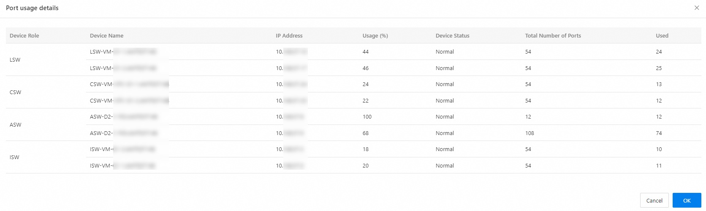 • <strong>Health Distribution of Optical Modules:</strong> displays the distribution of optical transceiver modules on the current day. • <strong>Abnormal Optical Modules</strong>: displays information about optical transceiver modules in the <strong>Exception</strong> state by default. The displayed information includes <strong>Hostname</strong>, <strong>Interface name</strong>, <strong>Ownership Type</strong>, <strong>Manufacturer</strong>, <strong>Model</strong>, <strong>Status</strong>, <strong>Failure probability</strong>, <strong>Expected</strong> <strong>residual life</strong>, and <strong>Intelligent analysis results</strong>. Click <strong>View Details</strong> in the upper-right corner. Then, you can view information about abnormal optical transceiver modules in the <strong>Abnormal Optical Modules</strong> dialog box. • <strong>Advanced Filter</strong>: You can search for optical transceiver modules by <strong>Optical module model</strong>, <strong>Optical module manufacturer,</strong> <strong>Optical module status,</strong> <strong>Hostname</strong>, <strong>Interface name</strong>, <strong>Device</strong> <strong>type</strong>, or their combinations. • Find the optical transceiver module that you want to view and click <strong>Details</strong> in the <strong>Actions</strong> column. Then, you are redirected to <strong>Intelligent Diagnostics</strong> &gt; <strong>Optical Module Diagnostics</strong>. On the <strong>Optical Module Prediction Details</strong> page, you can view the details of the optical transceiver module. For more information, see Optical transceiver module diagnostics.</td>
       </tr>
       <tr>
         <td>Traffic Dashboard</td>
         <td>By default, the information about <strong>SLB Cluster Usage Overview</strong> and <strong>XGW Cluster Usage Overview</strong> within the last <strong>1 Hour</strong> is displayed. For more information about the metrics, see the "Usage metrics on the traffic dashboard" section in the Overview topic. • You can click <strong>Last 1 Hour</strong>, <strong>6 Hours</strong>, <strong>12 Hours</strong>, or <strong>24 Hours</strong> to quickly query the historical usage trend charts of SLB and XGW clusters within a specific time range. • In the upper-right corner, select the cluster whose usage trend charts you want to view to display and view the usage trend charts.</td>
       </tr>
     </table>

     **Usage metrics on the traffic dashboard**

     <table>
       <tr>
         <td></td>
         <td>Metric</td>
         <td>Description</td>
       </tr>
       <tr>
         <td rowspan="2">SLB cluster</td>
         <td>InBitsPS</td>
         <td>The number of inbound bits per second.</td>
       </tr>
       <tr>
         <td>OutBitsPS</td>
         <td>The number of outbound bits per second.</td>
       </tr>
       <tr>
         <td rowspan="2">XGW cluster</td>
         <td>InByteRate</td>
         <td>The inbound bandwidth. Unit: bit/s.</td>
       </tr>
       <tr>
         <td>OutByteRate</td>
         <td>The outbound bandwidth. Unit: bit/s.</td>
       </tr>
     </table>

     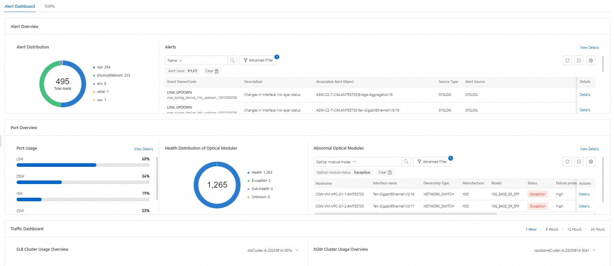

   - **TOPN**: Metrics are sorted based on their **Values**, and the top five metrics are displayed by default.

     You can filter and display metrics in each region by specifying filter conditions such as Top N, Start Time, End Time, vSwitch, and Port.

     | Section | Metric |
     | --- | --- |
     | Physical Network | • vSwitch CPUs • vSwitch Memory • vSwitch Ports • <strong>phy_switch_port_bps</strong> (inbound and outbound) • <strong>phy_switch_port_pps</strong> (inbound and outbound) • <strong>phy_switch_port_error_pps</strong> (inbound and outbound CRC error packets) • <strong>phy_switch_port_drop_pps</strong> (inbound and outbound) |

     | Network Elements | • XGW • xgw_cpu_usage • xgw_huge_mem_usage • <strong>xgw_port_bps</strong> (inbound and outbound) • <strong>xgw_port_pps</strong> (inbound and outbound) • <strong>xgw_port_drop_pps</strong> (inbound and outbound) • LVS • lvs_connsPS • lvs_dropConnPS • lvs_failConnPS • lvs_connections • <strong>lvs_BitsPS</strong> (inbound and outbound) • <strong>lvs_PktsPS</strong> (inbound and outbound) • <strong>lvs_DropPktsPS</strong> (inbound and outbound) • SLB_PROXY • proxy_requests • PROXY qps • proxy_rt • proxy_cps • proxy_handle_ps • proxy_conn_active • AVS • avs_cpu • avs_phyif_in_drop_pps • avs_phyif_in_buffer_missed_errors_pps • avs_vport_tcp_connecting_flows_cps • avs_vport_tcp_established_flows • <strong>avs_phyif_bps</strong> (inbound and outbound) • <strong>avs_phyif_pps</strong> (inbound and outbound) • <strong>avs_phyif_error_pps</strong> (inbound and outbound) |
     | --- | --- |

     | Network Resources | • EIP • <strong>xgw_eip_bps</strong> (inbound and outbound) • <strong>xgw_eip_pps</strong> (inbound and outbound) • Reverse Access • <strong>xgw_ecs_maping_bps</strong> (inbound and outbound) • <strong>xgw_ecs_mapping_pps</strong> (inbound and outbound) • <strong>xgw_ecs_mapping_ratelimit_drop_pps</strong> (inbound and outbound) • <strong>xgw_ecs_mapping_drop_pps</strong> (inbound and outbound) • NATGW • xgw_snat_session_count • xgw_snat_session_drop_cps • xgw_snat_session_ratelimit_drop_cps • vlink • <strong>xgw_vlink_bps</strong> (inbound and outbound) • <strong>xgw_vlink_pps</strong> (inbound and outbound) • Layer 4 VIP • <strong>lvs_listener_connsPS</strong>/<strong>lvs_realserver_connsPS</strong> • <strong>lvs_listener_dropConnPS</strong>/<strong>lvs_realserver_dropConnPS</strong> • <strong>lvs_listener_connections_1m</strong>/<strong>lvs_realserver_connections_1m</strong> • <strong>lvs_listener_PktsPS</strong> (inbound and outbound)/<strong>lvs_realserver_PktsPS</strong> (inbound and outbound) • <strong>lvs_listener_BitsPS</strong> (inbound and outbound)/<strong>lvs_realserver_BitsPS</strong> (inbound and outbound) • <strong>lvs_listener_DropPktsPS</strong> (inbound and outbound)/<strong>lvs_realserver_DropBitsPS</strong> (inbound and outbound) • Layer 7 VIP • proxy_listener_cps • proxy_listener_qps • proxy_listener_rt • proxy_listener_conn_concurrent • vport • avs_vport_tcp_connecting_flows_num_sum_1m • avs_vport_tcp_established_flows_num_sum_1m • <strong>avs_vport_pkts_1m</strong> (inbound and outbound) • <strong>avs_vport_bytes_1m</strong> (inbound and outbound) • <strong>avs_vport_drop_pkts_1m</strong> (inbound and outbound) |
     | --- | --- |

## 2.2. Network topology

On the Network Topology page, you can view the physical network topology.

**Prerequisites**

The NetworkBaseServiceCluster cluster for BaseServiceAll has been deployed and has reached the desired state.

**Procedure**

1. Log on to the Apsara Uni-manager Operations Console.

2. In the top navigation bar, choose **Product Operation** > **Networking** > **Network Operations Console**.

3. In the left-side navigation pane, choose **Dashboard** > **Network Topology**.

4. Select a data center from the **Data Center** drop-down list and view the physical network topology of the selected data center.

   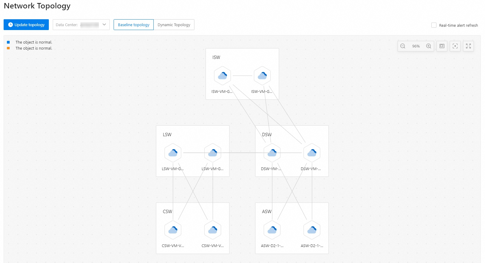

   - Click **Baseline topology** or **Dynamic Topology** to view the network topology of the corresponding type.

   - If the **dynamic topology** or the **base topology** has data discrepancies, you can click **Update topology** to update the topology.

   - Network devices displayed in different colors are in different states.

     - Blue: A device is in a normal state.

     - Orange: A device is in an abnormal state.

   - If you choose to display the **baseline topology**, the **Real-time alert refresh** feature is available. If you do not enable this feature, the states of devices and links in the topology are not updated when an alert is generated.

   - If you choose to display the **dynamic topology**, the **Real-time alert refresh** feature is not available.

5. View the network device information and interconnection link statuses.

   - Click a network device icon. In the Network Device Information panel, view the device information in the **Basic device information** and **Alert List** sections.

     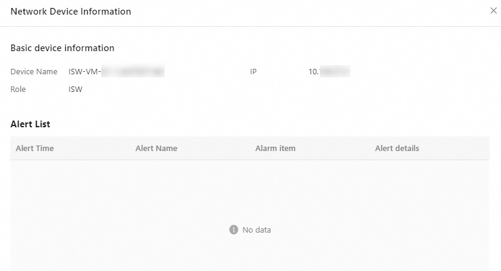

   - Click a connection between two network devices. In the Interconnection link status panel, view the link status details in the **Link information List** and **Alert List** sections.

     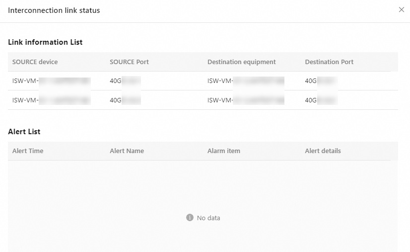

## 2.3. Custom views

The Apsara Uni-manager Operations Console allows you to create a custom view. After the view is created, you can configure the content and rules of the view to summarize and demonstrate the monitoring data and graph information based on your business requirements.

**Prerequisites**

The NetworkBaseServiceCluster cluster for BaseServiceAll has been deployed and has reached the desired state.

**Create a view**

1. Log on to the Apsara Uni-manager Operations Console.

2. In the top navigation bar, choose **Product Operation** > **Networking** > **Network Operations Console**.

3. In the left-side navigation pane, choose **Dashboard** > **Custom Views**.

4. On the Custom Views page, click **Create View**.

5. In the Create View dialog box, configure the **View Name** and **View Description** parameters, and then click **OK**.

   After the view is created, the page of the view automatically appears.

   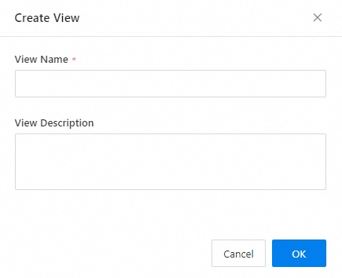

   > **Note**
   >
   > The view name must be unique. If the **Data Already Existing** message appears, you must change the view name, and then click **OK** when no name conflict occurs.

6. Create a subview.

   <ol type="i">

   <li>

   Click the  icon in the view section.

   </li>

   <li>

   In the Create Subview panel, configure the following parameters and click **OK**.

   </li>

   </ol>

   After the subview is created, the page of the view automatically appears, on which the subview is displayed.

   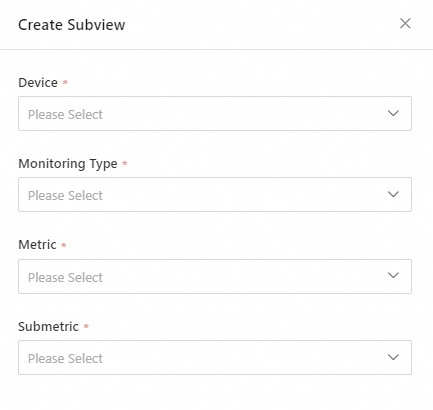

   | Parameter | Description |
   | --- | --- |
   | Device | The device to be monitored. |
   | Monitoring Type | The type of the monitoring metric. Valid values: • <strong>interface</strong>: the switch interface, including the water level, packet error, and packet loss of the interface. • <strong>hardware</strong>: the switch hardware, including the memory usage and CPU usage. • <strong>capacity</strong>: others. This option is not supported. |
   | Metric | The monitoring metric. |
   | Submetric | The monitoring submetric. |

   <ol type="i" start="3">

   <li>

   You can create more subviews by repeating Step 6.

   </li>

   </ol>

**Query a view**

1. In the upper part of the Custom Views page, select a view name from the drop-down list, specify a time range, and then click **Search**.

2. The Custom Views page displays the monitoring charts of all the corresponding subviews.

   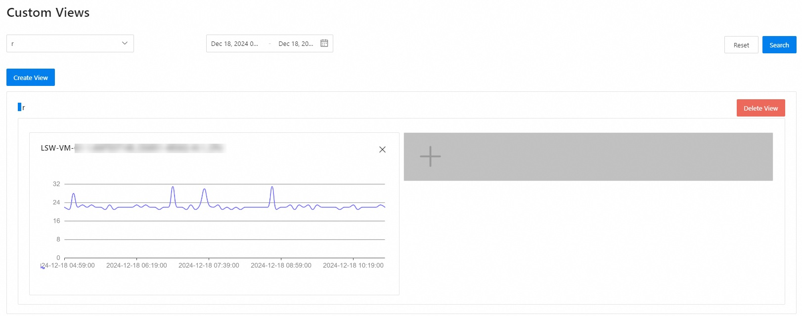

**Delete a view**

**Delete a subview**

1. Search for the view that you want to manage.

2. Find the subview that you want to delete and click the  icon in the upper-right corner of

   the subview section.

3. In the message that appears, click **OK**.

**Delete a view**

> **Important**
>
> If you delete a view, all subviews of the view are also deleted. Proceed with caution.

1. Search for the view that you want to delete.

2. In the upper-right corner of the view section, click **Delete View**.

3. In the message that appears, click **OK**.

# 3.Basic network

## 3.1. Network element management

Network elements are network devices such as vSwitches and routers. The Network Element Management module displays the basic information and status of physical network devices. The module also supports configuration management operations on physical network devices, including device management, password management, and configuration consistency comparison. For more information about the features of the Network Operations Console that are applicable to device manufacturers, see vSwitch Monitoring Capabilities Supported by Network Operations Console.

**Manage devices**

On the Device Management tab, you can view the monitoring information about physical network devices and configure collection settings for them.

**Manage network monitoring data**

**Background information**

On the **Network Monitoring** tab, you can view the basic information, status, and traffic monitoring information of physical network devices in Apsara Stack to stay updated with their health status.

**Prerequisites**

The NetworkBaseServiceCluster cluster for BaseServiceAll is deployed and has reached the desired state.

**Procedure**

1. Log on to the Apsara Uni-manager Operations Console.

2. In the top navigation bar, choose **Product Operation** > **Networking** > **Network Operations Console**.

3. In the left-side navigation pane, choose **Basic Network** > **Network Element Management**.

4. On the **Network Monitoring** tab of the **Device Management** tab, specify the **IDC** parameter to view the physical network devices in Apsara Stack.

   You can view information about the physical network devices in the columns, including **Device Name**, **Management IP address**, **SN**, **Business Domain**, **Vendor**, **Model**, **Role**, **Online Time**, **Ping status**, **Snmp status**, and **Last Updated**.

   > **Note**
   >
   > - You can click **Export** in the upper-right corner of the Network Monitoring tab to export the information about the physical network devices to your computer.
   >
   > - If the ping or Simple Network Management Protocol (SNMP) is abnormal, Unreachable in red is displayed in the **Ping status** or **Snmp status** column.
   >
   > - In the upper-right corner of the Network Monitoring tab, you can enter a device name or an IP address in the search box to search for the physical network device, and then view its information.
   >
   > - The **Management IP address**, **Ping status**, and **Snmp status** columns can be used to sort the physical network devices. The **Role** column can be used to filter the physical network devices.

   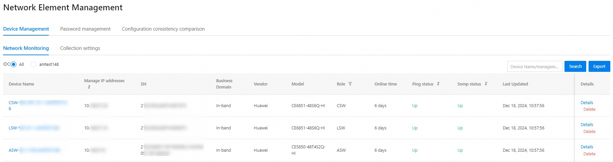

5. Find the physical network device that you want to view and click its name or click **Details** in the **Details** column to view the details of the physical network device. The following table describes the details of the physical network device.

   | Section or tab | Description |
   | --- | --- |
   | Basic information | View the information about the device from the parameters, including <strong>Device Name</strong>, <strong>IP</strong>, <strong>SN</strong>, <strong>Vendor</strong>, <strong>Model</strong>, <strong>Role</strong>, <strong>Online time</strong>, <strong>Ping status</strong>, <strong>Snmp status</strong>, <strong>Last Updated</strong>, <strong>Release</strong>, and <strong>Software version</strong>. 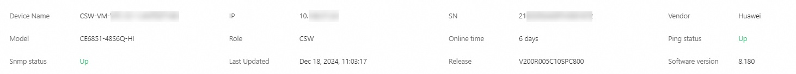 |

   <table>
     <tr>
       <td>Port</td>
       <td>• View the information about the ports of the device in the columns, including <strong>Port Name</strong>, <strong>Port rate</strong>, <strong>Port description</strong>, <strong>Management</strong> <strong>status</strong>, <strong>Operation Status</strong>, <strong>Peer Device</strong>, <strong>Peer interface</strong>, <strong>Peer</strong> <strong>description</strong>, and <strong>Last Updated</strong>. Note The <strong>Management status</strong> and <strong>Operation Status</strong> columns can be used to sort the ports of a device. If exceptions occur, Down in red is displayed in the Management status or Operation Status column. 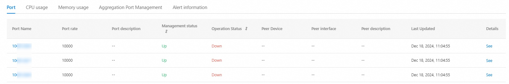 • View the details of a port. a. Find the port that you want to view and click its name or click <strong>See</strong> in the <strong>Details</strong> column to view the details of the port. b. View the basic information and usage data of the port. In the Water level data section, you can select a time range in the <strong>Quick query</strong> section or specify a custom time range in the upper-right corner to query traffic data within the specified time range. 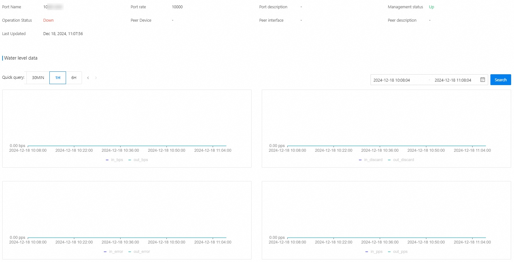</td>
     </tr>
     <tr>
       <td>CPU usage</td>
       <td>View the CPU utilization of the device. 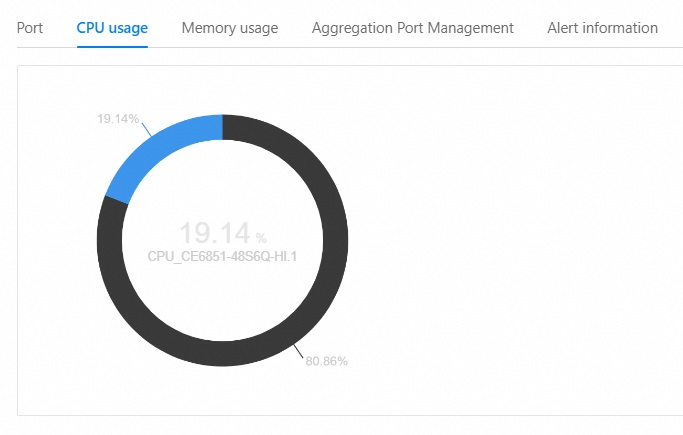</td>
     </tr>
     <tr>
       <td>Memory usage</td>
       <td>View the memory usage of the device. 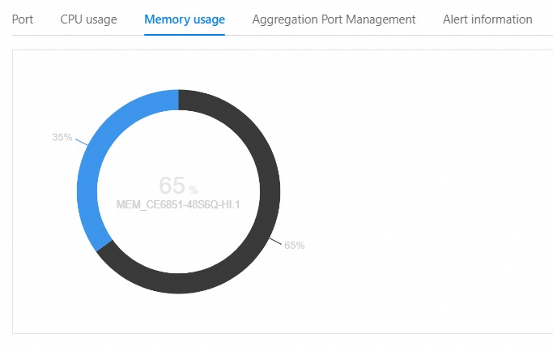</td>
     </tr>
   </table>

   <table>
     <tr>
       <td>Aggregation Port Management</td>
       <td>• View the information about all aggregation ports of the device. 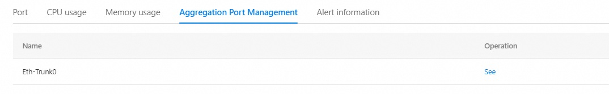 • On the Aggregation Port Management tab, find the aggregation port that you want to view and click <strong>See</strong> in the <strong>Operation</strong> column to view the usage data of the aggregation port. 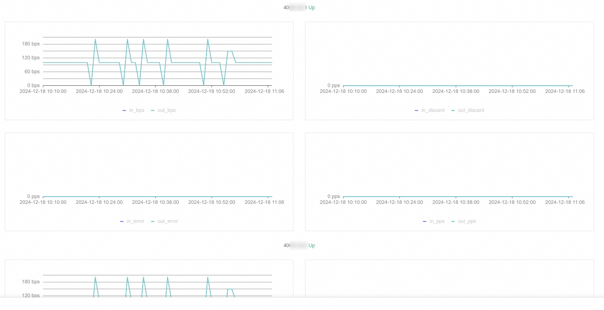</td>
     </tr>
   </table>

   <table>
     <tr>
       <td>Alert information</td>
       <td>View the alert information about the device. 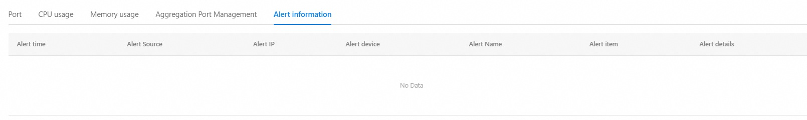 Note During routine O&amp;M, you need to view the alert information about a device at the earliest opportunity. If no data is displayed on the <strong>Alert</strong> <strong>information</strong> tab, the device is running as expected. If alert events occur, the system displays the alert events that are not handled on the Alert information tab. You need to handle the alert events at the earliest opportunity.</td>
     </tr>
   </table>

6. Optional. Delete the monitoring information of the network device.

   <ol type="i">

   <li>

   Click **Delete** in the **Details** column of the device.

   </li>

   <li>

   In the message that appears, click **Delete**.

   </li>

   </ol>

**Configure collection settings**

**Feature description**

On the Collection settings tab, you can set the collection interval of physical network devices and manage out-of-band (OOB) CIDR blocks.

- Before you collect network device information, you must configure a collection interval.

- In the OOB CIDR block management section, you can configure the management scope of a physical network device. In most cases, operations engineers must add the loopback CIDR block in which the network device to be managed resides.

**Prerequisites**

The NetworkBaseServiceCluster cluster for BaseServiceAll is deployed and has reached the desired state.

**Background information**

If you use the network element management feature of the Network Operations Console for the first time, you must add the loopback CIDR block planned by the current network device in Apsara Stack. In most cases, the loopback CIDR block is the CIDR block specified by the netdev.loopback field in the planned IP address list. To expand the network and the loopback CIDR block, you must add the CIDR block involved in the expansion to the management scope. The procedure to add an expanded CIDR block is the same as that used to add the loopback CIDR block for the first time. Then, you can search for the CIDR block of the managed device on the Collection settings tab.

**Procedure**

1. Log on to the Apsara Uni-manager Operations Console.

2. In the top navigation bar, choose **Product Operation** > **Networking** > **Network Operations Console**.

3. In the left-side navigation pane, choose **Basic Network** > **Network Element Management**.

4. On the **Device Management** tab, click the **Collection settings** tab.

   | Section | Description |
   | --- | --- |
   | Collection cycle settings | i. In the Collection cycle settings section, configure the <strong>Automatic scan</strong> <strong>cycle (minutes)</strong>, <strong>Device scan cycle (minutes)</strong>, <strong>Port scan cycle</strong> <strong>(minutes)</strong>, and <strong>Link scan cycle (minutes)</strong> parameters. 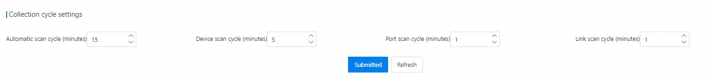 Note If you have no special requirements, we recommend that you use the default values. ii. Click <strong>Submitted</strong>. Then, the system collects the device information based on your configurations. |
   | OOB CIDR block management | • Add a CIDR block. a. Click <strong>Add CIDR block</strong>. b. In the Add CIDR block dialog box, configure the following parameters.Then, click <strong>OK</strong>. 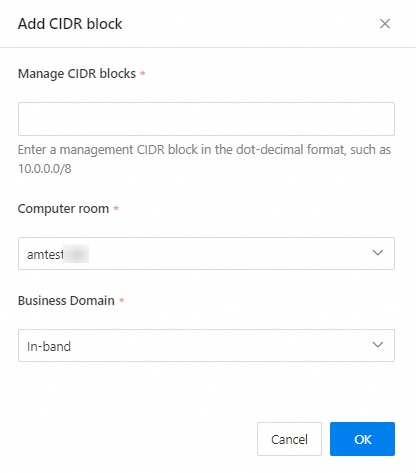 • <strong>Manage CIDR blocks</strong>: Enter an IP address and its subnet mask in CIDR notation. Example: 10.0.0.0/8. • <strong>Computer room</strong>: Select a data center from the drop-down list. • <strong>Business Domain</strong>: Select <strong>In-band</strong> or <strong>Out-of-band</strong> from the drop-down list. • View CIDR blocks. 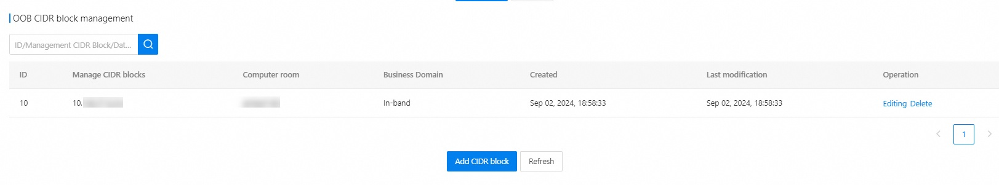 a. In the search box above the CIDR clock list, enter an ID, a management CIDR block, or the name of a data center and click theicon to search for the CIDR block, and then view information about the CIDR block. b. View information about the CIDR blocks in the columns, including <strong>ID</strong>, <strong>Management CIDR blocks</strong>, <strong>Computer room</strong>, <strong>Business Domain</strong>, <strong>Created</strong>, and <strong>Last modification</strong>. • Modify a CIDR block. a. Find the CIDR block that you want to modify and click <strong>Editing</strong> in the <strong>Operation</strong> column. b. In the Modify CIDR block dialog box, modify the parameter settings, and click <strong>OK</strong>. • Delete a CIDR block. a. Find the CIDR block that you want to delete and click <strong>Delete</strong> in the <strong>Operation</strong> column. b. In the message that appears, click <strong>OK</strong>. |

**Manage passwords**

You can modify the password of a physical network device.

**Procedure**

1. Log on to the Apsara Uni-manager Operations Console.

2. In the top navigation bar, choose **Product Operation** > **Networking** > **Network Operations Console**.

3. In the left-side navigation pane, choose **Basic Network** > **Network Element Management**.

4. On the Network Element Management page, click the Password management tab. On the **Password management** tab, query current network devices.

   > **Note**
   >
   > You can enter a device name in the search box to perform an exact search.

5. Select one or more devices whose passwords you want to modify and click **Add to implementation**. Then, the devices whose passwords you want to modify are displayed in the **Implementation equipment** section on the right.

   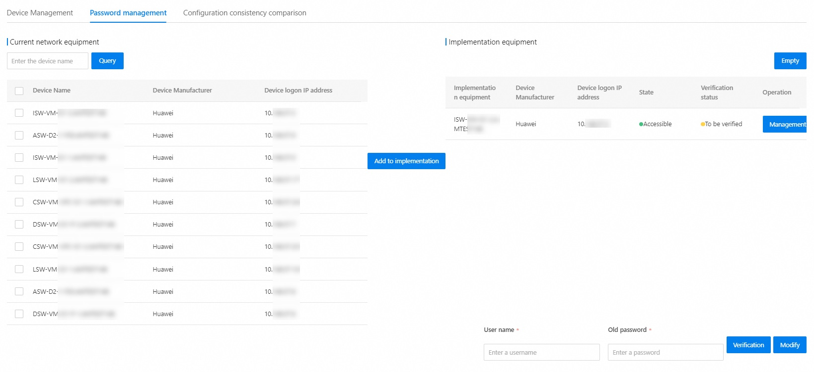

   > **Note**
   >
   > To remove a device from the **Implementation equipment** section, you can click **Management** in the **Operation** column of the device, and then select **Delete**. You can also click **Empty** in the upper-right corner to remove all devices from the Implementation equipment section.

6. In the lower-right corner of the Password management tab, enter values in the **User name** and **Old password** fields, and click **Verification**. The system verifies the old password before you can modify the passwords.

   > **Note**
   >
   > - If multiple devices are added to the Implementation equipment section and the old passwords of the devices are different, you need to separately verify the old passwords.
   >
   > - After the verification is passed, **Verified** is displayed in the Verification status column.

7. After the verification is passed, modify the passwords for one or more devices.

   - Modify the password of a device.

     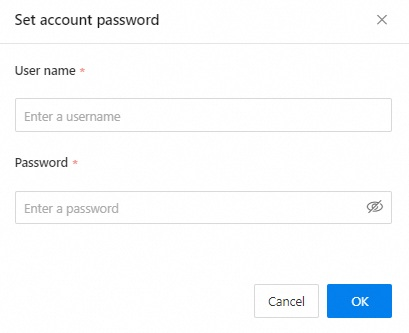

     <ol type="a">

     <li>

     In the Implementation equipment section, find the device whose password you want to modify, click **Management** in the **Operation** column, and then select **Set account password**.

     </li>

     <li>

     In the Set account password dialog box, configure the **User name** and **Password** parameters, and click **OK**.

     </li>

     </ol>

   - Modify the passwords of all added devices.

     <ol type="a">

     <li>

     In the lower part of the **Implementation equipment** section, click **Modify**.

     </li>

     <li>

     In the dialog box that appears, configure the **User name** and **Password** parameters, and click **OK**.

     </li>

     </ol>

**Compare configuration consistency for devices**

You can compare the current configurations of a device with its configurations on startup and check whether the configurations are consistent.

**Prerequisites**

The NetworkBaseServiceCluster cluster for BaseServiceAll is deployed and has reached the desired state.

**Procedure**

1. Log on to the Apsara Uni-manager Operations Console.

2. In the top navigation bar, choose **Product Operation** > **Networking** > **Network Operations Console**.

3. In the left-side navigation pane, choose **Basic Network** > **Network Element Management**.

4. On the Network Element Management page, click the **Configuration consistency comparison** tab. On the Configuration consistency comparison tab, view the information about the network devices in the columns, including **Device Name**, **Device Manufacturer**, **Device logon IP address**, and **Result**.

   > **Note**
   >
   > You can enter a device name in the search box to perform an exact search.

   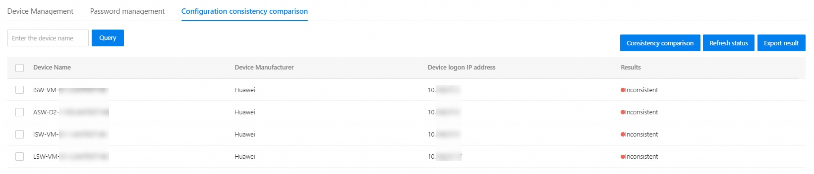

5. Select one or more devices whose configurations you want to compare and click **Consistency comparison**.

   - Click **Refresh status** to update the comparison status.

   - Click **Export result** to export the comparison results to your computer for viewing.

## 3.2. Syslog

The Syslog module records and stores the logs generated by network hardware devices in the system based on dimensions such as time, log level, and module to facilitate subsequent analysis and management. This helps you identify and solve issues to improve the availability and stability of devices.

**View logs**

1. Log on to the Apsara Uni-manager Operations Console.

2. In the top navigation bar, choose **Product Operation** > **Networking** > **Network Operations Console**.

3. In the left-side navigation pane, choose **Basic Network** >**Syslog**.

4. On the Syslog page, click **Advanced Filter**. Then, configure the **Data Center**, **Source Device**, **Recorded At**, **Log Content**, **Parsing Status**, **Log Level**, **Manufacturer**, and **Alert Module** parameters to filter logs.

5. View the information about the logs that meet the filter conditions in the columns that are described in the following table.

   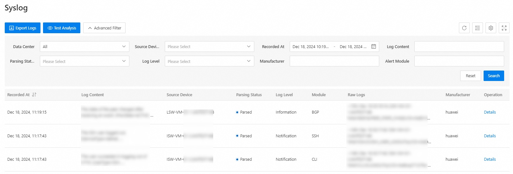

   | Column | Description |
   | --- | --- |
   | Recorded At | The time when the log entry was recorded. You can sort log entries based on the column. |
   | Log Content | The parsed log data, which is the content of the raw log. |
   | Source Device | The source device from which the log data was collected. |
   | Parsing Status | The parsing status of log data. Valid values: <strong>Parsed</strong> and <strong>Parsing Failed</strong>. Note Logs may fail to be parsed due to the following reasons: • The log format does not meet the RFC 3164 specification. • The network device from which the log data was collected is not produced by an asset-heavy manufacturer that is supported by Apsara Stack. |
   | Log Level | The level of the log data. Valid values: <strong>Emergency</strong>, <strong>Alert</strong>, <strong>Serious</strong>, <strong>Error</strong>, <strong>Warning</strong>, <strong>Notification</strong>, <strong>Information</strong>, and <strong>Debugging</strong>. |
   | Module | The module to which the log data belongs. |
   | Raw Logs | The raw log data that is not parsed. |
   | Manufacturer | The manufacturer of the network device. |

6. Find the log entry that you want to view and click **Details** in the Operation column. In the Syslog Details panel, view more detailed information about the log, such as the alert matching results, module details, and location.

   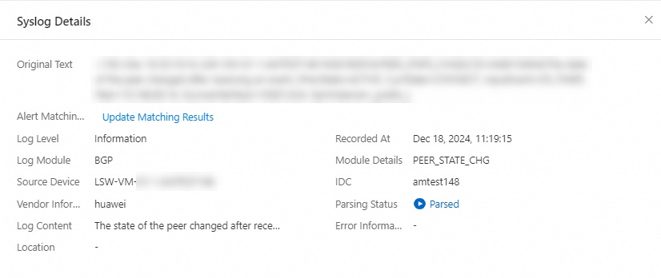

**What to do next**

**Export logs**

On the Syslog page, click **Export Logs** in the upper-left corner to export the logs to your computer for viewing.

> **Note**
>
> By default, all logs are exported.

**Test the log parsing feature**

1. On the Syslog page, click **Test Analysis** in the upper-left corner.

2. In the Test Analysis dialog box, enter content in the **Original Text** field and click **Submit**.

   > **Note**
   >
   > If you click **Reset**, the content in the Original Text field is cleared.

3. In the Parsing Results section, view the parsed information, such as the description, hostname, and log level.

# 4.Networking services

## 4.1. XGW O&M

### 4.1.1. XGW cluster management

**Procedure**

1. Log on to the Apsara Uni-manager Operations Console.

2. In the top navigation bar, choose **Product Operation** > **Networking** > **Network Operations Console**.

3. In the left-side navigation pane, choose **Network Products** > **XGW O&M** > **XGW Cluster Management**.

4. On the XGW Cluster Management page, select a region ID from the **Region** drop-down list and click **Synchronize data** to obtain the latest data of the XGW cluster list.

   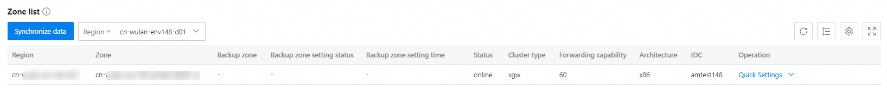

5. Find the cluster that you want to manage, click **Quick Settings** in the **Operation** column, and then select **Set backup zone**.

   > **Note**
   >
   > - The cluster that you select as the secondary zone must have the same architecture and reside in the same region as the current cluster.
   >
   > - Click **Set backup zone**. Then, the system checks the data. After the data is checked, you can configure a secondary zone.

6. Select a secondary zone from the Select backup zone drop-down list and click **OK**.

   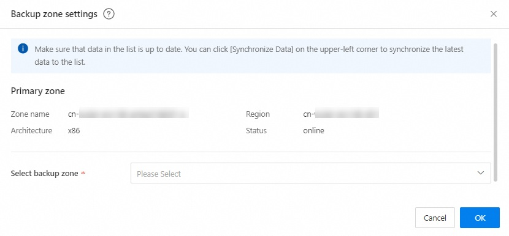

### 4.1.2. XGW management

The XGW Management module allows you to manage VPC gateways and view the water level information of device nodes and service instances.

### 4.1.3. NAT gateway monitoring

In scenarios such as multi-cloud geo-disaster recovery and hybrid cloud, you can query the monitoring data of a NAT gateway by tunnel ID.

**Procedure**

1. Log on to the Apsara Uni-manager Operations Console.

2. In the top navigation bar, choose **Product Operation** > **Networking** > **Network Operations Console**.

3. In the left-side navigation pane, choose **Network Products** > **XGW O&M** > **NAT Gateway Monitoring**.

4. On the NAT Gateway Monitoring page, select a cluster, specify a time range, enter the tunnel ID, and then click **Query** to view the trend chart of the NAT gateway.

   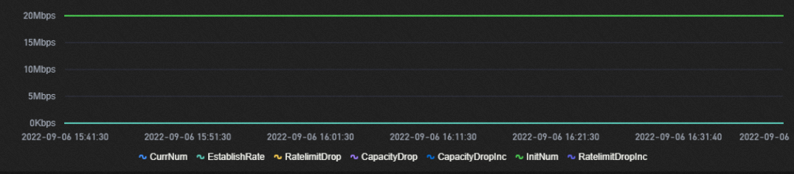

   > **Note**
   >
   > You can move the pointer over a point in time in the chart to view the corresponding monitoring data.

   The following table describes the metrics displayed in the chart.

   | Metric | Description |
   | --- | --- |
   | CurrNum | The number of connected instances. |
   | EstablishRate | The number of connections that are established per second. |
   | RatelimitDrop | The number of packets dropped due to throttling. |
   | CapacityDropInc | The number of packets dropped due to the Inc capacity limit. |
   | CapacityDrop | The number of packets dropped due to the capacity limit. |
   | IninNum | The number of initialized instances. |
   | RatelimitDropInc | The number of packets dropped due to the Inc throttling. |

### 4.1.4. Router interface instances

This topic describes how to view the instances of a router interface and the O&M information about the instances.

**Procedure**

1. Log on to the Apsara Uni-manager Operations Console.

2. In the top navigation bar, choose **Product Operation** > **Networking** > **Network Operations Console**.

3. In the left-side navigation pane, choose **Network Products** > **XGW O&M** > **RI Instances**.

4. On the RI Instances page, click Advanced Filter. In the **Search Condition** section, select **VPC ID** or **UID** from the drop-down list and enter the corresponding value in the field.

5. Optional. Specify the **Connection Type**, **RI ID**, **Router Type**, **Router ID**, **Instance State**, **Instance Name**, **Peer RI ID**, **Peer Router ID**, **Peer Router Type**, and **Peer Region ID** parameters to filter router interface instances.

   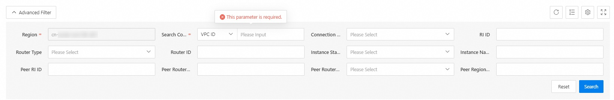

6. Click **Search**. The router interface instances that match the UID are displayed on the RI Instances page.

   > **Note**
   >
   > If you select **VPC ID** from the drop-down list in the **Search Condition** section, all router interface instances that belong to the virtual private cloud (VPC) are automatically queried.

7. Find the router interface instance that you want to manage and click **Details** in the **Operation** column. On the details page, view the detailed O&M information about the router interface instance. If usage data exists, the usage data is also displayed on the page.

## 4.2. AVS O&M

### 4.2.1. AVS management

The Apsara virtual switch (AVS) management feature allows you to view the basic information and usage dashboard of AVSes.

**Procedure**

1. Log on to the Apsara Uni-manager Operations Console.

2. In the top navigation bar, choose **Product Operation** > **Networking** > **Network Operations Console**.

3. In the left-side navigation pane, choose **Network Products** > **AVS O&M** > **AVS Management**.

4. On the AVS management page, you can view the ASV information in the following columns: **Hostname**, **NC IP**, **Kernel version**, **pync version**, **rpm version**, **Version mvssSDK**, and **vtools version**.

   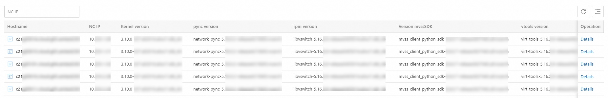

5. Find the AVS that you want to manage and click **Details** in the **Operation** column. On the page that appears, view the monitoring data in the **netdev traffic**, **CPU usage**, **Total vport traffic**, **vxlanVport total traffic**, and **Physical Nic traffic** sections.

   The following table describes the metrics.

   **Category**

   **Metric**

   **Description**

   The number of packets that the network interface

   if_ipackets_sum

   controller (NIC) receives per second.

   The number of packets that

   if_opackets_sum

   the NIC sends per second.

   Flow

   The number of NIC inbound

   if_idrop_sum

   packets that are dropped per second.

   **netdev traffic**

   The number of NIC outbound

   if_odrop_sum

   packets that are dropped per second.

   The number of bytes that the

   if_ibytes_sum

   NIC receives per second.

   BandWidth

   The number of bytes that the

   if_obytes_sum

   NIC sends per second.

   usage_avg

   The average CPU utilization.

   The minimum CPU

   usage_min

   utilization.

   **CPU usage**

   The maximum CPU

   usage_max

   utilization.

   The number of inbound

   rx_packets_sum

   packets per second.

   The number of inbound

   rx_dropped_sum

   packets that are dropped per second.

   The number of outbound

   tx_packets_sum

   packets per second.

   The number of outbound

   tx_dropped_sum

   packets that are dropped per second.

   The number of packets that

   slb_tx_packets_sum

   Server Load Balancer (SLB) sends per second.

   The number of SLB outbound

   slb_tx_dropped_sum

   packets that are dropped per second.

   The number of packets that

   slb_rx_packets_sum

   SLB receives per second.

   The number of SLB inbound

   slb_rx_dropped_sum

   packets that are dropped per second.

   The number of inbound

   rx_pps_limit_error_sum

   packets that are dropped due to throttling per second.

   Flow

   The number of outbound

   tx_pps_limit_error_sum

   packets that are dropped due to throttling per second.

   The number of inbound packets that are dropped

   rx_acl_error_sum

   from the security group per second.

   The number of outbound packets that are dropped

   tx_acl_error_sum

   from the security group per second.

   The number of packets that

   ipv6_tx_packets_sum

   IPv6 clients send per second.

   The number of IPv6 outbound packets that are

   ipv6_tx_acl_error_sum

   dropped from the security group per second.

   The number of packets that

   ipv6_rx_packets_sum

   IPv6 clients receive per second.

   The number of IPv6 inbound packets that are dropped

   ipv6_rx_acl_error_sum

   from the security group per second.

   The number of bytes that are

   rx_bytes_sum

   received per second.

   The number of bytes of

   rx_dropped_bytes_sum

   inbound packets that are dropped per second.

   The number of bytes that are

   tx_bytes_sum

   sent per second.

   The number of bytes of

   tx_dropped_bytes_sum

   outbound packets that are dropped per second.

   The number of bytes that

   slb_tx_bytes_sum

   SLB sends per second.

   BandWidth

   The number of bytes of SLB

   slb_tx_dropped_bytes_sum

   outbound packets that are dropped per second.

   The number of bytes that

   slb_rx_bytes_sum

   SLB receives per second.

   The number of bytes of SLB

   slb_rx_dropped_bytes_sum

   inbound packets that are dropped per second.

   The number of bytes that

   ipv6_tx_bytes_sum

   IPv6 clients send per second.

   The number of bytes that

   ipv6_rx_bytes_sum

   IPv6 clients receive per second.

   The number of packets that

   tx_igw_packets_avg

   are sent per second in the north-south traffic.

   The number of packets that

   **Total vport**

   are received per second in

   rx_igw_packets_avg

   **traffic**

   the north-south traffic.

   NorthSouthFlow

   The number of packets that

   ipv6_tx_igw_packets_avg

   IPv6 clients send per second in the north-south traffic.

   The number of packets that IPv6 clients receive per

   ipv6_rx_igw_packets_avg

   second in the north-south traffic.

   The number of bytes that are

   tx_igw_bytes_avg

   sent per second in the north-south traffic.

   The number of bytes that are

   rx_igw_bytes_avg

   received per second in the north-south traffic.

   NorthSouthBandWi dth

   The number of bytes that

   ipv6_tx_igw_bytes_avg

   IPv6 clients send per second in the north-south traffic.

   The number of bytes that IPv6 clients receive per

   ipv6_rx_igw_bytes_avg

   second in the north-south traffic.

   The total number of fast

   session_count_sum

   forwarding connections.

   The number of SLB

   slb_session_count_sum

   connections.

   The number of User Datagram Protocol (UDP) and

   noconn_flows_num_sum

   Internet Control Message Protocol (ICMP) connections.

   tcp_connecting_flows_num

   The number of new

   _sum

   connections.

   tcp_established_flows_num

   The number of concurrent

   _sum

   connections.

   tcp_closing_flows_num_su

   The number of connections

   Connect

   m

   that are being closed.

   The number of closed

   tcp_closed_flows_num_sum

   connections.

   The number of inbound connections that fail to be

   rx_session_new_fail_sum

   created.

   The number of inbound

   rx_session_update_fail_sum

   connections that fail to be updated.

   The number of outbound

   tx_session_new_fail_sum

   connections that fail to be created.

   The number of outbound

   tx_session_update_fail_sum

   connections that fail to be updated.

   The ratio of the number of re-sent outbound packets to

   tx_retrans_avg

   the total number of outbound packets.

   The ratio of the number of re-sent inbound packets to

   rx_retrans_avg

   the total number of inbound packets.

   The ratio of the number of re-sent outbound packets to

   tx_igw_retrans_avg

   the total number of outbound packets in the north-south traffic.

   The ratio of the number of re-sent inbound packets to

   rx_igw_retrans_avg

   the total number of inbound packets in the north-south

   RetransmissionRat

   traffic.

   e

   The ratio of the number of re-sent IPv6 outbound

   ipv6_rx_retrans_avg

   packets to the total number of IPv6 outbound packets.

   The ratio of the number of re-sent IPv6 inbound packets

   ipv6_tx_retrans_avg

   to the total number of IPv6 inbound packets.

   The ratio of the number of re-sent IPv6 outbound

   ipv6_tx_igw_retrans_avg

   packets to the total number of IPv6 outbound packets in the north-south traffic.

   The ratio of the number of re-sent IPv6 inbound packets

   ipv6_rx_igw_retrans_avg

   to the total number of IPv6 inbound packets in the north-south traffic.

   The number of inbound

   rx_packets_avg

   packets per second.

   The number of outbound

   tx_packets_avg

   packets per second.

   The number of inbound

   rx_dropped_avg

   packets that are dropped per second.

   The number of outbound

   tx_dropped_avg

   packets that are dropped per second.

   The number of inbound packets that are dropped

   rx_pps_limit_error_avg

   due to packets per second (PPS) throttling per second.

   The number of inbound packets that are dropped

   rx_fastpath_error_avg

   due to fast forwarding per second.

   The number of outbound packets that are dropped

   tx_pps_limit_error_avg

   due to PPS throttling per

   Flow

   second.

   The number of outbound packets that are dropped

   tx_fastpath_error_avg

   due to fast forwarding per second.

   The number of inbound packets that are dropped

   rx_cpu_limit_error_avg

   due to CPU throttling per second.

   **vxlanVport**

   The number of outbound

   **total traffic**

   packets that are dropped

   tx_cpu_limit_error_avg

   due to CPU throttling per second.

   The number of packets that

   relay_packet_err_avg

   encounter relay errors.

   The number of packets that

   relay_packet_avg

   are relayed.

   The number of inbound

   rx_loc_route_error_avg

   location table match errors per second.

   The number of inbound IPv6

   ipv6_rx_loc_error_avg

   location table match errors per second.

   The number of inbound packets that are dropped

   rx_bps_limit_error_avg

   due to bytes per second (BPS) throttling per second.

   The number of outbound packets that are dropped

   tx_bps_limit_error_avg

   due to BPS throttling per second.

   The number of bytes that are

   BandWidth

   rx_bytes_avg

   received per second.

   The number of bytes of

   rx_dropped_bytes_avg

   inbound packets that are dropped per second.

   The number of bytes that are

   tx_bytes_avg

   sent per second.

   The number of bytes of

   tx_dropped_bytes_avg

   outbound packets that are dropped per second.

   The number of inbound

   rx_drop_packets_avg

   packets that are dropped per second.

   The number of error inbound

   rx_error_packets_avg

   packets per second.

   The number of inbound

   rx_missed_errors_avg

   packets that are dropped in the buffer per second.

   Flow

   The number of inbound

   rx_packets_avg

   packets per second.

   **Physical Nic traffic**

   The number of error

   tx_error_packets_avg

   outbound packets per second.

   The number of outbound

   tx_packets_avg

   packets per second.

   The number of bytes that are

   rx_bytes_avg

   received per second.

   BandWidth

   The number of bytes that are

   tx_bytes_avg

   sent per second.

## 4.3. VPC O&M

### 4.3.1. Tiangong VPC

**Procedure**

1. Log on to the Apsara Uni-manager Operations Console.

2. In the top navigation bar, choose **Product Operation** > **Networking** > **Network Operations Console**.

3. In the navigation pane on the left, choose **Network Products** > **VPC O&M** > **VPC-On-ECS**.

4. On the VPC-On-ECS page, click **Advanced Filter** and then specify the **VPC ID**, **Status**, and **Created At** parameters to filter virtual private clouds (VPCs).

   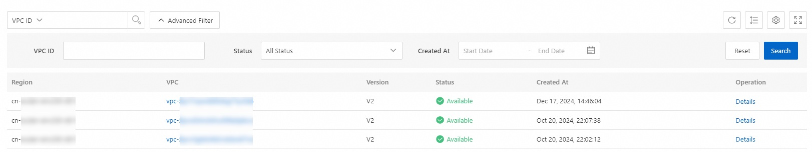

5. Find a VPC that you want to manage and click its name or **Details** in the **Operation** column. On the details page of the VPC, you can view the VPC details in the **VPC Instance Information**, **VRouter Information**, and **vSwitches** sections.

   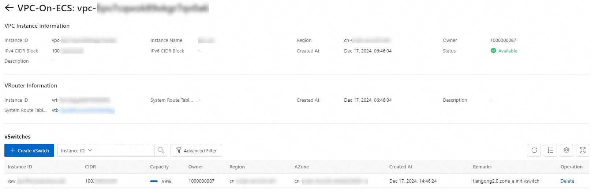

6. In the **vSwitches** section, perform the following operations:

   - Create a vSwitch: Click **Create vSwitch**. In the dialog box that appears, configure the following parameters and click **OK**.

     | Parameter | Description |
     | --- | --- |
     | AZone | The ID of the zone to which the vSwitch belongs. |
     | CIDR | The IPv4 CIDR block of the vSwitch. |
     | Usage | The purpose of the vSwitch. Valid values: • Alibaba Cloud Service • Container Network |
     | Description | The description of the vSwitch. |

     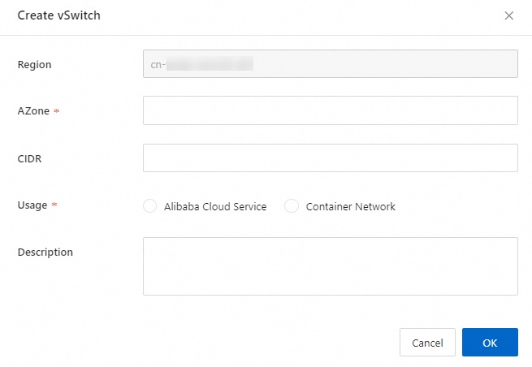

   - Search for vSwitches: Click **Advanced Filter** and then specify the **Instance ID**, **Owner**, **AZone**, and **Created At** parameters to filter vSwitches.

   - Delete a vSwitch: Find a vSwitch that you want to delete and click **Delete** in the **Operation** column. In the dialog box that appears, click **OK**.

     > **Important**
     >
     > After you delete a vSwitch, the vSwitch cannot be restored. Proceed with caution.

### 4.3.2. VPC workflows

You can view and manage workflows in the VPC Business Foundation System.

**Procedure**

1. Log on to the Apsara Uni-manager Operations Console.

2. In the top menu bar, choose **Product O&M** > **Network O&M** > **Network O&M Console**.

3. In the navigation pane on the left, choose **Network Products** > **VPC O&M** > **VPC Workflow**.

4. On the **VPC Workflow** page, configure the parameters to query process tasks, and then click **OK**.

   | Parameter | Description |
   | --- | --- |
   | Workflow Name | Enter a custom workflow name. |
   | Execution Status | Select the execution status of the task. • <strong>ALL</strong>: All statuses. • <strong>SCHEDULABLE</strong>: Schedulable. • <strong>RUNNING</strong>: Running. • <strong>PAUSED</strong>: Paused. • <strong>HUMAN_PROCESSING</strong>: Manual intervention required. • <strong>COMPLETED</strong>: Completed. • <strong>FAILED</strong>: Failed. • <strong>TIMEOUT</strong>: Timed out. |
   | Request ID | Enter the request ID of the task. |
   | AliUid | Enter the ID of your Alibaba Cloud account. |
   | InstanceId | Enter the ID of the instance that the current workflow operates on. |

   The process tasks that match the filter criteria are displayed in the **List** area.

5. In the **Workflow List** area, find the target process task and click **Details** in the **Actions** column. On the **Workflow Details** page, you can view information about the process task, such as its activity name, method, and failure reason.

6. (Optional) In the **Workflow List** area, find the target process task. In the **Actions** column, click **Stop** to end a running workflow or **Retry** to run the workflow again.

# 5.Network monitoring and alerting

## 5.1. Network event center

This topic describes how to query all events in the network event center, including INSPECT, SYSLOG, and NOEPING events.

**Procedure**

1. Log in to the Apsara Uni-manager Operations Console.

2. In the top navigation bar, choose **Product Operation** > **Networking** > **Network Operations Console**.

3. In the left-side navigation pane, choose **Network Monitoring & Alerting** > **Network Event Center**.

4. On the **Network Event Center** page, you can view the events and event content, including **Event Name/Code**, **Description**, **Associated Object**, **Event Source Type**, **Associated Task**, **Type**, **Level**, **Converted Alert**, **Occurrences, Occurred At**, and **Last Reported At**.

   Click **Advanced Filter** to search for events based on a combination of **Time**, **Name**, **Associated Object**, **Level**, **Event Source Type**, **Event Type**, and **Event Code**.

   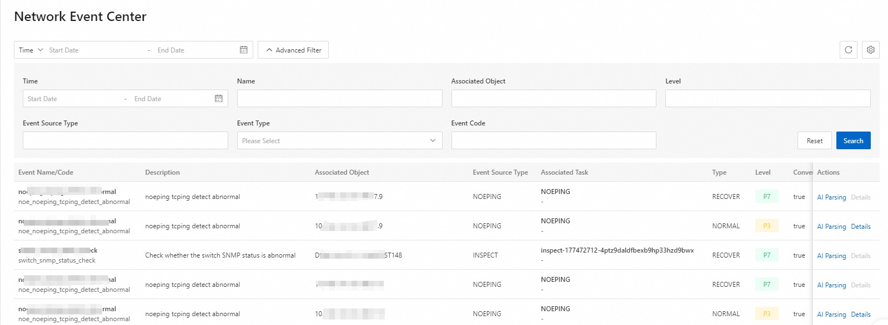

5. Find the event that you want to view and click **Details** in the **Actions** column to view the **event details**. Details of RECOVER events are unavailable.

   The event details include **Event Information** and **Event content**. Content of VALUE events is not displayed. The event details vary based on the event type. The displayed information prevails.

   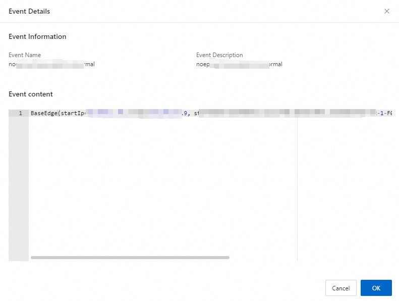

## 5.2. Network event configurations

This topic describes how to modify and manage event generation rules in the network event configuration center of Apsara Stack. You can create, import, clone, modify, and delete event generation rules.

**Procedure**

1. Log in to the Apsara Uni-manager Operations Console.

2. In the top navigation bar, choose **Product Operation** > **Networking** > **Network Operations Console**.

3. In the left-side navigation pane, choose **Network Monitoring & Alerting** > **Network Event Configuration**.

4. You can view information about event generation rules on the **Network Event Configurations** page, including **Event Name**, **Description**, **Event Level**, **Type**, **Event Source, Event Code**, **Event Dimension**, **Status**, **Converted Alert**, **Automatic Recovery Time, and Event Group**.

   Click **Advanced Filter** to search for event generation rules based on a combination of **Name**, **Event Level**, **Event Source**, **Event Code**, **Status**, and **Converted Alert**.

   You can select the following event sources from the **Event Source** drop-down list:

   - **INSPECT**: the NOE inspection platform.

   - **SYSLOG**: the vSwitch syslog.

   - **NOEPING**: NOEPING-based connectivity check.

   - **EVENT_CENTER**: the NOE event center, where the same events are generated.

   - **NOE_TSDB**: the NOE time series database.

   - **NOE_GRPC**: NOE gRPC.

   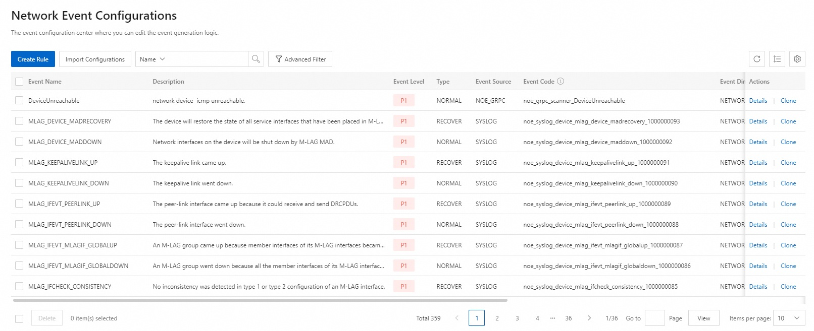

5. You can also perform the following operations on the **Network Event Configurations** page:

   - **Create an event generation rule**

     In the upper-left corner of the Network Event Configurations page, click **Create Rule** above the list. On the **Create Event** page, configure the following parameters and click **Create**.

     <table>
       <tr>
         <th>Parameter</th>
         <th>Description</th>
       </tr>
       <tr>
         <td colspan="2">Basic Settings</td>
       </tr>
       <tr>
         <td>Event Code</td>
         <td>Enter the unique identifier of the event.</td>
       </tr>
       <tr>
         <td>Event Name</td>
         <td>Enter the default display name of the event. You can enter a regular expression.</td>
       </tr>
       <tr>
         <td>Enable</td>
         <td>Specify whether to enable the event generation rule. By default, the rule is <strong>enabled</strong>.</td>
       </tr>
       <tr>
         <td>Description</td>
         <td>Describe the static information related to the event.</td>
       </tr>
     </table>

     <table>
       <tr>
         <td>Associated Dimension</td>
         <td>The dimensions of the objects associated with the event. The dimensions can be used to aggregate and locate events based on the order in which they are selected. Dimensions are the only information associated with the event. You can select one or more dimensions. • <strong>PRODUCT</strong>: product name. • <strong>CLUSTER</strong>: cluster name. • <strong>SERVICE</strong>: service name. • <strong>SERVER_ROLE</strong>: service role name. • <strong>HOST</strong>: hostname. • <strong>HOST_PORT</strong>: host port. • <strong>INSTANCE_ID</strong>: instance name. • <strong>DOMAIN_NAME</strong>: domain name. • <strong>IP</strong>: IP address. • <strong>PAIR</strong>: source and destination address pair, which is dedicated to NOEPING. • <strong>IDC</strong>: data center. • <strong>NETWORK_DEVICE</strong>: network device. • <strong>NETWORK_DEVICE_COMPONENT</strong>: network device component. • <strong>NETWORK_DEVICE_PORT</strong>: network device port.</td>
       </tr>
       <tr>
         <td>Event Level</td>
         <td>The level of the event. Valid values: <strong>P1</strong>, <strong>P2</strong>, <strong>P3</strong>, <strong>P4</strong>, <strong>P5</strong>, <strong>P6</strong>, and <strong>P7</strong>.</td>
       </tr>
       <tr>
         <td colspan="2">Alert Settings</td>
       </tr>
       <tr>
         <td>Associated Alert</td>
         <td>Specify whether to convert the event to an alert. By default, this feature is <strong>enabled</strong>.</td>
       </tr>
       <tr>
         <td>Automatic Recovery Time</td>
         <td>Specify the auto recovery time. If the event is not reported again after the specified time period ends, the platform clears the corresponding alert. The default value is 1 hour. If you set the parameter to 0, the default value is used.</td>
       </tr>
       <tr>
         <td>Push Recovery Events</td>
         <td>Specify whether the data source pushes recovery events. By default, this feature is <strong>disabled</strong>. • When this feature is enabled, after the platform receives a recovery event, it clears the alert related to the most recent exception event. • When this feature is disabled, the platform handles alerts based on the recovery time specified in <strong>Automatic Recovery Time</strong>.</td>
       </tr>
       <tr>
         <td>Event Aggregation Period</td>
         <td>The event aggregation period<strong>.</strong> This setting aggregates events to reduce the frequency of alerts. Events reported from the same event source and associated with the same object are aggregated within the event aggregation period. The default value is 600 seconds.</td>
       </tr>
       <tr>
         <td>Event Group</td>
         <td>An event group is used to clear the alerts of multiple exception events based on one recovery event. It is a collection of correlated events. Each event can be added to multiple event groups.</td>
       </tr>
       <tr>
         <td colspan="2">Rule Settings</td>
       </tr>
       <tr>
         <td>Event Source</td>
         <td>The source of events. Different event sources have different event dimensions and different types of alert reporting logic. For custom events, you can select the <strong>SYSLOG</strong> or <strong>NOE_TSDB</strong> event source. SYSLOG events are used to monitor the status of vSwitches, and NOE_TSDB events are used to monitor network metrics. Valid values: • <strong>SYSLOG</strong>: the vSwitch syslog. • <strong>NOE_TSDB</strong>: the NOE time series database.</td>
       </tr>
       <tr>
         <td>Event Type</td>
         <td>The type of the event. Valid values: • <strong>VALUE</strong>: events indicating that the values of metrics fall out of the expected range. • <strong>CONFIG</strong>: events indicating that the configurations of underlying machines do not comply with the expected configurations. • <strong>NORMAL</strong>: events whose details are described with strings. • <strong>RECOVER</strong>: recovery events indicating that exceptions have disappeared. A recovery event is used to clear the alert related to the most recent exception event.</td>
       </tr>
       <tr>
         <td>Downstream alert rules exist</td>
         <td>Specify whether downstream alert rules exist<strong>.</strong> If you turn on the switch, configure the following parameters based on the event source: • SYSLOG Matching Rule Note This parameter is required when <strong>Event Source</strong> is set to <strong>SYSLOG</strong>. • <strong>Device Manufacturer</strong>: Select a network element manufacturer.Valid values: <strong>H3C</strong>, <strong>Huawei</strong>, and <strong>Ruijie</strong>. • <strong>Alert Association</strong>: Enter the associated objects, which are eventually reported to the event center. The objects correspond to the selected event dimensions. • <strong>Regex Template</strong>: Enter a regular expression that corresponds to the syslog. • <strong>Regex Keyword</strong>: Enter the fields that are extracted from the regular expression. • <strong>Log Level</strong>: Enter a log level. Click <strong>Automatic Recognition</strong>. In the <strong>Recognize</strong> dialog box, specify <strong>Original Text</strong> and click <strong>Submit</strong> to view the parsing result. You can click <strong>Fill</strong> to paste the parsing result to the Log Level parameter. • <strong>Log Module</strong>: Enter a module. Typically, the module is defined by the manufacturer. • <strong>Mnemonic Words</strong>: Enter an alert mnemonic. Typically, the mnemonic is defined by the manufacturer. • Metric Anomaly Detection Rule Note This parameter is required when <strong>Event Source</strong> is set to <strong>NOE_TSDB</strong>. • <strong>PromQL Statement</strong>: Enter a PromQL statement. • Click <strong>Test</strong> to test the PromQL statement that you entered. • Click <strong>Retrieve Supported Metrics</strong> and select a TSDB metric</td>
       </tr>
     </table>

     from the **Metric** drop-down list to search for the metric in fuzzy

   - **Clone an event generation rule**

     match mode and display the tags of the metric.

     <ol type="a">

     <li>

     Click **Clone** in the **Actions** column of the event generation rule that you want to clone.

     - **Alert Association**: Enter the associated objects, which are

     In the **Copy Alert Rule** dialog box, specify **New Event Name** and **New Event Code**,

     eventually reported to the event center. The objects correspond to the selected event dimensions.

     and click **OK**.

     - **Alert Description**: Enter the description of the alert.

     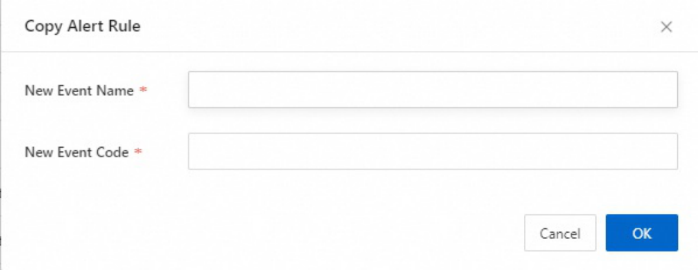

     - **Detection Cycle**: Set the detection cycle. The default value is 60s.

     - **Custom Tag**: Enter custom tags in key-value pairs, which are used

     </li>

     <li>

     After the rule is cloned, you are redirected to the **event details** page. On the details page, you can modify the event generation rule.

     </li>

     </ol>

   - **Modify an event generation rule** Click **Details** in the **Actions** column of the event generation rule that you want to modify. On the **Event Details** page, modify the parameters and click **Update**.

     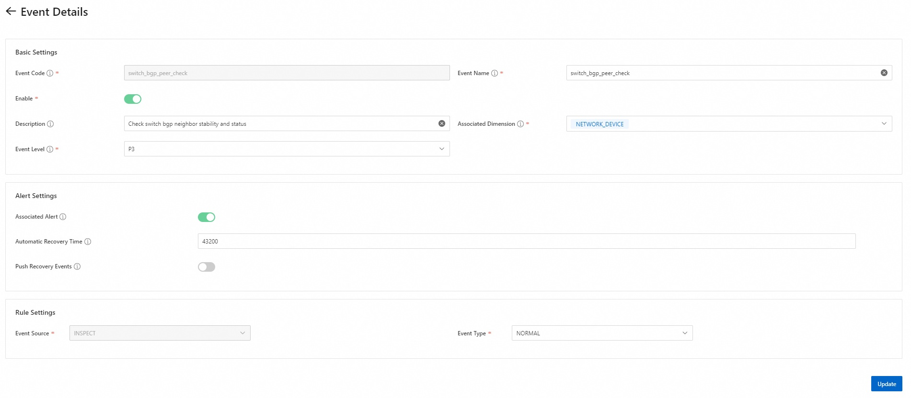

   - **Delete event generation rules**

     Select the event generation rules that you want to delete and click **Delete** below the list. In the message that appears, click **OK**.

   - **Import an event generation rule**

     On the Network Event Configurations page, click **Import Configurations** above the list. In the dialog box that appears, select a configuration file and click **Open** to import the file.

# 6.Intelligent diagnostics

## 6.1. Network inspection

This feature schedules recurring network inspection tasks and converts the results into inspection events or alarms.

**Procedure**

1. Log on to the Apsara Uni-manager O&M Console.

2. In the top navigation bar, choose **Product O&M** > **Network O&M** > **Network O&M Console**.

3. In the left-side navigation pane, choose **Intelligent Diagnosis** > **Network Inspection**.

4. On the **Network Inspection** page, view the list of inspection configurations.

   - Each inspection configuration includes the following properties: **Name**, **Description**, **execution interval**, **Status**, **Executions**, **Product**, **Service**, and **Role**.

   - Click **Advanced Filter** to find a specific inspection configuration by using the **Name**, **Product**, **Service**, **Role**, and **Status** fields.

   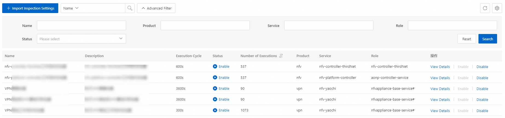

   > **Note**
   >
   > Click the
   >
   > icon in the **Executions** column to sort the list in ascending or descending
   >
   > 
   >
   > order.

5. In the list of inspection configurations, find the specific configuration and click **View Details** in the **Actions** column. The panel that appears shows the details of the inspection item.

   - On the **Execution information** tab, view the **Basic information**, **Execution information**, and the list of execution tasks.

     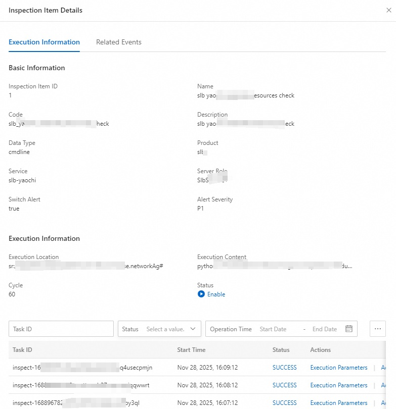

     - **Basic information**: includes **Inspection item ID**, **Name**, **Code**, **Description**, **Type**, **Product**, **Service**, **Service role**, **Convert to alarm**, and **Alarm level**.

     - **Execution information**: includes **Execution location**, **Execution content**, **Interval**, and **Running status**.

     - View the list of execution tasks. Task information includes **Task ID**, **Start time**, and **Execution status**.

       - Find a specific execution task by using the **Task ID**, **Status**, and **Execution time** fields.

       - Hover over a task's status in the **Execution status** column to view its execution results.

         > **Note**
         >
         > Execution statuses:
         >
         > - **WAITING**: The inspection task is waiting to be triggered.
         >
         > - **RUNNING**: The inspection task is running.
         >
         > - **SUCCESS**: The inspection task was successfully executed.
         >
         > - **FAILED**: The inspection task failed to execute.
         >
         > - **TIMEOUT**: The inspection task timed out.
         >
         > - **CLEANED**: The platform clears residual tasks from previous runs during initialization.

       - Hover over **Execution Parameters** in a task's **Actions** column to view its parameters.

       - Hover over **Additional Information** in a task's **Actions** column to view its additional information.

   - On the **Related events** tab, view the list of events.

     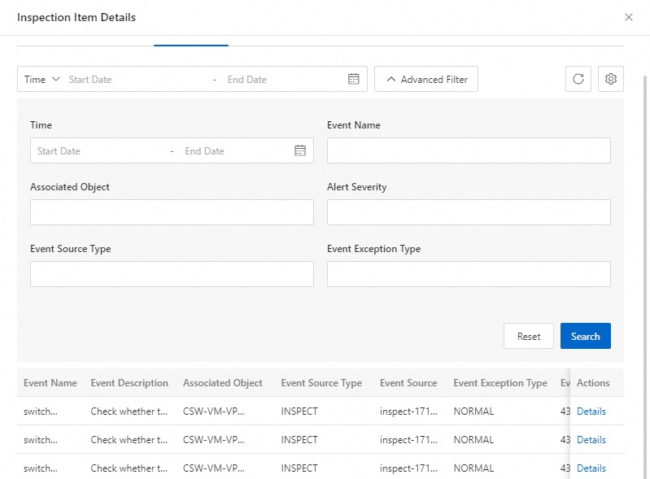

     - Event information includes **Event name**, **Event description**, **Associated object**, **Event source type**, **Event source**, **Exception type**, **Event timeout**, **Event level**, **Associated alarm ID**, and **Occurrence time**.

     - Click **Advanced Filter** to find a specific event by using the **Time**, **Event name**, **Associated object**, **Alarm level**, **Event source type**, and **Event exception type** fields.

     - Find the specific event and click **Details** in the **Actions** column to view its details in the dialog box that appears.

       The details primarily include **Event information** and **Event content**. The specific details vary by event type. For more information, see the content displayed in the console.

       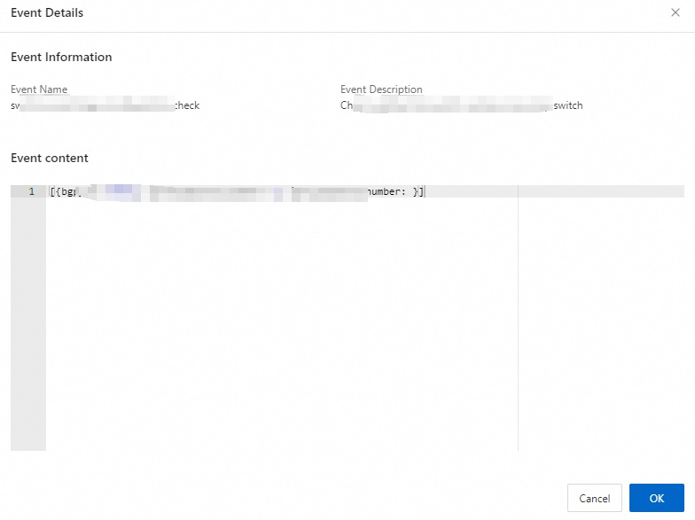

**More operations**

| Actions | Description |
| --- | --- |
| Import inspection configuration | 1. On the <strong>Network Inspection</strong> page, click <strong>Import Inspection</strong> <strong>Configuration</strong>. 2. Select the inspection configuration file to import and click <strong>Open</strong>. |
| Enable inspection configuration | Note You can enable an inspection configuration only when its <strong>Status</strong> is <strong>Stopped</strong>. 1. In the list of inspection configurations, find the target configuration and click <strong>Enable</strong> in the <strong>Actions</strong> column. 2. In the dialog box that appears, click <strong>OK</strong>. |
| Stop inspection configuration | Note You can stop an inspection configuration only when its <strong>Status</strong> is <strong>Running</strong>. 1. In the list of inspection configurations, find the target configuration and click <strong>Stop</strong> in the <strong>Actions</strong> column. 2. In the dialog box that appears, click <strong>OK</strong>. |

**Common inspection items**

**Product**

**Name**

**Description**

SLB resource usage watermark check

Checks the resource usage watermark for SLB.

SLB LVS and proxy local address

Checks the local addresses of SLB LVS and

check

proxies.

SLB HTTP rule configuration sync

Checks the configuration sync of SLB HTTP

check

rules.

SLB LVS and proxy plug status check

Checks the plug status of SLB LVS and proxies.

SLB consistency inspection

Checks for SLB consistency.

SLB abnormal workflow inspection

Checks for abnormal SLB workflows.

SLB xdss configuration check

Checks the configuration sync of SLB xdss.

SLB

Checks for duplicate resources between SLB

SLB-Yaochi duplicate resource

and Yaochi, including duplicate real_servers

inspection

and VIPs.

SLB API and master site

Performs a reconciliation check between the

reconciliation check

SLB API and the master site.

SLB database structure check

Checks the SLB database structure.

SLB API and master LB status

Performs a status reconciliation check for load

reconciliation check

balancers between the SLB API and master.

Inspects route redundancy for LVS in multi-AZ

SLB LVS multi-AZ route redundancy

deployments. Applicable to dual- and triple-AZ

inspection

scenarios, but not to single-AZ deployments.

switch_lldp_check

Checks whether LLDP is enabled on the switch.

Checks whether the status of link aggregation

switch_link_aggregation_check

member ports on the switch is normal.

switch_reboot_time_check

Checks for recent unexpected switch reboots.

switch_resource_monitor_resource_ro

Checks whether the watermark for route table

ute_check

entries on the switch is too high.

Checks whether Spanning Tree Protocol (STP)

switch_stp_check

is enabled on the switch.

Checks whether the optical attenuation of the

switch_transceiver_diagnosis_check

switch transceiver is within the normal range.

Checks whether Multi-Active Detection (MAD)

switch_mad_check

is enabled for the switch stack.

Checks whether the IGMP multicast groups on

switch_igmp_group_check

the switch are non-empty.

Checks whether the switch interface status is

switch_interface_status_check

normal.

Checks for buffer-related packet drops on

switch_packet_drop_check

switch ports.

switch_interfaces_counters_errors_ch

Checks for an increase in CRC or error counts

eck

on switch interfaces.

switch_current_bgp_configuration_ch

Checks if switch routes use Equal-Cost Multi-

eck

Path (ECMP).

Checks whether the switch power supply status

switch_power_check

is normal.

Checks whether the switch information center

switch_info_center_check

and logging functions are enabled.

Checks whether the switch CPU monitor-link

switch_monitor_link_group_check

status is normal.

switch_load-

Checks if the switch hash algorithm

balance_configuration_check

configuration is correct.

baseServi ceAll

Checks whether the switch hardware operating

switch_temperature_check

temperature is too high.

Checks whether the switch CPU utilization is

switch_cpu_check

too high.

Checks whether the switch configuration is

switch_save_time_check

saved.

switch_routing_table_age_check

Checks for route flapping on the switch.

Checks whether the switch PIM multicast

switch_pim_routing-table_check

routing information is non-empty.

Checks if the load is balanced across the

switch_lacp_counters_check

switch's LACP member ports.

Checks whether the switch fan status is

switch_fan_check

normal.

Checks whether the switch memory utilization

switch_memory_check

is too high.

Checks the stability and status of the switch's

switch_bgp_peer_check

BGP peers.

Checks whether the switch flash memory is

switch_save_check

writable.

Checks whether the switch SNMP status is

switch_snmp_status_check

abnormal.

Checks whether the switch hardware card

switch_device_check

status is normal.

Checks whether the switch interface status is

switch_interface_check

normal.

In non-stacking scenarios, checks whether

switch_eth_trunk_check

aggregated ports have dual uplinks.

Checks whether the switch stacking status is

switch_irf_check

normal.

switch_transceiver_alarm_check

Checks for alarms on the switch transceiver.

VPN Gateway image check

Checks the VPN Gateway image.

VPN Gateway Yaochi workflow status

Checks the workflow status for VPN Gateway in

check

Yaochi.

VPN Gateway control plane workflow

Checks the workflow status of the VPN Gateway

status check

control plane.

VPN Gateway control plane and VPC

Performs a Havip check between the VPN

Yaochi Havip inspection

Gateway control plane and VPC in Yaochi.

VPN Gateway and VPC reconciliation

Performs a reconciliation check between VPN

check

Gateway and VPC.

VPN

VPN Gateway and ECS reconciliation

Performs a reconciliation check between VPN

Gateway

check

Gateway and ECS.

VPN Gateway DB check

Checks the VPN Gateway database.

VPN Gateway instance transient state

Checks for VPN Gateway instances that are

check

stuck in a transient state.

VPN Gateway Yaochi and VPN

Performs a reconciliation check between VPN

Gateway control plane reconciliation

Gateway on Yaochi and the VPN Gateway

check

control plane.

VPN Gateway control plane and VPC

Performs a NatPublicIp check between the VPN

Yaochi NatPublicIp inspection

Gateway control plane and VPC in Yaochi.

Check rspool data consistency

Checks the data consistency of rspool.

Check for proxy devices that are

Checks for online proxy devices that are failing

online but fail health checks

health checks.

Checks if the management status and traffic

Check proxy plug status

steering status of a proxy device match.

ALB control plane and keyserver data

Checks for data consistency between the ALB

consistency check

control plane and keyserver.

Performs an ACL resource reconciliation between ALB and the SLB control plane.

ALB and SLB ACL reconciliation

Applicable to single-, dual-, and triple-AZ scenarios.

ALB parameter memory and DB

Checks for consistency between ALB

consistency check

parameters in memory and in the database.

Performs an rspool resource reconciliation between ALB and the SLB control plane. Applicable to single-, dual-, and triple-AZ

ALB and SLB rspool reconciliation

scenarios.

ALB

Checks data consistency for running VIPs.

Check consistency of data for running

Applicable to single-, dual-, and triple-AZ

VIPs

scenarios.

ALB four history tables row count

Checks the row counts of the four ALB history

check

tables.

Checks for resources in ALB on Yaochi that are

ALB Yaochi

not in a stable state.

Performs a resource reconciliation between

ALB and VPC Yaochi reconciliation

ALB and VPC on Yaochi.

Check consistency of data for active

Checks the data consistency for active load

LBs

balancers.

ALB Yaochi and ALB control plane

Performs a reconciliation check between ALB

reconciliation check

on Yaochi and the ALB control plane.

Checks for steady-state issues in the AVS

AVS steady-state issue inspection

environment.

Inspect for abnormal network sync

Inspects for abnormal network sync status

status

under high CPU utilization.

ECS

Checks for AVS terminations caused

Checks for AVS terminations caused by out-of-

by out-of-memory errors

memory errors.

AVS DHCP service Unix domain

Checks if the Unix domain socket connection

socket inspection

for the AVS DHCP service is established.

nfv-controller-thirdNet workflow

Checks the workflow status of nfv-controller-

status check

thirdNet.

nfv-platform-controller workflow

Checks the workflow status of nfv-platform-

status check

controller.

nfv

nfv-controller-tr workflow status

Checks the workflow status of nfv-controller-tr.

check

nfv-controller-alb workflow status

Checks the workflow status of nfv-controller-

check

alb.

vpc_env_check

Performs the vpc_env_check.

Checks the validity of the VPC service CIDR

VPC service CIDR validity inspection

block. Applicable to single-, dual-, and triple-AZ scenarios.

Checks for duplicate global_tunnel_id in VPC.

VPC duplicate global_tunnel_id

Applicable to single-, dual-, and triple-AZ

inspection

scenarios.

Inspects the resource watermark for VPC.

VPC region resource watermark

Applicable to single-, dual-, and triple-AZ

inspection

scenarios.

Inspects route redundancy for XGW in multi-AZ

VPC multi-AZ XGW route redundancy

VPC deployments. Applicable to dual- and

inspection

triple-AZ scenarios, but not to single-AZ deployments.

Inspects route redundancy for CGW in multi-AZ

VPC CGW multi-AZ route redundancy

deployments. Applicable to dual- and triple-AZ

inspection

scenarios, but not to single-AZ deployments.

VPC

Checks VPC asynchronous tasks. Applicable to

VPC asynchronous task inspection

single-, dual-, and triple-AZ scenarios.

Checks for duplicate app_server_ip. Applicable

Duplicate app_server_ip inspection

to single-, dual-, and triple-AZ scenarios.

Checks for backlogged VPC sequential tasks.

VPC sequential task backlog

Applicable to single-, dual-, and triple-AZ

inspection

scenarios.

Performs a reconciliation check between VPC

VPC-AVS reconciliation inspection

and AVS.

vpc_gw_oplog_global_version large

Checks the large vpc_gw_oplog_global_version

table inspection

table.

Inspects the watermark for VPC tenant-level

VPC tenant resource watermark

resources. Applicable to single-, dual-, and

inspection

triple-AZ scenarios.

vpc_nc_oplog large table inspection

Checks the large vpc_nc_oplog table.

Performs a reconciliation check between VPC

VPC-XGW reconciliation inspection

and XGW.

Checks for stuck BRPOP asynchronous events.

Inspection for stuck BRPOP

Applicable to single-, dual-, and triple-AZ

asynchronous events

scenarios.

Inspects the watermark for the number of

Watermark inspection for RI count

router interfaces (RIs) within a region.

within a region

Applicable to single-, dual-, and triple-AZ scenarios.

Checks for stuck asynchronous events in CEN

CEN Yaochi inspection for stuck

on Yaochi. Applicable to single-, dual-, and

asynchronous events

triple-AZ scenarios.

Inspects the watermark for the number of

Watermark inspection for the number

leased lines with health checks in a region.

of leased lines with health checks in a

Applicable to single-, dual-, and triple-AZ

CEN

region

scenarios.

Checks for stuck RRC asynchronous operations.

Inspection for stuck RRC

Applicable to single-, dual-, and triple-AZ

asynchronous operations

scenarios.

CEN NullPointerException file log

Checks the CEN file log for

inspection

NullPointerExceptions.

tr-gobgp check

Performs a TR-GOBGP check.

Checks for stuck CENC workflows. Applicable to

Inspection for stuck CENC workflows

single-, dual-, and triple-AZ scenarios.

## 6.2. Intelligent path analysis

### 6.2.1. Intelligent path analysis

The intelligent path analysis and forwarding feature provides path diagnostics capabilities. You can use this feature to implement end-to-end path analysis by quickly establishing IP paths. This facilitates fault analysis and shortens the fault analysis time.

**Prerequisites**

The NetworkBaseServiceCluster cluster for BaseServiceAll has been deployed and has reached the desired state.

**Procedure**

1. Log on to the Apsara Uni-manager Operations Console.

2. In the top navigation bar, choose **Product Operation** > **Networking** > **Network Operations Console**.

3. In the left-side navigation pane, choose **Intelligent Diagnostics** > **Intelligent Path Analysis**.

4. On the Intelligent Path Analysis page, click **Create Path Analysis**. On the page that appears, configure the following parameters and click **Analysis**.

   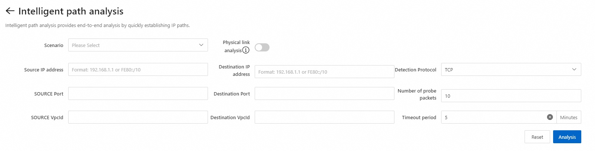

   | Parameter | Description | Example |
   | --- | --- | --- |
   | Scenario | The scenario of path analysis. Valid values: • <strong>Mutual access between ECS instances</strong>: access between Elastic Compute Service (ECS) instances in a virtual private cloud (VPC). • <strong>ECS access server load balancer</strong>: access from an ECS instance in a VPC to a Server Load Balancer (SLB) instance. • <strong>ECS access AnyTunnel</strong>: access from an ECS instance in a VPC to an AnyTunnel virtual IP address (VIP). • <strong>ECS access SingleTunnel</strong>: access from an ECS instance in a VPC to a SingleTunnel VIP. • <strong>ECS access IDC</strong>: access between an ECS instance in a VPC and a data center. • <strong>ECS access to the Internet</strong>: access from an ECS instance in a VPC to the Internet. • <strong>Exchange of space-based containers</strong>: access between Docker containers in a cloud platform. • Apsara infrastructure management framework <strong>container access load balancing</strong>: access from a Docker container to an SLB instance in a cloud platform. • Apsara infrastructure management framework <strong>container access NC</strong>: access from a Docker container to a physical machine in a cloud platform. • <strong>NC Mutual visits</strong>: access between physical machines in a cloud platform. • NC access Apsara infrastructure management <strong>framework container</strong>: access from a physical machine to a Docker container in a cloud platform. • <strong>NC access load balancing</strong>: access from a physical machine to an SLB instance in a cloud platform. | Mutual access between ECS instances |
   | Physical link analysis | Specify whether to enable or disable the physical link analysis feature. • If you enable this feature, you must deliver the configuration to vSwitches. In this case, the analysis time is extended. • If you disable this feature, the analysis time is shortened.However, the packet capture data of the physical devices is not contained. | N/A |
   | Source IP address | The IP address of the source node. IPv4 and IPv6 addresses are supported. | 192.168.1.1 and FE80::/10 |
   | Destination IP address | The IP address of the destination node. IPv4 and IPv6 addresses are supported. | 192.168.1.1 and FE80::/10 |
   | Detection Protocol | The protocol type of probe packets for the path analysis. Valid values: • TCP • UDP • ICMP | TCP |
   | SOURCE Port | The port of the source node. If you leave this parameter empty, all ports are used. | 80 |
   | Destination Port | The port of the destination node. If you leave this parameter empty, all ports are used. | 8080 |
   | Number of probe packets | The total number of probe packets for path analysis. | 10 |
   | SOURCE VpcId | The ID of the VPC in which the source node resides. | vpc-\*\*fczvaczv |
   | Destination VpcId | The ID of the VPC in which the destination node resides. | vpc-\*\*fczvaczv |
   | Timeout period | The timeout period of the packet capture in the analysis task. If this period is exceeded, the packet capture stops. Unit: minutes. | 5 |

5. In the **Path analysis** section, the status timeline of the analysis task is displayed, and the estimated time required for each phase is displayed. The topology of the path is displayed at the bottom of the timeline. After the analysis is complete, the analysis result is displayed.

   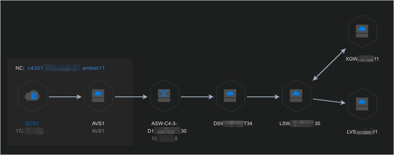

   > **Note**
   >
   > - For path nodes of the ECS type or physical machine type, you can click the hyperlink in the topology to go to the details page.
   >
   > - After you select the topology, you can drag the topology and change the location of the topology.

6. In the **Diagnosis details** section, the details of the task are displayed.

   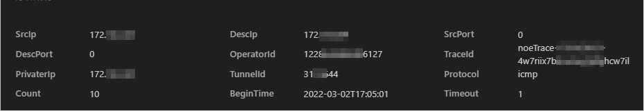

7. In the **Analyze one by one** section, the analysis details of the packets captured by the task are displayed if the analysis task is successful. You can view the analysis details of packets one by one.

**What to do next**

| Operation | Procedure |
| --- | --- |
| View the details of an analysis task | 1. On the Intelligent Path Analysis page, select a time range to view the information about the intelligent path analysis tasks within the specified time range. 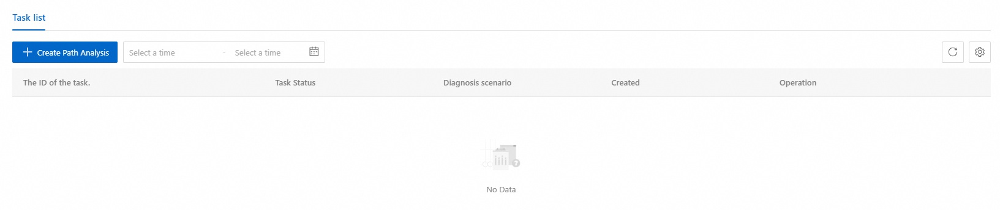 2. Find the analysis task that you want to view and click <strong>Details</strong> in the <strong>Operation</strong> column. You can view the analysis results, including the path analysis, diagnostic details, and analysis details of each packet. |
| Terminate an analysis task | On the Intelligent Path Analysis page, find the analysis task that you want to terminate and click <strong>Terminate</strong> in the <strong>Operation</strong> column. Note You cannot terminate an analysis task that is in the <strong>Completed</strong> state. |

### 6.2.2. Topology analysis

**Prerequisites**

The NetworkBaseServiceCluster cluster for BaseServiceAll is deployed and in the desired state.

**Procedure**

1. Log in to the Apsara Uni-manager Operations Console.

2. In the top navigation bar, choose **Product Operation** > **Networking** > **Network Operations Console**.

3. In the left-side navigation pane, choose **Intelligent Diagnostics** > **Intelligent Path Analysis** > **Topology Analysis**.

4. On the **Topology Analysis** page, set the following parameters.

   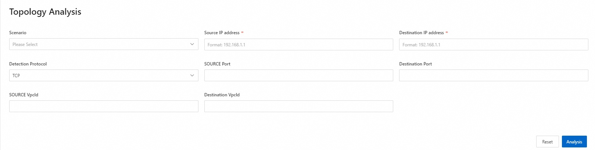

   | Parameter | Description |
   | --- | --- |
   | Scenario | Select a scenario for path analysis. • Physical Path Topology • <strong>ECS to ECS</strong>: access between Elastic Compute Service (ECS) instances in a virtual private cloud (VPC). • <strong>ECS to AnyTunnel</strong>: access from an ECS instance in a VPC to an AnyTunnel virtual IP address (VIP). • <strong>ECS to SingleTunnel</strong>: access from an ECS instance in a VPC to a SingleTunnel VIP. • <strong>ECS to SLB</strong>: access from an ECS instance in a VPC to a Server Load Balancer (SLB) instance. • <strong>ECS to IDC</strong>: access between an ECS instance in a VPC and a data center. • <strong>ECS to the Internet</strong>: access from an ECS instance in a VPC to the Internet. • <strong>Docker to Docker</strong>: access between Docker containers on a cloud platform. • <strong>Docker to SLB</strong>: access from a Docker container to an SLB instance on a cloud platform. • <strong>Docker to NC</strong>: access from a Docker container to a physical machine on a cloud platform. • <strong>NC to NC</strong>: access between physical machines on a cloud platform. • <strong>NC to Docker</strong>: access from a physical machine to a Docker container on a cloud platform. • <strong>NC to SLB</strong>: access from a physical machine to an SLB instance in a cloud platform. • <strong>Forwarding Path Topology</strong> &gt; <strong>Common Forward Path Analysis</strong> |
   | Source IP address | The IP address of the source node. IPv4 and IPv6 addresses are supported. |
   | Destination IP address | The IP address of the destination node. IPv4 and IPv6 addresses are supported. |
   | Detection Protocol | The protocol type of probe packets for the path analysis. Valid values: • TCP • UDP • ICMP |
   | SOURCE Port | The port of the source node. If you leave this parameter empty, all ports are used. |
   | Destination Port | The port of the destination node. If you leave this parameter empty, all ports are used. |
   | Source VpcId | The ID of the VPC in which the source node resides. |
   | Destination VpcId | The ID of the VPC in which the destination node resides. |

5. Click **Analysis**. In the **Topology Analysis** section, view and manage the logical topology.

   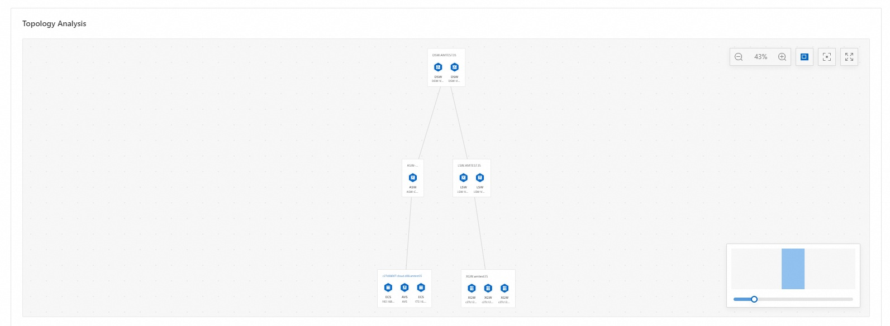

   > **Note**
   >
   > - Click any topology icon to view related content in the panel that appears.
   >
   > - For a path node of the ECS type, you can go to the ECS console to view the instance details.
   >
   > - For a path node of the NC type, you can click the **blue link** in the topology to view details. You can also go to the machine details page of the Apsara Infrastructure Management console to view details.

## 6.3. Network instance diagnostics

The network instance diagnostics feature allows you to analyze the status of network instances with a few clicks.

**Scenarios**

The network instance diagnostics feature helps you quickly analyze a network instance to identify whether it has an unexpected state. This feature provides visualized and automated diagnostics capabilities and can improve the O&M efficiency of network O&M engineers, reduce O&M risks, and improve the quality of virtual private cloud (VPC) O&M.

**Limits**

- The NetworkBaseServiceCluster cluster for BaseServiceAll has been deployed and has reached the desired state.

- After a diagnostic task is started, it does not stop until the diagnosis is complete. You cannot pause or terminate the task.

**Procedure**

1. Log on to the Apsara Uni-manager Operations Console.

2. In the top navigation bar, choose **Product Operation** > **Networking** > **Network Operations Console**.

3. In the left-side navigation pane, choose **Intelligent Diagnostics** > **Network Instance Diagnosis**.

4. In the **One-click analysis of the running status of network instances** section, select the service whose instance you want to diagnose, enter the ID of the instance, and then click **Diagnose now**. You can select one of the following values:

   - SLB

   - DNS

   - Elastic IP Address

   - Virtual Board Router

   - Physical Connection

   - NAT Gateway

   - DCI Connection

   - External Connection

5. The Network instance diagnosis results page appears. On this page, view the information in the **Instance details**, **Instance topology**, and **Diagnosis details** sections.

   > **Note**
   >
   > - The **Instance details** section is displayed only when you select SLB in the previous step.
   >
   > - In the field at the top of the Network instance diagnosis results page, the ID of the diagnosed instance is displayed by default. You can also enter the ID of another instance and click **Diagnose now** to perform diagnostics.

   In this example, an Server Load Balancer (SLB) instance is diagnosed and its diagnostic results are described.

   - Instance details:

     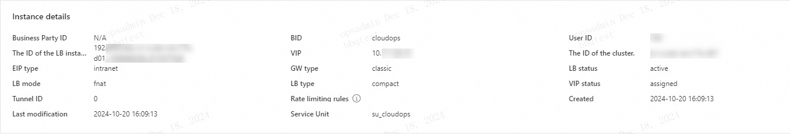

   - Instance topology:

     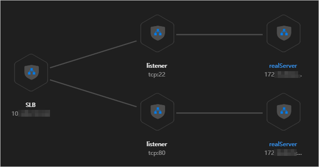

     - In the topology example shown in the preceding figure, the leftmost column displays the SLB instance, the middle column displays the listeners of the SLB instance, and the rightmost column displays the backend servers that correspond to the listeners.

     - If a backend server is of the ECS type or the machine type of Apsara Infrastructure Management, click realServer in the topology. A panel appears to show the server details.

     - After you select the topology, you can drag the topology to change the location of the topology.

   - Diagnosis details: This section displays the information about diagnostic items in the following columns: **Diagnostic item name**, **Description**, **Diagnostic results**, and **Diagnosis details**.

     

6. You can also perform the following operations in the **Task list** section on the Network Instance Diagnosis page to view historical diagnostic results of an instance:

   Specify a time range, find the diagnostic task that you want to view, and then click **Details** in the **Operation** column to go to the Network instance diagnosis results page. On this page, view the diagnostic results in the **Instance details**, **Instance topology**, and **Diagnosis details** sections.

## 6.4. Container network diagnostics

This topic describes the automated intelligent diagnostics capabilities for container networks based on mutual accessibility.

**Scenarios**

The container network diagnostics feature helps you quickly analyze container networks to determine whether the container networks have unexpected states. Visualized and automated diagnostics capabilities are provided. This feature can improve the O&M efficiency of network O&M engineers, reduce O&M risks, and improve the O&M quality of virtual private clouds (VPCs).

**Procedure**

1. Log on to the Apsara Uni-manager Operations Console.

2. In the top navigation bar, choose **Product Operation** > **Networking** > **Network Operations Console**.

3. In the left-side navigation pane, choose **Intelligent Diagnostics** > **Diagnose Container Network**.

4. On the Container Network Diagnostics page, click **Create Diagnosis Task**. On the page that appears, configure the parameters that are described in the following table and click **Submit**.

   | Parameter | Description |
   | --- | --- |
   | Source IP Address | The source IP address. |
   | Destination Node Information | The information about the destination node. Select Destination IP Address or Destination Domain and enter the corresponding information. |
   | Destination Port | The number of the destination port. |
   | Protocol | The type of the protocol. Valid values: • tcp • udp |
   | Enable Global Check | Specifies whether to enable the global check. After you turn on Enable Global Check, no topology information is displayed. |

   

5. After the diagnostic task is complete, view the path analysis topology and diagnostic report in the lower part of the page.

   

**What to do next**

| Operation | Procedure |
| --- | --- |
| View the details of a diagnostic task | 1. On the Container Network Diagnostics page, find the diagnostic task that you want to view and click <strong>Details</strong> in the <strong>Operation</strong> column. 2. On the Diagnose Container Network page, view the details of the diagnostic task, including the path analysis topology and diagnostic report. |
| Terminate a diagnostic task | You can terminate a diagnostic task only when it is in the Running state. 1. On the Container Network Diagnostics page, find the diagnostic task that you want to terminate and click <strong>Terminate</strong> in the <strong>Operation</strong> column. 2. In the message that appears, click <strong>OK</strong>. |

## 6.5. Network health assessment

The Network Health Assessment module evaluates and diagnoses the health status of each layer of the network based on the dimensions such as performance, capacity, function, and status. This module provides an overview of the network health status and detects issues and risks at all layers of the network in real time to ensure that the network runs as expected.

**Procedure**

1. Log on to the Apsara Uni-manager Operations Console.

2. In the top navigation bar, choose **Product Operation** > **Networking** > **Network Operations Console**.

3. In the left-side navigation pane, choose **Intelligent Diagnostics** > **Network Health Assessment**.

4. On the Network Health Assessment page, view the health assessment status of different network layers in the Health overview list.

   

   | Evaluation layer | Description | Dimension |
   | --- | --- | --- |
   | Network service instance | The Network Health Assessment module detects the access and configuration issues of a network service instance at the earliest opportunity by checking the features and configurations of the network service instance. | Function health assessment score, numbers of normal diagnostics items and total diagnostics items, and overall score of this layer in percentage |
   | Overlay network layer | The Network Health Assessment module comprehensively evaluates the health status of services such as eXtreme Global Workspace (XGW), Apsara Virtual Switch (AVS), Content Switched Network (CSW), Converged Gateway (CGW), Smart Network Appliance (SNA), and Hybrid Switch (HSW) by checking the monitoring results of the physical servers, network element nodes, and packet loss of the services. | Status health assessment score, numbers of normal diagnostics items and total diagnostics items, and overall score of this layer in percentage |
   | Network service controller | The Network Health Assessment module checks the alerts on the control planes of services such as Virtual Private Cloud (VPC), Server Load Balancer (SLB), DNS, and NSP and identifies issues at the earliest opportunity by checking the monitoring data of the services. | Status health assessment score, numbers of normal diagnostics items and total diagnostics items, and overall score of this layer in percentage |
   | Physical device layer | The Network Health Assessment module evaluates the health status of devices by monitoring the core metrics of the devices. | Performance health assessment score, capacity health assessment score, status health assessment score, numbers of normal diagnostics items and total diagnostics items, and overall score of this layer in percentage. |
   | Protocol layer | The Network Health Assessment module checks the status of routing protocols, such as Open Shortest Path First (OSPF) and Border Gateway Protocol (BGP). | Capacity health assessment score, numbers of normal diagnostics items and total diagnostics items, and overall score of this layer in percentage |
   | Network layer | The Network Health Assessment module comprehensively evaluates the health status of the network layer by checking the monitoring data of interconnection status of devices, physical interface of the network, intelligent prediction of the optical module, and network interface controllers (NICs). | Performance health assessment score, status health assessment score, numbers of normal diagnostics items and total diagnostics items, and overall score of this layer in percentage |

5. In the Health overview list, find an evaluation layer whose details you want to view and click **Details** in the Operation column to go to the **Health Details** page.

   <ol type="i">

   <li>

   In the **KPI details** section, click Advanced Filter. Then, configure the KPI name, Status, and Network evaluation hierarchy type parameters to filter key performance indicators (KPIs). The following table describes the information about KPIs in the list.

   

   | Parameter | Description |
   | --- | --- |
   | KPI name | The name of the KPI at the evaluation layer. KPIs are different at different evaluation layers. |
   | Hierarchy type | The dimensions based on which the layer is evaluated. The dimensions vary with different evaluation layers. • Network service instance: Only the <strong>function</strong> dimension is supported. • Overlay network layer: Only the <strong>status</strong> dimension is supported. • Network service controller: Only the <strong>status</strong> dimension is supported. • Physical device layer: Only the <strong>performance</strong>, <strong>capacity</strong>, and <strong>status</strong> dimensions are supported. • Protocol layer: Only the <strong>capacity</strong> dimension is supported. • Network layer: Only the <strong>performance</strong> and <strong>status</strong> dimensions are supported. |
   | Status | The KPI status. Valid values: critical, abnormal, sub-health, and healthy. |
   | Total number of diagnostic items | The total number of KPI items that are diagnosed. |
   | Number of diagnostics items passed | The number of the KPI items that passed the diagnostics. |
   | Number of diagnostic exceptions | The number of abnormal KPI items. You can click the number in the Number of diagnostic exceptions column to filter the abnormal events by the current KPI in the Abnormal Event section. |
   | Health Assessment Score (percentile system) | The health evaluation score of the KPI. The score is calculated based on the following formula: Health evaluation score of a KPI = Number of items that passed the diagnostics/Total number of diagnostics items. |
   | Update Time | The time when the KPI was last diagnosed. |

   </li>

   <li>

   In the **Abnormal Event** section, click Advanced Filter and configure the KPI name, Start

   </li>

   </ol>

   time, Clear Time, Show cleared issues, Grade, Associated instance, and Event type parameters to filter abnormal events.

   The following table describes the information about abnormal events in the list.

   | Parameter | Description |
   | --- | --- |
   | Name | The name of the abnormal event. |
   | KPI name | The name of the alert event to which the abnormal event belongs. |
   | Problem Description | The description of the abnormal event. |
   | Associated instance | The information about the instance associated with the abnormal event. |
   | Critical grade | The severity level of the abnormal event. The severity levels are listed in descending order: P1, P2, P3, P4, P5, P6, and P7. |
   | Type | The type of the abnormal event. Valid values: status, function, capacity, and performance. |
   | Clear Tags | Indicates whether the abnormal event is cleared. By default, <strong>No</strong> is displayed in the <strong>Clear Tags</strong> column of an abnormal event. After you click <strong>Clear</strong> in the Operation column, <strong>Yes</strong> is displayed in the Clear Tags column of the abnormal event. |
   | Confirmation mark | Indicates whether the abnormal event is confirmed. By default, <strong>No</strong> is displayed in the <strong>Confirmation mark</strong> column of an abnormal event.After you click <strong>Confirm</strong> in the Operation column, <strong>Yes</strong> is displayed in the Confirmation mark column of the abnormal event. |
   | Start time | The time when the abnormal event was detected. |
   | Clear Time | The time when the abnormal event was cleared. |

   <ol type="a">

   <li>

   Find the abnormal event that you want to view and click **Details** in the Operation column. In the Exception event details panel, view the details of the abnormal event.

   </li>

   <li>

   Click **Confirm** in the Operation column to mark the event as an abnormal event.

   </li>

   </ol>

   <ol type="i" start="100">

   <li>

   Handle the abnormal event based on its name, issue description, severity level, and associated instance, and then click **Clear** in the Operation column.

   > **Note**
   >
   > **Clear** is displayed in the Operation column of an abnormal event only after you click **Confirm** in the Operation column of the abnormal event.

   </li>

   </ol>

## 6.6. Optical transceiver module diagnostics

The Optical Module Diagnostics module analyzes and predicts the status of optical transceiver modules based on AI algorithms and assists O&M personnel in troubleshooting issues.

**Procedure**

1. Log on to the Apsara Uni-manager Operations Console.

2. In the top navigation bar, choose **Product Operation** > **Networking** > **Network Operations Console**.

3. In the left-side navigation pane, choose **Intelligent Diagnostics** > **Optical Module Diagnostics**.

4. In the upper part of the Optical Module Diagnostics page, view the status distribution of optical transceiver modules on the current day and the status distribution of optical transceiver modules within a specific period of time.

   > **Note**
   >
   > The status of an optical transceiver module can be health, sub-health, exception, or unknown. The line chart shows the trend in the proportion of optical transceiver modules in the health state.

   

5. In the lower part of the Optical Module Diagnostics page, view the basic information and analysis results of optical transceiver modules. You can click **Advanced Filter** and then filter optical transceiver modules by **optical transceiver module model**, **optical transceiver module manufacturer**, **optical transceiver module status**, **hostname**, **interface name**, and **device type**.

   | Parameter | Description |
   | --- | --- |
   | Hostname | The name of the device to which the optical transceiver module belongs. |
   | Interface name | The interface name of the device to which the optical transceiver module belongs. |
   | Ownership Type | The type of the device to which the optical transceiver module belongs. Valid values: NETWORK_SWITCH and NC. |
   | Manufacturer | The manufacturer of the optical transceiver module. |
   | Model | The model of the optical transceiver module. |
   | Status | The status of the optical transceiver module. |
   | Failure probability | The failure probability of the optical transceiver module. The failure probability is predicted based on the transmit power, received power, and bias current variation. |
   | Expected residual life | The expected residual life of the optical transceiver module. Note The residual life is calculated based on the monitoring data and threshold of the bias current. If the bias current threshold or the real-time bias current value cannot be detected, unknown is displayed in the Expected residual life column. |
   | Intelligent analysis results | The intelligent analysis result of the optical transceiver module. The analysis is performed based on the predicted failure probability and expected residual life. The following exception analysis results may be returned: • The failure probability of the optical transceiver module is high. • The residual life of the optical transceiver module is insufficient. • The connection of the optical transceiver module is poor. |

6. Find the optical transceiver module that you want to view and click **Details** in the Operation column. The **Optical Module Prediction Details** page appears.

   <ol type="i">

   <li>

   In the upper part of the page, view the basic information and prediction of the optical transceiver module.

   </li>

   <li>

   In the lower part of the page, select a time range and view the metrics of the optical

   </li>

   </ol>

   transceiver module, including **temperature**, **bias current**, **voltage**, **transmit power**, and **received power**.

   | Metric | Description |
   | --- | --- |
   | Temperature | The temperature of an optical transceiver module affects the performance and life of the optical transceiver module. If the temperature is excessively high or low, the performance of the optical transceiver module may be damaged and the life of the optical transceiver module may be shortened. • Excessively high temperature may affect the transmission distance and rate of the optical transceiver module. In addition, the performance of the light emitter and the detector may be compromised, which results in a failure of the optical transceiver module. • Excessively low temperature affects the performance and life of the optical transceiver module. |
   | Bias current | The bias current of an optical transceiver module is used to stimulate the laser to emit optical signals and affects the output power of the laser and the transmission distance of the optical transceiver module. • Excessively large bias current may cause aging and damage of the laser and shorten the life of the optical transceiver module. • Excessively small bias current may lower the output power of the laser and shorten the transmission distance. |
   | Voltage | The voltage of an optical transceiver module refers to the voltage that is used to stimulate the laser to emit optical signals and the receiver to receive optical signals. If the voltage is unstable or deviates from the specified range, the optical transceiver module may fail or its performance may degrade. • If the voltage is lower than expected, the transmit power of the optical transceiver module may be decreased. • If the voltage is higher than expected, the optical transceiver module may fail. |
   | Transmit power | The transmit power of an optical transceiver module refers to the power of the laser to emit optical signals. The transmit power of the optical transceiver module affects the transmission distance and rate of the optical transceiver module. • Excessively high transmit power may damage the optical transceiver module. • Excessively low transmit power may shorten the transmission distance. |
   | Received power | The received power of an optical transceiver module refers to the power of the receiver to receive optical signals. The received power of the optical transceiver module affects the receiver sensitivity and transmission performance of the optical transceiver module. If the received power exceeds the specified range, issues such as signal transmission interruption, error increase, and transmission distance decrease may occur. In this case, you can monitor the received power to identify and resolve issues at the earliest opportunity. • If the received power is higher than expected, you can decrease the transmit power or check the length of the jointed fiber. • If the received power is lower than expected, you can increase the transmit power or check the quality of the jointed fiber. |

## 6.7. NOE ping

NOE ping provides full-path probing for physical networks to help diagnose global network failures on the cloud platform. You can use it to troubleshoot packet loss within a single data center, monitor the quality of Data Center Interconnect (DCI) leased lines, and check network quality in edge availability zones (AZs) and across regions.

**Deploy the NOE ping agent**

1. Log on to the Apsara Uni-manager Operations Console.

2. In the top menu bar, choose **Product O&M** > **Network O&M** > **Network O&M Console**.

3. In the navigation pane on the left, choose **Intelligent Diagnosis** > **NOE ping**.

4. On the **Agent Information** tab, click **Deploy**.

5. In the dialog box that appears, enter the **Physical Server IP** for the agent deployment, and then click **OK**.

**Related operations**

| Operation | Procedure |
| --- | --- |
| Start probing | On the <strong>Agent Information</strong> tab, find the agent and click <strong>Start</strong> in the Actions column. |
| Stop probing | On the <strong>Agent Information</strong> tab, find the agent and click <strong>Stop</strong> in the Actions column. |
| Take an NOE ping agent offline | On the <strong>Agent Information</strong> tab, find the agent and click <strong>Take Offline</strong> in the Actions column to take the agent offline. |
| Set a blacklist | On the <strong>Agent Information</strong> tab, click <strong>Blacklist</strong>.In the dialog box that appears, add IPs to the <strong>Blocked IP List</strong>. Note Probing failures for blocked IPs do not trigger alerts. |
| Set parameters | On the <strong>Agent Information</strong> tab, click <strong>Parameter</strong> <strong>Settings</strong>. On the page that appears, set the probing metric parameters. Note • For probing between AZs and across regions, UDP messages are used.NOE ping agents enable the UDP service to probe each other. • For probing within an AZ, TCP messages are used. Each NOE ping agent probes different IPs under a group of Access Switches (ASWs). |

**View intra-AZ probing results**

1. Log on to the Apsara Uni-manager Operations Console.

2. In the top menu bar, choose **Product O&M** > **Network O&M** > **Network O&M Console**.

3. In the navigation pane on the left, choose **Intelligent Diagnosis** > **NOE ping**.

4. On the **Intra-AZ Probing Results** tab, view the probing results.

**Related operations**

| Operation | Instructions |
| --- | --- |
| Initiate Probing | In the Actions column for the target item, click <strong>Initiate Probing</strong>. In the dialog box that appears, select a <strong>Probing Protocol</strong>, and click <strong>Confirm</strong> to start probing. |
| Probing Details | In the Actions column for the target item, click <strong>Probing Details</strong> to view the details. |

**View inter-AZ probing results**

1. Log on to the Apsara Uni-manager Operations Console.

2. In the top menu bar, choose **Product O&M** > **Network O&M** > **Network O&M Console**.

3. In the navigation pane on the left, choose **Intelligent Diagnosis** > **NOE ping**.

4. On the **Inter-AZ Probing Results** tab, view the probing results.

## 6.8. Network toolbox

### 6.8.1. Tools

The Tools page displays a list of tools that are available in the network toolbox.

**View the tool list**

1. Log in to the Apsara Uni-manager Operations Console.

2. In the top navigation bar, choose **Product Operation** > **Networking** > **Network Operations Console**.

3. In the left-side navigation pane, choose **Intelligent Diagnostics** > **Network Toolbox** > **ToolList**.

4. On the **Tools** page, view the tools available in the network toolbox. The tool list includes the following columns: **Tool Name**, **Risk Level**, **Affected Product**, **Number of Executions**, and **Description**.

   - To import tools, click **Import Tool** above the list and upload a local file.

   - To filter tools, click **Advanced Filter** and configure the **Tool Name**, **Risk Level**, and **Affected Product** parameters.

   - To view the execution history of a tool, click the number in the **Number of Executions** column of the tool to go to the **Tool Executions** page. For more information, see the "Search for an execution" section of the Tool execution history topic.

**Preset tools**

| Tool name | Risk level | Description |
| --- | --- | --- |
| logic topo | Low risk | Used to analyze the network connection paths between nodes in the cloud platform. For more information, see the parameter description in Topology analysis. |

**View the details of a tool**

1. Log in to the Apsara Uni-manager Operations Console.

2. In the top navigation bar, choose **Product Operation** > **Networking** > **Network Operations Console**.

3. In the left-side navigation pane, choose **Intelligent Diagnostics** > **Network Toolbox** > **ToolList**.

4. On the **Tools** page, find the tool that you want to view and click **Details** in the **Actions** column.

5. On the **Tool Details** page, view the details of the tool.

   - **Basic Information**: displays **Tool Code**, **Name**, **Risk Level**, **Affected Product**, **Version**, **Description of Applicable Conditions**, and **Scenario Description**.

   - **Tool Flowchart**: displays the execution process of the tool, including the **Parameter Check** step and subsequent steps.

     - The steps after Parameter Check vary based on the tool.

     - Click the icon of a step to view the details of the step, including **step information** and **execution information**.

**Execute a tool**

1. Log in to the Apsara Uni-manager Operations Console.

2. In the top navigation bar, choose **Product Operation** > **Networking** > **Network Operations Console**.

3. In the left-side navigation pane, choose **Intelligent Diagnostics** > **Network Toolbox** > **ToolList**.

4. On the **Tools** page, find the tool that you want to execute and click **Initiate Execution** in the **Actions** column.

   > **Note**
   >
   > You can also click **Initiate Execution** in the upper-right corner of the **Tool Details** page to create a tool execution workflow.

5. In the **Initiate Execution** dialog box, configure the parameters and click **OK**.

   The parameters to be configured vary based on the tool.

6. After the tool execution workflow is created, you are redirected to the **Tool Execution Details** page. You can view the execution status of the workflow. For more information, see the "View the details of an execution" section of the Tool execution history topic.

### 6.8.2. Tool execution history

The Tool Executions page displays the tool execution history.

**Procedure**

1. Log in to the Apsara Uni-manager Operations Console.

2. In the top navigation bar, choose **Product Operation** > **Networking** > **Network Operations Console**.

3. In the left-side navigation pane, choose **Intelligent Diagnostics** > **Network Toolbox** > **toolExecutionHistory**.

4. On the **Tool Executions** page, view the execution details of tools in the following columns: **Workflow ID**, **Tool Name**, **Description**, **Execution Time**, **Execution Result**, **Executed By**, and **Execution Parameters**.

   

   - **Search for an execution**

     To filter executions, click **Advanced Filter** and configure the **Tool Name**, **Execution Result**, **Execution Time**, **Submitted By**, **Workflow ID**, and **Execution Parameters** parameters.

     > **Note**
     >
     > For more information about the meaning of **execution results**, see the Execution result explanation section of this topic.

   - **View the details of an execution**

     Find the execution that you want to view and click **View Details** in the **Actions** column. On the **Tool Execution Details** page, view the details of the execution.

     > **Note**
     >
     > The execution details vary based on the tool.

     - **Basic Information**: displays **Tool Name**, **Tool Code**, **Workflow ID**, **Execution Time**, **Execution Status**, **Submitted By**, **Affected Product**, **Risk Level**, **Workflow Is Rolled Back or Not**, **Description of Applicable Conditions**, and **Scenario Description**.

       - If **Execution Status** is W_Running, wait until the status changes to ParamVerifying.

       - If **Execution Status** is ParamVerifying, the workflow is paused until the executor confirms the parameter check results.

       - If **Execution Status** displays an abnormal state, such as Failed or W_MaxRetries, suspend the execution, troubleshoot issues based on the execution log, and then continue the execution or re-execute the tool.

       - If **Execution Status** is W_MaxRetries, you can retry the workflow.

       - When **Execution Status** changes to End, the workflow is complete.

     - **Execution Progress**: displays the status of each step in the workflow. The steps are the same as those in the tool flowchart.

       - Click **Proceed**, **Suspend**, or **Terminate** to resume, pause, or stop the workflow.

       - Click **View Details** below a step to view the **step details**.

         

         - **Basic Information**: displays the basic information about the step.

         - **Execution Information**: displays **Last Execution Information**, **Last Execution Environment Variable**, and **Execution History**.

           In the **Execution History** section, find the execution that you want to view and move the pointer over **Details** in the **Actions** column to view the execution details.

         - **Parameter Information**: displays **Input Parameters** and **Output Parameters**. The name, type, and description of each parameter are displayed.

       - Click **Confirm Parameters** in the **Parameter Check** section to view the parameter check results of the check items of the workflow and determine whether the check results are normal.

         - Click **Approved** to continue to run the workflow.

         - Click **Terminate Workflow** to terminate the workflow.

       - Click **Retry** below a step to re-execute the step.

     - **Execution Information**

       - **Execution Result**: displays the tool execution results.

       - **Event Records**: displays the reported events.

       - **Parameter Information**: displays the **parameter check** results and **input parameters**.

       - **Execution Logs**: displays the latest 1,000 lines of the execution log.

         Click the  icon in the upper-right corner to download the execution log to your

         computer.

**Execution result explanation**

| Execution result | Description | Running status |
| --- | --- | --- |
| Pending | The tool is waiting for execution. | Launching |
| Preparing | The environment is being prepared. | Launching |
| ParamParsing | The parameters are being preprocessed. | Launching |
| TransformBuilding | The workflow is being configured and orchestrated. | Launching |
| ContextBuilding | The workflow context is generated. | Launching |
| WardenLaunching | The workflow engine is started. | Launching |
| TaskRunning | The workflow is running. | Running |
| ParamVerifying | The parameters are waiting for verification. | Interrupted |
| End | The workflow is complete. | Closed |
| W_Init | The workflow is initialized. | Running |
| W_New | The workflow is created. | Running |
| W_Adopting | The workflow is distributed. | Running |
| W_Start | The workflow is started. | Running |
| W_Running | The workflow is running. | Running |
| W_Done | The workflow is being closed. | Interrupted |
| W_Closed | The workflow is closed. | Closed |
| W_Cancelled | The workflow is canceled. | Closed |
| W_StepError | The steps of the workflow are abnormal. | Closed |
| W_MaxRetries | The maximum number of retries for the workflow is reached. | Closed |
| W_Paused | The workflow is paused. | Interrupted |
| W_Rollback | The workflow is rolled back. | Running |
| W_Misfired | The workflow is stopped due to a timeout. | Closed |
| W_Escaping | The workflow is escaping. | Running |
| W_EscapeFail | The workflow failed to escape. | Closed |
| W_EscapeSuccess | The workflow successfully escaped. | Closed |
| W_QuotaReached | The upper limit for the workflow is reached. | Closed |
| Cleaned | The workflow is deleted as residual data. | Closed |
| Failed | An exception occurred during the workflow execution. | Closed |

# 7.Network resources

## 7.1. Network asset management

The Network Asset Management page displays network assets in virtual private clouds (VPCs). You can query a network asset by using a property such as Asset Type, IP Address, or Instance ID.

**Prerequisites**

The NetworkBaseServiceCluster cluster for BaseServiceAll is deployed and at desired state.

**Background information**

- Only some instances in VPCs are displayed on the Network Asset Management page. You can query specific instances by instance IP address or ID.

- Filter properties include Asset Type, IP Address, IP Address Version, Network Type, Instance ID, Zone, Product, ClusterName, Service, ServerRole, IP Address Pool ID, Base Resource, In-band Resource, and vpcId.

- When you query a network asset, you must specify the Product and ClusterName parameters before you specify the Service parameter.

- When you query a network asset, you must specify the Product, ClusterName, and Service parameters before you specify the ServiceRole parameter.

**Procedure**

1. Log on to the Apsara Uni-manager Operations Console.

2. In the top navigation bar, choose **Product Operation** > **Networking** > **Network Operations Console**.

3. In the left-side navigation pane, choose **Network Resources** > **Network Asset Management**.

4. On the Network Asset Management page, click **Advanced Filter** and search for a network asset in a VPC by **Asset Type**, **IP Address**, **IP Address Version**, **Network Type**, **Instance ID**, **Zone**, **Product**, **ClusterName**, **Service**, **ServerRole**, **IP Address Pool ID**, **Base Resource**, **In-band Resource**, and **vpcId**.

   

5. Click **Overloaded IP Data** to refresh the IP address data.

6. Find the network asset that you want to view and click **View Details** in the **Operation** column to view the details of the network asset.

## 7.2. IP address pool management

### 7.2.1. IP address pool

This feature provides a centralized view of all CIDR blocks declared by cloud services on the platform. You can perform standard O&M tasks, such as adding, expanding, querying, or deleting CIDR blocks to meet your operational requirements. The conflict check feature detects address conflicts when you expand CIDR blocks. It simultaneously checks if a CIDR block contains, or is contained by, another.

**Background**

This feature is suitable for scenarios such as multi-cloud geo-disaster recovery and hybrid cloud.

A single instance often hosts multiple cloud services. During O&M tasks like network changes or security audits, you may need to view the CIDR blocks declared by a specific cloud service to analyze the scope of changes or define security policies. This feature shows the CIDR blocks requested by each cloud service within an instance. You can also manually add custom CIDR blocks.

**Procedure**

1. Log on to the Apsara Uni-manager O&M console.

2. In the top navigation bar, choose **Product O&M** > **Network O&M** > **Network O&M Console**.

3. In the left-side navigation pane, choose **Network Resources** > **IP Address Pool Management** > **IP Address Pool**.

4. On the **CIDR Block Management** page, use the following operations to view and manage CIDR blocks.

   

   - You can view statistics for **CIDR Block Category**, **Protocol Distribution**, **IPv4 Prefix Distribution**, and **IPv6 Prefix Distribution**.

   - Add a CIDR block: Click **Manual Entry**. In the panel that opens, configure the following parameters and click **OK**.

     

     | Parameter | Description |
     | --- | --- |
     | CIDR Block Name | Enter a name for the CIDR block. |
     | CIDR Block Information | Enter the CIDR block information. |
     | Protocol Type | Select the protocol type for the CIDR block. • IPv4 • IPv6 |
     | CIDR Block Owner | Select the owner of the CIDR block. • Network Device • Cloud Service • Other |
     | Network Type | Select the network type for the CIDR block. • Platform Network • Tenant Network |
     | Region | Select the region to which the CIDR block belongs. |
     | Availability Zone | After you select a <strong>Region</strong>, select an availability zone. |
     | CIDR Block Category | Select the category of the CIDR block. • Private CIDR Block • Public CIDR Block • Public IP address for private use • Other |
     | Product Name | Select the product name to which the CIDR block belongs. |
     | Cluster Name | After you select a <strong>Product Name</strong>, select the cluster name for the CIDR block. |
     | Service Name | After you select a <strong>Cluster Name</strong>, select the service name for the CIDR block. |
     | Service Role | After you select a <strong>Service Name</strong>, select the service role for the CIDR block. |
     | IDC | Select the IDC for the CIDR block. |
     | Associated Network Device | After you select an <strong>IDC</strong>, select the source network device for the CIDR block. |
     | Associated Network Interface | After you select an <strong>IDC</strong>, select the associated network interface for the CIDR block. |
     | Remarks | Enter remarks for the CIDR block. |
     | Enable | Specify whether to enable the CIDR block. |
     | Expiration Time | Set an expiration time for the CIDR block. |

   - CIDR block conflict verification

     <ol type="a">

     <li>

     Click **Conflict Verification**. In the dialog box that appears, under **CIDR Block Information**, enter the target CIDR block.

     </li>

     <li>

     Click **Detect**. The system displays the conflict check result.

     </li>

     </ol>

     

   - Query CIDR blocks

     <ol type="a">

     <li>

     Click **Advanced Search** and set filter conditions by using a combination of **ID**, **IPResourceName**, **CIDR Block Information**, **Protocol**, **Product**, **Cluster Name**, **Service Name**, **Service Role**, **Enablement Status**, and **CIDR Block Category**.

     </li>

     <li>

     Click **Search** to find the target CIDR blocks.

     </li>

     </ol>

   - View the CIDR block list: The list includes information such as **ID**, **CIDR Block Information**, **IPResourceName**, **Protocol**, **CIDR Block Category**, **Network Type**, **Enablement Status**, **Region**, **Availability Zone**, **Product**, **Service Name**, **Server Role**, **Source Device**, **Associated Port**, and **Last Update**.

   - View CIDR block details: In the **Actions** column of a target CIDR block, click **Details**. In the panel that appears, view the detailed information about the CIDR block.

     

   - Delete a CIDR block

     - To delete a CIDR block, click **Delete** in its **Actions** column.

     - In the confirmation dialog box, click **OK**.

### 7.2.2. Collection settings

On the Collection Settings page, you can view the collection settings of the IP address pools of cloud services across the platform. You can also trigger a data update for a single IP address pool on this page.

**Background information**

The collection settings feature is applicable to scenarios such as multi-cloud geo-disaster recovery and hybrid clouds. This feature allows you to perform the following operations:

- View the collection rules of IP address pools of all cloud services across the cloud platform.

- Trigger a data update for a single IP address pool.

**Procedure**

1. Log on to the Apsara Uni-manager Operations Console.

2. In the top navigation bar, choose **Product Operation** > **Networking** > **Network Operations Console**.

3. In the left-side navigation pane, choose **Network Resources** > **IP Address Pool Management** > **Collection Settings**.

4. On the Collection Settings page, find the IP address pool that you want to manage by the IP address pool name and view the CIDR block collection settings of the IP address pool.

   

5. Click **Details** in the **Operation** column. In the Details panel, view the details of the IP address pool.

   

6. Click **Single trigger** in the **Operation** column. In the message that appears, click **OK**. Then, the system displays the trigger result.

   

## 7.3. Reverse access

The reverse access feature implements active access from base cloud services to virtual private clouds (VPCs) by establishing NAT mappings.

**Create a reverse access instance**

1. Log on to the Apsara Uni-manager Operations Console.

2. In the top navigation bar, choose **Product Operation** > **Networking** > **Network Operations Console**.

3. In the left-side navigation pane, choose **Network Resources** > **Reverse Access**.

4. On the Cloud Service Reverse Access page, click **Create Reverse Access Instance**. In the dialog box that appears, configure the following parameters and click **Create Application**.

   After the instance is created, an application ID that is automatically assigned by the system for the instance is displayed on the Cloud Service Reverse Access page.

   | Parameter | Description |
   | --- | --- |
   | Application Name | The name of the application. |
   | Application Description | The description of the application. |
   | uid | The user ID that is used for resource management. This parameter is required. |

   

5. In the **Server Address Pool Settings** section, configure the following parameters and click **Create**.

   | Parameter | Description |
   | --- | --- |
   | Address Pool ID | The ID of the address pool of the application server. If you leave this parameter empty, a new address pool ID is created. |
   | Address Pool Name | The name of the address pool. |
   | Address Pool Description | The description of the address pool. |
   | Creation Mode | The creation type of the application server. Valid values: • Within VPC • Outside VPC Note If you select application servers in a VPC, you can add multiple application servers in the same VPC at a time. Separate the server IDs or IP addresses with commas (,). |
   | vpcId | This parameter takes effect only if you set the <strong>Creation Mode</strong> parameter to <strong>Within VPC</strong>. The ID of the VPC in which the application server resides. |
   | serverIds | This parameter takes effect only if you set the <strong>Creation Mode</strong> parameter to <strong>Within VPC</strong>. The IDs of the application servers to be added. You can add multiple application servers at a time. Separate the server IDs with commas (,). |
   | vswitchId | This parameter takes effect only if you set the <strong>Creation Mode</strong> parameter to <strong>Within VPC</strong>. The ID of the vSwitch to which the application server belongs. |
   | mappingIp | This parameter takes effect only if you set the <strong>Creation Mode</strong> parameter to <strong>Within VPC</strong>. The mapping IP address that is created for the specified vSwitch. The IP address is used to map the IP address of the application server. Note If the existing mapping IP addresses in the vSwitch are not used up, the mapping IP address created in this step may not be used.If no mapping IP addresses exist in the vSwitch and you do not create a mapping IP address in this step, an error may be reported later. |
   | serverIps | This parameter takes effect only if you set the <strong>Creation Mode</strong> parameter to <strong>Outside VPC</strong>. The classic network IP addresses of the application servers to be added. |

   

6. Configure the following parameters and click **Create ECS Authorization**.

   | Parameter | Description |
   | --- | --- |
   | VPC ID | The ID of the VPC in which the Elastic Compute Service (ECS) instance that you want to authorize the reverse access instance to access resides. |
   | Creation Mode | The creation type of the ECS authorization. Valid values: • Instance ID • Instance IP Address |
   | instanceId | This parameter takes effect only if you set the <strong>Creation Mode</strong> parameter to <strong>Instance ID</strong>. The ID of the ECS instance to be accessed. |
   | instanceIp | This parameter takes effect only if you set the <strong>Creation Mode</strong> parameter to <strong>Instance IP Address</strong>. The private IP address of the ECS instance to be accessed. |
   | instancePort | The port of the ECS instance to be accessed. |

   

7. View the details of a reverse access instance.

   <ol type="i">

   <li>

   Find the reverse access instance that you want to view and click **Details** in the **Operation** column.

   </li>

   <li>

   On the **Reverse Access Instance Details** page, view the instance details in the **Basic**

   </li>

   </ol>

   **Information** section and on the **Server Address Pool** and **ECS Reverse Authorization** tabs.

   

   <ol type="i" start="3">

   <li>

   On the **Server Address Pool** tab, perform the following operations.

   </li>

   </ol>

   | Operation | Procedure |
   | --- | --- |
   | Create an address pool | a. Click <strong>Create Address Pool</strong>. b. In the dialog box that appears, configure the parameters as described in Step 5 and click <strong>Create</strong>. |

   <table>
     <tr>
       <td>View the server details of an address pool</td>
       <td>a. Find the address pool that you want to view and click <strong>Server Details</strong> in the <strong>Operation</strong> column. In the Server Details panel, view the server details of the address pool. b. The server details are displayed in the following columns: <strong>VPC ID</strong>, <strong>Server ID</strong>, <strong>Server IP</strong>, <strong>Server Mapping IP</strong>, <strong>Server Type</strong>, and <strong>Status</strong>.  Note • To add an application server, click <strong>Add Application Server</strong> • To delete an application server, find the application server that you want to delete and click <strong>Delete</strong> in the <strong>Operation</strong> column.</td>
     </tr>
     <tr>
       <td>Modify an address pool</td>
       <td>a. Find the address pool that you want to modify and click <strong>Modify</strong> in the <strong>Operation</strong> column. b. In the dialog box that appears, modify the parameters and click <strong>Modify</strong>. Note You can modify only the <strong>Name</strong> and <strong>Description</strong> parameters.</td>
     </tr>
     <tr>
       <td>Delete an address pool</td>
       <td>a. Find the address pool that you want to delete and click <strong>Delete</strong> in the <strong>Operation</strong> column. b. In the message that appears, click <strong>Delete</strong>. Note Before you delete an address pool, you must delete all application servers that are associated with the address pool. Otherwise, the address pool cannot be deleted. The address pool is deleted immediately after you click Delete. Proceed with caution.</td>
     </tr>
   </table>

   <ol type="i" start="4">

   <li>

   On the **ECS Reverse Authorization** tab, perform the following operations.

   | Operation | Procedure |
   | --- | --- |
   | Create an authorization | a. Click <strong>Authorize</strong>. b. In the dialog box that appears, configure the parameters as described in Step 6 and click <strong>Create ECS Authorization</strong>. |
   | Delete an authorization | a. Find the authorization that you want to delete and click <strong>Delete</strong> in the <strong>Operation</strong> column. b. In the message that appears, click <strong>Delete</strong>. Note The authorization is deleted immediately after you click Delete. Proceed with caution. |

   </li>

   </ol>

**What to do next**

**Modify a reverse access instance**

1. Find the reverse access instance that you want to modify and click **Modify** in the **Operation** column.

2. In the dialog box that appears, modify the parameters and click **Modify**.

   > **Note**
   >
   > You can modify only the **Instance ID/Name** and **Description** parameters.

**Delete a reverse access instance**

1. Find the reverse access instance that you want to delete and click **Details** in the **Operation** column.

2. On the **Reverse Access Instance Details** page, click **Delete Instance** in the upper-right corner.

3. In the message that appears, click **Delete**.

   > **Note**
   >
   > Before you delete a reverse access instance, you must delete all application servers and address pools that are associated with the instance. Otherwise, the instance cannot be deleted.

## 7.4. Cloud instance management

This topic describes how to manage the lifecycle of cloud instances, including creating instances, deleting instances, and querying instance status.

**Create a cloud instance**

1. Log in to the Apsara Uni-manager Operations Console.

2. In the top navigation bar, choose **Product Operation** > **Networking** > **Network Operations Console**.

3. In the left-side navigation pane, choose **Network Resources** > **Cloud Instance Management**.

4. On the **Cloud Instance Management** page, choose **Create Instance** > **Create Instance**.

5. On the **Create Instance** page, perform the following steps to create an instance.

   **Step 1: Create a VPC**

   In the **Create VPC** step, configure the following parameters and click **Create**.

   | Parameter | Description |
   | --- | --- |
   | RegionID | The ID of the region in which the virtual private cloud (VPC) resides. |
   | Cloud Service Instance ID | The ID of the VPC. |
   | Tunnel Type | • <strong>SingleTunnel</strong>: specifies a SingleTunnel virtual IP address (VIP) that allows a single Elastic Compute Service (ECS) instance in the VPC to access external cloud services. • <strong>AnyTunnel</strong>: specifies an AnyTunnel VIP that allows all ECS instances in the VPC to access the specified cloud service. |
   | IpVersion | The protocol. The default value is <strong>Ipv4</strong>. Valid values: • Ipv4 • Ipv6 |
   | CloudInstance IP | The VIP that you want to assign to the VPC. If you do not specify a VIP, the system automatically assigns one. |
   | Vswitch ID | This parameter is available only when the <strong>Tunnel Type</strong> parameter is set to <strong>SingleTunnel</strong>. The ID of any vSwitch in the VPC to which the ECS instance that needs to access external cloud services belongs. |
   | UID | This parameter is available only when the <strong>Tunnel Type</strong> parameter is set to <strong>SingleTunnel</strong>. The UID of the user that creates the vSwitch. This parameter is required if the user is not the API caller. |
   | BID | This parameter is available only when the <strong>Tunnel Type</strong> parameter is set to <strong>SingleTunnel</strong>. The BID of the user that creates the vSwitch. This parameter is required if the user is not the API caller. |
   | CIDR Type | This parameter is available only when the <strong>Tunnel Type</strong> parameter is set to <strong>AnyTunnel</strong>. • <strong>Link_local (Regular Cloud Services)</strong>: The AnyTunnel VIP assigned to Application Load Balancer (ALB) is allocated from a subnet that does not belong to 100.100.100.0/24. • <strong>Special Inner (ECS META Server) Service</strong>: The AnyTunnel VIP assigned to ALB is allocated from a subnet that belongs to 100.100.100.0/24. |

   

   **Step 2: Add backend servers to an SLB instance**

   In the **Add RS to SLB Instance** step, configure the following parameters and click **Create**.

   | Parameter | Description |
   | --- | --- |
   | VPC ID | The ID of the VPC in which the ECS instances that you want to add are deployed. This parameter is required if you want to add ECS instances deployed in a VPC. |
   | RS List | The backend servers (ECS instances) that you want to add to the Server Load Balancer (SLB) instance. • <strong>IP</strong>: the IP address of the backend server. • <strong>weight</strong>: The weight of the backend server. Valid values: 0 to 1000. If you leave the parameter empty, the default value 100 is used. Note • Click <strong>Add RS</strong> to add multiple backend servers. • Click <strong>Delete</strong> in the <strong>Actions</strong> column of a backend server to remove the backend server. |

   

   **Step 3: Create listeners**

   In the **Create Listener** step, configure the following parameters and click **Create**.

   | Parameter | Description |
   | --- | --- |
   | Protocol | The listener protocol. Valid values: • Tcp • Udp |
   | Frontend Port | The frontend port of the VIP. |
   | Backend Port | The service port on the backend server. |
   | Configurations | Click <strong>Configurations</strong> to specify <strong>Scheduling Policy</strong>, <strong>Session</strong> <strong>Persistence (Seconds)</strong>, and <strong>Health Check Method</strong>. |

   > **Note**
   >
   > - You can click **Add Listener** to add multiple listeners.
   >
   > - Click **Delete** in the Delete column of a listener to delete the listener.

   

6. Optional. After the cloud instance is created, it enters the **Working** state. You can go to the **Cloud Instance Management** page and view the instance in the instance list.

**Apply for a Direct AnyTunnel VIP**

1. On the **Cloud Instance Management** page, choose Create Instance > **Create Direct Any Tunnel**.

2. On the **Create Direct Any Tunnel VIP** page, configure the following parameters and click **Create**.

   | Parameter | Description |
   | --- | --- |
   | RegionID | Displays the region ID of the cloud instance. |
   | Cloud Service Instance ID | The ID of the cloud instance. By default, the ID of a random cloud instance is displayed. |
   | Tunnel Type | You can select only <strong>Direct Any Tunnel</strong>. After a Direct AnyTunnel VIP is obtained, all ECS instances in the VPC can use the VIP to access the specified cloud service. |
   | CloudInstance IP | Enter the IP address of the cloud instance. If you do not specify a VIP, the system automatically assigns one. |
   | CIDR Type | • <strong>Link_local (Regular Cloud Services)</strong>: The Direct AnyTunnel VIP is allocated from a subnet that does not belong to 100.100.100.0/24. • <strong>Special Inner (ECS META Server) Service</strong>: The Direct AnyTunnel VIP is allocated from a subnet that belongs to 100.100.100.0/24. |

   

3. Optional. After the Direct AnyTunnel is created, it enters the **Working** state. You can go back to the **Cloud Instance Management** page and view it in the instance list.

**Manage existing resources**

**Prerequisites**

The existing resource management operation is not performed.

**Procedure**

> **Important**
>
> - The existing resource management operation attempts to manage **SingleTunnel**, **AnyTunnel**, and **Direct AnyTunnel** resources created in Apsara Network Intelligence. You cannot repeat this operation after all resources are successfully managed.
>
> - After you perform this operation, if instances whose **Tunnel Type** is **InvalidResource** are displayed, the instances are abnormal resources in Apsara Network Intelligence. The creation of the instances may be terminated or the instances may be invalid.
>
>   The status of these instances displays **Invalid**. You can only view and delete these instances. You cannot modify the backend servers or listeners of these instances. To do this, you need to delete the existing instances and recreate them.

1. On the **Cloud Instance Management** page, click **Existing Resource Management** above the list.

2. In the message that appears, confirm the information and click **OK**. Then, resource management starts.

3. Refresh the **Cloud Instance Management** page. If an instance ID that does not start with noe appears, existing resource management is performed.

   - If all resources are managed, the **Existing Resource Management** feature is dimmed.

   - If some resources fail to be managed, **Failed to manage some resources.** is displayed. You can retry to manage the failed resources.

     <ol type="a">

     <li>

     Click **Failed to manage some resources** above the list.

     </li>

     <li>

     In the message that appears, click **OK** to try again.

     </li>

     </ol>

**What to do next**

| Operation | Description |
| --- | --- |
| Modify backend servers | Note • You cannot modify the backend servers of instances whose <strong>Tunnel Type</strong> is <strong>DirectAnyTunnel</strong>. • You cannot modify the backend servers of instances whose status is <strong>Create Failed</strong> or <strong>Invalid</strong>. 1. Click <strong>Edit RS</strong> in the <strong>Operation</strong> column of a cloud instance. 2. In the dialog box that appears, modify the backend server parameters and click <strong>OK</strong>. For more information, see the Step 2: Add backend servers to an SLB instance section of this topic. 3. Optional. If you failed to modify the backend servers and the cloud instance is in the <strong>Update Failed</strong> state, click <strong>Edit RS</strong> to update the backend server list again. |
| Modify listeners | Note • You cannot modify the listeners of instances whose <strong>Tunnel</strong> <strong>Type</strong> is <strong>DirectAnyTunnel</strong>. • You cannot modify the listeners of instances whose status is <strong>Create Failed</strong> or <strong>Invalid</strong>. 1. Click Modify Listener in the <strong>Operation</strong> column of a cloud instance. 2. In the dialog box that appears, modify the listener parameters and click <strong>OK</strong>. For more information, see the Step 3: Create listeners section of this topic. 3. Optional. If you failed to modify the listeners and the instance is in the <strong>Update Failed</strong> state, click <strong>Edit RS</strong> to update the listener list again. |
| Delete a cloud instance | 1. Click <strong>Delete</strong> in the <strong>Operation</strong> column of a cloud instance to delete the cloud instance. 2. In the message that appears, click <strong>OK</strong>. |

# 8.Network changes

The network change feature simplifies the process of configuring switches in mainstream scenarios, such as expanding the RAMA CIDR blocks, expanding the CIDR blocks of kernel-based virtual machines (KVMs), expanding the virtual IP address (VIP) range of Server Load Balancer (SLB) instances, and expanding the access switch (ASW) CIDR blocks.

## 8.1. Change plans

### 8.1.1. Change plan list

The change plan list module displays all available change plans.

**Prerequisites**

- Incremental planning is complete on Apsara Stack Deployment Planner, and the desired state file is obtained.

- Switches are installed, deployed, and connected based on incremental planning.

- Switches are powered on, and the latest patches are installed.

- The association with distribution switches (DSWs) is completed.

**View the change plan list**

1. Log in to the Apsara Uni-manager Operations Console.

2. In the top navigation bar, choose **Product Operation** > **Networking** > **Network Operations Console**.

3. In the left-side navigation pane, choose **Network Changes** > **Change Plan** > **Change Plan List**.

4. On the **Change Plans** page, you can view information about built-in change plans, including **Solution Name**, **Risk Level**, **Affected Product**, **Number of Executions**, and **Description**. For more information about built-in change plans, see the Built-in change plans section of this topic.

   - To import change plans, click **Import** above the list and upload a local file.

   - To filter change plans, click **Advanced Filter** and configure the **Solution Name**, **Risk Level**, and **Affected Product** parameters.

   - To view the execution history of a change plan, click the number in the **Number of Executions** column of the change plan to go to the **Execution History** page. For more information, see the Search for an execution section in the Execution history topic.

   

**Built-in change plans**

| N o. | Change plan | Risk level | Description |
| --- | --- | --- | --- |
| 1 | Switch Account Password Update | High risk | This change plan applies to scenarios where you want to change the password of a switch based on your business requirements or password strategy. You must save the new password. |
| 2 | ACL Rule Configuration | High risk | This change plan applies to scenarios where you want to create access control list (ACL) rules for switches. You can use the change plan to create multiple ACL rules at a time.Ports whose configurations are changed at a time use the same ACL rules. You cannot add rules to an existing ACL.Otherwise, when you roll back this change plan, the ACL is deleted. |
| 3 | Incremental Deployment of ASW for Apsara Stack Enterprise Cloud Platform | Low risk | This change plan applies to scenarios where you want to perform incremental deployment for Access Switches (ASWs) on Apsara Stack. |
| 4 | CGW 3AZ Disaster Recovery Configuration | High risk | This change plan applies only to scenarios where you deploy a single Cloud Gateway (CGW) cluster across three zones. |
| 5 | Classic Network and IDC Networking | High risk | This change plan applies to scenarios where you want to connect a data center to the classic network by using inter-connection switches (ISWs) or customer switches (CSWs).This change plan allows you to configure the network quality analysis (NQA) instance and static routes for switches by using physical interfaces or subinterfaces. The change plan supports switches that are deployed in the single-zone, active/standby, or active-active mode.Separate input parameters with commas (,). |
| 6 | EIP IP Pool Expansion | Low risk | This change plan applies to scenarios where you want to expand the elastic IP address (EIP) CIDR block when EIPs are insufficient on Apsara Stack V3. |
| 7 | Keyserver Node Offline | High risk | This change plan applies to scenarios where you want to undeploy keyservers. This operation includes the removing traffic from Server Load Balancer (SLB), verifying traffic draining, and terminating the service process steps. |
| 8 | Keyserver Node Online | High risk | This change plan applies to scenarios where you want to deploy keyservers. This operation includes the launching the service process, verifying process status, and distributing traffic to SLB steps. |
| 9 | KVM Docker IP Segment Addition | Low risk | This change plan applies to scenarios where you want to add a CIDR block for kvm_docker. |
| 1 0 | KVM Docker IP Segment Expansion | Low risk | This change plan applies to scenarios where you want to expand the CIDR block of kvm_docker. |
| 1 1 | LVS Node Offline | High risk | This change plan applies to scenarios where you want to undeploy Linux Virtual Server (LVS) nodes. This operation includes the disabling traffic throttling, removing traffic from nodes, stopping configuration updates, and terminating the SLB forwarding process steps. |
| 1 2 | LVS Node Online | High risk | This change plan applies to scenarios where you want to deploy LVS nodes. This operation includes the launching the SLB forwarding process, enabling prechecks, enabling configurations, performing a deployment precheck, distributing traffic to nodes, and enabling traffic throttling steps. |
| 1 3 | Pre-check for Physical Connection Addition and Reuse in VPC IDC Networking Scenario | Low risk | This change plan applies to scenarios where you want to precheck the environment before you add or reuse an Express Connect circuit to connect a virtual private cloud (VPC) and a data center. |
| 1 4 | Add Rama IP Segment | Low risk | This change plan applies to scenarios where you want to add a CIDR block for RAMA. |
| 1 5 | Rama IP Segment Expansion | Low risk | This change plan applies to scenarios where you want to expand the RAMA CIDR block. |
| 1 6 | XGW/CGW Cluster Active-Standby Configuration | High risk | This change plan applies to scenarios where you want to configure the replication relationship for Extendable Gateway (XGW) or CGW clusters. |
| 1 7 | SLB VIP Address Pool Expansion | Low risk | This change plan applies to scenarios where you want to expand the virtual IP (VIP) range when the IP addresses in the VIP resource pool are insufficient or the reserved CIDR blocks are insufficient. |
| 1 8 | SNMP Configuration | High risk | This change plan applies to scenarios where you want to set the SNMP configuration for a network device when you configure network monitoring for it. |
| 1 9 | VPC anytunnel_cidr Network Segment Expansion | Low risk | This change plan applies to scenarios where the CIDR block of the classic network is expanded and the new CIDR block must be added to anytunnel_cidr to enable communication between the services in the new CIDR block and VPCs. |
| 2 0 | Add VPC CIDR for Public IP Private Use | High risk | The private CIDR blocks of a VPC are specified by the private_cidr table in the key_value_config_info configuration of the VPC in Apsara Stack. After you associate an EIP with an Elastic Compute Service (ECS) instance deployed in the VPC, the ECS instance routes data based on the private network configuration specified by the private_cidr table. If you want to use public IP addresses or pseudo-public IP addresses as private IP addresses, you can assign these public IP addresses to an application virtual switch (AVS) as private CIDR blocks. To do this, modify the vpc_default_private_cidr parameter in the key_value_config_info configuration. You can also modify the User_cidr table of the VPC to use the custom private network configuration. |
| 2 1 | VPC mapping_server Address Pool Expansion | Low risk | Apsara Stack provides the reverse access feature that allows one-way access from the classic network to VPCs. A certain number of IP addresses are reserved for reverse access during the delivery. The reserved IP addresses may be exhausted. In this case, you can execute this change plan to expand the IP addresses for reverse access. |
| 2 2 | XGW Node Traffic Diversion Operation | High risk | This change plan applies to scenarios where you want to perform XGW node traffic redirection, including configuration distribution, status update, and post-verification. |
| 2 3 | GW Node Online/Offline Operation Pre-check | Low risk | This change plan applies to scenarios where you want to perform an environment precheck before XGW node deployment or undeployment to ensure the security of the operation. |
| 2 4 | XGW Node Offline Operation | High risk | This change plan applies to scenarios where you want to undeploy an XGW node. This operation includes the precheck, node undeployment, and post-verification steps. |
| 2 5 | XGW Node Online Operation | High risk | This change plan applies to scenarios where you want to deploy an XGW node. This operation includes the precheck, node deployment, and post-verification steps. |

**View the details of a change plan**

1. Log in to the Apsara Uni-manager Operations Console.

2. In the top navigation bar, choose **Product Operation** > **Networking** > **Network Operations Console**.

3. In the left-side navigation pane, choose **Network Changes > Change Plan** > **Change Plan List**.

4. On the **Change Plans** page, find the change plan that you want to view and click **Details** in the **Actions** column.

5. On the **Change Plan Details** page, view the details of the change plan.

   

   - **Basic Information**: displays **Solution Code**, **Name**, **Risk Level**, **Affected Product**, **Version**, **Description of Applicable Conditions**, and **Scenario Description**.

   - **Flowchart**: displays the execution process of the change plan, including the **Parameter Check** step and subsequent steps.

     - The steps after Parameter Check vary based on the change plan.

     - Click the icon of a step to view the details of the step, including **Step Information** and **Execution Information**.

       

**Create a change workflow**

1. Log in to the Apsara Uni-manager Operations Console.

2. In the top navigation bar, choose **Product Operation** > **Networking** > **Network Operations Console**.

3. In the left-side navigation pane, choose **Network Changes > Change Plan** > **Change Plan List**.

4. On the **Change Plans** page, find the change plan that you want to execute and click **Initiate Execution** in the **Actions** column.

   > **Note**
   >
   > You can also click **Initiate Execution** in the upper-right corner of the **Change Plan Details** page to create a change workflow.

5. In the **Initiate Execution** dialog box, configure the parameters and click **OK**.

   The parameters vary based on the change plan.

   

6. After the change workflow is created, you are redirected to the **Execution Details** page. You can view the execution status of the workflow. For more information, see the View the details of an execution section in the Execution history topic.

### 8.1.2. Plan execution history

This topic describes how to view the execution history of change plans on the Execution History page.

**Procedure**

1. Log in to the Apsara Uni-manager Operations Console.

2. In the top navigation bar, choose **Product Operation** > **Networking** > **Network Operations Console**.

3. In the left-side navigation pane, choose **Network Changes** > **Chang Plan** > **Execution History**.

4. On the **Execution History** page, view the execution details of change plans in the following columns: **Workflow ID**, **Plan Name**, **Description**, **Execution Time**, **Execution Result**, **Executed By**, and **Execution Parameters**.

   

   - **Search for an execution**

     To filter executions, click **Advanced Filter** and configure the **Plan Name**, **Execution Result**, **Execution Time**, **Submitted By**, **Workflow ID**, and **Execution Parameters** parameters.

     > **Note**
     >
     > For more information about the definitions of execution results, see the Definitions of execution results section of this topic.

   - **View the details of an execution**

     Find the execution that you want to view and click **View Details** in the **Actions** column. On the **Execution Details** page, view the details of the execution.

     

     > **Note**
     >
     > The execution details vary based on the change plan.

     - **Basic Information**: displays **Solution Name**, **Solution Code**, **Workflow ID**, **Execution Time**, **Execution Status**, **Submitted By**, **Affected Product**, **Risk Level**, **Workflow Is Rolled Back or Not**, **Description of Applicable Conditions**, and **Scenario Description**.

       - If **Execution Status** is W_Running, wait until the status changes to ParamVerifying.

       - If **Execution Status** is ParamVerifying, the workflow is paused until the executor confirms the parameter check results.

       - If **Execution Status** displays an abnormal state, such as Failed or W_MaxRetries, suspend the execution, troubleshoot issues based on the execution log, and then continue the execution or re-execute the change plan.

       - If **Execution Status** is W_MaxRetries, you can retry the workflow.

       - When **Execution Status** changes to End, the workflow is complete.

     - **Execution Progress**: displays the status of each step in the workflow. The steps are the same as those in the change plan flowchart.

       - Click **Proceed**, **Suspend**, or **Terminate** to resume, pause, or stop the workflow.

       - Click **View Details** below a step to view the step details.

         - **Basic Information**: displays the basic information about the step.

           

         - **Execution Information**: displays **Last Execution Information**, **Last Execution Environment Variable**, and **Execution History**.

           In the **Execution History** section, find the execution that you want to view and move the pointer over **Details** in the **Actions** column to view the execution details.

           

         - **Parameter Information**: displays **Input Parameters** and **Output Parameters**. The name, type, and description of each parameter are displayed.

           

       - Click **Confirm Parameters** in the **Parameter Check** section to view the parameter check results of the check items of the workflow and determine whether the check results are normal.

         

         - Click **Approved** to continue to run the workflow.

         - Click **Terminate Workflow** to terminate the workflow.

       - Click **Retry** below a step to re-execute the step.

     - **Execution Information**

       - **Event Records**: displays the reported events.

       - **Parameter Information**: displays parameter check results in the **Parameter Check** section and input parameters in the **Input Parameters** section.

         

       - **Execution Logs**: displays the latest 1,000 execution log entries. You can turn on **Automatic Refresh**.

         You can also click the  icon in the upper-right corner to download the execution

         log to your computer.

         

**Definitions of execution results**

| Execution result | Description | Status |
| --- | --- | --- |
| Pending | The change plan is waiting for execution. | Launching |
| Preparing | The environment is being prepared. | Launching |
| ParamParsing | The parameters are being preprocessed. | Launching |
| TransformBuilding | The workflow is being configured and orchestrated. | Launching |
| ContextBuilding | The workflow context is generated. | Launching |
| WardenLaunching | The workflow engine is started. | Launching |
| TaskRunning | The workflow is running. | Running |
| ParamVerifying | The parameters are waiting for verification. | Interrupted |
| End | The workflow is complete. | Closed |
| W_Init | The workflow is initialized. | Running |
| W_New | The workflow is created. | Running |
| W_Adopting | The workflow is distributed. | Running |
| W_Start | The workflow is started. | Running |
| W_Running | The workflow is running. | Running |
| W_Done | The workflow is being closed. | Interrupted |
| W_Closed | The workflow is closed. | Closed |
| W_Cancelled | The workflow is canceled. | Closed |
| W_StepError | The steps of the workflow are abnormal. | Closed |
| W_MaxRetries | The maximum number of retries for the workflow is reached. | Closed |
| W_Paused | The workflow is paused. | Interrupted |
| W_Rollback | The workflow is rolled back. | Running |
| W_Misfired | The workflow is stopped due to a timeout. | Closed |
| W_Escaping | The workflow is escaping. | Running |
| W_EscapeFail | The workflow failed to escape. | Closed |
| W_EscapeSuccess | The workflow successfully escaped. | Closed |
| W_QuotaReached | The workflow engine has reached the workflow upper limit. | Closed |
| Cleaned | The workflow is deleted as residual data. | Closed |
| Failed | An exception occurred during the workflow execution. | Closed |

## 8.2. Feature orchestration

### 8.2.1. IPv6 dashboard

This topic describes how to view the IPv6 service capability and IPv6 status for cloud services on the Apsara Stack platform that use a baseline to request VIP resources.

**Procedure**

1. Log on to the Apsara Uni-manager O&M console.

2. In the top navigation bar, choose **product O&M** > **network O&M** > **network O&M console**.

3. In the left-side navigation pane, choose **network change** > **feature orchestration** > **IPv6 dashboard**.

4. The **IPv6 Status of Cloud Services** page lists the cloud services on the Apsara Stack platform that support IPv6. This list includes columns such as **product**, **cluster**, **data center**, **IPv6 service capability**, **IPv6 status**, **IPv6 enabled time**, and **last synchronized time**.

   Click **advanced filter** to filter the cloud services by a combination of **data center**, **product**, **cluster**, and **IPv6 enabled** status.

   

   

   - In the **Actions** column for a target cluster, click **refresh cluster status** to update the cluster's status.

   - In the **Actions** column for a target cluster, click **IPv6 service dependencies**. A dialog box opens, displaying the service dependencies of the cluster and the IPv6 status of each service.

     

   - In the **Actions** column for a target cluster, click **enable IPv6**.

     <ol type="a">

     <li>

     In the dialog box that appears, review and confirm the IPv6 status of the dependent services, and then click **OK**.

     

     > **Note**
     >
     > Before you enable IPv6, check for any service dependencies. You must enable IPv6 for these dependencies first.

     </li>

     <li>

     In the dialog box that appears, verify that IPv6 is enabled for all dependent services, and then click **OK**.

     

     </li>

     </ol>

     <ol type="i" start="100">

     <li>

     You are redirected to the details page of the service orchestration execution record, which shows the progress of enabling IPv6 for the cluster.

     For more information, see the **Execution Record** chapter in the **O&M Services** section of the **Apsara Stack O&M Platform User Guide**.

     </li>

     </ol>

# 9.Platform management

## 9.1. Log management

### 9.1.1. Query logs

This topic describes the log query feature. This feature allows you to query the logs of products and server roles by EagleEye ID. This helps you quickly troubleshoot issues.

**Prerequisites**

The read and write permissions on Log Center are obtained.

**Procedure**

1. Log in to the Apsara Uni-manager Operations Console.

2. In the top navigation bar, choose **Product Operation > Networking > Network Operations Console**.

3. In the left-side navigation pane, choose **Platform Management > Log Management > Log Query**.

4. On the **Platform Logs** tab, filter logs by **Products**, **Log Type**, **Log Name**, **Time Range**, and **Query Conditions**.

   > **Note**
   >
   > - You can select multiple values for **Products**, **Log Type**, and **Log Name**.
   >
   > - When you specify **Query Conditions**, you can enter a keyword to query data. You can specify a query condition that contains the and, or, and not operators. Example: (44 or http) and error not fatal.

5. View the query results displayed in the lower part of the page.

   | Section | Description |
   | --- | --- |
   | Log directory | Enter a log name or server role to search for a log. Click the log and then view its details displayed on the right side. |
   | Basic information | View the following information: <strong>Product Name</strong>, <strong>Service Name</strong>, <strong>Service Role</strong>, <strong>Log Name</strong>, <strong>Logs</strong>, and <strong>Error Logs</strong>. |

   <table>
     <tr>
       <td>Log list</td>
       <td>• You can click <strong>Export List</strong> to export the logs to your on-premises machine. • You can enter a keyword to search for the desired log. • You can select <strong>Show exception logs only</strong> to view only exception logs. • You can click <strong>List</strong> or <strong>Aggregation</strong> to switch between the list and aggregation modes. Note In <strong>List</strong> mode, you can click <strong>Details</strong> in the <strong>Operation</strong> column of a log to view the log content.</td>
     </tr>
   </table>

   

6. On the **Local Logs** tab, filter logs by **Products**, **Service**, **Component**, and **Log Path**.

7. In the lower part of the page, click the desired machine on the left side, and then view its logs displayed on the right side.

   > **Note**
   >
   > - You can filter logs by **Time Range** and **Keyword**.
   >
   > - You can click **Export Logs** to export the logs to your on-premises machine.

   

## 9.2. Metric management

### 9.2.1. TSDB clusters

This topic describes how to query time series database (TSDB) clusters and view the details of stored time series metrics.

**Procedure**

1. Log in to the Apsara Uni-manager Operations Console.

2. In the top navigation bar, choose **Product Operation > Networking > Network Operations Console**.

3. In the left-side navigation pane, choose **Platform Management > Indicator Management > TSDB Cluster**.

4. On the **TSDB Multi-cluster Management Page**, view the information in the **Zone List** section.

   

   - The cluster information includes Cluster ID, Zone, **Cluster Name**, **Cluster Type**, **Access Point Information**, **Service Nodes**, and **Configurations**.

   - Click **Advanced Filter** and filter clusters by **Cluster ID**, **Zone**, **Cluster Name**, **Cluster Type**, or any combination of them.

   - Find the cluster that you want to view, and click **Details** in the **Access Point Information** column. In the dialog box that appears, view the endpoint information about the cluster.

   - Find the cluster that you want to view, and click **Details** in the **Service Nodes** column. In the dialog box that appears, view the service nodes of the cluster.

   - Find the cluster that you want to view, and click **Details** in the **Configurations** column. In the dialog box that appears, view the configurations of the cluster.
