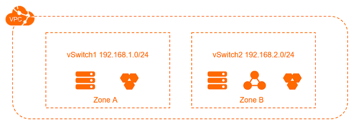
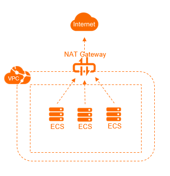
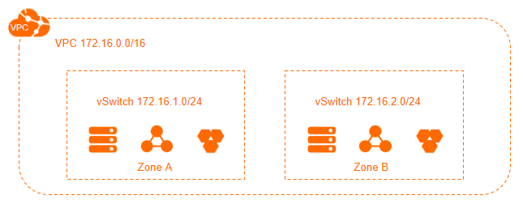
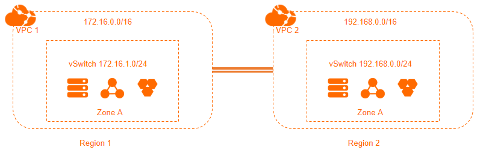
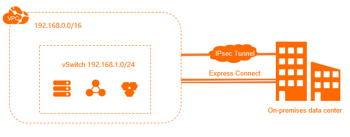

Alibaba Cloud  
Apsara Stack  
Virtual Private Cloud  
Product Introduction  
Product Version: v3.18.6-2607  
Document Version: 20260828

**Table of Contents**

- [1.Virtual private cloud](#section-1)
    - [1.1. Features](#section-1-1)
    - [1.2. Benefits](#section-1-2)
    - [1.3. Features](#section-1-3)
    - [1.4. Use scenarios](#section-1-4)

# 1.Virtual private cloud

A virtual private cloud (VPC) is a private network in the cloud. A VPC provides network services for resources in the cloud. Different VPCs are logically isolated from each other. You have full control over your VPC. For example, you can specify CIDR blocks, and configure route tables and gateways for your VPC. In your VPCs, you can use Alibaba Cloud resources, such as Elastic Compute Service (ECS) instances, ApsaraDB RDS instances, and Server Load Balancer (SLB) instances.

## 1.1. Features

Virtual private clouds (VPCs) are private networks deployed on Apsara Stack. VPCs are logically isolated from each other. You can manage your VPCs and Apsara Stack resources in your VPCs.

**VPCs**

Each VPC consists of one private CIDR block, at least one vRouter, and at least one vSwitch.

- When you create a VPC and a vSwitch, you must specify the private IP address range for the VPC in CIDR notation. You can use the standard private CIDR blocks listed in the following table and their subsets as the private CIDR blocks for your VPCs.

  | CIDR block | Number of available private IP addresses (excluding IP addresses reserved by the system) |
  | --- | --- |
  | 192.168.0.0/16 | 65,532 |
  | 172.16.0.0/16 | 65,532 |

- A vRouter is the hub of a VPC. As a core component, it connects the vSwitches in a VPC and serves as a gateway between a VPC and other networks. After you create a VPC, the system automatically creates a vRouter. Each vRouter is associated with a route table.

- A vSwitch is a basic network component that connects different cloud resources in a VPC. After you create a VPC, you can create vSwitches to create one or more subnets for the VPC. vSwitches in the same VPC can communicate with each other. You can deploy your applications in vSwitches that belong to different zones to improve service availability.

**Custom route tables and routes**

After you create a VPC, the system creates a system route table to manage routes of the VPC. By default, vSwitches in the VPC use this route table. You cannot create or delete the system route table of a VPC. However, you can create a custom route table and associate it with a vSwitch to manage your network in a more flexible way.

You can add custom routes to the system route table and custom route tables to route traffic to specified next hops. The route table uses the longest prefix match algorithm for traffic routing. If multiple routes match the destination IP address, the route with the longest subnet mask prevails and is used to determine the next hop. This ensures that the traffic is routed to the most precise destination.

**High-availability virtual IP addresses (HAVIPs)**

HAVIPs are private IP addresses that can be created and released as independent resources. You can use HAVIPs with high-availability software such as Keepalived to provide active/standby services. This improves the availability of your services. Each Elastic Compute Service (ECS) instance is assigned a private IP address as the primary IP address. You can associate HAVIPs with an ECS instance to increase the number of private IP addresses available for the ECS instance.

**Network access control lists (ACLs)**

Network ACLs allow you to implement access control for a VPC. You can create network ACL rules and associate a network ACL with a vSwitch. This allows you to control inbound and outbound traffic of ECS instances that are associated with the vSwitch.

**Various connection methods**

Apsara Stack provides multiple connection methods. You can connect a VPC to the Internet, a data center, or another VPC.

- Connect a VPC to the Internet

  You can connect a VPC to the Internet by associating elastic IP addresses (EIPs) with resources in the VPC or configuring NAT gateways. This way, resources in the VPC can communicate with the Internet.

- Connect a VPC to another VPC

  You can establish high-performance and secure connections between VPCs by creating a pair of router interfaces.

- Connect a VPC to a data center

  You can connect a VPC to a data center through Express Connect circuits. This allows you to smoothly migrate on-premises applications to the cloud.

## 1.2. Benefits

This topic describes the benefits of virtual private clouds (VPCs). VPCs are secure, reliable, flexible, easy to use, and scalable.

**Security and reliability**

Each VPC is identified by a unique tunnel ID, which corresponds to a virtual network. Different VPCs are isolated by tunnel IDs:

- Similar to a traditional network, you can create vSwitches and vRouters to divide a VPC into multiple subnets. Elastic Compute Service (ECS) instances in the same subnet use the same vSwitch to communicate with each other, while ECS instances in different subnets use vRouters to communicate with each other.

- VPCs are completely isolated from each other. Cloud resources in different VPCs can communicate with each other by using elastic IP addresses (EIPs) or NAT IP addresses.

- The IP packets of an ECS instance are encapsulated by using the tunneling technology. Therefore, information at the data link layer (the MAC address) of the ECS instance is not transferred to the physical network. This way, ECS instances in different VPCs are isolated at Layer 2.

- ECS instances in a VPC use security groups and firewalls to control inbound and outbound traffic at Layer 3.

**Flexible management**

You can use security group rules and access control lists (ACLs) to manage inbound and outbound traffic to cloud resources in a VPC in a flexible manner.

**Ease of use**

You can easily create and manage VPCs in the VPC console. When you create a VPC, the system automatically creates a vRouter and a route table for the VPC.

**High scalability**

You can create different subnets in a VPC to deploy different services. Additionally, you can connect a VPC to a data center or another VPC to extend the network architecture.

## 1.3. Features

This topic describes the features of Alibaba Cloud Virtual Private Cloud (VPC). A VPC provides an isolated, customizable virtual network environment that lets you flexibly manage and securely isolate your network resources. VPC supports a wide range of networking capabilities, including network segmentation, Elastic IP addresses (EIPs), subnetting, and gateway configuration. These features help ensure high availability for your backend services and secure network communications.

**VPC**

<table>
  <tr>
    <th colspan="2">Feature</th>
    <th>Description</th>
  </tr>
  <tr>
    <td rowspan="4">VPC management</td>
    <td>Modify a VPC</td>
    <td>Modify the name and description of a VPC.</td>
  </tr>
  <tr>
    <td>Create a VPC</td>
    <td>Create a VPC.</td>
  </tr>
  <tr>
    <td>Delete a VPC</td>
    <td>Delete a VPC.</td>
  </tr>
  <tr>
    <td>View a VPC</td>
    <td>Find and view VPCs by using filters.</td>
  </tr>
  <tr>
    <td>Multi-account VPC sharing</td>
    <td>Share a VPC</td>
    <td>Share a VPC with other accounts in your resource set, organization, or subordinate organizations.</td>
  </tr>
  <tr>
    <td rowspan="6">VPC instance management</td>
    <td>Tags</td>
    <td>Add custom tags to VPC instances.</td>
  </tr>
  <tr>
    <td>Enable IPv6 for a VPC</td>
    <td>Enable IPv6 for a VPC.</td>
  </tr>
  <tr>
    <td>Modify VPC attributes</td>
    <td>Modify the name and description of a VPC.</td>
  </tr>
  <tr>
    <td>Create a VPC</td>
    <td>Create a VPC.</td>
  </tr>
  <tr>
    <td>Delete a VPC</td>
    <td>Delete a VPC.</td>
  </tr>
  <tr>
    <td>Query VPC information</td>
    <td>Query information about a VPC.</td>
  </tr>
</table>

VPC provides network connectivity for each ECS instance.

Provides networking services for ECS elastic network interfaces.

VPC network management

ECS services

Supports rate limiting for ECS instances.

for ECS instances

Provides network proxy services for ECS instances.

Supports ECS proxy, migration, access control, O&M, monitoring, and after-sales tools.

Supports Shenlong MOC 2.0 instances.

Supported instance types for VPC traffic mirroring

Supports general-purpose instance types.

Modify a traffic mirror session.

Stop a traffic mirror session.

Basic configuration

Create a traffic mirror session.

Delete a traffic mirror session.

View a traffic mirror session.

Filter both ingress and egress traffic.

Filter conditions

Filter based on the 5-tuple.

VPC traffic mirroring

Copies network traffic from a source to a

Mirror session

destination based on filter conditions.

An elastic network interface (ENI) from which

Mirror source

traffic is copied.

An elastic network interface (ENI) or an internal-

Mirror destination

facing Server Load Balancer (SLB) instance that receives the mirrored traffic.

Supports Shenlong MOC 2.0.

Supports general-purpose instance types.

Hardware and software

Supports Intel processors.

ecosystem

Supports Hygon processors.

Supports ARM (Kunpeng) processors.

The IPv4 subnet mask length for a vSwitch

vSwitch subnet mask

ranges from /16 to /29.

Modify vSwitch attributes

Modify the attributes of a vSwitch.

vSwitch instance management

Create a vSwitch

Create a vSwitch in a VPC.

Delete a vSwitch

Delete a vSwitch from a VPC.

Query the vSwitch list

Query a list of vSwitches.

Delete a custom route

Delete a route entry from a vRouter.

Delete a custom IPv4

Delete an IPv4 route entry from a vRouter.

route

Associate a custom route table with a vSwitch

Subnet route

to forward its traffic based on the routes in the table.

Subnet route 2.0

Create a custom route

Add a custom route entry to a vRouter.

Add a custom route entry to a vRouter. The next hop can be set to an elastic network interface, a

Create a custom IPv4

router interface (RI) for a VPC or VBR, an ECS

route

Route table

instance, a VPN Gateway, a NAT Gateway, or an

management

HAVIP.

Query the route table list

Query the route entries in a vRouter.

Add a custom route entry to a vRouter where

Custom IPv4 routes with

the next hop is configured with active/standby

active/standby router

router interfaces (VBR).

interfaces

Custom IPv4 routes with

Add a custom route entry to a vRouter where

load-balanced router

the next hop is configured with multiple load-

interfaces

balancing router interfaces (VBR).

In addition to the default system route table, you can create custom route tables. Add

Custom route table

custom route entries with next hops such as ECS instances, various gateways, or VBRs.

High availability with

Bind to ECS instances to create a high-

active/standby ECS

availability active/standby pair.

instances

Modify HAVIP attributes

Modify the attributes of an HAVIP.

Create an HAVIP

Create an HAVIP instance.

HAVIP

Delete an HAVIP

Delete an HAVIP instance.

High availability with

Bind to elastic network interfaces to create a

active/standby elastic

high-availability active/standby pair.

network interfaces

Query an HAVIP

Query the attributes and status of an HAVIP.

Restricts access to allow only outbound internet

Allows resources in the VPC to make outbound

IPv6 Gateway

connections while

IPv6 connections to the internet, while blocking

egress-only rules

preventing inbound

unsolicited inbound connections.

connections initiated from the internet.

Modify an IPv6 Gateway

Modify an IPv6 Gateway.

IPv6 Gateway

Create an IPv6 Gateway

Create an IPv6 Gateway.

management

Delete an IPv6 Gateway

Delete an IPv6 Gateway.

View a NAT bandwidth

View a NAT bandwidth plan.

plan Modify NAT bandwidth

Modify the properties of a bandwidth plan.

plan name and description

Modify NAT bandwidth

Modify a bandwidth plan.

plan bandwidth

NAT bandwidth plan management

Delete a NAT bandwidth

Delete a bandwidth plan.

plan

Remove public IP from NAT

Remove a public IP address from a bandwidth

bandwidth plan

plan.

Add public IP to NAT

Add a public IP address to a bandwidth plan.

bandwidth plan

Maps a public IP address and port to a private IP address and port, allowing inbound internet

DNAT

traffic to reach servers within the VPC.

NAT Gateway

Maps private IP addresses to a public IP

SNAT

address, allowing servers within the VPC to access the internet.

Tags

Add custom tags to NAT Gateway instances.

Modify a NAT Gateway

Modify gateway properties, such as the name.

NAT Gateway management

Create a NAT Gateway

Create a NAT Gateway.

Delete a NAT Gateway

Delete and release a gateway.

Use the same EIP for SNAT

Use a single EIP for both SNAT and DNAT

and DNAT

entries.

Modify a DNAT entry. You can change the

Modify a DNAT entry

frontend and backend port information and the backend ECS instance.

Manage DNAT table

Create a DNAT entry

Create a DNAT entry.

Deletes a DNAT entry, which removes its port

Delete a DNAT entry

forwarding rule.

Modify the associated EIP and rule granularity of

Modify an SNAT entry

an SNAT entry.

Create SNAT entry (ECS

Create an SNAT forwarding rule that applies to a

granularity)

specific ECS instance.

Manage SNAT table

Create SNAT entry

Create an SNAT forwarding rule that applies to a

(vSwitch granularity)

specific vSwitch.

Deletes an SNAT entry, which removes its

Delete an SNAT entry

outbound address translation rule.

Tags

Add custom tags to EIP instances.

Modify EIP attributes

Modify EIP attributes.

Query the EIP list

Query a list of EIPs.

Meter EIP traffic and export the data to

Traffic metering

Operations Management Service (OMS).

Modify EIP bandwidth

Modify the bandwidth of an EIP.

Support for multiple ISP

Allocate EIPs from various Internet Service

lines

Provider (ISP) lines.

Allocate with specified

Allocate an EIP with a specified bandwidth.

bandwidth

EIP

Allocate an EIP

Allocate an EIP address.

Associate an EIP with a cloud service instance,

Associate an EIP

an HAVIP instance, or an elastic network interface in the same region.

Unassociate an EIP address from its bound

Unassociate an EIP

instance.

Release an EIP

Release an EIP that is no longer needed.

Associate an EIP with an

Associate an EIP with a single elastic network

elastic network interface

interface.

(ENI) Associate multiple EIPs

Associate multiple EIPs with a single elastic

with an ENI

network interface.

Containerization

XGW runs on Docker.

XGW on Docker supports intra-city disaster

Virtualized gateway

recovery.

Multi-data center

XGW on Docker supports multiple regions.

vSwitch-level access

Create a network ACL, configure ingress and

control with network ACLs

egress rules, and associate it with a vSwitch to

(IPv4)

control inbound and outbound IPv4 traffic.

Network ACL

ASCM VPC ACL supports cloning and the

Import or export ACL rules

import/export of ACL rules.

Modify router attributes

Modify router attributes.

Router instance management

Query router instance

Query router instance information.

information

Use Express Connect to establish private

Intra-region VPC

connections between VPCs in the same region.

connectivity

This is supported for both same-account and cross-account scenarios.

Use Express Connect to establish private

Cross-region VPC

connections between VPCs in different regions.

connectivity

This is supported for both same-account and cross-account scenarios.

Express Connect

Enable an inactive router interface to allow data

Enable a router interface

transmission.

> **Note**
>
> This service is

Disable an active router interface to stop data

Disable a router interface

> provided by

transmission.

> Express Connect.

Edit the configuration of the peer router

Edit a peer interface

interface.

Edit the configuration of the local router

Edit a local interface

interface.

Configure a route

Configure routes for the router interface.

Available for Apsara Stack deployments on

VPC multi-region 2.0

physical machines.

Multi-AZ and multi-region

Three-AZ support

Available for physical machine deployments.

Support for Intel

Supports Intel processors.

Support for Hygon

Supports Hygon processors.

Support for Kunpeng

Supports Kunpeng processors.

Hardware and

Phytium

Available for physical machine deployments.

software ecosystem

Sunway

Available for physical machine deployments.

Support for V8

Available for physical machine deployments.

Support for 8U

Available for physical machine deployments.

Support for dual-port CX6

Available for physical machine deployments.

NICs

Support for X710 NICs on

Available for physical machine deployments.

Hygon

Network interface cards (NICs)

XGW on Docker with dual-

For virtualized gateways.

port CX6 NICs

100 Gbit/s network access

For physical machine gateways.

for VPC

Architectural

Fast Reroute (FRR) ensures rapid data flow

FRR support on XGW

enhancements

recovery during network failures.

vSwitch creation linked to

vSwitch creation can be linked to multiple IPv4

VPC CIDR blocks

CIDR blocks in the VPC.

vSwitch

vSwitch creation linked to

vSwitch creation can be linked to multiple IPv6

VPC CIDR blocks

CIDR blocks in the VPC.

**Monitoring and alarms**

<table>
  <tr>
    <th colspan="2">Feature</th>
    <th>Description</th>
  </tr>
  <tr>
    <td>Alarms</td>
    <td>VPC alarms</td>
    <td>Set alarms for VPC resources and events.</td>
  </tr>
  <tr>
    <td rowspan="4">Monitoring</td>
    <td>NOE operations and monitoring</td>
    <td>Provides NOE, a backend operations tool for querying VPC resources.</td>
  </tr>
  <tr>
    <td rowspan="2">AVS monitoring</td>
    <td>Integrate AVS with CloudMonitor to monitor tenant networks.</td>
  </tr>
  <tr>
    <td>Integrate AVS with the Tianji monitoring platform to monitor networks.</td>
  </tr>
  <tr>
    <td>NAT monitoring</td>
    <td>Monitor inbound and outbound bandwidth, and bandwidth utilization for your NAT Gateway.</td>
  </tr>
</table>

## 1.4. Use scenarios

Virtual private clouds (VPCs) are virtual networks that are isolated from each other. VPCs support flexible configurations to meet the requirements of different scenarios.

**Deploy applications in a safe manner**

You can deploy applications in a VPC to provide services to external networks. To control access to the applications over the Internet, you can create security group rules and configure whitelists. You can also isolate application servers from databases to implement access control. For example, you can deploy web servers in a subnet that can access the Internet, and deploy databases in another subnet that cannot access the Internet.

**Deploy applications that require access to the Internet**

You can deploy applications that require access to the Internet in a subnet of a VPC and use an Internet NAT gateway to route network traffic. You can configure SNAT entries to allow instances in the subnet to access the Internet without the need to expose the private IP addresses. In addition, you can change the elastic IP addresses (EIPs) specified in the SNAT entries to prevent attacks from the Internet.

**Implement cross-zone disaster recovery**

You can create one or more vSwitches to create one or more subnets for the VPC. vSwitches within the same VPC can communicate with each other. To implement cross-zone disaster recovery, you can deploy resources across vSwitches in different zones.

**Isolate business systems**

VPCs are logically isolated from each other. You can use multiple VPCs to isolate business systems in different environments such as production and test environments. To allow business systems deployed in two VPCs to communicate with each other, you can create a peering connection between the VPCs.

**Build a hybrid cloud**

To expand your on-premises network, you can establish a dedicated connection between a VPC and your data center. This allows you to seamlessly migrate the applications in your data center to the cloud. You do not need to change the access method for the applications.

