Alibaba Cloud  
Apsara Stack  
Virtual Private Cloud  
User Guide  
Product Version: v3.18.6-2607  
Document Version: 20260828

**Table of Contents**

- [1.What is VPC?](#section-1)
- [2.Log on to the VPC console](#section-2)
- [3.Quick start](#section-3)
    - [3.1. Plan networks](#section-3-1)
    - [3.2. Plan a VPC](#section-3-2)
    - [3.3. Create a VPC with an IPv4 CIDR block](#section-3-3)
    - [3.4. Create a VPC with an IPv6 CIDR block](#section-3-4)
    - [3.5. Add subnet routes to a route table](#section-3-5)
    - [3.6. Configure a NAT gateway](#section-3-6)
    - [3.7. Configure an EIP](#section-3-7)
    - [3.8. Enable IPv6 for a VPC](#section-3-8)
    - [3.9. Enable IPv6 for a vSwitch](#section-3-9)
- [4.Overview](#section-4)
- [5.VPCs](#section-5)
    - [5.1. VPC overview](#section-5-1)
    - [5.2. Create and manage VPCs](#section-5-2)
    - [5.3. Create resources in a VPC](#section-5-3)
    - [5.4. Manage CIDR blocks](#section-5-4)
        - [5.4.1. Manage secondary IPv4 CIDR blocks](#section-5-4-1)
        - [5.4.2. Manage secondary IPv6 CIDR blocks](#section-5-4-2)
    - [5.5. VPC topology](#section-5-5)
    - [5.6. Attach a CEN instance to a VPC across accounts](#section-5-6)
- [6.Route tables](#section-6)
    - [6.1. Overview](#section-6-1)
    - [6.2. Create and manage custom route tables](#section-6-2)
    - [6.3. Manage custom route entries](#section-6-3)
    - [6.4. Manage custom route tables and vSwitches](#section-6-4)
- [7.vSwitches](#section-7)
    - [7.1. Overview](#section-7-1)
    - [7.2. Create and manage vSwitches](#section-7-2)
    - [7.3. Deploy cloud resources in a vSwitch](#section-7-3)
- [8.Network ACLs](#section-8)
    - [8.1. Overview](#section-8-1)
    - [8.2. Create and manage network ACLs](#section-8-2)
    - [8.3. Manage associated resources](#section-8-3)
    - [8.4. Manage network ACL rules](#section-8-4)
        - [8.4.1. Scenarios](#section-8-4-1)
        - [8.4.2. Configure inbound rules](#section-8-4-2)
        - [8.4.3. Configure outbound rules](#section-8-4-3)
- [9.Elastic IP Addresses (EIPs)](#section-9)
    - [9.1. Log on to the EIP console](#section-9-1)
    - [9.2. Overview of EIP](#section-9-2)
    - [9.3. Create and manage EIPs](#section-9-3)
    - [9.4. Associate an EIP with a cloud resource](#section-9-4)
    - [9.5. Disassociate an EIP from a cloud resource](#section-9-5)
    - [9.6. View monitoring data](#section-9-6)
- [10.NAT gateways](#section-10)
    - [10.1. Overview](#section-10-1)
    - [10.2. Create and manage NAT gateways](#section-10-2)
    - [10.3. Manage EIPs and NAT gateways](#section-10-3)
    - [10.4. Create and manage DNAT entries](#section-10-4)
    - [10.5. Create and manage SNAT entries](#section-10-5)
    - [10.6. Create and manage a NAT service plan](#section-10-6)
    - [10.7. View monitoring data](#section-10-7)
- [11.IPv6 gateways](#section-11)
    - [11.1. Overview](#section-11-1)
    - [11.2. Create and manage IPv6 gateways](#section-11-2)
    - [11.3. Manage IPv6 Internet bandwidth](#section-11-3)
    - [11.4. Manage egress-only rules](#section-11-4)
- [12.HAVIPs](#section-12)
    - [12.1. Overview](#section-12-1)
    - [12.2. Create and manage HAVIPs](#section-12-2)
    - [12.3. Manage associated resources](#section-12-3)
        - [12.3.1. Associate an HAVIP with an EIP](#section-12-3-1)
        - [12.3.2. Disassociate an HAVIP from an EIP](#section-12-3-2)
        - [12.3.3. Associate HAVIPs with backend cloud resources](#section-12-3-3)
            - [12.3.3.1. Associates an HAVIP with an ECS instance](#section-12-3-3-1)
            - [12.3.3.2. Associate an HAVIP with an ENI](#section-12-3-3-2)
            - [12.3.3.3. Work with Keepalived to enable primary/secondary switchover](#section-12-3-3-3)
        - [12.3.4. Disassociate HAVIPs from backend cloud resources](#section-12-3-4)
            - [12.3.4.1. Disassociate an HAVIP from an ECS instance](#section-12-3-4-1)
            - [12.3.4.2. Disassociate an HAVIP from an ENI](#section-12-3-4-2)
- [13.DHCP options sets](#section-13)
    - [13.1. Overview of DHCP options sets](#section-13-1)
    - [13.2. Create and manage DHCP options sets](#section-13-2)
    - [13.3. Manage a DHCP options set and VPCs](#section-13-3)
- [14.Manage operation logs](#section-14)
- [15.Manage tags](#section-15)

<a id="section-1"></a>

# 1.What is VPC?

Virtual private clouds (VPCs) are private networks deployed on Apsara Stack. VPCs are logically isolated from each other. You can manage your VPCs and Apsara Stack resources in your VPCs.

**VPCs**

Each VPC consists of at least one private CIDR block, one vRouter, and one vSwitch. Apsara Stack allows you to create a VPC in the VPC console and by calling an API operation. When you create a VPC, you can specify the name, description, and CIDR block of the VPC. You can also specify whether to enable IPv6 for the VPC. Apsara Stack also allows you to modify a VPC in the VPC console and by calling an API operation. When you modify a VPC, you can add CIDR blocks to or remove CIDR blocks from the VPC.

- When you create a VPC and a vSwitch, you must specify the private IP address range for the VPC in CIDR notation. You can use the standard private CIDR blocks listed in the following table and their subsets as the private CIDR blocks for your VPCs.

- A vRouter is the hub of a VPC. As a core component, a vRouter connects the vSwitches in a VPC and serves as a gateway between a VPC and other networks. After you create a VPC, the system automatically creates a vRouter. Each vRouter is associated with a route table. Apsara Stack allows you to perform the following operations in the VPC console and by calling API operations: query and modify vRouters, query, create, and delete route tables, associate route tables with and disassociate route tables from vSwitches, and query, add, modify, and remove routes.

- A vSwitch is a basic network component that connects different cloud resources in a VPC. After you create a VPC, you can create vSwitches to create one or more subnets for the VPC. vSwitches in the same VPC can communicate with each other. You can deploy your applications in vSwitches that belong to different zones to improve service availability. Apsara Stack allows you to query, create, modify, and delete vSwitches in the VPC console and by calling API operations.

- Apsara Stack allows you to perform the following operations in the VPC console and by calling API operations: query, create, and delete virtual border routers (VBRs), and associate VBRs with and disassociate VBRs from Express Connect circuits.

**Custom route tables and routes**

After you create a VPC, the system creates a system route table to manage the routes of the VPC. By default, vSwitches in the VPC use this route table. You cannot create or delete the system route table of a VPC. However, you can create a custom route table and associate it with a vSwitch to manage your network in a more flexible manner.

You can add custom routes to the system route table and custom route tables to route traffic to specific next hops. A route table uses the longest prefix match algorithm for traffic routing. If multiple routes match the destination IP address, the route with the longest subnet mask prevails and is used to determine the next hop. This ensures that the traffic is routed to the most precise destination.

**HAVIPs**

A high-availability virtual IP address (HAVIP) is a private IP address that can be created and released as an independent resource. You can use HAVIPs with high-availability software such as Keepalived to provide services in active/standby mode. This improves the availability of your services. Each Elastic Compute Service (ECS) instance is assigned a private IP address as the primary IP address. You can associate HAVIPs with an ECS instance to increase the number of private IP addresses available for the ECS instance.

**Network access control lists (ACLs)**

Network ACLs allow you to implement access control for a VPC. You can configure network ACL rules and associate a network ACL with a vSwitch. This way, you can control the inbound and outbound traffic of ECS instances that are connected to the vSwitch.

**Various connection methods**

Apsara Stack provides multiple connection methods. You can connect a VPC to the Internet, a data center, or another VPC.

- Connect a VPC to the Internet

  You can connect a VPC to the Internet by associating elastic IP addresses (EIPs) with resources in the VPC or configuring NAT gateways. This way, resources in the VPC can communicate with the Internet.

- Connect a VPC to another VPC

  You can establish high-performance and secure connections between VPCs by creating a pair of router interfaces.

- Connect a VPC to a data center

  You can connect a VPC to a data center over Express Connect circuits. This allows you to smoothly migrate on-premises applications to the cloud.

<a id="section-2"></a>

# 2.Log on to the VPC console

This topic describes how to log on to the Apsara Uni-manager Management Console to manage your virtual private clouds (VPCs). In this example, the Google Chrome browser is used.

**Prerequisites**

- The URL of the Apsara Uni-manager Management Console is obtained from the deployment engineers.

- A web browser is available. We recommend that you use Google Chrome.

**Procedure**

1. Enter the URL of the Apsara Uni-manager Management Console in the address bar and press the Enter key.

   

   > **Note**
   >
   > - You can select a language from the drop-down list in the upper-right corner of the page.
   >
   > - 由于浏览器证书过期或环境开启HTTPS认证等出现多次单击继续访问或无Apsara Uni-manager运营控制台地址入口等现象，此时需要安装证书才能正常访问。单击页面右上角的**浏览器证书安装**，可打开浏览器证书安装指南。

2. Enter the correct username and password.

   Obtain the username and password that you use to log on to the Apsara Uni-manager Management Console from the operations administrator.

   > **Note**
   >
   > - **First logon**
   >
   >   The first time that you log on to the Apsara Uni-manager Management Console, you need to change the password of your account. Follow the instructions to complete the password change. For security purposes, the password must be 10 to 32 characters in length. It must contain all of the following character types: uppercase letters, lowercase letters, digits, and special characters. The following special characters are supported: ! @ # $ %
   >
   > - **Forgot password**
   >
   >   If you forgot your password, click Forgot Password and enter the username of your account, the email address that was used to create your account, and the verification code. Then, a URL is sent to the specified email address. You can click the URL to reset the password.

3. Click **Log On**.

4. If your account has MFA (Multi-Factor Authentication) enabled, perform the following operations based on your scenario:

   - Scenario 1: You log on to the Apsara Uni-manager Management Console for the first time after MFA is enabled by the administrator.

     <ol type="a">

     <li>

     On the Bind Virtual MFA Device page, follow the instructions to bind an MFA device.

     </li>

     <li>

     Re-enter your username and password as described in Step 2, and click **Log On**.

     </li>

     </ol>

     <ol type="i" start="100">

     <li>

     Enter the 6-digit MFA code and click **Authenticate**.

     </li>

     </ol>

   - Scenario 2: You have enabled MFA and bound an MFA device.

     Enter the 6-digit MFA code and click **Authenticate**.

     > **Note**
     >
     > For information about how to bind and enable MFA, see the **Security Center** > **Multi-factor Authentication** > **Manage Multi-factor Authentication** section in the Apsara Uni-manager Management Console User Guide.

5. In the top navigation bar, choose **Products > Networking > Virtual Private Cloud**.

<a id="section-3"></a>

# 3.Quick start

<a id="section-3-1"></a>

## 3.1. Plan networks

If you want to use virtual private cloud (VPC) to deploy your services, you need to plan networks for your VPC based on your current business requirements and future expansion. This ensures that your current services can run as expected and allows business growth.

To ensure service stability and network scalability, you need to consider security isolation, disaster recovery, and O&M costs. Improperly designed networks are not suitable for future business growth and may even bring unexpected risks. If the existing network architecture does not meet your business growth requirements, network reconstruction incurs high costs and may affect your current business. Therefore, it is essential to properly design your networks from multiple levels and dimensions.

**Region and zone planning**

Instances in different zones within a region can communicate with each other. Even if one zone is down, other zones can work as expected. The network latency between instances in the same zone is low. You can plan regions and zones with consideration of the following items.

| Item | Description |
| --- | --- |
| Latency requirement | If user locations are close to the regions where the resources are deployed, the network latency is low and the access is fast. |
| Supported regions and zones | Apsara Stack services that are supported and their sales vary by region and zone.You can select a zone and a region based on the service that you require. |
| Cost | The price of a cloud service may vary by region. We recommend that you select a region based on your business requirements. |
| High availability and disaster recovery | If your services require high disaster recovery capabilities, you can deploy your services in different zones within the same region. You can also deploy your services in multiple regions to implement cross-region disaster recovery. |
| Compliance | You need to select a region that meets the data compliance requirements and business filing policies of your country or region. |

A VPC cannot be deployed across regions. If you want to deploy your services across regions, you must create a VPC in each region. You can use VPC peering connections or Cloud Enterprise Network (CEN) to enable communication among VPCs in different regions. vSwitches are zone-level resources. When you use vSwitches, take note of the following items:

- If you select multiple zones due to the Elastic Compute Service (ECS) inventory factor, you need to reserve sufficient CIDR blocks in advance and consider the latency increase caused by traffic detours between zones.

- Some regions provide only one zone, such as China (Nanjing - Local Region). If you have requirements for cross-region disaster recovery, we recommend that you select this region with caution.

**Account and VPC planning**

After you plan the regions and zones, you can create VPC resources. In this process, you need to consider your business scale and security isolation requirements for account planning, VPC planning, and vSwitch planning. This optimizes resource usage and reduces costs.

**Account planning**

If your business scale is small, you can use one Apsara Stack account or one Resource Access Management (RAM) user to manage resources. In this case, you can skip this section. When your business scale increases, you need to plan accounts based on the user permissions and security isolation requirements. The following table describes the items that you need to consider during account planning.

| Item | Description |
| --- | --- |
| Department isolation | We recommend that you create independent accounts for different business departments to facilitate management of resources, costs, and permissions.If your project requires specific resources and permissions, we recommend that you create an independent account for the project. |
| System isolation | If your business has isolation requirements, such as isolation between the production environment and staging environment, you can create independent accounts. |
| Security compliance | To meet specific security compliance requirements, we recommend that you keep sensitive data or workloads to independent accounts. |
| Bill management | You can use multiple accounts to isolate resources. This facilitates cost tracking and billing management. |
| Log management and O&amp;M | You can use an independent account to store log data of all accounts. This facilitates security auditing. |

**VPC planning**

VPC provides a secure and flexible network environment in the cloud. Different VPCs are isolated from each other. Instances in a VPC can communicate with each other. You can plan the number of your VPCs based on your business requirements.

<table>
  <tr>
    <td></td>
    <td>Scenario</td>
  </tr>
  <tr>
    <td>One VPC</td>
    <td>• Your service is deployed in one region and the business scale is small. In addition, you do not have requirements for network isolation.<br>• If you use VPC for the first time, we recommend that you use one VPC to quickly get started.<br>• You focus on costs and do not want to pay for multiple VPCs.</td>
  </tr>
  <tr>
    <td>Multiple VPCs</td>
    <td>• Your services need to be deployed in different regions and the business scale is large.<br>• Services in one region need to be isolated.<br>• The business architecture is complex, and each department needs independent management.<br>Suitable scenarios for planning multiple VPCs<br>We recommend that you use multiple VPCs in the following scenarios:<br>• Cross-region deployment<br>A VPC cannot be deployed across regions. Therefore, if you want to deploy your services in different regions, you must create multiple VPCs.You can use VPC peering connections, CEN, and VPN gateways to connect VPCs that are deployed in different regions.<br>• Service isolation<br>If your services have isolation requirements, such as isolation between the production environment and the staging environment, you can deploy your services in different VPCs. You can also use VPC peering connections, CEN, and VPN gateways to connect VPCs deployed in the same region.<br>• Large-scale business system<br>If your business architecture is complex and each department needs to independently manage VPC resources for flexible management, we recommend that you plan multiple VPCs.</td>
  </tr>
</table>

**vSwitch planning**

vSwitches are zone-level resources. All instances in VPCs are deployed in vSwitches. vSwitch division helps you properly plan IP addresses. vSwitches in a VPC can communicate with each other by default. The following table describes the items that you need to consider during vSwitch planning.

| Item | Description |
| --- | --- |
| Latency | The latency between zones in the same region is low. However, complex system calls and cross-zone calls may increase the latency. |
| High availability and disaster recovery | We recommend that you create at least two vSwitches in a VPC and deploy the vSwitches in different zones to implement cross-zone disaster recovery.You can deploy services in multiple zones and configure security rules in a centralized manner. This improves the system availability and disaster recovery capability. |
| Business scale and division | Typically, you can deploy different service modules in different vSwitches.For example, you can deploy the web layer, logic layer, and data layer in different vSwitches to create a standard web architecture. |

You can plan vSwitches by referring to the following information:

- When you use a VPC, we recommend that you deploy at least two vSwitches in different zones. This way, when one vSwitch is down, the other vSwitch in another zone can take over, which implements cross-zone disaster recovery.

  The network latency between different zones in a region is low. However, you need to check the actual network latency after you deploy your services. Complex system calls and cross-zone calls may increase the latency. We recommend that you optimize and adjust the system to meet your requirements for high availability and low latency.

- In addition, the scale and planning of your service system must also be taken into consideration when you determine the number of vSwitches to be created. In most cases, you can plan vSwitches based on your business attributes. For example, you can deploy Internet services in a public vSwitch, and deploy other services based on their service types. After your services are deployed in multiple zones, you can configure security policies in a centralized manner.

**CIDR block planning**

When you create a VPC and vSwitch, you need to specify the VPC CIDR block and the vSwitch CIDR block. The size of the CIDR block determines the amount of resources that can be deployed. Proper CIDR block planning avoids address conflicts and ensures the network scalability, whereas improper planning may incur high costs for network reconstruction.

> **Note**
>
> - After you specify a vSwitch CIDR block, you cannot modify it.
>
> - If the available IP addresses are insufficient due to improper planning, you can add secondary CIDR blocks to provide more IP addresses. You cannot modify secondary CIDR blocks.

We provide the following suggestions for planning VPC CIDR blocks and vSwitch CIDR blocks:

- We recommend that you use private IPv4 CIDR blocks defined by Request for Comments (RFC) 1918 and the /16 network mask for VPC. To expand a VPC CIDR block, you can add secondary CIDR blocks to the VPC.

- If you deploy your services in one VPC, we recommend that you specify a large CIDR block to reserve sufficient IP addresses for later use.

- When you plan multiple VPCs, we recommend that you specify non-overlapping CIDR blocks for your VPCs.

- When you plan multiple zones, we recommend that you specify non-overlapping CIDR blocks for your vSwitches.

**VPC CIDR block planning**

You can use the standard RFC CIDR blocks:  `10.0.0.0/8` ,  `172.16.0.0/12` , and  `192.168.0.0/16` , or their subsets as the VPC CIDR blocks. You can also specify custom VPC CIDR blocks.

| VPC CIDR block | IP address range | Mask range | VPC CIDR block example |
| --- | --- | --- | --- |
| <code>10.0.0.0/8-24</code> | <code>10.0.0.0 to 10.255.255.255</code> | 8 to 24 | <code>10.0.0.0/16</code> |
| <code>172.16.0.0/12-24</code> | <code>172.16.0.0 to 172.31.255.255</code> | 12 to 24 | <code>172.30.0.0/16</code> |
| <code>192.168.0.0/16-</code><br><code>24</code> | <code>192.168.0.0 to</code><br><code>192.168.255.255</code> | 16 to 24 | <code>192.168.0.0/2</code><br><code>4</code> |

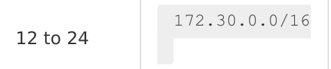

When you specify CIDR blocks for VPCs, take note of the following items:

- If you have only one VPC and the VPC does not need to connect to a data center, you can specify one of the RFC CIDR blocks or their subsets as the VPC CIDR block.

- If you have multiple VPCs, or you want to set up a hybrid cloud environment between a VPC and your data center, we recommend that you specify the subnets of the RFC CIDR blocks for your VPCs. In this case, we recommend that you set the subnet mask length to 16 bits or less. Make sure that the CIDR blocks of the VPCs and your data center do not overlap.

- You cannot specify  `100.64.0.0/10` ,  `224.0.0.0/4` ,  `127.0.0.0/8` ,  `169.254.0.0/16` , or one of their subsets as the custom CIDR block.

- You must check whether a classic network is used before you specify a CIDR block for your VPC. If the classic network is used and you want to connect ECS instances in the classic network to your VPC, do not specify  `10.0.0.0/8`  as the VPC CIDR block because the CIDR block of the classic network is  `10.0.0.0/8` .

**vSwitch CIDR block planning**

The CIDR block of a vSwitch must be a subset of the CIDR block of the VPC to which the vSwitch belongs. For example, if the CIDR block of the VPC is  `192.168.0.0/24` , the network mask of vSwitches in the VPC must be /25 to /29.

When you specify CIDR blocks for vSwitches, take note of the following items:

- The network mask of the IPv4 CIDR block for a vSwitch must be /16 to /29, which can provide 8 to 65,536 IP addresses.

- Make sure that the vSwitch CIDR block is different from the VPC CIDR block.

- When you plan the CIDR block of a vSwitch, you need to consider the number of ECS instances and other cloud resources that can be created in the vSwitch. We recommend that you specify a large CIDR block to reserve sufficient IP addresses for later use. However, if the CIDR block greatly exceeds your business requirements, you cannot expand it. If a VPC CIDR block is  `10.0.0.0/16` , the VPC supports 65,536 IP addresses. Because ECS instances and ApsaraDB RDS instances need to be deployed in vSwitches, we recommend that you specify  `/24`  as the vSwitch network mask, which supports 256 IP addresses. A VPC with a CIDR block of  `10.0.0.0/16`  can be divided into at most 256 vSwitches with a mask of /24. You can make appropriate adjustments based on the preceding suggestions.

- If a vSwitch is assigned an IPv4 CIDR block, the first IPv4 address and last three IPv4 addresses are reserved by the system. If a vSwitch is assigned an IPv6 CIDR block, the first IPv6 address and last nine IPv6 addresses are reserved by the system.

- If multiple VPCs are deployed and a vSwitch needs to connect to another vSwitch in a different VPC or a data center, make sure that the vSwitch CIDR block does not overlap with the peer CIDR block. Otherwise, connection fails.

**Route table planning**

A route table consists of routes. A route consists of the destination CIDR block, next hop type, and next hop. Routes are used to forward traffic to specific destinations. You can refer to the following suggestions to plan the number of route tables.

**Use one route table**

If the traffic paths of vSwitches are not significantly different, you can use one route table. After you create a VPC, the system automatically creates a system route table and adds system routes to the table. You cannot create or delete a system route table. However, you can create custom routes in a system route table to route traffic to specific destinations.

**Use multiple route tables**

If the traffic paths of vSwitches are significantly different, you can use multiple route tables. For example, you need to control Internet access for some instances. You can deploy public vSwitches and private vSwitches. Instances in private vSwitches can use an Internet NAT gateway to access the Internet. This ensures unified control for Internet access and meets isolation requirements.

**Network connection planning**

Apsara Stack provides a secure and scalable cloud network and supports high-speed and secure connections between the cloud and data centers. You can use a VPC to access the Internet, another VPC, and a data center. You can use VPC and other services for networking based on your business requirements.

**Internet access**

We provide the following suggestions on Internet access:

- If your service deployed in an ECS instance needs to access the Internet, you can configure a public IP address for the ECS instance. We recommend that you associate an elastic IP address (EIP) with the ECS instance.

- If only one ECS instance is used to provide services over the Internet, a single point of failure (SPOF) may occur, which affects the system availability. In actual scenarios, we recommend that you use a Server Load Balancer (SLB) instance as the unified Internet traffic ingress and mount multiple ECS instances in different zones to the SLB instance as backend servers. This prevents SPOFs and improves service availability.

- If multiple ECS instances need to access the Internet, you can use the SNAT feature of an Internet NAT gateway to allow the ECS instances to access the Internet by using the EIPs of the NAT gateway. This saves public IP address resources.

- If your ECS instances provide services over the Internet, you can use IPv6 gateways to manage Internet access for the ECS instances in a centralized manner.

**Cross-VPC connection**

You can use the following services to enable communication among VPCs.

- If you use a small number of VPCs, generally no more than five, you can use VPC peering connections to enable communication between VPCs.

- If your network architecture is complex and uses multiple VPCs, you can use CEN to manage VPCs in an efficient and centralized manner. This facilitates O&M and ensures secure data transmission.

- You can also use a VPN gateway to establish a secure connection between two VPCs. However, the network latency is high.

**Hybrid cloud deployment**

You can use the following services to connect a data center to a VPC to build a hybrid cloud.

- If you require high security and low latency, you can use Express Connect circuits to connect your data center to a VPC.

- If you want to reduce costs, you can use a VPN gateway to connect your data center to a VPC by using an encrypted tunnel.

**What are the requirements for cross-VPC connections and hybrid cloud deployment?**

If you want to connect a VPC to another VPC or a data center, make sure that the CIDR blocks do not overlap with each other. When you plan CIDR blocks, take note of the following items:

- You can use subnets of standard CIDR blocks to increase the available number of CIDR blocks supported by a VPC. We recommend that you specify non-overlapping CIDR blocks for different VPCs.

- If you cannot specify non-overlapping CIDR blocks for different VPCs, we recommend that you configure non-overlapping CIDR blocks for vSwitches in different VPCs.

- If you cannot specify non-overlapping CIDR blocks for vSwitches in different VPCs, we recommend that you configure non-overlapping CIDR blocks for vSwitches that need to connect to each other.

**Security planning**

Security isolation includes service isolation, resource isolation, and network isolation. When you plan regions, zones, accounts, and CIDR blocks, you must consider security isolation requirements. You can create RAM users to isolate resources and vSwitches in a VPC to isolate networks. Resource isolation and network isolation are methods to implement service isolation. You can implement isolation based on your business requirements.

| Security layer | Suggestion |
| --- | --- |
| Within a VPC | If you deploy multiple services in a VPC, we recommend that you create a vSwitch for each service and use network access control lists (ACLs) to implement security isolation. |
| Across VPCs | • We recommend that you create public vSwitches and private vSwitches based on your business requirements. You can deploy services that require direct Internet access in public vSwitches and deploy services that do not require direct Internet access in private vSwitches. In addition, we recommend that you use one vSwitch as the Internet traffic ingress and another vSwitch as the internet traffic egress.<br>• We recommend that you use IPv6 gateways for unified access control and use subnet routes or gateway routes together with firewalls for security protection.<br>• We recommend that you configure egress-only rules for the Internet traffic egress to deny access from the Internet. |

**Disaster recovery planning**

You can plan disaster recovery based on your service architecture to ensure data security and service availability.

- If you have high requirements for disaster recovery, you can deploy VPCs in different regions and deploy vSwitches in different zones. This implements cross-region and cross-zone disaster recovery.

- If your service requires fast response, high concurrency, and enhanced data security, you can use SLB to implement cluster recovery, session persistence, and cross-zone deployment.

- If you want to connect your data centers to VPCs by using high-speed and stable connections, you can use Express Connect circuits. This ensures data synchronization, prevents SPOFs, and improves service availability.

- If you have high requirements for service availability, you can use the high-availability virtual IP address (HAVIP) feature together with Keepalived or Heartbeat to create a high-availability network architecture. This ensures that service IP addresses remain unchanged during switchover and improves service availability.

- You can focus on the disaster recovery capability of cloud services. For example, ApsaraDB RDS uses the active/standby architecture. Active endpoints and standby endpoints can be deployed in the same zone or different zones in a region. If you want to improve service availability, you can deploy endpoints in different zones to implement cross-zone disaster recovery.

Before you create a VPC, make sure that you consider the following items: current business scale and future expansion, security isolation, service availability and disaster recovery, costs, numbers of VPCs and vSwitches, and CIDR blocks allocated to VPCs and vSwitches.

<a id="section-3-2"></a>

## 3.2. Plan a VPC

Before you create virtual private clouds (VPCs) and vSwitches, you must decide the quantities and CIDR blocks of VPCs and vSwitches.

- How many VPCs do I need?

- How many vSwitches do I need?

- How do I specify CIDR blocks?

- How do I specify CIDR blocks if I want to connect a VPC to another VPC or a data center?

**How many VPCs do I need?**

- One VPC

  If you do not need to deploy your services across regions or isolate services, we recommend that you create only one VPC.

  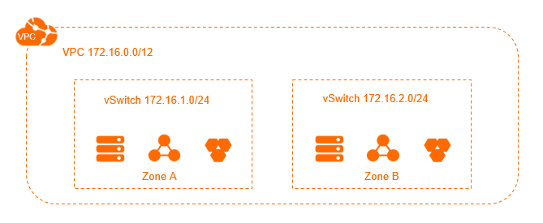

- Multiple VPCs

  We recommend that you create multiple VPCs if you have one of the following requirements:

  - Cross-region deployment

    A VPC cannot be deployed across regions. If you want to deploy your services in different regions, you must create multiple VPCs. You can use Express Connect circuits and VPN gateways to connect VPCs that are deployed in different regions.

    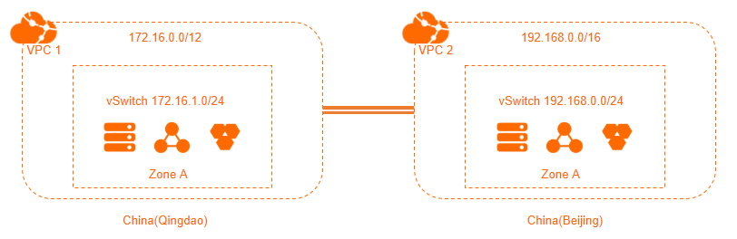

  - Service isolation

    If you want to isolate your services in the same region by using VPCs, you must create multiple VPCs. For example, you can use multiple VPCs to isolate the test environment from the production environment. The following figure shows how the test environment is isolated from the production environment by using VPCs.

    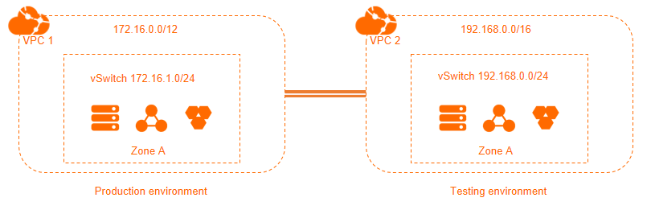

**How many vSwitches do I need?**

When you use a VPC, we recommend that you deploy at least two vSwitches in different zones. This implements cross-zone disaster recovery.

The network latency between different zones in a region is low. However, you need to check the actual network latency after you deploy your services. The network latency may be higher than expected due to complex data processing or cross-zone data transmission. We recommend that you optimize and adjust your service system to meet your requirements for high availability and low latency.

In addition, the scale and planning of your service system must also be taken into consideration when you determine the number of vSwitches to be created. If you want the frontend system that can be accessed over the Internet to access the Internet, you can deploy the frontend system in different vSwitches and deploy the backend system in another vSwitch. This implements disaster recovery.

**How do I specify CIDR blocks?**

When you create VPCs and vSwitches, you must specify their private IP addresses in CIDR block notation.

- Specify the CIDR block of a VPC

  You can specify 172.16.0.0/16, 192.168.0.0/16, or one of their subnets as the CIDR block of a VPC. When you specify CIDR blocks for VPCs, take note of the following items:

  - If you have only one VPC and the VPC does not need to connect to a data center, you can specify one of the preceding CIDR blocks or their subnets as the VPC CIDR block.

  - If you have multiple VPCs, or you want to set up a hybrid cloud environment between a VPC and your data center, we recommend that you specify the subnets of the preceding standard CIDR blocks for your VPCs. In this case, we recommend that you set the subnet mask length to 16 bits or less.

- Specify the CIDR block of a vSwitch

  The CIDR block of a vSwitch must be a subnet of the CIDR block of the VPC to which the vSwitch belongs. For example, if the CIDR block of a VPC is 192.168.0.0/16, the CDIR block of a vSwitch that belongs to the VPC can range from 192.168.0.0/17 to 192.168.0.0/29.

  When you specify CIDR blocks for vSwitches, take note of the following items:

  - The subnet mask of a vSwitch CIDR block must be 16 to 29 bits in length, which provides 8 to 65,536 IP addresses. A 16-bit subnet mask provides IP addresses for 65,532 Elastic Compute Service (ECS) instances, which can meet your requirements in most cases. A subnet mask of more than 29 bits in length provides few IP addresses.

  - The first IP address and the last three IP addresses of each vSwitch CIDR block are reserved. For example, if the CIDR block of a vSwitch is 192.168.1.0/24, the IP addresses 192.168.1.0, 192.168.1.253, 192.168.1.254, and 192.168.1.255 are reserved.

  - When you specify the CIDR block of a vSwitch, you must consider the number of ECS instances that you want to deploy in the vSwitch.

**How do I specify CIDR blocks if I want to connect a VPC to another VPC or a data center?**

If you want to connect a VPC to another VPC or a data center, make sure that the CIDR blocks do not overlap with each other. When you plan CIDR blocks, take note of the following items:

- We recommend that you specify different CIDR blocks for different VPCs. You can use the subnets of standard CIDR blocks if the provided CIDR blocks are insufficient.

- If you cannot specify different CIDR blocks for different VPCs, try to specify different CIDR blocks for vSwitches that belong to different VPCs.

- If neither of the preceding requirements is met, make sure that the CIDR blocks specified for the vSwitches that need to communicate with each other are different.

<a id="section-3-3"></a>

## 3.3. Create a VPC with an IPv4 CIDR block

This topic describes how to create a virtual private cloud (VPC) with an IPv4 CIDR block and associate an elastic IP address (EIP) with an Elastic Compute Service (ECS) instance in the VPC. This way, the ECS instance can access the Internet.

**Prerequisites**

The networks are planned. This allows you to deploy cloud resources in a VPC. For more information, see Plan networks.

**Step 1: Create a VPC**

1. Log on to the VPC console.

2. In the navigation pane on the left, click **VPC**.

3. In the top navigation bar, select the region where you want to create the VPC.

   > **Note**
   >
   > The VPC and the cloud resources that you deploy in it must be in the same region.

4. On the **VPC** page, click **Create VPC**.

5. On the **Create VPC** page, configure the parameters and click **Submit**.

   The following section describes only some of the parameters. Use default values for other parameters. For more information about the parameters, see the "Create a VPC" section of the Create and manage a VPC topic.

   - **IPv4 CIDR Block**: the IPv4 CIDR block that you want to use. In this example, **Recommended CIDR Block** is used.

   - **Recommended CIDR Block**: the recommended IPv4 CIDR Block. In this example, the default value 192.168.0.0/16 is used.

   - **IPv6 CIDR Block**: specifies whether an IPv6 CIDR Block is assigned. In this example, a VPC with an IPv4 CIDR block is created. Therefore, **Do Not Assign** is used.

**Step 2: Create a vSwitch**

1. In the left-side navigation pane, click **VSwitches**.

2. In the top navigation bar, select the region in which you want to create a vSwitch for a VPC.

3. On the **vSwitches** page, click **Create vSwitch**.

4. On the **Create vSwitch** page, configure the parameters and click **Submit**.

   The following section describes only some of the parameters. Use default values for other parameters. For more information about the parameters, see the "Create a vSwitch" section of the Create and manage a vSwitch topic.

   - **Zone**: the zone in which the vSwitch is deployed. The supported cloud resources vary based on the zone and the creation time of the cloud resources. The actual instance specifications displayed on the buy page shall prevail.

   - **IPv4 network segment**: the IPv4 CIDR block of the vSwitch. In this example, the default IPv4 CIDR block is used.

   - **IPv6 network segment**: the IPv6 CIDR block of the vSwitch. If the VPC is not assigned an IPv6 CIDR block, the vSwitch is not assigned an IPv6 CIDR block. In this example, no IPv6 CIDR block is assigned to the vSwitch.

**Step 3: Create a security group**

1. In the top navigation bar, choose **Products > Computing > Elastic Compute Service**.

2. In the left-side navigation pane, choose **Network & Security > Security Groups**.

3. On the **Security Groups** page, click **Create Security Group**.

4. On the **Create Security Group** page, configure the parameters and click **Submit**.

   For more information, see the **Create a security group** topic in the **Quick start** chapter of **Elastic Compute Service User Guide**.

**Step 4: Create an ECS instance**

1. In the top navigation bar, choose **Products > Networking > Virtual Private Cloud**.

2. In the left-side navigation pane, click **VSwitches**.

3. In the top navigation bar, select the region in which you want to create a vSwitch for a VPC.

4. On the **vSwitch** page, find the vSwitch that you want to manage and choose **... > Create ECS Instance** in the **Actions** column.

5. On the **Create Instance** page, configure the parameters.

   In this example, **Do Not Assign** is selected for the **IPv6** parameter. For more information about other parameters, see the **Create an instance** topic in the **Quick start** chapter of **Elastic Compute Service User Guide**.

**Step 5: Create an EIP and associate the EIP with the ECS instance**

1. Log on to the EIP console.

2. On the **EIP** page, click **Create EIP**.

3. On the **Create EIP** page, configure the parameters and click **Submit**. For more information, see the "Apply for an EIP" section of the Create and manage an EIP topic.

4. On the **EIP** page, find the EIP that you created and click **Bind** in the **Actions** column.

5. In the **Associate EIP with Resource** dialog box, configure the parameters and click **Confirm**. For more information, see the "Associate the EIP with an ECS instance" section of the Associate an EIP with a cloud resource topic.

   - **Instance Type**: the type of the cloud resource with which you want to associate with the EIP. Select **ECS Instance** from the drop-down list.

   - **Select The to Bind**: the ECS instance with which you want to associate with the EIP. Select the ECS instance that you created in Step 4.

<a id="section-3-4"></a>

## 3.4. Create a VPC with an IPv6 CIDR block

To enable private IPv6 communication among Elastic Compute Service (ECS) instances in a virtual private cloud (VPC), you can create ECS instances with IPv6 addresses in the VPC. Make sure that IPv6 is enabled for the VPC.

**Prerequisites**

Before you deploy cloud resources in a VPC, you must plan your networks. For more information, see Plan networks.

**Step 1: Create a VPC**

1. Log on to the VPC console.

2. In the navigation pane on the left, click **VPC**.

3. In the top navigation bar, select the region where you want to create the VPC.

   > **Note**
   >
   > The VPC and the cloud resources that you deploy in it must be in the same region.

4. On the **VPC** page, click **Create VPC**.

5. On the **Create VPC** page, configure the parameters and click **Confirm Order**.

   The following parameters are ones to which you need to pay attention in this topic. Parameters not listed below use the default values. For more information about the parameters, see the "Create a VPC" section of the Create and manage a VPC topic.

   - **IPv4 CIDR Block**: Select **Recommended CIDR Block**.

   - **Recommended CIDR Block**: Select 192.168.0.0/16, which is the default value.

   - **IPv6 CIDR Block**: Select **Assign**. Then, select **BGP** for the **Address Pool** parameter. The system automatically assigns an IPv6 CIDR block whose subnet mask is  `/56`  to the VPC and creates an IPv6 gateway. By default, IPv6 addresses are used only for communication within private networks. After you create a VPC, you cannot change its IPv6 CIDR block. However, you can add a secondary IPv6 CIDR block to the VPC.

**Step 2: Create a vSwitch**

1. In the left-side navigation pane, click **VSwitches**.

2. In the top navigation bar, select the region in which you want to create a vSwitch for a VPC.

3. On the **vSwitches** page, click **Create vSwitch**.

4. On the **Create vSwitch** page, configure the parameters and click **Confirm Order**.

   The following parameters are ones to which you need to pay attention in this topic. Parameters not listed below use the default values. For more information about the parameters, see the "Create a vSwitch" section of the Create and manage a vSwitch topic.

   - **Zone**: the zone in which the vSwitch is deployed. The supported cloud resources vary based on the zone and the creation time of the cloud resources. The actual resources of instance types displayed on the buy page shall prevail.

   - **IPv4 CIDR block**: the IPv4 CIDR block of the vSwitch. In this example, the default IPv4 CIDR block is used.

   - **IPv6 CIDR block**: the IPv6 CIDR block of the vSwitch. By default, the subnet mask of the IPv6 CIDR block for the vSwitch is  `/64` . You can enter a decimal number from 0 to 255 to define the last 8 bits of the IPv6 CIDR block.

**Step 3: Create a security group**

1. In the top navigation bar, choose **Products > Computing > Elastic Compute Service**.

2. In the left-side navigation pane, choose **Network & Security > Security Groups**.

3. On the **Security Groups** page, click **Create Security Group**.

4. On the **Create Security Group** page, configure the parameters and click **Confirm Order**.

   For more information, see the **Create a security group** section in the **Quick start** chapter of **ECS User Guide**.

**Step 4: Create and configure an ECS instance**

After you create an ECS instance, you must allocate the assigned IPv6 address to the elastic network interface (ENI) of the ECS instance.

1. In the top navigation bar, choose **Products > Networking > Virtual Private Cloud**.

2. In the left-side navigation pane, click **VSwitches**.

3. In the top navigation bar, select the region in which you want to create a vSwitch for a VPC.

4. On the **VSwitches** page, find the vSwitch that you want to manage and choose **... > Create ECS Instance** in the **Actions** column.

5. On the **Create Instance** page, configure the parameters.

   In this example, **Assign** is selected for the **IPv6** parameter. For more information about other parameters, see the **Create an instance** section in the **Quick start** chapter of **ECS User Guide**.

6. In the top navigation bar, choose **Products > Computing > Elastic Compute Service**.

7. In the left-side navigation pane, choose **Instances & Images > ECS Instances**.

8. On the **ECS Instances** page, find the ECS instance that you want to manage and click the instance ID in the **Instance ID/Name** column to view the assigned IPv6 address.

9. Configure the static IPv6 address.

   - If the image of your ECS instance supports DHCPv6, you do not need to manually configure the static IPv6 address. DHCPv6 enables automatic configuration of IPv6 addresses. Therefore, if the image of your ECS instance supports DHCPv6, the ECS instance uses the assigned IPv6 address for communication within the private network.

     The following images support DHCPv6:

     - Linux images

       - CentOS 7.6 IPV6 64Bit

       - CentOS 6.10 64Bit

       - SUSE Linux Enterprise Server 12 SP4 64Bit

     - Windows Server images

   - If the image of your ECS instance does not support DHCPv6, you must manually configure the IPv6 address for your ECS instance. For more information, see the relevant documentation.

**Step 5: Purchase IPv6 Internet bandwidth**

By default, IPv6 addresses are used only for communication within private networks. If you want to use an IPv6 address to access the Internet or provide services to IPv6 clients over the Internet, you must purchase Internet bandwidth for the IPv6 address.

1. In the top navigation bar, choose **Products > Networking > Virtual Private Cloud**.

2. In the left-side navigation pane, click **IPv6 Gateways**.

3. In the top navigation bar, select the region in which you want to create an IPv6 gateway.

4. On the **IPv6 Gateways** page, find the IPv6 gateway that you want to manage and click its ID in the **IPv6 Gateway ID/Name** column or **Manage** in the **Actions** column.

5. On the **IPv6 Gateway Details** page, click the **IPv6 Public Network Bandwidth** tab.

6. In the **Basic Information** section, find the IPv6 address that you want to manage and click **Open Public Network Bandwidth** in the **Actions** column. You can specify a filter condition to filter IPv6 addresses.

7. On the **IPv6 public network bandwidth** page, configure the **Bandwidth** parameter and click **Submit**.

**Step 6: Configure security group rules**

Communication between services that are assigned IPv4 addresses and services that are assigned IPv6 addresses is not supported. If the current security group rules do not support your IPv6 services, you must configure IPv6 security group rules for ECS instances.

For more information about how to configure security group rules, see the **Add a security group rule** section in the **Security groups** chapter of **ECS User Guide**.

**Step 7: Verify network connectivity**

Log on to the ECS instance and **ping** an IPv6 service to verify the network connectivity.

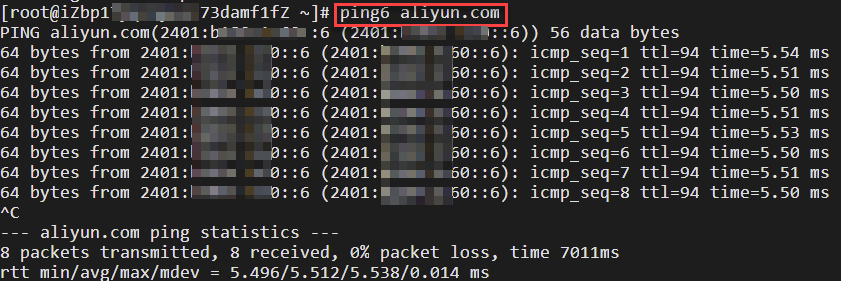

<a id="section-3-5"></a>

## 3.5. Add subnet routes to a route table

You can create a custom route table in a virtual private cloud (VPC) and add subnet routes to the custom route table. Then, you can associate the custom route table with a vSwitch to control the traffic of the vSwitch. This facilitates network management.

**Prerequisites**

A VPC and a vSwitch are created. For more information, see Create a VPC with an IPv4 CIDR block.

**Step 1: Create a custom route table**

1. Log in to the VPC console.

2. In the left-side navigation pane, click **Route Tables**.

3. In the top navigation bar, select the region in which you want to create a custom route table.

4. On the **Route Tables** page, click **Create Route Table**.

5. On the **Create Route Table** page, configure the following parameters and click Submit.

   <table>
     <tr>
       <th>Parameter</th>
       <th>Description</th>
     </tr>
     <tr>
       <td colspan="2">Basic Information</td>
     </tr>
     <tr>
       <td>Organization/Res ource Set</td>
       <td>The organization and resource set to which the route table belongs.</td>
     </tr>
     <tr>
       <td>Region</td>
       <td>The region in which you want to create the route table.</td>
     </tr>
     <tr>
       <td>VPC</td>
       <td>The VPC for which you want to create the route table.<br>Note<br>You can also click <strong>Create VPC</strong> to create a VPC.</td>
     </tr>
     <tr>
       <td>Name</td>
       <td>The name of the route table.<br>The name must be 2 to 128 characters in length, and can contain letters, digits, periods (.), underscores (_), and hyphens (-). It must start with a letter and cannot start with <code> http:// </code> or <code> https:// </code>.</td>
     </tr>
     <tr>
       <td>Description</td>
       <td>The description of the route table.<br>The description must be 2 to 256 characters in length, and cannot start with <code> http:// </code> or <code> https:// </code>.</td>
     </tr>
   </table>

   > **Note**
   >
   > After you complete the configuration, you can view and check the configuration of the route table in the right-side **Configuration overview** section.
   >
   > Click the value of a parameter to quickly navigate to the parameter and modify the value based on your business requirements.

6. Creates the custom route table.

   - Confirm the parameters and click **Confirm Order** if the following requirements are met: On the Service Management page, a service is created, and **Route Table** is displayed in the **Cloud resources** column of the service.

   - If no service whose **Cloud resources** value is **Route Table** exists on the Service Management page, confirm the parameters and click **Submit**.

   For more information about service management, see the **Service management** topic in the **User Guide for Apsara Uni-manager Management Console**.

**Step 2: Add subnet routes**

1. Log in to the VPC console.

2. In the left-side navigation pane, click **Route Tables**.

3. In the top navigation bar, select the region in which you want to create a custom route table.

4. On the **Route Tables** page, find the route table that you want to manage and click the ID in the **Route Table ID/Name** column or **Manage** in the **Actions** column.

5. On the **Basic Information** tab of the route table details page, click the **Routing Entry List** tab.

6. Click **Add Route Entry**.

7. In the **Add Route Entry** dialog box, configure the parameters described in the following table and click **OK**.

   <table>
     <tr>
       <th>Parameter</th>
       <th>Description</th>
     </tr>
     <tr>
       <td>Destinatio n CIDR Block</td>
       <td>Select a destination CIDR block type. Valid values:<br>• IPv4 CIDR Block<br>• IPv6 CIDR Block</td>
     </tr>
     <tr>
       <td colspan="2">After you configure the <strong>Destination CIDR Block</strong> parameter, specify a CIDR block.<br>If you set the <strong>Destination CIDR block</strong> parameter to <strong>IPv4 CIDR Block</strong>, you can click <strong>Add CIDR</strong> <strong>Block</strong> to enter multiple destination CIDR blocks.</td>
     </tr>
     <tr>
       <td>Next Hop Type</td>
       <td>Select a next hop type.<br>• If you set the <strong>Destination CIDR Block</strong> parameter to <strong>IPv4 CIDR Block</strong>, you can select one of the following types of next hops:<br>• <strong>ECS Instance</strong>: routes the traffic destined for the specified CIDR block to the specified Elastic Compute Service (ECS) instance. Select this option if you want to route traffic to a specific ECS instance for centralized traffic forwarding and management. For example, you can configure an ECS instance as the Internet-facing gateway to route traffic from other ECS instances to the Internet.<br>• <strong>Highly-availability Virtual IP Address</strong>: routes the traffic destined for the specified CIDR block to the specified high-availability virtual IP address (HAVIP).<br>• <strong>VPN Gateway</strong>: routes the traffic destined for the specified CIDR block to the specified VPN gateway.<br>• <strong>NAT Gateway</strong>: routes the traffic destined for the specified CIDR block to the specified NAT gateway.<br>• <strong>ENI</strong>: routes the traffic destined for the specified CIDR block to the specified secondary elastic network interface (ENI).<br>• <strong>Router Interface (VPC Direction)</strong>: routes the traffic destined for the specified CIDR block to the specified VPC. Select this option if you want to connect to a VPC over an Express Connect circuit.<br>• <strong>Router Interface (Border Router Direction)</strong>: routes the traffic destined for the specified CIDR block to the router interface associated with the specified virtual border router (VBR). Select this option if you want to connect to a data center over an Express Connect circuit.<br>If you select Router Interface (Border Router Direction), you must also select a routing mode. Valid values:<br>• <strong>General Route</strong>: allows you to select an associated router interface.<br>• <strong>Active/Standby Routes</strong>: allows you to select two instances as the next hops. The active route has a weight of 100, and the standby route has a weight of 0. The standby route takes over if the active route fails health checks.<br>• <strong>Load-Balancing Routes</strong>: allows you to select two to eight instances as the next hops. The instances must have the same weight, which must be an integer from 0 to 255. Network traffic is evenly distributed to the next hops.<br>• <strong>Transit Router</strong>: routes the traffic destined for the specified CIDR block to the specified transit router.<br>• If you set the <strong>Destination CIDR Block</strong> parameter to <strong>IPv6 CIDR Block</strong>, you can select one of the following types of next hops:<br>• (<strong>Custom route tables only</strong>) <strong>IPv6 Gateway</strong>: routes the traffic destined for the destination CIDR block to the specified IPv6 gateway.<br>• <strong>ENI</strong>: routes the traffic destined for the specified CIDR block to the specified secondary ENI.<br>• (<strong>System route tables only</strong>)<br><strong>Router Interface (VPC Direction)</strong>: routes the traffic destined for the specified CIDR block to the specified VPC. Select this option if you want to connect to a VPC over an Express Connect circuit.<br>• <strong>Router Interface (Border Router Direction)</strong>: routes the traffic destined for the specified CIDR block to the router interface associated with the specified virtual border router (VBR). Select this option if you want to connect to a data center over an Express Connect circuit.<br>If you select Router Interface (Border Router Direction), you must also select a routing mode. Valid values:<br>• <strong>General Route</strong>: allows you to select an associated router interface.<br>• <strong>Active/Standby Routes</strong>: allows you to select two instances as the next hops. The active route has a weight of 100, and the standby route has a weight of 0. The standby route takes over if the active route fails health checks.<br>• <strong>Load-Balancing Routes</strong>: allows you to select two to eight instances as the next hops. The instances must have the same weight, which must be an integer from 0 to 255. Network traffic is evenly distributed to the next hops.</td>
     </tr>
     <tr>
       <td colspan="2">After you configure the <strong>Next Hop Type</strong> parameter, you must select an instance as the next hop of the selected next hop type.<br>Note<br>• You can enter a keyword or configure the advanced filter to search for the next hop that you want to use.<br>• You can also click the icon to create an instance as the next hop of the selected next<br><br>hop type.<br>• If you select <strong>Router Interface (Border Router Direction)</strong> as <strong>Next Hop Type</strong> and <strong>Active/Standby Routes</strong> as <strong>Router Interface (Border Router Direction)</strong>, you can select two instances as the <strong>primary and secondary</strong> next hops.<br>• If you select <strong>Router Interface (Border Router Direction)</strong> as <strong>Next Hop Type</strong> and <strong>Load-Balancing Routes</strong> as Router Interface (Border Router Direction), click <strong>Add Next</strong> <strong>Hop</strong>. In the Add Next Hop dialog box, configure the <strong>Routing</strong> and <strong>Weight</strong> parameters to select instances as the next hops.</td>
     </tr>
     <tr>
       <td>Remarks</td>
       <td>Enter a description.<br>The description must be 1 to 256 characters in length, and cannot start with http://or https://.</td>
     </tr>
   </table>

**Step 3: Associate the custom route table with a vSwitch**

You can associate the custom route table with a vSwitch to manage the routes of the vSwitch. You can associate only one system route table or custom route table with a vSwitch. Perform the following operations to associate the custom route table with a vSwitch:

1. Log in to the VPC console.

2. In the left-side navigation pane, click **Route Tables**.

3. In the top navigation bar, select the region in which you want to create a custom route table.

4. On the **Route Tables** page, find the route table that you want to manage and click its ID in the **Route Table ID/Name** column or **Manage** in the **Actions** column.

5. On the **Basic Information** tab of the **Details** page, click the **Associated vSwitches** tab.

6. On the Associated vSwitches tab, click **Associate vSwitch**.

7. In the dialog box that appears, select the vSwitch with which you want to associate the route table and click **OK**.

<a id="section-3-6"></a>

## 3.6. Configure a NAT gateway

SNAT and DNAT allow Elastic Compute Service (ECS) instances in a virtual private cloud (VPC) to communicate with the Internet by using a NAT gateway. This topic describes how to configure SNAT and DNAT.

**Prerequisites**

VPCs and vSwitches are created. For more information, see Create a VPC with an IPv4 CIDR block.

**Procedure**

In this example, an ECS instance that is deployed in a VPC and is not associated with an elastic IP address (EIP) is used. The following figure shows the procedure for configuring a NAT gateway.

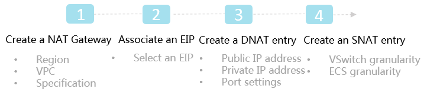

**Step 1: Create a NAT gateway**

1. Log in to the VPC console.

2. In the left-side navigation pane, click **NAT Gateways**.

3. In the top navigation bar, select the region in which you want to create a NAT gateway.

4. On the **NAT Gateways** page, click **Create NAT Gateway**.

5. On the **NAT Gateway** page, configure the parameters described in the following table.

   <table>
     <tr>
       <th>Parameter</th>
       <th>Description</th>
     </tr>
     <tr>
       <td colspan="2">Area</td>
     </tr>
     <tr>
       <td>Organization/Resour ce Set</td>
       <td>The organization and resource set to which the NAT gateway belongs.</td>
     </tr>
     <tr>
       <td>Region</td>
       <td>The region in which you want to create the NAT gateway.</td>
     </tr>
     <tr>
       <td colspan="2">Billing configuration</td>
     </tr>
     <tr>
       <td>Billing method</td>
       <td>The method used to charge for a cloud service based on usage. By default, <strong>Pay-As-You-Go</strong> is selected.<br><strong>Pay-As-You-Go</strong>: You use resources first and are then billed based on your actual usage. This method is suitable for scenarios with fluctuating business workloads. It lets you use resources flexibly as needed and avoid waste.<br>Note<br>This option is displayed only if your administrator has configured billing rules in the Operations Hub. For more information about billing rules, see the <strong>Billing rules</strong> topic in the <strong>User Guide for</strong> <strong>Apsara Uni-manager Management Console</strong>.</td>
     </tr>
     <tr>
       <td colspan="2">Basic Configurations</td>
     </tr>
     <tr>
       <td>VPC</td>
       <td>The VPC in which you want to create the NAT gateway.<br>Note<br>• You can click <strong>Create VPC</strong> to create a VPC.<br>• If you cannot find the required VPC from the drop-down list, perform the following operations for troubleshooting:<br>• Check whether a NAT gateway is already deployed in the VPC. Only one NAT gateway can be deployed in each VPC.<br>• Check whether the VPC contains a custom route entry whose destination CIDR block is 0.0.0.0/0. If such a route exists, delete it.</td>
     </tr>
     <tr>
       <td>Sharing Scope</td>
       <td>The sharing scope of the VPC. Valid values:<br>• <strong>Current Resource Set</strong>: Only the administrator of the current resource set can use the VPC to create resources.<br>• <strong>Organization and lower-level organizations</strong>: Only the administrators of the current organization and its subordinate organizations can use the VPC to create resources.<br>• <strong>Current Organization</strong>: Only the administrator of the current organization can use the VPC to create resources.</td>
     </tr>
     <tr>
       <td>Specifications</td>
       <td>The specifications of the NAT gateway. Valid values:<br>• <strong>Small</strong>: supports at most 10,000 SNAT connections.<br>• <strong>Medium</strong>: supports at most 50,000 SNAT connections.<br>• <strong>Large</strong>: supports at most 200,000 SNAT connections.<br>• <strong>Super Large-1</strong>: supports at most 1,000,000 SNAT connections.<br>• Custom specifications: the custom specifications that are created for NAT gateways based on business and environment requirements.<br>Note<br>The maximum number of SNAT connections is limited by the specifications of a NAT gateway. However, the specifications do not affect the maximum number of DNAT connections.</td>
     </tr>
     <tr>
       <td>Name</td>
       <td>The name of the NAT gateway.<br>The name must be 2 to 128 characters in length, and can contain letters, digits, underscores (_), hyphens (-), and periods (.). It must start with a letter and cannot start with <code> http:// </code> or <code> https:// </code>.</td>
     </tr>
   </table>

   > **Note**
   >
   > After you complete the configuration, view and check the configuration of the NAT gateway displayed in the right-side **Configuration overview** section.
   >
   > - You can click the value of a parameter to navigate to the parameter and modify the value based on your business requirements.
   >
   > - Click **Quota Management** to manage the quotas of cloud services if the organization or resource set has no quotas, or click **Manage** in the **Quota** section to manage the quotas of cloud services if the organization or resource set has quotas.
   >
   >   For more information about quota management, see the **Quotas** topic in **Apsara Uni-manager Operations Console User Guide**.

6. Create the NAT gateway.

   - Confirm the parameters and click **Confirm Order** if the following requirements are met: On the Service Management page, a service is created, and **NAT Gateway** is displayed in the **Cloud resources** column of the service.

   - If the service whose **Cloud resources** value is **NAT Gateway** does not exist on the Service Management page, confirm the parameters and click **Submit**.

   For more information about service management, see the **Service management** topic in the **User Guide for Apsara Uni-manager Management Console**.

**Step 2: Associate an EIP with the NAT gateway**

1. Log in to the VPC console.

2. In the left-side navigation pane, click **NAT Gateways**.

3. In the top navigation bar, select the region in which you want to create a NAT gateway.

4. On the **NAT Gateways** page, find the NAT gateway that you want to manage and associate an EIP with it by using one of the following methods:

   - Choose  **> Associate EIP** in the **Actions** column.

   - Click **Bind Immediately** in the **EIP** column.

5. In the **Associate EIP** dialog box, configure the following parameter and click **OK**.

   | Parameter | Description |
   | --- | --- |
   | List of Available EIPs | Select the EIP that you want to associate with the NAT gateway.<br>Note<br>You can also click <strong>Create EIP</strong> to create an EIP and then associate it with the NAT gateway. |

**Step 3: Create a DNAT entry**

1. Log in to the VPC console.

2. In the left-side navigation pane, click **NAT Gateways**.

3. In the top navigation bar, select the region in which you want to create a NAT gateway.

4. On the **NAT Gateways** page, find the NAT gateway that you want to manage and click **Set DNAT** in the **Actions** column.

5. On the **DNAT** tab of the **NAT Gateway Details** page, click **Create DNAT Entry**.

6. In the **Create DNAT Entry** panel, configure the parameters described in the following table and click **OK**.

   | Parameter | Description |
   | --- | --- |
   | Entry Name | The name of the DNAT entry.<br>The name must be 2 to 128 characters in length, and can contain letters, digits, underscores (_), hyphens (-), and periods (.). It must start with a letter and cannot start with <code> http:// </code> or <code> https:// </code>. |
   | IP Address Type | The type of the public IP address. Valid values:<br>• Bandwidth Plan<br>• EIP |
   | Public IP address | The available NAT service plan or EIP. You cannot select a public IP address that is already specified in an SNAT entry.<br>You can also click <strong>Apply for NAT Bandwidth</strong> to create a NAT service plan or click <strong>Create EIP</strong> to create an EIP based on the value of the <strong>IP Address Type</strong> parameter. |
   | Private IP address | The private IP address of the ECS instance that uses the DNAT entry to provide services over the Internet. You can specify the private IP address of the ECS instance by using one of the following methods:<br>• <strong>Existing IP Address from ECS or ENI</strong>: select an ECS instance from the list. You can filter IP addresses by instance ID or instance name, or directly enter an IP address.<br>• <strong>Custom</strong>: enter the private IP address of the ECS instance.<br>Note<br>The custom private IP address must fall within the CIDR block of the VPC.You can also enter the private IP address of an ECS instance that is already deployed in the VPC. |
   | Port Settings | The DNAT mapping method. Valid values:<br>• <strong>All Ports</strong>: uses IP mapping. All requests destined for the specified public IP address are forwarded to the specified ECS instance.<br>• <strong>Specific Port</strong>: uses port mapping. The NAT gateway forwards requests destined for the specified public IP address to the specified ECS instance based on the specified protocol and ports. |
   | Public Network Port | The external port used for port forwarding. This parameter is available only when the <strong>Port Settings</strong> parameter is set to <strong>Specific Port</strong>. Valid values: 1 to 65535. |
   | Private Network Port | The internal port used for port forwarding. This parameter is available only when the <strong>Port Settings</strong> parameter is set to <strong>Specific Port</strong>. Valid values: 1 to 65535. |
   | Protocol Type | The protocol type of the forwarding ports. Valid values: <strong>TCP</strong> and <strong>UDP</strong>. This parameter is available only when the <strong>Port Settings</strong> parameter is set to <strong>Specific</strong> <strong>Port</strong>. |

**Step 4: Create an SNAT entry**

1. Log in to the VPC console.

2. In the left-side navigation pane, click **NAT Gateways**.

3. In the top navigation bar, select the region in which you want to create a NAT gateway.

4. On the **NAT Gateways** page, find the NAT gateway that you want to manage and choose<strong>... > Set SNAT</strong> in the **Actions** column.

5. On the **SNAT** tab of the **NAT Gateway Details** page, click **Create SNAT Entry**.

6. In the **Create SNAT Entry** panel, configure the parameters described in the following table and click **OK**.

   | Parameter | Description |
   | --- | --- |
   | Granularity Setting | Select the scope to which the SNAT entry applies. Valid values:<br>• Specify vSwitch<br>• <strong>IP Address Type</strong>: Select <strong>Bandwidth Package</strong> or <strong>EIP</strong>.<br>• <strong>vSwitch</strong>: Select a vSwitch in the VPC. The ECS instances connected to the specified vSwitch use the public IP addresses in the SNAT entry to access the Internet. You cannot select vSwitches that are already specified in an SNAT entry.<br>• A vSwitch can be specified only in one SNAT entry.<br>• You can enter the IP address or specify advanced filter conditions to search for a specific vSwitch. You can select multiple vSwitches.<br>• <strong>vSwitch CIDR Block</strong>: the CIDR block of the selected vSwitch.<br>• Specify ECS Instance<br>• <strong>IP Address Type</strong>: Select <strong>Bandwidth Package</strong> or <strong>EIP</strong>.<br>• <strong>List of Available ECS</strong>: Select the ECS instance to which the SNAT entry applies in the VPC. The selected ECS instance uses the public IP address specified in the SNAT entry to access the Internet. Make sure that the ECS instance is running and does not have a fixed public IP address or EIP.<br>• If no ECS is available in the list, check whether the resource set limit switch <strong>strictOwnership</strong> is turned on for <strong>VPC</strong>.<br>For more information about how to configure the switch, see <strong>Service</strong> <strong>console configuration management</strong> in <strong>O&amp;M of management</strong> <strong>services</strong> of <strong>Apsara Uni-manager Operations Console User</strong> <strong>Guide</strong>.<br>• You can enter the IP address or specify advanced filter conditions to search for a specific ECS instance. You can select multiple ECS instances.<br>• <strong>ECS CIDR Block</strong>: the CIDR block of the selected ECS instance.<br>• Custom CIDR Block Granularity<br>• <strong>IP Address Type</strong>: Select <strong>Bandwidth Package</strong> or <strong>EIP</strong>.<br>• <strong>Custom CIDR block</strong>: Enter a custom CIDR block. |

   <table>
     <tr>
       <td>Public IP Address</td>
       <td>The public IP address that you want to use to access the Internet. You cannot select a public IP address that is already specified in an SNAT entry.<br>You can select one or more public IP addresses to create an SNAT IP address pool.<br>You can also click <strong>Apply for NAT Bandwidth</strong> to create a NAT bandwidth plan or click <strong>Create EIP</strong> to create an EIP based on the value of the <strong>IP Address</strong> <strong>Type</strong> parameter.<br>Note<br>• If you want to configure an SNAT IP address pool that contains multiple IP addresses, make sure all the IP addresses are added to the same shared bandwidth.<br>• The maximum bandwidth of each IP address in the SNAT IP address pool is 200 Mbit/s. For every 200 Mbit/s of bandwidth increased for the shared bandwidth, you must add at least one additional IP address to the SNAT IP address pool.<br>• If you add IP addresses to or delete IP addresses from an existing SNAT entry, transient disconnections may occur. Proceed with caution.</td>
     </tr>
     <tr>
       <td>Entry Name</td>
       <td>Enter a name for the SNAT entry.<br>The name must be 2 to 128 characters in length, and can contain letters, digits, underscores (_), and hyphens (-). The name must start with a letter.</td>
     </tr>
   </table>

<a id="section-3-7"></a>

## 3.7. Configure an EIP

This topic describes how to create an elastic IP address (EIP) and associate the EIP with an Elastic Compute Service (ECS) instance. This allows the ECS instance to access the Internet.

**Prerequisites**

An ECS instance is created. For more information, see the **Create an ECS instance** topic in **Quick start** of **ECS User Guide**.

**Procedure**


**Step 1: Apply for an EIP**

1. Log in to the EIP console.

2. On the **EIP** page, click **Create EIP**.

3. On the **Create EIP** page, configure the parameters described in the following table.

   <table>
     <tr>
       <th>Parameter</th>
       <th>Description</th>
     </tr>
     <tr>
       <td colspan="2">Billing configuration</td>
     </tr>
     <tr>
       <td>Billing method</td>
       <td>The billing method of the EIP. By default, <strong>Pay-as-you-go</strong> is selected.<br><strong>Pay-as-you-go</strong>: Users use services, and fees are generated afterward based on the actual amount of used resources. This method is suitable for scenarios in which business usage frequently fluctuates, which allows users to flexibly utilize resources based on actual needs and avoid waste.<br>Note<br>This parameter is displayed only if the administrator has configured billing rules in the operations center. For more information about the billing rules, see the <strong>Create a billing configuration</strong> topic in <strong>Apsara Uni-manager</strong> <strong>Operations Console User Guide</strong>.</td>
     </tr>
     <tr>
       <td colspan="2">Area</td>
     </tr>
     <tr>
       <td>Organization/R esource Set</td>
       <td>The organization and resource set to which the EIP belongs.</td>
     </tr>
     <tr>
       <td>Region</td>
       <td>The region in which you want to create the EIP.<br>Make sure that the EIP and the cloud resource that you want to associate with the EIP reside in the same region.</td>
     </tr>
     <tr>
       <td colspan="2">Basic Configurations</td>
     </tr>
     <tr>
       <td>Quantity</td>
       <td>The number of EIPs that you want to create.</td>
     </tr>
     <tr>
       <td>Name</td>
       <td>The name of the EIP.<br>The name must be 2 to 128 characters in length, and can contain letters, digits, periods (.), underscores (_), and hyphens (-). It must start with a letter and cannot start with <code> http:// </code> or <code> https:// </code>.</td>
     </tr>
     <tr>
       <td>Line Type</td>
       <td>The line type of the EIP.<br>Default value: <strong>BGP</strong>. You can also select another line type.</td>
     </tr>
     <tr>
       <td>Network Type</td>
       <td>The network type of the EIP. Valid values:<br>• <strong>Internet</strong>: The EIP is used for communication over the Internet.<br>• <strong>Hybrid Cloud</strong>: The EIP is used for hybrid-cloud communication. For example, if you want to allow a data center to access the Internet by using SNAT and DNAT, you must select this value.</td>
     </tr>
     <tr>
       <td>Service IP Address</td>
       <td>The IP address of the EIP.<br>Make sure that you enter an idle IPv4 address. If the IPv4 address is already used, the EIP fails to be created.<br>Note<br>If you do not specify an IPv4 address, a random IPv4 address is allocated.</td>
     </tr>
     <tr>
       <td>Maximum Bandwidth</td>
       <td>The maximum bandwidth of the EIP. Unit: Mbit/s.</td>
     </tr>
   </table>

   > **Note**
   >
   > After you complete the configuration, you can view and check the configuration of the EIP in the right-side **Configuration overview** section.
   >
   > - Click the value of a parameter to quickly navigate to the parameter and modify the value based on your business requirements.
   >
   > - Click **Quota Management** to manage the quotas of cloud services if the organization or resource set has no quotas, or click **Manage** in the **Quota** section to manage the quotas of cloud services if the organization or resource set has quotas.
   >
   >   For more information about quota management, see the **Quotas** topic in **Apsara Uni-manager Operations Console User Guide**.

4. Create the EIP.

   - Confirm the parameters and click **Confirm Order** if the following requirements are met: On the Service Management page, a service is created and **EIP** is displayed in the **Cloud resources** column of the service.

   - If the service whose **Cloud resources** value is **EIP** does not exist on the Service Management page, confirm the parameters and click **Submit**.

   For more information about service management, see the **Service management** topic in the **User Guide for Apsara Uni-manager Management Console**.

5. Optional. After the EIP is created, click the

   icon in the upper-right corner of the **EIP**

   

   page. In the dialog box that appears, select the columns that you want to export, such as Instance ID, Organization, and Resource Set, and click **OK** to export the information about the existing EIPs.

**Step 2: Associate the EIP with an ECS instance**

1. Log in to the EIP console.

2. On the **EIP** page, find the EIP that you want to manage and click **Bind** in the **Actions** column.

3. In the **Associate EIP with Resource** dialog box, configure parameters by referring to the following information and click **Confirm** to associate the EIP with an ECS instance.

   **Associate the EIP with an ECS instance**

   After an Elastic Compute Service (ECS) instance is associated with an EIP, the ECS instance can communicate with the Internet.

   > **Note**
   >
   > Make sure that an ECS instance is created. For more information, see the **Create an ECS instance** topic in **Quick start** of **ECS User Guide**.

   | Parameter | Description |
   | --- | --- |
   | Instance Type | Select <strong>ECS instance</strong>. |
   | Binding Mode | Select the mode in which you want to associate the EIP. You can select only <strong>Normal Mode</strong>. The normal mode is the NAT mode.<br>Normal Mode:<br>• Both the private IP address and public IP address of the secondary ENI are available for use.<br>• You cannot view the EIP in the operating system. However, you can query the EIP associated with the secondary ENI by calling an API operation.<br>• EIPs in normal mode do not support NAT ALG protocols such as H.323, SIP, DNS, RTSP, or TFTP. |
   | Select the to Bind | Select the ECS instance with which you want to associate the EIP.<br>Make sure that the ECS instance meets the following requirements:<br>• The ECS instance is deployed in a VPC.<br>• The ECS instance is in the In operation or Stopped state.<br>• The ECS instance is not associated with an EIP.<br>• The ECS instance and the EIP reside in the same region.<br>• The ECS instance is not assigned a static public IP address.<br>Note<br>• You can enter a keyword or specify advanced filter conditions to search for a specific ECS instance.<br>• You can also click <strong>Create Cloud Server ECS</strong> to create an ECS instance. |

**Step 3: Test the network connectivity**

Log on to the ECS instance associated with the EIP and run the following command to test whether the ECS instance can access the Internet.

```text
ping <a public domain name>
```

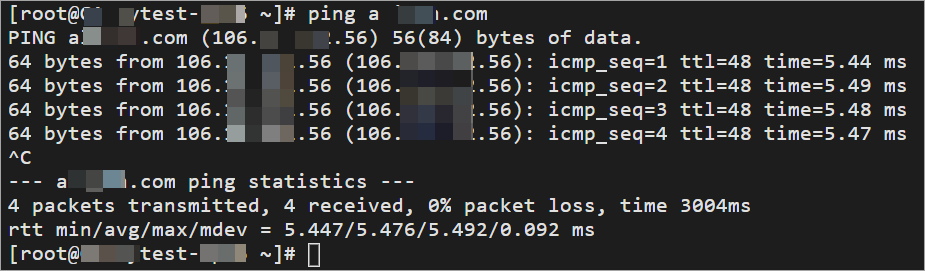

<a id="section-3-8"></a>

## 3.8. Enable IPv6 for a VPC

When you create a virtual private cloud (VPC), you can configure both an IPv4 CIDR block and an IPv6 CIDR block for the VPC. By default, IPv4 is enabled and cannot be disabled. You can specify whether to enable IPv6. After IPv6 is enabled, the system automatically creates a free IPv6 gateway for the VPC. You can use the IPv6 gateway to manage IPv6 Internet bandwidth and configure egress-only rules.

**Prerequisites**

Before you deploy cloud resources in a VPC, you must plan networks of the VPC. For more information, see Plan a VPC.

**Step 1: Create a VPC that supports both IPv4 and IPv6**

For more information, see the "Create a VPC" section of the Create and manage a VPC topic.

**Step 2: Enable IPv6 for an existing VPC**

For more information, see the "Enable IPv6 for a VPC" section of the Enable IPv6 for a VPC topic.

<a id="section-3-9"></a>

## 3.9. Enable IPv6 for a vSwitch

After you enable IPv6 for a virtual private cloud (VPC), you can specify IPv6 CIDR blocks for vSwitches in the VPC. This way, cloud resources in vSwitches deployed in the VPC can communicate with each other by using IPv6 addresses.

**Prerequisites**

- A VPC is created and IPv6 is enabled for the VPC. For more information, see the "Enable IPv6 for a VPC" section of the Create and manage a VPC topic.

- The CIDR block that you specify for the new vSwitch does not overlap with the CIDR blocks of existing vSwitches in the VPC.

**Step 1: Create a vSwitch that supports both IPv4 and IPv6**

For more information, see the "Create a vSwitch" section of the Create and manage a vSwitch topic.

**Step 2: Enable IPv6 for an existing vSwitch**

For more information, see the "Enable IPv6 for a vSwitch" section of the Create and manage a vSwitch topic.

<a id="section-4"></a>

# 4.Overview

You can view information on the overview page of the virtual private cloud (VPC) console, such as instance counts, quota usage, and topology.

**Procedure**

1. Log on to the VPC console.

2. In the left-side navigation pane, click **Overview**.

3. On the **Overview** page, the following information is available:

   - In the **Instance Overview** section, you can view **VPC**, **Route Table**, **vSwitch**, **Network ACL**, and **Elastic IP Address**.

   - Detailed information about all VPCs and Elastic IP Addresses can be found in the **VPC** and **Elastic IP Address** sections, respectively.

   - The **VPC Organization Quota Usage** section shows the VPC quota consumption over the past 7, 15, or 30 days.

   - The **EIP Organization Quota Usage** section displays the EIP quota consumption for the last 7, 15, or 30 days.

   - Click the VPC in the **VPC Topology** section to view its network topology.

     > **Note**
     >
     > You can enter the instance ID of the target VPC in the upper right corner of **VPC Topology**.

<a id="section-5"></a>

# 5.VPCs

<a id="section-5-1"></a>

## 5.1. VPC overview

A virtual private cloud (VPC) is a dedicated private network in the cloud that allows you to configure and manage a logically isolated network. You have full control over your VPC. For example, you can specify CIDR blocks and configure route tables and gateways for your VPC. You can also deploy Apsara Stack resources, such as Elastic Compute Service (ECS) instances, ApsaraDB RDS instances, and Server Load Balancer (SLB) instances in your VPC.

**Advantages**

VPCs are secure, reliable, flexible, easy to use, and scalable.

- Secure and reliable: Each VPC is identified by a unique tunnel ID, which corresponds to a virtual network. Different VPCs are isolated by tunnel IDs.

- Flexible: You can use security group rules and network access control lists (ACLs) to manage inbound and outbound traffic of cloud resources in a VPC in a flexible manner.

- Easy to use: You can quickly create and manage VPCs in the VPC console. After a VPC is created, the system automatically creates a system route table for the VPC.

- Scalable: You can create multiple vSwitches in a VPC to deploy different services. In addition, you can connect a VPC to a data center or another VPC to extend the network architecture.

**Components**

Each VPC consists of at least one private CIDR block, one vSwitch, and one route table.

- Private CIDR block: When you create a VPC and a vSwitch, you must specify a private IP address range for the VPC in CIDR notation. For more information, see Plan networks.

- vRouter: After a VPC is created, the system automatically creates a vRouter for the VPC. Each vRouter is associated with a route table.

- vSwitch: You can create vSwitches to divide a VPC into one or more subnets. vSwitches that are in the same VPC can communicate with each other. You can deploy your applications in vSwitches that belong to different zones to improve service availability.

**CIDR blocks and IP addresses**

VPC supports both IPv4 and IPv6. By default, IPv4 is used. You can enable IPv6 based on your business requirements.

VPC supports the dual-stack mode. In dual-stack mode, resources in a VPC can communicate by using both IPv4 and IPv6 addresses. IPv4 and IPv6 addresses are independent of each other. Therefore, you must configure routes and security groups for both IPv4 and IPv6 addresses.

The following table describes the differences between IPv4 and IPv6 addresses.

| IPv4 VPC | IPv6 VPC |
| --- | --- |
| 32 binary bits.<br>An IPv4 address is constructed from four decimal numbers separated by periods (.). Example: 192.168.1.11. | 128 binary bits.<br>An IPv6 address is constructed from eight hexadecimal numbers separated by colons (:).Example: 2001:db8:ffff:ffff:ffff:ffff:ffff:ffff. |
| By default, IPv4 is enabled for all VPCs. | You can manually enable IPv6. |
| The subnet mask of a VPC CIDR block ranges from /8 to /24. | The subnet mask of a VPC CIDR block is /61. |
| The subnet mask of a vSwitch CIDR block ranges from /16 to /29. | The subnet mask of a vSwitch CIDR block is /64. |
| You can specify an IPv4 CIDR block. | You cannot specify an IPv6 CIDR block. The system automatically assigns an IPv6 CIDR block to your VPC from the IPv6 address pool. |
| All instance families are supported. | Specific instance families are supported.<br>For more information, see the <strong>Instance families</strong> topic in the <strong>What is ECS?</strong> chapter of <strong>Elastic</strong> <strong>Compute Service User Guide</strong>. |
| IPv4 elastic IP addresses (EIPs) are supported. | IPv6 EIPs are not supported. |
| VPN gateways and NAT gateways are supported. | VPN gateways and NAT gateways are not supported. |

By default, IPv4 and IPv6 addresses are used only for communication within VPCs. Cloud resources deployed in different vSwitches that belong to the same VPC can communicate with each other within the VPC. To connect a VPC to another VPC or a data center, you can use Express Connect or VPN Gateway.

To enable cloud resources in a VPC to communicate with the Internet, configure the following items:

- IPv4 addresses

  You can configure NAT gateways or associate EIPs with ECS instances in the VPC. This way, the ECS instances can communicate with the Internet by using IPv4 addresses.

- IPv6 addresses

  To enable cloud resources in the VPC to communicate with the Internet by using IPv6 addresses, you must purchase an IPv6 Internet bandwidth plan. You can configure egress-only rules for IPv6 addresses. This allows cloud resources in the VPC to access the Internet by using IPv6 addresses. However, IPv6 clients cannot access the cloud resources in the VPC over the Internet.

<a id="section-5-2"></a>

## 5.2. Create and manage VPCs

A virtual private cloud (VPC) is an isolated, private network that you can create in the cloud. You have full control over your VPC. For example, you can select IP address ranges, configure route tables, and set up gateways. This topic describes how to create and manage VPCs.

**Create a VPC**

Before you create a VPC, plan your network. For more information, see Plan a VPC.

1. Log on to the VPC console.

2. In the navigation pane on the left, click **VPC**.

3. In the top navigation bar, select the region where you want to create the VPC.

   > **Note**
   >
   > The VPC and the cloud resources that you deploy in it must be in the same region.

4. On the **VPC** page, click **Create VPC**.

5. On the **Create VPC** page, set the following parameters for the VPC.

   <table>
     <tr>
       <th>Configuration</th>
       <th>Description</th>
     </tr>
     <tr>
       <td colspan="2">Region</td>
     </tr>
     <tr>
       <td>Organization/Res ource Group</td>
       <td>Select the organization and resource group to which the VPC belongs.</td>
     </tr>
     <tr>
       <td>Region</td>
       <td>Select the region to which the VPC belongs.</td>
     </tr>
     <tr>
       <td colspan="2">Basic Configuration</td>
     </tr>
     <tr>
       <td>Sharing Scope</td>
       <td>Select the sharing scope of the VPC.<br>• <strong>This Resource Group</strong>: Administrators of this resource group can use the shared VPC to create resources.<br>• <strong>This Organization and Sub-organizations</strong>: Administrators of this organization and its sub-organizations can use the shared VPC to create resources.<br>• <strong>This Organization</strong>: Administrators of this organization can use the shared VPC to create resources.</td>
     </tr>
     <tr>
       <td>VPC Name</td>
       <td>Enter a name for the VPC.<br>The name must be 2 to 128 characters in length. It must start with a letter or a Chinese character. It can contain digits, periods (.), underscores (_), and hyphens (-). It cannot start with <code> http:// </code> or <code> https:// </code>.</td>
     </tr>
   </table>

   <table>
     <tr>
       <td>IPv4 CIDR Block</td>
       <td>Select a method to configure the IPv4 CIDR block. The following methods are supported:<br>• <strong>Recommended CIDR Block</strong>: You can use the standard IPv4 CIDR blocks 192.168.0.0/16 or 172.16.0.0/16 for the VPC.<br>• <strong>Advanced CIDR Block</strong>: You can use 192.168.0.0/16, 172.16.0.0/16, or their subnets as the CIDR block for the VPC. The valid mask length is 8 to 28 bits. Example: 192.168.0.0/24.<br>You can also click <strong>AI Network Planning</strong>. Follow the prompts to enter your business requirements. The AI assistant will recommend suitable VPC subnetting and IP address allocation for your scenario.<br>Example:<br>My company has three departments: Technical Support (10 people), Sales (20 people), and R&amp;D (30 people).<br>Note<br>After a VPC is created, you cannot change its IPv4 CIDR block.</td>
     </tr>
     <tr>
       <td>Recommended CIDR Block</td>
       <td>Select a recommended primary IPv4 CIDR block.<br>Note<br>• This parameter is required only when you set the <strong>IPv4 CIDR</strong> <strong>Block</strong> configuration mode to <strong>Recommended CIDR Block</strong>.<br>• Use RFC private address ranges for the VPC, such as 10.0.0.0/8, 172.16.0.0/12, and 192.168.0.0/16. In multi-VPC or hybrid cloud scenarios, ensure that the address plans do not conflict.<br>• You cannot use 100.64.0.0/10, 224.0.0.0/4, 127.0.0.0/8, or 169.254.0.0/16 as the CIDR block for the VPC.</td>
     </tr>
     <tr>
       <td>Custom CIDR Block</td>
       <td>Enter a custom primary IPv4 CIDR block.<br>Note<br>This parameter is required only when you set the <strong>IPv4 CIDR Block</strong> configuration mode to <strong>Advanced CIDR Block</strong>.</td>
     </tr>
   </table>

   <table>
     <tr>
       <td>IPv6 CIDR Block</td>
       <td>Select a mode to configure the IPv6 CIDR block. The following modes are supported:<br>• <strong>Do Not Assign</strong>: The system does not assign an IPv6 CIDR block.<br>• <strong>Assign Automatically</strong>: The system automatically assigns an IPv6 CIDR block based on the address pool system.<br>• <strong>Specify Manually</strong>: You can specify an IPv6 CIDR block as needed.<br>Note<br>• The system assigns a global unicast address range to the VPC.After instances in the VPC are assigned IPv6 addresses, they can connect to the Internet through an IPv6 gateway.<br>• If you select <strong>Do Not Assign</strong>, you can enable IPv6 for the VPC after it is created. For more information, see Manage secondary IPv6 CIDR blocks.<br>The system automatically creates a Free Edition IPv6 gateway for your VPC and assigns an IPv6 CIDR block with a /61 mask, such as 2XX1:db8::/61. By default, IPv6 addresses only support private network communication. To use the IPv6 address to access the Internet or be accessed by IPv6 clients on the Internet, you must enable IPv6 Internet bandwidth. For more information, see Manage IPv6 Internet bandwidth.<br>• If you select <strong>Specify Manually</strong>, select an <strong>Address Pool</strong> and enter a custom IPv6 CIDR block as needed.</td>
     </tr>
     <tr>
       <td>Address Pool</td>
       <td>Select the ISP address pool type.<br>Note<br>This parameter is required when you set the <strong>IPv6 CIDR Block</strong> configuration mode to <strong>Assign</strong> or <strong>Specify Manually</strong>.</td>
     </tr>
     <tr>
       <td>IPv6 CIDR Block</td>
       <td>Based on the <strong>Address Pool</strong>, enter a custom IPv6 CIDR block.<br>The default mask for a custom IPv6 CIDR block is 61. If you manually specify a CIDR block, you can change the mask.<br>Note<br>• This parameter is required only when you set the <strong>IPv6 CIDR</strong> <strong>Block</strong> mode to <strong>Specify Manually</strong>.<br>• The <strong>Specify Manually</strong> mode can easily lead to IPv6 address configuration errors. If you use this mode, verify the accuracy of the IPv6 address with your administrator or network administrator. After creation, you can assign it from the VPC list.</td>
     </tr>
     <tr>
       <td>Description</td>
       <td>Enter a description for the VPC.<br>The description must be 2 to 256 characters in length. It cannot start with <code> http:// </code> or <code> https:// </code>.</td>
     </tr>
     <tr>
       <td>Create vSwitch at the Same Time</td>
       <td>Select whether to create a vSwitch at the same time.</td>
     </tr>
     <tr>
       <td>vSwitch</td>
       <td>Click the <strong>Add</strong> button to configure the vSwitches to be created. You can create up to 10 vSwitches at a time.<br><strong>Zone</strong>: Select the zone for the vSwitch.<br>In a VPC, each vSwitch must be in a single zone and cannot span multiple zones. You can deploy cloud resources in vSwitches across different zones to implement cross-zone disaster recovery.<br>Note<br>A cloud resource instance can be added to only one vSwitch.<br><strong>vSwitch Name</strong>: Enter a name for the vSwitch.<br><strong>IPv4 CIDR Block</strong>: Configure the IPv4 CIDR block for the vSwitch.<br>• You must specify the IP address range of the vSwitch in CIDR notation. The subnet mask must be 16 to 29 bits in length, which specifies that 8 to 65,536 IP addresses are available.<br>• The CIDR block of a vSwitch must be a proper subset of the CIDR block of the VPC to which the vSwitch belongs.<br>• The first IP address and last three IP addresses of a vSwitch CIDR block are reserved. For example, if the CIDR block of the vSwitch is 192.168.1.0/24, the IP addresses 192.168.1.0, 192.168.1.253, 192.168.1.254, and 192.168.1.255 are reserved.<br>• The CIDR block of a vSwitch cannot be the same as the destination CIDR block in a route entry of the VPC to which the vSwitch belongs. However, the CIDR block of the vSwitch can be a subset of the destination CIDR block of a route entry.<br><strong>IPv6 CIDR Block</strong>: Enable and configure the IPv6 CIDR block for the vSwitch.<br>• If an IPv6 CIDR block is assigned to the VPC to which the vSwitch belongs, you must configure the IPv6 CIDR block for the vSwitch. The mask of the IPv6 CIDR block can be modified.<br>• You must check whether IPv6 is enabled for your VPC. If IPv6 is not enabled for your VPC, you cannot assign an IPv6 CIDR block to the vSwitch.<br>• If the valid subnet mask of the IPv6 CIDR block used by the VPC is [56, 63], the valid subnet mask of the IPv6 CIDR block used by the vSwitch is [57, 64]. You can enter a valid decimal number to specify an IPv6 CIDR block for your vSwitch.<br>For example, if the IPv6 CIDR block of the VPC is 2020:66:2:1f0::/61, you can enter the decimal number 7 to specify 2020:66:2:1f7::/64 as the IPv6 CIDR block of the vSwitch.<br>Note<br>This parameter is required when the <strong>IPv6 CIDR Block</strong> configuration mode for the VPC is set to <strong>Assign</strong> or <strong>Specify Manually</strong>.</td>
     </tr>
   </table>

   > **Note**
   >
   > Before you create the instance, you can review its configuration in the **Configuration Overview** section on the right.
   >
   > - You can click a field to go to the corresponding parameter and modify it.
   >
   > - To manage quotas for the cloud product, click **Quota Management** if no quota is assigned to the organization or resource group. If a quota is assigned, click **Manage** in the **Quota** section.
   >
   >   For more information about quota management, see the **Quota management** topic in the **User Guide for Apsara Uni-manager Management Console**.

6. Create the VPC.

   - If a service has been created in Service Management with **Cloud Resource** set to **VPC**, review the parameters and click **Confirm Order**.

   - If a service has not been created in Service Management with **Cloud Resource** set to **VPC**, review the parameters and click **Submit**.

   For more information about service management, see the **Service management** topic in the **User Guide for Apsara Uni-manager Management Console**.

7. (Optional) After you create a VPC, you can click the  icon in the upper-right corner of the

   **VPC** page. Select the data columns that you need, such as Instance ID, Organization, and Resource Set, and then click **OK** to download the VPC information.

**More operations**

**VPC list**

On the **VPC** page, you can view the details of your VPCs in a list.

> **Note**
>
> The list is limited to 100 pages and can display a maximum of 10,000 entries. If you have more than 10,000 entries, use filters to find the data that you need.

- You can find an instance by entering a keyword or specifying filter conditions in an advanced search.

- Click the  icon in the upper-right corner of the list to show or hide columns and drag

  columns to reorder them.

- Click the  icon next to a column name to perform an advanced sort on the list.

- Click the  icon to the right of the **Status** column to filter instances by status.

- Click the  icon in the **Sharing Scope** column to filter instances by sharing scope.

- Click an IPv4 CIDR block in the **IPv4 CIDR Block** column to view the list of IPv4 CIDR blocks of the VPC.

- Click **Enable IPv6** in the **IPv6 CIDR Block** column to enable IPv6 for the VPC.

- Click **Disable IPv6** in the **IPv6 CIDR Block** column to disable IPv6 for the VPC.

- Click **Manage** in the **IPv6 CIDR Block** column to manage the secondary CIDR blocks of the VPC.

- Click the number in the **Route Table** column to view the list of route tables in the VPC.

- Click the number in the **vSwitch** column to view the list of vSwitches in the VPC.

- Click the number in the **Elastic Compute Service** column to view the list of ECS instances in the VPC.

- Click the  icon to the right of the instance name in the **VPC ID/Name** column to modify

  the VPC name.

**AI Diagnosis—VPC Usage Analysis**

1. On the **VPC** page, click **AI Diagnosis** in the upper-right corner to analyze and view the usage of all your VPCs.

2. Manage your VPCs and the resources within them based on the **Diagnosis Analysis** results and the provided **Optimization Suggestions**.

   In the optimization suggestions, click Delete. In the confirmation dialog box that appears, click Confirm Order to delete the corresponding instance or subnet.

   After you delete the item, the AI diagnosis tool re-evaluates your resources and generates new suggestions.

**Tag management**

On the **VPC** page, you can use tags to mark and group instances. For more information, see Manage tags.

**Enable IPv6 for a VPC**

1. On the **VPC** page, find the target VPC and click **Enable IPv6** in the **IPv6 CIDR Block** column.

2. In the **Enable IPv6** dialog box, set the following IPv6 parameters, select **Automatically enable IPv6 for all vSwitches in the VPC**, and then click **OK**.

   | Configuration | Description |
   | --- | --- |
   | IPv6 CIDR Block | Select a method to assign the IPv6 CIDR block.<br>• <strong>Assign Automatically</strong>: The system automatically assigns an IPv6 CIDR block.<br>• <strong>Specify Manually</strong>: You can specify an IPv6 CIDR block as needed.<br>Note<br>• If you select <strong>Specify Manually</strong>, select an <strong>ISP Address Pool</strong> and enter a custom <strong>IPv6 CIDR Block Address</strong> as needed.<br>• The <strong>Specify Manually</strong> method can easily lead to configuration errors. Verify the accuracy of the custom IPv6 CIDR block with your network administrator. |
   | ISP Address Pool | Select the ISP address pool type. |
   | IPv6 CIDR Block Address | Based on the <strong>ISP Address Pool</strong>, configure a custom IPv6 CIDR block.<br>Note<br>This parameter is required only when you set <strong>IPv6 CIDR Block</strong> to <strong>Specify</strong> <strong>Manually</strong>. |

   > **Note**
   >
   > If you do not select **Automatically enable IPv6 for all vSwitches in the VPC**, you must enable an IPv6 CIDR block for each vSwitch separately. For more information, see Enable IPv6 for a vSwitch.

**Disable IPv6 for a VPC**

> **Note**
>
> Before you disable IPv6, you must first disable the IPv6 CIDR block for each associated vSwitch.

1. On the **VPC** page, find the target VPC and click **Disable IPv6** in the **IPv6 CIDR Block** column.

2. In the **Disable IPv6** dialog box, click **OK**.

**Sharing settings**

You can modify the sharing scope of a VPC.

1. On the **VPC** page, find the target VPC and click **Sharing Settings** in the **Actions** column.

2. In the **Sharing Scope** dialog box, select a **Sharing Scope** and click **OK**.

**Delete a VPC**

You can delete VPCs that you no longer need. After you delete a VPC, its associated vRouter and route tables are also deleted.

> **Note**
>
> Before you delete a VPC, make sure that it contains no vSwitches, IPv6 gateways, NAT Gateways, network ACLs, or other dependent resources. You must release these resources before you can delete the VPC.

1. On the **VPC** page, find the target VPC and choose **... > Delete** in the **Actions** column.

2. In the **Delete** dialog box, click **Release**.

3. In the **Release Resource** dialog box, click **Confirm Release**.

4. In the **Operation Successful** dialog box that appears, click **OK**.

**Manage a VPC**

1. On the **VPC** page, find the target VPC and click its instance ID in the **VPC ID/Name** column, or click **Manage** in the **Actions** column.

2. On the **VPC Details** page, you can manage the VPC.

   - The Instance Overview card displays key information about the VPC, such as its instance ID, status, region, and CIDR block, and provides statistics for various VPC resources.

     - Click **Enable IPv6** next to **IPv6 CIDR Block** to enable an IPv6 CIDR block for the VPC. For more information, see Enable IPv6 for a VPC.

     - Click the number below a specific VPC resource on the right side of the card to view the list of corresponding resources in the VPC.

       VPC resources include route tables, vSwitches, security groups, NAT Gateways, network ACLs, IPv6 gateways, ECS instances, requester VPCs for VPC peering, accepter VPCs for VPC peering, and accepter VBRs.

   - Click the **Basic Information** tab to view or manage the basic information of the VPC and its vRouter.

     - In the **VPC Basic Information** section, click the  icon to the right of **VPC Name** to

       modify the VPC name.

     - In the **VPC Basic Information** section, click the  icon to the right of **Description** to

       modify the VPC description.

     - In the **VPC Basic Information** section, click the  icon next to **Tags** to edit the VPC

       tags.

     - In the **Router Basic Information** section, click the  icon next to **Router Name** to

       modify the router name.

     - In the **VRouter Basic Information** section, click the  icon next to **Description** to

       edit the vSwitch description.

   - Click the **CIDR Block Management** tab to manage the secondary CIDR blocks of the VPC.

     - Click **IPv4 CIDR Block** to manage the secondary IPv4 CIDR blocks of the VPC. For more information, see Manage secondary IPv4 CIDR blocks.

     - Click **IPv6 CIDR Block** to manage the secondary IPv6 CIDR blocks of the VPC. For more information, see Manage secondary IPv6 CIDR blocks.

   - Click the **VPC Topology** tab to view the topology of the VPC. For more information, see VPC topology.

   - Click the **CEN Cross-account Authorization** tab to grant permissions to a CEN instance to allow the VPC to be attached to the CEN instance. For more information, see CEN cross-account authorization.

   - Click the **Operation Logs** tab to view all operation logs for the VPC. For more information, see Operation logs.

   - Click **Delete** in the upper-right corner to delete the VPC.

<a id="section-5-3"></a>

## 5.3. Create resources in a VPC

This topic describes how to create resources in a virtual private cloud (VPC). You can create vSwitches, Elastic Compute Service (ECS) instances, and ApsaraDB for RDS instances in a VPC.

**Procedure**

1. Log on to the VPC console.

2. In the navigation pane on the left, click **VPC**.

3. In the top navigation bar, select the region where you want to create the VPC.

4. On the **Virtual Private Clouds** page, find the VPC in which you want to create resources and perform the following operations:

   - To create a vSwitch, click **Create vSwitch** in the **Actions** column and configure the parameters. In the **Create vSwitch** dialog box, configure the parameters.

     For more information, see Create and manage vSwitches.

   - To create an ECS instance, click the **More** icon in the **Actions** column and select **Create ECS Instance**. In the **Create ECS Instance** dialog box, configure the parameters.

     For more information about how to configure the parameters to create an ECS instance, see **Quick start** > **Create an ECS instance** in the **ECS User Guide**.

   - To create an ApsaraDB RDS instance, click the **More** icon in the **Actions** column and select **Create ApsaraDB RDS Instance**. In the **Create ApsaraDB RDS Instance** dialog box, configure the parameters.

     For more information about how to configure the parameters to create an ApsaraDB RDS instance, see **Quick start** > **Create an ApsaraDB RDS instance** in the **ApsaraDB RDS User Guide**.

<a id="section-5-4"></a>

## 5.4. Manage CIDR blocks

<a id="section-5-4-1"></a>

### 5.4.1. Manage secondary IPv4 CIDR blocks

After a virtual private cloud (VPC) is created, you can manage secondary IPv4 CIDR blocks of the VPC.

**Prerequisites**

A VPC is created. For more information, see the "Create a VPC" section of the Create and manage a VPC topic.

**Background information**

The IPv4 CIDR block that you configure when you create a VPC is the primary IPv4 CIDR block. After a VPC is created, the primary IPv4 CIDR block of the VPC cannot be modified. However, you can add a secondary IPv4 CIDR block to expand the VPC. After you add a secondary IPv4 CIDR block to the VPC, the primary and secondary IPv4 CIDR blocks take effect at the same time. You can create a vSwitch within the primary IPv4 CIDR block or the secondary IPv4 CIDR block. However, each vSwitch belongs to only one VPC CIDR block.

When you create a vSwitch from a secondary IPv4 CIDR block, the system automatically adds a route to the VPC route table. This process is the same as when you create a vSwitch from the primary IPv4 CIDR block. The destination CIDR block of the route is the CIDR block of the vSwitch. The CIDR block of the vSwitch cannot be the same as or larger than the destination CIDR blocks of other routes in the VPC route table.

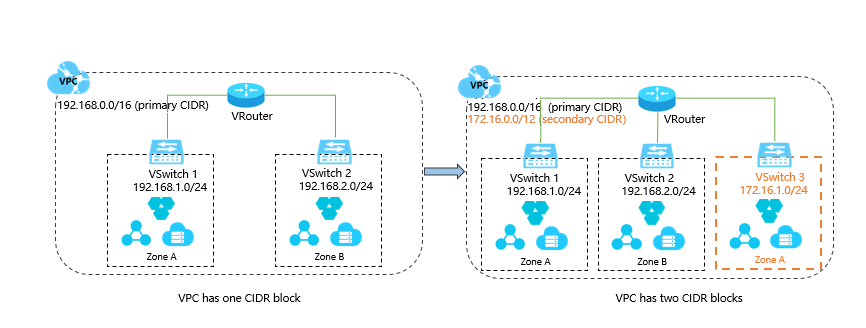

**Add a secondary IPv4 CIDR block**

> **Note**
>
> You can add up to five secondary IPv4 CIDR blocks to a VPC and cannot increase the quota.

1. Log on to the VPC console.

2. In the navigation pane on the left, click **VPC**.

3. In the top navigation bar, select the region where you want to create the VPC.

4. On the **VPC** page, find the target VPC and click its instance ID in the **VPC ID/Name** column, or click **Manage** in the **Actions** column.

5. On the **VPC Details** page, click the **CIDR Block Management** tab and select **IPv4 CIDR Block**.

6. On the IPv4 CIDR Block tab, click **Add Secondary IPv4 CIDR Block**.

7. In the **Add Secondary IPv4 CIDR Block** dialog box, configure the following parameters and click **OK**.

   | Configu ration | Description |
   | --- | --- |
   | VPC | The VPC to which you want to add the secondary IPv4 CIDR block. |
   | Seconda ry CIDR Block | The method that you want to use to configure the secondary IPv4 CIDR block. Valid values:<br>• <strong>Recommended CIDR Block</strong>: If you select this option, you can select 192.168.0.0/16 or 172.16.0.0/12 as the secondary IPv4 CIDR block.<br>• <strong>Custom CIDR Block</strong>: If you select this option, you can use 192.168.0.0/16, 172.16.0.0/12, or one of their subnets as the secondary IPv4 CIDR block. |
   | Recom mended CIDR Block | The recommended CIDR block.<br>Note<br>This parameter must be configured if you set the <strong>Secondary CIDR Block</strong> parameter to <strong>Recommended CIDR Block</strong>. |
   | Custom CIDR Block | A custom IPv4 CIDR block.<br>Note<br>• This parameter must be configured if you set the <strong>Secondary CIDR Block</strong> parameter to <strong>Custom CIDR Block</strong>.<br>• When you add a secondary IPv4 CIDR block, take note of the following limits:<br>• The CIDR block cannot start with 0. The mask must be 8 to 24 bits in length.<br>• The secondary IPv4 CIDR block cannot overlap with the primary IPv4 CIDR block or an existing secondary IPv4 CIDR block of the VPC.<br>For example, if the primary IPv4 CIDR block of a VPC is 192.168.0.0/16, you cannot specify one of the following CIDR blocks as a secondary IPv4 CIDR block:<br>• A CIDR block larger than 192.168.0.0/16. Example: 192.168.0.0/8.<br>• A network segment with an address range of 192.168.0.0/16.<br>• A CIDR block smaller than 192.168.0.0/16. Example: 192.168.0.0/24. |

**Delete a secondary IPv4 CIDR block**

> **Note**
>
> - Before you delete a secondary IPv4 CIDR block, make sure that the vSwitches created within the secondary IPv4 CIDR block are deleted. For more information, see the "Delete a vSwitch" section of the Create and manage a vSwitch topic.
>
> - You can delete secondary IPv4 CIDR blocks of a VPC. However, you cannot delete the primary IPv4 CIDR block of a VPC.

1. Log on to the VPC console.

2. In the navigation pane on the left, click **VPC**.

3. In the top navigation bar, select the region where you want to create the VPC.

4. On the **VPC** page, find the target VPC and click its instance ID in the **VPC ID/Name** column, or click **Manage** in the **Actions** column.

5. On the **VPC Details** page, click the **CIDR Block Management** tab and select **IPv4 CIDR Block**.

6. In the list of IPv4 CIDR blocks, find the secondary IPv4 CIDR block that you want to delete and click **Delete** in the **Actions** column.

7. In the message that appears, click **OK**.

<a id="section-5-4-2"></a>

### 5.4.2. Manage secondary IPv6 CIDR blocks

After a virtual private cloud (VPC) is created, you can add secondary IPv6 CIDR blocks to the VPC and manage the added secondary IPv6 CIDR blocks.

**Prerequisites**

A VPC is created. For more information, see the "Create a VPC" section of the Create and manage a VPC topic.

**Add a secondary IPv6 CIDR block**

> **Note**
>
> - By default, you can add up to four secondary IPv6 CIDR blocks to a VPC.
>
> - Before you add a secondary IPv6 CIDR block to a VPC, make sure that IPv6 is enabled for the VPC. For more information, see the "Enable IPv6 for a VPC" section of the Create and manage VPCs topic.

1. Log on to the VPC console.

2. In the navigation pane on the left, click **VPC**.

3. In the top navigation bar, select the region where you want to create the VPC.

4. On the **VPC** page, find the target VPC and click its instance ID in the **VPC ID/Name** column, or click **Manage** in the **Actions** column.

5. On the VPC details page, click the **CIDR Block Management** tab, and then click the **IPv6 CIDR Block** tab.

6. On the IPv6 CIDR Block tab, click **Add Secondary IPv6 CIDR Block**.

7. In the **Add Secondary IPv6 CIDR Block** dialog box, configure the parameters described in the following table and click **OK**.

   | Configuration | Description |
   | --- | --- |
   | IPv6 CIDR Block | Select a method to assign the IPv6 CIDR block.<br>• <strong>Assign Automatically</strong>: The system automatically assigns an IPv6 CIDR block.<br>• <strong>Specify Manually</strong>: You can specify an IPv6 CIDR block as needed.<br>Note<br>• If you select <strong>Specify Manually</strong>, select an <strong>ISP Address Pool</strong> and enter a custom <strong>IPv6 CIDR Block Address</strong> as needed.<br>• The <strong>Specify Manually</strong> method can easily lead to configuration errors. Verify the accuracy of the custom IPv6 CIDR block with your network administrator. |
   | ISP Address Pool | Select the ISP address pool type. |
   | IPv6 CIDR Block Address | Based on the <strong>ISP Address Pool</strong>, configure a custom IPv6 CIDR block.<br>Note<br>This parameter is required only when you set <strong>IPv6 CIDR Block</strong> to <strong>Specify</strong> <strong>Manually</strong>. |

**Remove a secondary IPv6 CIDR block**

> **Note**
>
> Before you remove a secondary IPv6 CIDR block, make sure that the vSwitches created within the secondary IPv6 CIDR block are deleted. For more information, see the "Delete a vSwitch" section of the Create and manage vSwitches topic.

1. Log on to the VPC console.

2. In the navigation pane on the left, click **VPC**.

3. In the top navigation bar, select the region where you want to create the VPC.

4. On the **VPC** page, find the target VPC and click its instance ID in the **VPC ID/Name** column, or click **Manage** in the **Actions** column.

5. On the VPC details page, click the **CIDR Block Management** tab, and then click the **IPv6 CIDR Block** tab.

6. In the list of IPv6 CIDR blocks, find the secondary IPv6 CIDR block that you want to delete and click **Delete** in the **Actions** column.

7. In the message that appears, click **OK**.

<a id="section-5-5"></a>

## 5.5. VPC topology

The VPC topology feature provides a visual overview of your cloud resources and network assets within a VPC. From this topology, you can go directly to a resource's management console to make adjustments.

**Procedure**

1. Log in to the VPC console.

2. In the navigation pane on the left, click **Virtual Private Clouds**.

3. In the top navigation bar, select the region in which you want to deploy a VPC.

4. On the **Virtual Private Clouds** page, find the VPC that you want to manage and click its ID in the **VPC ID/Name** column or **Manage** in the **Actions** column.

5. On the **VPC Details** page, click the **VPC Topology** tab.

6. In the **Cloud Resource Access Authorization** dialog box, select one or more **Organization Names**.

   > **Note**
   >
   > This operation requires Cloud Gateway (CGW) to access your cloud resources. You can grant the required permissions by assigning the relevant system-created roles (such as AliyunCGWAccessingNetworkInterfaceRole, AliyunCGWAccessingVPCRole, and AliyunDeepInsightRole) to CGW. This authorization is a one-time requirement.

7. Click **Agree to Authorization** to view a complete overview of the network assets related to the target VPC.

   - You can use fuzzy match to filter network assets by **Route Table Name**, **Route Table ID**, **vSwitch Name**, or **vSwitch ID**.

   - You can select **Expand All vSwitches** to view all vSwitches within the VPC.

   - You can select **Expand Resources in vSwitches** to view the number of ECS, RDS, and SLB resources within each vSwitch.

   | Area | Description |
   | --- | --- |
   | VPC external access | Lists the VPC's internet-facing network resources and their counts.<br>Click any resource with a numeric count to open its list page for viewing and management.<br>• <strong>VPC peering connection</strong>: Enables communication between two VPCs.<br>• <strong>VPC-VBR connection</strong>: Enables communication between a VPC and a Virtual Border Router (VBR).<br>• <strong>NAT gateway</strong>: Provides Network Address Translation (NAT), which allows servers in the VPC to access the internet and offer internet-facing services.<br>• <strong>Classic Network SLB</strong>: Enables the VPC to provide services to external networks.<br>• <strong>EIP</strong>: Enables a cloud resource in a VPC to communicate with the internet.<br>• <strong>VPN gateway</strong>: Establishes a secure and reliable private connection over the internet between a VPC and an on-premises data center, corporate network, or remote devices through an encrypted tunnel.<br>• <strong>IPv6 gateway</strong>: Manages IPv6 traffic for a VPC. You can configure IPv6 public bandwidth and egress-only rules to control inbound and outbound traffic. |
   | VPC internal resources | Lists the vSwitches within the VPC and the resources they contain. |

<a id="section-5-6"></a>

## 5.6. Attach a CEN instance to a VPC across accounts

This topic describes how to attach a Cloud Enterprise Network (CEN) instance to a virtual private cloud (VPC).

**Prerequisites**

Before you grant permissions to a CEN instance, make sure that the following requirements are met:

- The ID of the CEN instance to which the transit router belongs is obtained.

- The ID of the Apsara Stack tenant account to which the CEN instance belongs is obtained.

  You can view the account ID of a level-1 organization in the **Manage AccessKey Pairs** dialog box. For more information, see **Enterprise** > *Manage the AccessKey pairs of an orga nization* in **Apsara Uni-manager Management Console User Guide**.

**Grant the permissions on a VPC**

The following procedure shows how to grant permissions on a VPC in Organization A to a CEN instance in Organization B. After the authorization, the transit router in Organization B can connect to the VPC in Organization A.

1. Log on to the VPC console.

2. In the navigation pane on the left, click **VPC**.

3. In the top navigation bar, select the region where you want to create the VPC.

4. On the **VPC** page, find the target VPC and click its instance ID in the **VPC ID/Name** column, or click **Manage** in the **Actions** column.

5. On the VPC details page, click the **CEN Cross Account Authorization Information** tab.

6. Click **CEN Cross Account Authorization**.

7. In the **CEN Cross-Account Authorization** dialog box, configure the parameters described in the following table and click **OK**.

   | Parameter | Description |
   | --- | --- |
   | Peer Level-1 Organization UID | The ID of the account that belongs to the level-1 organization of the CEN instance in Organization B. |
   | Peer CEN Instance ID | The ID of the CEN instance in Organization B to which the transit router belongs. |

**Revoke permission on a VPC**

> **Note**
>
> Before you revoke the permissions of a transit router on a VPC, close the connections between the VPC and the transit router. For more information, see **Delete a network instance connection** in **Transit Router User Guide**.

1. Log on to the VPC console.

2. In the navigation pane on the left, click **VPC**.

3. In the top navigation bar, select the region where you want to create the VPC.

4. On the **VPC** page, find the target VPC and click its instance ID in the **VPC ID/Name** column, or click **Manage** in the **Actions** column.

5. On the VPC details page, click the **CEN Cross Account Authorization Information** tab.

6. In the authorization record list, find the authorization record that you want to manage and click **Delete** in the **Actions** column.

<a id="section-6"></a>

# 6.Route tables

<a id="section-6-1"></a>

## 6.1. Overview

Route tables are used to manage and control network traffic. Proper route configurations enhance network flexibility and security. You can configure routes and specify proper next hop types to control network traffic, optimize traffic paths, reduce latency, and improve network performance. You can also associate different route tables with different vSwitches to implement traffic control and isolation. This improves network flexibility.

**Route tables**

**System route tables**

After you create a virtual private cloud (VPC), the system creates a system route table to manage the routes of the VPC. By default, vSwitches in the VPC use the system route table. You cannot create or delete a system route table. However, you can add custom route entries to a system route table.

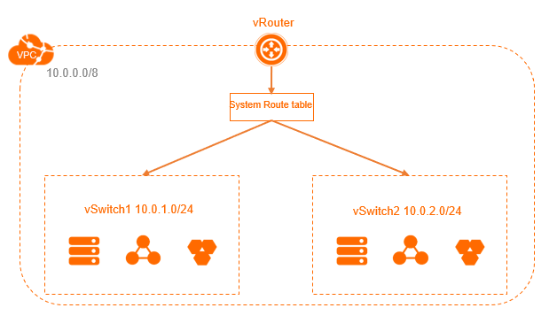

**Custom route tables**

You can create custom route tables in a VPC, associate custom route tables with vSwitches, and then set vSwitch CIDR blocks as destination CIDR blocks. This way, cloud services in vSwitches can communicate with each other. This facilitates network management. For more information, see Add subnet routes to a route table.

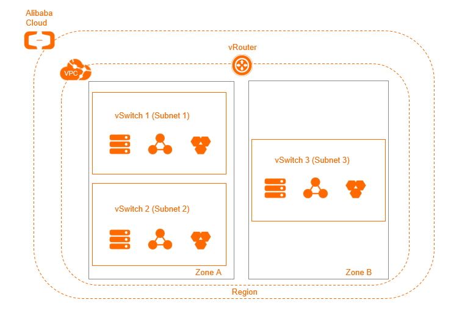

> **Note**
>
> - Each VPC can contain only one system route table.
>
> - A vSwitch can be associated with only one route table.
>
> - When you associate a vSwitch with a custom route table, the vSwitch is automatically disassociated from the system route table.

**Route entries**

Each route entry in a route table is a route. A route specifies the destination to which network traffic is routed and consists of the destination CIDR block, next hop type, and next hop. The destination CIDR block is the IP address range to which you want to forward network traffic. The next hop type specifies the type of the cloud resource that is used to route network traffic. You can also add a custom route entry to route traffic to a specific destination.

Routes include system routes and custom routes.

**System routes**

- After you create a VPC, the system automatically adds the following system routes to the route table:

  - A route whose destination CIDR block is 100.64.0.0/10. This route is used for communication among cloud resources within the VPC.

  - Routes whose destination CIDR blocks are the same as the CIDR blocks of the vSwitches in the VPC. These routes are used for communication among cloud resources within the vSwitches.

  For example, if you create a VPC whose CIDR block is 192.168.0.0/16 and two vSwitches whose CIDR blocks are 192.168.1.0/24 and 192.168.0.0/24, three system routes listed in the following table are automatically added to the route table of the VPC. The "-" sign in the following table indicates that the route entry is used within the VPC.

  | Destination CIDR block | Next hop | Route type |
  | --- | --- | --- |
  | 100.64.0.0/10 | - | System route |
  | 192.168.1.0/24 | - | System route |
  | 192.168.0.0/24 | - | System route |

- If IPv6 is enabled for your VPC, the following routes are automatically added to the system route table of the VPC:

  - A custom route whose destination CIDR block is ::/0 and whose next hop is the IPv6 gateway. Cloud resources deployed in the VPC use this route to access the Internet by using IPv6 addresses.

  - System routes whose destination CIDR blocks are the same as the IPv6 CIDR blocks of the vSwitches in the VPC. These routes are used for communication among cloud resources within the vSwitches.

    > **Note**
    >
    > If you create a custom route table and associate the custom route table with a vSwitch for which IPv6 CIDR block is enabled, you must add a custom route whose destination CIDR block is ::/0 and whose next hop is the IPv6 gateway.

**Custom routes**

You can add custom routes to replace system routes or route traffic to a specific destination. The following table describes the types of next hops that are available when you create a custom route.

| Destination CIDR block | Next hop type |
| --- | --- |

<table>
  <tr>
    <td>IPv4 CIDR block</td>
    <td>• Elastic Compute Service (ECS) instance: Traffic that is destined for the destination CIDR block is routed to the specified ECS instance in the VPC.<br>You can select this type if you want to access the Internet or other applications by using applications that are deployed on the ECS instance.<br>• High-availability virtual IP address (HAVIP): Traffic that is destined for the destination CIDR block is routed to the specified HAVIP in the VPC.<br>You can select this type if you want to access the Internet or other applications by using applications that are deployed on the HAVIP.<br>• VPN gateway: Traffic that is destined for the destination CIDR block is routed to the specified VPN gateway.<br>You can select this type if you want to connect a VPC to another VPC or an on-premises network by using the VPN gateway.<br>• NAT gateway: Traffic that is destined for the destination CIDR block is routed to the specified NAT gateway.<br>You can select this type if you want to connect a VPC to the Internet by using a NAT gateway.<br>• Secondary elastic network interface (ENI): Traffic that is destined for the destination CIDR block is routed to the specified secondary ENI.<br>• Router interface (to VPC): Traffic that is destined for the destination CIDR block is routed to the specified VPC.<br>You can select this type if you want to connect two VPCs by using an Express Connect circuit.<br>• Router interface (to VBR): Traffic that is destined for the destination CIDR block is routed to the specified virtual border router (VBR).<br>You can select this type if you want to connect a VPC to an on-premises network by using an Express Connect circuit.</td>
  </tr>
  <tr>
    <td>IPv6 CIDR block</td>
    <td>Router interface (to VBR): Traffic that is destined for the destination CIDR block is routed to the specified VBR.<br>You can select this type if you want to connect a VPC to an on-premises network by using an Express Connect circuit.</td>
  </tr>
</table>

**Routing rules**

If multiple routes match the destination IP address, the route with the longest subnet mask prevails and is used to determine the next hop. This ensures that the traffic is routed to the most precise destination.

The following table shows the route table of a VPC. The "-" sign indicates that the route entry is used within the VPC.

| Destination CIDR block | Next hop type | Next hop | Route type |
| --- | --- | --- | --- |
| 100.64.0.0/10 | - | - | System route |
| 192.168.0.0/24 | - | - | System route |
| 0.0.0.0/0 | Instance | i-12345678 | Custom route |
| 10.0.0.0/24 | Instance | i-87654321 | Custom route |

The routes whose destination CIDR blocks are  `100.64.0.0/10`  and  `192.168.0.0/24`  are system routes. The routes whose destination CIDR blocks are  `0.0.0.0/0`  and  `10.0.0.0/24` are custom routes. Traffic destined for  `0.0.0.0/0`  is routed to the ECS instance whose ID is  `i-12345678` , and traffic destined for  `10.0.0.0/24`  is routed to the ECS instance whose ID is  `i-87654321` . Based on the preceding routing rule, traffic destined for  `10.0.0.1`  is routed to the ECS instance whose ID is  `i-87654321` , and traffic destined for  `10.0.1.1`  is routed to the ECS instance whose ID is  `i-12345678` .

**Examples**

You can add custom routes to a route table to control inbound and outbound traffic that is transmitted over the VPC.

**Routing within a VPC**

The following figure shows a NAT gateway that is deployed on an ECS instance (ECS01) in a VPC. To enable the cloud resources in the VPC to access the Internet by using the ECS instance, you must add the following route to the route table.

| Destination CIDR block | Next hop type | Next hop |
| --- | --- | --- |
| 0.0.0.0/0 | ECS instance | ECS01 |

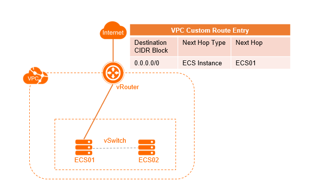

**Connect two VPCs by using an Express Connect circuit**

The following figure shows that VPC1, whose CIDR block is 172.16.0.0/12, is connected to VPC2, whose CIDR block is 192.168.0.0/16, by using an Express Connect circuit. After you create router interfaces, you must add the following routes to the VPCs.

- Add the following route to VPC1

  | Destination CIDR block | Next hop type | Next hop |
  | --- | --- | --- |
  | 192.168.0.0/16 | Router interface (to VPC) | VPC2 |

- Add the following route to VPC2

  | Destination CIDR block | Next hop type | Next hop |
  | --- | --- | --- |
  | 172.16.0.0/12 | Router interface (to VPC) | VPC1 |

  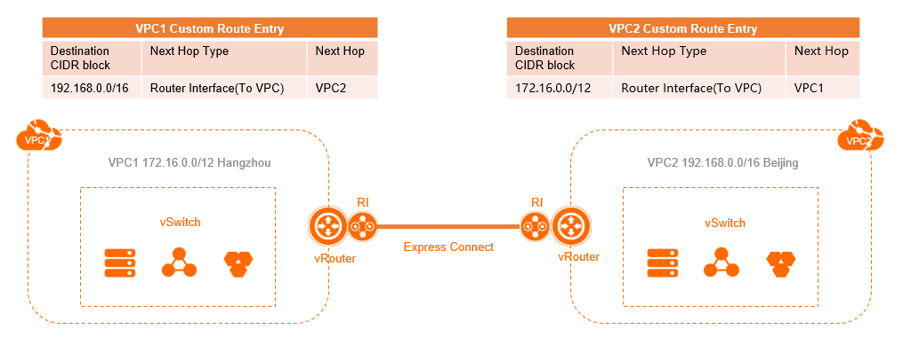

**Connect two VPCs by using a VPN gateway**

The following figure shows that VPC1, whose CIDR block is 172.16.0.0/12, is connected to VPC2, whose CIDR block is 10.0.0.0/8, by using a VPN gateway. After you configure the VPN gateway, you must add the following routes to the VPCs.

- Add the following route to VPC1

  | Destination CIDR block | Next hop type | Next hop |
  | --- | --- | --- |
  | 10.0.0.0/8 | VPN gateway | VPN Gateway 1 |

- Add the following route to VPC2

  | Destination CIDR block | Next hop type | Next hop |
  | --- | --- | --- |
  | 172.16.0.0/12 | VPN gateway | VPN Gateway 2 |

  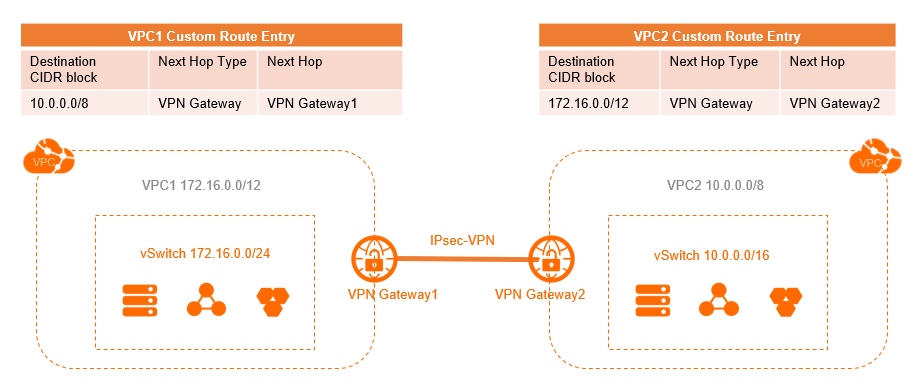

**Connect a VPC to an on-premises network by using an Express Connect circuit**

The following figure shows that a VPC is connected to an on-premises network by using an Express Connect circuit. After you configure a connection over an Express Connect circuit and a VBR, you must add the following routes.

- Add the following route to the VPC

  | Destination CIDR block | Next hop type | Next hop |
  | --- | --- | --- |
  | 192.168.0.0/16 | Router interface (general routing) | Router interface RI1 |

- Add the following routes to the VBR

  | Destination CIDR block | Next hop type | Next hop |
  | --- | --- | --- |
  | 192.168.0.0/16 | Express Connect circuit | Router interface RI3 |
  | 172.16.0.0/12 | VPC | Router interface RI2 |

- Add the following route to the on-premises network

  | Destination CIDR block | Next hop type | Next hop |
  | --- | --- | --- |
  | 172.16.0.0/12 | On-premises gateway | On-premises gateway device |

  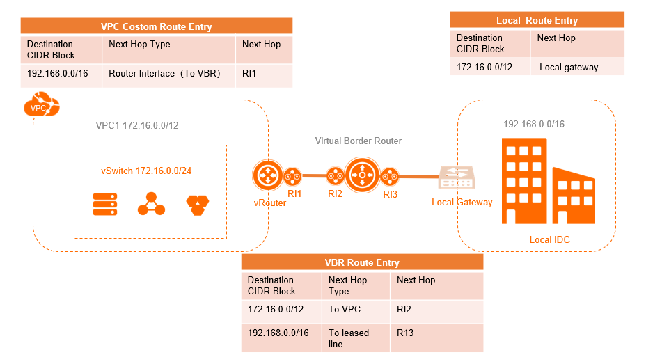

**Connect a VPC to a data center by using a VPN gateway**

The following figure shows that a VPC, whose CIDR block is 172.16.0.0/12, is connected to a data center, whose CIDR block is 192.168.0.0/16, by using a VPN gateway. After you configure the VPN gateway, you must add the following route to the VPC.

| Destination CIDR block | Next hop type | Next hop |
| --- | --- | --- |
| 192.168.0.0/16 | VPN gateway | The VPN gateway that you created |

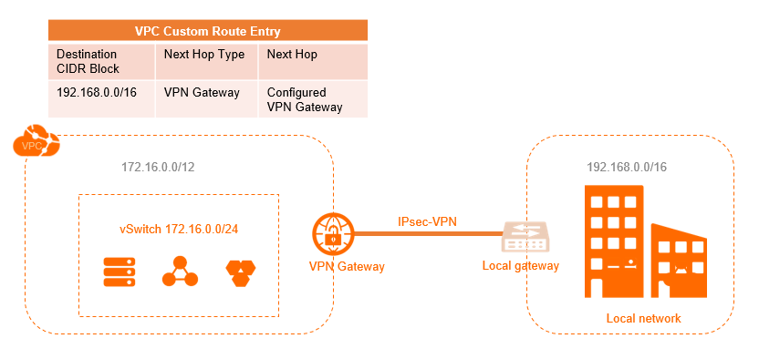

<a id="section-6-2"></a>

## 6.2. Create and manage custom route tables

A route table consists of route entries. You can create a custom route table in a virtual private cloud (VPC), and then associate the custom route table with a vSwitch to control the traffic of the vSwitch. This facilitates network management.

**Prerequisites**

A VPC and a vSwitch are created. For more information, see Create a VPC with an IPv4 CIDR block.

**Create a custom route table**

1. Log in to the VPC console.

2. In the left-side navigation pane, click **Route Tables**.

3. In the top navigation bar, select the region in which you want to create a custom route table.

4. On the **Route Tables** page, click **Create Route Table**.

5. On the **Create Route Table** page, configure the following parameters and click Submit.

   <table>
     <tr>
       <th>Parameter</th>
       <th>Description</th>
     </tr>
     <tr>
       <td colspan="2">Basic Information</td>
     </tr>
     <tr>
       <td>Organization/Res ource Set</td>
       <td>The organization and resource set to which the route table belongs.</td>
     </tr>
     <tr>
       <td>Region</td>
       <td>The region in which you want to create the route table.</td>
     </tr>
     <tr>
       <td>VPC</td>
       <td>The VPC for which you want to create the route table.<br>Note<br>You can also click <strong>Create VPC</strong> to create a VPC.</td>
     </tr>
     <tr>
       <td>Name</td>
       <td>The name of the route table.<br>The name must be 2 to 128 characters in length, and can contain letters, digits, periods (.), underscores (_), and hyphens (-). It must start with a letter and cannot start with <code> http:// </code> or <code> https:// </code>.</td>
     </tr>
     <tr>
       <td>Description</td>
       <td>The description of the route table.<br>The description must be 2 to 256 characters in length, and cannot start with <code> http:// </code> or <code> https:// </code>.</td>
     </tr>
   </table>

   > **Note**
   >
   > After you complete the configuration, you can view and check the configuration of the route table in the right-side **Configuration overview** section.
   >
   > Click the value of a parameter to quickly navigate to the parameter and modify the value based on your business requirements.

6. Creates the custom route table.

   - Confirm the parameters and click **Confirm Order** if the following requirements are met: On the Service Management page, a service is created, and **Route Table** is displayed in the **Cloud resources** column of the service.

   - If no service whose **Cloud resources** value is **Route Table** exists on the Service Management page, confirm the parameters and click **Submit**.

   For more information about service management, see the **Service management** topic in the **User Guide for Apsara Uni-manager Management Console**.

**What to do next**

**View route tables**

On the **Route Tables** page, you can view the information about the route tables.

> **Note**
>
> The list is limited to 100 pages and can display a maximum of 10,000 entries. If you have more than 10,000 entries, use filters to find the data that you need.

- You can find an instance by entering a keyword or specifying filter conditions in an advanced search.

- Click the  icon next to a column name to perform an advanced sort on the list.

- Click the  icon to the right of the **Status** column to filter instances by status.

- Click the  icon in the **Route Table Type** column to filter route tables.

- Click the VPC ID in the **VPC ID/Name** column of a route table to view the basic information about the VPC to which the route table belongs.

- Click the vSwitch ID in the **Associated vSwitch ID/Name** column of a route table to view the basic information about the vSwitch to which the route table belongs.

- Click the  icon next to the name of a route table in the **Route Table ID/Name** column to

  modify the route table name.

- Click the  icon next to the username in the **Creator** column to change the creator of the

  route table.

**Manage tags**

On the **Route Tables** page, you can add tags to route tables to simply route table management. For more information, see Manage tags.

**Delete custom route tables**

> **Note**
>
> - You can delete custom route tables but you cannot delete system route tables.
>
> - If the custom route table that you want to delete is associated with a vSwitch, you must disassociate the custom route table from the vSwitch before you can delete the custom route table.

1. On the **Route Tables** page, find the route table that you want to delete and click **Delete** in the **Actions** column.

2. In the **Delete** message, click **Release**.

3. In the **Release Resource** dialog box, click **Confirm Release**.

4. In the **Operation Successful** dialog box that appears, click **OK**.

**Manage route tables**

1. On the **Route Tables** page, find the route table that you want to manage and click its ID in the **Route Table ID/Name** column or **Manage** in the **Actions** column.

2. On the details page of the route table, you can perform the following operations:

   - On the **Basic Information** tab, you can view and manage the basic information about the route table, manage custom route entries, and manage the vSwitches associated with the route table.

     - In the **Basic Information** section, click the VPC ID next to the **VPC ID** parameter to view the basic information about the VPC to which the route table belongs.

     - In the **Basic Information** section, click the  icon next to the **Route Table Name**

       parameter to modify the name of the route table.

     - In the **Basic Information** section, click the  icon next to the **Description** parameter

       to modify the description of the route table.

     - On the **Routing Entry List** tab, you can manage the route entries in the route table. For more information, see Manage custom route entries.

     - On the **Associated vSwitches** tab, you can manage the vSwitches associated with the route table. For more information, see Manage custom route tables and vSwitches.

   - On the **Operation Log** tab, you can view all operation logs of the route table. For more information, see Manage operation logs.

<a id="section-6-3"></a>

## 6.3. Manage custom route entries

Each item in a route table is a route entry. A route entry specifies the destination to which network traffic is routed. You can also add a custom route entry to route traffic to a specific destination. You can add custom route entries to the system route tables and custom route tables of a virtual private cloud (VPC).

**Prerequisites**

A VPC and a vSwitch are created. For more information, see Create a VPC with an IPv4 CIDR block.

**Add a custom route entry**

1. Log in to the VPC console.

2. In the left-side navigation pane, click **Route Tables**.

3. In the top navigation bar, select the region in which you want to create a custom route table.

4. On the **Route Tables** page, find the route table that you want to manage and click the ID in the **Route Table ID/Name** column or **Manage** in the **Actions** column.

5. On the **Basic Information** tab of the route table details page, click the **Routing Entry List** tab.

6. Click **Add Route Entry**.

7. In the **Add Route Entry** dialog box, configure the parameters described in the following table and click **OK**.

   <table>
     <tr>
       <th>Parameter</th>
       <th>Description</th>
     </tr>
     <tr>
       <td>Destinatio n CIDR Block</td>
       <td>Select a destination CIDR block type. Valid values:<br>• IPv4 CIDR Block<br>• IPv6 CIDR Block</td>
     </tr>
     <tr>
       <td colspan="2">After you configure the <strong>Destination CIDR Block</strong> parameter, specify a CIDR block.<br>If you set the <strong>Destination CIDR block</strong> parameter to <strong>IPv4 CIDR Block</strong>, you can click <strong>Add CIDR</strong> <strong>Block</strong> to enter multiple destination CIDR blocks.</td>
     </tr>
     <tr>
       <td>Next Hop Type</td>
       <td>Select a next hop type.<br>• If you set the <strong>Destination CIDR Block</strong> parameter to <strong>IPv4 CIDR Block</strong>, you can select one of the following types of next hops:<br>• <strong>ECS Instance</strong>: routes the traffic destined for the specified CIDR block to the specified Elastic Compute Service (ECS) instance. Select this option if you want to route traffic to a specific ECS instance for centralized traffic forwarding and management. For example, you can configure an ECS instance as the Internet-facing gateway to route traffic from other ECS instances to the Internet.<br>• <strong>Highly-availability Virtual IP Address</strong>: routes the traffic destined for the specified CIDR block to the specified high-availability virtual IP address (HAVIP).<br>• <strong>VPN Gateway</strong>: routes the traffic destined for the specified CIDR block to the specified VPN gateway.<br>• <strong>NAT Gateway</strong>: routes the traffic destined for the specified CIDR block to the specified NAT gateway.<br>• <strong>ENI</strong>: routes the traffic destined for the specified CIDR block to the specified secondary elastic network interface (ENI).<br>• <strong>Router Interface (VPC Direction)</strong>: routes the traffic destined for the specified CIDR block to the specified VPC. Select this option if you want to connect to a VPC over an Express Connect circuit.<br>• <strong>Router Interface (Border Router Direction)</strong>: routes the traffic destined for the specified CIDR block to the router interface associated with the specified virtual border router (VBR). Select this option if you want to connect to a data center over an Express Connect circuit.<br>If you select Router Interface (Border Router Direction), you must also select a routing mode. Valid values:<br>• <strong>General Route</strong>: allows you to select an associated router interface.<br>• <strong>Active/Standby Routes</strong>: allows you to select two instances as the next hops. The active route has a weight of 100, and the standby route has a weight of 0. The standby route takes over if the active route fails health checks.<br>• <strong>Load-Balancing Routes</strong>: allows you to select two to eight instances as the next hops. The instances must have the same weight, which must be an integer from 0 to 255. Network traffic is evenly distributed to the next hops.<br>• <strong>Transit Router</strong>: routes the traffic destined for the specified CIDR block to the specified transit router.<br>• If you set the <strong>Destination CIDR Block</strong> parameter to <strong>IPv6 CIDR Block</strong>, you can select one of the following types of next hops:<br>• (<strong>Custom route tables only</strong>) <strong>IPv6 Gateway</strong>: routes the traffic destined for the destination CIDR block to the specified IPv6 gateway.<br>• <strong>ENI</strong>: routes the traffic destined for the specified CIDR block to the specified secondary ENI.<br>• (<strong>System route tables only</strong>)<br><strong>Router Interface (VPC Direction)</strong>: routes the traffic destined for the specified CIDR block to the specified VPC. Select this option if you want to connect to a VPC over an Express Connect circuit.<br>• <strong>Router Interface (Border Router Direction)</strong>: routes the traffic destined for the specified CIDR block to the router interface associated with the specified virtual border router (VBR). Select this option if you want to connect to a data center over an Express Connect circuit.<br>If you select Router Interface (Border Router Direction), you must also select a</td>
     </tr>
     <tr>
       <td colspan="2">routing mode. Valid values: After you configure the <strong>Next Hop Type</strong> parameter, you must select an instance as the next hop of<br>• <strong>General Route</strong>: allows you to select an associated router interface.the selected next hop type.<br>• <strong>Active/Standby Routes</strong>: allows you to select two instances as the next hops. The active route has a weight of 100, and the standby route has a Note weight of 0. The standby route takes over if the active route fails health<br>• You can enter a keyword or configure the advanced filter to search for the next hop thatchecks.you want to use.<br>• <strong>Load-Balancing Routes</strong>: allows you to select two to eight instances as the<br>• You can also click thenext hops. The instances must have the same weight, which must be anicon to create an instance as the next hop of the selected next integer from 0 to 255. Network traffic is evenly distributed to the next hops.<br>hop type.<br>• If you select <strong>Router Interface (Border Router Direction)</strong> as <strong>Next Hop Type</strong> and <strong>Active/Standby Routes</strong> as <strong>Router Interface (Border Router Direction)</strong>, you can select two instances as the <strong>primary and secondary</strong> next hops.<br>• If you select <strong>Router Interface (Border Router Direction)</strong> as <strong>Next Hop Type</strong> and <strong>Load-Balancing Routes</strong> as Router Interface (Border Router Direction), click <strong>Add Next</strong> <strong>Hop</strong>. In the Add Next Hop dialog box, configure the <strong>Routing</strong> and <strong>Weight</strong> parameters to select instances as the next hops.</td>
     </tr>
     <tr>
       <td>Remarks</td>
       <td>Enter a description.<br>The description must be 1 to 256 characters in length, and cannot start with http://or https://.</td>
     </tr>
   </table>

**What to do next**

**Export route entries**

You can export route entries from a route table for backup.

> **Note**
>
> The route entries are exported to a .csv file on your computer.

1. On the **Basic Information** tab of the route table details page, click the **Routing Entry List** tab.

2. Click **Export**.

**View route entries**

1. On the **Basic Information** tab of the route table details page, click the **Routing Entry List** tab.

2. On the Routing Entry List tab, view the information about the route entries.

   - You can search for route entries by **destination CIDR block**.

   - Find the route entry that you want to manage and click the  icon next to the CIDR block

     in the **Destination CIDR Block** column. In the Modify dialog box, enter a new name for the route entry.

     The name must be 2 to 128 characters in length, and can contain letters, digits, periods (.), underscores (_), and hyphens (-). The name must start with a letter.

   - Click the instance ID in the **Next Hop (Instance ID/Instance Name/IP Address)** column to view the next hop.

   - Click the  icon next to the description in the **Remarks** column to modify the description

     of a custom route entry.

**Delete custom route entries**

> **Note**
>
> - You can delete custom route entries but you cannot delete system route entries.
>
> - A custom route entry can be deleted only when it has only one next hop.
>
> - Before you delete a route entry, check whether bare metal resources exist in the VPC.

1. On the **Basic Information** tab of the route table details page, click the **Routing Entry List** tab.

2. On the Routing Entry List tab, find the route entry that you want to delete and click **Delete** in the **Actions** column.

3. Optional. If bare metal resources exist in the VPC, follow the on-screen instructions in the dialog box that appears to confirm the operation and click **OK**.

4. In the **Delete Route Entry** message, click **OK**.

<a id="section-6-4"></a>

## 6.4. Manage custom route tables and vSwitches

You can associate a custom route table with a vSwitch to manage the routes of the vSwitch.

**Prerequisites**

A custom route table is created. For more information, see the "Create a custom route table" section of the Create and manage a route table topic.

**Associate a custom route table with a vSwitch**

> **Note**
>
> - You can associate a route table with multiple vSwitches. Each vSwitch can be associated with only one system route table or one custom route table.
>
> - After a custom route table is associated with a vSwitch, the system route table is automatically disassociated from the vSwitch.
>
> - If a route table contains a custom route whose CIDR block is the same as that of a vSwitch, the route table cannot be associated with the vSwitch.

1. Log in to the VPC console.

2. In the left-side navigation pane, click **Route Tables**.

3. In the top navigation bar, select the region in which you want to create a custom route table.

4. On the **Route Tables** page, find the route table that you want to manage and click its ID in the **Route Table ID/Name** column or **Manage** in the **Actions** column.

5. On the **Basic Information** tab of the **Details** page, click the **Associated vSwitches** tab.

6. On the Associated vSwitches tab, click **Associate vSwitch**.

7. In the dialog box that appears, select the vSwitch with which you want to associate the route table and click **OK**.

**What to do next**

**View associated vSwitches**

1. On the **Basic Information** tab of the **Details** page, click the **Associated vSwitches** tab.

2. On the Associated vSwitches tab, you can view the information about the vSwitches with which the route table is associated.

   Click the ID in the **vSwitch** column of a vSwitch to view the basic information about the vSwitch.

**Disassociate a custom route table from a vSwitch**

You can disassociate a custom route table from a vSwitch. After a custom route table is disassociated from a vSwitch, the system route table is automatically associated with the vSwitch.

1. On the **Basic Information** tab of the **Details** page, click the **Associated vSwitches** tab.

2. On the Associated vSwitches tab, find the vSwitch from which you want to disassociate the route table and click **Unbind** in the **Actions** column.

3. In the message that appears, click **OK**.

<a id="section-7"></a>

# 7.vSwitches

<a id="section-7-1"></a>

## 7.1. Overview

A vSwitch is a network switching device in a virtual private cloud (VPC) and supports the functionality of a physical switch. It enables communication between VMs and between VMs and physical networks. A vSwitch is a key component of the virtual infrastructure and exists on the host as a core component of the virtual network.

**vSwitches and VPCs**

Your VPCs are dedicated for your use. You can deploy cloud resources in vSwitches in your VPC. A vSwitch in a VPC serves as a subnet of the VPC.

> **Note**
>
> You cannot directly deploy cloud resources in a VPC. You must deploy cloud resources in the vSwitches of a VPC.

A vSwitch is a basic network device in a VPC and provides network isolation and connection capabilities for cloud resources in the VPC. You can deploy a VPC only in one region and cannot deploy a VPC across regions. However, a VPC covers all zones of the region to which the VPC belongs. When you create a VPC, you must create at least one vSwitch. You can create one or more vSwitches in a zone to create one or more subnets for the VPC.

> **Note**
>
> You can deploy cloud resources of different security levels or features in different subnets. This enhances the flexibility, security, and efficiency of network management. By default, the subnets in a VPC can communicate with each other.

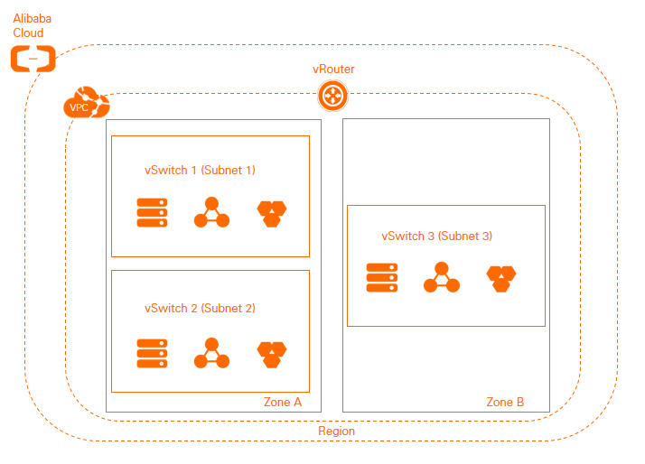

<a id="section-7-2"></a>

## 7.2. Create and manage vSwitches

After you create a virtual private cloud (VPC), you can create vSwitches to create one or more subnets for the VPC. By default, the subnets in a VPC can communicate with each other.

**Prerequisites**

A VPC is created. For more information, see the "Create a VPC" section of the Create and manage a VPC topic.

**Create a vSwitch**

vSwitches in the same VPC can communicate with each other. Cloud resources must be deployed in vSwitches. You can deploy applications in vSwitches that belong to different zones to ensure service availability. vSwitches do not support multicast or broadcast.

1. Log in to the VPC console.

2. In the left-side navigation pane, click **VSwitches**.

3. In the top navigation bar, select the region in which you want to create a vSwitch for a VPC.

4. On the **vSwitches** page, click **Create vSwitch**.

5. On the **Create vSwitch** page, configure the following parameters and click Submit.

   <table>
     <tr>
       <th>Parameter</th>
       <th>Description</th>
     </tr>
     <tr>
       <td colspan="2">Basic Information</td>
     </tr>
     <tr>
       <td>Organization/Resourc e Set</td>
       <td>The organization and resource set to which the vSwitch belongs.</td>
     </tr>
     <tr>
       <td colspan="2">Region</td>
     </tr>
     <tr>
       <td>Region/Zone</td>
       <td>The region and zone where you want to create the vSwitch.<br>In a VPC, a vSwitch can be created only in one zone. You cannot create a vSwitch across zones. You can deploy cloud resources in vSwitches in different zones to implement cross-zone disaster recovery.<br>Note<br>An instance can be deployed in only one vSwitch.</td>
     </tr>
     <tr>
       <td colspan="2">Detailed Settings</td>
     </tr>
     <tr>
       <td>Sharing Scope</td>
       <td>The sharing scope of the vSwitch. Valid values:<br>• <strong>Current Resource Set</strong>: Only the administrators of the current resource set can use the vSwitch to create resources.<br>• <strong>Current Organization and Subordinate Organizations</strong>: Only the administrators of the current organization and its subordinate organizations can use the vSwitch to create resources.<br>• <strong>Current Organization</strong>: Only the administrators of the current organization can use the vSwitch to create resources.</td>
     </tr>
     <tr>
       <td>VPC</td>
       <td>The VPC in which you want to create the vSwitch.<br>Note<br>You can also click <strong>Create VPC</strong> to create a VPC.</td>
     </tr>
     <tr>
       <td>VPC IPv4 CIDR Block</td>
       <td>The IPv4 CIDR block of the selected VPC is displayed.<br>If the VPC has a secondary IPv4 CIDR block, you can specify the primary or secondary IPv4 CIDR block as the CIDR block of the vSwitch based on your business requirements.</td>
     </tr>
     <tr>
       <td>VPC IPv6 CIDR Block</td>
       <td>The IPv6 CIDR block of the selected VPC.</td>
     </tr>
     <tr>
       <td>Dedicated for Bare Metal Instances</td>
       <td>Specifies whether the vSwitch is dedicated for bare-metal servers.<br>For more information about bare-metal servers, see the <strong>Bare-metal</strong> <strong>servers in VPCs</strong> topic in <strong>Bare-metal Server Management Service</strong> <strong>User Guide</strong>.</td>
     </tr>
     <tr>
       <td>vSwitch Name</td>
       <td>The name of the vSwitch.<br>The name must be 2 to 128 characters in length, and can contain letters, digits, periods (.), underscores (_), and hyphens (-). The name must start with a letter and cannot start with <code> http:// </code> or <code> https:// </code>.</td>
     </tr>
     <tr>
       <td>vSwitch IPv4 CIDR Block</td>
       <td>The IPv4 CIDR block of the vSwitch.<br>• You must specify a CIDR block for the vSwitch. The subnet mask must be 16 to 29 bits in length, which specifies that 8 to 65,536 IP addresses are available.<br>• The CIDR block of a vSwitch must be a proper subset of the CIDR block of the VPC to which the vSwitch belongs.<br>• The first IP address and the last three IP addresses of a vSwitch CIDR block are reserved. For example, if the CIDR block of the vSwitch is 192.168.1.0/24, the IP addresses 192.168.1.0, 192.168.1.253, 192.168.1.254, and 192.168.1.255 are reserved.<br>• The CIDR block of a vSwitch cannot be the same as the destination CIDR block in a route entry of the VPC to which the vSwitch belongs.However, the CIDR block of the vSwitch can be a subset of the destination CIDR block of a route entry.<br>Note<br>After a vSwitch is created, you cannot modify its CIDR block.</td>
     </tr>
     <tr>
       <td>vSwitch IPv6 CIDR Block</td>
       <td>The IPv6 CIDR block of the vSwitch.<br>• If your VPC is assigned an IPv6 CIDR block, you must configure the IPv6 CIDR block of the vSwitch. You can modify the subnet mask of the IPv6 CIDR block.<br>• You must check whether IPv6 is enabled for your VPC. If IPv6 is not enabled for your VPC, you cannot assign an IPv6 CIDR block to the vSwitch.<br>• If the valid subnet mask of the IPv6 CIDR block used by the VPC is [56, 63], the valid subnet mask of the IPv6 CIDR block used by the vSwitch is [57, 64]. You can enter a valid decimal number to specify an IPv6 CIDR block for your vSwitch.<br>For example, if the IPv6 CIDR block of the VPC is 2020:66:2:1f0::/61, you can enter the decimal number 7 to specify 2020:66:2:1f7::/64 as the IPv6 CIDR block of the vSwitch.</td>
     </tr>
     <tr>
       <td>Description</td>
       <td>The description of the vSwitch.<br>The description must be 2 to 256 characters in length and cannot start with <code> http:// </code> or <code> https:// </code>.</td>
     </tr>
   </table>

   > **Note**
   >
   > After you complete the configuration, view and check the configuration of the vSwitch displayed in the right-side **Configuration overview** section.
   >
   > You can click the value of a parameter to navigate to the parameter and modify the value based on your business requirements.

6. Create the vSwitch.

   - Confirm the parameters and click **Confirm Order** if the following requirements are met: On the Service Management page, a service is created and **vSwitch** is displayed in the **Cloud resources** column of the service.

   - If no service whose **Cloud resources** value is **vSwitch** exists on the Service Management page, confirm the parameters and click **Submit**.

**What to do next**

**View vSwitches**

On the **vSwitches** page, you can view the information about vSwitches.

> **Note**

- Click the  icon next to the **Zone** column to filter vSwitches by zone.

- Click the VPC ID in the **VPC ID/Name** column of a vSwitch to view the basic information about the VPC to which the vSwitch belongs.

- Click the route table ID in the **Route Table ID/Name** column of a vSwitch to view the basic information about the route table that is associated with the vSwitch.

- Click an ID in the **Network ACL ID/Name** column to view the network access control list (ACL) associated with the vSwitch.

- Click the  icon next to the name of a vSwitch in the **vSwitch ID/Name** column to modify

  the vSwitch name.

**Manage tags**

On the **vSwitches** page, you can add tags to vSwitches for management. For more information, see Manage tags.

**Enable IPv6 for a vSwitch**

1. On the **vSwitches** page, find the vSwitch that you want to manage and click **Enable IPv6** in the **IPv6 CIDR Block** column.

2. In the **Enable IPv6** dialog box, configure the following parameters, select **Automatically Enable IPv6 for All vSwitches**, and then click **OK**.

   | Parameter | Description |
   | --- | --- |
   | IPv6 network segment | Select the allocation method of the IPv6 CIDR block. Valid values:<br>• <strong>Automatic Allocation</strong>: The system automatically assigns an IPv6 CIDR block to the vSwitch.<br>• <strong>Manually Specify</strong>: You can specify an IPv6 CIDR block based on your business requirements.<br>Note<br>If you select <strong>Manually Specify</strong>, you must configure the <strong>ISP Address Pool</strong> parameter and enter a custom IPv6 CIDR block.<br>If you select <strong>Manually Specify</strong>, IPv6 address configuration errors may occur. Make sure that you check the accuracy of IPv6 addresses with the administrator or network administrator. |
   | ISP Address Pool | Select the type of the address pool. |
   | IPv6 CIDR Block | Configure a custom IPv6 CIDR block based on the type of the address pool that you specify.<br>Note<br>This parameter is required only if you set the IPv6 CIDR Block parameter to <strong>Manually Specify</strong>. |

   > **Note**
   >
   > - This operation is required only if IPv6 is disabled for the VPC to which the vSwitch belongs.
   >
   > - If you do not select **Automatically Enable IPv6 for All vSwitches** when you enable IPv6 for the vSwitch, you can click **Assign IPv6** in the **IPv6 CIDR Block** column to assign an IPv6 CIDR block to the vSwitch.

**Associate a network ACL with a vSwitch**

1. On the **vSwitch** page, find the vSwitch with which you want to associate a network ACL and click **Associate** in the **Network ACL ID/Name** column.

2. In the **Bind Network ACL** dialog box, configure the **Network ACL** parameter and click **OK**.

**Modify the sharing scope**

1. On the **vSwitches** page, find the vSwitch that you want to manage and click **Sharing Settings** in the **Actions** column.

2. In the **Sharing Settings** dialog box, configure the **Sharing Scope** parameter and click **OK**.

**Delete a vSwitch**

You can delete a vSwitch that you no longer need. After you delete a vSwitch, you cannot deploy cloud resources in it.

> **Note**
>
> Before you delete a vSwitch, make sure that the following requirements are met:
>
> - Cloud resources created in the vSwitch are deleted, such as Elastic Compute Service (ECS), Server Load Balancer (SLB), and ApsaraDB RDS instances.
>
> - All resources associated with the vSwitch are deleted, such as high-availability virtual IP addresses (HAVIPs) and SNAT entries.

1. On the **vSwitches** page, find the vSwitch that you want to delete and click **Delete** in the Actions column.

2. In the **Delete** message, click **Release**.

3. 

4. 

**Manage a vSwitch**

1. On the **vSwitches** page, find the vSwitch that you want to manage and click the ID in the **vSwitch ID/Name** column or **Manage** in the **Actions** column.

2. On the **vSwitch Details** page, you can manage the vSwitch.

   - On the **Basic Information** tab, you can view and manage the basic information about the vSwitch.

     - In the **vSwitch Basic Information** section, click the VPC ID next to the **VPC ID** parameter to view the basic information about the VPC to which the vSwitch belongs.

     - In the **vSwitch Basic Information** section, click the  icon next to the **vSwitch**

       **Name** parameter to modify the name of the vSwitch.

     - In the **vSwitch Basic Information** section, click the  icon next to the **Description**

       parameter to modify the description of the vSwitch.

     - In the **vSwitch Basic Information** section, click **Enable IPv6** or **Assign IPv6** next to the **IPv6 CIDR Block** parameter to enable IPv6 for the vSwitch.

     - In the **vSwitch Basic Information** section, click **Disable IPv6** next to the **IPv6 CIDR Block** parameter to disable IPv6 for the vSwitch.

     - In the **vSwitch Basic Information** section, click **Associate** next to the **Network ACL** parameter to associate a network ACL with the vSwitch.

     - In the **vSwitch Basic Information** section, click **Binding** next to the **Route Table** parameter to associate a route table with the vSwitch.

     - In the **vSwitch Basic Information** section, click the route table ID next to the **Route Table** parameter to view the basic information about the route table that is associated with the vSwitch.

     - Click **Delete** in the upper-right corner to delete the vSwitch.

   - On the **Operation Log** tab, you can view all operation logs of the vSwitch. For more information, see Manage operation logs.

<a id="section-7-3"></a>

## 7.3. Deploy cloud resources in a vSwitch

You cannot directly deploy cloud resources in a virtual private cloud (VPC). You must deploy cloud resources in a vSwitch in a VPC. The cloud resources include Elastic Compute Service (ECS), Server Load Balancer (SLB), and ApsaraDB RDS instances.

**Usage notes**

- You do not need to deploy cloud resources in a vSwitch that is exclusively used by an ECS bare metal instance.

- Before you deploy cloud resources in a VPC, make sure that the cloud resources that you want to deploy are created.

**Procedure**

1. Log on to the VPC console.

2. In the left-side navigation pane, click **VSwitches**.

3. In the top navigation bar, select the region in which you want to create a vSwitch for a VPC.

4. On the **vSwitches** page, find the vSwitch that you want to manage and perform the following operations to deploy cloud resources in the vSwitch:

   - Choose **... > Create ECS Instance** in the **Actions** column. In the **Create ECS Instance** dialog box, configure the parameters to create an ECS instance.

     For more information about how to configure the parameters to create an ECS instance, see **Quick start** > **Create an ECS instance** in the **ECS User Guide**.

   - Choose **... > Create SLB Instance** in the **Actions** column. In the **Create SLB Instance** dialog box, configure the parameters to create an SLB instance.

     For more information about how to configure the parameters to create an SLB instance, see **Quick start** > **Create an SLB instance** in the **SLB User Guide**.

   - Choose **... > Create ApsaraDB RDS Instance** in the **Actions** column. In the **Create ApsaraDB RDS Instance** dialog box, configure the parameters to create an ApsaraDB RDS instance.

     For more information about how to configure the parameters to create an ApsaraDB RDS instance, see **Quick start** > **Create an ApsaraDB RDS instance** in the **ApsaraDB RDS User Guide**.

<a id="section-8"></a>

# 8.Network ACLs

<a id="section-8-1"></a>

## 8.1. Overview

Network access control lists (ACLs) allow you to implement access control for virtual private clouds (VPCs). You can configure network ACL rules and associate a network ACL with a vSwitch. This way, you can control the inbound and outbound traffic of Elastic Compute Service (ECS) instances that are connected to the vSwitch.

**Features**

Network ACLs have the following features:

- A network ACL is used to filter the inbound and outbound network traffic of ECS instances that are connected to a vSwitch in a VPC. The network traffic forwarded to ECS instances by Server Load Balancer (SLB) instances is also filtered.

- Network ACLs are stateless. You must configure both inbound and outbound rules. Otherwise, the system may fail to respond to requests.

- If you create a network ACL that does not contain a rule, all inbound and outbound traffic is denied.

- If a network ACL is associated with a vSwitch, the network ACL does not filter the traffic forwarded between ECS instances that are connected to the vSwitch.

**Network ACL rules**

You can create rules in or delete rules from a network ACL. Changes to the rules are automatically synchronized to the associated vSwitch. By default, an inbound rule and an outbound rule are automatically created after a network ACL is created. These rules allow all inbound and outbound network traffic transmitted by using the associated vSwitch. You can delete the default rules. The following table describes the default inbound and outbound rules.

- Default inbound rule

  | Priority | Protocol type | Source CIDR block | Source port range | Action | Type |
  | --- | --- | --- | --- | --- | --- |
  | 1 | All | 0.0.0.0/0 | -1/-1 | Allow | Custom |

- Default outbound rule

  | Priority | Protocol type | Destination CIDR block | Destination port range | Action | Type |
  | --- | --- | --- | --- | --- | --- |
  | 1 | All | 0.0.0.0/0 | -1/-1 | Allow | Custom |

A network ACL rule contains the following parameters:

- Priority: the matching priority. A smaller value indicates a higher priority. The system matches requests against rules in descending order of priority. Rule 1 has the highest priority. If a request matches a rule, the system applies the rule to the request and ignores the other rules.

  For example, the following rules are created in a network ACL and requests destined for the IP address 172.16.0.1 are sent from an ECS instance. In this case, the requests match Rules 2 and 3. Rule 2 has a higher priority than Rule 3. Therefore, the system applies Rule 2. The requests are denied based on the action of Rule 2.

  | Priority | Protocol type | Destination CIDR block | Destination port range | Action | Type |
  | --- | --- | --- | --- | --- | --- |
  | 1 | All | 10.0.0.0/8 | -1/-1 | Allow | Custom |
  | 2 | All | 172.16.0.0/1 2 | -1/-1 | Deny | Custom |
  | 3 | All | 172.16.0.0/1 2 | -1/-1 | Allow | Custom |

- Action: specifies whether to allow or deny specific traffic.

- Protocol type: the protocol type. Valid values: All, ICMP, GRE, TCP, and UDP.

- Source CIDR block: the source CIDR block from which inbound traffic is transmitted.

- Destination CIDR block: the destination CIDR block to which outbound traffic is transmitted.

- Source port range: the range of ports to which the inbound rule applies.

- Destination port range: the range of ports to which the outbound rule applies.

**Comparison between network ACLs and security groups**

Network ACLs control the data transmitted to and from associated vSwitches. Security groups control the data transmitted to and from associated ECS instances. The following table describes the differences between network ACLs and security groups.

| Network ACL | Security group |
| --- | --- |
| Applies to vSwitches. | Applies to ECS instances. |
| Stateless: Returned traffic must be allowed by inbound rules. | Stateful: Returned traffic is automatically allowed and not affected by rules. |
| The system matches a request against rules in descending order of priority. Not all rules are matched. | The system matches a request against all rules before a rule is applied. |
| Each vSwitch can be associated with only one network ACL. | Each ECS instance can be added to one or more security groups. |

The following figure shows how network ACLs and security groups are applied to ensure network security.

**Flowchart**

The following flowchart shows how to use a network ACL.

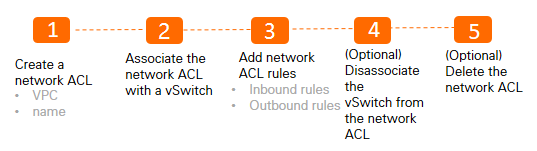

<a id="section-8-2"></a>

## 8.2. Create and manage network ACLs

A network access control list (ACL) allows you to manage network access in a virtual private cloud (VPC). You can create network ACLs in the VPC console.

**Prerequisites**

A VPC is created. For more information, see the "Create a VPC" section of the Create and manage VPCs topic.

**Create a network ACL**

1. Log in to the VPC console.

2. In the left-side navigation pane, click **Network ACL**.

3. In the top navigation bar, select the region in which you want to create a network ACL.

4. On the **Network ACLs** page, click **Create Network ACL**.

5. On the **Create Network ACL** page, configure the parameters described in the following table.

   <table>
     <tr>
       <th>Parameter</th>
       <th>Description</th>
     </tr>
     <tr>
       <td colspan="2">Region</td>
     </tr>
     <tr>
       <td>Organization/Resou rce Set</td>
       <td>The organization and resource set to which the network ACL belongs.</td>
     </tr>
     <tr>
       <td>Region</td>
       <td>The region in which you want to deploy the network ACL.</td>
     </tr>
     <tr>
       <td colspan="2">Basic Configurations</td>
     </tr>
     <tr>
       <td>Name</td>
       <td>The name of the network ACL.<br>The name must be 2 to 128 characters in length and can contain letters, digits, underscores (_), and hyphens (-). The name must start with a letter.</td>
     </tr>
     <tr>
       <td>Description</td>
       <td>The description of the network ACL.<br>The description must be 2 to 256 characters in length, and can contain letters, digits, underscores (_), colons (:), and hyphens (-). The description must start with a letter but cannot start with <code> http:// </code> or <code> https:// </code>.</td>
     </tr>
     <tr>
       <td>VPC</td>
       <td>The VPC for which you want to create the network ACL.<br>Note<br>• The VPC and network ACL must be deployed in the same region.<br>• You can also click <strong>Create VPC</strong> to create a VPC.</td>
     </tr>
   </table>

   > **Note**
   >
   > After you complete the configuration, view and check the configuration of the network ACL displayed in the right-side **Configuration overview** section.
   >
   > You can click the value of a parameter to navigate to the parameter and modify the value based on your business requirements.

6. Create the network ACL.

   - Confirm the parameters and click **Confirm Order** if the following requirements are met: On the Service Management page, a service is created and **Network ACL** is displayed in the **Cloud resources** column of the service.

   - If the service whose **Cloud resources** value is **Network ACL** does not exist on the Service Management page, confirm the parameters and click **Submit**.

**What to do next**

**Manage network ACLs**

On the **Network ACLs** page, you can view the information about the created network ACLs.

> **Note**

- Click the VPC ID in the **VPC ID/Name** column of a network ACL to view the basic information about the VPC to which the network ACL belongs.

- Click the vSwitch ID in the **Associated Resources** column of a network ACL to view the basic information about the vSwitch associated with the network ACL.

- Click the number in the **Network ACL Rules** column of a network ACL to view the inbound and outbound rules of the network ACL. The number indicates the total number of inbound and outbound rules of the network ACL.

- Click the  icon next to a network ACL name in the **Network ACL ID/Name** column to

  modify the network ACL name.

**Manage tags**

On the **Network ACLs** page, you can add tags to network ACLs for management. For more information, see Manage tags.

**Delete a network ACL**

You can delete a network ACL that is no longer needed.

> **Note**
>
> Make sure that the network ACL to be deleted is not associated with a vSwitch. If the network ACL is associated with a vSwitch, disassociate the network ACL from the vSwitch first. For more information, see the "Disassociate a network ACL from a vSwitch" section of the Manage associated resources topic.

1. On the **Network ACLs** page, find the network ACL that you want to delete and click **Delete** in the **Actions** column.

2. In the **Delete** message, click **Release**.

3. 

4. 

**Manage a network ACL**

1. On the **Network ACLs** page, find the network ACL that you want to manage and click its ID in the **Network ACL ID/Name** column, the number in the **Network ACL Rules** column, or **Manage** in the **Actions** column.

2. On the **Network ACL Details** page, perform the following operations to manage the network ACL:

   - On the **Basic Information** tab, view and manage the basic information about the network ACL. You can also manage the associated resources and inbound and outbound rules of the network ACL.

     - In the **Network ACL Basic Information** section, click the **VPC ID** to view the basic information about the VPC to which the network ACL belongs.

     - In the **Network ACL Basic Information** section, click the  icon next to the **Network**

       **ACL Name** parameter to modify the name of the network ACL.

     - In the **Network ACL Basic Information** section, click the  icon next to the

       **Description** parameter to modify the description of the network ACL.

     - Click the **Associated Resource** tab to manage the vSwitches associated with the network ACL. For more information, see Manage associated resources.

     - Click the **Inbound Rule** tab to manage the inbound rules of the network ACL. For more information, see Configure inbound rules.

     - Click the **Outbound Rule** tab to manage the outbound rules of the network ACL. For more information, see Configure outbound rules.

   - On the **Operation Logs** tab, view all operation logs of the network ACL. For more information, see Manage operation logs.

<a id="section-8-3"></a>

## 8.3. Manage associated resources

After you create a network access control list (ACL), you can associate it with a vSwitch to control traffic of the Elastic Compute Service (ECS) instances connected to the vSwitch.

**Prerequisites**

Before you associate a network ACL with a vSwitch, make sure that the following requirements are met:

- A network ACL is created. For more information, see the "Create a network ACL" section of the Create and manage a network ACL topic.

- A vSwitch is created. The vSwitch and network ACL belong to the same virtual private cloud (VPC). For more information, see the "Create a vSwitch" section of the Create and manage a vSwitch topic.

**Associate a network ACL with a vSwitch**

1. Log in to the VPC console.

2. In the left-side navigation pane, click **Network ACL**.

3. In the top navigation bar, select the region in which you want to create a network ACL.

4. On the **Network ACLs** page, find the network ACL that you want to manage and click **Manage** in the **Actions** column.

5. On the **Basic Information** tab of the **Network ACL Details** page, click the **Bound Resource** tab.

6. Click **Associated Resources**.

7. In the **Associated Resources** dialog box, select a vSwitch and click **OK**.

   > **Note**
   >
   > - The network ACL and vSwitch must belong to the same VPC. A vSwitch can be associated only with one network ACL.
   >
   > - You can also click **Create vSwitch** to create a vSwitch and associate the vSwitch with the network ACL.

**Disassociate a network ACL from a vSwitch**

You can disassociate a network ACL from a vSwitch. After the network ACL is disassociated from the vSwitch, the network ACL no longer controls traffic of the ECS instances connected to the vSwitch.

1. Log in to the VPC console.

2. In the left-side navigation pane, click **Network ACL**.

3. In the top navigation bar, select the region in which you want to create a network ACL.

4. On the **Network ACLs** page, find the network ACL that you want to manage and click **Manage** in the **Actions** column.

5. On the **Basic Information** tab of the **Network ACL Details** page, click the **Bound Resource** tab.

6. In the list of vSwitches that are associated with the network ACL, find the vSwitch that you want to manage and click **Unbind** in the **Actions** column.

7. In the message that appears, click **OK**.

<a id="section-8-4"></a>

## 8.4. Manage network ACL rules

<a id="section-8-4-1"></a>

### 8.4.1. Scenarios

If you are familiar with the ports that are commonly used by ECS instances, you can specify them in access control list (ACL) rules to facilitate precise network traffic filtering. This topic describes the ports that are commonly used by ECS instances and the application scenarios of these ports.

**Ports**

The following table lists the ports and the services that use these ports.

| Port | Service | Description |
| --- | --- | --- |
| 21 | FTP | The FTP port. It is used to upload and download files. |
| 22 | SSH | The SSH port. It is used to log on to Linux instances in the command line method by using username and password pairs. |
| 23 | Telnet | The Telnet port. It is used to remotely log on to ECS instances. |
| 25 | SMTP | The SMTP port. It is used to send emails. |
| 80 | HTTP | The HTTP port. It is used to access services such as IIS, Apache, and NGINX. |
| 110 | POP3 | The POP3 port. It is used to send and receive emails. |
| 143 | IMAP | The Internet Message Access Protocol (IMAP) port. It is used to receive emails. |
| 443 | HTTPS | The HTTPS port. It is used to access services. The HTTPS protocol can implement encrypted and secure data transmission. |
| 1433 | SQL Server | The TCP port of SQL Server. It is used for SQL Server to provide external services. |
| 1434 | SQL Server | The UDP port of SQL Server. It is used to return the TCP/IP port occupied by SQL Server. |
| 1521 | Oracle | The Oracle communication port. ECS instances that run Oracle SQL must have this port open. |
| 3306 | MySQL | The MySQL port. It is used for MySQL databases to provide external services. |
| 3389 | Windows Server Remote Desktop Services | The Windows Server Remote Desktop Services port. It is used to log on to a Windows instance. |
| 8080 | Proxy port | An alternative to port 80. It is commonly used for WWW proxy services. |

**Custom network ACLs**

Inbound rules and Outbound rules describe a network ACL example for VPCs that support IPv4 addresses only.

- The inbound rules in effective order 1, 2, 3, and 4 respectively allow HTTP, HTTPS, SSH, and RDP traffic to the vSwitch. Outbound response rules are those in effective order 3.

- The outbound rules in effective order 1 and 2 respectively allow HTTP and HTTPS traffic from the vSwitch. Outbound response rules are those in effective order 5.

- The inbound rule in effective order 6 denies all inbound IPv4 traffic. This rule ensures that packets that do not match any other rules are denied.

- The outbound rule in effective order 4 denies all outbound IPv4 traffic. This rule ensures that packets that do not match any other rules are denied.

> **Note**
>
> An inbound or outbound rule must correspond to an inbound or outbound rule
>
> that allows response traffic.

Table 1. Inbound rules

| Effecti ve order | Protoc ol | Source IP addres ses | Destin ation port range | Action | Description |
| --- | --- | --- | --- | --- | --- |
| 1 | TCP | 0.0.0.0/0 | 80/80 | Accept | Allows inbound HTTP traffic from any IPv4 addresses. |
| 2 | TCP | 0.0.0.0/0 | 443/44 3 | Accept | Allows inbound HTTPS traffic from any IPv4 addresses. |
| 3 | TCP | 0.0.0.0/0 | 22/22 | Accept | Allows inbound SSH traffic from any IPv4 addresses. |
| 4 | TCP | 0.0.0.0/0 | 3389/3 389 | Accept | Allows inbound RDP traffic from any IPv4 addresses. |
| 5 | TCP | 0.0.0.0/0 | 32768/65535 | Accept | Allows inbound IPv4 traffic from the Internet.<br>This port range is for reference only. For more information on how to select appropriate ephemeral ports, see Ephemeral ports. |
| 6 | All | 0.0.0.0/0 | -1/-1 | Drop | Denies all inbound IPv4 traffic. |

Table 2. Outbound rules

| Effecti ve order | Protoc ol | Destin ation IP addres ses | Destin ation port range | Action | Description |
| --- | --- | --- | --- | --- | --- |
| 1 | TCP | 0.0.0.0/0 | 80/80 | Accept | Allows outbound IPv4 HTTP traffic from the vSwitch to the Internet. |
| 2 | TCP | 0.0.0.0/0 | 443/44 3 | Accept | Allows outbound IPv4 HTTPS traffic from the vSwitch to the Internet. |
| 3 | TCP | 0.0.0.0/0 | 32768/65535 | Accept | Allows outbound IPv4 traffic from the vSwitch to the Internet.<br>This port range is for reference only. For more information on how to select appropriate ephemeral ports, see Ephemeral ports. |
| 4 | All | 0.0.0.0/0 | -1/-1 | Drop | Denies all outbound IPv4 traffic. |

**Network ACLs for SLB**

If the ECS instance in the vSwitch acts as the backend server of an SLB instance, you must add the following network ACL rules.

- Inbound rules

  | Effecti ve order | Protoc ol | Source IP addres ses | Destin ation port range | Action | Description |
  | --- | --- | --- | --- | --- | --- |
  | 1 | SLB listener protoco l | Client IP address es allowed to access the SLB instanc e | SLB listener port | Accept | Allows inbound traffic from specified client IP addresses. |
  | 2 | Health check protoco l | 100.64.0.0/10 | Health check port | Accept | Allows inbound traffic from health check IP addresses. |

- Outbound rules

  | Effecti ve order | Protoc ol | Destin ation IP addres ses | Destin ation port range | Action | Description |
  | --- | --- | --- | --- | --- | --- |
  | 1 | All | Client IP address es allowed to access the SLB instanc e | -1/-1 | Accept | Allows all outbound traffic to specified client IP addresses. |
  | 2 | All | 100.64.0.0/10 | -1/-1 | Accept | Allows outbound traffic to health check IP addresses. |

**Ephemeral ports**

Clients use different ports to initiate requests. You can select different port ranges for network ACL rules based on the client type. The following table lists ephemeral port ranges for common clients.

| Client | Port range |
| --- | --- |
| Linux | 32768/61000 |
| Windows Server 2003 | 1025/5000 |
| Windows Server 2008 and later | 49152/65535 |
| NAT gateway | 1024/65535 |

<a id="section-8-4-2"></a>

### 8.4.2. Configure inbound rules

After you create a network access control list (ACL), you can add inbound rules to the network ACL. You can use inbound rules to control how Elastic Compute Service (ECS) instances connected to a vSwitch are accessed over the Internet or the VPC.

**Prerequisites**

A network ACL is created. For more information, see Create a network ACL.

**Create an inbound rule**

1. Log in to the VPC console.

2. In the left-side navigation pane, click **Network ACL**.

3. In the top navigation bar, select the region in which you want to create a network ACL.

4. On the **Network ACLs** page, find the network ACL that you want to manage and click **Set Inbound Rules** in the **Actions** column.

5. On the **Basic Information** tab of the **Network ACL Details** page, click **Create Inbound Rule** on the **Inbound Rule** tab.

6. In the **Create Inbound Rule** dialog box, configure the parameters described in the following table and click **OK**.

   | Parameter | Description |
   | --- | --- |
   | Name | The name of the inbound rule.<br>The name must be 2 to 128 characters in length and can contain letters, digits, underscores (_), and hyphens (-). The name must start with a letter. |
   | Priority | The priority of the inbound rule. A smaller value indicates a higher priority. |
   | Strategy | The authorization policy of the inbound rule. Valid values:<br>• <strong>Allow</strong> (default): accepts network traffic that is destined for the ECS instances connected to the vSwitch.<br>• <strong>Deny</strong>: drops network traffic that is destined for the ECS instances connected to the vSwitch. |
   | Protocol Type | The protocol type of the inbound rule. Valid values:<br>• all<br>• icmp<br>• gre<br>• tcp<br>• udp |
   | Source Address | The source CIDR block from which data is transmitted.<br><br>Default value: <code>0.0.0.0/32</code>. |
   | Destination Port Range | The destination port range<br>in the Port number/Port number format. Valid values of port number: 1 to 65535.Examples: 1/200 and 80/80. Do not set the value to -1/-1 because -1/-1 indicates that all ports are allowed.<br>Note<br>You can configure the <strong>Destination Port Range</strong> parameter only if the <strong>Protocol Type</strong> parameter is set to <strong>tcp</strong> or <strong>udp</strong>. |

**Manage inbound rules**

After you create inbound rules, you can perform the operations described in the following table on the **Inbound Rule** tab to manage the rules.

| Operation | Description |
| --- | --- |
| Modify an inbound rule | 1. In the inbound rule list, find the inbound rule that you want to modify and click <strong>Edit</strong> in the <strong>Actions</strong> column.<br>2. In the Edit Inbound Rule dialog box, modify the <strong>Name</strong>, <strong>Strategy</strong>, <strong>Protocol Type</strong>, and <strong>Source Address</strong> parameters and click <strong>OK</strong>.<br>3. In the message that appears, click <strong>Modify</strong>. |
| Delete an inbound rule | 1. In the inbound rule list, find the inbound rule that you want to delete and click <strong>Delete</strong> in the <strong>Actions</strong> column.<br>2. In the Delete Inbound Rule message, click <strong>OK</strong>. |
| Export inbound rules | 1. In the upper-left corner of the Inbound Rule tab, click <strong>Export</strong>.<br>2. The existing inbound rules are downloaded to your computer. |
| Import inbound rules | 1. In the upper-left corner of the Inbound Rule tab, click <strong>Import</strong>.<br>2. In the <strong>Import Rule</strong> dialog box, click <strong>Next</strong>.<br>3. Click Upload Template next to the <strong>Import Template</strong> parameter, select a file, and then click <strong>OK</strong>.<br>Note<br>• The imported rules overwrite all existing rules. If you want to retain the existing rules, export the existing rules.<br>• You can click Inbound Rule Template next to the <strong>Download Template</strong> parameter to download a template. |
| Sort inbound rules | Network ACL rules take effect in descending order of priority. A smaller value indicates a higher priority. You can sort network ACL rules to change the priority of a specific network ACL rule.<br>1. In the upper-left corner of the Inbound Rule tab, click <strong>Sort</strong>.<br>2. In the <strong>Sort</strong> dialog box, find the rule whose priority you want to change, drag ang drop the rule, and then click <strong>OK</strong>.<br>Note<br>Rules are listed in descending order of priority. |

<a id="section-8-4-3"></a>

### 8.4.3. Configure outbound rules

After you create a network access control list (ACL) for a virtual private cloud (VPC), you can create outbound rules in the network ACL. You can use outbound rules to control how Elastic Compute Service (ECS) instances connected to a vSwitch access other resources over the Internet or the VPC.

**Prerequisites**

A network ACL is created. For more information, see the "Create a network ACL" section of the Create and manage a network ACL topic.

**Create an outbound rule**

1. Log in to the VPC console.

2. In the left-side navigation pane, click **Network ACL**.

3. In the top navigation bar, select the region in which you want to create a network ACL.

4. On the **Network ACLs** page, find the network ACL that you want to manage and click **Set Outbound Rules** in the **Actions** column.

5. On the **Basic Information** tab of the **Network ACL Details** page, click **Create Outbound Rules** on the **Outbound Rule** tab.

6. In the **Create Outbound Rules** dialog box, configure the parameters that are described in the following table and click **OK**.

   | Parameter | Description |
   | --- | --- |
   | Priority | The priority of the rule. A smaller value indicates a higher priority. |
   | Rule Name | The name of the rule.<br>The name must be 2 to 128 characters in length, and can contain letters, digits, underscores (_), and hyphens (-). The name must start with a letter. |
   | Protocol | The protocol of the inbound rule. Valid values:<br>• <strong>all</strong>: all protocols<br>• <strong>icmp</strong>: Internet Control Message Protocol (ICMP)<br>• <strong>gre</strong>: Generic Routing Encapsulation (GRE)<br>• <strong>tcp</strong>: TCP<br>• <strong>udp</strong>: UDP |
   | Source Address | The source CIDR block from which data is transmitted.<br><br>Default value: <code>0.0.0.0/32</code>. |
   | Destination Port Range | The destination port range.<br>Enter the port range in the port number/port number format. Valid values of port number: 1 to 65535. Examples: 1/200 and 80/80. Do not set the value to -1/-1 because -1/-1 means that all ports are allowed.<br>Note<br>You can configure the <strong>Destination Port Range</strong> parameter only if the <strong>Protocol</strong> parameter is set to <strong>tcp</strong> or <strong>udp</strong>. |
   | Strategy | The action of the inbound rule. Default value: <strong>Allow</strong>. Valid values:<br>• <strong>Allow</strong>: accepts network traffic that is destined for the ECS instances connected to the vSwitch.<br>• <strong>Deny</strong>: blocks network traffic that is destined for the ECS instances connected to the vSwitch. |

**Manage outbound rules**

After outbound rules are created, you can perform the operations that are described in the following table on the **Outbound Rule** tab to manage the rules.

| Operation | Description |
| --- | --- |
| Export inbound rules | 1. Click <strong>Export</strong> above the inbound rule list.<br>2. Then, the existing inbound rules are downloaded to your computer. |
| Import inbound rules | 1. Click <strong>Import</strong> above the inbound rule list.<br>2. In the <strong>Import Rule</strong> dialog box, click <strong>Next</strong>.<br>3. Click <strong>Import Template</strong> below <strong>Import Template</strong>, select a local file, and click <strong>OK</strong>.<br>Note<br>• The imported rules will overwrite the existing rules. If you want to retain the existing rules, export them first.<br>• You can click Inbound Rule Template below <strong>Download Template</strong> to download a template. |
| Enable inbound rules | 1. Click <strong>Enable Rule</strong> above the inbound rule list to enable the inbound rules in the list.<br>2. In the message that appears, click <strong>OK</strong>. |
| Disable inbound rules | 1. Click <strong>Disable Rule</strong> above the inbound rule list to disable the inbound rules in the list.<br>2. In the message that appears, click <strong>OK</strong>. |
| Delete an inbound rule | 1. In the inbound rule list, find the inbound rule that you want to delete and click <strong>Delete</strong> in the <strong>Actions</strong> column.<br>2. In the message that appears, click <strong>OK</strong>. |

<a id="section-9"></a>

# 9.Elastic IP Addresses (EIPs)

<a id="section-9-1"></a>

## 9.1. Log on to the EIP console

This topic describes how to log on to the Apsara Uni-manager Management Console to manage your elastic IP addresses (EIPs). In this example, the Google Chrome browser is used.

**Prerequisites**

- The URL of the Apsara Uni-manager Management Console is obtained from the deployment engineers.

- A web browser is available. We recommend that you use Google Chrome.

**Procedure**

1. Enter the URL of the Apsara Uni-manager Management Console in the address bar and press the Enter key.

   

   > **Note**
   >
   > - You can select a language from the drop-down list in the upper-right corner of the page.
   >
   > - 由于浏览器证书过期或环境开启HTTPS认证等出现多次单击继续访问或无Apsara Uni-manager运营控制台地址入口等现象，此时需要安装证书才能正常访问。单击页面右上角的**浏览器证书安装**，可打开浏览器证书安装指南。

2. Enter the correct username and password.

   Obtain the username and password that you use to log on to the Apsara Uni-manager Management Console from the operations administrator.

   > **Note**
   >
   > - **First logon**
   >
   >   The first time that you log on to the Apsara Uni-manager Management Console, you need to change the password of your account. Follow the instructions to complete the password change. For security purposes, the password must be 10 to 32 characters in length. It must contain all of the following character types: uppercase letters, lowercase letters, digits, and special characters. The following special characters are supported: ! @ # $ %
   >
   > - **Forgot password**
   >
   >   If you forgot your password, click Forgot Password and enter the username of your account, the email address that was used to create your account, and the verification code. Then, a URL is sent to the specified email address. You can click the URL to reset the password.

3. Click **Log On**.

4. If your account has MFA (Multi-Factor Authentication) enabled, perform the following operations based on your scenario:

   - Scenario 1: You log on to the Apsara Uni-manager Management Console for the first time after MFA is enabled by the administrator.

     <ol type="a">

     <li>

     On the Bind Virtual MFA Device page, follow the instructions to bind an MFA device.

     </li>

     <li>

     Re-enter your username and password as described in Step 2, and click **Log On**.

     </li>

     </ol>

     <ol type="i" start="100">

     <li>

     Enter the 6-digit MFA code and click **Authenticate**.

     </li>

     </ol>

   - Scenario 2: You have enabled MFA and bound an MFA device.

     Enter the 6-digit MFA code and click **Authenticate**.

     > **Note**
     >
     > For information about how to bind and enable MFA, see the **Security Center** > **Multi-factor Authentication** > **Manage Multi-factor Authentication** section in the Apsara Uni-manager Management Console User Guide.

5. Method 1: In the top navigation bar, choose **Products > Networking > Elastic IP Address**.

   Method 2:

   <ol type="i">

   <li>

   In the top navigation bar, choose **Products > Networking > Virtual Private Cloud**.

   </li>

   <li>

   In the left-side navigation pane, click .

   </li>

   </ol>

6. In the top navigation bar, select the region in which your EIPs reside.

<a id="section-9-2"></a>

## 9.2. Overview of EIP

An elastic IP address (EIP) is a public IP address that you can purchase and use as an independent resource. You can associate an EIP with an Elastic Compute Service (ECS) instance, an internal-facing Server Load Balancer (SLB) instance, a secondary elastic network interface (ENI), a NAT gateway, or a high-availability virtual IP address (HAVIP). If you want to associate an EIP with an ECS instance, SLB instance, or secondary ENI, make sure that the cloud resource with which you want to associate the EIP is deployed in a virtual private cloud (VPC).

An EIP is a NAT IP address provisioned on the Internet-facing gateway of Apsara Stack and is mapped to the associated cloud resource by using NAT. After an EIP is associated with a cloud resource, the cloud resource can use the EIP to communicate with the Internet.

**Differences between an EIP and the static public IP address of an ECS instance**

The following table describes the differences between an EIP and the static public IP address of an ECS instance.

| Item | EIP | Static public IP address of an ECS instance |
| --- | --- | --- |
| Supported network | VPC | VPC |
| Use as an independent resource | Supported | Not supported |
| Flexible association with and disassociation from an ECS instance | Supported | Not supported |
| Display in the ENI information of the associated ECS instance | No | No |

**Benefits**

EIPs provide the following benefits:

- Purchase and use as independent resources

  You can purchase and use an EIP as an independent resource. EIPs are not bundled with other computing or storage resources.

- Flexible association and disassociation

  You can associate an EIP with a cloud resource based on your business requirements. You can also disassociate and release an EIP that you no longer need.

- Adjustable maximum bandwidth

  You can modify the maximum bandwidth of an EIP at any time based on your business requirements. The modification immediately takes effect.

<a id="section-9-3"></a>

## 9.3. Create and manage EIPs

An elastic IP address (EIP) is an IP address that can be created as an independent resource and allows your website deployed on the cloud to access the Internet.

**Apply for an EIP**

1. Log in to the EIP console.

2. On the **EIP** page, click **Create EIP**.

3. On the **Create EIP** page, configure the parameters described in the following table.

   <table>
     <tr>
       <th>Parameter</th>
       <th>Description</th>
     </tr>
     <tr>
       <td colspan="2">Billing configuration</td>
     </tr>
     <tr>
       <td>Billing method</td>
       <td>The billing method of the EIP. By default, <strong>Pay-as-you-go</strong> is selected.<br><strong>Pay-as-you-go</strong>: Users use services, and fees are generated afterward based on the actual amount of used resources. This method is suitable for scenarios in which business usage frequently fluctuates, which allows users to flexibly utilize resources based on actual needs and avoid waste.<br>Note<br>This parameter is displayed only if the administrator has configured billing rules in the operations center. For more information about the billing rules, see the <strong>Create a billing configuration</strong> topic in <strong>Apsara Uni-manager</strong> <strong>Operations Console User Guide</strong>.</td>
     </tr>
     <tr>
       <td colspan="2">Area</td>
     </tr>
     <tr>
       <td>Organization/R esource Set</td>
       <td>The organization and resource set to which the EIP belongs.</td>
     </tr>
     <tr>
       <td>Region</td>
       <td>The region in which you want to create the EIP.<br>Make sure that the EIP and the cloud resource that you want to associate with the EIP reside in the same region.</td>
     </tr>
     <tr>
       <td colspan="2">Basic Configurations</td>
     </tr>
     <tr>
       <td>Quantity</td>
       <td>The number of EIPs that you want to create.</td>
     </tr>
     <tr>
       <td>Name</td>
       <td>The name of the EIP.<br>The name must be 2 to 128 characters in length, and can contain letters, digits, periods (.), underscores (_), and hyphens (-). It must start with a letter and cannot start with <code> http:// </code> or <code> https:// </code>.</td>
     </tr>
     <tr>
       <td>Line Type</td>
       <td>The line type of the EIP.<br>Default value: <strong>BGP</strong>. You can also select another line type.</td>
     </tr>
     <tr>
       <td>Network Type</td>
       <td>The network type of the EIP. Valid values:<br>• <strong>Internet</strong>: The EIP is used for communication over the Internet.<br>• <strong>Hybrid Cloud</strong>: The EIP is used for hybrid-cloud communication. For example, if you want to allow a data center to access the Internet by using SNAT and DNAT, you must select this value.</td>
     </tr>
     <tr>
       <td>Service IP Address</td>
       <td>The IP address of the EIP.<br>Make sure that you enter an idle IPv4 address. If the IPv4 address is already used, the EIP fails to be created.<br>Note<br>If you do not specify an IPv4 address, a random IPv4 address is allocated.</td>
     </tr>
     <tr>
       <td>Maximum Bandwidth</td>
       <td>The maximum bandwidth of the EIP. Unit: Mbit/s.</td>
     </tr>
   </table>

   > **Note**
   >
   > After you complete the configuration, you can view and check the configuration of the EIP in the right-side **Configuration overview** section.
   >
   > - Click the value of a parameter to quickly navigate to the parameter and modify the value based on your business requirements.
   >
   > - Click **Quota Management** to manage the quotas of cloud services if the organization or resource set has no quotas, or click **Manage** in the **Quota** section to manage the quotas of cloud services if the organization or resource set has quotas.
   >
   >   For more information about quota management, see the **Quotas** topic in **Apsara Uni-manager Operations Console User Guide**.

4. Create the EIP.

   - Confirm the parameters and click **Confirm Order** if the following requirements are met: On the Service Management page, a service is created and **EIP** is displayed in the **Cloud resources** column of the service.

   - If the service whose **Cloud resources** value is **EIP** does not exist on the Service Management page, confirm the parameters and click **Submit**.

   For more information about service management, see the **Service management** topic in the **User Guide for Apsara Uni-manager Management Console**.

5. Optional. After the EIP is created, click the

   icon in the upper-right corner of the **EIP**

   

   page. In the dialog box that appears, select the columns that you want to export, such as Instance ID, Organization, and Resource Set, and click **OK** to export the information about the existing EIPs.

**What to do next Manage EIPs**

On the **EIP** page, you can view the information about the existing EIPs.

> **Note**
>
> Up to 100 pages of EIPs can be displayed on the EIP page, and the information about up to 100 EIPs can be displayed on each page. If more than 10,000 EIPs are created, specify filter conditions to filter the EIPs.

- You can find an instance by entering a keyword or specifying filter conditions in an advanced search.

- Click the  icon next to a column name to perform an advanced sort on the list.

- Click the  icon next to the **IP Status** column to filter EIPs by status. You can select one or

  more filter conditions.

- Click the instance ID in the **Associated Instance Type/ID** column of an EIP. On the page that appears, view the basic information about the instance with which the EIP is associated.

- Click the  icon in the **Monitoring** column of an EIP to view the monitoring information

  about the EIP.

- Click the  icon next to a EIP name in the **EIP ID/Name** column to modify the EIP name.

**Manage tags**

On the **EIP** page, you can add tags to EIPs for management. For more information, see Manage tags.

**Release an EIP**

You can release an EIP that you no longer need.

> **Note**
>
> Before you release an EIP, make sure that no cloud resource is associated with the EIP. For more information, see Disassociate an EIP from a cloud resource.

1. On the **EIP** page, release a single EIP or multiple EIPs at a time:

   - To release an EIP, find the EIP that you want to release and click **Release** in the **Actions** column.

   - To release multiple EIPs at a time, select the EIPs that you want to release and click **Release** below the list.

2. In the **Release** message, click **Release**.

3. In the **Release Resource** dialog box, click **Confirm Release**.

4. In the **Operation Successful** dialog box that appears, click **OK**.

**Modify the maximum bandwidth of an EIP**

You can upgrade the maximum bandwidth of an EIP. After you upgrade the maximum bandwidth of an EIP, the new maximum bandwidth immediately takes effect.

1. On the **EIP** page, find the EIP that you want to manage and click **Modify Specification** in the **Actions** column.

2. On the **EIP Configuration Change** page, move the slider to specify the new maximum bandwidth and click **Submit**.

**Manage an EIP**

1. On the **EIP** page, find the EIP that you want to manage and click the ID of the EIP in the **EIP ID/Name** column.

2. On the **EIP Details** page, perform the following operations to manage the EIP:

   - On the **Basic Information** tab, view and modify the basic information and maximum bandwidth of the EIP. You can also associate a cloud resource with the EIP.

     - In the upper-right corner of the **Basic Information** section, click **Modify** to modify the name and description of the EIP.

       - The name must be 2 to 128 characters in length, and can contain letters, digits, periods (.), underscores (_), and hyphens (-). It must start with a letter and cannot start with  `http://`  or  `https://` .

       - The description must be 2 to 256 characters in length. It must start with a letter and cannot start with http:// or https://.

     - In the upper-right corner of the **Basic Information** section, click **Binding Resource** to associate the EIP with a cloud resource. For more information, see Associate an EIP with a cloud resource.

     - In the upper-right corner of the **Basic Information** section, click **Modify Configurations** to upgrade the maximum bandwidth of the EIP.

   - Click the **Monitoring** tab to view the monitoring information about the EIP. For more information, see View monitoring data.

   - Click the **Operation Log** tab to view all operation logs of the EIP. For more information, see Manage operation logs.

<a id="section-9-4"></a>

## 9.4. Associate an EIP with a cloud resource

You can associate an elastic IP address (EIP) with a cloud resource that is deployed in a virtual private cloud (VPC).

**Procedure**

1. Log in to the EIP console.

2. On the **EIP** page, find the EIP that you want to manage and click **Bind** in the **Actions** column.

3. In the **Associate EIP with Resource** dialog box, select the type of the cloud resource that you want to associate with the EIP, configure the parameters, and then click **Confirm**.

   **Associate the EIP with an ECS instance**

   After an Elastic Compute Service (ECS) instance is associated with an EIP, the ECS instance can communicate with the Internet.

   > **Note**
   >
   > Make sure that an ECS instance is created. For more information, see the **Create an ECS instance** topic in **Quick start** of **ECS User Guide**.

   | Parameter | Description |
   | --- | --- |
   | Instance Type | Select <strong>ECS instance</strong>. |
   | Binding Mode | Select the mode in which you want to associate the EIP. You can select only <strong>Normal Mode</strong>. The normal mode is the NAT mode.<br>Normal Mode:<br>• Both the private IP address and public IP address of the secondary ENI are available for use.<br>• You cannot view the EIP in the operating system. However, you can query the EIP associated with the secondary ENI by calling an API operation.<br>• EIPs in normal mode do not support NAT ALG protocols such as H.323, SIP, DNS, RTSP, or TFTP. |
   | Select the to Bind | Select the ECS instance with which you want to associate the EIP.<br>Make sure that the ECS instance meets the following requirements:<br>• The ECS instance is deployed in a VPC.<br>• The ECS instance is in the In operation or Stopped state.<br>• The ECS instance is not associated with an EIP.<br>• The ECS instance and the EIP reside in the same region.<br>• The ECS instance is not assigned a static public IP address.<br>Note<br>• You can enter a keyword or specify advanced filter conditions to search for a specific ECS instance.<br>• You can also click <strong>Create Cloud Server ECS</strong> to create an ECS instance. |

   **Associate the EIP with an SLB instance**

   After you associate an EIP with a Server Load Balancer (SLB) instance, the SLB instance can forward requests from the Internet.

   > **Note**
   >
   > Make sure that an SLB instance is created. For more information, see the **Create an SLB instance** topic in the **Quick start** chapter of **Server Load Balancer User Guide**.

   | Parameter | Description |
   | --- | --- |

   | Instance Type | Select <strong>SLB Instance</strong>. |
   | --- | --- |
   | Select the to Bind | Select the SLB instance with which you want to associate the EIP.<br>Make sure that the SLB instance meets the following requirements:<br>• The SLB instance is deployed in a VPC.<br>• The SLB instance and the EIP reside in the same region.<br>• The SLB instance is not associated with an EIP.<br>Note<br>• When you associate an EIP with an internal-facing SLB instance, your backend service associated with the SLB instance will be temporarily interrupted. Therefore, we recommend that you perform this operation during off-peak hours or associate the service with another SLB instance first.<br>• You can select <strong>Show Only Instances that Can Be Added</strong> to filter available SLB instances.<br>• You can enter a keyword or specify advanced filter conditions to search for a specific SLB instance.<br>• You can also click <strong>Create Load Balancing SLB</strong> to create an SLB instance. |

   **Associate the EIP with a NAT gateway**

   After you associate an EIP with a NAT gateway, you can specify the EIP in DNAT or SNAT entries.

   > **Note**
   >
   > Make sure that a NAT gateway is created. For more information, see the "Create a NAT gateway" section of the Create and manage a NAT gateway topic.

   | Parameter | Description |
   | --- | --- |
   | Instance Type | Select <strong>NAT Gateway</strong>. |
   | Select the to Bind | Select the NAT gateway with which you want to associate the EIP.<br>Make sure that the NAT gateway and the EIP reside in the same region.<br>Note<br>• You can enter a keyword or specify advanced filter conditions to search for a specific NAT gateway.<br>• You can also click <strong>Create NAT Gateway</strong> to create a NAT gateway. |

   **Associate the EIP with a secondary ENI**

   After you associate an EIP with a secondary elastic network interface (ENI) in normal mode, the public and private IP addresses of the ENI are available for use. In this case, the EIP is not displayed on the secondary ENI.

   > **Note**
   >
   > Make sure that a secondary ENI is created. For more information, see the **Create an ENI** topic in the **ENI** chapter of**Elastic Compute Service User Guide**.

   | Parameter | Description |
   | --- | --- |
   | Instance Type | Select ENI. |
   | Binding Mode | Select the mode in which the EIP is associated with the secondary ENI. You can select only <strong>Normal Mode</strong>. The normal mode is the NAT mode.<br>Normal Mode:<br>• The EIP is associated with the ENI in NAT mode. Both the public and private IP address of the ENI instance are available.<br>• You cannot view the EIP on the operating system. However, you can query the EIP associated with the ENI by calling an API operation.<br>• EIPs in normal mode do not support NAT ALG protocols such as H.323, SIP, DNS, RTSP, or TFTP. |
   | Select the to Bind | Select the secondary ENI with which you want to associate the EIP.<br>Make sure that the secondary ENI meets the following requirements:<br>• The secondary ENI is deployed in a VPC.<br>• The secondary ENI and the EIP reside in the same region.<br>• The secondary ENI is not associated with an ECS instance.<br>• The number of EIPs that can be associated with a secondary ENI depends on the number of private IP addresses that are assigned to the secondary ENI.<br>Note<br>• You can enter a keyword or specify advanced filter conditions to search for a specific secondary ENI.<br>• You can also click <strong>Create An Elastic Network Card</strong> to create a secondary ENI. |

   **Associate the EIP with an HAVIP**

   After you associate an EIP with a high-availability virtual IP address (HAVIP), the HAVIP can communicate with the Internet.

   > **Note**
   >
   > - Make sure that a VPC and a vSwitch are created. For more information see Create an HAVIP.
   >
   > - The HAVIP and the EIP must belong to the same region.
   >
   > - The HAVIP must be in the Available or Allocated state.

   | Parameter | Description |
   | --- | --- |
   | Instance Type | Select <strong>HAVIP</strong>. |
   | Select the to Bind | Select the HAVIP to be associated with the EIP.<br>Note<br>• An HAVIP can be associated with only one EIP.<br>• You can enter a keyword or specify advanced filter conditions to search for a specific secondary ENI.<br>• You can also click <strong>Create HaVip</strong> to create an HAVIP. |

<a id="section-9-5"></a>

## 9.5. Disassociate an EIP from a cloud resource

This topic describes how to disassociate an elastic IP address (EIP) from a cloud resource. After the EIP is disassociated from the cloud resource, the cloud resource can no longer access the Internet by using the EIP.

**Procedure**

1. Log in to the EIP console.

2. On the **EIP** page, disassociate one or more EIPs from a cloud resource.

   - To disassociate one EIP from a cloud resource, click **Unbind** in the **Actions** column.

   - To disassociate multiple EIPs from a cloud resource at the same time, select the EIPs and click **Disassociate** at the bottom of the page.

   > **Note**
   >
   > - If you want to disassociate an EIP from a NAT gateway, make sure that the EIP is not specified in a DNAT or SNAT entry.
   >
   > - If you click **Forcibly Disassociate from NAT Gateway** in the **Actions** column, the system automatically deletes the DNAT or SNAT entry that is associated with the EIP and disassociates the EIP from the NAT gateway.

3. In the message that appears, click **OK**.

<a id="section-9-6"></a>

## 9.6. View monitoring data

You can monitor the status of an elastic IP address (EIP) to find abnormal monitoring data and quickly troubleshoot issues.

**Procedure**

1. Log on to the EIP console.

2. On the **Elastic IP Addresses** page, find the EIP that you want to view and use one of the following methods to view the monitoring data.

   - View the monitoring data on the **EIP** page

     <ol type="a">

     <li>

     Click the icon in the **Monitor** column.

     </li>

     <li>

     The **Monitoring** panel appears. You can view the monitoring data on this panel.

     </li>

     </ol>

   - View the monitoring data on the **EIP Details** page

     <ol type="a">

     <li>

     Click the ID of the EIP.

     </li>

     <li>

     On the **EIP Details** page, click the **Monitoring** tab to view the monitoring data.

     </li>

     </ol>

   > **Note**
   >
   > By default, the system displays monitoring data collected within the previous hour. You can select other time ranges or click **Custom** to specify a custom time range.

<a id="section-10"></a>

# 10.NAT gateways

<a id="section-10-1"></a>

## 10.1. Overview

NAT gateways are enterprise-class gateways that provide the Source Network Address Translation (SNAT) and Destination NAT (DNAT) features. Each NAT gateway provides a throughput capacity of up to 10 Gbit/s. NAT gateways also support cross-zone disaster recovery.

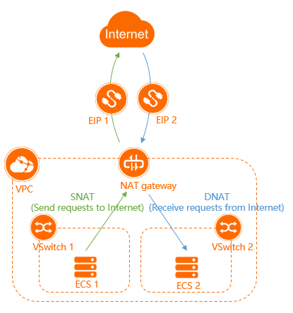

**Features**

A NAT gateway works as expected only after an elastic IP address (EIP) is associated with the NAT gateway. After you create a NAT gateway, you can associate an EIP with the NAT gateway.

NAT gateways provide the SNAT and DNAT features. The following table describes the features.

| Feature | Description |
| --- | --- |
| SNAT | SNAT allows Elastic Compute Service (ECS) instances without public IP addresses in a virtual private cloud (VPC) to access the Internet. |
| DNAT | DNAT maps the EIPs that are associated with a NAT gateway to ECS instances that are assigned public IP addresses. This way, the ECS instances can provide Internet-facing services. |

**SNAT**

You can add SNAT entries to an SNAT table to allow ECS instances to access the Internet.

Each SNAT entry consists of the following items:

- vSwitches or ECS instances: the vSwitch or ECS instances that require access to the Internet by using SNAT.

- Public IP address: the public IP address used to access the Internet.

SNAT entries can be created based on the following granularity to enable ECS instances in a VPC to access the Internet.

- vSwitch

  If you create an SNAT entry for a vSwitch, the ECS instances attached to the vSwitch access the Internet by using the public IP address specified in the SNAT entry and based on the NAT gateway on which the SNAT entry is created. By default, all ECS instances attached to the vSwitch can use the specified public IP address to access the Internet.

  > **Note**
  >
  > If an ECS instance is assigned a public IP address, such as a static public IP address, an EIP, or a public IP address mapped by DNAT, the ECS instance uses the public IP address to access the Internet instead of the SNAT feature.

- ECS instance

  If you create an SNAT entry for an ECS instance, the ECS instance can access the Internet by using the specified public IP address. The ECS instance accesses the Internet by using the public IP address specified in the SNAT entry and based on the NAT gateway on which the SNAT entry is created.

**DNAT**

You can configure port mapping when you create a DNAT entry. After the DNAT entry is created, requests destined for the specified public IP address are forwarded to the ECS instances within a VPC based on the port mapping rule.

Each DNAT entry consists of the following items:

- Public IP address: the EIP associated with the NAT gateway.

- Private IP address: the private IP address assigned to the ECS instance in the VPC.

- Public port: the public port that is used in port forwarding.

- Private port: the private port that is used in port forwarding.

- Protocol: the protocol used by the ports.

The DNAT feature supports port mapping and IP address mapping:

- Port mapping

  After you configure port mapping for a NAT gateway, the NAT gateway forwards the requests that are destined for the specified public IP address to the specified ECS instance based on the specified source and destination ports and the specified protocol. Sample DNAT entries:

  - Entry 1: The NAT gateway forwards the requests that are received on TCP port 80 and destined for 1.1.XX.XX to TCP port 80 of ECS instance that is assigned the IP address 192.168.1.1.

  - Entry 2: The NAT gateway forwards the requests that are received on UDP port 8080 and destined for 2.2.XX.XX to UDP port 8000 of ECS instance that is assigned the IP address 192.168.1.2.

  | DNAT entry | Public IP address | Public port | Private IP address | Private port | Protocol |
  | --- | --- | --- | --- | --- | --- |
  | Entry 1 | 1.1.XX.XX | 80 | 192.168.1.1 | 80 | TCP |
  | Entry 2 | 2.2.XX.XX | 8080 | 192.168.1.2 | 8000 | UDP |

- IP mapping

  After you configure IP mapping for a NAT gateway, the NAT gateway forwards all the requests that are destined for the specified public IP address to the specified ECS instance. Sample DNAT entry: The NAT gateway forwards all the requests that are destined for 3.3.XX.XX to the specified ECS instance that is assigned the IP address 192.168.1.3.

  | DNAT entry | Public IP address | Public port | Private IP address | Private port | Protocol |
  | --- | --- | --- | --- | --- | --- |
  | Entry 3 | 3.3.XX.XX | All | 192.168.1.3 | All | All |

**NAT gateway specifications**

NAT gateways support the following specifications: small, medium, large, and super large-1. The specification of a NAT gateway determines the SNAT performance, including the maximum number of concurrent connections and the number of new connections per second. However, the specification of the NAT gateway does not affect the DNAT performance. The following table describes the available specifications of NAT gateways.

| Specification | Maximum number of concurrent NAT connections | Number of new SNAT connections per second |
| --- | --- | --- |
| Small | 10,000 | 1,000 |
| Medium | 50,000 | 5,000 |
| Large | 200,000 | 10,000 |
| Super large-1 | 1,000,000 | 50,000 |

<a id="section-10-2"></a>

## 10.2. Create and manage NAT gateways

NAT gateways are enterprise-class gateways that provide network address translation services. Before you configure SNAT and DNAT rules, you must create a NAT gateway.

**Prerequisites**

A virtual private cloud (VPC) and a vSwitch are created. For more information, see Create a VPC with an IPv4 CIDR block.

**Create a NAT gateway**

1. Log in to the VPC console.

2. In the left-side navigation pane, click **NAT Gateways**.

3. In the top navigation bar, select the region in which you want to create a NAT gateway.

4. On the **NAT Gateways** page, click **Create NAT Gateway**.

5. On the **NAT Gateway** page, configure the parameters described in the following table.

   <table>
     <tr>
       <th>Parameter</th>
       <th>Description</th>
     </tr>
     <tr>
       <td colspan="2">Area</td>
     </tr>
     <tr>
       <td>Organization/Resour ce Set</td>
       <td>The organization and resource set to which the NAT gateway belongs.</td>
     </tr>
     <tr>
       <td>Region</td>
       <td>The region in which you want to create the NAT gateway.</td>
     </tr>
     <tr>
       <td colspan="2">Billing configuration</td>
     </tr>
     <tr>
       <td>Billing method</td>
       <td>The method used to charge for a cloud service based on usage. By default, <strong>Pay-As-You-Go</strong> is selected.<br><strong>Pay-As-You-Go</strong>: You use resources first and are then billed based on your actual usage. This method is suitable for scenarios with fluctuating business workloads. It lets you use resources flexibly as needed and avoid waste.<br>Note<br>This option is displayed only if your administrator has configured billing rules in the Operations Hub. For more information about billing rules, see the <strong>Billing rules</strong> topic in the <strong>User Guide for</strong> <strong>Apsara Uni-manager Management Console</strong>.</td>
     </tr>
     <tr>
       <td colspan="2">Basic Configurations</td>
     </tr>
   </table>

   <table>
     <tr>
       <td>VPC</td>
       <td>The VPC in which you want to create the NAT gateway.<br>Note<br>• You can click <strong>Create VPC</strong> to create a VPC.<br>• If you cannot find the required VPC from the drop-down list, perform the following operations for troubleshooting:<br>• Check whether a NAT gateway is already deployed in the VPC. Only one NAT gateway can be deployed in each VPC.<br>• Check whether the VPC contains a custom route entry whose destination CIDR block is 0.0.0.0/0. If such a route exists, delete it.</td>
     </tr>
     <tr>
       <td>Sharing Scope</td>
       <td>The sharing scope of the VPC. Valid values:<br>• <strong>Current Resource Set</strong>: Only the administrator of the current resource set can use the VPC to create resources.<br>• <strong>Organization and lower-level organizations</strong>: Only the administrators of the current organization and its subordinate organizations can use the VPC to create resources.<br>• <strong>Current Organization</strong>: Only the administrator of the current organization can use the VPC to create resources.</td>
     </tr>
     <tr>
       <td>Specifications</td>
       <td>The specifications of the NAT gateway. Valid values:<br>• <strong>Small</strong>: supports at most 10,000 SNAT connections.<br>• <strong>Medium</strong>: supports at most 50,000 SNAT connections.<br>• <strong>Large</strong>: supports at most 200,000 SNAT connections.<br>• <strong>Super Large-1</strong>: supports at most 1,000,000 SNAT connections.<br>• Custom specifications: the custom specifications that are created for NAT gateways based on business and environment requirements.<br>Note<br>The maximum number of SNAT connections is limited by the specifications of a NAT gateway. However, the specifications do not affect the maximum number of DNAT connections.</td>
     </tr>
     <tr>
       <td>Name</td>
       <td>The name of the NAT gateway.<br>The name must be 2 to 128 characters in length, and can contain letters, digits, underscores (_), hyphens (-), and periods (.). It must start with a letter and cannot start with <code> http:// </code> or <code> https:// </code>.</td>
     </tr>
   </table>

   > **Note**
   >
   > After you complete the configuration, view and check the configuration of the NAT gateway displayed in the right-side **Configuration overview** section.
   >
   > - You can click the value of a parameter to navigate to the parameter and modify the value based on your business requirements.
   >
   > - Click **Quota Management** to manage the quotas of cloud services if the organization or resource set has no quotas, or click **Manage** in the **Quota** section to manage the quotas of cloud services if the organization or resource set has quotas.
   >
   >   For more information about quota management, see the **Quotas** topic in **Apsara Uni-manager Operations Console User Guide**.

6. Create the NAT gateway.

   - Confirm the parameters and click **Confirm Order** if the following requirements are met: On the Service Management page, a service is created, and **NAT Gateway** is displayed in the **Cloud resources** column of the service.

   - If the service whose **Cloud resources** value is **NAT Gateway** does not exist on the Service Management page, confirm the parameters and click **Submit**.

   For more information about service management, see the **Service management** topic in the **User Guide for Apsara Uni-manager Management Console**.

**What to do next**

**View NAT gateways**

On the **NAT Gateways** page, you can view the information about the NAT gateways that are created.

> **Note**
>
> The list is limited to 100 pages and can display a maximum of 10,000 entries. If you have more than 10,000 entries, use filters to find the data that you need.

- You can find an instance by entering a keyword or specifying filter conditions in an advanced search.

- Click the  icon next to a column name to perform an advanced sort on the list.

- Click the  icon to the right of the **Status** column to filter instances by status.

- Click the  icon in the **Specification/Type** column to filter NAT gateways by

  specifications.

- Click the VPC ID in the **VPC ID/Name** column of a NAT gateway to view the basic information about the VPC to which the NAT gateway belongs.

- Click **Associate** in the **EIP** column of a NAT gateway to associate an elastic IP address (EIP) with the NAT gateway.

- Click an IP address in the **EIP** column of a NAT gateway to view the basic information about the EIP that is associated with the NAT gateway.

- Click the  icon in the **Monitoring** column of a NAT gateway to view the monitoring

  information about the NAT gateway.

- Click the  icon next to the name of a NAT gateway in the **NAT Gateway ID/Name** column

  of a NAT gateway to modify the NAT gateway name.

- Click the  icon next to the sharing scope in the **Sharing Scope** column of a NAT gateway

  to modify the sharing scope of the NAT gateway.

- Click **Purchase NAT Bandwidth Package** in the **Bandwidth Package** column to purchase a bandwidth plan for the NAT gateway or click the bandwidth plan ID to manage the bandwidth plan for NAT gateway.

**Manage tags**

On the **NAT Gateways** page, you can add tags to NAT gateways to simplify NAT gateway management. For more information, see Manage tags.

**Configure sharing settings**

1. On the **NAT Gateways** page, find the NAT gateway that you want to manage and click **Sharing Settings** in the **Actions** column.

2. In the **Sharing Settings** dialog box, modify the **Sharing Scope** parameter and click **OK**.

**Delete NAT gateways**

You can delete a NAT gateway that you no longer need.

> **Note**
>
> - Before you delete a NAT gateway, make sure that the following requirements are met:
>
>   - No EIP is associated with the NAT gateway. If an EIP is associated with the NAT gateway, disassociate the EIP from the NAT gateway. For more information, see the Disassociate an EIP from a NAT gateway section of the Manage EIPs and NAT gateways topic.
>
>   - No NAT service plan is associated with the NAT gateway. If a NAT service plan is associated with the NAT gateway, delete the NAT service plan. For more information, see the Delete a NAT service plan section of the Create and manage a NAT service plan topic.
>
>   - The DNAT table does not contain DNAT entries. If the DNAT table contains DNAT entries, delete them. For more information, see the Delete a DNAT entry section of the Create and manage DNAT entries topic.
>
>   - The SNAT table does not contain SNAT entries. If the SNAT table contains SNAT entries, delete them. For more information, see the Delete an SNAT entry section of the Create and manage SNAT entries topic.
>
> - You can also forcibly delete a NAT gateway. After a NAT gateway is forcibly deleted, the DNAT and SNAT entries of the NAT gateway are automatically deleted, and the EIP associated with the NAT gateway is automatically disassociated from the NAT gateway. The system automatically performs these operations, and you do not need to manually perform them in advance.
>
>   To forcibly delete a NAT gateway, you must select **Delete NAT Gateway and Its Associated Resources** in the **Force Delete** section in the **Delete** dialog box, and then click **Release**.

1. On the **NAT Gateways** page, find the NAT gateway that you want to delete and choose 

   **> Delete** in the **Actions** column.

2. In the dialog box that appears, click **Release**.

3. In the **Release Resource** dialog box, click **Confirm Release**.

4. In the **Operation Successful** dialog box that appears, click **OK**.

**Manage NAT gateways**

1. On the **NAT Gateways** page, find the NAT gateway that you want to manage and click its ID in the **NAT Gateway ID/Name** column or **Manage** in the **Actions** column.

2. On the **NAT Gateway Details** page, you can manage the NAT gateway.

   - On the **Basic Information** tab, you can view and manage the basic information and specifications of the NAT gateway.

     - In the **Basic Information** section, click the **VPC ID** to view the basic information about the VPC to which the NAT gateway belongs.

     - In the **Basic Information** section, click the  icon next to the **NAT Gateway Name**

       parameter to modify the name of the NAT gateway.

     - In the **Basic Information** section, click the  icon next to the description below the

       **Description** parameter to modify the description of the NAT gateway.

     - In the **Specification Information** section, you can manage the specifications of the NAT gateway.

       Click **Change Specifications**  . On the **Change Specifications** page, configure the

       **Specification** parameter and click **Confirm Order**.

   - On the **DNAT** tab, you can manage the DNAT table of the NAT gateway. For more information, see Create and manage DNAT entries.

   - On the **SNAT** tab, you can manage the SNAT table of the NAT gateway. For more information, see Create and manage SNAT entries.

   - On the **NAT Service Plan** tab, you can manage the NAT service plans of the NAT gateway. For more information, see Create and manage a NAT service plan.

   - On the **Operation Log** tab, you can view all operation logs of the NAT gateway. For more information, see Manage operation logs.

   - On the **Monitoring** tab, you can view the monitoring information about the NAT gateway. For more information, see View monitoring data.

<a id="section-10-3"></a>

## 10.3. Manage EIPs and NAT gateways

This topic describes how to associate an elastic IP address (EIP) with a NAT gateway. A NAT gateway can work as expected only after you associate an EIP with it. After you create a NAT gateway, you can associate an EIP with the NAT gateway.

**Prerequisites**

Before you associate an EIP with a NAT gateway, make sure that the following requirements are met:

- A NAT gateway is created. For more information, see the "Create a NAT gateway" section of the Create and manage a NAT gateway topic.

- An EIP is created. For more information, see the "Apply for an EIP" section of the Create and manage an EIP topic.

**Associate an EIP with a NAT gateway**

1. Log in to the VPC console.

2. In the left-side navigation pane, click **NAT Gateways**.

3. In the top navigation bar, select the region in which you want to create a NAT gateway.

4. On the **NAT Gateways** page, find the NAT gateway that you want to manage and associate an EIP with it by using one of the following methods:

   - Choose  **> Associate EIP** in the **Actions** column.

   - Click **Bind Immediately** in the **EIP** column.

5. In the **Associate EIP** dialog box, configure the following parameter and click **OK**.

   | Parameter | Description |
   | --- | --- |
   | List of Available EIPs | Select the EIP that you want to associate with the NAT gateway.<br>Note<br>You can also click <strong>Create EIP</strong> to create an EIP and then associate it with the NAT gateway. |

**Disassociate an EIP from a NAT gateway**

If you do not want a NAT gateway to communicate with the Internet by using an EIP, you can disassociate the EIP from the NAT gateway.

> **Note**
>
> Make sure that the EIP to be disassociated is not used in a source network address translation (SNAT) entry or a destination network address translation (DNAT) entry. If the EIP is used in an SNAT or a DNAT entry, delete the SNAT or DNAT entry before you dissociate the EIP. For more information, see the "Delete a DNAT entry" section of the Create and manage a DNAT entry topic and the "Delete an SNAT entry" section of the Create and manage an SNAT entry topic.

1. Log in to the VPC console.

2. In the left-side navigation pane, click **NAT Gateways**.

3. In the top navigation bar, select the region in which you want to create a NAT gateway.

4. On the **NAT Gateways** page, find the NAT gateway that you want to manage and choose  **> Disassociate EIP** in the **Actions** column.

5. In the **Disassociate EIP** dialog box, select the EIP that you want to disassociate, and click **OK**.

<a id="section-10-4"></a>

## 10.4. Create and manage DNAT entries

You can use DNAT entries to map the public IP addresses associated with NAT gateways to Elastic Compute Service (ECS) instances. This way, ECS instances can provide services over the Internet. DNAT supports both port mapping and IP mapping.

**Prerequisites**

A NAT gateway is created, and an elastic IP address (EIP) is associated with the NAT gateway. For more information, see Create and manage NAT gateways and Manage EIPs and NAT gateways.

**Usage notes**

- A public IP address that is already specified in an SNAT entry cannot be specified in a DNAT entry.

- If an ECS instance cannot be accessed after a DNAT entry is configured, check the security group rules of the ECS instance.

- In scenarios where a resource uses both SNAT and DNAT, if SNAT and DNAT are bound to EIPs of different data centers separately, the path of requests sent to DNAT may be different from the path of responses. We recommend that you do not configure SNAT and DNAT for a resource at the same time, or you use a firewall outside the cloud to resolve the issue.

**Create a DNAT entry**

1. Log in to the VPC console.

2. In the left-side navigation pane, click **NAT Gateways**.

3. In the top navigation bar, select the region in which you want to create a NAT gateway.

4. On the **NAT Gateways** page, find the NAT gateway that you want to manage and click **Set DNAT** in the **Actions** column.

5. On the **DNAT** tab of the **NAT Gateway Details** page, click **Create DNAT Entry**.

6. In the **Create DNAT Entry** panel, configure the parameters described in the following table and click **OK**.

   | Parameter | Description |
   | --- | --- |
   | Entry Name | The name of the DNAT entry.<br>The name must be 2 to 128 characters in length, and can contain letters, digits, underscores (_), hyphens (-), and periods (.). It must start with a letter and cannot start with <code> http:// </code> or <code> https:// </code>. |
   | IP Address Type | The type of the public IP address. Valid values:<br>• Bandwidth Plan<br>• EIP |
   | Public IP address | The available NAT service plan or EIP. You cannot select a public IP address that is already specified in an SNAT entry.<br>You can also click <strong>Apply for NAT Bandwidth</strong> to create a NAT service plan or click <strong>Create EIP</strong> to create an EIP based on the value of the <strong>IP Address Type</strong> parameter. |
   | Private IP address | The private IP address of the ECS instance that uses the DNAT entry to provide services over the Internet. You can specify the private IP address of the ECS instance by using one of the following methods:<br>• <strong>Existing IP Address from ECS or ENI</strong>: select an ECS instance from the list. You can filter IP addresses by instance ID or instance name, or directly enter an IP address.<br>• <strong>Custom</strong>: enter the private IP address of the ECS instance.<br>Note<br>The custom private IP address must fall within the CIDR block of the VPC.You can also enter the private IP address of an ECS instance that is already deployed in the VPC. |
   | Port Settings | The DNAT mapping method. Valid values:<br>• <strong>All Ports</strong>: uses IP mapping. All requests destined for the specified public IP address are forwarded to the specified ECS instance.<br>• <strong>Specific Port</strong>: uses port mapping. The NAT gateway forwards requests destined for the specified public IP address to the specified ECS instance based on the specified protocol and ports. |
   | Public Network Port | The external port used for port forwarding. This parameter is available only when the <strong>Port Settings</strong> parameter is set to <strong>Specific Port</strong>. Valid values: 1 to 65535. |
   | Private Network Port | The internal port used for port forwarding. This parameter is available only when the <strong>Port Settings</strong> parameter is set to <strong>Specific Port</strong>. Valid values: 1 to 65535. |
   | Protocol Type | The protocol type of the forwarding ports. Valid values: <strong>TCP</strong> and <strong>UDP</strong>. This parameter is available only when the <strong>Port Settings</strong> parameter is set to <strong>Specific</strong> <strong>Port</strong>. |

**What to do next**

**View the information about DNAT entries**

On the **DNAT** tab of the **NAT Gateway Details** page, you can view the information about the created DNAT entries.

You can enter a keyword or configure filter conditions to search for the DNAT entry whose information you want to view.

**Modify a DNAT entry**

After a DNAT entry is created, you can modify the information about the DNAT entry.

1. On the **DNAT** tab of the **NAT Gateway Details** page, find the DNAT entry that you want to manage and click **Edit** in the **Actions** column.

2. In the **Edit DNAT Entry** dialog box, modify the **Entry Name**, **IP Address Type**, **Public IP Address**, and **Private IP Address** parameters, and the information about ports based on your business requirements. Then, click **OK**.

**Delete an DNAT entry**

If the ECS instances in your VPC do not need to receive requests from external private networks, you can delete the DNAT entries that are created for the ECS instances.

> **Warning**
>
> If you delete a DNAT entry, the ECS instance configured with the DNAT entry cannot access the Internet and the DNAT entry cannot be restored. Proceed with caution.

1. Method 1: On the **DNAT** tab of the **NAT Gateway Details** page, find the DNAT entry that you want to delete and click **Delete** in the **Actions** column.

   Method 2: On the **DNAT** tab of the **NAT Gateway Details** page, select the DNAT entries that you want to delete and click **Delete** below the list.

2. In the message that appears, click **OK**.

<a id="section-10-5"></a>

## 10.5. Create and manage SNAT entries

NAT Gateway provides the SNAT feature that allows Elastic Compute Service (ECS) instances without public IP addresses in a virtual private cloud (VPC) to access the Internet.

**Prerequisites**

A NAT gateway is created, and an elastic IP address (EIP) is associated with the NAT gateway. For more information, see the Create a NAT gateway section of the Create and manage NAT gateways topic and Manage EIPs and NAT gateways.

**Usage notes**

1. A public IP address that is already specified in a DNAT entry cannot be specified in an SNAT entry.

2. Each public IP address in the SNAT IP address pool supports a maximum bandwidth of 200 Mbit/s and up to 55,000 connections. To enable SNAT entries to fully utilize the forwarding capacity of a bandwidth plan and prevent packet loss or port conflicts due to insufficient public IP addresses, we recommend that you use the following rules:

   - If the peak bandwidth is 1 Gbit/s, specify at least five public IP addresses in the SNAT entry.

   - For every 200 Mbit/s that exceeds 1 Gbit/s, specify at least one additional public IP address in the SNAT entry.

3. In scenarios where a resource uses both SNAT and DNAT, if SNAT and DNAT are bound to EIPs of different data centers separately, the path of requests sent to DNAT may be different from the path of responses. We recommend that you do not configure SNAT and DNAT for a resource at the same time, or you use a firewall outside the cloud to resolve the issue.

**Create an SNAT entry**

1. Log in to the VPC console.

2. In the left-side navigation pane, click **NAT Gateways**.

3. In the top navigation bar, select the region in which you want to create a NAT gateway.

4. On the **NAT Gateways** page, find the NAT gateway that you want to manage and choose<strong>... > Set SNAT</strong> in the **Actions** column.

5. On the **SNAT** tab of the **NAT Gateway Details** page, click **Create SNAT Entry**.

6. In the **Create SNAT Entry** panel, configure the parameters described in the following table and click **OK**.

   | Parameter | Description |
   | --- | --- |
   | Granularity Setting | Select the scope to which the SNAT entry applies. Valid values:<br>• Specify vSwitch<br>• <strong>IP Address Type</strong>: Select <strong>Bandwidth Package</strong> or <strong>EIP</strong>.<br>• <strong>vSwitch</strong>: Select a vSwitch in the VPC. The ECS instances connected to the specified vSwitch use the public IP addresses in the SNAT entry to access the Internet. You cannot select vSwitches that are already specified in an SNAT entry.<br>• A vSwitch can be specified only in one SNAT entry.<br>• You can enter the IP address or specify advanced filter conditions to search for a specific vSwitch. You can select multiple vSwitches.<br>• <strong>vSwitch CIDR Block</strong>: the CIDR block of the selected vSwitch.<br>• Specify ECS Instance<br>• <strong>IP Address Type</strong>: Select <strong>Bandwidth Package</strong> or <strong>EIP</strong>.<br>• <strong>List of Available ECS</strong>: Select the ECS instance to which the SNAT entry applies in the VPC. The selected ECS instance uses the public IP address specified in the SNAT entry to access the Internet. Make sure that the ECS instance is running and does not have a fixed public IP address or EIP.<br>• If no ECS is available in the list, check whether the resource set limit switch <strong>strictOwnership</strong> is turned on for <strong>VPC</strong>.<br>For more information about how to configure the switch, see <strong>Service</strong> <strong>console configuration management</strong> in <strong>O&amp;M of management</strong> <strong>services</strong> of <strong>Apsara Uni-manager Operations Console User</strong> <strong>Guide</strong>.<br>• You can enter the IP address or specify advanced filter conditions to search for a specific ECS instance. You can select multiple ECS instances.<br>• <strong>ECS CIDR Block</strong>: the CIDR block of the selected ECS instance.<br>• Custom CIDR Block Granularity<br>• <strong>IP Address Type</strong>: Select <strong>Bandwidth Package</strong> or <strong>EIP</strong>.<br>• <strong>Custom CIDR block</strong>: Enter a custom CIDR block. |
   | Public IP Address | The public IP address that you want to use to access the Internet. You cannot select a public IP address that is already specified in an SNAT entry.<br>You can select one or more public IP addresses to create an SNAT IP address pool.<br>You can also click <strong>Apply for NAT Bandwidth</strong> to create a NAT bandwidth plan or click <strong>Create EIP</strong> to create an EIP based on the value of the <strong>IP Address</strong> <strong>Type</strong> parameter.<br>Note<br>• If you want to configure an SNAT IP address pool that contains multiple IP addresses, make sure all the IP addresses are added to the same shared bandwidth.<br>• The maximum bandwidth of each IP address in the SNAT IP address pool is 200 Mbit/s. For every 200 Mbit/s of bandwidth increased for the shared bandwidth, you must add at least one additional IP address to the SNAT IP address pool.<br>• If you add IP addresses to or delete IP addresses from an existing SNAT entry, transient disconnections may occur. Proceed with caution. |
   | Entry Name | Enter a name for the SNAT entry.<br>The name must be 2 to 128 characters in length, and can contain letters, digits, underscores (_), and hyphens (-). The name must start with a letter. |

**What to do next**

**View the information about SNAT entries**

On the **SNAT** tab of the **NAT Gateway Details** page, you can view the information about the created SNAT entries.

- You can enter a keyword or configure filter conditions to search for the SNAT entry whose information you want to view.

- Click the  icon in the upper-right corner to show or hide items in the entry list. You can

  also drag and drop the items to adjust their order.

- Click the ID in the **ECS Instance/vSwitch** column to view the basic information about the ECS instance or vSwitch selected for the SNAT entry.

- Click the IP address in the **Public IP Address** column to view the basic information about the EIP associated with the NAT gateway or the NAT service plan.

**Modify an SNAT entry**

After you create an SNAT entry, you can modify the information about the SNAT entry.

1. On the **SNAT** tab of the **NAT Gateway Details** page, find the SNAT entry that you want to manage and click **Edit** in the **Actions** column.

2. In the **Edit SNAT Entry** panel, modify the **IP Address Type**, **Public IP Address**, and **Entry Name** parameters and click **OK**.

**Delete an SNAT entry**

You can delete an SNAT entry if the ECS instances that have no public IP address in a VPC no longer use the SNAT entry to access the Internet.

1. Method 1: On the **SNAT** tab of the **NAT Gateway Details** page, find the SNAT entry that you want to delete and click **Delete** in the **Actions** column.

   Method 2: On the **SNAT** tab of the **NAT Gateway Details** page, select the SNAT entries that you want to delete and click **Delete** below the SNAT entry list.

2. In the message that appears, click **OK**.

<a id="section-10-6"></a>

## 10.6. Create and manage a NAT service plan

You can associate an elastic IP address (EIP) or a NAT service plan with a NAT gateway. However, each NAT gateway can be associated with resources only of the same type. To associate a NAT service plan with a NAT gateway, you must purchase a NAT service plan before you can configure the SNAT or DNAT feature for the NAT gateway. A NAT service plan consists of public IP addresses and Internet bandwidth.

**Create a NAT service plan**

1. Log in to the VPC console.

2. In the left-side navigation pane, click **NAT Gateways**.

3. In the top navigation bar, select the region in which you want to create a NAT gateway.

4. On the **NAT Gateways** page, find the NAT gateway that you want to manage and click its ID in the **NAT Gateway ID/Name** column or **Manage** in the **Actions** column.

5. On the **NAT Gateway Details** page, click the **NAT Bandwidth Package** tab.

6. In the upper-right corner of the **Bandwidth Packet Details** section, click **Create**.

7. On the **NAT Service Plan** page, configure the parameters described in the following table and click **Submit**.

   <table>
     <tr>
       <th>Parameter</th>
       <th>Description</th>
     </tr>
     <tr>
       <td colspan="2">Area</td>
     </tr>
     <tr>
       <td>Organization</td>
       <td>The organization to which the NAT service plan belongs.</td>
     </tr>
     <tr>
       <td>Resource Set</td>
       <td>The resource set to which the NAT service plan belongs.</td>
     </tr>
     <tr>
       <td>Region</td>
       <td>The region in which you want to create the NAT service plan.</td>
     </tr>
     <tr>
       <td>Zone</td>
       <td>The zone in which you want to create the NAT service plan.</td>
     </tr>
     <tr>
       <td colspan="2">Basic Configurations</td>
     </tr>
     <tr>
       <td>NAT Gateway ID</td>
       <td>The ID of the NAT gateway with which you want to associate the NAT service plan.</td>
     </tr>
     <tr>
       <td>Billing Method</td>
       <td>The billing type of the NAT service plan.<br>Only <strong>Pay-By-Bandwidth</strong> is supported.</td>
     </tr>
     <tr>
       <td>Bandwidth (Mbit/s)</td>
       <td>The maximum bandwidth of the NAT service plan.</td>
     </tr>
     <tr>
       <td>Name</td>
       <td>The name of the NAT service plan.<br>The name must be 2 to 128 characters in length and can contain letters, digits, underscores (_), hyphens (-), and periods (.). The name must start with a letter.</td>
     </tr>
     <tr>
       <td>Description</td>
       <td>The description of the NAT service plan.<br>The description must be 2 to 256 characters in length and can contain letters, digits, underscores (_), hyphens (-), periods (.), commas (,), and colons (:). The description must start with a letter but cannot start with <code> http:// </code> or <code> https:// </code>.</td>
     </tr>
     <tr>
       <td>IP Addresses</td>
       <td>The number of IP addresses that you want to purchase.</td>
     </tr>
   </table>

**What to do next**

**Modify a NAT service plan**

1. In the **Bandwidth Packet Details** section of the **NAT Bandwidth Package** tab, select the NAT service plan that you want to manage.

2. In the **Basic Information** section, modify the information about the NAT service plan.

   - Click the  icon next to the **Bandwidth Packet Name** parameter to modify the name of

     the NAT service plan.

   - Click the  icon next to the **Description** parameter to modify the description of the NAT

     service plan.

**Modify the maximum bandwidth of a NAT service plan**

You can modify the maximum bandwidth of a NAT service plan. The modification takes effect immediately.

1. In the **Bandwidth Packet Details** section of the **NAT Bandwidth Package** tab, select the NAT service plan that you want to manage.

2. In the upper-right corner of the **Specification information** section, click **Modify Bandwidth**.

3. On the **Modify Bandwidth** page, modify the maximum bandwidth and click **Submit**.

   The maximum bandwidth supported by a NAT service plan is 5,000 Mbit/s.

**Add IP addresses to a NAT service plan**

You can add IP addresses to a NAT service plan. The added IP addresses can be used to create SNAT and DNAT rules.

1. In the **Bandwidth Packet Details** section of the **NAT Bandwidth Package** tab, select the NAT service plan that you want to manage.

2. In the upper-right corner of the **Public IP List** section, click **Add IP Address**.

3. On the **Modify NAT Service Plan IP Addresses** page, enter the total number of IP addresses that you want in the NAT service plan and click **Submit**.

**Release an IP address from a NAT service plan**

You can release IP addresses from a NAT service plan. The NAT service plan must contain at least one IP address.

> **Note**
>
> Before you release an IP address from the NAT service plan, make sure that the IP address is not specified in SNAT or DNAT entries. If the IP address is specified in an SNAT or DNAT entry, delete the SNAT or DNAT entry first. For more information, see the "Delete DNAT entries" section of the Create and manage DNAT entries topic and the "Delete one or more SNAT entries" section of the Create and manage an SNAT entry topic.

1. In the **Bandwidth Packet Details** section of the **NAT Bandwidth Package** tab, select the NAT service plan that you want to manage.

2. In the **Public IP List** section, find the public IP address that you want to release and click **Release** in the **Actions** column.

3. In the **Release IP** message, click **OK**.

**Delete a NAT service plan**

You can delete a NAT service plan that you no longer need.

> **Note**
>
> Before you delete a NAT service plan, make sure that the IP addresses in the NAT service plan are not specified in DNAT or SNAT entries. If an IP address is specified in an SNAT or DNAT entry, delete the SNAT or DNAT entry first. For more information, see the "Delete DNAT entries" section of the Create and manage DNAT entries topic and the "Delete one or more SNAT entries" section of the Create and manage an SNAT entry topic.

1. In the **Bandwidth Packet Details** section of the **NAT Bandwidth Package** tab, find the NAT service plan that you want to delete and click **Delete**.

2. In the **Delete Bandwidth Package** message, click **OK**.

<a id="section-10-7"></a>

## 10.7. View monitoring data

This topic describes how to monitor Virtual Private Cloud (VPC) resources by using CloudMonitor. You can also set threshold-triggered alert rules and monitor the traffic of a VPN gateway. When a threshold is reached, a notification is sent to you.

**View monitoring data**

1. Log on to the VPC console.

2. In the top navigation bar, select the region where the desired VPC is deployed.

3. In the left-side navigation pane, click **NAT Gateways**.

4. You can use the following methods to view the monitoring data of a VPN gateway.

   - View the monitoring data on the VPN Gateways page.

     <ol type="a">

     <li>

     On the **NAT Gateways** page, click the  icon in the **Monitor** column of the desired

     VPN gateway.

     </li>

     <li>

     The **Monitor** panel appears. You can view the monitoring information on this page.

     </li>

     </ol>

   - View the monitoring data on the details page.

     <ol type="a">

     <li>

     On the **NAT Gateways** page, find the instance that you want to manage and click its ID or click **Manage** in the **Actions** column.

     </li>

     <li>

     On the page that appears, click the **Instance Monitoring** tab.

     </li>

     </ol>

   > **Note**
   >
   > By default, the system displays the monitoring data within the last hour. You can also choose 3 hours, 6 hours, or 12 hours or specify a **custom** time period.

**What to do next**

**Create threshold-triggered alert rules**

In the **Monitor** panel, you can create threshold-triggered alert rules. When the value of a metric exceeds the threshold, a notification is sent to you.

1. On the **Monitor** page, click  next to a metric.

2. In the **Create Alert Rule** dialog box, configure parameters and click **OK**.

   > **Note**
   >
   > The following table describes only the parameters that are related to this topic. For other parameters, see **Alert rules** > **Create an alert rule** in **Alerting service** of **CloudMonitor CMS User Guide**.

   | Parameter | Description |
   | --- | --- |
   | Alert Rule | The name of the threshold-triggered alert rule. |
   | Metric | The metric of the cloud service that you want to monitor. By default, the current metric is selected.<br>• Number of new connections per second<br>• Number of new and discarded connections per second<br>• Capacity Discard Connections Per Second<br>• Number of new discarded connections<br>• Capacity Discard Connections<br>• Total number of sessions |
   | Metric Dimensions | The metric dimensions, excluding the instance ID dimension. This parameter is displayed only if you set the <strong>Resource Range</strong> parameter to <strong>Instance</strong>. |
   | Threshold and Alert Level | • Valid values of the alert level: <strong>Critical</strong>, <strong>Warning</strong>, and <strong>Info</strong>.<br>• Valid values of the aggregate value type: <strong>Average</strong>, <strong>Minimum</strong>, and <strong>Maximum</strong>.<br>• Valid values of the monitoring period: <strong>continuous</strong>, <strong>5 consecutive</strong> <strong>cycles</strong>, <strong>10 consecutive cycles</strong>, <strong>15 consecutive cycles</strong>, <strong>30</strong> <strong>consecutive cycles</strong>, and <strong>60 consecutive cycles</strong>.<br>• Valid values of the comparison relationship between the monitoring data and alert threshold: <strong>&gt;</strong>, <strong>&gt;=</strong>, <strong>&lt;</strong>, <strong>&lt;=</strong>, <strong>=</strong>, <strong>!=</strong>, <strong>Year-on-year increase</strong> <strong>at the same time yesterday</strong>, <strong>Year-on-year decline at the same</strong> <strong>time yesterday</strong>, <strong>Increase compared with the last monitoring</strong> <strong>cycle</strong>, <strong>Decline compared with the last monitoring cycle</strong>, <strong>Increase</strong> <strong>compared with the last week</strong>, and <strong>Decline compared with the</strong> <strong>last week</strong>. You also need to set an alert threshold and a trigger count.An alert is generated if the monitoring data reaches the specified threshold for the specified number of times at a specific interval. |

<a id="section-11"></a>

# 11.IPv6 gateways

<a id="section-11-1"></a>

## 11.1. Overview

IPv6 gateways route IPv6 traffic to and from virtual private clouds (VPCs). You can configure IPv6 Internet bandwidth and egress-only rules to control inbound and outbound IPv6 traffic.

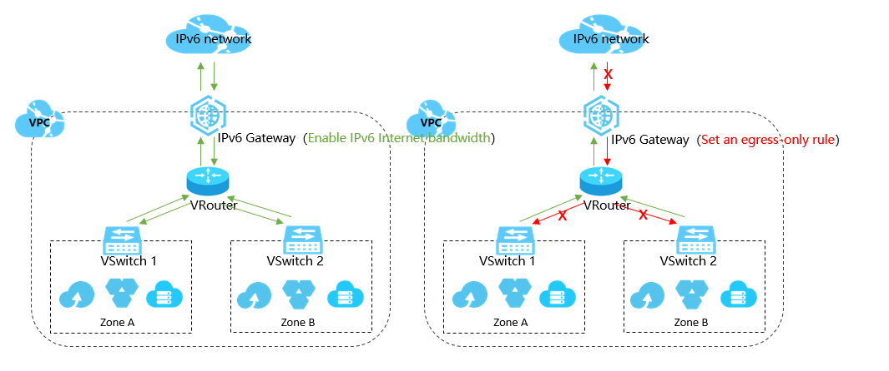

**Features**

An IPv6 gateway supports the following features:

- **Communication within VPCs**

  By default, the Internet bandwidth of an IPv6 address that you apply for a VPC is 0 Mbit/s. IPv6 addresses are used only for communication within VPCs. If you create an Elastic Compute Service (ECS) instance that is assigned an IPv6 address in a VPC, the ECS instance can access another ECS instance that is assigned an IPv6 address in the same VPC. The ECS instance cannot use the IPv6 address to access the Internet or provide services for IPv6 clients over the Internet.

- **Communication over the Internet**

  You can purchase IPv6 Internet bandwidth for an IPv6 address of an ECS instance in a VPC. This way, the ECS instance can use the IPv6 address to access the Internet and provide services for IPv6 clients over the Internet.

  You can set the IPv6 Internet bandwidth to 0 Mbit/s for an IPv6 address based on your business requirements. This way, the IPv6 address is used only for communication within VPCs.

- **Internet access only**

  You can configure egress-only rules for an IPv6 address of an ECS instance in a VPC. This way, the ECS instance can access the Internet and deny access from the IPv6 clients.

  You can delete an egress-only rule based on your business requirements. After the rule is deleted, the IPv6 address for which you enable IPv6 Internet bandwidth can be used for access to the Internet, and the ECS instance assigned the IPv6 address can be accessed by IPv6 clients over the Internet.

The communication capabilities of an IPv6 address are determined by the network type, Internet bandwidth, and egress-only rules of the IPv6 address. The following table describes the communication capabilities of an IPv6 address.

<table>
  <tr>
    <th>Network type</th>
    <th>Whether IPv6 Internet bandwidth is enabled</th>
    <th>Whether an egress-only rule is configured</th>
    <th>Communication capability</th>
  </tr>
  <tr>
    <td>VPC</td>
    <td>No</td>
    <td>No</td>
    <td>Communication within VPCs</td>
  </tr>
  <tr>
    <td rowspan="2">Internet</td>
    <td rowspan="2">Yes</td>
    <td>No</td>
    <td>Communication within VPCs<br>Communicate over the Internet</td>
  </tr>
  <tr>
    <td>Yes</td>
    <td>Communication within VPCs<br>Internet access only</td>
  </tr>
</table>

**Benefits**

An IPv6 gateway provides the following benefits:

- **High availability**

  IPv6 gateways provide high availability across zones to help you develop stable IPv6 gateway services for communication over the Internet.

- **High performance**

  A single IPv6 gateway can provide 10-gigabit throughput to process a large number of requests from or to the Internet by using IPv6 addresses.

- **Flexible management of communication over the Internet**

  You can manage the Internet communication capabilities of IPv6 addresses by adjusting the Internet bandwidth and configuring egress-only rules.

<a id="section-11-2"></a>

## 11.2. Create and manage IPv6 gateways

An IPv6 gateway is a device in a virtual private cloud (VPC) that uses IPv6 to transmit data over the Internet. After you create an IPv6 gateway, you can purchase IPv6 Internet bandwidth and configure egress-only rules for the IPv6 gateway.

**Prerequisites**

IPv6 is enabled for a VPC before you create an IPv6 gateway for the VPC. For more information, see Enable IPv6 for a VPC.

**Create an IPv6 gateway**

1. Log in to the VPC console.

2. In the left-side navigation pane, click **IPv6 Gateways**.

3. In the top navigation bar, select the region in which you want to create an IPv6 gateway.

4. On the **IPv6 Gateways** page, click **Create IPv6 Gateway**.

5. On the **Create IPv6 Gateway** page, configure the parameters described in the following table.

   <table>
     <tr>
       <th>Parameter</th>
       <th>Description</th>
     </tr>
     <tr>
       <td colspan="2">Region</td>
     </tr>
     <tr>
       <td>Organization/Reso urce Set</td>
       <td>Select the organization and resource set to which the IPv6 gateway belongs.</td>
     </tr>
     <tr>
       <td>Region</td>
       <td>Select the region in which you want to create the IPv6 gateway.<br>Make sure that the IPv6 gateway and the VPC with IPv6 enabled are deployed in the same region.</td>
     </tr>
     <tr>
       <td colspan="2">Billing configuration</td>
     </tr>
     <tr>
       <td>Billing method</td>
       <td>The method used to charge for a cloud service based on usage. By default, <strong>Pay-As-You-Go</strong> is selected.<br>• <strong>Pay-as-you-go</strong>: Users use services, and fees are generated afterward based on the actual amount of used resources. This method is suitable for scenarios in which business usage frequently fluctuates, which allows users to flexibly utilize resources based on actual needs and avoid waste.<br>• <strong>Subscription</strong>: You can directly subscribe to resources for a fixed period of time, and fees are charged based on the quantity and duration. No additional fees are incurred during subsequent usage. This method is suitable for scenarios where business usage is relatively stable.<br>Note<br>This option is displayed only if your administrator has configured billing rules in the Operations Hub. For more information about billing rules, see the <strong>Billing rules</strong> topic in the <strong>User Guide for Apsara Uni-</strong><strong>manager Management Console</strong>.</td>
     </tr>
     <tr>
       <td colspan="2">Basic Configurations</td>
     </tr>
     <tr>
       <td>Name</td>
       <td>The name of the IPv6 gateway.<br>The name must be 2 to 128 characters in length, and can contain letters, digits, underscores (_), and hyphens (-). The name cannot start with <code> http:// </code> or <code> https:// </code>.</td>
     </tr>
     <tr>
       <td>VPC</td>
       <td>Select the VPC for which you want to create an IPv6 gateway.<br>Note<br>• After an IPv6 gateway is created, you cannot change the VPC associated with the IPv6 gateway.<br>• If no VPC is available, click <strong>Create VPC</strong> to create a VPC.<br>• A VPC may be unavailable for the following reasons:<br>• Only one IPv6 gateway can be created for each VPC.The VPC already has an IPv6 gateway.<br>• The VPC has a custom route whose destination CIDR block is set to ::/0. If this happens, you must delete this custom route entry before you can create an IPv6 gateway for the VPC.</td>
     </tr>
     <tr>
       <td>Sharing Scope</td>
       <td>The sharing scope of the IPv6 gateway. Valid values:<br>• <strong>Current Resource Set</strong>: Only the administrators of the current resource set can share the IPv6 gateway.<br>• <strong>Current Organization and Subordinate Organizations</strong>: Only the administrators of the current organization and its subordinate organizations can share the IPv6 gateway.<br>• <strong>Current Organization</strong>: Only the administrators of the current organization can share the IPv6 gateway.</td>
     </tr>
     <tr>
       <td>Specifications</td>
       <td>The specifications of the IPv6 gateway. IPv6 gateways have the following specifications:<br>• Basic Edition<br>• Enterprise Edition<br>• Enhanced Enterprise Edition<br>• Custom specifications: custom specifications created for IPv6 gateways based on business and environment requirements.<br>When you use an IPv6 gateway to communicate with the Internet, the throughput capacity, the maximum bandwidth of each IPv6 address, and the maximum number of egress-only rules vary based on the specifications.</td>
     </tr>
   </table>

   > **Note**
   >
   > After you complete the configuration, view and check the configuration of the IPv6 gateway displayed in the right-side **Configuration overview** section.
   >
   > You can click the value of a parameter to navigate to the parameter and modify the value based on your business requirements.

6. Create the IPv6 gateway.

   - Confirm the parameters and click **Confirm Order** if the following requirements are met: On the Service Management page, a service is created, and **NAT Gateway** is displayed in the **Cloud resources** column of the service.

   - If the service whose **Cloud resources** value is **NAT Gateway** does not exist on the Service Management page, confirm the parameters and click **Submit**.

   For more information about service management, see the **Service management** topic in the **User Guide for Apsara Uni-manager Management Console**.

**What to do next**

**Manage IPv6 gateways**

On the **IPv6 Gateways** page, you can view details of IPv6 gateways.

> **Note**
>
> The list is limited to 100 pages and can display a maximum of 10,000 entries. If you have more than 10,000 entries, use filters to find the data that you need.

- You can find an instance by entering a keyword or specifying filter conditions in an advanced search.

- Click the  icon next to a column name to perform an advanced sort on the list.

- Click the  icon to the right of the **Status** column to filter instances by status.

- Click the value in the **VPC ID/Name** column of an IPv6 gateway to view the basic information about the VPC to which the IPv6 gateway belongs.

- Click the  icon next to the value in the **IPv6 Gateway ID/Name** column of an IPv6

  gateway to modify the name of the IPv6 gateway.

  The name must be 2 to 128 characters in length, and can contain letters, digits, underscores (_), and hyphens (-). The name cannot start with  `http://`  or  `https://` .

**Manage tags**

On the **IPv6 Gateways** page, you can add tags to IPv6 gateways for management. For more information, see Manage tags.

**Configure the sharing settings**

1. On the **IPv6 Gateways** page, find the IPv6 gateway that you want to manage and click **Sharing Settings** in the **Actions** column.

2. In the **Sharing Settings** dialog box, modify the **Sharing Scope** parameter and click **OK**.

**Delete an IPv6 gateway**

If a VPC no longer needs to access or be accessed by IPv6 clients, you can delete the IPv6 gateway associated with the VPC.

> **Note**
>
> Before you delete an Enterprise Edition or Enhanced Enterprise Edition IPv6 gateway, you must delete the egress-only rules configured for the IPv6 gateway. For more information, see the Delete an egress-only rule section of the Manage egress-only rules topic.

1. On the **IPv6 Gateways** page, find the IPv6 gateway that you want to delete and click **Delete** in the **Actions** column.

2. In the **Delete** dialog box, click **Release**.

3. In the **Release Resource** dialog box, click **Confirm Release**.

4. In the **Operation Successful** dialog box that appears, click **OK**.

**Manage an IPv6 gateway**

1. On the **IPv6 Gateways** page, find the IPv6 gateway that you want to manage and click its ID in the **IPv6 Gateway ID/Name** column or **Manage** in the **Actions** column.

2. On the **IPv6 Gateway Details** page, manage the IPv6 gateway.

   - On the **IPv6 Gateway Details** tab, you can view and manage the basic information and specifications of the IPv6 gateway.

     - In the **Basic Information** section, click the VPC ID next to the **VPC ID** parameter to view the basic information about the VPC to which the IPv6 gateway belongs.

     - In the **Basic Information** section, click the  icon next to the **IPv6 Gateway Name**

       parameter to modify the name of the IPv6 gateway.

       The name must be 2 to 128 characters in length, and can contain letters, digits, underscores (_), and hyphens (-). The name cannot start with  `http://`  or  `https://` .

     - In the **Basic Information** section, click the  icon next to the **Description** parameter

       to modify the description of the IPv6 gateway.

       The description must be 2 to 256 characters in length. It cannot start with  `http://`  or `https://` .

   - On the **IPv6 Public Network Bandwidth** tab, you can manage the Internet bandwidth of the IPv6 gateway. For more information, see Manage IPv6 Internet bandwidth.

   - On the **Egress-only Rules** tab, you can manage egress-only rules for the IPv6 gateway. For more information, see Manage egress-only rules.

   - On the **Operation Logs** tab, you can view all operation logs of the IPv6 gateway. For more information, see Manage operation logs.

<a id="section-11-3"></a>

## 11.3. Manage IPv6 Internet bandwidth

By default, IPv6 addresses assigned by Apsara Stack can be used only for communication within virtual private clouds (VPCs). If you require Internet access, you must enable IPv6 Internet bandwidth for IPv6 addresses.

**Prerequisites**

An Elastic Compute Service (ECS) instance is created in a VPC. The ECS instance is assigned an IPv6 address.

**Enable IPv6 Internet bandwidth**

1. Log in to the VPC console.

2. In the left-side navigation pane, click **IPv6 Gateways**.

3. In the top navigation bar, select the region in which you want to create an IPv6 gateway.

4. On the **IPv6 Gateways** page, find the IPv6 gateway that you want to manage and click its ID in the **IPv6 Gateway ID/Name** column or **Manage** in the **Actions** column.

5. On the **IPv6 Gateway Details** page, click the **IPv6 Public Network Bandwidth** tab.

6. In the **Basic Information** section, find the IPv6 address that you want to manage and click **Open Public Network Bandwidth** in the **Actions** column. You can specify a filter condition to filter IPv6 addresses.

7. On the **IPv6 public network bandwidth** page, configure the **Bandwidth** parameter and click **Submit**.

**What to do next**

**Modify the maximum bandwidth of an IPv6 gateway**

You can modify the maximum bandwidth of an IPv6 gateway. The modification takes effect immediately.

1. In the **Basic Information** section, find the IPv6 address that you want to manage and click **Configure Bandwidth** in the **Actions** column. You can specify a filter condition to filter IPv6 addresses.

2. On the **IPv6 public network bandwidth** page, adjust the slider to modify the **Bandwidth** parameter and click **Submit**.

**Disable IPv6 Internet bandwidth**

If an IPv6 address does not require access from or to the Internet, you can disable IPv6 Internet bandwidth for the IPv6 address.

1. In the **Basic Information** section, find the IPv6 address that you want to manage and click **Delete Public Network Bandwidth** in the **Actions** column. You can specify a filter condition to filter IPv6 addresses.

2. In the message that appears, click **OK**.

<a id="section-11-4"></a>

## 11.4. Manage egress-only rules

After you enable IPv6 Internet bandwidth for an IPv6 address, the IPv6 address can be used for communication over the Internet. You can create egress-only rules for the IPv6 address to allow only outbound IPv6 traffic.

**Prerequisites**

IPv6 Internet bandwidth is enabled for the IPv6 address for which you want to create an egress-only rule. For more information, see Manage IPv6 Internet bandwidth.

**Limits**

- An IPv6 gateway of Free Edition does not support egress-only rules.

- An IPv6 gateway of Enterprise Edition supports up to 50 egress-only rules. An IPv6 gateway of Enhanced Enterprise Edition supports up to 200 egress-only rules.

- After IPv6 Internet bandwidth is enabled for an IPv6 address, the IPv6 address allows both inbound and outbound network traffic.

- If you do not want the IPv6 address of an Elastic Compute Service (ECS) to be accessed over the Internet, you can create egress-only rules for the IPv6 address.

- An IPv6 gateway of Free Edition does not support egress-only rules. If you want to create egress-only rules, upgrade the IPv6 gateway.

**Create an egress-only rule**

> **Warning**
>
> If an IPv6 gateway is accepting inbound traffic, the inbound traffic is denied after an egress-only rule is created for the Pv6 gateway. In addition, the ECS instance specified in the egress-only rule denies access from IPv6 clients over the Internet. Proceed with caution.

1. Log in to the VPC console.

2. In the left-side navigation pane, click **IPv6 Gateways**.

3. In the top navigation bar, select the region in which you want to create an IPv6 gateway.

4. On the **IPv6 Gateways** page, find the IPv6 gateway that you want to manage and click its ID in the **IPv6 Gateway ID/Name** column or **Manage** in the **Actions** column.

5. On the details page of the IPv6 gateway, click the **Egress-only Rules** tab.

6. Click **Create Egress-only Rule**.

7. In the **Create Egress-only Rule** dialog box, configure the parameters and click **OK**. The following table describes the parameters.

   | Parameter | Description |
   | --- | --- |
   | Name | Enter a name for the egress-only rule.<br>The name must be 2 to 128 characters in length, and can contain letters, digits, underscores (_), and hyphens (-). It must start with a letter and cannot start with http:// or https://. |
   | Rule Granularity | Select a rule granularity. Only <strong>ECS</strong> is supported. |
   | ECS Instance | Select an ECS instance that uses an IPv6 address to communicate with the Internet.<br>The specified ECS instance can access IPv6 clients over the Internet. However, IPv6 clients cannot access the ECS instance over the Internet. |

**Delete an egress-only rule**

You can delete an egress-only rule in the VPC console. After an egress-only rule is deleted, the related IPv6 address for which IPv6 Internet bandwidth is enabled can be used to access the Internet, and the ECS instance assigned the IPv6 address in the VPC can be accessed by IPv6 clients over the Internet.

1. Log in to the VPC console.

2. In the left-side navigation pane, click **IPv6 Gateways**.

3. In the top navigation bar, select the region in which you want to create an IPv6 gateway.

4. On the **IPv6 Gateways** page, find the IPv6 gateway that you want to manage and click its ID in the **IPv6 Gateway ID/Name** column or **Manage** in the **Actions** column.

5. On the details page of the IPv6 gateway, click the **Egress-only Rules** tab.

6. In the **Only Active Rules** section, find the egress-only rule that you want to delete and click **Delete** in the **Actions** column. You can specify a filter condition to filter egress-only rules.

7. In the message that appears, click **OK**.

<a id="section-12"></a>

# 12.HAVIPs

<a id="section-12-1"></a>

## 12.1. Overview

High-availability virtual IP addresses (HAVIPs) are private IP addresses that can be created and released as independent resources. You can use HAVIPs with high-availability software such as Keepalived to provide services in active/standby mode. This improves the availability of your services.

**Features**

Each Elastic Compute Service (ECS) instance is assigned a private IP address as the primary IP address. You can associate HAVIPs with an ECS instance to increase the number of private IP addresses available for the ECS instance. Both the primary IP address and HAVIPs of an ECS instance can be used to access networks. In addition, you can use HAVIPs with high-availability software such as Keepalived to provide services in active/standby mode. This improves the availability of your services.

An HAVIP can be associated with 10 different ECS instances or the secondary elastic network interfaces (ENIs) of 10 ECS instances at the same time. This way, these ECS instances can announce an HAVIP over Address Resolution Protocol (ARP). Then, one of the ECS instances serves as the primary instance, and the other ECS instances serve as secondary instances. If the primary ECS instance is down, a secondary ECS instance takes over to provide services.

You can associate an HAVIP with ECS instances by using the following methods:

- Directly associate an HAVIP with ECS instances.

- Associate a secondary ENI with an ECS instance and associate an HAVIP with the ENI.

  > **Note**
  >
  > Before you associate an HAVIP with secondary ENIs, make sure that each secondary ENI is associated with an ECS instance.

HAVIPs provide the following features:

- HAVIPs are floating private IP addresses and are not statically assigned to ECS instances. HAVIPs can be associated with or disassociated from ECS instances by using ARP announcements.

- An HAVIP can be associated only with ECS instances or ENIs that belong to the same vSwitch.

- An HAVIP can be associated with 10 ECS instances or 10 secondary ENIs. However, an HAVIP cannot be associated with ECS instances and secondary ENIs at the same time.

**Scenarios**

HAVIPs support flexible configurations in the following scenarios:

- Scenario 1: Internal-facing high-availability services

  In the following figure, two ECS instances are associated with the same HAVIP. Keepalived is configured for the ECS instances to provide an internal-facing high-availability service. Other instances in the same virtual private cloud (VPC) can access the service. The HAVIP serves as the service address. If the primary ECS instance is down, the secondary ECS instance takes over. This improves the availability of the service.

  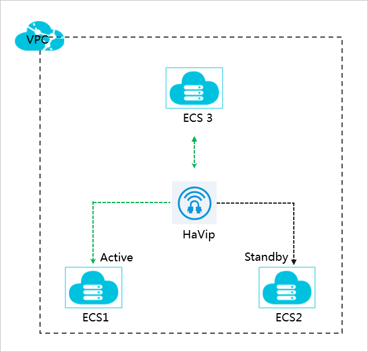

- Scenario 2: Internet-facing high-availability services

  In the following figure, two ECS instances are associated with the same HAVIP. Keepalived is configured and the HAVIP is associated with an elastic IP address (EIP) for the ECS instances to provide an Internet-facing high-availability service. The EIP that is associated with the HAVIP serves as the service address. If the primary ECS instance is down, the secondary ECS instance takes over. This improves the availability of the service.

  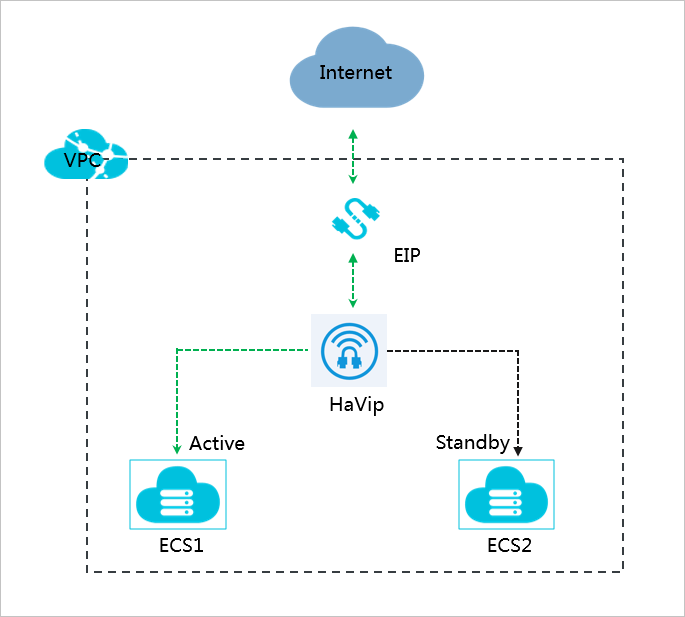

<a id="section-12-2"></a>

## 12.2. Create and manage HAVIPs

A high-availability virtual IP address (HAVIP) is a private IP address that can be created and released as an independent resource. You can use HAVIPs with high-availability software to provide services in active/standby mode. This improves the availability of your services. This topic describes how to create and manage HAVIPs in the console.

**Prerequisites**

Virtual private clouds (VPCs) and vSwitches are created. For more information, see Create and manage VPCs and Create and manage vSwitches.

**Create an HAVIP**

1. Log in to the VPC console.

2. In the left-side navigation pane, click **High-Availability Virtual IP (HAVIP)**.

3. In the top navigation bar, select the region in which you want to create an HAVIP.

4. On the **HAVIP** page, click **Create HaVip**.

5. On the **Create HAVIP** page, configure the parameters described in the following table.

   <table>
     <tr>
       <th>Parameter</th>
       <th>Description</th>
     </tr>
     <tr>
       <td colspan="2">Area</td>
     </tr>
     <tr>
       <td>Organization/Resour ce Set</td>
       <td>The organization and resource set to which the HAVIP belongs.</td>
     </tr>
     <tr>
       <td>Region</td>
       <td>The region in which you want to create the HAVIP.</td>
     </tr>
     <tr>
       <td colspan="2">Billing configuration</td>
     </tr>
     <tr>
       <td>Billing method</td>
       <td>The method used to charge for a cloud service based on usage. By default, <strong>Pay-As-You-Go</strong> is selected.<br>• <strong>Pay-as-you-go</strong>: Users use services, and fees are generated afterward based on the actual amount of used resources. This method is suitable for scenarios in which business usage frequently fluctuates, which allows users to flexibly utilize resources based on actual needs and avoid waste.<br>• <strong>Subscription</strong>: You can directly subscribe to resources for a fixed period of time, and fees are charged based on the quantity and duration. No additional fees are incurred during subsequent usage. This method is suitable for scenarios where business usage is relatively stable.<br>Note<br>This option is displayed only if your administrator has configured billing rules in the Operations Hub. For more information about billing rules, see the <strong>Billing rules</strong> topic in the <strong>User Guide for Apsara Uni-</strong><strong>manager Management Console</strong>.</td>
     </tr>
     <tr>
       <td colspan="2">Basic Configurations</td>
     </tr>
     <tr>
       <td>VPC</td>
       <td>The VPC to which the HAVIP belongs.<br>Note<br>You can also click <strong>Create VPC</strong> to create a VPC.</td>
     </tr>
     <tr>
       <td>vSwitch</td>
       <td>The vSwitch to which the HAVIP belongs.<br>Note<br>You can also click <strong>Create vSwitch</strong> to create a vSwitch.</td>
     </tr>
     <tr>
       <td>Private IP Address</td>
       <td>Specify a private IP address for the HAVIP.<br>Note<br>You must specify an idle private IP address that falls within the CIDR block of the vSwitch.</td>
     </tr>
     <tr>
       <td>HAVIP Name</td>
       <td>Enter a name for the HAVIP.<br>The name must be 2 to 128 characters in length, and can contain letters, digits, periods (.), underscores (_), and hyphens (-). It must start with a letter and cannot start with <code> http:// </code> or <code> https:// </code>.</td>
     </tr>
     <tr>
       <td>Description</td>
       <td>Enter a description for the HAVIP.<br>The description must be 2 to 255 characters in length. It must start with a letter and cannot start with <code> http:// </code> or <code> https:// </code>.</td>
     </tr>
   </table>

   > **Note**
   >
   > After you complete the configuration, view and check the configuration of the HAVIP displayed in the right-side **Configuration overview** section.
   >
   > - You can click the value of a parameter to navigate to the parameter and modify the value based on your business requirements.
   >
   > - Click **Quota Management** to manage the quotas of cloud services if the organization or resource set has no quotas, or click **Manage** in the **Quota** section to manage the quotas of cloud services if the organization or resource set has quotas.
   >
   >   For more information about quota management, see the **Quotas** topic in **Apsara Uni-manager Operations Console User Guide**.

6. Create the HAVIP.

   - Confirm the parameters and click **Confirm Order** if the following requirements are met: On the Service Management page, a service is created and **HAVIP** is displayed in the **Cloud resources** column of the service.

   - If the service whose **Cloud resources** value is **HAVIP** does not exist on the Service Management page, confirm the parameters and click **Submit**.

   For more information about service management, see the **Service management** topic in the **User Guide for Apsara Uni-manager Management Console**.

**What to do next**

**Manage HAVIPs**

On the **HAVIP** page, you can view the information about the existing HAVIPs.

> **Note**
>
> The list is limited to 100 pages and can display a maximum of 10,000 entries. If you have more than 10,000 entries, use filters to find the data that you need.

- You can find an instance by entering a keyword or specifying filter conditions in an advanced search.

- Click the  icon next to a column name to perform an advanced sort on the list.

- Click the  icon to the right of the **Status** column to filter instances by status.

- Click the VPC ID in the **VPC ID/Name** column of an HAVIP to view the basic information about the VPC to which the HAVIP belongs.

- Click the vSwitch ID in the **vSwitch ID/Name** column of an HAVIP to view the basic information about the vSwitch to which the HAVIP belongs.

- Click an instance ID in the **Associated Instance** column of an HAVIP to view the information about the instance associated with the HAVIP.

- Click the IP address in the **IP Address** column of an HAVIP to view the basic information about the elastic IP address (EIP) associated with the HAVIP.

- Click **Bind EIP** in the **Actions** column of an HAVIP to associate the HAVIP with an EIP.

- Click **Unbind EIP** in the **Actions** column of an HAVIP to disassociate the HAVIP from an EIP.

- Click the  icon next to an HAVIP name in the **HAVIP ID/Name** column to modify the name

  of the HAVIP.

**Manage tags**

On the **HAVIP** page, you can add tags to HAVIPs. For more information, see Manage tags.

**Delete an HAVIP**

You can delete an HAVIP that is no longer needed.

> **Note**
>
> Before you delete an HAVIP, make sure that the HAVIP is not associated with an EIP, an Elastic Compute Service (ECS) instance, or an elastic network interface (ENI).
>
> - If the HAVIP is associated with an EIP, disassociate the HAVIP from the EIP before you delete the HAVIP. For more information, see Disassociate an HAVIP from an EIP.
>
> - If the HAVIP is associated with an ECS instance, disassociate the HAVIP from the ECS instance before you delete the HAVIP. For more information, see Disassociate an HAVIP from an ECS instance.
>
> - If the HAVIP is associated with an ENI, disassociate the HAVIP from the ENI before you delete the HAVIP. For more information, see Disassociate an HAVIP from an ENI.

1. On the **HAVIP** page, find the HAVIP that you want to delete and click **Delete** in the **Actions** column.

2. In the **Delete** message, click **Release**.

3. In the **Release Resource** dialog box, click **Confirm Release**.

4. In the **Operation Successful** dialog box that appears, click **OK**.

**Manage HAVIPs**

1. On the **HAVIP** page, find the HAVIP that you want to manage and click its ID in the **HAVIP ID/Name** column or **Manage** in the **Actions** column.

2. On the **High availability virtual IP details** page, perform the following operations to manage the HAVIP:

   - On the **Basic Information** tab, you can view and manage the basic information about the HAVIP and associate the HAVIP with an EIP or other cloud resources.

     - In the **Basic Information** section, click the VPC ID next to the **VPC ID** parameter to view the basic information about the VPC to which the HAVIP belongs.

     - In the **Basic Information** section, click the vSwitch ID next to the **vSwitch** parameter to view the basic information about the vSwitch to which the HAVIP belongs.

     - In the **Basic Information** section, click the  icon next to the **HaVip Name**

       parameter to modify the name of the HAVIP.

     - In the **Basic Information** section, click the  icon next to the **Description** parameter

       to modify the description of the HAVIP.

     - In the **Associate With Resource** section, you can manage the resources associated with the HAVIP. For more information, see Manage associated resources.

   - On the **Operation Log** tab, you can view all operation logs of the HAVIP. For more information, see Manage operation logs.

<a id="section-12-3"></a>

## 12.3. Manage associated resources

<a id="section-12-3-1"></a>

### 12.3.1. Associate an HAVIP with an EIP

You can associate a high-availability virtual IP address (HAVIP) with an elastic IP address (EIP). This way, the HAVIP can provide services over the Internet by using the EIP.

**Prerequisites**

An EIP is created. For more information, see the "Apply for an EIP" section of the Create and manage an EIP topic.

**Procedure**

1. Log in to the VPC console.

2. In the left-side navigation pane, click **High-Availability Virtual IP (HAVIP)**.

3. In the top navigation bar, select the region in which you want to create an HAVIP.

4. On the **HAVIP** page, find the HAVIP that you want to manage and click its ID in the **HAVIP ID/Name** column or **Manage** in the **Actions** column.

5. On the **Basic Information** tab of the **High-availability virtual IP details** page, click **Associate Now** in the **EIP** node in the **Associate With Resource** section.

6. In the **Associate EIP** dialog box, select an EIP and click **OK**.

   > **Note**
   >
   > The EIP must meet the following requirements:
   >
   > - The EIP and the HAVIP are deployed in the same region.
   >
   > - The EIP is in the Available state.

<a id="section-12-3-2"></a>

### 12.3.2. Disassociate an HAVIP from an EIP

This topic describes how to disassociate a high-availability virtual IP address (HAVIP) from an elastic IP address (EIP). After you disassociate an HAVIP from an EIP, the HAVIP can no longer provide services over the Internet by using the EIP.

**Procedure**

1. Log in to the VPC console.

2. In the left-side navigation pane, click **High-Availability Virtual IP (HAVIP)**.

3. In the top navigation bar, select the region in which you want to create an HAVIP.

4. On the **HAVIP** page, find the HAVIP that you want to manage and click its ID in the **HAVIP ID/Name** column or **Manage** in the **Actions** column.

5. On the details page of the HAVIP, click the **Basic Information** tab. In the **Associate With Resource** section, click **Disassociate** in the **EIP** section.

6. In the Disassociate EIP message, click **OK**.

<a id="section-12-3-3"></a>

### 12.3.3. Associate HAVIPs with backend cloud resources

<a id="section-12-3-3-1"></a>

#### 12.3.3.1. Associates an HAVIP with an ECS instance

You can associate a high-availability virtual IP address (HAVIP) with an Elastic Compute Service (ECS) instance in a virtual private cloud (VPC). This way, the ECS instance can announce the HAVIP and obtain multiple private IP addresses by using Address Resolution Protocol (ARP).

**Prerequisites**

An ECS instance is created. For more information, see the **Create an instance** topic in the **Quick Start** cheaper of **ECS User Guide**.

**Background information**

An HAVIP can be associated with 10 ECS instances or 10 secondary ENIs. However, an HAVIP cannot be associated with ECS instances and secondary ENIs at the same time.

**Procedure**

1. Log in to the VPC console.

2. In the left-side navigation pane, click **High-Availability Virtual IP (HAVIP)**.

3. In the top navigation bar, select the region in which you want to create an HAVIP.

4. On the **HAVIP** page, find the HAVIP that you want to manage and click its ID in the **HAVIP ID/Name** column or **Manage** in the **Actions** column.

5. On the **Basic Information** tab of the **High-availability virtual IP details** page, find the **ENI** resource in the **Associate With Resource** section and click **Associate Now**.

6. In the dialog box that appears, configure the following parameters and click **OK**.

   | Parameter | Description |
   | --- | --- |
   | Binding Type | The type of resource with which you want to associate the HAVIP. Valid values:<br>• ECS Instance<br>• ENI<br>In this example, <strong>ECS Instance</strong> is selected. |
   | Associate With Resource | The ECS instance with which you want to associate the HAVIP.<br>The ECS instance must meet the following requirements:<br>• The ECS instance is deployed in a VPC.<br>• The ECS instance and the HAVIP belong to the same vSwitch. |

<a id="section-12-3-3-2"></a>

#### 12.3.3.2. Associate an HAVIP with an ENI

You can associate a high-availability virtual IP address (HAVIP) with an elastic network interface (ENI). This way, an Elastic Compute Service (ECS) instance can advertise the HAVIP and obtain multiple private IP addresses by using Address Resolution Protocol (ARP).

**Prerequisites**

An ENI is created. For more information, see the **Create an ENI** topic in the **Elastic Network Interface** chapter of **ECS User Guide**.

**Background information**

An HAVIP can be associated with 10 ECS instances or 10 secondary ENIs. However, an HAVIP cannot be associated with ECS instances and secondary ENIs at the same time.

**Procedure**

1. Log in to the VPC console.

2. In the left-side navigation pane, click **High-Availability Virtual IP (HAVIP)**.

3. In the top navigation bar, select the region in which you want to create an HAVIP.

4. On the **HAVIP** page, find the HAVIP that you want to manage and click its ID in the **HAVIP ID/Name** column or **Manage** in the **Actions** column.

5. On the **Basic Information** tab of the **High-availability virtual IP details** page, find the **ENI** resource in the **Associate With Resource** section and click **Associate Now**.

6. In the dialog box that appears, configure the following parameters and click **OK**.

   | Parameter | Description |
   | --- | --- |
   | Binding Type | The type of resource with which you want to associate the HAVIP. Valid values:<br>• ECS Instance<br>• ENI<br>In this example, <strong>ENI</strong> is selected. |
   | ENI | The ENI with which you want to associate the HAVIP.<br>The ENI and HAVIP must belong to the same vSwitch. |

<a id="section-12-3-3-3"></a>

#### 12.3.3.3. Work with Keepalived to enable primary/secondary switchover

You can use a high-availability virtual IP address (HAVIP) to keep the service IP address unchanged during the switchover between the primary and secondary servers.

**How it works**

You can attach the same HAVIP to two Elastic Compute Service (ECS) instances to implement high availability in a primary/secondary cluster, as shown in the following figure. The following section describes how high availability is implemented:

1. Keepalived configuration: The HAVIP is attached to ECS1 and ECS2, and the Keepalived software is installed on both ECS instances. In the configuration file of Keepalived, the virtual IP address ( `virtual_ipaddress` ) is set to the HAVIP. In addition, you need to specify a  `priority`  in the configuration file. A larger value indicates a higher priority. The ECS instance with the higher priority serves as the primary instance.

2. Primary server election: Based on the VRRP protocol, Keepalived compares the  `priority` values of ECS1 and ECS2. ECS1 is elected as the primary instance because it has higher priority. The system automatically updates the mapping between the HAVIP and the primary instance. All traffic destined for the HAVIP is forwarded to ECS1.

3. Primary/secondary switchover: The primary instance ECS1 periodically sends heartbeat messages to the secondary instance ECS2. The heartbeat interval is determined by the  `advert_int`  value in the configuration file. If ECS2 does not receive a heartbeat message within the specified time period, the Keepalived software automatically switches the primary instance to ECS2. After the system detects that the primary instance is changed, the system automatically updates the mapping between the HAVIP and the new primary instance. All traffic destined for the HAVIP is forwarded to ECS2. This way, the IP address of the service remains unchanged during the primary/secondary switchover.

If you want to enable Internet access, you can associate an elastic IP address (EIP) with the HAVIP. After the EIP is associated with the HAVIP, the HAVIP can provide high-availability services over the Internet.

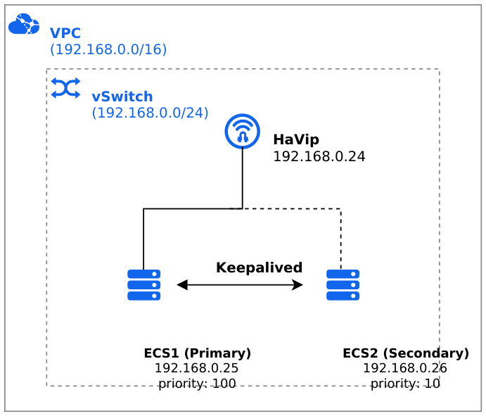

**Keepalived installation example**

In this example, two ECS instances are deployed in primary/secondary mode, and the ECS instances run CentOS. We recommend that you use Keepalived version 1.2.15 or later.

> **Note**
>
> - If you have multiple secondary ECS instances, you must declare the IP addresses of all peer instances in the  `unicast_peer`  field of each ECS instance.
>
> - For more information, visit Keepalived GitHub.

**Primary instance configuration**

1. Log in to the primary ECS instance.

2. Run the  `yum install keepalived`  command to install Keepalived.

3. Run the  `vim /etc/keepalived/keepalived.conf`  command to modify the keepalived.conf file.

   > **Note**
   >
   > This example shows only the parameters that need to be modified. Modify the keepalived.conf file based on your business requirements. Do not directly copy the content in this example to the keepalived.conf file.

   ```text
   !  Configuration File for keepalived
   vrrp_instance VI_1 {
       state MASTER           #Specify ECS1 as the primary ECS instance.
       interface eth0          #Specify the name of the elastic network interface (ENI). 
   In this example, eth0 is used. 
       virtual_router_id 51    
       nopreempt               
       priority 100             #Specify a priority for the ECS instance. A larger valueindicates a higher priority. In this example, the priority is set to 100 to specify this ECS instance as the primary instance.
       advert_int 1            
       authentication {
           auth_type PASS
           auth_pass 1111
       }
       unicast_src_ip 192.168.0.25     #Specify the private IP address of the ECS instance. In this example, 192.168.0.25 is used.
       unicast_peer {
           192.168.0.26          # Specify the private IP address of the peer instance. I
   n this example, the private IP address is 192.168.0.26. If you have multiple secondary ECS instances, you must declare the IP addresses of all peer instances. Specify one
   IP address in each line. Do not use commas (,) or other delimiters. 
       }
       virtual_ipaddress {
           192.168.0.24          #Specify the IP address of the HAVIP. In this example, the IP address is 192.168.0.24.
       }   
       garp_master_delay 1       
       garp_master_refresh 5     

       track_interface {
           eth0                  
       }
   }
   ```

4. Run the  `systemctl start keepalived`  command to start Keepalived.

**Secondary instance configuration**

1. Log in to the secondary ECS instance.

2. Run the  `yum install keepalived`  command to install Keepalived.

3. Run the  `vim /etc/keepalived/keepalived.conf`  command to modify the keepalived.conf file.

   > **Note**
   >
   > This example shows only the parameters that need to be modified. Modify the keepalived.conf file based on your business requirements. Do not directly copy the content in this example to the keepalived.conf file.

   ```text
   !  Configuration File for keepalived
   vrrp_instance VI_1 {
       state BACKUP           #Specify ECS2 as the secondary ECS instance.
       interface eth0          #Specify the name of the ENI that is associated with the 
   VIP. In this example, eth0 is used.  
       virtual_router_id 51    
       nopreempt               
       priority 10             #Specify a priority for the secondary ECS instance. A larger value indicates a higher priority. In this example, the priority is set to 10 to specify this ECS instance as the secondary instance.
       advert_int 1            
       authentication {
           auth_type PASS
           auth_pass 1111
       }
       unicast_src_ip 192.168.0.26   #Specify the private IP address of the ECS instance. In this example, the private IP address is 192.168.0.26.
       unicast_peer {
           192.168.0.25           #Specify the private IP address of the peer ECS instanc
   e. In this example, the private IP address is 192.168.0.25. Declare the IP addresses of all peer instances. Specify one IP address in each line. Do not use commas (,) or other delimiters. 
       }
       virtual_ipaddress {
           192.168.0.24          #Specify the IP address of the HAVIP. In this example, the IP address is 192.168.0.24.
       }    
       garp_master_delay 1       
       garp_master_refresh 5     

       track_interface {
           eth0                #Specify the name of the ENI used by the ECS instance. In 
   this example, eth0 is used.
       }
   }
   ```

4. Run the  `systemctl start keepalived`  command to start Keepalived.

**Verify the result**

After you attach the HAVIP to the ECS instances, test whether high availability is enabled for the ECS instances.

1. Run the following commands on the primary and secondary instances to create a test web service. Different results are returned.

   > **Note**
   >
   > Run  `netstat -an | grep 8000`  to query the availability of the port. If port 8000 is unavailable, use another port.

   Primary instance:

   ```bash
   echo "ECS 1" > index.html  #The primary instance returns "ECS 1".
   python3 -m http.server 8000
   ```

   Secondary instance:

   ```bash
   echo "ECS 2" > index.html  #The secondary instance returns "ECS 2".
   python3 -m http.server 8000
   ```

2. Run  `curl <havip_private_ip>:8000`  on other ECS instances in the VPC.  `ECS 1`  is returned. If the primary instance is down,  `ECS 2`  is returned.

   > **Note**
   >
   > Make sure that the security group of the primary and secondary instances allows HTTP requests in the VPC to access port 8000.

<a id="section-12-3-4"></a>

### 12.3.4. Disassociate HAVIPs from backend cloud resources

<a id="section-12-3-4-1"></a>

#### 12.3.4.1. Disassociate an HAVIP from an ECS instance

This topic describes how to disassociate a high-availability virtual IP address (HAVIP) from an Elastic Compute Service (ECS) instance. After the HAVIP is disassociated from the ECS instance, the ECS instance cannot announce the HAVIP over Address Resolution Protocol (ARP).

**Procedure**

1. Log in to the VPC console.

2. In the left-side navigation pane, click **High-Availability Virtual IP (HAVIP)**.

3. In the top navigation bar, select the region in which you want to create an HAVIP.

4. On the **HAVIP** page, find the HAVIP that you want to manage and click its ID in the **HAVIP ID/Name** column or **Manage** in the **Actions** column.

5. On the **Basic Information** tab of the **High availability virtual IP details** page, find the **Associate With Resource** section.

6. In the right-side instance list, find the ECS instance that you want to manage and click **Unbind** in the **Actions** column.

7. In the message that appears, click **OK**.

<a id="section-12-3-4-2"></a>

#### 12.3.4.2. Disassociate an HAVIP from an ENI

This topic describes how to disassociate a high-availability virtual IP address (HAVIP) from an elastic network interface (ENI). After the HAVIP is disassociated from the ENI, the ECS instance associated with the ENI cannot announce the HAVIP over Address Resolution Protocol (ARP).

**Procedure**

1. Log in to the VPC console.

2. In the left-side navigation pane, click **High-Availability Virtual IP (HAVIP)**.

3. In the top navigation bar, select the region in which you want to create an HAVIP.

4. On the **HAVIP** page, find the HAVIP that you want to manage and click its ID in the **HAVIP ID/Name** column or **Manage** in the **Actions** column.

5. On the **Basic Information** tab of the **High availability virtual IP details** page, find the **Associate With Resource** section.

6. In the right-side instance list, find the ENI that you want to manage and click **Unbind** in the **Actions** column.

7. In the message that appears, click **OK**.

<a id="section-13"></a>

# 13.DHCP options sets

<a id="section-13-1"></a>

## 13.1. Overview of DHCP options sets

Manual configuration is time-consuming and may cause unexpected security issues in complex scenarios such as quick deployment and hybrid environments. You can associate DHCP options sets with a virtual private cloud (VPC) so that instances in the VPC can use standardized network configurations. This facilitates network configurations, reduces O&M complexity, and enhances network security.

**Features**

DHCP is an Internet protocol that automatically provides an TCP/IP host with its IP address and other related configuration information. By default, the IP addresses of Alibaba Cloud DNS servers are specified for the ECS instance that you create. Alibaba Cloud DNS servers cannot resolve private domain names. You can specify custom DNS server IP addresses for your ECS instance. However, the custom configurations are cleared after you restart the ECS instance.

VPCs support DHCP options sets. You can specify domain names and DNS server IP addresses for a DHCP options set. Then, you can associate the DHCP options set with one or more VPCs that belong to the same region. Then, newly created ECS instances in the VPCs use the configurations of the DHCP options set. After the DHCP options set is synchronized to existing ECS instances, existing ECS instances also use the configurations of the DHCP options set.

**How DHCP options sets are applied to ECS instances**

The following table describes how a DHCP options set is applied to new and existing ECS instances deployed in a VPC after the DHCP options set is associated with the VPC.

| Instance type | Policy |
| --- | --- |
| Existing ECS instances (ECS instances that are created in the VPC before the DHCP options set is associated with the VPC). | If one of the following operations is performed, the DHCP options are synchronized to the existing ECS instances in the VPC:<br>• Restart the ECS instance.<br>• Restart the DHCP Client service.<br>• Restart the network service. |
| New ECS instances (ECS instances that are created in the VPC after the DHCP options set is associated with the VPC). | No operation is required. The DHCP options are automatically synchronized to the newly created ECS instances in the VPC. |

<a id="section-13-2"></a>

## 13.2. Create and manage DHCP options sets

You can use Dynamic Host Configuration Protocol (DHCP) options sets to configure DNS server IP addresses and domain names for Elastic Compute Service (ECS) instances deployed in virtual private clouds (VPCs). Before you can use a DHCP options set, you must create one and specify DNS server IP addresses and domain names based on your business requirements. Then, you must associate the DHCP options set with a VPC. After that, ECS instances newly created in the VPC use the configurations of the DHCP options set. After the DHCP options set is synchronized to existing ECS instances, existing ECS instances also use the configurations of the DHCP options set.

**Create a DHCP options set**

1. Log in to the VPC console.

2. In the left-side navigation pane, click **DHCP Options Set**.

3. In the top navigation bar, select the region where you want to create a DHCP options set.

4. On the **DHCP Options Sets** page, click **Create DHCP Options Set**.

5. On the **Create DHCP Options Set** page, configure the parameters and click **Submit**. The following table describes the parameters.

   <table>
     <tr>
       <th>Parameter</th>
       <th>Description</th>
     </tr>
     <tr>
       <td colspan="2">Basic Information</td>
     </tr>
     <tr>
       <td>Organization/Resour ce Set</td>
       <td>Select the organization and resource set to which the DHCP options set belongs.</td>
     </tr>
     <tr>
       <td>Region</td>
       <td>Select the region in which the DHCP options set is deployed.</td>
     </tr>
     <tr>
       <td>Instance Name</td>
       <td>Enter a name for the DHCP options set.<br>The name must be 1 to 128 characters in length, and can contain letters, digits, underscores (_), and hyphens (-). The name must start with a letter.</td>
     </tr>
     <tr>
       <td>Description</td>
       <td>Enter a description for the DHCP options set.<br>The description can be empty. If you enter a description, it must be 1 to 256 characters in length, and must start with a letter. It cannot start with <code> http:// </code> or <code> https:// </code>.</td>
     </tr>
     <tr>
       <td colspan="2">DHCP Options Set Configuration</td>
     </tr>
     <tr>
       <td>Domain Name</td>
       <td>Enter the hostname suffix of the ECS instance. Example: <strong>example.com</strong>.<br>After you associate the DHCP options set with a VPC, the domain name is automatically synchronized to the ECS instances deployed in the VPC.</td>
     </tr>
     <tr>
       <td>Modify Default IP Address</td>
       <td>You can change the default IP addresses of DNS servers after you select <strong>I</strong> <strong>am aware of the risks</strong>.</td>
     </tr>
     <tr>
       <td>DNS Server IP Address</td>
       <td>Enter DNS server IP addresses. Example: <strong>192.168.1.1</strong>.<br>By default, the default IP addresses of Apsara Stack DNS servers are used. This ensures that you can access basic services deployed on Apsara Stack. You can specify up to two custom DNS server IP addresses based on your business requirements.<br>You can specify at most two custom IP addresses.<br>Important<br>Before you specify custom DNS server IP addresses, take note of the following items:<br>• The default IP addresses of Apsara Stack DNS servers are automatically specified. If you change the default IP addresses, you may be unable to access Apsara Stack services. Proceed with caution.<br>• You must create rules in the security groups of your ECS instances to enable access to the specified custom DNS server IP addresses. Otherwise, the services deployed on your ECS instances cannot be resolved. For more information about how to configure security group rules, see the <strong>Add a</strong> <strong>security group rule</strong> topic in the <strong>Security groups</strong> chapter of ECS User Guide.<br>• If network access control lists (ACLs) are created for your VPC, you must create network ACL rules to enable access to the specified custom DNS server IP addresses. Otherwise, the services deployed in your VPC cannot be resolved. For more information, see Manage network ACL rules.</td>
     </tr>
   </table>

   > **Note**
   >
   > After you complete the configuration, view and check the configuration of the DHCP options set displayed in the right-side **Configuration overview** section.
   >
   > You can click the value of a parameter to navigate to the parameter and modify the value based on your business requirements.

6. In the message that appears, click **OK**.

**What to do next**

After a DHCP options set is created, you can perform operations such as modifying the DHCP options set, associating the DHCP options set with a VPC, and deleting the DHCP options set.

**View the information about DHCP options sets**

On the **DHCP Options Sets** page, you can view the information about the created DHCP options sets.

> **Note**
>
> The list is limited to 100 pages and can display a maximum of 10,000 entries. If you have more than 10,000 entries, use filters to find the data that you need.

- You can find an instance by entering a keyword or specifying filter conditions in an advanced search.

- Click the  icon to the right of the **Status** column to filter instances by status.

- In the **Associated VPC** column, click the number to view the VPCs associated with the DHCP options set.

- In the **Instance ID/Name** column, click the  icon next to the name of the DHCP options

  set to modify the name.

  The name must be 1 to 128 characters in length, and can contain letters, digits, underscores (_), and hyphens (-). The name must start with a letter.

**Manage tags**

On the **DHCP Options Sets** page, you can add tags to DHCP options sets for management. For more information, see Manage tags.

**Associate a DHCP options set with a VPC**

1. On the **DHCP Options Sets** page, find the DHCP options set that you want to manage and click **Associate VPC** in the **Actions** column.

2. In the **Associate VPC** dialog box, select a VPC and click **OK**.

**Modify a DHCP options set**

You can modify the configurations of a DHCP options set.

1. On the **DHCP Options Sets** page, find the DHCP options set that you want to modify and click **Edit** in the **Actions** column.

2. In the **Edit** dialog box, modify the name, description, domain name, and DNS server IP addresses based on your business requirements and click **Submit**.

   For more information, see the Create a DHCP options set section of this topic.

**Delete a DHCP options set**

Before you delete a DHCP options set, make sure that the DHCP options set is disassociated from VPCs.

1. On the **DHCP Options Sets** page, find the DHCP options set that you want to delete and click **Delete** in the **Actions** column.

2. In the message that appears, click **OK**.

**Manage DHCP options sets**

1. On the **DHCP Options Sets** page, find the DHCP options set that you want to manage and click its ID in the **Instance ID/Name** column or click **View Details** in the **Actions** column.

2. On the **DHCP Options Set Details** page, you can perform the following operations to manage the DHCP options set.

   - In the **Basic Information** section, click the  icon next to the **Instance Name**

     parameter to modify the name of the DHCP options set.

     The name must be 1 to 128 characters in length, and can contain letters, digits, underscores (_), and hyphens (-). The name must start with a letter.

   - In the **Basic Information** section, click the  icon next to the **Description** parameter to

     modify the description of the DHCP options set.

     The description can be empty. If you enter a description, it must be 1 to 256 characters in length, and must start with a letter. It cannot start with  `http://`  or  `https://` .

   - In the lower part of the **Basic Information** section, manage the VPCs associated with the DHCP options set. For more information, see Manage a DHCP options set and VPCs.

<a id="section-13-3"></a>

## 13.3. Manage a DHCP options set and VPCs

You can associate a DHCP options set with a virtual private cloud (VPC). After you associate a DHCP options set with a VPC, Elastic Compute Service (ECS) instances that are newly created in the VPC use the configurations of the DHCP options set. After the DHCP options set is synchronized to existing ECS instances, existing ECS instances also use the configurations of the DHCP options set. You can restart the ECS instances, restart the DHCP client, or restart network services to synchronize the configurations of the DHCP options set.

**Limits**

- A DHCP options set can be associated with only VPCs deployed in the region in which the DHCP options set is created.

- A DHCP options set can be associated with multiple VPCs. However, a VPC can be associated with only one DHCP options set.

  By default, a DHCP options set can be associated with up to 10 VPCs. You cannot increase the quota.

**Associate a DHCP options set with a VPC**

1. Log in to the VPC console.

2. In the left-side navigation pane, click **DHCP Options Set**.

3. In the top navigation bar, select the region where you want to create a DHCP options set.

4. On the **DHCP Options Sets** page, find the DHCP options set that you want to manage and click its ID in the **Instance ID/Name** column or click **View Details** in the **Actions** column.

5. In the lower part of the **DHCP Options Set Details** page, click **Add Association**.

6. In the **Associate VPC** dialog box, select a VPC and click **OK**.

   - You can enter a keyword or specify advanced filter conditions to search for a specific VPC.

   - In the **VPC ID/Name** column, click the VPC ID to view the basic information about the VPC.

   - In the **IPv4 CIDR Block** column, click the CIDR block to view the IPv4 CIDR block that is assigned to the VPC.

**Disassociate a DHCP options set from a VPC**

You can disassociate a DHCP options set from a VPC. After the DHCP options set is disassociated from the VPC, ECS instances in the VPC no longer use the configurations of the DHCP options set.

1. Log in to the VPC console.

2. In the left-side navigation pane, click **DHCP Options Set**.

3. In the top navigation bar, select the region where you want to create a DHCP options set.

4. On the **DHCP Options Sets** page, find the DHCP options set that you want to manage and click its ID in the **Instance ID/Name** column or click **View Details** in the **Actions** column.

5. In the lower part of the **DHCP Options Set Details** page, find the VPC that you want to manage and click **Disassociate** in the **Actions** column.

6. In the message that appears, click **OK**.

<a id="section-14"></a>

# 14.Manage operation logs

Virtual Private Cloud (VPC) allows you to view the operation logs of all VPC resources. The operation logs record the instance status, operation source, operation time, and API call details. You can analyze and trace historical operations based on the operation logs.

**View operation logs**

1. Log on to the VPC console.

2. In the top navigation bar, select the region where you want to create the VPC.

   > **Note**
   >
   > The VPC and the cloud resources that you deploy in it must be in the same region.

3. In the left-side navigation pane, click **Operation Logs**.

4. On the Operation Logs page, view operation logs.

   > **Note**
   >
   > - Operation logs are retained for seven days. To adjust the retention period, modify the log storage settings as an administrator.
   >
   > - If you extend the retention period by modifying the log storage settings, the log data before the new retention period is not recorded.
   >
   > - The list is limited to 100 pages and can display a maximum of 10,000 entries. If you have more than 10,000 entries, use filters to find the data that you need.

5. **Optional.** Click **Advanced Filter** to search for operation logs by specifying filter conditions. The following table describes the filter conditions.

   | Filter condition | Description |
   | --- | --- |
   | Resource Type | The resource type. Valid values: <strong>Custom DNS Primary/Secondary Servers</strong>, <strong>Network ACL</strong>, <strong>Route Tables</strong>, <strong>vSwitches</strong>, <strong>VPC</strong>, <strong>EIP</strong>, <strong>NAT Gateway</strong>, <strong>IPv6</strong> <strong>Gateway</strong>, and <strong>HAVIP</strong>. |
   | Event Type | The event type. Valid values: <strong>Delete Events</strong>, <strong>Create Events</strong>, and <strong>Query</strong> <strong>Events</strong>. |
   | Starting and ending time | The time range that you want to query. By default, the current month is selected. |
   | Resource ID | The ID of the resource instance. |
   | IP Address | The IP address of the operation. |
   | Read/Write Type | The type of the operation. Valid values: <strong>Read Operation</strong> and <strong>Write</strong> <strong>Operation</strong>. |

   | Operation Result | The result of the operation. Valid values: <strong>Success</strong> and <strong>Failed</strong>. |
   | --- | --- |
   | Keywords | The keyword. You can enter an event ID, a resource ID, an operation source IP address, or an operation name. |

6. **Optional.** Find the operation that you want to manage and click **View** in the **Details** column. In the **View Operation Details** panel, view information in the **Basic Information** and **Instance Details** sections.

**View operation logs on the instance details page**

1. Log on to the VPC console.

2. In the top navigation bar, select the region where you want to create the VPC.

   > **Note**
   >
   > The VPC and the cloud resources that you deploy in it must be in the same region.

3. View the operation logs of a single instance on the instance details page.

   <ol type="i">

   <li>

   In the left-side navigation pane, click **Virtual Private Clouds**, **Route Tables**, **VSwitches**, **Network ACLs**, **Elastic IP Addresses**, **NAT Gateways**, **IPv6 Gateways**, or **High-availability Virtual IP Address**.

   </li>

   <li>

   On the page that appears, find the instance that you want to manage and click its ID or

   </li>

   </ol>

   click **Manage** in the **Actions** column.

   <ol type="i" start="3">

   <li>

   On the instance details page, click the **Operations Logs** tab.

   </li>

   </ol>

   > **Note**
   >
   > - Operation logs are retained for seven days. To adjust the retention period, modify the log storage settings as an administrator.
   >
   > - If you extend the retention period by modifying the log storage settings, the log data before the new retention period is not recorded.
   >
   > - The list is limited to 100 pages and can display a maximum of 10,000 entries. If you have more than 10,000 entries, use filters to find the data that you need.

4. **Optional.** Search for operation logs by specifying filter conditions, such as **Operation Name** and **Operator**. The following table describes the filter conditions.

   | Filter condition | Description |
   | --- | --- |
   | Operator | The user who performs the operation. |
   | Operation Name | The name of the operation. This is the API operation name. |
   | Execution Status | The state of the operation. Valid values: <strong>Success</strong> and <strong>Failed</strong>. |
   | Operation Source IP | The source IP address of the operation. |
   | Operation Time | The time range that you want to query. |

5. **Optional.** Find the operation that you want to view and click **Operation Details** in the **Actions** column. In the **Operation Details** panel, view the operation details in the **Basic Information** and **API Call Details** sections.

<a id="section-15"></a>

# 15.Manage tags

Virtual private cloud (VPC) allows you to use tags to mark and classify VPC resources. This facilitates resource search and aggregation. This topic describes how to manage tags for VPCs. You can manage tags for other VPC resources by referring to this topic.

**Overview**

An increasing number of VPCs causes the difficulty in VPC management. In this case, you can use tags to group VPCs. This allows you to search for and filter VPCs in a more efficient manner.

Tags are used to mark instances. Each tag consists of a key and a value. Before you use tags, take note of the following items:

- You can add tags to VPCs, vSwitches, route tables, network access control lists (ACLs), high-availability virtual IP addresses (HAVIPs), and dynamic host configuration protocol (DHCP) options sets.

- Each tag key added to an instance must be unique.

- You can modify the key and value of a tag or remove a tag from an instance. If you delete an instance, all tags added to the instance are deleted. This operation does not affect the tags added to other instances.

- You can add up to 20 tags to an instance. This quota cannot be increased.

**Add tags to VPCs**

1. Log on to the VPC console.

2. In the top navigation bar, select the region in which your VPCs are deployed.

3. Perform the following operations to add tags to VPCs:

   - Add tags to a single VPC

     <ol type="a">

     <li>

     On the **Virtual Private Clouds** page, find the VPC to which you want to add tags and

     click the  icon in the **Tag** column.

     </li>

     <li>

     In the **Edit Tags** dialog box, configure the following parameters and then click **OK**. You can click **Add** to add more tags.

     | Parameter | Description |
     | --- | --- |
     | Tag Key | The tag key. You can select or enter a tag key.<br>The tag key can be up to 64 characters in length and cannot start with <code> aliyun </code> or <code> acs: </code>. The tag key cannot contain <code> http:// </code> or <code> https:// </code>. |
     | Tag Value | The tag value. You can select or enter a tag value.<br>The tag value can be up to 128 characters in length and cannot start with <code> aliyun </code> or <code> acs: </code>. The tag value cannot contain <code> http:// </code> or <code> https:// </code>. |

     </li>

     </ol>

     <ol type="i" start="100">

     <li>

     In the **Edited** message, confirm the tag information and click **Close**.

     </li>

     </ol>

   - Add tags to multiple VPCs at a time

     <ol type="a">

     <li>

     On the **Virtual Private Clouds** page, select the VPCs to which you want to add tags and click **Batch Add Tags** in the lower-left corner.

     </li>

     <li>

     In the **Batch Add Tags** dialog box, configure the **Tag Key** and **Tag Value** parameters and click **OK**.

     </li>

     </ol>

     <ol type="i" start="100">

     <li>

     In the **Edited** message, confirm the tag information and click **Close**.

     </li>

     </ol>

**Remove tags from VPCs**

1. Log on to the VPC console.

2. In the navigation pane on the left, click **VPC**.

3. In the top navigation bar, select the region where you want to create the VPC.

4. Perform the following operations to remove tags from VPCs:

   - Remove tags from a single VPC

     <ol type="a">

     <li>

     On the **Virtual Private Clouds** page, find the VPC from which you want to remove

     tags and click the  icon in the **Tag** column.

     </li>

     <li>

     In the **Edit Tags** dialog box, click the  icon next to the tag that you want to remove

     and then click **OK**.

     </li>

     </ol>

     <ol type="i" start="100">

     <li>

     In the **Edited** message, confirm the tag information and click **Close**.

     </li>

     </ol>

   - Remove tags from multiple VPCs at a time

     <ol type="a">

     <li>

     On the **Virtual Private Clouds** page, select the VPCs from which you want to remove tags and click **Batch Remove Tags** in the lower-left corner.

     </li>

     <li>

     In the **Batch Remove Tags** dialog box, select the tags that you want to remove in the **Tags to Remove** section and then click **OK**.

     </li>

     </ol>

     <ol type="i" start="100">

     <li>

     In the **Edited** message, confirm the tag information and click **Close**.

     </li>

     </ol>

**Search for VPCs by tag**

After you add tags to VPCs, you can quickly search for VPCs by tag.

1. Log on to the VPC console.

2. In the navigation pane on the left, click **VPC**.

3. In the top navigation bar, select the region where you want to create the VPC.

4. On the **Virtual Private Clouds** page, select **Filter by Tag** from the drop-down list in the upper-left corner.

5. In the dialog box that appears, specify the tag key and tag value for search. Then, the VPCs with the specified tag key and tag value are displayed.
