Alibaba Cloud  
Apsara Stack  
Apsara Uni-manager  
Apsara Copilot User Guide  
Product Version: v3.18.6-2607  
Document Version: 20260901

**Table of Contents**

- [1.Access control of Apsara Copilot](#section-1)
- [2.Configurations of Apsara Copilot](#section-2)
    - [2.1. Personalized configuration](#section-2-1)
    - [2.2. Accuracy evaluation](#section-2-2)
        - [2.2.1. Evaluation case management](#section-2-2-1)
            - [2.2.1.1. Create an evaluation case](#section-2-2-1-1)
            - [2.2.1.2. Manage an evaluation case](#section-2-2-1-2)
        - [2.2.2. Evaluation dataset management](#section-2-2-2)
            - [2.2.2.1. Create an evaluation dataset](#section-2-2-2-1)
            - [2.2.2.2. Manage an evaluation dataset](#section-2-2-2-2)
        - [2.2.3. Evaluation task management](#section-2-2-3)
            - [2.2.3.1. Create an evaluation task](#section-2-2-3-1)
            - [2.2.3.2. Manage an evaluation task](#section-2-2-3-2)
        - [2.2.4. Accuracy rate analysis](#section-2-2-4)
    - [2.3. Model configuration](#section-2-3)
    - [2.4. Knowledge base management](#section-2-4)
        - [2.4.1. Create a knowledge base](#section-2-4-1)
        - [2.4.2. Edit a knowledge base](#section-2-4-2)
        - [2.4.3. Configure the chunking policy](#section-2-4-3)
        - [2.4.4. Delete a knowledge base](#section-2-4-4)
        - [2.4.5. Import a file](#section-2-4-5)
        - [2.4.6. View file details](#section-2-4-6)
        - [2.4.7. Ingest files](#section-2-4-7)
        - [2.4.8. Delete a file](#section-2-4-8)
        - [2.4.9. View the knowledge graph](#section-2-4-9)
        - [2.4.10. View the mind map](#section-2-4-10)
        - [2.4.11. Retrieval configuration and retrieval testing](#section-2-4-11)
    - [2.5. AI-assisted cloud resource management](#section-2-5)
        - [2.5.1. AI-assisted creation](#section-2-5-1)
        - [2.5.2. AI-assisted configuration change](#section-2-5-2)
- [3.Application of Apsara Copilot](#section-3)
    - [3.1. Apsara Copilot conversation](#section-3-1)
    - [3.2. Skill management](#section-3-2)
    - [3.3. Expert management](#section-3-3)
    - [3.4. Memory management](#section-3-4)
    - [3.5. Cron job management](#section-3-5)
    - [3.6. Text selection Q&A](#section-3-6)
    - [3.7. AI analysis](#section-3-7)
    - [3.8. AI-based bill analysis](#section-3-8)
    - [3.9. AI billing rule analysis](#section-3-9)
    - [3.10. Unified resource search](#section-3-10)
- [4.Apsara Copilot operations analytics](#section-4)
- [5.View operation logs](#section-5)
- [6.Appendix](#section-6)
    - [6.1. Log in to the Apsara Uni-manager Management Console](#section-6-1)

# 1.Access control of Apsara Copilot

This topic describes how to implement the access control of Apsara Copilot by configuring custom roles with different permissions.

**Procedure**

1. Log in to the Apsara Uni-manager Management Console as an administrator.

2. In the top navigation bar, click **Enterprise**.

3. In the left-side navigation pane, choose **Permissions** > **Role Permissions**.

4. Click **Create Custom Role**.

5. Configure the basic information, management permissions, application permissions, menu permissions, and custom permissions for the role.

   - For more information about the configurations, see the "Manage custom roles" topic in User Guide of the Apsara Uni-manager Management Console.

   - In the **Application Permissions** step, search for and find Apsara Stack Assistant and select the permissions that you want to grant to the role based on your business requirements.

     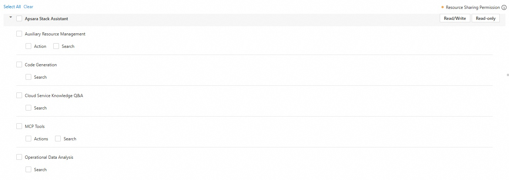

6. After the role is created, assign the role to users.

# 2.Configurations of Apsara Copilot

## 2.1. Personalized configuration

Enable or disable the intelligent assistant and configure personalized settings for the AI assistant.

**Prerequisites**

The default user for this operation is the operations administrator.

**Procedure**

1. Log in to the Apsara Uni-manager Management Console.

2. In the top navigation bar, select **Configurations**.

3. In the left-side navigation pane, select **Apsara Copilot** > **Custom Settings**.

4. On the **Custom Settings** page, update the intelligent assistant settings as needed. To restore the default settings, click **Restore Factory Settings** at the bottom of the page and log in again for the changes to take effect.

   Configuration item

   Description

   This setting controls whether the Apsara Copilot appears in the console. When enabled, the assistant appears in the floating layer and the top navigation bar.

   **Enable on**

    : Disabled.

   **Platform**

    : Enabled.

   **Display Control**

   This setting controls whether the intranet search toggle appears in the Apsara Copilot dialog box.

    : Disabled. The intranet search toggle does not appear in

   the dialog box.

    : Enabled. The intranet search toggle appears in the

   dialog box. After enabling this setting, you must configure the local knowledge base information.

   > **Note**
   >
   > After enabling Apsara Copilot display, users can choose

   **Intranet**

   > whether to enable intranet search in the dialog box.

   **Search**

   - **Knowledge Source**: The default value is **Model Studio Exclusive Edition**.

   - **URL**: Enter the retrieval API of the Model Studio knowledge center to retrieve files from a specified workspace and knowledge base.

   - **APP_KEY**: Enter a valid APP_KEY.

   - **Workspace Code**: Enter the workspace code from workspace management.

   - **Knowledge Base Code**: Enter the knowledge base code from the knowledge service.

   This setting controls whether text selection is enabled.

   **Text**

    : Disabled.

   **Enable Word**

   **selection**

   **Selection**

   **settings**

    : Enabled.

   **Set a language for**

   The supported languages are **Simplified Chinese**, **English**, and

   **the AI**

   **Traditional Chinese**.

   **assistant**

   **Assistant**

   The name must not exceed 40 characters. The default AI assistant

   **Name**

   name is Apsara Copilot.

   **Welcome**

   Set the welcome message that appears when users open the

   **Message**

   intelligent assistant.

   Set the recommended questions on the intelligent assistant

   **Recommende**

   homepage. Click **Add Question** to add a recommended question.

   **d Questions**

   To delete a question, click  in the row of the question.

   **on Home Page**

   Set the disclaimer content for the intelligent assistant.

   **AI**

   **Disclaimer**

   **Assistant**

   Default disclaimer: "Responses are generated by AI and may not

   **Settings**

   be fully accurate. They are provided for reference only."

   **Official Alternative**

   Set the official alternative response for the intelligent assistant.

   **Answer**

   Set the display icon for the intelligent assistant entry. The recommended image aspect ratio is 1:1 (for example, 100 pixels x

   **Entry Icon**

   100 pixels), and the supported formats are GIF, PNG, JPG, and JPEG.

   Set the display icon for the intelligent assistant welcome page.

   **Welcome**

   The recommended image aspect ratio is 1:1 (for example, 100

   **Page Icon**

   pixels x 100 pixels), and the supported formats are GIF, PNG, JPG, and JPEG.

   Set the conversation icon for the intelligent assistant. The

   **Conversation**

   recommended image aspect ratio is 1:1 (for example, 100 pixels x

   **Icon**

   100 pixels), and the supported formats are GIF, PNG, JPG, and JPEG.

   The supported styles are **Expert Mode**, **Simple Mode**, and **Servic Mode**.

   - **Expert Mode**: This style is rigorous, well-structured, and uses standardized terminology. It is suitable for technical support engineers to implement in-depth Q&A, architecture design, and best practice guidance.

   **Preferred**

   **Answer Style**

   **Style**

   - **Simple Mode**: This style is concise and information-dense, with no redundant expressions. It is suitable for quick responses, operation guides, and troubleshooting scenarios.

   - **Service Mode**: This style is patient, friendly, and proactively guiding. It is suitable for improving employee satisfaction and service trust.

   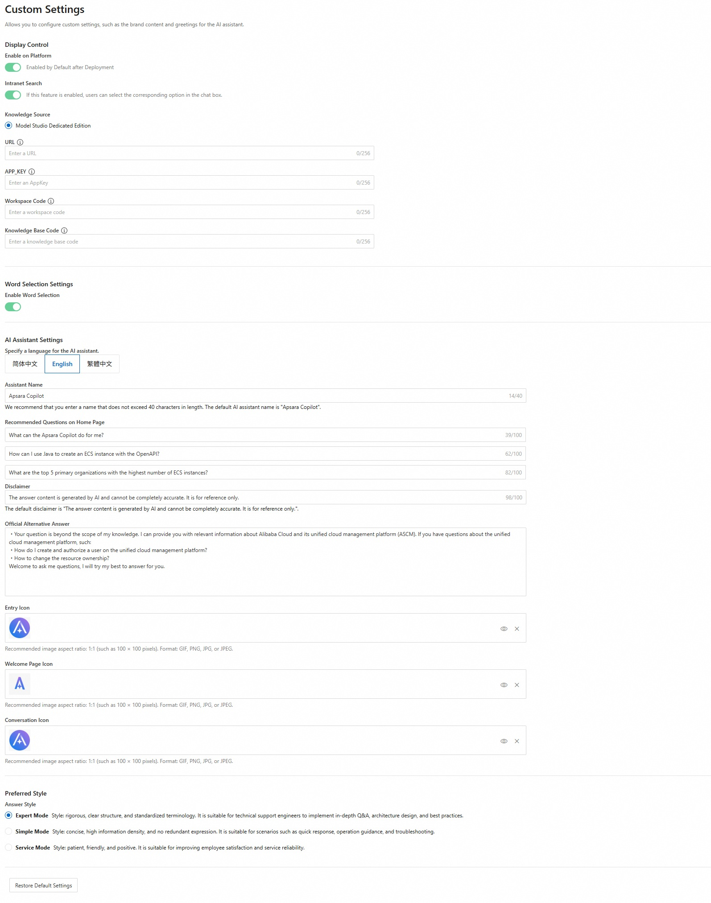

## 2.2. Accuracy evaluation

The system provides the accuracy evaluation feature that allows you to evaluate the accuracy of Apsara Copilot. By configuring evaluation cases, evaluation datasets, and evaluation tasks, you can initiate automated accuracy evaluation and export a detailed evaluation report.

### 2.2.1. Evaluation case management

#### 2.2.1.1. Create an evaluation case

This topic describes how to create an evaluation case.

**Prerequisites**

You are an operations administrator.

**Procedure**

1. Log in to the Apsara Uni-manager Management Console.

2. In the top navigation bar, click **Configurations**.

3. In the left-side navigation pane, choose **Apsara Copilot** > **Accuracy Evaluation**.

4. Click the **Evaluation Case Management** card.

5. On the **Evaluation Case Management** page, click **Add Use Case**.

6. In the **Add Evaluation Case** dialog box, configure the parameters.

   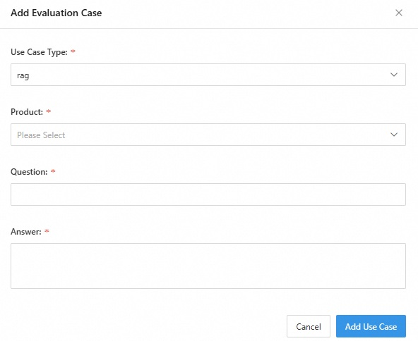

   | Parameter | Description |
   | --- | --- |
   | Use Case Type | The type of the evaluation case. Set the value to rag. |
   | Product | The cloud service to which the evaluation case belongs. |
   | Question | The question of the evaluation case. |
   | Answer | The answer to the question of the evaluation case. |

7. Click **Add Use Case**.

#### 2.2.1.2. Manage an evaluation case

This topic describes how to manage an evaluation case after it is created. You can view and delete the evaluation case.

**Prerequisites**

- You are an operations administrator.

- An evaluation case is created.

**Procedure**

1. Log in to the Apsara Uni-manager Management Console.

2. In the top navigation bar, click **Configurations**.

3. In the left-side navigation pane, choose **Apsara Copilot** > **Accuracy Evaluation**.

4. Click the **Evaluation Case Management** card.

5. Manage the created evaluation case as needed.

   | Operation | Description |
   | --- | --- |
   | View the evaluation case | Find the evaluation case and click <strong>View</strong> in the Actions column. In the Evaluation Case Details panel, you can view the evaluation case details, including the associated evaluation datasets. Note • The evaluation case code can be copied with one click. To do so, move the pointer over the code and click the icon.  • An associated evaluation dataset can be disassociated from the current evaluation case. To do so, find the evaluation dataset in the list and click <strong>Disassociate</strong> in the Actions column. |
   | Delete the evaluation case | i. Find the evaluation case and click <strong>Delete</strong> in the Actions. ii. In the message that appears, click <strong>OK</strong>. |

### 2.2.2. Evaluation dataset management

#### 2.2.2.1. Create an evaluation dataset

This topic describes how to create an evaluation set.

**Prerequisites**

- You are an operations administrator by default.

- You have created evaluation cases.

**Procedure**

1. Log in to the Apsara Uni-manager Management Console.

2. In the top navigation bar, select **Configurations**.

3. In the left-side navigation pane, select **Apsara Copilot** > **Accuracy Evaluation**.

4. Click the **Evaluation Dataset Management** card.

5. On the **Evaluation Dataset Management** page, click **Create Evaluation Dataset**.

6. In the **Create Evaluation Dataset** dialog box, configure the evaluation dataset information.

   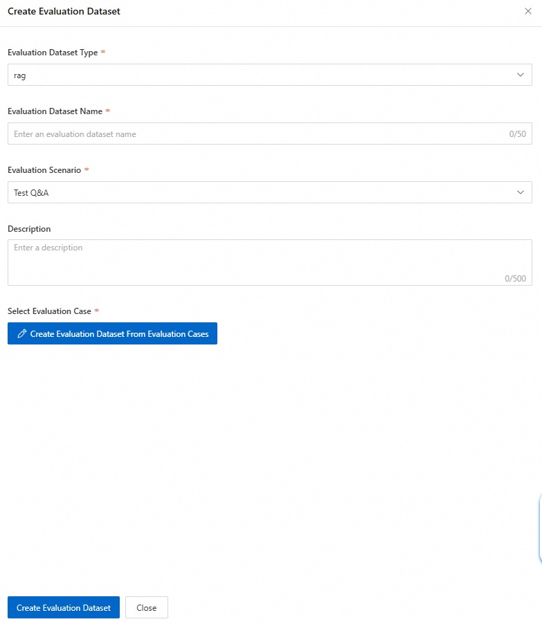

   | Configuration item | Description |
   | --- | --- |
   | Evaluation Dataset Type | Select the type of the evaluation set. The current version supports rag type only. |
   | Evaluation Dataset Name | Set a name for the evaluation set. |

   | Evaluation Scenario | Select an evaluation scenario. The system supports <strong>Test Q&amp;A</strong> and <strong>User</strong> <strong>Q&amp;A</strong>. |
   | --- | --- |
   | Description | Optional. Enter a description for the evaluation set. |
   | Select Evaluation Cases | i. Click <strong>Create Evaluation Dataset From Evaluation Cases</strong>. ii. Select cases. You can filter cases by <strong>User Case Code</strong>, <strong>Question</strong>, <strong>Product</strong>, and <strong>Reference Answer</strong>. After you set the filter conditions, click <strong>Search</strong> to apply the filters. iii. Click <strong>OK</strong>. You can also click <strong>Add All</strong> to add all cases to the evaluation dataset. |

7. Click **Create Evaluation Dataset**.

#### 2.2.2.2. Manage an evaluation dataset

This topic describes how to manage an evaluation dataset after it is created. You can view, modify, and delete the evaluation dataset.

**Prerequisites**

- You are an operations administrator.

- An evaluation dataset is created.

**Procedure**

1. Log in to the Apsara Uni-manager Management Console.

2. In the top navigation bar, click **Configurations**.

3. In the left-side navigation pane, choose **Apsara Copilot** > **Accuracy Evaluation**.

4. Click the **Evaluation Dataset Management** card.

5. Manage the created evaluation dataset as needed.

   | Operation | Description |
   | --- | --- |
   | View the evaluation dataset | Find the evaluation dataset and click <strong>View</strong> in the Actions column. On the <strong>Evaluation</strong> <strong>Dataset Use Case Management</strong> page, you can manage the evaluation cases in the dataset. |
   | Modify the evaluation dataset | i. Find the evaluation dataset and click <strong>Modify</strong> in the Actions column. ii. In the <strong>Modify Evaluation Dataset</strong> panel, modify the <strong>Evaluation Dataset Name</strong> and <strong>Description</strong> parameters. iii. Click <strong>OK</strong>. |
   | Delete the evaluation dataset | i. Find the evaluation dataset and click <strong>Delete</strong> in the Actions column. ii. In the message that appears, click <strong>OK</strong>. |

### 2.2.3. Evaluation task management

#### 2.2.3.1. Create an evaluation task

This topic describes how to create an evaluation task.

**Prerequisites**

- You are an operations administrator by default.

- You have created an evaluation dataset.

**Procedure**

1. Log in to the Apsara Uni-manager Management Console.

2. In the top navigation bar, select **Configurations**.

3. In the left-side navigation pane, select **Apsara Copilot** > **Accuracy Evaluation**.

4. Click the **Evaluation Task Management** card.

5. On the **Evaluation Task Management** page, click **Create Evaluation Task**.

6. In the **Create Evaluation Task** dialog box, configure the evaluation task information.

   | Configuration item | Description |
   | --- | --- |
   | Task Name | Enter a name for the evaluation task. |
   | Evaluation Task Type | Select an evaluation task type. The current version supports rag type only. |
   | Evaluation Dataset | Select an evaluation set from the drop-down list. |
   | Evaluation Type | Select <strong>Manual</strong> or <strong>Automatic</strong>. |
   | Evaluator | When you select <strong>Manual</strong> for <strong>Evaluation Type</strong>, specify one or more evaluators. You can specify up to three evaluators. All specified evaluators must complete the evaluation. If any evaluator selects <strong>Completely Wrong</strong> as the evaluation result, the evaluation fails. |
   | Evaluation Method | When you select <strong>Automatic</strong> for <strong>Evaluation Type</strong>, select an evaluation method. Select <strong>Ground Truth</strong> or <strong>No Ground Truth</strong>. |

   **Manual evaluation task**

   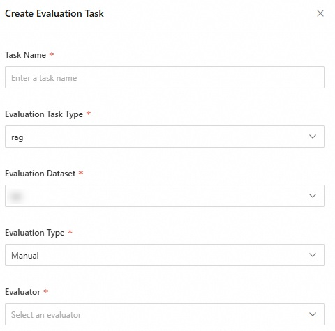

   **Automatic evaluation task**

   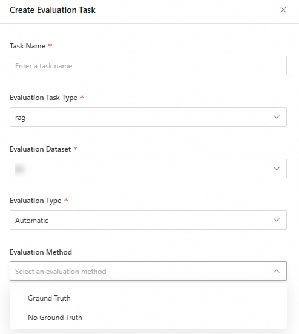

7. Click **Create Evaluation Task**.

   > **Note**
   >
   > After you create an evaluation task, the system does not automatically start the task. You must click **Start Evaluation** in the **Actions** column to start the evaluation task.

#### 2.2.3.2. Manage an evaluation task

This topic describes how to manage an evaluation task.

**Prerequisites**

- You are an operations administrator by default.

- You have created an evaluation task.

**Procedure**

1. Log in to the Apsara Uni-manager Management Console.

2. In the top navigation bar, click **Configurations**.

3. In the navigation pane on the left, choose **Apsara Copilot** > **Accuracy Assessment**.

4. Click the **Evaluation Task Management** card.

5. View the list of evaluation tasks. You can use the **Task ID**, **Evaluation Dataset**, **Evaluation Type**, and **Status** filters to quickly find a specific task.

   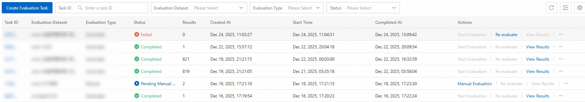

6. Manage the created evaluation task as needed.

   | Operation | Description |
   | --- | --- |
   | Perform manual evaluation | i. In the <strong>Actions</strong> column of the evaluation task, click <strong>Manual</strong> <strong>Evaluation</strong>. Note You can perform manual evaluation only on tasks whose <strong>Evaluation Type</strong> is <strong>Manual</strong> and whose status is <strong>Pending</strong> <strong>Manual Evaluation</strong> or <strong>In Progress</strong>.ii. On the <strong>Manual Evaluation</strong> page, click <strong>Evaluate</strong> in the <strong>Actions</strong> column for a use case. Note Click <strong>View</strong> in the <strong>Actions</strong> column to view the details of the evaluation results. 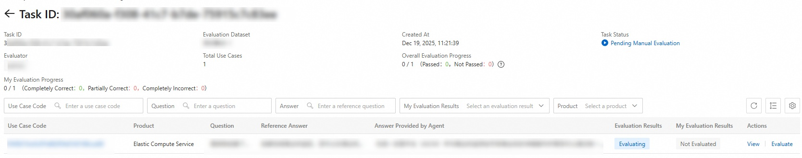 iii. In the <strong>Evaluation Result Details</strong> panel, review the information to be evaluated. Then, in the <strong>Manual Evaluation</strong> section, set the <strong>Evaluation Result</strong> and <strong>Remarks</strong>. Note For <strong>Evaluation Result</strong>, you can select <strong>Completely</strong> <strong>Accurate</strong>, <strong>Partially Accurate</strong>, <strong>Completely Incorrect</strong>, or <strong>Not Evaluated</strong>. If you select <strong>Completely Incorrect</strong>, the evaluation fails. You must then select a reason from the <strong>Reason for Failure</strong> drop-down list below. Options include <strong>Unclear Question</strong>, <strong>Incomplete Reference Answer</strong>, <strong>Incomplete Content</strong>, <strong>Duplicate Use Case</strong>, or <strong>Other</strong>. |

   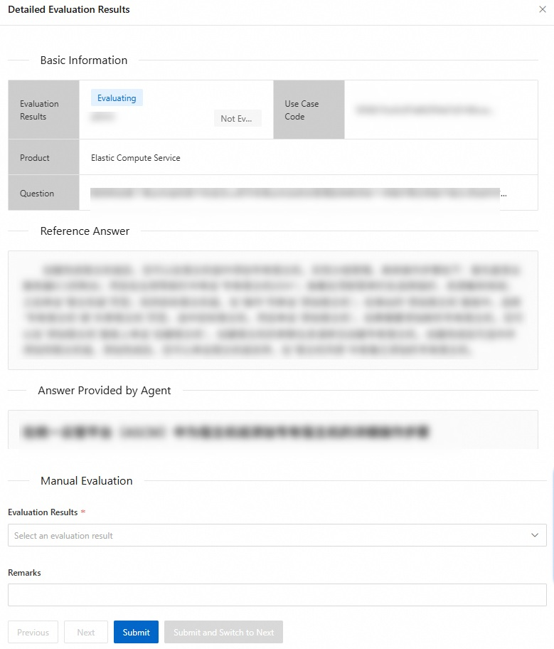

   <ol type="i" start="4">

   <li>

   Click **Submit**. If there are multiple use cases, you can click **Submit and Switch to Next** after you finish evaluating the current use case.

   </li>

   </ol>

   <table>
     <tr>
       <td>View the evaluation results</td>
       <td>i. In the <strong>Actions</strong> column of the evaluation task, click <strong>View Results</strong>. Note You can view the results only when the task status is <strong>Completed</strong>. ii. On the <strong>Evaluation Results</strong> page, view the evaluation results for the use cases. 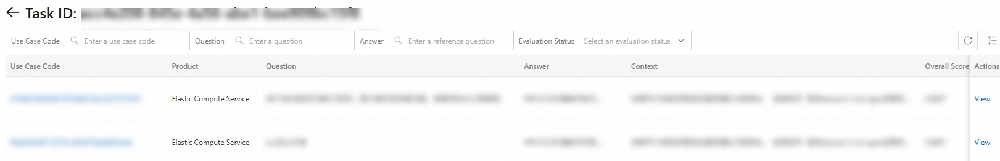 iii. Click <strong>View</strong> in the <strong>Actions</strong> column for a use case to expand its result details.</td>
     </tr>
     <tr>
       <td>View the report</td>
       <td>i. In the <strong>Actions</strong> column of the evaluation task, click theicon and select <strong>View Report</strong>. Note You can view the report only when the task status is <strong>Completed</strong>. ii. On the <strong>Evaluation Report</strong> page for the task, view the detailed evaluation and analysis report.</td>
     </tr>
     <tr>
       <td>Delete the evaluation task</td>
       <td>i. In the Actions column, clickand select <strong>Delete</strong>. ii. In the message that appears, click <strong>OK</strong>.</td>
     </tr>
     <tr>
       <td>Perform a re-evaluation</td>
       <td>i. If the evaluation task fails, click <strong>Re-evaluate</strong> in the Actions column. ii. In the message that appears, click <strong>OK</strong>.</td>
     </tr>
   </table>

### 2.2.4. Accuracy rate analysis

View the accuracy status of Apsara Copilot.

**Prerequisites**

The operator is an operations administrator by default.

**Procedure**

1. Log in to the Apsara Uni-manager Management Console.

2. In the top navigation bar, select **Configurations**.

3. In the left-side navigation pane, select **Apsara Copilot** > **Accuracy Evaluation**.

4. Click the **Accuracy Rate Analysis** card.

5. On the **Accuracy Rate Analysis** page, view **Accuracy Rate Trend Analysis**, **Question Classification Statistics**, and **Data Details**.

   | Configuration item | Description |
   | --- | --- |
   | Accuracy Rate Trend Analysis | Displays accuracy rate analysis as a line chart. You can switch between <strong>Day</strong> <strong>Dimension</strong> or <strong>Month Dimension</strong>. |
   | Question Classification Statistics | Displays question classification statistics as a column chart. You can switch between <strong>Day Dimension</strong> or <strong>Month Dimension</strong>. |
   | Data Details | Enter the start date and end date for your query to view detailed data within the specified time range. You can switch between <strong>Day Dimension</strong> or Month Dimension • Click <strong>View Report</strong> in the <strong>Actions</strong> column of a detail entry to go to the evaluation report details page. • Clickabove the list to download the detailed data to your local device. |

   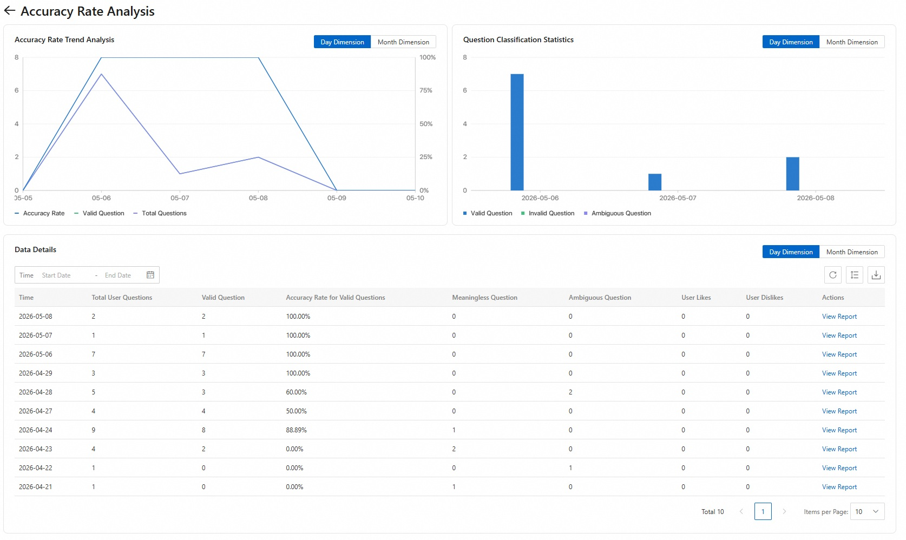

## 2.3. Model configuration

Manage and configure your AI models, including large language models, embedding models, and rerank models.

**Prerequisites**

The operator is an operations administrator by default.

**Procedure**

1. Log in to the Apsara Uni-manager Management Console.

2. In the top navigation bar, select **Configurations**.

3. In the left-side navigation pane, select **Apsara Copilot** > **Model Configurations**.

4. In the **Large Language Model (LLM)**/**Embedding Model**/**Rerank Model** section, click **Add Model**.

5. In the **Add Model Configuration** dialog box, configure the model.

   | Configuration item | Description |
   | --- | --- |
   | Model Name | Enter the display name of the model. |
   | Model Code | Enter the code of the model, representing the unique ID of the model. |
   | API Key | Enter the API key of the model. |
   | Request URL | Enter the API request URL of the model. |
   | Model Provider | Select a model provider. Options: <strong>Model Studio Dedicated Edition</strong>, <strong>Alibaba</strong> <strong>Cloud Model Studio</strong>, <strong>aibase</strong>, and <strong>openai</strong>. |
   | Set as Default Model | Specify whether to set the model as the default model. |

   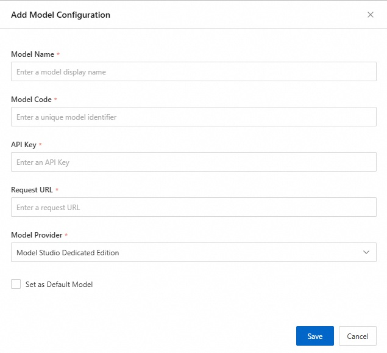

6. Click **Save**.

7. Perform other related operations.

   | Operation | Description |
   | --- | --- |
   | Edit the model | i. In the model card section, click <strong>Edit</strong> in the upper-right corner. ii. In the <strong>Edit Model Configuration</strong> dialog box, update the model configuration. Note You cannot modify the model name or model code. iii. Click <strong>Save</strong>. |
   | Delete the model | i. In the model card section, click <strong>Delete</strong> in the upper-right corner. ii. Click <strong>OK</strong>. |
   | Change the default model | In the model card section, click <strong>Set as Default Model</strong> at the bottom to change the default model based on business requirements. |

## 2.4. Knowledge base management

### 2.4.1. Create a knowledge base

Create vector and graph knowledge bases on the Knowledge Base Management page.

**Prerequisites**

The operator is an operations administrator by default.

**Procedure**

1. Log in to the Apsara Uni-manager Management Console.

2. In the top navigation bar, select **Configurations**.

3. In the left-side navigation pane, select **Apsara Copilot** > **Knowledge Base Management**.

4. Click **Create Knowledge Base**.

5. In the **Create Knowledge Base** dialog box, configure the knowledge base.

   | Configuration item | Description |
   | --- | --- |
   | Knowledge Base Type | Select the type of knowledge base. The system supports <strong>Vector</strong> <strong>Knowledge Base</strong> and <strong>Graph Knowledge Base</strong>. • <strong>Vector Knowledge Base</strong>: a production-grade vector database based on Milvus. • <strong>Graph Knowledge Base</strong>: a knowledge base implementation based on LightRAG. |
   | Knowledge Base Name | Enter a name for the knowledge base. |
   | Embedding Model | Select the embedding model used to convert text into vectors. Different models have different vector dimensions and semantic precision. You cannot change this setting after creation. |
   | Default Chunking Policy | Select a document chunking policy. • General: general chunking, suitable for most scenarios. • QA: question-answer chunking, suitable for FAQ documents. • Structure: structured chunking, suitable for long structured content. • Custom: custom delimiter-based chunking, suitable for documents with fixed formats such as laws and regulations. |
   | Chunk Size | Set this parameter when you select <strong>General</strong>, <strong>Structure</strong>, or <strong>Custom</strong> as the document chunking policy. Set the number of units contained in each independent segment (chunk) when splitting the original long text. |
   | Chunk Overlap | Set this parameter when you select <strong>General</strong>, <strong>Structure</strong>, or <strong>Custom</strong> as the document chunking policy. Set the length of repeated content between two adjacent text chunks. In other words, the end of the previous chunk overlaps with the beginning of the next chunk. |
   | Separator | Set this parameter when you select <strong>Custom</strong> as the document chunking policy. Define a series of priority rules to guide the system to split long text into appropriately sized chunks while preserving semantic integrity. Note The system supports escape characters such as \\n (line break), \\t (tab), and \\r (carriage return). Separate multiple delimiters with commas (for example, \\n,\\t). Leave this field blank to disable pre-segmentation. |
   | Description | Enter a task description for the knowledge base. The more detailed the description, the easier it is to retrieve the knowledge base accurately. |

   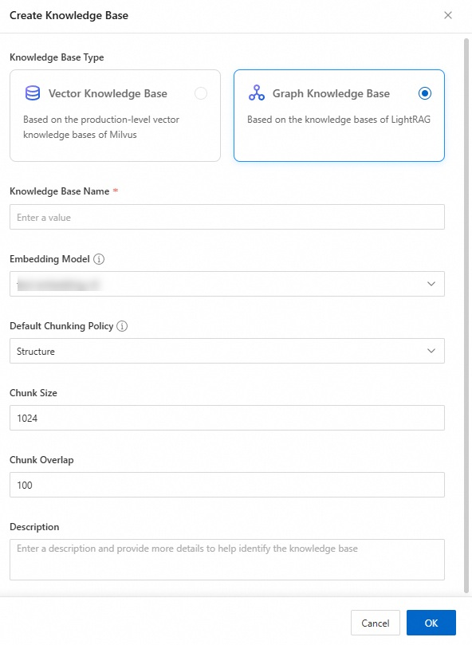

6. Click **OK**.

### 2.4.2. Edit a knowledge base

You can modify the configuration when updates are available for a knowledge base.

**Prerequisites**

The operator is an operations administrator by default.

**Procedure**

1. Log in to the Apsara Uni-manager Management Console.

2. In the top navigation bar, select **Configurations**.

3. In the left-side navigation pane, select **Apsara Copilot** > **Knowledge Base Management**.

4. Click  in the upper-right corner of the target knowledge base card, and select **Modify**

   **Knowledge Base**.

5. In the **Modify Knowledge Base** dialog box, update the knowledge base configuration. For more information about configuration items, see Create a knowledge base.

   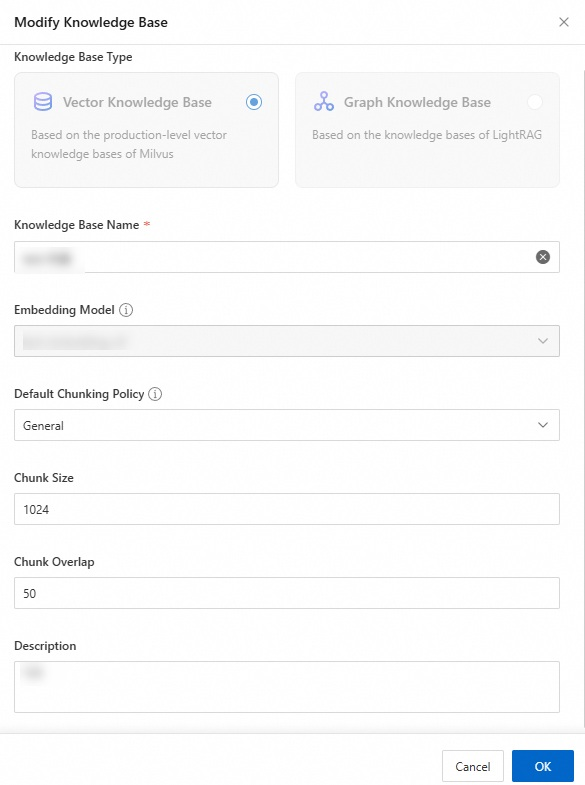

6. Click **OK**.

### 2.4.3. Configure the chunking policy

Adjusting chunking parameters controls how the system splits text, which affects retrieval quality and document loading efficiency.

**Prerequisites**

The operator is an operations administrator by default.

**Procedure**

1. Log in to the Apsara Uni-manager Management Console.

2. In the top navigation bar, select **Configurations**.

3. In the left-side navigation pane, select **Apsara Copilot** > **Knowledge Base Management**.

4. Click  in the upper-right corner of the target knowledge base card and select **Configure**

   **Chunking Policy**.

5. In the **Chunking Policy** dialog box, adjust the chunking policy for the knowledge base. For detailed descriptions of chunking policies, see Create a knowledge base.

   > **Note**
   >
   > The preset policies align with the followingRAGFlow chunking policies: General, QA, Book, and Laws. If you leave this parameter blank, the system uses the default policy of the knowledge base.

   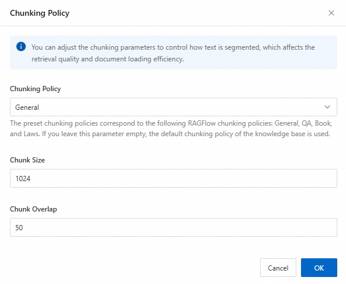

6. Click **OK**.

### 2.4.4. Delete a knowledge base

Delete any knowledge base you no longer need.

**Prerequisites**

The operater is an operations administrator by default.

**Procedure**

1. Log in to the Apsara Uni-manager Management Console.

2. In the top navigation bar, select **Configurations**.

3. In the left-side navigation pane, select **Apsara Copilot** > **Knowledge Base Management**.

4. Click  in the upper-right corner of the target knowledge base card and select **Delete**.

5. In the **Delete Knowledge Base** dialog box, enter the knowledge base name to confirm the operation.

   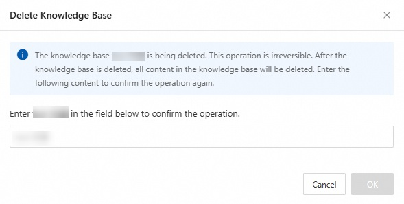

6. Click **OK**.

### 2.4.5. Import a file

Import files into a knowledge base.

**Prerequisites**

The operator is an operations administrator by default.

**Procedure**

1. Log in to the Apsara Uni-manager Management Console.

2. In the top navigation bar, select **Configurations**.

3. In the left-side navigation pane, select **Apsara Copilot** > **Knowledge Base Management**.

4. Click the name of a knowledge base to go to its details page.

5. On the **Knowledge Base Details** page, click **Import File**.

6. In the **Import File** dialog box, select or drag a file into the dashed box to upload it.

   > **Note**
   >
   > Supported file types include txt, md, doc, docx, pdf, pptx, csv, xlsx, and html.

   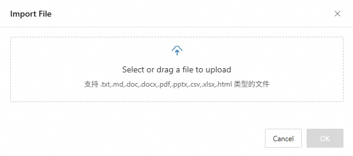

7. Click **OK**.

### 2.4.6. View file details

The file details page displays file preview and chunks information.

**Prerequisites**

The operator is an operations administrator by default.

**Procedure**

1. Log in to the Apsara Uni-manager Management Console.

2. In the top navigation bar, select **Configurations**.

3. In the left-side navigation pane, select **Apsara Copilot** > **Knowledge Base Management**.

4. Click the name of a knowledge base to go to its details page.

5. On the **Knowledge Base Details** page, click the file name to view its details.

   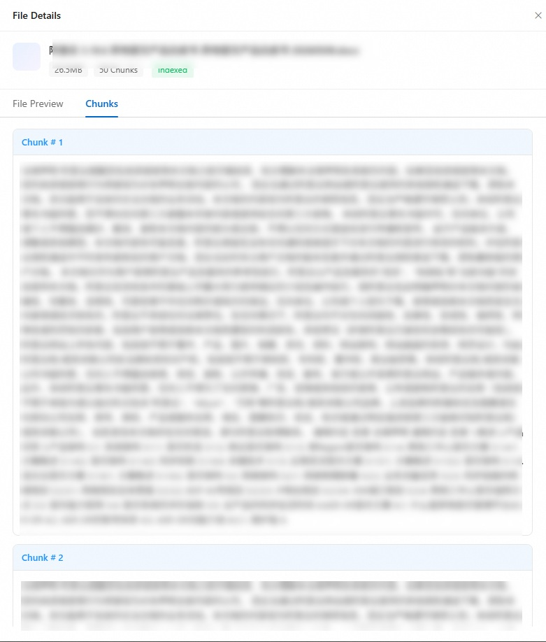

### 2.4.7. Ingest files

After importing files, you can ingest them.

**Prerequisites**

- The operator is an operations administrator by default.

- The file status is **Parsed**.

**Procedure**

1. Log in to the Apsara Uni-manager Management Console.

2. In the top navigation bar, select **Configurations**.

3. In the left-side navigation pane, select **Apsara Copilot** > **Knowledge Base Management**.

4. Click the name of a knowledge base to go to its details page.

5. On the **Knowledge Base Details** page, ingest files.

   | Operation | Description |
   | --- | --- |
   | Ingest a single file | Click <strong>Ingest</strong> in the <strong>Actions</strong> column corresponding to the file. |
   | Ingest multiple files at a time | i. Select multiple files that you want to ingest. ii. Click <strong>Batch Ingest</strong> below the file list. iii. In the <strong>Batch Ingest Chunking Policy</strong> dialog box, confirm or modify the chunking policy. iv. Click <strong>OK</strong>. |

6. (Optional) Perform other related operations.

   - After ingesting a file, the file status changes to **Indexed**. You can download the file.

   - If file ingestion fails, the file status changes to **Index Error**. You can retry the operation.

### 2.4.8. Delete a file

**Prerequisites**

The operator is an operations administrator by default.

**Procedure**

1. Log in to the Apsara Uni-manager Management Console.

2. In the top navigation bar, select **Configurations**.

3. In the left-side navigation pane, select **Apsara Copilot** > **Knowledge Base Management**.

4. Click the name of a knowledge base to go to its details page.

5. On the **Knowledge Base Details** page, click **Delete** in the **Actions** column.

6. Click **OK**.

### 2.4.9. View the knowledge graph

View the generated knowledge graph in a graph-type knowledge base.

**Prerequisites**

- The operator is an operations administrator by default.

- The knowledge base is of graph type.

**Procedure**

1. Log in to the Apsara Uni-manager Management Console.

2. In the top navigation bar, select **Configurations**.

3. In the left-side navigation pane, select **Apsara Copilot** > **Knowledge Base Management**.

4. Click the name of the knowledge base to go to its details page.

5. On the **Knowledge Base Details** page, click  in the upper-right corner of the list.

6. On the **Knowledge Graph** tab, view the generated knowledge graph. If no knowledge graph exists, click **Generate Now**.

   > **Note**
   >
   > - The knowledge graph displays nodes and their relationships.
   >
   >   - Enter a node name in the drop-down list at the top to search for and view the specific node.
   >
   >   - Click a node in the graph to display its description, network metrics, tags, and associations.
   >
   > - Control the knowledge graph view.
   >
   >   - Click
   >
   >     in the upper-right corner of the knowledge graph to zoom in.
   >
   >     
   >
   >   - Click
   >
   >     in the upper-right corner of the knowledge graph to zoom out.
   >
   >     
   >
   >   - Click
   >
   >     in the upper-right corner of the knowledge graph to enter full-
   >
   >     
   >
   >     screen mode.
   >
   >   - Click
   >
   >     in the upper-right corner of the knowledge graph to restore the
   >
   >     
   >
   >     default view.

   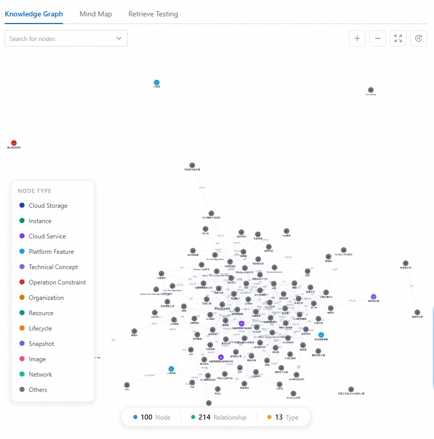

### 2.4.10. View the mind map

View the generated mind map.

**Prerequisites**

The operator is an operations administrator by default.

**Procedure**

1. Log in to the Apsara Uni-manager Management Console.

2. In the top navigation bar, select **Configurations**.

3. In the left-side navigation pane, select **Apsara Copilot** > **Knowledge Base Management**.

4. Click the name of a knowledge base to go to its details page.

5. On the **Knowledge Base Details** page, click  in the upper-right corner of the list.

6. On the **Mind Map** tab, view the generated mind map.

   > **Note**
   >
   > - Click **Regenerate** above the mind map to regenerate the mind map.
   >
   > - Enter a node name above the mind map to search by node.
   >
   > - Control the display of the mind map.
   >
   >   - Enter a percentage in the upper-right corner of the mind map to adjust the display scale.
   >
   >   - Click
   >
   >     in the upper-right corner of the mind map to zoom in.
   >
   >     
   >
   >   - Click
   >
   >     in the upper-right corner of the mind map to zoom out.
   >
   >     
   >
   >   - Click
   >
   >     in the upper-right corner of the mind map to enter full-screen
   >
   >     
   >
   >     mode.
   >
   >   - Click
   >
   >     in the upper-right corner of the mind map to restore the default
   >
   >     
   >
   >     view.

   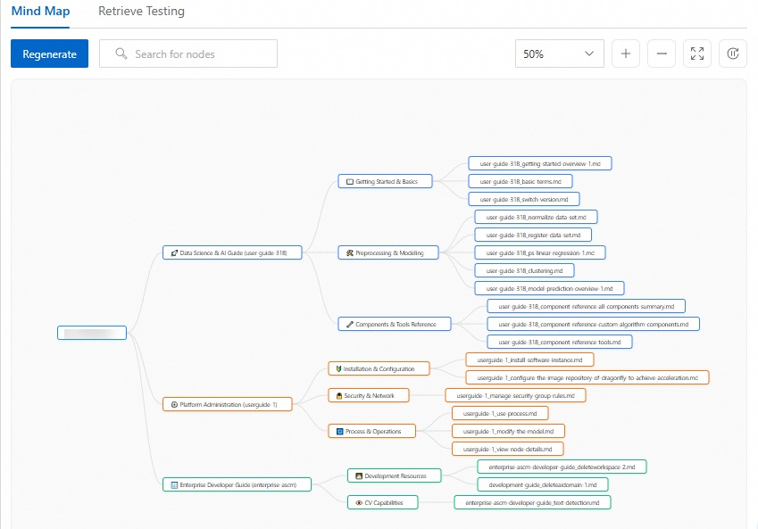

### 2.4.11. Retrieval configuration and retrieval testing

The Retrieve Testing tab supports retrieval configuration and retrieval testing.

**Prerequisites**

The operator is an operations administrator by default.

**Procedure**

1. Log in to the Apsara Uni-manager Management Console.

2. In the top navigation bar, select **Configurations**.

3. In the left-side navigation pane, choose **Apsara Copilot** > **Knowledge Base Management**.

4. Click the name of a knowledge base to go to its details page.

5. On the **Knowledge Base Details** page, click  in the upper-right corner of the list.

6. Configure retieval settings.

   <ol type="i">

   <li>

   Click **Retrieval Configurations**.

   </li>

   <li>

   In the **Retrieval Configurations** dialog box, set **Query Mode (query_mode)**,

   </li>

   </ol>

   **Retieved Entity Relationships (top_k)**, **Retrieval Chunks (chunk_top_k)**, and **Enable Reranking (enable_rerank)**.

   > **Note**
   >
   > Query mode supports **hybrid** or **mix**.

   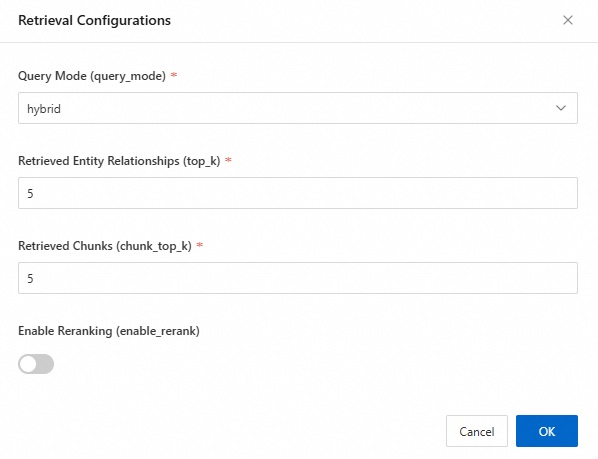

   <ol type="i" start="3">

   <li>

   Click **OK**.

   </li>

   </ol>

7. Perform retrieval testing. Enter search content in the text box and click **Search**.

   > **Note**
   >
   > - Query Mode:
   >
   >   - The right side displays the currently configured query mode.
   >
   >   - Advanced Keywords: advanced keywords extracted from the search content.
   >
   >   - Basic Keywords: basic keywords extracted from the search content.
   >
   > - The section below displays the retrieved information.

   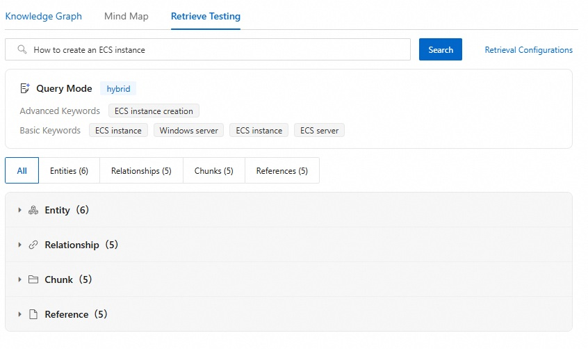

## 2.5. AI-assisted cloud resource management

You can use custom configurations to better manage your cloud resources.

### 2.5.1. AI-assisted creation

Configure personalized scenarios for AI-assisted creation of cloud services.

**Prerequisites**

The operator is an operations administrator by default.

**Procedure**

1. Log in to the Apsara Uni-manager Management Console.

2. In the top navigation bar, select **Configurations**.

3. In the left-side navigation pane, select **Apsara Copilot** > **Auxiliary Cloud Resource Management**.

4. Click the **AI-assisted Creation** tab.

5. Complete the AI-assisted creation configuration.

   | Configuration item | Description |
   | --- | --- |
   | Cloud Service | Select a cloud service for AI-assisted creation. Currently, the system supports only Elastic Compute Service (ECS) Instance and Virtual Private Cloud (VPC). |
   | Custom Scenario | Configure custom scenarios as needed for use during assisted resource creation. • <strong>Add a scenario</strong>: Click <strong>Add Scenario</strong> to customize a scenario. You can select <strong>Enumeration Scenario</strong>, <strong>Scenario Description</strong>, or <strong>None</strong>. • <strong>Delete a scenario</strong>: Clicknext to the scenario. • <strong>Adjust the scenario order</strong>: Dragin front of a scenario to adjust its display order. • <strong>Restore the preset scenario</strong>: Click <strong>Restore Preset Scenario</strong>, and the system automatically loads the default layout and scenario configurations. |

   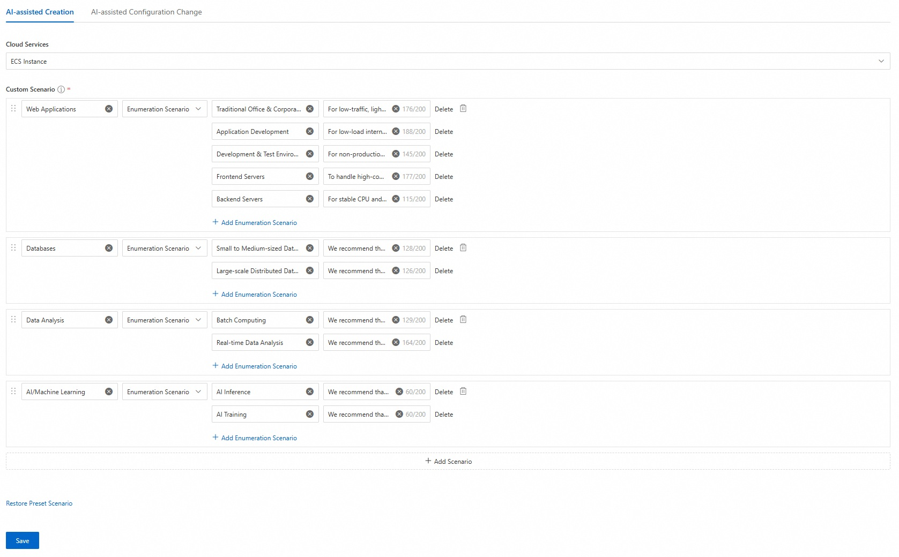

6. Click **Save**.

**Result display**

After you configure assisted creation for a cloud service, Apsara Copilot intelligently plans and assists users in creating resources based on personalized scenarios.

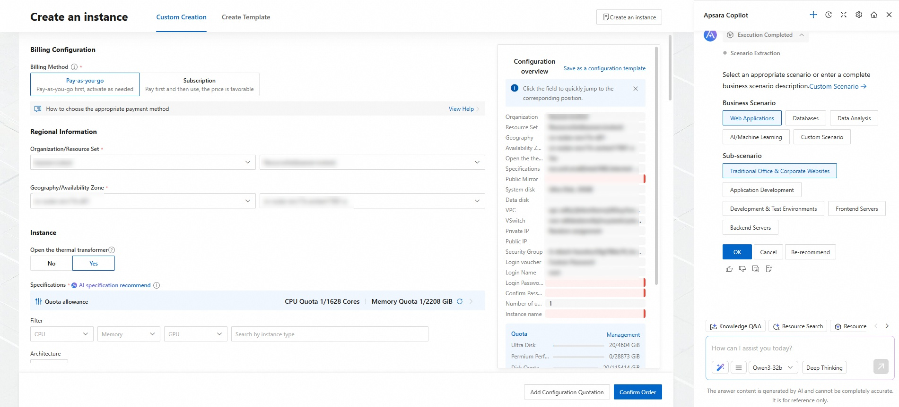

### 2.5.2. AI-assisted configuration change

You can configure rules for the AI-assisted configuration change of cloud products. These rules are used to analyze and provide recommendations when you upgrade or downgrade a cloud product.

**Prerequisites**

The operator is an operations administrator by default.

**Procedure**

1. Log on to the Apsara Uni-manager Management Console.

2. In the top menu bar, select **Configurations**.

3. In the navigation pane on the left, select **Apsara Copilot** > **Auxiliary Cloud Resource Management**.

4. Click the **AI-assisted Configuration Change** tab.

5. Configure the settings for assisted Upgrade/Downgrade.

   | Configuration item | Description |
   | --- | --- |
   | Change Service Configurations | Select the cloud product to upgrade or downgrade. Currently, only Elastic Computing Service (ECS) and Server Load Balancer (SLB) are supported. |
   | Rule Template | Select a rule template. If the predefined templates do not meet your needs, customize a rule template. |
   | Rule Description | Displays the details of the selected rule template. |

   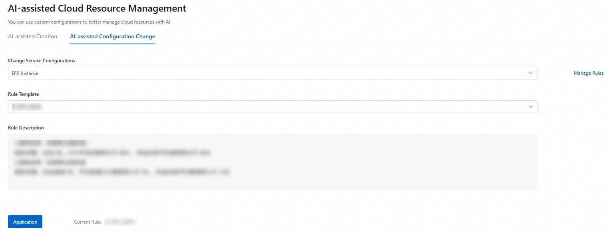

6. Click **Apply**.

**Customize a rule template**

1. On the **AI-assisted Configuration Change** tab, click **Manage Rules** to the right of **Rule Template**.

2. On the **Manage Rules** panel, click  .

3. Configure the rule.

   | Configuration item | Description |
   | --- | --- |
   | Rule Name | Enter a name for the rule. The name must be unique. |
   | Monitoring metrics | Displays the monitoring metrics supported by the current cloud product.These metrics are used for monitoring analysis and in the rule description. |
   | Rule Description | Create an analysis rule for the cloud resource. This rule is used for assisted resource upgrade/downgrade. You can enter a description in <strong>Generate rules with AI</strong> and then insert the generated result. |

   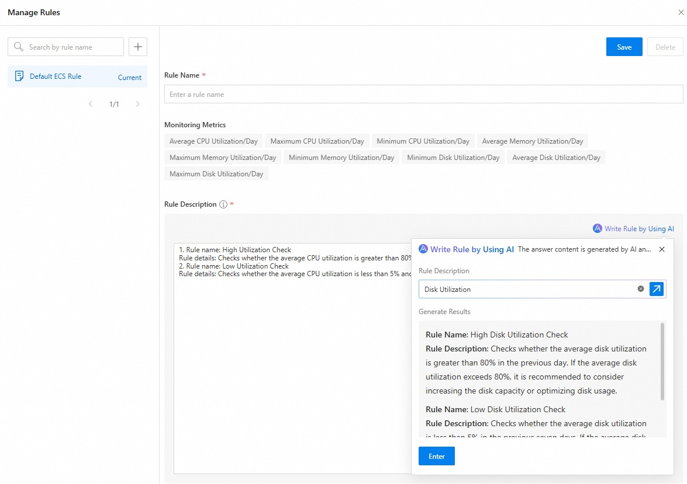

4. Click **Save**.

5. You can perform other operations on rule templates.

   | Operation | Description |
   | --- | --- |
   | Edit a rule template | i. On the <strong>Manage Rules</strong> panel, select a rule and click <strong>Modify</strong>. Note Predefined rule templates cannot be edited. ii. Update the rule name and description. iii. Click <strong>Save</strong>. |
   | Delete a rule template | On the <strong>Manage Rules</strong> panel, select a rule and click <strong>Delete</strong>. Note Predefined rule templates cannot be deleted. |

**Results**

After configuring the AI-assisted configuration change for a cloud product, Apsara Assistant uses the applied rules to provide recommendations during an upgrade or downgrade.

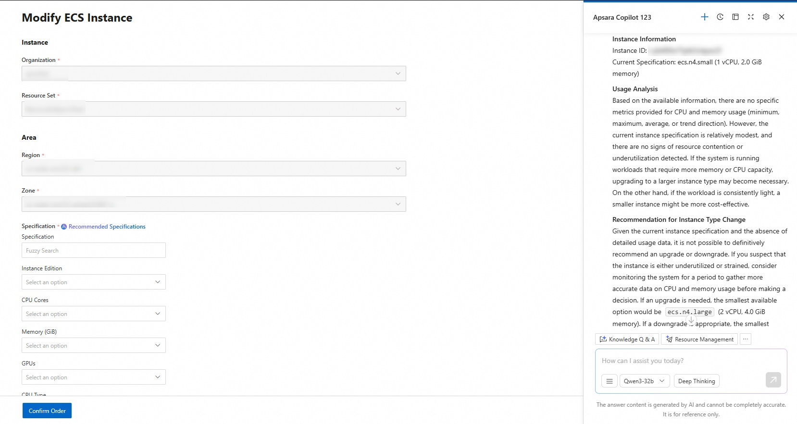

# 3.Application of Apsara Copilot

## 3.1. Apsara Copilot conversation

Apsara Copilot allows you to ask platform and cloud service questions in natural language, consult the AI for information, and engage in intelligent conversations with the AI.

**Prerequisites**

The operations administrator has enabled the display of the intelligent assistant in **Configurations** > **Apsara Copilot** > **Custom Settings** section of the Apsara Uni-manager Management Console.

**Procedure**

1. Log in to the Apsara Uni-manager Management Console.

2. In the top navigation bar or the floating menu of the console, click  to go to Apsara

   Copilot.

   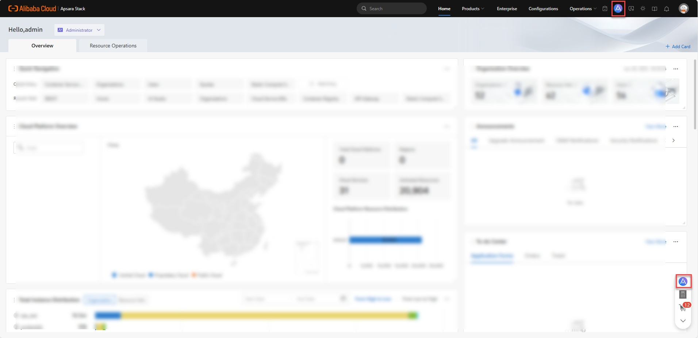

3. In the **Apsara Copilot** dialog box or page, describe the task and click  .

   > **Note**
   >
   > - If you enter Apsara Copilot from the top navigation bar, the system opens it in the full-screen mode by default. If from the floating menu, the system opens it in the window mode by default.
   >
   >   - Window mode: The top area displays the New Task, Historical Task, Full Screen, and Close icons in sequence.
   >
   >   - Full-screen mode: The left side displays navigation items such as Create New Task, Skills, Experts, Memory, and Cron Job, along with the task list.
   >
   > - Apsara Copilot supports multiple models. You can switch between different models to ask questions.
   >
   > - Click the
   >
   >   icon to upload an attachment.
   >
   >   
   >
   > - Enter "/" in the input box to quickly invoke experts and skills.

   | Capability domain | Description |
   | --- | --- |
   | Intelligent Management | Provides governance capabilities for enterprise administration and cloud resource lifecycle operations, covering organizations, permissions, and cloud resources. |
   | Deep Insights | Provides multi-dimensional quantitative analysis capabilities for structured data, focusing on operational metrics such as resource usage, cost, and health status for data analysis and reporting. Note Deep insights supports editing of report outlines. |
   | Intelligent Operations | Provides configuration management and business rule management capabilities for the operational domain, covering processes, costs, and cloud services. |

   **Window mode**

   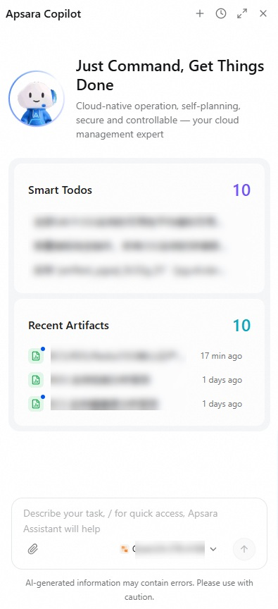

   **Full-screen mode**

   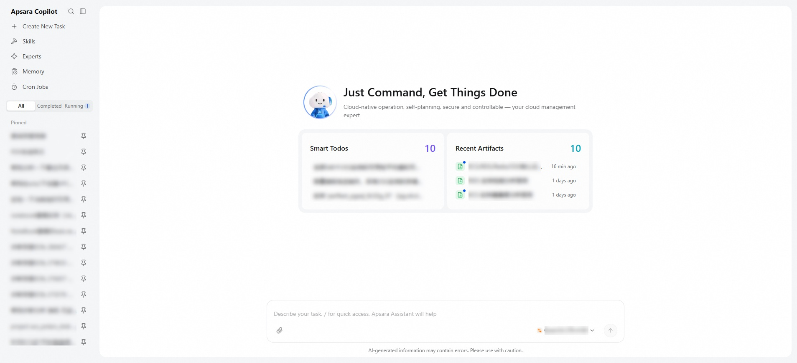

## 3.2. Skill management

Install and manage skills to extend the capabilities of Apsara Copilot in conversations.

**Procedure**

1. Log on to the Apsara Uni-manager Management Console.

2. In the top navigation bar or the floating menu of the console, click  to go to Apsara

   Copilot.

   

3. On the full-screen page of **Apsara Copilot**, click **Skills** in the left navigation pane.

   > **Note**
   >
   > - If you enter Apsara Copilot from the top navigation bar, the system opens it in the full-screen mode by default.
   >
   > - If you enter Apsara Copilot from the floating menu, the system opens it in the window mode by default. To switch to the full-screen mode, click the full-screen icon at the top of the window.

   

4. On the **Skills** page, view and manage skills by the **All**, **Official**, and **Custom** categories.

   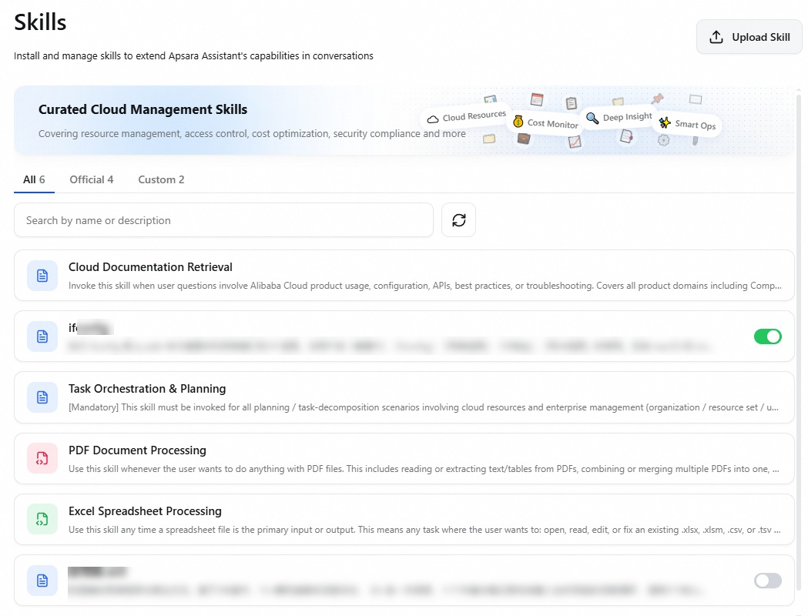

   | Operation | Description |
   | --- | --- |
   | View a skill | i. Above the skill list, search for a skill by name or description. Note Click on the right side of the search box to refresh the skill list.  ii. Click a skill card. iii. In the <strong>View Skill</strong> panel, view the details of the skill content. Note • You can enable or disable the preview. • You can copy the skill content. |
   | Upload a skill | i. Click <strong>Upload Skill</strong> at the top of the page. ii. In the <strong>Upload Skill</strong> dialog box, click <strong>Upload Skill</strong>, and select a skill file. iii. After the file passes the check, click <strong>Confirm</strong>. |
   | Enable or disable a skill | Click the enable or disable button on the right side of a skill card.  : The skill is disabled.  : The skill is enabled. Note You can enable or disable custom skills only. |
   | Delete a skill | i. Move the pointer over a skill card and clickon the right side. Note • You can delete custom skills only. • After deleting a skill, the skill becomes unavailable, and cannot be recovered. Proceed with caution. ii. In the dialog box, click <strong>Delete</strong>. |

## 3.3. Expert management

An expert is a preset domain-specific agent on the Apsara Uni-manager Operations Console. Expert agents work together to provide you with comprehensive intelligent cloud management capabilities.

**Procedure**

1. Log in to the Apsara Uni-manager Management Console.

2. In the top navigation bar or the floating menu of the console, click  to go to Apsara

   Copilot.

   

3. On the **Apsara Copilot** full-screen page, click **Experts** in the left-side navigation pane.

   > **Note**
   >
   > - If you enter Apsara Copilot from the top navigation bar, the system opens it in the full-screen mode by default.
   >
   > - If you enter Apsara Copilot from the floating menu, the system opens it in the window mode by default. To switch to the full-screen mode, click the full-screen button at the top of the window.

   

4. On the **Experts** page, you can view the capabilities of each expert agent and enable or disable expert agents.

   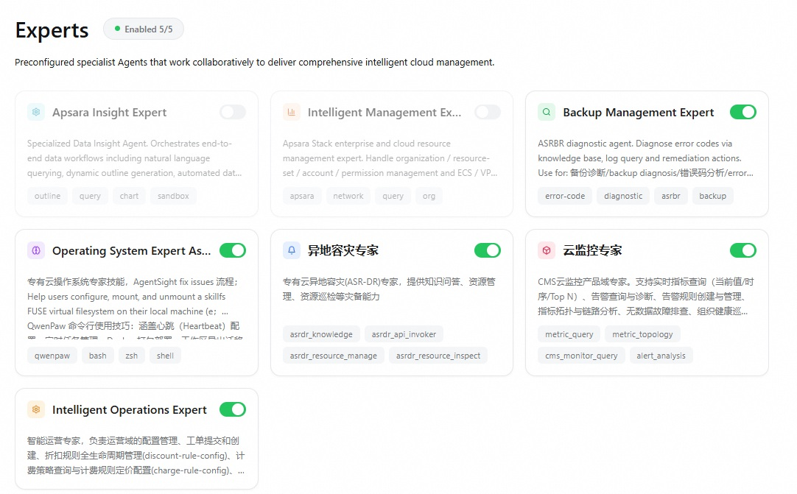

   | Operation | Description |
   | --- | --- |
   | View expert capabilities | Hover the pointer over an expert card to view the capability description of the expert agent. |
   | Enable or disable expert capabilities | Click the enable or disable button on the right side of an expert card.  : The expert agent is disabled.  : The expert agent is enabled. Note If an expert agent is not purchased, you cannot enable or disable it, or use its capabilities. |

## 3.4. Memory management

The system automatically learns and retains your usage preferences as memories. You can also manually create custom memories.

**Procedure**

1. Log in to the Apsara Uni-manager Management Console.

2. In the top navigation bar or the floating menu of the console, click  to go to Apsara

   Copilot.

   

3. On the full-screen page of **Apsara Copilot**, click **Memory** in the left navigation pane.

   > **Note**
   >
   > - If you enter Apsara Copilot from the top navigation bar, the system opens it in full-screen mode by default.
   >
   > - If you enter Apsara Copilot from the floating menu, the system opens it in window mode by default. To switch to the full-screen mode, click the full-screen button at the top of the window.

   

4. On the **Memory** page, you can view and manage memories.

   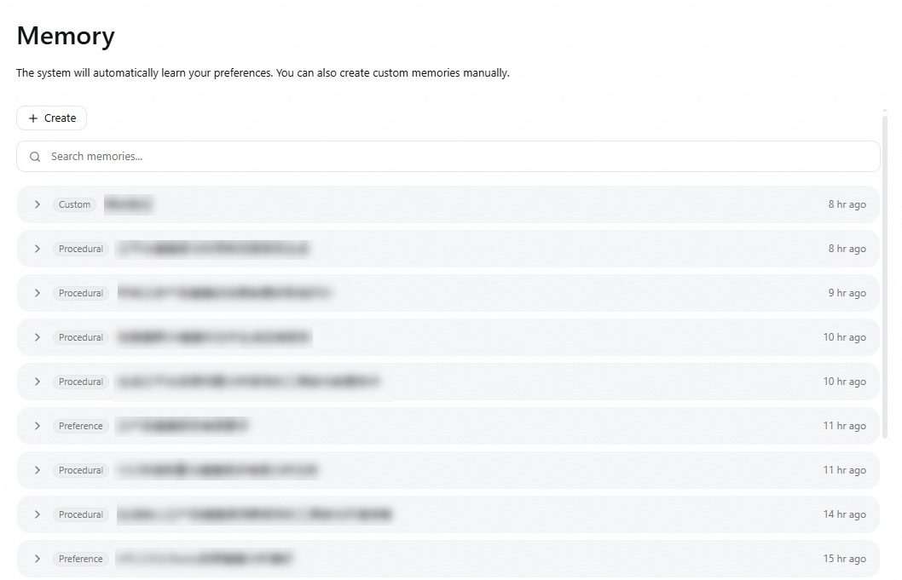

   | Operation | Description |
   | --- | --- |
   | View memory content | i. Use the search box above the memory list to search for memories. ii. Clickbefore a memory title to expand the memory and view its detailed content. |
   | Create a memory | i. Above the memory list, click <strong>Create</strong>. ii. In the <strong>Create Custom Memory</strong> dialog box, enter the <strong>Title</strong> and <strong>Content</strong> of the memory. Note The system supports Markdown format. iii. Click <strong>Save</strong>. |
   | Modify a memory | i. Move the pointer over the memory title and click. ii. Update the memory information in the expanded title and content text boxes. iii. Click <strong>Save</strong>. |
   | Delete a memory | i. Move the pointer over the memory title and click. ii. In the dialog box, click <strong>Confirm delete</strong>. |

## 3.5. Cron job management

A cron job is a task that runs automatically on a schedule and that you can also trigger manually at any time.

**Procedure**

1. Log in to the Apsara Uni-manager Management Console.

2. In the top navigation bar or the floating menu of the console, click  to open Apsara

   Copilot.

   

3. On the **Apsara Copilot** full-screen page, click **Cron Jobs** in the left-side navigation pane.

   > **Note**
   >
   > - If you open Apsara Copilot from the top navigation bar, it opens in full-screen mode by default.
   >
   > - If you open Apsara Copilot from the floating menu, it opens in window mode by default. To switch to full-screen mode, click the full-screen button at the top of the window.

   

4. On the **Cron Jobs** page, you can view and manage cron jobs.

   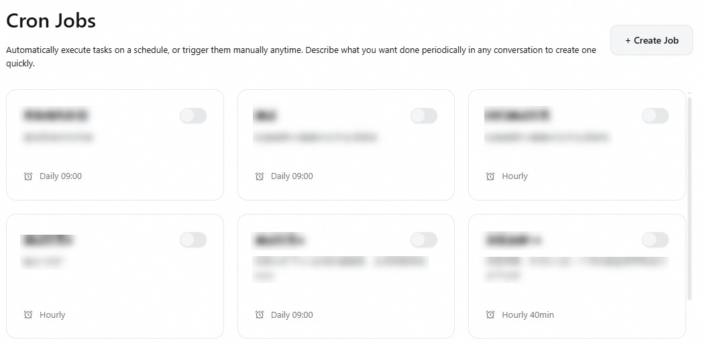

   <table>
     <tr>
       <td>Operation</td>
       <td>Description</td>
     </tr>
   </table>

   <table>
     <tr>
       <td>View cron jobs</td>
       <td>i. On a cron job card, view title, content, status, and execution time of the job. Note : The cron job is disabled.  : The cron job is enabled.  ii. After enabling a cron job, you can view the execution history on the <strong>Cron</strong> <strong>Jobs</strong> tab in the lower part of the left-side navigation pane.</td>
     </tr>
     <tr>
       <td>Create a cron job</td>
       <td>i. Click <strong>Create Job</strong>. Note You can also create a cron job through a conversation with Apsara Copilot. For example, enter "Create a cron job that summarizes my daily work progress at 8 PM every day" in the dialog box. ii. In the <strong>Create Job</strong> dialog box, specify the job name, schedule, and the specific task for Apsara Copilot to perform. Note You can set the schedule to run hourly, daily, weekly, or at a custom time. iii. Click <strong>Save</strong> or <strong>Execute Now</strong>.</td>
     </tr>
     <tr>
       <td>Modify a cron job</td>
       <td>i. Move the pointer over the cron job card and click <strong>Edit Job</strong>. ii. In the <strong>Edit Job</strong> dialog box, update the scheduled job configuration. iii. Click <strong>Execute Now</strong> or <strong>Save</strong>.</td>
     </tr>
     <tr>
       <td>Enable or disable a cron job</td>
       <td>Click the enable or disable button on the right side of the cron job card.  : The scheduled job is disabled.  : The scheduled job is enabled.</td>
     </tr>
     <tr>
       <td>Delete a cron job</td>
       <td>i. Move the pointer over the cron job card and click <strong>Delete</strong>. ii. In the dialog box, click <strong>Delete</strong>.</td>
     </tr>
   </table>

## 3.6. Text selection Q&A

Selecting text on the console page automatically triggers the Q&A feature for the selected content.

**Prerequisites**

The operations administrator has enabled the text selection feature in **Configurations** > **Apsara Copilot** > **Custom Settings**.

**Procedure**

1. Log in to the Apsara Uni-manager Management Console.

2. Click and drag to select on the console page with the left mouse button, and then click **Consult Apsara Copilot** in the op-up.

   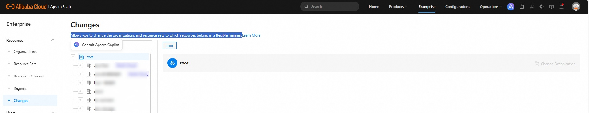

3. Apsara Copilot automatically triggers the Q&A feature for the selected content.

   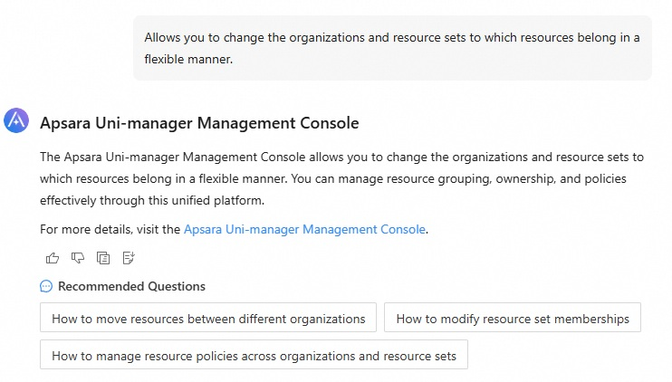

## 3.7. AI analysis

Apsara Copilot provides data analysis capabilities powered by AI analysis.

For detailed operations on AI analysis, see the **Data analysis** > **Custom analysis** > **Intelligent analysis** section in the ***Apsara Uni-manager Management Console User Guide***.

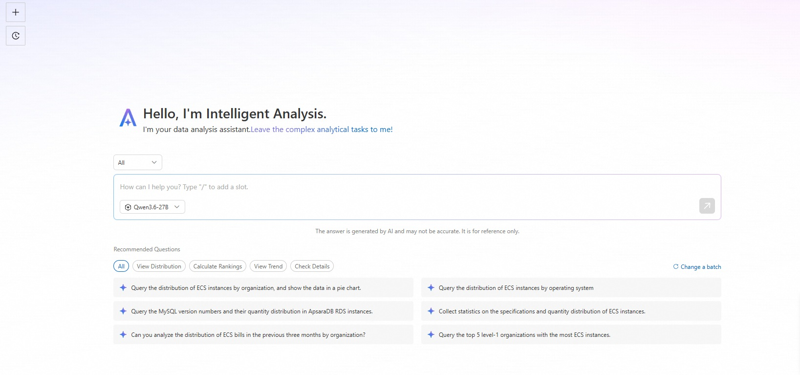

## 3.8. AI-based bill analysis

Billing data is complex and voluminous. Users struggle to identify underlying trends or potential issues from raw numbers. Apsara Copilot provides AI-based bill analysis capabilities that deliver multi-dimensional insights into billing data. This helps platform users understand resource usage and cost patterns more quickly and efficiently, enabling them to control expenses effectively. Simultaneously, it offers intelligent analytics for platform operators— including anomaly detection in bill fluctuations and trend forecasting—to ensure billing accuracy and optimize operational strategies for revenue growth.

**AI-based bill analysis by product**

For detailed operations of AI-based bill analysis by product, see the **Bill management** > **AI-based bill analysis by product** section in *Apsara Uni-manager Management Console User Guide*.

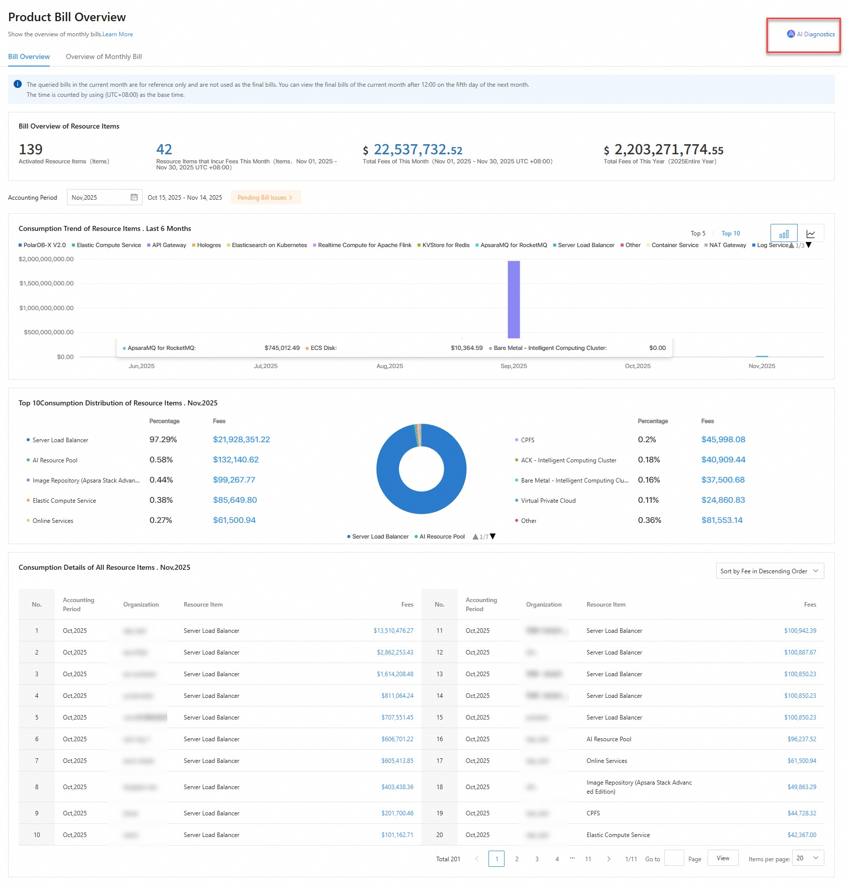

**AI-based bill Aanalysis by organization**

For detailed operations of AI-based bill Aanalysis by organization, see the **Bill management** > **AI-based bill analysis by organization** section in *Apsara Uni-manager Management Console User Guide*.

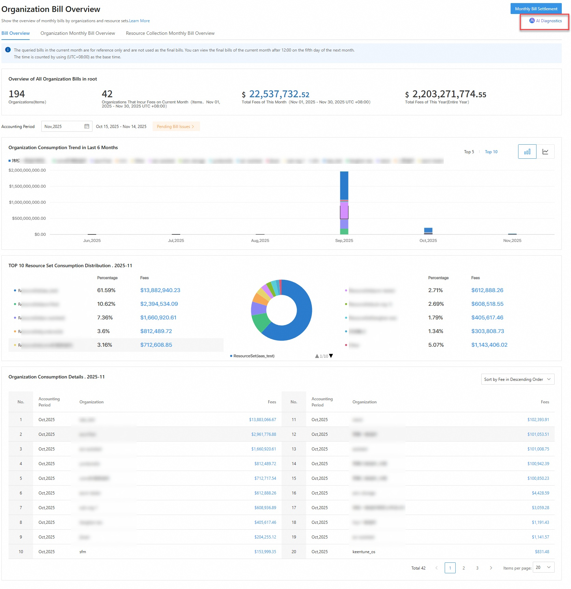

**AI-based bill analysis by bill detail**

AI-based bill analysis by bill detail supports AI parsing of daily and hourly billing details. For detailed operations, see the **Bill management** > **AI-based bill analysis by bill detail** section in *Apsara Uni-manager Management Console User Guide*.

**Daily Details**

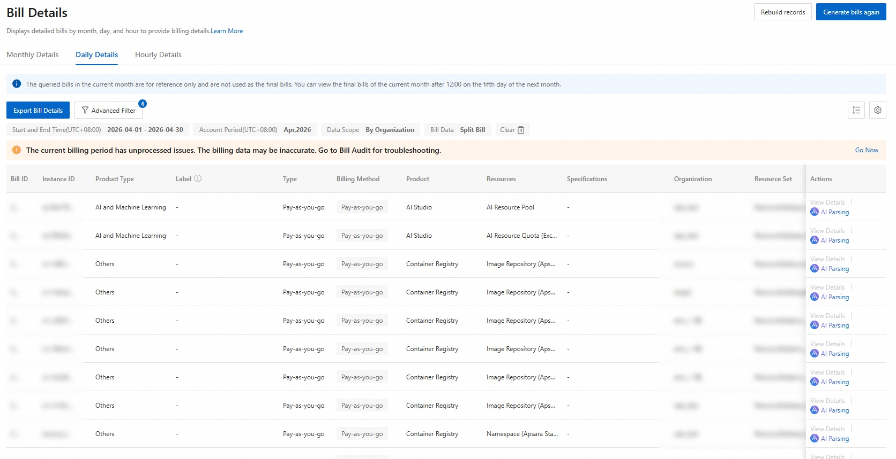

**Hourly Details**

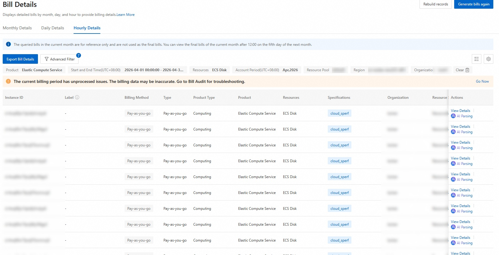

## 3.9. AI billing rule analysis

Apsara Copilot provides AI analysis for billing rule scenarios.

For detailed operations of AI billing rule analysis, see the **Pricing** > **AI billing rule analysis** section in *Apsara Uni-manager Management Console User Guide*.

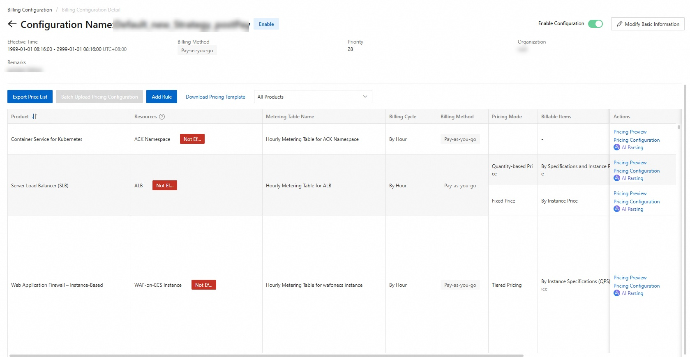

## 3.10. Unified resource search

Unified resource search is a core capability of the Apsara Copilot intelligent management digital assistant. You can quickly search for cloud resources across products and regions using natural language, and filter by dimensions such as organization, region, status, and tag to efficiently locate and manage them.

**Supported resource types**

Unified resource search supports the following cloud service resource types:

| Resource type | Description |
| --- | --- |
| ECS instance | Elastic Compute Service (ECS) instances. You can search for these resources by dimensions such as specification, billing method, and running status. |
| Disk | Cloud disk resources. You can search for these resources by dimensions such as disk type (system disk or data disk), disk category, and status. |
| ENI | Elastic network interfaces (ENIs). You can search for these resources by dimensions such as VPC and associated instance. |
| Snapshot | Disk snapshots. You can search for these resources by dimensions such as snapshot type (manual or automatic), disk type, and status. |
| Security group | Security group resources. You can search for these resources by dimensions such as security group type, VPC, and name. |
| Key pair | Secure Shell (SSH) key pairs. You can search for these resources by dimensions such as name and tag. |
| Deployment set | Deployment set resources. You can search for these resources by dimensions such as name and tag. |
| VPC | Virtual Private Cloud (VPC) instances. You can search for these resources by dimensions such as region, status, and CIDR block. |
| Switch | VPC switches (vSwitches). You can search for these resources by dimensions such as region and VPC instance. |
| Route table | VPC route tables. You can search for these resources by dimensions such as route table type and VPC instance. |
| Network ACL | VPC network access control lists (ACLs). You can search for these resources by dimensions such as VPC, name, and tag. |
| NAT gateway | Network Address Translation (NAT) gateway instances. You can search for these resources by dimensions such as specification, status, and network type. |
| Elastic IP address | Elastic IP addresses (EIPs). You can search for these resources by dimensions such as binding status, associated instance type, and bandwidth. |
| SLB | Server Load Balancer (SLB) instances. You can search for these resources by dimensions such as region, status, and network type. |
| RDS | ApsaraDB RDS instances. You can search for these resources by dimensions such as database engine, instance type, and network type. |

**Usage**

You can describe your search requirements in natural language through the Apsara Copilot dialog box. The intelligent management digital assistant automatically parses your intent and returns a matching resource list.

**Procedure**

1. Open the Apsara Copilot dialog box. Click the Apsara Copilot icon in the top navigation bar or floating menu of the console to enter Apsara Copilot.

2. Enter a natural language search command in the dialog box. For example, enter **"Query all running ECS instances under yundun2e in the cn-neimeng-50e-d01 region"**.

3. After you send the command, the intelligent management digital assistant automatically parses the search conditions, queries matching resources, and displays the results in a list.

**Natural language search examples**

The following table provides search examples for each resource type. You can enter similar natural language commands directly in the dialog box:

| Resource type | Search example |
| --- | --- |
| ECS instance | Query all running ECS instances under yundun2e in the cn-neimeng-50e-d01 region with the tag EnableHotUpgrade:true. |
| ECS instance | Query ECS instances with the pay-as-you-go billing method and the ecs.s5-kp-k-c1m1.large specification. |
| Disk | Query all unmounted data disks in the ResourceSet(yundune2e) resource set. |
| ENI | Query all ENIs under VPC vpc-o4a7ex382zfzl1fy93grg with the tag EnableHotUpgrade:true. |
| Snapshot | Query all successfully created manual snapshots under astbbigdata. |
| Security group | Query enterprise-level security groups under acs-autotest. |
| VPC | Query all available VPCs under yundun2e in the cn-neimeng-50e-d01 region. |
| Switch | Query all switches under VPC instance vpc-o4a3a218r4y3pt5wx60ap and display the number of available IP addresses. |
| NAT gateway | Query all available medium-specification NAT gateways under the yundun2e organization. |
| Elastic IP address | Query EIPs with 5 Mbps bandwidth that are associated with ECS instances. |
| SLB | Query all running SLB instances under the yundun2e organization in the cn-neimeng-50e-d01 region. |
| RDS | Query all RDS instances under the yundun2e organization with the MySQL 8.0 engine and the tag EnableHotUpgrade:true. |

**Filter dimension descriptions**

In natural language search, you can combine the following filter dimensions to locate resources precisely:

| Filter dimension | Description | Example |
| --- | --- | --- |
| Organization/resource set | Filters resources by the organization or resource set to which the resources belong. | yundun2e, astbbigdata, iaas_test |
| Region | Filters resources by the region where the resources reside. | cn-neimeng-50e-d01 |
| Status | Filters resources by the running status of the resources. | Running, Bound, Available, Created, and Unmounted |
| Tag | Filters resources by the tag key-value pair of the resources. | EnableHotUpgrade:true, HBR InstanceId:i-xxx |
| VPC instance | Filters resources by the VPC instance to which the resources belong. | vpc-o4a7ex382zfzl1fy93grg |
| Specification/type | Filters resources by the specification model or type of the resources. | ecs.s5-kp-k-c1m1.large, Medium, and Enterprise-level |
| Billing method | Filters resources by the billing method of the resources. | Pay-As-You-Go and Subscription Billing |
| Name | Filters resources by keywords in the resource name. | Name contains test |
| Network type | Filters resources by the network type of the resources. | VPC, Classic Network, and Internet |

**Usage notes**

- Unified resource search depends on the intelligent management digital assistant (intelligent management agent). Make sure that you have enabled the **intelligent management agent** on the expert management page.

- Search results are limited by your permissions, showing only the resources you have access to.

- You can combine multiple filter conditions in a single command. The intelligent management digital assistant automatically parses the command and returns resources that meet all conditions simultaneously.

- To view more resource details, click a resource name in the search results to go to the resource details page in the console of the corresponding cloud service.

# 4.Apsara Copilot operations analytics

Apsara Copilot provides an operations analytics dashboard to help customers better monitor its usage and evaluate business effects.

**Prerequisites**

The operator is an operations administrator by default.

**Procedure**

1. Log in to the Apsara Uni-manager Management Console.

2. In the top navigation bar, select **Home**.

3. Click the **AI + Operation** tab to view metric data for **last week** and **last month**.

   | Item | Description |
   | --- | --- |
   | AI Assistant Core Metrics | Displays core data for the AI assistant, including <strong>Comprehensive Score</strong>, <strong>Daily</strong> <strong>Active Users</strong>, and <strong>Total Conversations</strong>. Note Comprehensive score is a composite metric that measures the overall service quality of Apsara Copilot. The system calculates this score based on three dimensions: user satisfaction, performance response, and request success rate. This score reflects the quality of service and user experience during actual usage. |
   | AI Assistant Feature Usage | Displays usage data for scenario-based features such as <strong>Intelligent Q&amp;A</strong>, <strong>Knowledge Coverage</strong>, <strong>Intelligent Analysis</strong>, <strong>AI-assisted Operations</strong>, <strong>Code</strong> <strong>Generation</strong>, and <strong>MPC Calls</strong>. |
   | AI Assistant Performance Response | Displays core performance data for the AI assistant, including <strong>TTFT (Time To</strong> <strong>First Token)</strong> and <strong>Average Generation Speed</strong>. |
   | AI Assistant Resource Consumption | Displays resource consumption data for the AI assistant, including <strong>Consumed</strong> <strong>Tokens</strong> and <strong>Model Inference Latency</strong>. |
   | AI Assistant License Usage | Displays license usage for the AI assistant, including <strong>Standard Agent</strong>, <strong>Resource Management Agent</strong>, <strong>Operations Management Agent</strong>, and <strong>Data</strong> <strong>Insight Agent</strong>. |

   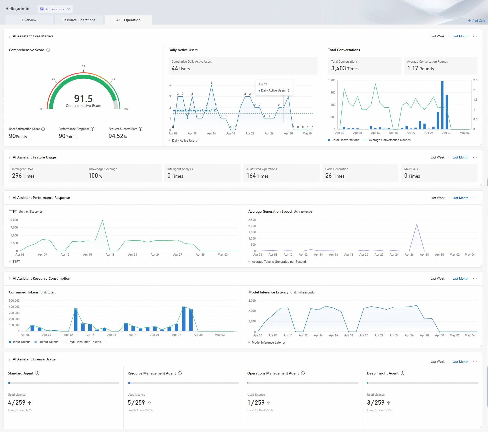

# 5.View operation logs

This topic describes how to view the operation logs of Apsara Copilot.

**Procedure**

1. Log in to the Apsara Uni-manager Management Console.

2. In the top navigation bar, click **Enterprise**.

3. In the left-side navigation pane, choose **Operation Audit** > **Operation Log**.

4. On the **Operation Log** page, configure filter conditions such as Organization, Product Type, Resource Type, Event Type, Resource ID, Source IP, Event ID, and Start/End Time, and then click **Search**.

   > **Note**
   >
   > Select **Apsara Uni-manager** from the Product Type drop-down list and **Apsara Copilot** from the Resource Type drop-down list.

5. View the displayed operation logs.

   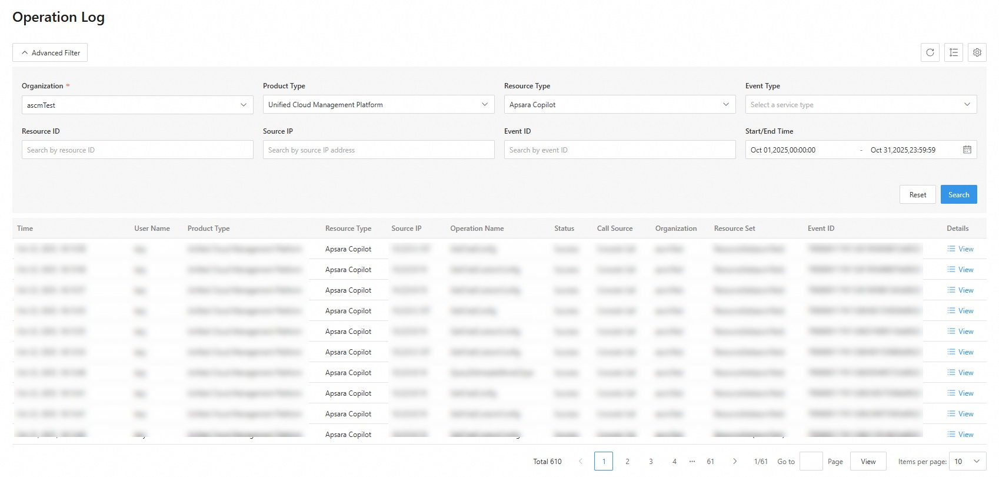

6. Find the operation log whose details you want to view and click **View** in the **Details** column.

   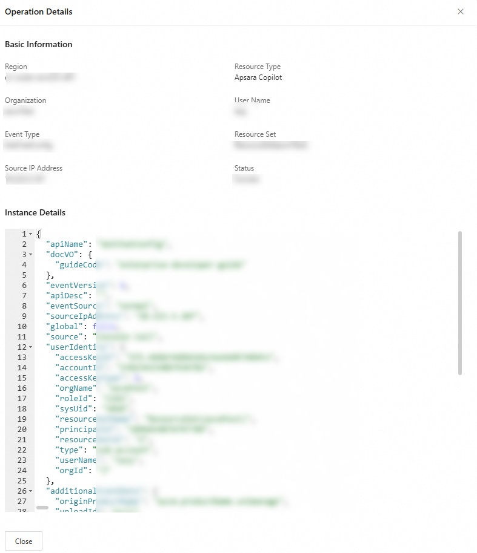

# 6.Appendix

## 6.1. Log in to the Apsara Uni-manager Management Console

This topic describes how to log in to the Apsara Uni-manager Management Console.

**Prerequisites**

- The URL of the Apsara Uni-manager Management Console is obtained from the deployment personnel.

- A web browser is available. We recommend that you use Google Chrome.

**Procedure**

1. Enter the URL of the Apsara Uni-manager Management Console in the address bar and press the Enter key.

   

   > **Note**
   >
   > - You can click the current language in the upper-right corner to switch to another language.

2. Enter your username and password.

   > **Note**
   >
   > - Obtain the username and password from an operations administrator.
   >
   > - If you log in to the Apsara Uni-manager Management Console for the first time, you must follow the on-screen instructions to change the password of your account. For security purposes, the password must be 10 to 32 characters in length. It must contain all of the following character types: uppercase letters, lowercase letters, digits, and special characters. The following special characters are supported: ! @ # $ %

3. Click **Log In**.

4. If multi-factor authentication (MFA) is enabled for your account, perform the corresponding operations in the following scenarios:

   - **This is the first time that you log in to the Apsara Uni-manager Management Console after MFA is forcefully enabled by the administrator.**

     <ol type="a">

     <li>

     On the Bind Virtual MFA Device page, follow the instructions to bind an MFA device.

     </li>

     <li>

     Enter the username and password again as in Step 2 and click **Log On**.

     </li>

     </ol>

     <ol type="i" start="100">

     <li>

     Enter a 6-digit MFA verification code and click **Authenticate**.

     </li>

     </ol>

   - **You have enabled MFA and bound an MFA device.**

     Enter a six-digit MFA verification code and click **Authenticate**.

     > **Note**
     >
     > For information about how to enable MFA and bind an MFA device, see Manage MFA.

**What to do next**

**Forget password**

1. If you forget the login password, click **Forgot Password** below the Password field.

2. On the Forgot Password page, configure the **Account Name** and **Email Address** parameters, specify the verification code, and then click **Confirm**.

   

   > **Note**
   >
   > - You can use the username of your account and the email address that was used to create the account.
   >
   > - The system sends a link for resetting the password to the email address that you specify.
