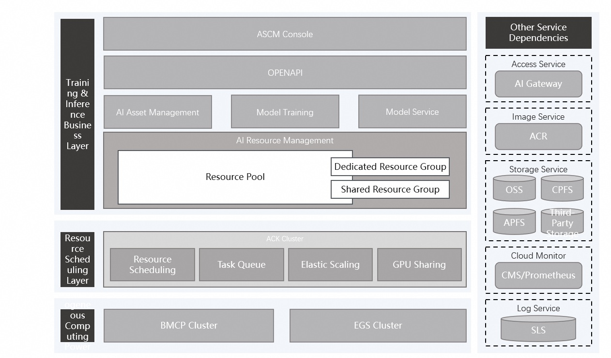
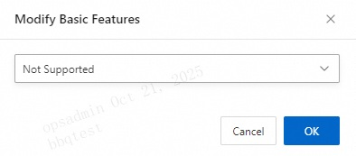
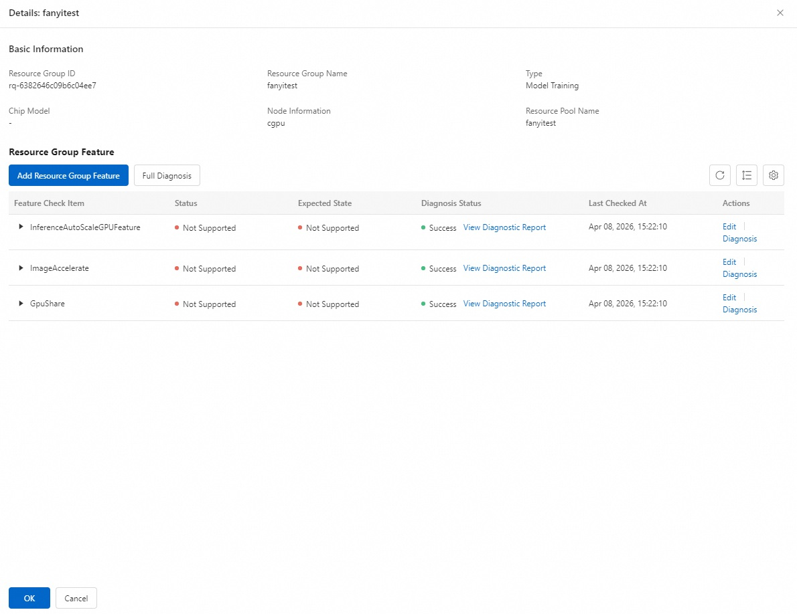
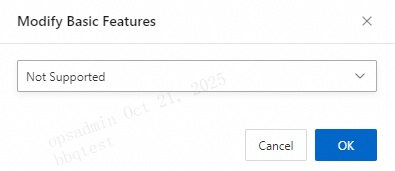
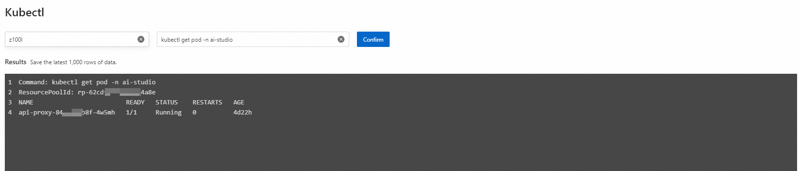
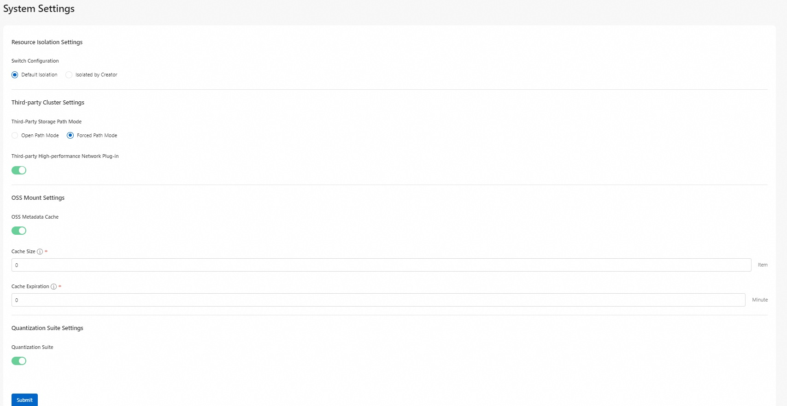
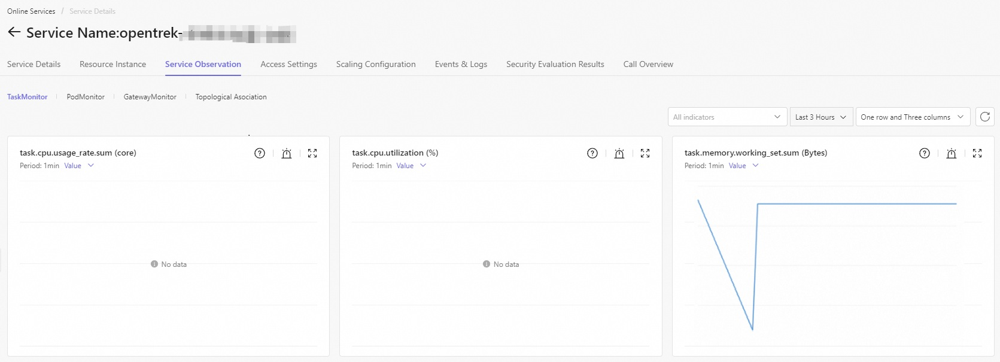

Alibaba Cloud  
Apsara Stack  
OpenTrek  
OpenTrek AI Studio  
Operations and Maintenance  
Guide  
Product Version: v3.18.6-2607  
Document Version: 20260901

**Table of Contents**

- [1.Overview](#section-1)
- [2.Software architecture](#section-2)
- [3.Log overview](#section-3)
- [4.AI Studio OPS platform](#section-4)
    - [4.1. Log on to AI Studio OPS](#section-4-1)
    - [4.2. Check Resource Availability](#section-4-2)
        - [4.2.1. Check resource pool availability](#section-4-2-1)
        - [4.2.2. Check resource group availability](#section-4-2-2)
    - [4.3. Toolbox](#section-4-3)
        - [4.3.1. Kubectl](#section-4-3-1)
        - [4.3.2. Enter chip models](#section-4-3-2)
        - [4.3.3. Edit features](#section-4-3-3)
        - [4.3.4. Import assets](#section-4-3-4)
    - [4.4. System settings](#section-4-4)
- [5.Metric details](#section-5)
    - [5.1. Monitoring metrics](#section-5-1)
        - [5.1.1. Task monitoring metrics](#section-5-1-1)
        - [5.1.2. Pod monitoring metrics](#section-5-1-2)
        - [5.1.3. Gateway monitoring metrics](#section-5-1-3)

<a id="section-1"></a>

# 1.Overview

This topic describes the purpose, requirements, and precautions for AI Studio operations and maintenance (O&M). It also explains how to get help.

**Purpose**

This manual guides maintenance personnel in performing preventive maintenance on AI Studio and handling system issues to ensure the long-term stability of the system. If a system issue cannot be resolved using this manual, contact Alibaba Cloud technical support.

**Requirements**

- Maintenance personnel must have IT skills, such as knowledge of computer networks, computer operations, and problem analysis and troubleshooting.

- Maintenance personnel must complete pre-job training on the Alibaba Cloud system to obtain essential knowledge about the system. This training includes system principles, networking, feature usage, and the use of maintenance tools.

> **Important**
>
> During maintenance, follow the operating procedures to ensure personal and system safety. User data must be kept strictly confidential. Do not copy or distribute user data without written permission from the user.

**Precautions**

Follow these guidelines to ensure system stability and prevent accidents:

- Layered and permission-based management:

  Implement layered and permission-based management for networks, devices, systems, and data. Maintenance personnel for specific services are granted only the permissions required to complete tasks for their roles. This prevents system failures caused by unauthorized operations.

- System security:

  - Before performing any operation on the system, clearly understand its potential outcomes to avoid high-risk operations that could affect system performance.

  - Clearly record any issues encountered during operations to assist with troubleshooting and fault handling.

- Personal and data security:

  - When operating electrical equipment, take the safety precautions required for the device.

  - Use secure devices to access the service network.

  - Do not copy or distribute data without authorization.

**Getting help**

For assistance during system maintenance, contact Alibaba Cloud Technical Support.

<a id="section-2"></a>

# 2.Software architecture

This topic describes the system architecture of AI Studio, its core feature modules, and service dependencies.

The following figure shows the system architecture of AI Studio, which consists of three layers and storage-related service dependencies.

**System architecture**



**AI management layer**

- The Apsara Uni-manager Management Console provides an access endpoint. The console calls the AI Studio OpenAPI that connects to the POP gateway. Users can also directly call the OpenAPI.

- AI Studio integrates with the Enterprise Edition access authentication system, including AccessKey pair verification, and RAM role and permission verification.

- The AI asset management module manages images, models, code, and data accelerators, and provides features such as importing, editing, and deleting.

- The AI resource management module calls Bare Metal Computing Platform (BMCP) to obtain container clusters and incorporates the clusters into the AI Management Platform as resource pools. Resource groups provide resource allocation capabilities for users, enabling the configuration management of resource consumption for training and inference tasks, thereby improving resource utilization efficiency.

- The data management module supports management operations such as creating, editing, and deleting datasets. Datasets support two types of storage sources: Cloud Parallel File Storage (CPFS) and Object Storage Service (OSS).

- The model management module focuses on model operations, including model library management, model training, and model inference.

**Resource scheduling layer**

- The resource scheduling layer relies on the Alibaba Cloud Container Service for Kubernetes (ACK) service to provide AI task scheduling and task queue capabilities for the AI Management Platform. The layer also manages GPU bare metal nodes.

- The ACK service in the resource scheduling layer provides the OpenAPI for the AI Management Platform and BMCP to call. After obtaining authorization, the AI Management Platform calls the API server in the ACK cluster to dispatch tasks, query statuses, and create resources such as pods, jobs, and ingresses.

- The resource scheduling layer provides log collection. This feature requires authorization to use the Simple Log Service (SLS) of the tenant.

**Heterogeneous computing power layer**

- The heterogeneous computing power layer centrally manages various heterogeneous bare metal clusters. AI Studio uses bare metal container clusters provided by BMCP.

- The system isolates container clusters between different tenants.

- BMCP provides the OpenAPI for the AI management layer to call, enabling operations such as information query and tagging.

**External product dependencies**

<table>
  <tr>
    <td>Dependent product</td>
    <td>Scenario</td>
  </tr>
  <tr>
    <td>BMCP</td>
    <td>BMCP provides bare metal management, ACK cluster management, and CPFS-related association query APIs.</td>
  </tr>
  <tr>
    <td>ACK</td>
    <td>ACK provides container cluster services.</td>
  </tr>
  <tr>
    <td>ACR</td>
    <td>ACR provides image services and stores custom images and public images.</td>
  </tr>
  <tr>
    <td>SLS</td>
    <td>SLS stores logs for running pods.</td>
  </tr>
  <tr>
    <td>OSS</td>
    <td>OSS stores data such as datasets and models.</td>
  </tr>
  <tr>
    <td>CPFS</td>
    <td>CPFS stores datasets.</td>
  </tr>
  <tr>
    <td>RAM</td>
    <td>RAM provides authentication services.</td>
  </tr>
  <tr>
    <td>POP</td>
    <td>POP provides unified OpenAPI gateway access.</td>
  </tr>
  <tr>
    <td>Apsara Uni-manager Management Console</td>
    <td>The Apsara Uni-manager Management Console provides a unified console.</td>
  </tr>
  <tr>
    <td>MiniRDS</td>
    <td>MiniRDS stores metadata.</td>
  </tr>
</table>

<a id="section-3"></a>

# 3.Log overview

AI Studio consists of multiple service components. The logs for each component are described in the following table.

<table>
  <tr>
    <th>Product</th>
    <th>Feature</th>
    <th>Module</th>
    <th>Description</th>
  </tr>
  <tr>
    <td rowspan="4">AI Studio</td>
    <td rowspan="4">platform</td>
    <td>dataset-hub</td>
    <td>Data Management module<br>• Manages datasets<br>• Collects access and error logs for datasets</td>
  </tr>
  <tr>
    <td>model-center</td>
    <td>Model Service module<br>• Manages models and builds tasks<br>• Collects access and error logs for the model registry, and logs related to task submission</td>
  </tr>
  <tr>
    <td>resource-asset</td>
    <td>AI resource asset management module<br>• Manages resource pools, resource quotas, runtime images, and code builds<br>• Collects access and error logs for resource pools, resource quotas, image registries, and code builds</td>
  </tr>
  <tr>
    <td>gateway</td>
    <td>Gateway module<br>• Handles interactions between the AI Studio platform and clusters<br>• Collects access and error logs for the Gateway, and logs for task status changes</td>
  </tr>
</table>

<a id="section-4"></a>

# 4.AI Studio OPS platform

<a id="section-4-1"></a>

## 4.1. Log on to AI Studio OPS

This topic describes how to log on to AI Studio OPS from the Apsara Uni-manager Operations Console.

**Prerequisites**

- The endpoint of the Apsara Uni-manager Operations Console and the username and password that are used to log in to the console are obtained from a deployment engineer or an administrator.

  The endpoint of the Apsara Uni-manager Operations Console is in the following format: *regi on-id*.ops.console.*intranet-domain-id*.

- A supported browser is used. We recommend that you use Google Chrome.

**Procedure**

1. Log on to Apsara Uni-manager Operations Console.

   <ol type="i">

   <li>

   Open your browser.

   </li>

   <li>

   In the address bar, enter the endpoint of the Apsara Uni-manager Operations Console.

   </li>

   </ol>

   Press the ENTER key.

   

   > **Note**
   >
   > You can click the current language in the upper-right corner to switch to another language. Simplified Chinese and English are supported.

   <ol type="i" start="3">

   <li>

   Enter your username and password.

   </li>

   </ol>

   > **Note**
   >
   > - Obtain the username and password that are used to log on to the Apsara Uni-manager Operations Console from a deployment engineer or an administrator.
   >
   > - If you enter an invalid password for three consecutive times, the system enables the image verification logon feature. If you enter an invalid password for five consecutive times, the account is locked. Contact the administrator to unlock the account.
   >
   > - The first time that you log on to the Apsara Uni-manager Operations Console, change the password for your username as prompted.
   >
   >   To enhance security, your password must meet the following requirements:
   >
   >   - The password contains uppercase and lowercase letters.
   >
   >   - The password contains digits.
   >
   >   - The password contains at least one of the following special characters: ! @ # $ %
   >
   >   - The password is 10 to 20 characters in length.

   <ol type="i" start="4">

   <li>

   Click **Agree to Private Policy and Log On**.

   </li>

   </ol>

2. In the top menu bar, choose **Product O&M > AI & Machine Learning > AI Studio OPS**.

<a id="section-4-2"></a>

## 4.2. Check Resource Availability

<a id="section-4-2-1"></a>

### 4.2.1. Check resource pool availability

This topic describes how to check the availability of an AI resource pool and add features.

**Procedure**

1. Log in to the AI Studio OPS console. For more information, see Log on to AI Studio OPS.

2. In the left-side navigation pane, select **Resource Availability Check > Resource Pool**.

   The page displays the health status and the last check time of all resource pools.

3. Click **Details** in the **Actions** column for the target resouce pool.

4. View the basic information and features of the resource pool.

5. Click **Add Resource Pool Feature**, select a feature, and then click **OK**.

6. Click **Modify** in the **Actions** column of a feature check item.

7. Select a basic feature status and click **OK**.

   

**Diagnose features**

You can perform the following operations on the details page.

| Task name | Procedure |
| --- | --- |
| Diagnose feature check items | • Full diagnosis<br>i. Click <strong>Full Diagnosis</strong>.<br>ii. In the pop-up dialog box, click <strong>OK</strong>.<br>iii. After the diagnosis is complete, you can view the diagnosis status and the diagnostic report for all check items.<br>iv. Click <strong>View Diagnostic Report</strong> to download the diagnostic report to your local computer.<br>• Single diagnosis<br>i. Click <strong>Feature Diagnosis</strong> in the <strong>Actions</strong> column.<br>ii. In the pop-up dialog box, click <strong>OK</strong>.<br>iii. After the diagnosis is complete, you can view the diagnosis status and the diagnostic report for each check item.<br>iv. Click <strong>View Diagnostic Report</strong> to download the diagnostic report to your local computer. |

<a id="section-4-2-2"></a>

### 4.2.2. Check resource group availability

This topic describes how to check the availability of a resource group and add features.

**Procedure**

1. Log in to the AI Studio OPS console. For more information, see Log on to AI Studio OPS.

2. In the left-side navigation pane, select **Resource Availability Check > Resource Group**.

   The page displays the health status and last check time of all resource groups.

3. Click **Details** in the **Actions** column for the target resource group.

4. View the basic information and features of the resource group.

   

5. Click **Add Resource Group Feature**, select a feature, and then click **OK**.

6. Click **Modify** in the **Actions** column of a feature check item.

7. Select a basic feature status and click **OK**.

   

**Related operations**

You can perform the following operations on the details page.

| Task name | Procedure |
| --- | --- |
| Diagnose feature check items | • Full diagnosis<br>i. Click <strong>Full Diagnosis</strong>.<br>ii. In the pop-up dialog box, click <strong>OK</strong>.<br>iii. After the diagnosis completes, you can view the diagnosis status and the diagnostic report for all detection items.<br>iv. Click <strong>View Diagnostic Report</strong> to download the diagnostic report to your local computer.<br>• Single diagnosis<br>i. Click <strong>Diagnosis</strong> in the <strong>Actions</strong> column.<br>ii. In the pop-up dialog box, click <strong>OK</strong>.<br>iii. After the diagnosis completes, you can view the diagnosis status and the diagnostic report for each detection item.<br>iv. Click <strong>View Diagnostic Report</strong> to download the diagnostic report to your local computer. |
| Modify features | 1. Click <strong>Modify</strong> in the <strong>Actions</strong> column.<br>2. Reselect a basic status feature.<br>3. Click <strong>OK</strong>. |

<a id="section-4-3"></a>

## 4.3. Toolbox

<a id="section-4-3-1"></a>

### 4.3.1. Kubectl

This section describes how to query pods in a resource pool using commands.

**Procedure**

1. You can log on to the AI Studio OPS console. For more information, see Log on to AI Studio OPS.

2. In the left navigation pane, choose **Toolbox > Kubectl**.

3. Select a resource pool, and then enter a query command in the input box.

   Supported commands are get and describe.

   

4. Click **Confirm**.

<a id="section-4-3-2"></a>

### 4.3.2. Enter chip models

This topic describes how to manually enter chip models.

> **Important**
>
> The system presets supported chip models. You can use this feature to manually enter specific chip models.

**Procedure**

1. Log in to the AI Studio OPS console. For more information, see Log on to AI Studio OPS.

2. In the left-side navigation pane, select **Tools Box > Chip Model**.

   The page displays all chip models in the system.

3. Click **Add Chip Model**.

   **Configuration**

   **Parameter**

   **Description**

   **item**

   **GPU Manufacturer**

   The English name of the GPU manufacturer. Example:

   **(English)**

   alibaba.

   **GPU Manufacturer**

   The English name of the GPU manufacturer. Example:

   **(Chinese)**

   Alibaba.

   The type of the GPU chip. Valid values:

   - BMCP_GPU

   **GPU Type**

   - EGS_GPU

   - AI Stack GPU

   **Chip Model**

   The model of the chip. Example: 810e.

   **Chip Alias**

   The alias of the chip. Example: AI Stack.

   **Add Chip**

   **GPU Architecture**

   The architecture of the GPU chip. Example: X86.

   **GPU Memory (GB)**

   The memory size of the GPU.

   Select a resource name to which the chip belongs from

   **Resource Name**

   the drop-down list.

   <table>
     <tr>
       <td rowspan="3">Feature Configuration<br>Note<br>Click <strong>Add</strong> <strong>Entry</strong> to configure features for the added chip.</td>
       <td>Cluster Type</td>
       <td>Select a cluster type to which the feature belongs from the drop-down list.</td>
     </tr>
     <tr>
       <td>Resource Pool Feature Configuration</td>
       <td>• Configure the features of the resource pool as enable, unsupported, or disable.<br>• Move the pointer over the iconnext to the<br>feature to view the feature description.</td>
     </tr>
     <tr>
       <td>Resource Group Feature Configuration</td>
       <td>• Configure features of the resource group as enable, unsupported, or disable.<br>• Move the pointer over the iconnext to the<br>feature to view the feature description.</td>
     </tr>
   </table>

4. Click **OK**.

   After you add the chip model, the system synchronizes it to the AI Studio management console. You can select this chip model when creating a resource pool.

**Related operations**

After entering a chip model, you can perform the following operations.

> **Note**
>
> You cannot delete preset chip models.

| Operation | Procedure |
| --- | --- |
| Add a feature | Click <strong>Add Feature</strong> in the <strong>Actions</strong> column. Configure the feature by following the feature configuration steps in the preceding procedure. |
| Edit a chip model | 1. Click <strong>Modify</strong> in the <strong>Actions</strong> column.<br>2. Modify the English and Chinese names of the chip manufacturer, and then click <strong>OK</strong>. |
| Delete a chip model | 1. Click <strong>Remove</strong> in the <strong>Actions</strong> column.<br>2. In the pop-up dialog box, click <strong>OK</strong>. |

<a id="section-4-3-3"></a>

### 4.3.3. Edit features

This topic describes how to edit manually entered features.

**Prerequisites**

You have entered the required chip models and added features in advance. For more information, see Enter chip models.

**Procedure**

1. Log in to the AI Studio OPS console. For more information, see Log on to AI Studio OPS.

2. In the left-side navigation pane, select **Toolbox > Feature**.

3. In the feature list, search for the chip type and cluster type that match the feature you want to enter.

4. Click **View** in the **Feature Configurations** column of the target feature to view the feature configuration information.

**Related operations**

After entering a feature, you can also perform the following operations.

> **Note**
>
> You cannot delete preset features.

| Task name | Procedure |
| --- | --- |
| Edit a feature | 1. Click <strong>Modify</strong> in the <strong>Actions</strong> column.<br>2. Modify the step information and the feature target status.<br>3. Click <strong>OK</strong>. |
| Delete a feature | 1. Click <strong>Remove</strong> in the <strong>Actions</strong> column.<br>2. In the pop-up dialog box, click <strong>OK</strong>. |

<a id="section-4-3-4"></a>

### 4.3.4. Import assets

This topic describes how to import assets on the interface.

**Prerequisites**

- Obtain the asset package of the correct version from CICD in advance.

  > **Note**
  >
  > If you purchase the training suite feature, make sure that the asset package contains the AI Studio suite material package (1uk52sgekurv41v5qc2tv1g29s).

- Make sure that the AI PaaS product deployment succeeds.

- Obtain the correct asset import tool from technical support in advance.

  - ai-resource-sync-linux-amd64: the import tool for the AMD environment

  - ai-resource-sync-linux-arm64: the import tool for the ARM environment

- Obtain the ossconfig configuration method in advance.

**Procedure**

> **Note**
>
> This procedure takes /apsarapangu/disk9/aistudio_resource_2026_04_xx as the package path example. Replace it with the actual path in your environment.

1. Make sure that the folder path of the asset package is empty. Check whether all packages exist in the path.

   ```bash
   cd /apsarapangu/disk9/aistudio_resource_2026_04_xx
   ls
   ```

2. Verify the asset import tool. The following example uses the AMD environment.

   ```bash
   # Determine whether the environment is AMD or ARM, and select the corresponding execution tool. The following example uses the AMD environment.
   cd ai-resource-sync-linux-amd64
   # Grant executable permissions.
   sudo chmod +x ai-resource-sync-linux-amd64
   ```

3. Configure **ossconfig** based on the ossconfig configuration plan.

4. Run the following command to upload assets. The upload process takes approximately 10 hours. Wait for the process to complete.

   ```bash
   sudo ai-resource-sync-linux-amd64 --path  
   /apsarapangu/disk9/aistudio_resource_2026_04_xx --region cn-wulan-env17e-d01 --oss-config /etc/.ossconfig_aistudio --type ApsaraCloud
   ```

   > **Note**
   >
   > The parameters are as follows:
   >
   > - --path: The path of the exported package. If multiple packages exist, specify a unified path, such as "/apsarapangu/disk9/aistudio_resource_2026_04_xx". If you upload the assets of a specific package, specify the exact path, such as "/apsarapangu/disk9/aistudio_resource/2bj6uvkfohoob2rl9js88phjem".
   >
   > - --region: The region ID of the site.
   >
   > - --oss-config: The path of the ossconfig file, which is the path of ossconfig that you configured in the previous step. After the command starts to run, confirm the asset upload path again and enter y to start the execution.
   >
   > - --type: ApsaraCloud

5. Log in to the AI Studio OPS console. For more information, see Log on to AI Studio OPS.

6. In the left-side navigation pane, select **Toolbox > Asset Import**.

7. Click **Initiate Upload Task**.

8. Enter the task description and click **OK**.

<a id="section-4-4"></a>

## 4.4. System settings

The system isolates the AI Studio training and inference task list by creator and allows you to configure the switch.

**Procedure**

1. Log in to the AI Studio OPS console. For more information, see Log on to AI Studio OPS.

2. In the left-side navigation pane, click **System Settings**.

3. Configure isolation, third-party cluster OSS mounts, or quantization suites.

   

   - **Resource Isolation Settings:**

     - Default Isolation: the default isolation method. The system isolates resources by organization, resource set, and region.

     - Isolated by Creator: The system isolates resources by the logged-in user. The isolation scope includes the notebook, visual modeling, task modeling, and offline inference modules.

   - **Third-party Cluster Settings**:

     - Third-Party Storage Path Mode: By default, the system uses the open path mode. In this mode, the storage object path is optional. If you select the forced path mode, the system strictly verifies the storage object path. Therefore, the storage object path is required.

       > **Note**
       >
       > The involved feature modules include task modeling, notebook modeling, online services, and batch inference.

     - Third-party High-performance Network Plug-in: This plugin is disabled by default. After enabling it, you must also enable the third-party high-performance network feature for the AI resource pool to support the third-party high-performance network capability for distributed training and inference tasks.

   - **OSS Mount Settings**:

     | Parameter | Description |
     | --- | --- |
     | OSS Metadata Cache | Enabling the metadata cache significantly reduces the number of remote requests that training and inference tasks send to Object Storage Service (OSS) through the OSS file system. This greatly reduces the latency of file list and attribute queries and improves overall access performance. |
     | Cache Size | Unit: items. Configure this parameter based on the number of frequently accessed objects in OSS. If this value is too small, performance improvement may be insignificant. If you set this parameter to 0, the system disables the metadata cache. |
     | Cache Expiration | Unit: minutes. If you set this parameter to -1, the system disables the cache expiration eviction policy. We recommend that you keep the eviction policy enabled unless the data remains unchanged after data mounting. |

   - **Quantization Suite Settings**:

     After you turn on the quantization suite switch, the system displays quantization suites in the public suite, model and suite association, and model quantization modules.

4. Click **Submit**.

<a id="section-5"></a>

# 5.Metric details

<a id="section-5-1"></a>

## 5.1. Monitoring metrics

This topic describes the monitoring metrics for various resources, how to view them, and their descriptions.

<a id="section-5-1-1"></a>

### 5.1.1. Task monitoring metrics

This section describes task monitoring metrics, including how to view them and their descriptions.

> **Note**
>
> The system collects metrics every 60 seconds. When a resource type supports multiple container groups, the metrics support both the task and container group dimensions.

**Procedure**

1. Log on to the AI Studio console.

2. In the top menu bar, select an organization, a resource set, and a region.

3. In the left-side navigation pane, click **Model Service** > **Online Services**.

4. On the **Online Services** page, click **Details** for the target service.

5. On the details page, click the **Service Observation** tab.

6. On the **Task Monitoring** tab, you can view task-related metrics.

   - You can view metrics for the last 1 hour, 3 hours, 6 hours, 12 hours, 1 day, 3 days, 7 days, 14 days, or a custom time range.

   - Click the icon in the upper-right corner to display one, two, or three metric cards per row.

   

   | Metric name | Description | Unit |
   | --- | --- | --- |
   | Task CPU usage | The number of instructions that the CPU of the task processes or the time that the CPU spends within a given period. | core |
   | Task CPU utilization | The ratio of the actual CPU usage time to the total available time for the task. | % |
   | Task working memory usage | The amount of memory that the task actually uses to store active data. | Bytes |
   | Task memory utilization | The ratio of the used memory to the total available memory for the task. | % |
   | Task network receive rate | The amount of data that the task receives from the network per unit of time. | B/s |
   | Task network transmit rate | The amount of data that the task sends over the network per unit of time. | B/s |
   | Task GPU utilization | The percentage of time that the GPU of the task spends processing workloads within a given period. | % |
   | Task GPU memory usage | The amount of dedicated GPU memory that the task currently occupies. | MiB |
   | Task GPU memory utilization | The percentage of used GPU memory relative to the total GPU memory for the task. | % |
   | Task DCU accelerator utilization | The percentage of time that the DCU accelerator of the task spends processing workloads within a given period. | % |
   | Task DCU accelerator memory usage | The amount of dedicated memory that the DCU accelerator of the task currently occupies. | MiB |
   | Task DCU accelerator memory utilization | The percentage of used DCU accelerator memory relative to the total DCU accelerator memory for the task. | % |
   | Task NPU accelerator utilization | The percentage of time that the NPU accelerator of the task spends processing workloads within a given period. | % |
   | Task NPU accelerator memory usage | The amount of dedicated memory that the NPU accelerator of the task currently occupies. | MiB |
   | Task NPU accelerator memory utilization | The percentage of used NPU accelerator memory relative to the total NPU accelerator memory for the task. | % |
   | KV cache utilization | The percentage of used KV cache capacity relative to the total available capacity in the inference service. The KV cache is a GPU memory area that stores key-value attention caches during LLM inference.Its utilization directly reflects the GPU memory pressure and concurrent processing capability of the current service. | % |
   | Task queue length | The number of inference requests that are waiting for scheduling. The service has received these requests but has not yet added them to an inference batch for computation. | Requests |

<a id="section-5-1-2"></a>

### 5.1.2. Pod monitoring metrics

This topic describes the pod monitoring metrics, explains how to view them, and provides a description of each metric.

> **Note**
>
> Metrics are collected every 60 seconds. If a resource type supports multiple pods, metrics are available at both the task and pod dimensions.

**Procedure**

1. Log on to the AI Studio console.

2. In the top menu bar, select an organization, resource set, and region.

3. In the navigation pane on the left, click **Model Service** > **Online Services**.

4. On the **Online Services** page, click **Details** for the desired service.

5. On the details page, click the **Service Observation** tab.

6. On the **Pod Monitoring** tab, view the pod metrics.

   - You can view metrics for a time range of 1 hour, 3 hours, 6 hours, 12 hours, 1 day, 3 days, 7 days, 14 days, or a custom period.

   - In the upper-right corner, select the number of metric cards to display per row: one, two, or three.

   | Metric name | Description | Unit |
   | --- | --- | --- |
   | Pod CPU usage | The amount of time the pod's CPU spends processing instructions over a period. | core |
   | Pod CPU utilization | The ratio of the pod's actual CPU usage time to the total available CPU time. | % |
   | Pod working memory usage | The amount of memory the pod uses to store active data. | Bytes |
   | Pod memory utilization | The ratio of the pod's used memory to its total available memory. | % |
   | Pod network receive rate | The amount of data the pod receives from the network per second. | B/s |
   | Pod network send rate | The amount of data the pod sends over the network per second. | B/s |
   | Pod GPU utilization | The percentage of time that the pod's GPU is busy processing tasks. | % |
   | Pod GPU memory usage | The amount of dedicated GPU memory that the pod currently uses. | MiB |
   | Pod GPU memory utilization | The percentage of used GPU memory compared to the total available GPU memory for the pod. | % |
   | Pod DCU accelerator utilization | The percentage of time that the pod's DCU accelerator is busy processing tasks. | % |
   | Pod DCU accelerator memory usage | The amount of dedicated DCU accelerator memory that the pod currently uses. | MiB |
   | Pod DCU accelerator memory utilization | The percentage of used DCU accelerator memory compared to the total available DCU accelerator memory for the pod. | % |
   | Pod NPU accelerator utilization | The percentage of time that the pod's NPU accelerator is busy processing tasks. | % |
   | Pod NPU accelerator memory usage | The amount of dedicated NPU accelerator memory that the pod currently uses. | MiB |
   | Pod NPU accelerator memory utilization | The percentage of used NPU accelerator memory compared to the total available NPU accelerator memory for the pod. | % |

<a id="section-5-1-3"></a>

### 5.1.3. Gateway monitoring metrics

This topic describes the metrics for gateway monitoring. It also explains how to view these metrics and what they represent.

**Procedure**

1. Log on to the AI Studio console.

2. In the top menu bar, select an organization, resource set, and region.

3. In the navigation pane on the left, click **Model Service** > **Online Services**.

4. On the **Online Services** page, click **Details** for the desired service.

5. On the service details page, click the **Service Monitoring** tab.

6. On the **Gateway Monitoring** tab, you can view the gateway monitoring metrics.

   - You can view metrics for a time range of 1 hour, 3 hours, 6 hours, 12 hours, 1 day, 3 days, 7 days, 14 days, or a custom period. The data collection interval is 60 seconds.

   - In the upper-right corner of the page, you can choose to display one, two, or three metric cards per row.

   | Metric Name | Description | Unit |
   | --- | --- | --- |
   | Input tokens per second | The number of tokens received from the client per second. | Count/s |
   | Output tokens per second | The number of tokens sent to the client per second. | Count/s |
   | Response time | The time elapsed between the gateway receiving a request and sending a response. | ms |
   | QPS | Queries per second. | Count |
   | Request success rate | The ratio of successful requests to the total number of requests processed by the AI gateway. | % |
