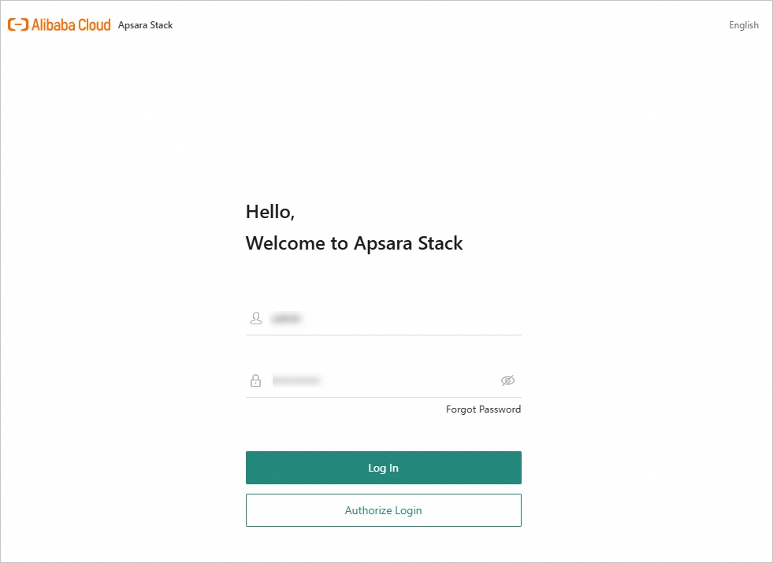
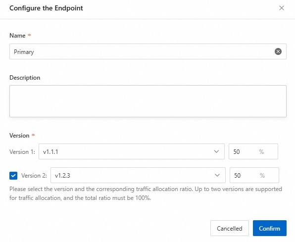
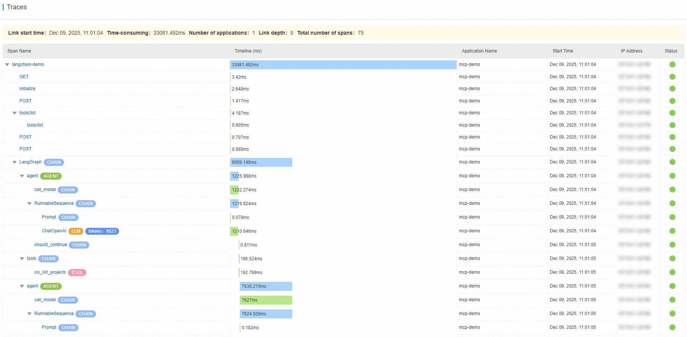
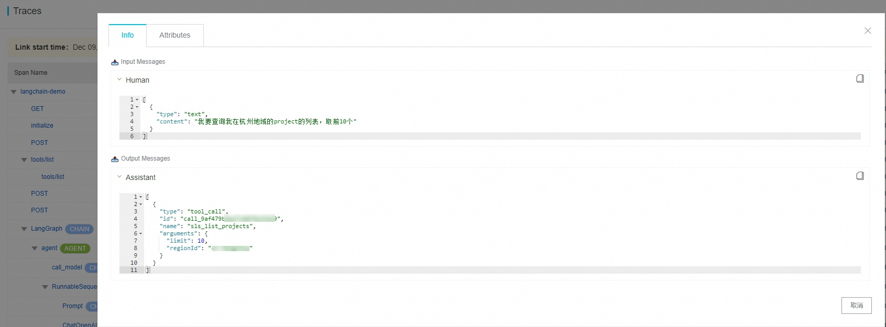
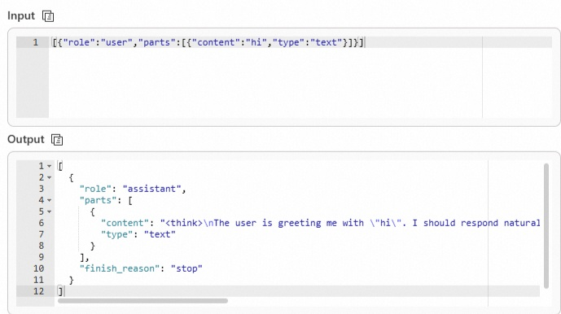
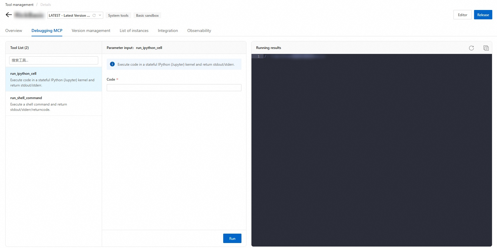
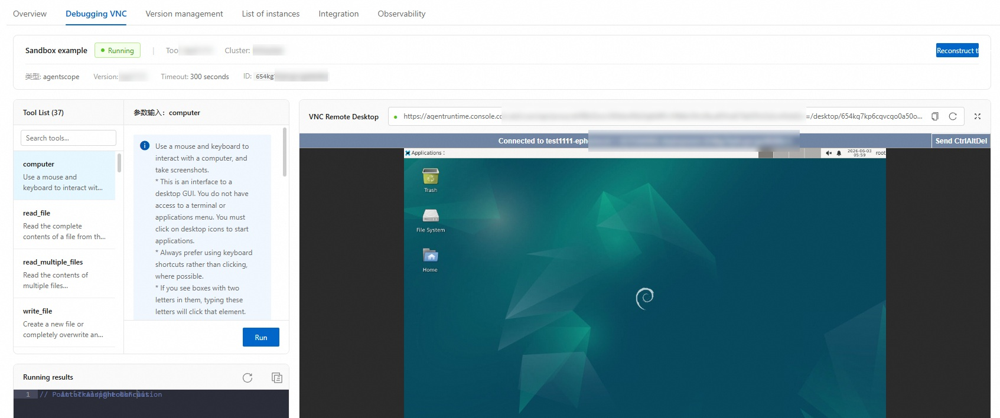
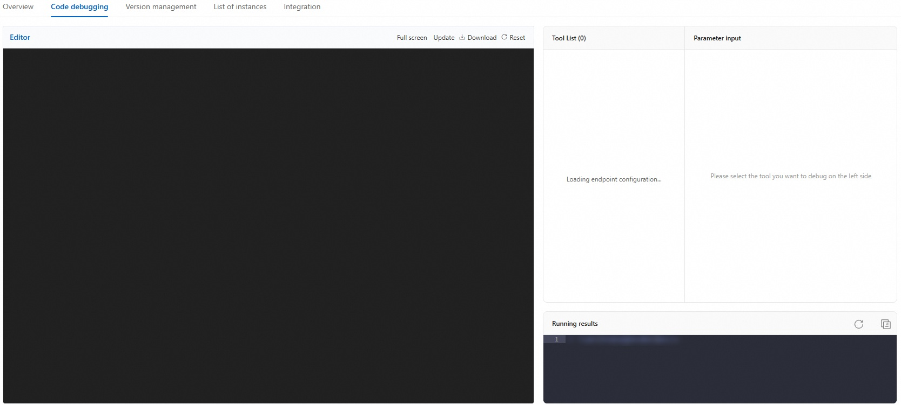

Alibaba Cloud  
Apsara Stack  
OpenTrek  
AgentRuntime User Guide  
Product Version: v3.18.6-2607  
Document Version: 20260828

**Table of Contents**

- [1.What is AgentRuntime?](#section-1)
- [2.Getting started](#section-2)
    - [2.1. Log in to the AgentRuntime console](#section-2-1)
- [3.Agent management](#section-3)
    - [3.1. Quickly create an agent](#section-3-1)
    - [3.2. Create an agent via code](#section-3-2)
    - [3.3. More operations](#section-3-3)
- [4.Tool management](#section-4)
    - [4.1. Create a system tool](#section-4-1)
    - [4.2. Create a custom tool](#section-4-2)
    - [4.3. More operations](#section-4-3)
- [5.Resource management](#section-5)
    - [5.1. Cluster management](#section-5-1)
    - [5.2. Model management](#section-5-2)
    - [5.3. Credential management](#section-5-3)
    - [5.4. Image Source configuration management](#section-5-4)

# 1.What is AgentRuntime?

**AgentRuntime Platform** is a Platform-as-a-Service (PaaS) platform designed for enterprise-grade AI Agent applications and deployed within your private cloud environment. The platform addresses core challenges across the entire lifecycle of Agents in production environments, from code debugging and deployment to O&M. It provides unified **Agent runtime management, tool (Tool/MCP) lifecycle management, fine-grained elastic scheduling of underlying heterogeneous computing resources, and multi-level security isolation**.

**Runtime management**

| Feature | Description |
| --- | --- |
| Unified execution environment | The system provides a standardized execution environment to support the operation of various Agent applications. |
| Full lifecycle management | The system supports the debugging, deployment, monitoring, and upgrading of Agent applications. |
| Python/Node.js/Java runtime | The system supports Python, Node.js, and Java runtimes. |

**Sandbox capabilities**

| Feature | Description |
| --- | --- |
| Code Interpreter | The system provides a secure, isolated environment that supports the execution of dynamically generated code, file I/O, and session management. |
| Browser Use | The system supports automated browser operations such as web browsing, data scraping, and form filling. |
| All-in-One sandbox | The system integrates capabilities such as code execution, browser interaction, and file system access into a single sandbox instance. |
| File system | The system provides an isolated, read/write virtual file system for the sandbox. It supports creating, reading, modifying, and deleting files. |
| Operation capability (Computer/Mobile Use) | The system supports simulation of graphical user interface (GUI) operations on desktop or mobile devices. |

**Elastic scheduling**

| Feature | Description |
| --- | --- |
| Second-level cold start and on-demand scaling | The system supports scaling Agent instances down to zero. It starts an instance when a request arrives. |
| Sleep and resume (coming soon) | Before scaling down an instance, the system takes a snapshot of its runtime state (such as memory and session information) and persists it.The system loads the snapshot when resuming the instance. |
| Session affinity assurance | The system routes consecutive requests from the same user to the same Agent or tool instance. |
| Exclusive session assurance | For Agents or tools in exclusive mode, the system assigns a different running instance for each session. |
| High-concurrency elastic scale-out | The system automatically increases the number of instances based on predefined policies. |
| Business-aware scheduling API | The system provides an API that allows business code to actively request or release computing resources. |

**Security isolation**

| Feature | Description |
| --- | --- |
| Multi-level security isolation | The system supports request-level, instance-level, and session-level isolation. |
| Multi-tenant isolation assurance | The system provides tenant isolation mechanisms from the network, computing, and storage dimensions. |
| Exclusive session isolation assurance | For Agents or tools in exclusive mode, each session exclusively occupies one instance, achieving natural isolation at the session level. |
| Physical/cluster isolation | The system supports deploying Agents with different security levels or belonging to different business units in completely independent physical clusters, achieving the highest level of security isolation. |
| Node isolation | Through scheduling policies, the system confines high-risk Agents to a dedicated "sandbox node pool", ensuring physical isolation from other regular workloads at the compute node level. |
| Kernel-level isolation (strong sandbox) (coming soon) | The platform seamlessly integrates strong security sandbox capabilities such as runD provided by ACK. For high-risk tasks like executing untrusted code, the system runs them within an independent kernel based on hardware virtualization. This effectively prevents container escape by malicious code and protects the security of the host machine and other applications. |
| TLS 1.2+ transmission encryption | The system encrypts all network communications using TLS version 1.2 or higher. |
| Storage isolation and mount | The system supports securely mounting external storage (such as Object Storage Service or local disks) to the sandbox. |

**Observability**

| Feature | Description |
| --- | --- |
| End-to-end trace | The system traces calls from frontend requests, gateways, agents, models, tools, to external dependencies. |
| AI application monitoring (requires integration with AI observability products) | The system supports monitoring via Prometheus or ARMS, analyzing model performance, token consumption, and GPU usage. |
| Log and evaluation | The system centrally stores logs and supports retrieval and SQL analysis. It also evaluates model call logs for quality, security, and intent. |

**Tool and model management**

| Feature | Description |
| --- | --- |
| MCP | The system supports the Model Context Protocol (MCP) mode. |
| Tool governance and version management | The system manages the lifecycle, version control, and permission governance of tools. |
| Integration with mainstream models | The system integrates mainstream large language models such as Qwen and DeepSeek. |
| Load balancing and degradation across multiple models | The integrated AI Gateway distributes requests among multiple model instances. The system fails over to a backup model if the primary model fails. |
| Content security and token throttling | The integrated AI Gateway reviews the input and output of models for content security. The system limits token consumption based on policies. |
| Unified tool definition and invocation | The system provides standardized protocols for defining, registering, versioning, and invoking tools. |

**Credential management**

| Feature | Description |
| --- | --- |
| Support multiple credential types | The system supports the API Key credential type. |
| Inject credentials dynamically | The system integrates with the AgentRuntime to inject credentials securely at runtime. |
| Enable or disable control | The system allows you to enable or disable credentials with one click. |

# 2.Getting started

## 2.1. Log in to the AgentRuntime console

This topic describes how to log in to the AgentRuntime console.

**Prerequisites**

- Before you log in to the Apsara Uni-Manager Management Console, confirm that you have obtained the its service domain URL from the deployment personnel.

- We recommend that you use the Chrome browser.

**Procedure**

1. In the address bar of your browser, enter the service domain URL of the Apsara Uni-Manager Management Console and press Enter.

   

   > **Note**
   >
   > - Click the current language in the upper-right corner of the page to switch to another language.
   >
   > - The Authorize Login option appears only if you have configured a global IdP in third-party authentication. You can customize the name of "Authorize Login" as needed.
   >
   > - If you encounter issues such as needing to click "Continue to Access" multiple times or not seeing the entry point for the Apsara Uni-Manager Management Console, due to an expired browser certificate or HTTPS authentication being enabled, you must install a certificate before accessing the console normally. Click **Browser Certificate Installation** in the upper-right corner of the page to open the browser certificate installation guide.

2. Enter the correct username and password.

   > **Note**
   >
   > - Contact the operations administrator to obtain the username and password for logging in to the console.
   >
   > - When logging in to the Apsara Uni-Manager Management Console for the first time, you must change your password as prompted. To enhance security, the password must be 10 to 32 characters long and contain uppercase letters, lowercase letters, numbers, and special symbols (such as exclamation mark (!), at sign (@), number sign (#), dollar sign ($), and percent sign (%)).

3. Click **Log In**.

4. If multi-factor authentication (MFA) is activated for your account, follow one of the procedures below:

   - **First login after MFA is forcibly enabled by an administrator**

     <ol type="a">

     <li>

     On the Bind Virtual MFA Device page, follow the on-screen instructions to bind your MFA device.

     </li>

     <li>

     Go back to Step 2, re-enter your username and password, and click **Log In**.

     </li>

     </ol>

     <ol type="i" start="100">

     <li>

     Enter the 6-digit MFA code and click **Authenticate**.

     </li>

     </ol>

   - **You have already enabled and bound MFA**

     Enter the 6-digit MFA code and click **Authenticate**.

     > **Note**
     >
     > For instructions on how to bind and enable MFA, see the **Manage multi-factor authentication** section in the *Apsara Uni-Manager Management Console User Guide*.

5. In the top navigation bar, select **Products > Middleware > Microservices Tools and Platforms > Agent Runtime Service** to go to the AgentRuntime console.

# 3.Agent management

## 3.1. Quickly create an agent

AgentRuntime is an all-in-one development and runtime platform for full lifecycle management of agents. If you are a first-time user or need to quickly validate an idea, we recommend that you choose this quick creation method. This allows you to configure your agent through a visual interface without writing any code, making it perfect for rapid prototyping.

**Create an agent**

1. Log in to the AgentRuntime console.

2. In the left-side navigation pane, click **Agent Management**.

3. On the **Agent List** page, click **Create an Agent**.

4. On the **Create an Agent** page, select **Quick creation**, fill in the following configuration items, and click **Start creating**.

   <table>
     <tr>
       <th>Configuration item</th>
       <th>Description</th>
       <th>Example value</th>
     </tr>
     <tr>
       <td colspan="3">Basic information</td>
     </tr>
     <tr>
       <td>Agent name</td>
       <td>The unique identifier within the cluster. It must comply with DNS format: only lowercase letters, numbers, and hyphens (-) are allowed, and it must start and end with letters or numbers. You cannot modify it after creation.</td>
       <td>my-chat-agent</td>
     </tr>
     <tr>
       <td>Display name</td>
       <td>The friendly name for display in the frontend. It supports Chinese characters and special symbols.</td>
       <td>AI customer service assistant</td>
     </tr>
     <tr>
       <td>Description</td>
       <td>Record the purpose, capabilities, or remarks of the Agent.</td>
       <td>A multi-turn conversational customer service agent powered by Qwen-Plus, with tool-calling support.</td>
     </tr>
     <tr>
       <td colspan="3">Resource configuration</td>
     </tr>
     <tr>
       <td>Cluster</td>
       <td>You can select a cluster only if available nodes exist in its computing pool. Select a cluster. If no clusters are available, see Connect to a cluster.</td>
       <td>None</td>
     </tr>
     <tr>
       <td>Namespace</td>
       <td>Select the namespace where the cluster resides.</td>
       <td>None</td>
     </tr>
     <tr>
       <td>CPU quota</td>
       <td>Select the CPU quota, that is, the upper limit (limits) of CPU for a single tool instance. The platform automatically sets requests to one-fourth of the limit value (for example, if the quota is 1 core, requests is set to 0.25 core). For browser-type tools, we recommend 1 core or more.</td>
       <td>1 core</td>
     </tr>
     <tr>
       <td>Memory quota</td>
       <td>The memory upper limit (limits) for a single Agent instance. The platform automatically sets requests to one-fourth of the limit value (for example, if the quota is 1 Gi, requests is set to 256 Mi).We recommend at least 512 Mi. For loading large model SDKs or processing large files, we recommend 1 Gi or more.</td>
       <td>1024 Mi</td>
     </tr>
     <tr>
       <td>Temporary storage space</td>
       <td>The upper limit (limits) of temporary disk space within the container. The platform automatically sets requests to one-fourth of the limit value.Data is lost after Pod is restarted. To persist data, enable OSS storage in advanced configuration.</td>
       <td>4 Gi</td>
     </tr>
     <tr>
       <td colspan="3">Model configuration</td>
     </tr>
     <tr>
       <td>Model service</td>
       <td>Select a model. If no models are available, see Model management.</td>
       <td>None</td>
     </tr>
     <tr>
       <td>System prompt words</td>
       <td>Enter the system prompt to guide the model output.</td>
       <td>None</td>
     </tr>
     <tr>
       <td colspan="3">Tool configuration</td>
     </tr>
     <tr>
       <td>Select tools</td>
       <td>Select tools. If no tools are available, see Create a system tool or Create a custom tool.</td>
       <td>None</td>
     </tr>
     <tr>
       <td colspan="3">Access configuration</td>
     </tr>
     <tr>
       <td>Access credentials</td>
       <td>Select an access credential. If no credentials are available, see Create a credential.</td>
       <td>None</td>
     </tr>
     <tr>
       <td colspan="3">Advanced Configuration &gt; Storage configuration</td>
     </tr>
     <tr>
       <td>OSS storage</td>
       <td>Note For an Agent created via quick creation, mounting an OSS volume ensures that session data can be reloaded within a new instance after the original instance is destroyed.</td>
       <td></td>
     </tr>
     <tr>
       <td>Bucket name</td>
       <td>The OSS Bucket name. By default, the Bucket configured for the cluster is used, but you can modify it as needed. The Bucket name must be 3 to 63 characters long, contain only lowercase letters, numbers, and hyphens (-), and must start and end with a lowercase letter or number.</td>
       <td>bucket-name</td>
     </tr>
     <tr>
       <td>Read/write mode</td>
       <td>Select a read/write mode. • Multi-instance read/write <strong>(Recommended)</strong>: Select this mode for multi-replica deployment to ensure all instances can read and write data. • Single-instance read/write • Read-only for multiple instances</td>
       <td>Multi-instance read/write</td>
     </tr>
     <tr>
       <td>Storage directory</td>
       <td>For performance and data security governance, the storage directory path for the tool must strictly include the corresponding tool name.</td>
       <td>tool-name</td>
     </tr>
     <tr>
       <td>In-container path</td>
       <td>The path where OSS is mounted to the container. The application reads and writes persistent data through this path.</td>
       <td>/workspace</td>
     </tr>
   </table>

## 3.2. Create an agent via code

AgentRuntime is an all-in-one development and runtime platform for the full lifecycle management of agents. If you need to implement complex business logic or deeply integrate with existing systems, we recommend that you choose the code creation method. You can write agent logic in Python or JavaScript to meet more sophisticated business requirements.

**Create an agent**

1. Log in to the AgentRuntime console

2. In the left-side navigation pane, click **Agent Management**.

3. On the **Agent List** page, click **Create an Agent**.

4. On the **Create an Agent** page, select the **Code creation** method, fill in the following configuration items, and click **Start creating**.

   <table>
     <tr>
       <th>Configuration Item</th>
       <th>Description</th>
       <th>Example value</th>
     </tr>
     <tr>
       <td colspan="3">Basic information</td>
     </tr>
     <tr>
       <td>Agent name</td>
       <td>The unique identifier within the cluster. It must comply with DNS format: only lowercase letters, numbers, and hyphens (-) are allowed, and it must start and end with letters or numbers. You cannot modify it after creation.</td>
       <td>my-chat-agent</td>
     </tr>
     <tr>
       <td>Display name</td>
       <td>The friendly name for display in the frontend. It supports Chinese characters and special symbols.</td>
       <td>AI customer service assistant</td>
     </tr>
     <tr>
       <td>Description</td>
       <td>Record the purpose, capabilities, or remarks of the Agent.</td>
       <td>A multi-turn conversational customer service agent powered by Qwen-Plus, with tool-calling support.</td>
     </tr>
     <tr>
       <td colspan="3">Resource configuration</td>
     </tr>
     <tr>
       <td>Cluster</td>
       <td>You can select a cluster only when available nodes exist in the cluster compute pool.Select a cluster. If no clusters are available, see Connect to a cluster.</td>
       <td>None</td>
     </tr>
     <tr>
       <td>Namespace</td>
       <td>Select the namespace where the cluster resides.</td>
       <td>None</td>
     </tr>
     <tr>
       <td>CPU Quota</td>
       <td>Select a CPU quota, that is, the upper limit (limits) of CPU for a single agent instance. The platform automatically sets requests to one-fourth of the limit value (for example, if the quota is 1 core, requests is set to 0.25 core). For browser-type tools, we recommend 1 core or more.</td>
       <td>1 core</td>
     </tr>
     <tr>
       <td>Memory Quota</td>
       <td>The upper limit (limits) of memory for a single Agent instance. The platform automatically sets requests to one-fourth of the limit value (for example, if the quota is 1 Gi, requests is set to 256 Mi).We recommend at least 512 Mi. For loading large model SDKs or processing large files, we recommend 1 Gi or more.</td>
       <td>1024Mi</td>
     </tr>
     <tr>
       <td>Temporary storage space</td>
       <td>The upper limit (limits) of temporary disk space within the container. The platform automatically sets requests to one-fourth of the limit value.Data is lost after Pod is restarted. To persist data, enable OSS storage in advanced configuration.</td>
       <td>4Gi</td>
     </tr>
     <tr>
       <td colspan="3">Product configuration</td>
     </tr>
     <tr>
       <td>Product Type</td>
       <td>Select a product type. • Upload code • Image address</td>
       <td>Upload code</td>
     </tr>
     <tr>
       <td>Code Upload method</td>
       <td>This option appears when you select <strong>Upload code</strong> for <strong>Product Type</strong>. Select a code upload method. • File Upload • URL Upload</td>
       <td>File upload</td>
     </tr>
     <tr>
       <td>Upload code</td>
       <td>This option appears when you select <strong>Upload code</strong> for <strong>Product Type</strong>. • Display when you select <strong>File Upload</strong> for <strong>Code</strong> <strong>Upload method</strong> . | Drag and drop files to the specified area or click <strong>Upload</strong>. Supported formats:.tar, .gzip, .gz, .tar.gz, .tgz,.zip. • Display when you select <strong>URL Upload</strong> for <strong>Code</strong> <strong>Upload method</strong>. The code storage path, for example: http://xxx/xxx.zip.</td>
       <td>http://xxx/xxx.zip</td>
     </tr>
     <tr>
       <td>Runtime selection</td>
       <td>This option appears when you select <strong>Upload code</strong> for <strong>Product Type</strong>. Select a runtime environment. • Java8 • Java11 • Java17 • Java21 • Java25 • Node.js 18 • Node.js 20 • Node.js 22 • Python 3.10 • Python 3.12</td>
       <td>Node.js 18</td>
     </tr>
     <tr>
       <td>Start command</td>
       <td>This option appears when you select <strong>Upload code</strong> for <strong>Product Type</strong>. Enter the start command.</td>
       <td>npm start</td>
     </tr>
     <tr>
       <td>Image Repository Type</td>
       <td>This option appears when you select <strong>Image address</strong> for <strong>Product Type</strong>. • Custom • ACR</td>
       <td>ACR</td>
     </tr>
     <tr>
       <td>Image address</td>
       <td>This option appears when you select <strong>Image address</strong> for <strong>Product Type</strong>.</td>
       <td>registry.{region}.aliyuncs.com/test/we ather-tool:latest</td>
     </tr>
     <tr>
       <td colspan="3">Access configuration</td>
     </tr>
     <tr>
       <td>Port number</td>
       <td>Enter the port number that the Agent service listens on. It must match the actual listening port in your code.</td>
       <td>80</td>
     </tr>
     <tr>
       <td>Protocol Type</td>
       <td>Select a protocol type. This is the communication protocol of the Agent service. It match the service protocol in your code. • HTTP • HTTPS • SSH • VNC</td>
       <td>HTTP</td>
     </tr>
     <tr>
       <td>Access credentials</td>
       <td>Select an access credential.This is the Kubernetes Secret used for Agent API authentication. It must be created in advance in the cluster, and contain the required key-value pairs. If no credentials are available, see Create a credential.</td>
       <td>None</td>
     </tr>
     <tr>
       <td colspan="3">Environment variable configuration</td>
     </tr>
     <tr>
       <td>Environment variables</td>
       <td>Click <strong>Add</strong>. Enter <strong>Variable</strong> <strong>name</strong> and <strong>Variable value</strong>.</td>
       <td>None</td>
     </tr>
     <tr>
       <td colspan="3">Advanced Configuration &gt; Storage configuration</td>
     </tr>
     <tr>
       <td>OSS storage</td>
       <td>Note For an agents created via code, after mounting an OSS volume, you must implement persistence and recovery yourself.</td>
       <td></td>
     </tr>
     <tr>
       <td>Bucket name</td>
       <td>The OSS Bucket name. the Bucket configured for the cluster is used, but you can modify it as needed. The Bucket name must be 3 to 63 characters long, must contain only lowercase letters, numbers, and hyphens (-), and must start and end with lowercase letters or numbers.</td>
       <td>bucket-name</td>
     </tr>
   </table>

   <table>
     <tr>
       <td>Read/write mode</td>
       <td>Select a read/write mode. • Multi-instance read/write <strong>(Recommended)</strong>: Select this option for multi-replica deployment to ensure all instances can read and write data. • Single-instance read/write • Read-only for multiple instances</td>
       <td>Multi-instance read/write</td>
     </tr>
     <tr>
       <td>Storage directory</td>
       <td>For performance and data security governance, the storage directory path for the tool must strictly include the corresponding tool name.</td>
       <td>tool-name</td>
     </tr>
     <tr>
       <td>In-container path</td>
       <td>The path where OSS is mounted to the container. The application reads and writes persistent data through this path.</td>
       <td>/workspace</td>
     </tr>
     <tr>
       <td colspan="3">Advanced Configuration &gt; Instance isolation policy</td>
     </tr>
   </table>

   <table>
     <tr>
       <td>Isolation policy</td>
       <td>Select an isolation policy. This determines how requests are distributed to instances. • <strong>Shared mode</strong>: Multiple user sessions share the same instance. This mode provides high resource utilization and is suitable for stateless or lightweight stateful scenarios. • <strong>Exclusive Mode</strong>: Each user session occupies a dedicated instance, providing complete isolation between sessions. This mode is suitable for scenarios requiring independent runtime environments, such as sandboxes or code execution.</td>
       <td>Exclusive Mode</td>
     </tr>
     <tr>
       <td>Session idle time</td>
       <td>After the service becomes completely idle, the platform retains the last instance for a period of time. This allows immediate response to new requests arriving shortly thereafter, avoiding the delay of starting from zero. Unit: seconds. Value range: [0,7776000].</td>
       <td>1800</td>
     </tr>
     <tr>
       <td>Maximum sessions per instance</td>
       <td>This field displays only when you select <strong>Isolation policy</strong> as <strong>Shared mode</strong>. This value defines the maximum number of concurrent sessions a single instance can handle.Exceeding this limit triggers scaling out or queuing. In exclusive mode, this value is fixed at 1. Value range: [0,2000].</td>
       <td>100</td>
     </tr>
     <tr>
       <td colspan="3">Advanced Configuration &gt; Elastic policy</td>
     </tr>
     <tr>
       <td>Minimum number of instances</td>
       <td>This parameter takes effect only in shared mode. It defines the lower limit for scale-in. The system ensures the number of running instances never falls below this value. Setting it to 0 allows scaling down to zero (no instances retain when traffic ceases). Value range: [0,2000].</td>
       <td>0</td>
     </tr>
     <tr>
       <td>Maximum number of instances</td>
       <td>The upper limit for scale-out.The system ensures the number of running instances never exceeds this value.Value range: [0,2000].</td>
       <td>100</td>
     </tr>
     <tr>
       <td>Cooldown time</td>
       <td>When the number of concurrent instances or requests decreases, the system does not immediately reduce the number of instances. Instead, it waits for this cooldown time to elapse before scaling in. During the cooldown window, the system maintains the instance count observed at the start of the window. Unit: seconds. Value range: [0,86400].</td>
       <td>300</td>
     </tr>
     <tr>
       <td colspan="3">Advanced Configuration &gt; Log service</td>
     </tr>
     <tr>
       <td>Log items</td>
       <td>The Project name of the Simple Log Service (SLS) log service. You must create it in advance in the SLS console.</td>
       <td>my-tool-logs</td>
     </tr>
     <tr>
       <td>Logstore</td>
       <td>The Logstore name of the Simple Log Service (SLS) log service to store tool runtime logs.</td>
       <td>tool-access-log</td>
     </tr>
     <tr>
       <td>Log type</td>
       <td>Select a log type. • File • Standard output</td>
       <td>File</td>
     </tr>
     <tr>
       <td>Log path</td>
       <td>Enter the log path according to the selected log type. • <strong>File</strong>: Enter the log file path. • <strong>Standard output</strong>: stdout.</td>
       <td>/var/log/app.log</td>
     </tr>
     <tr>
       <td colspan="3">Health Check</td>
     </tr>
     <tr>
       <td>Check path</td>
       <td>The HTTP endpoint path provided by the tool for health checks. It must return a 2xx status code to indicate health.</td>
       <td>/fastapi/health</td>
     </tr>
     <tr>
       <td>Port</td>
       <td>The target port for health check requests. It usually matches the port number configured in the access settings.</td>
       <td>80</td>
     </tr>
     <tr>
       <td>Check interval (seconds)</td>
       <td>The number of seconds between two consecutive health checks. Too short an interval increases tool load.We recommend 5 to 30 seconds.</td>
       <td>5</td>
     </tr>
     <tr>
       <td>Check timeout (seconds)</td>
       <td>The number of seconds that a single health check checks out. If exceeded, the check result is considered unhealthy.We recommend setting this value no greater than the check interval.</td>
       <td>3</td>
     </tr>
   </table>

## 3.3. More operations

This topic provides a comprehensive overview of the full lifecycle management and integration capabilities for agents in the AgentRuntime platform. It covers the complete operation process, from configuration and debugging to release, monitoring, and deletion.

**Prerequisites**

You have created an agent byQuickly create an agent or Create an agent via code.

**Procedure**

1. Log in to the AgentRuntime console.

2. In the left-side navigation pane, click **Agent Management**.

3. On the **Agent List** page, click the **Display name/ID** or click **Details** in the **Operation** column of the target Agent to go to the Agent details page.

   **Overview**

   On the **Overview** tab of the Agent details page, you can view the following configuration information for the Agent.

   - In the **Basic information** section, view the **Agent ID**, **Agent name**, **Display name**, **Status**, **Creation time**, **Last update time**, and **Description** information.

   - In the **Resource configuration** section, view information such as **Cluster**, **Namespace**, **CPU quota**, **Memory quota**, and **Temporary storage space**.

   - In the **Storage configuration** section, view storage class information.

   - In the **Quick access configuration** section, view information such as **Access endpoint**, **Protocol type**, **Port number**, **Access credentials**, and **Authentication method**.

   - In the **Agreement Statement** section, view information such as **Currently supported protocols** and **Statement of agreement**.

   **Configuration and debugging**

   On the **Configuration and debugging** tab of the Agent details page, select a debugging method based on the creation method.

   - Quick creation

     If you create the Agent via the quick creation method, configure the following information for debugging.

     <table>
       <tr>
         <th>Configuration item</th>
         <th>Description</th>
         <th>Example value</th>
       </tr>
       <tr>
         <td>Prompt word/Prompt</td>
         <td>Enter a system prompt to guide the model output.</td>
         <td>You are an assistant.</td>
       </tr>
       <tr>
         <td colspan="3">Model service</td>
       </tr>
       <tr>
         <td>Select Model</td>
         <td>Select a model. For how to create a model, see Model management.</td>
         <td>qwen</td>
       </tr>
       <tr>
         <td>Temperature</td>
         <td>Value range: [0,1]. If you do not specify this parameter, the default value of the model is used.</td>
         <td>None</td>
       </tr>
       <tr>
         <td>Max Tokens</td>
         <td>This is a model parameter that generally specifies the maximum number of output tokens. Enter a numeric value. The specific limit depends on the model provider.</td>
         <td>None</td>
       </tr>
       <tr>
         <td colspan="3">Variable management</td>
       </tr>
       <tr>
         <td>Variable name</td>
         <td>Key of the variable.</td>
         <td>user_name</td>
       </tr>
       <tr>
         <td>Default value</td>
         <td>Value of the variable.</td>
         <td>zhangsan</td>
       </tr>
       <tr>
         <td>Description (optional)</td>
         <td>Describe the purpose of the variable.</td>
         <td>None</td>
       </tr>
       <tr>
         <td colspan="3">Tool configuration</td>
       </tr>
       <tr>
         <td>Select Tools</td>
         <td>Select tools. For more information about tools, see Tool management.</td>
         <td>None</td>
       </tr>
       <tr>
         <td colspan="3">Access configuration</td>
       </tr>
       <tr>
         <td>Access credential</td>
         <td>Select an access credential.For more information about credentials, see Credential management.</td>
         <td>cert01</td>
       </tr>
     </table>

   - Code creation

     If you create the Agent via code creation, enter a question for debugging.

     Edit: Click **Edit** to modify the code.

     Update: Click **Hot Update** to immediately view changes after modifying the code.

     Download: Click **Download** to download the modified code. To make the changes permanent, download the code, deploy it using a code package, or rebuild and redeploy the image.

     

   **Release management**

   On the **Release Management** tab of the Agent details page, manage Agent versions and endpoints.

   > **Note**
   >
   > After creating a version, you cannot modify it. To distinguish and upgrade to a new version, enter a larger version number.

   - Version management **Create**: On the **Release Management** tab of the Agent details page, click **Publish** in the upper-right corner. In the **Release version** dialog box, enter the following configuration items and click **OK**.

     | Configuration item | Description | Example value |
     | --- | --- | --- |
     | Version number | The version number format is vX.Y.Z. | v1.0.0 |
     | Version description | Describe the update content of this version. | Modify CPU quota |

     **Edit**: On the **Release Management** tab of the Agent details page, click **Edit** in the upper-right corner to modify configuration items of the Agent. For more information about configuration items, see Quickly create an agent.

     **View**: In the **Version list** section, view information such as **Version number**, **Version name**, **Agent name**, **Version description**, **Status**, and **Creation time**.

     **Clone**: In the **Version list** section, click **Clone** in the **Operation** column of the target version. Enter **Version number** and **Version description**, then click **Save and Publish**.

   - Endpoint management

     **Create**: In the **Endpoint management** section of the **Release Management** tab on the Agent details page, click **Create version Endpoint** in the upper-right corner. In the **Create version Endpoint** dialog box, enter the following configuration items and click **OK**.

     | Configuration item | Description | Example value |
     | --- | --- | --- |
     | Name | Use only lowercase letters, numbers, and hyphens, and must start and end with letters or numbers. | test |
     | Description | Describe the intended users of this endpoint. | Development |
     | Version | Select the associated version. | v1.0.0 |

     **Configure**: In the **Endpoint management** section of the **Release Management** tab on the Agent details page, click **Edit** for the production environment endpoint. In the **Configure Endpoint** dialog box, select multiple versions and set traffic distribution ratios. Then, click **OK**.

     

     **Delete**: In the **Endpoint management** section of the **Release Management** tab on the Agent details page, click **Delete** for the target endpoint. In the **Delete** dialog box, click **OK**.

   **Instance list**

   On the **Instance List** tab of the Agent details page, view information such as **Instance ID/name**, **Cluster ID/namespace**, **Running status**, **CPU usage**, **Memory usage**, **Runtime**, **IP address**, **Host IP**, and **Start time**.

   On the **Instance List** tab of the tool details page, click **Details** in the **Operation** column for the target instance to view information such as **Instance name**, **Cluster ID**, **Namespace**, **Running status**, **IP address**, **Host IP**, **CPU usage**, **CPU limits**, **Memory usage**, **Memory limit**, **Runtime**, and **Start time**.

   On the **Instance List** tab of the tool details page, click **Terminal** in the **Operation** column for the target instance. In the **Instance Terminal** dialog box, select a **container** and click **Connection**.

   On the **Instance List** tab of the tool details page, click **Log** in the **Operation** column for the target instance. In the **View Logs** dialog box, select a **container** to view logs.

   **Integration**

   On the **Integration** tab of the Agent details page, view the following integration instructions. Follow the console for specific integration steps.

   - Integrate Python with Agent: Python accesses agents compatible with AgentScope Runtime through multiple protocols.

   - Call Agent via curl: Use  `curl`  to initiate conversation requests to agents compatible with the OpenAI protocol.

   - Zero-Code Agent integration guide: Integrate and use Zero Code Agents through an external web service.

   **Observability**

   On the **Observability** tab of the Agent details page, view the following metric information.

   **Application overview**

   On the **Application Overview** tab, view the following metric information:

   | Panel | Description |
   | --- | --- |
   | Model Call Count | The number of times the application called the large language model during the specified time period. |
   | Token Usage | The number of times the application used tokens during the specified time period. |
   | Trace Count | The number of traces generated by the application during the specified time period. |
   | Span Count | The number of spans generated by the application during the specified time period. |
   | Conversation Count | The number of sessions generated by the application during the specified time period. You must configure sessions in the corresponding LLM framework to collect this metric. |
   | User Count | The number of users interacting with the application during the specified time period. You must configure users in the corresponding LLM framework to collect this metric. |

   <table>
     <tr>
       <td>Operation Type Distribution</td>
       <td>• <strong>CHAIN</strong>: A tool that connects an LLM and multiple other components to accomplish complex tasks. It may include retrieval, embedding, LLM calls, and even nested chains. • <strong>EMBEDDING</strong>: Embedding processing, such as operations on text embedding models, which can optimize queries based on similarity. • <strong>RETRIEVER</strong>: Typically refers to accessing vector stores or databases to retrieve data, usually to argument context and improve the accuracy and efficiency of LLM responses. • <strong>RERANKER</strong>: Ranks multiple input documents based on their relevance to a query, potentially returning the top K documents for use by the LLM. • <strong>LLM</strong>: Indicates calls to large language models, such as inference or text generation requests made via SDKs or OpenAPIs. • <strong>TOOL</strong>: Indicates calls to external tools, such as invoking a calculator or requesting weather data from an API. • <strong>AGENT</strong>: A complex chain that uses LLM inference results to decide subsequent actions. This may involve multiple calls to LLMs and tools, progressing step by step toward a final answer. • <strong>TASK</strong>: Indicates internal custom methods, such as calling a local function to execute custom logic.</td>
     </tr>
     <tr>
       <td>Avg LLM call per request</td>
       <td>The average number of LLM calls per request.Calculate this metric by dividing the <strong>model call</strong> <strong>count</strong> by the <strong>trace count</strong>.</td>
     </tr>
     <tr>
       <td>Request count trend</td>
       <td>A trend chart showing the number of traces per minute for the LLM application.</td>
     </tr>
     <tr>
       <td>Model Call Rank Top5</td>
       <td>The top five large language models with the highest call counts in the LLM application.</td>
     </tr>
     <tr>
       <td>Request Count by User Rank</td>
       <td>The top five users who initiated the most requests in the LLM application.</td>
     </tr>
     <tr>
       <td>Session count trend</td>
       <td>A trend chart showing the number of sessions per minute for the LLM application.</td>
     </tr>
   </table>

   **Performance analysis**

   On the **Performance analysis** tab, view the following metric information:

   | Panel | Description |
   | --- | --- |
   | Model Call count | The number of times the application called the large language model during the specified time period. |
   | Average Model Call Time | The average latency for the application to call the large language model during the specified time period. |
   | Model Call Error Count | The number of failed calls the application made to the large language model during the specified time period. |
   | Model Call Count | The number of times the application called the large language model per minute. |
   | Average Model Call Time | The average latency for the application to call the large language model per minute. |
   | Model Call Error Count | The number of failed calls the application made to the large language model per minute. |
   | Model Call Rank Top5 | The top five models ranked by call count in descending order. |
   | Average Model Call Time Rank Top5 | The top five models ranked by average call time in descending order. |
   | Model Call Error Count Top5 | The top five models ranked by call error count in descending order. |
   | Model Call P99 Time | The P99 percentile value of the time for the application to call the large language model.This means that 99% of calls completed within this duration. |
   | Model First Call Average Time | The average time for the application to receive the first response from the large language model. |

   **Token analysis**

   On the **Token analysis** tab, view the following metric information:

   | Panel | Description |
   | --- | --- |
   | Token Usage | The total number of tokens consumed by all model calls during the specified time period. |
   | Average Tokens per LLM Call | The average number of tokens consumed per model call (LLM Call). |
   | Average Tokens per Request | The average number of tokens consumed per user request (Request). |
   | Tokens Consumption | The total number of tokens consumed by all model calls per minute. |
   | Average Tokens per LLM Call | The average number of tokens consumed per model call within each minute. |
   | Average Tokens per Request | The average number of tokens consumed per user request within each minute. |
   | Token Usage by Model Rank | The top five models ranked by total token consumption in descending order. |
   | Token Usage by Conversation Rank | The top five sessions ranked by total token consumption in descending order. |
   | Token Usage by User Rank | The top five users ranked by total token consumption in descending order. |

   **Embedded analysis**

   On the **Embedded analysis** tab, view the following metric information:

   | Panel | Description |
   | --- | --- |
   | Embedding Call Count | The total number of Embedding calls during the specified time period. |
   | Embedding Average Time | The average latency for all Embedding calls during the specified time period. |
   | Embedding Error Count | The number of failed Embedding calls during the specified time period. |
   | Embedding Call Trend | The total number of Embedding calls per minute. |
   | Embedding Latency Trend | The average latency for all Embedding calls per minute. |
   | Embedding Errors Trend | The number of failed Embedding calls per minute. |
   | Embedding Call Rank | The top five Embedding functions or models ranked by call count in descending order. |
   | Embedding Latency Rank | The top five Embedding functions or models ranked by average time in descending order. |
   | Embedding Error Rank | The top five Embedding functions or models ranked by error count in descending order. |

   **Search enhancement**

   In large language model (LLM) applications, Retrieval-Augmented Generation (RAG) is a technology that combines retrieval and rerank to improve the relevance and accuracy of content generated by LLMs.

   By monitoring retrieval-related metrics, you can evaluate the performance, stability, and effectiveness of the RAG feature. This provides data support for optimizing LLM applications.

   On the **Search Enhancement** tab, view the following metric information:

   <table>
     <tr>
       <th>Panel</th>
       <th>Description</th>
     </tr>
     <tr>
       <td colspan="2">Retrieval</td>
     </tr>
     <tr>
       <td>Call Count</td>
       <td>The total number of retrieval calls during the specified time period.</td>
     </tr>
     <tr>
       <td>Average Call Time</td>
       <td>The average latency for all retrieval calls during the specified time period.</td>
     </tr>
     <tr>
       <td>Error Count</td>
       <td>The number of failed retrieval calls during the specified time period.</td>
     </tr>
     <tr>
       <td>Call Count Trend</td>
       <td>The total number of retrieval calls per minute.</td>
     </tr>
     <tr>
       <td>Call Latency Trend</td>
       <td>The average latency for all retrieval calls per minute.</td>
     </tr>
     <tr>
       <td>Error Count Trend</td>
       <td>The number of failed retrieval calls per minute.</td>
     </tr>
   </table>

   **Tool call**

   In large language model (LLM) applications, tool calling refers to the process where an LLM invokes external tools or APIs to complete specific functions during task execution. These tools can be calculators, database query interfaces, search engines, translation services, and more. They extend the capabilities of LLMs, enabling them to handle more complex or specific tasks.

   By monitoring tool invocation metrics, you can comprehensively evaluate how your LLM application interacts with external tools, providing data support for optimization and operations.

   On the **Tool call** tab, view the following metric information:

   | Panel | Description |
   | --- | --- |
   | Call Count | The total number of tool calls during the specified time period. |
   | Average Call Time | The average latency for all tool calls during the specified time period. |
   | Error Count | The number of failed tool calls during the specified time period. |
   | Call Count Trend | The total number of tool calls per minute. |
   | Call Latency Trend | The average latency for all tool calls per minute. |
   | Call Error Trend | The number of failed tool calls per minute. |

   **Call link analysis**

   <ol type="i">

   <li>

   In the upper-right corner of the **Call link analysis** tab, set the time range that you want to query.

   </li>

   <li>

   You can accurately locate target traces based on metrics such as **Response Time**,

   </li>

   </ol>

   **Request Count**, and **Exception Count**.

   <ol type="i" start="3">

   <li>

   Click a target trace to view information such as **Generation time**, **Span name**, **Host/IP**,

   </li>

   </ol>

   **Latency**, and **TraceId**.

   <ol type="i" start="4">

   <li>

   In the trace list, click the target **TraceId** to go to the trace details page.

   On the trace details panel, view the timeline, start time, total latency, and expand individual spans for detailed inspection.

   

   For span nodes labeled CHAIN, AGENT, or LLM, click the label to view more AI-related invocation details.

   

   </li>

   </ol>

   **Session analysis**

   <ol type="i">

   <li>

   On the **Session analysis** tab, view information such as **Session ID**, **Duration**, **Token count**, **Trace**, **User**, and **Start time**.

   </li>

   <li>

   In the session list, click the target session's **Session ID** or **Details** in the **Operation**

   </li>

   </ol>

   column. On the session details page, view the **Start time**, **Model name**, and **Number of trace chains**.

   <ol type="i" start="3">

   <li>

   Click a target trace to view its start time, input, output, trace ID, token count, user ID, and

   </li>

   </ol>

   model name.

   

   **Edit an agent**

   <ol type="i">

   <li>

   Log in to the AgentRuntime console.

   <ol type="i" start="2">

   <li>

   In the left-side navigation pane, click **Agent Management**.

   </li>

   <li>

   On the **Agent List** page, click **Edit** in the **Operation** column for the target agent. In the

   </li>

   </ol>

   **Edit Agent** dialog box, modify the **Display name** and **Description**. Then, click **OK**.

   </li>

   </ol>

   **Delete an agent**

   <ol type="i">

   <li>

   Log in to the AgentRuntime console.

   <ol type="i" start="2">

   <li>

   In the left-side navigation pane, click **Agent Management**.

   </li>

   <li>

   On the **Agent List** page, click **Delete** in the **Operation** column for the target agent. In

   </li>

   </ol>

   the **Delete this Agent?** dialog box, click **OK**.

   </li>

   </ol>

# 4.Tool management

## 4.1. Create a system tool

AgentRuntime provides a rich set of tools in its marketplace. You can deploy any tool with one click, quickly acquire and integrate high-quality tools. This helps greatly improve Agent development efficiency, and accelerate business implementation.

**Create a system tool**

1. Log in to the AgentRuntime console.

2. In the left-side navigation pane, click **Tool management**.

3. On the **Tool list** page, click **Create tools**.

4. In the **System Tools** section of the **Create tools** page, select an appropriate tool and click **Create**.

   | Tool | Description |
   | --- | --- |
   | Basic Sandbox | Execute Python code and shell scripts |
   | Browser Sandbox | Browser sandbox |
   | File System Sandbox | File system sandbox |
   | GUI Sandbox | GUI sandbox |
   | AllInOne Sandbox | All-in-one sandbox that combines the code intepreter, browser, file system, and GUI sandboxes |
   | E2B Sandbox | E2B code sandbox |

5. On the **Create tools** page, configure the following items and click **Create**.

   <table>
     <tr>
       <th>Configuration Item</th>
       <th>Description</th>
       <th>Example value</th>
     </tr>
     <tr>
       <td colspan="3">Creation method</td>
     </tr>
     <tr>
       <td>Creation method selection</td>
       <td>Create system tools quickly based on preconfigured templates, including code interpreters, browsers and more. • Basic Sandbox • Browser Sandbox • File System Sandbox • GUI Sandbox • AllInOne Sandbox • E2B Sandbox</td>
       <td>Basic Sandbox</td>
     </tr>
     <tr>
       <td colspan="3">Basic information</td>
     </tr>
     <tr>
       <td>Tool name</td>
       <td>The unique identifier within the platform. It must comply with DNS format: only lowercase letters, numbers, and hyphens (-) are allowed. The name must be 1-32 characters longs, and must start and end with letters or numbers. You cannot modify it after creation.</td>
       <td>tool-name</td>
     </tr>
     <tr>
       <td>Display name</td>
       <td>The friendly name displayed in the frontend. It supports Chinese characters and special symbols. The length must be 1-128 characters.</td>
       <td>display_name</td>
     </tr>
     <tr>
       <td>Description</td>
       <td>Describe the purpose and capabilities of the tool. The agent may refer to this description when selecting tools.</td>
       <td>None</td>
     </tr>
     <tr>
       <td colspan="3">Resource configuration</td>
     </tr>
     <tr>
       <td>Cluster</td>
       <td>You can select a cluster only if available nodes exist in its computing power pool. If no clusters are available, see Connect to a cluster.</td>
       <td>None</td>
     </tr>
     <tr>
       <td>Namespace</td>
       <td>Select the namespace where the cluster resides.</td>
       <td>None</td>
     </tr>
     <tr>
       <td>CPU quota</td>
       <td>The upper limit (limits) of CPU for a single tool instance. The platform automatically sets requests to one-fourth of the limit value (for example, if the quota is 1 core, requests is set to 0.25 core). For browser-type tools, we recommend 1 core or more.</td>
       <td>1 core</td>
     </tr>
     <tr>
       <td>Memory quota</td>
       <td>The upper limit (limits) of memory for a single tool instance. The platform automatically sets requests to one-fourth of the limit value (for example, if the quota is 2 Gi, requests is set to 512 Mi).For browser-type tools, we recommend 2 Gi or more.</td>
       <td>1024 Mi</td>
     </tr>
     <tr>
       <td>Temporary storage space</td>
       <td>The upper limit (limits) of temporary disk space inside the container. The platform automatically sets requests to one-fourth of the limit value.Data is lost after Pod is restarted. To persist data, enable OSS storage in advanced configuration.</td>
       <td>4Gi</td>
     </tr>
     <tr>
       <td colspan="3">Access configuration</td>
     </tr>
     <tr>
       <td>Port number</td>
       <td>The port number on which the tool service listens. It must match the actual listening port in the tool code. The agent communicates with the tool through this port.</td>
       <td>80</td>
     </tr>
     <tr>
       <td>Protocol Type</td>
       <td>The communication protocol for the tool service. It must match the service protocol of the tool code. • HTTP • SSH • VNC</td>
       <td>HTTP</td>
     </tr>
     <tr>
       <td>Access credentials</td>
       <td>The Kubernetes Secret for authenticating the tool API.The agent carries this credential for identity verification when calling the tool. If no credentials are available, see Create a credential.</td>
       <td>None</td>
     </tr>
     <tr>
       <td colspan="3">Environment variable configuration</td>
     </tr>
     <tr>
       <td>Environment variables</td>
       <td>Click <strong>Add</strong>. Enter <strong>Variable</strong> <strong>name</strong> and <strong>Variable value</strong>.</td>
       <td>None</td>
     </tr>
     <tr>
       <td colspan="3">Advanced Configuration &gt; Storage configuration</td>
     </tr>
     <tr>
       <td>OSS storage</td>
       <td></td>
       <td></td>
     </tr>
     <tr>
       <td colspan="3">Advanced Configuration &gt; Instance isolation policy</td>
     </tr>
     <tr>
       <td>Isolation policy</td>
       <td>Select an isolation policy. • <strong>Sharing mode</strong>: Multiple user sessions share the same instance. This policy offers high resource utilization and suits stateless or lightweight stateful scenarios. • <strong>Exclusive Mode</strong>: Each user session has a dedicated instance, providing complete isolation between sessions. This policy suits scenarios requiring independent runtime environments, such as sandboxes or code execution.</td>
       <td>Exclusive Mode</td>
     </tr>
     <tr>
       <td>Session idle time</td>
       <td>After the service becomes completely idle, the system retains the last instance for a period of time. This allows immediate response to new requests arriving shortly afterward, avoiding the delay of starting from zero. Unit: seconds. Value range: [0,7776000].</td>
       <td>1800</td>
     </tr>
     <tr>
       <td>Maximum sessions per instance</td>
       <td>This item appears only when you set <strong>Isolation policy</strong> to <strong>Sharing mode</strong>. This value defines the maximum number of concurrent sessions a single instance can handle. The system triggers scaling or queue requests when this limit is exceeded. In exclusive mode, this value is fixed at 1.Value range: [0,2000].</td>
       <td>100</td>
     </tr>
     <tr>
       <td colspan="3">Advanced Configuration &gt; Elastic policy</td>
     </tr>
     <tr>
       <td>Minimum number of instances</td>
       <td>This value takes effect only in sharing mode. It sets the lower limit for scale-in operations.The system guarantees that the number of running instances never falls below this value. Setting it to 0 allows scaling down to zero (no instances retain when traffic ceases). Value range: [0,2000].</td>
       <td>0</td>
     </tr>
     <tr>
       <td>Maximum number of instances</td>
       <td>This value sets the upper limit for scale-out operations. The system guarantees that the number of running instances never exceeds this value.Value range: [0,2000].</td>
       <td>100</td>
     </tr>
     <tr>
       <td>Cooldown time</td>
       <td>When the number of concurrent instances or requests decreases, the system does not immediately reduce the number of instances. Instead, it waits for this cooldown time to elapse before scaling in. During the cooldown window, the system maintains the instance count observed at the start of the window. Unit: seconds. Value range: [0,86400].</td>
       <td>300</td>
     </tr>
     <tr>
       <td colspan="3">Advanced configuration &gt; Log service</td>
     </tr>
     <tr>
       <td>Log items</td>
       <td>The Project name of the SLS log service. You must create this project in advance in the SLS console.</td>
       <td>my-tool-logs</td>
     </tr>
     <tr>
       <td>Logstore</td>
       <td>The Logstore name of the SLS log service to store tool runtime logs.</td>
       <td>tool-access-log</td>
     </tr>
     <tr>
       <td>Log type</td>
       <td>Select a log type. • File • Standard output</td>
       <td>File</td>
     </tr>
     <tr>
       <td>Log path</td>
       <td>Enter the log path according to the selected log type. • <strong>File</strong>: Enter the log file path. • <strong>Standard output</strong>: stdout.</td>
       <td>/var/log/app.log</td>
     </tr>
   </table>

## 4.2. Create a custom tool

This topic describes the complete configuration process for creating a custom tool, covering parameters such as basic information, resource configuration, access settings, environment variable, and advanced policy. You can flexibly deploy a tool service with capabilities such as browser automation.

You can create a custom tool in one of the following ways:

- Create a custom tool by using the import tool: Import an existing tool by using the OpenAPI specification or the MCP protocol.

- Create a custom tool by using code: Create a custom tool by writing code.

**Create a custom tool by using the import tool**

1. Log in to the AgentRuntime console.

2. In the left-side navigation pane, click **Tool management**.

3. On the **Tool list** page, click **Create tools**.

4. In the **Custom tools** section of the **Create tools** page, select **Import Tool**, then click **Create**.

5. On the **Create tools** page, configure the following items, then click **Create**.

   <table>
     <tr>
       <th>Configuration item</th>
       <th>Description</th>
       <th>Example value</th>
     </tr>
     <tr>
       <td colspan="3">Creation method</td>
     </tr>
     <tr>
       <td>Creation method selection</td>
       <td>Import existing tools via OpenAPI specification or MCP protocol.</td>
       <td>Import Tool</td>
     </tr>
     <tr>
       <td colspan="3">Basic information</td>
     </tr>
     <tr>
       <td>Tool name</td>
       <td>The unique identifier within the platform. It must comply with DNS format: only lowercase letters, numbers, and hyphens (-) are allowed, and it must start and end with letters or numbers. You cannot modify it after creation.</td>
       <td>browser-tool</td>
     </tr>
     <tr>
       <td>Display name</td>
       <td>The friendly name displayed in the frontend. It supports Chinese characters and special characters, with a maximum length of 64 characters.</td>
       <td>Browser tool</td>
     </tr>
     <tr>
       <td>Description</td>
       <td>Record the purpose and capabilities of the tool. The agent may refer to this description when selecting tools.</td>
       <td>Provide browser automation capabilities, supporting operations such as webpage screenshots and content scraping.</td>
     </tr>
     <tr>
       <td colspan="3">Resource configuration</td>
     </tr>
     <tr>
       <td>Cluster</td>
       <td>You can select a cluster only if available nodes exist in the cluster compute pool. Select a cluster. If no clusters are available, see Connect to a cluster.</td>
       <td>None</td>
     </tr>
     <tr>
       <td>Namespace</td>
       <td>Select the namespace where the cluster resides.</td>
       <td>None</td>
     </tr>
     <tr>
       <td>CPU quota</td>
       <td>Select a CPU quota, that is, the upper limit (limits) of CPU for a single tool instance. The platform automatically sets requests to one-fourth of the limit value (for example, if the quota is 1 core, requests is set to 0.25 core). For browser-type tools, we recommend 1 core or more.</td>
       <td>1 core</td>
     </tr>
     <tr>
       <td>Memory quota</td>
       <td>Select a memory quota, that is, the upper limit (limits) of memory for a single tool instance. The platform automatically sets requests to one-fourth of the limit value (for example, if the quota is 2 Gi, requests is set to 512 Mi).For browser-type tools, we recommend 2 Gi or more.</td>
       <td>1024 Mi</td>
     </tr>
     <tr>
       <td>Temporary storage space</td>
       <td>Select a temporary storage space, that is, the upper limit (limits) of temporary disk space within the container.The platform automatically sets requests to one-fourth of the limit value. Data is lost after Pod is restarted. To persist data, enable OSS storage in advanced configuration.</td>
       <td>4 Gi</td>
     </tr>
     <tr>
       <td colspan="3">Import configuration</td>
     </tr>
     <tr>
       <td>Local mode (stdio)</td>
       <td>Enter the MCP server configuration in JSON format.Switching the import method automatically populates the corresponding example. Note For stdio mode, the command field is required.</td>
       <td><code>{</code> <code>"mcpServers": {</code> <code>"filesystem": {</code> <code>"command": "npx",</code> <code>"args": [</code> <code>"-y",</code> <code>"@modelcontextprotocol/s</code> <code>erver-filesystem",</code> <code>"/tmp"</code> <code>]</code> <code>}</code> <code>}</code> <code>}</code></td>
     </tr>
     <tr>
       <td>Remote mode-SSE (sse)</td>
       <td>Enter the MCP server configuration in JSON format.Switching the import method automatically populates the corresponding example. Note For sse mode, the url and type fields are required, and type must be set to sse.</td>
       <td><code>{</code> <code>"mcpServers": {</code> <code>"websearch": {</code> <code>"type": "sse",</code> <code>"url":</code> <code>"https://websearch/sse"</code> <code>}</code> <code>}</code> <code>}</code></td>
     </tr>
     <tr>
       <td>Remote mode-StreamableHttp(streamable Http)</td>
       <td>Enter the MCP server configuration in JSON format.Switching the import method automatically populates the corresponding example. Note For streamableHttp mode, the type filed is required and must be set to streamable_http.</td>
       <td><code>{</code> <code>"mcpServers": {</code> <code>"amap-maps": {</code> <code>"type":</code> <code>"streamable_http",</code> <code>"url":</code> <code>"https://mcp.amap.com/mc</code> <code>p?key=xxx"</code> <code>}</code> <code>}</code> <code>}</code></td>
     </tr>
     <tr>
       <td colspan="3">Access configuration</td>
     </tr>
     <tr>
       <td>Port number</td>
       <td>Enter the port number on which the tool service listens.It must match the actual listening port in the tool code.The agent communicates with the tool through this port.</td>
       <td>80</td>
     </tr>
     <tr>
       <td>Protocol Type</td>
       <td>Select a protocol type. This is the communication protocol of the tool service. It must match the service protocol in the tool code. • HTTP • SSH • VNC</td>
       <td>HTTP</td>
     </tr>
     <tr>
       <td>Access credentials</td>
       <td>Select an access credential.This is the Kubernetes Secret for tool API authentication. The agent carries this credential for identity verification when calling the tool. If no credentials are available, see Create a credential.</td>
       <td>None</td>
     </tr>
     <tr>
       <td colspan="3">Environment variable configuration</td>
     </tr>
     <tr>
       <td>Environment variables</td>
       <td>Click <strong>Add</strong>. Enter <strong>Variable</strong> <strong>name</strong> and <strong>Variable value</strong>.</td>
       <td>None</td>
     </tr>
     <tr>
       <td colspan="3">Advanced Configuration &gt; Storage configuration</td>
     </tr>
     <tr>
       <td>OSS storage</td>
       <td>Note After you enable persistent storage, session history, sandbox files and other data are saved to OSS. Data is not lost after Pod restart or scaling. We recommend that you select the multi-instance read/write mode for multi-replica deployments.</td>
       <td></td>
     </tr>
     <tr>
       <td>Bucket name</td>
       <td>The OSS Bucket name. By default, the bucket configured for the cluster is used, but you can modify it as needed. The Bucket name must be 3 to 63 characters in length, can contain only lowercase letters, numbers, and hyphens (-), and must start and end with lowercase letters or numbers.</td>
       <td>bucket-name</td>
     </tr>
     <tr>
       <td>Read/write mode</td>
       <td>Select a read/write mode. • Multi-instance read/write <strong>(Recommended)</strong>: Select this mode for multi-replica deployment to ensure that all instances can read and write data. • Single-instance read/write • Read-only for multiple instances</td>
       <td>Multi-instance read/write</td>
     </tr>
     <tr>
       <td>Storage directory</td>
       <td>For performance and data security governance, the storage directory path of the tool must strictly include the corresponding tool name.</td>
       <td>tool-name</td>
     </tr>
     <tr>
       <td>In-container path</td>
       <td>The path where OSS is mounted to the container.Applications read and write persistent data through this path.</td>
       <td>/workspace</td>
     </tr>
     <tr>
       <td colspan="3">Advanced Configuration &gt; Instance isolation policy</td>
     </tr>
     <tr>
       <td>Isolation policy</td>
       <td>Select an isolation policy. This determines how requests are distributed to instances. • <strong>Shared mode</strong>: Multiple user sessions share the same instance. This mode offers high resource utilization and is suitable for stateless or lightweight stateful scenarios. • <strong>Exclusive Mode</strong>: Each user session occupies a dedicated instance, providing complete isolation between sessions. This mode is suitable for scenarios requiring independent runtime environments, such as sandboxes and code execution.</td>
       <td>Exclusive Mode</td>
     </tr>
     <tr>
       <td>Session idle time</td>
       <td>After the service becomes completely idle, the system retains the last instance for a period of time. This allows immediate response to new requests arriving shortly thereafter, avoiding the delay of starting from zero. Unit: seconds. Value range: [0,7776000].</td>
       <td>1800</td>
     </tr>
     <tr>
       <td>Maximum sessions per instance</td>
       <td>This field displays only when you select <strong>Isolation policy</strong> as <strong>Shared mode</strong>. It defines the maximum number of concurrent sessions a single instance can handle.Exceeding this limit triggers scaling out or queuing. In exclusive mode, this value is fixed at 1. Value range: [0,2000].</td>
       <td>100</td>
     </tr>
     <tr>
       <td colspan="3">Advanced Configuration &gt; Elastic policy</td>
     </tr>
     <tr>
       <td>Minimum number of instances</td>
       <td>This parameter takes effect only in shared mode. It sets the lower limit for scale-in. The system ensures that the number of running instances never falls below this value.Setting it to 0 allows scaling down to zero (no instances retain when traffic ceases).Value range: [0,2000].</td>
       <td>0</td>
     </tr>
     <tr>
       <td>Maximum number of instances</td>
       <td>This parameter sets the upper limit for scale-out. The system ensures that the number of running instances never exceeds this value. Value range: [0,2000].</td>
       <td>100</td>
     </tr>
     <tr>
       <td>Cooldown time</td>
       <td>When the number of concurrent instances or requests decreases, the system does not immediately reduce the number of instances. Instead, it waits for the cooldown time to elapse before scaling in. During the cooldown window, the system maintains the instance count observed at the start of the window. Unit: seconds. Value range: [0,86400].</td>
       <td>300</td>
     </tr>
     <tr>
       <td colspan="3">Advanced Configuration &gt; Log service</td>
     </tr>
     <tr>
       <td>Log items</td>
       <td>The Project name of the Simple Log Service (SLS) log service. You must create the project in advance in the SLS console.</td>
       <td>my-tool-logs</td>
     </tr>
     <tr>
       <td>Logstore</td>
       <td>The Logstore name of the Simple Log Service (SLS) log service to store tool runtime logs.</td>
       <td>tool-access-log</td>
     </tr>
     <tr>
       <td>Log type</td>
       <td>Select a log type. • File • Standard timeout</td>
       <td>File</td>
     </tr>
     <tr>
       <td>Log path</td>
       <td>Enter the log path according to the log type. • <strong>File</strong>: Enter the log path. • <strong>Standard output</strong>: stdout.</td>
       <td>/var/log/app.log</td>
     </tr>
   </table>

**Create a custom tool by using code**

1. Log in to the AgentRuntime console.

2. In the left-side navigation pane, click **Tool management**.

3. On the **Tool list** page, click **Create tools**.

4. In the **Custom tools** section of the **Create tools** page, select **Code creation**, and then click **Create**.

5. On the **Create tools** page, configure the following items, and then click **Create**.

   <table>
     <tr>
       <th>Configuration item</th>
       <th>Description</th>
       <th>Example value</th>
     </tr>
     <tr>
       <td colspan="3">Creation method</td>
     </tr>
     <tr>
       <td>Creation method selection</td>
       <td>Create the tool by using code.</td>
       <td>Code creation</td>
     </tr>
     <tr>
       <td colspan="3">Basic information</td>
     </tr>
     <tr>
       <td>Tool name</td>
       <td>The unique identifier within the platform. It must comply with DNS format: only lowercase letters, numbers, and hyphens (-) are allowed, and it must start and end with letters or numbers. You cannot modify this value after creation.</td>
       <td>browser-tool</td>
     </tr>
     <tr>
       <td>Display name</td>
       <td>The friendly name displayed in the frontend. It supports Chinese characters and special characters, with a maximum length of 64 characters.</td>
       <td>Browser tool</td>
     </tr>
     <tr>
       <td>Description</td>
       <td>Describe the purpose and capabilities of the tool. The agent may refer to this description when selecting tools.</td>
       <td>Provide browser automation capabilities, supporting operations such as webpage screenshots and content scraping.</td>
     </tr>
     <tr>
       <td colspan="3">Resource configuration</td>
     </tr>
     <tr>
       <td>Cluster</td>
       <td>You can select a cluster only if available nodes exist in the cluster compute pool. Select a cluster. If no clusters are available, see Connect to a cluster.</td>
       <td>None</td>
     </tr>
     <tr>
       <td>Namespace</td>
       <td>Select the namespace where the cluster resides.</td>
       <td>None</td>
     </tr>
     <tr>
       <td>CPU quota</td>
       <td>Select a CPU quota, that is, the upper limit (limits) of CPU for a single tool instance. The system automatically sets requests to one-fourth of the limit value (for example, if the quota is 1 core, requests is set to 0.25 core). For browser-type tools, we recommend 1 core or more.</td>
       <td>1 core</td>
     </tr>
     <tr>
       <td>Memory quota</td>
       <td>Select the memory quota, that is, the upper limit (limits) of memory for a single tool instance. The system automatically sets requests to one-fourth of the limit value (for example, if the quota is 2 Gi, requests is set to 512 Mi).For browser-type tools, we recommend 2 Gi or more.</td>
       <td>1024 Mi</td>
     </tr>
     <tr>
       <td>Temporary storage space</td>
       <td>Select a temporary storage space, that is, the upper limit (limits) of temporary disk space within the container.The system automatically sets requests to one-fourth of the limit value. Data is lost after Pod is restarted. To persist data, enable OSS storage in advanced configuration.</td>
       <td>4 Gi</td>
     </tr>
     <tr>
       <td colspan="3">Product Configuration</td>
     </tr>
     <tr>
       <td>Product Type</td>
       <td>Select a product type. • Upload code • Image address</td>
       <td>Upload code</td>
     </tr>
     <tr>
       <td>Code Upload method</td>
       <td>This option appears when you select <strong>Upload code</strong> for <strong>Product Type</strong>. Select a code upload method. • File Upload • URL Upload</td>
       <td>File Upload</td>
     </tr>
     <tr>
       <td>Upload code</td>
       <td>This option appears when you select <strong>Upload code</strong> for <strong>Product Type</strong>. • Display when you select <strong>File Upload</strong> for <strong>Code</strong> <strong>Upload method</strong>. | Drag and drop files to the specified location or click <strong>Upload</strong>. Supported formats:.tar, .gzip, .gz, .tar.gz, .tgz, and .zip. • Display when you select <strong>URL Upload</strong> for <strong>Code</strong> <strong>Upload method</strong>. The code storage path, for example: http://xxx/xxx.zip.</td>
       <td>http://xxx/xxx.zip</td>
     </tr>
     <tr>
       <td>Runtime selection</td>
       <td>This option appears when you select <strong>Upload code</strong> for <strong>Product Type</strong>. Select a runtime environment. • Java8 • Java11 • Java17 • Java21 • Java25 • Node.js 18 • Node.js 20 • Node.js 22 • Python 3.10 • Python 3.12</td>
       <td>Node.js 18</td>
     </tr>
     <tr>
       <td>Start command</td>
       <td>This option appears when you select <strong>Upload code</strong> for <strong>Product Type</strong>. Enter the start command.</td>
       <td>npm start</td>
     </tr>
     <tr>
       <td>Image Repository Type</td>
       <td>This option appears when you select <strong>Image address</strong> for <strong>Product Type</strong>. • Custom • ACR</td>
       <td>ACR</td>
     </tr>
     <tr>
       <td>Image address</td>
       <td>This option appears when you select <strong>Image address</strong> for <strong>Product Type</strong>.</td>
       <td>registry.{region}.aliyuncs.com/test/we ather-tool:latest</td>
     </tr>
     <tr>
       <td colspan="3">Access configuration</td>
     </tr>
     <tr>
       <td>Port number</td>
       <td>Enter the port number on which the tool service listens.It must match the actual listening port in the tool code.The agent communicates with the tool through this port.</td>
       <td>80</td>
     </tr>
     <tr>
       <td>Protocol Type</td>
       <td>Select a protocol type. This is the communication protocol for the tool service and must match the service protocol in the tool code. • HTTP • SSH • VNC</td>
       <td>HTTP</td>
     </tr>
     <tr>
       <td>Access credentials</td>
       <td>Select an access credential.This is the Kubernetes Secret for tool API authentication. The agent carries this credential for identity verification when calling the tool. If no credentials are available, see Create a credential.</td>
       <td>None</td>
     </tr>
     <tr>
       <td colspan="3">Environment variable configuration</td>
     </tr>
     <tr>
       <td>Environment variables</td>
       <td>Click <strong>Add</strong>. Enter <strong>Variable</strong> <strong>name</strong> and <strong>Variable value</strong>.</td>
       <td>None</td>
     </tr>
     <tr>
       <td colspan="3">Advanced Configuration &gt; Storage configuration</td>
     </tr>
     <tr>
       <td>OSS storage</td>
       <td>Note After you enable persistent storage, session history, sandbox files and other data are saved to OSS. Data persists after Pod restart or scaling. We recommend that you select the multi-instance read/write mode for multi-replica deployments.</td>
       <td></td>
     </tr>
     <tr>
       <td>Bucket name</td>
       <td>The OSS Bucket name. By default, the bucket configured for the cluster is used, but you can modify it as needed. The Bucket name must be 3 to 63 characters in length, can contain only lowercase letters, numbers, and hyphens (-), must start and end with lowercase letters or numbers.</td>
       <td>bucket-name</td>
     </tr>
     <tr>
       <td>Read/write mode</td>
       <td>Select a read/write mode. • Multi-instance read/write <strong>(Recommended)</strong>: Select this option for multi-replica deployment to ensure all instances can read and write data. • Single-instance read/write • Read-only for multiple instances</td>
       <td>Multi-instance read/write</td>
     </tr>
     <tr>
       <td>Storage directory</td>
       <td>For performance and data security governance, the storage directory path of the tool must strictly include the corresponding tool name.</td>
       <td>tool-name</td>
     </tr>
     <tr>
       <td>In-container path</td>
       <td>The path where OSS is mounted to the container. The application reads and writes persistent data through this path.</td>
       <td>/workspace</td>
     </tr>
     <tr>
       <td colspan="3">Advanced Configuration &gt; Instance isolation policy</td>
     </tr>
     <tr>
       <td>Isolation policy</td>
       <td>Select an isolation policy. The policy determines how requests are distributed to instances. • <strong>Shared mode</strong>: Multiple user sessions share the same instance. This mode offers high resource utilization and is suitable for stateless or lightweight stateful scenarios. • <strong>Exclusive Mode</strong>: Each user session occupies a dedicated instance, providing complete isolation between sessions. This mode is suitable for scenarios requiring independent runtime environments, such as sandboxes or code execution.</td>
       <td>Exclusive Mode</td>
     </tr>
     <tr>
       <td>Session idle time</td>
       <td>After the service becomes completely idle, the system retains the last instance for a specified period. This allows immediate response to new requests arriving shortly thereafter, avoiding the delay of starting from zero. Unit: seconds. Value range: [0,7776000].</td>
       <td>1800</td>
     </tr>
     <tr>
       <td>Maximum sessions per instance</td>
       <td>This field displays only when you select <strong>Isolation policy</strong> as <strong>Shared mode</strong>. It specifies the maximum number of concurrent sessions that a single instance can handle.Exceeding this limit triggers scaling out or queuing. In exclusive mode, this value is fixed at 1. Value range: [0,2000].</td>
       <td>100</td>
     </tr>
     <tr>
       <td colspan="3">Advanced Configuration &gt; Elastic policy</td>
     </tr>
     <tr>
       <td>Minimum number of instances</td>
       <td>This parameter takes effect only in shared mode. It sets the lower limit for scaling in.The system ensures that the number of running instances never falls below this value.Setting it to 0 allows scaling down to zero instances (no instances retained when traffic ceases). Value range: [0,2000].</td>
       <td>0</td>
     </tr>
     <tr>
       <td>Maximum number of instances</td>
       <td>This parameter sets the upper limit for scaling out. The system ensures that the number of running instances never exceeds this value.Value range: [0,2000].</td>
       <td>100</td>
     </tr>
     <tr>
       <td>Cooldown time</td>
       <td>When the number of concurrent instances or requests decreases, the system does not immediately reduce the number of instances. Instead, it waits for the cooldown time to elapse before scaling in. During the cooldown window, the system maintains the instance count observed at the start of the window. Unit: seconds. Value range: [0,86400].</td>
       <td>300</td>
     </tr>
     <tr>
       <td colspan="3">Advanced Configuration &gt; Log service</td>
     </tr>
     <tr>
       <td>Log items</td>
       <td>The Project name of the Simple Log Service (SLS) log service. You must create the project in advance in the SLS console.</td>
       <td>my-tool-logs</td>
     </tr>
     <tr>
       <td>Logstore</td>
       <td>The Logstore name of the Simple Log Service (SLS) log service to store tool runtime logs.</td>
       <td>tool-access-log</td>
     </tr>
     <tr>
       <td>Log type</td>
       <td>Select a log type. • File • Standard output</td>
       <td>File</td>
     </tr>
     <tr>
       <td>Log path</td>
       <td>Enter the log path based on the selected log type. • <strong>File</strong>: Enter the log file path. • <strong>Standard output</strong>: stdout.</td>
       <td>/var/log/app.log</td>
     </tr>
     <tr>
       <td colspan="3">Health Check</td>
     </tr>
     <tr>
       <td>Check path</td>
       <td>The HTTP endpoint path for health checks provided by the tool. It must return a 2xx status code to indicate health.</td>
       <td>/fastapi/health</td>
     </tr>
     <tr>
       <td>Check interval (seconds)</td>
       <td>The number of seconds between two consecutive health checks. Too short an interval increases tool load.We recommend 5 to 30 seconds.</td>
       <td>5</td>
     </tr>
     <tr>
       <td>Check timeout (seconds)</td>
       <td>The number of seconds that a single health check times out.If exceeded, the check result is considered unhealthy. We recommend setting this value no greater than the check interval.</td>
       <td>3</td>
     </tr>
   </table>

## 4.3. More operations

This topic describes the full lifecycle management and integration capabilities of tools in the AgentRuntime platform. The platform supports features such as configuration viewing, version release, instance operations and maintenance, debugging, and observability monitoring to help developers efficiently build, deploy, and invoke various sandbox and external tool services required by agents.

**Prerequisites**

Create a system tool or Create a custom tool.

**Operation guide**

1. Log in to the AgentRuntime console.

2. In the left-side navigation pane, click **Tool management**..

3. On the **Tool list** page, click the **Display name/ID** or click **Details** in the **Operation** column of the target tool to go to the tool details page.

   **Overview**

   On the **Overview** tab of the tool details page, you can view the following configuration information for the tool.

   - In the **Basic information** section, view **Tool ID**, **Tool name**, **Display name**, **Status**, **Creation time**, **Last update time**, and **Description**.

   - In the **Template configuration** section, view **Sandbox template**.

   - In the **Product configuration** section, view **Product type** and **Image address**.

   - In the **Resource configuration** section, view **Cluster**, **Namespace**, **CPU quota**, **Memory quota**, and **Temporary storage space**.

   - In the **Access configuration** section, view **Protocol Type**, **Port number**, and **Access credentials**.

   - In the **Environment variable configuration** section, view **Variable name** and **Variable value**.

   - In the **Storage configuration** section, view the storage type.

   - In the **Instance isolation policy** section, view **Isolation policy**.

   - In the **Elastic policy** section, view **Minimum number of instances**, **Maximum number of instances**, and **Cooling time**.

   - In the **Log service** section, view **Log project**, **Logstore**, **Log type**, and **Log path**.

   - In the **Health Check** section, view **Check path**, **Port**, **Check interval**, and **Check timeout**.

   - In the **Quick access configuration** section, view **Access endpoint**, **Protocol Type**, **Port number**, **Access credentials**, and **Authentication method**.

   **Debugging**

   - Debug MCPS

     On the **Debug MCPS** tab of the tool details page, select a tool from the **Tool list**, enter parameters, and click **Run** to start debugging.

     

   - Debug VNC

     On the **Debug VNC** tab of the tool details page, click **Create an instance** to view basic tool information, including sandbox instance running status, tool, cluster, type, version, timeout, and ID.

     Select a tool from the **Tool list**, enter parameters, and click **Run** to start debugging.

     

   - Code debugging

     Edit: Click **Edit** to modify the code.

     Update: Click **Update** to immediately see changes from your code modifications.

     Download: Click **Download** to download the modified code. To make changes permanent, download the code, deploy it as a code package, or rebuild and redeploy the image.

     

   **Version management**

   On the **Version Management** tab of the tool details page, manage tool versions and endpoints.

   > **Note**
   >
   > After creating a version, you cannot modify it. To distinguish from and upgrade to a new version, enter a higher version number.

   - Version management

     **Create**: On the **Version Management** tab of the tool details page, click **Publish** in the upper-right corner. In the **Publish** dialog box, configure the following items and click **OK**.

     | Configuration item | Description | Example value |
     | --- | --- | --- |
     | Version number | The version number format is vX.Y.Z. | v1.0.0 |
     | Version description | Describe the update content of this version. | Adjusted CPU quota |

     **Edit**: On the **Version Management** tab of the tool details page, click **Edit** in the upper-right corner to modify the configuration items of the tool. For more information about configuration items, see Create a system tool and Create a custom tool.

     **View**: In the **Version list** section, view information such as **version number**, **version name**, **Tool name**, **Status**, and **Creation time**.

     **Clone**: In the **Version list** section, click **Clone** in the **Operation** column of the target version. Enter the **version number** and **version description**, and then click **Save and Publish**.

   - Endpoint management

     **Create**: In the **Endpoint management** section of the **Version Management** tab on the tool details page, click **Create Version Endpoint** in the upper-right corner. In the **Create Version Endpoint** dialog box, configure the following items and click **OK**.

     | Configuration item | Description | Example value |
     | --- | --- | --- |
     | Name | The name supports only lowercase letters, numbers, and hyphens, and must start and end with a lowercase letter or number. | v1.0.0 |
     | Description | Describe the update content of this version. | Adjusted CPU quota |
     | Version | Select the associated version. | v1.0.0 |

     **Configure**: In the **Endpoint management** section of the **Version Management** tab on

     the tool details page, click  next to the production environment endpoint. In the

     **Configure Endpoint** dialog box, select multiple versions and set traffic distribution ratios. Then, click **OK**.

     

     **Delete**: In the **Endpoint management** section of the **Version management** tab of the

     tool details page, , click  next to the target endpoint. In the **Delete** dialog box, click

     **OK**.

   **Instance list**

   On the **Instance List** tab of the tool details page, view information such as **Instance ID/Name**, **Cluster ID/namespace**, **Running status**, **CPU usage**, **memory usage**, **Runtime**, **IP address**, **Host IP**, and **Start time**.

   On the **Instance List** tab of the tool details page, click **Details** in the **Operation** column for the target instance to view information such as **Instance name**, **Cluster ID**, **Namespace**, **Status**, **IP address**, **Host IP**, **CPU usage**, **CPU limits**, **Memory usage**, **Memory limit**, **Runtime**, and **Start time**.

   On the **Instance List** tab of the tool details page, click **Terminal** in the **Operation** column for the target instance. In the **Instance terminal** dialog box, select **container** and click **Connection**.

   On the **Instance List** tab of the tool details page, click **Log** in the **Operation** column for the target instance. In the **View Logs** dialog box, select **container** to view logs.

   **Integration**

   On the **Integration** tab of the tool details page, view the following integration instructions. Perform specific integration operations in the console.

   - MCP JSON configuration: Use JSON configuration in the MCP client (such as IDE or agent framework) to connect to the platform-hosted ToolServer.

   - Access ToolServer with Python MCP client: Use the Python MCP SDK to access the platform-hosted ToolServer over Streamable HTTP protocol.

   - Integrate sandbox tools with agentscope-runtime: Integrate platform-hosted sandbox tools into agentscope-runtime Agent through code.

   - Integrate AgentScope sandbox tools with LangGraph: Integrate platform-hosted sandbox tools (such as code execution) into LangGraph ReAct Agent through code.

   **Observability**

   On the **Observability** tab of the tool details page, view information about **Application Overview** and **API call**.

   **Application overview**

   The **Application Overview** tab displays the following key metrics:

   - **Total requests**, **average response time**, **error count**, and **real-time instance count** within the selected time range. The tab also shows the percentage increase or decrease for these metrics compared to the same period last week or yesterday.

   - **Services provided by the application**: Data generated due to user access to this application—for example, when a user visits the application in a browser. This includes two metrics: **request volume for services provided by the application** and **average response time for services provided by the application**.

   - **Application depentent services**: Data generated when this application accesses other services—for example, when the application queries a database. This includes two metrics: **request volume for application dependent services** and **average response time for application dependent services**.

   - **Slow API call analysis**: View information such as **slow API call analysis**, **statistical data**, and **average response time**.

   - **Exception types**: View information such as **exception type** and **occurrence count (percentage)**.

   **API call**

   In the **Interface List** section of the **API call** tab, sort the API list in ascending or descending order by **Response Time**, **Request Count**, **Error Count**, or **Exception Count**.

   Click a target API to view information such as **Occurance Time**, **Interface Name**, **Application Name**, **Duration**, **Status**, and **TraceId**.

# 5.Resource management

## 5.1. Cluster management

In the AgentRuntime system, a cluster serves as the underlying infrastructure that hosts and runs computing resources for Agents and their associated tools. It provides capabilities such as Kubernetes environments, computing power scheduling, network gateway, storage, and monitoring, supporting deployment, communication, scaling, and lifecycle management of agents.

**Connect to a cluster**

1. Log in to the AgentRuntime console.

2. In the left-side navigation pane, click **Resource management > Cluster management**.

3. On the **Cluster management** page, click **Access cluster**.

4. On the **Basic Info** tab of the **Attach Cluster** page, configure the following configuration items, then click **Next: Gateway Config**.

   | Configuration item | Description | Example value |
   | --- | --- | --- |
   | Cluster Name | Enter a cluster name. The name must be 1 to 64 characters in length. | aigateway-cluster |
   | Cluster Type | Select a cluster type. • Self-built Kubernetes | Self-built Kubernetes |
   | Kubeconfig (YAML Format) | Paste your KubeConfig content here. | None |
   | API Server Address | Display the Server content echoed from the KubeConfig content. | None |
   | Cluster Description | Describe the purpose of the cluster, responsible team, maintenance cycle, or other relevant information. | None |
   | Test Connectivity | Test the network connectivity of the self-built Kubernetes cluster. | None |

5. On the **Gateway Config** tab of the **Attach Cluster** page, configure the following configuration items, then click **Next: Domain Config**.

   | Configuration item | Description | Example value |
   | --- | --- | --- |
   | Gateway Type | Select a gateway type. • AI Gateway | AI Gateway |
   | Gateway List | Select a gateway list. | None |
   | Namespace | The namespace is echoed after you select a gateway list. | None |

6. On the **Domain Config** tab of the **Attach Cluster** page, configure the following configuration items, then click **Next: Complete import**.

   | Configuration item | Description | Example value |
   | --- | --- | --- |
   | Domain | Select a domain. | None |
   | Enable HTTPS | • <strong>Enable</strong>: Green indicates that this feature is enabled. • <strong>Disable</strong>: Gray indicates that this feature is disabled. | Enable |
   | Force HTTPS | Only HTTPS (port 443) takes effect. HTTP (port 80) requests are redirected to HTTPS (port 443). | None |
   | Certificate Name | Select a certificate name. | None |

7. On the **Complete Import** tab of the **Attach Cluster** page, confirm the configuration information, then click **Complete Import**.

**View cluster details**

1. Log in to the AgentRuntime console.

2. In the left-side navigation pane, click **Resource management > Cluster management**.

3. On the **Cluster management** page, search for clusters by **Cluster name** or **Region**. Click **Advanced Filter** to search for clusters by combining **Cluster name** and **Region**.

4. In the cluster list, view information such as **Cluster/ID**, **Status**, **Compute power pool nodes**, **Running instance**, **Description**, **Region**, **Version**, **Creation time**, and **Update Time**.

5. In the cluster list, click **Details** in the **Operation** column to go to the **Cluster Details** page. On this page, view information such as **Basic cluster information**, **Sandbox manager**, **Computing power pool node**, **Associated agents and tools**, and **List of runtime instances**.

   In the **Basic cluster information** section, view information such as **Cluster name**, **Description**, **Cluster ID**, **Status**, **Compute power pool node**, **Region**, **Version Kubernetes**, **Creation time**, and **Update Time**.

   In the **Sandbox manager** section, view information such as **Cluster internal access endpoint**, **Cluster external access endpoint**, and **Access token**.

6. On the **Compute pool nodes**, **Associated agents and tools**, and **List of runtime instances** tabs, you can perform the following operations.

   **Computing power pool node**

   - In the **Resource running trend** section, view the **CPU usage trend** chart and the **Memory usage trend** chart.

   - In the **List of computing power pool node** section, view information such as **Node name**, **IP address**, **Specifications**, **Operating system**, **CPU type**, and **Status**.

     Click **View instances** in the **Operation** column of the target node to view information such as **Instance information**, **Status**, **IP address**, **Type**, **Creation time**, and **Update Time**.

     Click **Remove** in the **Operation** column of the target node. In the dialog box that asks **Remove this node?**, click **OK**.

   **Associated agents and tools**

   - In the **Agent List** of the **Agent** tab, view information such as **Agent name/ID**, **Display name**, **Description**, **Type**, **Cluster**, **Namespace**, **Status**, **Latest version**, **Creation time**, and **Update Time**.

     In the agent list, click **Details** in the **Operation** column of the target agent to view detailed information about the agent. For more information, see Overview.

   - In the **Tool List** of the **Tool** tab, view information such as **Tool name/ID**, **Display name**, **Description**, **Type**, **Status**, **Cluster**, **Namespace**, **Creation time**, and **Update Time**.

     In the tool list, click **Details** in the **Operation** column of the target tool to view detailed information about the tool. For more information, see Overview.

   **List of runtime instances**

   On the **List of runtime intances** tab, view information such as **Instance information**, **Status**, **IP address**, **Type**, **Creation time**, and **Update Time**.

   In the list of runtime instances, click **Details** in the **Operation** column of the target runtime instance to view information such as **Instance name**, **Cluster ID**, **Namespace**, **Running status**, **IP address**, **Host IP**, **CPU usage**, **CPU limits**, **Memory usage**, **Memory limit**, **Runtime**, and **Start time**.

   In the list of runtime instances, click **Terminal** in the **Operation** column of the target runtime instance. In the **Instance terminal** dialog box, select a **container** and click **Connection**.

   In the list of runtime instances, click **Log** in the **Operation** column of the target runtime instance. In the **View Logs** dialog box, select a **container** to view logs.

**Edit a cluster**

1. Log in to the AgentRuntime console.

2. In the left-side navigation pane, click **Resource management > Cluster management**.

3. In the cluster list, click **Edit** in the **Operation** column of the target cluster. Configure the following items and click **Save**.

   | Configuration item | Description | Example value |
   | --- | --- | --- |
   | Name | Enter a cluster name. The name must be 1 to 64 characters in length. | aigateway-cluster |
   | Cluster type | Select a cluster type. • Self-built Kubernetes • Container Service | Self-built Kubernetes |
   | Region | Select a region. | None |
   | Kubeconfig (YAML Format) | This field appears only when you select <strong>Self-built</strong> <strong>Kubernetes</strong> for the cluster type. Paste your KubeConfig content here. | None |
   | API Server Address | This field appears only when you select <strong>Self-built</strong> <strong>Kubernetes</strong> for the cluster type. The system displays the Server content from your KubeConfig. | None |
   | Description | Describe the purpose of the cluster, responsible team, maintenance cycle, or other relevant information. | None |

**Delete a cluster**

1. Log in to the AgentRuntime console.

2. In the left-side navigation pane, click **Resource management > Cluster management**.

3. In the cluster list, click **Delete** in the **Operation** column of the target cluster. In the dialog box that asks **Delete this cluster?**, click **OK**.

**More operations**

1. Log in to the AgentRuntime console.

2. In the left-side navigation pane, click **Resource management > Cluster management**.

3. Click **Details** in the **Operation** column to go to the **Cluster Details** page.

   - Click **Domain name settings** in the upper-right corner to configure the following items. Then, click **OK**.

     | Configuration item | Description | Example value |
     | --- | --- | --- |
     | Domain name | Select a domain name. | None |
     | Enable HTTPS | • <strong>Enable</strong>: Green indicates that HTTPS is enabled. • <strong>Disable</strong>: Gray indicates that HTTPS is disabled. | Enable |
     | Enforce HTTPS | Only HTTPS (port 443) takes effect. HTTP (port 80) requests are redirected to HTTPS (port 443). | None |
     | Certificate name | Select a certificate name. | None |

   - Click **Gateway settings** in the upper-right corner to configure the following items. Then, click **OK**.

     | Configuration item | Description | Example value |
     | --- | --- | --- |
     | Gateway type | Select a gateway type. • AI Gateway • Higress | AI Gateway |
     | Gateway list | This option appears only when you select <strong>AI Gateway</strong> as the gateway type. Select a gateway from the list. | None |
     | Gateway details | When you select <strong>AI Gateway</strong> as the gateway type, you can view information such as <strong>Gateway ID</strong>, <strong>Namespace</strong>, <strong>Ingress Class</strong>, and <strong>Access</strong> <strong>Endpoint</strong>. When you select <strong>Higress</strong> as the gateway type, you can view information such as <strong>Namespace</strong> and <strong>Ingress</strong> <strong>Class</strong>. | None |

   - Click **Image source settings** in the upper-right corner. Select an image source configuration, then click **Bind configuration**. For more information about image source configurations, see Image Source configuration management.

   - Click **More** > **Monitoring configuration** in the upper-right corner. In the **Monitoring · Prometheus** dialog box, configure the following items. Then, click **Save Configuration**.

     | Configuration item | Description | Example value |
     | --- | --- | --- |
     | Prometheus HTTP API address | Enter the API address. | http://prometheus2-console.console.\*\*\*\*\* |
     | Token | Enter the token. | None |

   - Click **More > OSS configuration** in the upper-right corner. In the **Storage · OSS Configuration** dialog box, configure the following items. Then, click **Save Configuration**.

     | Configuration item | Description | Example value |
     | --- | --- | --- |
     | OSS Region | Select an OSS region. | None |
     | Authentication mode | Select an authentication mode. • Apsara stack mode: RAM Role Playing • Open Source: AK/SK | Apsara stack mode: RAM Role Playing |
     | RAM role name | This field appears when you select <strong>Apsara stack mode:</strong> <strong>RAM Role Playing</strong> for the authentication mode. Enter the name of a RAM role that has read/write permissions for OSS (not the ARN, only the role name). The system uses STS AssumeRole to obtain temporary AccessKeys automatically during runtime.You do not need to store long-term credentials in the cluster. | AliyunECSImageExportDefault Role |
     | Access Key ID | This field appears when you select <strong>Open Source: AK/SK</strong> for the authentication mode.We recommend that you use the AccessKey ID of a RAM user that has read/write permissions only for the target bucket. | LTAI\*\*\*\*\*\* |
     | Access Key Secret | This field appears when you select <strong>Open Source: AK/SK</strong> for the authentication mode.We recommend that you use the AccessKey secret of a RAM user that has read/write permissions only for the target bucket. | None |
     | User Upload package | The bucket name for storing user-uploaded application package files. | e.g. my-upload-bucket |
     | Deploy accelerated storage | The bucket name for deployment distribution acceleration cache. | e.g. my-deploy-cache-bucket |
     | OSS volumes | The bucket used for ACK PVC volume mounting. | e.g. my-pvc-bucket |

     > **Note**
     >
     > **User Upload package**, **Deploy accelerated storage**, and **OSS volumes** can point to different buckets or share the same bucket. Make sure that the configured authentication credentials have read/write permissions for all specified buckets.

   - Click **More > Edit computing power pool** in the upper-right corner. On the **Edit computing power pool** page, view information such as **Node name**, **IP address**, **Specifications**, **Security level**, **Operating system**, **CPU type**, and **Status**.

     In the computing power pool list, select one or more target node names. Then, click **OK**.

## 5.2. Model management

The AgentRuntime system uses models as core providers of intelligent inference capabilities. By configuring the API endpoint, authentication information, and protocol type for models, they empower agents with AI capabilities such as text generation and conversational understanding, thus support the agent's decision-making and interaction functions.

**Add a model**

1. Log in to the AgentRuntime console.

2. In the left-side navigation pane, click **Resource management > Model Management**.

3. On the **Model list** page, click **Add model**.

4. On the **Add model** page, configure the following configuration items and click **Add**.

   | Configuration item | Description | Example value |
   | --- | --- | --- |
   | Model Name | The unique identifier name within the platform. It must comply with DNS format: only lowercase letters, numbers, and hyphens (-) are allowed.The name must start and end with letters or numbers. If the official model name contains unsupported characters (such as periods or underscores), replace them with hyphens. | qwen |
   | Model identificatoin | The model identification must start and end with letters or digits. It can contain letters, numbers, hyphens (-), periods (.), underscores (_), and colons (:). The length must not exceed 128 characters. | qwen2.5:3b |
   | Provider | The service provider of the model. API endpoints and authentication methods vary by provider. • OpenAI • Azure OpenAI • Claude • Gemini • ERNIE Bot • Qwen • Zhipu AI • Moonshot • DeepSeek | Qwen |
   | Model type | Select the model type. • <strong>Text model</strong>: Used for conversation and text generation. • Image model • Video model • Rerank model • Vector model • <strong>Multimodal model</strong>: Supports inputs such as images and audio. | Text model |
   | Supported Protocol | Select the protocol format compatible with the model API. • <strong>openai</strong>: Compatible with the OpenAI Chat Completions API format.Most model providers support this protocol. • <strong>dashscope</strong>: Native protocol for Qwen DashScope. • <strong>anthropic</strong>: Anthropic Claude Messages API format. | dashscope |
   | API endpoint | The API address of the model service. Enter the full URL. Note The endpoint must match the selected <strong>Supported</strong> <strong>Protocol</strong> type. The endpoint URL may differ depending on the selected protocol. For example, when selecting the openai protocol, you must use an endpoint URL compatible with the OpenAI format. | https://dashscope.aliyuncs.co m/\*\*\*\*\*\* |
   | API key | The API Key obtained from the model provider for identity authentication. Keep it secure and do not disclose it. | None |
   | Description | Enter a description. | None |
   | Model status | When disabled, agents cannot select this model, but its configuration information is retained. • <strong>Enable</strong>: Green indicates enabled. • <strong>Disable</strong>: Gray indicates disabled. | Enable |
   | Test connection | The test connection sends a request from the control plane, which operates in a different network environment than agents within the actual cluster. A successful test only indicates that the control plane can reach the API endpoint. It does not guarantee that agents within the cluster can access it normally (due to potential differences in network policies, DNS resolution, and proxy configurations). | None |

**More operations**

1. Log in to the AgentRuntime console.

2. In the left-side navigation pane, click **Resource management > Model Management**.

3. On the **Model list** page, search for models by **Model Name**, **Status**, **Service provider**, or **Model type**. Click **Advanced Filter** to perform combined searches using **Model Name**, **Status**, **Service provider**, and **Model type**.

4. In the model list, view information such as **Model Name**, **Service provider**, **Model type**, **API endpoint**, **Supported Protocol**, **Status**, **Creation time**, and **Update Time**.

5. In the model list, click **Details** in the **Operation** column to view model information including **Model Name**, **Model Identifier**, **Service provider**, **Model type**, **API endpoint**, **Supported Protocols**, **Status**, **Description**, **Creation time**, and **Update Time**.

6. In the model list, click **Edit** in the **Operation** column. On the **Edit model** page, modify configuration items and click **Update**. For details about configuration items, see Add a model.

7. In the model list, click **Disable** in the **Operation** column. In the dialog box labeled **Disable this model?**, click **OK**.

8. In the model list, click **Enable** in the **Operation** column. In the dialog box labeled **Enable this model?**, click **OK**.

9. In the model list, click **Delete** in the **Operation** column. In the dialog box labeled **Delete this model?**, click **OK**.

## 5.3. Credential management

To avoid hardcoding sensitive information such as keys and tokens in code or tools, AgentRuntime provides centralized credential management. You can securely store authentication information and reference it across multiple agents. This approach enhances security and greatly simplifies credential maintenance: update the credential once, and all references to it automatically synchronize.

**Introduction**

Credentials in AgentRun fall into two main categories:

- Credentials for accessing Agent services: to access and use resources on the Agent. For more information, see Access credentials in Quickly create an agent and Access credentials in Create an agent via code.

  > **Note**
  >
  > When you create an agent via quick creation method, configure only the credentials for accessing the Agent, and the Agent automatically acquires the credentials required to access the specified tools. No additional configuration is necessary.

- Credentials for accessing tools: to access tools. For more information, see Access credentials in Create a system tool. None and Access credentials in Create a custom tool.

**Create a credential**

1. Log in to the AgentRuntime console.

2. In the left-side navigation pane, click **Resource management > Credential Management**.

3. On the **Credentials list** page, click **Create a credential**.

4. On the **Create a credential** page, configure the following items and click **OK**.

   | Configuration item | Description | Example value |
   | --- | --- | --- |
   | Credential name | Enter a credential name. | cert01 |
   | Credential type | Select a credential type. • API Key | API Key |
   | Description | Enter a description. | None |
   | API Key | Enter an API key, or leave it blank to auto-generate one. | None |
   | Header name | Enter a header name. | Authorization |

**More operations**

1. Log in to the AgentRuntime console.

2. In the left-side navigation pane, click **Resource management > Credential Management**.

3. On the **Credentials list** page, search for credentials by **Credential name** or **Status**. Click **Advanced Filter** to combine searches by **Credential name** and **Status**.

4. In the credentials list, view the following information: **Credential name/ID**, **Description**, **Credential type**, **Associated Agent/tool.**, **Status**, **Creation time**, and **Update time**.

5. In the credentials list, click **Agent** in the **Associated Agent/tool** column to view the following information about the associated Agent: **Name**, **Agent name/ID**, **Version**, and **Association Time**.

   In the credentials list, click **Tools** in the **Associated Agent/tool** column to view the following information about the associated tool: **Name**, **Tool name/ID**, **Version**, and **Association Time**.

6. In the credentials list, click **Details** in the **Operation** column to view the following credential details: **Credential ID**, **Credential name**, **Credential type**, **Status**, **API Key**, **Header name**, **Description**, **Creation time**, and **Update Time**.

7. In the credentials list, click **Copy** in the **Operation** column to copy credential information.

8. In the credentials list, click **Disable** in the **Operation** column. In the dialog box that asks **Disable this credential?**, click **OK**.

9. In the credentials list, click **Enable** in the **Operation** column. In the dialog box that asks **Enable this credential?**, click **OK**.

0. In the credentials list, click **Delete** in the **Operation** column. In the dialog box that asks **Delete this credential?**, click **OK**.

## 5.4. Image Source configuration management

In software development, the efficient and reliable acquisition of dependency packages is crucial for maintaining R&D productivity and system stability. This topic describes how to configure an image source, providing a one-stop solution for download acceleration and security settings for mainstream ecosystems such as Python (pip/uv) and Node.js (npm).

**Create an image source configuration**

1. Log in to the AgentRuntime console.

2. In the left-side navigation pane, click **Resource management > Image source configuration**.

3. On the **Image source configuration** page, click **Add**.

4. On the **Create image source configuration** page, configure the following items and click **OK**.

   | Configuration item | Description | Example value |
   | --- | --- | --- |
   | Configuration name | The unique identifier name for the image source configuration. Use this name to select which image source to use during agent or tool building. | china-mirrors |
   | Description | Record the purpose or scenario of the image source configuration. | The image source configuration for use in domestic network environments. |
   | UV primary Image Source | The primary image source URL for the UV package installer (corresponding to UV_INDEX_URL). UV is a high-performance Python package installer. The platform uses UV by default to install Python dependencies. | https://mirrors.aliyun.com/pypi/\*\*\*\*\*\* |
   | UV extra Image Source | The alternate image source URLs for the UV package installer (corresponding to UV_EXTRA_INDEX_URL). If a package is not found in the primary source, UV searches it from the additional sources.Separate multiple URLs with spaces. You can specify up to 10 URLs. | https://pypi.org/\*\*\*\*\*\* |
   | pip primary Image Source | The primary image source URL for pip (corresponding to PIP_INDEX_URL). This setting takes effect when the build environment uses pip instead of UV to install Python packages. | https://mirrors.aliyun.com/pypi/\*\*\*\*\*\* |
   | pip trusted host | The list of trusted hosts for pip (corresponding to PIP_TRUSTED_HOST). Add domain names here to bypass certificate verification when using HTTP or self-signed HTTPS certificates for image sources. Separate multiple hosts with spaces. | mirrors.aliyun.com |
   | npm Image Source | The iamge source URL for the npm package manager (corresponding to NPM_CONFIG_REGISTRY). Use this URL to install Node.js packages. | https://registry.npmmirrors.co m |

5. After creation, you can configure the image source on the cluster management details page. For more information, see Image source settings in Cluster management.

**More operations**

1. Log in to the AgentRuntime console.

2. In the left-side navigation pane, click **Resource management > Image source configuration**.

3. On the **Image source configuration management** page, you can search for image source configurations by **Image source name** or **Status**. Click **Advanced Filter** to perform combined searches by **Image source name** and **Status**.

4. In the image source configuration list, you can view information such as **Image source name/ID**, **Status**, **Creation time**, and **Update Time**.

5. In the image source configuration list, click **Details** in the **Operation** column for a target image source. On the **Image source configuration details** page, you can view information such as **Configuration ID**, **Configuration name**, **Description**, **UV primary Image Source**, **UV extra Image Source**, **pip primary Image Source**, **pip trusted hosts**, **npm Image Source**, **Status**, **Creation time**, and **Update Time**.

6. In the image source configuration list, click **Edit** in the **Operation** column for a target image source. On the **Edit image source configuration** page, modify the configuration items and click **Update**. For more information about configuration items, see Create an image source configuration.

7. In the image source configuration list, click **Disable** in the **Operation** column for a target image source. In the **Disable this image source?** dialog box, click **OK**.

8. In the image source configuration list, click **Enable** in the **Operation** column for a target image source. In the **Enable this image source?** dialog box, click **OK**.

9. In the image source configuration list, click **Delete** in the **Operation** column for a target image source. In the **Delete this image source?** dialog box, click **OK**.
