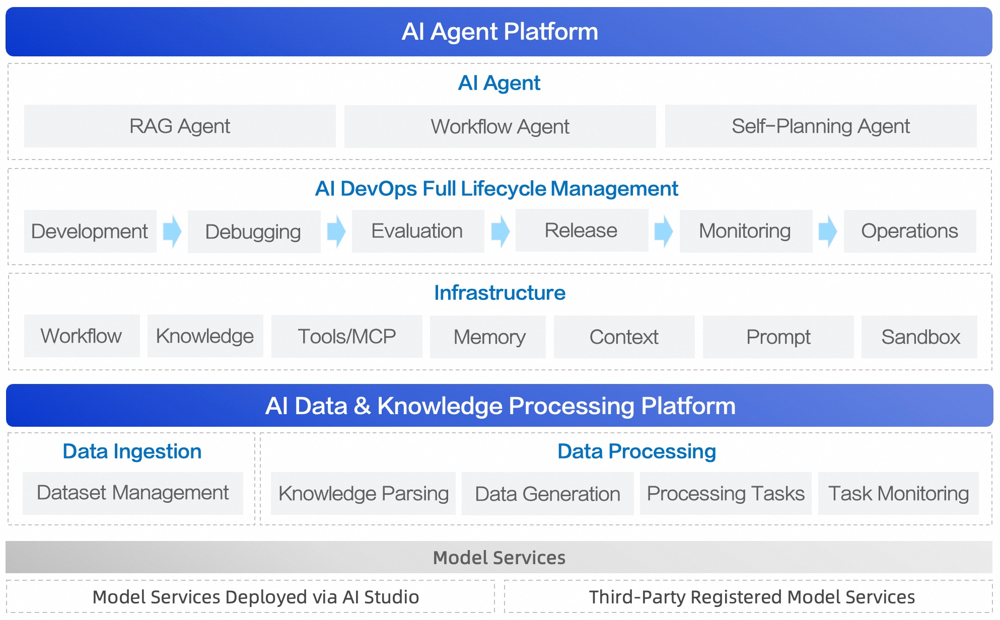

Alibaba Cloud  
Apsara Stack  
OpenTrek  
OpenTrek Dev Product  
Introduction  
Product Version: v3.18.6-2607  
Document Version: 20260901

**Table of Contents**

- [1.Product details](#section-1)
- [2.Product value](#section-2)
- [3.Use cases](#section-3)
- [4.Functions and features](#section-4)

# 1.Product details

Model Studio-Enterprise Edition is an enterprise-grade development platform for large model agents, providing a one-stop toolchain for domain-specific knowledge processing and management, agent building, and capability evaluation.

**Background**

As large model technology moves into real-world production, enterprises face three core challenges in their intelligent transformation:

- First, large model application development is difficult to manage across the full lifecycle. In traditional workflows, fragmented toolchains and a lack of evaluation systems reduce development efficiency, while key stages like context engineering and dynamic knowledge system updates lack sufficient tools and proven methodologies.

- Second, limited multimodal data processing capabilities severely restrict the expansion of application scenarios. Enterprises struggle to effectively convert massive volumes of unstructured data—such as financial reports, blueprints, and audio/video files—into valuable knowledge assets.

- Finally, agent development faces the dual challenge of limited functional scope and significant security risks. Agents must meet diverse needs, ranging from simple Q&A to complex decision-making, while guaranteeing system stability and data security in enterprise-grade scenarios.

Industry research shows that over 70% of enterprises building large model applications are hindered by pain points such as long knowledge base build cycles, limited agent functionality, and poor toolchain integration. These issues directly lengthen AI application development cycles by more than 40%.

Model Studio-Enterprise Edition was created to address these critical bottlenecks. The platform focuses on enterprise-grade scenarios, centered on "full lifecycle management" and "foundational capability support." By providing a full-stack platform that covers data processing, application development, and O&M optimization, it streamlines the entire workflow from multimodal knowledge processing to engineering production-ready agents. As the core infrastructure for building AI-native systems, Model Studio-Enterprise Edition not only resolves toolchain fragmentation but also overcomes the limitations of traditional multimodal data processing. It delivers an end-to-end solution—from data parsing to application deployment—that helps enterprises accelerate AI deployment and iteration, moving large models from proof-of-concept to scalable industrial application.

**Product overview**

Model Studio-Enterprise Edition is an enterprise-grade dual platform for large model application development and knowledge processing. It provides a full lifecycle toolchain covering development, debugging, evaluation, observability, and O&M, and integrates core capabilities such as knowledge processing, agent building, and tool ecosystem management.

For knowledge processing, the platform uses end-to-end multimodal parsing to manage various data modalities, including documents, images, audio/video, and data tables. It includes built-in deep-parsing templates to accurately process over 10 types of professional content, such as financial reports, academic papers, and policy documents. The platform enables complex table parsing, formula recognition, and image understanding, helping enterprises quickly build a high-quality knowledge base and providing foundational support for AI applications like RAG Q&A.

For agent development, the platform provides comprehensive support for a wide range of scenarios:

- On the one hand, by integrating RAG for knowledge enhancement, custom workflow orchestration, and ReAct reasoning and decision-making mechanisms, developers can flexibly build various types of agents, such as knowledge Q&A, workflow-driven, and autonomous planning agents, meeting a wide range of needs from simple interactions to complex decision-making.

- On the other hand, the platform offers an open MCP and tool ecosystem that expands agent capabilities while ensuring stability under high concurrency and secure script execution.

Additionally, the platform features a fine-grained memory management mechanism. Short-term memory supports context compression and entity extraction, while long-term memory enables personalized services through user profiles and task maps. Combined with custom generation and retrieval strategies, this allows agents to continuously evolve.

With these capabilities, Model Studio-Enterprise Edition provides a one-stop service for knowledge processing, agent development, evaluation, and O&M, establishing it as a core engine driving intelligent transformation across industries.

# 2.Product value

Model Studio Dedicated Edition integrates extensive industry-specific knowledge and data to support a wide range of applications. It addresses questions across multiple domains and provides accurate, comprehensive answers. This platform lets you efficiently manage solutions for all your use cases in one place.

**Efficient multimodal knowledge processing**

- Customer value

  Build a high-quality enterprise knowledge base and rapidly deploy AI applications, such as RAG Q&A.

- Key capabilities

  Provides end-to-end knowledge parsing for managing multimodal data, including documents, images, audio, video, and data tables. It features over 20 deep-parsing templates for more than 10 document types, such as financial reports, academic papers, policies, and textbooks. These capabilities let you parse document layouts, complex tables, and formulas, as well as understand images, allowing you to quickly build a multimodal knowledge base using your private data.

**Build agents for any scenario**

- Customer value

  Create various agents for a wide range of scenarios, including knowledge Q&A agents, workflow agents, and autonomous planning agents.

- Key capabilities

  Integrates multiple mechanisms, including RAG enhancement, custom workflow orchestration, and the ReAct framework for single-agent reasoning and decision-making. This lets developers switch between operating modes for diverse development needs, from basic Q&A to complex multi-agent systems.

**Open MCP and tool ecosystem**

- Customer value

  Integrate diverse tools efficiently to enhance development flexibility and security. This simplifies the integration process, reduces costs, and accelerates business innovation and response.

- Key capabilities

  Supports asynchronous API tool calls and dynamic injection of authentication credentials for various tool types. You can register MCP services in either Server-Sent Events (SSE) or STDIO mode and run them in an isolated security sandbox for flexible and secure deployment. The platform also lets you wrap APIs as MCP services with a single click, ensuring cross-protocol compatibility and reducing integration costs.

**Fine-grained memory management**

- Customer value

  Effectively manage long context for agent tasks using short-term memory, and deliver personalized experiences through long-term memory. This helps your agents improve and become more helpful with each interaction.

- Key capabilities

  Short-term memory management includes features like history round setting, long context compression, key entity extraction, and custom memory read and write. Long-term memory supports key Q&A, user profiling, and task mapping. It also lets you define custom memory generation, organization, and recall strategies.

# 3.Use cases

This topic describes how Model Studio can be applied in various industries.

Model Studio lets organizations across various industries build powerful AI applications. The following sections highlight several key use cases.

**Public sector**

To simplify complex policy documents for the public, you can build an intelligent interpretation agent. By ingesting historical policy documents into a knowledge base, the agent can use retrieval-augmented generation (RAG) to provide clear explanations. It can also support voice-based queries and trace information back to specific clauses, reducing the workload on government helpdesks and improving efficiency for both citizens and businesses.

**Finance**

Buy-side financial institutions often need to quickly analyze vast amounts of unstructured data, such as financial reports, prospectuses, satellite imagery, and web articles. You can use multimodal capabilities to build a knowledge base that supports multi-source data retrieval. An agent built for investment analysis can then be configured with specific reasoning logic to automatically generate batch analysis reports on a recurring schedule.

**Energy and power**

In power grid management, slow fault responses and inefficient coordination between systems are common challenges. To address this, you can build an intelligent dispatch agent to act as a decision-making hub. By creating a dispatch knowledge base from integrated data sources—including command libraries, equipment ledgers, and historical contingency plans— the agent can identify and route issues, coordinate with power flow and transfer tools, manage contingency plans, and provide smart visualizations to support operators.

**Industrial manufacturing**

You can create an industrial internet of things (IIoT) data hub that consolidates real-time sensor data (such as temperature, pressure, and vibration) with historical production logs (like process parameters, quality inspection records, and energy reports). You can use this data to build a process optimization knowledge base. A process analysis agent can then use this knowledge base to forecast energy consumption, trace the root cause of defects, and intelligently tune process parameters, creating a closed-loop optimization system.

**Healthcare**

Patients often struggle with technical pharmaceutical information, and healthcare providers face a high volume of inquiries. You can build a medication consultation agent to address these issues. By integrating authoritative medical and pharmaceutical data, the agent can help users find drug information, match medications to symptoms, and obtain clear usage guidance. This enhances patient safety and makes accessing medication information more convenient.

**Media and publishing**

You can build an agent that combines retrieval from a local knowledge base with web search capabilities. This automates workflows for sensitive content detection, fact-checking, and style consistency analysis, significantly improving the efficiency of proofreading and editorial review processes.

**Education**

Using a multimodal model, you can build a tool that comprehensively understands both video and audio content from educational lectures. This capability automatically extracts key concepts, organizes them into a structured knowledge system, and generates concise summaries.

# 4.Functions and features

This topic describes the functions and features of Model Studio Exclusive.

**Level 1**

**Level 2**

**Level 3 feature**

**Level 3 feature description**

**feature**

**feature**

You can create an agent from scratch by specifying the agent name, description, and

Create a custom agent

creation method, and then proceed to the version configuration page for further settings.

You can quickly build an agent based on a

Create an agent from a

template through interface guidance and

template

prompt engineering.

You can modify the name, description, avatar, and other information of an existing

Edit an agent

agent to update the agent configuration and description as needed.

You can permanently remove agents that are no longer needed to release system

Delete an agent

resources and keep the agent list clean.

Agent

You can quickly search for an agent by name

managemen

Search for an agent

to locate a specific instance among multiple

t

agents.

Enter the import key of the target environment to export the agent file. When you export an agent, the dependent model

Export an agent

services, knowledge bases, memory content, Model Context Protocol (MCP) services, and sub-agents are not exported. Keys from the same environment cannot be used for export.

Select an exported agent file to import. You can import only agents that were exported

Import an agent

with the current environment key, and only agent files from different environments are eligible for import.

The system automatically generates a key for verification when you export an agent to

Obtain an import key

another environment. The key is valid for 72 hours.

You can create a new version of an agent,

Create a custom

navigate to the workflow page to develop the

version

agent version from scratch, and specify the version name and creation method.

You can quickly build a version based on a

Create a version from a

template through interface guidance and

template

prompts.

This feature creates a replica of the current

Upgrade a template

version and opens the workflow canvas on

form to a workflow

the replica, where you can implement more advanced and complex business processes.

This feature allows you to clone the configuration of an existing agent version to

Clone a version within

generate an identical new version, which

the current agent

facilitates modifications without affecting the original version.

This feature allows you to clone the configuration of an existing agent version to

Clone a version to

a specified namespace. The dependent model

another namespace

services, knowledge bases, memory content, MCP services, and sub-agents are not cloned.

You can set traffic allocation quotas for specified agent versions and split traffic by session ID and request ID to ensure that the

Configure traffic

specified agent receives sufficient traffic

switchover for a version

resources. If you set traffic for a single version, that version becomes the output version.

You can select one or more agent versions to

Version

export. When you export an agent version,

managemen

the dependent model services, knowledge

t

Export an agent version

bases, memory content, and sub-agents are not exported. Keys from the same environment cannot be used for export.

Select an exported agent file to import. You can import only agents that were exported

Import an agent version

with the current environment key, and only agent files from different environments are eligible for import.

You can manage different versions of an agent, including viewing version details,

Manage version status

publishing versions, and unpublishing versions, to maintain the agent lifecycle.

You can publish an agent version in the design phase to make it available for external

Publish a version

calls. Before publishing, the platform verifies the completeness and validity of the version.

You can query the task details and log records of each request to the agent service

Track performance

and filter the results by version, session ID, and request ID.

The system collects metrics by agent and version dimensions, including Q&A success rate, average Q&A latency, number of Q&A requests, average time to first token, input

Metric monitoring

token consumption, and output token consumption. The system also monitors business and performance metrics for the knowledge bases, tools, and models that a specified agent version calls.

This node defines the starting point of the agent workflow. You can customize input

Start node

parameters and map them to the standard input of the agent to set initial conditions for subsequent tasks.

This node works with the aggregator to distribute a collection of data in serial or

Iterator

parallel mode, which enables loop processing of the data list.

This node works with the iterator to distribute

Aggregator

a collection of data in serial or parallel mode, which enables loop processing of the data list.

This node configures a large language model (LLM) to perform specific inference tasks. You

LLM node

can select a model, set model parameters, configure input and output, and use prompts to control the model output.

This node configures a multimodal LLM to perform specific inference tasks. You can

Multimodal LLM node

select a model, set model parameters, configure input and output, and use prompts to control the model output.

This node works with a text reranking model

Text reranking model

to perform specific tasks. You can select a

node

model, set model parameters, and configure input and output.

This node works with an image-text reranking

Image-text reranking

model to perform specific tasks. You can

model node

select a model, set model parameters, and configure input and output.

This node calls registered tools. You can

Tool node

configure input parameters and select tools to perform specific functions or services.

You can select an authorized document

Document retrieval

knowledge base for retrieval and configure retrieval parameters, input, and output.

You can select an authorized image-text

Image-text retrieval

knowledge base for retrieval and configure retrieval parameters, input, and output.

You can select an authorized data table

Data table retrieval

knowledge base for retrieval and configure retrieval parameters, input, and output.

You can select a registered and authorized

SQL executor

database on the platform to execute SQL tasks and configure input and output.

Design a workflow

This node merges multiple preceding output results. It supports streaming output of

Content merging

merged results and allows you to define combination rules and structures for multiple results.

This node outputs partial information before

Intermediate output

the final result is generated.

You can select variables configured in short-

Write to short-term

term memory and overwrite, append, or clear

memory

the variable values.

You can select another configured agent version as a call node in the current workflow.

Agent node

The session between the parent and child agents remains relatively stable.

You can write custom scripts to complete tasks, define input and output parameters,

Script node

and conform to the preset parameter structure.

Agent develop

This node implements conditional branching

ment

logic in a workflow and allows you to select

Selector node

different execution paths based on input parameter values.

This node combines and renders the output

Result rendering node

of an agent, including text, attachment content, and custom structured data.

The system checks the validity of the agent configuration to ensure that all node

Validity check

configurations are correct and connections are valid, which guarantees normal agent operation.

The system automatically saves changes during agent configuration to ensure

Auto-save

continuity of user operations and data security.

You can manually trigger a save to store the

Manual save

current agent status and configuration at a specific point in time.

The system provides a built-in function library with 30 functions. Developers can use these functions to further parse and process data or

Function capabilities

read specific information, such as retrieving the value of a specific key in an object, parsing data items in a list, and reading historical conversation records.

Developers can enter text to simulate user interactions with the agent to test and adjust

Text input debugging

the agent response and processing logic for text input.

You can upload attachments to test the ability of the agent to process different types of

Attachment input

attachments, ensuring that the agent

debugging

correctly parses and uses the data in the attachments.

The system provides an interface for entering additional information so that developers can

Additional information

simulate interactions in complex scenarios

debugging

and test how the agent makes decisions based on additional information.

You can enter data in JSON format to test the ability of the agent to parse and respond to

JSON input debugging

structured data, which is suitable for API debugging.

Developers can clear all content in the current session and reset the session status

Debugging

Clear a session

to start a new interaction test, ensuring session independence.

In run mode, the agent automatically executes the full workflow and provides a

Run mode debugging

response, which is suitable for quickly testing the automated execution process and efficiency of the agent.

Debug mode allows you to manually trigger the execution of each task for finer-grained

Debug mode debugging

control and troubleshooting, which is suitable for debugging and optimizing complex logic.

The system displays all intermediate tasks

Intermediate task

and sub-step results during agent execution

inspection

to help developers understand each step and logic in the interaction process.

Developers can view agent debugging logs,

Log viewing

including error messages and execution status, to facilitate debugging analysis.

Developers can insert and view the thought

Thought process

process of the agent, including decision logic

insertion and viewing

and reasoning steps, to evaluate and optimize the decision quality of the agent.

You can define a toggle for conversation

Short-term memory -

records. When disabled, the system cannot

conversation record

reference historical conversation records in

toggle

the session.

You can define the number of conversation record retention rounds and specify the

Short-term memory -

handling method after exceeding the limit.

conversation record

The system supports truncation or

retention rounds

summarization after the defined number of rounds is exceeded.

Short-term memory -

You can select a conversation record

conversation record

summary model and a summary prompt to

summary settings

improve the summarization quality.

Important entities refer to valuable information extracted from historical

Short-term memory -

conversations and stored separately to

important entity toggle

prevent loss of critical information due to excessively long context. You can enable or disable this feature with a toggle.

You can configure entity names, descriptions, and types. The system extracts entities based on these settings. You can configure up to 10

Short-term memory -

entities.

important entity settings

You can select an important entity extraction

Short-term memory -

model and configure an important entity

important entity

extraction prompt to improve the extraction

extraction settings

quality.

You can configure custom variables and write

Short-term memory -

variable content based on the custom

custom variables

memory node in the agent settings.

You can create a long-term memory partition

Long-term memory -

by using an important Q&A template, select a

create a memory

memory generation model and a vector

partition with an

embedding model, and save important

important Q&A

conversation content from sessions to the

template

memory store to improve agent response quality.

You can create a long-term memory partition by using a user profile template and save

Long-term memory -

user profile information from sessions to

create a memory

memory. You can select a memory

partition with a user

generation model and a vector embedding

profile template

model, and manually maintain user profile tags.

Memory

You can create a memory partition through workflow orchestration with the following parameter configurations:

- Memory storage structure: You can select key-value pairs, multi-text, or text.

- Memory generation strategy: You can select workflow orchestration or manual maintenance.

- Memory cleanup strategy: You can set the

Long-term memory -

memory retention period and select

create a custom

permanent retention or time-based

memory partition

cleanup.

- Memory retrieval strategy: You can configure the memory retrieval method and retrieve and recall content by memory title or memory content.

- Vector embedding model: You can configure the vector embedding model for the memory retrieval strategy of the memory partition.

You can edit specific memory entries in a

Long-term memory -

memory partition and update the content to

edit memory content

adapt to new business scenarios or requirements.

You can remove individual memory entries

Long-term memory -

that are no longer applicable or are incorrect

delete memory content

to optimize the quality of the memory store.

You can edit an existing memory partition

Long-term memory -

and update its name, description, memory

edit a memory partition

generation strategy, cleanup strategy, and retrieval strategy.

Long-term memory -

You can delete an existing memory partition

delete a memory

to adapt to the evolving requirements of the

partition

agent.

Long-term memory -

You can debug the content in a memory

debug a memory

partition by entering a query to verify the

partition

recall performance of the memory partition.

You can view the agent template name, ID, description, and other information, and

Template list

navigate to the template details page from this page.

Template list

You can view the template usage instructions, configuration requirements, APIs,

Template details

capability dependencies, and other information, and initiate agent creation from this page.

You can create an agent directly from the template details page based on the template.

Use a template

You can create a new agent or add a version to an existing agent.

You can create an agent instance based on

Create an agent based

the AutoDoc template. You can create a new

on the AutoDoc

agent or add a version to an existing agent,

template

and customize the name and description.

You can edit the name and description of an

Edit an agent based on

agent instance created based on the AutoDoc

the AutoDoc template

template.

You can associate a single specified document knowledge base.

Parameter settings: You can configure parameters for standard Q&A, knowledge

Agent

rewriting, multi-turn rewriting, vector

template -

retrieval, text retrieval, result reranking, and

AutoDoc

summarization.

Configure an agent based on the AutoDoc template

Standard Q&A library: You can configure a standard Q&A library based on long-term memory partitions and add, edit, delete, or view standard Q&A entries.

Knowledge vocabulary: You can configure a knowledge vocabulary based on long-term memory partitions and add, edit, delete, or view standard Q&A entries.

Delete an agent based

You can delete agent instances created

on the AutoDoc

based on this template.

template

You can create an agent instance based on

Create an agent based

the AutoBI template. You can create a new

on the AutoBI template

agent or add a version to an existing agent, and customize the name and description.

Parameter settings:

- Associate a knowledge base: You can search for and bind a data table knowledge base.

- Knowledge rewriting: The system provides a default configuration scheme. You can also customize the LLM and parameters for knowledge rewriting, including the prompt and temperature.

- Multi-turn rewriting: The system provides a default configuration scheme. You can also customize the LLM and parameters for knowledge rewriting, including the prompt and temperature.

- Recall configuration: You can configure table columns, values, and SQL sample recall information. The system provides a default configuration scheme, and you can configure the recall count and recall threshold.

Configure an agent

- SQL generation: You can configure the SQL

based on the AutoBI

generation scheme, select NL2SQL, and

template

configure the runtime parameters of the LLM for SQL generation, including the prompt and temperature.

- Summarization: You can configure reply

Agent

summarization to extract and summarize

template -

SQL execution results. The system provides

AutoBI

a default configuration scheme, and you can also customize the LLM and parameters for summarization, including the prompt and temperature.

- Chart drawing: The system generates chart data structures from SQL execution results for the application to render corresponding charts. You can also customize the LLM and parameters for generating chart data structures, including the prompt and temperature.

Agent template s

Delete an AutoBI

You can delete agent instances created

instance

based on this template.

You can use natural language queries and instructions to handle database query operations. You only need to describe the

Data query

query requirements, and the system automatically parses the requirements and generates the corresponding SQL query statements.

The system analyzes user input data query intents and query results, analyzes data

Data analysis

results based on the question, extracts key information, performs data analysis, and generates an analysis summary.

You can create an agent instance based on

Create an agent based

the AutoVideo template. You can create a

on the AutoVideo

new agent or add a version to an existing

template

agent, and customize the name and description.

You can edit the name and description of an

Edit an agent based on

agent instance created based on the

the AutoVideo template

AutoVideo template.

You can associate a single specified image-text knowledge base.

Parameter settings: You can configure parameters for standard Q&A, knowledge rewriting, multi-turn rewriting, vector retrieval, text retrieval, result reranking, and summarization.

Configure an agent

Standard Q&A library: You can configure a

based on the AutoVideo

standard Q&A library based on long-term

template

memory partitions and add, edit, delete, or view standard Q&A entries.

Knowledge vocabulary: You can configure a knowledge vocabulary based on long-term memory partitions and add, edit, delete, or view standard Q&A entries.

Delete an agent based

You can delete agent instances created

on the AutoVideo

based on this template.

template

Agent template -

The system generates basic content

General image

AutoVideo

descriptions for up to four images within a

understanding

single conversation.

The system generates a description for a

Image understanding

single image based on the recall

based on an image-text

configuration, reranking configuration,

knowledge base

generation configuration, and the configured image-text knowledge base.

You can disable the recall configuration and conduct a conversation about a single image

Image conversation

within a limited number of turns in a single-round conversation.

You can disable the recall configuration and conduct a conversation about a single video

Video conversation

up to 20 MB in size within a limited number of turns in a single-round conversation.

General video

The system generates basic content

understanding

descriptions for videos up to 20 MB in size.

The system understands the content of line

Specific chart type

charts, bar charts, and pie charts that clearly

understanding

present information.

You can retrieve images and text within the

Text-based image

knowledge base by using text queries based

retrieval

on the recall and reranking configurations of AutoVideo.

You can retrieve images and text within the

Image-based image

knowledge base by using image queries

retrieval

based on the recall and reranking configurations of AutoVideo.

The system provides a tool editing feature that allows you to modify and update

Edit a tool

registered tools, including updating tool configuration information and request parameters.

You can remove tools that are no longer needed to release system resources, which

Delete a tool

helps maintain a clean and efficient agent platform.

The system provides a tool query feature that allows you to quickly find registered tools by keyword, which improves the efficiency of

Query a tool

retrieving specific tools from a large number

Tool list

of tools and accelerates the development and maintenance process.

You can upgrade registered API-type tools to MCP with one click. You can add the upgrade

Upgrade to MCP

to an existing MCP tool or create a new MCP tool.

You can view invocation metrics for a specified tool within a specific time range,

Observability

including the success rate, average latency, and invocation count.

Agent Factory provides an API tool registration feature that allows you to integrate external service APIs into the agent platform. By entering information such as the

Tool registration

tool name, description, address, and request method, you can define the basic attributes and invocation parameters of the API tool to quickly connect to and use third-party services.

My tools

API tool

The system supports the integration and use

registration

of streaming APIs. You can configure API tools

Streaming API support

to support streaming output, which enables the API to continuously return data.

For tools with long execution times per request, you can enable asynchronous

Asynchronous tool

invocation. After completing the integration

invocation support

according to the platform instructions, the system supports asynchronous invocation of the tools.

Select SSE mode to register an MCP tool.

Register an MCP tool in

After entering the name and description, the

SSE mode

system provides service configuration instructions and verifies service connectivity.

MCP service registration

You can select a virtual machine, develop and

Register an MCP tool in

upload a code package as required by the

STDIO mode

scaffold, and deploy the service on the virtual machine.

This module allows you to debug registered API tools to ensure connectivity and correct return results. You can simulate requests,

API tool debugging

observe tool response data, adjust parameter configurations, and optimize tool performance.

You can select a specific tool from an MCP

Tool

service and debug it by using form-based or

debugging

JSON-based input. For MCP tools registered in

MCP service debugging

SSE mode with authentication information, you can enter authentication keys during debugging.

You can search for platform tools by tool

Query the tool list

name or tool type to quickly locate a specific tool.

Platform tool list

You can view platform tool details on the tool details page, including usage instructions,

Platform

Tool details

parameter descriptions, and resource

tools

dependencies, to understand the applicable scenarios of the tool.

This tool connects to the Quark Search API

Built-in

and is built in by default. To use it, enter the

platform API

Quark Search

Quark authentication information and pay the

tools

associated fees.

You can search for platform tools by tool

Query the shared tool

name or tool type to quickly locate a specific

list

tool.

Shared tool list

You can view tool details on the tool details

Query tool details

page.

This module allows you to debug API tools to ensure connectivity and correct return

Shared

results. You can simulate requests, observe

tools

API tool debugging

tool response data, adjust parameter configurations, and optimize tool performance.

Shared tool debugging

You can select a specific tool from an MCP service and debug it by using form-based or JSON-based input. For MCP tools registered in

MCP service debugging

SSE mode with authentication information, you can enter authentication keys during debugging.

You can create prompt templates by using three frameworks: Custom, CRISPE, and Few-

Create a prompt

shot. You can also configure prompt tags to

template

facilitate prompt template invocation and retrieval.

You can query templates by template tag and

Template query

specified input content to quickly locate the required prompt template.

The system displays all created prompt templates. You can view the template name

Template list

and debugging status in the list to facilitate template management.

My templates

You can modify the name, tags, framework,

Prompt

Edit a template

and instruction content of a prompt template

template

based on the template usage scenario.

s

You can debug a prompt template by entering variable values to verify template

Debug a template

availability. You can also select a model service for debugging.

You can delete prompt templates that are no

Delete a template

longer needed to organize the workspace.

The platform provides built-in prompt

Platform template list

templates. You can debug templates and directly select them when building agents.

Platform templates

You can query built-in platform prompt

Platform template

templates by template category tag and

query

prompt content to quickly locate a template.

You can query instruction optimization tasks by prompt name to quickly locate a specific

Quey the task list

task and obtain task details and optimization status.

You can view the details of a prompt instruction optimization task. The system

Task details

provides multiple optimization schemes, and you can save the optimization results to **My**

Optimization

**Templates** for agent building.

task list

Prompt optimiza

You can terminate a prompt instruction

tion

Terminate a task

optimization task that is in progress to interrupt the optimization process.

You can delete prompt instruction

Delete a task

optimization tasks to organize the task workspace and facilitate task retrieval.

Initiate an

Create a prompt

You can select a model to optimize

optimization

instruction optimization

instructions based on the input prompt

task

task

description to improve prompt quality.

Evaluation

You can add, download, disable, enable, or

set

Evaluation set version

delete an evaluation set version. You can also

managemen

management

view evaluation set version log information.

t

Agent evaluatio

After creating an evaluation task, you can

n

Evaluation task

view task details, including basic information

management

and task instance information. You can also manually start, rerun, or delete tasks.

Evaluation tasks

For completed evaluation tasks, you can view evaluation reports. The evaluation reports

View evaluation results

display evaluation effectiveness information and sample analysis results to help you assess agent performance.

You can search for a knowledge base by knowledge base name, ID, or type, and view

View a knowledge base

the name, description, configuration parameters, and status of a specific knowledge base.

You can edit the name, description, and

Edit knowledge base

retrieval strategy of an existing knowledge

information

base.

You can view the original files, task details, parsing status, and parsing results of a

Knowledge base

knowledge base. You can also delete tasks in

content management

the knowledge base and download the source files, parsing results, and segmentation

Knowledge

results to organize knowledge base content.

base list

An enabled knowledge base can be invoked

Enable/disable a

by agents. You can disable a knowledge base

knowledge base

to restrict its invocation.

Delete a knowledge

You can delete obsolete knowledge bases to

base

release system resources.

You can view invocation metrics for a specific knowledge base within a selected time range,

Knowledge base metric

including the invocation success rate,

observability

average latency, invocation count, and token consumption.

You can create a knowledge base in a more flexible way and configure it based on the knowledge base usage scenario:

- You can configure the content structure

Custom creation

and field information of the knowledge base.

- You can configure vector index and ES index parameters for the retrieval strategy.

Create a custom

You can build indexes for custom knowledge

knowledge

bases to improve the accuracy of knowledge

base

retrieval during invocations. You can

Build indexes for

configure index content including content

custom knowledge

structure, indexed content, storage

bases

information, model selection, and retrieval and recall fields. The system also supports adding and configuring index nodes in workflows.

You can select a document knowledge base

Create from a

template, enter the knowledge base name

document template

and description, and quickly create a document knowledge base.

You can switch the text vectorization model on the advanced settings page. You can

Advanced settings -

Create a

switch the model only when creating a

Switch the vector

document

knowledge base. After the knowledge base is

embedding model

knowledge

created, the text vectorization model cannot

base

be modified.

You can configure a parsing strategy on the advanced settings page. Based on different

Advanced settings -

parsing strategies, the system can perform

Parsing strategy

document text extraction, layout analysis, image OCR, table parsing, formula parsing, and image parsing.

You can select an image-text knowledge base

Create from an image-

template, enter the knowledge base name

text template

and description, and quickly create a document knowledge base.

You can configure the image-text

Create an

vectorization model and vectorization trigger

image-text

conditions.

Advanced settings -

knowledge

Vectorization

base

After the knowledge base is created, the image-text vectorization model cannot be modified.

You can enable or disable intelligent parsing

Advanced settings -

and configure the image-text parsing model

Image-text parsing

and related prompts.

You can create a data table knowledge base

Create a

from a data table knowledge base template.

data table

Create from a data

By configuring the data source, you can

knowledge

table template

import information from a database into the

base

knowledge base to quickly enable data invocation.

View knowledge base

You can view the knowledge base name,

details

description, ID, and creation method.

You can search for tasks by knowledge base

Query knowledge base

content keyword or status. The system

content

supports querying by content structure table.

Import knowledge base

You can batch add knowledge base content

content

by using template import or API import.

Custom knowledge base details

You can delete obsolete tasks to organize

Delete a task

knowledge base content.

You can reprocess the content to be

Retry a task

imported.

Knowled ge base

The system refreshes the page status

Refresh the content list

automatically every 30 seconds.

The system displays the knowledge base name, description, knowledge base code, and

View knowledge base

creation method.

details

You can query original files by file code, file

Original files - Query

name, format, or status.

Original files - Import

You can import files by uploading documents

files

or synchronizing through APIs.

You can delete files. The system also deletes the corresponding parsing results,

Original files - Delete

segmentation results, and vector database data. Batch deletion is supported.

You can view file parsing results, verify

Original files - Parsing

segmentation and parsing status, and edit

details

parsing results.

You can re-parse files. Batch re-parsing is

Original files - Re-parse

supported.

Original files -

You can download source files to your local

Document

Download source files

device.

knowledge base details

Original files -Download parsing

You can download parsing result files.

results

The system refreshes the page status

Original files - Refresh

automatically every 30 seconds.

You can search for content by keyword,

Content details - Query

segment code, or status.

Content details - Batch

You can batch import content by using

import

template import or API synchronization.

You can delete parsed content. Batch

Content details - Delete

deletion is supported.

You can re-vectorize specified content. This

Content details - Re-

operation is not supported when the content

vectorize

is in the vector database.

Content details -

The system refreshes the page status

Refresh

automatically every 30 seconds.

The system displays the knowledge base

View knowledge base

name, description, code, and creation

details

method.

You can query by file code, file name, or

Query

status.

You can import files by uploading files,

Import files

importing from templates, or synchronizing through APIs.

You can manually edit image content, image descriptions, and image tags so that agents

Parse

can retrieve them when accessing the knowledge base.

Image-text knowledge base details

You can initiate intelligent parsing to

Intelligent parsing

overwrite existing content. Batch intelligent parsing is supported.

You can delete obsolete images. Batch

Delete files

deletion is supported.

You can re-vectorize images. Batch re-

Re-vectorize

vectorization is supported.

The system refreshes the page status

Refresh

automatically every 30 seconds.

The system displays the knowledge base

View knowledge base

name, description, code, and creation

details

method.

Data table knowledge base details

You can register data tables and edit

Edit a knowledge base

knowledge base details based on the registered data tables.

On the shared knowledge base menu page,

View shared knowledge

you can view the list of knowledge bases

bases

shared from other namespaces to this namespace and view knowledge base details.

Shared knowledge bases

You can select a knowledge base in the

Share knowledge bases

current namespace and share it with other namespaces where you have permissions.

You can view the dataset list and filter datasets by keyword or tag. Datasets use a three-level tag system, and you can design and manage custom dataset tags.

You can create and manage datasets. The system supports multiple data modalities including documents, text, images, audio, video, and tables. You can organize dataset files by hierarchical paths.

The system supports hosting multiple file types:

Dataset creation and

- Image: .png, .jpg, .jpeg, .bmp, .gif, .webp,

configuration

.svg, .ico, .tiff, .eps, .psd, .raw, .heic, .jxr

- Audio: .wav, .mp3, .aac, .flac, .alac, .ogg,.wma, .aiff, .dsd, .midi, .dts, .amr, .opus,.m4a

- Video: .mp4, .avi, .mov, .mkv, .wmv, .flv,.webm, .mpeg, .3gp, .vob, .ts, .asf, .rm

- Rich text document: pdf, txt, doc, docx,

Dataset

md, epub, caj, wps, xls, xlsx, ppt, pptx,

managemen

html, htm, rtf, odt, ods, xml, tex, mobi, fb2,

t

fb2z, azw

- Tabular: .csv, .json, .jsonl, .parquet

Data manage

Datasets support multiple subsets with

ment

flexible data formats. You can configure

Data view

custom mappings between subsets and file data, and enable or disable automatic updates for subset data.

You can batch upload data files through files and folders, and download or delete files. A

Data files

maximum file limit applies per batch, and you can upload different file types in the same batch.

The system provides data permission management. Namespace administrators and

Dataset permissions

dataset creators have full operation permissions on datasets, while regular users can only browse.

The system provides a CLI operation mode

CLI operation mode

that allows you to batch upload and download data files through the command line.

Integrated developmen t

The system provides OpenAPIs that support dataset operations such as dataset creation,

OpenAPI

data file upload, and subset creation and configuration.

The system provides processing templates. You can filter, search, and view template

Task

View templates and

details including detailed descriptions and

templates

create tasks

data flow details. You can also create tasks from templates.

You can create data processing tasks to perform batch data processing on datasets.

Task management

Tasks distinguish between draft and published states. The system provides task management features including task configuration, publishing, unpublishing, and cloning.

You can flexibly configure the compute

Task execution

resource specifications and parallelism required for task execution.

Processing tasks

The system categorizes templates into cleaning, parsing, augmentation, balancing, and end-to-end types. You can create pipeline

Task configuration

tasks and combine CPU and GPU resource operators within the same task. The system supports saving processing results as new subsets.

The system provides task instance O&M features. You can view task instance

View task instances

execution status, input and output dataset information, and logs.

Task O&M

Cancel and rerun task

Task instance O&M supports cancel and rerun

instances

operations.

The system provides a CLI operation mode

CLI operation mode

that allows you to create and execute tasks through the command line.

Integrated developmen t

The system provides OpenAPIs that support

OpenAPI

creating, deleting, configuring, and viewing tasks and instances.

The system parses user-uploaded PDF documents and directly extracts native PDF content. Scanned content and image content extraction are not supported. The system

Document - Basic PDF

generates semantic data structures and splits

parsing to generate

parsing results into knowledge segments that

knowledge segments

you can import into a knowledge base.

The system parses user-uploaded PDF documents with layout analysis capabilities. It

Document - Advanced

supports parsing tables, formulas, and URL

PDF parsing to

hyperlinks, and generates a semantic

generate knowledge

structure tree. The system splits parsing

segments

results into knowledge segments that you can import into a knowledge base.

The system parses user-uploaded Excel documents such as xls and xlsx files. Image

Document - Basic Excel

parsing within documents is not supported.

parsing to generate

The system performs chunk splitting,

knowledge segments

generates knowledge segments, and saves results as datasets. You can save the split

End-to-end

knowledge segment results as JSONL files in a

templates

unified platform format.

The system parses user-uploaded Word documents. Image parsing within documents

Document - Basic Word

is not supported. The system generates a

parsing to generate

semantic structure tree and splits parsing

knowledge segments

results into knowledge segments that you can import into a knowledge base.

The system parses user-uploaded Word

Document - Advanced

documents and supports parsing images

Word parsing to

within documents. The system generates a

generate knowledge

semantic structure tree and splits parsing

segments

results into knowledge segments that you can import into a knowledge base.

The system splits user-uploaded plain text

Document - Plain text

documents into knowledge segments that

document to generate

you can import into a knowledge base.

knowledge segments

Supported file types include txt, json, jsonl, and md.

The system parses user-uploaded PDF documents and automatically converts Word

Document - Advanced

documents to PDF for parsing. The system

PDF parsing

saves results as JSONL files corresponding to the documents.

The system parses user-uploaded PDF documents and directly extracts native PDF

Document - Basic PDF

content. Scanned content and image content

parsing

extraction are not supported. The system

Data

generates semantic data structures and

processi

saves parsing results as datasets.

ng

The system parses user-uploaded Word

Document - Basic Word

documents. Image parsing within documents

parsing

is not supported. The system saves results as JSONL files corresponding to the documents.

The system parses user-uploaded Word

Document - Advanced

documents and supports parsing images

Word parsing

within documents. You can save parsing results as corresponding JSONL files.

Data parsing templates

The system splits videos into multiple segments and returns the boundary

Video - Intelligent video

timestamps and keyframes for each segment

segment parsing and

without returning the actual video segments.

keyframe extraction

The system generates summary descriptions for segments and keyframes. Multiple video file formats are supported.

Based on video parsing results, the system splits long videos into segments and

Video - Video slicing

generates a corpus dataset according to the platform text-to-video data protocol.

Based on video parsing results, the system extracts frames from long videos to generate

Video - Video frame

JPG images and creates a corpus dataset

extraction

according to the platform text-to-image training data protocol.

The system cleans specified columns in text datasets through operations such as encoding conversion, content filtering,

Text - Data cleaning

sensitive information processing, and deduplication. You can combine operators as needed to generate high-quality text data suitable for LLM training.

Data cleaning

The system filters video datasets by aspect

templates

Video - Data cleaning

ratio, duration, and resolution to select suitable samples.

The system cleans image datasets through operations such as deduplication, shape

Image - Data cleaning

filtering, size filtering, clarity filtering, and aspect ratio filtering to select suitable samples.

For a text Q&A pair sample set, the system extracts seed Q&A pairs (up to 10) and

Text - SFT Q&A pair

generates new Q&A samples (up to 2,000)

augmentation

based on the content and format features of the seed Q&A pairs.

The system extracts Q&A pairs from text

Text - Text Q&A pair

segments and saves the results as JSONL files

extraction

and data subsets.

The system batch generates image

Data

Image - Image

descriptions and Q&A pairs, and stores them

augmentatio

description and Q&A

in the pre_tag column as pre-annotation

n

pair pre-annotation

content. You can specify the prompt and the

template

questions that the model needs to answer.

This operator resolves multi-class data imbalance. It randomly samples majority class samples in the dataset so that each class has the same number of samples as the smallest class, achieving data balance. This

Text - Data balancing -

operator applies primarily to classification

Random undersampling

tasks, especially when class distribution is severely imbalanced.

This operator resolves multi-class data imbalance. It randomly duplicates minority class samples in the dataset so that each

Text - Data balancing -

class has the same number of samples as the

Random oversampling

largest class, achieving data balance. This operator applies primarily to classification

Data

tasks, especially when class distribution is

balancing

severely imbalanced.

This template implements K-means clustering-based undersampling to resolve

Text - Data balancing -

class imbalance. It performs K-means

Clustering-based

clustering on each class and reduces majority

undersampling

class samples to match the number of minority class samples, generating a dataset with balanced class distribution.

This template resolves class imbalance in multi-class classification tasks. It uses text

Text - Data balancing -

data augmentation techniques to oversample

Data augmentation-

minority class samples and generates new

based oversampling

samples to balance the sample count across classes.

Global resource management allows you to add and manage various data resources required by the platform, including infrastructure resources such as object storage and databases. This feature provides

Global resource management

unified resource storage and management capabilities for agent services, data centers, and knowledge bases. Only organization administrators or resource set administrators can configure these resources when accessing with administrator roles.

The system provides creation, configuration, and O&M management capabilities for agent services and data center resources. Through global service management, you can

Global service management

configure gateway services, storage resources, and database resources for agent applications, and allocate namespaces for services to ensure stable operation of agent services and normal data center services.

You can view the default service

Scenario default

configuration for platform scenarios and

service list

implement global control.

System settings -Scenario

Agents, memory, and knowledge bases each

default

use models in various scenarios. The model

models

Scenario default

selection provides default options and

service settings

supports custom configuration. You can switch models in the scenario interface.

You can view and manage system

System parameter

parameters, and search for system

settings list

parameters by name or code.

System settings -System parameter

You can configure various parameters for the

settings

System parameter

agent center. The settings take effect globally

configuration

after configuration. You can also batch configure parameters by uploading files.

You can view the allocated traffic request

Request traffic control

counts and maximum parallel task counts for

list

different namespaces, agents, and versions.

You can control traffic by the number of

Request traffic control

concurrent requests or by the number of

methods

System

parallel processing requests.

settings -Request traffic

You can modify the configured version traffic

control

Edit version traffic

control and adjust traffic guarantees based on agent usage.

System manage ment

You can delete the version traffic control

Delete version traffic

configuration for agents that no longer require traffic control.

You can filter virtual machines (VMs) by VM

VM management query

name, VM code, or available namespace.

You can view VM details and status, and

VM list

refresh the connection status of a specific VM in the list.

You can view the list of services deployed on

View VM services

a VM.

System settings -VM

You can select the available namespace for a

managemen

Register a VM

<ol type="I" start="995">

<li>

You must complete a connectivity test

</li>

</ol>

t

before submitting and saving the registration.

You can modify VM registration information,

Edit a VM

including the service name and available namespace.

You can delete VMs that are no longer in use.

Delete a VM

This also deletes all services in the service list of the VM.

You can integrate platform-deployed models

Integrate a model

or third-party registered models, and allocate namespaces for integrated models.

Model

You can view and filter integrated models,

integration

Model list

and enable, disable, or edit integrated models.

You can debug integrated models to verify

Model debugging

model service connectivity.

You can view the list of namespaces to which

Namespace list

you belong.

Namespace

Create a namespace

Administrators can create namespaces.

managemen t

Namespace administrators can add or

Namespace member

remove namespace members and assign

management

regular members as administrators.
