Alibaba Cloud  
Apsara Stack  
OpenTrek  
OpenTrek-Ops User Guide  
Product Version: v3.18.6-2607  
Document Version: 20260902

**Table of Contents**

- [1.Overview](#section-1)
- [2.Log in to the OpenTrek-Ops platform](#section-2)
- [3.Operations overview](#section-3)
- [4.AI assistant](#section-4)
- [5.O&M Center](#section-5)
    - [5.1. Agent list](#section-5-1)
    - [5.2. Project management](#section-5-2)
    - [5.3. Capabilities and plugins](#section-5-3)
- [6.Change history](#section-6)
- [7.Infrastructure](#section-7)
- [8.Security center](#section-8)
    - [8.1. Security settings](#section-8-1)
    - [8.2. Audit logs](#section-8-2)
- [9.Session analysis](#section-9)
- [10.UModel exploration](#section-10)
- [11.Operational analysis](#section-11)
    - [11.1. Cost analysis](#section-11-1)
- [12.System settings](#section-12)
    - [12.1. Tenant management](#section-12-1)
    - [12.2. Configuration management](#section-12-2)
- [13.Configure an Ops administrator](#section-13)
- [14.FAQ](#section-14)

# 1.Overview

This topic describes the features and usage of the OpenTrek-Ops platform.

OpenTrek-Ops is a multi-agent operations and governance platform based on the xClaw paradigm, providing full lifecycle management for enterprise-grade AI agents. The platform delivers an all-in-one solutions for Ops teams, covering the creation, deployment, monitoring, collaboration, and governance of agents.

**Product architecture**

OpenTrek-Ops divides Ops management into three layers: agent Ops, skill asset Ops, and infrastructure Ops. The platform accumulates Ops experience and collects data across these three layers to aggregate Ops data into a unified governance center, performing integrated analysis and comprehensive processing on the data.

OpenTrek-Ops provides a unified Ops portal to deliver a consistent Ops experience for users. The platform integrates with various infrastructure services, including LLM Service, Redis, OSS, and PostgreSQL. It also exposes data from the Ops system to third-party systems through APIs.

**Scenarios**

OpenTrek-Ops applies to the following scenarios:

- **Automated intelligent operations**: Automate the execution of operational tasks through agents to reduce manual operation costs.

- **Multi-agent collaboration**: Build agent projects to enable multi-role collaboration in complex Ops scenarios.

- **Skill asset management**: Manage, review, and distribute agent skills in a unified manner to enable capability reuse.

- **Ops governance**: Monitor the running status, token consumption, and error rates of agents comprehensively.

**Prerequisites**

- You have obtained the endpoint, username, and password of the OpenTrek-Ops platform from the administrator.

- We recommend that you use the Google Chrome browser.

**User roles**

User roles provide different operation permissions for different users. The system creates the OPENTREKOPS application permission for agent Ops by default during initialization. The permissions are as follows:

| Role | Permission description |
| --- | --- |
| Platform administrator | This role has platform management permissions only. Users with this role can only view and operate features related to platform management. |
| Operations administrator | This role has operations management permissions only. Users with this role can view and operate the pages and features in the Overview, AI Assistant, Ops Center, Asset Center, and Operations Analysis menus. |
| Project administrator | This role has project management permissions only. Users with this role can view and operate the pages and features in the AI Assistant and Ops Center menus. |
| Tenant administrator | This role has tenant management permissions only. Users with this role can only view and operate the pages and features in the Organization Management menu. |
| Tenant operations administrator | This role has tenant operations permissions only. Users with this role can view and operate the pages and features in the Overview, AI Assistant, Ops Center, Asset Center, Security Center, and Operations Analysis menus. Users with this role can create and manage agents, projects, and skills. |

**Navigation structure**

The platform navigation in V1.1.1 adopts a five-group classification layout to help users locate feature modules quickly:

| Navigation group | Included modules |
| --- | --- |
| Workbench | Overview and AI Assistant |
| Management | Ops Center (Agent List, Project Management, Capabilities and Plugins), Change History, and Infrastructure |
| Security | Security Center (Security Settings and Audit Logs) |
| Analysis | Operation Analysis (Cost Analysis) |
| System | System Settings (Tenant Management and Platform Management) |

# 2.Log in to the OpenTrek-Ops platform

**Log in and log out**

This topic describes how users log in to and log out of the OpenTrek-Ops platform.

**Scenarios**

Logging in and logging out are basic operations for using the OpenTrek-Ops platform. These operations apply to the following scenarios:

- O&M personnel access the platform on a daily basis to perform O&M operations.

- Administrators perform system configuration and management.

- Users securely log out of the system after they complete their operations.

**Prerequisites**

- You have obtained the endpoint, username, and password of the OpenTrek-Ops platform from the administrator.

- The administrator provides the endpoint of the OpenTrek-Ops platform.

- We recommend that you use the Chrome browser.

**Procedure**

1. Open a browser.

2. Enter the endpoint of the OpenTrek-Ops platform in the address bar and press Enter.

3. Enter the correct username and password.

   > **Note**
   >
   > - Obtain the username and password for logging in to the OpenTrek-Ops platform from the administrator.
   >
   > - If you enter an incorrect password multiple times in a row, the system enables the verification code logon feature. If you reach the maximum number of consecutive incorrect attempts, the system locks the account. Contact the administrator to activate the account.
   >
   > - When you log in to the OpenTrek-Ops platform for the first time, the system may require you to change the initial password. Follow the prompts to change the password. To improve security, the password must meet the following requirements:
   >
   >   - The password must contain uppercase and lowercase English letters.
   >
   >   - The password must contain Arabic numerals (0 to 9).
   >
   >   - The password must contain special characters.
   >
   >   - The password must be 10 to 20 characters in length.

4. Click **Log In**.

**Log out of the system**

1. In the lower-left corner of the page, click  on the right side of the current logon user.

2. In the dialog box, click **Sign Out**.

   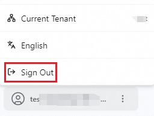

# 3.Operations overview

This topic describes the features and metrics on the **Operations Overview** page of the OpenTrek-Ops platform.

**Scenarios**

The **Operations Overview** page is the default dashboard of the platform, ideal for the following scenarios:

- Perform daily O&M inspections to quickly understand the overall health status of the platform.

- Monitor agent operation trends and token consumption to evaluate resource usage efficiency.

- View model performance metrics to analyze the response time and processing capabilities of different models.

- Monitor infrastructure status to promptly detect and troubleshoot service exceptions.

**Prerequisites**

You have logged in to the OpenTrek-Ops platform as a tenant operations administrator.

**Procedure**

1. Log in to the OpenTrek-Ops platform.

   After logging in, the system redirects you to the **Operations Overview** page by default.

   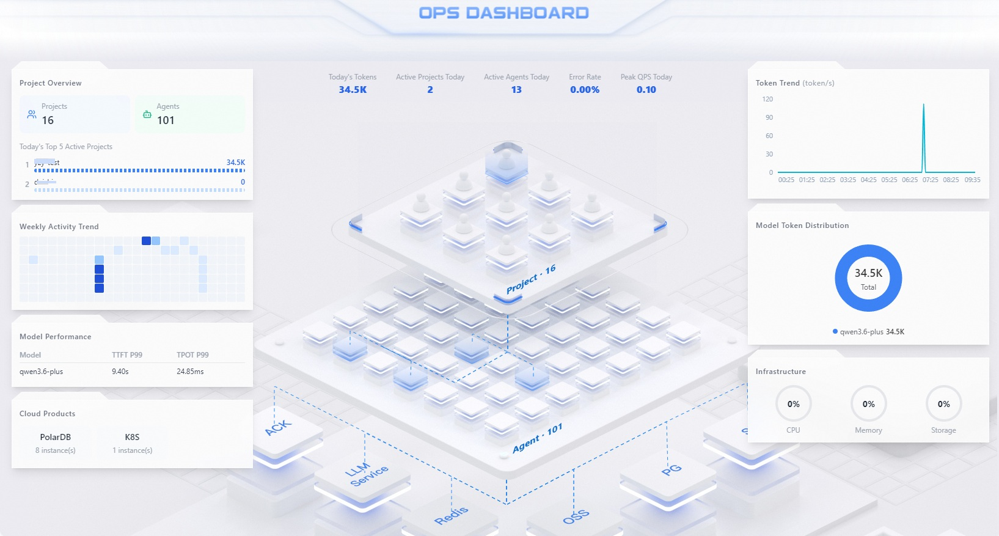

2. On the **Operations Overview** page, you can view the following core modules:

   | Module | Description |
   | --- | --- |
   | Project Overview | • Displays the statistics on the number of projects and agents. • Today's Top 5 Active Projects Displays a list of the top five projects ranked by activity today. |
   | Weekly Activity Trend | Displays the activity trend over the last seven days. |
   | Model Performance | Displays the TTFT P99 and TPOT P99 performance metrics for each model. |
   | Cloud Products | Displays the number of instances for API Gateway, Object Storage Service (OSS), PolarDB, and Kubernetes. |
   | Token Trend | Displays the token consumption trend over time in a line chart.When you move the pointer over the line chart, the system displays the total token data for the corresponding point in time. |
   | Model Token Distribution | Displays the token usage distribution across different models. |
   | Infrastructure | Displays the usage of CPU, memory, and storage. |
   | Central dashboard | • Displays the running status of infrastructure such as Alibaba Cloud Container Service for Kubernetes (ACK), Large Language Model (LLM) Service, Redis, OSS, and PostgreSQL (PG). Blue indicates that the service is running normally. • Today's Tokens Displays the total token consumption for the current day. • Active Projects Today Displays the number of active projects for the current day. • Active Agents Today Displays the number of active agents for the current day. • Error Rate Displays the error rate metric for current requests. • Peak QPS Today Displays the peak QPS for the current day. |

**Next steps**

After obtaining the operations overview information as needed, you can view and manage detailed agent information through the agent management feature.

# 4.AI assistant

The AI Ops Assistant enables automated O&M management. This topic describes how to use the AI Assistant.

**Procedure**

1. Log in to the OpenTrek-Ops platform.

2. In the left-side navigation pane, select **AI Assistant** to open the AI Ops Assistant.

3. Enter your question in the input box of the AI Assistant and click  .

   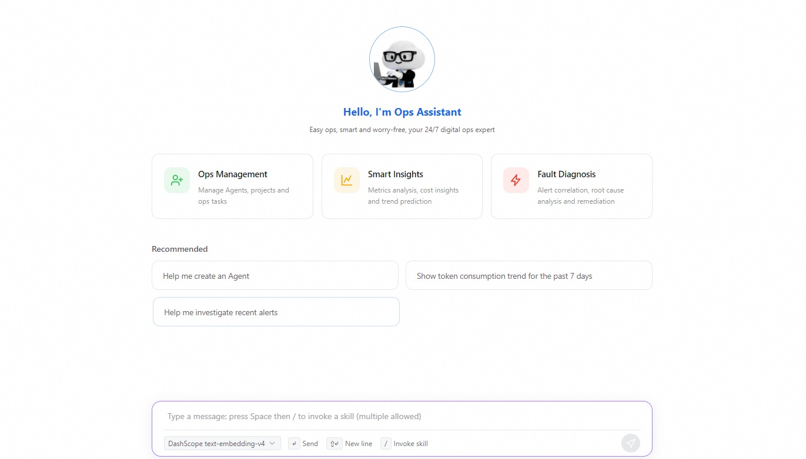

   - Click a quick question on a card to start a session.

     - Ops Management

       Support centralized lifecycle management of agents, including creation, configuration, and start/stop operations. You can quickly dispatch and manage various Ops tasks such as deployment, restart, and configuration updates to automate operations.

     - Smart Insights

       Query operational metrics and cost data of agents, with multi-dimensional analysis and trend prediction on key data such as performance, cost, and traffic, to identify resource waste and inefficient usage scenarios and provide cost reduction and efficiency improvement solutions.

     - Fault Diagnosis

       Diagnose the token cost, performance latency, resource health, and engine health of agents. The system provides actionable diagnosis and handling suggestions to help you quickly troubleshoot agent exceptions.

   - Create a task: Click **New Task** in the upper-left corner of the page to start a new conversation.

   - Historical task: Search for a historical task in the conversation task record search box to view the historical task records.

   - Delete a task: Move the pointer over the target conversation task, click  next to the

     task, and select **Delete** to delete the historical task record.

   - Rename a task: Move the pointer over the target conversation task, click  next to the

     task, select **Rename**, edit the task name, and then click  .

   - Pin a task: Move the pointer over the target conversation task, click  next to the task,

     and select **Pin** to pin the task.

4. In the upper-left corner of the **AI Assistant** interface, click **Long-running Tasks**.

   <ol type="i">

   <li>

   View long-running tasks.

   On the **Long-running Tasks** page, you can view the metrics of long-running tasks, including **Total Tasks**, **Running**, **Today's Success Rate**, and **Today**.

   </li>

   <li>

   Create a task.

   </li>

   </ol>

   On the **Long-running Tasks** page, click **New Task**, enter a task name, set the scheduled time, select an execution model, describe the task, and then click **Save**.

   <ol type="i" start="3">

   <li>

   Execute a task manually.

   </li>

   </ol>

   On the **Long-running Tasks** page, click **Execute Manually** in the **Actions** column of the target task. The system triggers the task. You can select the task under Scheduled Job on the left side to view the execution details.

   <ol type="i" start="4">

   <li>

   Edit a scheduled task.

   On the **Long-running Tasks** page, click **Edit** in the **Actions** column of the target task, modify the task name, scheduled time, execution model, and description, and then click **Save changes**.

   </li>

   <li>

   Disable or enable a scheduled task.

   On the **Long-running Tasks** page, click **Disable** or **Enable** in the **Actions** column of the target task to manage the task status.

   </li>

   <li>

   View the details of a scheduled task.

   On the **Long-running Tasks** page, click **Details** in the **Actions** column of the target task to view the task details.

   </li>

   <li>

   Delete a scheduled task.

   </li>

   </ol>

   On the **Long-running Tasks** page, click **Delete** in the **Actions** column of the target task, and then click **Delete** in the dialog box.

   <ol type="i" start="8">

   <li>

   Filter and search for scheduled tasks.

   </li>

   </ol>

   On the **Long-running Tasks** page, you can filter tasks by All, Enabled, or Disabled, and can also search for a task by name or description.

5. In the upper-left corner of the **AI Assistant** interface, click **Operations Knowledge Base**.

   <ol type="i">

   <li>

   View the built-in knowledge base.

   On the **Operations Knowledge Base** page, click **All Knowledge Bases** to view the built-in OpenTrek-Ops product documentation. Click **Details** in the **Actions** column to view specific documents, index status, settings, and other detailed information.

   </li>

   <li>

   Create a knowledge base.

   <ol type="a">

   <li>

   On the **Operations Knowledge Base** page, select the **Created by Me** tab, click **Create Knowledge Base**, enter a knowledge base name and description, select the visibility scope, and then click **Create Knowledge Base**.

   </li>

   <li>

   Upload a document.

   Click **Details** in the **Actions** column of the created knowledge base. On the **Document Management** tab, click **Upload Document** to upload a local document.

   </li>

   </ol>

   <ol type="i" start="100">

   <li>

   Index status

   On the **knowledge base** details page, select **Index Status** to view the index details of the knowledge base.

   </li>

   <li value="500">

   Retrieval test

   On the **knowledge base** details page, select **Retrieval Test**, enter a keyword from the document, and click **Search**. The interface displays the retrieval results.

   </li>

   </ol>

   <ol type="a" start="5">

   <li>

   Settings

   On the **knowledge base** details page, select **Settings** to view the basic information, personal space quota, and retrieval model of the knowledge base.

   </li>

   </ol>

   </li>

   <li>

   View the details of a knowledge base.

   </li>

   </ol>

   Click **Details** in the **Actions** column of the created knowledge base to view specific documents, index status, settings, and other detailed information.

   <ol type="i" start="4">

   <li>

   Rebuild the index.

   Click **Rebuild index** in the **Actions** column of the created knowledge base, and the system rebuilds the indexes of all documents in the knowledge base. The previous version continues to serve requests until the new version is ready.

   </li>

   <li>

   Delete a knowledge base.

   Click **Delete** in the **Actions** column of the created knowledge base. After confirmation, the system also deletes the documents and indexes.

   </li>

   </ol>

# 5.O&M Center

## 5.1. Agent list

This topic describes how to manage agents in the OpenTrek-Ops platform. You can host, view, edit, start, stop, scale, and delete agents.

**Common scenarios**

Agent management is a core feature of the platform and applies to the following scenarios:

- Create new Ops agents to automate specific Ops tasks.

- Manage the configuration and running status of existing agents to ensure that the agents run properly.

- Allocate and manage agent resources for different projects to optimize resource allocation.

- View agent execution records to analyze agent performance and troubleshoot issues.

**Prerequisites**

- You have logged in to the OpenTrek-Ops platform.

- You have the tenant operations administrator role or a role with agent creation permissions.

**Procedure**

1. Log in to the OpenTrek-Ops platform.

2. In the left-side navigation pane, select **Operation Center** > **Agent List** to go to the **Agent Management** page.

   You can view the following information on this page:

   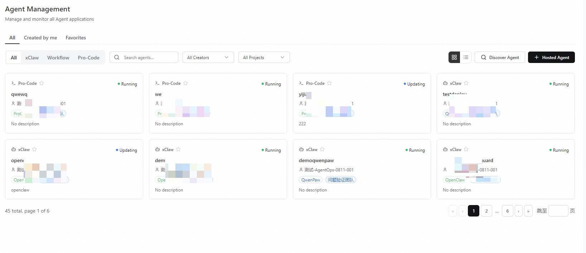

   - Use the search box to search for an agent by name.

   - Use the **All Creators** drop-down list to filter the agent list by creator.

   - Use the **All Projects** drop-down list to filter the agent list by project.

   - Click the view switch button to switch between the grid view and the list view.

   - View agents that you created or favorited, and filter them by the **All**, **xClaw**, **Workflow**, or **Pro-Code** type.

   - View agent cards that display information such as the agent icon, name, type label, project, creator, and running status.

3. Host an agent.

   On the **Agent Management** page, click **Hosted Agent**. The system supports three types: **xClaw**, **Workflow**, and **ProCode**.

   - **xClaw**

     The **xClaw** tab is selected by default. Fill in the following information in the form:

     <table>
       <tr>
         <th>Module</th>
         <th>Parameter</th>
         <th>Required</th>
         <th>Description</th>
       </tr>
       <tr>
         <td rowspan="5">Basic Info</td>
         <td>Name</td>
         <td>Yes</td>
         <td>The display name of the agent. We recommend using a meaningful name.</td>
       </tr>
       <tr>
         <td>Description</td>
         <td>No</td>
         <td>The feature description of the agent.</td>
       </tr>
       <tr>
         <td>Type</td>
         <td>Yes</td>
         <td>Select the agent type. The system supports three types: <strong>QwenPaw</strong>, <strong>OpenClaw</strong>, and <strong>Hermes</strong>.</td>
       </tr>
       <tr>
         <td>Project</td>
         <td>Yes</td>
         <td>Select the project to which the agent belongs.</td>
       </tr>
       <tr>
         <td>Version</td>
         <td>Yes</td>
         <td>Select the professional or standard version. • The professional version provides comprehensive capabilities, including powerful memory services, auto scaling, and comprehensive observability. • The standard version provides limited capabilities. It supports basic Ops features and does not guarantee high availability.</td>
       </tr>
       <tr>
         <td rowspan="2">Persona</td>
         <td>Persona</td>
         <td>No</td>
         <td>Describe the persona traits.</td>
       </tr>
       <tr>
         <td>Behavior Boundary</td>
         <td>No</td>
         <td>Define the behavior boundaries.</td>
       </tr>
       <tr>
         <td>Skill Configurati on</td>
         <td>/</td>
         <td>No</td>
         <td>Click <strong>Add Skill</strong>, select a skill, and then click <strong>Confirm</strong>. Note Before you add a skill, make sure that you have created a skill on the <strong>Capabilities and</strong> <strong>Plug-ins</strong> &gt; <strong>Skills</strong> tab.</td>
       </tr>
       <tr>
         <td>Plugin Configurati on</td>
         <td>/</td>
         <td>No</td>
         <td>Click <strong>Add Plugin</strong>, select a plugin, and then click <strong>Confirm</strong>. Note Before you add a plugin, make sure that you have uploaded a plugin on the <strong>Capabilities</strong> <strong>and Plug-ins</strong> &gt; <strong>Plugins</strong> tab.</td>
       </tr>
       <tr>
         <td>Channel Settings</td>
         <td>/</td>
         <td>No</td>
         <td>You can enable DingTalk, WeChat, and WeCom. Note Before you configure channels, make sure that you have enabled channels in <strong>System</strong> <strong>Settings</strong> &gt; <strong>Configuration Management</strong> &gt; <strong>Channel Management</strong>.</td>
       </tr>
       <tr>
         <td>Visibility</td>
         <td>/</td>
         <td>Yes</td>
         <td>Control which users can view this agent. • Only Me • All Project Members • Specific Members</td>
       </tr>
     </table>

     After you fill in the information, click **Create**. After the agent is created, the new agent appears in the agent list.

   - **Workflow**

     Select the **Workflow** tab and fill in the following information in the form:

     **Require**

     **Module**

     **Parameter**

     **Description**

     **d**

     The display name of the workflow application. We

     Agent Name

     Yes

     recommend using a meaningful name.

     Basic Info

     Feature

     No

     Briefly describe the features of the workflow.

     Description

     Project

     Yes

     Select the project to which the agent belongs.

     DSL Type

     Yes

     **Dify DSL** by default.

     Dify Platform

     Yes

     Select a Dify platform.

     Workflow Orchestrati on

     Click to upload or drag and drop a file to the upload

     Upload DSL

     Yes

     area. The system supports the .json, .yaml, and

     File

     .yml formats.

     Control which users can view this agent.

     - Only Me

     Visibility

     /

     Yes

     - All Project Members

     - Specific Members

     After you fill in the information, click **Create Agent** to complete the creation. After the agent is created, the new agent appears in the agent list.

   - **Pro-code**

     Select the **ProCode** tab and fill in the following information in the form:

     **Require**

     **Module**

     **Parameter**

     **Description**

     **d**

     The display name of the pro-code agent. We

     Yes

     App Name

     recommend using a meaningful name.

     Description

     No

     Briefly describe the application feature.

     Project

     Yes

     Select the project to which the agent belongs.

     Basic Info

     Agent

     Yes

     Select a built-in agent framework.

     Framework

     Select a runtime. You can select a specific version

     Tech Stack

     Yes

     or **Other**.

     PUBLISH

     The system supports **Self-Managed Platform**.

     Yes

     PLATFORM

     Deploy the agent to your own platform.

     RESOURCE CONFIGURATI

     Yes

     Set the number of replicas, CPU, and memory.

     ON

     - Image Source

     Deploymen

     The system supports **Custom Registry**.

     t

     - Image Address

     Configurati on

     Enter the complete image pull address, including

     IMAGE

     the registry, namespace, image name, and tag.

     CONFIGURATI

     Yes

     - Image Pull Policy

     ON

     The system supports **Prefer local image**, **Always pull image**, and **Use local image only**.

     - Image Authentication

       Select an existing secret or create a new secret.

     LAUNCH CONFIGURATI

     No

     Enter the launch command and port.

     ON

     Enter the check path, check port, check interval,

     Health Check

     No

     and timeout period.

     Environment

     Set environment variables. The system supports

     No

     Variables

     **Form Mode** and **JSON Mode**.

     Control which users can view this agent.

     - Only Me

     Visibility

     /

     Yes

     - All Project Members

     - Specific Members

     After you fill in the information, click **Create App** to complete the creation. After the application is created, the new agent appears in the agent list.

4. Discover an agent.

   > **Note**
   >
   > Discover and integrate existing agents from Alibaba Cloud Model Studio or Dify.

   - OpenTrek Dev

     On the **Agent Management** page, click **Discover Agent**. On the **OpenTrek Dev** tab, configure the following parameters:

     | Parameter | Description |
     | --- | --- |
     | Platform | Select an integrated Alibaba Cloud Model Studio platform. |
     | Type | Select the agent to integrate. The system imports all published versions of the agent as independent agents. The system supports two types: <strong>Autonomous Agent</strong> and <strong>Workflow</strong>. |
     | Select Agent | Search for an agent by name and select it. You can select multiple agents. |
     | Project | Select a project. |
     | Visibility | Control which users can view this agent. • Only Me • All Project Members • Specific Members |

     Click **Import Agent**. The new agent appears in the agent list after the creation succeeds.

   - Dify

     On the **Agent Management** page, click **Discover Agent**. On the **Dify** tab, configure the following parameters:

     | Parameter | Description |
     | --- | --- |
     | Platform | Select an integrated Alibaba Cloud Model Studio platform. |
     | App Type | Select the agent to integrate. The system imports all published versions of the agent as independent agents. The system supports five types: <strong>Workflow</strong>, <strong>Chatflow</strong>, <strong>Chat Assistant</strong>, <strong>Agent</strong>, and <strong>Text Generation</strong>. |
     | Select Agent | Search for an agent by name and select it. You can select multiple agents. |
     | Project | Select a project. |
     | Visibility | Control which users can view this agent. • Only Me • All Project Members • Specific Members |

     Click **Import Agent**. The new agent appears in the agent list after the creation succeeds.

5. View the agent details.

   - On the **Agent Management** page, find the target agent and click the agent card to go to the agent details page.

   - On the agent details page, view the following information:

     - Basic information: The name, type, description, creation time, project, primary model, and more.

     - Running status: Running, Changing, Stopped, or Abnormal.

     - Configuration information: The running configuration parameters of the agent, such as overview, persona, skills and tools, channels, cloud resources, version history, security settings, metrics analysis, trace analysis, and topology.

       > **Note**
       >
       > - For pro-code agents, you can view the details of instances and scaling, backup and version, metrics analysis, and trace analysis.
       >
       > - For workflow agents, you can view the details of overview, channels, and version management.

     - Operational logs: The historical execution records of the agent, including historical tasks and logs.

**Related operations**

| Operation type | Agent type | Procedure |
| --- | --- | --- |
| Edit an agent | xClaw | 1. Find the target agent in the agent list. 2. Click the agent card to go to the agent details page. 3. In the <strong>Basic Info</strong> section, edit the <strong>Primary Model</strong> as needed. 4. Click <strong>More</strong> &gt; <strong>Edit</strong> in the upper-right corner of the page to edit the agent name, description, and visibility. 5. In the lower part of the details page, click the <strong>Persona</strong>, <strong>Skills and</strong> <strong>Tools</strong>, <strong>Channels</strong>, <strong>Cloud Resources</strong>, <strong>Version History</strong>, or <strong>Security</strong> <strong>Settings</strong> tab to edit the related information. i. Persona Edit the <strong>Identity</strong>, <strong>Persona</strong>, and <strong>Behavior Boundaries</strong>, and then click <strong>Save</strong>.ii. Skills and Tools • Skills • Add a skill Click <strong>Add Skill</strong>, select one or more skills, and then click <strong>OK</strong>. Note Before adding a skill to an agent, you must first add the skill to the project to which the agent belongs. • Roll back a skill If an added skill has multiple versions, click the skill name and switch the version in the upper-right corner of the skill details page to roll back the skill version. • Delete a skill Click the delete icon next to an added skill to remove the skill. • Update the skill status Clicknext to an added skill to enable or disable the skill. • Plugins • Add a plugin Click <strong>Add Plugin</strong>, select the target plugin, and then click <strong>OK</strong>. • Delete a plugin Click the delete icon on the plugin card to remove the plugin. • MCP • Add an MCP server Click <strong>Add MCP</strong>. In the <strong>Add MCP Server</strong> dialog box, search for and select the server, and then click <strong>Bind to Agent</strong>. • Delete an MCP server Click the delete icon next to an added MCP server to remove the MCP server. • Update the status of an MCP server Clicknext to an added MCP server to enable or disable the MCP server. iii. Channels Configure the channel information and click <strong>Save Configuration</strong>. iv. Cloud Resources Click the delete icon next to the target model service to remove the model. The system synchronizes the change to the agent after removal. v. Version History On the <strong>Version History</strong> tab, click <strong>Publish</strong> in the <strong>Actions</strong> column of a historical version to roll back the agent to that version. |

<ol type="i" start="6">

<li>

Security Settings

- Global inheritance

  The agent inherits global rules. You can disable or enable rules in the **Actions** column.

- Agent-specific

  - Add a rule

    Click **Add Rule**, set the rule ID, select a tool, configure parameters such as the regex pattern and exclusion pattern, and then click **Add**. After the rule is added, the status changes to **Synchronized**. For more information, see Security settings.

  - Enable or disable a rule

    Click  in the **Actions** column of the target rule to enable or

    disable the rule.

  - Edit a rule

</li>

</ol>

1. Click the agent card to go to the agent details page.

   Click  in the **Actions** column of the target rule to edit the

2. On the agent details page, click **More** in the upper-right corner and

   agent rule information.

   select **Edit**.

Pro-code

- Delete a rule

3. Edit the agent name, description, and visibility.

4. Click **Save**Click .  in the **Actions** column of the target rule to delete the

   rule.

1. Click the agent card to go to the agent details page.

2. On the agent details page, click **More** in the upper-right corner and select **Edit**.

3. Edit the agent name, description, and visibility, and then click **Save**.

Workflow

4. In the lower part of the details page:

   <ol type="i">

   <li>

   Click **Channels** to configure channels such as DingTalk and WeChat.

   </li>

   <li>

   Click **Version Management** to preview or publish historical

   </li>

   </ol>

   versions.

1. Find the target agent in the agent list and click the agent card to go to the details page.

xClaw

2. In the upper-right corner of the details page, click **More**, and then select **Start** or **Stop**.

3. After confirmation, the system updates the agent status.

1. Find the target agent in the agent list and click the agent card to go

Start or

to the details page.

stop an agent

Pro-code

2. In the upper-right corner of the details page, click **More**, and then select **Take Offline** or **Start**.

3. After confirmation, the system updates the agent status.

1. Find the target agent in the agent list and click the agent card to go to the details page.

Restart an

xClaw/Pro-

agent

code

2. In the upper-right corner of the details page, click **Restart**.

3. After confirmation, the system updates the agent status.

> **Note**
>
> Before you delete an agent, make sure that the agent is in the stopped status.

xClaw/Pro-

Delete an

1. Find the target agent in the agent list and click the agent card to go

code/Workfl

agent

to the details page.

ow

2. In the upper-right corner of the details page, click **More**, and then select **Delete**.

3. In the confirmation dialog box, click **Delete**.

4. After deletion, the system removes the agent from the list.

1. Find the target agent in the agent list and click the agent card to go to the details page.

2. In the upper-right corner of the details page, click **More**, and then select **Scale**.

xClaw/Pro-

Scale

3. In the **Adjust Resources** dialog box, preview the current

code

configuration information and then set the CPU and memory.

4. Click **Apply**. During the scaling process, the agent status changes to **Changing**. You can view the scaling task details on the **Change History** page.

1. Find the target agent in the agent list and click the agent card to go to the details page.

2. In the upper-right corner of the details page, click **More**, and then select **Update**. The system displays the available versions for upgrade by default.

3. Click **Confirm Upgrade** to upgrade the agent.

xClaw

> **Note**
>
> When the agent image is the latest version, the Update button is unavailable.

1. Find the target agent in the agent list and click the agent card to go to the details page.

Update an agent

2. In the upper-right corner of the details page, click **More**, and then select **Update**.

Pro-code

3. Update the basic information, deployment configuration, advanced settings, and other details of the agent as needed.

4. Click **Confirm Update**.

1. Find the target agent in the agent list and click the agent card to go to the details page.

Workflow

2. In the upper-right corner of the details page, click **More**, and then select **Update**. Re-upload the DSL file.

3. Click **Update**.

1. Find the target agent in the agent list and click the agent card to go to the details page.

2. In the upper-right corner of the details page, click **More**, and then

Unbind an

select **Unbind**.

Workflow

agent

3. After unbinding, the system clears the workflow agent data on this platform. After confirmation, click **Confirm Unbind**.

Click the favorite icon  on the target agent card to add the agent to

Favorite an

xClaw/Pro-

agent

code

favorites. You can then view the agent in **My Favorites**.

1. Find the target agent in the agent list and click the agent card to go to the details page.

2. In the upper-right corner of the agent details page, click **Chat** to go to the interaction page and start a conversation.

Chat with

xClaw/Work

an agent

flow

> **Note**
>
> You can view only the conversations that you initiated.

**Next steps**

After creating an agent, you can add the agent to a project for collaboration.

## 5.2. Project management

This topic describes how to manage projects in the OpenTrek-Ops platform, including creating projects and managing project members.

**Scenarios**

The project management feature applies to the following scenarios:

- Build a multi-role O&M team to divide and collaborate on complex O&M tasks.

- Manage team member agents and permissions to ensure effective management of team members.

- Coordinate task assignment among agents within the team to improve team collaboration efficiency.

- Form a dedicated O&M team for a specific project or business scenario.

**Prerequisites**

- You have logged in to the OpenTrek-Ops platform.

- You have obtained the tenant operations administrator role or a role with project creation permissions.

**Procedure**

1. Log in to the OpenTrek-Ops platform.

2. In the left-side navigation pane, select **Operation Center > Project Management** to go to the **Project Management** page.

   Obtain the following information on this page:

   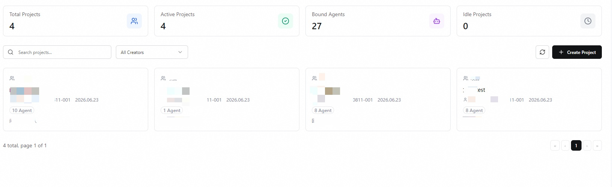

   - View the number of total, activated and idle projects as well as the number of bound agents.

   - Use the search box to search for a target project by project name.

   - Filter projects by creator.

   - Click **Create Project** to create a new project.

   - View project cards, which display information such as the project name, number of agents, creator, and description.

   - Click a card to go to the project details page and view the agent list.

3. Create a project.

   <ol type="i">

   <li>

   On the **Project Management** page, click **Create Project**.

   </li>

   <li>

   In the pop-up creation form, fill in the following information:

   </li>

   </ol>

   | Parameter | Required | Description |
   | --- | --- | --- |
   | Project Name | Yes | The display name of the team. We recommend that you enter a meaningful name. |
   | Description | No | The responsibilities and goals of the project. |
   | K8S Cluster | No | Select a Kubernetes cluster. |
   | Model Service | Yes | Select at least one text generation model. |
   | Runtime Storage | Yes | Enabled by default. |
   | Memory Service | No | Disabled by default. When enabled, select at least one text vectorization model. |
   | Permission | No | Configure <strong>Project Admin</strong> and <strong>Project</strong> <strong>Members</strong>. • Project Admin: This role has full management permissions for the project and can manage members, resources, and configurations. • Project Member: This role can use resources such as agents, skills, and tools under the project. |

   <ol type="i" start="3">

   <li>

   Click **Create Project** to complete the creation.

   </li>

   </ol>

4. Add a project member.

   <ol type="i">

   <li>

   Click the target project card to go to the details page.

   </li>

   <li>

   On the Agent tab, click **Create Agent**. Refer to Agent list to add an agent.

   </li>

   <li>

   Click **Create** to complete the addition.

   </li>

   </ol>

5. Add a skill.

   On the project details page, select the **Skills** tab, click **Add Skill**, select a skill, and then click **Confirm** to add the skill to the project.

6. Add a plugin.

   On the project details page, select the **Plugins** tab, click **Add Plugin**, select a plugin, and then click **Confirm** to add the plugin to the project.

7. Add an MCP server.

   On the project details page, select the **MCP** tab, click **Add MCP**, select an MCP server, and then click **Add to Project** to add the MCP server to the project.

8. Manage cloud resources.

   - Add a cloud resource On the project details page, select the **Cloud Resources** tab. On the **Model Service** tab, click **Add Resource**, select a model, and then click **Save** to bind the model to the project.

   - Delete a cloud resource

     On the project details page, select the **Cloud Resources** tab. On the **Model Service**

     tab, click the delete icon  in the **Action** column of the target cloud resource to delete

     the cloud resource.

9. Trace Analysis.

   On the project details page, select the **Trace Analysis** tab to view all trace records under the project. Click a trace ID to view the details.

**Related operations**

**Edit a project**

1. On the **Project Management** page, select the target project and click the project card.

2. Click **Edit** in the upper-right corner of the page to edit the **project name**, **description**, **project admins**, and **project members**.

3. Click **Save**.

**Delete a project**

> **Note**
>
> Before you delete a project, make sure that all agents under the project are cleaned up.

1. On the **Project Management** page, select the target project and click the project card.

2. Click **Delete** in the upper-right corner of the page, and then click **Confirm Delete**.

   > **Warning**
   >
   > The deletion operation is irreversible. Proceed with caution.

**Batch operations**

1. On the **Project Management** page, select the target project and click the project card.

2. Click **Batch Operations** in the upper-right corner of the page.

   - Agent Ops

     Select **Agent Ops** in the batch operation dialog box, and then select a specific operation.

     | Operation type | Procedure |
     | --- | --- |
     | Update | Select Operation &amp; Scope a. Select <strong>Update</strong> for the agent Ops operation. b. Select an agent type: xClaw, Workflow, or ProCode. c. Select the agents and click <strong>Next</strong>. Configure Parameters Select the runtime and version, and then click <strong>Next</strong>. Execution Method Select an execution policy: <strong>Full Execution</strong> or <strong>Batch Execution</strong>, and then click <strong>Next</strong>. Preview Preview the details and click <strong>Confirm Execution</strong> after verification. |
     | Resize Spec | Select Operation &amp; Scope a. Select <strong>Resize Spec</strong> for the agent Ops operation. b. Select an agent type: xClaw or ProCode. c. Select the agents and click <strong>Next</strong>. Configure Parameters Select the target specification or a custom specification, and then click <strong>Next</strong>. Execution Method Select an execution policy: <strong>Full Execution</strong> or <strong>Batch Execution</strong>, and then click <strong>Next</strong>. Preview Preview the details and click <strong>Confirm Execution</strong> after verification. |
     | Restart | Select Operation &amp; Scope a. Select <strong>Restart</strong> for the agent Ops operation. b. Select an agent type: xClaw or ProCode. c. Select the agents and click <strong>Next</strong>. Configure Parameters No configuration is required. Click <strong>Next</strong>. Execution Method Select an execution policy: <strong>Full Execution</strong> or <strong>Batch Execution</strong>, and then click <strong>Next</strong>. Preview Preview the details and click <strong>Confirm Execution</strong> after verification. |
     | Start | Select Operation &amp; Scope a. Select <strong>Start</strong> for the agent Ops operation. b. Select an agent type: xClaw or ProCode. c. Select the agents and click <strong>Next</strong>. Configure Parameters No configuration is required. Click <strong>Next</strong>. Execution Method Select an execution policy: <strong>Full Execution</strong> or <strong>Batch Execution</strong>, and then click <strong>Next</strong>. Preview Preview the details and click <strong>Confirm Execution</strong> after verification. |
     | Stop | Select Operation &amp; Scope a. Select <strong>Stop</strong> for the agent Ops operation. b. Select an agent type: xClaw or ProCcode. c. Select the agents and click <strong>Next</strong>. Configure Parameters No configuration is required. Click <strong>Next</strong>. Execution Method Select an execution policy: <strong>Full Execution</strong> or <strong>Batch Execution</strong>, and then click <strong>Next</strong>. Preview Preview the details and click <strong>Confirm Execution</strong> after verification. |
     | Offline | Select Operation &amp; Scope a. Select <strong>Offline</strong> for the agent Ops operation. b. Select an agent type: xClaw or ProCode. c. Select the agents and click <strong>Next</strong>. Configure Parameters No configuration is required. Click <strong>Next</strong>. Execution Method Select an execution policy: <strong>Full Executionp</strong> or <strong>Batch Execution</strong>, and then click <strong>Next</strong>. Preview Preview the details and click <strong>Confirm Execution</strong> after verification. |

   - Skill Ops

     <ol type="a">

     <li>

     **Select Operation & Scope**

     <ol type="a">

     <li>

     Select **Skill Ops** for the operation.

     </li>

     <li>

     For **Skill Ops**, select **Sync Skill, Upgrade Skill, Disable Skill, or Remove Skill.**

     </li>

     </ol>

     <ol type="i" start="100">

     <li>

     Select the agents and click **Next**.

     </li>

     </ol>

     </li>

     <li>

     **Configure Parameters**

     Select the skills and click **Next**.

     </li>

     </ol>

     <ol type="i" start="100">

     <li>

     **Execution Method**

     Select an execution policy: **Full Execution** or **Batch Execution**, and then click **Next**.

     </li>

     <li value="500">

     **Preview**

     Preview the details and click **Confirm Execution** after verification.

     </li>

     </ol>

   - Plugin Operations

     <ol type="a">

     <li>

     **Select Operation & Scope**

     <ol type="a">

     <li>

     Select **Plugin Operations** for the operation.

     </li>

     <li>

     For **Plugin Operations**, select **Batch Install Plugins** or **Batch Uninstall Plugins**.

     </li>

     </ol>

     <ol type="i" start="100">

     <li>

     Select the agents and click **Next**.

     </li>

     </ol>

     </li>

     <li>

     **Configure Parameters**

     Select the plugins and click **Next**.

     </li>

     </ol>

     <ol type="i" start="100">

     <li>

     **Execution Method**

     Select an execution policy: **Full Execution** or **Batch Execution**, and then click **Next**.

     </li>

     <li value="500">

     **Preview**

     Preview the details and click **Confirm Execution** after verification.

     </li>

     </ol>

   - Config Update

     | Operation type | Procedure |
     | --- | --- |
     | Update Model | Select Operation &amp; Scope a. Select <strong>Update Model</strong> for the operation. b. Select the agents and click <strong>Next</strong>. Configure Parameters Select the target models and click <strong>Next</strong>. Execution Method Select an execution policy: <strong>Full Execution</strong> or <strong>Batch Execution</strong>, and then click <strong>Next</strong>. Preview Preview the details and click <strong>Confirm Execution</strong> after verification. |

     <table>
       <tr>
         <td>Sync MCP</td>
         <td>Select Operation &amp; Scope a. Select <strong>Sync MCP</strong> for the operation. b. Select the agents and click <strong>Next</strong>. Configure Parameters No configuration is required. Click <strong>Next</strong>. Execution Method Select an execution policy: <strong>Full Execution</strong> or <strong>Batch Execution</strong>, and then click <strong>Next</strong>. Preview Preview the details and click <strong>Confirm Execution</strong> after verification.</td>
       </tr>
     </table>

**Next steps**

After creating a project, you can assign skills to the project to enable team collaboration.

## 5.3. Capabilities and plugins

This topic describes how to manage skills, MCPs, and plugins in the Apsara Uni-Manager Operations Console, including creating, enabling or disabling, managing versions, and installing and configuring them.

**Prerequisites**

- You have logged on to the OpenTrek-Ops platform.

- You have obtained the role of a tenant operations administrator or a role that has the creation and plugin permissions.

**Skills**

1. Log in to the OpenTrek-Ops platform.

2. In the left-side navigation pane, choose **Operation Center** > **Capabilities and Plugins**.

   Go to the **Skills** management page, where you can obtain the following information:

   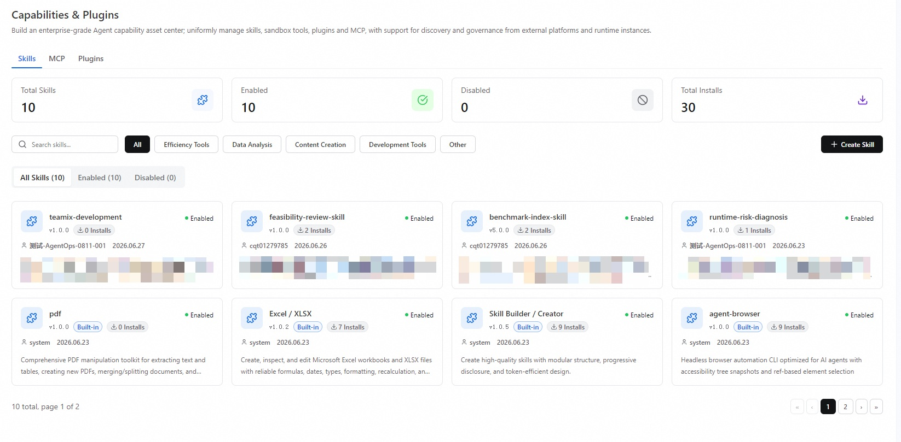

   - View the total number of skills, the number of enabled skills, the number of disabled skills, and the total number of installations.

   - Use the search box to search for a target skill by name.

   - Use category filters to filter skills by All, Efficiency Tools, Data Analysis, Content Creation, Development Tools, or Others.

   - Click **Create Skill** to create a new skill.

   - View skill cards that display the skill icon, name, description, version number, update time, and enablement status.

3. Create a skill.

   > **Note**
   >
   > The system provides built-in skills. The actual data prevails.

   <ol type="i">

   <li>

   On the **Skills** management page, click **Create Skill**.

   </li>

   <li>

   Fill in the following information in the creation form:

   </li>

   </ol>

   | Parameter | Required | Description |
   | --- | --- | --- |
   | Upload skill package | Yes | Upload a prepared skill package. The package must be a .zip file that contains a skill.md file in the root directory. The skill.md file must include the name and description in YAML format. Important A single skill file must not exceed 10 MB in size. If the file exceeds this limit, compress it or split it into multiple skills. |
   | Skill name | No | The system uses the name from skill.md by default. You can modify it. |
   | Skill description | No | The system uses the description from skill.md by default. You can modify it. |
   | Tag category | No | Select the category for the skill. Supported categories include Efficiency Tools, Data Analysis, Content Creation, Development Tools, and Others. |

   <ol type="i" start="3">

   <li>

   After the skill package upload completes, click **Create Skill**.

   </li>

   </ol>

   The system enables the skill by default after you add it.

4. Enable or disable a skill.

   > **Note**
   >
   > After you disable a skill, agents that have installed the skill can no longer call it.

   <ol type="i">

   <li>

   Find the target skill in the skill list and click the card to go to the skill details page.

   </li>

   <li>

   Click **Enable** or **Disable** in the upper-right corner of the details page.

   </li>

   <li>

   The system updates the status after you confirm the operation.

   </li>

   </ol>

5. Delete a skill.

   > **Note**
   >
   > You cannot delete built-in skills.

   Find the target skill in the skill list, click the card to go to the skill details page, click **Delete**, and then click **Confirm Delete** in the dialog box.

6. Update the version.

   <ol type="i">

   <li>

   Click the target skill card in the skill list.

   </li>

   <li>

   Click **Update Version** in the upper-right corner of the skill details page.

   </li>

   <li>

   Upload the new version file in the update version dialog box. The system automatically

   </li>

   </ol>

   performs a security scan and then completes the update.

   <ol type="i" start="4">

   <li>

   Click **Start Update**.

   </li>

   </ol>

7. View skill details.

   <ol type="i">

   <li>

   Click the target skill card in the skill list.

   </li>

   <li>

   Go to the skill details page to view the following information:

   - Basic information: the name, category, description, version, and origin.

   - Overview: the detailed configuration parameters of the skill.

   - Files: the detailed file directory of the skill.

   - Security: the security risk assessment details of the skill.

   - Version history: the upgrade and evolution details of each version.

   - Installed: the projects that have installed the skill. Click a project to view the associated agents.

   </li>

   </ol>

**MCP**

1. Log in to the OpenTrek-Ops platform.

2. In the left-side navigation pane, choose **Operation Center** > **Capabilities and Plugins**, and then click the **MCP** tab.

   Go to the **MCP** page, where you can obtain the following information:

   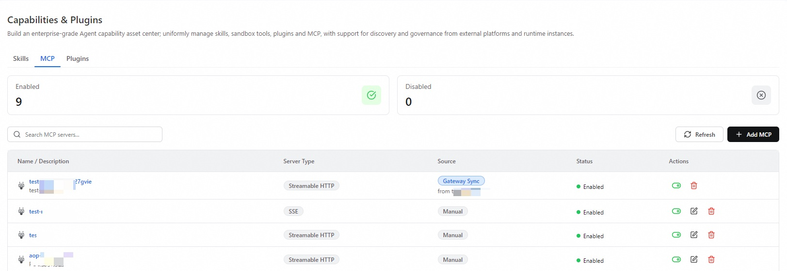

   - View the number of enabled and disabled MCP servers.

   - Use the search box to find a target MCP server.

   - View the MCP list, which includes the name, description, server type, origin, and status.

3. Add an MCP server.

   You can add an MCP server by using one of the following methods: manual configuration, JSON import, or AI Gateway automatic synchronization.

   - **Method 1: Manual configuration**

     <ol type="a">

     <li>

     On the **MCP** page, click **Add MCP**.

     </li>

     <li>

     On the **Manual Configuration** tab, specify the following parameters:

     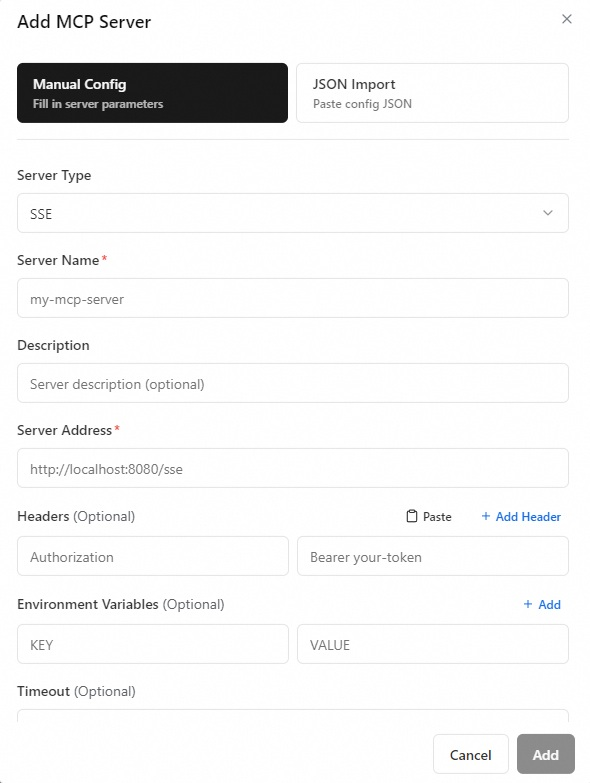

     | Parameter | Required | Description |
     | --- | --- | --- |
     | Server type | Yes | Select the server type: • SSE • Streamable HTTP • STDIO |
     | Server name | Yes | Enter the server name. |
     | Description | No | Optional. Enter a description. |
     | Server endpoint | Yes | Enter the server endpoint, such as http://localhost:8080/sse. |
     | Headers | No | • Add headers directly. You can add multiple headers. • Click <strong>Paste</strong>, paste headers in the Header:Value or Header=Value format with one header per line, and then click <strong>Parse</strong>. |
     | Environment variables | No | Add environment variables. |
     | Timeout period | No | Specify the timeout period for connections, tool list retrieval, and tool calls. The value ranges from 1 to 600 seconds. The default value is 30 seconds. |

     </li>

     </ol>

     <ol type="i" start="100">

     <li>

     Click **Add**. The system sets the status of the added server to **Enabled**.

     </li>

     </ol>

   - **Method 2: JSON import**

     <ol type="a">

     <li>

     On the **MCP** page, click **Add MCP**.

     </li>

     <li>

     In the Add MCP Server dialog box, click **JSON Import**.

     </li>

     </ol>

     <ol type="i" start="100">

     <li>

     Paste the MCP server configuration JSON into the input box.

     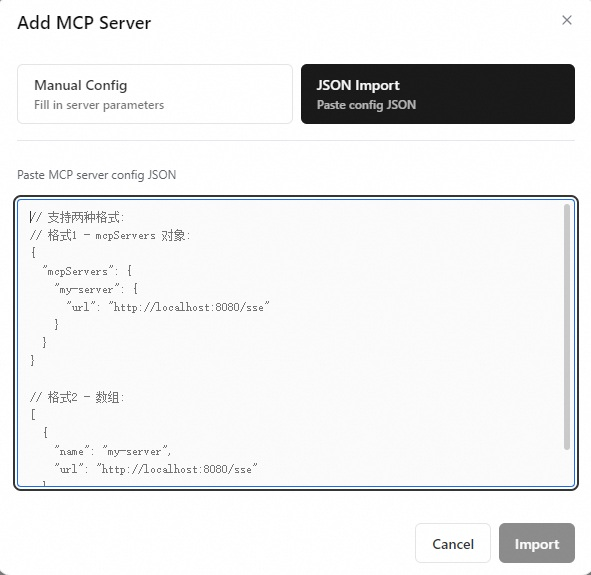

     </li>

     <li value="500">

     Click **Import**. The system sets the status of the imported server to **Enabled**.

     </li>

     </ol>

   - **Method 3: Gateway import**

     After you import the AI Gateway, you can click **Synchronize Gateway** to allow the system to automatically import the **MCP configurations** associated with the AI Gateway. For more information, see Synchronize a gateway.

4. View MCP server details.

   In the server list, click a server name to view the basic information, connection configuration, and tool list of the server:

   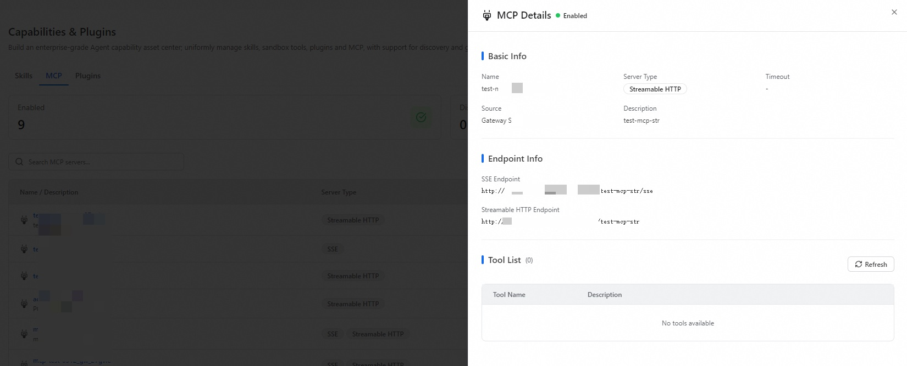

   - Basic information

     View the name, description, server type, status, origin, and timeout period of the server.

   - Endpoint information

     View the endpoint details of the server.

   - Tool list

     View the detailed tool names and descriptions.

5. Disable or enable an MCP server.

   - For a server whose status is **Enabled**, click the disable icon in the **Actions** column of the

     target server  .

   - For a server whose status is **Disabled**, click the enable icon in the **Actions** column of the

     target server  .

6. Edit an MCP server.

   > **Note**
   >
   > You cannot edit servers that were imported from the gateway.

   <ol type="i">

   <li>

   Click the edit icon in the Actions column of the target server  to edit the **Description**,

   **Server Endpoint**, **Headers**, and **Timeout Period** of the MCP server.

   </li>

   <li>

   Click **Next: Impact Confirmation**.

   </li>

   <li>

   Confirm the impact scope, and then click **Confirm Save and Deploy**.

   </li>

   </ol>

7. Delete an MCP server.

   Click the delete icon in the **Actions** column of the target server  , and then click **Delete** in

   the **Confirm Deletion** dialog box.

   > **Important**
   >
   > This operation is irreversible. Proceed with caution.

**Plugin**

1. Log in to the OpenTrek-Ops platform.

2. In the left-side navigation pane, choose **Operation Center** > **Capabilities and Plugins**, and then click the **Plugin** tab.

   On the **Plugin** page, you can obtain the following information:

   - View the total number of plugins, the number of enabled plugins, and the number of disabled and installed plugins.

   - Use the search box to search for a target plugin by name.

   - View plugin cards that display the plugin icon, name, description, version number, and status.

3. Upload a plugin.

   <ol type="i">

   <li>

   On the **Plugin** page, click **Upload Plugin**.

   </li>

   <li>

   In the dialog box, upload the plugin package and enter the plugin name, description, and

   </li>

   </ol>

   version. After you upload the plugin package, the system automatically parses and registers the plugin.

   <ol type="i" start="3">

   <li>

   Click **Upload**. After the upload succeeds, the plugin appears in the plugin list.

   </li>

   </ol>

4. Manage plugin versions.

   Click a target plugin card to go to the plugin details page, click **Update Version**, upload the new plugin package, and then click **Start Update**. The system automatically completes a security scan and then updates the plugin.

5. Install or uninstall a plugin on an agent.

   On the agent details page, click the **Skills and Tools** tab, and then click the **Plugin** subtab:

   - **Install a plugin**: Click **Add Plugin**, select the target plugin, and then click **OK**.

   - **Uninstall a plugin**: Click the delete icon next to an installed plugin, and then confirm the uninstallation.

6. Enable or disable a plugin.

   In the plugin list, click a target plugin card to go to the plugin details page, and then click **Disable** or **Enable** to disable or enable the plugin. After you disable a plugin, agents that have the plugin installed cannot use the plugin features.

7. Delete a plugin.

   In the plugin list, click a target plugin card to go to the plugin details page, click **Delete**, and then click **Confirm Deletion** in the dialog box.

\`\`\`html \`\`\`

# 6.Change history

This topic describes how to view the Ops change history of resources such as agents, skills, security rules, and MCPs, including batch changes, single changes, and change management operations.

**Scenarios**

After performing Ops operations such as restart, upgrade, scaling, and skill synchronization, you can view the execution status and results on the Change History page. The system generates a change history record for any operation that affects or modifies the agent runtime environment (POD) and its runtime dependencies, such as cloud resources and Kubernetes resources.

**Prerequisites**

- You have logged in to the OpenTrek-Ops platform.

- You have obtained the tenant operations administrator role.

**Procedure**

1. Log in to the OpenTrek-Ops platform.

2. In the left-side navigation pane, select **Change History**. On the **Operation History** page, you can view the following information:

   - Statistics cards: The top of the page displays five metrics: **Total Changes**, **Success**, **Failed/Partial**, **Running**, and **Pending**.

     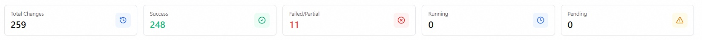

   - Change record list: The system displays all change records in a table.

     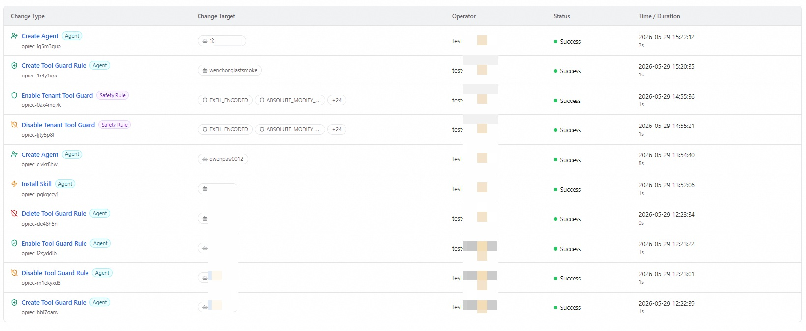

3. View operation details.

   In the change record list, click the target change type to view the detailed history of the change.

   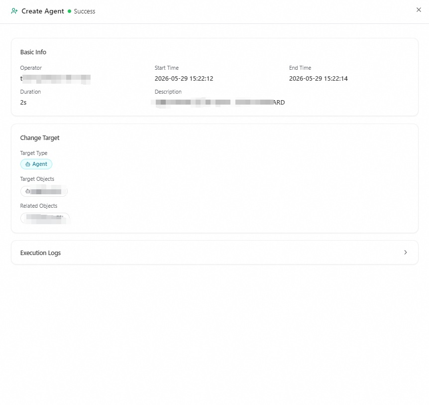

   You can view detailed information such as **Basic Info**, **Change Target**, and **Execution Logs**.

4. View the agent execution results for batch operations.

   For batch operations, click the target change type. In the operation details drawer, you can view the **Execution Strategy** and the total number of agents.

   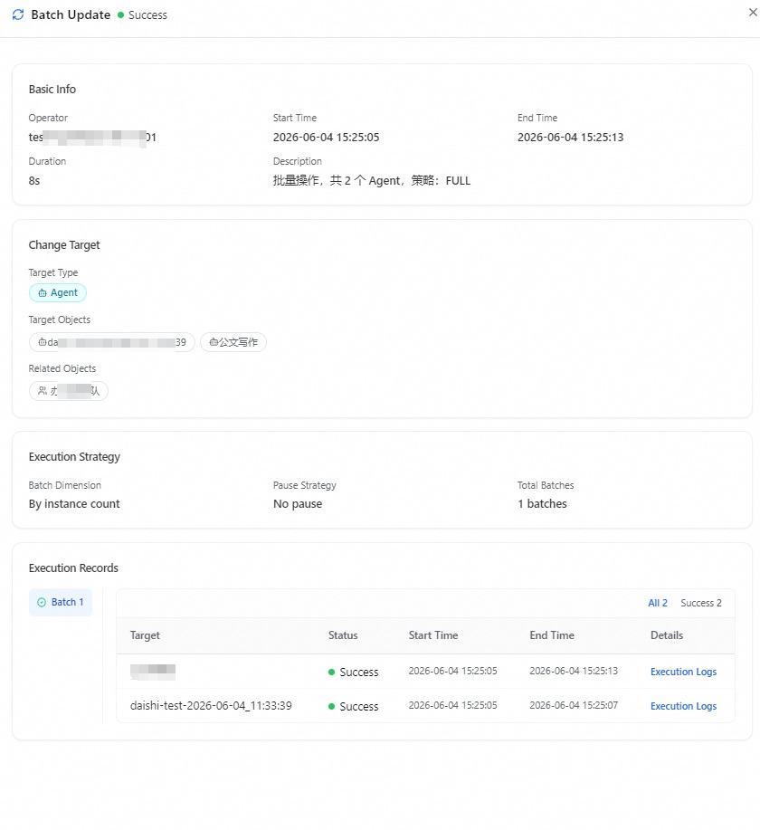

5. Search for and filter operation records.

   - Enter the operator, change type, or change details in the search box to search directly.

   - Use the filter box to filter records by agent, status, change type, or project.

     - Use the **All Agents** drop-down list to filter change records by agent.

     - Use the **All Statuses** drop-down list to filter change records by status.

     - Use the **All Types** drop-down list to filter change records by change type.

     - Use the **All Projects** drop-down list to filter change records by project.

6. Refresh data.

   Click **Refresh** to manually refresh the data.

**Parameter description**

The operation record list contains the following fields:

| Module | Description |
| --- | --- |
| Basic Info | Basic information includes: Detailed information such as the operator, start time, end time, duration, and description. |
| Change Target | Detailed information such as the object type, related objects, and target objects. |
| Execution Strategy | Detailed information such as the batch dimension, pause strategy, and total batches of the strategy. |
| Execution Logs | The detailed execution steps of the change. |

# 7.Infrastructure

This topic describes the features and configurationss of the infrastructure module in the OpenTrek-Ops platform.

**Scenarios**

The infrastructure feature applies to the following scenarios:

- Manage the infrastructure services that agents depend on to ensure the stability of the agent runtime environment.

- Monitor the infrastructure status to promptly detect and troubleshoot service faults.

- Configure the connection parameters of the infrastructure to optimize service performance and resource utilization.

- Manage the integration and configuration of underlying services such as Large Language Model (LLM) Service, Redis, Object Storage Service (OSS), and PostgreSQL.

**Prerequisites**

You have logged in to the OpenTrek-Ops platform as a tenant operations administrator.

**Procedure**

1. Log in to the OpenTrek-Ops platform.

2. In the left-side navigation pane, select **Infrastructure** to go to the **Agent Infra** page.

   This page provides the following information:

   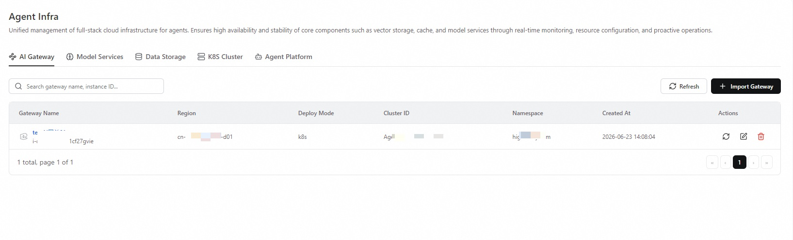

   View information such as the name and type of model services, Kubernetes clusters, AI gateways, agent platforms, and data storage infrastructure.

3. AI Gateway

   - Import a gateway

     <ol type="a">

     <li>

     On the **AI Gateway** tab, click **Import Gateway** and configure the following parameters:

     | Parameter | Required | Description |
     | --- | --- | --- |
     | AI Gateway Name | Yes | Select the gateway instance to import. |
     | API Key | Yes | If required, contact Alibaba Cloud technical support to obtain the API key. |

     </li>

     <li>

     Click **Import**.

     > **Note**
     >
     > If you import an ASCM AI gateway, the system automatically imports the **MCP configuration** and **AI model configuration** associated with the AI gateway after you click **Import**. You can view these configurations on the **MCP** page and the **Infrastructure** > **Model Services** page.

     </li>

     </ol>

   - View details

     Click the name of the target gateway to view detailed information such as **Basic Information**, **Access Points**, **Model API**, and **MCP**.

   - Edit a gateway

     <ol type="a">

     <li>

     Click the edit icon  in the **Actions** column of the target gateway, and then edit the

     **API Key** in the **Edit AI Gateway** dialog box.

     </li>

     <li>

     Click **Next: Impact Confirmation**.

     </li>

     </ol>

     <ol type="i" start="100">

     <li>

     Verify the impact, and click **Confirm Update**. Otherwise, click **Back** to re-edit.

     </li>

     </ol>

   - Synchronize a gateway

     <ol type="a">

     <li>

     Click the synchronize icon  in the **Actions** column of the target gateway, and then

     click **Synchronize**.

     </li>

     <li>

     Confirm the impact of this synchronization, and click **Confirm Sync**. The system pulls the latest model and MCP configurations from the cloud, overwrites the local data, and automatically pushes the configurations to the associated digital employees.

     </li>

     </ol>

   - Remove a gateway

     Click the remove icon  in the **Actions** column of the target gateway, and then click

     **Remove** in the dialog box.

4. Model Services

   - Add a model

     <ol type="a">

     <li>

     On the **Model Services** tab, click **Add Model** and configure the following parameters:

     | Parameter | Required | Description |
     | --- | --- | --- |
     | Model ID | Yes | Enter the identifier used for model API calls, such as gpt-4-turbo. |
     | Display Name | Yes | Enter the model name to display, such as GPT-4 Turbo. |
     | Provider | Yes | Select amodel provider. The system currently supports <strong>Alibaba Cloud</strong>. |
     | Protocol | Yes | Select a protocol. |
     | Inference Type | Yes | Select <strong>Text Generation</strong> or <strong>Text Embedding</strong>. |
     | API Key | Yes | If required, contact the Alibaba Cloud technical support to obtain the API key. |
     | API Endpoint | Yes | Contact Alibaba Cloud technical support to obtain the API endpoint. |

     </li>

     <li>

     Click **Confirm**.

     </li>

     </ol>

   - View model details.

     - On the **Model Services** tab, view information about all models, such as the **Provider**, **Inference Type**, **Protocol**, **Source**.

     - Click the name of the target model in the model list to view the **Basic Information**, source, and **Access Endpoint** of the model.

       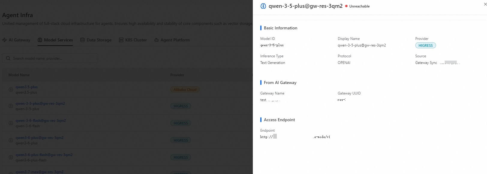

   - Edit a model

     > **Note**
     >
     > Before you modify the infrastructure configuration, make sure that the modification does not affect running agent tasks.

     <ol type="a">

     <li>

     Click the edit icon  in the **Actions** column of the target model.

     </li>

     <li>

     Edit the relevant parameters and click **Next: Impact Confirmation**.

     </li>

     </ol>

     <ol type="i" start="100">

     <li>

     Verify the impact, and then click **Confirm & Apply**. Otherwise, click **Back to Edit** to re-edit.

     </li>

     </ol>

   - Remove a model

     <ol type="a">

     <li>

     Click the remove icon  in the **Actions** column of the target model.

     </li>

     <li>

     In the pop-up dialog box click **Delete**.

     </li>

     </ol>

5. Data Storage

   On the **Data Storage** tab, click the name of an instance to view the **Basic Information** and **Access Endpoints** details of the instance.

   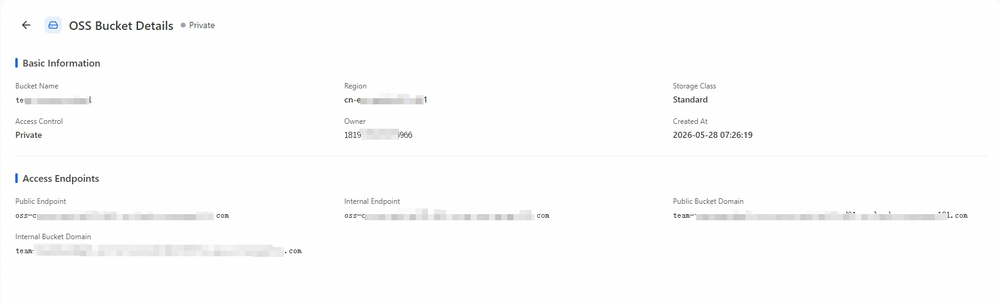

6. K8S Cluster

   - Import a cluster

     <ol type="a">

     <li>

     On the **K8S Cluster** tab, click **Import Cluster** and configure the following parameters.

     | Parameter | Required | Description |
     | --- | --- | --- |
     | Cluster Name | Yes | Enter a custom cluster name. |
     | KubeConfig | Yes | Enter the cluster configuration in YAML format. |
     | storageClassName | Yes | Select the StorageClass of the cluster for persistent storage. |
     | ingressClassName | Yes | Select the Ingress type for agent domain name routing. |
     | Wildcard Domain Support | Yes | The default value is <strong>Yes</strong>. After changing the wildcard DNS settings, you must restart running agents for the change to take effect. |
     | Agent Service Endpoint | Yes | This endpoint serves as the root domain name for generating agent links. Configure a wildcard DNS record in the DNS console in advance. |

     </li>

     <li>

     Click **Import**.

     </li>

     </ol>

   - Edit a cluster

     Click the edit icon  in the **Actions** column of the target cluster to edit parameters such

     as the **Agent Service Endpoint**, **Access IP**, **ingressClassName**, **storageClassName**, and **KubeConfig**. After editing, click **Save**.

   - Remove a cluster

     Click the remove icon  in the **Actions** column of the target cluster, and then click

     **Remove** in the pop-up dialog box.

7. Agent Platform

   - Add a platform

     <ol type="a">

     <li>

     On the **Agent Platform** tab, click **Add Platform** and configure the following parameters:

     <table>
       <tr>
         <th>Parameter</th>
         <th>Required</th>
         <th>Description</th>
       </tr>
       <tr>
         <td>Name</td>
         <td>Yes</td>
         <td>Enter a custom name of the platform, such as Alibaba Cloud Model Studio Enterprise Edition.</td>
       </tr>
       <tr>
         <td>Type</td>
         <td>Yes</td>
         <td>Valid values: <strong>OpenTrek Dev</strong> and <strong>Dify</strong>.</td>
       </tr>
       <tr>
         <td>AppKey</td>
         <td>Yes</td>
         <td rowspan="2">a. Log in to the Alibaba Cloud Model Studio console. In the left-side navigation pane, select <strong>Integration and Openness &gt; APP_KEY</strong> to obtain the AppKey value. b. The page displays the workspace identifier on the right side of the region section at the top. Note This parameter is required only when you select <strong>OpenTrek Dev</strong> as the type.</td>
       </tr>
       <tr>
         <td>Workspace</td>
         <td>Yes</td>
       </tr>
       <tr>
         <td>Endpoint</td>
         <td>Yes</td>
         <td rowspan="3">Enter the endpoint, workspace ID, and admin API Key of Dify. Note This parameter is required only when you select <strong>Dify</strong> as the type.</td>
       </tr>
       <tr>
         <td>Workspace ID</td>
         <td>Yes</td>
       </tr>
       <tr>
         <td>Admin API Key</td>
         <td>Yes</td>
       </tr>
       <tr>
         <td>ApiDomain</td>
         <td>Yes</td>
         <td>Enter the business gateway URL to converse with agents on the Alibaba Cloud Model Studio platform. Note This parameter is required only when you select <strong>OpenTrek Dev</strong> as the type.</td>
       </tr>
     </table>

     </li>

     <li>

     Click **Confirm**.

     </li>

     </ol>

   - Edit a platform

     Click the edit icon  in the **Actions** column of the target platform to edit information

     such as the platform name. If you leave the AppKey field empty, the system retains the original value. After editing, click **Save**.

   - Delete a platform

     Click the delete icon  in the **Actions** column of the target platform, and then click

     **Confirm**.

     > **Warning**
     >
     > This operation is irreversible. Proceed with caution.

# 8.Security center

## 8.1. Security settings

This topic describes how to configure security settings in the OpenTrek-Ops platformApsara Uni-Manager Operations Console, including the security overview, tool guardprotection rules, and file guardprotection policies.

**Prerequisites**

- You have logged ion to the OpenTrek-Ops platform.

- You have obtained the system administrator role or a role with security configuration permissions.

**Security overview**

1. Log in to the OpenTrek-Ops platform.

2. In the left-side navigation pane, selectchoose **Security Center > Security SettingsSecurity Center > Security Settings** to go to. The system displays the **Security Overview** page by default.

3. On the Security **Overview** tabpage, view the following information:

   - Blocked Today: the number of tool calls that the system blocked on the current day.

   - Active Rules: the number of enabled security rules that are currently enabled.

   - Blocking Trend: a trend chart that shows the number of recent blocksed calls over a recent period. The system displays data for the last 7 days by default.

   - Risk Level Distribution: blocking statistics distributed by CRITICAL, HIGH, MEDIUM, LOW, and INFO levels.

   - Top 5 Triggered Rule Hitss: the top 5 security rules with the highest number of hits.

**Tool guardprotection**

**View rules**

1. Log in to the OpenTrek-Ops platform.

2. In the left-side navigation pane, selectchoose **Security Center > Security Settings Security Center > Security Settings**, and then select **Tool GuardProtection**.

3. In the upper part of the page, you can configure security scanning for tool calls. Dangerous operations require your explicit approval before execution.The system requires your explicit approval before it executes high-risk operations.

   - Enable: This option eenables all security rules for the tenant. After you enable this option, the system blocks calls to dangeroushigh-risk tools.

   - Disable: This option disables all security rules for the tenant. After you disable this option, the system does not block calls to dangeroushigh-risk tools.

4. In the lower part of the page, you can view the list of **Global Rules** or **Agent Rules** list. You can also filter target rules by a combination of rule ID, description, level, and agent to find the target rule.

   <table>
     <tr>
       <th>Category</th>
       <th>Parameter</th>
       <th>Description</th>
     </tr>
     <tr>
       <td rowspan="7">Global Rrules</td>
       <td>Rule</td>
       <td>The ID of the security rule.</td>
     </tr>
     <tr>
       <td>SeverityLevel</td>
       <td>The severity level of the security rule. • CRITICAL: Severemajor • HIGH: Hhigh • MEDIUM: Mmedium • LOW: Llow • INFO: Iinformation</td>
     </tr>
     <tr>
       <td>Type</td>
       <td>The type of the security rule. • Built-in • Custom</td>
     </tr>
     <tr>
       <td>Description</td>
       <td>The description of the security rule.</td>
     </tr>
     <tr>
       <td>PMatch patterns</td>
       <td>The match patterns of the security rule.</td>
     </tr>
     <tr>
       <td>Synchronization Sstatus</td>
       <td>The synchronization status of the security rule.</td>
     </tr>
     <tr>
       <td>Actions</td>
       <td>You can enable or disable the security rule.</td>
     </tr>
     <tr>
       <td rowspan="7">Agent Rrules</td>
       <td>Rule</td>
       <td>The ID of the agent rule.</td>
     </tr>
     <tr>
       <td>SeverityLevel</td>
       <td>The severity level of the agent rule.</td>
     </tr>
     <tr>
       <td>Description</td>
       <td>The description of the agent rule.</td>
     </tr>
     <tr>
       <td>PMatch patterns</td>
       <td>The match patterns of the agent rule.</td>
     </tr>
     <tr>
       <td>Agent</td>
       <td>The agent.</td>
     </tr>
     <tr>
       <td>Project</td>
       <td>The project to which the agent rule belongs.</td>
     </tr>
     <tr>
       <td>Synchronization Sstatus</td>
       <td>The synchronization status of the agent rule.</td>
     </tr>
   </table>

5. Click the name of the target rule to go to the rule details page and view its detailed information about the rule, including basic information, severity levelthreat categories, match patterns, and hit statistics.

**Add a rule**

> **Note**
>
> TFor more information about how to add an agent rules, see Agent list.

1. Click **Add Rule**.

2. Configure the following parameters and click **Add**.

   | Parameter | Description |
   | --- | --- |
   | Alert Rule ID | Enter the ID of the security rule. |
   | Tool Llist | Select a tool category. • Shell Execution • File Read • File Write/Edit • Code Search • Web Access • Browser • Image View • Screen Capture • File Transfer • All Tools |
   | Parameter Llist | After you select a tool category, the system automatically fills inpopulates the parameters. If you leave this field empty, the rule matches all parameters. |

   <table>
     <tr>
       <td>Category</td>
       <td>Select athe category of the security rule. • Command Iinjection • Data Exfiltrationtheft • Path Directory Traversal • Sensitive File Access • Network Abuse • Credential Exposure • Resource Abuse • Prompt Injection • Code Execution • Privilege Escalation • Sensitive file accessPrivilege escalation • Network abuse • AccessKey Pair exposure • Resource abuse • Prompt injection • Code Execution</td>
     </tr>
     <tr>
       <td>Severity level</td>
       <td>Select the severity level of the security rule. • CRITICAL: Severecritical • HIGH: Hhigh • MEDIUM: Mmedium • LOW: Llow • INFO: Iinformation</td>
     </tr>
     <tr>
       <td>Regex Ppatterns</td>
       <td>Enter the regex pattern forof the security rule.</td>
     </tr>
     <tr>
       <td>Exclusion Ppatterns</td>
       <td>Enter the exclusion pattern forof the security rule.</td>
     </tr>
     <tr>
       <td>Description</td>
       <td>Enter thea description of the security rule.</td>
     </tr>
     <tr>
       <td>Remediation suggestion</td>
       <td>Enter a remediation suggestion for the security rule.</td>
     </tr>
   </table>

   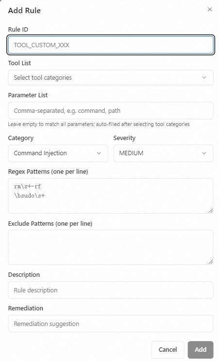

**Enable a rule**

1. Click the switch in the **Actions** column of the target security rule.

2. In the pop-up dialog box that appears, click **ConfirmOK**.

   > **Note**
   >
   > When eanbledAfter you enable the rule, the rule participates in blocksing tool calls.

**Disable a rule**

1. Click the switch in the **Actions** column of the target security rule.

2. In the pop-up dialog box that appears, click **ConfirmOK**.

   > **Note**
   >
   > WhenAfter you disabled the rule, the rule no longer blocks any tool calls.

**File guardprotection**

**Add a path**

1. Log in to the OpenTrek-Ops platform.

2. In the left-side navigation pane, select **Security Center > Security Settings**choose **Security Center > Security Settings**, and then select **File GuardProtection**.

3. Click **Add Path**, configure the following parameters, and then click **Add**.

   | Parameter | Description |
   | --- | --- |
   | Path | The path of the configuration file. |
   | Rule Ttype | The access control policy for the configuration file path. The following two policy types are available: • Extra Grant: Grants access permissions to the specified file path.Additional authorization: grants access permissions to the specified object path. • Permanent Deny: Denies access to the specified file path.Permanent block: blocks access to the specified object path. |
   | Description | A brief description of the access policy for this path. |

**Edit a path**

1. Click the edit icon in the **Actions** column of the target protection path.

2. Modify the **Path**, **Rule Type**, and **Description** of the protection path.

3. Click **Save**.

**Delete a path**

Click the delete icon in the **Actions** column of the target protection path to delete the path.

**Enable a path**

1. Click the switch in the **Actions** column of the target protection path.

2. In the pop-up dialog box that appears, click **ConfirmOK**.

**Disable a path**

1. Click the switch in the **Actions** column of the target protection path.

2. In the pop-up dialog box that appears, click **ConfirmOK**.

\`\`\`html \`\`\`

## 8.2. Audit logs

The system tracks key operations in real time, focusing on high-risk events and compliance remediation progress.

**Prerequisites**

- You have logged in to the OpenTrek-Ops platform.

- You have the system administrator role or a role with audit log permissions.

- You have enabled the tool guard feature in **Security Settings**.

**Procedure**

1. Log in to the OpenTrek-Ops platform.

2. In the left-side navigation pane, select **Security Center > Audit Logs**.

3. You can filter audit logs by keyword, severity, decision, and project above the list.

4. View the audit log list. The following table describes some parameters.

   | Parameter | Description |
   | --- | --- |
   | Event ID | The ID of the event. |
   | Project | The project to which the agent belongs. |
   | Agent | The name of the agent. |
   | Tool Name | The tool category of the security rule. |
   | Tool Parameters | The tool parameter of the security rule. |
   | Rule ID | The ID of the security rule. Click the rule name to view the rule details. |
   | Severity | The severity level of the security rule: • CRITICAL: Major • HIGH: High • MEDIUM: Medium • LOW: Low • INFO: Information |
   | Decision | The decision result of the security rule: • ALLOW: Allow • DENY: Deny • TIMEOUT: Timeout |
   | Decision By | The decision maker of the security rule: • USER: User • SYSTEM: System |
   | Time | The time of the audit log. |
   | Actions | Click <strong>Details</strong> to view the audit log details. |

5. Click **Export** in the upper-right corner of the audit log list to download the audit logs to your local computer.

# 9.Session analysis

**Prerequisites**

- You have logged in to the OpenTrek-Ops platform.

- You have the system administrator role or a role with session analysis permissions.

**Procedure**

1. Log in to the OpenTrek-Ops platform.

2. In the left-side navigation pane, select **Session Analysis**.

3. On the **Session Analysis** page, view the following information:

   - Search for sessions by session ID.

   - Filter sessions by agent.

   - Query sessions by filtering time or specifying a custom time range.

4. Click a session name or session ID to view details such as the session name, session ID, start time, entry agent, project, session duration, turns, total tokens, input tokens, output tokens, trace list, and session messages.

   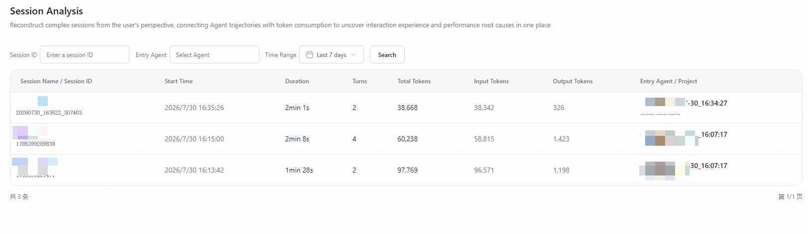

   In the trace list, click a trace ID to view the trace details.

# 10.UModel exploration

UModel exploration is a visual exploration tool designed for model governance and data asset management scenarios. It provides a unified view of model entities and their associations in the system, transforms scattered and abstract metadata into interactive visual graphs, and helps users quickly understand the system architecture, data asset distribution, and entity dependencies.

**Prerequisites**

- You have logged in to the OpenTrek-Ops console.

- You have the system administrator role or a role with UModel exploration permissions.

**Procedure**

1. Log in to the OpenTrek-Ops platform.

2. In the left-side navigation pane, select **UModel Exploration**.

3. On the **UModel Explorer** page, viewn the following information:

   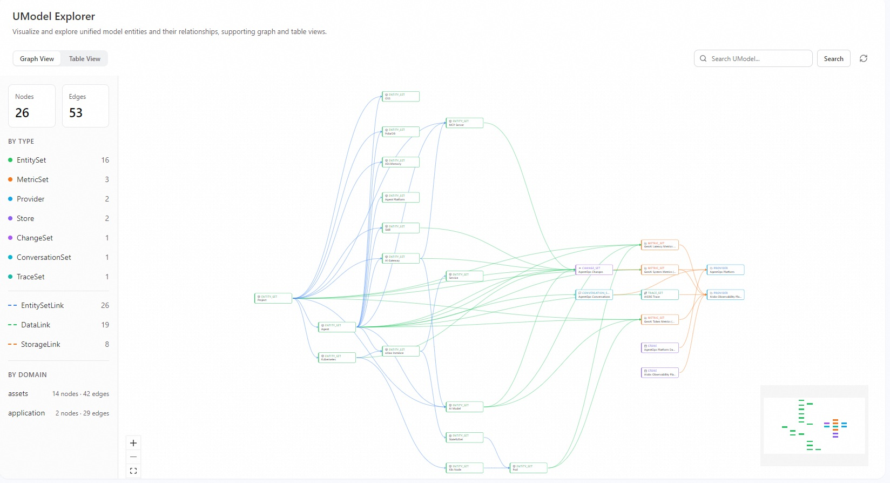

   - The total number of nodes and connections.

   - The statistics grouped by type or region.

   - The option to switch between the **Graph view** and the **Table view** in the upper-left corner.

   - The zoom and full-screen options for the topology in the lower-left corner.

4. Click any node in the topology, and a dialog box displays the detailed information of the node in a form or JSON format.

# 11.Operational analysis

## 11.1. Cost analysis

This topic describes how to view multi-dimensional statistics of token consumption in the OpenTrek-Ops platform. This feature enables transparent management of computing power costs.

**Prerequisites**

- You have logged in to the OpenTrek-Ops platform.

- You have the system administrator role or a role with operations analysis permissions.

- An agent runs in the OpenTrek-Ops platform and generates token consumption data.

**Procedure**

1. Log in to the OpenTrek-Ops platform.

2. In the left-side navigation pane, select **Operations Analysis > Cost Analysis**.

3. Select a target time range in the upper-right corner.

   - Last 24 hours (default)

   - Last 7 days

   - This month

   - Custom

4. View the following information at the top of the page.

   | Section | Description |
   | --- | --- |
   | Total Tokens | Displays the total, input, and output token consumption within the target time range. |
   | Calls | Displays the number of model calls within the target time range. |
   | Token Trend | Displays a trend chart of token consumption within the target time range, including total, input, and output data. Move the pointer over a node to view the data at the corresponding time. |
   | Total Tokens by Model | Displays the total number of tokens and the consumption proportion of each model within the target time range. |

   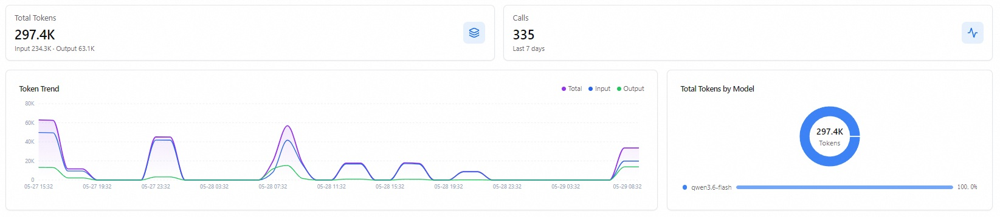

5. View detailed data by the following dimensions at the bottom of the page.

   | Dimension | Description |
   | --- | --- |
   | Model dimension | Collects token consumption data by model. You can filter the data by <strong>model name</strong>. Click a <strong>model name</strong> to view the total tokens, input tokens, output tokens, calls, and token trend chart of the model. |
   | Project dimension | Collects token consumption data by project. You can filter the data by <strong>project name</strong>. Click a <strong>project name</strong> to view the total tokens, input tokens, output tokens, calls, token trend chart, model distribution, and agent distribution of the project. |
   | Agent dimension | Collects token consumption data by agent. You can filter the data by <strong>project name</strong> and <strong>agent name</strong>. Click an <strong>agent name</strong> to view the total tokens, input tokens, output tokens, calls, token trend chart, and model distribution of the agent. |
   | User dimension | Collects token consumption data by user. You can filter the data by <strong>user name</strong>. Click a <strong>user name</strong> to view the total tokens, input tokens, output tokens, calls, token trend chart, model distribution, and agent distribution of the user. |

# 12.System settings

This section describes the features and configuration methods of the system settings modules in the OpenTrek-Ops platform, including tenant management and platform management.

> **Important**
>
> Log in as the system administrator to configure system settings.

## 12.1. Tenant management

This topic describes how to manage tenants in the OpenTrek-Ops platform.

**Scenarios**

The tenant management feature applies to the following scenarios:

- Isolate resources and manage permissions in multi-tenancy environments to ensure independence among tenants.

- Create dedicated tenants for different departments or business units to implement hierarchical management.

- Manage the lifecycle of tenants, including creation, activation, deactivation, and deletion.

- Configure the connection between tenants and the cloud platform to enable unified resource scheduling.

**Prerequisites**

- You have logged in to the OpenTrek-Ops platform.

- You have obtained the system administrator permissions.

**Procedure**

1. Log in to the OpenTrek-Ops platform.

2. In the left-side navigation pane, select **System Settings > Tenant Settings**. On the **Tenant Management** page, you can view the tenant list, which contains the following fields:

   | Field | Description |
   | --- | --- |
   | Tenant Name | The display name and identifier of the tenant. |
   | Associated Organization | The name of the organization associated with the tenant. |
   | Created At | The creation date of the tenant. |
   | Actions | You can edit and delete the tenant. |

3. Add a tenant.

   <ol type="i">

   <li>

   On the **Tenant Management** page, click **Add Tenant**.

   </li>

   <li>

   Fill in the following information in the pop-up dialog box:

   </li>

   </ol>

   | Parameter | Required | Description |
   | --- | --- | --- |
   | Tenant Name | Yes | The display name of the tenant. |
   | Tenant Code | Yes | The unique identifier of the tenant. It supports only letters, digits, and hyphens. |
   | Description | No | The description of the tenant. |
   | Select Organization | Yes | Select the associated organizations. You can select any level-2 organization under the same level-1 organization, but cannot select organizations across different level-1 organizations. |
   | Specify Administrator | Yes | The administrator of the tenant. |

   <ol type="i" start="3">

   <li>

   Click **Confirm Create** to complete the creation.

   </li>

   </ol>

4. Edit a tenant.

   <ol type="i">

   <li>

   Find the target tenant in the tenant list.

   </li>

   <li>

   Click the edit icon  in the **Actions** column to modify the tenant name, description,

   </li>

   </ol>

   organization, and other configuration information.

   <ol type="i" start="3">

   <li>

   Click **Save Changes** to update the tenant.

   </li>

   </ol>

5. Delete a tenant.

   > **Warning**
   >
   > Deleting a tenant is a high-risk operation. Proceed with caution. You cannot recover any data under this tenant after deletion.

   <ol type="i">

   <li>

   Find the target tenant in the tenant list.

   </li>

   <li>

   Click the delete icon  in the **Actions** column.

   </li>

   <li>

   In the confirmation dialog box, click **Confirm Delete**. The system removes the tenant

   </li>

   </ol>

   from the list after a successful deletion.

**Next steps**

Log in as the administrator of the newly created tenant to perform initial tenant configuration, including registering model services and importing Kubernetes clusters. For more information, see Infrastructure.

> **Note**
>
> When you log in for the first time, the system prompts you to initialize the password. Follow the prompts to set a new password and keep it secure.

## 12.2. Configuration management

This topic describes how to manage channels, system configurations, and data subscriptions in the OpenTrek-Ops platform.

**Scenarios**

The cloud platform management feature applies to the following scenarios:

- Configure and manage cloud platform resources and notification channels connected to the OpenTrek-Ops platform, and configure the push targets for agent running status and alert messages.

- Achieve unified management and resource scheduling in a multi-cloud platform environment.

- Push O&M messages in real time to ensure that O&M personnel receive critical information promptly.

- Configure multiple notification channels, such as DingTalk and WeChat, to meet notification requirements in different scenarios.

- Manage cloud platform connection information and authentication credentials to ensure stable data interoperability.

**Prerequisites**

- You have logged in to the OpenTrek-Ops platform.

- The logged-in user has obtained the management permission for the platform.

**Channel management**

1. Log in to the OpenTrek-Ops platform.

2. In the left-side navigation pane, select **System Settings > Configuration Management**.

3. On the **Configuration** page, select **Channel Management**.

   On the **Channel Management** page, view the list of configured channels.

4. Enable a channel.

   Click the switch in the upper-right corner of the target channel card to enable the channel. After you turn on the switch, the status changes to **Enabled**.

**System configuration**

1. Log in to the OpenTrek-Ops platform.

2. In the left-side navigation pane, select **System Settings > Configuration Management**.

3. On the **Configuration** page, select **System Configuration** to modify the preset configuration items of the system.

   - ProCode Runtime Configuration

     Click the edit icon in the **Actions** column to modify the available runtimes for the pro-code agent, and then click **Save**.

   - Skill Package Size

     Click the edit icon in the **Actions** column to modify the configuration value, and then click **Save**.

     > **Note**
     >
     > The modifications take effect immediately for all tenants. Adjust the size with caution and prevent an excessively oversized skill pack from affecting the loading performance.

   - Agent Console Hide Sidebar

     Click the edit icon in the **Actions** column to modify the configuration value, and then click **Save**.

   - Deployment Features Configuration

     Click the edit icon in the **Actions** column to modify the global parameters for the platform deployment mode, and then click **Save & Apply**.

     > **Note**
     >
     > Modifying the deployment mode configuration triggers a hot update. All changes take effect immediately without restart.

   - AI Assistant Model Config

     > **Note**
     >
     > The model configuration affects all intelligent assistant instances. Modifications take effect within the next synchronization cycle.

     <ol type="a">

     <li>

     Click the edit icon in the **Actions** column.

     </li>

     <li>

     Click **Add LLM Config**, configure the parameters, and then click **Save**.

     </li>

     </ol>

   - Default Cluster Config

     Click the edit icon in the **Actions** column to enter the cluster configurations. If you enable the default cluster, the system automatically imports this cluster when you create a new tenant. After editing, click **Save**.

**Data subscription**

1. Log in to the OpenTrek-Ops platform.

2. In the left-side navigation pane, select **System Settings > Configuration Management**.

3. On the **Configuration** page, select **Data Subscription**, click **Add Subscription** to go to the SLS data configuration page, and then configure the following parameters.

   The data subscription feature exports platform runtime data to Simple Log Service (SLS) for subsequent data analysis and monitoring.

   | Parameter | Description |
   | --- | --- |
   | Subscription Name | Enter a custom subscription name. |
   | SLS Type | Select <strong>Private Cloud SLS</strong>. |
   | SLS Project | Log in to the SLS console and view the name of the project to configure. |
   | SLS LogStore | Log in to the SLS console, click the project name to go to the details page, and then view the LogStore name. |

4. Click **Create**.

# 13.Configure an Ops administrator

This topic describes how to configure an Ops administrator.

**Prerequisites**

You have logged in to the OpenTrek-Ops platform as a tenant administrator.

**Procedure**

1. Log in to the OpenTrek-Ops platform.

2. In the lower part of the left-side menu, click  on the right side of the current login account

   and select **Current Tenant**. You can switch tenants. The system isolates resources for different tenants to ensure independence among tenants.

3. Configure tenant settings.

   In the tenant switching dialog box, click the settings button  for the target tenant. Enter

   the specified administrator in the input box and authorize the user as the Ops administrator of the current tenant.

   > **Note**
   >
   > Ensure that the tenant administrator has added the organization of the selected user to the platform.

   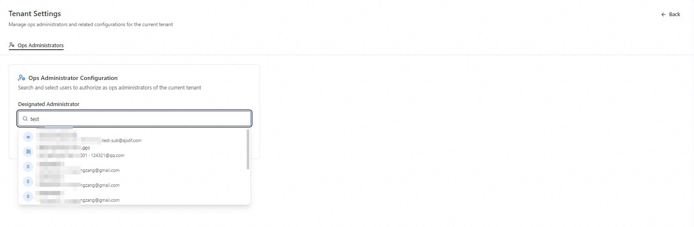

   Click **Confirm Authorization**, and then click **Back** in the upper-right corner of the page.

# 14.FAQ

**Login issues**

**What can I do if I forget my password?**

A: Contact the system administrator to reset the password.

**What do I do if the page is abnormal after I log on to the console?**

A: Please clear the browser cache and log on again, or try to use Chrome browser.

**Agent-related issues**

**Q: Can I not find the required type when I create the agent?**

A: Contact the administrator to check whether the corresponding Agent type plug-in has been installed.

**Q: Why does the Agent fail to start?**

A: Check whether the configuration of the agent is complete and whether the dependent infrastructure services are running properly.

**Skills Related Questions**

**What can I do if a skill cannot be used by agents after it is created?**

A: Make sure that the skill is enabled and the agent has the skill installed.
