Alibaba Cloud  
Apsara Stack Enterprise  
Apsara Stack Security  
User Guide  
Product Version: V3.12.0  
Document Version: 20220928

**Table of Contents**

- [1.What is Apsara Stack Security?](#section-1)
- [2.Precautions](#section-2)
- [3.Quick start](#section-3)
    - [3.1. User roles and permissions](#section-3-1)
    - [3.2. Log on to Apsara Stack Security Center](#section-3-2)
- [4.Threat Detection Service](#section-4)
    - [4.1. Threat Detection Service overview](#section-4-1)
    - [4.2. Security overview](#section-4-2)
        - [4.2.1. View security overview information](#section-4-2-1)
    - [4.3. Security alerts](#section-4-3)
        - [4.3.1. View security alerts](#section-4-3-1)
        - [4.3.2. Manage quarantined files](#section-4-3-2)
        - [4.3.3. Configure security alerts](#section-4-3-3)
    - [4.4. Attack analysis](#section-4-4)
    - [4.5. Cloud service check](#section-4-5)
        - [4.5.1. Overview](#section-4-5-1)
        - [4.5.2. Run cloud service checks](#section-4-5-2)
        - [4.5.3. View and manage check results of Alibaba Cloud services](#section-4-5-3)
    - [4.6. Application whitelist](#section-4-6)
    - [4.7. Assets](#section-4-7)
        - [4.7.1. View the security status of a server](#section-4-7-1)
        - [4.7.2. View the security status of cloud services](#section-4-7-2)
        - [4.7.3. View the details of a single asset](#section-4-7-3)
        - [4.7.4. Enable and disable server protection](#section-4-7-4)
        - [4.7.5. Perform a one-click security check](#section-4-7-5)
        - [4.7.6. Manage asset groups](#section-4-7-6)
        - [4.7.7. Manage asset tags](#section-4-7-7)
    - [4.8. Create a security report](#section-4-8)
- [5.Network Traffic Monitoring System](#section-5)
    - [5.1. View traffic trends](#section-5-1)
    - [5.2. View traffic at the Internet border](#section-5-2)
    - [5.3. View traffic at the internal network border](#section-5-3)
- [6.Server security](#section-6)
    - [6.1. Server security overview](#section-6-1)
    - [6.2. Server fingerprints](#section-6-2)
        - [6.2.1. Manage listener ports](#section-6-2-1)
        - [6.2.2. Manage software versions](#section-6-2-2)
        - [6.2.3. Manage processes](#section-6-2-3)
        - [6.2.4. Manage account information](#section-6-2-4)
        - [6.2.5. Manage scheduled tasks](#section-6-2-5)
        - [6.2.6. Set the server fingerprint collection frequency](#section-6-2-6)
    - [6.3. Threat protection](#section-6-3)
        - [6.3.1. Vulnerability management](#section-6-3-1)
            - [6.3.1.1. Manage Linux software vulnerabilities](#section-6-3-1-1)
            - [6.3.1.2. Manage Windows vulnerabilities](#section-6-3-1-2)
            - [6.3.1.3. Manage Web CMS vulnerabilities](#section-6-3-1-3)
            - [6.3.1.4. Manage emergency vulnerabilities](#section-6-3-1-4)
            - [6.3.1.5. Configure vulnerability management policies](#section-6-3-1-5)
        - [6.3.2. Baseline check](#section-6-3-2)
            - [6.3.2.1. Baseline check overview](#section-6-3-2-1)
            - [6.3.2.2. Configure baseline check policies](#section-6-3-2-2)
            - [6.3.2.3. View baseline check results and manage failed check items](#section-6-3-2-3)
    - [6.4. Intrusion detection](#section-6-4)
        - [6.4.1. Intrusion events](#section-6-4-1)
            - [6.4.1.1. Intrusion event types](#section-6-4-1-1)
            - [6.4.1.2. View and handle intrusion events](#section-6-4-1-2)
            - [6.4.1.3. View exceptions related to an alert](#section-6-4-1-3)
            - [6.4.1.4. Use the file quarantine function](#section-6-4-1-4)
            - [6.4.1.5. Configure security alerts](#section-6-4-1-5)
            - [6.4.1.6. Virus removal](#section-6-4-1-6)
        - [6.4.2. Website tamper-proofing](#section-6-4-2)
            - [6.4.2.1. Overview](#section-6-4-2-1)
            - [6.4.2.2. Configure tamper protection](#section-6-4-2-2)
            - [6.4.2.3. View the protection status](#section-6-4-2-3)
        - [6.4.3. Configure the Virus Removal feature](#section-6-4-3)
    - [6.5. Log retrieval](#section-6-5)
        - [6.5.1. Log retrieval overview](#section-6-5-1)
        - [6.5.2. Log retrieval](#section-6-5-2)
        - [6.5.3. Supported log sources and fields](#section-6-5-3)
        - [6.5.4. Logical operators](#section-6-5-4)
    - [6.6. Settings](#section-6-6)
        - [6.6.1. Install the Server Guard agent](#section-6-6-1)
        - [6.6.2. Manage protection modes](#section-6-6-2)
- [7.Application security](#section-7)
    - [7.1. Quick start](#section-7-1)
    - [7.2. Detection overview](#section-7-2)
        - [7.2.1. View protection overview](#section-7-2-1)
        - [7.2.2. View web service access information](#section-7-2-2)
    - [7.3. Protection logs](#section-7-3)
        - [7.3.1. View attack detection logs](#section-7-3-1)
        - [7.3.2. View HTTP flood protection logs](#section-7-3-2)
        - [7.3.3. View system operation logs](#section-7-3-3)
        - [7.3.4. View access logs](#section-7-3-4)
    - [7.4. Protection configuration](#section-7-4)
        - [7.4.1. Configure protection policies](#section-7-4-1)
        - [7.4.2. Create a custom rule](#section-7-4-2)
        - [7.4.3. Configure an HTTP flood detection rule](#section-7-4-3)
        - [7.4.4. Configure an HTTP flood protection whitelist](#section-7-4-4)
        - [7.4.5. Manage SSL certificates](#section-7-4-5)
        - [7.4.6. Add Internet websites for protection](#section-7-4-6)
        - [7.4.7. Add VPC websites for protection](#section-7-4-7)
        - [7.4.8. Verify the access configuration of a domain on your computer](#section-7-4-8)
        - [7.4.9. Modify DNS resolution settings](#section-7-4-9)
    - [7.5. System management](#section-7-5)
        - [7.5.1. View the payload status of nodes](#section-7-5-1)
        - [7.5.2. View the network status of nodes](#section-7-5-2)
        - [7.5.3. View the disk status of nodes](#section-7-5-3)
        - [7.5.4. Configure alert service](#section-7-5-4)
        - [7.5.5. Configure alert thresholds](#section-7-5-5)
- [8.Security Operations Center (SOC)](#section-8)
    - [8.1. View the dashboard](#section-8-1)
    - [8.2. Security Monitoring](#section-8-2)
        - [8.2.1. View security monitoring data of tenants](#section-8-2-1)
        - [8.2.2. View security monitoring data of platforms](#section-8-2-2)
    - [8.3. Asset Management](#section-8-3)
        - [8.3.1. View tenant assets](#section-8-3-1)
        - [8.3.2. View platform assets](#section-8-3-2)
    - [8.4. Log Analysis](#section-8-4)
        - [8.4.1. View log analysis results](#section-8-4-1)
        - [8.4.2. Security Audit](#section-8-4-2)
            - [8.4.2.1. Overview](#section-8-4-2-1)
            - [8.4.2.2. View security audit overview](#section-8-4-2-2)
            - [8.4.2.3. Query audit events](#section-8-4-2-3)
            - [8.4.2.4. View raw logs](#section-8-4-2-4)
            - [8.4.2.5. Manage log sources](#section-8-4-2-5)
            - [8.4.2.6. Policy settings](#section-8-4-2-6)
                - [8.4.2.6.1. Manage audit rules](#section-8-4-2-6-1)
                - [8.4.2.6.2. Configure alert recipients](#section-8-4-2-6-2)
                - [8.4.2.6.3. Manage archives of events and logs](#section-8-4-2-6-3)
                - [8.4.2.6.4. Manage export tasks](#section-8-4-2-6-4)
                - [8.4.2.6.5. Modify system settings](#section-8-4-2-6-5)
    - [8.5. Rules](#section-8-5)
        - [8.5.1. Create traffic monitoring IPS rules](#section-8-5-1)
        - [8.5.2. Manage IPS rules of Cloud Firewall](#section-8-5-2)
        - [8.5.3. Create traffic monitoring IDS rules](#section-8-5-3)
        - [8.5.4. Manage traffic monitoring IDS rules](#section-8-5-4)
        - [8.5.5. Customize DDoS traffic scrubbing policies and traffic rerouting thresholds](#section-8-5-5)
        - [8.5.6. View Server Guard rules](#section-8-5-6)
    - [8.6. Create a report task](#section-8-6)
    - [8.7. System Configurations](#section-8-7)
        - [8.7.1. Alert settings](#section-8-7-1)
            - [8.7.1.1. Set alert recipients](#section-8-7-1-1)
            - [8.7.1.2. Set alert notifications](#section-8-7-1-2)
        - [8.7.2. Updates](#section-8-7-2)
            - [8.7.2.1. Overview of the system updates feature](#section-8-7-2-1)
            - [8.7.2.2. Automatically download an update package](#section-8-7-2-2)
            - [8.7.2.3. Manually import an update package and update the services](#section-8-7-2-3)
            - [8.7.2.4. Roll back a rule library](#section-8-7-2-4)
            - [8.7.2.5. View update history of a rule library](#section-8-7-2-5)
        - [8.7.3. Global Settings](#section-8-7-3)
            - [8.7.3.1. Set CIDR blocks for traffic monitoring](#section-8-7-3-1)
                - [8.7.3.1.1. Add a CIDR block for traffic monitoring](#section-8-7-3-1-1)
                - [8.7.3.1.2. Manage CIDR blocks for traffic monitoring](#section-8-7-3-1-2)
            - [8.7.3.2. Region settings](#section-8-7-3-2)
                - [8.7.3.2.1. Add a CIDR block for a region](#section-8-7-3-2-1)
                - [8.7.3.2.2. Manage CIDR blocks for a region](#section-8-7-3-2-2)
            - [8.7.3.3. Configure whitelists](#section-8-7-3-3)
            - [8.7.3.4. Configure request blocking policies](#section-8-7-3-4)
            - [8.7.3.5. Block IP Addresses](#section-8-7-3-5)
            - [8.7.3.6. Configure custom IP addresses and locations](#section-8-7-3-6)
                - [8.7.3.6.1. Add custom IP addresses and locations](#section-8-7-3-6-1)
                - [8.7.3.6.2. Manage custom IP addresses and locations](#section-8-7-3-6-2)
        - [8.7.4. System Monitoring](#section-8-7-4)
            - [8.7.4.1. Configure CIDR blocks for traffic redirection in Cloud Firewall](#section-8-7-4-1)
        - [8.7.5. Remote operations](#section-8-7-5)
            - [8.7.5.1. Enable Remote O&M](#section-8-7-5-1)
        - [8.7.6. Account management](#section-8-7-6)
            - [8.7.6.1. View and modify Apsara Stack accounts](#section-8-7-6-1)
            - [8.7.6.2. Add a public cloud account](#section-8-7-6-2)
- [9.Optional security products](#section-9)
    - [9.1. Anti-DDoS settings](#section-9-1)
        - [9.1.1. Overview](#section-9-1-1)
        - [9.1.2. View and configure anti-DDoS policies](#section-9-1-2)
        - [9.1.3. View DDoS events](#section-9-1-3)
    - [9.2. Cloud Firewall](#section-9-2)
        - [9.2.1. Access control](#section-9-2-1)
            - [9.2.1.1. Configure the Internet firewall switch policy](#section-9-2-1-1)
            - [9.2.1.2. Create a VPC firewall](#section-9-2-1-2)
            - [9.2.1.3. Create an IDC-VPC firewall](#section-9-2-1-3)
            - [9.2.1.4. Manage address books](#section-9-2-1-4)
            - [9.2.1.5. Configure an Internet firewall](#section-9-2-1-5)
            - [9.2.1.6. Create a policy group](#section-9-2-1-6)
            - [9.2.1.7. Manage an internal firewall](#section-9-2-1-7)
            - [9.2.1.8. Manage a VPC firewall](#section-9-2-1-8)
            - [9.2.1.9. Manage an IDC-VPC firewall](#section-9-2-1-9)
        - [9.2.2. Intrusion prevention](#section-9-2-2)
            - [9.2.2.1. Configure intrusion prevention policies](#section-9-2-2-1)
            - [9.2.2.2. View event logs](#section-9-2-2-2)
        - [9.2.3. Log analysis](#section-9-2-3)
            - [9.2.3.1. View traffic logs](#section-9-2-3-1)
    - [9.3. Sensitive Data Discovery and Protection](#section-9-3)
        - [9.3.1. Grant access permissions](#section-9-3-1)
        - [9.3.2. Overview](#section-9-3-2)
        - [9.3.3. Detect sensitive data](#section-9-3-3)
            - [9.3.3.1. Sensitive data overview](#section-9-3-3-1)
            - [9.3.3.2. View statistics on sensitive data in MaxCompute](#section-9-3-3-2)
            - [9.3.3.3. View statistics on sensitive data in Tablestore](#section-9-3-3-3)
            - [9.3.3.4. View statistics on sensitive data in OSS](#section-9-3-3-4)
            - [9.3.3.5. View statistics on sensitive data in AnalyticDB](#section-9-3-3-5)
            - [9.3.3.6. View statistics on sensitive data in ApsaraDB for RDS](#section-9-3-3-6)
        - [9.3.4. Check data permissions](#section-9-3-4)
            - [9.3.4.1. View permission statistics](#section-9-3-4-1)
            - [9.3.4.2. View permissions of an account](#section-9-3-4-2)
        - [9.3.5. Monitor data flows](#section-9-3-5)
            - [9.3.5.1. View data flows in DataHub](#section-9-3-5-1)
            - [9.3.5.2. View data flows in Data Integration](#section-9-3-5-2)
        - [9.3.6. Sensitive data masking](#section-9-3-6)
            - [9.3.6.1. Add a static desensitization task](#section-9-3-6-1)
        - [9.3.7. Abnormal activity detection](#section-9-3-7)
            - [9.3.7.1. Add a custom rule for abnormal activities](#section-9-3-7-1)
            - [9.3.7.2. Process abnormal activities](#section-9-3-7-2)
        - [9.3.8. Intelligent audit](#section-9-3-8)
            - [9.3.8.1. View and download audit reports](#section-9-3-8-1)
            - [9.3.8.2. View audit logs](#section-9-3-8-2)
            - [9.3.8.3. View raw logs](#section-9-3-8-3)
            - [9.3.8.4. Add an audit rule](#section-9-3-8-4)
        - [9.3.9. Security configuration](#section-9-3-9)
            - [9.3.9.1. Manage rules used to identify sensitive data](#section-9-3-9-1)
            - [9.3.9.2. Manage thresholds and rules used to detect abnormal activities](#section-9-3-9-2)
            - [9.3.9.3. Configure an authorized asset](#section-9-3-9-3)
            - [9.3.9.4. Configure desensitization algorithms](#section-9-3-9-4)

# 1.What is Apsara Stack Security?

Apsara Stack Security is a solution that provides Apsara Stack with a full suite of security features, such as network security, server security, application security, data security, and security management.

Background

Traditional security solutions for IT services detect attacks on network perimeters. They use hardware products such as firewalls and intrusion prevention systems (IPSs) to protect networks against attacks.

However, with the development of cloud computing, an increasing number of enterprises and organizations now use cloud computing services instead of traditional IT services. Cloud computing features low costs, on-demand flexible configuration, and high resource utilization. Cloud computing environments do not have definite network perimeters. As a result, traditional security solutions cannot effectively secure cloud assets.

With the powerful data analysis capabilities and professional security operations team of Alibaba Cloud, Apsara Stack Security provides integrated security protection services at the network layer, application layer, and server layer.

Complete security solution

Apsara Stack Security consists of Apsara Stack Security Standard Edition and optional security services, and provides users with a comprehensive security solution.

| Security domain | Service | Description |
| --- | --- | --- |
| Security management | Threat Detection Service | Monitors traffic and overall security status to audit and centrally manage security. |
| Server security | Server Guard | Protects Elastic Compute Service (ECS) instances against intrusions and malicious code. |
| Application security | Web Application Firewall | Protects web applications against attacks and ensures that mobile and PC users can securely access web applications over the Internet. |
| Network security | Anti-DDoS | Ensures the availability of network links and improves business continuity. |
| Data security | Sensitive Data Discovery and Protection | Prevents data leaks and helps your business systems meet compliance requirements. |
| Security O&amp;M service | On-premises security services | Help you establish and optimize your cloud security system to protect your business system against attacks by making full use of the security features of Apsara Stack Security and other Apsara Stack services. |

# 2.Precautions

Before you log on to the Apsara Stack Security console, you must verify that your local PC meets the configuration requirements.

The configuration requirements for the local PC are listed in .

Configuration requirements

| Item | Requirement |
| --- | --- |
| Browser | • Internet Explorer: V11 or later • Chrome (recommended): V42.0.0 or later • Firefox: V30 or later • Safari: V9.0.2 or later |
| Operating system | • Windows XP, Windows 7, or later • macOS |

# 3.Quick start

## 3.1. User roles and permissions

This topic describes the user roles involved in Apsara Stack Security.

All roles in Apsara Stack Security Center are provided by default. You cannot add custom roles. Before you log on to Apsara Stack Security Center, make sure that your account is assigned the required role. For more information, see .

Default roles in Apsara Stack Security

| Role | Permission |
| --- | --- |
| System administrator of Apsara Stack Security Center | Manages and configures system settings for Apsara Stack Security Center. The system administrator has permissions to manage Apsara Stack accounts, synchronize data, configure alerts, and configure global settings. |
| Security administrator of Apsara Stack Security Center | Monitors the security status across Apsara Stack and configures security policies for each functional module of Apsara Stack Security. The security administrator has permissions on all functions under Threat Detection, Network Security, Application Security, Server Security, PM Security, and Asset Management. Note The permissions on WAF and Cloud Firewall must be separately assigned. |
| Department security administrator | Monitors the security status of cloud product resources in the specified department and configures security policies for each functional module of Apsara Stack Security for this department. The department security administrator has permissions on all functions under Threat Detection, Network Security, Application Security, Server Security, PM Security, and Asset Management. In addition, the department security administrator can specify alert notification methods and alert recipients in the department. Note The permissions on WAF and Cloud Firewall must be separately assigned. |
| Auditor of Apsara Stack Security Center | Conducts security audits across Apsara Stack. The auditor can view audit events and original logs, configure audit policies, and access all functions under Security Audit. |

If you do not have a user that assume the required role, contact the administrator to create the account. For more information, see the Create a user topic in the *ASCM Console User Guide*

## 3.2. Log on to Apsara Stack Security Center

This topic describes how to log on to Apsara Stack Security Center.

Prerequisites

- Before logging on to the ASCM console, make sure that you have obtained the IP address or domain name of the ASCM console from the deployment personnel. The URL used to access the ASCM console is in the following format: http://IP address or domain name of the ASCM console/manage.

- We recommend that you use the Google Chrome browser.

Procedure

1. In the address bar, enter the URL used to access the ASCM console. Press Enter.

2. Enter your username and password.

   The system has a default super administrator, whose username is super. The super administrator can create system administrators. A system administrator can create system users and notify the users of the default passwords by SMS or email.

   Note

   When you log on to the ASCM console for the first time, you must modify the

   password of your username as instructed. For security concerns, your password must meet the minimum complexity requirements: The password must be 8 to 20 characters in length and must contain at least two types of the following characters: letters, digits, and special characters such as exclamation points (!), at signs (@), number signs (#), dollar signs ($), and percent signs (%).

3. Click Login to go to the ASCM console homepage.

4. In the top navigation bar, choose Security > Apsara Stack Security.

5. On the Apsara Stack Security Center page, select Region.

6. Click YD to go to Apsara Stack Security Center.

# 4.Threat Detection Service

## 4.1. Threat Detection Service overview

This topic describes the basic concepts of Threat Detection Service (TDS).

TDS provides comprehensive protection for enterprises. It can monitor vulnerabilities, intrusions, web attacks, DDoS attacks, threat intelligence, and public opinions. TDS uses modeling and analysis to obtain key information based on traffic characteristics, host processes, and host operations logs. In addition, TDS identifies intrusions that cannot be detected by traffic inspection or file scan. You can use the input of cloud analysis models and intelligence data to discover sources and behavior of attacks and assess threats.

TDS provides the following features:

- Overview: provides a security situation overview and information about security screens.

- Security Alerts: displays security alerts that occur in the business system.

- Attack Analysis: displays application attacks and brute-force attacks that occur in the system.

- Cloud Service Check: checks whether the security configuration for cloud services has risks.

- Application Whitelist: provides information about application processes on servers that require protection based on intelligent learning. The application processes are identified as trusted, suspicious, or malicious. This prevents unauthorized processes.

- Assets: manages servers and cloud services on Apsara Stack.

- Security Reports: allows you to configure security report tasks on Apsara Stack.

## 4.2. Security overview

### 4.2.1. View security overview information

This topic describes how to view security statistics, attack trends, and network traffic information on Apsara Stack.

Context

The Security Overview tab provides an overview of detected security events, the latest threats, and inherent vulnerabilities in the system. A security administrator can view information on the Security Overview tab to have a comprehensive understanding of the system security situation.

Procedure

1. Log on to Apsara Stack Security Center.

2. In the left-side navigation pane, choose Threat Detection > Overview > Security Overview.

3. View the security situation of Apsara Stack.

   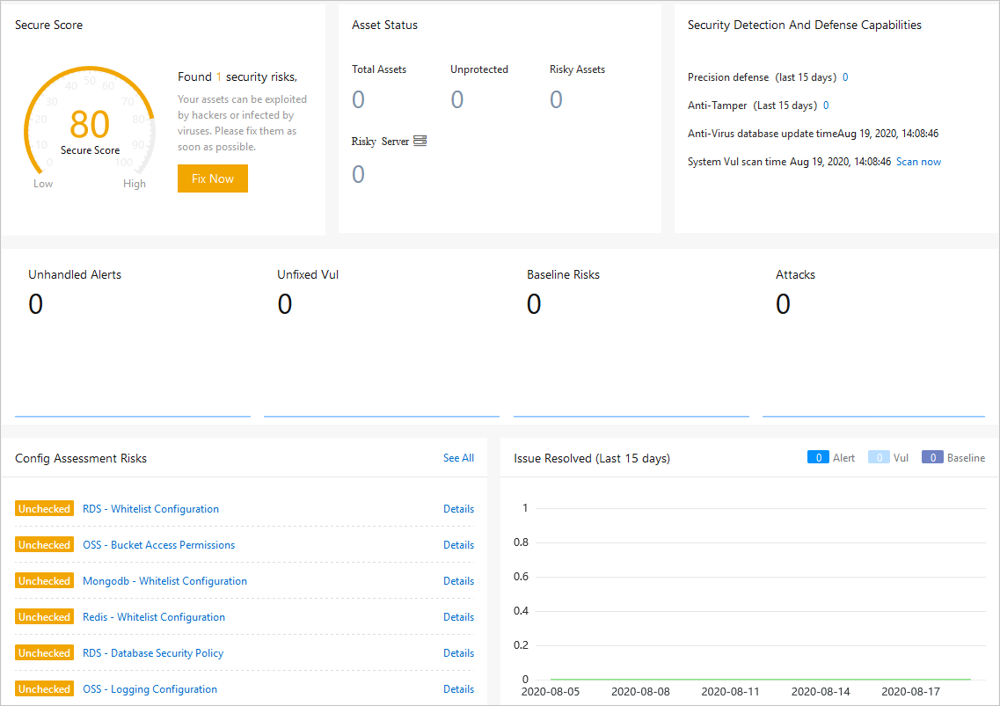

   Sections on the Security Overview tab

   | Section | Description |
   | --- | --- |
   | Security Score | The security score of assets and the number of detected security risks. |
   | Asset Status | The total number of assets and the numbers of servers that are not protected, servers that are stopped, and servers that are at risk. |
   | Security Detection And Defense Capabilities | The numbers of precise defense events and anti-tampering events in the last 15 days, the time when the anti-virus database was updated, and the time of vulnerability scanning. This allows you to obtain information about the defense situation and security status of your assets in real time. |
   | Threat statistics | The numbers of alerts that are not handled, vulnerabilities that are not fixed, baseline risks, and attacks. |
   | Config Assessment Risks | Risks in the baseline configurations of cloud services. |
   | Issue Resolved | Statistics of alerts, vulnerabilities, and baseline risks that have been processed in the last 15 days. The statistics are displayed in a bar and trend chart. |

## 4.3. Security alerts

### 4.3.1. View security alerts

This topic describes how to view security alerts on the Security Alerts page.

Procedure

1. Log on to Apsara Stack Security Center.

2. In the left-side navigation pane, choose Threat Detection > Security Alerts.

3. (Optional)Set filter conditions for security alerts.

   Note

   If you want to view all alerts, do not set the conditions.

   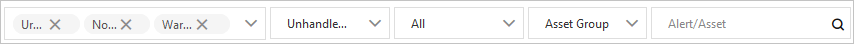

   | Filter condition | Description |
   | --- | --- |
   | Severity | The severity level. You can select one or more levels. Valid values: • Urgent • Warning • Notice |
   | Alert status | The status of alerts. Valid values: • Unhandled Alerts • Handled |
   | Alert type | The type of alerts. Select All or a specific type. |
   | Affected asset group | The affected asset group. Select Asset Group or a specific group. |
   | Search for alerts by name or asset | Enter an alert name or a keyword of affected assets to search for alerts. |

4. View security alerts and their details in the list.

### 4.3.2. Manage quarantined files

This topic describes how to manage threat files that are quarantined by the system. The system deletes a quarantined file 30 days after the file is quarantined. You can restore the file before it is deleted.

Procedure

1. 

   2. In the left-side navigation pane, choose Threat Detection > Security Alerts.

   3. In the upper-right corner of the Alerts page, click Quarantine.

   4. On the Quarantine page, view information about a quarantined file, such as the host, path, status, and operation time.

   5. (Optional)If a file is incorrectly quarantined, click Restore in the Actions to restore the file.

      Notice

      Before you restore a quarantined file, make sure that the file is normal and does

      not bring risks.

      The restored file is removed from the quarantine and is displayed in the security alert list again.

### 4.3.3. Configure security alerts

This topic describes how to configure logon settings and web directories that are scanned.

Procedure

1. Log on to Apsara Stack Security Center.

2. In the left-side navigation pane, choose Threat Detection > Security Alerts.

3. In the upper-right corner of the page, click Settings.

   You can perform the following operations:

   - Manage a common logon location.

     <ol type="a">

     <li>

     On the right side of Login Location, click Add.

     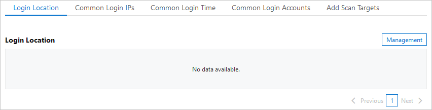

     </li>

     <li>

     Select a logon location and the servers that are allowed to be logged on to from the location.

     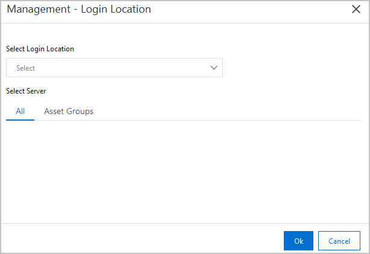

     </li>

     </ol>

     <ol type="i" start="100">

     <li>

     Click OK.

     </li>

     </ol>

     Threat Detection Service (TDS) allows you to edit and delete added logon locations.

     - Find the target logon location and click Edit on the right side to change the servers that are allowed to be logged on to from this location.

     - Find the target logon location and click Delete on the right side to delete the logon location.

   - Configure advanced logon settings.

     Note

     You can specify the IP addresses, accounts, and time periods that are allowed to

     log on to your assets. After you configure these settings, alerts are triggered if your assets receive logon requests that do not meet the requirements. The procedure to configure advanced logon settings is similar to that to configure common logon locations. You can follow the preceding procedure to add, edit, and delete advanced logon settings.

     - On the right side of Common Login IPs, enable or disable Uncommon IP Alert. After this function is enabled, alerts are triggered if your assets receive logon requests from unauthorized IP addresses.

       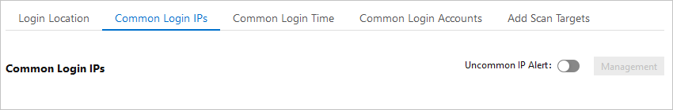

     - On the right side of Common Logon Time, enable or disable Uncommon Time Alert. After this function is enabled, alerts are triggered if your assets receive logon requests at unauthorized time.

       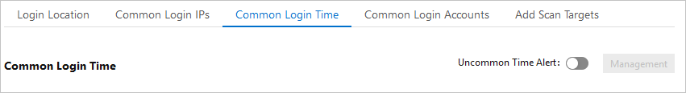

     - On the right side of Common Login Accounts, enable or disable Uncommon Account Alert. After this function is enabled, alerts are triggered if your assets receive logon requests from unauthorized accounts.

       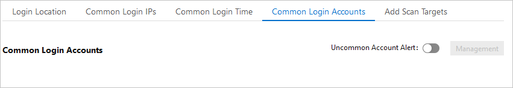

   - Add a web directory as the scan target.

     TDS automatically detects web directories on your servers.

     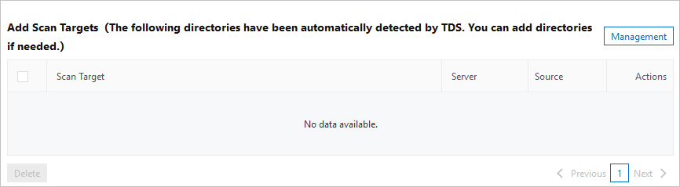

     It performs dynamic and static scans on these directories. You can also manually add web directories for scanning.

     <ol type="a">

     <li>

     On the right side of Add Scan Targets, click Add.

     </li>

     <li>

     Enter a valid web directory and select the servers on which the directory is scanned. The web directory is added to the scan list.

     Note

     To ensure performance and efficiency, do not enter a root directory.

     </li>

     </ol>

     <ol type="i" start="100">

     <li>

     Click OK.

     </li>

     </ol>

## 4.4. Attack analysis

This topic describes the statistics provided by the attack analysis feature. These statistics include the total number of attacks, the distribution of attack types, top five attack sources, top five attacked assets, and the attack list.

Background information

The attack analysis feature provides basic attack detection and prevention capabilities in the Apsara Stack Security console. We recommend that you develop a more refined and in-depth defense system by optimizing firewalls and enhancing business security.

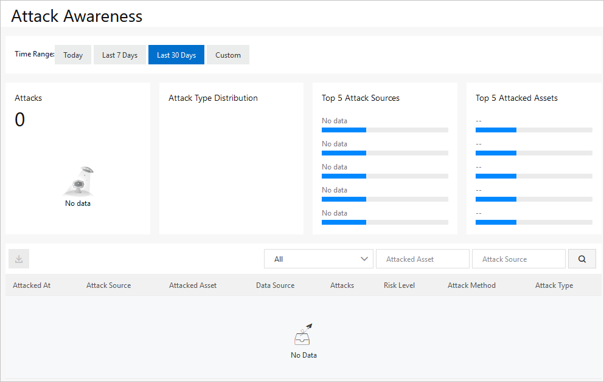

On the Attack Awareness page, you can specify a time range to view the attack details. You can view the attack analysis statistics of the current day, last 7 days, or last 30 days. You can also set Time Range to Custom to view the statistics of a time range within the last 30 days.

- Attacks

- Attack Type Distribution: the attack types and the number of attacks of each type.

- Top 5 Attack Sources: the top five IP addresses where most attacks are initiated.

- Top 5 Attacked Assets: the top five assets that have encountered the most attacks.

- Attack list: The details of all attacks. These details include the attack time, source IP address, attacked asset, attack type, and attack status.

  Note

  The attack list displays a maximum of 10,000 entries. You can specify Time Range to

  view details about attacks that occur over a specified time range.

  Parameters in the attack list

  | Parameter | Description |
  | --- | --- |
  | Attacked At | The time when an attack is detected. |
  | Attack Source | The source IP address of an attack. |
  | Attacked Asset | The name, public IP address, and private IP address of an attacked asset. |
  | Attack Method | The HTTP request method used to initiate an attack. Valid values: POST and GET. |
  | Attack Type | The type of an attack. Supported attack types include SSH brute-force attacks and remote code execution attacks. |

- Search for an attack

  To search for an attack and view the details about the attack, specify search conditions above the attack list. Search conditions include the attack type, attacked asset, source IP address, and port number.

  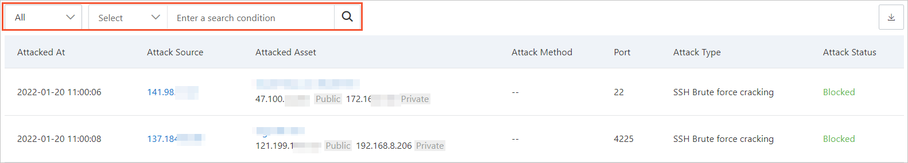

- View the details of an attacked asset

  To view the details about an attacked asset, move the pointer over the name of the attacked asset in the Attacked Asset column.

  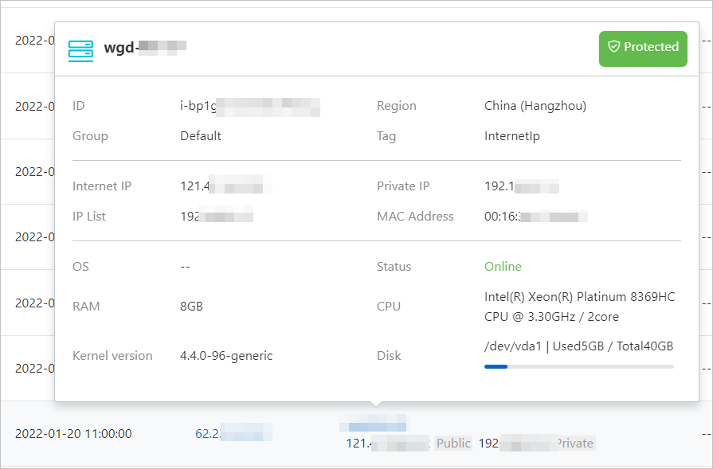

- Export the attack list

  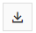

  To export and save the attack list to your computer, you can click the

  icon in the upper-left

  corner of the attack list. The asset records are exported to an Excel file.

## 4.5. Cloud service check

### 4.5.1. Overview

Threat Detection Service (TDS) provides the cloud service check feature. This feature allows you to check for security risks in the configurations of your Alibaba Cloud services. This topic describes the functions and check items that are supported by the cloud service check feature.

Background information

The cloud service check feature allows you to perform network access control and data security checks. The checks help you detect configuration risks of your Alibaba Cloud services and provide repair solutions.

You can view the number of Checked items enabled on the Cloud Service Check page.

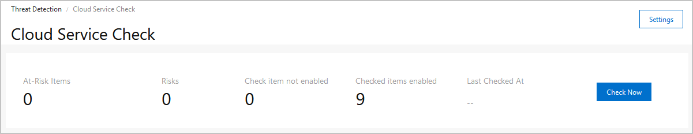

Cloud service check list

The following table lists the check items.

Type

Supported item

Description

Checks whether the automatic backup feature is enabled for PolarDB. Regular backups help you improve database

PolarDB - Backup

security. You can restore data if an error occurs in your

configurations

database. PolarDB supports automatic backup. We recommend that you enable automatic backup to create a backup on a daily basis.

Checks whether the status of Container Registry warehouses is set to private. Container Registry

Container Registry -

warehouses include public warehouses and private

Repository

warehouses. Public warehouses allow all Internet users

permission

to anonymously download information. If an image

configurations

contains sensitive information, we recommend that you set the value to private. Otherwise, ignore relevant alerts.

Checks whether the data encryption feature of Object Storage Service (OSS) buckets is enabled. OSS supports

OSS - Bucket server-

server-side encryption to secure data that is persistently

side encryption

stored in OSS. We recommend that you enable server-side encryption to protect sensitive data.

OSS - Sensitive

Checks whether OSS sensitive files require access

information leakage

permissions.

scans

Type

Supported item

Description

Checks whether cross-region backup is enabled for ApsaraDB for RDS instances. ApsaraDB RDS for MySQL

ApsaraDB for RDS -

provides the cross-region backup feature that

Cross-region backup

automatically synchronizes local backup files to OSS in

configurations

another region. We recommend that you enable the cross-region backup feature.

KVStore for Redis -

Checks whether the data backup feature is enabled for

Backup

ApsaraDB for Redis instances.

configurations

Data security

Checks whether SSL encryption is enabled for ApsaraDB

ApsaraDB for

for MongoDB databases. We recommend that you enable

MongoDB - SSL

the SSL encryption feature to improve the security of

encryption

data links in ApsaraDB for MongoDB databases.

Checks whether the automatic backup feature is enabled for ApsaraDB for MongoDB databases. Regular backups

ApsaraDB for

help you improve database security. You can restore data

MongoDB - Backup

if an error occurs in your database. ApsaraDB for

configurations

MongoDB provides automatic backup policies. We recommend that you enable automatic backup to create a backup on a daily basis.

Checks whether encryption is enabled for disks on Elastic

ECS - Disk encryption

Compute Service (ECS) instances.

Checks whether the automatic snapshot feature is

ECS - Automatic

enabled for the disks on ECS instances. The automatic

snapshot policies

snapshot feature improves the security of ECS data and supports disaster recovery.

OSS - Bucket

Checks whether the OSS bucket permission is set to

permissions

*private*.

OSS - Logging

Checks whether the logging feature is enabled for OSS.

configuration

OSS - Cross-region

Checks whether the cross-region replication feature is

replication

enabled for OSS.

configurations

ApsaraDB for RDS -

Checks whether the SQL audit, SSL encryption, and

Database security

Transparent Data Encryption features are enabled for

policies

ApsaraDB for RDS databases.

ApsaraDB for RDS -

Checks whether the data backup feature is enabled for

Backup

ApsaraDB for RDS instances.

configurations

SSL Certificates

Checks whether your SSL certificate is expired. If your SSL

Service - Validity

certificate is expired, you are not allowed to use SSL

check

Certificates Service.

Type

Supported item

Description

Checks ECS security group policies. We recommend that you grant minimum permissions to users. If you set

ECS - Security group

0.0.0.0/0 for a service, it indicates that access from all IP

policies

addresses is allowed. For example, you can set 0.0.0.0/0 for ports 80, 443, 22, and 3389.

Checks whether hotlinking protection is enabled for OSS

OSS - Bucket

buckets. The OSS hotlinking protection feature checks the

hotlinking protection

Referer header to deny access from unauthorized users. We recommend that you enable this feature.

Checks whether a port is mapped to the Internet. When you create a Destination Network Address Translation

VPC - DNAT

(DNAT) rule for a NAT Gateway that is deployed in a

management port

virtual private cloud (VPC), we recommend that you do

mapping

not map internal management ports to the Internet. Do not map all ports or an important port, for example, ports 22, 3389, 1433, or 3306.

Checks whether Anti-DDoS Pro or Anti-DDoS Premium is configured to allow only Web Application Firewall (WAF)

Apsara Stack Security

back-to-origin IP addresses. After you set up Anti-DDoS

- Back-to-origin

Pro, Anti-DDoS Premium, or WAF, you must hide the IP

configuration checks

addresses of the backend servers to prevent attacks on the cloud assets.

Checks whether WAF only allows requests from WAF

Apsara Stack Security

back-to-origin IP addresses. After you set up Anti-DDoS

- WAF back-to-origin

Pro, Anti-DDoS Premium, or WAF, you must hide the IP

configurations

addresses of the backend servers to prevent attacks on the cloud assets.

Checks the access control configurations of Server Load

SLB - IP address

Balancer (SLB) instances. Checks whether access control is

whitelist

enabled for HTTP and HTTPS services and checks whether

configurations

0.0.0.0/0 is added to the IP address whitelist.

Network access

Checks whether SLB opens ports to the Internet for

SLB - High-risk ports

control

forwarding unnecessary public services.

Checks whether the ApsaraDB for RDS access control policy is set to 0.0.0.0/0 (all IP addresses), which allows

ApsaraDB for RDS - IP

requests from all IP addresses. We recommend that you

address whitelist

restrict the access scope to a specific range of IP

configurations

addresses rather than expose database services to the Internet.

Checks whether the KVStore for Redis access control policy is set to 0.0.0.0/0 (all IP addresses), which allows

KVStore for Redis - IP

requests from all IP addresses. We recommend that you

address whitelist

restrict the access scope to a specific range of IP

configurations

addresses rather than expose database services to the Internet.

Type

Supported item

Description

Checks whether the AnalyticDB for PostgreSQL access

AnalyticDB for

control policy is set to 0.0.0.0/0 (all IP addresses), which

PostgreSQL - IP

allows requests from all IP addresses. We recommend

address whitelist

that you restrict the access scope to a specific range of

configurations

IP addresses rather than expose database services to the Internet.

Checks whether IP address whitelists of PolarDB are configured to allow requests from  `0.0.0.0/0`  (all IP

PolarDB - IP address whitelist

addresses). To prevent security risks, we recommend

configurations

that you configure IP address whitelists to allow only requests from specific IP addresses.

Checks whether the ApsaraDB for MongoDB access control policy is set to  `0.0.0.0/0`  (all IP addresses),

ApsaraDB for MongoDB - IP address

which allows requests from all IP addresses. We

whitelist

recommend that you restrict the access scope to a

configurations

specific range of IP addresses rather than expose database services to the Internet.

### 4.5.2. Run cloud service checks

Threat Detection Service (TDS) provides the cloud service check feature. This feature allows you to check for security risks in the configurations of your Alibaba Cloud services. This topic describes how to manually run cloud service checks on your Alibaba Cloud services. This topic also describes how to specify a detection interval to automate periodic checks.

Context

Apsara Stack Security Center supports manual and automated periodic checks to scan for configuration risks in cloud services.

- Manual checks: On the Cloud Service Check page, click Check Now to check for security risks in the configurations of your Alibaba Cloud services

- Automated periodic checks: By default, Apsara Stack Security Center automatically runs configuration checks during the  `00:00:00-06:00:00`  time range every other day. You can also set a custom time period to automatically check whether the configurations of your Alibaba Cloud services contain risks. This helps you detect and manage configuration risks at the earliest opportunity.

Manual checks

1. 

   2. In the left-side navigation pane, choose Threat Detection > Cloud Service Check.

   3. On the Cloud Service Check page, click Check Now to check whether the configurations of all your Alibaba Cloud services contain risks. After you run a check, the number of affected assets is displayed on this page.

      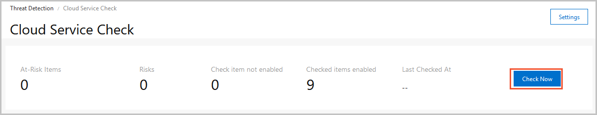

      Note

      Do not perform other operations until the check is complete.

      After the check is complete, the detected risks are listed based on their risk levels.

Automated checks

1. 

   2. In the left-side navigation pane, choose Threat Detection > Cloud Service Check.

   3. In the upper-right corner of the Cloud Platform Configuration Assessment page, click Settings.

   4. In the Settings dialog box, specify Detection Cycle and Detection Time.

      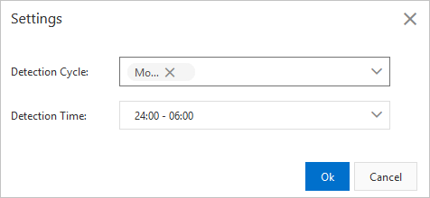

      - Detection Cycle: supports Monday to Sunday. You can select multiple days.

      - Detection Time: Select  `24:00:00 - 06:00:00` ,  `06:00:00 - 12:00:00` ,  `12:00:00 - 18:00: 00` , or  `18:00:00 - 24:00:00` .

   5. Click OK. During the selected period, Apsara Stack Security Center automatically runs checks based on all check items.

### 4.5.3. View and manage check results of Alibaba Cloud services

This topic describes how to view check results and manage configuration risks in Apsara Stack Security Center. Check results include check items, details of check items, potential impacts, and suggestions on how to manage configuration risks. You can manage configuration risks on the Cloud Service Check page.

View check results

1. 

2. 

   3. On the Cloud Service Check page, you can view the check results and details of the last configuration check.

      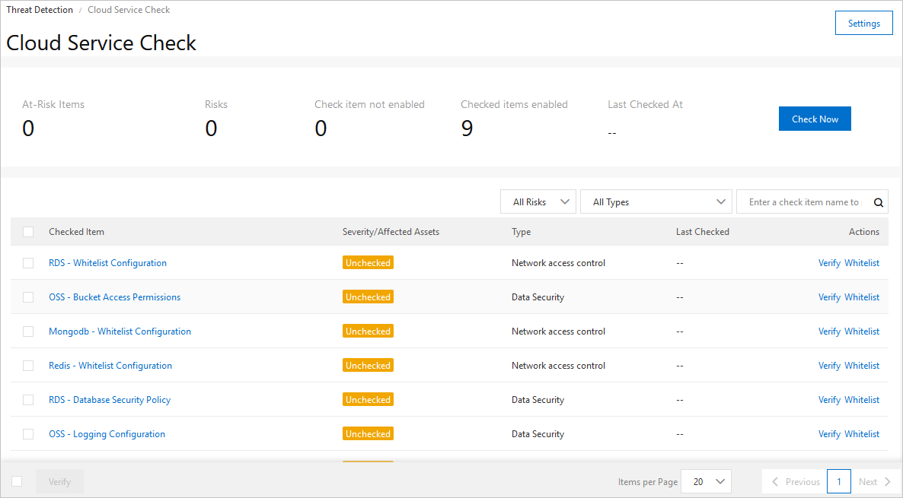

      - View statistics on the result of the last check.

        Above the check item list, you can view the number of At-Risk Items (including the total number of items and the number of items at each risk level), the number of assets with risks (Risks), the number of enabled check items, the number of disabled check items, and the last check time.

      - View the check items.

        In the check item list, you can view information about the check items. The check items include the risk level, the type and number of assets affected by each check item, the type of each check item, and the time of the last check.

      - View the check result details of a check item.

        Click the name of the target checked item in the Checked Item column to go to the details page. You can view the check description, potential risks, and suggestions on how to manage the risks on this page.

Manage configuration risks

1. 

2. 

   3. On the Cloud Service Check page, manage the configuration risks.

      - Check whether the new settings contain risks.

        If you have changed the configuration settings of an item, find the item on the check item list on the Cloud Service Check page and click Verify in the Actions column to check whether the new settings contain risks.

        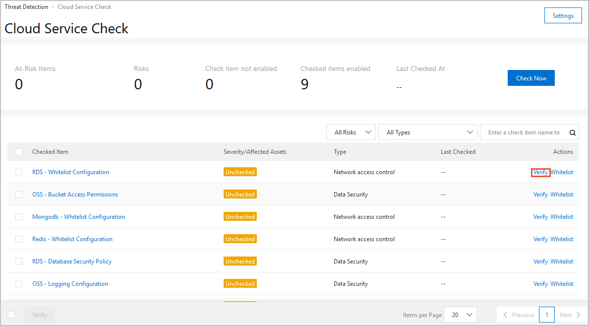

      - Add a check item to the whitelist.

        If you want to ignore the detected risks of a checked item, find the item on the check item list and click Whitelist to add the item to the whitelist. The status of the item will change to Ignored. Ignored items are not counted as At-Risk Items.

        In the check item list, you can also click Remove to remove the Ignored items from the whitelist.

        Note

        After you click Whitelist, the risk is ignored for this time only. If the risk is

        detected in the future, Apsara Stack Security Center will continue to report it.

## 4.6. Application whitelist

Application whitelists can prevent unauthorized programs from running on your servers and provide a trusted running environment for your assets.

Context

The application whitelist feature allows you to add servers and trusted applications to a whitelist. Applications that are not specified in the whitelist cannot run on your servers. This feature protects your servers from untrusted or malicious programs and improves resource utilization.

After you apply a whitelist policy to a server, Apsara Stack Security Center detects suspicious or malicious processes and generates alerts on the processes that are not specified in the whitelist.

Note

An alert is triggered if a process that is not specified in the whitelist is detected. The

detected process may be a normal process or a malicious process. If you trust the process that triggers an alert, we recommend that you add the process to the whitelist. A process that is added to the whitelist no longer triggers alerts when it restarts. If the process is malicious, we recommend that you remove this process immediately and check whether configuration files of scheduled tasks have been modified.

Step 1: Create an application whitelist policy

1. 

   2. In the left-side navigation pane, choose Threat Detection > Application Whitelists.

   3. On the Application Whitelist page, click the Policies tab.

   4. On the App Control page, click the Policies tab. Then click Create Policy in the upper-left corner.

   5. In the Create Policy step of the Create Whitelist Policy pane, configure the following parameters:

      - Policy Name: Enter a whitelist policy name.

      - Intelligent Learning Duration: Select a duration for intelligent learning. Valid values: 1 Day, 3 Days, 7 Days, and 15 Days. The intelligent learning feature uses machine learning to automatically collect and categorize large amounts of alert data. Apsara Stack Security Center can identify suspicious or malicious processes based on the collected data.

      - Servers for Intelligent Learning: Select the servers that you want to add to the whitelist.

   6. Click Next to create the whitelist policy. After the whitelist policy is created, its details are automatically displayed in the policy list on the Policies tab.

      The following table lists the parameters in the policy list.

      | Parameter | Description |
      | --- | --- |
      | Policy Name | The name of the created whitelist policy. |
      | Servers | The number of servers to which the whitelist policy is applied. |
      | Status | The status of the policy. Valid values: • Applied: Intelligent learning is completed. The policy is applied to servers. • Pending Confirmation: Intelligent learning is completed. The policy must be confirmed and enabled. After intelligent learning is completed, you also need to turn on the switch in the Policy Status column to enable this policy. The policy takes effect only after it is enabled. Apsara Stack Security Center automatically identifies the processes on your servers as trusted, suspicious, or malicious processes. • Paused: Intelligent learning is manually paused. You can click Continue in the Actions column to resume intelligent learning. • Progress: Intelligent learning is in progress. After a whitelist policy is created, Apsara Stack Security Center automatically performs intelligent learning based on the policy. The status of a newly created policy is Progress. |
      | Applications | The numbers of processes, including Trusted, Suspicious, and Malicious processes, on all servers to which the policy is applied. |
      | Actions | The operations that you can perform on a policy. Valid values: • Apply: Add or remove servers to which the policy is applied on the Apply Whitelist Policy pane. • Modify: Modify the policy on the Modify Whitelist Policy pane. You can change the values of Policy Name and Intelligent Learning Duration, and modify the servers that need to automatically perform intelligent learning. • Pause Learning: Pause intelligent learning. • Continue: Resume intelligent learning. After you click Continue, the status of the policy changes to Progress.You can view the learning progress of the policy in the Status column. • Delete: Delete the policy. After the policy is deleted, the corresponding servers and processes are no longer protected by the policy. |

Step 2: Add servers to the application whitelist

1. 

   2. In the left-side navigation pane, choose Threat Detection > Application Whitelists.

   3. On the Servers tab of the App Control page, click Add Server in the upper-left corner.

   4. In the Add Server pane, configure the following parameters:

      - Whitelist Policy: Select an existing whitelist policy from the drop-down list.

      - Event Handling: The default value is Alert, which indicates that Apsara Stack Security Center generates alerts when a suspicious process is detected.

        When an unauthorized process starts on a server protected by the whitelist, an alert is automatically triggered. You can click the number in the Suspicious Events column to go to the Alerts tab and view the alert details.

      - Servers: Select the servers that you want to add to the whitelist. You can select multiple servers.

        To search for a server, enter the server name in the search box of Servers and click the search icon. Fuzzy match is supported.

   5. Click OK. After you create an application whitelist, you can view the protected servers and the name of the whitelist policy applied to the servers in the server list on the Servers tab.

      The following information of the added servers is displayed on the Servers tab:

      - Server Name/IP: the name and IP address of the server to which the whitelist policy is applied.

      - Whitelist Policy: the whitelist policy that is applied to the server.

      - Suspicious Events: the number of unauthorized processes that are detected on the server. Apsara Stack Security Center generates alerts immediately when a suspicious process is detected.

      - Event Handling: The default value is Alert, which indicates that Apsara Stack Security Center generates alerts when a suspicious process is detected.

        When an unauthorized process starts on a server protected by the whitelist, an alert is automatically triggered. You can click the number in the Suspicious Events column to go to the Alerts tab and view the alert details.

      - Actions: You can click Delete in the Actions column to remove a server from the application whitelist.

        After the server is removed from the whitelist, the application whitelist policy no longer protects the server. Apsara Stack Security Center generates alerts when a process starts on that server.

Add or remove a process to or from an application whitelist

After an application whitelist is configured for your servers, you can view the protected servers and the names of the whitelist policies applied to the servers in the server list on the Servers tab. You can click a policy name in the Whitelist Policy column to view the processes running on the required server. You can also view the trusted, suspicious, and malicious processes and their detailed information.

The following information about each process on the server is displayed:

- Type: the type of the process. Processes are classified as trusted, suspicious, or malicious processes.

- Process Name: the name of the process.

- Hash: the Hash function of the process. The Hash function is used to ensure that the process is unique and has not been forged.

- Path: the file path of the process on the server.

- Degree of Trustability: the degree of trustability for the process determined by Apsara Stack Security Center. Valid values: 0% (malicious process), 60% (suspicious process), and 100% (trusted process).

  Note

  We recommend that you focus on the processes of 0% trustability.

- Actions: the operations that can be performed on the process. You can determine whether to add the process to the whitelist based on the services deployed on your server. You can perform the following operations:

  - Add to Whitelist: If a process is trusted, add it to the whitelist.

  - Remove from Whitelist: After a process is removed from the whitelist, Apsara Stack Security Center identifies the process as untrusted and generates an alert when this process starts.

## 4.7. Assets

### 4.7.1. View the security status of a server

The Assets page displays security information about each protected server, including the virtual private could (VPC) that each server resides, server status, and risk status. This topic describes how to filter assets based on search conditions to view the security status of specific servers. This topic also describes how to specify search conditions and select the items that you want to display on the Assets page.

Procedure

1. 

   2. In the left-side navigation pane, choose Threat Detection > Assets.

   3. On the Server tab, view the security status of each server.

      To view the security status of each server, perform one of the following operations:

      - Filter by server status

        - The All server section displays the numbers of all servers, risky servers, unprotected servers, inactive servers, and new servers.

          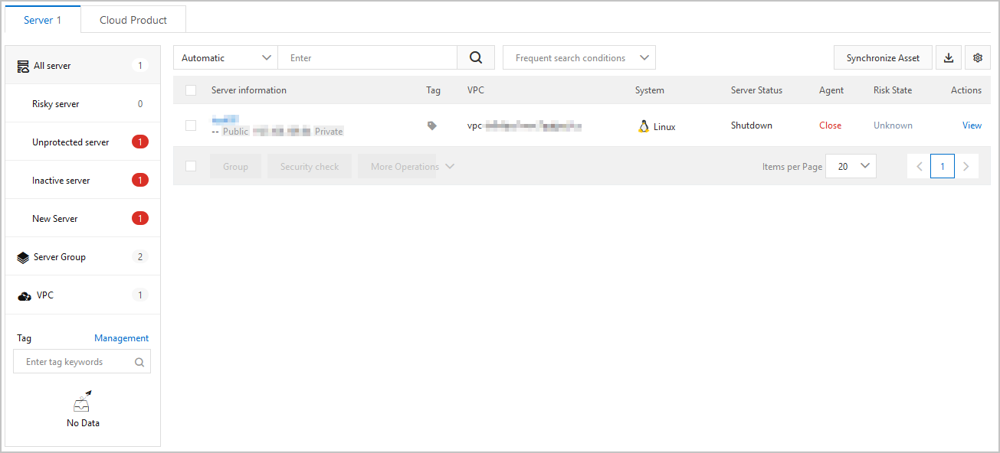

          To view the details of a server, click the name of the server, or click Fix in the Actions column. For more information, see View the details of a single asset.

        - You can click Risky server, Unprotected server, Inactive server, or New server to view the security status of target servers.

      - Filter by server group

        - You can click Server Group to view the total number of server groups and the numbers of servers, servers that are at risk, and unprotected servers in each server group.

          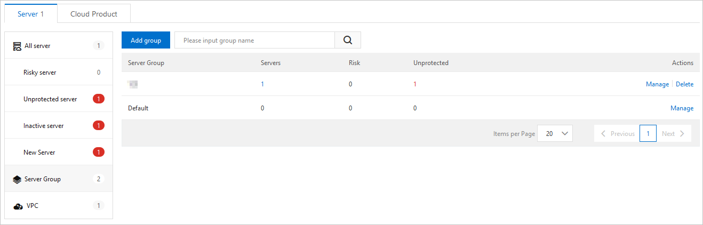

          You can Manage or Delete to manage a server group in Threat Detection Service (TDS). For more information, see Manage asset groups.

        - Find the target server group, click the number in the Servers, Risk, or Unprotected column to view the security status of specified servers in this group.

      - Filter by VPC instance ID

        - You can click VPC to view the total number of VPCs and the numbers of servers, servers that are at risk, and unprotected servers that are deployed in each VPC.

          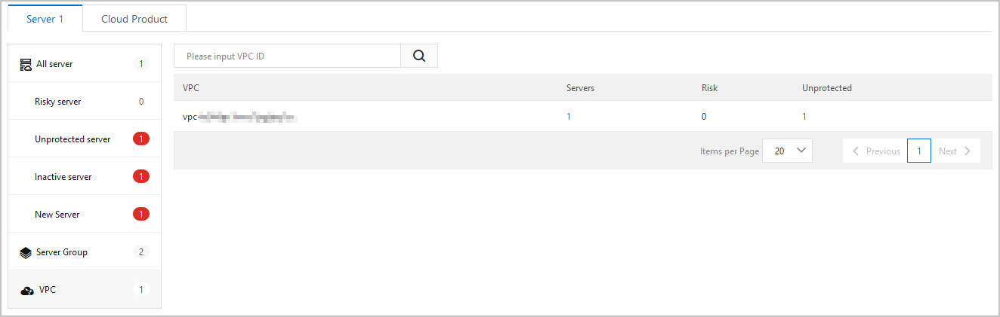

        - Find the target VPC, and click the number in the Servers, Risk, or Unprotected column to view the security status of specified servers in this VPC.

      - Filter by tag

        You can click a tag to the left of the asset list to view the security status of the servers to which this tag is bound.

      - Filter by search condition

        You can click All server, Server Group, VPC, or a Tag, and use the search bar on the Assets page to filter specific servers.

        - Use multiple subconditions to search for specific assets:

          Above the asset list of the Assets page, you can select a search condition, and select or enter a keyword in the search bar to filter specific servers. Supported search conditions include Internet IP, Private IP, Instance name, System, Baseline problems, Vul problems, Alert problems, Risk Status, Online or Offline, Tag, Group name, and OS.

          Note

          You can select multiple search conditions at a time and specify the Boolean operator between each search condition. The following content describes Boolean operators:

          - Boolean operators:

            - AND: specifies the AND logical relation for the search conditions.

            - OR: specifies the OR logical relation for the search conditions.

          - If you need to use one search condition and multiple keywords to search for specific servers, set the Boolean operator to OR.

          - If the search condition requires you to enter a keyword, enter a keyword and then click the Search icon. Results are displayed only after you click the Search icon.

        - Use multiple search conditions to search for specific assets:

          Apply multiple search conditions to search for specific assets.

          You can also select Server Group, Region, VPC, or a Tag, and use the search bar on the Assets page to filter specific servers.

      - Specify frequently used search conditions

        You can save applied search conditions as frequently used search conditions. Click Save and enter a name in the Save condition dialog box. Then, you can select the saved search conditions from the Frequent search conditions drop-down list on the right of the search bar.

      - Customize displayed items

        On the Assets page, click the  icon in the upper-right corner. You can then select the items

        that you want to display on the Assets page.

### 4.7.2. View the security status of cloud services

The Assets page displays the security information about each protected cloud service. The information includes the at-risk services and the types of services, for example, SLB and NAT Gateway. This topic describes how to configure search conditions to view the security status of cloud services.

Procedure

1. 

   2. In the left-side navigation pane, choose Threat Detection > Assets.

   3. Click the Cloud Product tab to view the security status of cloud services.

      You can perform the following operations based on your business requirements:

      - Search by asset status

        - In the left-side pane on the Cloud Product tab, you can view the numbers of All cloud product and Risky cloud product. You can also view the security status of all cloud services.

          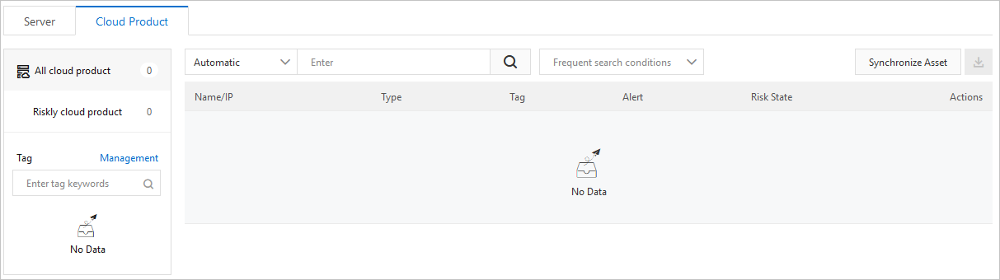

        - You can click Risky cloud product to view the cloud services that are at risk.

        You can click the name of the target cloud service or click View in the Actions column that corresponds to a service to view detailed information. For more information, see View the details of a single asset.

      - Search by asset type

        Cloud services are classified into two asset types:

        - SLB

        - NAT Gateway

        In the left-side pane on the Cloud Product tab, you can view the number of cloud services of each asset type. You can click SLB or NAT to view the security status of the target cloud service.

      - Search by tag

        In the Tag section in the left-side pane of the Cloud Product tab, you can view the number of assets bound to each tag. You can click a tag on the left of the asset list to view the security status of the cloud services to which this tag is bound.

      - Filter by search condition

        You can click All cloud product, SLB, or NAT in the left-side pane of the Cloud Product tab and configure search conditions in the search box to search for specific assets.

        For example, you can click All cloud product and configure search conditions to search for specific assets.

        - Use multiple subconditions to search for specific assets:

          Select a condition from the drop-down list of the search box on the Cloud Product tab, and select a subcondition or enter a keyword into the search box to search for specific assets. Supported search conditions are Internet IP, Instance name, Alert problems, Risk Status, Tag, and Group name.

          Note

        - Use multiple search conditions to search for specific assets:

          Apply multiple search conditions.

          - You can click SLB, NAT, or a tag specified in the Tag section and configure conditions in the search box on the Cloud Product tab to search for specific assets.

          - You can also click All cloud product, SLB, or NAT and select a tag specified in the Tag section to search for specific assets.

      - Set frequently used search conditions

        You can save applied search conditions as frequently used search conditions. Click Save below the search box and enter a name in the Save condition dialog box. Then, you can select the saved search condition from the Frequent search conditions drop-down list on the right of the search box.

### 4.7.3. View the details of a single asset

The Assets page provides details about all assets. These details include basic information, alert management status, baseline check analysis, and asset fingerprints. This topic describes how to view details of a single server or Alibaba Cloud service.

Context

The basic information about assets is displayed on the Assets page. Based on the types of assets, servers or Alibaba Cloud services can be managed in different ways.

The following table lists the features that are supported by servers and Alibaba Cloud services on the Assets page. The following content describes the marks that are used to indicate whether a feature is supported by servers or Alibaba Cloud services:

- ×: not supported by this edition.

- √: supported by this edition.

  Cloud

  Feature

  Description

  Server

  service

  Risk state: displays the number of risks of an asset.

  √ (Only

  Risks can be divided into the following types:

  alerts can

  - Vulnerability

    √

    be

  - Alert

    processe d.)

  - Baseline risk

    √ (You cannot

  Detail: displays the configuration and protection

  specify a

  status of an asset. You can specify a group and a

  √

  group for

  tag for the asset.

  the asset.)

  Asset investigation: displays asset fingerprints,

  √

  X

  Basic information

  including ports, software, processes, and accounts.

  Cloud

  Feature

  Description

  Server

  service

  Vulnerability check: displays the supported types of vulnerability checks. You can enable or disable

  √

  X

  different types of vulnerability checks for an asset.

  Logon security setting: displays the common logon locations, IP addresses, time, and accounts of an

  √

  X

  asset. You can also enable or disable alerts for the asset.

  Vulnerabilities

  Displays the vulnerability check results of an asset.

  √

  X

  Alerts

  Displays the security alerts of an asset.

  √

  √

  Baseline Risks

  Displays the baseline check results of an asset.

  √

  X

  Asset Fingerprints

  Displays the fingerprints of an asset.

  √

  X

Procedure

1. 

   2. In the left-side navigation pane, choose Threat Detection > Assets.

   3. On the Assets page, click the Server or the Cloud Product tab.

   4. On the Server or Cloud Product tab, find the target asset and click its name.

   5. View the details of the target asset.

      On the asset details page, click the Basic Information, Vulnerabilities, Alerts, Baseline Risks, or Asset Fingerprints tab to view relevant details.

      The following content displays the details of the target asset:

      - Basic Information: This tab consists of sections where you can view asset details and manage an asset.

        - Risk State: This section displays information about vulnerabilities, alerts, and baseline risks of an asset. You can click the number under Vulnerabilities, Alerts, or Baseline Risks to view the details.

        - Detail: This section displays information about the asset configuration and security protection settings, and allows you to manage asset tags and groups.

          - Change asset groups

            Click Group. In the Group dialog box, select a new group and click OK.

            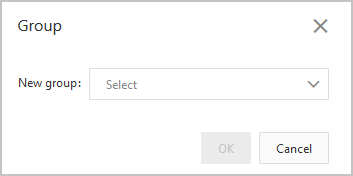

          - Modify tags

            Click the  icon. In the Add tag dialog box, select a tag and click OK.

            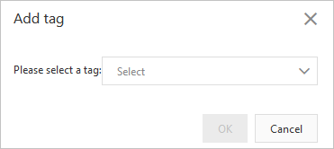

            To remove the tag of an asset, click the  icon to the right of the tag.

        - Asset Investigation: This section displays the fingerprints of an asset. You can click the number under an item to go to the Asset Fingerprints tab to view the details.

          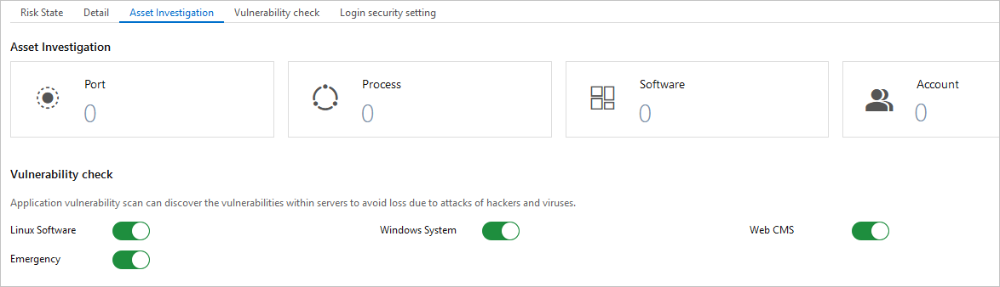

        - Vulnerability check: This section displays vulnerability check items that are enabled or disabled for an asset. You can enable or disable different types of vulnerability checks for the asset. The vulnerabilities include Linux software vulnerabilities, Windows system vulnerabilities, Web CMS vulnerabilities, and emergency vulnerabilities.

        - Login security setting: This section allows you to add approved logon locations, configure advanced logon settings, turn on or turn off the unapproved IP address, time, and account alert function. The advanced logon settings include approved IP addresses or Classless Inter-Domain Routing (CIDR) blocks, time periods, and accounts. You can also add approved IP addresses, time periods, and accounts that are allowed to log on to a specific asset.

          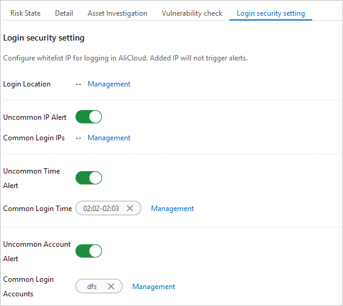

      - Vulnerabilities: This tab displays vulnerabilities of an asset.

        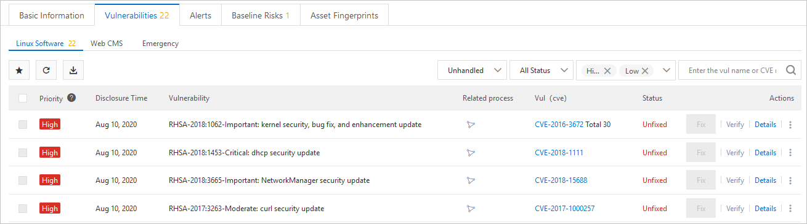

      - Alerts: This tab displays security alerts of an asset.

      - Baseline Risks: This tab displays baseline risks of an asset.

        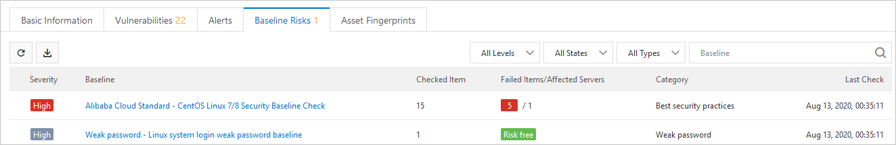

      - Asset Fingerprints: This tab displays the fingerprints, including ports, processes, software, and accounts of an asset.

        You can manually collect the latest fingerprints of an asset.

        <ol type="a">

        <li>

        You can click the Port, Software, Process, Account, or Scheduled Tasks tab. In the upper-right corner, click Collect data now.

        </li>

        <li>

        In the Collect data dialog box, click OK.

        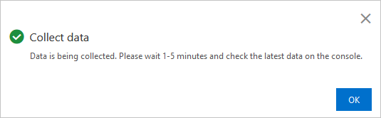

        After the data collection task is submitted, it takes one to five minutes to collect the fingerprints of the target asset. After the data collection task is complete, you can view the latest fingerprints of the target asset.

        </li>

        </ol>

### 4.7.4. Enable and disable server protection

This topic describes how to enable and disable server protection.

Procedure

1. 

   2. In the left-side navigation pane, choose Threat Detection > Assets.

   3. On the Server tab, enable or disable server protection for specified servers.

      - Enable server protection

        Select one or more servers where the agent is in the Close state, and choose More operations > Turn on protection.

        After server protection is enabled, the status of the agent on the servers changes to Enable.

      - Disable server protection

        You can disable server protection for specified servers. Select one or more servers where the agent is in the Enable state, and choose More operations > Suspend Protection.

        Note

        After server protection is disabled, Apsara Stack Security Center stops providing

        protection for your servers. The protection mechanisms that are stopped include vulnerability detection and security event alerting. We recommend that you proceed with caution.

        After server protection is disabled, the status of the agent on your servers changes to Close.

### 4.7.5. Perform a one-click security check

The Server tab of the Assets page allows you to run security checks. You can dispatch security check tasks to scan for vulnerabilities, baseline risks, and webshells, and collect asset fingerprints on a specific server. The asset fingerprints are ports, software, processes, and accounts. This topic describes how to perform security checks on servers.

Procedure

1. 

   2. In the left-side navigation pane, choose Threat Detection > Assets.

   3. On the Server tab, select one or more servers on which you want to perform security checks.

   4. In the lower part of the page, click Security check.

      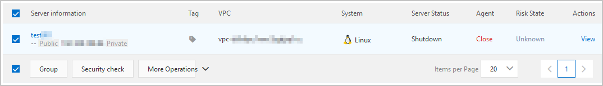

   5. In the Security Check dialog box, select check items.

      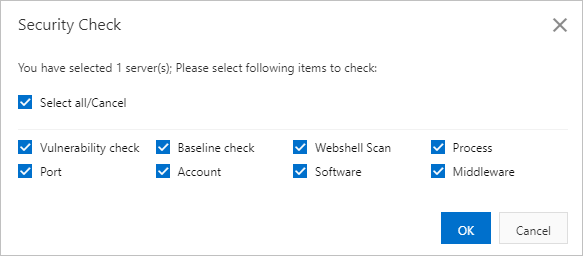

   6. Click OK to start the check.

   7. In the dialog box that appears, click OK.

      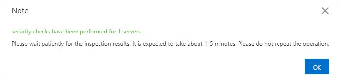

      After the one-click security check is complete, the check results are automatically displayed on the Basic Information tab of the target asset.

### 4.7.6. Manage asset groups

This topic describes how to create, modify, delete, and replace server groups.

Add a group

1. 

   2. In the left-side navigation pane, choose Threat Detection > Assets.

   3. On the page that appears, click the Server tab. In the servers list on the left, click Server Group.

      

      Note

      Ungrouped assets are in the Default group.

   4. Click Add Group.

   5. In the Add Group dialog box, configure the parameters.

      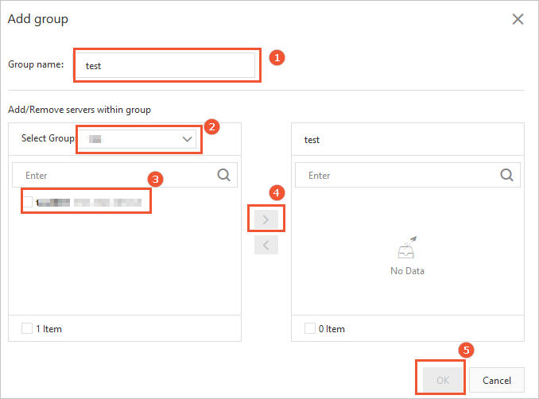

      You can perform the following steps to configure the parameters:

      <ol type="i">

      <li>

      Enter a group name in the Group name field.

      </li>

      <li>

      Add assets to the new group.

      </li>

      </ol>

      You can add assets from the Default group to the new group. You can also move assets from another group to the new group. Select Default or other groups from the Select Group

      drop-down list, select assets in the group, and click the  icon to add the selected groups

      to the new group.

   6. Click OK. In the server group list, you can view the new group.

Modify or delete a server group

The following procedure shows how to modify a server group. You can rename a group, add assets to a group, or remove assets from a group.

1. 

   2. In the left-side navigation pane, choose Threat Detection > Assets.

   3. On the page that appears, click the Server tab. In the servers list on the left, click Server Group.

   4. Find the target group. In the Actions column, click Manage or Delete.

      Perform the following operations based on your business requirements:

      - Modify a group

        <ol type="a">

        <li>

        In the Actions column, click Manage to open the Group dialog box.

        </li>

        <li>

        In the Group dialog box, select a group from the Select Group drop-down list, select

        assets in the current group on the right, and click the  icon to add the selected groups to

        the new group on the left. You can also select assets in the group on the left and click the

         icon to add the selected assets to the current group on the right.

        </li>

        </ol>

        <ol type="i" start="100">

        <li>

        Click OK.

        </li>

        </ol>

      - Delete a group

        To delete a group, click Delete in the Actions column. In the message that appears, click OK.

        Note

        After you delete a group, assets in this group are moved to the Default group.

Change server groups

You can add assets to an asset group to manage multiple assets at a time. We recommend that you add the same types of assets to an asset group. For example, when you configure a baseline check policy template, you can specify an asset group to apply the policy to all assets in the group. You can also filter and view assets based on asset groups in the assets list.

To add assets to a specific server group, perform the following steps:

1. 

   2. In the left-side navigation pane, choose Threat Detection > Assets.

   3. On the Server tab, select one or more assets and click Group.

   4. In the Group dialog box, select a new server group.

   5. Click OK.

### 4.7.7. Manage asset tags

This topic describes how to add asset importance tags, and add, modify, and remove custom tags for a server.

Context

Apsara Stack Security Center provides the following asset importance tags to classify the assets. You can select appropriate importance tags for your assets.

An asset importance tag is transformed to the target asset importance score that is used to calculate the score of the urgency to fix a vulnerability. Asset importance score affects the score of the urgency to fix a vulnerability. You can determine whether to prioritize the repair of a vulnerability based on the score of the urgency to fix a vulnerability. If you add importance asset tags for core assets, Apsara Stack Security Center prompts you to fix vulnerabilities as soon as possible. The following table shows the relation between asset importance tags and asset importance scores.

| Type | Asset importance score | Recommendation |
| --- | --- | --- |
| Important Assets | 1.5 | Assets that are related to crucial businesses and store core business data. Virus intrusion adversely affects the business system and causes major losses. |
| General Assets | 1 | Assets that are related to non-core businesses and are highly replaceable. Virus intrusion causes less impact on the system. |
| Test Assets | 0.5 | Assets for performance test, or assets that cause less impact on the system. |

Note

If you do not add asset importance tags, the tag for each asset is set to General

Assets by default, which specifies the asset importance score to 1.

Add a custom tag

1. 

   2. In the left-side navigation pane, choose Threat Detection > Assets.

   3. Click Server or Cloud Product.

   4. Click Server or Cloud Product. In the assets list on the left, click Management to the right of the Tag column.

   5. In the Add Tag dialog box, enter the tag name. In the servers list on the left, select target servers,

      and click the  icon to add the tag to the selected servers.

      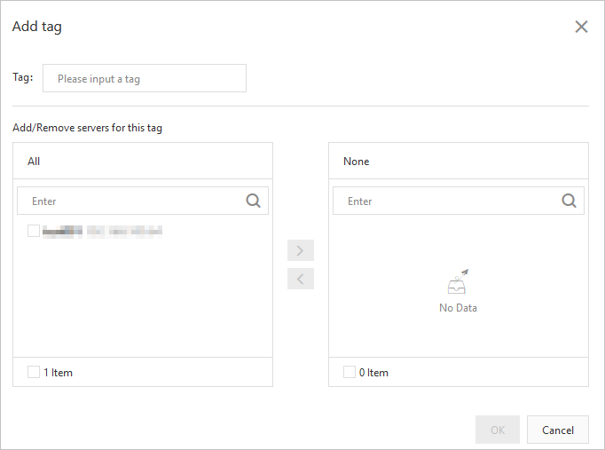

   6. Click OK.

      In the left-side assets list, click the  icon in the Tag column to add a tag to the asset.

      Note

      You can add multiple tags to one asset. All tags of an asset are displayed in the

      Tag column.

Modify and delete custom tags

Perform the following steps to modify or delete a tag:

1. 

   2. In the left-side navigation pane, choose Threat Detection > Assets.

   3. Click Server or Cloud Product.

   4. On the Server or Cloud Product tab, modify or delete a tag.

      Perform the following steps to modify or delete a tag:

      - Modify a tag

        <ol type="a">

        <li>

        If you want to modify a tag, move the pointer over the  icon to the right of the tag.

        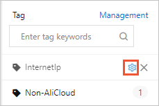

        </li>

        <li>

        In the Tag dialog box, enter a new name in the Tag field, add the tag to more servers, or remove the tag from servers.

        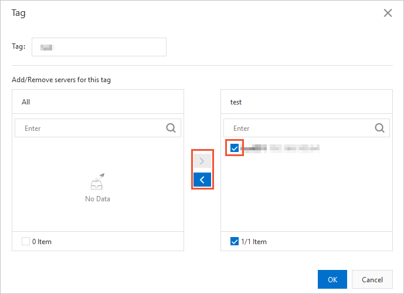

        </li>

        </ol>

        <ol type="i" start="100">

        <li>

        Click OK.

        </li>

        </ol>

      - Delete a tag

        Click the  icon in the Tag column. Click OK to delete a tag.

        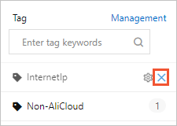

## 4.8. Create a security report

You can specify the report content, statistics types, and recipient email addresses. This way, you can view the security statistics of your assets. This topic describes how to create a security report.

Procedure

1. Log on to Apsara Stack Security Center.

2. In the left-side navigation pane, choose Threat Detection > Security Reports.

3. On the Reports page, click Create Report.

   Notice

   In addition to the default security report created by Apsara Stack Security

   Center, you can also create a maximum of nine security reports.

4. On the Specify Basic Information tab, configure the parameters.

   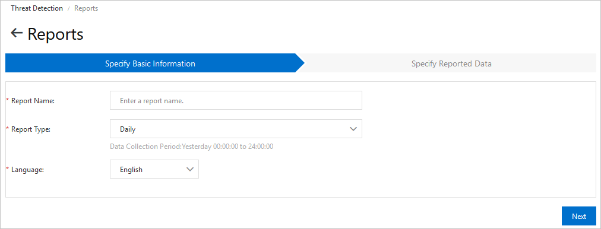

   Configure the following parameters:

   - Report Name: Enter a name for the security report.

   - Report Type: Select a report type from the drop-down list. Supported types are *Daily*, *Weekly*, *Monthly*, and *Custom*.

     If you select *Custom*, you must set the Data Collection Period parameter to specify the cycle when data is collected.

   - Language: Select a language for the security report.

5. Click Next.

6. On the Specify Reported Data tab, select the types of data that you want to view in the security report. You can select assets, alerts, vulnerabilities, baseline checks, attacks, and other data related to security operations.

   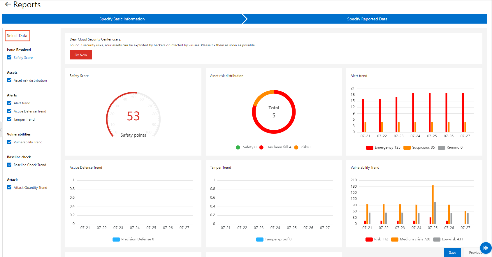

7. Click Save. You can view the security reports that you have created on the Reports page.

   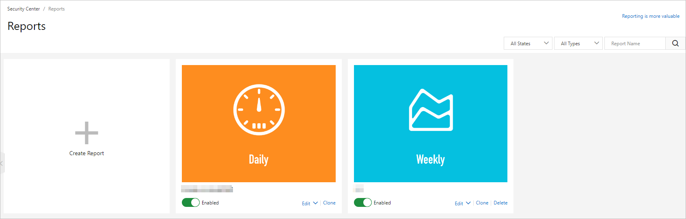

# 5.Network Traffic Monitoring System

## 5.1. View traffic trends

This topic describes how to view the network traffic trends, inbound traffic statistics, and outbound traffic statistics.

Context

By analyzing traffic trends, the security administrator can obtain the throughput and the peaks and troughs of traffic periods. In addition, the security administrator can block traffic from malicious IP addresses by viewing the top five IP addresses with the most traffic.

Procedure

1. Log on to Apsara Stack Security Center.

2. In the left-side navigation pane, choose Network Security > Traffic Analysis > Traffic Trend.

3. In the upper-right corner of the Traffic Trends page, select the time range, which can be Last 1 Hour, Last 24 Hours, or Last 7 Days.

4. View network traffic information.

   - Network traffic trends

     View the network traffic trends from the selected time range. The network traffic trends include inbound and outbound traffic measured in bit/s.

   - Inbound Traffic

     View the information of Inbound Sessions, Inbound Applications, and Destination IPs with Most Requests.

   - Outbound Traffic

     View the information of Outbound Sessions, Outbound Applications, and Source IPs with Most Requests.

5. (Optional)Click the  icon to export traffic trends as a PDF file.

## 5.2. View traffic at the Internet border

This topic describes how to view traffic at the Internet border. You can obtain up-to-date information about network security.

Prerequisites

The Network Traffic Monitoring System module is purchased and deployed at the egress (ISW) of Apsara Stack. This module audits, analyzes, and manages both inbound and outbound traffic at Internet borders.

Context

You can use traffic information to identify abnormal Internet traffic and block malicious traffic.

Procedure

1. Log on to Apsara Stack Security Center.

2. In the left-side navigation pane, choose Network Security > Traffic Analysis > Internet Border.

3. Specify traffic filter conditions.

   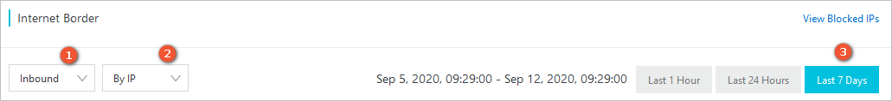

   | Item | Description |
   | --- | --- |
   | 1 | Specify the traffic direction. Valid values: <em>Inbound</em> and <em>Outbound</em>. • <em>Inbound</em>: The traffic flows from the Internet to the internal network. • <em>Outbound</em>: The traffic flows from the internal network to the Internet. |
   | 2 | Specify whether you want to view the traffic from the IP address or application dimension. Valid values: <em>By IP</em> and <em>By Application</em>. |
   | 3 | Specify the time range. Valid values: <em>Last 1 Hour</em>, <em>Last 24 Hours</em>, and <em>Last 7 D</em> <em>ays</em>. |

4. View details about the traffic at the Internet border.

   - Traffic Statistics

     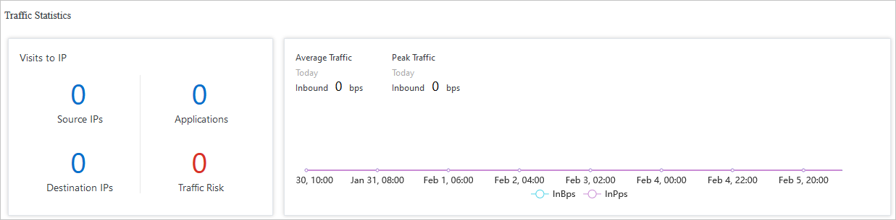

     - The Visits to IP section includes Source IPs, Destination IPs, Applications, and Traffic Risk.

     - In the traffic chart on the right, you can view Average Traffic, Peak Traffic, and traffic trends.

   - Traffic List

     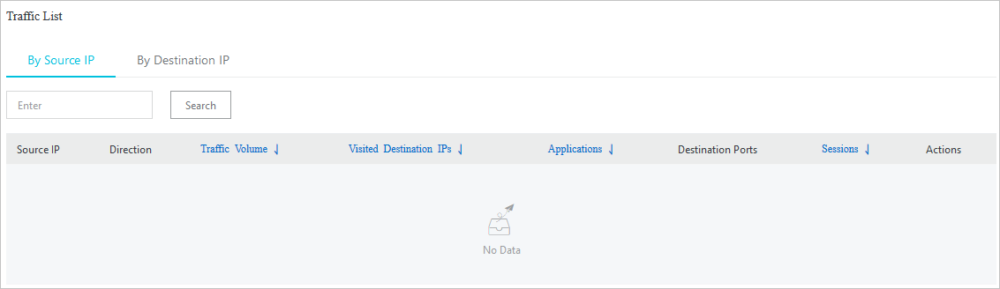

     In the Traffic List section, you can view traffic details.

5. In the Traffic List section, view abnormal traffic of the specified IP address.

   - If *Inbound* is specified, you can view abnormal traffic on the By Destination IP tab of the Traffic List section.

   - If *Outbound* is specified, you can view abnormal traffic in the Traffic List section.

## 5.3. View traffic at the internal network border

This topic describes how to view the traffic at the internal network border. You can obtain up-to-date information about network security based on the traffic.

Prerequisites

The Network Traffic Monitoring System module is purchased and deployed at the ingress (CSW) of Apsara Stack. This module is used to audit, analyze, and control both inbound and outbound traffic routed over leased lines between on-premises data centers and virtual private clouds (VPCs).

Context

You can use traffic information to identify suspicious traffic from the internal network and block malicious requests.

Procedure

1. Log on to Apsara Stack Security Center.

2. In the left-side navigation pane, choose Network Security > Traffic Analysis > Internal Network Border.

3. Specify traffic filter conditions.

   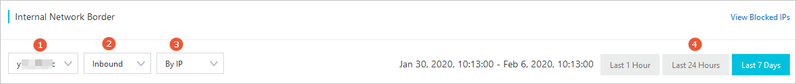

   | Item | Description |
   | --- | --- |
   | 1 | Select a VPC name from the drop-down list. |
   | 2 | Specify the traffic direction. Valid values: <em>Inbound</em> and <em>Outbound</em>. • <em>Inbound</em>: The traffic flows from the Internet to the internal network. • <em>Outbound</em>: The traffic flows from the internal network to the Internet. |
   | 3 | Specify whether you want to view the traffic that flows through the internal network border from the IP address or application dimensions. Valid values: <em>By IP</em> and <em>By Application</em>. |
   | 4 | Specify the time range. Valid values: <em>Last 1 Hour</em>, <em>Last 24 Hours</em>, and <em>Last 7 D</em> <em>ays</em>. |

4. View details about the traffic at the internal network border.

   - Traffic Statistics

     - The Visits to IP section includes Source IPs, Destination IPs, Applications, and Traffic Risk.

     - In the traffic chart on the right, you can view Average Traffic, Peak Traffic, and traffic trends.

   - Traffic List

     In the Traffic List section, you can view traffic details.

     If By IP is specified, you can view the suspicious traffic of the specified IP address in the Traffic List section.

# 6.Server security

## 6.1. Server security overview

The security administrator can view the current security status of all servers on the server security overview page of Apsara Stack Security Center.

In the left-side navigation pane, choose Server Security > Overview. On the page that appears, you can view detailed information in the Overview, Server Risks, Asset Protection, Operating System Distribution, and Recent Important Security Risks and Intrusions sections.

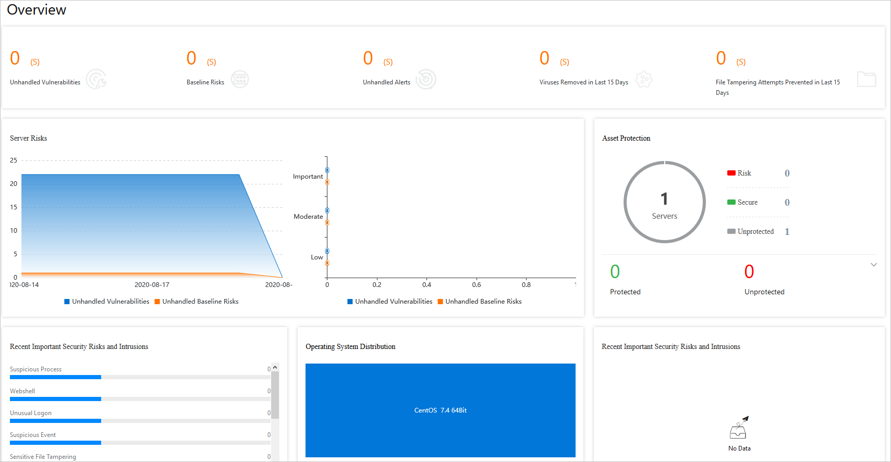

- Overview: This section displays the number of security vulnerabilities of each type (including Unhandled Vulnerabilities and Baseline Risks) and the number of security events of each type (including Unhandled Alerts, Viruses Removed in Last 15 Days, and File Tampering Attempts Prevented in Last 15 Days) on servers.

- Server Risks: This section displays the number of unhandled vulnerabilities, the number of baseline risks, and the distribution of risk levels.

- Asset Protection: This section displays the number of protected servers and the number of offline servers.

- Recent Important Security Risks and Intrusions: This section displays the recent important risks and events on your servers. You can click a risk or event to view the details.

## 6.2. Server fingerprints

### 6.2.1. Manage listener ports

This topic describes how to regularly collect information from listener ports on a server, and record and view the port changes and historical port information. This allows you to locate suspicious listening behavior.

Context

This task is suitable to the following scenarios:

- Check for servers that listen on a specific port.

- Check for ports that are open on a specific server.

Procedure

1. 

   2. In the left-side navigation pane, choose Server Security > Servers > Server Fingerprints. On the page that appears, click the Port tab.

   3. View Port, Protocol, and Server.

      You can search for a port by using its port number, process name, server name, or IP address.

   4. Click a port number to view the details, such as the assets and protocol.

### 6.2.2. Manage software versions

This topic describes how to regularly collect software version information of a server and record the changes. This helps to check your software assets.

Context

This task is suitable to the following scenarios:

- Check for software assets that are installed without authorization.

- Check for software of outdated versions.

- Locate the affected assets when vulnerabilities are detected.

Procedure

1. 

   2. In the left-side navigation pane, choose Server Security > Servers > Server Fingerprints. On the page that appears, click the Software tab.

   3. View all software in use and the number of servers that use such software.

      You can search for a piece of software by using its software name, version, installation directory, server name, or IP address.

   4. Click a software name to view the details, such as the assets and software version.

### 6.2.3. Manage processes

This topic describes how to regularly collect the process information on a server and record changes. This helps check for processes and view historical process changes.

Context

This task is suitable to the following scenarios:

- Checks for servers that run a specified process.

- Checks for processes that run on a server.

Procedure

1. 

   2. In the left-side navigation pane, choose Server Security > Servers > Server Fingerprints. On the page that appears, click the Process tab.

   3. View all running processes and the number of servers that run these processes.

      You can search for a process by using its process name, running user, startup parameter, or server name or IP address.

   4. Click a process name to view the details, such as the assets, path, and startup parameters.

### 6.2.4. Manage account information

This topic describes how to regularly collect the account information on a server and record changes. This helps check for accounts and view historical account changes.

Context

This task is suitable to the following scenarios:

- Check for servers where the specified account is created.

- Check for accounts that are created on a server.

Procedure

1. 

   2. In the left-side navigation pane, choose Server Security > Servers > Server Fingerprints. On the page that appears, click the Account tab.

   3. View all logged-on accounts and the number of servers that use these accounts.

      You can search for an account by using its account name, root permissions, server name, or IP address.

   4. Click an account name to view the details, such as the assets, root permissions, and user group.

### 6.2.5. Manage scheduled tasks

This topic describes how to regularly collect information of scheduled tasks on a server. This allows you to check your tasks.

Procedure

1. 

   2. In the left-side navigation pane, choose Server Security > Servers > Server Fingerprints. On the page that appears, click the Scheduled Tasks tab.

   3. View the paths of all tasks and the number of servers that run these tasks.

      You can search for a task by using its path, server name, or IP address.

   4. Click a task path to view the details, such as the assets, executed command, and task cycle.

### 6.2.6. Set the server fingerprint collection frequency

You can set the frequency at which the data of running processes, system accounts, listening ports, and software versions is collected.

Procedure

1. 

   2. In the left-side navigation pane, choose Server Security > Servers > Server Fingerprints. In the upper-right corner of the page that appears, click Settings.

   3. Select the collection frequency from each drop-down list.

   4. Click OK to complete the configuration.

## 6.3. Threat protection

### 6.3.1. Vulnerability management

#### 6.3.1.1. Manage Linux software vulnerabilities

This topic describes how to manage Linux software vulnerabilities.

Context

Apsara Stack Security automatically scans the software that are installed on your servers based on the vulnerabilities provided in the Common Vulnerabilities and Exposures (CVE) list. It also sends you alerts about the detected vulnerabilities. In addition, Apsara Stack Security provides commands that are used to fix vulnerabilities and allows you to verify these vulnerability fixes.

Procedure

1. 

   2. In the left-side navigation pane, choose Server Security > Threat Prevention > Vulnerabilities. On the page that appears, click the Linux Software tab.

   3. View the detected Linux vulnerabilities.

      Note

      You can locate a vulnerability by using the search and filter functions.

   4. Click a vulnerability to go to the vulnerability details page. You can view details about the vulnerability and affected assets on this page.

      Note

      You can locate specific affected assets by using the search and filter functions.

      - Basic Information: the basic information of the vulnerability, including the name, Common Vulnerability Scoring System (CVSS) score, description, and resolution.

      - Affected Assets: the servers that are affected by the vulnerability.

   5. Select an action based on the impact of the vulnerability.

      Actions on vulnerabilities

      | Option | Description |
      | --- | --- |
      | Generate Fix Command | Select this option to generate the commands that are used fix the vulnerability.You can then log on to the server to run these commands. |
      | Fix Now | Select this option to fix the vulnerability. |
      | Restarted and Verified | If a vulnerability fix takes effect only after a server reboot, you must reboot the server after the status of the vulnerability changes to Fixed (To Be Restarted). After the reboot, click Restarted and Verified. |
      | Ignore | Select this option to ignore a vulnerability. The system does not send you an alert about an ignored vulnerability. |
      | Verify | Click Verify to verify the vulnerability fix. If you do not manually verify a fix, the system automatically verifies the fix within 48 hours after the vulnerability fix is complete. |

      You can fix a vulnerability for one or more affected assets at a time.

      - To fix a vulnerability for one affected asset, select an action from the Actions column of the asset.

      - To fix a vulnerability for one or more affected assets, select the target servers, and select an action in the lower-left corner.

#### 6.3.1.2. Manage Windows vulnerabilities

This topic describes how to manage Window vulnerabilities.

Context

Apsara Stack Security automatically checks if your servers have the latest Microsoft updates installed, and notifies you of the detected vulnerabilities. Apsara Stack Security also automatically detects and fixes major vulnerabilities on your servers.

Procedure

1. Log on to Apsara Stack Security Center.

2. In the left-side navigation pane, choose Server Security > Threat Prevention > Vulnerabilities. On the page that appears, click the Window System tab.

3. Check the detected Windows vulnerabilities.

   Note

   You can find a vulnerability by using the search and filter functions.

4. Click a vulnerability to go to the vulnerability details page. You can view details about the vulnerability and affected assets on this page.

   Note

   You can find specific affected assets by using the search and filter functions.

   - Basic Information: the basic information of the vulnerability, including the name, Common Vulnerability Scoring System (CVSS) score, description, and resolution.

   - Affected Assets: the servers that are affected by the vulnerability.

5. Select an action based on the impact of the vulnerability. describes the actions.

   Actions on vulnerabilities

   | Option | Description |
   | --- | --- |
   | Rectify | Select this option to fix the vulnerability. The system caches an official Windows patch in the cloud for your server to download and update. |
   | Ignore | Select this option to ignore a vulnerability. The system does not send you an alert about an ignored vulnerability. |
   | Verify | Click Verify to verify the vulnerability fix. |
   | Restarted and Verified | If a vulnerability fix takes effect only after a server reboot, you must reboot the server after the status of the vulnerability changes to Fixed (To Be Restarted). After the reboot, click Restarted and Verified. |

   You can fix a vulnerability for one or more affected assets at a time.

   - To fix a vulnerability for one affected asset, select an action from the Actions column of the asset.

   - To fix a vulnerability for one or more affected assets, select the target servers, and select an action in the lower-left corner.

#### 6.3.1.3. Manage Web CMS vulnerabilities

This topic describes how to manage Web CMS vulnerabilities.

Context

The Web CMS vulnerability detection feature obtains the information of the latest vulnerabilities and provides patches in the cloud. This helps you detect and fix vulnerabilities.

Procedure

1. 

   2. In the left-side navigation pane, choose Server Security > Threat Prevention > Vulnerabilities. On the page that appears, click the Web CMS tab.

   3. View all vulnerabilities.

      Note

      You can find a vulnerability by using the search and filter functions.

   4. Click a vulnerability to go to the vulnerability details page. You can view details about the vulnerability and affected assets on this page.

      Note

      You can find specific affected assets by using the search and filter functions.

   5. Select an action based on the impact of the vulnerability. describes the actions.

      Actions on vulnerabilities

      | Option | Description |
      | --- | --- |
      | Rectify | Select this option to fix the Web CMS vulnerability by replacing the web files that contain the vulnerability on your server. Note Before you fix the vulnerability, we recommend that you back up the web files affected by this vulnerability. For more information about the paths of the web files, see the paths specified in the vulnerability remarks. |
      | Ignore | Select this option to ignore a vulnerability. The system does not send you an alert about an ignored vulnerability. |
      | Verify | Click Verify to verify the vulnerability fix. If you do not manually verify a fix, the system automatically verifies the fix within 48 hours after the vulnerability fix is complete. |
      | Undo Fix | For vulnerabilities that have been fixed, click Undo Fix to restore the web files that have been replaced. |

      You can fix a vulnerability for one or more affected assets at a time.

      - To fix a vulnerability for one affected asset, select an action from the Actions column of the asset.

      - To fix a vulnerability for one or more affected assets, select the target servers, and select an action in the lower-left corner.

#### 6.3.1.4. Manage emergency vulnerabilities

This topic describes how to manage emergency vulnerabilities.

Context

Apsara Stack Security automatically detects vulnerabilities on servers, such as the unauthorized Redis access vulnerability and Struts S2-052 vulnerability, and sends vulnerability alerts. After you fix a vulnerability, you can also check whether the fix is successful.

Procedure

1. 

   2. In the left-side navigation pane, choose Server Security > Threat Prevention > Vulnerabilities. On the page that appears, click the Emergency tab.

   3. View all vulnerabilities.

      You can quickly locate a vulnerability by using the search and filter functions.

   4. Click a vulnerability to go to the vulnerability details page. You can view detailed vulnerability information and affected assets on this page.

      You can quickly locate specific affected assets by using the search and filter functions.

   5. Select an action based on the impact of the vulnerability. describes the actions.

      Follow the instructions to manually fix the vulnerabilities on the Emergency tab.

      Actions on vulnerabilities

      | Action | Description |
      | --- | --- |
      | Ignore | Ignore a vulnerability. The system does not alert you about an ignored vulnerability. |
      | Verify | Verify the fix after you manually fix a vulnerability. If you do not manually verify a fix, the system automatically verifies the fix within 48 hours after the vulnerability fix is complete. |

      You can fix a vulnerability for one or more affected assets at a time.

      - To fix a vulnerability for one affected asset, select an action from the Actions column of the asset.

      - To fix a vulnerability for one or more affected assets, select the target servers, and select an action in the lower-left corner.

#### 6.3.1.5. Configure vulnerability management policies

You can enable or disable automatic detection for different types of vulnerabilities, and enable vulnerability detection for specific servers. You can also set a time duration for which invalid vulnerabilities are retained, and configure a vulnerability whitelist.

Context

A vulnerability whitelist allows you to exclude vulnerabilities from the detection list. You can add multiple vulnerabilities in the vulnerability list to the whitelist. The system does not detect vulnerabilities in the whitelist. You can manage the vulnerability whitelist on the vulnerability settings page.

Procedure

1. 

   2. In the left-side navigation pane, choose Server Security > Threat Prevention > Vulnerabilities.

   3. In the upper-right corner, click Settings to configure vulnerability management policies.

      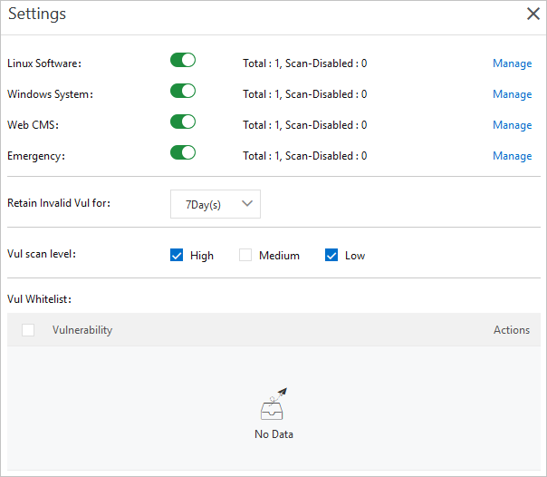

      - Select a vulnerability type and enable or disable detection for vulnerabilities of this type.

      - Click Manage next to a vulnerability type and specify the servers on which vulnerabilities of this type are detected.

      - Select a time duration for which invalid vulnerabilities are retained: 7 days, 30 days, or 90 days.

        Note

        If you do not take any action on a detected vulnerability, the system determines

        that the alert is invalid. The system deletes the vulnerability after the specified duration.

      - Select the vulnerability severities for scanning.

        - High: Vulnerabilities of this severity must be fixed as soon as possible.

        - Medium: Vulnerabilities of this severity can be fixed later.

        - Low: Vulnerabilities of this severity do not need to be fixed for now.

      - Select vulnerabilities in the whitelist and click Remove to enable the system to detect these vulnerabilities and send alerts again.

### 6.3.2. Baseline check

#### 6.3.2.1. Baseline check overview

The baseline check feature automatically checks the security configurations on servers and provides the detailed check results and suggestions for baseline reinforcement.

Description

After you enable the baseline check feature, Apsara Stack Security automatically checks for risks related to the operating systems, accounts, databases, passwords, and security compliance configurations of your servers, and provides reinforcement suggestions. For more information, see Baseline check items.

By default, a full baseline check is automatically performed from 00:00 to 06:00 every day. You can create and manage scan policies for baseline checks. When you create or modify a policy, you can customize the check items, interval, and time period of a baseline check, and select the servers to which you want to apply this policy. For more information, see Add a custom baseline check policy.

Precautions

The following check items are disabled by default. To check these items, make sure that these items do not affect your business and select them when you customize a scan policy.

- Check items related to weak passwords for specific applications such as MySQL, PostgreSQL, and SQL Server

  Note

  If these check items are enabled, the system attempts to log on to servers with weak

  passwords. The logon attempts consume server resources and generate many logon failure records.

- Check items related to China classified protection of cybersecurity

- Check items related to the Center for Internet Security (CIS) standard

Baseline check items

Category

Check item

Alibaba Cloud Standard - MongoDB Security Baseline Check

Alibaba Cloud Standard - Redis Security Baseline Check

Database

Alibaba Cloud Standard - Oracle 11g Security Baseline Check

Alibaba Cloud Standard - Memcached Security Baseline Check

Alibaba Cloud Standard - Mysql Security Baseline Check

Security baseline check against the Alibaba Cloud standard:

- Alibaba Cloud Aliyun Linux 2 Benchmark

- Alibaba Cloud Standard - CentOS Linux 6 Security Baseline Check

- Alibaba Cloud Standard - CentOS Linux 7/8 Security Baseline Check

- Alibaba Cloud Standard - Debian Linux 8 Security Baseline

- Alibaba Cloud Standard - Red Hat Enterprise Linux 6 Security Baseline Check

- Alibaba Cloud Standard - Red Hat Enterprise Linux 7 Security Baseline Check

- Alibaba Cloud Standard - Ubuntu Security Baseline

- Alibaba Cloud Standard - Windows Server 2008 R2 Security Baseline Check

- Alibaba Cloud Standard - Windows 2012 R2 Security Baseline

- Alibaba Cloud Standard - Windows 2016/2019 R2 Security Baseline

Category

Check item

Security baseline check against the CIS standard:

- Alibaba Cloud Aliyun Linux 2 CIS Benchmark

- CIS CentOS Linux 6 LTS Benchmark

- CIS CentOS Linux 7 LTS Benchmark

- CIS Debian Linux 8 Benchmark

- CIS Ubuntu Linux 14 LTS Benchmark

- CIS Ubuntu Linux 16/18 LTS Benchmark

- CIS Microsoft Windows Server 2008 R2 Benchmark

- CIS Microsoft Windows Server 2012 R2 Benchmark

- CIS Microsoft Windows Server 2016/2019 R2 Benchmark

Baseline check on compliance of China classified protection of cybersecurity level II:

- Aliyun Linux 2 Baseline for China classified protection of cybersecurity-Level II

- CentOS Linux 6 Baseline for China classified protection of cybersecurity-Level II

- CentOS Linux 7 Baseline for China classified protection of cybersecurity-Level II

- Debian Linux 8 Baseline for China classified protection of cybersecurity-Level II

- Redhat Linux 7 Baseline for China classified protection of cybersecurity-Level II

- Ubuntu 14 Baseline for China classified protection of cybersecurity-Level II

- Linux Ubuntu 16/18 Baseline for China classified protection of cybersecurity-Level II

- Windows 2008 R2 Baseline for China classified protection of cybersecurity-Level II

- Windows 2012 R2 Baseline for China classified protection of cybersecurity-Level II

- Windows 2016/2019 R2 Baseline for China classified protection of

Operating system

cybersecurity-Level II

Category

Check item

Baseline check on compliance of China classified protection of cybersecurity level III:

- Aliyun Linux 2 Baseline for China classified protection of cybersecurity-Level III

- CentOS Linux 6 Baseline for China classified protection of cybersecurity-Level III

- CentOS Linux 7 Baseline for China classified protection of cybersecurity-Level III

- Debian Linux 8 Baseline for China classified protection of cybersecurity-Level III

- Redhat Linux 6 Baseline for China classified protection of cybersecurity-Level III

- China's Level 3 Protection of Cybersecurity - Red Hat Enterprise Linux 7 Compliance Baseline Check

- SUSE Linux 10 Baseline for China classified protection of cybersecurity-Level III

- SUSE Linux 11 Baseline for China classified protection of cybersecurity-Level III

- SUSE Linux 12 Baseline for China classified protection of cybersecurity-Level III

- Ubuntu 14 Baseline for China classified protection of cybersecurity-Level III

- Linux Ubuntu 16 Baseline for China classified protection of cybersecurity-Level III

- Windows 2008 R2 Baseline for China classified protection of cybersecurity-Level III

- Windows 2012 R2 Baseline for China classified protection of cybersecurity-Level III

- Windows 2016/2019 R2 Baseline for China classified protection of cybersecurity-Level III

Weak password - Linux system login weak password baseline

Weak password - SQL Server DB login weak password baseline

Weak password - PostgreSQL DB login weak password baseline

Weak password

Weak password - Windows system login weak password baseline

Weak password - Ftp login weak password baseline

Weak password - Mysql DB login weak password baseline

Alibaba Cloud Standard - IIS 8 Security Baseline Check

Alibaba Cloud Standard-Apache Tomcat Security Baseline

Middleware

Alibaba Cloud Standard - Apache Security Baseline Check

Alibaba Cloud Standard - Nginx Security Baseline Check

#### 6.3.2.2. Configure baseline check policies

This topic describes how to add, modify, and delete baseline check policies and how to set baseline check levels.

Context

By default, the baseline check feature uses the default policy to check the baseline security of assets. You can also customize baseline check policies based on your business requirements, for example, to check the compliance with China classified protection of cybersecurity-Level II.

Procedure

1. 

   2. In the left-side navigation pane, choose Server Security > Threat Prevention > Baseline Check.

   3. In the upper-right corner of the page that appears, click Manage Policies. In the Manage Policies pane, add, modify, or delete a baseline check policy, or modify the default policy.

      - In the upper-right corner of the pane, click Create Policy to customize a baseline check policy. Then, click Ok.

        | Parameter | Description |
        | --- | --- |
        | Policy Name | Enter a policy name. |
        | Schedule | Select a time interval for scheduled scan tasks from: 1 Day(s), 3 Day(s), 7 Day(s), and 30 Day(s), which represent every second day, every fourth day, every eighth day, and every thirty-first day. You can also select a time period for scheduled scan tasks from: 00:00 to 06:00, 06:00 to 12:00, 12:00 to 18:00, and 18:00 to 24:00. |
        | Check Items | Select the baseline items that need to be checked under these categories: High risk exploit, CIS and China's Protection of Cybersecurity, Best security practices, and Weak password. |
        | Servers | Select the asset groups to which you want to apply this policy. Note Newly purchased servers belong to Default under Asset Groups. To apply this policy to new servers, select Default. |

      - Click Edit or Delete next to the target policy to modify or delete it.

        Note

        You cannot restore a policy after it is deleted.

      - Click Edit in the Actions column next to the Default policy to modify the asset groups to which the default policy is applied.

        Note

        You cannot delete the default policy or modify the check items of the default

        policy. You can only modify the asset groups to which the default policy is applied.

      - In the lower part of the Manage Policies pane, set the baseline check level to High, Medium, and Low.

   4. Click Ok.

#### 6.3.2.3. View baseline check results and manage failed check items

The Apsara Stack Security console provides detailed baseline check results and suggestions on how to manage failed check items. This topic describes how to view baseline check results and manage failed check items in the Apsara Stack Security console. The check results include affected assets, checked items, and the suggestions.

View the summary of baseline check results

1. 

2. 

   3. In the upper part of the Baseline Check page, view the summary of baseline check results. You can filter data by policy.

      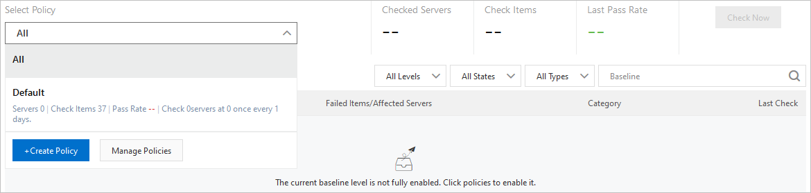

      You can select a policy from the Select Policy drop-down list to view the following information:

      - Checked Servers: The number of servers on which the baseline check runs. These servers are specified in the selected baseline check policy.

      - Check Items: The number of Check Items specified in the selected baseline check policy.

      - Last Pass Rate: The pass rate of the last baseline check.

        If the number under Last Pass Rate is green, the pass rate of the checked servers is high. If this number is red, a large number of failed check items have been detected on the checked servers. We recommend that you view the check result details and manage the failed check items.

View all check items

1. 

2. 

   3. Select All from the Select Policy drop-down list. The Baseline Check page displays check result details, including Baseline, Checked Item, Failed Items/Affected Servers, Category, and Last Check.

      Note

      You can also select a baseline check policy from the Select Policy drop-down list

      to view the check items specified in this policy.

View details of a check item

1. 

2. 

   3. In the Baseline column, click the target check item to view its details.

   4. On the details page, manage the failed check items.

      - Find the target asset and click View in the Actions column to open the At-Risk Items pane.

View failed check items

1. Open the check item details page. Find the target asset and click View in the Actions column to view failed check items. You can view the check items of the asset and the statuses of the check items (Passed or Failed).

2. 

   Note

   We recommend that you follow the suggestions to manage Failed check items at the

earliest opportunity, especially the high-risk check items.

Manage failed check items

In the At-Risk Items pane, manage failed check items as required.

- Add a check item to the whitelist

  If you want to disable alerts for a check item, click Whitelist to add the check item to the whitelist. Check items in the whitelist do not trigger alerts.

  Note

  You can also select multiple check items and click Whitelist in the lower-left corner

  to add the check items to the whitelist at a time.

- Remove a check item from the whitelist

  If you want to enable alerts for a check item in the whitelist, you can click Remove to remove the check item from the whitelist. You can remove one or more check items from the whitelist at a time. After a check item is removed from the whitelist, the check item triggers alerts again.

- Verify a fixed check item

  If you do not manually perform the verification, Apsara Stack Security automatically verifies the check item based on the detection interval specified in the policies.

## 6.4. Intrusion detection

### 6.4.1. Intrusion events

#### 6.4.1.1. Intrusion event types

If the Server Security feature detects sensitive file tampering, webshells, unusual logons, suspicious processes, and malicious processes, it generates alerts. Based on these alerts, you can monitor the security status of your assets and handle potential threats at the earliest opportunity.

Apsara Stack Security Center provides statistics based on enabled alerts and defense items. This allows you to understand enabled and disabled defense items. You can view statistics on alerts and information about defense items. To achieve this purpose, choose Server Security > Intrusion Prevention > Intrusions.

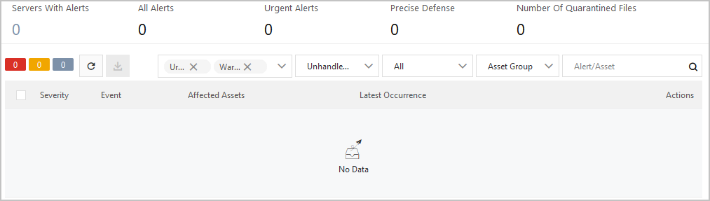

Alert types

The following table describes the defense items.

| Alert | Description |
| --- | --- |
| Suspicious Process | Detects whether suspicious processes exist. |
| Webshell | Uses engines developed by Alibaba Cloud to scan common webshell files.Apsara Stack Security Center supports scheduled scan tasks, provides real-time protection, and quarantines webshell files. • Apsara Stack Security Center scans the entire web directory early in the morning on a daily basis. A change made to files under the web directory triggers dynamic detection. • You can specify the assets on which Apsara Stack Security Center scans for webshells. • You can quarantine, restore, and ignore detected Trojan files. |
| Unusual Logon | Detects unusual logons to your servers. You can specify approved logon IP addresses, time periods, and accounts. Logons from unapproved IP addresses, accounts, or time periods trigger alerts. You can manually add approved logon locations or configure the system to automatically update approved logon locations. You can also specify assets on which alerts are triggered when unusual logon locations are detected. Apsara Stack Security Center can detect the following logon events: • Logons to Elastic Compute Service (ECS) instances from unapproved IP addresses • Logons to ECS instances from unapproved locations • Execution of unusual commands after logons to ECS instances by using Secure Shell (SSH) • ECS instances passwords cracked due to brute-force attacks based on the SSH protocol |
| Sensitive File Tampering | Checks whether sensitive files on your servers are maliciously modified, such as tampering of pre-loaded configuration files in Linux shared libraries. |
| Malicious Process | Dynamically scans your servers based on the anti-virus mechanism of Alibaba Cloud and Apsara Stack Security Center, and generates alerts if viruses are detected. Process information is collected by Apsara Stack Security Center and uploaded to Alibaba Cloud. You can manage detected viruses in the Apsara Stack Security Center console. Apsara Stack Security Center can detect the following malicious activities and processes: • Visiting malicious IP addresses • Mining programs • Self-mutating Trojans • Malicious programs • Trojans |
| Unusual Network Connection | Detects disconnections or unusual network connections. |
| Suspicious Account | Detects logons to your assets from unapproved accounts. |
| Application intrusion event | Detects intrusion activities that use system application components. |
| Precision defense | The Virus Removal feature provides precise defenses against a majority of ransomware, distributed denial-of-service (DDoS) Trojans, mining programs, Trojan programs, malicious processes, webshells, and worms. |
| Cloud threat detection | Detects threats in other Alibaba Cloud services. |
| Persistence | Detects suspicious scheduled tasks on servers and generates alerts when persistent threats against the servers are detected. |
| Web Application Threat Detection | Detects server intrusions that use web applications. |
| Malicious scripts | Checks whether the system services of your assets are attacked or modified by malicious scripts. Alerts are generated if potential script attacks are detected. |
| Other | Detects other types of attacks, such as DDoS attacks. |

#### 6.4.1.2. View and handle intrusion events

This topic describes how to view and handle detected alert events on the Intrusions page.

Background information

After alert events are detected, they are displayed on the Intrusions page. You can choose Server Security > Intrusion Prevention > Intrusions to go to the Intrusions page.

If the alert events are not handled, they are displayed in the Unhandled Alerts list on the Intrusions page. After the alert events are handled, the status changes from Unhandled Alerts to Handled.

Note

Apsara Stack Security Center retains the records of Unhandled Alerts and Handled

on the Intrusions page. By default, the records of Unhandled Alerts are displayed.

View alert events

1. 

   2. In the left-side navigation pane, choose Server Security > Intrusion Prevention > Intrusions.

   3. In the intrusions list, you can view or search for detected intrusions, alert events, and relevant details.

Handle alert events

1. 

   2. In the left-side navigation pane, choose Server Security > Intrusion Prevention > Intrusions.

   3. On the Intrusions page, find the target alert event. In the Actions column, click Processing. In the dialog box that appears, configure parameters and click Process Now.

      Note

      If the alert event contains multiple related exceptions, click Processing and the

      details page appears. You can handle different exception events.

      - Ignore: If you ignore this alert, the status of this alert changes to Handled. This alert event no longer triggers alerts if Server Guide detects it.

      - Whitelist: If the alert is a false positive, you can add the alert event to the whitelist. After you add the alert event to the whitelist, the status of the alert changes to Handled. This event no longer triggers alerts if Server Guide detects it. In the Handled alert list, you can click Cancel whitelist to remove the target alert event from the whitelist.

        Note

        A false positive represents that Apsara Stack Security Center generates false

        alerts on a normal process. Common false positives include suspicious processes that send TCP packets. Common false positives notify you that suspicious scan activities on other devices are detected on your servers.

   4. (Optional)If you confirm that one or more alert events are false positives or need to be ignored, go to the Intrusions page, select the target alert events, and then click Ignore or Whitelist.

Export alert events

1. 

   2. In the left-side navigation pane, choose Server Security > Intrusion Prevention > Intrusions.

      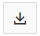

   3. In the upper-left corner of the Intrusions page, click the

      icon to export the alert list.

      After the alert list is exported, the Done dialog box appears in the upper-right corner.

   4. In the Done notification of the Alerts page, click Download. The alert list is downloaded to your computer.

#### 6.4.1.3. View exceptions related to an alert

Server Guide supports automatic analysis of exceptions related to an alert. You can click an alert name on the alert list to view and manage all exceptions related to this alert and view the results of automatic attack tracing.

Context

- Security Center automatically associates alerts with exceptions in real time to detect potential threats.

- Exceptions related to an alert are listed in chronological order. This allows you to analyze and handle the exceptions to improve the emergency response mechanism of your system.

- An automatically correlated alert is identified by the  icon.

Procedure

1. 

2. 

   3. On the Intrusions page, click the target alert name. The alert details page appears.

   4. On the alert details page, view the details and related exceptions of the alert and manage the exceptions.

      - View alert details

        You can view the assets affected by this alert, the first and latest occurrence time of the alert, and the details of the related exceptions.

      - View affected assets

        Click the name of an affected asset to view the details of the asset. These details include alerts, vulnerabilities, baseline risks, and asset fingerprints.

      - View and manage related exceptions

        In the Related Exceptions section, you can view the details and recommended solutions of all exceptions related to this alert.

        - Click Note to the right of an exception name to add notes for the exception.

        - Click the  icon to the right of a note to delete the note.

#### 6.4.1.4. Use the file quarantine function

Sever Guide can quarantine malicious files. Quarantined files are listed in the quarantine box on the Intrusions page. The system automatically deletes a quarantined file 30 days after it is quarantined. You can restore a quarantined file with a few clicks before it is deleted. This topic describes how to view quarantined files and remove files from the quarantine box.

Procedure

1. 

2. 

   3. In the upper-right corner of the Intrusions page, click Quarantine.

      You can perform the following operations in the Quarantine pane:

      - View information about quarantined files. The information includes server IP addresses, directories that store the files, file status, and time of the last modification.

      - Click Restore in the Actions column to remove a file from the quarantine box. The restored file appears in the alert list again.

#### 6.4.1.5. Configure security alerts

This topic describes how to configure security alerts in Server Guard to specify common logon locations, customize scan targets, and manage advanced logon settings and security alerts.

Context

Server Guard supports advanced logon settings and security alerts. You can configure more fine-grained logon detection rules. For example, you can specify valid logon IP addresses, logon time, and logon accounts to block unauthorized requests sent to your assets.

Procedure

1. 

2. 

   3. In the upper-right corner, click Settings.

      Select the target tab and configure the following parameters:

      - Add a common logon location

        <ol type="a">

        <li>

        Click Management to the right of Login Location.

        </li>

        <li>

        Select the logon location that you want to approve, and select the servers that are allowed to be logged on to from the approved location.

        </li>

        </ol>

        <ol type="i" start="100">

        <li>

        </li>

        </ol>

        Server Guard allows you to edit and delete common logon locations.

      - Configure advanced logon settings

        Note

        After you configure advanced logon settings, alerts are triggered if your assets

        receive requests from unapproved locations. You can specify the IP addresses, accounts, and time periods that are allowed for logons to your assets. After the advanced logon settings are configured, Server Guard sends you alerts if your assets receive unauthorized logon requests. The procedure of configuring advanced logon settings is similar to configuring common logon locations. You can follow the preceding procedure to add, edit, and delete advanced logon settings.

        - Turn on or turn off Uncommon IP Alert to the right of Common Login IPs. Alerts are triggered if your assets receive requests from unauthorized IP addresses.

        - On the right of Common Login Time, turn on or turn off Uncommon Time Alert. Alerts are triggered if your assets receive requests at unauthorized times.

        - On the right of Common Login Accounts, turn on or turn off Uncommon Account Alert. Alerts are triggered if your assets receive requests from unauthorized accounts.

      - Add a scan target

        Server Guard automatically scans directories of your servers and runs dynamic and static scan tasks. You can also manually add directories of servers.

        <ol type="a">

        <li>

        On the right of Add Scan Targets, click Management.

        </li>

        <li>

        Specify a valid directory, and select the servers on which the specified directory is scanned.

        Note

        To ensure the performance and efficiency, do not specify a root directory.

        </li>

        </ol>

        <ol type="i" start="100">

        <li>

        </li>

        </ol>

#### 6.4.1.6. Virus removal

The virus removal feature provided by Server Guard is integrated with major antivirus engines worldwide. It detects viruses against large amounts of threat intelligence data provided by Alibaba Cloud. Virus removal also provides an exception detection module designed by Alibaba Cloud to detect viruses based on machine learning and deep learning. This way, virus removal can provide full-scale and dynamic antivirus protection to safeguard your servers.

The cloud threat detection feature scans hundreds of millions of files on a daily basis and protects millions of servers on the cloud.

Detection capabilities

The virus removal feature uses the Server Guard client to collect process information, and then scans the retrieved data for viruses in the cloud. If a malicious process is detected, you can stop the process and quarantine the related files.

- Deep learning engine developed by Alibaba Cloud: The deep learning engine is built on deep learning technology and a large number of attack samples. The engine detects malicious files on the cloud and automatically identifies potential threats to supplement traditional antivirus engines.

- Cloud sandbox developed by Alibaba Cloud: The cloud sandbox feature allows you to simulate cloud environments and monitor attacks launched by malicious samples. The cloud sandbox feature automatically detects threats and offers dynamic analysis and detection capabilities based on big data analytics and machine learning modeling techniques.

- Integration with major antivirus engines: The cloud threat detection feature is integrated with major antivirus engines and updates its virus library in real time.

- Threat intelligence detection: The cloud threat detection feature works with the exception detection module to detect malicious processes and operations based on threat intelligence data provided by Alibaba Cloud Security.

Detectable virus types

The cloud threat detection feature is developed based on the security technologies and expertise of Alibaba Cloud. The feature provides end-to-end security services, including threat intelligence collection, data masking, threat identification, threat analysis, and malicious file quarantine and restoration. You can quarantine and restore files that contain viruses in the Security Center console.

The cloud threat detection feature can detect the following types of viruses.

| Virus | Description |
| --- | --- |
| Mining program | A mining program consumes server resources and mines cryptocurrency without authorization. |
| Computer worm | A computer worm uses computer networks to replicate itself and spread to a large number of computers within a short period of time. |
| Ransomware | Ransomware, such as WannaCry, uses encryption algorithms to encrypt files and prevent users from accessing the files. |
| Trojan | A trojan is a program that allows an attacker to access information about servers and users, gain control of the servers, and consume system resources. |
| DDoS trojan | A DDoS trojan hijacks servers and uses zombie servers to launch DDoS attacks, which interrupts your service. |
| Backdoor | A backdoor is a malicious program injected by an attacker. Then, the attacker can use the backdoor to control the server or launch attacks. |
| Computer virus | A computer virus inserts malicious code into normal programs and replicates the code to infect the whole system. |
| Malicious program | A malicious program may pose threats to system and data security. |

Benefits

- Self-developed and controllable: The cloud threat detection feature is based on deep learning, machine learning, and big data analytics with a large number of attack and defense practices. The feature uses multiple detection engines to dynamically protect your assets against viruses.

- Lightweight: The cloud threat detection feature consumes only 1% of CPU resources and 50 MB of memory.

- Dynamic: The cloud threat detection feature dynamically retrieves startup logs of processes to monitor the startup of viruses.

- Easy to manage: You can manage all servers and view their status at any time in the Security Center console.

Threat detection limits

Apsara Stack Security Center allows you to process security alerts, scan for vulnerabilities, analyze attacks, and check security settings in the Security Center console. Apsara Stack Security Center can analyze alerts and automatically trace attacks. This allows you to protect your assets. Apsara Stack Security Center supports a wide range of protection features. We recommend that you also install the latest system patches on your server. We also recommend you to use security services, such as Cloud Firewall and Web Application Firewall (WAF), to better protect your assets against attacks.

Note

Attacks and viruses are evolving, and your business environments vary. Security

breaches may occur. We recommend that you use the alerting, vulnerability detection, baseline check, and configuration assessment features provided by Apsara Stack Security Center to better protect your assets against attacks.

### 6.4.2. Website tamper-proofing

#### 6.4.2.1. Overview

Tamper protection monitors website directories in real time, restores modified files or directories, and protects websites from trojans, hidden links, and uploads of violent and illicit content.

Background information

To make illegal profits or conduct business attacks, attackers exploit vulnerabilities in websites to insert illegal hidden links and tamper with the websites. Defaced web pages affect normal user access and may lead to serious economic losses, damaged brand reputation, or political risks.

Tamper protection allows you to add Linux and Windows processes to the whitelist and update protected files in real time.

How tamper protection works

The Security Center agent automatically collects the list of processes that attempt to modify files in the protected directories of the protected servers. It identifies unusual processes and file changes in real time and blocks unusual processes.

The alert list is displayed on the Tamper Protection page. You can view unusual file changes, the corresponding processes, and the number of attempts made by each process in the alert list. If a file is modified by a trusted process, you can add the process to the whitelist. After the process is added to the whitelist, tamper protection no longer blocks the process. In scenarios where the content of websites, such as news and education websites, is frequently modified, the whitelist saves you the effort of frequently enabling and disabling tamper protection.

Versions of operating systems and kernels supported by tamper protection

| OS | Supported operating system version | Supported kernel version |
| --- | --- | --- |
| Windows | Windows Server 2008 and later | All versions |
| CentOS | 6.5, 6.6, 6.7, 6.8, 6.9, 6.10, 7.0, 7.1, 7.2, 7.3, 7.4, 7.5, and 7.6 | • 2.6.32-x • 3.10.0-x |
| Ubuntu | 14, 16, and 18 | • 3.13.0-32-generic • 3.13.0-86-generic • 4.4.0-62-generic • 4.4.0-63-generic • 4.4.0-93-generic • 4.4.0-151-generic • 4.4.0-117-generic • 4.15.0-23-generic • 4.15.0-42-generic • 4.15.0-45-generic • 4.15.0-52-generic |

Note

- The preceding table lists kernel versions supported by tamper protection. Servers that use an unsupported kernel version cannot use tamper protection. Make sure that your server uses a supported kernel version. If a kernel version is not supported, you must upgrade it to a supported version. Otherwise, you cannot add processes to the whitelist.

- Before you upgrade the server kernel, back up your asset data.

#### 6.4.2.2. Configure tamper protection

The Server Security feature allows you to configure tamper protection for web pages.

Limits

- For each server, you can add a maximum of 10 directories for protection.

- The protected directories of a Windows server must meet the following requirements: The maximum size of each directory is no more than 20 GB. Each directory contains a maximum of 2,000 folders. The maximum directory level is 20. The maximum size of each file is 3 MB.

- The protected directories of a Linux server must meet the following requirements: The maximum size of each directory is no more than 20 GB. Each directory contains a maximum of 3,000 folders. The maximum directory level is 20. The maximum size of each file is 3 MB.

- Before you add a directory for protection, make sure that the directory level, the number of folders, and the directory size meet the preceding requirements.

- We recommend that you exclude file formats that do not require protection, such as *.log*, *.png*, *.jpg*, *. mp4*, *.avi*, and *.mp3*. Separate multiple file formats with semicolons (;).

Procedure

1. 

   2. In the left-side navigation pane, click Server Security and choose Intrusion Prevention > File Tamper Protection.

   3. On the Tamper Protection page, click the Management tab.

   4. On the Tamper Protection page, click Add Servers for Protection.

   5. In the Add Servers for Protection dialog box, select a server that you want to protect.

      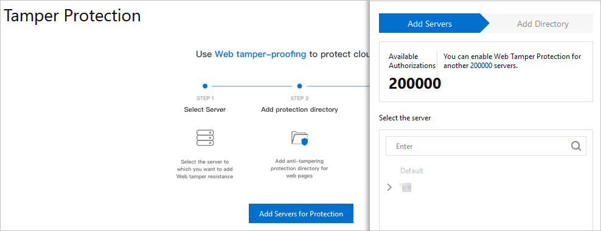

   6. Click Next to go to the Add Directory step.

   7. In the Add Directory step, configure the following parameters:

      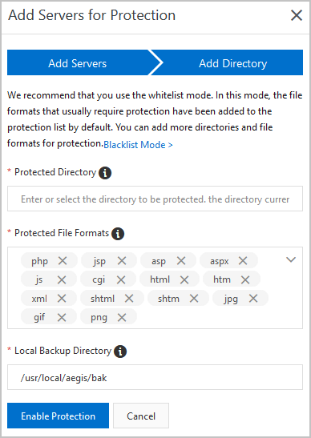

      Select the protection mode. You can select the Whitelist Mode or Blacklist Mode. In whitelist mode, tamper protection is enabled for the specified directories and file formats. In blacklist mode, tamper protection is enabled for the subdirectories, file formats, and files that are not specified. The whitelist mode is selected by default.

      - In whitelist mode, configure the following parameters.

        | Parameter | Description |
        | --- | --- |
        | Protected Directory | Enter the path of the directory that you want to protect. Note Servers that run Linux and Windows operating systems use different path formats. Enter a valid directory path based on your operating system type. |
        | Protected File Formats | Select file formats from the drop-down list, such as <em>.js</em>, <em>.html</em>, <em>.xml</em>, and <em>.jp</em> <em>g</em>. |
        | Local Backup Directory | The default path where backup files of the protected directories are stored. By default, Security Center assigns <em>/usr/local/aegis/bak</em> to servers that run the Linux operating system and <em>C:\\Program Files (x86)\\Alibaba\\Aegis\\bak</em> to servers that run the Windows operating system. You can change the default path as needed. |

      - In blacklist mode, configure the following parameters.

        | Parameter | Description |
        | --- | --- |
        | Protected Directory | Enter the path of the directory that you want to protect. |
        | Excluded Sub-Directories | Enter the subdirectories that do not require tamper protection. Click Add Sub-Directory to enter more subdirectories. Security Center does not provide tamper protection for files under the excluded sub-directories. |
        | Excluded File Formats | Select the formats of files that do not require tamper protection. Supported formats include log, txt, and ldb. Security Center does not provide tamper protection for the files in the excluded formats. |
        | Excluded Files | Enter the path of the file that does not require tamper protection. You can click Add File to add more files. Security Center does not provide tamper protection for the excluded files. |
        | Local Backup Directory | The default path where backup files of the protected directories are stored. By default, Security Center assigns <em>/usr/local/aegis/bak</em> to servers that run the Linux operating system and <em>C:\\Program Files (x86)\\Alibaba\\Aegis\\bak</em> to servers that run the Windows operating system. You can change the default path as needed. |

   8. Click Enable Protection.

      After you enable tamper protection for a server, it is displayed in the server list on the Tamper Protection page.

      Note

      By default, tamper protection is in the Not Initiated state for newly added

      servers. To enable tamper protection, you must turn on the On switch on the Tamper Protection page for the target server.

   9. In the server list on the Tamper Protection page, find the target server and turn on the switch in the Protection column to enable tamper protection for the server.

      Note

      By default, tamper protection is in the Not Initiated state for newly added

      servers. You must enable tamper protection on the Tamper Protection page for the target server.

      After tamper protection is enabled, the protection state changes to Running.

      Note

      If the protection state of a server is Exception, click Exception in the Status

      column. A message that indicates the causes appears. Click Retry in the message.

What to do next

After you enable tamper protection for a server, you can go to the Overview page, and select tamper protection in the event type drop-down list to view the alerts on tampering events.

Note

Tamper protection does not take effect immediately after you configure the protected directory, and you can still write files to the directory. In this case, you must go to the Management page, disable Protection for the server where the directory is located, and then enable Protection again.

Handle abnormal protection states

| Protection state | Description | Suggestion |
| --- | --- | --- |
| Initializing | Web tamper protection is being initialized. | If this is your first time enabling tamper protection for a server, the protection status becomes Initializing. It takes a few seconds to enable tamper protection. |
| Running | Tamper protection is enabled and running as expected. | - |
| Exception | An error occurred when tamper protection was enabled. | Click Exception in the Status column to view the exception cause and click Retry. |
| Not Initiated | Tamper protection is disabled. | You must turn on the On switch to enable tamper protection. |

#### 6.4.2.3. View the protection status

This topic describes how to view the status of tamper protection for your assets.

Context

The tamper protection feature monitors changes of directories and files in real time and blocks suspicious file changes. To view the status and details of tamper protection in the Apsara Stack Security console, click Server Security and choose Intrusion Prevention > File Tamper Protection. The details include:

- Overview

  On the Overview page, you can view the total number of changed files, protected servers, and protected directories on the current day and during the last 15 days.

- Distribution of protected file types

  Protected file types include .txt, .png, .msi, and .zip. You can also add more types of files for protection as needed.

  Note

  All types of files can be added for tamper protection.

- Top five files with the largest number of changes

  This module shows the names and paths of the five files with the largest number of changes in the last 15 days.

- Details of tamper protection alerts

  The tamper protection feature helps you block all suspicious changes to directories and files on your assets. On the alert details page, you can view the alerts of these changes, including the severity, alert name, affected assets, paths of files with suspicious changes, and protection status.

  Note

  - If the number of alerts exceeds 100, we recommend that you process these alerts at your earliest opportunity.

  - Only the alerts at the Warning level are displayed in the console.

  - Only alerts in the Isolation successful state are displayed. This indicates that the tamper protection feature has blocked the suspicious processes that attempted to make unauthorized file changes.

### 6.4.3. Configure the Virus Removal feature

The Virus Removal feature of Server Guard allows you to customize virus and webshell detection settings.

Virus detection

The Virus Removal feature can automatically quarantine common Internet viruses, such as mainstream trojans, ransomware, mining programs, and DDoS trojans. Apsara Stack Security experts test and verify all automatically quarantined viruses to ensure a minimum false positive rate.

If automatic quarantine is disabled, Server Guard generates alerts when viruses are detected. You must manually manage detected viruses in the console. We recommend that you enable automatic quarantine to better safeguard your servers.

1. 

   2. In the left-side navigation pane, click Server Security and choose Intrusion Prevention > Virus Removal.

   3. In the Anti-virus section, click Manage.

   4. In the Configure Servers for Virus Detection dialog box, select the servers for which you want to enable the Virus Removal feature.

   5. Click OK.

   6. In the Anti-virus section, turn on Virus Blocking to enable virus blocking.

      After virus blocking is enabled, Server Guard automatically quarantines detected viruses. Quarantined viruses are listed on the Overview page. You can select the Precision Defense type to filter quarantined viruses.

Webshell detection

1. 

   2. In the left-side navigation pane, click Server Security and choose Intrusion Prevention > Virus Removal.

   3. Configure servers for webshell detection.

      <ol type="i">

      <li>

      In the Webshell Detection section, click Manage.

      </li>

      <li>

      Select the servers for which you want to enable webshell detection.

      </li>

      <li>

      Click OK to complete the configuration.

      </li>

      </ol>

## 6.5. Log retrieval

### 6.5.1. Log retrieval overview

The log retrieval function provided by Server Security allows you to manage logs scattered in various systems of Apsara Stack in a centralized manner, so that you can easily identify the causes of issues that occur on your servers.

The log retrieval function supports storage of logs for 180 days and query of logs generated within 30 days.

Benefits

The log retrieval function provides the following benefits:

- End-to-end log retrieval platform: Allows you to retrieve logs of various Apsara Stack services in a centralized manner and trace issues easily.

- Cloud-based SaaS service: Allows you to query logs on all servers in Apsara Stack without additional installment and deployment.

- Supports TB-level data retrieval. It also allows you to add a maximum of 50 inference rules (Boolean expressions) in a search condition and obtain full-text search results within several seconds.

- Supports a wide range of log sources.

- Supports log shipping, which allows you to import security logs to Log Service for further analysis.

Scenarios

You can use log retrieval to meet the following requirements:

- Security event analysis: When a security event is detected on a server, you can retrieve the logs to identify the cause and assess the damage and affected assets.

- Operation audit: You can audit the operation logs on a server to identify high-risk operations and serious issues in a meticulous way.

Supported log types

Log types

| Log type | Description |
| --- | --- |
| Logon history | Log entries about successful system logons |
| Brute-force attack | Log entries about system logon failures that are generated during brute-force attacks |
| Process snapshot | Log entries about processes on a server at a specific time |
| Listening port snapshot | Log entries about listening ports on a server at a specific time |
| Account snapshot | Log entries about account logon information on a server at a specific time |
| Process initiation | Log entries about process initiation on a server |
| Network connection | Log entries about active connections from a server to external networks |

### 6.5.2. Log retrieval

This topic describes how to search for and view server logs.

Procedure

1. 

   2. In the left-side navigation pane, choose Server Security > Log Retrieval.

   3. Configure search conditions.

      | Search condition | Description |
      | --- | --- |
      | Log source | Select a supported log source. For more information, see Log sources. |
      | Field | Select a field that is supported by the specified log source. For more information, see Log sources. |
      | Keyword | Enter the keyword of the field that you want to search for. |
      | Logical operator | Select a logical operator from AND, OR, and NOT. For more information, see Logical operators. |
      | + | Add inference rules in a search condition for a log source. |
      | Add conditions | Add search conditions for different log sources. |

   4. Click Search and view the search result.

      - Reset: Click Reset to clear the search condition configuration.

      - Save Search: Click Save Search to save the search condition configuration for future use.

      - Saved Searches: Click Saved Searches to select and apply a search condition configuration that has been saved.

### 6.5.3. Supported log sources and fields

This topic describes the types of logs and fields that are supported by the log retrieval function.

The log retrieval function allows you to query the following types of logs. You can click a log source to view the fields that can be retrieved.

Log sources

| Log source | Description |
| --- | --- |
| Logon log | Log entries about successful system logons. |
| Brute-force attack log | Log entries about system logon failures that are generated during brute-force attacks. |
| Process snapshot log | Log entries about processes on a server at a specific time. |
| Listening port snapshot log | Log entries about listening ports on a server at a specific time. |
| Account snapshot log | Log entries about account logon information on a server at a specific time. |
| Process initiation log | Log entries about process initiation on a server. |
| Network connection log | Log entries about active connections from a server to external networks. |

Logon log

The following fields are supported in logon log queries:

Supported fields in logon logs

| Field | Data type | Description |
| --- | --- | --- |
| uuid | string | The agent ID. |
| IP | string | The server IP address. |
| warn_ip | string | The source IP address for the logon. |
| warn_port | string | The logon port. |
| warn_user | string | The logon username. |
| warn_type | string | The logon type. |
| warn_count | string | The number of logon attempts. |
| time | datetime | The logon time. |

Brute-force attack log

The following fields are supported in brute-force attack log queries:

Supported fields in brute-force attack logs

| Field | Data type | Description |
| --- | --- | --- |
| uuid | string | The agent ID. |
| IP | string | The server IP address. |
| warn_ip | string | The attacker IP address. |
| warn_port | string | The target port number. |
| warn_user | string | The target username. |
| warn_type | string | The type. |
| warn_count | string | The number of brute-force attack attempts. |
| time | datetime | The attack time. |

Process initiation log

The following fields are supported in process initiation log queries.

Supported fields in process initiation logs

| Field | Data type | Description |
| --- | --- | --- |
| uuid | string | The agent ID. |
| IP | string | The server IP address. |
| pid | string | The process ID. |
| groupname | string | The name of the user group. |
| ppid | string | The parent process ID. |
| uid | string | The user ID. |
| username | string | The username. |
| filename | string | The file name. |
| pfilename | string | The file name of the parent process. |
| cmdline | string | The command line. |
| filepath | string | The process path. |
| pfilepath | string | The parent process path. |
| time | datetime | The time when the process was started. |

Listening port snapshot log

The following fields are supported in listening port snapshot log queries:

Supported fields in listening port snapshot logs

| Field | Data type | Description |
| --- | --- | --- |
| uuid | string | The agent ID. |
| IP address | string | The server IP address. |
| src_port | string | The listening port. |
| src_ip | string | The listening IP address. |
| proc_path | string | The process path. |
| PID | string | The process ID. |
| proc_name | string | The process name. |
| proto | string | The protocol. |
| time | datetime | The time when data was collected. |

Account snapshot log

The following fields are supported in account snapshot log queries:

Supported fields in account snapshot logs

| Field | Data type | Description |
| --- | --- | --- |
| uuid | string | The agent ID. |
| IP address | string | The server IP address. |
| perm | string | Indicates whether the client has root permissions. |
| home_dir | string | The home directory. |
| warn_time | string | The password expiration notification time. |
| groups | string | The group to which the user belongs. |
| login_ip | string | The IP address of the last logon. |
| last_chg | string | The last time when the password was changed. |
| shell | string | The Linux shell command. |
| domain | string | The Windows domain. |
| tty | string | The logon terminal. |
| account_expire | string | The account expiration time. |
| passwd_expire | string | The password expiration time. |
| last_logon | string | The last logon time. |
| user | string | The user. |
| status | string | The user status. Value options include: • <em>0</em>: disabled. • <em>1</em>: normal. |
| time | datetime | The time when data was collected. |

Process snapshot log

The following fields are supported in process snapshot log queries.

Supported fields in process snapshot logs

| Field | Data type | Description |
| --- | --- | --- |
| uuid | string | The agent ID. |
| IP address | string | The server IP address. |
| path | string | The process path. |
| start_time | string | The time when the process was started. |
| uid | string | The user ID. |
| cmdline | string | The command line. |
| pname | string | The parent process name. |
| name | string | The process name. |
| pid | string | The process ID. |
| user | string | The username. |
| md5 | string | The MD5 value of the process file. This value is not calculated if the file size exceeds 1 MB. |
| time | datetime | The time when data was collected. |

Network connection log

The following fields are supported in network connection log queries.

Supported fields in network connection logs

| Field | Data type | Description |
| --- | --- | --- |
| uuid | string | The agent ID. |
| IP | string | The server IP address. |
| src_ip | string | The source IP address. |
| src_port | string | The source port. |
| proc_path | string | The process path. |
| dst_port | string | The destination port. |
| proc_name | string | The process name. |
| dst_ip | string | The destination IP address. |
| status | string | The status. |
| proto | string | The protocol. |
| time | datetime | The connection time. |

### 6.5.4. Logical operators

The log retrieval function supports multiple search conditions. You can add multiple inference rules in one search condition for one log source, or combine multiple conditions for several log sources by using different logical operators. This topic describes the inference rules and logical operators that are supported in log queries. Some examples are provided to help you understand them.

The following table describes the logical operators that are supported in log queries.

Logical operators

| Logical operator | Description |
| --- | --- |
| AND | Binary operator. This operator is in the format of <code> query1 and query2 </code>, indicating the intersection of the query results of <code> query1 </code> and <code> query2 </code>. Note If no logical operator is specified for multiple keywords, the default operator is AND. |
| OR | Binary operator. This operator is in the format of <code> query1 or query2 </code>, indicating the combination of the query results of <code> query1 </code> and <code> query2 </code>. |
| NOT | Binary operator. This operator is in the format of <code> query1 not query2 </code>, indicating the results that match <code> query1 </code> but not <code> query2 </code>, which is equivalent to <code> query1 -</code><code>query2 </code>. Note If only <code> not query1 </code> is specified, the query returns all records that do not match <code> query1 </code>. |

## 6.6. Settings

### 6.6.1. Install the Server Guard agent

This topic describes how to install the Server Guard agent by specifying parameters.

Context

To use the protection services provided by Server Guard, you must install the Server Guard agent on the operating system of your server.

Procedure

1. 

   2. In the left-side navigation pane, choose Server Security > Server Settings > Client Installation.

   3. (Optional)On the Client Installation page, click the Client to be installed tab to view the number of servers on which the Server Guard agent is not installed. On this tab, you can also view the relevant information in the server list.

      You can specify the operating system type, IP address, or server name to search for a target server.

      

   4. Click the Client Installation Guide tab.

   5. Obtain and install the Server Guard agent based on the operating system type of your server.

      - Windows

        <ol type="a">

        <li>

        In the left-side pane of the page, click Click to download to download the client software package to your computer.

        </li>

        <li>

        Upload the installation package to your server. For example, you can use an FTP client to upload the package to your server.

        </li>

        </ol>

        <ol type="i" start="100">

        <li>

        Run the installation package on your server as an administrator.

        Note

        When you install the agent on a server that is not in Alibaba Cloud, you will

        be prompted to enter the installation verification key. You can find the installation verification key on the Server Guard agent installation page.

        </li>

        </ol>

      - Linux

        <ol type="a">

        <li>

        In the right-side pane of the page, select Alibaba Cloud Server or Non-Alibaba Server.

        </li>

        <li>

        Select the installation command for your 32-bit or 64-bit operating system and click Copy to copy the command.

        </li>

        </ol>

        <ol type="i" start="100">

        <li>

        Log on to your Linux server as an administrator.

        </li>

        <li value="500">

        Run the installation command on your Linux server to download and install the Server Guard agent.

        </li>

        </ol>

### 6.6.2. Manage protection modes

This topic describes how to manage protection modes for each server to make them more efficient and secure.

Procedure

1. 

   2. In the left-side navigation pane, choose Server Security > Server Settings > Protection Mode.

   3. On the Protection Mode page, click Manage.

      Configure protection modes for each server.

      - Business First Mode: The peak CPU utilization is less than 10%, and the peak memory usage is less than 50 MB.

      - Protection First Mode: The peak CPU utilization is less than 20%, and the peak memory usage is less than 80 MB.

   4. Click OK.

# 7.Application security

## 7.1. Quick start

This topic helps you get started with Web Application Firewall (WAF).

WAF uses intelligent semantic analysis algorithms to identify web attacks. WAF also integrates a learning model to enhance its analysis capabilities and meet your daily security protection requirements without relying on traditional rule libraries.

The following content describes the procedure for using WAF:

1. Customize WAF protection rules.

   WAF provides a default protection policy. You can also customize policies that suit your business requirements.

   - For more information about how to configure protection policies, see Configure protection policies.

   - For more information about how to configure custom rules, see Create a custom rule.

   - For more information about how to configure HTTP flood protection rules, see Configure an HTTP flood protection rule.

2. Add protected websites.

   WAF can protect Internet websites and virtual private cloud (VPC) websites.

   - For more information about how to add an Internet website to WAF for protection, see Add an Internet website for protection.

   - For more information about how to add a VPC website to WAF for protection, see Add a VPC website for protection.

3. Configure Domain Name System (DNS) resolution.

   For more information about how to change the DNS-resolved source IP address of a website to a virtual IP address of WAF, see Modify DNS resolution settings.

4. View WAF protection results.

   - For more information about how to view the protection overview, see View protection overview.

   - For more information about how to view the service access information, see View Web service access information.

   - For more information about how to view the detection logs for web attacks, see View attack detection logs.

   - For more information about how to view the detection logs for HTTP flood attacks, see View HTTP flood protection logs.

## 7.2. Detection overview

### 7.2.1. View protection overview

This topic describes how to view the Web Application Firewall (WAF) detection overview.

Context

The Protection Overview page displays information such as the statistics of previous attacks, the geographical distribution of attackers, and the numbers of total requests and blocked requests. You can learn the web attack protection information and custom protection rules.

Procedure

1. Log on to Apsara Stack Security Center.

2. In the left-side navigation pane, choose Application Security > WAF.

3. In the left-side navigation tree, choose Detection Overview > Detection Overview.

4. On the Detection Overview page, you can view Statistics within Last 24 Hours and Statistics within Last 30 Days.

   

   - Requests

     Displays the total number of requests.

   - Attacks

     Displays the total number of attacks.

   - Blocked requests

     Displays the total number of blocked requests.

   - Attacker geographical distribution on a map

     Displays the distribution of attackers on a map. You can select a map of China or a map of the world.

     Displays the numbers of total requests and blocked requests.

   - Distribution of top five attack IP addresses

     Displays the top five IP addresses that have launched the most attacks in a bar chart. The X-axis indicates the number of requests. The Y-axis indicates the IP address.

   - Distribution of top five attack types Displays the distribution of the top five attack types and the number of attacks of each type in a pie chart.

   - Top five attacked websites

     Displays the top five attacked websites and the number of attacks on each website in a bar chart .

### 7.2.2. View web service access information

This topic describes how to view the service access information.

Context

Web Application Firewall (WAF) monitors the web service access information. This allows security administrators to analyze the business access information and detect vulnerabilities.

Procedure

1. Log on to Apsara Stack Security Center.

2. In the left-side navigation pane, choose Application Security > WAF.

3. In the left-side navigation tree, choose Detection Overview > Access Status Monitor.

4. Filter the access records to view the details.

   

## 7.3. Protection logs

### 7.3.1. View attack detection logs

This topic describes how to view attack detection logs.

Context

These logs allow you to analyze the attacks on your web services. Based on the analysis, you can update the attack protection policies and custom rules and fix the web service vulnerabilities.

Procedure

1. Log on to Apsara Stack Security Center.

2. In the left-side navigation pane, choose Application Security > WAF.

3. In the left-side navigation tree, choose Detection Logs > Attack Detection Logs.

4. Click Filter, specify filter conditions, and click OK.

   Note

   If you specify multiple conditions, all of the conditions must be met.

5. View the detected attacks.

### 7.3.2. View HTTP flood protection logs

This topic describes how to view HTTP flood protection logs.

Context

These logs allow you to analyze HTTP flood attacks on your web services. Based on the analysis, you can update the HTTP flood protection rules and HTTP flood whitelist and fix the web service vulnerabilities.

Procedure

1. 

   2. In the left-side navigation pane, choose Application Security > WAF.

   3. In the left-side navigation tree, choose Detection Logs > HTTP Flood Detection Logs.

   4. Click Filter, specify filter conditions, and then click OK.

      Note

      If you specify multiple conditions, all of the conditions must be met.

   5. View the HTTP flood detection result.

      The blocked HTTP flood attacks, related rules, and attack time are displayed.

### 7.3.3. View system operation logs

This topic describes how to view system operations logs.

Procedure

1. 

   2. In the left-side navigation pane, choose Application Security > WAF.

   3. In the left-side navigation tree, choose Detection Logs > System operation log.

   4. View the system operations logs.

      The usernames, content, IP addresses, and creation time are displayed.

### 7.3.4. View access logs

This topic describes how to view access logs.

Procedure

1. 

   2. In the left-side navigation pane, choose Application Security > WAF.

   3. In the left-side navigation tree, choose Detection Logs > Access Log.

   4. Click Filter, specify filter conditions, and then click OK.

      Note

      If you specify multiple conditions, all of the conditions must be met.

   5. View the access logs.

      The requested IP addresses, destination IP addresses, source IP addresses, methods, and response codes are displayed.

## 7.4. Protection configuration

### 7.4.1. Configure protection policies

This topic describes how to configure Web Application Firewall (WAF) protection policies.

Context

WAF provides a default protection policy. You can also customize policies that suit your business requirements.

Procedure

1. 

   2. In the left-side navigation pane, choose Application Security > WAF. On the Detection Overview page, choose Protection Configuration > Website Protection Policies.

   3. Click Add protection policy. In the dialog box that appears, specify Policy name and click Confirm.

   4. In the Operation column of the new protection policy, click the  icon to view details.

      

      | Parameter | Description |
      | --- | --- |
      | Decode | Select algorithms for decoding the requests. |
      | Attack Detection Modules | Specify the types of attacks to be detected and the risk levels of attacks to be blocked. |
      | Block Options | Specify the status code and image to be returned when an attack is blocked. |
      | HTTP Response Processing | Set the status of the Enable HTTP response processing switch and specify Response Detection Max Body Size. |
      | HTTP Request Body Detection | Specify Response Detection Max Body Size. |
      | Detection Timeout | Set the status of the Enable Detection Timeout switch, and specify Timeout Threshold. |

      For example, perform the following steps to configure Attack Detection Modules:

      <ol type="i">

      <li>

      Move the pointer over a specific module in the Attack Detection Modules section, for

      </li>

      </ol>

      example, SQL Injection Detection Module, and click the modify icon.

      <ol type="i" start="2">

      <li>

      In the SQL Injection Detection Module dialog box, specify the detection parameters.

      </li>

      </ol>

      | Parameter | Description |
      | --- | --- |
      | Enabled | Indicates whether to enable the detection module. |
      | Blocking Threshold | You can select NotForbid, Only ForbidHigh Risk, ForbidMedium or High Risk, or Forbid All. |
      | Record Threshold | You can select Notrecord, Onlyrecord High Risk, recordMedium or High Risk, or record All. |
      | Detect Non-Injected SQL | Indicates whether to enable detection for non-injected SQL attacks. |

      <ol type="i" start="3">

      <li>

      Click OK.

      </li>

      </ol>

   5. Manage the protection policies.

      To delete a protection policy, click the protection policy first. Then, in the upper-right corner, choose More > Delete Selected Protection Policies. In the dialog box that appears, click OK.

      Note

      You cannot delete the default policy.

### 7.4.2. Create a custom rule

This topic describes how to create a custom rule for Web Application Firewall (WAF).

Context

Security administrators can customize rules to meet various requirements for intrusion detection. You can add, edit, or delete custom rules in the WAF console as an administrator or by using an administrator account. You can use custom rules to filter out requests that meet specific conditions.

Multiple custom rules have the OR logical relation. If two custom rules specify the same conditions but differentiate in the operating mode such as blocking traffic and allowing traffic, the system runs the first rule.

Procedure

1. Log on to Apsara Stack Security Center.

2. In the left-side navigation pane, choose Application Security > WAF. On the Detection Overview page, choose Protection Configuration > Customized Rules.

3. In the upper-right corner, click Add Rule. In the Add Customized Rule dialog box, configure parameters.

   

   Parameters for creating a custom rule

   | Parameter | Description |
   | --- | --- |
   | Type | The operating mode of the rule. Valid values: Block, Allow, Monitor, and Detection module control. • Block: An HTTP request is blocked if it meets the conditions of the rule. • Allow: An HTTP request is allowed if it meets the conditions of the rule. • Monitor: An HTTP request is allowed and recorded if it meets the conditions of the rule. • Detection module control. |
   | Comment | The remarks of the rule, such as the purpose of the rule. |
   | Risk Level | The risk level. Valid values: No threat, Low Risk, Medium Risk, and High Risk. |
   | Matching Patter | The conditions that trigger the rule. Click Add Pattern to specify multiple conditions. Multiple conditions have the AND logical relation. The custom rule takes effect only when all conditions are met. |
   | Apply to Websites | The websites to be protected by the rule. |
   | Log Recording Option | Specifies whether to record a protection event in the intrusion detection logs if the rule is triggered. The default value is Enable Log Recording. After Log Recording Option is set to Enable Log Recording, all interception records are recorded in the intrusion detection logs. |
   | Attack type | The type of attack to be blocked by the rule. |
   | Expiration Time | The time when the rule expires. |

4. Click Confirm.

5. Manage a custom rule.

   - Edit a rule.

     To edit a rule, click the  icon in the Actions column.

   - Enable a rule.

     To enable a rule, select this rule and click Enable Selected Rules.

   - Disable a rule.

     To disable a rule, select this rule and click Disable Selected Rules.

   - Delete a rule.

     To delete a rule, select this rule and click Delete Selected Rules.

### 7.4.3. Configure an HTTP flood detection rule

This topic describes how to configure an HTTP flood protection rule.

Context

An HTTP flood is a type of distributed denial of service (DDoS) attack that targets at web applications. Attackers use proxy servers or zombies to overwhelm targeted web servers by sending large quantities of HTTP requests.

Create an HTTP flood protection rule

1. 

   2. In the left-side navigation pane, choose Application Security > WAF. On the Detection Overview page, choose Protection Configuration > HTTP Flood Detection.

   3. Click Add Rule. The Add HTTP Flood Detection Rules dialog box appears.

   4. Configure parameters and click Confirm.

      

      | Parameter | Description |
      | --- | --- |
      | Rule Mode | The operating mode of the HTTP flood protection rule. Valid values: Blocking Mode and Observe. • Blocking Mode: blocks the requests that meet the access control rules. • Observe: records the requests that meet the access control rules, but does not block the requests. |
      | Rule Types | The type of the HTTP flood detection rule. Valid values: Restrict Users by Policy and Restrict Known Users. The difference between the two types is that whether the user is a known IP address or session. • Restrict Users by Policy: Restrict users who meet all configuration items of the restriction rule. Configuration items include Restriction Trigger Threshold, Restricted URL Address, Restriction Mode, Restriction Time, and Statistical Range of Visits in the Advanced section. • Restrict Known Users: Restrict known users based on the restriction rule. To achieve this purpose, you must configure the IP address or session list and the restriction mode. After the configuration is complete, the restriction rule takes effect. |
      | Rule Name | The name of the HTTP flood detection rule. |
      | Target Type | The type of the restricted target. Valid values: IP and Session. Note If Target Type is set to SESSION, you must set User Identification to WAF User System when you add a website bound to this HTTP flood protection rule to WAF. For more information, see Add an Internet website for protection. |
      | Restriction Trigger Threshold | If Rule Types is set to Restrict Users by Policy, you must complete the configuration items that trigger the restriction rule. |
      | Restricted URL Address | If Rule Types is set to Restrict Users by Policy, you must specify the target URL address to be protected by the restriction rule. • URL Prefix • URL • Record all IP addresses |
      | Restricted IP List or Restricted Session List | If Rule Types is set to Restrict Known Users, enter the IP addresses or sessions to be restricted based on the setting of Rule Types. Specify only one IP address or session in each line. |
      | Restricted URL Address | If Rule Types is set to Restrict Known Users, you must specify the target URL address to be protected by the restriction rule. • URL Prefix • URL • Restrict user access to all addresses |
      | Restriction Mode | The mode in which the requests from a user are restricted.Valid values: • Forbidden: All requests from the restricted user to the specified URL are blocked. • Frequency control: The frequency at which requests from the restricted user are allowed to the specified URL is limited. |
      | Restriction Time | The time when the restriction rule takes effect. |
      | Statistical Range of Visits | If Target Type is set to Restrict Users by Policy, you can specify the range of targets that you want to analyze in the Advanced section. • Statistics Full Access Data: After you select Statistics Full Access Data, the request frequency is limited for all users who have passed WAF and meet the frequency restrictions. However, this decreases system performance. • Statistics TOP Access Data: After you select Statistics TOP Access Data, the request frequency is limited only for the top 100 data records in real-time access monitoring.When the size of the full access data is greater than that of the top 100 data records, the system performance decrease is insignificant. |

Manage an HTTP flood protection rule

1. 

   2. In the left-side navigation pane, choose Application Security > WAF. On the Detection Overview page, choose Protection Configuration > HTTP Flood Detection.

   3. In the rule list, manage the added HTTP flood detection rules.

      - Search for a rule.

        Click Filter and add filter conditions to find a rule.

      - Enable a rule.

        Select a rule that is in the Disabled state and choose More > Enable Selected Rules.

      - Disable a rule.

        Select a rule that is in the Enabled state and choose More > Disable Selected Rules.

      - Delete a rule.

        Select a rule and choose More > Delete Selected Rules.

### 7.4.4. Configure an HTTP flood protection whitelist

This topic describes how to configure an HTTP flood protection whitelist.

Context

If a request source is trusted, you can add this request source to an HTTP flood protection whitelist to allow the requests from this source.

Procedure

1. 

   2. In the left-side navigation pane, choose Application Security > WAF. On the Detection Overview page, choose Protection Configuration > HTTP Flood Detection. On the page that appears, click the HTTP Flood Detection Whitelist tab.

   3. Click the HTTP Flood Detection Whitelist tab. On the HTTP Flood Detection Whitelist tab, click Add Whitelist Item to add a request source to the whitelist, and click Confirm.

      

      | Parameter | Description |
      | --- | --- |
      | Type | Set the type of the whitelisted request source to IP or Session. |
      | IP or SESSION | Specify the IP addresses or sessions based on the selected Type. Specify one IP address or session in each line. |
      | Comment | Enter comments for the whitelist. |

   4. Manage the users in the whitelist.

      - Search for a user in the whitelist.

        Click Filter. In the dialog box that appears, click Add Filter Item to find a whitelisted user.

      - Remove a whitelisted user.

        Select a whitelisted user and choose More > Delete Selected Items.

### 7.4.5. Manage SSL certificates

This topic describes how to upload or delete SSL certificate files.

Context

After you upload an SSL certificate file on the SSL Certificate Management page, you can select this certificate file when you add an HTTPS website for protection.

Note

When you add an HTTPS website for protection on the Protected Websites page,

you must select the SSL certificate file that corresponds to the domain.

Procedure

1. Log on to Apsara Stack Security Center.

2. In the left-side navigation pane, choose Application Security > WAF.

3. On the page that appears, choose Protection Configuration > SSL Certificate Management.

4. Upload a new certificate file.

   <ol type="i">

   <li>

   Click Upload SSL Certificate.

   </li>

   <li>

   In the Add File dialog box, specify Name.

   </li>

   </ol>

   We recommend that you enter the domain name for easier management.

   Note

   If your certificate and private key are in the same file, select Include private

   key in certificate file.

   <ol type="i" start="3">

   <li>

   In the File section, upload the HTTPS certificate file and private key.

   </li>

   <li>

   Specify Certificate Password.

   </li>

   <li>

   Click Confirm.

   </li>

   </ol>

5. (Optional)Delete an uploaded SSL certificate file.

   You can delete expired SSL certificate files.

   <ol type="i">

   <li>

   In the SSL certificate list, select the certificate file that you want to delete.

   </li>

   <li>

   Choose More > Delete selected SSL Certificates.

   </li>

   <li>

   In the dialog box that appears, click Confirm.

   </li>

   </ol>

### 7.4.6. Add Internet websites for protection

This topic describes how to add Internet websites to Web Application Firewall (WAF) for protection.

Context

WAF can protect the following types of websites:

- Internet websites.

- Virtual Private Cloud (VPC) websites. For more information about how to add a VPC website for protection, see Add a VPC website for protection.

Procedure

1. Log on to Apsara Stack Security Center.

2. In the left-side navigation pane, choose Application Security > WAF.

3. In the left-side navigation pane of the Detection Overview page, choose Protection Configuration > Protection site management. Then click the Internet Websites tab.

4. Click Add a site in the upper-right corner.

5. In the Add Protected Site pane, configure parameters in the Monitoring Information step and click Next.

   Specify the Internet website to be protected. WAF can protect both HTTP and HTTPS websites.

   

   | Parameter | Description |
   | --- | --- |
   | Protected Website Name | The name of the website to be protected. |
   | Domain Name | The domain name of the website. • You can use an asterisk (\*) as a wildcard domain name. • Separate multiple domain names with commas (,). |
   | Port Settings | The port that WAF listens on. • If the website supports HTTPS requests, select Enable SSL and upload an HTTPS certificate. • If the website can be accessed over multiple ports, click Add a group of ports to add required ports. |
   | Cert Setting | The HTTPS certificate of the website. Valid values: <em>Upload a New Certificate</em> and <em>Choose an Existing Certificate</em>. • <em>Upload a New Certificate</em>: If the HTTPS certificate used by the website has not been uploaded to WAF, select this option. By default, the HTTPS certificate and private key are separately uploaded.If you select Include private key in certificate file, you need to upload only a file that contains both the HTTPS certificate and private key. • <em>Choose an Existing Certificate</em>: If the HTTPS certificate used by the website has been uploaded to WAF, select this option, and then select the required HTTPS certificate from the drop-down list. Note Specify this parameter only if you select Enable SSL next to Port Settings. |
   | Name | The name of the HTTPS certificate. Note Specify this parameter only if you select Enable SSL next to Port Settings and set Cert Setting to Upload a New Certificate. |
   | File | Upload the HTTPS certificate and private key. By default, the HTTPS certificate and private key are separately uploaded. If you select Include private key in certificate file next to Name, you need to upload only a file that contains both the HTTPS certificate and private key. Note Specify this parameter only if you select Enable SSL next to Port Settings. |
   | Virtual IP | Select an IP address type and a virtual IP address. Note You can specify an IPv6 address as the virtual IP address of WAF. By default, WAF provides 10 virtual IP addresses. You can add virtual IP addresses as required. Note A virtual IP address is available only for the department to which the user that has created this virtual IP address belongs. |

6. In the Request Processing Method step, configure parameters and click Next.

   

   Response mode

   Configuration item

   Description

   The algorithm for load balancing. Valid values:

   Load Balancing

   Weighted Round Robin, Source Address Hash, and

   Algorithm

   Least Connections Method.

   The IP address of the origin server to which WAF forwards inbound traffic based on traffic filtering. Valid values: Fill in the back-to-source address and Return to the back-to-source instance.

   - Fill in the back-to-source address: Enter the address of the origin server. If you enter multiple

   Backend Server

   addresses, load balancing is performed based on the

   Address

   specified load balancing algorithm.

   - Return to the back-to-source instance: Enter

   Forward to

   the address of a specific ECS or SLB instance. If you

   Backend Server

   enter multiple addresses, load balancing is performed based on the specified load balancing algorithm.

   The passthrough mode of the source IP address.

   The X-Forwarded-For (XFF) HTTP header is used to

   X-Forwarded-For

   identify the original IP address of an HTTP client. It is used for request forwarding services such as HTTP proxy and load balancing.

   Response mode

   Configuration item

   Description

   WAF forwards inbound traffic to a specified address.

   You can set this parameter to 301, 302, or 307.

   - 301: The requested page has been permanently moved to another URL.

   - 302: The requested page has been temporarily

   Response Status

   moved to another URL. The requester must continue

   Code

   Redirect

   to use the original URL for future requests.

   - 307: The resource requested has been temporarily moved to the URL given by the Location headers. The method and the body of the original request are reused to perform the redirected request.

   Redirect address

   The target URL of redirection.

   Specify the content of the response.

   Response Status

   You can select a value from multiple status codes, such

   Code

   as 200, 404, and 503.

   Respond with Specified Content

   Upload the response content.

   Response

   For example, upload an image. This image is returned if a user visits the website.

7. In the Protection Policy step, configure parameters and click Next. Then go to the Finish step to complete website addition.

   Note

   You can configure a protection policy only if Request Processing Method is set

   to Forward to Backend Server.

   | Parameter | Description |
   | --- | --- |
   | Protection Policy | Select a WAF protection policy. For more information, see Configure protection policies. |
   | User Identification | Specify whether to enable the user identification feature. Note If you have enabled HTTP flood protection for the protected website and have set Target Type to Session when you configure request limits, you must set User Identification to WAF User System. |

### 7.4.7. Add VPC websites for protection

This topic describes how to add VPC websites to WAF for protection.

Context

WAF can protect the following types of websites:

- Internet websites. For more information about how to add an Internet website for protection, see Add an Internet website for protection.

- VPC websites.

Procedure

1. Log on to Apsara Stack Security Center.

2. In the left-side navigation pane, choose Application Security > WAF. In the left-side navigation pane of the Detection Overview page, choose Protection ConfigurationProtection site management. Then click the VPC Websites tab.

3. Click Add a site in the upper-right corner. The Add Protected Site pane appears.

4. In the Monitoring Information step, configure parameters and click Next.

   Specify the VPC website to be protected. WAF can protect both HTTP and HTTPS websites.

   

   | Parameter | Description |
   | --- | --- |
   | Protected Website Name | The name of the website to be protected. |
   | Domain Name | The domain name of the website. • You can use an asterisk (\*) as a wildcard domain name. • Separate multiple domain names with commas (,). |
   | Port Settings | The port that WAF listens on. • If the website supports HTTPS requests, select Enable SSL and upload an HTTPS certificate. • If the website can be accessed over multiple ports, click Add a group of ports to add required ports. |
   | Cert Setting | The HTTPS certificate of the website. Valid values: Upload a New Certificate and Choose an Existing Certificate. Note Specify this parameter only if you select Enable SSL next to Port Settings. • Upload a New Certificate: If the HTTPS certificate used by the website has not been uploaded to WAF, select this option. By default, the HTTPS certificate and private key are separately uploaded.If you select Include private key in certificate file, you need to upload only a file that contains both the HTTPS certificate and private key. • Choose an Existing Certificate: If the HTTPS certificate used by the website has been uploaded to WAF, select this option, and then select the required HTTPS certificate from the drop-down list. |
   | Name | The name of the HTTPS certificate. Note Specify this parameter only if you select Enable SSL next to Port Settings and set Cert Setting to Upload a New Certificate. |
   | File | Upload the HTTPS certificate and private key. By default, the HTTPS certificate and private key are separately uploaded. If you select Include private key in certificate file next to Name, you need to upload only a file that contains both the HTTPS certificate and private key. Note Specify this parameter only if you select Enable SSL next to Port Settings. |

5. In the set up VPC step, configure parameters and click Next.

   

   | Parameter | Description |
   | --- | --- |
   | Protected VPC | The VPC to which the website belongs. |
   | Virtual Switch | The VSwitch to which the website belongs. |
   | Create Virtual IP Method | The method to create a virtual IP address. Valid values: Select an existing virtual IP and Create virtual IP. |
   | VPC Virtual IP | • If you set Create Virtual IP Method to Select an existing virtual IP, select an existing virtual IP address from the VPC Virtual IP drop-down list. • If you set Create Virtual IP Method to Create virtual IP, click Click to Create Vip next to VPC Virtual IP to generate a virtual IP address. |

6. In the Request Processing Method step, configure parameters and click Next.

   Response mode

   Configuration item

   Description

   Select an algorithm for load balancing. Valid values:

   Load Balancing

   Weighted Round Robin, Source Address Hash, and

   Algorithm

   Least Connections Method.

   Backend Server

   The IP address of the origin server to which WAF

   Address

   forwards inbound traffic based on traffic filtering.

   Forward to Backend Server Response mode

   Configuration item

   Description

   The passthrough mode of the source IP address.

   The XFF HTTP header is used to identify the original IP

   X-Forwarded-For

   address of an HTTP client. It is used for request forwarding services such as HTTP proxy and load balancing.

   WAF forwards inbound traffic to a specified address.

   You can set this parameter to 301, 302, or 307.

   - 301: The requested page has been permanently moved to another URL.

   - 302: The requested page has been temporarily

   Response Status

   moved to another URL. The requester must continue

   Code

   Redirect

   to use the original URL for future requests.

   - 307: The resource requested has been temporarily moved to the URL given by the Location headers. The method and the body of the original request are reused to perform the redirected request.

   Redirect address

   The target URL of redirection.

   Specify the content of the response.

   Response Status

   You can select a value from multiple status codes, such

   Code

   as 200, 404, and 503.

   Respond with Specified Content

   Upload the response content.

   Response

   For example, upload an image. This image is returned if a user visits the website.

7. In the Protection Policy step, configure parameters and click Next. Then go to the Finish step to complete website addition.

   | Parameter | Description |
   | --- | --- |
   | Protection Policy | Select a WAF protection policy. For more information, see Configure protection policies. |
   | User Identification | Specify whether to enable the user identification feature. |

### 7.4.8. Verify the access configuration of a domain on your computer

This topic describes how to verify the access configuration of a domain on your computer.

Context

Before you redirect traffic to Web Application Firewall (WAF), we recommend that you perform a verification on your computer. This allows you to ensure that the domain is connected to WAF. This also allows you to ensure that WAF can correctly forward traffic. After you add the virtual IP address of WAF and the domain name of a website to the hosts file on your computer, the request to access the domain from a local browser passes through WAF first.

Procedure

1. Log on to Apsara Stack Security Center.

2. Add the virtual IP and domain name to the *hosts* file on your computer.

   If your computer runs Windows 7, in Windows 7, the hosts file is stored in the following path: *C:\\ Windows\\System32\\drivers\\etc\\hosts*.

   <ol type="i">

   <li>

   Open the hosts file by using a text editor such as Notepad.

   </li>

   <li>

   Add the following content to the end of the file:  *&lt;Protected website virtual IP address>&lt;Protec*

   </li>

   </ol>

   *ted website domain>* .

   

   Note

   The IP address preceding the domain name is the virtual IP address assigned by

   WAF.

3. Ping the protected domain name from your computer.

   The resolved IP address must be the virtual IP address of WAF in the hosts file. If the resolved IP address is still origin IP address, refresh the local Domain Name System (DNS) cache.

4. Enter the domain name in the address bar of a browser and press Enter.

   If the access configuration on WAF is correct, you can visit the requested website.

5. Verify the WAF protection feature.

   Simulate a web attack request to check whether WAF blocks the request.

   For example, add  `/? alert(xss)`  after the URL. If you try to visit  `www.example.com /? alert(xs`

   <ol type="a" start="19">

   <li>

   , WAF must block the request.

   </li>

   </ol>

### 7.4.9. Modify DNS resolution settings

This topic describes how to modify the DNS resolution settings to connect your business to WAF.

Context

Before you modify the DNS resolution settings and redirect business traffic to WAF, make sure that you have passed local verification.

The domain name of a protected website may not be resolved by a DNS provider. For example, a website may use an SLB instance to connect to the Internet. To connect such a domain name to WAF, perform the following steps to specify the virtual IP address of the protected website as the origin IP address of the SLB instance:

Procedure

1. Log on to Apsara Stack Security Center.

2. In the left-side navigation pane, choose Application Security > WAF.

3. In the left-side navigation pane of the Detection Overview page, choose Protection Configuration > Protection site management.

4. Find the target website and click the  icon in the Operation column.

5. On the Basic Information tab, obtain the virtual IP address of the protected website.

6. Log on to the console provided by the DNS provider and find the domain name resolution settings for the relevant domain name. Then, change the value of record A to the virtual IP address of the protected site.

   Note

   We recommend that you set the TTL to 600s in DNS resolution settings. The

   greater the TTL is, the longer it takes to synchronize and update the DNS records.

## 7.5. System management

### 7.5.1. View the payload status of nodes

This topic describes how to view the CPU utilization and memory usage of WAF nodes. You can use the query results to identify faults or check whether scaling is required.

Procedure

1. Log on to Apsara Stack Security Center.

2. In the left-side navigation pane, choose Application Security > WAF. In the left-side navigation pane of the Detection Overview page, choose System Management > Node status.

3. On the Payload Status tab, view the payload status of WAF nodes.

   

   In the Payload Status section, you can view the CPU utilization and memory usage of each node. In the CPU usage and Memory usage sections, you can view changes in the CPU utilization and memory usage over a period of time.

### 7.5.2. View the network status of nodes

This topic describes how to view the network status of WAF nodes, such as the network I/O, traffic detection status, and traffic forwarding status.

Node network status

1. Log on to Apsara Stack Security Center.

2. In the left-side navigation pane, choose Application Security > WAF. In the left-side navigation pane of the Detection Overview page, choose System ManagementNode status.

3. Click the Node Network Status tab.

4. View the network I/O of WAF nodes.

   

Traffic detection status

1. Log on to Apsara Stack Security Center.

2. In the left-side navigation pane, choose Application Security > WAF. In the left-side navigation pane of the Detection Overview page, choose System Management > Node status.

3. Click the Detection Status tab.

4. View the network traffic detection status of WAF nodes.

   

Traffic forwarding status

1. Log on to Apsara Stack Security Center.

2. In the left-side navigation pane, choose Application Security > WAF. In the left-side navigation pane of the Detection Overview page, choose System Management > Node status.

3. Click the Forward Status tab.

4. View the network traffic forwarding status of WAF nodes.

   

### 7.5.3. View the disk status of nodes

This topic describes how to view the disk status of WAF nodes. You can use the query results to identify faults or check whether scaling is required.

Procedure

1. 

   2. In the left-side navigation pane, choose Application Security > WAF. In the left-side navigation pane of the Detection Overview page, choose System Management > Node status.

   3. Click the Disk Status tab to view the disk status of WAF nodes.

      

      In the Disk Status section, you can view the disk I/O and disk usage of nodes. In the Read and Write sections, you can view the disk read and write changes over a period of time.

### 7.5.4. Configure alert service

This topic describes how to add a syslog server to WAF. After the syslog server is added, WAF alert logs can be pushed to the syslog server over the syslog protocol.

Procedure

1. Log on to Apsara Stack Security Center.

2. In the left-side navigation pane, choose Application Security > WAF. On the Detection Overview page, choose System Management > Syslog Configuration.

3. Click the Alarm Service Configuration tab and click Add alarm service.

4. In the Add Alarm Service pane that appears, specify the syslog server parameters.

   

   | Parameter | Description |
   | --- | --- |
   | Syslog Server | The IP address and port number of the syslog server. |
   | RFC | The syslog protocol. Valid values: RFC3164 and RFC5424. |
   | Protocol | The transport protocol. Valid values: TCP and UDP. |
   | Comment | The description of the syslog server. This information facilitates subsequent identification and management. |
   | Security | Allows you to select the module to which syslog logs are sent. |

5. Click Confirm. The newly added syslog server will be displayed in the syslog list.

6. Find the newly added syslog server and click  in the Operation column to check whether alerts

   are sent properly.

   - If a message appears, indicating that the alert test is successful, the syslog server is added.

   - If an error message appears, WAF cannot connct to the syslog server.

### 7.5.5. Configure alert thresholds

This topic describes how to configure alert thresholds.

Procedure

1. Log on to Apsara Stack Security Center.

2. In the left-side navigation pane, choose Application Security > WAF. On the Detection Overview page, choose System Management > Syslog Configuration.

3. Click the Alarm ThresholdConfiguration tab and click the edit icon  next to the thresholds

   that you want to modify.

4. In the edit pane that appears, specify the thresholds.

   | Threshold | Description |
   | --- | --- |
   | Concurrent Connections | No alerts are sent if a large number of concurrent connections exist. |
   | Number of new connections | No alerts are sent if a large number of new connections are set up. |
   | CPU usage is too high | Alerts are sent if the CPU utilization exceeds a specified percentage in a period of time. |
   | Memory usage is too high | Alerts are sent if the memory usage exceeds a specified percentage in a period of time. |
   | Disk usage is too high | Alerts are sent if the disk usage exceeds a specified percentage. |

5. Click Ok.

# 8.Security Operations Center (SOC)

## 8.1. View the dashboard

This topic describes how to view the overall security information of the Apsara Stack network environment.

Procedure

1. Log on to Apsara Stack Security Center.

2. In the left-side navigation pane, choose Security Operations Center (SOC) > Overview.

3. In the upper-right corner of the Dashboard page that appears, select a time range from the Time Statistics drop-down list.

   You can select *Last 24 Hours*, *Last 7 Days*, or *Last 30 Days* from the drop-down list.

4. View the overall security information.

   

   The dashboard displays the following information:

   - New Blocked Attacks, New Alerts, New Vulnerabilities, and Protected Departments

   - Top 5 Attacked Departments, Top 5 Security Alert Departments To Be Handled, and Top 5 Vulnerability Departments To Be Handled

   - Security trend based on the tenant or platform

   - Latest Security Alerts and Alert Types

   - Latest Attacks and Attack Types

   - ECS Protection State, SIEM Alerts, New Assets, and Protected Assets

## 8.2. Security Monitoring

### 8.2.1. View security monitoring data of tenants

This topic describes how to view the security monitoring data of tenants on the Attack Protections, Security Alerts, and Vulnerabilities tabs.

Attack Protections

1. Log on to Apsara Stack Security Center.

2. In the left-side navigation pane, choose Security Operations Center (SOC) > Security Monitoring > Tenant Security Monitoring. On the Tenant Security Monitoring page that appears, click the Attack Protections tab.

3. Set search conditions.

   Note

   Skip this step if you want to view all attack protection events.

   

   | Search condition | Description |
   | --- | --- |
   | Department | The department to which the assets affected by the attack belong. |
   | Data source | The data source. |
   | State | The attack status. |
   | Attack type | The attack type. |
   | Start time and end time | The time range for which you want to view attack events. |
   | Attack name or asset keyword | The attack name or the keywords of the affected asset. |

4. View the details in the attack list.

5. Click the buttons in the upper-left corner to refresh or export the list.

   

Security Alerts

1. Log on to Apsara Stack Security Center.

2. In the left-side navigation pane, choose Security Operations Center (SOC) > Security Monitoring > Tenant Security Monitoring. On the Tenant Security Monitoring page that appears, click the Security Alerts tab.

3. (Optional)Set search conditions.

   Note

   Skip this step if you want to view all security alerts.

   

   | Search condition | Description |
   | --- | --- |
   | Department | The department to which the assets associated with the security alerts belong. |
   | Data source | The data source. |
   | Level | The alert level. You can select one or more levels. Valid values: • Urgent • Warning • Reminder |
   | Alert state | The alert status. |
   | Alert type | The alert type, which can be set to All Alert Types or a specific type. |
   | Alert name or asset keyword | The alert name or the keywords of affected assets. |

4. View details in the security alert list.

5. Click the buttons in the upper-left corner to refresh or export the list.

   

Vulnerabilities

1. Log on to Apsara Stack Security Center.

2. In the left-side navigation pane, choose Security Operations Center (SOC) > Security Monitoring > Tenant Security Monitoring. On the Tenant Security Monitoring page that appears, click the Vulnerabilities tab.

3. Click the Vulnerabilities or Server Configurations tab.

   - Vulnerabilities: provides vulnerability information.

   - Server Configurations: lists risks in server configurations.

4. Set search conditions.

   Note

   Skip this step if you want to view all vulnerabilities or server configuration risks.

   

   | Search condition | Description |
   | --- | --- |
   | Department | The department to which the asset affected by the vulnerability or server configuration risk belongs. |
   | Level | The vulnerability level or server configuration risk level. |
   | Type | The vulnerability type or server configuration risk type. |
   | State | The status of the vulnerability or the server configuration risk. |
   | Vulnerability name or asset keyword | The vulnerability or risk name, or the keywords of affected assets. |

5. Click the buttons in the upper-left corner to refresh or export a list of vulnerabilities or server configuration risks.

   

### 8.2.2. View security monitoring data of platforms

This topic describes how to view the security monitoring data of platforms on the Attack Protections, Security Alerts, and Vulnerabilities tabs.

Attack Protections

1. Log on to Apsara Stack Security Center.

2. In the left-side navigation pane, choose Security Operations Center (SOC) > Security Monitoring > Platform Security Monitoring. On the Platform Security Monitoring page that appears, click the Attack Protections tab.

3. Set search conditions to search for attack protection events.

   Note

   Skip this step if you want to view all events.

   | Search condition | Description |
   | --- | --- |
   | Data source | The data source. |
   | State | The attack status. |
   | Attack type | The attack type. |
   | Attack name or asset keyword | The attack name or the keywords of the affected asset. |
   | Start time and end time | The time range to query. |

4. View the details in the attack list.

5. Click the buttons in the upper-left corner to refresh or export the list.

   

Security Alerts

1. Log on to Apsara Stack Security Center.

2. In the left-side navigation pane, choose Security Operations Center (SOC) > Security Monitoring > Platform Security Monitoring. On the Platform Security Monitoring page that appears, click the Security Alerts tab.

3. (Optional)Set search conditions.

   Note

   Skip this step if you want to view all security alerts.

   | Search condition | Description |
   | --- | --- |
   | Data source | The data source. |
   | Level | The alert level. You can select one or more alert levels. Valid values: • Urgency • Warning • Reminder |
   | Alert state | The alert status. |
   | Alert type | The alert type, which can be set to All Alert Types or a specific alert type. |
   | Alert name or asset keyword | The alert name or the keyword of the affected asset. |

4. View details in the security alert list.

5. Click the buttons in the upper-left corner to refresh or export the list.

   

Vulnerabilities

1. Log on to Apsara Stack Security Center.

2. In the left-side navigation pane, choose Security Operations Center (SOC) > Security Monitoring > Platform Security Monitoring. On the Platform Security Monitoring page that appears, click the Vulnerabilities tab and then click Platform Baseline.

3. Set search conditions.

   Note

   Skip this step if you want to view all baseline risks of the platform.

   | Search condition | Description |
   | --- | --- |
   | Level | The risk level. |
   | Type | The baseline risk type. |
   | State | The processing status. |
   | Risk name or asset name | The risk name or the keywords of the affected asset. |

4. Click the buttons in the upper-left corner to refresh or export the list.

   

## 8.3. Asset Management

### 8.3.1. View tenant assets

This topic describes how to view the assets of tenants, including ECS instances, RDS instances, OSS instances, SLB instances, and Elastic IP addresses (EIPs).

Procedure

1. Log on to Apsara Stack Security Center.

2. In the left-side navigation pane, choose Security Operations Center (SOC) > Asset Management > Tenant Assets.

3. Select the target service, for example, Elastic Compute Service (ECS).

4. Set search conditions to view a target asset.

   Note

   Skip this step if you want to view all assets.

   | Search condition | Description |
   | --- | --- |
   | Department | The department to which the asset belongs. |
   | VPC | The VPC to which the asset belongs. |
   | State | The running status of the asset. |
   | New | Specifies whether the asset to query is newly added. |
   | Server name or IP address | The keywords of the asset name. |

5. View asset information in the asset list.

### 8.3.2. View platform assets

This topic describes how to view the assets of the platform.

Procedure

1. Log on to Apsara Stack Security Center.

2. In the left-side navigation pane, choose Security Operations Center (SOC) > Asset Management > Platform Assets.

3. Set search conditions to view a target asset.

   Note

   Skip this step if you want to view all assets.

4. View asset information in the asset list.

## 8.4. Log Analysis

### 8.4.1. View log analysis results

This topic describes how to view log analysis results.

Procedure

1. Log on to Apsara Stack Security Center.

2. In the left-side navigation pane, choose Security Operations Center (SOC) > Log Analysis > Log Analysis.

3. Set search conditions to view the target information.

4. View log analysis results.

### 8.4.2. Security Audit

#### 8.4.2.1. Overview

A security audit refers to the systemic and independent inspection and verification of activities and behavior in the computer network environment. Delegated by property owners and authorized by management authorities, professional auditors give their assessments according to relevant laws and regulations. When the administrator needs to backtrack system operations, the administrator can perform a security audit.

Security audits are long-term security management activities throughout the lifecycle of cloud services. The security audit feature of Apsara Stack Security can collect system security data, analyze weaknesses in system operations, report audit events, and classify audit events into important, moderate, and low risk levels. The security administrator views and analyzes audit events to continuously improve the system and ensure the security and reliability of cloud services.

#### 8.4.2.2. View security audit overview

This topic describes how to view the summarized information of security audit.

Context

The Overview page provides reports on the raw log trend, audit event trend, audit risk distribution, and security issue distribution. The reports are displayed in the form of a run chart or pie chart to help the security administrator analyze the trend of risks facing your cloud services.

On the Overview page, the security administrator can check the number of log entries and the storage usage of each audit type in a specified time range.

Procedure

1. Log on to Apsara Stack Security Center.

2. In the left-side navigation pane, choose Security Operations Center (SOC) > Log Analysis > Security Audit. On the Security Audit page, click the Overview tab.

3. On the Overview tab, view the audit summary for the last seven days.

   

   - Trends of Raw Log

     This chart displays the trend of logs generated by physical servers, network devices, RDS instances, ECS instances, and the API in the last seven days. The security administrator can analyze the trend in the number of logs to check whether the number of log entries is at a normal level.

   - Audit Events

     This chart displays the trend of audit events generated by physical servers, network devices, RDS instances, ECS instances, and the API in the last seven days. The security administrator can analyze this chart to check whether the number of audit events is at a normal level.

   - Audit Risk Distribution

     This chart displays the percentage distribution of audit events of different risk levels in the last seven days. Risk levels include important, moderate, and low. The security administrator can analyze this chart to check whether the audit events are at acceptable risk levels.

   - Security Issue Distribution

     This chart displays the percentage distribution of different event types in the last seven days. The security administrator can analyze this chart to check for the most frequent audit events and identify potential risks to improve security protection.

   - Log Size

     This chart displays the size of online logs and offline logs. If these logs consume many storage resources, we recommend that you back up required audit logs and delete unnecessary logs.

   - Audit Log Size

     This chart displays the size of logs for each audit type.

4. View the audit summary in a specified time period.

   <ol type="i">

   <li>

   Specify End Time as the end time of the period to query.

   </li>

   <li>

   In Audit Type, select the audit types to query.

   </li>

   <li>

   Click View to view the audit summary for the last seven days before the specified end time.

   </li>

   </ol>

#### 8.4.2.3. Query audit events

This topic describes how to query audit events.

Context

On the Audit Query tab, you can view the details of audit events, including log creation time, audit type, audit object, action type, risk level, and log content.

The system matches the logs collected by a security audit module with audit rules. If the log content matches one regular expression in the audit rules, an audit event is reported. For more information about audit rules, see Add an audit policy.

Procedure

1. Log on to Apsara Stack Security Center.

2. In the left-side navigation pane, choose Security Operations Center (SOC) > Log Analysis > Security Audit. On the Security Audit page, click the Audit Query tab.

3. On the Audit Query tab, configure query conditions to view audit events within a specific time range.

   

   - Basic query

     <ol type="a">

     <li>

     Configure Audit Type, Audit Target, Action Type, Risk Level, and Notify.

     </li>

     <li>

     Specify a time range to query.

     </li>

     </ol>

     <ol type="i" start="100">

     <li>

     In the Full-Text Search search box, enter a keyword.

     </li>

     <li value="500">

     Click Search.

     </li>

     </ol>

   - Advanced query

     In addition to the basic query conditions, you can also configure advanced query conditions.

     <ol type="a">

     <li>

     Configure basic query conditions.

     </li>

     <li>

     Click Advanced Search.

     </li>

     </ol>

     <ol type="i" start="100">

     <li>

     Under Filter Condition, specify User, Target, Action, Result, and Cause.

     </li>

     <li value="500">

     Click Save.

     </li>

     </ol>

4. Click Export to export the data.

   Download the exported file for analysis. For more information, see Manage export tasks.

#### 8.4.2.4. View raw logs

This topic describes how to view raw audit logs.

Context

On the Raw Log tab, you can view the raw logs generated by a running audit object. Raw logs contain information required for debugging. Security administrators can use raw logs to troubleshoot system failures.

Procedure

1. Log on to Apsara Stack Security Center.

2. In the left-side navigation pane, choose Security Operations Center (SOC) > Log Analysis > Security Audit. On the Security Audit page, click the Raw Log tab.

3. On the Raw Log tab, configure query conditions to view the log summary chart and raw logs within a specific time range.

   <ol type="i">

   <li>

   Specify Audit Type and Audit Target.

   </li>

   <li>

   Enter a keyword.

   </li>

   <li>

   Specify a time range to query.

   </li>

   <li>

   Click Search.

   </li>

   </ol>

4. Click Export to export the data.

   Download the exported file for analysis. For more information, see Manage export tasks.

#### 8.4.2.5. Manage log sources

This topic describes how to view and manage log sources.

Context

You can view the number of log entries and specify whether to show logs by log type or log source.

- The Log Types sub-tab provides the number of all log entries for a specific audit object.

- The Log Sources sub-tab provides the number of log entries for all audit objects of a specific device instance.

Procedure

1. Log on to Apsara Stack Security Center.

2. In the left-side navigation pane, choose Security Operations Center (SOC) > Log Analysis > Security Audit. On the Security Audit page, click the Log Sources tab.

3. Click the Log Types sub-tab and view the number of log entries from each audit object.

   You can view the number of log entries recorded on the current day and the number of log entries recorded during the last 30 days from each audit object.

   If you do not want to show the log data from a specific audit log, perform the following steps:

   <ol type="i">

   <li>

   Find the target audit object and click Hide in the Actions column.

   </li>

   <li>

   In the Note message, click Confirm.

   Note

   The procedure used to show log data is similar to that used to hide log data.

   </li>

   </ol>

4. Click the Log Sources sub-tab and view the number of log entries from each device instance.

   You can view the number of log entries recorded on the current day and the number of log entries recorded during the last 30 days from each device instance.

   If you do not want to show the log data from a specific device instance, perform the following steps:

   <ol type="i">

   <li>

   Find the target device instance and click Hide in the Actions column.

   </li>

   <li>

   In the Note message, click Confirm.

   Note

   The procedure used to show log data is similar to that used to hide log data.

   </li>

   </ol>

#### 8.4.2.6. Policy settings

##### 8.4.2.6.1. Manage audit rules

This topic describes how to add, modify, or remove an audit rule.

Context

If a log entry matches an audit rule, an audit event is reported. You can set regular expressions in an audit rule to match log entries. A regular expression defines a character string matching pattern, which can be used to check whether a string contains a specific substring. Example:

| Regular expression | Description |
| --- | --- |
| <code>^\d{5,12}$</code> | Matches the consecutive numbers from the fifth number to the twelfth number. |
| <code>load_file\(</code> | Matches the "load_file(" string. |

The security audit module defines the default audit rule based on the string generated in the log when an audit event is reported. The security administrator can also customize audit rules based on the string generated in the log when the system encounters an attack.

Procedure

1. Log on to Apsara Stack Security Center.

2. In the left-side navigation pane, choose Security Operations Center (SOC) > Log Analysis > Security Audit. On the Security Audit page, click the Policies tab.

3. On the Policies tab, click the Audit Rules sub-tab.

4. Add an audit rule.

   <ol type="i">

   <li>

   Click New in the upper-right corner.

   </li>

   <li>

   In the Add Policy dialog box, configure parameters.

   </li>

   </ol>

   

   <ol type="i" start="3">

   <li>

   Click Add.

   </li>

   </ol>

   After you add an audit rule, if one string in an audit log of the specified audit type, audit object, or risk level matches the regular expression of the audit rule, an alert email is sent to the specified recipient.

5. Manage audit rules.

   You can add, query, disable, enable, and remove audit rules.

   - Query audit rules

     Specify Audit Type and Audit Target. Enter a keyword in the search bar and click Search.

   - Disable an audit rule

     Find the target audit rule and click Disable in the Actions column.

   - Enable an audit rule

     Find the target audit rule that has been disabled and click Enable in the Actions column.

   - Remove an audit rule

     Find the target audit rule and click Delete in the Actions column.

     Note

     You can remove only custom rules.

##### 8.4.2.6.2. Configure alert recipients

This topic describes how to configure the recipients of alerts on audit events.

Context

You can add an alert recipient by entering an email address that can be used to receive alerts on audit events.

Procedure

1. Log on to Apsara Stack Security Center.

2. In the left-side navigation pane, choose Security Operations Center (SOC) > Log Analysis > Security Audit. On the Security Audit page, click the Policies tab.

3. On the Policies tab, click the Alert Settings sub-tab.

4. Add an alert recipient.

   <ol type="i">

   <li>

   Click New in the upper-right corner.

   </li>

   <li>

   In the Add Alert Recipient dialog box, configure information about the target alert recipient.

   </li>

   </ol>

   

   <ol type="i" start="3">

   <li>

   Click Confirm.

   </li>

   </ol>

5. Manage alert recipients.

   - Search for alert recipients

     Specify Audit Type, Audit Target, and Risk Level, enter a keyword of the email address, and click Search.

   - Remove alert recipients

     Find the target email address and click Delete in the Actions column.

##### 8.4.2.6.3. Manage archives of events and logs

This topic describes how to query and download the archives of audit events and raw logs.

Context

To ensure the security of the Apsara Stack environment, you can download the archives of events and logs to analyze audit events.

Procedure

1. Log on to Apsara Stack Security Center.

2. In the left-side navigation pane, choose Security Operations Center (SOC) > Log Analysis > Security Audit. On the Security Audit page, click the Policies tab.

3. On the Policies tab, click the Archiving sub-tab.

4. Query the archives of events and logs.

   <ol type="i">

   <li>

   Specify Audit Type and Archiving Type.

   </li>

   <li>

   Specify a time range to query.

   </li>

   <li>

   Click Search.

   </li>

   </ol>

5. Find the target file where the archive information is stored and click Download in the Actions column to save the archive file to your local machine.

##### 8.4.2.6.4. Manage export tasks

This topic describes how to download or delete exported audit events and logs.

Context

After you export audit events or logs on the Audit Query or Raw Log tab of the Security Audit page, you can manage the export tasks on the Exporting sub-tab.

Procedure

1. Log on to Apsara Stack Security Center.

2. In the left-side navigation pane, choose Security Operations Center (SOC) > Log Analysis > Security Audit. On the Security Audit page, click the Policies tab.

3. On the Policies tab, click the Exporting sub-tab.

4. View the created export tasks.

   

5. Click Download to download audit events or log files to your local machine.

6. Click Delete to delete the export task.

##### 8.4.2.6.5. Modify system settings

This topic describes how to configure system parameters for security audit.

Context

By configuring system parameters, you can configure the maximum number of system alerts per day and the maximum number of audits per day for raw logs.

Procedure

1. Log on to Apsara Stack Security Center.

2. In the left-side navigation pane, choose Security Operations Center (SOC) > Log Analysis > Security Audit. On the Security Audit page, click the Policies tab.

3. On the Policies tab, click the System Settings sub-tab.

4. Find the target configuration item and click Edit in the Actions column.

   

5. Enter a required value in the Value column and click Confirm in the Actions column.

## 8.5. Rules

### 8.5.1. Create traffic monitoring IPS rules

This topic describes how to add Intrusion Prevention System (IPS) rules to Cloud Firewall. Cloud Firewall has built-in IPS rules. This topic describes how to customize IPS rules based on your business requirements and network environment.

Procedure

1. Log on to Apsara Stack Security Center.

2. In the left-side navigation pane, choose Security Operations Center (SOC) > Rules.

3. On the Rules page, click the Cloud Firewall IPS Rules tab.

4. Click Create Rule in the upper-right corner of this tab.

5. In the Create Rule pane, configure rule-related parameters.

   | Parameter | Description |
   | --- | --- |
   | Rule Name | The name of the IPS rule. We recommend that you enter a name that indicates the purpose of the rule. |
   | Rules Engine | The rules engine. Valid values: Basic Policies and Virtual Patches. |
   | Attack Type | The attack type to be detected by the rule. |
   | Severity | The severity. Valid values: Low, Medium, and High. |
   | CVE | The CVE ID of the vulnerability listed in the rule. Note Common Vulnerabilities and Exposures (CVE) provides the publicly known information-security vulnerabilities. CVE IDs are allocated by a CVE Numbering Authority (CNA). |
   | Application | The name of the attacked application. |
   | Rule Mode | The rule mode. Valid values: Packet and Traffic. |
   | Direction | The direction of traffic to be monitored by IPS. Valid values: Inbound and Outbound, Inbound, and Outbound. |
   | Rule Content | The rule content that is specified by using the Snort syntax. Note To avoid negative impacts on your business, make sure that you enter the correct rule content. |
   | Rule Description | The rule description. We recommend that you enter information such as the purpose and impact of the rule. |
   | Description | The remarks about the rule. We recommend that you enter information such as the purpose and impact of the rule. |

6. Click OK.

### 8.5.2. Manage IPS rules of Cloud Firewall

This topic describes how to view, enable, and disable the IPS rules of Cloud Firewall.

Context

On the Cloud Firewall IPS Rules tab of the Rules page in the Apsara Stack Security console, you can view the built-in and custom IPS rules, and enable or disable the rules based on your business requirements.

Procedure

1. 

   2. In the upper-right corner of Apsara Stack Security Center, click Security. Choose Global Platform Security > Alibaba Cloud Security.

   3. On the Rules page, click the Cloud Firewall IPS Rules tab.

   4. Manage IPS rules of Cloud Firewall.

      In the list of IPS rules, you can view rule details, enable rules, and disable rules.

      - View rule details

        Find the target rule and click Details in the Actions column to view the rule details.

      - Enable a rule

        Find the target rule and click the toggle in the Enable or not column to change the rule state from Disable to Enable.

      - Disable a rule

        If a rule is not suitable for your business, you can disable it.

        Find the target rule and click the toggle in the Enable or not column to change the rule state from Enable to Disable.

### 8.5.3. Create traffic monitoring IDS rules

This topic describes how to create traffic monitoring IDS rules.

Procedure

1. Log on to Apsara Stack Security Center.

2. In the left-side navigation pane, choose Security Operations Center (SOC) > Rules.

3. On the Rules page that appears, click the Traffic Monitoring IDS Rules tab.

4. Click Create Rule.

5. In the Create Rule panel, configure the following parameters.

   | Parameter | Description |
   | --- | --- |
   | Rule Name | The name of the IPS rule. We recommend that you enter a name that can help you identify and manage the IPS rule in an efficient manner. |
   | Rules Engine | The rules engine that you want to use. Valid values: Basic Policies and Virtual Patches. |
   | Attack Type | The type of the attack that you want to detect by using the IPS rule |
   | Severity | The severity of the attack. Valid values: Low, Medium, and High. |
   | CVE | The Common Vulnerabilities and Exposures (CVE) ID of the vulnerability that you want to add to the rule. Note CVE provides a list of public security vulnerabilities. CVE IDs are allocated by a CVE Numbering Authority (CNA). |
   | Application | The name of the attacked application. |
   | Rule Mode | The mode of the IPS rule. Valid values: Packet and Traffic. |
   | Direction | The direction of traffic that you want to monitor by using the IPS rule.Valid values: Inbound and Outbound, Inbound, and Outbound. |
   | Rule Content | The content of the IPS rule. You must use the Snort syntax to specify the content. Note To prevent a negative impact on your business, make sure that the content you enter for the IPS rule is valid. |
   | Rule Description | The description of the IPS rule. We recommend that you enter information that can help you identify the IPS rule, such as the purpose or impact of the rule. |
   | Description | The additional description of the IPS rule. We recommend that you enter information that can help you identify the IPS rule, such as the purpose or impact of the rule. |

6. Click OK.

### 8.5.4. Manage traffic monitoring IDS rules

This topic describes how to view, enable, and disable traffic monitoring IDS rules.

Context

On the Traffic Monitoring IDS Rules tab, you can view the built-in and custom IDS rules, and enable or disable the rules based on your business needs.

Procedure

1. 

   2. In the upper-right corner of Apsara Stack Security Center, click Security. Choose Global Platform Security > Alibaba Cloud Security.

   3. On the Rules page, click the Traffic Monitoring IDS Rules tab.

   4. Manage traffic monitoring IDS rules.

      In the IDS rule list, you can view rule details, enable rules, and disable rules.

      - View rule details

        Find the rule whose details you want to view and click Details in the Actions column to view the rule details.

      - Enable a rule

        Find the rule that you want to enable and turn on the switch in the Enable or not column to change the status of the rule from Disable to Enable.

      - Disable a rule

        If a rule is not suitable for your business, you can disable the rule.

        Find the rule that you want to disable and turn off the switch in the Enable or not column to change the status of the rule from Enable to Disable.

### 8.5.5. Customize DDoS traffic scrubbing policies and traffic rerouting thresholds

This topic describes how to customize DDoS traffic scrubbing policies and traffic rerouting thresholds. Default traffic rerouting thresholds have been configured. You can perform the following steps to customize the thresholds as needed.

Procedure

1. Log on to Apsara Stack Security Center.

2. In the left-side navigation pane, choose Security Operations Center (SOC) > Rules.

3. Customize the DDoS traffic scrubbing thresholds.

   <ol type="i">

   <li>

   Choose AliGuard Rules > Scrubbing Policy.

   </li>

   <li>

   In the Actions column for the target rule, click Modify Threshold.

   </li>

   <li>

   In the Modify Threshold dialog box that appears, enter a threshold value.

   </li>

   <li>

   Click OK.

   </li>

   </ol>

4. Customize the traffic rerouting thresholds.

   <ol type="i">

   <li>

   Choose AliGuard Rules > Reroute Threshold.

   </li>

   <li>

   In the Actions column for the target rule, click Modify Threshold.

   </li>

   <li>

   In the Modify Threshold dialog box that appears, enter a threshold.

   </li>

   <li>

   Click OK.

   </li>

   </ol>

### 8.5.6. View Server Guard rules

This topic describes how to view the operation status of Server Guard, including the list of vulnerabilities, baselines, and host exceptions.

Procedure

1. Log on to Apsara Stack Security Center.

2. In the left-side navigation pane, choose Security Operations Center (SOC) > Rules > Server Guard Rules.

3. In the overview section, you can view the total number of vulnerability libraries, number of baselines, and number of host exceptions as well as the available engines.

4. View the vulnerability list.

   <ol type="i">

   <li>

   Click the Vulnerabilities tab.

   </li>

   <li>

   In the overview section, you can view the total number of Linux vulnerabilities, total number of

   </li>

   </ol>

   Windows vulnerabilities, total number of Web-CMS vulnerabilities, and total number of emergency vulnerabilities.

   <ol type="i" start="3">

   <li>

   Set search conditions to view the vulnerability list.

   Note

   Skip this step if you want to view all vulnerabilities.

   </li>

   </ol>

   In the vulnerability list, you can view the vulnerability name, CVE ID, vulnerability type, system, update time, and status.

5. View the baseline list.

   <ol type="i">

   <li>

   Click the Baselines tab.

   </li>

   <li>

   In the overview section, you can view the number of baseline types and check items.

   </li>

   <li>

   Set search conditions to view the baseline list.

   Note

   Skip this step if you want to view all baselines.

   </li>

   </ol>

   In the baseline list, you can view the baseline type, check item category, check item name, risk level, update time, and status.

6. View the host exception list.

   <ol type="i">

   <li>

   Click the Host Exceptions tab.

   </li>

   <li>

   In the overview section, you can view the number of rule alert subcategories, number of

   </li>

   </ol>

   webshells, and number of malicious viruses.

   <ol type="i" start="3">

   <li>

   Set search conditions to view the host exception list.

   Note

   Skip this step if you want to view all exceptions.

   </li>

   </ol>

   In the host exception list, you can view the subcategory name, rule category, risk level, update time, source, and status.

## 8.6. Create a report task

This topic describes how to create a report task. After you create a report task, the system sends reports on a regular basis.

Procedure

1. Log on to Apsara Stack Security Center.

2. In the left-side navigation pane, choose Security Operations Center (SOC) > Report Management.

3. On the Report Management page that appears, click Create Report.

4. In the Create Report dialog box that appears, specify the parameters.

   

   | Parameter | Description |
   | --- | --- |
   | Report Name | The name of the report task. We recommend that you enter information such as the report purpose for easier identification and management. |
   | Task Type | The task type. Valid values: Daily Report, Weekly Report, and Monthly Report. |
   | Department | The department related to the report. |
   | Email Box | The email address of the report recipient. Separate multiple email addresses with commas (,). |

5. Click OK.

Result

In the report task list, you can view, edit, and delete the created report tasks.

## 8.7. System Configurations

### 8.7.1. Alert settings

#### 8.7.1.1. Set alert recipients

This topic describes how to add and manage alert recipients.

Context

Apsara Stack Security sends alerts to alert recipients by SMS, email, or DingTalk. When the detected information matches an alert rule, an alert notification is sent to the alert recipient.

Procedure

1. Log on to Apsara Stack Security Center.

2. In the left-side navigation pane, choose Security Operations Center (SOC) > System Configurations > Alert Settings > Alert Recipient.

3. Click Add Recipient.

4. Enter the recipient information and click OK.

   

5. Manage alert recipients.

   In the recipient list, find a recipient and click Edit in the Actions column to edit the recipient information.

#### 8.7.1.2. Set alert notifications

This topic describes how to set the alert notification method for security events on tenants or platforms.

Context

In the Alerts section, the security administrator can set the alert notification method for security events. When a security event occurs, the system notifies the alert recipients by email, SMS, or DingTalk. For more information about how to set alert recipients, see Set alert recipients.

Alerts on tenants

1. Log on to Apsara Stack Security Center.

2. In the left-side navigation pane, choose Security Operations Center (SOC) > System Configurations > Alert Settings > Tenant Alerts.

3. In the Alerts section, select a notification method for each security event.

   

4. Click Confirm.

Alerts on the platform

1. Log on to Apsara Stack Security Center.

2. In the left-side navigation pane, choose Security Operations Center (SOC) > System Configurations > Alert Settings > Platform Alerts.

3. In the Alerts section, select a notification method for each security event.

   

4. Click Confirm.

### 8.7.2. Updates

#### 8.7.2.1. Overview of the system updates feature

The system updates feature allows you to manually or automatically update the Apsara Stack Security and rule libraries for up-to-date protection.

The supported package import method depends on the Apsara Stack network environment.

- If Apsara Stack is connected to the Internet, you can choose Automatically Download Update Packages.

- If Apsara Stack is not connected to the Internet, you can choose Manually Import Update Packages.

The following table lists the update statuses of a rule library.

Update statuses of a rule library

| Status | Description |
| --- | --- |
| To Be Updated | Indicates that a new version of the rule library is available for update. |
| Updating | Indicates that the rule library is being downloaded from Alibaba Cloud for update. |
| Updated | Indicates that the rule library has been updated. |
| Update Failed | Indicates that the rule library failed to be updated. |

#### 8.7.2.2. Automatically download an update package

This topic describes how to automatically download update packages and update the services.

Context

If the Apsara Stack environment can connect to the Internet, you can enable automatic download of update packages to update the rule libraries.

Procedure

1. Log on to Apsara Stack Security Center.

2. In the left-side navigation pane, choose Security Operations Center (SOC) > System Configurations > Updates.

3. Turn on Auto Update Configuration to enable automatic download of update packages.

   After this switch is turned on, the system automatically downloads update packages on a regular basis.

4. Update a rule library.

   You can update one or more rule libraries at a time.

   - Update multiple rule libraries at a time

     Click Batch Update in the upper-right corner to update all rule libraries.

   - Update a single rule library

     <ol type="a">

     <li>

     Click the tab of the rule type you want to update. For example, click Server Security.

     </li>

     <li>

     Click Update in the Actions column.

     </li>

     </ol>

#### 8.7.2.3. Manually import an update package and update the services

This topic describes how to manually import an update package and update the services.

Prerequisites

The security administrator has obtained the offline update package.

Context

If the Apsara Stack environment cannot connect to the Internet, you can update a rule library after you import an offline update package.

Procedure

1. Log on to Apsara Stack Security Center.

2. In the left-side navigation pane, choose Security Operations Center (SOC) > System Configurations > Updates.

3. Manually import an update package.

   <ol type="i">

   <li>

   Click Import Update Package next to Manual Update in the upper-left corner.

   </li>

   <li>

   In the Import Update Package dialog box that appears, click Browse to select an offline

   </li>

   </ol>

   update package that is downloaded to your local device.

   <ol type="i" start="3">

   <li>

   Click Confirm.

   </li>

   </ol>

4. Update a rule library.

   You can update one or more rule libraries at a time.

   - Updatemultiplerulelibrariesatatime

   - Update multiple rule libraries at a time

     Click Batch Update in the upper-right corner to update all rule libraries.

   - Update a single rule library

     <ol type="a">

     <li>

     Click the tab of the rule type you want to update. For example, click Server Security.

     </li>

     <li>

     Click Update in the Actions column.

     </li>

     </ol>

#### 8.7.2.4. Roll back a rule library

This topic describes how to roll a rule library back to a previous version.

Context

If an error occurs with an updated rule library, you can roll it back to a previous version to avoid service interruption.

Procedure

1. Log on to Apsara Stack Security Center.

2. In the left-side navigation pane, choose Security Operations Center (SOC) > System Configurations > Updates.

3. Click the tab of the target rule library, such as Server Security.

4. In the Actions column for the target rule library, choose More > Roll Back.

5. In the Version Rollback dialog box that appears, click Confirm.

#### 8.7.2.5. View update history of a rule library

This topic describes how to view the update history of a rule library.

Context

You can view the update history of a rule library. If an error occurs with the latest version, you can locate the problem and roll the rule library back to an earlier version.

Procedure

1. Log on to Apsara Stack Security Center.

2. In the left-side navigation pane, choose Security Operations Center (SOC) > System Configurations > Updates.

3. Click the tab of the target rule library, such as Server Security.

4. In the Actions column for a rule library, click History.

   On the Previous Updates page, you can view the update history of the rule library. Click Details to view the details of an update package.

### 8.7.3. Global Settings

#### 8.7.3.1. Set CIDR blocks for traffic monitoring

##### 8.7.3.1.1. Add a CIDR block for traffic monitoring

This topic describes how to add a Classless Inter-Domain Routing (CIDR) block for traffic monitoring. Network Traffic Monitoring System of Apsara Stack Security monitors the traffic of a specified CIDR block.

Context

CIDR blocks are configured for Network Traffic Monitoring System. The security administrator can change the CIDR blocks for monitoring as needed. The settings of CIDR blocks apply only to a data center that is deployed in the region to which the specified CIDR block belongs.

Note

Changes to CIDR block settings take effect immediately without the intervention of security administrators.

If you add the same CIDR block on the traffic collection CIDR block setting page and region setting page, ensure that you select the same region on both pages.

Procedure

1. Log on to Apsara Stack Security Center.

2. In the left-side navigation pane, choose Security Operations Center (SOC) > System Configurations > Global Settings > Traffic Collection IP Range.

3. Click Add.

4. In the Add CIDR Block for Monitoring dialog box that appears, specify a CIDR block.

   

   - CIDR Block: Enter a CIDR block for traffic monitoring.

     Note

     Note that the CIDR block that you entered must be valid and unique.

   - Region: Specify the region of the data center.

5. Click Confirm.

##### 8.7.3.1.2. Manage CIDR blocks for traffic monitoring

This topic describes how to modify or delete Classless Inter-Domain Routing (CIDR) blocks for traffic monitoring.

Procedure

1. Log on to Apsara Stack Security Center.

2. 

   3. Select a region, enter the target CIDR block, and then click Search.

      View the information about the CIDR block for traffic monitoring and the region in the search result.

   4. In the Actions column, manage a CIDR block for traffic monitoring by clicking a button.

      - Modify the CIDR block for traffic monitoring.

        Click Modify to modify the region of the CIDR block for traffic monitoring.

      - Delete the CIDR block for traffic monitoring.

        Click Delete to delete the CIDR block for traffic monitoring.

#### 8.7.3.2. Region settings

##### 8.7.3.2.1. Add a CIDR block for a region

This topic describes how to add Classless Inter-Domain Routing (CIDR) blocks for regions that are detected and reported by Server Guard.

Context

Region settings are used for region detection of Server Guard agents. Server Guard servers automatically detect and match the regions of servers based on the IP address information reported by Server Guard agents.

Note

You can change the region of a CIDR block. After modification, you must modify the

region for all assets in the CIDR block on the Asset Overview page.

Procedure

1. Log on to Apsara Stack Security Center.

2. In the left-side navigation pane, choose Security Operations Center (SOC) > System Configurations > Global Settings > Region.

3. Click Add.

4. In the Add CIDR Block dialog box that appears, set the parameters.

   

   - CIDR Block: Enter a CIDR block for the region.

     Note

     Enter a valid CIDR block. You cannot enter a CIDR block that is configured in the

     system.

   - Region: Specify the region.

5. Click Confirm.

##### 8.7.3.2.2. Manage CIDR blocks for a region

This topic describes how to modify or delete Classless Inter-Domain Routing (CIDR) blocks for a region.

Procedure

1. Log on to Apsara Stack Security Center.

2. 

   3. Select a region, enter the target CIDR block, and then click Search.

      View the information about the CIDR block for the region in the search result.

   4. In the Actions column, manage a CIDR block for the region by clicking a button.

      - Modify the CIDR block for the region.

        Click Modify to modify the CIDR block for the region.

      - Delete the CIDR block for the region.

        Click Delete to delete the CIDR block for the region.

#### 8.7.3.3. Configure whitelists

This topic describes how to configure the brute-force attack blocking whitelist in Server Guard and the following whitelists in Threat Detection Service (TDS): IP addresses allowed by server brute-force attack blocking, IP addresses allowed by application attack blocking, and IP addresses allowed by web attack blocking.

Context

If a normal request is regarded as an attack by the attack blocking function of TDS or the unusual logon detection function of Server Guard, you can add the source IP address to the whitelist to avoid further false positives.

Note

Make sure that the IP addresses in the whitelist can be trusted.

Procedure

1. Log on to Apsara Stack Security Center.

2. In the left-side navigation pane, choose Security Operations Center (SOC) > System Configurations > Global Settings. On the Global Settings page, click the Whitelist tab.

3. Click Add.

4. In the Add to Whitelist dialog box, configure the following parameters.

   

   | Parameter | Description |
   | --- | --- |
   | Source IP | Enter a source IP address or Classless Inter-Domain Routing (CIDR) block. |
   | Username | The name of the user who creates the whitelist. |
   | Type | • Brute-Force Attack Blocking Whitelist: Server Guard does not alert you on brute-force attacks or unusual logons that are started by the IP addresses in this whitelist. • Beaver WAF Whitelist: The attack blocking function does not alert you on the web attacks that are started by the IP addresses in this whitelist. • Servers with Brute-Force Attack Permissions: The attack blocking function does not alert you on brute-force attacks that are started by the IP addresses in this whitelist. • IPs with Application Attack Permissions: The traffic from the IP addresses in this whitelist is not detected as suspicious application attack traffic. |

5. Click Confirm. If you want to delete an existing whitelist, click Delete in the Actions column. In the Delete Whitelist message, click Confirm.

#### 8.7.3.4. Configure request blocking policies

This topic describes how to enable web attack blocking and brute-force attack blocking.

Context

The attack blocking functions protect your servers against web attacks and brute-force attacks.

Procedure

1. Log on to Apsara Stack Security Center.

2. In the left-side navigation pane, choose Security Operations Center (SOC) > System Configurations > Global Settings. On the Global Settings page, click the Policy Configuration tab.

3. Turn on or off the switches in the Actions column to enable or disable Web Attack Blocking or Brute-Force Attack Blocking.

   

   Note

   In the Actions column, a red switch indicates a disabled function and a green switch indicates an enabled function.

   After you disable the blocking function for an attack type, Apsara Stack Security Center provides only the alert function on the attacks.

#### 8.7.3.5. Block IP Addresses

This topic describes how to manually block requests from a specified IP address based on traffic analysis results provided by Cloud Firewall.

Procedure

1. Log on to Apsara Stack Security Center.

2. In the left-side navigation pane, choose Security Operations Center (SOC) > System Configurations > Global Settings. On the Global Settings page, click the Block IP Addresses tab.

3. Click Add.

4. In the Add dailog box that appears, specify the IP address to block.

   

   | Parameter | Description |
   | --- | --- |
   | Source IP | Enter the source IP address that you want to block. |
   | Destination IP | Enter the destination IP address to which the requests need to be blocked. |
   | Destination Port | Enter the destination port to which the requests need to be blocked. |
   | Blocking Duration | Select a time range for which you want to block requests. You can select 1 Day, 7 Days, or 30 Days. |
   | Type | Set the blocking mode to Whitelist or Blacklist. |

5. Click Confirm.

#### 8.7.3.6. Configure custom IP addresses and locations

##### 8.7.3.6.1. Add custom IP addresses and locations

This topic describes how to add custom IP addresses and locations. You can customize internal IP addresses based on your network planning. After that, IP addresses from the public address library do not match the addresses outside of China.

Procedure

1. Log on to Apsara Stack Security Center.

2. In the left-side navigation pane, choose Security Operations Center (SOC) > System Configurations > Global Settings. On the Global Settings page, click the Custom IP Location tab.

3. Click Add.

   If you want to add multiple IP addresses and locations at a time, click Batch Upload (.txt) to import multiple IP addresses and locations as a template.

4. In the Add dialog box, specify the custom IP address and location.

5. Click Confirm.

##### 8.7.3.6.2. Manage custom IP addresses and locations

This topic describes how to modify and delete custom IP addresses and locations.

Procedure

1. Log on to Apsara Stack Security Center.

2. 

   3. In the Actions column, manage custom IP addresses and locations.

      - To modify a custom IP address and a location:

        Click Modify to modify the custom IP address and location.

      - To delete a custom IP address and a location:

        Click Delete to delete the custom IP address and location.

### 8.7.4. System Monitoring

#### 8.7.4.1. Configure CIDR blocks for traffic redirection in Cloud Firewall

Before you use Cloud Firewall, configure Classless Inter-Domain Routing (CIDR) blocks for traffic redirection.

Procedure

1. Log on to Apsara Stack Security Center.

2. In the left-side navigation pane, choose Security Operations Center (SOC) > System Configuration > System Monitoring. On the System Monitoring tab, click the ICFW tab.

3. On the ICFW tab, click Add on the right of ISW Traffic Diversion Settings - Business CIDR Block.

4. In the Add dialog box, specify CIDR Block for Traffic Diversion and Type.

5. Click OK. After the configuration is complete, you can view related information in ISW Traffic Diversion Settings - Business CIDR Block, Service Self-check Status, and Interface Status.

### 8.7.5. Remote operations

#### 8.7.5.1. Enable Remote O&M

This topic describes how to enable remote operations.

Context

The remote operations function provides remote security operations and rules operations.

Procedure

1. Log on to Apsara Stack Security Center.

2. In the left-side navigation pane, choose Security Operations Center (SOC) > System Configurations > Remote O&M.

3. On the Remote O&M page, turn on the switch to enable remote operations.

   

   Note

   The function is enabled if the switch turns green.

4. Select the departments for which you want to enable remote operations.

   <ol type="i">

   <li>

   Click Update on the right of Enabled Departments.

   </li>

   <li>

   In the Update Enabled Departments dialog box, click the Department drop-down list to

   </li>

   </ol>

   select the departments for which you want to enable remote operations.

   

   <ol type="i" start="3">

   <li>

   Click OK.

   </li>

   </ol>

   Note

   After you perform these operations, the security logs of Enabled Departments

   are encrypted and uploaded to Apsara Stack Security Center.

5. Select fields to encrypt and upload for remote operations.

   - If you select Required Nonsensitive Fields, the system encrypts and uploads the data.

   - If you select Available Fields and Masking, the system masks the data before encrypting and uploading it.

### 8.7.6. Account management

#### 8.7.6.1. View and modify Apsara Stack accounts

This topic describes how to view and modify the information of Apsara Stack accounts bound to the system.

Context

Note

All assets in Apsara Stack Security are bound to Alibaba Cloud accounts. Proceed with

caution when you modify the account information.

Procedure

1. Log on to Apsara Stack Security Center.

2. In the left-side navigation pane, choose Security Operations Center (SOC) > System Configurations > Accounts. On the Accounts page, click the Apsara Stack Account tab.

3. Modify the information of your Apsara Stack account.

   <ol type="i">

   <li>

   In the Actions column, click Modify.

   </li>

   <li>

   In the Change Account dialog box, modify the account information.

   </li>

   </ol>

   

   <ol type="i" start="3">

   <li>

   Click Confirm.

   </li>

   </ol>

4. View the details of your Apsara Stack account.

   <ol type="i">

   <li>

   In the Actions column, click Details.

   </li>

   <li>

   View the account details.

   </li>

   </ol>

   The details include the license expiration date and the number of Server Guard licenses. The information is obtained based on the user ID and the AccessKey pair.

   

#### 8.7.6.2. Add a public cloud account

This topic describes how to add a public cloud account in Apsara Stack Security Center to use features in a hybrid cloud.

Context

After you add a public cloud account in Apsara Stack, you can manage the Anti-DDoS Pro, Anti-DDoS Premium, and Web Application Firewall (WAF) instances under this public cloud account in Apsara Stack. This allows you to use features in a hybrid cloud.

Procedure

1. Log on to Apsara Stack Security Center.

2. In the left-side navigation pane, choose Security Operations Center (SOC) > System Configurations > Accounts. On the Accounts page, click the Public Cloud Account tab.

3. Click Add.

4. In the Add Account dialog box, enter the public cloud account information and select public cloud services.

   - Enter the AccessKey ID and AccessKey secret of the public cloud account.

   - Select the public cloud services to use. You can select Anti-DDoS Pro, Web Application Firewall, or both.

5. Click Confirm.

Result

After an account is added, it is displayed on the Public Cloud Account tab. To modify or delete an account, you can click Modify or Delete in the Actions column.

# 9.Optional security products

## 9.1. Anti-DDoS settings

### 9.1.1. Overview

In Distributed Denial of Service (DDoS) attacks, attackers exploit the client-server model to combine multiple computers into a platform that can launch attacks on one or more targets. This greatly increases the threat of attacks.

Common DDoS attack types include:

- Network-layer attacks: A typical example is UDP reflection attacks, such as NTP flood. These attacks use heavy traffic to congest the network of the victim, disabling proper responses to user requests.

- Transport-layer attacks: Typical examples include SYN flood and connection flood. These attacks consume a large number of connection resources of a server to cause denial of service.

- Session-layer attacks: A typical example is SSL flood. These attacks consume the SSL session resources of a server to cause denial of service.

- Application-layer attacks: Typical attack types include DNS flood, HTTP flood, and game zombie attacks. These attacks consume a large amount of application processing resources of a server to cause denial of service.

Apsara Stack Security can redirect, scrub, and re-inject attack traffic to protect your server against DDoS attacks and ensure normal business operations.

Note

Apsara Stack Security cannot scrub the traffic between internal networks.

### 9.1.2. View and configure anti-DDoS policies

This topic describes how to view and configure anti-DDoS policies. Anti-DDoS provides default anti-DDoS policies and distributed denial of service (DDoS) traffic scrubbing policies.

Context

After an alert threshold of DDoS traffic is set for an IP address, an alert is triggered if the traffic to the IP address reaches the threshold. The alert thresholds for an IP address must be set based on the traffic volume. An abnormally large traffic volume indicates a possible DDoS attack. We recommend that you set an alert threshold to a value slightly higher than the peak traffic volume.

Apsara Stack Security supports global alert thresholds or alert thresholds for a specific Classless Inter-Domain Routing (CIDR) block or IP address.

- Global alert threshold: You cannot set a global alert threshold. It is set when the service is initialized.

- Alert threshold for a specific CIDR block: You can set an alert threshold for a specific CIDR block based on its traffic volume. Compared with global alert thresholds, CIDR block-specific alert thresholds allow you to control the traffic to each CIDR block.

Procedure

1. Log on to Apsara Stack Security Center.

2. In the left-side navigation pane, choose Network Security > Policy Configuration > DDoS Defense Policy.

3. View and configure anti-DDoS policies.

   

   | Option | Description |
   | --- | --- |
   | View default policies. | Move the pointer over the position indicated by 1 in the preceding figure to view the default anti-DDoS policies. |
   | Customize an anti-DDoS policy. | Click View to view CIDR block-specific policies, and click Add to customize a policy for a CIDR block. |

   To customize a policy for a CIDR block, perform the following steps:

   <ol type="i">

   <li>

   Click +Add next to Custom Mode.

   </li>

   <li>

   In the Set Thresholds for Alerts dialog box, configure parameters.

   </li>

   </ol>

   | Parameter | Description |
   | --- | --- |
   | CIDR Block | The CIDR block for which the alert thresholds are used. |
   | Bandwidth Threshold | The alert threshold for bandwidth usage in a data center. When the sum of inbound and outbound throughput reaches this threshold, DDoS detection is triggered. Set this parameter to a value slightly higher than the peak traffic rate. We recommend that you set the value to 100 or higher. Unit: Mbit/s. |
   | Packets Threshold | The alert threshold for the packet rate of a data center. When the sum of the inbound and outbound packet rates reaches this threshold, DDoS detection is triggered. Set this parameter to a value slightly higher than the peak packet rate. We recommend that you set the value to 20,000 or higher. Unit: packets per second (PPS). |

   <ol type="i" start="3">

   <li>

   Click OK.

   </li>

   </ol>

4. In the DDoS Scrubbing Defense Strategy section, click View to view DDoS traffic scrubbing policies.

   

### 9.1.3. View DDoS events

This topic describes how to view distributed denial of service (DDoS) events.

Context

During or after traffic scrubbing, Apsara Stack Security reports security events to Apsara Stack Security Center.

Procedure

1. 

   2. In the left-side navigation pane, choose Network Security > DDoS Defense Policy.

   3. View anti-DDoS statistics.

      

   4. (Optional)In the DDoS Scrubbing List section, specify search conditions and click Search.

      Note

      Skip this step if you need to view all traffic scrubbing events.

      

      | Search condition | Description |
      | --- | --- |
      | Search by IP address | The IP address that was under a DDoS attack. |
      | Search by trigger | The metric that exceeds the configured alert threshold in the DDoS attack traffic. |
      | State | • Scrubbing: indicates that traffic scrubbing is in progress. • Scrubbing Complete: indicates that traffic scrubbing is complete. |
      | Start time and End time | The start time and end time of DDoS traffic scrubbing. |

   5. In the DDoS Scrubbing List section, view details about DDoS traffic scrubbing events.

## 9.2. Cloud Firewall

### 9.2.1. Access control

#### 9.2.1.1. Configure the Internet firewall switch policy

This topic describes how to enable and disable the Internet firewall switch policy for assets. You can manually synchronize assets and manage the protection status of target assets.

Manually synchronize assets

If new public IP addresses are not in the list, click Update Assets to update the public IP address list.

1. 

   2. In the left-side navigation pane, choose Network Security > Policy Configuration > Firewall Switch Policy.

   3. Click the Internet Firewall tab. In the upper-right corner of the page, click Update Assets.

   4. In the Update Assets message, click OK. After the assets are synchronized, the system automatically updates the public IP address list.

#### 9.2.1.2. Create a VPC firewall

A virtual private cloud (VPC) firewall is a distributed firewall that can detect and control traffic between VPCs. Cloud Firewall can be used to analyze and control traffic between two VPCs only after a VPC firewall is created and enabled.

Context

A VPC firewall can be created only between two VPCs that are connected. VPCs can be connected by using Express Connect or Cloud Enterprise Network (CEN).

Procedure

1. 

   2. In the left-side navigation pane, click Firewall Switch Policy.

   3. On the Firewalls page, click the VPC-VPC tab. Find the target VPC, In the Actions column, click Create.

      | Parameter | Description |
      | --- | --- |
      | Instance Name | Enter a name for the VPC firewall. We recommend that you enter a unique name that indicates the specific business to make it easy to identify the VPC firewall. The name can contain letters, digits, underscores (_), and hyphens (-).However, the name cannot contain only digits. |
      | Route Table | When you create a VPC, the system automatically creates a default route table. You can add system routes to the route table to manage VPC traffic.VPC allows you to create multiple route tables. When you create a VPC firewall in the Cloud Firewall console, Cloud Firewall automatically reads your VPC route tables. Express Connect supports multiple route tables. When you create a VPC firewall for an Express Connect, you can view multiple VPC route tables and can select the route tables that you want to protect. |
      | Destination CIDR Block | After you select a route table from the Route Table drop-down list, the default destination Classless Inter-Domain Routing (CIDR) block of the route table is displayed in the Destination CIDR Block section. If you need to protect traffic to other CIDR blocks, you can manually modify destination CIDR blocks. You can add multiple CIDR blocks that are separated with commas (,). |
      | Peer Route Table | Confirm the region and name of the peer VPC, and select the target route table. |
      | Peer Destination CIDR Blocks | The destination CIDR block of the peer VPC. |
      | Firewall Mode | • Test: This mode is used to test the health status of the CIDR block or the IP address to ensure that the link is normal. • Active: This mode is used to redirect and protect traffic. • Bypass: The firewall does not redirect the traffic in this mode. If the self-test or the health test fails, the firewall is automatically changed to the Bypass mode. When you create a VPC firewall, you can set Firewall Mode only to Test. After the firewall is created, you can change its mode to Active or Bypass. You cannot directly change the mode from Bypass to Active. You must change the mode from Bypass to Test first, and then to Active. In the Health Test section, enter the 32-bit test IP addresses that are created in the local and peer VPCs. |
      | IPS Mode | Select the working mode of the intrusion prevention system (IPS). Valid values • Monitoring Mode: If you select this option, Cloud Firewall monitors traffic.In addition, Cloud Firewall sends alerts if it detects malicious traffic. • Traffic Control Mode: If you select this option, Cloud Firewall intercepts malicious traffic and blocks intrusion attempts. |
      | IPS Capabilities | Select the intrusion prevention policies that you want to enable. Valid values: • Basic Policies: This feature provides basic intrusion prevention capabilities such as protection against brute-force attacks and attacks that exploit command execution vulnerabilities. It also allows you to manage and control the connections from infected hosts to a command and control (C&amp;C) server. • Virtual Patches: This feature defends against the most common high-risk application vulnerabilities in real time. |
      | Enable VPC Firewall | After you turn on Enable VPC Firewall, a VPC firewall is enabled automatically after it is created. If you do not require the VPC firewall to be automatically enabled after it is created, turn off this switch. |

   4. Click Submit.

      When the VPC firewall takes effect, Firewall Status of the VPC firewall changes to Enabled.

#### 9.2.1.3. Create an IDC-VPC firewall

An IDC-VPC firewall can detect the traffic between an on-premises data center and a virtual private cloud (VPC). Cloud Firewall allows you to control traffic through IDC-VPC firewalls. This topic describes how to create an IDC-VPC firewall.

Procedure

1. 

   2. In the left-side navigation pane, click Firewall Switch Policy.

   3. On the Firewalls page, click the IDC-VPC tab. In the upper-right corner, click Create.

      

      | Parameter | Description |
      | --- | --- |
      | Instance Name | Enter a name for the VPC firewall. We recommend that you enter a unique name that indicates the specific business to make it easy to identify the VPC firewall. The name can contain letters, digits, underscores (_), and hyphens (-).However, the name cannot contain only digits. |
      | VPC Instance | Select the ID of a VPC. The ID is the unique identifier of the VPC. Cloud Firewall automatically synchronizes the VPCs that are connected to the on-premises data center. |
      | VPC Route Table | When you create a VPC, the system automatically creates a default route table. You can add system routes to the route table to manage VPC traffic.VPC allows you to create multiple route tables. When you create a VPC firewall in the Cloud Firewall console, Cloud Firewall automatically reads your VPC route tables. Express Connect supports multiple route tables. When you create a VPC firewall for an Express Connect, you can view multiple VPC route tables and can select the route tables that you want to protect. |
      | VPC Destination CIDR Block | After you select a route table from the VPC Route Table drop-down list, the default destination Classless Inter-Domain Routing (CIDR) block of the route table is displayed in the Destination CIDR Block section. If you need to protect traffic to other CIDR blocks, you can manually modify destination CIDR blocks. You can add multiple CIDR blocks that are separated with commas (,). |
      | IDC Express Connect Circuit (Primary) | Select a leased line ID that you create when you connect the on-premises data center to Apsara Stack. When the customer edge (CE) in the on-premises data center connects to the primary and secondary VSwitches, you must specify a primary leased line.The IDC-VPC firewall automatically synchronizes the primary leased line that you specify. You must specify this parameter when you create the IDC-VPC firewall. |
      | VBR (Primary) | Select a virtual border router (VBR) that is bound to the primary leased line in the on-premises data center. The VBR facilitates communication between the VPC and the on-premises data center. The IDC-VPC firewall automatically synchronizes the VBR that you specify. You must specify this parameter when you create the IDC-VPC firewall. |
      | IDC Express Connect Circuit (Secondary) | Select a leased line ID that you create when you connect the on-premises data center to Apsara Stack. You must specify a secondary leased line when the customer edge (CE) in the on-premises data center connects to the primary and secondary VSwitches.The value of this parameter cannot be the same as that of the IDC Express Connect Circuit (Primary) parameter. The IDC-VPC firewall automatically synchronizes the secondary leased line that you specify. You must specify this parameter when you create the IDC-VPC firewall. |
      | VBR(Secondary) | Select a VBR that is bound to the secondary leased line in the on-premises data center. The VBR facilitates communication between the VPC and the on-premises data center. The IDC-VPC firewall automatically synchronizes the VBR that you specify. You must specify this parameter when you create the IDC-VPC firewall. |
      | VPC Destination CIDR Block | The destination CIDR block of the peer VPC. |
      | Firewall Mode | • Test: This mode is used to test the health status of the CIDR block or the IP address to ensure that the link is normal. • Active: This mode is used to redirect and protect traffic. • Bypass: The firewall does not redirect the traffic in this mode. If the self-test or the health test fails, the firewall is automatically changed to the Bypass mode. When you create a VPC firewall, you can set Firewall Mode only to Test. After the firewall is created, you can change its mode to Active or Bypass. You cannot directly change the mode from Bypass to Active. You must change the mode from Bypass to Test first and then to Active. In the Health Test section, enter a 32-bit test IP address that is created in the local VPC. |
      | IPS Mode | Select the working mode of the intrusion prevention system (IPS). Valid values: • Monitoring Mode: If Cloud Firewall detects malicious traffic, it monitors traffic and sends alerts. • Traffic Control Mode: Cloud Firewall intercepts malicious traffic and blocks intrusion attempts. |
      | IPS Capabilities | Select the intrusion prevention policies that you want to enable. Valid values: • Basic Policies: This feature provides basic intrusion prevention capabilities such as protection against brute-force attacks and attacks that exploit command execution vulnerabilities. It also allows you to manage and control the connections from infected hosts to a command and control (C&amp;C) server. • Virtual Patches: This feature defends against the most common high-risk application vulnerabilities in real time. |
      | Enable VPC Firewall | After you turn on Enable VPC Firewall, an IDC-VPC firewall is enabled automatically after it is created. If you do not require the IDC-VPC firewall to be automatically enabled after it is created, turn off this switch. |

   4. Click Submit.

      When the IDC-VPC firewall takes effect, Firewall Status of the IDC-VPC firewall changes to Enabled.

#### 9.2.1.4. Manage address books

This topic describes how to create and manage IP address books and port address books. You can use address books to store one or more Classless Inter-Domain Routing (CIDR) blocks or ports.

Context

You can store frequently used IP addresses and ports in address books to facilitate configurations of the Internet firewall.

Create an IP address book

1. 

   2. In the left-side navigation pane, choose Network Security > Access Control.

   3. On the Access Control page, click the Internet Firewall tab.

   4. In the upper-right corner, click Address Books. In the dialog box that appears, click the IP Address Books tab.

   5. Click +Create Address Book to specify parameters.

      

      | Parameter | Description |
      | --- | --- |
      | Address Book Type | Select the type of the address book. Set the value to IP Addresses. |
      | Address Book Name | Specify the name of the address book. The name must be unique. The name can contain letters, digits, underscores (_), and hyphens (-).However, the name cannot contain only digits. |
      | IP Address | Enter a CIDR block. Separate multiple CIDR blocks with commas (,). |
      | Description | Enter the content and scenarios of the address book. The description must be 2 to 512 characters in length. |

   6. Click Submit. After the address book is created, you can view the address book on the IP Address Books tab. You can click Modify or Delete to manage address books.

Create a port address book

1. 

   2. In the left-side navigation pane, choose Network Security > Access Control.

   3. On the Access Control page, click the Internet Firewall tab.

   4. In the upper-right corner, click Address Books. In the dialog box that appears, click the Port Address Books tab.

   5. Click +Create Address Book to specify parameters.

      

      | Parameter | Description |
      | --- | --- |
      | Address Book Name | Specify the name of the address book. The name must be unique. The name can contain letters, digits, underscores (_), and hyphens (-).However, the name cannot contain only digits. |
      | Ports | Enter a port number or port range. Separate multiple port numbers or ranges with commas (,). |
      | Description | Enter the content and scenarios of the address book. The description must be 2 to 512 characters in length. |

   6. Click Submit. After the address book is created, you can view the address book on the Port Address Books tab. You can click Modify or Delete to manage address books.

#### 9.2.1.5. Configure an Internet firewall

The access control feature allows you to configure access control policies for Internet firewalls. You can configure inbound and outbound policies on the Internet Firewall tab to control the traffic between the Internet and your servers.

Context

An Internet firewall supports Outbound Policies and Inbound Policies.

In this topic, IP address books, port address books, and domain address books are used. For more information about how to create these address books, see Manage address books.

Procedure

1. 

   2. In the left-side navigation pane, choose Network Security > Access Control.

   3. Click the Internet Firewall tab.

   4. Click the Outbound Policies or Inbound Policies tab based on the direction of traffic that you want to control.

      

      - Outbound Policies tab: You can configure control policies for traffic from your internal network to the Internet.

      - Inbound Policies tab: You can configure control policies for traffic from the Internet to your internal network.

   5. Click Create.

      In the Create Outbound Policy dialog box, configure the following parameters.

      

      | Parameter | Description |
      | --- | --- |
      | Source Type | Select the type of the traffic source. Valid values: IP and Address Book. • IP: indicates only one CIDR block. • Address Book: indicates a preset IP address book. An IP address book contains multiple CIDR blocks. This allows you to control traffic from multiple IP addresses. |
      | Source | Specify the source addresses that are allowed to access the Internet. • If you set Source Type to IP, enter a CIDR block. Example: 1.1.1.1/32. • If you set Source Type to Address Book, click Select Address Book. In the Select Address Book as Source dialog box, select an IP address book. |
      | Destination Type | Select the type of the traffic destination. Valid values: IP, Address Book, Domain, and Region. |
      | Destination | Specify the destination addresses that can be accessed. You must set Destination to addresses on the Internet. • If you set Destination Type to IP, enter a CIDR block. Example: 1.1.1.1/32. • If you set Destination Type to Address Book, click Select Address Book. In the Select Address Book as Destination dialog box, select an IP address book. • If you set Destination Type to Domain, enter a domain name. Example: www.example.com. • If you set Destination Type to Region, select one or more destination regions from the drop-down list. |
      | Protocol | Select the protocol for outbound traffic. Valid values: TCP, UDP, ICMP, and ANY. If you are not sure which protocol is used, select ANY. |
      | Port Type | Select the type of ports that are used for the selected protocol. Valid values: Ports and Address Book. • Ports: indicates a port range. • Address Book: indicates a preset port address book. A port address book contains multiple ports. This allows you to control traffic on multiple ports. |
      | Ports | Specify the ports on which you want to control traffic. Enter a port number range or select a port address book, depending on the Port Type parameter. • If you set Port Type to Ports, enter a port range. • If you set Port Type to Address Book, click Select Address Book. In the Select Ports dialog box, select a port address book. |
      | Application | Select the application to which the policy applies. |
      | Policy Action | Specify whether the policy allows or denies traffic on the Internet firewall. • Allow: If outbound traffic meets the preceding conditions that you specify for the policy, the traffic is allowed. • Monitor: If outbound traffic meets the preceding conditions that you specify for the policy, the traffic is recorded and allowed. • Deny: If outbound traffic meets the preceding conditions that you specify for the policy, the traffic is denied. |
      | Description | Enter a description to identify the policy. The description can contain digits, letters, and underscores (_). |

   6. Click Submit.

Result

After the policy is created, it appears in the policy list. In the Actions column that corresponds to the policy, you can click Modify, Delete, Insert, or Move to manage the policy.

#### 9.2.1.6. Create a policy group

This topic describes how to create a policy group for an internal firewall. You can configure access control policies to restrict unauthorized access between ECS instances.

Context

An internal firewall is implemented by leveraging the security group module of ECS. The access control policies that you configure on the Internal Firewall tab are automatically synchronized to the security group module of ECS.

Procedure

1. 

   2. In the left-side navigation pane, choose Network Security > Access Control.

   3. Click the Internal Firewall tab.

   4. In the upper-right corner, click Create Policy Group.

   5. In the Create Policy Group dialog box, configure the following parameters.

      | Parameter | Description | Configuration method |
      | --- | --- | --- |
      | Name | The name of the policy group. The name must be 2 to 128 characters in length. | Enter a name to identify the policy group. |
      | VPC | The VPC to which the policy group is applied. | Select a VPC from the VPC drop-down list. Note You can select only one VPC. |
      | Instance ID | The ID of the ECS instance in the selected VPC. | Select an ECS instance ID from the Instance ID drop-down list. Note You can select multiple instance IDs. |
      | Description | The description of the policy group. The description must be 2 to 256 characters in length. | Enter a description to identify the policy group. |
      | Template | The template of the policy group. | Select a template from the Template drop-down list.Valid values: • default-accept-login: allows all inbound traffic on ports 22 and 3389. • default-drop-all: denies all traffic in the policy group. • default-accept-all: allows all traffic in the policy group. |

   6. Click Submit.

#### 9.2.1.7. Manage an internal firewall

This topic describes how to view the policy groups of an internal firewall, configure access control policies in the policy groups, and synchronize the policies to the security group module of ECS.

Context

On the Internal Firewall tab, you can view custom policy groups and security groups that are synchronized from ECS.

For more information about how to create a custom policy group, see Create a policy group.

Procedure

1. 

   2. In the left-side navigation pane, choose Network Security > Access Control.

   3. Click the Internal Firewall tab.

   4. (Optional)Specify filter conditions, and click Search to search for the target policy group.

      Note

      If you want to view all policy groups, skip this step.

      The search results are displayed in the policy group list.

   5. Find the target policy group and configure its access control policy.

      <ol type="i">

      <li>

      In the Actions column, click Configure Policy.

      </li>

      <li>

      On the Policies page, click Create Policy.

      Note

      If you want to modify or delete an access control policy, you can perform the

      following operations: Click the Inbound or Outbound tab, find the target policy, and then click Modify or Delete.

      </li>

      <li>

      In the Create Policy dialog box, configure the following parameters.

      </li>

      </ol>

      | Parameter | Description | Configuration method |
      | --- | --- | --- |
      | Network Type | The type of the network to which the policy is applied. | The default value is Internal, which indicates that the policy is applied to an internal network. |
      | Direction | The direction of traffic that is controlled by the policy. | Valid values: • Inbound: traffic from other ECS instances to the specified ECS instance. • Outbound: traffic from the specified ECS instance to other ECS instances. |
      | Policy Type | Indicates whether the policy allows or denies traffic on the internal firewall. | Valid values: • Allow • Deny |
      | Protocol Type | The protocol of traffic that is controlled by the policy. | Select a protocol type from the Protocol Type drop-down list. Valid values: • TCP • UDP • ICMP • ANY: If you are not sure which protocol is used, select ANY. |
      | Port Range | The destination port of traffic that is controlled by the policy. | Enter a port range. Example: 22/22. |
      | Priority | The priority of the policy. | Enter a priority number. Note The priority number must be an integer from 1 to 100. Different policies can have the same priority. If an Allow policy and a Deny policy have the same priority, the Deny policy takes precedence. If two Allow policies have the same priority, both policies take effect. |
      | Source Type | The type of the traffic source. | Valid values: • CIDR Block: The traffic source is a CIDR block. • Policy Group: The traffic source is any ECS instance in a policy group. Note For a policy created in the security group module of ECS, you cannot set Source Type to Policy Group. |
      | Source | The source of the traffic. | Enter a CIDR block or select a policy group, depending on the Source Type parameter. • If you set Source Type to CIDR Block, enter only one CIDR block. • If you set Source Type to Policy Group, select a policy group from the Source drop-down list. In this case, the traffic source is any ECS instance in the selected policy group. Note You can select only one policy group from the Source drop-down list. |
      | Destination | The destination of traffic that is controlled by the policy. | Valid values: • All ECS Instances: The policy is applied to traffic destined for your ECS instances. • CIDR Block: The policy is applied to traffic destined for the specified CIDR block. |
      | Description | The description that is used to identify the policy. | Enter a description that is 2 to 256 characters in length. |

      <ol type="i" start="4">

      <li>

      Click Submit.

      </li>

      </ol>

   6. Find the target policy group and click Publish in the Actions column to apply the policy and synchronize it to the security group module of ECS.

#### 9.2.1.8. Manage a VPC firewall

A VPC firewall detects and controls the traffic between two VPCs. Cloud Firewall allows you to configure access control policies for VPC firewalls. This topic describes how to configure access control policies for VPC firewalls.

Prerequisites

VPC firewalls are not automatically created. Before you configure access control policies for VPCs, you must create and enable a VPC firewall.

Access control policies take effect only after you enable the VPC firewall.

Context

A VPC firewall allows all traffic by default. If you want to control traffic between VPCs, you can configure access control policies to deny traffic from untrusted sources. You can also allow traffic from trusted sources and deny traffic from all other sources.

Procedure

1. 

   2. In the left-side navigation pane, choose Network Security > Access Control.

   3. Click the VPC Firewall tab.

   4. Click Create.

   5. In the Create VPC Firewall Policy dialog box, configure the following parameters.

      

      | Parameter | Description |
      | --- | --- |
      | Source Type | The type of the traffic source. Valid values: IP and Address Book. • If you set Source Type to IP, enter a CIDR block. • If you set Source Type to Address Book, select a preset IP address book. You can add multiple CIDR blocks to an address book to simplify policy configuration. |
      | Source | The source of the traffic. Note If you set Source Type to IP, enter a CIDR block. Example: 1.1.1.1/32. If you set Source Type to Address Book, select a preset address book. |
      | Destination Type | • IP: Set the destination to a CIDR block. • Address Book: Set the destination to an address book. • Domain Name: Set the destination to a domain name. Wildcard domain names are supported. Example: <em>\*.aliyun.com</em>. Note By default, if an HTTP header does not contain the Host field or an HTTPS request does not contain the Server Name Indication (SNI), Cloud Firewall allows the traffic. |
      | Destination | The destination of the traffic. You can enter only one CIDR block. If you set Destination Type to Domain Name, enter a domain name. Wildcard domain names are supported. Example: <em>\*.aliyun.com</em>. |
      | Protocol Type | • ANY • TCP • UDP • ICMP |
      | Ports | You can specify a port range. 0/0 indicates any port. Note If you set Protocol to ICMP, the port configuration does not take effect. If you set Protocol to ANY, the port configuration does not take effect in ICMP traffic control. |
      | Application | Valid values: ANY, HTTP, HTTPS, Memcache, MongoDB, MQTT, MySQL, RDP, Redis, SMTP, SMTPS, SSH, and VNC. If you set Protocol to TCP, multiple applications are available. If you set Protocol to a value other than TCP, only ANY is available. Note Cloud Firewall identifies applications based on packet characteristics, instead of port numbers. If Cloud Firewall fails to identify the application in a packet, it allows the packet. |
      | Policy Action | Specify whether the policy allows or denies traffic on the VPC firewall. • Allow: If traffic meets the preceding conditions that you specify for the policy, the traffic is allowed. • Deny: If traffic meets the preceding conditions that you specify for the policy, the traffic is denied. • Monitor: If traffic meets the preceding conditions that you specify for the policy, the traffic is recorded and allowed. After you observe the traffic for a period of time, you can change the policy action to Allow or Deny. |
      | Description | Enter a description to identify the policy. |

   6. Click Submit.

#### 9.2.1.9. Manage an IDC-VPC firewall

An IDC-VPC firewall can detect the traffic between an on-premises data center and a virtual private cloud (VPC). Cloud Firewall allows you to control accesses by using IDC-VPC firewalls. This topic describes access control that is implemented by using IDC-VPC firewalls.

Prerequisites

IDC-VPC firewalls are not automatically created. Before you configure access control policies between an on-premises data center and a VPC, you must create and enable an IDC-VPC firewall.

Access control policies take effect only after you enable the IDC-VPC firewall.

Context

An IDC-VPC firewall allows all traffic by default. If you want to control traffic between an on-premises data center and a VPC, you can configure access control policies to deny traffic from untrusted sources. You can also allow traffic from trusted sources and deny traffic from all other sources.

Procedure

1. 

   2. In the left-side navigation pane, choose Network Security > Access Control.

   3. On the page that appears, click the IDC-VPC Firewall tab.

   4. Click Create.

   5. In the Create VPC Firewall Policy dialog box, configure a policy.

      

      | Parameter | Description |
      | --- | --- |
      | Source Type | The type of the traffic source. Valid values: IP and Address Book. • If you select IP, enter a Classless Inter-Domain Routing (CIDR) block in the Source field. • If you select Address Book, click Select Address Book next to the Source field and select a pre-configured address book. You can add more than one IP address to an address book to simplify policy configuration. |
      | Source | The source of the traffic. Note If you set Source Type to IP, enter a CIDR block. Example: 1.1.1.1/32. If you set Source Type to Address Book, select a pre-configured address book. |
      | Destination Type | • IP: Set the destination to a CIDR block. • Address Book: Set the destination to an address book. • Domain Name: Set the destination to a domain name. Wildcard domain names are supported. Example: <em>\*.aliyun.com</em>. Note By default, if an HTTP header does not contain the Host field or an HTTPS request does not contain the Server Name Indication (SNI), Cloud Firewall allows the traffic. |
      | Destination | The destination of the traffic. You can enter only one CIDR block. If you set Destination Type to Domain Name, enter a domain name. Wildcard domain names are supported. Example: <em>\*.aliyun.com</em>. |
      | Protocol | • ANY: any protocol • TCP • UDP • ICMP |
      | Ports | You can specify a port range. 0/0 indicates all ports can be matched. Note If you set Protocol to ICMP, the destination ports do not take effect. If you set Protocol to ANY, the port configuration does not take effect in ICMP throttling. |
      | Application | Valid values: ANY, HTTP, HTTPS, Memcache, MongoDB, MQTT, MySQL, RDP, Redis, SMTP, SMTPS, SSH, SSL, and VNC. If you set Protocol to TCP, multiple applications are available. If you set Protocol to a value other than TCP, only ANY is available. Note Cloud Firewall identifies applications based on packet characteristics, instead of port numbers. If Cloud Firewall fails to identify the application in a packet, it allows the packet. |
      | Policy Action | Specify whether the IDC-VPC firewall allows or denies traffic. • Allow: Matched traffic is allowed. • Deny: Matched traffic is denied, and no notifications are sent. • Monitor: Matched traffic is monitored but allowed. After you observe the traffic for a period of time, you can change the policy action to Allow or Deny. |
      | Description | The description of the policy that helps you identify the policy. |

   6. Click Submit.

### 9.2.2. Intrusion prevention

#### 9.2.2.1. Configure intrusion prevention policies

Cloud Firewall uses a built-in threat detection engine to defend against intrusions and common cyber attacks. It provides virtual patches against vulnerabilities to intelligently block intrusion attempts.

Procedure

1. 

   2. In the left-side navigation pane, choose Network Security > Policy Configuration > Intrusion Prevention Policies.

   3. Select a running mode for the threat engine.

      

      Valid values: Monitoring Mode and Traffic Control Mode.

      - Monitoring Mode: In monitoring mode, the system generates alerts on intrusions instead of blocking the malicious traffic.

      - Traffic Control Mode: In traffic control mode, the system automatically blocks malicious traffic.

      To configure Traffic Control Mode, perform the following steps:

      <ol type="i">

      <li>

      Select Traffic Control Mode.

      </li>

      <li>

      In the dialog box that appears, click OK.

      </li>

      </ol>

   4. Configure the advanced features.

      

      - Cloud Firewall allows traffic from IP addresses in the whitelist.

        In the Advanced Settings section, click Whitelist to add trusted IP addresses to a whitelist.

        You can add the trusted source IP addresses, destination IP addresses, or address books of both inbound and outbound traffic to the whitelist.

        

      - The basic protection feature defends your network against common intrusions, such as brute-force attacks and command execution vulnerabilities. The basic protection feature also manages connections from infected hosts to a command-and-control (C&C) server.

        <ol type="a">

        <li>

        Click Basic Policies to enable the basic protection feature.

        </li>

        <li>

        In the Basic Protection section, click Customize. In the Customize Basic Protection Policies dialog box, you can customize one or more basic protection policies.

        </li>

        </ol>

        

      - Virtual patches are installation-free. You can use them to defend against high-risk vulnerabilities.

        <ol type="a">

        <li>

        Click Patches to enable the virtual patch feature.

        </li>

        <li>

        In the Virtual Patches section, click Customize. In the Customize Virtual Patches Policies dialog box, configure one or more basic virtual patch policies.

        </li>

        </ol>

        

#### 9.2.2.2. View event logs

All traffic passing through Cloud Firewall is recorded on the Log Audit page. The logs are classified into traffic logs and event logs. You can use the logs to audit your network traffic in real time and take actions accordingly. This topic describes how to view event logs.

Procedure

1. 

   2. In the left-side navigation pane, choose Network Security > Log Audit > Event Log.

   3. On the Event Logs tab, click Internet Firewall, VPC-VPC Firewall or IDC-VPC Firewall.

   4. Specify the search conditions and click Search.

      Note

      If you want to view all event logs, skip this step.

      | Search condition | Description |
      | --- | --- |
      | Source IP | Specify the source IP address of the event. |
      | Destination IP | Specify the destination IP address of the event. |
      | Type | Select the event type |
      | Action | Select the event action. Valid values: <em>All</em>, <em>Monitor</em>, and <em>Discard</em>. |
      | Time | Set the time range. |

   5. The event logs record the information of event. This includes the event detection time, threat type, traffic direction (inbound or outbound), source IP address, destination IP address, application type, severity, and policy action.

### 9.2.3. Log analysis

#### 9.2.3.1. View traffic logs

All traffic passing through Cloud Firewall is recorded on the Log Audit page. The logs are classified into traffic logs and event logs. You can use the logs to audit your network traffic in real time and take actions accordingly. This topic describes how to view traffic logs.

Procedure

1. 

   2. In the left-side navigation pane, choose Network Security > Log Audit > Traffic Log.

   3. On the Event Logs tab of the page that appears, click Internet Firewall, VPC-VPC Firewall, or IDC-VPC Firewall.

   4. Specify the search condition and click Search.

      

      Note

      If you want to view all traffic logs, skip this step.

      | Search condition | Description |
      | --- | --- |
      | Source IP | Specify the source IP address of the traffic. |
      | Destination IP | Specify the destination IP address of the traffic. |
      | Application | Select the application type. |
      | Time | Set the time range. |

      To enable the advanced features, perform the following steps:

      - Show Advanced Search

        Click Show Advanced Search to configure more search conditions.

      - List Configuration

        Click List Configuration to select items for the traffic list.

   5. The traffic logs record the information of access traffic. This includes the start time and end time of the access traffic, traffic direction (inbound or outbound), source IP address, destination IP address, application type, supported protocol, bytes, and packets.

## 9.3. Sensitive Data Discovery and Protection

### 9.3.1. Grant access permissions

This topic describes how to authorize Sensitive Data Discovery and Protection (SDDP) to access data of your department before you use SDDP.

Prerequisites

The department name and AccessKey pair are obtained. For more information, see Obtain the AccessKey pair of an organization in *ASCM Console User Guide.* To find the topic, choose Enterprise > Organizations > Obtain the AccessKey pair of an organization.

Context

Before you use SDDP, you must perform the following operations:

- Authorize SDDP to access the data of your department.

- Authorize SDDP to access data of Apsara Stack services of your department. These services include MaxCompute, Object Storage Service (OSS), and Tablestore.

Procedure

1. Log on to Apsara Stack Security Center.

2. In the left-side navigation pane, choose Data Security > Sensitive Data Protection. The Authorization page appears.

   Note

   If SDDP is not authorized to access the data of your department, configure

   parameters on the Authorization page to authorize SDDP.

   

3. In the Add Authorization section, authorize SDDP to access data of your department.

   <ol type="i">

   <li>

   In the Department drop-down list, enter a keyword and select the department.

   </li>

   <li>

   Specify Department AccessKey ID and Department AccessKey Secret.

   </li>

   <li>

   Click Submit.

   </li>

   </ol>

4. In the Authorized Account Information section, view the departments that SDDP is authorized to access.

### 9.3.2. Overview

This topic describes the Overview page of Sensitive Data Discovery and Protection (SDDP). This page displays the overall security status of data protected by SDDP, and allows a security administrator to understand the current security status of sensitive data.

SDDP can detect sensitive data in your data assets based on sensitive data detection rules and track the use of sensitive data. SDDP also provides a data overview for you to obtain the security status of your data assets in real time.

In the left-side navigation pane, choose Data Security > Sensitive Data Discovery and Protection. In the left-side navigation tree, click Overview. On the Overview page, view the overall security status of the sensitive data.

- Overview: displays the overall information of sensitive data. This includes the number of unprocessed anomalous events, the number of anomalous events confirmed as violations, the total number of sensitive tables, the total number of sensitive objects, and accounts that accessed sensitive data.

- Abnormal Event risk Trend: displays the trends of anomalous events in a line chart. You can select 7 Days, 1 Month, 6 Months, or 12 Months to view the trends of Unprocessed Events, Confirmed Events, and Confirmed False Positive.

- Risk Level Distribution of Sensitive Tables: displays the distribution of sensitive tables at the S1, S2, and S3 risk levels.

- Risk Level Distribution of Sensitive Fields: displays the distribution of sensitive fields at the S1, S2, and S3 risk levels.

- Data Flow Status:

  - Displays the dynamic statistics on core data flows in DataHub and Cloud Data Pipeline (CDP).

  - Provides a data flowchart that dynamically displays the data flow status and abnormal output. You can click an anomalous event in the flowchart to go to the Abnormal data flow page.

    Monitors the data links among entities such as data storage services MaxCompute, , Object Storage Service (OSS), and Tablestore, data transmission services DataHub and CDP, the data flow processing service Blink, external databases, and external files.

### 9.3.3. Detect sensitive data

#### 9.3.3.1. Sensitive data overview

This topic describes how to view the overall security status of your data assets.

Choose Data Security > Sensitive Data Discovery and Protection > Sensitive data identification > Sensitive data overview. On the Sensitive data overview page, you can view the overall security status of your data assets.

- You can view the overall information about sensitive data. The information includes the total numbers of tables, objects, sensitive instances, sensitive tables, and sensitive objects.

- You can search for sensitive data based on conditions such as the risk level, asset type, sensitive data type, and asset name.

- You can view the statistics on the authorization information and sensitive data in Apsara Stack services such as MaxCompute, Object Storage Service (OSS), and Table Store in real time.

#### 9.3.3.2. View statistics on sensitive data in MaxCompute

This topic describes how to view statistics on sensitive data in MaxCompute.

Context

MaxCompute is a rapid and fully-managed data warehouse solution that can process terabytes or petabytes of data. MaxCompute provides you with complete data import schemes and various classic distributed computing models. It supports fast computing on a large amount of data, effectively saves costs for enterprises, and guarantees data security.

Procedure

1. Log on to Apsara Stack Security Center.

2. In the left-side navigation pane, choose Data Security > Sensitive Data Protection > Sensitive Data Identification > MaxCompute.

3. View statistics on sensitive data in MaxCompute.

   

   <ol type="i">

   <li>

   In the Sensitive Data Statistics section, enter a keyword and select the target MaxCompute

   </li>

   </ol>

   project from the drop-down list.

   Note

   To view statistics on all MaxCompute projects, select All from the drop-down

   list.

   <ol type="i" start="2">

   <li>

   On the Proportion of Sensitive Tables and Proportion of Sensitive Fields tabs, view the

   </li>

   </ol>

   proportions of sensitive and non-sensitive tables and fields.

   <ol type="i" start="3">

   <li>

   On the Risk Level Distribution of Sensitive Tables and Risk Level Distribution of

   </li>

   </ol>

   Sensitive Fields tabs, view the distribution of sensitive tables and fields at the S1, S2, S3, and S4 risk levels.

4. Query sensitive data in MaxCompute.

   

   By default, the system displays all MaxCompute projects. Different risk levels are indicated by different colors. To view information about a specific project, package, table, or field, follow these steps:

   <ol type="i">

   <li>

   Select a risk level from the Risk Level drop-down list.

   </li>

   <li>

   Enter a keyword of the project, package, or table in the search box.

   </li>

   <li>

   Click Project Search, Package Search, or Table Search.

   </li>

   </ol>

   You can view the relationships among the projects, packages, tables, and fields, and the related authorization information in a tree map.

   - The tree map displays the distribution of sensitive data in MaxCompute.

   - You can view the authorization information of a project, package, table, or field. The system displays the authorization information by category, including the authorized users and violations.

   - You can click Package management under a project to view packages in the project, including the tables and fields in the packages and related authorization information.

   <ol type="i" start="4">

   <li>

   Move the pointer over the project, package, or table to view details.

   </li>

   </ol>

#### 9.3.3.3. View statistics on sensitive data in Tablestore

This topic describes how to view statistics on sensitive data in Tablestore.

Context

Tablestore is a multi-model NoSQL database service provided by Apsara Stack. It can store a large amount of structured data and supports fast query and analysis. The distributed storage and powerful index-based search engine allow Tablestore to store petabytes of data while ensuring a 10 million TPS and a latency within milliseconds.

Procedure

1. Log on to Apsara Stack Security Center.

2. In the left-side navigation pane, choose Data Security > Sensitive Data Protection > Sensitive Data Identification > Table Store.

3. View statistics on sensitive data in Tablestore.

   

   <ol type="i">

   <li>

   In the Sensitive Data Statistics section, enter a keyword and select the target Tablestore

   </li>

   </ol>

   instance from the drop-down list.

   Note

   To view statistics on all Tablestore instances, select All from the drop-down

   list.

   <ol type="i" start="2">

   <li>

   On the Proportion of Sensitive Tables and Proportion of Sensitive Fields tabs, view the

   </li>

   </ol>

   proportions of sensitive and non-sensitive tables and fields.

   <ol type="i" start="3">

   <li>

   On the Risk Level Distribution of Sensitive Tables and Risk Level Distribution of

   </li>

   </ol>

   Sensitive Fields tabs, view the distribution of sensitive tables and fields at the S1, S2, S3, and S4 risk levels.

4. Query sensitive data in Tablestore.

   

   By default, the system displays all Tablestore instances. To view information about a specific instance or table, perform the following steps:

   <ol type="i">

   <li>

   Select a risk level from the Risk Level drop-down list.

   </li>

   <li>

   Enter a keyword of the instance or table in the search field.

   </li>

   <li>

   Click Instance Search or Table Search.

   </li>

   </ol>

   - The tree map displays the distribution of sensitive data in Tablestore.

   - You can view the authorization information of an instance or table. The system displays the authorization information by category, including the authorized users and violations.

   <ol type="i" start="4">

   <li>

   Move the pointer over the instance or table to view details.

   </li>

   </ol>

#### 9.3.3.4. View statistics on sensitive data in OSS

This topic describes how to view statistics on sensitive data in Object Storage Service (OSS).

Context

OSS is a secure and reliable cloud storage service provided by Apsara Stack. It can store a large amount of data at low costs. OSS can store all types of files and is suitable for various websites, enterprises, and developers.

Procedure

1. Log on to Apsara Stack Security Center.

2. In the left-side navigation pane, choose Data Security > Sensitive Data Protection > Sensitive Data Identification > OSS.

3. View statistics on sensitive data in OSS.

   

   View the charts on the Proportion of Sensitive File Objects and Risk Level Distribution of Sensitive Objects tabs.

   To view the charts for a specific OSS bucket, follow these steps:

   <ol type="i">

   <li>

   In the Sensitive Data Statistics section, enter a keyword and select the target OSS bucket

   </li>

   </ol>

   from the drop-down list.

   Note

   To view statistics on all OSS buckets, select *All* from the drop-down list.

   <ol type="i" start="2">

   <li>

   On the Proportion of Sensitive File Objects tab, view the proportions of sensitive and non-

   </li>

   </ol>

   sensitive objects.

   <ol type="i" start="3">

   <li>

   On the Risk Level Distribution of Sensitive Objects tab, view the distribution of sensitive

   </li>

   </ol>

   objects at the S1, S2, S3, and S4 risk levels.

4. Query OSS sensitive data.

   

   By default, the system displays all OSS buckets. To view information about a specific bucket, follow these steps:

   <ol type="i">

   <li>

   Select a risk level from the Risk Level drop-down list.

   </li>

   <li>

   Enter a keyword of the bucket in the search field and click OSS Bucket Search.

   </li>

   </ol>

   - The tree map displays the distribution of sensitive data in OSS.

   - You can view the authorization information of a bucket. The system displays the authorization information by category, including the authorized users and violations.

   <ol type="i" start="3">

   <li>

   Move the pointer over the bucket to view details.

   </li>

   </ol>

#### 9.3.3.5. View statistics on sensitive data in AnalyticDB

This topic describes how to view statistics on sensitive data in AnalyticDB.

Context

AnalyticDB is an Alibaba-developed real-time online analytical processing (OLAP) service that can process a massive amount of data at high concurrency. It can analyze hundreds of billions of data records from multiple dimensions within milliseconds. This provides data-driven insights into your business. AnalyticDB can compute a large amount of data and quickly respond to requests. It enables you to instantly and agilely explore and find data values. You can also embed AnalyticDB into your business system to provide end users with analytics services.

Procedure

1. Log on to Apsara Stack Security Center.

2. In the left-side navigation pane, choose Data Security > Sensitive Data Protection > Sensitive Data Identification > ADS.

3. View statistics on sensitive data in AnalyticDB.

   On the Proportion of Sensitive Tables, Proportion of Sensitive Fields, Risk Level Distribution of Sensitive Tables, and Risk Level Distribution of Sensitive Fields tabs, view the statistics.

   To view the charts for a specific database, follow these steps:

   <ol type="i">

   <li>

   In the Sensitive Data Statistics section, enter a keyword and select the target database

   </li>

   </ol>

   from the drop-down list.

   Note

   To view statistics on all databases, select *All* from the drop-down list.

   <ol type="i" start="2">

   <li>

   On the Proportion of Sensitive Tables and Proportion of Sensitive Fields tabs, view the

   </li>

   </ol>

   proportions of sensitive and non-sensitive tables and fields.

   <ol type="i" start="3">

   <li>

   On the Risk Level Distribution of Sensitive Tables and Risk Level Distribution of

   </li>

   </ol>

   Sensitive Fields tabs, view the distribution of sensitive tables and fields at the S1, S2, S3, and S4 risk levels.

4. Query sensitive data in AnalyticDB.

   All AnalyticDB databases are displayed by default. To view information about a specific database or table, follow these steps:

   <ol type="i">

   <li>

   Select a risk level from the Risk Level drop-down list.

   </li>

   <li>

   Enter a keyword of the database or table in the search box.

   </li>

   <li>

   Click Database Search or Table Search.

   </li>

   </ol>

   - The tree map displays the distribution of sensitive data in AnalyticDB.

   - You can view the authorization information of a database or table. The system displays the authorization information by category, including authorized users and violations.

   <ol type="i" start="4">

   <li>

   Move the pointer over the database or table to view details.

   </li>

   </ol>

#### 9.3.3.6. View statistics on sensitive data in ApsaraDB for RDS

This topic describes how to view statistics on sensitive data in ApsaraDB for RDS.

Procedure

1. Log on to Apsara Stack Security Center.

2. In the left-side navigation pane, choose Data Security > Sensitive Data Protection > Sensitive Data Identification > RDS.

3. View statistics on sensitive data in ApsaraDB for RDS.

   

   On the Proportion of Sensitive Tables, Proportion of Sensitive Fields, Risk Level Distribution of Sensitive Tables, and Risk Level Distribution of Sensitive Fields tabs, view the statistics.

   To view the charts for a specific database, follow these steps:

   <ol type="i">

   <li>

   In the Sensitive Data Statistics section, enter a keyword and select the target database

   </li>

   </ol>

   from the drop-down list.

   Note

   To view statistics on all databases, select *All* from the drop-down list.

   <ol type="i" start="2">

   <li>

   On the Proportion of Sensitive Tables and Proportion of Sensitive Fields tabs, view the

   </li>

   </ol>

   proportions of sensitive and non-sensitive tables and fields.

   <ol type="i" start="3">

   <li>

   On the Risk Level Distribution of Sensitive Tables and Risk Level Distribution of

   </li>

   </ol>

   Sensitive Fields tabs, view the distribution of sensitive tables and fields at the S1, S2, S3, and S4 risk levels.

4. Query sensitive data in ApsaraDB for RDS.

   

   All ApsaraDB for RDS databases are displayed by default. To view information about a specific database or table, follow these steps:

   <ol type="i">

   <li>

   Select a risk level from the Risk Level drop-down list.

   </li>

   <li>

   Enter a keyword of the database or table in the search box.

   </li>

   <li>

   Click Database Search or Table Search.

   </li>

   </ol>

   - The tree map displays the distribution of sensitive data in ApsaraDB for RDS.

   - You can view the authorization information of a database or table. The system displays the authorization information by category, including authorized users and violations.

   <ol type="i" start="4">

   <li>

   Move the pointer over the database or table to view details.

   </li>

   </ol>

### 9.3.4. Check data permissions

#### 9.3.4.1. View permission statistics

This topic describes how to view permission statistics.

Context

On the Permission Management page, you can view the overall permission distribution of Apsara Stack. You can also quickly identify high-risk accounts and users, and troubleshoot and resolve security issues in a timely manner.

Procedure

1. Log on to Apsara Stack Security Center.

2. In the left-side navigation pane, choose Data Security > Sensitive Data Protection > Data Permissions > Permission Management.

3. View the overall permission statistics.

   

   - Accounts with Access to Sensitive Data: the number of accounts that can access sensitive data.

   - Departments: the number of departments in Apsara Stack.

   - Users: the number of users in Apsara Stack.

   - Accounts: the number of accounts in Apsara Stack.

4. View the department-level permission statistics.

   

   You can view the statistics on the users, accounts, and anomalous activities related to permissions for each department.

#### 9.3.4.2. View permissions of an account

This topic describes how to view permissions of an account.

Context

You can search for an account to view its information so that you can quickly find the owner of sensitive data.

Procedure

1. Log on to Apsara Stack Security Center.

2. Choose Data Security > Sensitive Data Protection > Data Permissions > Permission Search.

   

3. Search for the target account.

   To search for an account, perform the following steps:

   <ol type="i">

   <li>

   Select Department or Employee from the drop-down list.

   </li>

   <li>

   Enter a keyword in the search field.

   </li>

   <li>

   Click Search. The accounts that contain the keyword are listed in the Display Name column.

   </li>

   </ol>

   You can also click a department in the Department Name column. All accounts of the department are listed in the Display Name column.

4. In the Display Name column, click the target account.

5. View information in the Personal Information and Account Information sections on the right.

   - Personal Information

     You can view the contact information of the account owner, the number of confirmed anomalous activities related to permission access, and the number of excluded anomalous activities related to permission access.

   - Account Information

     You can view the accounts that the owner can use, the types and creation time of the accounts, and Apsara Stack services that the accounts can access.

     You can click View Account Permissions in the Actions column of an account to view the resources, resource types, resource paths, and operation permissions.

### 9.3.5. Monitor data flows

#### 9.3.5.1. View data flows in DataHub

This topic describes how to view data flows in DataHub.

Context

DataHub is a platform designed to process streaming data. You can publish and subscribe to streaming data in DataHub and distribute the data to other platforms. DataHub allows you to analyze streaming data and build applications based on the streaming data.

On the DataHub page, you can view the details of data flows in DataHub, including the relationships between DataHub projects and topics and the relationships among topics, subscribed applications, and archive sources.

Procedure

1. Log on to Apsara Stack Security Center.

2. Choose Data Security > Sensitive Data Protection > Data Flow Monitoring > DataHub.

3. Enter a keyword and select a department from the drop-down list. Enter a topic keyword in the DataHub Topic Search field and click Search.

   

   Note

   You can also click the target project in the Project Name column and then click the target topic in the Topic Name column.

   In the Project Information and Topic Information sections, you can view information about the project and topic.

   - Project Information

     Displays information such as the project name, Apsara Stack account, creator, creation time, and number of topics.

   - Topic Information

     Displays information such as the project name, Apsara Stack account, creator, creation date, and type.

4. Click View Subscriptions to view the subscription list.

   The subscription list contains information such as the subscription name, Apsara Stack account of the creator, display name, name of the subscribed application, and application contact.

   

   <ol type="i">

   <li>

   Enter a keyword and select a department from the drop-down list.

   </li>

   <li>

   Enter a keyword in the DataHub Topic Search field.

   </li>

   <li>

   Click Search to search for the target DataHub topic.

   </li>

   </ol>

5. Click View Archives to view the archive list.

   The archive list contains information such as the name of the connected instance, Apsara Stack account of the creator, display name, source service, resource path, and risk level.

   <ol type="i">

   <li>

   Enter a keyword and select a department from the drop-down list.

   </li>

   <li>

   Enter a keyword in the DataHub Topic Search field.

   </li>

   <li>

   Click Search to find the target DataHub topic.

   </li>

   </ol>

#### 9.3.5.2. View data flows in Data Integration

This topic describes how to view data flows in Data Integration.

Context

DataWorks is a comprehensive, professional cloud R&D platform for big data. DataWorks serves as an operating system and delivers intelligent, efficient, secure, and reliable big data services. It meets your requirements for data governance and quality management, and allows you to provide data services for external users.

DataWorks provides the Data Integration feature, which is a stable, efficient, and scalable data synchronization platform on Apsara Stack. Data Integration implements fast and stable data transmission and synchronization between various data sources in complicated networks.

Procedure

1. 

   2. In the left-side navigation pane, choose Data Security > Sensitive Data Protection > Data Flow Monitoring > CDP Flow Monitoring.

   3. On the Data Integration page, click Sync Data Monitoring.

   4. View the statistical graph for the number of synchronized instances.

      Note

      - The number of synchronized instances is measured from two aspects: Sync Instances: Source and Sync Instances: Target.

      - You can view statistics within different periods of time (One Day, 7 Days, and 30 Days).

      

   5. In the Sync Instances section, view information such as the ID, time, node name, data type, and amount of synchronized data.

### 9.3.6. Sensitive data masking

#### 9.3.6.1. Add a static desensitization task

This topic describes how to add a static desensitization task and run the task to mask sensitive data.

Procedure

1. 

   2. In the left-side navigation pane, choose Data Security > Sensitive Data Protection > Sensitive Data Desensitization > Static Desensitization.

   3. In the upper-right corner of the Desensitization Tasks section, click Add Desensitization Task.

   4. On the Add Desensitization Task page, configure the parameters.

      <ol type="i">

      <li>

      In the Basic Task Information step, specify Task Name and Remarks. Then, click Next.

      </li>

      <li>

      In the Desensitization Source Configuration step, configure the parameters and click

      </li>

      </ol>

      Next.

      

      Product

      Parameter

      Description

      Source Type

      Select MaxCompute/RDS Table/AnalyticDB Table.

      Source

      Select MaxCompute.

      Product

      Select the project that contains the table with the

      Project

      sensitive data you want to desensitize.

      Select the name of the table with the sensitive data you

      Table Name

      want to desensitize.

      Enter the name of the partition that contains the sensitive

      MaxCompute

      data you want to desensitize.

      You can configure partitions when you create a MaxCompute table. Partitions define different logical divisions of a table to help you efficiently query specific

      Source

      content.

      Partition

      Note

      If you leave Source Partition empty,

      SDDP desensitizes sensitive data in all partitions of the table.

      Source Type

      Select MaxCompute/RDS Table/AnalyticDB Table.

      Source

      Select RDS.

      Product

      Select the database that contains the table with the

      Project

      RDS

      sensitive data you want to desensitize.

      Select the name of the table with the sensitive data you

      Table Name

      want to desensitize.

      Optional. Enter an SQL statement to select the data you

      Sample SQL

      want to desensitize.

      Source Type

      Select Bucket File.

      Product

      Parameter

      Description

      Upload a file from a bucket or your local computer.

      - Uploaded Local File: If you select this option, click Select File to select a local file.

      File Source

      - Bucket: If you select this option, select a file from the Source File drop-down list.

      Enter the remarks of the file to quickly identify the task.

      Source File

      Note

      Specify this parameter only when File

      Description

      OSS

      Source is set to Uploaded Local File.

      Select a file from an OSS bucket.

      Source File

      Note

      Specify this parameter only when File

      Source is set to Bucket.

      Optional. Enter the name of the file from the bucket.

      Source File

      Note

      Specify this parameter only when File

      Name

      Source is set to Bucket.

      <ol type="i" start="3">

      <li>

      In the Desensitization Algorithm Configuration step, configure the parameters and click

      </li>

      </ol>

      Next.

      You must specify the algorithm type, select an algorithm, and turn on the desensitization switch for the source field you want to desensitize.

      <ol type="i" start="4">

      <li>

      In the Destination Location Configuration step, configure the parameters and click Next.

      </li>

      <li>

      In the Confirm Process Logic step, configure the parameters to confirm the processing logic.

      | Parameter | Description |
      | --- | --- |
      | Select Trigger Method | The mode in which the desensitization task runs. Valid values: • Manual Only: You must manually run the desensitization task on the Static Desensitization page. • Scheduled Only: The desensitization task automatically runs at a specified time on an hourly, daily, or monthly basis. • Manual + Scheduled: You can manually run the desensitization task or enable automatic desensitization at a specified time on an hourly, daily, or monthly basis. |
      | Table Name Conflict Resolution | The solution used when the specified target table name already exists.Valid values: • Delete the target table and create a new table with the same name • Insert new data to the target table (recommended) |
      | Row Conflict Resolution | The handling method for a row conflict. Valid values: • Keep conflicting rows in the target table and discard the new data (recommended) • Delete conflicting rows from the target table and insert the new data |

      </li>

      <li>

      Click Submit.

      </li>

      </ol>

      After the task is created, you can view it in the Desensitization Tasks section.

   5. In the Desensitization Tasks section, turn on the switch and click Start to run the created desensitization task.

   6. In the Task Execution Query section, view Execution Progress and Status of the task.

### 9.3.7. Abnormal activity detection

#### 9.3.7.1. Add a custom rule for abnormal activities

This topic describes how to add a custom rule for abnormal activities. If Sensitive Data Discovery and Protection (SDDP) detects an activity that matches the custom rule, it identifies the activity as abnormal.

Procedure

1. 

   2. In the left-side navigation pane, choose Data Security > Sensitive Data Protection > Anomaly Detection > Anomalous Event Rules.

   3. On the Anomalous Event Rules page, click Add Rule.

   4. In the Add Rule dialog box, configure the parameters.

      

      | Parameter | Description |
      | --- | --- |
      | Rule Name | The name of the rule. |
      | Risk Level | The risk level of the rule. Valid values: Low, Medium, and High. |
      | Asset Type | The type of the service to which the rule applies. Valid values: OSS, MaxCompute, and RDS. |
      | Filters | The filter conditions of the rule. |
      | Warning Conditions | The warning conditions of the rule. Activities that match the filter conditions are checked, and alerts are sent for abnormal activities. |

   5. Click OK.

What's next

After you create a custom rule, SDDP checks for abnormal activities based on the rule. You can view statistics of the abnormal activities on the Custom Anomalous Event tab of the Anomalous Events page. For more information, see Process anomalous activities.

#### 9.3.7.2. Process abnormal activities

This topic describes how to process abnormal activities in Sensitive Data Discovery and Protection (SDDP). SDDP detects abnormal activities related to sensitive data and generates alerts. On the Anomalous Events page, you can confirm abnormal activities as violations or exclude them as false positives.

Context

SDDP divides abnormal activities into the following types:

- Permission Usage Anomalous Event: Permissions are used in an inappropriate way. For example, a user logs on from an unusual IP address or by using the AccessKey pair of another user.

- Data Flow Anomalous Event: Abnormal activities are detected in data flows. For example, a user downloads sensitive data files unnecessarily or during an unusual period.

- Data Operation Anomalous Event: Unusual operations are performed on sensitive data. For example, a user modifies sensitive fields.

- Custom Anomalous Event: Abnormal activities are detected based on custom rules. For more information, see Add a custom rule for abnormal activities.

Procedure

1. 

   2. In the left-side navigation pane, choose Data Security > Sensitive Data Protection > Anomaly Detection > Anomalous Events.

   3. View the statistics on abnormal activities.

      You can view statistics on different types of abnormal activities in the upper part of the Anomalous Events page. The statistics include the types of abnormal activities, number of processed abnormal activities, and number of unprocessed abnormal activities.

      Statistics on abnormal activities

      

      - Click the Permission Usage Anomalous Event, Data Flow Anomalous Event, Data Operation Anomalous Event, or Custom Anomalous Event tab to view the bar charts of the statistics.

      - Move the pointer over the chart to view the details.

   4. Configure search conditions and click Search.

      You can search for abnormal activities by keyword, department, type, status, and alert time.

   5. Process abnormal activities.

      In the lower part of the Anomalous Events page, process abnormal activities detected by SDDP in the abnormal activity list.

      

      <ol type="i">

      <li>

      Find the target abnormal activity, and click View Details in the Actions column to view the

      </li>

      </ol>

      details of the abnormal activity.

      <ol type="i" start="2">

      <li>

      Find the target abnormal activity, and click Process in the Actions column.

      </li>

      <li>

      In the Anomalous Event Processing dialog box, process the abnormal activity.

      </li>

      </ol>

      | Parameter | Description |
      | --- | --- |
      | Add Processing Record | Check the abnormal activity and record the verification process. |
      | Anomalous Event Verification | • Confirmed and Processed: Confirm that the activity is abnormal. If you select this option without manually processing the abnormal activity, SDDP keeps generating alerts for this activity. • False Positive: Set the abnormal activity as a false positive.If you select this option, SDDP no longer generates alerts for the activity. This activity will no longer appear on the Anomalous Events page. |
      | Anomalous Event Sample-based Enhancement | Specify whether to enhance detection of abnormal activities based on the processing result of the abnormal activity. Note If you select this option: • An abnormal activity that is set as a false positive is returned to the algorithm as a false positive sample. • An abnormal activity that is confirmed as a violation is returned to the algorithm as a positive sample. This improves the accuracy of subsequent abnormal activity detection, but may increase the false negative rate. |

      <ol type="i" start="4">

      <li>

      Click Completed.

      </li>

      </ol>

### 9.3.8. Intelligent audit

#### 9.3.8.1. View and download audit reports

This topic describes how to view and download audit reports of sensitive data.

Procedure

1. 

   2. In the left-side navigation pane, choose Data Security > Sensitive Data Protection > Intelligent Audit > Audit Report.

   3. On the Audit Report page, view an audit report.

      

   4. Click Download Audit Report.

#### 9.3.8.2. View audit logs

This topic describes how to view audit logs.

Procedure

1. 

   2. In the left-side navigation pane, choose Data Security > Sensitive Data Protection > Intelligent Audit > Audit Logs.

   3. (Optional)On the Audit Logs page, specify the time period to filter audit logs.

      

      If you require more detailed filter conditions, follow these steps:

      <ol type="i">

      <li>

      Click Advanced Search.

      </li>

      <li>

      Specify filter conditions such as the asset type, asset name, account, and source IP address.

      </li>

      <li>

      Click Search.

      </li>

      </ol>

   4. View audit logs in the log list.

#### 9.3.8.3. View raw logs

This topic describes how to view raw logs of Object Storage Service (OSS), MaxCompute, and ApsaraDB for RDS.

Procedure

1. 

   2. In the left-side navigation pane, choose Data Security > Sensitive Data Protection > Intelligent Audit > Raw Logs.

   3. On the Raw Logs page, click the required tab.

      On the Raw Logs page, you can view raw logs of OSS, MaxCompute, and RDS.

   4. (Optional)Specify conditions to filter raw logs.

   5. View information of raw logs in the log list.

      

   6. Find the target raw log, and click Details in the Operator column.

#### 9.3.8.4. Add an audit rule

This topic describes how to add an audit rule. Sensitive Data Discovery and Protection (SDDP) audits raw logs that match the audit rule.

Procedure

1. 

   2. In the left-side navigation pane, choose Data Security > Sensitive Data Protection > Intelligent Audit > Audit Rules.

   3. Click Add Rule.

   4. In the Add Rule dialog box, configure the parameters.

      | Parameter | Description |
      | --- | --- |
      | Rule Name | The name of the audit rule. |
      | Risk Level | The risk level of the rule. Valid values: Low, Medium, and High. |
      | Asset Type | The type of the asset. |
      | Filters | The filter conditions of the rule. Raw logs that match the filter conditions are audited. |

   5. Click OK.

Result

After you create an audit rule, it is displayed in the rule list. You can view its details or click the operations in the Operator column to edit or delete the rule.

### 9.3.9. Security configuration

#### 9.3.9.1. Manage rules used to identify sensitive data

This topic describes how to create and manage rules used to identify sensitive data.

Context

Sensitive Data Discovery and Protection (SDDP) can identify and classify sensitive data in Apsara Stack services such as MaxCompute, Object Storage Service (OSS), and Table Store.

SDDP identifies sensitive data based on the rules. You can use built-in rules provided by SDDP or configure custom rules based on your business needs to identify sensitive data.

Procedure

1. Log on to Apsara Stack Security Center.

2. In the left-side navigation pane, choose Data Security > Sensitive Data Protection > Security Configuration > Rule Configuration.

3. Click the Sensitive Data Identification Rules tab to view the existing rules used to identify sensitive data.

   

   Specify Rule Type, Risk Level, and Rule Name. Then, click Search to search for rules.

   SDDP provides built-in algorithms to identify sensitive data such as ID card numbers, addresses, phone numbers, and bank card numbers. It uses file clustering, deep neural network, and machine learning to identify sensitive images, text, and fields.

4. Create a rule.

   You can create a rule to identify sensitive data.

   <ol type="i">

   <li>

   Click Add Rule.

   </li>

   <li>

   In the Add Rule dialog box, configure the parameters.

   

   </li>

   </ol>

   - Rule Type: the type of the rule. Valid values: *Keyword* and *Regular expression*.

   - Rule Name: the name of the rule. We recommend that you name the rule based on its purpose.

   - Risk Level: the risk level of the rule. Valid values: S1 (low), S2 (medium), S3 (high), and S4 (critical).

   - Rule Definition: the content of the rule.

   <ol type="i" start="3">

   <li>

   Click Submit.

   </li>

   </ol>

5. Manage the rules.

   In the rule list, click an operation in the Operator column to disable, enable, or delete a rule.

   Note

   - You can delete rules but cannot modify them. After you delete a rule, SDDP no longer uses it to identify sensitive data. Proceed with caution.

   - A rule is enabled by default after it is created. If you do not want to identify sensitive data that matches a rule, you can disable the rule. After you disable a rule, SDDP no longer uses it to identify sensitive data. We recommend that you enable all rules to reduce risks.

   - Rules marked as *Built-in* in the Rule Source column are default rules. If no custom rules are configured, SDDP identifies sensitive data based on these default rules. The default rules cannot be modified or deleted.

#### 9.3.9.2. Manage thresholds and rules used to detect abnormal activities

This topic describes how to manage the thresholds and rules used to detect abnormal activities.

Context

On the Rule Configuration page, you can customize the thresholds and rules used to detect abnormal activities.

Procedure

1. Log on to Apsara Stack Security Center.

2. In the left-side navigation pane, choose Data Security > Sensitive Data Protection > Security Configuration > Rule Configuration.

3. Click the Anomaly Alert Configuration tab to view the thresholds and rules used to detect abnormal activities.

4. Configure the thresholds used to detect abnormal activities.

   

   Sensitive Data Discovery and Protection (SDDP) provides default thresholds that can be customized.

   <ol type="i">

   <li>

   In the General Configuration for Anomaly Alerts section, click Modify next to a threshold.

   </li>

   <li>

   Enter a value and click Submit.

   </li>

   </ol>

5. Configure the rules used to detect abnormal activities.

   In the Enable Anomaly Alerts section, select the types of abnormal activities that you want SDDP to detect.

   

   After you configure the rules, you can view statistics on suspicious events on the Anomalous Events page.

#### 9.3.9.3. Configure an authorized asset

This topic describes how to configure an authorized asset for Sensitive Data Discovery and Protection (SDDP). After the configuration, SDDP scans the authorized asset. You can view abnormal activities of data leaks or sensitive data on the Anomalous Events page.

Procedure

1. Log on to Apsara Stack Security Center.

2. In the left-side navigation pane, choose Data Security > Sensitive Data Protection > Security Configuration > Authorization Configuration.

3. On the Authorization Configuration page, click Configure Asset Authorization.

   

4. Select a region from the Region drop-down list and a database from the Database Name drop-down list.

   

5. Click Complete Authorization.

Result

After the configuration is complete, SDDP scans the authorized asset.

#### 9.3.9.4. Configure desensitization algorithms

This topic describes how to configure desensitization algorithms.

Context

Sensitive Data Discovery and Protection (SDDP) supports the following desensitization methods:

- Hashing: performs tokenization or masks passwords. Raw data cannot be retrieved after it is desensitized by using this method. The MD5, Secure Hash Algorithm 1 (SHA-1), SHA-256, and hash-based message authentication code (HMAC) salted algorithms are supported.

- Masking: replaces targeted information in sensitive data with asterisks (\*) or number signs (#) in any of the following ways:

  - Keep the first N characters and the last M characters.

  - Keep characters from the Xth position to the Yth position.

  - Mask the first N characters and the last M characters.

  - Mask characters from the Xth position to the Yth position.

  - Mask characters before a special character.

  - Mask characters after a special character.

- Replacement: uses a mapping table or interval to randomly replace or map entire or partial field values. Raw data can be retrieved after it is desensitized by using this method. SDDP provides multiple built-in mapping tables in the .txt and .rtf formats and allows you to add custom replacement algorithms. This method is suitable for fields with a fixed format, such as ID card numbers.

- Transformation: rounds or offsets field values to desensitize them. You can round numbers and dates or offset characters in text based on specified parameters. Raw data can be retrieved after it is offset but cannot be retrieved after it is rounded.

- Encryption: uses the Data Encryption Standard (DES), Triple Data Encryption Standard (3DES), or Advanced Encryption Standard (AES) algorithm to encrypt data. Raw data can be retrieved after it is desensitized by using this method.

- Shuffling: shuffles values of a field within a specified range of a source table. The values can be shuffled randomly or be offset in a specified way. Raw data can be retrieved after it is offset but cannot be retrieved after it is shuffled.

Hashing

1. Log on to Apsara Stack Security Center.

2. In the left-side navigation pane, choose Data Security > Sensitive Data Protection > Security Configuration > Desensitization Algorithm Configuration.

3. Click the Hashing tab.

4. Set a salt value for each algorithm.

   Note

   In cryptography, you can insert a specific string to a fixed position of a password to generate a hash value that is different from that of the original password. This process is called salting.

   A salt value is the specific string that you insert.

   

5. Click Test for an algorithm.

   In the Desensitization Algorithm Test dialog box, enter the original value and click Test to check whether the algorithm works.

   

6. After the test, close the Desensitization Algorithm Test dialog box. Then, click Save.

Masking

1. Log on to Apsara Stack Security Center.

2. In the left-side navigation pane, choose Data Security > Sensitive Data Protection > Security Configuration > Desensitization Algorithm Configuration.

3. Click the Masking tab.

4. Configure the parameters.

   

5. Click Test for an algorithm.

   In the Desensitization Algorithm Test dialog box, enter the original value and click Test to check whether the algorithm works.

6. After the test, close the Desensitization Algorithm Test dialog box. Then, click Save.

Replacement

1. Log on to Apsara Stack Security Center.

2. In the left-side navigation pane, choose Data Security > Sensitive Data Protection > Security Configuration > Desensitization Algorithm Configuration.

3. Click the Replacement tab.

4. Configure the parameters.

   

   Note

   By default, SDDP provides multiple common replacement algorithms, such as ID

   Card Number Mapping Replacement and Telephone Number Random Replacement.

   - If you want to customize a mapping table, click the required mapping table, replace the original content with your own mapping table, and click Save.

   - If you need to customize an algorithm, click Add Replacement Desensitization Algorithm and specify the interval and mapping table.

5. Click Test for an algorithm.

   In the Desensitization Algorithm Test dialog box, enter the original value and click Test to check whether the algorithm works.

6. After the test, close the Desensitization Algorithm Test dialog box. Then, click Save.

Transformation

1. Log on to Apsara Stack Security Center.

2. In the left-side navigation pane, choose Data Security > Sensitive Data Protection > Security Configuration > Desensitization Algorithm Configuration.

3. Click the Transformation tab.

4. Configure the parameters.

   

5. Click Test for an algorithm.

   In the Desensitization Algorithm Test dialog box, enter the original value and click Test to check whether the algorithm works.

6. After the test, close the Desensitization Algorithm Test dialog box. Then, click Save.

Encryption

1. Log on to Apsara Stack Security Center.

2. In the left-side navigation pane, choose Data Security > Sensitive Data Protection > Security Configuration > Desensitization Algorithm Configuration.

3. Click the Encryption tab.

4. Specify a key for an algorithm.

   

5. Click Test for an algorithm.

   In the Desensitization Algorithm Test dialog box, enter the original value and click Test to check whether the algorithm works.

6. After the test, click the close icon in the Desensitization Algorithm Test dialog box. Then, click Save.

Shuffling

1. Log on to Apsara Stack Security Center.

2. In the left-side navigation pane, choose Data Security > Sensitive Data Protection > Security Configuration > Desensitization Algorithm Configuration.

3. Click the Shuffling tab.

4. Select a shuffling method.

   

5. Click Save.
