Alibaba Cloud  
Apsara Stack  
Bastionhost  
Tenant-side Bastionhost  
Operations and Maintenance  
Guide  
Product Version: v3.18.6-2607  
Document Version: 20260901

**Table of Contents**

- [1.Cloud-native Bastionhost O&M Guide](#section-1)
    - [1.1. Protocol versions that support O&M](#section-1-1)
        - [1.1.1. Supported O&M client versions by protocol](#section-1-1-1)
    - [1.2. Web-based O&M operations](#section-1-2)
        - [1.2.1. Log on to the O&M audit system](#section-1-2-1)
        - [1.2.2. Install Bastionhost Assistant](#section-1-2-2)
        - [1.2.3. Specify an O&M tool](#section-1-2-3)
        - [1.2.4. Host O&M](#section-1-2-4)
            - [1.2.4.1. O&M of hosts that use SSH](#section-1-2-4-1)
            - [1.2.4.2. O&M of hosts that use RDP](#section-1-2-4-2)
        - [1.2.5. Database O&M](#section-1-2-5)
            - [1.2.5.1. BS O&M](#section-1-2-5-1)
            - [1.2.5.2. Tunnel O&M](#section-1-2-5-2)
    - [1.3. C/S O&M operations](#section-1-3)
        - [1.3.1. Preparations](#section-1-3-1)
        - [1.3.2. Host O&M](#section-1-3-2)
            - [1.3.2.1. O&M of hosts that use SSH, Telnet, and RLogin](#section-1-3-2-1)
            - [1.3.2.2. O&M of hosts that use RDP](#section-1-3-2-2)
            - [1.3.2.3. O&M of hosts that use SFTP](#section-1-3-2-3)
            - [1.3.2.4. O&M of hosts that use FTP](#section-1-3-2-4)
    - [1.4. Host logon O&M](#section-1-4)
        - [1.4.1. Log on to a host by using menus for a CLI terminal application](#section-1-4-1)
        - [1.4.2. Log on to a host by using menus for a remote desktop connection application](#section-1-4-2)

# 1.Cloud-native Bastionhost O&M Guide

## 1.1. Protocol versions that support O&M

This topic describes the protocol versions supported by Bastionhost for O&M.

**List of protocol versions**

| Protocol type | Protocol version | Description |
| --- | --- | --- |
| SSH | SSHv2 | None.<strong>　</strong> |
| Telnet | N/A | None. |
| RLOGIN | N/A | None. |
| FTP | N/A | File Transfer Protocol (FTP) servers on Linux and Windows are supported. |
| SFTP | N/A | None. |
| RDP | 7.0, 7.1, 8.0, 8.1, and 10.1 to 10.12 | • Supported operating systems: Windows Server 2008, Windows Server 2012, Windows Server 2016, Windows Server 2019, Windows 7, Windows 8, Windows 10, and Windows 11. • Protocol versions not supported: RDP 5.0, RDP 5.1, RDP 5.2, RDP 6.0, and RDP 6.1, which correspond to the Windows Server 2003, Windows XP, and Windows Vista operating systems. |
| VNC | rfb3.3, rfb3.7, and rfb3.8 | • Virtual Network Computing (VNC) is an open source protocol. Different types of service software may adopt different versions of the protocol and may extend the protocol to implement additional custom features. • Currently, only file transfer for TightVNC extensions is supported. |
| X11 | Xserver | None. |
| SQL Server | 2008, 2012, 2017, and 2019 | None. |
| MySQL | 5.x and 8.x | Due to compatibility limitations of earlier 5.x versions, secure tunnel-based access is recommended. |
| Oracle | 10g, 11g, 12c, 18c, and 19c | None. |
| Db2 | 9 and 11 | Due to protocol compatibility limitations, secure tunnel-based access is recommended. |
| PostgreSQL | 8.0 to 16.3 | None.<strong>　</strong> |
| Kingbase | 7 and 8 | None.<strong>　</strong> |
| DM Database | 6, 7, and 8 | Due to protocol compatibility limitations, secure tunnel-based access is recommended. |
| GBase 8a | GBase 8a | None.<strong>　</strong> |
| GBase 8s | GBase 8s | None.<strong>　</strong> |
| GaussDB | 200 6.5.1 | SSL is supported, whereas mutual SSL authentication is not supported, and scenarios where SSL is enabled but server certificates are misconfigured are not supported. |
| openGauss | 3.0 and 5.0 | SSL is supported, whereas mutual SSL authentication is not supported, and scenarios where SSL is enabled but server certificates are misconfigured are not supported. |
| MariaDB | 5.1 and later, with MySQL 10 | None. |
| Infomix | 12.10 and 14.10 | None. |
| Redis | 6.2.6 | None. |
| MongoDB | 4.4 and later | None. |
| TIDB | 3.0 and later | None. |
| Highgo | 4.5.8 | Only v4.5.8 is supported because Highgo is not open source. |

### 1.1.1. Supported O&M client versions by protocol

This topic describes the O&M client versions supported by each protocol.

**List of O&M client versions**

**Operating**

**Protoco**

**Supported client version for**

**Supported client version for**

**system**

**l**

**BS O&M**

**CS O&M**

**(architecture)**

- Xshell: 7.0

  - Xshell: 7.0

Windows

- SecureCRT: 8.1.0

  - SecureCRT: 8.1.0

- PuTTY: 0.8

  - PuTTY: 0.8

Linux x86

PuTTY: 0.70

PuTTY: 0.70

SSH

Linux ARM

PuTTY: 0.73

PuTTY: 0.73

- ZOC: 8.06.3

  - ZOC: 8.06.3

macOS (x86/M1/M2)

- iTerm2: 3.4.22

  - iTerm2: 3.4.22

- Xshell: 7.0

  - Xshell: 7.0

Windows

- SecureCRT: 8.1.0

  - SecureCRT: 8.1.0

- PuTTY: 0.8

  - PuTTY: 0.8

Linux x86

PuTTY: 3.24

PuTTY: 0.73

Rlogin

Linux ARM

PuTTY: 0.70

PuTTY: 0.73

- ZOC: 8.06.3

  - ZOC: 8.06.3

macOS (x86/M1/M2)

- iTerm2: 3.4.22

  - iTerm2: 3.4.22

- Xshell: 7.0

  - Xshell: 7.0

Windows

- SecureCRT: 8.1.0

  - SecureCRT: 8.1.0

- PuTTY: 0.8

  - PuTTY: 0.8

Telnet

Linux x86

PuTTY: 3.24

PuTTY: 0.73

Linux ARM

PuTTY: 0.70

PuTTY: 0.70

macOS

ZOC: 8.06.3

ZOC: 8.06.3

(x86/M1/M2)

- Xftp: 7.0

  - Xftp: 7.0

- WinSCP: 5.21.7

  - WinSCP: 5.21.7

- FileZilla: 3.66.5

  - FileZilla: 3.66.5

Windows

- FlashFXP: 5.4.0

  - FlashFXP: 5.4.0

- SecureFX: 8.1.0

  - SecureFX: 8.1.0

- MobaXterm: 24.0

  - MobaXterm: 24.0

FTP

Linux x86

FileZilla: 3.69

FileZilla: 3.69

Linux ARM

FileZilla: 3.39

FileZilla: 3.39

macOS

FileZilla: 3.66.1

FileZilla: 3.66.1

(x86/M1/M2)

- Xftp: 7.0

- Xftp: 7.0

  - WinSCP: 5.21.7

- WinSCP: 5.21.7

  - FileZilla: not supported

- FileZilla: 3.66.5

Windows

- FlashFXP: 5.4.0

- FlashFXP: 5.4.0

  - SecureFX: not supported

- SecureFX: 8.1.0

  - MobaXterm: 24.0

- MobaXterm: 24.0

SFTP

Linux x86

FileZilla: 3.69

FileZilla: 3.69

Linux ARM

FileZilla: 3.39

FileZilla: 3.39

macOS

FileZilla: 3.66.1

FileZilla: 3.66.1

(x86/M1/M2)

Windows

mstsc: 10.0.1

mstsc: 10.0.1

- Remmina: 1.4.2

  - Remmina: 1.4.2

Linux x86

- xfreerdp: 2.11

  - xfreerdp: 2.11

RDP

- Remmina: 1.4.10

  - Remmina: 1.4.10

Linux ARM

- xfreerdp: 2.0.0

  - xfreerdp: 2.0.0

  - Microsoft

- Microsoft Remote

macOS

- Microsoft Remote Desktop

(x86/M1/M2)

- Desktop app: 10.8.4

  app:10.8.4

- TigerVNC: 1.13

Windows

- RealVNC: 7.10.0

- TightVNC: 2.8.81

Linux x86

VNC Viewer: 7.13

X11

Not supported

Linux ARM

VNC Viewer

macOS

RealVNC: 7.5.1

(x86/M1/M2)

- TigerVNC: 1.13

Windows

- RealVNC: 7.10.0

- TightVNC: 2.8.81

Linux x86

VNC Viewer: 7.13

macOS

RealVNC: 7.5.1

(x86/M1/M2)

Not supported

VNC

<table>
  <tr>
    <td rowspan="4">SQL Server</td>
    <td>Windows</td>
    <td>SSMS: 17.9.1 DBeaver: 24.0.0 Navicat Premium: 15.0 Navicat for SQL Server: 12.0 SqlDbx Professional: 6.16 DbVisualizer: 24.2.1 Note • SSMS V18 and later support only tunnel O&amp;M. • You cannot modify the session title in SSMS, SQLWB, and SqlDbx Professional.</td>
    <td rowspan="4">Not supported</td>
  </tr>
  <tr>
    <td>Linux x86</td>
    <td>DbVisualizer: 24.1.6</td>
  </tr>
  <tr>
    <td>Linux ARM</td>
    <td>DbVisualizer: 24.3.3</td>
  </tr>
  <tr>
    <td>macOS (x86/M1/M2)</td>
    <td>DbVisualizer: 24.1.6</td>
  </tr>
  <tr>
    <td rowspan="4">MySQL</td>
    <td>Windows</td>
    <td>• MySQL Workbench • DbVisualizer: 9.5.7 • DBeaver: 24.0 • MySQLFront: 6.0 • Navicat Premium: 15.0 • Navicat for MySQL: 12.0 • HeidiSQL: 11.3.0</td>
    <td rowspan="4">Not supported</td>
  </tr>
  <tr>
    <td>Linux x86</td>
    <td>• DbVisualizer: 24.1.6 • DBeaver: 23.3</td>
  </tr>
  <tr>
    <td>Linux ARM</td>
    <td>DbVisualizer: 24.3.3</td>
  </tr>
  <tr>
    <td colspan="2"></td>
  </tr>
</table>

macOS

DbVisualizer: 24.1.6

(x86/M1/M2)

- Toad: 12.1.0

- PL/SQL Developer: 14.0.6 (with a driver of 19c and a

  - PL/SQL Developer: 14.0.6

  client of 19c)

  (with a driver of 19c and a client of 19c)

- DbVisualizer: 24.2

Windows

- DbVisualizer: 24.2

- DBeaver: 24.0

  - DBeaver: 24.0

- Navicat Premium: 15.0

  - Navicat Premium: 15.0

- Navicat for Oracle: 12.0.29

- SQLDbx Professional: 6.16 SQL Developer: 20

Oracle

- DbVisualizer: 24.1.6

Linux x86

Not supported

- DBeaver: 23.3

Linux ARM

DbVisualizer: 24.3.3

Not supported

macOS

DbVisualizer: 24.1.6

Not supported

(x86/M1/M2)

- DbVisualizer: 9.5.7

- DBeaver: 24.0

Windows

- Toad for DB2: 7.10

- db2cmd: 11.5.8

- Quest Central: 4.8.1

- DbVisualizer: 24.1.6

Linux x86

- DBeaver: 23.3

Linux ARM

DbVisualizer: 24.3.3

Db2

Not supported

macOS

DbVisualizer: 24.1.6

(x86/M1/M2)

<table>
  <tr>
    <td rowspan="4">PostgreS QL</td>
    <td>Windows</td>
    <td>• DbVisualizer: 9.5.7 • DBeaver: 24.0 • Navicat Premium: 15.0 • SqlDbx Professional: 6.16 • Navicat for PostgreSQL: 16.3.3 • pgAdmin 3: 1.8.4</td>
    <td rowspan="4">Not supported</td>
  </tr>
  <tr>
    <td>Linux x86</td>
    <td>• DbVisualizer: 24.1.6 • DBeaver: 23.3</td>
  </tr>
  <tr>
    <td>Linux ARM</td>
    <td>DbVisualizer: 24.3.3</td>
  </tr>
  <tr>
    <td>macOS (x86/M1/M2)</td>
    <td>DbVisualizer: 24.1.6</td>
  </tr>
  <tr>
    <td rowspan="4">Kingbas eES</td>
    <td>Windows</td>
    <td>• DbVisualizer: 9.5.7 • KStudio: 2.0</td>
    <td rowspan="4">Not supported</td>
  </tr>
  <tr>
    <td>Linux x86</td>
    <td>DbVisualizer: 24.1.6</td>
  </tr>
  <tr>
    <td>Linux ARM</td>
    <td>DbVisualizer: 24.3.3</td>
  </tr>
  <tr>
    <td>macOS (x86/M1/M2)</td>
    <td>DbVisualizer: 24.1.6</td>
  </tr>
  <tr>
    <td>DM Databas e</td>
    <td>Windows</td>
    <td>DbVisualizer: 9.5.7</td>
    <td>Not supported</td>
  </tr>
  <tr>
    <td>GBase 8s</td>
    <td>Windows</td>
    <td>• GBase Data Studio: 8.5.24 (This version encounters the same issue in both direct connection and BS O&amp;M, whereas version 9.5.2 works correctly.) • DBeaver: 24.0 • DbVisualizer: 24.2.1</td>
    <td>Not supported</td>
  </tr>
  <tr>
    <td>GBase 8s</td>
    <td>Windows</td>
    <td>• GBase Data Studio: 8.5.24 • DbVisualizer: 24.2.1</td>
    <td>Not supported</td>
  </tr>
  <tr>
    <td>MariaDB</td>
    <td>Windows</td>
    <td>DBeaver: 24.0</td>
    <td>Not supported</td>
  </tr>
  <tr>
    <td>TiDB</td>
    <td>Windows</td>
    <td>DBeaver: 24.0</td>
    <td>Not supported</td>
  </tr>
  <tr>
    <td>GaussDB</td>
    <td>Windows</td>
    <td>• DBeaver: 24.0 • TPDSS: 2.23</td>
    <td>Not supported</td>
  </tr>
  <tr>
    <td>Informix</td>
    <td>Windows</td>
    <td>DBeaver: 24.0</td>
    <td>Not supported</td>
  </tr>
  <tr>
    <td>Redis</td>
    <td>Windows</td>
    <td>Another Redis Desktop Manager: 1.66.6</td>
    <td>Not supported</td>
  </tr>
  <tr>
    <td>MongoD B</td>
    <td>Windows</td>
    <td>MongoDB Compass: 1.43.4</td>
    <td>Not supported</td>
  </tr>
  <tr>
    <td rowspan="2">HighGo</td>
    <td>Windows</td>
    <td>• HGDB Developer: 6.1 • DBeaver: 24</td>
    <td rowspan="2">Not supported</td>
  </tr>
  <tr>
    <td>Linux x86</td>
    <td>HGDB Developer: 6.1</td>
  </tr>
</table>

## 1.2. Web-based O&M operations

After an administrator grants permissions on a host to an O&M engineer, the O&M engineer can log on to the host from the web page of the O&M audit system to perform O&M operations. Only O&M engineers of Windows terminals can use the preceding method to perform O&M operations.

### 1.2.1. Log on to the O&M audit system

This topic describes how to log on to the O&M audit system.

1. Log on to the O&M audit system by using a browser and enter the username, password, and verification code.

2. Click **Log On** to enter the system. Change the password if it is the first time you log on to the O&M audit system.

### 1.2.2. Install Bastionhost Assistant

This topic describes how to install Bastionhost Assistant.

1. In the upper-right corner of the Control Panel page, move the pointer over the username and click Tool Download to go the Tool Download page.

   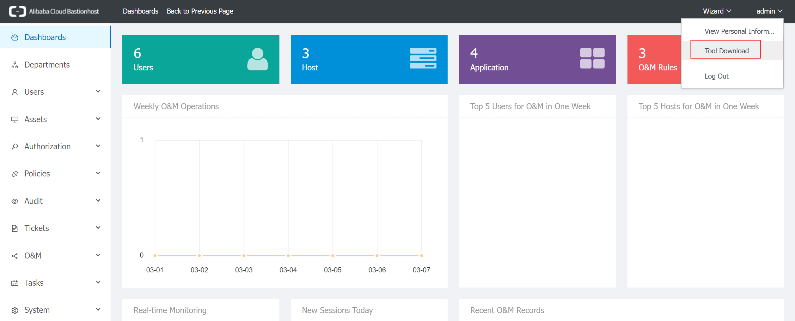

2. Download and install Bastionhost Assistant.

   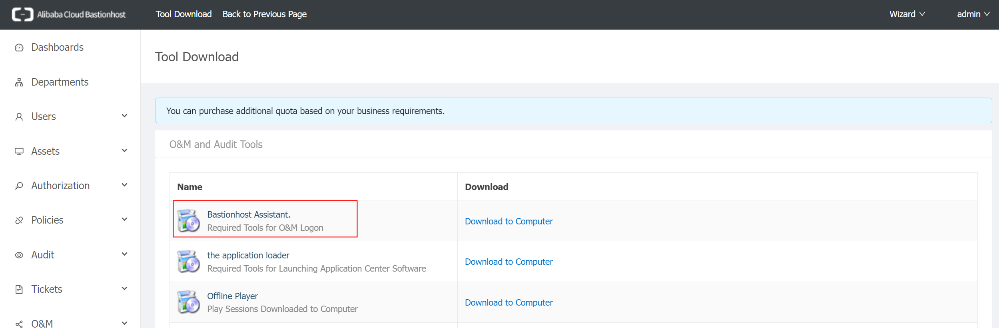

   > **Note**
   >
   > Bastionhost Assistant is a logon tool that you need to install if you want to call an on-premises O&M client tool based on a web page. Make sure that you are not blocked by antivirus software.

### 1.2.3. Specify an O&M tool

This topic provides an example on how to specify Xshell as an O&M tool.

1. Click **SSH**. On the configuration page that appears, set Client Program to Xshell and configure the Terminal Type and Encoding Format parameters.

   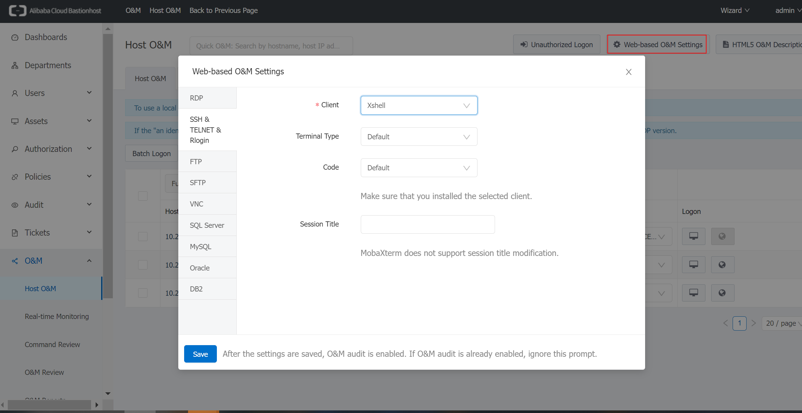

2. Click **Save**. In the dialog box that appears, select Xshell from the Select Client drop-down list and select the related on-premises package.

   SSO configuration:

   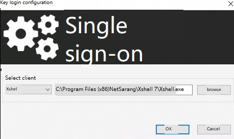

3. Click **OK**. A message indicating that the configuration is successful is displayed.

   Message for successful configuration:

   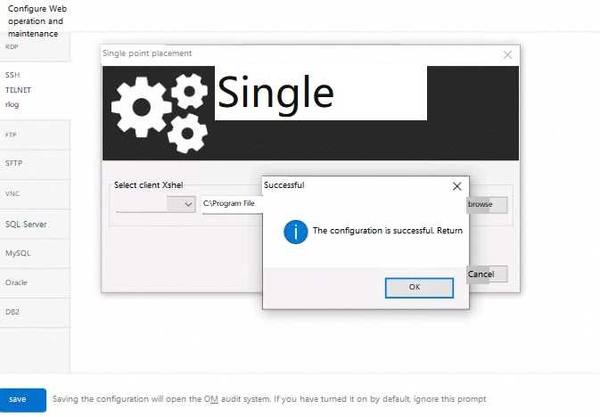

4. Click **OK**. Xshell is specified as an O&M tool.

   After the configuration is complete, close the page.

### 1.2.4. Host O&M

This topic provides an example on how to perform O&M operations on hosts that use Remote Desktop Protocol (RDP) or SSH.

#### 1.2.4.1. O&M of hosts that use SSH

This topic describes O&M of hosts that use SSH.

1. Choose **O&M** > **Host O&M** and find hosts that use SSH.

   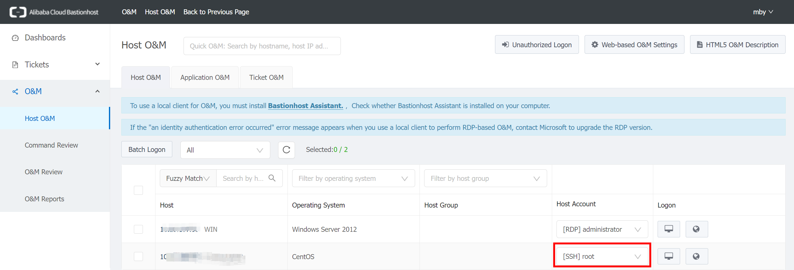

2. Open the **on-premises client** to access the desired host on which you want to perform O&M operations.

   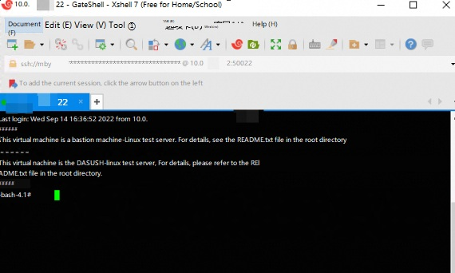

#### 1.2.4.2. O&M of hosts that use RDP

This topic describes O&M of hosts that use Remote Desktop Protocol (RDP).

1. Choose **O&M** > **Host O&M** and find hosts that use RDP.

   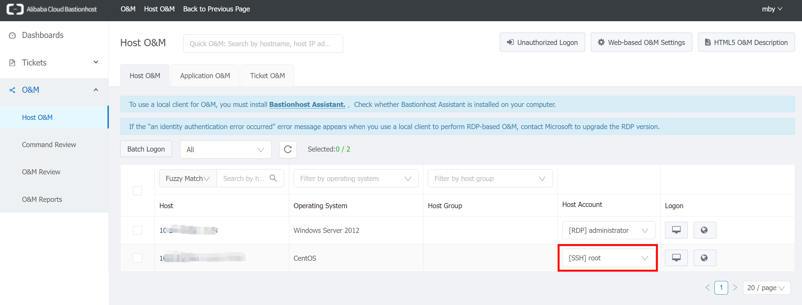

2. Open the **H5 client** to access the desired host on which you want to perform O&M operations.

   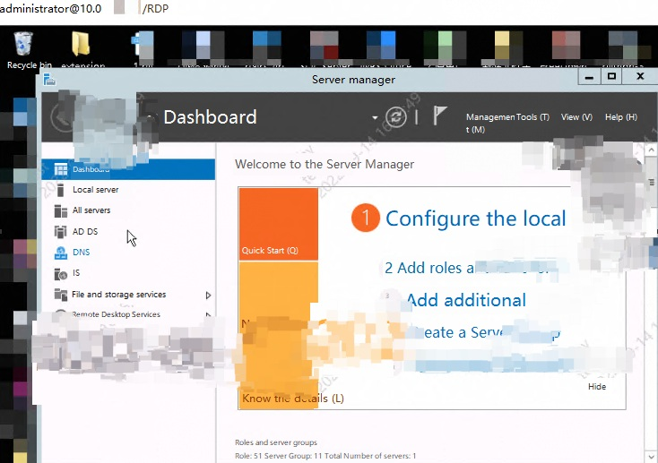

### 1.2.5. Database O&M

#### 1.2.5.1. BS O&M

This topic describes BS O&M of hosts that use MySQL, Oracle, SQL Server, and DB2 protocols.

1. Choose **O&M** > **Host O&M** and find hosts that use the MySQL protocol.

   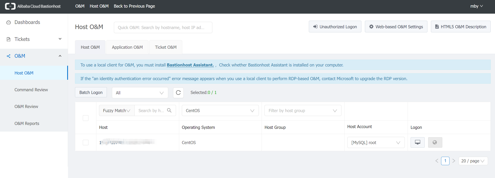

2. Open the **on-premises client** to access the desired host on which you want to perform O&M operations.

   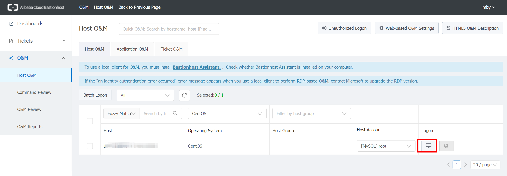

#### 1.2.5.2. Tunnel O&M

This topic describes tunnel O&M of hosts that use MySQL and Oracle protocols.

1. Open the Navicat client and create a MySQL connection. On the General tab of the window that appears, enter the connection name and information about the host that uses the MySQL protocol. On the SSH tab of the same window, select **Use SSH Channel** and enter information such as the IP address, username, and password of the bastion host.

   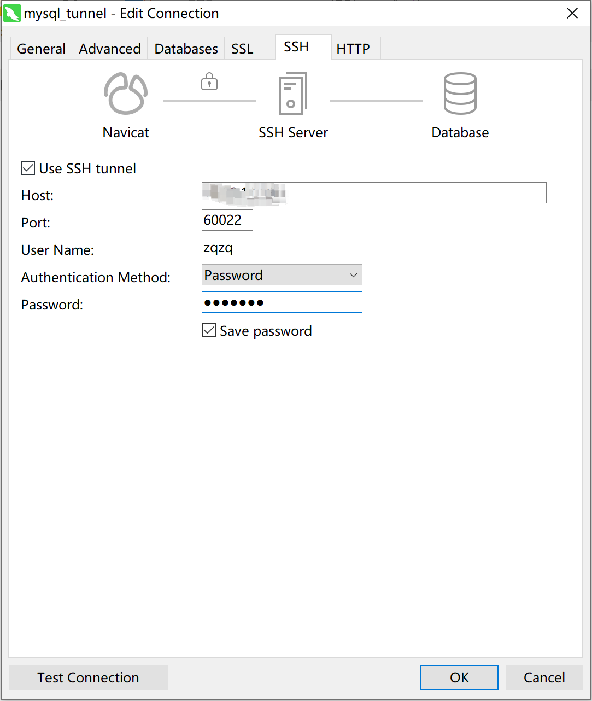

2. Click OK to save the configurations and double-click the tag for a MySQL connection.

   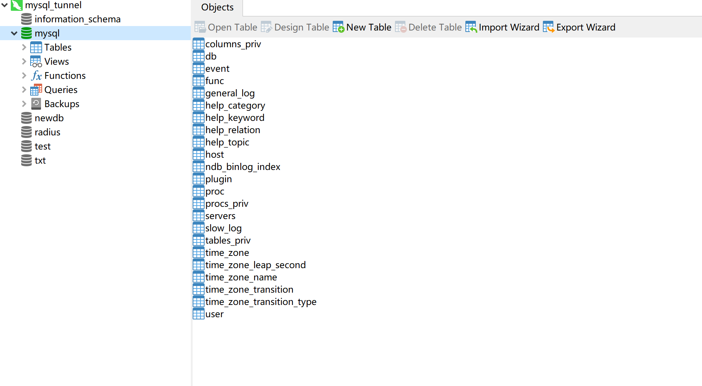

## 1.3. C/S O&M operations

O&M engineers log on to the O&M audit system by using an on-premises client tool and then access the desired host.

### 1.3.1. Preparations

This topic describes the preparations for C/S O&M.

**Install O&M tools that support SSH on your on-premises machine**

For example, you can install PuTTY, SecureCRT, and Xshell.

**Install O&M tools that support Remote Desktop Protocol (RDP) on your on-premises machine**

For example, you can install a remote desktop connection tool supported by Windows systems.

**Install O&M tools that support Secure File Transfer Protocol (SFTP) on your on-premises machine**

For example, you can install WinSCP and Xftp.

**Install O&M tools that support FTP on your on-premises machine**

For example, you can install Xftp.

**Make sure that the port of your terminal can access the port of the O&M audit system**

Default ports of the O&M audit system:

- Port 60022 is used to access hosts that use SSH, Telnet, and SFTP.

- Port 63389 is used to access hosts that use RDP.

- Port 60021 is used to access hosts that use FTP.

### 1.3.2. Host O&M

#### 1.3.2.1. O&M of hosts that use SSH, Telnet, and RLogin

This topic provides an example on how to use Xshell to perform O&M operations on hosts that use SSH, Telnet, and RLogin.

1. Open the Xshell tool. In the logon window of the Xshell tool, enter the IP address and port number 60022 of the O&M audit system.

   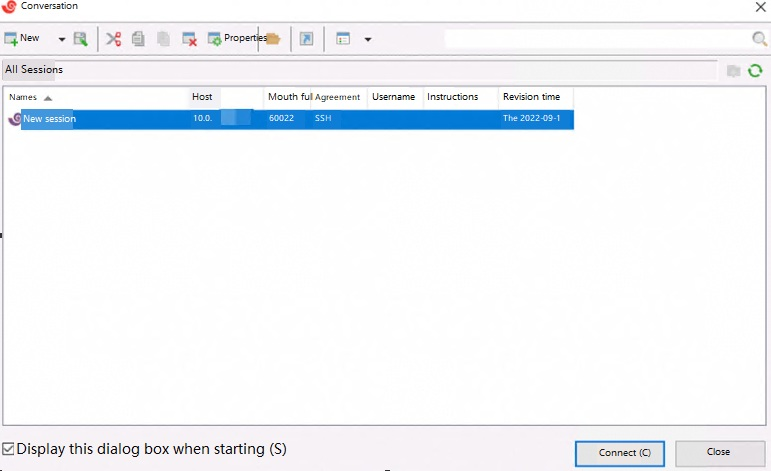

2. Click **Connect**. In the logon window of the O&M audit system, enter the username and password of the O&M audit system.

   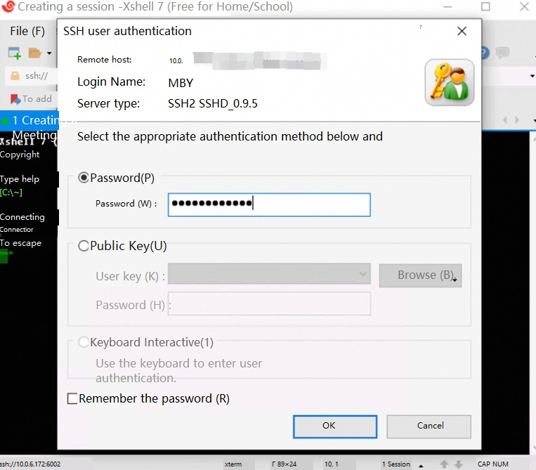

3. Click **OK**. On the asset management page that appears, find hosts by pressing up and down arrow keys, and the Enter key.

   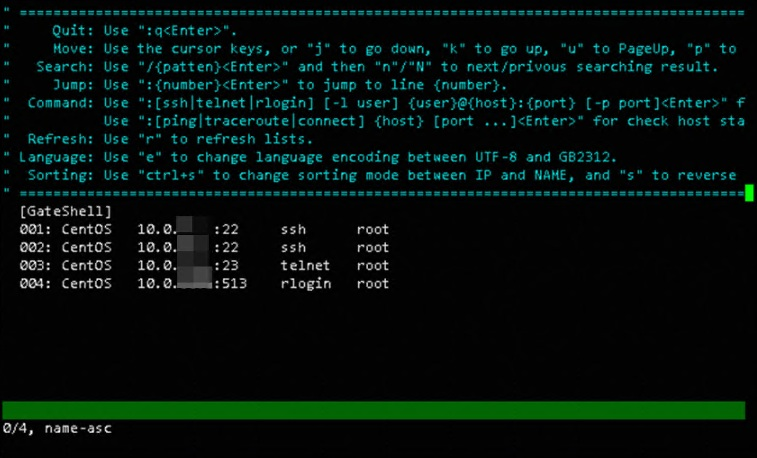

4. After you press the Enter key, an input box is displayed. Enter the username for logging on to the host.

   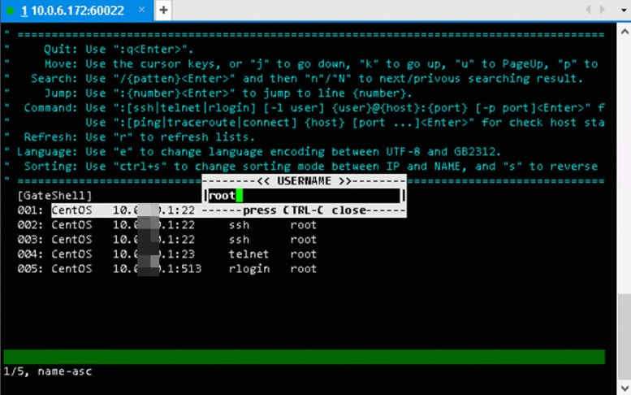

5. After you press the Enter key, the host logon page is displayed. Enter the password for logging on to the host.

   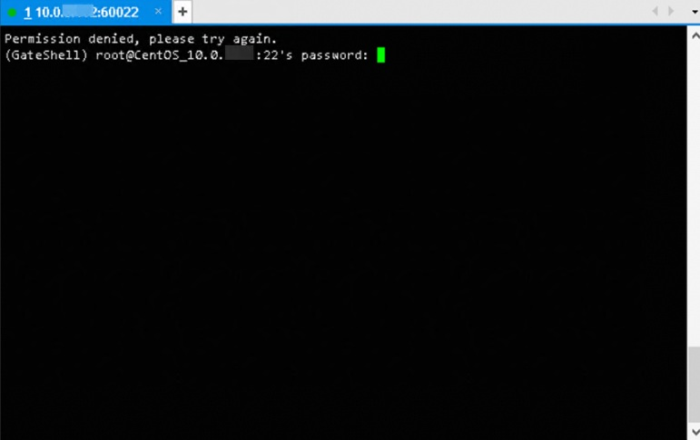

6. After you press the Enter key, you enter the page on which you can perform O&M operations on the host.

   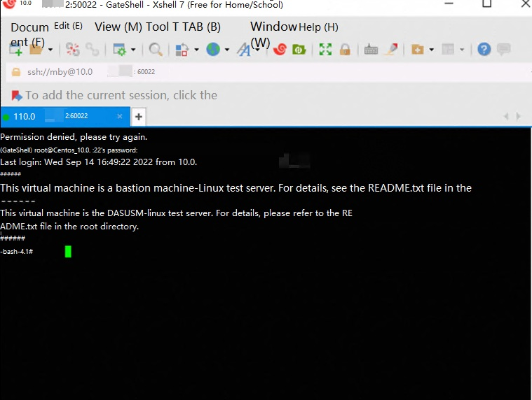

#### 1.3.2.2. O&M of hosts that use RDP

This topic provides an example on how to use a remote desktop connection tool Microsoft Terminal Server Client (MSTSC) to perform O&M operations on hosts that use Remote Desktop Protocol (RDP).

1. Open the **Start** menu on your Windows computer, enter mstsc in the Run input box, and then press the Enter key. In the **Remote Desktop Connection** dialog box, enter the  `IP address and port number 63389 of the O&M audit system` .

   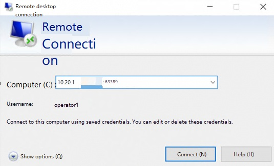

2. Click **Connect**. The **Do you trust this remote connection?** dialog box appears.

   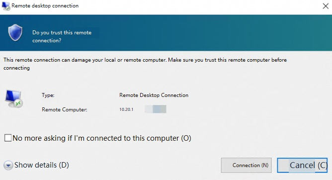

3. Click **Connect**. The **Cannot verify the identity of the computer that requests the remote connection. Are you sure that you want to continue?** dialog box appears.

   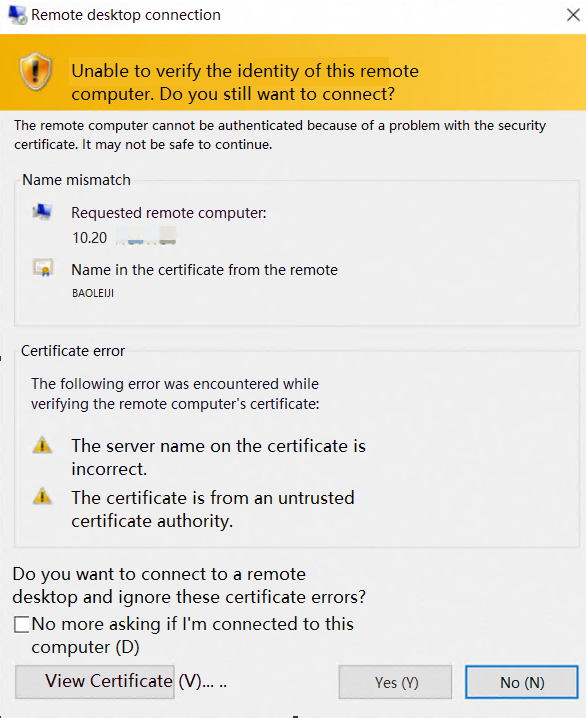

4. Click **Yes**. In the login dialog box, enter the username and password for logging on to the O&M audit system.

   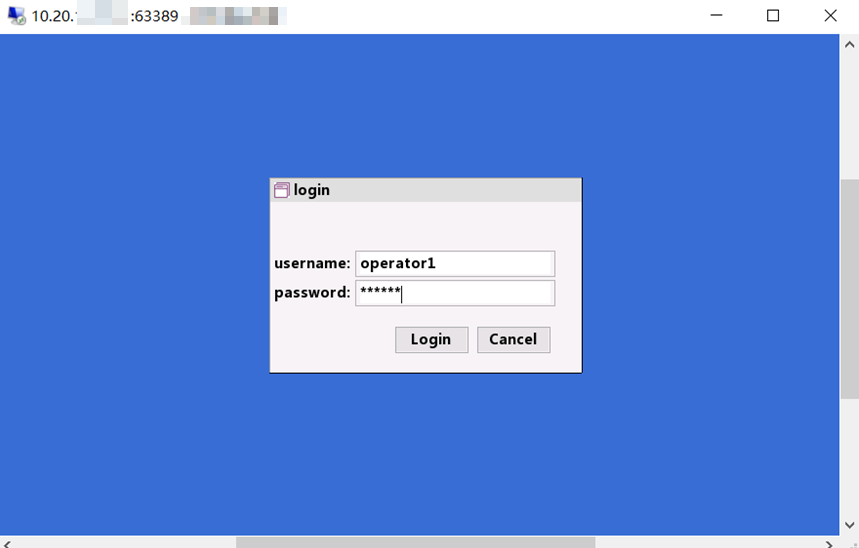

5. Click **Login**. On the asset management page that appears, select an authorized asset or search for the host information in the search box.

   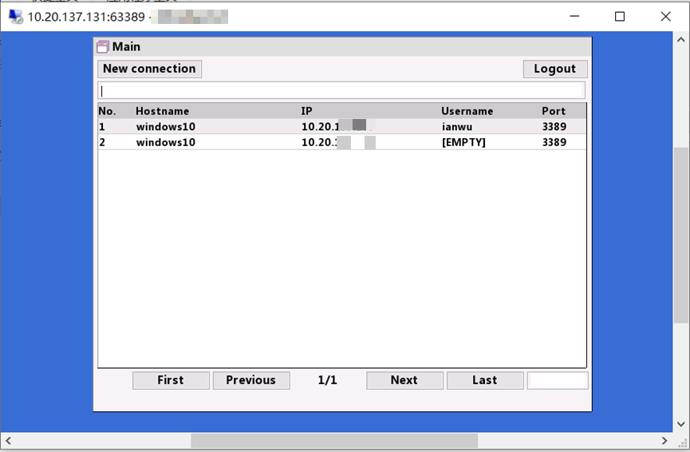

6. Double-click the host. The host logon page is displayed. Enter the username and password for logging on to the host.

   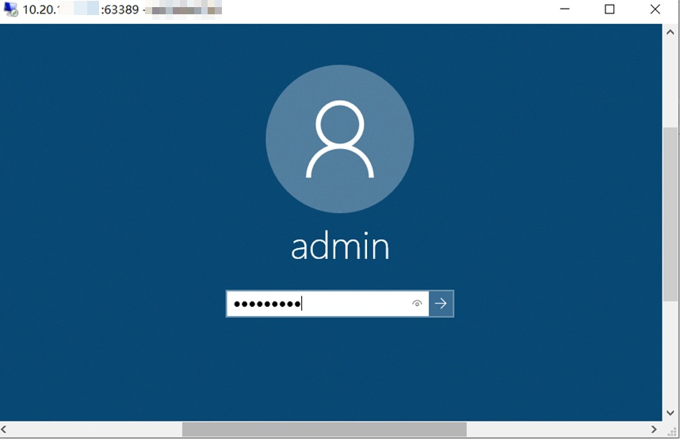

7. After you press the Enter key, you can enter the page on which you can perform O&M operations on the host.

#### 1.3.2.3. O&M of hosts that use SFTP

This topic provides an example on how to use WinSCP to perform O&M operations on hosts that use Secure File Transfer Protocol (SFTP).

1. Open the WinSCP tool. In the logon window of the tool, enter the IP address, port number 60022, username, and password of the O&M audit system.

   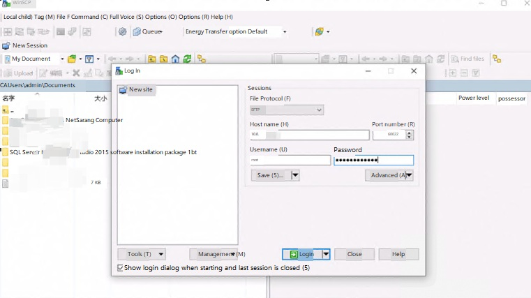

2. Click **Log On**. In the window that appears, you can view the list of hosts on the right.

   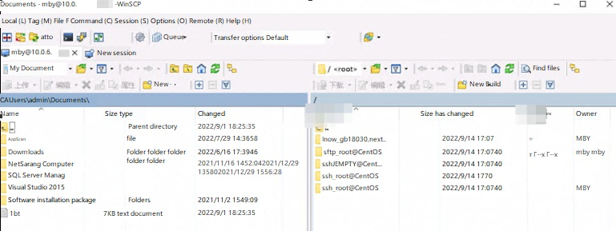

3. Find the desired host and double-click the host. You can access the directories of the host and transfer files.

   

#### 1.3.2.4. O&M of hosts that use FTP

This topic provides an example on how to use Xftp to perform O&M operations on hosts that use FTP.

1. O&M engineers can go to the web page of a bastion host by using a browser. In the upper-right corner of the page that appears, move the pointer over the username and click **View Personal Information** to go to the page on which you can view the personal information about the user.

   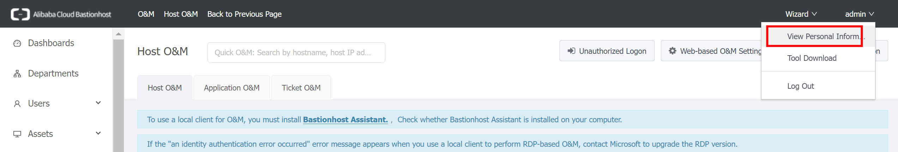

2. On the **CS Logon Password** tab of the **Personal Information** page, specify a CS logon password. This password is used to log on to Bastionhost to perform C/S O&M operations on hosts that use FTP.

   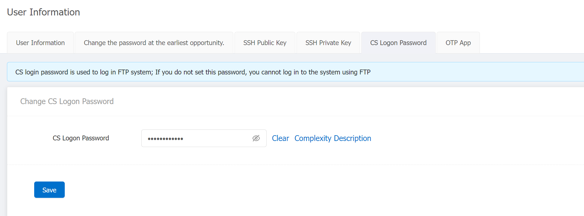

3. Open the Xftp tool. In the logon window of the tool, enter the IP address, port number 60021, username, CS logon password, and FTP of the O&M audit system.

   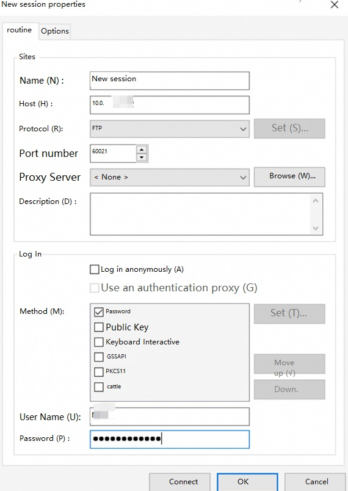

4. Click **Connect**. In the window that appears, you can view the list of hosts on the right.

   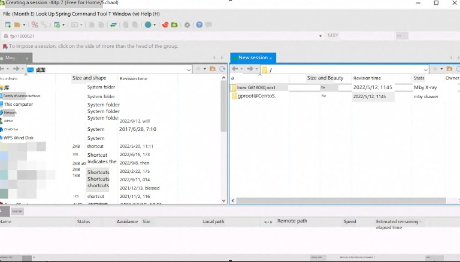

5. Find the desired host and double-click the host. You can access the directories of the host and transfer files.

   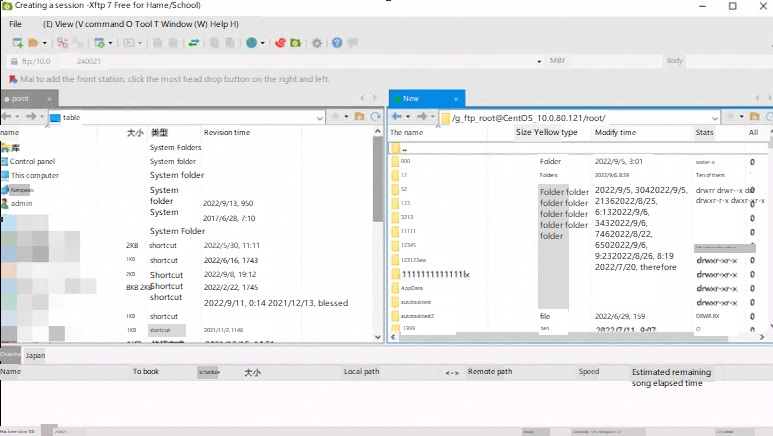

## 1.4. Host logon O&M

### 1.4.1. Log on to a host by using menus for a CLI terminal application

This topic describes how to log on to a host by using menus for a CLI terminal application.

1. Start the CLI terminal application and enter  `ssh Username of the O&M audit system@IP address of the O&M audit system-p60022` .

   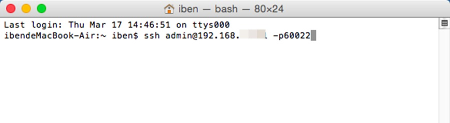

2. Press the Enter key. On the asset management page that appears, find authorized assets by pressing up and down arrow keys.

   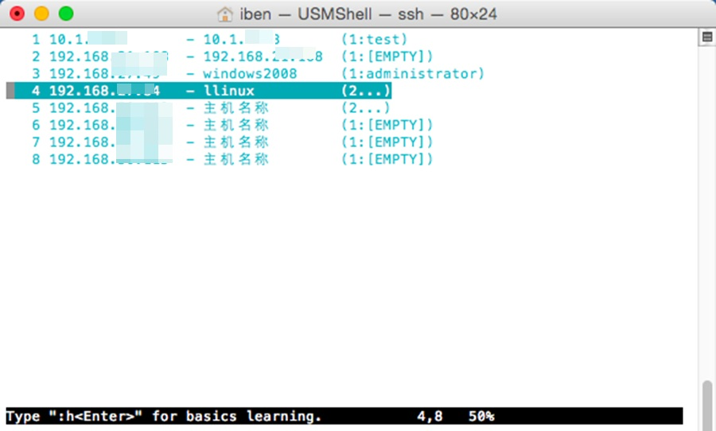

3. After you press the Enter key, select the username that you want to use to log on to the desired host.

   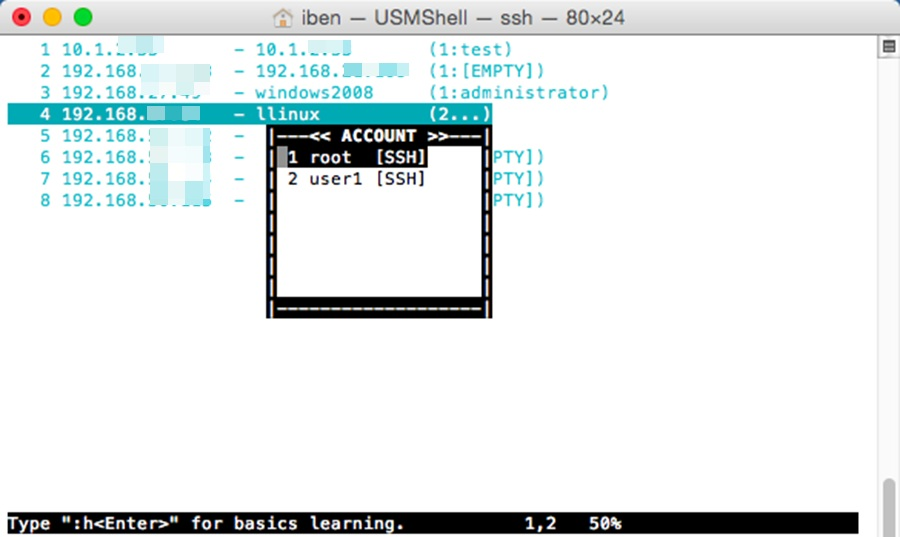

4. After you press the Enter key, you enter the page on which you can perform O&M operations on the host.

   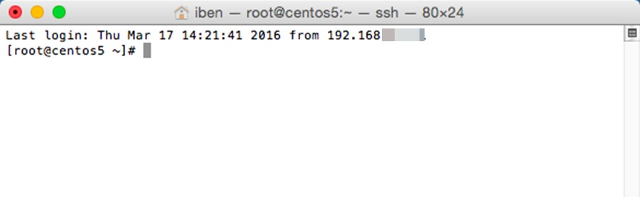

### 1.4.2. Log on to a host by using menus for a remote desktop connection application

This topic describes how a remote desktop connection application logs on to a host by using menus.

1. Start the remote desktop connection application and enter the  `IP address and port number 63389 of the O&M audit system` .

   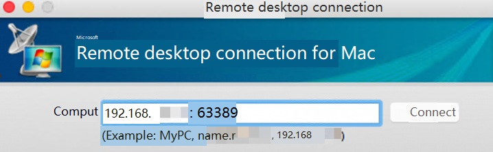

2. Click **Connect**. The **Are you sure that you want to continue to connect this computer?** dialog box appears.

   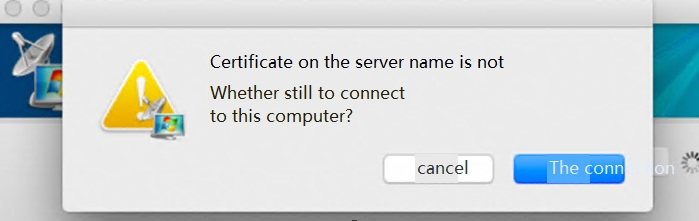

3. Click **Connect**. In the logon window of the O&M audit system, enter the username and password for logging on to the O&M audit system.

   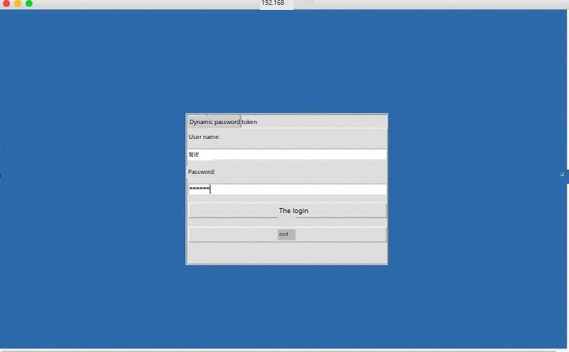

4. Click **Login**. On the asset management page that appears, select an authorized asset or search for the host information in the search box.

   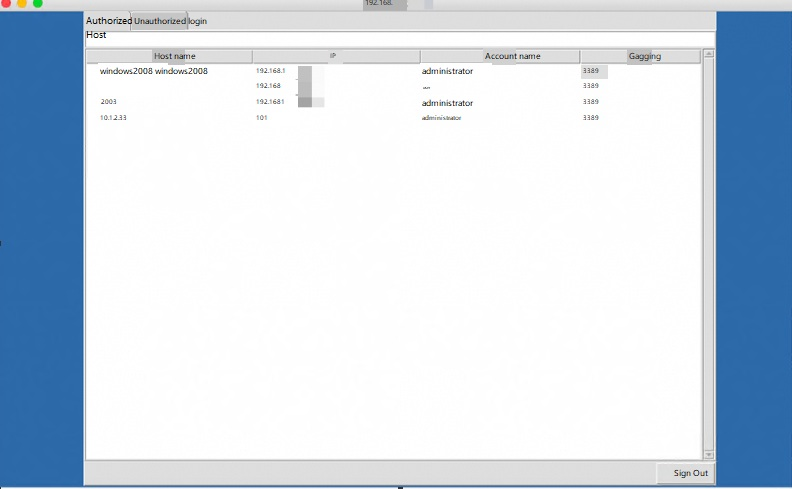

5. After you double-click the host, you can enter the page on which you can perform O&M operations on the host.
