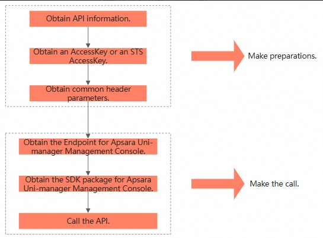

Alibaba Cloud  
Apsara Stack  
NFV Cloud Firewall Developer  
Guide  
Product Version: V3.18.6  
Document Version: 20260701

**Table of Contents**

- [1.Getting started](#section-1)
    - [1.1. Usage notes on development documentation](#section-1-1)
    - [1.2. API call process](#section-1-2)
- [2.Preparations](#section-2)
    - [2.1. Obtain the information and endpoint of an API opeation](#section-2-1)
    - [2.2. Obtain an AccessKey pair](#section-2-2)
    - [2.3. Obtain an STS AccessKey pair](#section-2-3)
    - [2.4. Get common header parameters](#section-2-4)
- [3.Use POP to make API calls](#section-3)
    - [3.1. Prerequisites for API calls](#section-3-1)
    - [3.2. Java edition](#section-3-2)
    - [3.3. Python version](#section-3-3)
    - [3.4. Go edition](#section-3-4)
- [4.NFV Cloud Firewall API list](#section-4)
    - [4.1. CIDR block management](#section-4-1)
        - [4.1.1. CreateCidr](#section-4-1-1)
        - [4.1.2. CreateVpcIpv6Cidr](#section-4-1-2)
        - [4.1.3. DeleteCidr](#section-4-1-3)
        - [4.1.4. ListCidrs](#section-4-1-4)
        - [4.1.5. ListCidrsAll](#section-4-1-5)
        - [4.1.6. ListVpcIpv6IspOptions](#section-4-1-6)
    - [4.2. NFV Cloud Firewall Cluster](#section-4-2)
        - [4.2.1. BypassCluster](#section-4-2-1)
        - [4.2.2. BypassClusterRecover](#section-4-2-2)
        - [4.2.3. CreateCluster](#section-4-2-3)
        - [4.2.4. CreateDisasterCluster](#section-4-2-4)
        - [4.2.5. DeleteCluster](#section-4-2-5)
        - [4.2.6. GetAllRegionsInfo](#section-4-2-6)
        - [4.2.7. GetAsynTaskResult](#section-4-2-7)
        - [4.2.8. GetBypassInfo](#section-4-2-8)
        - [4.2.9. GetGateWay](#section-4-2-9)
        - [4.2.10. ListApps](#section-4-2-10)
        - [4.2.11. ListClusterDetail](#section-4-2-11)
        - [4.2.12. ListClusterMonitors](#section-4-2-12)
        - [4.2.13. ListClusterResources](#section-4-2-13)
        - [4.2.14. ListClusters](#section-4-2-14)
        - [4.2.15. ListClustersByApp](#section-4-2-15)
        - [4.2.16. ListEcsInstanceTypes](#section-4-2-16)
        - [4.2.17. ListVfwSpecOptions](#section-4-2-17)
        - [4.2.18. ModifyClusterInfo](#section-4-2-18)
        - [4.2.19. QueryMemberDetail](#section-4-2-19)
    - [4.3. Dedicated hosts](#section-4-3)
        - [4.3.1. CreateDdhCluster](#section-4-3-1)
        - [4.3.2. CreateDdhHost](#section-4-3-2)
        - [4.3.3. DeleteDdhCluster](#section-4-3-3)
        - [4.3.4. DeleteDdhHost](#section-4-3-4)
        - [4.3.5. ListDdhApps](#section-4-3-5)
        - [4.3.6. ListDdhClusters](#section-4-3-6)
        - [4.3.7. ListDdhClustersByClsIds](#section-4-3-7)
        - [4.3.8. ListDdhEcsType](#section-4-3-8)
        - [4.3.9. ListDdhHosts](#section-4-3-9)
        - [4.3.10. ListDdhHostType](#section-4-3-10)
        - [4.3.11. ListZones](#section-4-3-11)
        - [4.3.12. ModifyDdhClusterInfo](#section-4-3-12)
        - [4.3.13. ModifyDdhHostInfo](#section-4-3-13)
    - [4.4. Endpoint](#section-4-4)
        - [4.4.1. CreateForwardingPolicy](#section-4-4-1)
        - [4.4.2. DeleteForwardingPolicy](#section-4-4-2)
        - [4.4.3. EnableForwardingPolicyByEcs](#section-4-4-3)
        - [4.4.4. ListForwardingPolicies](#section-4-4-4)
        - [4.4.5. ListForwardingPolicyOptions](#section-4-4-5)
        - [4.4.6. ListSlaveEnis](#section-4-4-6)
        - [4.4.7. UpdateForwardingPolicy](#section-4-4-7)
    - [4.5. Cross-organization resource authorization](#section-4-5)
        - [4.5.1. AddSharingUser](#section-4-5-1)
        - [4.5.2. CreateOrgAuthorization](#section-4-5-2)
        - [4.5.3. DeleteOrgAuthorization](#section-4-5-3)
        - [4.5.4. DeleteSharingUser](#section-4-5-4)
        - [4.5.5. DescribeOrgAuthorization](#section-4-5-5)
        - [4.5.6. GetAuthorization](#section-4-5-6)
        - [4.5.7. GrantAuthorize](#section-4-5-7)
        - [4.5.8. ListSharingUserLocal](#section-4-5-8)
        - [4.5.9. ListVpcResource](#section-4-5-9)
        - [4.5.10. UpdateOrgAuthorization](#section-4-5-10)
    - [4.6. Manage images](#section-4-6)
        - [4.6.1. ListImages](#section-4-6-1)
    - [4.7. License](#section-4-7)
        - [4.7.1. GetVfwQuota](#section-4-7-1)
    - [4.8. Access Control](#section-4-8)
        - [4.8.1. CheckRamRoleExists](#section-4-8-1)
    - [4.9. Asynchronous task](#section-4-9)
        - [4.9.1. GetAsynTaskDetail](#section-4-9-1)
    - [4.10. Tunnel Management](#section-4-10)
        - [4.10.1. CreateClassicTunnel](#section-4-10-1)
        - [4.10.2. CreateVpcTunnel](#section-4-10-2)
        - [4.10.3. DeleteClassicTunnel](#section-4-10-3)
        - [4.10.4. DeleteVpcTunnel](#section-4-10-4)
        - [4.10.5. GetVncPwd](#section-4-10-5)
        - [4.10.6. GetVncUrl](#section-4-10-6)
        - [4.10.7. ListClassicTunnels](#section-4-10-7)
        - [4.10.8. ListVpcTunnels](#section-4-10-8)
    - [4.11. Firewall interface](#section-4-11)
        - [4.11.1. ListVfwInterfaces](#section-4-11-1)
        - [4.11.2. PublishVfwInterfaces](#section-4-11-2)
        - [4.11.3. UnPublishVfwInterfaces](#section-4-11-3)
    - [4.12. Firewall routing](#section-4-12)
        - [4.12.1. CreateVfwRoutes](#section-4-12-1)
        - [4.12.2. DelVfwRoutes](#section-4-12-2)
        - [4.12.3. GetVfwRouteConfigStatus](#section-4-12-3)
        - [4.12.4. ListVfwRouteEntries](#section-4-12-4)
        - [4.12.5. ListVfwRouteOptions](#section-4-12-5)
        - [4.12.6. PublishVfwRoutes](#section-4-12-6)
        - [4.12.7. UnPublishVfwRoutes](#section-4-12-7)
    - [4.13. VPC routing](#section-4-13)
        - [4.13.1. BatchPublishRoutes](#section-4-13-1)
        - [4.13.2. BatchUnPublishRoutes](#section-4-13-2)
        - [4.13.3. CreateRouteEntry](#section-4-13-3)
        - [4.13.4. DeleteRouteEntry](#section-4-13-4)
        - [4.13.5. GetRouteConfigStatus](#section-4-13-5)
        - [4.13.6. ListRouteEntries](#section-4-13-6)
        - [4.13.7. ListRouteEntryOptions](#section-4-13-7)
        - [4.13.8. ModifyRouteEntry](#section-4-13-8)
        - [4.13.9. ModifyRoutePolicyName](#section-4-13-9)
        - [4.13.10. PublishRoutes](#section-4-13-10)
        - [4.13.11. UnPublishRoutes](#section-4-13-11)

<a id="section-1"></a>

# 1.Getting started

<a id="section-1-1"></a>

## 1.1. Usage notes on development documentation

This topic describes how to view the desired product development documentation when you use Apsara Stack API (ASAPI).

**Procedure**

You can follow the procedure described in the following figure to view the desired development documentation.


**Prerequisites**

The Apsara Stack version is obtained from an O&M personnel or operations administrator.

**Procedure**

You can go to the Apsara Stack documentation center and view the desired product documentation.

1. Go to the Apsara Stack Documentation Centerpage by using a browser.

2. Click the **Enterprise**, **Agility**, or **All-in-one** tab based on the Apsara Stack version that you use.

3. Select an Apsara Stack version from the drop-down list.

4. In the left-side navigation pane, select the name of the product that you want to view.

5. In the upper-right corner of the product documentation section, click **View Details** or **Download PDF**.

<a id="section-1-2"></a>

## 1.2. API call process

Alibaba Cloud Apsara Stack supports calling Apsara Stack APIs through the POP gateway. To provide you with an experience consistent with the public cloud, starting from Enterprise Edition V3.16.0, Apsara Stack APIs uses the POP gateway by default. This topic describes the process of calling Apsara Stack APIs through the POP gateway.

**Flowchart**



**Procedure**

1. Obtain API information.

   Obtain the product name, API name, and API version required for actual calls. For more information, see Obtain the information and endpoint of an API opeation.

2. Obtain an AccessKey or STS AccessKey. For more information, see Obtain an AccessKey pair and Obtain an STS AccessKey pair.

   > **Note**
   >
   > We recommend that you use a personal AccessKey or STS AccessKey to call APIs of the Apsara Uni-manager Management Console and cloud services.

3. Obtain common header parameters.

   Obtain parameters required for API calls, such as the region ID, organization ID, and resource set ID. For more information, see Get common header parameters.

   - You must obtain the organization ID through API calls. For more information, see the "*Get OrganizationList" section in the Apsara Uni-manager Management Console Developer Gui de*.

   - You must obtain the resource set ID through API calls. For more information, see the "*List ResourceGroup" section in the Apsara Uni-manager Management Console Developer Guid e*.

   > **Note**
   >
   > When you call an API, add the organization ID  `<x-acs-organizationid>`  and the resource set ID  `<x-acs-resourcegroupid>,`  in the request headers to specify the organization and resource set to which the resource belongs. This implements isolated queries for instance resources.
   >
   > - If you do not specify the organization ID  `<x-acs-organizationid>` , the system defaults to the organization to which the current user belongs.
   >
   > - If you do not specify the resource set ID  `<x-acs-resourcegroupid>` , it defaults to empty. If you specify a resource set, you must also specify the organization ID.

4. Obtain the endpoint of the cloud service. For more information, see Obtain the information and endpoint of an API opeation or Prerequisites for API calls.

5. Call the API of the cloud service.

<a id="section-2"></a>

# 2.Preparations

<a id="section-2-1"></a>

## 2.1. Obtain the information and endpoint of an API opeation

To call an API operation by using an SDK, you must obtain the information about the API operation, including the service code, API operation name, and API version.

**Background information**

The API information on the OpenAPI Explorer page of the Apsara Uni-manager Management Console is for reference only. For more information about how to call API operations, see the developer guides of cloud services. If the information on the OpenAPI Explorer page is different from that in the developer guide of a cloud service, the information in the developer guide prevails.

**Procedure**

1. Log in to the Apsara Uni-manager Management Console.

2. In the top navigation bar, choose **Products** > **Development Tools** > **API & SDK** > **OpenAPI Explorer**.

3. On the **OpenAPI Explorer** page, choose **API Integration** > **API Debugging**.

   

4. In the left-side navigation pane, select the target cloud service.

5. From the **Version** drop-down list, select the target API version.

6. Browse all API operations of the current version in the API operation list below.

7. Click the API operation that you want to call and obtain the POP endpoint information on the Parameter tab.

<a id="section-2-2"></a>

## 2.2. Obtain an AccessKey pair

AccessKey pairs are classified into AccessKey pairs assigned by Resource Access Management (RAM) and AccessKey pairs assigned by Security Token Service (STS). You can use either type of AccessKey pair for authentication when you call operations. This topic describes how to obtain an AccessKey pair that is assigned by RAM.

**Background information**

An AccessKey pair is used to verify the identity of request senders. An AccessKey pair consists of an AccessKey ID and an AccessKey secret that are used to implement symmetric encryption. The AccessKey ID is used to identify a user. The AccessKey secret is used to encrypt the signature string.

You can use RAM or STS to assign an AccessKey pair for authentication.

- Use RAM to assign an AccessKey ID and an AccessKey secret to a third party.

- Use STS to assign an AccessKey ID, an AccessKey secret, and a security token to a third party. For more information, see Obtain an STS AccessKey pair.

The Apsara Uni-manager Management Console provides AccessKey pairs for personal accounts or organizations. Only the administrators of level-1 organizations and operations administrators can obtain the AccessKey pairs of organizations. We recommend that you use the AccessKey pairs of personal accounts to call the operations provided by the Apsara Uni-manager Management Console and cloud services. If you use the AccessKey pair of a personal account, you must add the following parameters in request headers for access control. If you do not add the parameters, an error may occur. The error indicates that permissions are insufficient.

> **Warning**
>
> The AccessKey pair of a personal account is managed by the permission
>
> system of the Apsara Uni-manager Management Console. The AccessKey pair of an organization has more permissions than the AccessKey pair of a personal account. If you want to obtain the AccessKey pair of an organization, make sure that you are authorized by an administrator. This helps ensure security.

| Parameter | Description |
| --- | --- |
| x-acs-regionid | The ID of the region. Example: cn-hangzhou-\*. |
| x-acs-organizationid | The ID of the organization in the Apsara Uni-manager Management Console. For more information about how to obtain organization IDs, see the <strong>GetOrganizationList</strong> section in <strong>Apsara</strong> Uni-manager Management Console <strong>Developer Guide</strong>. |
| x-acs-resourcegroupid | The ID of the resource set in the Apsara Uni-manager Management Console. For more information about how to obtain resource set IDs, see the <strong>ListResourceGroup</strong> section in <strong>Apsara</strong> Uni-manager Management Console <strong>Developer Guide</strong>. |
| x-acs-instanceid | The ID of the instance on which you want to perform operations. For example, you can obtain the ID of an Elastic Compute Service (ECS) instance from the ECS instance list. |

**Obtain the AccessKey pair of a personal account**

To obtain the AccessKey pair of a personal account, perform the following operations:

1. Log on to the Apsara Uni-manager Management Console.

2. In the upper-right corner of the homepage, move the pointer over the profile picture and click **User Information**.

3. In the **AccessKey Pair** section, view the AccessKey pair of your account.

   

   > **Note**
   >
   > An AccessKey pair consists of an AccessKey ID and an AccessKey secret.
   >
   > These credentials provide full permissions on cloud resources within your account. You must keep the AccessKey pair confidential.

**Obtain the AccessKey pair of an organization**

To obtain the AccessKey pair of an organization, perform the following operations:

1. Log on to the Apsara Uni-manager Management Console as an administrator.

2. In the top navigation bar, click **Enterprise**.

3. In the left-side navigation pane, choose **Resources > Organizations**.

4. In the organization list, click the name of the level-1 organization whose AccessKey pair you want to obtain.

5. Click **Management Accesskey**.

6. In the dialog box that appears, view the AccessKey pair of the organization.

<a id="section-2-3"></a>

## 2.3. Obtain an STS AccessKey pair

This topic describes how to use Security Token Service (STS) to call Apsara Stack API operations.

**Background information**

Apsara Stack STS allows you to manage temporary access credentials for your Apsara Stack resources. You can use STS to call Apsara Stack API operations.

Access credentials assigned by STS consist of an AccessKey ID, an AccessKey secret, and a security token. When you use STS to call API operations, these three elements are required.

**Procedure**

1. Obtain the Apsara Stack Resource Name (ARN) of your Resource Access Management (RAM) role.

   <ol type="i">

   <li>

   Log in to the Apsara Uni-manager Management Console.

   </li>

   <li>

   Click the profile picture in the upper-right corner of the page and click **User**

   </li>

   </ol>

   **Information**.

   <ol type="i" start="3">

   <li>

   Click **View Current Role Policy**.

   </li>

   </ol>

   In the **View Policies of Current Role** dialog box, view the ARN of your RAM role.

2. Obtain the access credentials assigned by STS.

   > **Note**
   >
   > You must replace the variables in the following code with actual values. Delete the angle brackets (<>) before you submit the code.
   >
   > The following section describes the variable parameters:
   >
   > - &lt;yourRegionID>: Replace this variable with the actual region ID.
   >
   > - &lt;yourAccessKeyID>: Replace this variable with your AccessKey ID.
   >
   > - &lt;yourAccessKeySecret>: Replace this variable with your AccessKey secret.
   >
   > - &lt;yourRoleSessionName>: Replace this variable with the actual session name.
   >
   >   This name is user-defined and is usually set to the identity of the user who calls the API, for example, username. In the operations performed by the same RAM role, the actual operator can be distinguished according to different  `RoleSessionName`  to implement user-level access audit. The name must be 2 to 64 characters in length, and can contain letters, digits, periods (.), at(@), hyphens (-), and underscores (_).
   >
   > - &lt;yourRoleArn>: Replace it with your actual RAM role.
   >
   > - "sts.aliyuns.com" : Replace it with the actual STS endpoint.

   ```xml
   public static void main(String[] args) {
       // Create and initialize a DefaultAcsClient instance. 
       // Replace the region ID, AccessKey ID, and AccessKey secret. 
       DefaultProfile profile = DefaultProfile.getProfile("<yourRegionID>", "
   <yourAccessKeyID>", "<yourAccessKeySecret>");
       HttpClientConfig clientConfig = HttpClientConfig.getDefault();
       clientConfig.setIgnoreSSLCerts(true);
       clientConfig.setProtocolType(ProtocolType.HTTPS);
       profile.setHttpClientConfig(clientConfig);
       IAcsClient client = new DefaultAcsClient(profile);
       String assumeRole = callAssumeRole(client);
       if (StringUtils.isEmpty(assumeRole)) return;
       JSONObject assumeRoleJson = JSONObject.parseObject(assumeRole);
       JSONObject credentials = assumeRoleJson.getJSONObject("Credentials");
       // Obtain the STS triplet. 
       String stsAK = credentials.getString("AccessKeyId");
       String stsSK = credentials.getString("AccessKeySecret");
       String stsToken = credentials.getString("SecurityToken");
   }

   private static String callAssumeRole(IAcsClient client) {
       CommonRequest request = new CommonRequest();
       // Replace "sts.aliyuns.com" with the actual STS endpoint. The general format is sts-vpc.${global:region}.${global:internet-domain}. 
       request.setSysDomain("sts.aliyuns.com");
       request.setSysProduct("Sts");
       request.setSysAction("AssumeRole");
       request.setSysVersion("2015-04-01");
       request.setSysMethod(MethodType.POST);
       request.setHttpContentType(FormatType.FORM);
       // The business parameter. Set the alias of the session. Replace "
   <yourRoleSessionName>" with the actual value. 
       request.putQueryParameter("RoleSessionName", "<yourRoleSessionName>");
       // The ARN of the role that you assume. Replace "<yourRoleArn>" with the actual Ram Role ARN obtained in the previous step. 
       request.putQueryParameter("RoleArn", "<yourRoleArn>");
       try {
           CommonResponse response = client.getCommonResponse(request);
           return response.getData();
       } catch (ServerException e) {
           System.out.println(e.getErrCode());
           System.out.println(e.getErrMsg());
       } catch (ClientException e) {
           System.out.println(e.getErrCode());
           System.out.println(e.getErrMsg());
       }
       return null;
   }
   ```

3. Use the access credentials assigned by STS to call an API operation of a service. The following sample code provides an example on how to call the  `DescribeZones`  operation of Elastic Compute Service (ECS):

   > **Note**
   >
   > Replace the variables in the following sample code with actual values. Delete the angle brackets (<>) from the final code.
   >
   > The following section describes the variable parameters:
   >
   > - &lt;yourRegionID>: Replace this variable with the actual region ID.
   >
   > - &lt;yourStsAccesskeyID>: Replace this variable with the AccessKey ID assigned by STS.
   >
   > - &lt;yourStsAccessKeySecret>: Replace this variable with the AccessKey secret assigned by STS.
   >
   > - &lt;yourStsToken>: Replace this variable with the security token assigned by STS.
   >
   > - &lt;yourResourceGroupID>: Replace this variable with the actual resource set ID.
   >
   > - &lt;yourOrganizationID>: Replace this variable with the actual organization ID.

   ```xml
   public static void main(String[] args) {
       // Replace <yourRegionID> with the actual region ID. 
       // Replace <yourStsAccessKeyID> and <yourStsAccessKeySecret> with the AccessKey I
   D and AccessKey secret assigned by STS, which are obtained in the previous step. 
       DefaultProfile profile = DefaultProfile.getProfile("<yourRegionID>", "
   <yourStsAccesskey>", "<yourStsAccessSecret>");
       HttpClientConfig clientConfig = HttpClientConfig.getDefault();
       clientConfig.setIgnoreSSLCerts(true);
       clientConfig.setProtocolType(ProtocolType.HTTPS);
       profile.setHttpClientConfig(clientConfig);
       IAcsClient client = new DefaultAcsClient(profile);
       CommonRequest request = new CommonRequest();
       request.setSysDomain("ecs.aliyuns.com");
       request.setSysProduct("Ecs");
       request.setSysAction("DescribeZones");
       request.setSysVersion("2014-05-26");
       request.setSysMethod(MethodType.POST);
       request.setHttpContentType(FormatType.FORM);
       // Replace "<yourRegionID>" with your actual region ID. 
       request.putHeadParameter("x-acs-regionid", "<yourRegionID>");
       // Replace "<yourStsToken>" with the security token in the STS triplet that you obtained in the previous step. 
       request.putQueryParameter("SecurityToken", "<yourStsToken>");
       // Optional. Replace it with your actual resource set ID. 
       // request.putHeadParameter("x-acs-resourcegroupid", "<yourResourceGroupID>");
       // Optional. Replace it with your actual organization ID. 
       request.putHeadParameter("x-acs-organizationid", "<yourOrganizationID>");
       try {
           CommonResponse response = client.getCommonResponse(request);
           System.out.println(response.getData());
       } catch (ServerException e) {
           System.out.println(e.getErrCode());
           System.out.println(e.getErrMsg());
       } catch (ClientException e) {
           System.out.println(e.getErrCode());
           System.out.println(e.getErrMsg());
       }
   }
   ```

<a id="section-2-4"></a>

## 2.4. Get common header parameters

In Apsara Stack, you must specify multiple common request headers to call API operations. Then, common response parameters are returned in the results.

**Common request parameters**

You must specify the values for these common request parameters in the code to call API operations in Apsara Stack.

For example, in the Java software development kit (SDK) call, replace  `<yourResourceGroupID>`  in  `request.putHeadParameter("x-acs-resourcegroupid", " <yourResourceGroupID>")`  with the actual resource set ID you obtained.

| Name | Description |
| --- | --- |
| x-acs-regionid | The region ID of the instance resource you operate. For more information about how to obtain this parameter, see Obtain a region ID. |
| x-acs-organizationid | The organization ID of the instance resource you operate. For more information about how to obtain this parameter, see Obtain an organization ID. |
| x-acs-organization-uuid | The organization UUID of the instance resource you operate. For more information about how to obtain this parameter, see Obtain an organization UUID. |
| x-acs-resourcegroupid | The resource set ID of the instance resource you operate. For more information about how to obtain this parameter, see Obtain a resource set ID. |
| x-acs-resourcegroup-uuid | The resource set UUID of the instance resource you operate. For more information about how to obtain this parameter, see Obtain a resource set UUID. |
| x-acs-roleid | The role ID you operate. For more information about how to obtain this parameter, see Obtain a role ID. |
| x-acs-role-uuid | The role UUID you operate. For more information about how to obtain this parameter, see Obtain a role UUID. |
| x-acs-instanceid | The instance ID of the instance resource you operate. For more information about how to obtain this parameter, see Obtain an instance ID. |

> **Note**
>
> - For common request parameters, you can pass either an ID (1, 2, 3...) or a UUID (org-xxx, rs-xxx, ar-xxx...) for an organization, resource set, and role in . If you pass both an ID and a UUID, the UUID takes precedence. However, if the specified UUID does not exist, an error will be returned.
>
> - When you call a cloud service API, you must add the organization ID () `x-acs-organizationid` ) or UUID ( `x-acs-organization-uuid` ) in the request headers. Otherwise, the call will fail due to insufficient permissions.
>
> - When you call a cloud service API, we recommend that you add the resource set ID ( `x-acs-resourcegroupid` ) or UUID ( `x-acs-resourcegroup-uuid` ) in the header headers to specify the organization and resource set to which the resources belongs. This enables isolated queries of instance resources. If neither is specified, the system will use the default resource set of the organization to which the current user belongs.

**Obtain a region ID**

You can view the region ID of a resource in the Apsara Uni-manager Management Console.

1. Log in to the Apsara Uni-manager Management Console as an administrator.

2. In the top navigation bar, click **Enterprise**.

3. In the left-side navigation pane, choose **Resource**s > **Regions**.

4. Click the name of the target organization.

5. In the **Regions** list on the right, obtain the region ID from the **Region Name** column.

**Obtain an organization ID**

You must call an API operation to obtain the ID of an organization. You can obtain the organization ID by using the online debugging feature in the Apsara Uni-manager Management Console.

1. Log in to the Apsara Uni-manager Management Console as an administrator.

2. In the top navigation bar, choose **Products** > **Development Tools** > **API & SDK** > **OpenAPI Explorer**.

3. On the **OpenAPI Explorer** page, choose **API Integration** > **API Debugging**.

4. Click the  button, choose **Platform** > **Apsara Uni-manager**, and select **2019-05-10**

   from the **Version** drop-down list.

5. Enter  `GetOrganizationList`  in the text box to debug the API online. Enter the name of the target organization in the name parameter and initiate the call. After the call succeeds, view the value of **id** in **Call Result**. The value is the organization ID.

**Obtain an organization UUID**

You can view the organization UUID of a resource in the Apsara Uni-Manager Management Console.

1. Log in to the Apsara Uni-manager Management Console as an administrator.

2. In the top navigation bar, click **Enterprise**.

3. In the left-side navigation pane, choose **Resources** > **Organizations**.

4. In the Organization Structure section on the left, click the organization name.

5. In the Basic Information section on the right, view the **Organization ID**. This is the organization UUID.

**Obtain a resource set ID**

You must call an API operation to obtain the ID of a resource set. You can obtain the resource set ID by using the online debugging feature in the Apsara Uni-manager Management Console.

1. Log in to the Apsara Uni-manager Management Console as an administrator.

2. In the top navigation bar, choose **Products** > **Development Tools** > **API & SDK** > **OpenAPI Explorer**.

3. On the **OpenAPI Explorer** page, choose **API Integration** > **API Debugging**.

4. Click  button, select **Platform** > **Apsara Uni-manager**, and select **2019-05-10** from

   the **Version** drop-down list.

5. Enter  `ListResourceGroup`  in the text box to debug the API online. After the call succeeds, view the value of **id** in **Call Result**. The value is the resource set ID.

**Obtain a resource set UUID**

You can view the resource set UUID of a resource in the Apsara Uni-manager Management Console.

1. Log in to the Apsara Uni-manager Management Console as an administrator.

2. In the top navigation bar, click **Enterprise**.

3. In the left-side navigation pane, choose **Resources** > **Resource Sets**.

4. In the resource set list, locate the ID of the desired resource set. The value is the resource set UUID.

**Obtain a role ID**

1. Log in to the Apsara Uni-manager Management Console as an administrator.

2. In the top navigation bar, choose **Products** > **Development Tools** > **API & SDK** > **OpenAPI Explorer**.

3. On the **OpenAPI Explorer** page, choose **API Integration** > **API Debugging**.

4. Click  button, select **Platform** > **Apsara Uni-manager**, and select **2019-05-10** from

   the **Version** drop-down list.

5. Enter  `ListRoles`  in the text box to debug the API online. After the call succeeds, view the value of **id** in **Call Result**. The value is the role ID.

**Obtain a role UUID**

You can view the role UUID in the Apsara Uni-manager Management Console.

1. Log in to the Apsara Uni-manager Management Console as an administrator.

2. In the top navigation bar, click **Enterprise**.

3. In the left-side navigation pane, choose **Permissions** > **Role Permissions**.

4. In the role list, locate the ID of the desired role. The value is the role UUID.

**Obtain an instance ID**

You can obtain the instance ID from the cloud service instance list in the Apsara Uni-manager Management Console. For example, for Elastic Compute Service (ECS), you can view the instance ID in the instance list of the ECS console.

1. Log in to the Apsara Uni-manager Management Console.

2. In the top navigation bar, choose **Products** > **Computing** > **Cloud Server** > **Elastic Compute Service**.

3. In the left-side navigation pane, click **Instances & Images** > **ECS Instance**.

4. In the instance list, view the instance ID in the **Instance Name/ID** column.

**Common response parameters**

The following table describes the common response parameters that are returned by default when you call API operations to query the instances of cloud services.

| Parameter | Description |
| --- | --- |
| ResourceGroupName | The name of the resource set. |
| ResourceGroup | The ID of the resource set. |
| DepartmentName | The name of the organization. |
| Department | The ID of the organization. |

<a id="section-3"></a>

# 3.Use POP to make API calls

<a id="section-3-1"></a>

## 3.1. Prerequisites for API calls

Like Alibaba Cloud Public Cloud, Alibaba Cloud Apsara Stack allows you to call APIs through the Public Open Platform (POP) gateway. This topic describes the preparations you must make before calling the APIs.

**Background information**

To ensure that Apsara Stack provides the same user experience as Public Cloud and offers you a more convenient and consistent experience, we recommend that you call Apsara Stack APIs through the POP gateway.

**Obtain the endpoint of a cloud service**

**Use OpenAPI Explorer**

1. Log in to the Apsara Uni-manager Management Console.

2. In the top navigation bar, choose **Products** > **Development Tools** > **API & SDK** > **OpenAPI Explorer**.

3. On the **OpenAPI Explorer** page, choose **API Integration** >**API Debugging**.

4. In the left-side navigation pane, select **Cloud Firewall**.

5. In the **Version** drop-down list, select the target API version.

6. You can view all APIs of the selected version in the API list below.

7. Select the corresponding API and obtain the POP Endpoint information of the cloud service from the parameter names.

**Use Apsara Infrastructure Management**

1. Log in to the Apsara Uni-manager Operations Console.

2. In the top navigation bar, choose **Platform Operation** > **Apsara Infrastructure Management** > **Resource Management**. The **Product & Cluster O&M** page appears.

3. On the **Product & Cluster O&M** page, enter **yundun-cfw-vfw** in the  `Product | Cluster`  search box<strong>,</strong> find the **yundun-cfw-vfw\*\*\*\*** cluster, and then click **Cluster Details** in the **Actions** column.

4. On the **Services** tab, search for the **yundun-cfw**-\*\*\* service, and then click **Details** in the **Actions** column of the target service.

5. On the service details page, go to the **Components** section, click the  `yundun-vfwctl-app` component<strong>,</strong> and then select the **Resources** tab in the Information of Component yundun-vfwctl-app section.

6. Search for the resource named  `vfwctl-cloudfw-pop-endpoint` , show the information in the **Resource Application Parameters** column, and then view the value of **domain**, which is the endpoint of NFV.

**Obtain common parameters**

To obtain parameters such as organization ID, resource set ID, region ID, and instance ID that are used when you call Apsara Stack APIs through the POP gateway, see the Get common header parameters section in Preparations of this manual.

<a id="section-3-2"></a>

## 3.2. Java edition

This topic describes how to call NFV Cloud Firewall API operations by using CommonRequest.

**Prerequisites**

We recommend that you use CommonRequest to call API operations in Apsara Stack. You can go to the **Service** > **Developer Tools** > **APIs and Tools** > **OpenAPI Explorer** console, choose **API Integration** >**SDK Example** to view the recommended SDK version and sample code.

**Background information**

You can call API operations by using Remote Procedure Call (RPC) or Resource-Oriented Architecture (ROA).

**CommonRequest call examples**

The following example shows how to call the ListCidrs operation of Cloudvfw by using RPC. The API version is 2025-04-01.

Sample code:

```xml
import com.aliyuncs.CommonRequest;
import com.aliyuncs.CommonResponse;
import com.aliyuncs.DefaultAcsClient;
import com.aliyuncs.IAcsClient;
import com.aliyuncs.exceptions.ClientException;
import com.aliyuncs.exceptions.ServerException;
import com.aliyuncs.http.MethodType;
import com.aliyuncs.profile.DefaultProfile;

public class ListCidrs {

    public static void main(String[] args) {
        // Create a DefaultAcsClient instance and initialize it.
        DefaultProfile profile = DefaultProfile.getProfile("<your-regionid>", "
<yourAccessKeyId>", "<yourAccessSecret>");

        // Ignore SSL.
        // HttpClientConfig clientConfig = HttpClientConfig.getDefault();
        // clientConfig.setIgnoreSSLCerts(true);
        // Set the connection timeout period.
        // clientConfig.setConnectionTimeoutMillis(3000L);
        // Set the read timeout period.
        // clientConfig.setReadTimeoutMillis(10000L);
        // profile.setHttpClientConfig(clientConfig);
        
        IAcsClient client = new DefaultAcsClient(profile);
        // Create an API request and set parameters.
        CommonRequest request = new CommonRequest();
        // Set the request method.
        request.setSysMethod(MethodType.POST);
        // Set the endpoint of the cloud service.
        request.setSysDomain("<CloudvfwEndpoint>");
        // Set the API version.
        request.setSysVersion("2025-04-01");
        // Set LocationProduct.
        request.setSysLocationProduct("Cloudvfw");
        // Set the name of the API operation.
        request.setSysAction("ListCidrs");
        
        // If you use STS AccessKey pairs to call RPC API operations, you must add the 
SecurityToken parameter.
        // request.putBodyParameter("SecurityToken", "<your-SecurityToken>");

        // Business parameters.
        request.putQueryParameter("PageSize", "10");
        request.putQueryParameter("PageNumber", "1");

        // Required. Specify the source of the call.
        request.putHeadParameter("x-acs-caller-sdk-source", "ApiTestDemo");
        // Optional. Required only for historical versions earlier than V3.15.0 of Enterprise Edition.
        request.putHeadParameter("x-acs-regionid", "<your-regionid>");
        // Optional. Specify the resource set ID.
        request.putHeadParameter("x-acs-resourcegroupid", "<your-resourcegroupid>");
        // Required. Specify the organization ID.
        request.putHeadParameter("x-acs-organizationid", "<your-organizationid>");
        // Optional. Required for modification and deletion operations.
        // request.putHeadParameter("x-acs-instanceid", "<your-instanceid>");

        try {
            // Initiate the request and handle the response or exception.
            CommonResponse response = client.getCommonResponse(request);
            System.out.println(response.getData());
        } catch (ServerException e) {
            e.printStackTrace();
        } catch (ClientException e) {
            System.out.println("ErrCode:" + e.getErrCode());
            System.out.println("ErrMsg:" + e.getErrMsg());
            System.out.println("RequestId:" + e.getRequestId());
        }

    }
}
```

The following example shows how to call the ListCidrs operation of Cloudvfw by using ROA. The API version is 2025-04-01.

Sample call:

```xml
import com.aliyuncs.CommonRequest;
import com.aliyuncs.CommonResponse;
import com.aliyuncs.DefaultAcsClient;
import com.aliyuncs.IAcsClient;
import com.aliyuncs.exceptions.ClientException;
import com.aliyuncs.exceptions.ServerException;
import com.aliyuncs.http.MethodType;
import com.aliyuncs.profile.DefaultProfile;

pblicclassGetNamespaceList{

    public static void main(String[] args) {
        // Create a DefaultAcsClient instance and initialize it.
        DefaultProfile profile = DefaultProfile.getProfile("<your-regionid>", "
<yourAccessKeyId>", "<yourAccessSecret>");

        // Ignore SSL.
        // HttpClientConfig clientConfig = HttpClientConfig.getDefault();
        // clientConfig.setIgnoreSSLCerts(true);
        // Set the connection timeout period.
        // clientConfig.setConnectionTimeoutMillis(3000L);
        // Set the read timeout period.
        // clientConfig.setReadTimeoutMillis(10000L);
        // profile.setHttpClientConfig(clientConfig);
        
        IAcsClient client = new DefaultAcsClient(profile);
        // Create an API request and set parameters.
        CommonRequest request = new CommonRequest();

        // Use HTTPS to access OpenAPI.
        request.setSysProtocol(ProtocolType.HTTP);
        // Set the request method.
        request.setSysMethod(MethodType.GET);
        // Set the endpoint of the cloud service.
        request.setSysDomain("<CloudvfwEndpoint>");
        // Set the API version.
        request.setSysVersion("2025-04-01");
        // Set uriPattern. This parameter is required only for ROA calls.
        request.setSysUriPattern("/yundun-cfw");
        // Set LocationProduct.
        request.setSysLocationProduct("Cloudvfw");
        // Set the name of the API operation.
        request.setSysAction("ListCidrs");

        // Required. Specify the source of the call.
        request.putHeadParameter("x-acs-caller-sdk-source", "ApiTestDemo");
        // Optional. Required only for historical versions earlier than V3.15.0 of Enterprise Edition.
        request.putHeadParameter("x-acs-regionid", "<your-regionid>");
        // Optional. Specify the resource set ID.
        request.putHeadParameter("x-acs-resourcegroupid", "<your-resourcegroupid>");
        // Required. Specify the organization ID.
        request.putHeadParameter("x-acs-organizationid", "<your-organizationid>");
        // Optional. Required for modification and deletion operations.
        // request.putHeadParameter("x-acs-instanceid", "<your-instanceid>");


        // If you use STS AccessKey pairs to call ROA API operations, you must add x-acs-security-token in the header.
        // request.putHeadParameter("x-acs-security-token", "<your-securitytoken>");

        try {
            // Initiate the request and handle the response or exception.
            CommonResponse response  client.getCommonResponse(request);
            System.out.println(response.getData());
        } catch (ServerException e) {
            e.printStackTrace();
        } catch (ClientException e) {
            System.out.println("ErrCode:" + e.getErrCode());
            System.out.println("ErrMsg:" + e.getErrMsg());
            System.out.println("RequestId:" + e.getRequestId());
        }

    }
}
```

> **Important**
>
> By default, if you send API requests over HTTPS, the SDK enables certificate verification to verify the validity of SSL/TLS certificates. If no certificate is configured in the development environment, an error that indicates the certificate verification fails is reported.
>
> To ensure communication security in the production environment, we recommend that you enable certificate verification. If certificate verification must be disabled in the test environment, you can specify the following setting:
>
> Java
>
> ```text
> HttpClientConfig clientConfig = HttpClientConfig.getDefault();
> // Disable server certificate verification.
> clientConfig.setIgnoreSSLCerts(true)
> ```

<a id="section-3-3"></a>

## 3.3. Python version

This topic describes how to use CommonRequest to call the NFV Cloud Firewall API.

**Prerequisites**

We recommend that you use CommonRequest to call API operations in Apsara Stack. You can go to the **Service** > **Developer Tools** > **APIs and Tools** > **OpenAPI Explorer** console, choose **API Integration** >**SDK Example** to view the recommended SDK version and sample code.

**Background information**

The system currently supports calling APIs by using the RPC method.

**CommonRequest call example**

Example interface information for RPC calls: product (Cloudvfw), API (ListCidrs), and version (2025-04-01).

The sample code is as follows:

```python
from aliyunsdkcore.client import AcsClient
import os
from aliyunsdkcore.request import CommonRequest

# Create an AcsClient instance
client = AcsClient(
    "<AccessKey ID>",
    "<AccessKey Secret>",
    "<your-RegionID>",
    timeout=1000,  # Set the timeout period
    verify=False, # Ignore certificate or specify verify='<certificate location>'
);
# Use with HTTPS
# client.set_verify(False)
# os.environ["HTTPS_PROXY"] = "http://127.0.0.1:8080"

# os.environ["HTTP_PROXY"] = "http://127.0.0.1:8080"
def describe_api_groups():
    # Create a request and set parameters
    request = CommonRequest()

    # When you use STS AccessKey pairs to call RPC APIs, add the SecurityToken parameter
    # params = {"PageSize":"10","PageNumber":"1","SecurityToken":"<your-
SecurityToken>"};
    params = {"PageSize":"10","PageNumber":"1"};
    request.set_query_params(params)

    headers = {
        # Required. Specify the source of the call
        "x-acs-caller-sdk-source":"ApiTestDemo",
        # Optional. Required only for historical versions earlier than Enterprise Edition V3.15.0
        "x-acs-regionid":"<your-RegionID>",
        # Optional. Specify the resource set ID
        "x-acs-resourcegroupid":"<your-ResourceGroupID>",
        # Required. Specify the organization ID
        "x-acs-organizationid":"<your-OrganizationID>"
        # Optional. Required for modification and deletion operations
        # "x-acs-instanceid":"<your-InstanceID>"

    }
    request.set_headers(headers)
    request.set_version("2025-04-01")
    request.set_action_name("ListCidrs")
    request.set_endpoint("<CloudvfwEndpoint>")   // Replace Endpoint with the actual address
    request.set_product("Cloudvfw")
    request.set_method("POST")

    # Initiate the API request and display the response
    response = client.do_action_with_exception(request)
    print(response)


if __name__ == '__main__':
    print("Hello Aliyun OpenApi!")
    describe_api_groups()
```

**Configure proxy settings**

You may need to configure HTTP_PROXY and HTTPS_PROXY by using environment variables when you call APIs.

The configuration code is as follows:

```text
# Proxy for HTTPS 
os.environ["HTTPS_PROXY"] = "http://x.x.x.x:xxxx"

# Proxy for HTTP
os.environ["HTTP_PROXY"] = "https://x.x.x.x:xxxx"
```

**HTTPS configuration**

The following section describes how to access OpenAPI by using the HTTPS protocol.

**Use the HTTPS protocol**

By default, the SDK uses the HTTPS protocol.

```python
from aliyunsdkecs.request.v20140526.DescribeInstancesRequest import 
DescribeInstancesRequest
from aliyunsdkcore.client import AcsClient
client = AcsClient(
    region_id='<region_id>',  # The region ID
)

request = DescribeInstancesRequest()
request.set_protocol_type('https')  # Use HTTPS

client.do_action_with_exception(request)  
```

**Ignore certificates**

> **Important**
>
> - When you access OpenAPI over HTTPS, the SDK verifies SSL/TLS certificates by default. If your code environment lacks valid certificates, an error indicating certificate verification failure occurs.
>
> - To ensure secure communication in production environments, we recommend that you keep certificate verification enabled. If you must disable certificate verification in test environments, use the  `verify`  parameter.

```python
from aliyunsdkcore.client import AcsClient
client = AcsClient(
    region_id='<region_id>',  # The region ID
    verify=False  # Disable SSL certificate verification
)
```

**Specify a CA certificate file**

```python
from aliyunsdkcore.client import AcsClient
client = AcsClient(
 region_id='<region_id>', # The region ID
 verify='./cacert.pem' # The certificate path
)
```

<a id="section-3-4"></a>

## 3.4. Go edition

This topic describes how to use CommonRequest to call the NFV Cloud Firewall API and configure network and security parameters such as proxy and SSL verification.

**Prerequisites**

We recommend that you use CommonRequest to call API operations in Apsara Stack. You can go to the **Service** > **Developer Tools** > **APIs and Tools** > **OpenAPI Explorer** console, choose **API Integration** >**SDK Example** to view the recommended SDK version and sample code.

**Background information**

The system currently allows you to call APIs by using Remote Procedure Call (RPC) and Resource-Oriented Architecture (ROA).

**CommonRequest call example**

Example interface information for an RPC call: Service (Cloudvfw), API (ListCidrs), Version (2025-04-01).

The sample code is as follows:

```go
package main

import (
    "fmt"
    "github.com/aliyun/alibaba-cloud-sdk-go/sdk"
    "github.com/aliyun/alibaba-cloud-sdk-go/sdk/requests"
  
)

func main() {
    client, err := sdk.NewClientWithAccessKey("<your-RegionID>", "<AccessKey ID>", "<AccessKey Secret>")

    request := requests.NewCommonRequest()
    
    request.Method = "POST"
    request.Domain = "<CloudvfwEndpoint>"
    request.Version = "2025-04-01"
    request.ApiName = "ListCidrs"
    request.Product = "Cloudvfw"
    // When you use STS AccessKey pairs to call RPC operations, you must add the SecurityToken parameter.
    // request.QueryParams["SecurityToken"]="<your-SecurityToken>"

    // Required. Specify the source of the call.
    request.Headers["x-acs-caller-sdk-source"] = "ApiTestDemo"
    // Optional. Required only for versions earlier than Enterprise Edition V3.15.0.
    request.Headers["x-acs-regionid"] = "<your-RegionID>"
    // Optional. Specify the resource set ID.
    request.Headers["x-acs-resourcegroupid"] = "<your-ResourceGroupID>"
    // Required. Specify the organization ID.
    request.Headers["x-acs-organizationid"] = "<your-OrganizationID>"
    // Optional. Required for modification and deletion operations.
    // request.Headers["x-acs-instanceid"] = "<your-InstanceID>"

    response, err := client.ProcessCommonRequest(request)
    if err != nil {
        panic(err)
    }
    fmt.Print(response.GetHttpContentString())
}
```

Example interface information for a ROA call: Service (Cloudvfw), API (ListCidrs), Version (2025-04-01).

The sample call is as follows:

```xml
package main

import (
 "fmt"
 "github.com/aliyun/alibaba-cloud-sdk-go/sdk"
 "github.com/aliyun/alibaba-cloud-sdk-go/sdk/requests"
 "os"
)


func main() {
    client, err := sdk.NewClientWithAccessKey("<your-regionid>", "<yourAccessKeyId>", "
<yourAccessSecret>")
 request := requests.NewCommonRequest()

 request.Method = "GET"
 request.Domain = "<CloudvfwEndpoint>"
 request.Version = "2025-04-01"
 request.ApiName = "ListCidrs"
 request.Product = "Cloudvfw"

 request.PathPattern = "/yundun-cfw"
 // When you use STS AccessKey pairs to call ROA operations, you must add the x-acs-security-token header.
 // request.Headers["x-acs-security-token"] = "<your-SecurityToken>"
 // Required. Specify the source of the call.
 request.Headers["x-acs-caller-sdk-source"] = "ApiTestDemo"
    // Optional. Required only for versions earlier than Enterprise Edition V3.15.0.
    request.Headers["x-acs-regionid"] = "<your-RegionID>"
    // Optional. Specify the resource set ID.
    request.Headers["x-acs-resourcegroupid"] = "<your-ResourceGroupID>"
    // Required. Specify the organization ID.
    request.Headers["x-acs-organizationid"] = "<your-OrganizationID>"
 // Optional. Required for modification and deletion operations.
 // request.Headers["x-acs-instanceid"] = "<your-InstanceID>"

 response, err := client.ProcessCommonRequest(request)
 if err != nil {
  panic(err)
 }
 fmt.Print(response.GetHttpContentString())
}
```

**Configure a proxy**

You may need to configure a proxy when you call an instance. You can configure a proxy in one of the following ways:

- Configure a proxy by using environment variables.

  Use the HTTP_PROXY, HTTPS_PROXY, or NO_PROXY environment variable.

  The sample code is as follows:

  ```go
  import (
      "os"
  )
  func main(){
   os.Setenv("HTTP_PROXY", "http://x.x.x.x:xxxx") // Set the HTTP_PROXY environment variable.
   os.Setenv("HTTPS_PROXY", "https://x.x.x.x:xxxx") // Set the HTTPS_PROXY environment variable.
  }
  ```

- Configure a proxy on the client.

  The sample code is as follows:

  ```text
  // The proxy configured on the client takes precedence over the proxy configured by using environment variables.
  client.SetHttpProxy("http://x.x.x.x:xxxx")   // Configure an HTTP proxy.
  client.GetHttpProxy()                          // Obtain the HTTP proxy.

  client.SetHttpsProxy("https://x.x.x.x:xxxx")   // Configure an HTTPS proxy.
  client.GetHttpsProxy()                           // Obtain the HTTPS proxy.

  client.SetNoProxy("127.0.0.1,localhost")     // Configure the allowlist for the proxy.
  client.GetNoProxy()                          // Obtain the allowlist for the proxy.
  ```

**SSL verification**

**Digest**

Verify SSL certificate behavior during requests.

- Set this parameter to  `true`  to disable certificate verification. This is insecure. We recommend that you configure certificates.

- Set this parameter to  `false`  to enable Secure Sockets Layer (SSL) certificate verification. By default, the CA certificates provided by the operating system are used.

**Default value**

The default value is  `false` .

**Configuration**

When you use HTTPS to access OpenAPI, the SDK verifies the validity of SSL certificates by default. If your code environment does not have certificates, an error indicating certificate verification failure is returned. To ensure secure communication in the production environment, we recommend that you keep SSL certificate verification enabled. If you must skip certificate verification in the test environment, refer to the following configuration.

```text
// Configure HTTPSInsecure for a request. This setting affects only the current request.
request.SetHTTPSInsecure(true)                           // Set HTTPSInsecure to true fo
r the request.
isInsecure := request.GetHTTPSInsecure()                 // Obtain the HTTPSInsecure set
ting for the request.
```

If no setting is configured for a request, the setting configured on the client takes effect.

```text
// Configure HTTPSInsecure on the client. This setting applies to all requests sent by the client.
client.SetHTTPSInsecure(true)                         // Set HTTPSInsecure to true on th
e client.
isInsecure := client.GetHTTPSInsecure()               // Obtain the HTTPSInsecure settin
g on the client.
```

<a id="section-4"></a>

# 4.NFV Cloud Firewall API list

<a id="section-4-1"></a>

## 4.1. CIDR block management

<a id="section-4-1-1"></a>

### 4.1.1. CreateCidr

Creates a CIDR block.

**Request headers**

This operation uses common request headers. For more information, see Common request parameters.

**Request parameters**

| Parameter | Type | Posit ion | Required | Example | Description |
| --- | --- | --- | --- | --- | --- |
| SourceIp | Strin g | Quer y | No | 219.133.XX.XX | The source IP address. |
| Lang | Strin g | Quer y | No | zh | The language type for receiving messages.Default value: zh (Chinese). Other valid value: en (English) |
| OriginCalle rUid | Strin g | Quer y | No | 12345 | The unique identifier of the user to whom the original calling process belongs. |
| Name | Strin g | Quer y | No | test-123 | The name. |
| Cidr | Strin g | Quer y | No | 192.168.1.0/24 | The CIDR block of the transit router. |
| EnableIpv6 | Bool ean | Quer y | No | true | Indicates whether to enable IPv6.<br>• <strong>true</strong>: Enable IPv6.<br>• <strong>false</strong>: Disable IPv6. |
| Ipv6Isp | Strin g | Quer y | No | BGP | The IPv6 Internet Service Provider (ISP). |
| Ipv6CidrBl ock | Strin g | Quer y | No | 2401:b2c0::/56 | The IPv6 CIDR block. |

**Response parameters**

| Parameter | Type | Example | Description |
| --- | --- | --- | --- |
| RequestId | String | F0A8A039-930D-5EC1-97C8-\*\*\*\*\*\*\*\*\*\*\*\* | The ID of the request. |
| CidrId | String | 12 | The index of the CIDR block. |

<a id="section-4-1-2"></a>

### 4.1.2. CreateVpcIpv6Cidr

Allocates an IPv6 CIDR block to a virtual private cloud (VPC).

**Request headers**

This operation uses common request headers. For more information, see Common request parameters.

**Request parameters**

| Parameter | Type | Posit ion | Required | Example | Description |
| --- | --- | --- | --- | --- | --- |
| SourceIp | Strin g | Quer y | No | 219.133.XX.XX | The source IP address. |
| Lang | Strin g | Quer y | No | zh | The language type for receiving messages.Default value: zh (Chinese). Other valid value: en (English) |
| Ipv6Isp | Strin g | Quer y | No | BGP | The IPv6 Internet Service Provider (ISP). |
| Ipv6CidrBl ock | Strin g | Quer y | No | 2401:b2c0::/56 | The IPv6 CIDR block. |

**Response parameters**

| Parameter | Type | Example | Description |
| --- | --- | --- | --- |
| RequestId | String | F0A8A039-930D-5EC1-97C8-\*\*\*\*\*\*\*\*\*\*\*\* | The ID of the request. |
| Ipv6CidrBlock | String | 2408:XXXX:0:a600::/56 | The IPv6 CIDR block of the VPC. |

<a id="section-4-1-3"></a>

### 4.1.3. DeleteCidr

Deletes configurations of a specified CIDR block.

**Request headers**

This operation uses common request headers. For more information, see Common request parameters.

**Request parameters**

| Parameter | Type | Posit ion | Required | Example | Description |
| --- | --- | --- | --- | --- | --- |
| SourceIp | Strin g | Quer y | No | 219.133.XX.XX | The source IP address. |
| Lang | Strin g | Quer y | No | zh | The language type for receiving messages.Default value: zh (Chinese). Other valid value: en (English) |
| OriginCalle rUid | Strin g | Quer y | No | 1 | The UID of the requester. |
| CidrId | Strin g | Quer y | No | 12 | The index of the CIDR block. |

**Response parameters**

| Parameter | Type | Example | Description |
| --- | --- | --- | --- |
| RequestId | String | F0A8A039-930D-5EC1-97C8-\*\*\*\*\*\*\*\*\*\*\*\* | The ID of the request. |

<a id="section-4-1-4"></a>

### 4.1.4. ListCidrs

Lists the CIDR blocks in a specified virtual private cloud (VPC) or network range.

**Request headers**

This operation uses common request headers and does not have operation-specific request headers. For more information, see Common request parameters.

**Request parameters**

| Parameter | Type | Posit ion | Required | Example | Description |
| --- | --- | --- | --- | --- | --- |
| SourceIp | Strin g | Quer y | No | 192.168.\*\*\*\*\* | The source IP address. |
| Lang | Strin g | Quer y | No | zh | The language in which to receive messages.Default value: zh (Chinese). Other valid value: en (English) |
| OriginCalle rUid | Strin g | Quer y | No | 123456 | The UID of the caller. |
| Name | Strin g | Quer y | No | test | The name. |
| Cidr | Strin g | Quer y | No | 192.168.1.0/24 | The CIDR block of the transit router. |
| PageNumb er | Integ er | Quer y | No | 10 | The page number. |
| PageSize | Integ er | Quer y | No | 10 | The number of entries per page. |
| CidrStatus | Strin g | Quer y | No | success | The status of the CIDR block. |
| CidrId | Strin g | Quer y | No | 45 | The index of the CIDR block. |

**Response parameters**

| Parameter | Type | Example | Description |
| --- | --- | --- | --- |
| RequestId | String | F0A8A039-930D-5EC1-97C8-\*\*\*\*\* | The ID of the request. |
| TotalCount | Integer | 100 | The total number of entries. |
| PageSize | Integer | 10 | The page size. |
| PageNumber | Integer | 10 | The page number. |
| Cidrs | Struct | cidrs | The CIDR information. |
| -Cidr | Array | cidr | The list of CIDR blocks. |
| --CidrId | String | cidr-id | The ID of the CIDR block. |
| --CidrName | String | name-test | The name of the CIDR block. |
| --Cidr | String | 10.0.0.0/8 | The CIDR block. |
| --Ipv6Cidr | String | 2001:db8::/32 | The IPv6 CIDR block. |
| --VpcId | String | vpc-3yl4tktt621q\*\*\*\*\* | The ID of the VPC. |
| --CreateTime | String | 2024-10-14 08:00:00 | The creation time. |
| --AscmCreateUs er | String | yundune2e | The user who created the CIDR block. |
| --Department | Integer | 22 | The ID of the department. |
| --DepartmentNa me | String | yundune2e | The name of the department. |
| --RegionId | String | cn-hangzhou | The ID of the region. |
| --CidrStatus | String | success | The status of the CIDR block. |
| --RefCount | Integer | 2 | The number of references. |
| --ResourceGrou p | Integer | 2 | The ID of the resource set. |
| --ResourceGrou pName | String | resource-test | The name of the resource set. |

<a id="section-4-1-5"></a>

### 4.1.5. ListCidrsAll

Lists all configured CIDR blocks, including all CIDR blocks related to virtual private cloud (VPC), subnets, and custom routes.

**Request headers**

This operation uses common request headers and does not require any special request headers. For more information, see Common request parameters.

**Request parameters**

| Parameter | Type | Posit ion | Required | Example | Description |
| --- | --- | --- | --- | --- | --- |
| SourceIp | Strin g | Quer y | No | 219.133.XX.XX | The source IP address. |
| Lang | Strin g | Quer y | No | zh | The language in which you want to receive messages. Default value: zh (Chinese). Other valid value: en (English) |
| Name | Strin g | Quer y | No | test | The name. |
| Cidr | Strin g | Quer y | No | 192.168.1.0/24 | The CIDR block. |
| CidrId | Strin g | Quer y | No | 123 | The index of the CIDR block. |

**Response parameters**

| Parameter | Type | Example | Description |
| --- | --- | --- | --- |
| RequestId | String | F0A8A039-930D-5EC1-97C8-\*\*\*\*\* | The ID of the request. |
| TotalCount | Integer | 100 | The total number of entries in the list. |
| PageSize | Integer | 10 | The page size. |
| PageNumber | Integer | 10 | The page number. |
| Cidrs | Struct | cidrs | The structure information of the CIDR block. |
| -Cidr | Array | cidr | The list of CIDR blocks. |
| --CidrId | String | 123 | The index of the CIDR block. |
| --CidrName | String | test | The name of the CIDR block. |
| --Cidr | String | 172.18.0.0/24 | The CIDR block. |
| --Ipv6Cidr | String | 2020:210:6:10::/61 | The IPv6 CIDR block. |
| --VpcId | String | vpc-g0kugui5l1fk\*\*\*\*\* | The ID of the VPC. |
| --CreateTime | String | Wed, 01 Apr 2026 09:55:04 GMT | The time when the CIDR block was created. |
| --AscmCreateUs er | String | yundunLock | The user who created the CIDR block. |
| --Department | Integer | depart-id-123 | The ID of the department to which the user belongs. |
| --DepartmentNa me | String | Sales Department | The name of the department. |
| --RegionId | String | cn-neimeng-\*\*\*\*\* | The ID of the region. |
| --CidrStatus | String | success | The status of the CIDR block. |
| --RefCount | Integer | 10 | The number of references. |
| --ResourceGrou p | Integer | 123 | The ID of the resource set. |
| --ResourceGrou pName | String | res_test | The name of the resource set. |

<a id="section-4-1-6"></a>

### 4.1.6. ListVpcIpv6IspOptions

Lists the Internet Service Provider (ISP) options supported by the virtual private cloud (VPC) IPv6 CIDR block.

**Request headers**

This operation uses common request headers. No special request headers are required. For more information, see Common request parameters.

**Request parameters**

| Parameter | Type | Posit ion | Required | Example | Description |
| --- | --- | --- | --- | --- | --- |
| SourceIp | Strin g | Quer y | No | 219.133.XX.XX | The source IP address of the request. |
| Lang | Strin g | Quer y | No | zh | The language type for receiving messages. Valid values: zh (default) for Chinese and en for English |

**Response parameters**

| Parameter | Type | Example | Description |
| --- | --- | --- | --- |
| VpcIpv6Isps | Array | VpcIpv6Isps | The list of ISPs in the IPv6 VPC. |
| -NeedDeclare | Integer | 1 | Indicates whether declaration is required. |
| -Type | String | standard | The IPv6 address type. |
| -TotalCount | Integer | 100 | The total number of records. |
| -PoolId | String | pool-xxx | The ID of the resource pool. |
| -LockStatus | String | Success | The lock status. |
| -ServiceProvide r | String | BGP | The service provider. |
| -CidrBlock | String | 2401:b2c0::/56 | The CIDR block. |
| -InUseCount | Integer | 5 | The number of used resources. |
| -AvailableCoun t | Integer | 2 | The number of creatable resources. |
| -Ula | Boolean | true;false | Indicates whether it is a Unique Local Address (ULA). |
| -AvailableZoneI d | String | cn-neimeng-envxxx-amtest210001-a | The ID of the zone. |
| RequestId | String | F0A8A039-930D-5EC1-97C8-\*\*\*\*\*\*\*\*\*\*\*\* | The ID of the request. |

<a id="section-4-2"></a>

## 4.2. NFV Cloud Firewall Cluster

<a id="section-4-2-1"></a>

### 4.2.1. BypassCluster

Bypasses cluster routing and connects directly to backend service nodes. Use this for debugging, troubleshooting, or specific traffic direct-connect scenarios.

**Request headers**

This operation uses common request headers and has no special request headers. See the documentation for common request parameters.

**Request parameters**

| Parameter | Type | Posit ion | Required | Example | Description |
| --- | --- | --- | --- | --- | --- |
| SourceIp | Strin g | Quer y | No | 219.133.XX.XX | The source IP address. |
| Lang | Strin g | Quer y | No | zh | The language type for receiving messages.Default: zh (Chinese), en (English) |
| Aliuid | Strin g | Quer y | No | 123456789 | The ID of the level-1 organization. |
| OriginCalle rUid | Strin g | Quer y | No | 12345 | The UID of the requester. |
| ClusterId | Strin g | Quer y | No | ehpc-hz-FYUr32\*\*\*\* | The ID of the cluster. |
| AuthCode | Strin g | Quer y | No | 123456789 | The authentication code: the ID of the level-1 organization. |

**Response parameters**

| Parameter | Type | Example | Description |
| --- | --- | --- | --- |
| RequestId | String | F0A8A039-930D-5EC1-97C8-\*\*\*\*\*\*\*\*\*\*\*\* | The ID of the request. |
| BypassStatus | String | Normal | The bypass status. |
| BypassProgres s | String | 100% | The bypass progress. |

<a id="section-4-2-2"></a>

### 4.2.2. BypassClusterRecover

Bypasses the cluster recovery process and enters the normal service state directly. Use this operation during failover to skip time-consuming steps such as consistency check or data synchronization.

**Request headers**

This operation uses only common request headers. For more information, see Common request parameters.

**Request parameters**

| Parameter | Type | Posit ion | Required | Example | Description |
| --- | --- | --- | --- | --- | --- |
| SourceIp | Strin g | Quer y | No | 219.133.XX.XX | The source IP address. |
| Lang | Strin g | Quer y | No | zh | The language type for receiving messages.Default value: zh (Chinese). Other valid value: en (English) |
| Aliuid | Strin g | Quer y | No | 123456789 | The ID of the level-1 organization. |
| OriginCalle rUid | Strin g | Quer y | No | 12345 | The UID of the requester. |
| ClusterId | Strin g | Quer y | No | ehpc-hz-FYUr32\*\*\*\* | The ID of the cluster. |
| AuthCode | Strin g | Quer y | No | 123456789 | The verification code.This value is the ID of the level-1 organization. |

**Response parameters**

| Parameter | Type | Example | Description |
| --- | --- | --- | --- |
| RequestId | String | F0A8A039-930D-5EC1-97C8-\*\*\*\*\*\*\*\*\*\*\*\* | The ID of the request. |
| BypassStatus | String | success | The status. |
| BypassProgres s | String | 100% | The bypass progress. |

<a id="section-4-2-3"></a>

### 4.2.3. CreateCluster

Creates a new cluster resource.

**Request headers**

This operation uses common request headers and does not have special request headers. For more information, see the documentation for common request parameters.

**Request parameters**

| Paramete r | Typ e | Posi tion | Required | Example | Description |
| --- | --- | --- | --- | --- | --- |
| SourceIp | Strin g | Quer y | No | 219.133.XX.XX | The source IP address. |
| Lang | Strin g | Quer y | No | zh | The language for receiving messages. Valid values: zh (default) for Chinese and en for English |
| Aliuid | Strin g | Quer y | No | 1385372764\*\*\*\*\* | The ID of the level-1 organization. |
| OriginCalle rUid | Strin g | Quer y | No | 123456 | The UID of the requester. |
| OrgId | Strin g | Quer y | No | 5ebbc0228123212b59\*\*\* \*\* | The organization ID. |
| ResourceId | Strin g | Quer y | No | os-123f3c61074d3046b408b e70c81\*\*\*\*\* | The resource ID. |
| RegionId | Strin g | Quer y | No | cn-neimeng-envxxx-\*\*\*\*\* | The region ID. |
| AzoneId | Strin g | Quer y | No | cn-heyuan-b | The zone ID. |
| CidrId | Strin g | Quer y | No | 123 | The CIDR index. |
| ClusterDes c | Strin g | Quer y | No | Production environment high availability cluster | The cluster description. |
| ClusterNa me | Strin g | Quer y | No | cluster-name | The cluster name. |
| AppName | Strin g | Quer y | No | app-123 | The application name. |
| ArchType | Strin g | Quer y | No | intel | The architecture type. |
| NetType | Strin g | Quer y | No | k25 | The network type.<br>• k10<br>• k25 |
| IsDedicate dHost | Strin g | Quer y | No | true | Specifies whether to use a dedicated host.<br>• true<br>• false |
| DdhCluster Id | Strin g | Quer y | No | dc-123 | The ID of the dedicated host cluster. |
| DdhHost1I d | Strin g | Quer y | No | test-123 | The ID of host 1. |
| DdhHost2I d | Strin g | Quer y | No | 123 | The ID of host 2. |
| DeployTyp e | Strin g | Quer y | No | Standalone | The deployment type.<br>• Standalone<br>• Active-Standby |
| VfwSpec | Strin g | Quer y | No | 12G | The Elastic Compute Service (ECS) capacity specification. |
| EcsSpec | Strin g | Quer y | No | ecs.ne8m-k25-c1m2.\*\*\*\*\* | The ECS specification for the instance. |
| EcsInstanc eType | Strin g | Quer y | No | ecs.g6.large | The ECS instance type. |
| ServiceTyp e | Strin g | Quer y | No | FW-Alibaba-NFV | The service type. |
| Descriptio n | Strin g | Quer y | No | description-123 | The description. |
| EcsImageI d | Strin g | Quer y | No | m-g0k00sbc0od\*\*\*\*\* | The ECS image ID. |
| Consumed Cap | Integ er | Quer y | No | 10000 | The capacity consumed by the cluster, in Mbit/s. |

**Response parameters**

| Parameter | Type | Example | Description |
| --- | --- | --- | --- |
| RequestId | String | F0A8A039-930D-5EC1-97C8-\*\*\*\*\* | The request ID. |
| AppId | String | app-123 | The application ID. |
| ClusterId | String | ehpc-hz-FYUr32\*\*\*\*\* | The cluster ID. |
| TaskId | String | t-000000000001 | The task ID. |
| VnfId | String | a5656cf9-8b23-4cba-bcc6-5365627\*\*\*\*\* | The Virtualized Network Function (VNF) ID. |

<a id="section-4-2-4"></a>

### 4.2.4. CreateDisasterCluster

Createa a disaster recovery cluster to achieve high availability and disaster recovery capabilities across regions or zones.

**Request headers**

This operation uses common request headers and does not have special request headers. For more information, see Common request parameters.

**Request parameters**

| Parameter | Type | Posit ion | Required | Example | Description |
| --- | --- | --- | --- | --- | --- |
| SourceIp | Strin g | Quer y | No | 219.133.XX.XX | The source IP address. |
| Lang | Strin g | Quer y | No | zh | The language type for receiving messages.Default value: zh (Chinese). Other valid value: en (English) |
| Aliuid | Strin g | Quer y | No | 123456789 | The ID of the level-1 organization. |
| OriginCalle rUid | Strin g | Quer y | No | 123 | The UID of the requester. |
| ResourceId | Strin g | Quer y | No | eas-r-asdasdasd\*\*\*\* | The ID of the resource. |
| RegionId | Strin g | Quer y | No | cn-hangzhou | The ID of the region. |
| AzoneId | Strin g | Quer y | No | cn-heyuan-b | The ID of the zone. |
| CidrId | Strin g | Quer y | No | 67 | The CIDR block index. |
| ClusterDes c | Strin g | Quer y | No | cluster for xxx | The description of the cluster. |
| ClusterNa me | Strin g | Quer y | No | cluster-name | The name of the cluster. |
| AppName | Strin g | Quer y | No | ahas-demo | The name of the application. |
| ArchType | Strin g | Quer y | No | amd64 | The architecture type.<br>• amd64 |
| NetType | Strin g | Quer y | No | k10;k25 | The network type. |
| IsDedicate dHost | Strin g | Quer y | No | true;false | Indicates whether the host is a dedicated host. |
| DdhCluster Id | Strin g | Quer y | No | dc-xxx | The ID of the dedicated host cluster. |
| DdhHost1I d | Strin g | Quer y | No | dh-xxx | The ID of host 1. |
| DdhHost2I d | Strin g | Quer y | No | dh-xxx | The ID of host 1. |
| DeployTyp e | Strin g | Quer y | No | Standalone;Active-Standby | The deployment type. |
| VfwSpec | Strin g | Quer y | No | 12G | The capacity specification of virtual firewall. |
| EcsSpec | Strin g | Quer y | No | "ecs.ne8m-k25-c1m2.18xlarge | The Elastic Compute Service (ECS) instance specification. |
| EcsInstanc eType | Strin g | Quer y | No | ecs.g6.large | The ECS instance type. |
| ServiceTyp e | Strin g | Quer y | No | FW-Alibaba-NFV | The service type. |
| Descriptio n | Strin g | Quer y | No | testDescription | The description. |
| EcsImageI d | Strin g | Quer y | No | m-g0k00sbc0odc85esuwgc | The ID of the ECS image. |
| AppId | Strin g | Quer y | No | cls-xxx | The ID of the application. |
| Consumed Cap | Integ er | Quer y | No | 10000 | The capacity consumed by the cluster. |

**Response parameters**

| Parameter | Type | Example | Description |
| --- | --- | --- | --- |
| RequestId | String | F0A8A039-930D-5EC1-97C8-\*\*\*\*\*\*\*\*\*\*\*\* | The ID of the request. |
| AppId | String | app-\*\*\*\* | The ID of the application. |
| ClusterId | String | ehpc-hz-FYUr32\*\*\*\* | The ID of the cluster. |
| TaskId | String | t-000000000001 | The ID of the task. |
| VnfId | String | a5656cf9-8b23-4cba-bcc6-5365627xxxxx | The ID of the Virtualized Network Function (VNF). |

<a id="section-4-2-5"></a>

### 4.2.5. DeleteCluster

Deletes a specified cluster resource and its associated configurations and data.

**Request headers**

This operation uses common request headers. No special request headers are required. For more information, see Common request parameters.

**Request parameters**

| Parameter | Type | Posit ion | Required | Example | Description |
| --- | --- | --- | --- | --- | --- |
| SourceIp | Strin g | Quer y | No | 219.133.XX.XX | The source IP address of the request. |
| Lang | Strin g | Quer y | No | zh | The language type for receiving messages.Default value: zh (Chinese). Other valid value: en (English) |
| OriginCalle rUid | Strin g | Quer y | No | 12345 | The unique ID of the user to which the original calling process belongs. |
| ClusterNa me | Strin g | Quer y | No | cluster-name | The name of the cluster. |
| ClusterId | Strin g | Quer y | No | ehpc-hz-FYUr32\*\*\*\* | The ID of the cluster. |

**Response parameters**

| Parameter | Type | Example | Description |
| --- | --- | --- | --- |
| RequestId | String | F0A8A039-930D-5EC1-97C8-\*\*\*\*\*\*\*\*\*\*\*\* | The ID of the request. |
| TaskId | String | t-000000000001 | The ID of the task. |

<a id="section-4-2-6"></a>

### 4.2.6. GetAllRegionsInfo

Retrieves the list of geographic regions, typically including hierarchical data such as countries, provinces, and cities.

**Request headers**

This operation uses common request headers. No special request headers are required. For more information, see Common request parameters.

**Request parameters**

| Parameter | Type | Posit ion | Required | Example | Description |
| --- | --- | --- | --- | --- | --- |
| SourceIp | Strin g | Quer y | No | 219.133.XX.XX | The source IP address. |
| Lang | Strin g | Quer y | No | zh | The language type for receiving messages.Default value: zh (Chinese). Valid values: en (English). |
| OriginCalle rUid | Strin g | Quer y | No | 12345 | The UID of the caller. |

**Response parameters**

| Parameter | Type | Example | Description |
| --- | --- | --- | --- |
| Region | Array | cn-beijing | The ID of the region. |
| -Zones | Array | cn-beijing-1 | The list of availability zones. |
| --RegionId | String | cn-hangzhou | The ID of the region. |
| --ZoneId | String | cn-hangzhou-h | The ID of the availability zone. |
| --ZoneName | String | Hangzhou Zone H | The name of the availability zone. |
| -RegionId | String | cn-\*\*\*\* | The ID of the region. |
| -RegionName | String | region01 | The name of the region. |
| RequestId | String | F0A8A039-930D-5EC1-97C8-\*\*\*\*\*\*\*\*\*\*\*\* | The ID of the request. |

<a id="section-4-2-7"></a>

### 4.2.7. GetAsynTaskResult

Retrieves the execution result of an asynchronous task.

**Request headers**

This operation uses common request headers. No special request headers are required. For more information, see Common request parameters.

**Request parameters**

| Parameter | Type | Posit ion | Required | Example | Description |
| --- | --- | --- | --- | --- | --- |
| SourceIp | Strin g | Quer y | No | 219.133.XX.XX | The source IP address. |
| Lang | Strin g | Quer y | No | zh | The language in which to receive messages.Default value: zh (Chinese). Valid value: en (English) |
| OriginCalle rUid | Strin g | Quer y | No | 123 | The UID of the caller. |
| TaskId | Strin g | Quer y | No | task-xxx | The ID of the task. |

**Response parameters**

| Parameter | Type | Example | Description |
| --- | --- | --- | --- |
| RequestId | String | F0A8A039-930D-5EC1-97C8-\*\*\*\*\*\*\*\*\*\*\*\* | The ID of the request. |
| TaskId | String | task-xxx | The ID of the task. |
| CreatedTime | String | 2020-01-01 12:00:00 | The time when the task was created. |
| TaskName | String | task1 | The name of the task. |
| TaskParam | String | {test} | The parameters of the task. |
| UpdatedTime | String | 2020-01-01 12:00:00 | The time when the task was last updated. |
| TaskStatus | String | success | The status of the task. |
| TaskLog | Struct | TaskLog | The log of the task. |
| -Subtasks | Struct | sub-tasks | The list of subtasks. |
| --Subtask | Array | Subtask | The subtask. |
| ---Status | String | success | The status. |
| ---StartTime | String | 2017-12-10T20:00:00Z | The start time. |
| ---Seq | String | 1 | The execution sequence. |
| ---Name | String | eni_delete | The name. |

<a id="section-4-2-8"></a>

### 4.2.8. GetBypassInfo

Retrieves bypass information to query details such as the current bypass status, configuration, and operational parameters of a device or system.

**Request headers**

This operation uses common request headers only. No special request headers are required. For more information, see Common request parameters.

**Request parameters**

| Parameter | Type | Posit ion | Required | Example | Description |
| --- | --- | --- | --- | --- | --- |
| SourceIp | Strin g | Quer y | No | 219.133.XX.XX | The source IP address. |
| Lang | Strin g | Quer y | No | zh | The language type for receiving messages.Default values: zh (Chinese) and en (English). |
| Aliuid | Strin g | Quer y | No | 138537276426xxxx | The level-1 organization ID. |
| OriginCalle rUid | Strin g | Quer y | No | 12345 | The UID of the requester. |
| ClusterId | Strin g | Quer y | No | ehpc-hz-FYUr32\*\*\*\* | The cluster ID. |

**Response parameters**

| Parameter | Type | Example | Description |
| --- | --- | --- | --- |
| RequestId | String | F0A8A039-930D-5EC1-97C8-\*\*\*\*\*\*\*\*\*\*\*\* | The request ID. |
| BypassStatus | String | success | The bypass status. |
| BypassProgres s | String | 100% | The bypass progress. |

<a id="section-4-2-9"></a>

### 4.2.9. GetGateWay

Retrieves gateway information.

**Request headers**

This operation uses common request headers only. For more information, see Common request parameters.

**Request parameters**

| Parameter | Type | Posit ion | Required | Example | Description |
| --- | --- | --- | --- | --- | --- |
| SourceIp | Strin g | Quer y | No | 219.133.XX.XX | The source IP address. |
| Lang | Strin g | Quer y | No | zh | The language type for receiving messages.Default value: zh (Chinese). Other valid value: en (English) |
| Aliuid | Strin g | Quer y | No | 123456789 | The level-1 organization ID. |
| OriginCalle rUid | Strin g | Quer y | No | 12345 | The UID of the caller. |
| VSwitchId | Strin g | Quer y | No | vsw-123 | The vSwitch ID. |
| IpType | Strin g | Quer y | No | ipv4 | The IP version. Valid values: ipv4 and ipv6 |

**Response parameters**

| Parameter | Type | Example | Description |
| --- | --- | --- | --- |
| RequestId | String | F0A8A039-930D-5EC1-97C8-\*\*\*\*\*\*\*\*\*\*\*\* | The ID of the request. |
| VSwitchId | String | vsw-123 | The vSwitch ID. |
| GateWayIp | String | 192.168.1.1 | The gateway IP address. |
| GatewayIpv6Ip | String | 2020:210:6:10::1 | The IPv6 address of the gateway. |

<a id="section-4-2-10"></a>

### 4.2.10. ListApps

Lists applications that are installed or available in the system.

**Request headers**

This operation uses common request headers. For more information, see Common request parameters.

**Request parameters**

| Parameter | Type | Posit ion | Required | Example | Description |
| --- | --- | --- | --- | --- | --- |
| SourceIp | Strin g | Quer y | No | 219.133.XX.XX | The source IP address. |
| Lang | Strin g | Quer y | No | zh | The language type for receiving messages.Default value: zh (Chinese). Other valid value: en (English) |
| AppName | Strin g | Quer y | No | liveApp\*\*\*\* | The name of the application. |
| AppId | Strin g | Quer y | No | 2dfea044-479f-464a-b374-f14d32\*\*\*\*\*\* | The ID of the application. |

**Response parameters**

| Parameter | Type | Example | Description |
| --- | --- | --- | --- |
| InstancePage | Array | InstancePage | The list of instances. |
| -AppId | String | app-\*\*\*\* | The ID of the application. |
| -AppName | String | ahas-demo | The name of the application. |
| RequestId | String | F0A8A039-930D-5EC1-97C8-\*\*\*\*\*\*\*\*\*\*\*\* | The ID of the request. |
| TotalCount | Integer | 100 | The total number of records. |

<a id="section-4-2-11"></a>

### 4.2.11. ListClusterDetail

Retrieves details of a specified cluster, including its configuration, status, nodes, and resources.

**Request headers**

This operation uses common request headers only. No special request headers are required. For more information, see Common request parameters.

**Request parameters**

| Parameter | Type | Posit ion | Required | Example | Description |
| --- | --- | --- | --- | --- | --- |
| SourceIp | Strin g | Quer y | No | 219.133.XX.XX | The source IP address. |
| Lang | Strin g | Quer y | No | zh | The language type for receiving messages.Default: zh (Chinese), en (English). |
| OriginCalle rUid | Strin g | Quer y | No | 12345 | The unique identifier (UID) of the user to whom the original calling process belongs. |
| ClusterId | Strin g | Quer y | No | ehpc-hz-FYUr32\*\*\*\* | The cluster ID. |

**Response parameters**

| Parameter | Type | Example | Description |
| --- | --- | --- | --- |
| RequestId | String | F0A8A039-930D-5EC1-97C8-\*\*\*\*\*\*\*\*\*\*\*\* | The request ID. |
| TotalCount | String | 100 | The number of entries in the list. |
| PageSize | String | 10 | The page size. |
| PageNumber | String | 10 | The page number. |
| Reses | Struct | Reses | The resource set information. |
| -Res | Array | Res | The list of resource entries. |
| --ResId | String | i-xxx | The resource ID. |
| --ResConf | String | standard | The resource configuration. |
| --ResType | String | cluster | The resource type. |
| --ResSpec | String | standard | The resource specification. |
| --ResRole | String | master | The resource role. |

<a id="section-4-2-12"></a>

### 4.2.12. ListClusterMonitors

Lists the configuration information of cluster monitoring metrics.

**Request headers**

This operation uses only common request headers. For more information, see Common request parameters.

**Request parameters**

| Parameter | Type | Posit ion | Required | Example | Description |
| --- | --- | --- | --- | --- | --- |
| SourceIp | Strin g | Quer y | No | 219.133.XX.XX | The source IP address. |
| Lang | Strin g | Quer y | No | zh | The language type for receiving messages.Default value: zh (Chinese). Valid values: en (English) |
| OriginCalle rUid | Strin g | Quer y | No | 12345 | The unique identifier (UID) of the user to whom the original calling process belongs. |
| ClusterId | Strin g | Quer y | No | ehpc-hz-FYUr32\*\*\*\* | The ID of the cluster. |

**Response parameters**

| Parameter | Type | Example | Description |
| --- | --- | --- | --- |
| RequestId | String | F0A8A039-930D-5EC1-97C8-\*\*\*\*\*\*\*\*\*\*\*\* | The ID of the request. |
| TotalCount | Integer | 100 | The total number of records. |
| PageNumber | Integer | 10 | The page number. |
| PageSize | Integer | 10 | The page size. |
| Monitors | Struct | Monitors | The monitoring information. |
| -Monitor | Array | monitors | The list of monitoring information. |
| --ResId | String | i-xxx | The resource ID. |
| --Hostname | String | vfw-host-01 | The hostname. |
| --HaStatus | String | success | The status. |
| --ConfigSyncSta tus | String | success | The status. |
| --HealthCheckSt atus | String | success | The status. |

<a id="section-4-2-13"></a>

### 4.2.13. ListClusterResources

Lists the overview information of all resources (such as pods, services, and deployments) in the cluster.

**Request headers**

This operation uses common request headers and does not require special request headers. For more information, see the documentation for common request parameters.

**Request parameters**

| Parameter | Type | Posit ion | Required | Example | Description |
| --- | --- | --- | --- | --- | --- |
| SourceIp | Strin g | Quer y | No | 219.133.XX.XX | The source IP address of the request. |
| Lang | Strin g | Quer y | No | zh | The language in which to receive messages.Default value: zh (Chinese). Valid values: zh, en (English) |
| OriginCalle rUid | Strin g | Quer y | No | 12345 | The unique user ID (UID) of the application that initiates the call. |
| ClusterId | Strin g | Quer y | No | ehpc-hz-FYUr32\*\*\*\* | The ID of the cluster. |

**Response parameters**

| Parameter | Type | Example | Description |
| --- | --- | --- | --- |
| RequestId | String | F0A8A039-930D-5EC1-97C8-\*\*\*\*\*\*\*\*\*\*\*\* | The ID of the request. |
| TotalCount | Integer | 100 | The total number of records. |
| PageNumber | Integer | 10 | The page number. |
| PageSize | Integer | 10 | The page size. |
| Reses | Struct | Reses | The information about resource groups. |
| -Res | Array | Res | The list of resource information. |
| --ResId | String | i-xxx | The ID of the resource. |
| --ResConf | String | standard | The configuration of the resource. |
| --ResType | String | cluster | The type of the resource. |
| --ResSpec | String | standard | The specification of the resource. |
| --ResRole | String | primary | The role of the resource. |
| --Cidr | String | 192.168.0.0/24 | The CIDR block of the resource. |
| --Ipv6Cidr | String | 2020:210:6:10::/61 | The IPv6 CIDR block. |
| --HaIp | String | 192.168.1.100 | The IP address for high availability (HA). |
| --HaIpv6Ip | String | 2001:db8::1 | The IPv6 address for high availability (HA). |
| --HaVst | String | 23344 | The HA VST. |
| --DdhId | String | dh-xxx | The ID of the dedicated host. |
| --MgmtVs | String | vsw-xxx | The management vSwitch. |
| --MgmtIp | String | 192.168.1.100 | The management IP address. |
| --MgmtIpv6Ip | String | 2001:db8::1 | The management IPv6 address. |
| --ServiceVs | String | vsw-xxx | The service vSwitch. |
| --ServiceIp | String | 172.20.XX.XX | The service IP address. |
| --ServiceIpv6Ip | String | 2001:db8::1 | The IPv6 address used by the service to uniquely identify and access the service in an IPv6 network. |
| --HaIpGw | String | 192.168.1.1 | The gateway for the HA IP address. |
| --MgmtIpGw | String | 192.168.1.254 | The gateway for the management IP address. |
| --ServiceIpGw | String | 192.168.1.1 | The gateway for the service IP address. |
| --HealthyStatus | String | success | The health status. |

<a id="section-4-2-14"></a>

### 4.2.14. ListClusters

Lists all clusters that the current user has permission to access.

**Request headers**

This operation uses common request headers and does not have special request headers. For more information, see Common request parameters.

**Request parameters**

| Parameter | Type | Posit ion | Required | Example | Description |
| --- | --- | --- | --- | --- | --- |
| SourceIp | Strin g | Quer y | No | 219.133.XX.XX | The source IP address of the request. |
| Lang | Strin g | Quer y | No | zh | The language in which to receive messages.Default value: zh (Chinese). Valid value: en (English). |
| OriginCalle rUid | Strin g | Quer y | No | 1 | The unique identifier (UID) of the user to whom the original calling process belongs. |
| ClusterId | Strin g | Quer y | No | ehpc-hz-FYUr32\*\*\*\* | The ID of the cluster. |
| ClusterNa me | Strin g | Quer y | No | cluster-name | The name of the cluster. |
| ClusterStat us | Strin g | Quer y | No | running | The status of the cluster. |
| IsDedicate dHost | Strin g | Quer y | No | true/false | Indicates whether the host is a dedicated host. |
| AppName | Strin g | Quer y | No | liveApp\*\*\*\* | The name of the application. |
| AppId | Strin g | Quer y | No | 2dfea044-479f-464a-b374-f14d32\*\*\*\*\*\* | The ID of the application. |
| PageNumb er | Integ er | Quer y | No | 10 | The page number of the list. |
| PageSize | Integ er | Quer y | No | 10 | The number of entries per page. |

**Response parameters**

| Parameter | Type | Example | Description |
| --- | --- | --- | --- |
| InstancePage | Array | InstancePage | The cluster information. |
| -ClusterList | Array | ClusterList | The list of clusters. |
| --ClusterId | String | ehpc-hz-FYUr32\*\*\*\* | The ID of the cluster. |
| --ClusterName | String | test | The name of the cluster. |
| --ClusterRole | String | master | The role of the cluster. |
| --ConsumedCap | Integer | 100000 | The consumed capacity of the cluster, in Mbit/s. |
| --VfwSpec | Integer | 12G | The capacity specification of VFW. |
| --CreatedTime | String | 2025-01-01 10:00:00 | The creation time (UTC+8). |
| --UpdatedTime | String | 2025-01-01 10:00:00 | The update time (UTC+8). |
| --IsDedicatedHo st | String | true/false | Indicates whether the host is a dedicated host. |
| --ClusterStatus | String | success | The status of the cluster. |
| --TaskId | String | task-xxx | The ID of the task. |
| --DeployType | String | 12G | The capacity specification of VFW. |
| --ResourceId | String | eni-hp31cqoba96jagtz\* \*\*\* | The ID of the resource. |
| --RegionId | String | cn-hangzhou | The ID of the region. |
| --ArchType | String | amd64 | The architecture type.<br>• amd64 |
| --AzoneId | String | cn-hangzhou-g | The ID of the availability zone. |
| --CidrId | String | cidr-xxx | The CIDR index. |
| --NetType | String | 12G | The capacity specification of VFW. |
| -AppId | String | 7171a6ca-d1cd-4928-8642-7d5cfe69\*\*\*\* | The ID of the application. |
| -AppName | String | ahas-demo | The name of the application. |
| -OwnerUid | String | 1019556 | The unique identifier (UID) of the resource owner. |
| RequestId | String | F0A8A039-930D-5EC1-97C8-\*\*\*\*\*\*\*\*\*\*\*\* | The ID of the request. |
| TotalCount | Integer | 100 | The total number of records. |
| PageNumber | Integer | 1 | The page number. |
| PageSize | Integer | 10 | The page size. |

<a id="section-4-2-15"></a>

### 4.2.15. ListClustersByApp

Queries the list of clusters associated with an application by its name.

API description

**Prerequisites**

- &lt;Prerequisites for using this API>

**Notes**

- &lt;Issues that customers must pay attention to when using this API>

**Best practice**

- &lt;Customer usage scenarios for this API>

**Request headers**

This API uses common request headers and has no special request headers. For more information, see the documentation on common request parameters.

**Request parameters**

| Parameter | Type | Posit ion | Required | Example | Description |
| --- | --- | --- | --- | --- | --- |
| SourceIp | Strin g | Quer y | No | 219.133.XX.XX | The source IP address of the requester. |
| Lang | Strin g | Quer y | No | zh | The language in which messages are received.Default value: zh (Chinese). Other valid value: en (English) |
| OriginCalle rUid | Strin g | Quer y | No | test123 | The UID of the caller. |
| ClusterId | Strin g | Quer y | No | cls-123 | The ID of the cluster. |
| AppId | Strin g | Quer y | No | app-123 | The ID of the application. |

**Response data**

<table>
  <tr>
    <td>RequestId</td>
    <td>String</td>
    <td>F0A8A039-930D-5EC1-97C8-*****</td>
    <td>The POP request ID.</td>
  </tr>
  <tr>
    <td>TotalCount</td>
    <td>Integer</td>
    <td>100</td>
    <td>The total number of entries.</td>
  </tr>
  <tr>
    <td>PageNumber</td>
    <td>Integer</td>
    <td>10</td>
    <td>The page number.</td>
  </tr>
  <tr>
    <td>PageSize</td>
    <td>Integer</td>
    <td>10</td>
    <td>The number of entries per page.</td>
  </tr>
  <tr>
    <td>Clusters</td>
    <td>Struct</td>
    <td>clusters</td>
    <td>The cluster information.</td>
  </tr>
  <tr>
    <td>-Cluster</td>
    <td>Array</td>
    <td>cluster</td>
    <td>The list of cluster information.</td>
  </tr>
  <tr>
    <td>--AppId</td>
    <td>String</td>
    <td>app-xxx</td>
    <td>The application ID.</td>
  </tr>
  <tr>
    <td>--AppName</td>
    <td>String</td>
    <td>app-xxx</td>
    <td>The application name.</td>
  </tr>
  <tr>
    <td>--ClusterId</td>
    <td>String</td>
    <td>cls-xxx</td>
    <td>The cluster ID.</td>
  </tr>
  <tr>
    <td>--ClusterType</td>
    <td>String</td>
    <td>cluster-type</td>
    <td>The cluster type.</td>
  </tr>
  <tr>
    <td>--ClusterName</td>
    <td>String</td>
    <td>cluster-test</td>
    <td>The cluster name.</td>
  </tr>
  <tr>
    <td>--VpcId</td>
    <td>String</td>
    <td>vpc-3yl4tktt621qgox*** **</td>
    <td>The virtual private cloud (VPC) ID.</td>
  </tr>
  <tr>
    <td>--VpcCidr</td>
    <td>String</td>
    <td>10.0.0.0/8</td>
    <td>The VPC CIDR block.</td>
  </tr>
  <tr>
    <td>--VpcIpv6Cidr</td>
    <td>String</td>
    <td>2020:210:6:10::/61</td>
    <td>The VPC IPv6 CIDR block.</td>
  </tr>
  <tr>
    <td>--CidrName</td>
    <td>String</td>
    <td>test-cidr</td>
    <td>The CIDR block name.</td>
  </tr>
  <tr>
    <td>--DeployType</td>
    <td>String</td>
    <td>ros</td>
    <td>The deployment type.</td>
  </tr>
  <tr>
    <td>--ClusterStatus</td>
    <td>String</td>
    <td>success</td>
    <td>The cluster status.</td>
  </tr>
  <tr>
    <td>--CreateTaskId</td>
    <td>String</td>
    <td>task-xxx</td>
    <td>The task ID for creation.</td>
  </tr>
  <tr>
    <td>--DeleteTaskId</td>
    <td>String</td>
    <td>task-xxx</td>
    <td>The task ID for deletion.</td>
  </tr>
  <tr>
    <td>--IsTrialCluster</td>
    <td>String</td>
    <td>true</td>
    <td>Indicates whether the cluster is a trial cluster.<br>• true<br>• false</td>
  </tr>
  <tr>
    <td>--IsDedicatedHo st</td>
    <td>String</td>
    <td>true</td>
    <td>Indicates whether the host is a dedicated host.<br>• true<br>• false</td>
  </tr>
  <tr>
    <td>--DdhClusterId</td>
    <td>String</td>
    <td>dc-xxx</td>
    <td>The dedicated host cluster ID.</td>
  </tr>
  <tr>
    <td>--DdhHost1Id</td>
    <td>String</td>
    <td>dh-xxx</td>
    <td>The DdhHost1 ID.</td>
  </tr>
  <tr>
    <td>--DdhHost2Id</td>
    <td>String</td>
    <td>dh-xxx</td>
    <td>The DdhHost2 ID.</td>
  </tr>
  <tr>
    <td>--Description</td>
    <td>String</td>
    <td>desc-test</td>
    <td>The description.</td>
  </tr>
  <tr>
    <td>--ZoneId</td>
    <td>String</td>
    <td>cn-hangzhou-h</td>
    <td>The zone ID.</td>
  </tr>
  <tr>
    <td>--VnfId</td>
    <td>String</td>
    <td>a5656cf9-8b23-4cba-bcc6-5365627xxxxx</td>
    <td>The Virtualized Network Function (VNF) ID.</td>
  </tr>
  <tr>
    <td>--ErrorReason</td>
    <td>String</td>
    <td>Insufficient resources</td>
    <td>The reason for the error.</td>
  </tr>
  <tr>
    <td>--Aliuid</td>
    <td>String</td>
    <td>138537276426xxx x</td>
    <td>The level-1 organization ID.</td>
  </tr>
  <tr>
    <td>--ResourceId</td>
    <td>String</td>
    <td>123</td>
    <td>The resource ID.</td>
  </tr>
  <tr>
    <td>--RegionId</td>
    <td>String</td>
    <td>cn-hangzhou</td>
    <td>The region ID.</td>
  </tr>
  <tr>
    <td>--ClusterRole</td>
    <td>String</td>
    <td>master</td>
    <td>The cluster role.<br>• primary<br>• secondary</td>
  </tr>
  <tr>
    <td>--OrgId</td>
    <td>String</td>
    <td>123</td>
    <td>The organization ID.</td>
  </tr>
  <tr>
    <td>--CidrId</td>
    <td>String</td>
    <td>cidr-xxx</td>
    <td>The CIDR block index.</td>
  </tr>
  <tr>
    <td>--NetType</td>
    <td>String</td>
    <td>k25</td>
    <td>The network type.<br>• k10<br>• k25</td>
  </tr>
  <tr>
    <td>--ArchType</td>
    <td>String</td>
    <td>amd64</td>
    <td>The architecture type.</td>
  </tr>
  <tr>
    <td>--VfwSpec</td>
    <td>String</td>
    <td>12G</td>
    <td>The virtual firewall capacity specification.</td>
  </tr>
  <tr>
    <td>--EcsInstanceTy pe</td>
    <td>String</td>
    <td>ecs.c6.8xlarge</td>
    <td>The Elastic Compute Service (ECS) instance type.</td>
  </tr>
  <tr>
    <td>--EcsImageId</td>
    <td>String</td>
    <td>m-g0k00sbc0odc85e* ****</td>
    <td>The ECS image ID.</td>
  </tr>
</table>

**Examples**

Sample requests

```text
http(s)://[Endpoint]/?Action=ListClustersByApp
&Common request parameters
```

Sample success responses

`JSON`  format

```text
HTTP/1.1 200 OK
Content-Type:application/json
{
 "TotalCount":"",
 "RequestId":"",
 "PageSize":"",
 "PageNumber":"",
 "Clusters":{
  "Cluster":[
   {
    "DeployType":"",
    "DdhClusterId":"",
    "CreateTaskId":"",
    "Description":"",
    "CidrId":"",
    "DeleteTaskId":"",
    "AppName":"",
    "CidrName":"",
    "IsTrialCluster":"",
    "VpcCidr":"",
    "ArchType":"",
    "VfwSpec":"",
    "ClusterName":"",
    "Aliuid":"",
    "EcsInstanceType":"",
    "NetType":"",
    "ZoneId":"",
    "ClusterId":"",
    "VnfId":"",
    "IsDedicatedHost":"",
    "ErrorReason":"",
    "ClusterType":"",
    "ClusterRole":"",
    "DdhHost1Id":"",
    "DdhHost2Id":"",
    "OrgId":"",
    "AppId":"",
    "VpcIpv6Cidr":"",
    "ResourceId":"",
    "EcsImageId":"",
    "RegionId":"",
    "ClusterStatus":""
   }
  ]
 }
}
```

`XML`  format

```xml
<TotalCount  />
<RequestId  />
<PageSize  />
<PageNumber  />
<Clusters>
 <Cluster>
  <DeployType  />
  <DdhClusterId  />
  <CreateTaskId  />
  <Description  />
  <CidrId  />
  <DeleteTaskId  />
  <AppName  />
  <CidrName  />
  <IsTrialCluster  />
  <VpcCidr  />
  <ArchType  />
  <VfwSpec  />
  <ClusterName  />
  <Aliuid  />
  <EcsInstanceType  />
  <NetType  />
  <ZoneId  />
  <ClusterId  />
  <VnfId  />
  <IsDedicatedHost  />
  <ErrorReason  />
  <ClusterType  />
  <ClusterRole  />
  <DdhHost1Id  />
  <DdhHost2Id  />
  <OrgId  />
  <AppId  />
  <VpcIpv6Cidr  />
  <ResourceId  />
  <EcsImageId  />
  <RegionId  />
  <ClusterStatus  />
 </Cluster>
</Clusters>
```

<a id="section-4-2-16"></a>

### 4.2.16. ListEcsInstanceTypes

Lists the available Elastic Compute Service (ECS) instance types on Alibaba Cloud.

**Request headers**

This operation uses common request headers. For more information, see Common request parameters.

**Request parameters**

| Parameter | Type | Posit ion | Required | Example | Description |
| --- | --- | --- | --- | --- | --- |
| SourceIp | Strin g | Quer y | No | 219.133.XX.XX | The source IP address of the requester. |
| Lang | Strin g | Quer y | No | zh | The language in which to receive messages.Default value: zh (Chinese). Other valid value: en (English) |
| OriginCalle rUid | Strin g | Quer y | No | 12345 | The UID of the caller. |
| RegionId | Strin g | Quer y | No | cn-hangzhou | The region ID. |
| AzoneId | Strin g | Quer y | No | cn-neimeng-envxxx-amtest210001-a | The zone ID. |
| ArchType | Strin g | Quer y | No | amd64 | The architecture type.<br>• amd64 |
| VfwSpec | Strin g | Quer y | No | 12G | The capacity specification of the virtual firewall. |
| NetType | Strin g | Quer y | No | isw | The network type. Valid values: isw or csw. |

**Response parameters**

| Parameter | Type | Example | Description |
| --- | --- | --- | --- |
| EcsSpec | List | \['ecs.g6.large', 'ecs.c6.xlarge'\] | The ECS instance types corresponding to the instances. |
| RequestId | String | F0A8A039-930D-5EC1-97C8-\*\*\*\*\*\*\*\*\*\*\*\* | The ID of the request. |
| TotalCount | Integer | 100 | The total number of entries in the list. |
| Vcpu | Integer | 2 | The number of vCPUs. |
| Memory | String | 1024 | The memory size. |

<a id="section-4-2-17"></a>

### 4.2.17. ListVfwSpecOptions

Lists the available specifications for virtual firewalls, such as CPU, memory, and throughput.

**Request headers**

This operation uses common request headers. No special request headers apply. For more information, see Common request parameters.

**Request parameters**

| Parameter | Type | Posit ion | Required | Example | Description |
| --- | --- | --- | --- | --- | --- |
| SourceIp | Strin g | Quer y | No | 219.133.XX.XX | The source IP address. |
| Lang | Strin g | Quer y | No | zh | The language type for receiving messages.Default value: zh (Chinese). Valid value: en (English) |
| NetType | Strin g | Quer y | No | k25 | The network type. |
| ArchType | Strin g | Quer y | No | intel | The CPU type. |

**Response parameters**

| Parameter | Type | Example | Description |
| --- | --- | --- | --- |
| VfwSpecGroup | Array | VfwSpecGroup | The list of specification groups. |
| -ArchGroup | Array | ArchGroup | The list of architecture groups. |
| --VfwSpec | List | 12G | The list of specifications. |
| --NetType | String | vpc | The network type. |
| --ArchType | String | amd64 | The architecture type.<br>• amd64 |
| -NetType | String | k25 | The network type. |
| -Unit | String | Mbps | The unit. |
| RequestId | String | F0A8A039-930D-5EC1-97C8-\*\*\*\*\*\*\*\*\*\*\*\* | The ID of the request. |
| TotalCount | Integer | 100 | The total number. |

<a id="section-4-2-18"></a>

### 4.2.18. ModifyClusterInfo

Modifies basic cluster information, such as the cluster name and description.

**Request headers**

This operation uses common request headers only. For more information, see Common request parameters.

**Request parameters**

| Parameter | Type | Posit ion | Required | Example | Description |
| --- | --- | --- | --- | --- | --- |
| SourceIp | Strin g | Quer y | No | 192.0.XX.XX | The source IP address of the requester. |
| Lang | Strin g | Quer y | No | zh | The language type for receiving messages.Default value: zh (Chinese). Valid value: en (English). |
| AppId | Strin g | Quer y | No | cls-xxx | The application ID. |
| ClusterId | Strin g | Quer y | No | cls-xxx | The cluster ID. |
| Field | Strin g | Quer y | No | name | The field to modify. |
| Value | Strin g | Quer y | No | test | The tag value. |

**Response parameters**

| Parameter | Type | Example | Description |
| --- | --- | --- | --- |
| RequestId | String | F0A8A039-930D-5EC1-97C8-\*\*\*\*\*\*\*\*\*\*\*\* | The request ID. |
| Field | String | name | The modified field. |
| Value | String | test | The tag value. |

<a id="section-4-2-19"></a>

### 4.2.19. QueryMemberDetail

Queries details of a member.

**Request headers**

This operation uses common request headers. For more information, see Common request parameters.

**Request parameters**

| Parameter | Type | Posit ion | Required | Example | Description |
| --- | --- | --- | --- | --- | --- |
| SourceIp | Strin g | Quer y | No | 219.133.XX.XX | The source IP address. |
| Lang | Strin g | Quer y | No | zh | The language in which to receive messages.Default value: zh (Chinese). Other valid value: en (English) |
| OriginCalle rUid | Strin g | Quer y | No | 12345 | The UID of the requester. |
| ClusterId | Strin g | Quer y | No | ehpc-hz-FYUr32\*\*\*\* | The ID of the cluster. |
| EcsId | Strin g | Quer y | No | ecs-adf86823\*\*\*\*\*\* | The ID of the Elastic Compute Service (ECS) instance. |

**Response parameters**

| Parameter | Type | Example | Description |
| --- | --- | --- | --- |
| RequestId | String | F0A8A039-930D-5EC1-97C8-\*\*\*\*\*\*\*\*\*\*\*\* | The ID of the request. |
| ResId | String | i-xxx | The ID of the resource. |
| ResConf | String | standard | The configuration of the resource. |
| ResSpec | String | standard | The specification of the resource. |
| Cidr | String | 192.168.0.0/24 | The CIDR block. |
| HaIp | String | 192.168.1.1 | The IP address for high availability (HA). |
| HaVs | String | vsw-xxx | The vSwitch for HA. |
| DdhId | String | dh-xxx | The ID of the dedicated host. |
| MgmtVs | String | vsw-xxx | The management vSwitch. |
| MgmtIp | String | 192.168.1.1 | The management IP address. |
| ServiceVs | String | vsw-xxx | The service vSwitch. |
| ServiceIp | String | 192.168.1.1 | The service IP address. |

<a id="section-4-3"></a>

## 4.3. Dedicated hosts

<a id="section-4-3-1"></a>

### 4.3.1. CreateDdhCluster

Creates a dedicated host cluster.

**Request headers**

This operation uses common request headers. For more information, see Common request parameters.

**Request parameters**

| Parameter | Type | Posit ion | Required | Example | Description |
| --- | --- | --- | --- | --- | --- |
| SourceIp | Strin g | Quer y | No | 219.133.XX.XX | The source IP address. |
| Lang | Strin g | Quer y | No | zh | The language in which to receive messages.Default value: zh (Chinese). Other valid value: en (English) |
| OriginCalle rUid | Strin g | Quer y | No | 12345 | The unique identifier (UID) of the user to whom the original calling process belongs. |
| DdhCluster Name | Strin g | Quer y | No | MyDedicatedHostCluster | The name of the dedicated host cluster. |
| ResourceId | Strin g | Quer y | No | eas-r-asdasdasd\*\*\*\* | The ID of the resource. |
| RegionId | Strin g | Quer y | No | cn-hangzhou | The ID of the region. |
| AzoneId | Strin g | Quer y | No | cn-heyuan-b | The ID of the zone. |
| DdhHostTy pe | Strin g | Quer y | No | ddh.ecs.sn2.large | The instance type of the dedicated host. |
| Descriptio n | Strin g | Quer y | No | testDescription | The description. |
| ActionOnM aintenance | Strin g | Quer y | No | Stop | The action to perform during maintenance. |

**Response parameters**

| Parameter | Type | Example | Description |
| --- | --- | --- | --- |
| RequestId | String | F0A8A039-930D-5EC1-97C8-\*\*\*\*\*\*\*\*\*\*\*\* | The ID of the request. |
| ClusterRecordI d | Integer | 1 | The ID of the host group. |

<a id="section-4-3-2"></a>

### 4.3.2. CreateDdhHost

Creates a dedicated host.

**Request headers**

This operation uses common request headers. For more information, see Common request parameters.

**Request parameters**

| Parameter | Type | Posit ion | Required | Example | Description |
| --- | --- | --- | --- | --- | --- |
| SourceIp | Strin g | Quer y | No | 219.133.XX.XX | The source IP address. |
| Lang | Strin g | Quer y | No | zh | The language type for receiving messages.Default value: zh (Chinese) Other valid value: en (English) |
| OriginCalle rUid | Strin g | Quer y | No | 12345 | The unique identifier (UID) of the user to whom the original calling process belongs. |
| DdhHostN ame | Strin g | Quer y | No | dh-host-test | The name of the dedicated host. |
| CallerUid | Strin g | Quer y | No | 123456 | The UID of the caller. |
| DdhCluster Id | Strin g | Quer y | No | dc-bp12wlf6am0vz9v2\*\*\*\* | The ID of the dedicated host cluster. |
| PkaliUid | Strin g | Quer y | No | 138537276426xxxx | The ID of the level-1 organization. |
| Descriptio n | Strin g | Quer y | No | testDescription | The description. |

**Response parameters**

| Parameter | Type | Example | Description |
| --- | --- | --- | --- |
| RequestId | String | F0A8A039-930D-5EC1-97C8-\*\*\*\*\*\*\*\*\*\*\*\* | The ID of the request. |
| HostRecordId | String | 1 | The ID of the host record. |

<a id="section-4-3-3"></a>

### 4.3.3. DeleteDdhCluster

Deletes a Dedicated Host (DDH) cluster.

**Request headers**

This operation uses common request headers. For more information, see Common request parameters.

**Request parameters**

| Parameter | Type | Posit ion | Required | Example | Description |
| --- | --- | --- | --- | --- | --- |
| SourceIp | Strin g | Quer y | No | 219.133.XX.XX | The source IP address. |
| Lang | Strin g | Quer y | No | zh | The language type for receiving messages.Default value: zh (Chinese). Other valid value: en (English) |
| OriginCalle rUid | Strin g | Quer y | No | 12345 | The UID of the organization caller. |
| ClusterRec ordId | Integ er | Quer y | No | 123 | The ID of the host group. |

**Response parameters**

| Parameter | Type | Example | Description |
| --- | --- | --- | --- |
| RequestId | String | F0A8A039-930D-5EC1-97C8-\*\*\*\*\*\*\*\*\*\*\*\* | The ID of the request. |

<a id="section-4-3-4"></a>

### 4.3.4. DeleteDdhHost

Deletes a dedicated host.

**Request headers**

This operation uses common request headers. For more information, see Common request parameters.

**Request parameters**

| Parameter | Type | Posit ion | Required | Example | Description |
| --- | --- | --- | --- | --- | --- |
| SourceIp | Strin g | Quer y | No | 219.133.XX.XX | The source IP address. |
| Lang | Strin g | Quer y | No | zh | The language type for receiving messages.Default value: zh (Chinese). Other valid value: en (English) |
| OriginCalle rUid | Strin g | Quer y | No | 123456 | The UID of the caller. |
| HostRecor dId | Strin g | Quer y | No | 12345 | The ID of the host record. |

**Response parameters**

| Parameter | Type | Example | Description |
| --- | --- | --- | --- |
| RequestId | String | F0A8A039-930D-5EC1-97C8-\*\*\*\*\* | The ID of the request. |

<a id="section-4-3-5"></a>

### 4.3.5. ListDdhApps

ListS applications deployed on Dedicated Host (DDH).

**Request headers**

This operation uses common request headers. For more information, see Common request parameters.

**Request parameters**

| Parameter | Type | Posit ion | Required | Example | Description |
| --- | --- | --- | --- | --- | --- |
| SourceIp | Strin g | Quer y | No | 219.133.XX.XX | The source IP address. |
| Lang | Strin g | Quer y | No | zh | The language type for receiving messages.Default value: zh (Chinese). Other valid value: en (English) |
| OriginCalle rUid | Strin g | Quer y | No | 12345 | The UID of the caller. |
| DdhCluster Id | Strin g | Quer y | No | dc-xxx | The ID of the dedicated host cluster. |
| PageNumb er | Integ er | Quer y | No | 10 | The page number. |
| PageSize | Integ er | Quer y | No | 10 | The number of entries per page. |

**Response parameters**

| Parameter | Type | Example | Description |
| --- | --- | --- | --- |
| RequestId | String | F0A8A039-930D-5EC1-97C8-\*\*\*\*\*\*\*\*\*\*\*\* | The ID of the request. |
| TotalCount | Integer | 100 | The total number of entries. |
| PageSize | Integer | 10 | The page size. |
| PageNumber | Integer | 10 | The page number. |
| Apps | Struct | Apps | The information about Apps. |
| -App | Array | App | The list of apps. |
| --AppId | String | app-\*\*\*\* | The ID of the application. |
| --AppName | String | ahas-demo | The name of the application. |
| --CreateTime | String | 2024-10-14 08:00:00 | The creation time. |

<a id="section-4-3-6"></a>

### 4.3.6. ListDdhClusters

Lists dedicated host clusters.

**Request headers**

This operation uses common request headers. For more information, see Common request parameters.

**Request parameters**

| Parameter | Type | Posit ion | Required | Example | Description |
| --- | --- | --- | --- | --- | --- |
| SourceIp | Strin g | Quer y | No | 219.133.XX.XX | The source IP address. |
| Lang | Strin g | Quer y | No | zh | The language in which to receive messages.Default value: zh (Chinese). Other valid value: en (English) |
| OriginCalle rUid | Strin g | Quer y | No | 123456 | The UID of the caller. |
| Id | Integ er | Quer y | No | 1 | The ID. |
| ClusterRec ordId | Integ er | Quer y | No | 1 | The ID of the host group. |
| DdhCluster Id | Strin g | Quer y | No | dc-xxx | The ID of the cluster. |
| DdhCluster Name | Strin g | Quer y | No | ddh-cluster-test | The name of the dedicated host cluster. |
| ClusterStat us | Strin g | Quer y | No | success | The status of the cluster. |
| ZoneId | Strin g | Quer y | No | cn-hangzhou-b | The ID of the zone. |
| PageNumb er | Integ er | Quer y | No | 10 | The page number. |
| PageSize | Integ er | Quer y | No | 10 | The number of entries per page. |

**Response parameters**

| Parameter | Type | Example | Description |
| --- | --- | --- | --- |
| RequestId | String | F0A8A039-930D-5EC1-97C8-\*\*\*\*\*\*\*\*\*\*\*\* | The ID of the request. |
| TotalCount | Integer | 100 | The total number of entries. |
| PageSize | Integer | 10 | The page size. |
| PageNumber | Integer | 10 | The page number. |
| DdhClusters | Struct | DdhClusters | The information about DDH clusters. |
| -DdhCluster | Array | DdhCluster | The list of DdhCluster entries. |
| --DdhClusterNa me | String | ddh-cluster-test | The name of the dedicated host cluster. |
| --HostType | String | standard | The type. |
| --ZoneId | String | cn-hangzhou-h | The ID of the zone. |
| --ClusterId | String | ehpc-hz-FYUr32\*\*\*\* | The ID of the cluster. |
| --ClusterStatus | String | success | The status of the cluster. |
| --Id | Integer | 1 | The ID. |
| --ClusterRecordI d | Integer | 123 | The ID of the host group. |
| --Description | String | testDescription | The description of the metric. |
| --ErrorMsg | String | Insufficient permissions | The error message. |
| --Capacity | Struct | Capacity | The capacity. |
| ---AvailableMem ory | Integer | 4 | The available memory size. Unit: GiB. |
| ---TotalMemory | Integer | 4 | The total memory size. Unit: GiB. |
| ---AvailableVcpu s | Integer | 5 | The number of available vCPUs. |
| ---TotalVcpus | Integer | 12 | The total number of vCPUs. |

<a id="section-4-3-7"></a>

### 4.3.7. ListDdhClustersByClsIds

Queries Dedicated Cluster (DDH) information by the cluster ID list.

**Request headers**

This operation uses common request headers. No special request headers are required. For more information, see Common request parameters.

**Request parameters**

| Parameter | Type | Posit ion | Required | Example | Description |
| --- | --- | --- | --- | --- | --- |
| SourceIp | Strin g | Quer y | No | 219.133.XX.XX | The source IP address. |
| Lang | Strin g | Quer y | No | zh | The language in which to receive messages.Default value: zh (Chinese). Other valid value: en (English) |
| ClusterRec ordIds | Repe atLis t | Quer y | Yes | test-id | The ID of the cluster record. |

**Response parameters**

| Parameter | Type | Example | Description |
| --- | --- | --- | --- |
| RequestId | String | F0A8A039-930D-5EC1-97C8-\*\*\*\*\*\*\*\*\*\*\*\* | The request ID. |
| TotalCount | Integer | 100 | The total number of records. |
| DdhClusters | Struct | DdhClusters | The cluster information. |
| -DdhCluster | Array | DdhCluster | The list of cluster information. |
| --DdhClusterNa me | String | ddh-cluster-test | The name of the dedicated host cluster. |
| --HostType | String | standard | The host type. |
| --ZoneId | String | cn-hangzhou-h | The ID of the zone. |
| --ClusterId | String | ehpc-hz-FYUr32\*\*\*\* | The ID of the cluster. |
| --ClusterStatus | String | success | The status of the cluster. |
| --Id | Integer | 123 | The role ID. |
| --ClusterRecordI d | Integer | id-xxx | The ID of the cluster record. |
| --Description | String | testDescription | The description of the metric. |
| --ErrorMsg | String | Not Found | The error message. |
| --Capacity | Struct | Capacity | The capacity. |
| ---AvailableMem ory | Integer | 100 | The available memory size. Unit: GiB. |
| ---TotalMemory | Integer | 100 | The total memory size. Unit: GiB. |
| ---AvailableVcpu s | Integer | 100 | The number of available vCPUs. |
| ---TotalVcpus | Integer | 100 | The total number of vCPUs. |

<a id="section-4-3-8"></a>

### 4.3.8. ListDdhEcsType

Lists the Elastic Compute Service (ECS) instance types supported on Dedicated Host (DDH).

**Request headers**

This operation uses common request headers. For more information, see Common request parameters.

**Request parameters**

| Parameter | Type | Posit ion | Required | Example | Description |
| --- | --- | --- | --- | --- | --- |
| SourceIp | Strin g | Quer y | No | 219.133.XX.XX | The source IP address of the request. |
| Lang | Strin g | Quer y | No | zh | The language type for receiving messages.Default value: zh (Chinese). Other valid value: en (English) |
| DdhHostTy pe | Strin g | Quer y | No | ddh.ecs.sn2.large | The type. |
| ArchType | Strin g | Quer y | No | amd64 | The architecture type.<br>• amd64 |
| VfwSpec | Strin g | Quer y | No | 1Gbps | The virtual firewall specification. |
| NetType | Strin g | Quer y | No | k10/k25 | The network type. Valid values: isw or csw. |

**Response parameters**

| Parameter | Type | Example | Description |
| --- | --- | --- | --- |
| RequestId | String | F0A8A039-930D-5EC1-97C8-\*\*\*\*\*\*\*\*\*\*\*\* | The ID of the request. |
| TotalCount | Integer | 100 | The total number of entries in the list. |
| EcsInstanceTy pes | Struct | {"EcsInstanceTypes ": {"EcsInstanceType": \[ "ecs.g6.large", "ecs.c6.xlarge" \] }} | The list of ECS instance types. |
| -EcsInstanceTy pe | List | {"EcsInstanceTypes ": {"EcsInstanceType": \[ "ecs.g6.large", "ecs.c6.xlarge" \] }} | The list of ECS instance types. |

**Examples**

`JSON`  format

```text
HTTP/1.1 200 OK
Content-Type:application/json
{
 "TotalCount":100,
 "EcsInstanceTypes":{
  "EcsInstanceType":"{  \"EcsInstanceTypes\": {    \"EcsInstanceType\": [      
\"ecs.g6.large\",      \"ecs.c6.xlarge\"    ]  }}"
 },
 "RequestId":"F0A8A039-930D-5EC1-97C8-************"
}
```

`XML`  format

```xml
<TotalCount>100</TotalCount>
<EcsInstanceTypes>
 <EcsInstanceType>{
  &quot;EcsInstanceTypes&quot;: {
    &quot;EcsInstanceType&quot;: [
      &quot;ecs.g6.large&quot;,
      &quot;ecs.c6.xlarge&quot;
    ]
  }
}</EcsInstanceType>
 </EcsInstanceTypes>
 <RequestId>F0A8A039-930D-5EC1-97C8-************</RequestId>
```

<a id="section-4-3-9"></a>

### 4.3.9. ListDdhHosts

Lists the details of a dedicated hosts.

**Request headers**

This operation uses common request headers. For more information, see Common request parameters.

**Request parameters**

| Parameter | Type | Posit ion | Required | Example | Description |
| --- | --- | --- | --- | --- | --- |
| SourceIp | Strin g | Quer y | No | 219.133.XX.XX | The source IP address of the request. |
| Lang | Strin g | Quer y | No | zh | The language in which to receive messages.Default value: zh (Chinese). Other valid value: en (English) |
| OriginCalle rUid | Strin g | Quer y | No | 12345 | The unique identifier (UID) of the user to whom the original calling process belongs. |
| DdhHostN ame | Strin g | Quer y | No | dh-host-test | The name of the dedicated host. |
| DdhCluster Id | Strin g | Quer y | No | dc-xxx | The ID of the dedicated host cluster. |
| HostStatus | Strin g | Quer y | No | success | The status of the host. |
| PageNumb er | Integ er | Quer y | No | 10 | The page number. |
| PageSize | Integ er | Quer y | No | 10 | The number of entries per page. |

**Response parameters**

| Parameter | Type | Example | Description |
| --- | --- | --- | --- |
| RequestId | String | F0A8A039-930D-5EC1-97C8-\*\*\*\*\*\*\*\*\*\*\*\* | The ID of the request. |
| TotalCount | Integer | 100 | The total number of entries. |
| PageSize | Integer | 10 | The page size. |
| PageNumber | Integer | 10 | The page number. |
| DdhHosts | Struct | DdhHosts | The information about DdhHosts. |
| -DdhHost | Array | DdhHost | The list of DdhHost information. |
| --HostType | String | standard | The type of the host. |
| --DdhHostName | String | dh-host-test | The name of the dedicated host. |
| --HostStatus | String | success | The status of the host. |
| --ZoneId | String | cn-hangzhou-h | The ID of the zone. |
| --Id | String | dh-xxx | The ID. |
| --HostId | String | dh-xxx | The ID of the host. |
| --ClusterId | String | ehpc-hz-FYUr32\*\*\*\* | The ID of the cluster. |
| --Description | String | testDescription | The description. |
| --ErrorMsg | String | 没有权限 | The error message. |
| --HostCapacity | Struct | HostCapacity | The information about HostCapacity. |
| ---AvailableMem ory | Integer | 100 | The available memory capacity. Unit: GiB. |
| ---TotalMemory | Integer | 100 | The total memory capacity. Unit: GiB. |
| ---AvailableVcpu s | Integer | 20 | The number of remaining vCPUs. |
| ---TotalVcpus | Integer | 20 | The total number of vCPUs. |

<a id="section-4-3-10"></a>

### 4.3.10. ListDdhHostType

Lists the host types supported by Dedicated Host (DDH), including host models with different specifications, resource capacities, and applicable scenarios.

**Request headers**

This operation uses common request headers. No special request headers are required. For more information, see Common request parameters.

**Request parameters**

| Parameter | Type | Posit ion | Required | Example | Description |
| --- | --- | --- | --- | --- | --- |
| SourceIp | Strin g | Quer y | No | 219.133.XX.XX | The source IP address. |
| Lang | Strin g | Quer y | No | zh | The language type for receiving messages.Default value: zh (Chinese). Other valid value: en (English) |
| OriginCalle rUid | Strin g | Quer y | No | 12345 | The UID of the requester. |
| ZoneId | Strin g | Quer y | No | cn-hangzhou-b | The ID of the zone. |
| RegionId | Strin g | Quer y | No | cn-hangzhou | The ID of the region. |

**Response parameters**

| Parameter | Type | Example | Description |
| --- | --- | --- | --- |
| DdhHostTypes | List | \['ddh.ecs.ne8m', 'ddh.ecs.ne8x'\] | The list of DDH host types. |
| RequestId | String | F0A8A039-930D-5EC1-97C8-\*\*\*\*\*\*\*\*\*\*\*\* | The ID of the request. |
| TotalCount | Integer | 100 | The number of entries in the list. |

<a id="section-4-3-11"></a>

### 4.3.11. ListZones

Lists zone information. The system typically uses this operation in cloud services or distributed systems to retrieve a list of selectable geographical regions or fault domains.

**Request headers**

This operation uses common request headers and has no special request headers. For more information, see the documentation for common request parameters.

**Request parameters**

| Parameter | Type | Posit ion | Required | Example | Description |
| --- | --- | --- | --- | --- | --- |
| SourceIp | Strin g | Quer y | No | 219.133.XX.XX | The source IP address. |
| Lang | Strin g | Quer y | No | zh | The language type for receiving messages.Default value: zh (Chinese). Other valid value: en (English) |
| OriginCalle rUid | Strin g | Quer y | No | 123 | The UID of the caller. |
| RegionId | Strin g | Quer y | No | cn-hangzhou | The region ID. |

**Response parameters**

| Parameter | Type | Example | Description |
| --- | --- | --- | --- |
| RequestId | String | F0A8A039-930D-5EC1-97C8-\*\*\*\*\*\*\*\*\*\*\*\* | The request ID. |
| RegionId | String | cn-hangzhou | The region ID. |
| Zones | Struct | Zones | The zone information. |
| -Zone | Array | Zone | The list of zones. |
| --ZoneId | String | cn-hangzhou-h | The zone ID. |
| --ZoneName | String | Hangzhou Zone H | The name of the zone. |

<a id="section-4-3-12"></a>

### 4.3.12. ModifyDdhClusterInfo

Modifies the information of a dedicated host cluster.

**Request headers**

This operation uses common request headers. For more information, see Common request parameters.

**Request parameters**

| Parameter | Type | Posit ion | Required | Example | Description |
| --- | --- | --- | --- | --- | --- |
| SourceIp | Strin g | Quer y | No | 192.168.XX.XX | The source IP address. |
| Lang | Strin g | Quer y | No | zh | The language type for receiving messages.Default value: zh (Chinese). Other valid value: en (English) |
| OriginCalle rUid | Strin g | Quer y | No | 123456 | The unique identifier (UID) of the user to whom the original calling process belongs. |
| Id | Integ er | Quer y | No | 1 | The ID. |
| ClusterRec ordId | Integ er | Quer y | No | 1 | The ID of the cluster record. |
| Field | Strin g | Quer y | No | test-key | The name of the field to modify. |
| Value | Strin g | Quer y | No | test-value | The value of the field to modify. |

**Response parameters**

| Parameter | Type | Example | Description |
| --- | --- | --- | --- |
| RequestId | String | F0A8A039-930D-5EC1-97C8-\*\*\*\*\*\*\*\*\*\*\*\* | The ID of the request. |
| Field | String | test-key | The name of the field. |
| Value | String | test-value | The value of the field. |

**Examples**

Sample requests

```text
http(s)://[Endpoint]/?Action=ModifyDdhClusterInfo
&Common request parameters
```

Sample success responses

`JSON`  format

```text
HTTP/1.1 200 OK
Content-Type:application/json
{
 "Field":"name",
 "RequestId":"F0A8A039-930D-5EC1-97C8-************",
 "Value":"test"
}
```

`XML`  format

```xml
<Field>name</Field>
<RequestId>F0A8A039-930D-5EC1-97C8-************</RequestId>
<Value>test</Value>
```

<a id="section-4-3-13"></a>

### 4.3.13. ModifyDdhHostInfo

Modifies the attributes of a dedicated host, such as its name, description, or tags.

**Request headers**

This operation uses common request headers. No special request headers are required. For more information, see Common request parameters.

**Request parameters**

| Parameter | Type | Posit ion | Required | Example | Description |
| --- | --- | --- | --- | --- | --- |
| SourceIp | Strin g | Quer y | No | 219.133.XX.XX | The source IP address. |
| Lang | Strin g | Quer y | No | zh | The language in which to receive messages.Default value: zh (Chinese). Other valid value: en (English) |
| OriginCalle rUid | Strin g | Quer y | No | 12345 | The UID of the caller. |
| Id | Integ er | Quer y | No | 1 | The ID. |
| Field | Strin g | Quer y | No | name | The name of the field to modify. |
| Value | Strin g | Quer y | No | TestValue | The new value for the field. |
| DdhHostId | Strin g | Quer y | No | dh-xxx | The ID of the dedicated host. |
| DdhCluster Id | Strin g | Quer y | No | dc-xxx | The ID of the dedicated host cluster. |

**Response parameters**

| Parameter | Type | Example | Description |
| --- | --- | --- | --- |
| RequestId | String | F0A8A039-930D-5EC1-97C8-\*\*\*\*\*\*\*\*\*\*\*\* | The ID of the request. |
| Field | String | key-test | The modified field. |
| Value | String | value-test | The new value of the field. |

<a id="section-4-4"></a>

## 4.4. Endpoint

<a id="section-4-4-1"></a>

### 4.4.1. CreateForwardingPolicy

Creates a forwarding policy to define the forwarding rules and behavior of network traffic.

**Request headers**

This operation uses common request headers and does not require special request headers. For more information, see Common request parameters.

**Request parameters**

| Parameter | Type | Posit ion | Required | Example | Description |
| --- | --- | --- | --- | --- | --- |
| SourceIp | Strin g | Quer y | No | 219.133.XX.XX | The source IP address. |
| Lang | Strin g | Quer y | No | zh | The language type for receiving messages.Default value: zh (Chinese). Other valid value: en (English) |
| SrcVswitch Id | Strin g | Quer y | No | vsw-123 | The ID of the source vSwitch. |
| SrcVswitch Name | Strin g | Quer y | No | vsw-123 | The name of the source vSwitch. |
| ClusterId | Strin g | Quer y | No | ehpc-hz-FYUr32\*\*\*\*\* | The ID of the cluster. |
| Name | Strin g | Quer y | No | test | The name. |
| Descriptio n | Strin g | Quer y | No | description-123 | The description. |
| Enabled | Strin g | Quer y | No | true | Indicates whether the feature is enabled.<br>• <strong>true</strong>: Enable.<br>• <strong>false</strong>: Disable. |
| SrcVpcId | Strin g | Quer y | No | vpc-123 | The ID of the source virtual private cloud (VPC). |
| SrcVpcNa me | Strin g | Quer y | No | vpc-123 | The name of the source VPC. |
| VpcCidrBlo ck | Strin g | Quer y | No | 192.168.0.0/16 | The CIDR block of the VPC. |
| IPv6Enable | Bool ean | Quer y | No | true | Indicates whether IPv6 forwarding is enabled. |
| OriginCalle rUid | Strin g | Quer y | No | 12345 | The UID of the caller. |

**Response parameters**

| Parameter | Type | Example | Description |
| --- | --- | --- | --- |
| RequestId | String | F0A8A039-930D-5EC1-97C8-\*\*\*\*\* | The ID of the request. |
| ForwardingPoli cyId | String | task-123 | The ID of the forwarding rule. |
| TaskId | String | t-000000000001 | The ID of the task. |

<a id="section-4-4-2"></a>

### 4.4.2. DeleteForwardingPolicy

Deletes a specified forwarding rule.

**Request headers**

This operation uses common request headers. For more information, see Common request parameters.

**Request parameters**

| Parameter | Type | Posit ion | Required | Example | Description |
| --- | --- | --- | --- | --- | --- |
| SourceIp | Strin g | Quer y | No | 219.133.XX.XX | The source IP address. |
| Lang | Strin g | Quer y | No | zh | The language of the response. Default value: zh (Chinese). Other valid value: en (English) |
| OriginCalle rUid | Strin g | Quer y | No | 12345 | The UID of the requester. |
| Forwardin gPolicyId | Strin g | Quer y | No | task-xxx | The ID of the forwarding rule. |
| Forwardin gPolicyNa me | Strin g | Quer y | No | fp-xxx | The name of the forwarding rule. |

**Response parameters**

| Parameter | Type | Example | Description |
| --- | --- | --- | --- |
| RequestId | String | F0A8A039-930D-5EC1-97C8-\*\*\*\*\*\*\*\*\*\*\*\* | The ID of the request. |
| TaskId | String | task-xxx | The ID of the task. |

<a id="section-4-4-3"></a>

### 4.4.3. EnableForwardingPolicyByEcs

EnableS the forwarding rule configured via the Elastic Compute Service (ECS) instance.

**Request headers**

This operation uses common request headers. For more information, see Common request parameters.

**Request parameters**

| Parameter | Type | Posit ion | Required | Example | Description |
| --- | --- | --- | --- | --- | --- |
| SourceIp | Strin g | Quer y | No | 219.133.XX.XX | The source IP address. |
| Lang | Strin g | Quer y | No | zh | The language type for receiving messages.Default value: zh (Chinese). Other valid value: en (English) |
| OriginCalle rUid | Strin g | Quer y | No | 12345 | The unique identifier (UID) of the user to which the original calling process belongs. |
| BondingEn iId | Strin g | Quer y | No | eni-xxx | The ID of the Elastic Network Interface (ENI). |
| EcsIds | Strin g | Quer y | No | i-g0k00ogwzee\*\*\*\*\* | The list of ECS instance IDs. |
| Enabled | Strin g | Quer y | No | true | Indicates whether to enable IPv6.<br>• <strong>true</strong>: Enable.<br>• <strong>false</strong>: Disable. |

**Response parameters**

| Parameter | Type | Example | Description |
| --- | --- | --- | --- |
| RequestId | String | F0A8A039-930D-5EC1-97C8-\*\*\*\*\* | The ID of the request. |

<a id="section-4-4-4"></a>

### 4.4.4. ListForwardingPolicies

Lists all forwarding rules configured in the current network environment. The list includes basic information such as rule name, match conditions, action type, and priority.

**Request headers**

This operation uses common request headers only. No special request headers are required. For more information, see Common request parameters.

**Request parameters**

| Parameter | Type | Posit ion | Required | Example | Description |
| --- | --- | --- | --- | --- | --- |
| SourceIp | Strin g | Quer y | No | 219.133.XX.XX | The source IP address. |
| Lang | Strin g | Quer y | No | zh | The language in which the system returns messages. Default value: zh (Chinese). Valid values: en (English) |
| OriginCalle rUid | Strin g | Quer y | No | 12345 | The UID of the caller. |
| ClusterId | Strin g | Quer y | No | cluster-\*\*\*\*\* | The ID of the cluster. |
| ConfigStat us | Strin g | Quer y | No | success | The status. |
| TaskId | Strin g | Quer y | No | task-123 | The ID of the task. |
| VlanId | Strin g | Quer y | No | vlanId-\*\*\*\*\* | The ID of the virtual LAN. |
| SrcVswitch Id | Strin g | Quer y | No | vsw-\*\*\*\*\* | The ID of the source vSwitch. |
| SrcVswitch Name | Strin g | Quer y | No | vsw-\*\*\*\*\* | The name of the source vSwitch. |
| SrcVpcId | Strin g | Quer y | No | vpc-3yl4tktt621\*\*\*\*\* | The ID of the source virtual private cloud (VPC). |
| SrcVpcNa me | Strin g | Quer y | No | vpc-\*\*\*\*\* | The name of the source VPC. |
| Name | Strin g | Quer y | No | test | The name. |
| EniId | Strin g | Quer y | No | eni-bp67acfmxazb4p\*\*\*\* | The ID of the Elastic Network Interface (ENI). |
| EniIp | Strin g | Quer y | No | 192.168.2.23 | The IPv4 address of the ENI. |
| EniIpv6Ip | Strin g | Quer y | No | 2020:210:6:10::1 | The IPv6 address assigned to the ENI for IPv6 communication within the VPC. |
| Descriptio n | Strin g | Quer y | No | description-123 | The description. |
| PageNumb er | Integ er | Quer y | No | 10 | The page number. |
| PageSize | Integ er | Quer y | No | 10 | The number of entries per page. |

**Response parameters**

| Parameter | Type | Example | Description |
| --- | --- | --- | --- |
| RequestId | String | F0A8A039-930D-5EC1-97C8-\*\*\*\*\* | The ID of the request. |
| TotalCount | Integer | 100 | The total number. |
| PageSize | Integer | 10 | The page size. |
| PageNumber | Integer | 10 | The page number. |
| Used | Integer | 1.0 | The amount used. |
| MaxLimit | Integer | 100 | The maximum limit. |
| ForwardingPoli cies | Struct | ForwardingPolicies | The ForwardingPolicies data. |
| -ForwardingPoli cy | Array | RouteBased | The array of forwarding rules. |
| --SrcVswitchNa me | String | vsw-\*\*\*\*\* | The name of the source vSwitch. |
| --TaskId | String | task-\*\*\*\*\* | The ID of the task. |
| --Description | String | description-123 | The description of the metric. |
| --EniId | String | 197808491\*\*\*\*\* | The ID of the ENI. |
| --ClusterId | String | cluster-xxx | The ID of the cluster. |
| --SrcVpcId | String | vpc-t4nlt09olhpazpoe\*\* \*\*\* | The ID of the source VPC. |
| --Name | String | test | The name. |
| --ForwardingPoli cyId | String | police-xxx | The ID of the forwarding rule. |
| --IpType | String | ipv4 | The IP address type.<br>• ipv6<br>• ipv4 |
| --EniIp | String | 192.168.2.23 | The IP address of the endpoint network interface. |
| --EniIpv6Ip | String | 2001:db8:abcd:001 2::1 | The IPv6 address assigned to the ENI. |
| --SrcVpcName | String | vpc-test | The name of the source VPC. |
| --SrcVswitchId | String | vsw-\*\*\*\*\* | The ID of the source vSwitch. |
| --ConfigStatus | String | success | The configuration status. |
| --DisabledReses | Struct | DisabledReses | The information about disabled resources. |
| ---DisabledRes | Array | DisabledRes | The list of disabled resources. |
| ----EniId | String | eni-id-\*\*\*\*\* | The ID of the ENIs. |
| ----ResId | String | resource-\*\*\*\*\* | The resource ID. |
| ----VlanId | String | 2696 | The VLAN ID. |
| --EnabledReses | Struct | EnabledReses | The types of enabled resources. |
| ---EnabledRes | Array | EnabledRes | The list of enabled resources. |
| ----EniId | String | eni-id-\*\*\*\*\* | The ID of the ENI. |
| ----ResId | String | resource-\*\*\*\*\* | The resource ID. |
| ----VlanId | String | 2696 | The VLAN ID. |

<a id="section-4-4-5"></a>

### 4.4.5. ListForwardingPolicyOptions

Lists the optional parameters for forwarding rules, typically including pagination, filtering, and sorting options.

**Request headers**

This operation uses common request headers and does not require special request headers. For more information, see the documentation for common request parameters.

**Request parameters**

| Parameter | Type | Posit ion | Required | Example | Description |
| --- | --- | --- | --- | --- | --- |
| SourceIp | Strin g | Quer y | No | 219.133.XX.XX | The source IP address. |
| Lang | Strin g | Quer y | No | zh | The language type for receiving messages.Default value: zh (Chinese). Valid value: en (English). |
| OriginCalle rUid | Strin g | Quer y | No | 12345 | The unique identifier (UID) of the user to whom the original calling process belongs. |
| VpcId | Strin g | Quer y | No | vpc-4uftp58qtz\*\*\*\*\* | The ID of the virtual private cloud (VPC). |
| IpType | Strin g | Quer y | No | standard | The IP address type. |
| ClusterId | Strin g | Quer y | No | ehpc-hz-FYUr32\*\*\*\* | The ID of the cluster. |
| OrgId | Strin g | Quer y | No | 5ebbc0228123212b5\*\*\*\* \* | The ID of the organization. |
| ResourceG roup | Strin g | Quer y | No | 123 | The ID of the resource set. |

**Response parameters**

| Parameter | Type | Example | Description |
| --- | --- | --- | --- |
| Vpcs | Array | vpcs | The list of VPCs. |
| -VSwitches | Array | VSwitches | The list of vSwitches. |
| --VSwitchId | String | vsw-bp1e7clcw529l773 d\*\*\*\* | The ID of the vSwitch. |
| --VSwitchName | String | vSwitch | The name of the vSwitch. |
| --RouteTableId | String | vrt-3yl99852ydh\*\*\*\*\* | The ID of the route table. |
| -OwnerName | String | yundune2e | The name of the owner. |
| -VpcId | String | vpc-3yl4tktt6\*\*\*\*\* | The ID of the VPC. |
| -VpcName | String | vpc-name-test | The name of the VPC. |
| -VpcCidrBlock | String | 192.168.0.0/16 | The CIDR block of the VPC. |
| RequestId | String | F0A8A039-930D-5EC1-97C8-\*\*\*\*\* | The ID of the request. |

<a id="section-4-4-6"></a>

### 4.4.6. ListSlaveEnis

Lists all secondary Elastic Network Interfaces (ENIs) associated with the specified primary ENI.

**Request headers**

This operation uses common request headers. For more information, see Common request parameters.

**Request parameters**

| Parameter | Type | Posit ion | Required | Example | Description |
| --- | --- | --- | --- | --- | --- |
| SourceIp | Strin g | Quer y | No | 219.133.XX.XX | The source IP address. |
| Lang | Strin g | Quer y | No | zh | The language type for receiving messages.Default value: zh (Chinese). Other valid value: en (English) |
| OriginCalle rUid | Strin g | Quer y | No | 123 | The unique identifier (UID) of the user to which the original calling process belongs. |
| EniId | Strin g | Quer y | No | eni-bp67acfmxazb4p\*\*\*\* | The ID of the ENI. |
| IpType | Strin g | Quer y | No | ipv4;ipv6 | The IP address version. |

**Response parameters**

| Parameter | Type | Example | Description |
| --- | --- | --- | --- |
| RequestId | String | F0A8A039-930D-5EC1-97C8-\*\*\*\*\*\*\*\*\*\*\*\* | The ID of the request. |
| EndpointVswit chCidrIpv6 | String | 2020:210:6:10::/61 | The IPv6 CIDR block of the vSwitch. |
| EndpointVswit chCidr | String | 192.168.0.0/24 | The CIDR block of the vSwitch. |
| Reses | Struct | type Reses struct {// ← This is data.Reses struct Res \[\]Res \`xml:"Res" json:"Res"\` // ← internal array} | The collection of resources. |

<table>
  <tr>
    <td>-Res</td>
    <td>Array</td>
    <td>type Res struct {ResId string `xml:"ResId" json:"ResId"` SlaveEniId string `xml:"SlaveEniId" json:"SlaveEniId"` VlanId string `xml:"VlanId" json:"VlanId"` ForwardingStatus string `xml:"ForwardingSt atus" json:"ForwardingSt atus"` }</td>
    <td>The list of resources.</td>
  </tr>
  <tr>
    <td>--ResId</td>
    <td>String</td>
    <td>i-xxx</td>
    <td>The ID of the resource.</td>
  </tr>
  <tr>
    <td>--SlaveEniId</td>
    <td>String</td>
    <td>eni-xxx</td>
    <td>The ID of the secondary ENI.</td>
  </tr>
  <tr>
    <td>--VlanId</td>
    <td>String</td>
    <td>1678</td>
    <td>The VLAN ID.</td>
  </tr>
  <tr>
    <td>--ForwardingSta tus</td>
    <td>String</td>
    <td>success</td>
    <td>The status.</td>
  </tr>
</table>

<a id="section-4-4-7"></a>

### 4.4.7. UpdateForwardingPolicy

Updates a forwarding rule to modify the configuration of an existing network traffic forwarding rule, such as match conditions, actions, priority, and other parameters.

**Request headers**

This operation uses common request headers and does not require special request headers. For more information, see Common request parameters.

**Request parameters**

| Parameter | Type | Posit ion | Required | Example | Description |
| --- | --- | --- | --- | --- | --- |
| SourceIp | Strin g | Quer y | No | 219.133.XX.XX | The source IP address. |
| Lang | Strin g | Quer y | No | zh | The language type for receiving messages.Default value: zh (Chinese). Other valid value: en (English) |
| OriginCalle rUid | Strin g | Quer y | No | 12345 | The UID of the requester. |
| Forwardin gPolicyId | Strin g | Quer y | No | fp-xxx | The ID of the forwarding rule. |
| Descriptio n | Strin g | Quer y | No | testDescription | The description. |
| Name | Strin g | Quer y | No | test | The name. |
| ClusterId | Strin g | Quer y | No | cls-xxx | The ID of the cluster. |

**Response parameters**

| Parameter | Type | Example | Description |
| --- | --- | --- | --- |
| RequestId | String | F0A8A039-930D-5EC1-97C8-\*\*\*\*\*\*\*\*\*\*\*\* | The ID of the request. |

<a id="section-4-5"></a>

## 4.5. Cross-organization resource authorization

<a id="section-4-5-1"></a>

### 4.5.1. AddSharingUser

Adds a shared user.

**Request headers**

This operation uses common request headers. For more information, see Common request parameters.

**Request parameters**

| Parameter | Type | Posit ion | Required | Example | Description |
| --- | --- | --- | --- | --- | --- |
| SourceIp | Strin g | Quer y | No | 219.133.XX.XX | The source IP address of the request. |
| Lang | Strin g | Quer y | No | zh | The language in which to receive messages.Default value: zh (Chinese). Other valid value: en (English) |
| AppId | Strin g | Quer y | No | 2dfea044-479f-464a-b374-f14d32\*\*\*\*\*\* | The ID of the application. |
| AppName | Strin g | Quer y | No | ahas-demo | The name of the application. |
| SharingUs erId | Strin g | Quer y | No | 123456 | The ID of the shared user. |
| SharingUs erName | Strin g | Quer y | No | Zhang San | The name of the shared user. |
| OperateTy pe | Strin g | Quer y | No | read | The type of the operation. |

**Response parameters**

| Parameter | Type | Example | Description |
| --- | --- | --- | --- |
| RequestId | String | F0A8A039-930D-5EC1-97C8-\*\*\*\*\*\*\*\*\*\*\*\* | The ID of the request. |
| SharingId | String | abc123xyz | The ID of the sharing. |
| RequestId | String | A1B2C3D4-E5F6-7890-ABCD-EF1234567890 | The ID of the request. |

<a id="section-4-5-2"></a>

### 4.5.2. CreateOrgAuthorization

Creates authorization information for an organization.

**Request headers**

This operation uses common request headers. For more information, see Common request parameters.

**Request parameters**

| Parameter | Type | Posit ion | Required | Example | Description |
| --- | --- | --- | --- | --- | --- |
| SourceIp | Strin g | Quer y | No | 219.133.XX.XX | The source IP address. |
| Lang | Strin g | Quer y | No | zh | The language in which to receive messages.Default value: zh (Chinese). Valid value: en (English) |
| Name | Strin g | Quer y | No | test | The name. |
| TargetOrgI D | Strin g | Quer y | No | 13853727\*\*\*\*\* | The UID of the target organization. |
| TargetOrg Name | Strin g | Quer y | No | yundunluck | The name of the target organization. |
| SourceOrgI D | Strin g | Quer y | No | 13853727\*\*\*\*\* | The UID of the source organization. |
| SourceOrg Name | Strin g | Quer y | No | Beijing Municipal Education Commission | The name of the organization or unit that provides the data. |
| Descriptio n | Strin g | Quer y | No | description-123 | The description. |
| OriginCalle rUid | Strin g | Quer y | No | 123456 | The UID of the caller. |
| ResourceT ype | Strin g | Quer y | No | vpc | The type of the resource. |
| ResourceId List | Strin g | Quer y | No | vpc-ck6x7iyz5b6kn\*\*\*\*\*,vpc-ck6syestnzcuy\*\*\*\*\* | The list of resource IDs. |
| ResourceN ame | Strin g | Quer y | No | test001 | The name of the resource. |
| ResourceIn foList | Strin g | Quer y | No | yundun_e2e_windows\*\*\*\* \*/vpc-ck6x7iyz5b6kntbpfrkia,yu ndune2e\*\*\*\*\*/vpc-ck6syestnzcuyw\*\*\*\*\* | The list of resource information. |

**Response parameters**

| Parameter | Type | Example | Description |
| --- | --- | --- | --- |
| RequestId | String | F0A8A039-930D-5EC1-97C8-\*\*\*\*\* | The ID of the request. |
| TaskId | String | t-0000000\*\*\*\*\* | The ID of the task. |

<a id="section-4-5-3"></a>

### 4.5.3. DeleteOrgAuthorization

Deletes authorization information for an organization.

**Request headers**

This operation uses common request headers. For more information, see Common request parameters.

**Request parameters**

| Parameter | Type | Posit ion | Required | Example | Description |
| --- | --- | --- | --- | --- | --- |
| SourceIp | Strin g | Quer y | No | 219.133.XX.XX | The source IP address of the request. |
| Lang | Strin g | Quer y | No | zh | The language type for receiving messages.Default value: zh (Chinese). Other valid value: en (English) |
| Name | Strin g | Quer y | No | test | The name of the organization authorization. |
| ID | Integ er | Quer y | No | 123 | The ID of the authorization. |
| OriginCalle rUid | Strin g | Quer y | No | 12345 | The UID of the caller. |
| TargetOrgI D | Strin g | Quer y | No | 138537276\*\*\*\*\* | The UID of the target organization. |
| SourceOrgI D | Strin g | Quer y | No | 13853727\*\*\*\*\* | The UID of the source organization. |
| ResourceT ype | Strin g | Quer y | No | standard | The type of the resource. |

**Response parameters**

| Parameter | Type | Example | Description |
| --- | --- | --- | --- |
| RequestId | String | F0A8A039-930D-5EC1-97C8-\*\*\*\*\* | The ID of the request. |
| ForwardingPoli cyId | String | fp-123 | The ID of the forwarding policy. |
| TaskId | String | task-123 | The ID of the task. |

<a id="section-4-5-4"></a>

### 4.5.4. DeleteSharingUser

Deletes a shared user.

**Request headers**

This operation uses common request headers. For more information, see Common request parameters.

**Request parameters**

| Parameter | Type | Posit ion | Required | Example | Description |
| --- | --- | --- | --- | --- | --- |
| SourceIp | Strin g | Quer y | No | 219.133.XX.XX | The source IP address of the request. |
| Lang | Strin g | Quer y | No | zh | The language in which to receive messages.Default value: zh (Chinese). Other valid value: en (English) |
| Id | Integ er | Quer y | No | 123 | The ID of the user. |
| OriginCalle rUid | Strin g | Quer y | No | 123456 | The UID of the caller. |
| SharingId | Strin g | Quer y | No | abc123xyz | The ID of the sharing record. |

**Response parameters**

| Parameter | Type | Example | Description |
| --- | --- | --- | --- |
| RequestId | String | F0A8A039-930D-5EC1-97C8-\*\*\*\*\*\*\*\*\*\*\*\* | The ID of the request. |
| RequestId | String | F0A8A039-930D-5EC1-97C8-\*\*\*\*\*\*\*\*\*\*\*\* | The ID of the request. |

<a id="section-4-5-5"></a>

### 4.5.5. DescribeOrgAuthorization

Queries the authorization information of an organization.

**Request headers**

This operation uses common request headers. For more information, see Common request parameters.

**Request parameters**

| Parameter | Type | Posit ion | Required | Example | Description |
| --- | --- | --- | --- | --- | --- |
| SourceIp | Strin g | Quer y | No | 219.133.XX.XX | The source IP address. |
| Lang | Strin g | Quer y | No | zh | The language type for receiving messages.Default value: zh (Chinese). Other valid value: en (English) |
| Name | Strin g | Quer y | No | test | The name. |
| AuthType | Strin g | Quer y | No | standard | The authentication type. |
| PageNumb er | Integ er | Quer y | No | 10 | The page number. |
| PageSize | Integ er | Quer y | No | 10 | The number of entries per page. |
| OriginCalle rUid | Strin g | Quer y | No | 123456 | The UID of the caller. |
| TargetOrgI D | Strin g | Quer y | No | 138537276\*\*\*\*\* | The UID of the target organization. |
| TargetOrg Name | Strin g | Quer y | No | yundune2e | The name of the target organization. |
| SourceOrgI D | Strin g | Quer y | No | 138537\*\*\*\*\* | The UID of the source organization. |
| SourceOrg Name | Strin g | Quer y | No | Beijing Municipal Education Commission | The official full name of the data source organization, indicating the organization or entity that provides the data. |
| Descriptio n | Strin g | Quer y | No | description-123 | The description. |
| ResourceT ype | Strin g | Quer y | No | vpc | The resource type. |
| ResourceId List | Strin g | Quer y | No | res-123 | The list of resource IDs. |

**Response parameters**

| Parameter | Type | Example | Description |
| --- | --- | --- | --- |
| OrgAuths | Array | OrgAuths | The list of OrgAuths information. |
| -ID | String | e8605e05-4320-4ef5-983d-\*\*\*\*\* | The ID. |
| -Name | String | test | The name. |
| -TargetOrgID | String | 138537276\*\*\*\*\* | The UID of the target organization. |
| -TargetOrgNam e | String | ABC technology company | The official registered name of the target organization. |
| -SourceOrgID | String | 13853727\*\*\*\*\* | The UID of the source organization. |
| -SourceOrgNa me | String | Beijing Municipal Education Commission | The official full name of the data source unit. |
| -Description | String | description-123 | The description of the metric. |
| -UserID | String | agent@ccc-test | The user ID. |
| -GmtCreate | String | 2025-01-01 10:00:00 | The creation time. |
| -GmtModified | String | 2025-01-01 10:00:00 | The modification time. |
| -ResourceIdList | String | re-123 | The list of resource IDs. |
| -ResourceNam e | String | test-resource | The resource name. |
| -ResourceInfoLi st | String | test | The list of resource information. |
| RequestId | String | F0A8A039-930D-5EC1-97C8-\*\*\*\*\*\* | The request ID. |
| TotalCount | Integer | 100 | The total number. |
| PageNumber | Integer | 10 | The page number. |
| PageSize | Integer | 10 | The page size. |

<a id="section-4-5-6"></a>

### 4.5.6. GetAuthorization

Retrieves authorization information or access permissions.

**Request headers**

This operation uses common request headers only. For more information, see Common request parameters.

**Request parameters**

| Parameter | Type | Posit ion | Required | Example | Description |
| --- | --- | --- | --- | --- | --- |
| SourceIp | Strin g | Quer y | No | 219.133.XX.XX | The source IP address. |
| Lang | Strin g | Quer y | No | zh | The language type for receiving messages.Default value: zh (Chinese). Other valid value: en (English) |
| OriginCalle rUid | Strin g | Quer y | No | 123 | The UID of the requester. |

**Response parameters**

| Parameter | Type | Example | Description |
| --- | --- | --- | --- |
| RequestId | String | F0A8A039-930D-5EC1-97C8-\*\*\*\*\*\*\*\*\*\*\*\* | The ID of the request. |
| EagleEyeTrace Id | String | 0ad40c441762830 7082308977e0024 | The EagleEye trace ID. |
| AsapiSuccess | Boolean | true | Indicates whether the ASAPI request succeeded. |
| AsapiRequestI d | String | A1B2C3D4-E5F6-7890-ABCD-EF1234567890 | The ID of the ASAPI request. |
| AuthResult | String | allow | The authorization result. |
| Code | String | 200 | The status code. A value of 200 indicates a successful call. |
| Message | String | success | The message. |

<a id="section-4-5-7"></a>

### 4.5.7. GrantAuthorize

Grants users or roles the permission to access specific resources or perform specific operations.

**Request headers**

This operation uses common request headers and has no special request headers. For more information, see Common request parameters.

**Request parameters**

| Parameter | Type | Posit ion | Required | Example | Description |
| --- | --- | --- | --- | --- | --- |
| SourceIp | Strin g | Quer y | No | 219.133.XX.XX | The source IP address. |
| Lang | Strin g | Quer y | No | zh | The language type for receiving messages.Default value: zh (Chinese). Other valid value: en (English) |
| OriginCalle rUid | Strin g | Quer y | No | 123 | The UID of the caller. |
| UserTicket | Strin g | Quer y | No | ticket-xxx | The user ticket. |

**Response parameters**

| Parameter | Type | Example | Description |
| --- | --- | --- | --- |
| RequestId | String | F0A8A039-930D-5EC1-97C8-\*\*\*\*\*\*\*\*\*\*\*\* | The ID of the request. |
| EagleEyeTrace Id | String | 0ad40c441762830 7082308977e0024 | The EagleEye trace ID. |
| AsapiSuccess | Boolean | true | Indicates whether the ASAPI request succeeded. |
| AsapiRequestI d | String | A1B2C3D4-E5F6-7890-ABCD-EF1234567890 | The ID of the ASAPI request. |
| Code | String | 200 | The status code. |
| Message | String | success | The additional message. |

<a id="section-4-5-8"></a>

### 4.5.8. ListSharingUserLocal

Lists local shared users.

**Request headers**

This operation uses common request headers and does not require special request headers. For more information, see Common request parameters.

**Request parameters**

| Parameter | Type | Posit ion | Required | Example | Description |
| --- | --- | --- | --- | --- | --- |
| SourceIp | Strin g | Quer y | No | 219.133.XX.XX | The source IP address of the request. |
| Lang | Strin g | Quer y | No | zh | The language in which to receive messages.Default value: zh (Chinese). Other valid value: en (English) |
| AppId | Strin g | Quer y | No | 2dfea044-479f-464a-b374-f14d32\*\*\*\*\*\* | The ID of the application. |
| AppName | Strin g | Quer y | No | test | The name of the application. |
| PageNumb er | Integ er | Quer y | No | 10 | The page number. |
| PageSize | Integ er | Quer y | No | 10 | The number of entries per page. |
| OriginCalle rUid | Strin g | Quer y | No | 12345 | The unique identifier (UID) of the user to which the original calling process belongs. |
| SharedUse r | Strin g | Quer y | No | yundun2e | The shared user. |
| SharedUse rName | Strin g | Quer y | No | yundune2e | The username of the shared user. |

**Response parameters**

| Parameter | Type | Example | Description |
| --- | --- | --- | --- |
| SharingUsers | Array | SharingUsers | The list of shared users. |
| -Id | Integer | 1 | The ID of the role. |
| -SharingId | Integer | 1 | The ID of the sharing record. |
| -AppId | String | test-xxx | The ID of the application. |
| -AppName | String | ahas-demo | The name of the application. |
| -CreatorName | String | yundune2e | The name of the creator. |
| -CreatorId | String | 123456 | The ID of the creator. |
| -SharedUser | String | 123456 | The shared user. |
| -SharedUserNa me | String | yundune2e | The username of the shared user. |
| -GmtCreate | String | 2025-01-01 10:00:00 | The creation time. |
| -Status | String | success | The status. |
| -OperateType | String | read | The operation type. |
| RequestId | String | F0A8A039-930D-5EC1-97C8-\*\*\*\*\*\*\*\*\*\*\*\* | The ID of the request. |
| TotalCount | Integer | 100 | The total number of records. |
| PageNumber | Integer | 10 | The page number. |
| PageSize | Integer | 10 | The page size. |

<a id="section-4-5-9"></a>

### 4.5.9. ListVpcResource

Lists all cloud resources, such as Elastic Compute Service (ECS), Server Load Balancer, and RDS instances, within the specified virtual private cloud (VPC) and their associated information.

**Request headers**

This operation uses common request headers. No special request headers are required. For more information, see Common request parameters.

**Request parameters**

| Parameter | Type | Posit ion | Required | Example | Description |
| --- | --- | --- | --- | --- | --- |
| SourceIp | Strin g | Quer y | No | 219.133.XX.XX | The source IP address. |
| Lang | Strin g | Quer y | No | zh | The language type for receiving messages.Default value: zh (Chinese). Other valid value: en (English) |
| VpcName | Strin g | Quer y | No | vpc-123 | The name of the VPC. |
| VpcId | Strin g | Quer y | No | vpc-4uftp58qt\*\*\*\*\* | The ID of the VPC. |
| OrgId | Strin g | Quer y | No | 123 | The organization ID. |
| ResourceG roup | Strin g | Quer y | No | Resources\*\*\*\*\* | The resource group. |

**Response parameters**

| Parameter | Type | Example | Description |
| --- | --- | --- | --- |
| Vpcs | Array | vpcs | The list of VPCs. |
| -VpcId | String | vpc-3yl4tktt621qgox\*\*\* \*\* | The ID of the VPC. |
| -VpcName | String | vpc-name-test | The name of the VPC. |
| -Description | String | description-123 | The description of the metric. |
| -CidrBlock | String | 192.168.0.0/16 | The CIDR block of the VPC. |
| RequestId | String | F0A8A039-930D-5EC1-97C8-\*\*\*\*\* | The request ID. |
| TotalCount | Integer | 100 | The number of entries in the list. |

<a id="section-4-5-10"></a>

### 4.5.10. UpdateOrgAuthorization

Updates authorization information for an organization.

**Request headers**

This operation uses common request headers. No special request headers are required. For more information, see Common request parameters.

**Request parameters**

| Parameter | Type | Posit ion | Required | Example | Description |
| --- | --- | --- | --- | --- | --- |
| SourceIp | Strin g | Quer y | No | 219.133.XX.XX | The source IP address. |
| Lang | Strin g | Quer y | No | zh | The language type for receiving messages.Default value: zh (Chinese). Other valid value: en (English) |
| Name | Strin g | Quer y | No | test-name | The name. |
| TargetOrgI D | Strin g | Quer y | No | 138537276\*\*\*\*\* | The UID of the target organization. |
| SourceOrgI D | Strin g | Quer y | No | 13853727642\*\*\*\*\* | The UID of the source organization. |
| Descriptio n | Strin g | Quer y | No | description-123 | The description. |
| OriginCalle rUid | Strin g | Quer y | No | 123456 | The UID of the caller. |
| ResourceT ype | Strin g | Quer y | No | standard | The resource type. |
| ResourceId List | Strin g | Quer y | No | vpc-ck6x7iyz5b6kn\*\*\*\*\*,vpc-ck6syestnzcuywo\*\*\*\*\* | The list of resource IDs. |
| ResourceN ame | Strin g | Quer y | No | test-name | The resource name. |
| ResourceIn foList | Strin g | Quer y | No | yundun_e2e_windows\*\*\*\* \*/vpc-ck6x7iyz5b6kntbpfrkia,yu ndune2e_\*\*\*\*\*/vpc-ck6syestnzcuywok\*\*\*\*\* | The list of resource information. |

**Response parameters**

| Parameter | Type | Example | Description |
| --- | --- | --- | --- |
| RequestId | String | F0A8A039-930D-5EC1-97C8-\*\*\*\*\* | The ID of the request. |
| ForwardingPoli cyId | String | fp-123 | The ID of the forwarding policy. |
| TaskId | String | task-123 | The ID of the task. |

<a id="section-4-6"></a>

## 4.6. Manage images

<a id="section-4-6-1"></a>

### 4.6.1. ListImages

Lists all available image information.

**Request headers**

This operation uses common request headers. No special request headers exist. For more information, see Common request parameters.

**Request parameters**

| Parameter | Type | Posit ion | Required | Example | Description |
| --- | --- | --- | --- | --- | --- |
| SourceIp | Strin g | Quer y | No | 219.133.XX.XX | The source IP address of the request. |
| Lang | Strin g | Quer y | No | zh | The language in which to receive messages.Default value: zh (Chinese). Other valid value: en (English) |
| RegionId | Strin g | Quer y | No | cn-hangzhou | The region ID. |
| AzoneId | Strin g | Quer y | No | cn-heyuan-b | The zone ID. |
| ImageNam e | Strin g | Quer y | No | image-name | The image name. |

**Response parameters**

| Parameter | Type | Example | Description |
| --- | --- | --- | --- |
| Images | Array | Images | The list of image information. |
| -ImageName | String | testImageName | The image name. |
| -ImageId | String | image-05cefd0be2exxxx | The image ID. |
| -FileName | String | Alios-xxx.qcow2 | The file name. |
| -CreateTime | String | 2024-10-14 08:00:00 | The creation time. |
| -UpdatedTime | String | 2020-01-01 12:00:00 | The update time. |
| RequestId | String | F0A8A039-930D-5EC1-97C8-\*\*\*\*\*\*\*\*\*\*\*\* | The request ID. |
| TotalCount | Integer | 100 | The number of entries in the list. |

<a id="section-4-7"></a>

## 4.7. License

<a id="section-4-7-1"></a>

### 4.7.1. GetVfwQuota

Retrieves the quota information for a virtual firewall.

**Request headers**

This operation uses common request headers and does not require special request headers. For more information, see Common request parameters.

**Request parameters**

| Parameter | Type | Posit ion | Required | Example | Description |
| --- | --- | --- | --- | --- | --- |
| SourceIp | Strin g | Quer y | No | 219.133.XX.XX | The source IP address. |
| Lang | Strin g | Quer y | No | zh | The language type for receiving messages.Default value: zh (Chinese) Other valid value: en (English) |
| QuotaType Id | Integ er | Quer y | No | 4 | The organization ID. |

**Response parameters**

| Parameter | Type | Example | Description |
| --- | --- | --- | --- |
| RequestId | String | F0A8A039-930D-5EC1-97C8-\*\*\*\*\*\*\*\*\*\*\*\* | The request ID. |
| QuotaType | String | organization | The quota type. |
| QuotaTypeId | Integer | 3 | The organization ID. |
| RegionId | String | cn-hangzhou | The region ID. |
| ProductName | String | DEMO-create ECS | The product name. |
| QuotaName | String | Throughput | The quota name. |
| QuotaIsSuppor ted | Boolean | true | Indicates whether the product supports quotas. |
| QuotaData | Struct | QuotaData | The quota data. |
| -QuotaKey | String | Throughput | The quota name. |
| -Total | Float | 10 | The total amount. |
| -Allocate | Float | 5.0 | The amount allocated to child organizations. |
| -Used | Float | 1.0 | The used capacity. |

<a id="section-4-8"></a>

## 4.8. Access Control

<a id="section-4-8-1"></a>

### 4.8.1. CheckRamRoleExists

Checks whether the specified Resource Access Management (RAM) role exists.

**Request headers**

This operation uses common request headers. For more information, see Common request parameters.

**Request parameters**

| Parameter | Type | Posit ion | Required | Example | Description |
| --- | --- | --- | --- | --- | --- |
| SourceIp | Strin g | Quer y | No | 219.133.XX.XX | The source IP address. |
| Lang | Strin g | Quer y | No | zh | The language in which to receive messages.Default value: zh (Chinese). Other valid value: en (English) |

**Response parameters**

| Parameter | Type | Example | Description |
| --- | --- | --- | --- |
| RequestId | String | F0A8A039-930D-5EC1-97C8-\*\*\*\*\*\*\*\*\*\*\*\* | The ID of the request. |

<a id="section-4-9"></a>

## 4.9. Asynchronous task

<a id="section-4-9-1"></a>

### 4.9.1. GetAsynTaskDetail

Retrieves detailed information about an asynchronous task.

**Request headers**

This operation uses common request headers and does not require special request headers. For more information, see Common request parameters.

**Request parameters**

| Parameter | Type | Posit ion | Required | Example | Description |
| --- | --- | --- | --- | --- | --- |
| SourceIp | Strin g | Quer y | No | 219.133.XX.XX | The source IP address of the request. |
| Lang | Strin g | Quer y | No | zh | The language in which to receive messages.Default value: zh (Chinese). Other valid value: en (English) |
| TaskStatus | Strin g | Quer y | No | success | The status of the task. |
| TaskName | Strin g | Quer y | No | task-name | The name of the task. |
| TaskId | Strin g | Quer y | No | 123456 | The ID of the task. |
| ResourceT ype | Strin g | Quer y | No | standard | The type of the resource. |
| ResourceId | Strin g | Quer y | No | eas-r-asdasdasd\*\*\*\* | The ID of the resource. |
| ResourceN ame | Strin g | Quer y | No | ipv6-demo-ha | The name of the resource. |
| OriginCalle rUid | Strin g | Quer y | No | 12345 | The UID of the caller. |
| PageNumb er | Integ er | Quer y | No | 10 | The page number. |
| PageSize | Integ er | Quer y | No | 10 | The number of entries per page. |

**Response parameters**

| Parameter | Type | Example | Description |
| --- | --- | --- | --- |
| TaskList | Array | TaskList | The list of tasks. |
| -TaskId | String | t-000000000001 | The ID of the task. |
| -ResourceId | String | i-2zecnwitr2s7aca6\* \*\*\* | The ID of the resource. |
| -ResourceNam e | String | MyResource | The name of the resource. |
| -CreatedTime | String | 2020-01-01 12:00:00 | The time when the task was created. |
| -TaskName | String | task1 | The name of the task. |
| -UpdatedTime | String | 2020-01-01 12:00:00 | The time when the task was last updated. |
| -TaskStatus | String | success | The status of the task. |
| -TaskLog | Struct | TaskList | The log of the task. |
| --Subtasks | Struct | Subtasks | The list of subtasks. |
| ---Subtask | Array | Subtask | The subtask. |
| ----Status | String | Failed;Success;Run ning | The status of the subtask. |
| ----StartTime | String | 2017-12-10T20:00:00Z | The start time of the subtask. |
| ----EndTime | String | 2019-11-30T05:40:00Z | The end time of the subtask. |
| ----Seq | String | 2 | The execution sequence. |
| ----Name | String | test | The name of the subtask. |
| ----Log | String | log_info | The log of the subtask. |
| RequestId | String | F0A8A039-930D-5EC1-97C8-\*\*\*\*\*\*\*\*\*\*\*\* | The ID of the request. |
| TotalCount | Integer | 100 | The total number of entries. |
| PageNumber | Integer | 10 | The page number. |
| PageSize | Integer | 10 | The number of entries per page. |

<a id="section-4-10"></a>

## 4.10. Tunnel Management

<a id="section-4-10-1"></a>

### 4.10.1. CreateClassicTunnel

Creates a classic network tunnel to establish a secure and stable network connection in a classic network environment.

**Request headers**

This operation uses common request headers. No special request headers are required. For more information, see Common request parameters.

**Request parameters**

| Parameter | Type | Posit ion | Required | Example | Description |
| --- | --- | --- | --- | --- | --- |
| SourceIp | Strin g | Quer y | No | 219.133.XX.XX | The source IP address. |
| Lang | Strin g | Quer y | No | zh | The language type for receiving messages.Default value: zh (Chinese). Other valid value: en (English) |
| EcsId | Strin g | Quer y | No | i-g0k00ogwze\*\*\*\*\* | The ID of the Elastic Compute Service (ECS) instance. |
| ClusterId | Strin g | Quer y | No | cls-xxx | The ID of the cluster. |
| OriginCalle rUid | Strin g | Quer y | No | 12345 | The unique identifier (UID) of the user to whom the original calling process belongs. The system uses this parameter for permission verification and security context tracking. |

**Response parameters**

| Parameter | Type | Example | Description |
| --- | --- | --- | --- |
| RequestId | String | F0A8A039-930D-5EC1-97C8-\*\*\*\*\*\*\*\*\*\*\*\* | The ID of the request. |

<a id="section-4-10-2"></a>

### 4.10.2. CreateVpcTunnel

Creates a virtual private cloud (VPC) tunnel to establish a secure and private network connection between different network environments, such as between an on-premises IDC and a VPC, or between VPCs across regions.

**Request headers**

This operation uses common request headers only. For more information, see Common request parameters.

**Request parameters**

| Parameter | Type | Posit ion | Required | Example | Description |
| --- | --- | --- | --- | --- | --- |
| SourceIp | Strin g | Quer y | No | 219.133.XX.XX | The source IP address. |
| Lang | Strin g | Quer y | No | zh | The language type for receiving messages.Default value: zh (Chinese). Other valid value: en (English) |
| EcsId | Strin g | Quer y | No | adf86823\*\*\*\*\* | The ID of the Elastic Compute Service (ECS) instance. |
| ClusterId | Strin g | Quer y | No | ehpc-hz-FYUr32\*\*\*\*\* | The ID of the cluster. |
| VswitchId | Strin g | Quer y | No | vsw-bp1s5fnvk4gn2tws\*\*\*\*\* | The ID of the vSwitch. |
| OriginCalle rUid | Strin g | Quer y | No | 123456 | The UID of the caller. |

**Response parameters**

| Parameter | Type | Example | Description |
| --- | --- | --- | --- |
| RequestId | String | F0A8A039-930D-5EC1-97C8-\*\*\*\*\* | The ID of the request. |
| Tunnels | Struct | tunnels | The tunnel information. |
| -Tunnel | Array | tunnel | The list of tunnel information. |
| --VpcId | String | vpc-3yl4tktt621qgo\*\*\*\* \* | The ID of the VPC. |
| --VswitchId | String | vsw-bp1e7clcw529l773 d\*\*\*\*\* | The ID of the vSwitch. |
| --ClassicIp | String | 192.168.1.100 | The IPv4 address in the classic network. |
| --WebAddress | String | 192.168.1.100 | The web access endpoint. |
| --SshAddress | String | 192.168.1.101 | The SSH access endpoint. |
| --TunnelStatus | String | Success | The status of the tunnel. Valid values:<br>• <strong>Success</strong>: The tunnel is enabled.<br>• <strong>Failed</strong>: The tunnel is disabled. |
| --Id | String | tunnel-xxx | The ID of the tunnel. |

<a id="section-4-10-3"></a>

### 4.10.3. DeleteClassicTunnel

Deletes the classic network tunnel connection.

**Request headers**

This operation uses only common request headers. For more information, see Common request parameters.

**Request parameters**

| Parameter | Type | Posit ion | Required | Example | Description |
| --- | --- | --- | --- | --- | --- |
| SourceIp | Strin g | Quer y | No | 219.133.XX.XX | The source IP address. |
| Lang | Strin g | Quer y | No | zh | The language type for receiving messages.Default value: zh (Chinese). Valid value: en (English). |
| Id | Strin g | Quer y | No | 1 | The ID of the tunnel. |
| OriginCalle rUid | Strin g | Quer y | No | 12345 | The UID of the requester. |

**Response parameters**

| Parameter | Type | Example | Description |
| --- | --- | --- | --- |
| RequestId | String | F0A8A039-930D-5EC1-97C8-\*\*\*\*\*\*\*\*\*\*\*\* | The ID of the request. |
| VncPwd | String | 123456 | The Virtual Network Computing (VNC) password. |

<a id="section-4-10-4"></a>

### 4.10.4. DeleteVpcTunnel

DeleteS the specified virtual private cloud (VPC) tunnel connection.

**Request headers**

This operation uses common request headers and does not require special request headers. For more information, see Common request parameters.

**Request parameters**

| Parameter | Type | Posit ion | Required | Example | Description |
| --- | --- | --- | --- | --- | --- |
| SourceIp | Strin g | Quer y | No | 219.133.XX.XX | The source IP address. |
| Lang | Strin g | Quer y | No | zh | The language in which to receive messages.Default value: zh (Chinese). Other valid value: en (English) |
| Id | Strin g | Quer y | No | tunnel-xxx | The ID of the tunnel. |
| OriginCalle rUid | Strin g | Quer y | No | 123456 | The UID of the caller. |

**Response parameters**

| Parameter | Type | Example | Description |
| --- | --- | --- | --- |
| RequestId | String | F0A8A039-930D-5EC1-97C8-\*\*\*\*\*\*\*\*\*\*\*\* | The ID of the request. |

<a id="section-4-10-5"></a>

### 4.10.5. GetVncPwd

Retrieves the password for Virtual Network Computing (VNC) remote desktop connection.

**Request headers**

This operation uses common request headers only. For more information, see Common request parameters.

**Request parameters**

| Parameter | Type | Posit ion | Required | Example | Description |
| --- | --- | --- | --- | --- | --- |
| SourceIp | Strin g | Quer y | No | 219.133.XX.XX | The source IP address. |
| Lang | Strin g | Quer y | No | zh | The language in which to receive messages.Default value: zh (Chinese). Valid value: en (English) |
| EcsId | Strin g | Quer y | No | adf86823\*\*\*\*\*\* | The ID of the Elastic Compute Service (ECS) instance. |
| OriginCalle rUid | Strin g | Quer y | No | 1 | The unique identifier (UID) of the user to whom the original calling process belongs. |

**Response parameters**

| Parameter | Type | Example | Description |
| --- | --- | --- | --- |
| RequestId | String | F0A8A039-930D-5EC1-97C8-\*\*\*\*\*\*\*\*\*\*\*\* | The ID of the request. |
| VncPwd | String | 123456 | The password for VNC remote desktop connection. |

<a id="section-4-10-6"></a>

### 4.10.6. GetVncUrl

Queires the Virtual Network Computing (VNC) remote control connection string for a virtual machine or an instance.

**Request headers**

This operation uses common request headers. For more information, see Common request parameters.

**Request parameters**

| Parameter | Type | Posit ion | Required | Example | Description |
| --- | --- | --- | --- | --- | --- |
| SourceIp | Strin g | Quer y | No | 219.133.XX.XX | The source IP address. |
| Lang | Strin g | Quer y | No | zh | The language type for receiving messages.Default value: zh (Chinese). Valid value: en (English) |
| EcsId | Strin g | Quer y | No | ecs-adf86823\*\*\*\*\*\* | The ID of the Elastic Compute Service (ECS) instance. |
| OriginCalle rUid | Strin g | Quer y | No | 12345 | The unique identifier (UID) of the user to which the original calling process belongs. |

**Response parameters**

| Parameter | Type | Example | Description |
| --- | --- | --- | --- |
| RequestId | String | F0A8A039-930D-5EC1-97C8-\*\*\*\*\*\*\*\*\*\*\*\* | The ID of the request. |
| VncUrl | String | vnc://192.168.1.1:5 901 | The VNC URL. |

<a id="section-4-10-7"></a>

### 4.10.7. ListClassicTunnels

Lists tunnel connection information for the classic network type.

**Request headers**

This operation uses common request headers. No special request headers are required. For more information, see Common request parameters.

**Request parameters**

| Parameter | Type | Posit ion | Required | Example | Description |
| --- | --- | --- | --- | --- | --- |
| SourceIp | Strin g | Quer y | No | 219.133.XX.XX | The source IP address. |
| Lang | Strin g | Quer y | No | zh | The language in which to receive messages.Default value: zh (Chinese). Other valid value: en (English) |
| EcsId | Strin g | Quer y | No | adf86823\*\*\*\*\* | The ID of the Elastic Compute Service (ECS) instance. |
| OriginCalle rUid | Strin g | Quer y | No | 12345 | The UID of the requester. |

**Response parameters**

| Parameter | Type | Example | Description |
| --- | --- | --- | --- |
| RequestId | String | F0A8A039-930D-5EC1-97C8-\*\*\*\*\* | The ID of the request. |
| Tunnels | Struct | tunnels | A group of tunnel information. |
| -Tunnel | Array | tunnel | The list of tunnel information. |
| --VpcId | String | vpc-3yl4tktt621q\*\*\*\*\* | The ID of the virtual private cloud (VPC). |
| --VswitchId | String | vsw-bp1e7clcw529l773 d\*\*\*\*\* | The ID of the vSwitch. |
| --ClassicIp | String | 192.168.1.100 | The IP address in the classic network. |
| --WebAddress | String | 192.168.1.100 | The web access address. |
| --SshAddress | String | 192.168.1.101 | The SSH access address. |
| --TunnelStatus | String | Success | The status of the tunnel.<br>• Success<br>• Failed |
| --Id | String | tunnel-xxx | The ID of the tunnel. |

<a id="section-4-10-8"></a>

### 4.10.8. ListVpcTunnels

Lists all VPN tunnel configurations under the specified virtual private cloud (VPC).

**Request headers**

This operation uses common request headers. No special request headers are required. For more information, see Common request parameters.

**Request parameters**

| Parameter | Type | Posit ion | Required | Example | Description |
| --- | --- | --- | --- | --- | --- |
| SourceIp | Strin g | Quer y | No | 219.133.XX.XX | The source IP address. |
| Lang | Strin g | Quer y | No | zh | The language type for receiving messages.Default value: zh (Chinese). Valid values: en (English) |
| EcsId | Strin g | Quer y | No | adf86823\*\*\*\*\* | The ID of the Elastic Compute Service (ECS) instance. |
| OriginCalle rUid | Strin g | Quer y | No | 123 | The unique identifier (UID) of the user to whom the original calling process belongs. |

**Response parameters**

| Parameter | Type | Example | Description |
| --- | --- | --- | --- |
| RequestId | String | F0A8A039-930D-5EC1-97C8-\*\*\*\*\* | The ID of the request. |
| Tunnels | Struct | tunnels | The tunnel information. |
| -Tunnel | Array | tunnel | The list of tunnel information. |
| --VpcId | String | vpc-3yl4tktt621qg\*\*\*\*\* | The ID of the VPC. |
| --VswitchId | String | vsw-bp1e7clcw529l773 d\*\*\*\*\* | The ID of the switch. |
| --ClassicIp | String | 192.168.1.100 | The classic network IP address. |
| --WebAddress | String | 192.168.1.100:22 | The web access address. |
| --SshAddress | String | 192.168.1.100:22 | The Secure Sockets Layer (SSL) access address. |
| --TunnelStatus | String | failed | The status of the tunnel. |
| --Id | String | tunnel-123 | The ID of the tunnel. |

<a id="section-4-11"></a>

## 4.11. Firewall interface

<a id="section-4-11-1"></a>

### 4.11.1. ListVfwInterfaces

Lists all network interface information associated with a virtual firewall.

**Request headers**

This operation uses common request headers and does not require special request headers. For more information, see Common request parameters.

**Request parameters**

| Parameter | Type | Posit ion | Required | Example | Description |
| --- | --- | --- | --- | --- | --- |
| SourceIp | Strin g | Quer y | No | 219.133.XX.XX | The source IP address. |
| Lang | Strin g | Quer y | No | zh | The language type for receiving messages.Default value: zh (Chinese). Other valid value: en (English) |
| ClusterId | Strin g | Quer y | No | ehpc-hz-FYUr32\*\*\*\*\* | The ID of the cluster. |
| VpcId | Strin g | Quer y | No | vpc-4uftp58qtzn\*\*\*\*\* | The ID of the virtual private cloud (VPC). |
| VpcName | Strin g | Quer y | No | vpc-123 | The name of the VPC. |
| IntfName | Strin g | Quer y | No | eth0 | The name of the network interface. |
| VlanId | Strin g | Quer y | No | 2696 | The VLAN ID. |
| EniIp | Strin g | Quer y | No | 192.168.1.1 | The IPv4 address of the Elastic Network Interface (ENI). |
| EniIpv6Ip | Strin g | Quer y | No | 2020:210:6:10::1 | The IPv6 address of the ENI. |
| Netmask | Strin g | Quer y | No | 255.255.255.0 | The subnet mask. |
| NetmaskIp v6 | Strin g | Quer y | No | ffff:ffff:ffff:ffff::/64 | The IPv6 subnet mask. |
| ConfigStat us | Strin g | Quer y | No | success | The status. |
| Descriptio n | Strin g | Quer y | No | description-123 | The description. |
| PageNumb er | Integ er | Quer y | No | 10 | The page number. |
| PageSize | Integ er | Quer y | No | 10 | The number of entries per page. |
| OriginCalle rUid | Strin g | Quer y | No | 123456 | The UID of the caller. |

**Response parameters**

| Parameter | Type | Example | Description |
| --- | --- | --- | --- |
| VfwInterfaces | Array | VfwInterfaces | The information about the VfwInterfaces. |
| -ConfigStatus | Array | ConfigStatus | The list of configuration statuses. |
| --EcsId | String | i-y2vZ3\*\*\*\*\*\*\*\*MilZ 2hQ | The ID of the Elastic Compute Service (ECS) instance. |
| --EcsRole | String | Master | The role of the ECS instance. Valid values:<br>• Master<br>• Slave |
| --Status | String | success | The status. |
| --Ipv6Status | String | success | The IPv6 status. |
| -VpcId | String | vpc-bp1gsk7h12ew7oe gk\*\*\*\*\* | The ID of the VPC. |
| -VpcName | String | vpc-name-test | The name of the VPC. |
| -ClusterId | String | cls-xxx | The ID of the cluster. |
| -VlanId | String | 2696 | The VLAN ID. |
| -ForwardingPoli cyId | String | fp-xxx | The ID of the forwarding policy. |
| -IpType | String | ipv4 | The IP type.<br>• ipv6<br>• ipv4 |
| -EniId | String | eni-xxx | The ID of the ENI. |
| -EniIp | String | 192.168.1.1 | The IPv4 address of the ENI. |
| -EniIpv6Ip | String | 2020:210:6:10::1 | The IPv6 address of the ENI. |
| -Netmask | String | 255.255.255.0 | The subnet mask. |
| -NetmaskIpv6 | String | ffff:ffff:ffff:ffff::/64 | The IPv6 subnet mask. |
| -IntfName | String | ethernet0/1 | The name of the network interface. |
| -Reason | String | success | The reason for failure. |
| -Description | String | description-123 | The description of the metric. |
| RequestId | String | F0A8A039-930D-5EC1-97C8-\*\*\*\*\* | The ID of the request. |
| TotalCount | Integer | 100 | The total number of entries. |
| PageSize | Integer | 10 | The page size. |
| PageNumber | Integer | 10 | The page number. |

<a id="section-4-11-2"></a>

### 4.11.2. PublishVfwInterfaces

Publishes the network interface configuration of a virtual firewall so that external systems or orchestrators can discover and manage it.

**Request headers**

This operation uses common request headers and has no special request headers. For more information, see the documentation for common request parameters.

**Request parameters**

| Parameter | Type | Posit ion | Required | Example | Description |
| --- | --- | --- | --- | --- | --- |
| SourceIp | Strin g | Quer y | No | 219.133.XX.XX | The source IP address. |
| Lang | Strin g | Quer y | No | zh | The language type for receiving messages.Default value: zh (Chinese) Other valid value: en (English) |
| ClusterId | Strin g | Quer y | No | cls-123 | The ID of the cluster. |
| VpcId | Strin g | Quer y | No | vpc-g0kugui5l\*\*\*\*\* | The ID of the virtual private cloud (VPC). |
| VpcName | Strin g | Quer y | No | test-name | The name of the VPC. |
| VlanId | Strin g | Quer y | No | 123 | The ID of the virtual LAN. |
| IntfName | Strin g | Quer y | No | ethernet0/1 | The name of the interface. |
| EniIp | Strin g | Quer y | No | 192.168.2.23 | The IPv4 address of the Elastic Network Interface (ENI). |
| EniIpv6Ip | Strin g | Quer y | No | 2001:db8:abcd:0012:ffff:f fff:ffff:ffff | The IPv6 address assigned to the ENI. |
| Netmask | Strin g | Quer y | No | 255.255.255.0 | The subnet mask. |
| NetmaskIp v6 | Strin g | Quer y | No | ffff:ffff:ffff:ffff::/64 | The IPv6 subnet mask. |
| Descriptio n | Strin g | Quer y | No | test-describtion | The description. |
| OriginCalle rUid | Strin g | Quer y | No | 12345 | The UID of the caller. |
| EcsIdList | Strin g | Quer y | No | i-g0k00ogwze\*\*\*\*\* | The list of Elastic Compute Service (ECS) IDs. |

**Response parameters**

| Parameter | Type | Example | Description |
| --- | --- | --- | --- |
| RequestId | String | F0A8A039-930D-5EC1-97C8-\*\*\*\*\* | The ID of the request. |

<a id="section-4-11-3"></a>

### 4.11.3. UnPublishVfwInterfaces

Revokes the configuration that publishes virtual firewall interfaces. This action removes published virtual firewall interfaces from the network service or cancels their external exposure.

**Request headers**

This operation uses common request headers only. No special request headers apply. For details, see the documentation for common request parameters.

**Request parameters**

| Parameter | Type | Posit ion | Required | Example | Description |
| --- | --- | --- | --- | --- | --- |
| SourceIp | Strin g | Quer y | No | 219.133.XX.XX | The source IP address. |
| Lang | Strin g | Quer y | No | zh | The language type for receiving messages.Default value: zh (Chinese). Other valid value: en (English) |
| ClusterId | Strin g | Quer y | No | ehpc-hz-FYUr32\*\*\*\*\* | The ID of the cluster. |
| VpcId | Strin g | Quer y | No | vpc-4uftp58qtz\*\*\*\*\* | The ID of the virtual private cloud (VPC). |
| VlanId | Strin g | Quer y | No | 123 | The ID of the VLAN. |
| IntfName | Strin g | Quer y | No | eth0 | The name of the network interface. |
| EniIp | Strin g | Quer y | No | 192.168.2.23 | The IP address of the endpoint Elastic Network Interface (ENI). |
| EniIpv6Ip | Strin g | Quer y | No | 2001:db8:abcd:0012::1 | The IPv6 address of the ENI. |
| Netmask | Strin g | Quer y | No | 255.255.255.0 | The subnet mask. |
| NetmaskIp v6 | Strin g | Quer y | No | ffff:ffff:ffff:ffff::/64 | The IPv6 subnet mask. |
| Descriptio n | Strin g | Quer y | No | description\*\*\*\*\* | The description. |
| OriginCalle rUid | Strin g | Quer y | No | 12345 | The UID of the caller. |
| EcsIdList | Strin g | Quer y | No | i-g0k00ogwze\*\*\*\*\* | The ID of the Elastic Compute Service (ECS) instance. |

**Response parameters**

| Parameter | Type | Example | Description |
| --- | --- | --- | --- |
| RequestId | String | F0A8A039-930D-5EC1-97C8-\*\*\*\*\*\*\*\*\*\*\*\* | The ID of the request. |

<a id="section-4-12"></a>

## 4.12. Firewall routing

<a id="section-4-12-1"></a>

### 4.12.1. CreateVfwRoutes

Creates routing rules for a virtual firewall.

**Request headers**

This operation uses common request headers and does not have special request headers. For more information, see Common request parameters.

**Request parameters**

| Parameter | Type | Posit ion | Required | Example | Description |
| --- | --- | --- | --- | --- | --- |
| SourceIp | Strin g | Quer y | No | 219.133.XX.XX | The source IP address. |
| Lang | Strin g | Quer y | No | zh | The language in which to receive messages.Default value: zh (Chinese). Other valid value: en (English) |
| ClusterId | Strin g | Quer y | No | ehpc-hz-FYUr32\*\*\*\*\* | The ID of the cluster. |
| AppId | Strin g | Quer y | No | 2dfea044-479f-464a-b374-f14d32\*\*\*\*\*\* | The ID of the application. |
| VpcId | Strin g | Quer y | No | vpc-4uftp58qtzn7t663\*\*\*\*\* | The ID of the virtual private cloud (VPC). |
| VpcName | Strin g | Quer y | No | vpc-123 | The name of the VPC. |
| VpcCidrBlo ck | Strin g | Quer y | No | 192.168.0.0/16 | The CIDR block of the VPC. |
| VlanId | Strin g | Quer y | No | 123 | The ID of the virtual LAN. |
| IntfName | Strin g | Quer y | No | ethernet0/1 | The name of the interface. |
| DstCidrBlo ck | Strin g | Quer y | No | 192.168.1.0/24 | The destination CIDR block. |
| Descriptio n | Strin g | Quer y | No | description-123 | The description. |
| NextHop | Strin g | Quer y | No | 192.XX.XX.1 | The next hop address. |
| RouteType | Strin g | Quer y | No | ipv4 | The type of the route.<br>• ipv6<br>• ipv4 |
| OriginCalle rUid | Strin g | Quer y | No | 123456 | The UID of the caller. |

**Response parameters**

| Parameter | Type | Example | Description |
| --- | --- | --- | --- |
| RequestId | String | F0A8A039-930D-5EC1-97C8-\*\*\*\*\* | The ID of the request. |

<a id="section-4-12-2"></a>

### 4.12.2. DelVfwRoutes

Deletes route table entries of a virtual firewall.

**Request headers**

This operation uses common request headers. For more information, see Common request parameters.

**Request parameters**

| Parameter | Type | Posit ion | Required | Example | Description |
| --- | --- | --- | --- | --- | --- |
| SourceIp | Strin g | Quer y | No | 219.133.XX.XX | The source IP address. |
| Lang | Strin g | Quer y | No | zh | The language in which to receive messages.Default value: zh (Chinese). Other valid value: en (English) |
| ClusterId | Strin g | Quer y | No | cls-\*\*\*\*\* | The ID of the cluster. |
| AppId | Strin g | Quer y | No | App-\*\*\*\*\* | The ID of the application. |
| VpcId | Strin g | Quer y | No | vpc-g0kugui5l1\*\*\*\*\* | The ID of the virtual private cloud (VPC). |
| VpcName | Strin g | Quer y | No | test-name | The name of the VPC. |
| VlanId | Strin g | Quer y | No | 123 | The VLAN ID. |
| IntfName | Strin g | Quer y | No | ethernet0/1 | The name of the network interface, which represents an Ethernet physical interface in the system. |
| DstCidrBlo ck | Strin g | Quer y | No | 192.168.22.0/24 | The destination CIDR block for outbound traffic. |
| NextHop | Strin g | Quer y | No | 192.168.1.1 | The next hop address. |
| OriginCalle rUid | Strin g | Quer y | No | 12345 | The UID of the requester. |
| RouteType | Strin g | Quer y | No | standard | The type of the route. |

**Response parameters**

| Parameter | Type | Example | Description |
| --- | --- | --- | --- |
| RequestId | String | F0A8A039-930D-5EC1-97C8-\*\*\*\*\* | The ID of the request. |

<a id="section-4-12-3"></a>

### 4.12.3. GetVfwRouteConfigStatus

Retrieves the route configuration status of the virtual firewall.

**Request headers**

This operation uses common request headers and does not require any special request headers. For more information, see Common request parameters.

**Request parameters**

| Parameter | Type | Posit ion | Required | Example | Description |
| --- | --- | --- | --- | --- | --- |
| SourceIp | Strin g | Quer y | No | 219.133.XX.XX | The source IP address of the request. |
| Lang | Strin g | Quer y | No | zh | The language in which to receive messages.Default value: zh (Chinese). Valid value: en (English) |
| RouteEntry Id | Strin g | Quer y | No | rte-bp1mnnr2al0naomnpv\*\*\* \* | The ID of the route entry to query. |
| OriginCalle rUid | Strin g | Quer y | No | 1 | The UID of the caller. |

**Response parameters**

| Parameter | Type | Example | Description |
| --- | --- | --- | --- |
| RequestId | String | F0A8A039-930D-5EC1-97C8-\*\*\*\*\*\*\*\*\*\*\*\* | The ID of the request. |
| Status | String | success | The configuration status. |

<a id="section-4-12-4"></a>

### 4.12.4. ListVfwRouteEntries

Lists route entries for a virtual firewall (VFW).

**Request headers**

This operation uses common request headers and does not have special request headers. For more information, see Common request parameters.

**Request parameters**

| Parameter | Type | Posit ion | Required | Example | Description |
| --- | --- | --- | --- | --- | --- |
| SourceIp | Strin g | Quer y | No | 219.133.XX.XX | The source IP address. |
| Lang | Strin g | Quer y | No | zh | The language in which the system returns messages. Default value: zh (Chinese). Valid values: zh and en (English). |
| AppId | Strin g | Quer y | No | 2dfea044-479f-464a-b374-f14d32\*\*\*\*\* | The application ID. |
| ClusterId | Strin g | Quer y | No | cls-123 | The cluster ID. |
| IntfName | Strin g | Quer y | No | ethernet0/1 | The name of the network interface, indicating the first Ethernet interface in the system. |
| VlanId | Strin g | Quer y | No | 123 | The VLAN ID. |
| VpcId | Strin g | Quer y | No | vpc-4uftp58q\*\*\*\*\* | The virtual private cloud (VPC) ID. |
| VpcName | Strin g | Quer y | No | vpc-123 | The VPC name. |
| NextHop | Strin g | Quer y | No | 192.168.0.1 | The next hop address. |
| Descriptio n | Strin g | Quer y | No | description-123 | The description. |
| ConfigStat us | Strin g | Quer y | No | success | The configuration status. |
| DstCidrBlo ck | Strin g | Quer y | No | 192.168.22.0/24 | The destination CIDR block. |
| PageNumb er | Integ er | Quer y | No | 10 | The page number. |
| PageSize | Integ er | Quer y | No | 10 | The number of entries per page. |
| OriginCalle rUid | Strin g | Quer y | No | 12345 | The unique identifier (UID) of the user to whom the original calling process belongs. |

**Response parameters**

| Parameter | Type | Example | Description |
| --- | --- | --- | --- |
| VfwRoutes | Array | VfwRoutes | The firewall route information. |
| -ConfigStatus | Array | configStatus | The list of configuration statuses. |
| --EcsId | String | i-y2vZ3\*\*\*\*\*vvMilZ2 hQ | The Elastic Compute Service (ECS) instance ID. |
| --EcsRole | String | primary | The ECS role.<br>• primary<br>• secondary |
| --Status | String | success | The status. |
| -DstCidrBlock | String | 192.168.1.0/24 | The destination CIDR block of the route entry. |
| -VpcId | String | vpc-3yl4tktt621q\*\*\*\*\* | The VPC ID. |
| -VpcName | String | vpc-name-test | The VPC name. |
| -NextHop | String | 192.168.1.1 | The next hop of the route entry. |
| -VlanId | String | 2696 | The VLAN ID. |
| -IntfName | String | ethernet0/1 | The network interface name, indicating the first Ethernet interface in the system. |
| -Description | String | description-123 | The description. |
| -RouteType | String | standard | The route type. |
| RequestId | String | F0A8A039-930D-5EC1-97C8-\*\*\*\*\* | The request ID. |
| TotalCount | Integer | 100 | The total number. |
| PageSize | Integer | 10 | The page size. |
| PageNumber | Integer | 10 | The page number. |

<a id="section-4-12-5"></a>

### 4.12.5. ListVfwRouteOptions

Lists routing configuration options for a virtual firewall.

**Request headers**

This operation uses common request headers. No special request headers are required. For more information, see Common request parameters.

**Request parameters**

| Parameter | Type | Posit ion | Required | Example | Description |
| --- | --- | --- | --- | --- | --- |
| SourceIp | Strin g | Quer y | No | 219.133.XX.XX | The source IP address. |
| Lang | Strin g | Quer y | No | zh | The language type for receiving messages.Default value: zh (Chinese). Other valid value: en (English) |
| AppId | Strin g | Quer y | No | 2dfea044-479f-464a-b374-f14d32\*\*\*\*\*\* | The application ID. |
| ClusterId | Strin g | Quer y | No | ehpc-hz-FYUr32\*\*\*\* | The cluster ID. |
| OriginCalle rUid | Strin g | Quer y | No | 12345 | The UID of the caller. |
| VpcId | Strin g | Quer y | No | vpc-g0kugui5l1fk\*\*\*\*\* | The instance ID of the virtual private cloud (VPC). |
| IpType | Strin g | Quer y | No | standard | The IP type. |

**Response parameters**

| Parameter | Type | Example | Description |
| --- | --- | --- | --- |
| VfwRouteEntry OptionInfos | Array | VfwRouteEntryOpti onInfos | The collection of optional extended attributes for virtual firewall route entries. |
| -Interfaces | Array | Interfaces | The list of interfaces. |
| --VlanId | String | 10 | The VLAN ID of the instance. |
| --IntfName | String | ethernet0/1 | The network interface name, indicating the first Ethernet interface in the system. |
| --NextHop | String | 192.168.1.1 | The next hop address. |
| -VpcId | String | vpc-3yl4tktt621qg\*\*\*\*\* | The ID of the VPC. |
| -VpcName | String | vpc-name-test | The name of the VPC. |
| -VpcCidrBlock | String | 192.168.0.0/16 | The CIDR block of the VPC. |
| -VpcIpv6CidrBl ock | String | 2401:b2c0::/56 | The IPv6 CIDR block. |
| RequestId | String | F0A8A039-930D-5EC1-97C8-\*\*\*\*\*\*\*\*\*\*\*\* | The request ID. |

<a id="section-4-12-6"></a>

### 4.12.6. PublishVfwRoutes

Publishes the routing information of a virtual firewall to the network so that other devices can learn and forward traffic to subnets managed by the virtual firewall.

**Request headers**

This operation uses common request headers. For more information, see Common request parameters.

**Request parameters**

| Parameter | Type | Posit ion | Required | Example | Description |
| --- | --- | --- | --- | --- | --- |
| SourceIp | Strin g | Quer y | No | 219.133.XX.XX | The source IP address. |
| Lang | Strin g | Quer y | No | zh | The language type for receiving messages.Default value: zh (Chinese). Other valid value: en (English) |
| AppId | Strin g | Quer y | No | 2dfea044-479f-464a-b374-f14d32\*\*\*\*\*\* | The application ID. |
| ClusterId | Strin g | Quer y | No | ehpc-hz-FYUr32\*\*\*\*\* | The cluster ID. |
| VpcId | Strin g | Quer y | No | vpc-4uftp58qtz\*\*\*\*\* | The virtual private cloud (VPC) ID. |
| VpcName | Strin g | Quer y | No | vpc-123 | The VPC name. |
| VlanId | Strin g | Quer y | No | 123 | The VLAN ID. |
| IntfName | Strin g | Quer y | No | ethernet0/1 | The interface name. |
| DstCidrBlo ck | Strin g | Quer y | No | 192.168.22.0/24 | The destination CIDR block. |
| NextHop | Strin g | Quer y | No | 192.168.1.1 | The next hop address. |
| OriginCalle rUid | Strin g | Quer y | No | 123 | The UID of the caller. |
| EcsIdList | Strin g | Quer y | No | i-g0k00ogwz\*\*\*\*\* | The list of Elastic Compute Service (ECS) IDs. |
| RouteType | Strin g | Quer y | No | standard | The route type. |

**Response parameters**

| Parameter | Type | Example | Description |
| --- | --- | --- | --- |
| RequestId | String | F0A8A039-930D-5EC1-97C8-\*\*\*\*\* | The request ID. |

<a id="section-4-12-7"></a>

### 4.12.7. UnPublishVfwRoutes

Revokes the publication of route entries for a virtual firewall.

**Request headers**

This operation uses common request headers. No special request headers are required. For more information, see Common request parameters.

**Request parameters**

| Parameter | Type | Posit ion | Required | Example | Description |
| --- | --- | --- | --- | --- | --- |
| SourceIp | Strin g | Quer y | No | 219.133.XX.XX | The source IP address. |
| Lang | Strin g | Quer y | No | zh | The language type for receiving messages.Default value: zh (Chinese). Valid value: en (English) |
| AppId | Strin g | Quer y | No | 2dfea044-479f-464a-b374-f14d32\*\*\*\*\*\* | The application ID. |
| ClusterId | Strin g | Quer y | No | ehpc-hz-FYUr32\*\*\*\*\* | The cluster ID. |
| VpcId | Strin g | Quer y | No | vpc-4uftp58qtzn7t66\*\*\*\*\* | The virtual private cloud (VPC) ID. |
| VpcName | Strin g | Quer y | No | vpc-123 | The VPC name. |
| VlanId | Strin g | Quer y | No | 123 | The virtual LAN ID. |
| IntfName | Strin g | Quer y | No | ethernet0/1 | The interface name. |
| DstCidrBlo ck | Strin g | Quer y | No | 2020:210:2:d1::/64 | The destination CIDR block. |
| NextHop | Strin g | Quer y | No | 192.XX.XX.1 | The next hop. |
| OriginCalle rUid | Strin g | Quer y | No | 12345 | The UID of the caller. |
| EcsIdList | Strin g | Quer y | No | i-g0k00ogwzeepz\*\*\*\*\* | The Elastic Compute Service (ECS) ID. |
| RouteType | Strin g | Quer y | No | ipv6 | The route type.<br>• ipv6<br>• ipv4 |

**Response parameters**

| Parameter | Type | Example | Description |
| --- | --- | --- | --- |
| RequestId | String | F0A8A039-930D-5EC1-97C8-\*\*\*\*\* | The request ID. |

<a id="section-4-13"></a>

## 4.13. VPC routing

<a id="section-4-13-1"></a>

### 4.13.1. BatchPublishRoutes

Publishes route configurations in batches.

**Request headers**

This operation uses only common request headers. For more information, see Common request parameters.

**Request parameters**

| Parameter | Type | Posit ion | Required | Example | Description |
| --- | --- | --- | --- | --- | --- |
| SourceIp | Strin g | Quer y | No | 219.133.XX.XX | The source IP address of the request. |
| Lang | Strin g | Quer y | No | zh | The language type for receiving messages.Default value: zh (Chinese). Valid values: zh, en (English) |
| RouteGrou pIds | Repe atLis t | Quer y | Yes | rg-xxx | The list of route group IDs. |

**Response parameters**

| Parameter | Type | Example | Description |
| --- | --- | --- | --- |
| BatchPublishR esponse | Array | BatchPublishRespo nse | The response information for batch publishing. |
| -RouteGroupId | String | rg-xxx | The ID of the route group. |
| -LocalTaskId | String | task-xxx | The ID of the local task. |
| -LocalRouteEnt ryId | String | 1 | The ID of the local route entry. |
| -LocalRequestI d | String | A1B2C3D4-E5F6-7890-ABCD-EF1234567890 | The ID of the local request. |
| -PeerTaskId | String | task-xxx | The ID of the peer task. |
| -PeerRouteEntr yId | String | 1001 | The ID of the peer route entry. |
| -PeerRequestId | String | A1B2C3D4-E5F6-7890-ABCD-EF1234567890 | The ID of the peer request. |
| RequestId | String | F0A8A039-930D-5EC1-97C8-\*\*\*\*\*\*\*\*\*\*\*\* | The ID of the request. |

<a id="section-4-13-2"></a>

### 4.13.2. BatchUnPublishRoutes

Unpublishes specified route entries in batches.

**Request headers**

This operation uses common request headers. For more information, see Common request parameters.

**Request parameters**

| Parameter | Type | Posit ion | Required | Example | Description |
| --- | --- | --- | --- | --- | --- |
| SourceIp | Strin g | Quer y | No | 219.133.XX.XX | The source IP address. |
| Lang | Strin g | Quer y | No | zh | The language type for receiving messages.Default value: zh (Chinese). Valid values: en (English) |
| RouteGrou pIds | Repe atLis t | Quer y | Yes | rg-xxx | The list of route group IDs. |
| OriginCalle rUid | Strin g | Quer y | No | 12345 | The unique identifier (UID) of the user to which the original calling process belongs. |

**Response parameters**

| Parameter | Type | Example | Description |
| --- | --- | --- | --- |
| BatchUnPublis hResponses | Array | BatchUnPublishRes ponses | The list of unpublished route entries. |
| -RouteGroupId | String | rg-xxx | The ID of the route group. |
| -LocalTaskId | String | task-xxx | The local task ID. |
| -LocalRequestI d | String | A1B2C3D4-E5F6-7890-ABCD-EF1234567890 | The local request ID. |
| -PeerTaskId | String | task-xxx | The peer task ID. |
| -PeerRequestId | String | A1B2C3D4-E5F6-7890-ABCD-EF1234567890 | The peer request ID. |
| RequestId | String | F0A8A039-930D-5EC1-97C8-\*\*\*\*\*\*\*\*\*\*\*\* | The request ID. |

<a id="section-4-13-3"></a>

### 4.13.3. CreateRouteEntry

Creates a route entry in the route table.

**Request headers**

This operation uses common request headers. No special request headers are required. For more information, see Common request parameters.

**Request parameters**

| Paramete r | Typ e | Posi tion | Required | Example | Description |
| --- | --- | --- | --- | --- | --- |
| SourceIp | Strin g | Quer y | No | 219.133.XX.XX | The source IP address. |
| Lang | Strin g | Quer y | No | zh | The language type for receiving messages.Default value: zh (Chinese). Other valid value: en (English) |
| RouteConfi gType | Strin g | Quer y | No | standard | The type. |
| ProtectTyp e | Strin g | Quer y | No | standard | The protection type. |
| LocalAppId | Strin g | Quer y | No | app-id-xxx | The ID of the local application. |
| LocalAppN ame | Strin g | Quer y | No | app-name-xxx | The name of the local application. |
| LocalRoute EntryNam e | Strin g | Quer y | No | test-name | The name. |
| LocalVpcId | Strin g | Quer y | No | vpc-id-xxx | The ID of the local virtual private cloud (VPC). |
| LocalVpcN ame | Strin g | Quer y | No | vpc-name-xxx | The name of the VPC. |
| LocalVSwit chId | Strin g | Quer y | No | vsw-xxx | The ID of the local vSwitch. |
| LocalVSwit chName | Strin g | Quer y | No | vsw-name-xxx | The name of the local vSwitch. |
| LocalVpcCi drList | Strin g | Quer y | No | \["10.0.0.0/16", "172.16.0.0/12"\] | The list of CIDR blocks for the local VPC. |
| LocalRoute TableId | Strin g | Quer y | No | vtb-xxx | The ID of the local route table. |
| LocalDstCi drBlock | Strin g | Quer y | No | 10.0.0.0/16 | The destination CIDR block. |
| LocalMast erClusterId | Strin g | Quer y | No | cls-xxx | The ID of the local primary cluster. |
| LocalMast erClusterN ame | Strin g | Quer y | No | test-name | The name of the primary cluster. |
| LocalMast erVnfId | Strin g | Quer y | No | a5656cf9-8b23-4cba-bcc6-5365627xxxxx | The ID of the local primary Virtualized Network Function (VNF). |
| LocalMast erEndId | Strin g | Quer y | No | eni-xxx | The ID of the local primary endpoint. |
| LocalMast erEndNam e | Strin g | Quer y | No | test-name | The name. |
| LocalSlave ClusterId | Strin g | Quer y | No | cls-xxx | The ID of the local secondary cluster. |
| LocalSlave ClusterNa me | Strin g | Quer y | No | cls-xxx | The name of the local secondary node. |
| LocalSlave VnfId | Strin g | Quer y | No | a5656cf9-8b23-4cba-bcc6-5365627xxxxx | The ID of the local secondary VNF. |
| LocalSlave EndId | Strin g | Quer y | No | eni-xxx | The ID of the local secondary endpoint. |
| LocalSlave EndName | Strin g | Quer y | No | test-xxx | The name. |
| PeerAppId | Strin g | Quer y | No | app-xxx | The ID of the peer application. |
| PeerAppNa me | Strin g | Quer y | No | app-xxx | The name of the peer application. |
| PeerRoute EntryNam e | Strin g | Quer y | No | test-name | The name of the peer route entry. |
| PeerVpcId | Strin g | Quer y | No | vpc-\*\*\*\*\*\*\*\*\*\* | The ID of the peer VPC. |
| PeerVpcNa me | Strin g | Quer y | No | vpc-xxx | The name of the peer VPC. |
| PeerVSwitc hId | Strin g | Quer y | No | vsw-xxx | The ID of the peer vSwitch. |
| PeerVSwitc hName | Strin g | Quer y | No | vsw-xxx | The name of the peer vSwitch. |
| PeerVpcCi drList | Strin g | Quer y | No | \["10.0.0.0/16", "172.16.0.0/12"\] | The list of CIDR blocks for the local VPC. |
| PeerRoute TableId | Strin g | Quer y | No | vtb-xxx | The ID of the peer route table. |
| PeerDstCid rBlock | Strin g | Quer y | No | 10.0.0.0/16 | The destination CIDR block. |
| PeerMaste rClusterId | Strin g | Quer y | No | cls-xxx | The ID of the peer primary cluster. |
| PeerMaste rClusterNa me | Strin g | Quer y | No | test-name | The name of the peer primary node. |
| PeerMaste rVnfId | Strin g | Quer y | No | a5656cf9-8b23-4cba-bcc6-5365627xxxxx | The ID of the peer primary VNF. |
| PeerMaste rEndId | Strin g | Quer y | No | eni-xxx | The ID of the peer primary endpoint. |
| PeerMaste rEndName | Strin g | Quer y | No | test-name | The name. |
| PeerSlave ClusterId | Strin g | Quer y | No | cls-xxx | The ID of the peer secondary cluster. |
| PeerSlave ClusterNa me | Strin g | Quer y | No | test-name | The name of the peer secondary cluster. |
| PeerSlave VnfId | Strin g | Quer y | No | a5656cf9-8b23-4cba-bcc6-5365627xxxxx | The ID of the peer secondary VNF. |
| PeerSlaveE ndId | Strin g | Quer y | No | eni-xxx | The ID of the peer secondary endpoint. |
| PeerSlaveE ndName | Strin g | Quer y | No | test-name | The name. |
| OriginCalle rUid | Strin g | Quer y | No | 12345 | The UID of the caller. |
| ResourceId | Strin g | Quer y | No | eas-r-asdasdasd\*\*\*\* | The ID of the resource. |
| RegionId | Strin g | Quer y | No | cn-hangzhou | The ID of the region. |
| AzoneId | Strin g | Quer y | No | cn-heyuan-b | The ID of the zone. |
| Name | Strin g | Quer y | No | test-name | The name. |
| RouteType | Strin g | Quer y | No | standard | The type of the route. |

**Response parameters**

| Parameter | Type | Example | Description |
| --- | --- | --- | --- |
| RequestId | String | F0A8A039-930D-5EC1-97C8-\*\*\*\*\*\*\*\*\*\*\*\* | The ID of the request. |
| RouteGroupId | String | rg-xxx | The ID of the route group. |

<a id="section-4-13-4"></a>

### 4.13.4. DeleteRouteEntry

Deletes a route entry from the route table.

**Request headers**

This operation uses common request headers. For more information, see Common request parameters.

**Request parameters**

| Parameter | Type | Posit ion | Required | Example | Description |
| --- | --- | --- | --- | --- | --- |
| Action | Strin g | Syst em | Yes | DeleteRouteEntry | The operation that you want to perform. Set the value to DeleteRouteEntry. |
| SourceIp | Strin g | Quer y | No | 219.133.XX.XX | The source IP address of the request. |
| Lang | Strin g | Quer y | No | zh | The language in which to receive messages. Valid values: zh (default) for Chinese and en for English |
| RouteGrou pIds | Repe atLis t | Quer y | Yes | rg-xxx | The list of route group IDs. |

**Response parameters**

| Parameter | Type | Example | Description |
| --- | --- | --- | --- |
| RequestId | String | F0A8A039-930D-5EC1-97C8-\*\*\*\*\*\*\*\*\*\*\*\* | The ID of the request. |

<a id="section-4-13-5"></a>

### 4.13.5. GetRouteConfigStatus

Retrieves the route configuration status.

**Request headers**

This operation uses common request headers. No special request headers are required. For more information, see Common request parameters.

**Request parameters**

| Parameter | Type | Posit ion | Required | Example | Description |
| --- | --- | --- | --- | --- | --- |
| SourceIp | Strin g | Quer y | No | 219.133.XX.XX | The source IP address. |
| Lang | Strin g | Quer y | No | zh | The language type for receiving messages.Default value: zh (Chinese). Other valid value: en (English) |
| RouteEntry Id | Strin g | Quer y | No | 123 | The ID of the route entry. |
| OriginCalle rUid | Strin g | Quer y | No | 12345 | The UID of the requester. |

**Response parameters**

| Parameter | Type | Example | Description |
| --- | --- | --- | --- |
| RequestId | String | F0A8A039-930D-5EC1-97C8-\*\*\*\*\*\*\*\*\*\*\*\* | The ID of the request. |
| Status | String | Success | The return status. |

<a id="section-4-13-6"></a>

### 4.13.6. ListRouteEntries

Lists route entries in a route table.

**Request headers**

This operation uses common request headers. For more information, see Common request parameters.

**Request parameters**

<table>
  <tr>
    <td>SourceIp</td>
    <td>Strin g</td>
    <td>Quer y</td>
    <td>No</td>
    <td>219.133.XX.XX</td>
    <td>The source IP address of the request.</td>
  </tr>
  <tr>
    <td>Lang</td>
    <td>Strin g</td>
    <td>Quer y</td>
    <td>No</td>
    <td>zh</td>
    <td>The language in which to receive messages.Default value: zh (Chinese). Other valid value: en (English)</td>
  </tr>
  <tr>
    <td>PageNumb er</td>
    <td>Integ er</td>
    <td>Quer y</td>
    <td>No</td>
    <td>10</td>
    <td>The page number.</td>
  </tr>
  <tr>
    <td>PageSize</td>
    <td>Integ er</td>
    <td>Quer y</td>
    <td>No</td>
    <td>10</td>
    <td>The number of entries per page.</td>
  </tr>
  <tr>
    <td>VpcId</td>
    <td>Strin g</td>
    <td>Quer y</td>
    <td>No</td>
    <td>vpc-4uftp58qt*****</td>
    <td>The ID of the virtual private cloud (VPC).</td>
  </tr>
  <tr>
    <td>VpcName</td>
    <td>Strin g</td>
    <td>Quer y</td>
    <td>No</td>
    <td>vpc-123</td>
    <td>The name of the VPC.</td>
  </tr>
  <tr>
    <td>AppId</td>
    <td>Strin g</td>
    <td>Quer y</td>
    <td>No</td>
    <td>7m***q</td>
    <td>The ID of the application.</td>
  </tr>
  <tr>
    <td>AppName</td>
    <td>Strin g</td>
    <td>Quer y</td>
    <td>No</td>
    <td>test-123</td>
    <td>The name of the application.</td>
  </tr>
  <tr>
    <td>RouteEntry Name</td>
    <td>Strin g</td>
    <td>Quer y</td>
    <td>No</td>
    <td>entry-name</td>
    <td>The name of the route entry.</td>
  </tr>
  <tr>
    <td>Destinatio nCidrBlock</td>
    <td>Strin g</td>
    <td>Quer y</td>
    <td>No</td>
    <td>vpc-123</td>
    <td>The ID of the VPC.</td>
  </tr>
  <tr>
    <td>ProtectTyp e</td>
    <td>Strin g</td>
    <td>Quer y</td>
    <td>No</td>
    <td>standard</td>
    <td>The protection type.</td>
  </tr>
  <tr>
    <td>RouteTabl eId</td>
    <td>Strin g</td>
    <td>Quer y</td>
    <td>No</td>
    <td>vtb-bp145q7glnuzdvzu2****</td>
    <td>The ID of the route table.</td>
  </tr>
  <tr>
    <td>MasterClus terId</td>
    <td>Strin g</td>
    <td>Quer y</td>
    <td>No</td>
    <td>cls-123</td>
    <td>The ID of the primary cluster.</td>
  </tr>
  <tr>
    <td>MasterClus terName</td>
    <td>Strin g</td>
    <td>Quer y</td>
    <td>No</td>
    <td>test-name</td>
    <td>The name of the primary cluster.</td>
  </tr>
  <tr>
    <td>MasterEndI d</td>
    <td>Strin g</td>
    <td>Quer y</td>
    <td>No</td>
    <td>eni-123</td>
    <td>The ID of the primary endpoint.</td>
  </tr>
  <tr>
    <td>MasterEnd Name</td>
    <td>Strin g</td>
    <td>Quer y</td>
    <td>No</td>
    <td>test-name</td>
    <td>The name.</td>
  </tr>
  <tr>
    <td>SlaveClust erId</td>
    <td>Strin g</td>
    <td>Quer y</td>
    <td>No</td>
    <td>am-k2jofo4pi5zhd*****</td>
    <td>The ID of the secondary cluster.</td>
  </tr>
  <tr>
    <td>SlaveClust erName</td>
    <td>Strin g</td>
    <td>Quer y</td>
    <td>No</td>
    <td>my_cluster-*****</td>
    <td>The name of the secondary cluster.</td>
  </tr>
  <tr>
    <td>SlaveEndId</td>
    <td>Strin g</td>
    <td>Quer y</td>
    <td>No</td>
    <td>eni-*****</td>
    <td>The ID of the secondary endpoint.</td>
  </tr>
  <tr>
    <td>SlaveEndN ame</td>
    <td>Strin g</td>
    <td>Quer y</td>
    <td>No</td>
    <td>test-name</td>
    <td>The name.</td>
  </tr>
  <tr>
    <td>CurrentEn dId</td>
    <td>Strin g</td>
    <td>Quer y</td>
    <td>No</td>
    <td>12345</td>
    <td>The ID of the current endpoint.</td>
  </tr>
  <tr>
    <td>Status</td>
    <td>Strin g</td>
    <td>Quer y</td>
    <td>No</td>
    <td>success</td>
    <td>The status.</td>
  </tr>
  <tr>
    <td>OriginCalle rUid</td>
    <td>Strin g</td>
    <td>Quer y</td>
    <td>No</td>
    <td>123</td>
    <td>The UID of the caller.</td>
  </tr>
  <tr>
    <td>RouteGrou pId</td>
    <td>Strin g</td>
    <td>Quer y</td>
    <td>No</td>
    <td>123</td>
    <td>The ID of the route group.</td>
  </tr>
  <tr>
    <td>Name</td>
    <td>Strin g</td>
    <td>Quer y</td>
    <td>No</td>
    <td>test</td>
    <td>The name.</td>
  </tr>
</table>

**Response data**

<table>
  <tr>
    <td>RequestId</td>
    <td>String</td>
    <td>F0A8A039-930D-5EC1-97C8-************</td>
    <td>The request ID.</td>
  </tr>
  <tr>
    <td>TotalCount</td>
    <td>Integer</td>
    <td>100</td>
    <td>The total number.</td>
  </tr>
  <tr>
    <td>PageSize</td>
    <td>Integer</td>
    <td>10</td>
    <td>The page size.</td>
  </tr>
  <tr>
    <td>PageNumber</td>
    <td>Integer</td>
    <td>10</td>
    <td>The page number.</td>
  </tr>
  <tr>
    <td>Routes</td>
    <td>Struct</td>
    <td>Routes</td>
    <td>The route information.</td>
  </tr>
  <tr>
    <td>-Route</td>
    <td>Array</td>
    <td>Route</td>
    <td>The list of routes.</td>
  </tr>
  <tr>
    <td>--RouteGroupId</td>
    <td>String</td>
    <td>rg-123</td>
    <td>The route group ID.</td>
  </tr>
  <tr>
    <td>--Name</td>
    <td>String</td>
    <td>test-name</td>
    <td>The name.</td>
  </tr>
  <tr>
    <td>--RouteConfigTy pe</td>
    <td>String</td>
    <td>standard</td>
    <td>The type.</td>
  </tr>
  <tr>
    <td>--ProtectType</td>
    <td>String</td>
    <td>standard</td>
    <td>The protection type.</td>
  </tr>
  <tr>
    <td>--LocalAppId</td>
    <td>String</td>
    <td>com.example.mya pp</td>
    <td>The local application ID.</td>
  </tr>
  <tr>
    <td>--LocalAppName</td>
    <td>String</td>
    <td>app-1</td>
    <td>The local application name.</td>
  </tr>
  <tr>
    <td>--LocalRouteEnt ryId</td>
    <td>String</td>
    <td>1001</td>
    <td>The local route entry ID.</td>
  </tr>
  <tr>
    <td>--LocalRouteEnt ryName</td>
    <td>String</td>
    <td>default-route</td>
    <td>The local route entry name.</td>
  </tr>
  <tr>
    <td>--LocalVpcId</td>
    <td>String</td>
    <td>vpc-id-test</td>
    <td>The local VPC ID.</td>
  </tr>
  <tr>
    <td>--LocalVpcName</td>
    <td>String</td>
    <td>vpc-test</td>
    <td>The local VPC name.</td>
  </tr>
  <tr>
    <td>--LocalVSwitchId</td>
    <td>String</td>
    <td>vsw-123</td>
    <td>The local vSwitch ID.</td>
  </tr>
  <tr>
    <td>--LocalVSwitchN ame</td>
    <td>String</td>
    <td>vsw-test</td>
    <td>The local vSwitch name.</td>
  </tr>
  <tr>
    <td>--LocalVpcCidrLi st</td>
    <td>String</td>
    <td>["10.0.0.0/16", "172.16.0.0/12"]</td>
    <td>The list of CIDR blocks of the local VPC.</td>
  </tr>
  <tr>
    <td>--LocalRouteTab leId</td>
    <td>String</td>
    <td>vtb-123</td>
    <td>The local route table ID.</td>
  </tr>
  <tr>
    <td>--LocalDstCidrBl ock</td>
    <td>String</td>
    <td>192.168.1.0/24</td>
    <td>The destination CIDR block.</td>
  </tr>
  <tr>
    <td>--LocalMasterCl usterId</td>
    <td>String</td>
    <td>cls-123</td>
    <td>The local primary cluster ID.</td>
  </tr>
  <tr>
    <td>--LocalMasterCl usterName</td>
    <td>String</td>
    <td>cls-123</td>
    <td>The local primary cluster name.</td>
  </tr>
  <tr>
    <td>--LocalMasterVn fId</td>
    <td>String</td>
    <td>a5656cf9-8b23-4cba-bcc6-5365627xxxxx</td>
    <td>The local primary Virtualized Network Function (VNF) ID.</td>
  </tr>
  <tr>
    <td>--LocalMasterEn dId</td>
    <td>String</td>
    <td>eni-123</td>
    <td>The local primary endpoint ID.</td>
  </tr>
  <tr>
    <td>--LocalMasterEn dName</td>
    <td>String</td>
    <td>eni-123</td>
    <td>The local primary endpoint name.</td>
  </tr>
  <tr>
    <td>--LocalSlaveClus terId</td>
    <td>String</td>
    <td>cls-123</td>
    <td>The local secondary cluster ID.</td>
  </tr>
  <tr>
    <td>--LocalSlaveClus terName</td>
    <td>String</td>
    <td>cls-123</td>
    <td>The local secondary cluster name.</td>
  </tr>
  <tr>
    <td>--LocalSlaveVnfI d</td>
    <td>String</td>
    <td>a5656cf9-8b23-4cba-bcc6-5365627xxxxx</td>
    <td>The local secondary VNF ID.</td>
  </tr>
  <tr>
    <td>--LocalSlaveEndI d</td>
    <td>String</td>
    <td>a5656cf9-8b23-4cba-bcc6-5365627xxxxx</td>
    <td>The local secondary VNF ID.</td>
  </tr>
  <tr>
    <td>--LocalSlaveEnd Name</td>
    <td>String</td>
    <td>end-test</td>
    <td>The local secondary endpoint name.</td>
  </tr>
  <tr>
    <td>--LocalStatus</td>
    <td>String</td>
    <td>success</td>
    <td>The status.</td>
  </tr>
  <tr>
    <td>--LocalCurrentE ndId</td>
    <td>String</td>
    <td>eni-123</td>
    <td>The local current endpoint ID.</td>
  </tr>
  <tr>
    <td>--PeerAppId</td>
    <td>String</td>
    <td>app-123</td>
    <td>The peer application ID.</td>
  </tr>
  <tr>
    <td>--PeerAppName</td>
    <td>String</td>
    <td>app-1</td>
    <td>The peer application name.</td>
  </tr>
  <tr>
    <td>--PeerRouteEntr yId</td>
    <td>String</td>
    <td>1001</td>
    <td>The peer route entry ID.</td>
  </tr>
  <tr>
    <td>--PeerRouteEntr yName</td>
    <td>String</td>
    <td>route-test</td>
    <td>The peer route entry name.</td>
  </tr>
  <tr>
    <td>--PeerVpcId</td>
    <td>String</td>
    <td>vpc-123</td>
    <td>The peer VPC ID.</td>
  </tr>
  <tr>
    <td>--PeerVpcName</td>
    <td>String</td>
    <td>vpc-test</td>
    <td>The peer VPC name.</td>
  </tr>
  <tr>
    <td>--PeerVSwitchId</td>
    <td>String</td>
    <td>vsw-123</td>
    <td>The peer vSwitch ID.</td>
  </tr>
  <tr>
    <td>--PeerVSwitchN ame</td>
    <td>String</td>
    <td>vsw-test</td>
    <td>The peer vSwitch name.</td>
  </tr>
  <tr>
    <td>--PeerVpcCidrLis t</td>
    <td>String</td>
    <td>10.0.0.0/8</td>
    <td>The list of CIDR blocks of the peer VPC.</td>
  </tr>
  <tr>
    <td>--PeerRouteTabl eId</td>
    <td>String</td>
    <td>vtb-123</td>
    <td>The ID of the peer route table.</td>
  </tr>
  <tr>
    <td>--PeerDstCidrBlo ck</td>
    <td>String</td>
    <td>10.0.1.0/24</td>
    <td>The destination CIDR block.</td>
  </tr>
  <tr>
    <td>--PeerMasterClu sterId</td>
    <td>String</td>
    <td>cls-123</td>
    <td>The peer primary cluster ID.</td>
  </tr>
  <tr>
    <td>--PeerMasterClu sterName</td>
    <td>String</td>
    <td>cls-test</td>
    <td>The peer primary cluster name.</td>
  </tr>
  <tr>
    <td>--PeerMasterVnf Id</td>
    <td>String</td>
    <td>a5656cf9-8b23-4cba-bcc6-5365627xxxxx</td>
    <td>The peer primary VNF ID.</td>
  </tr>
  <tr>
    <td>--PeerMasterEn dId</td>
    <td>String</td>
    <td>eni-123</td>
    <td>The peer primary endpoint ID.</td>
  </tr>
  <tr>
    <td>--PeerMasterEn dName</td>
    <td>String</td>
    <td>end-test</td>
    <td>The peer primary endpoint name.</td>
  </tr>
  <tr>
    <td>--PeerSlaveClust erId</td>
    <td>String</td>
    <td>cls-123</td>
    <td>The peer secondary cluster ID.</td>
  </tr>
  <tr>
    <td>--PeerSlaveClust erName</td>
    <td>String</td>
    <td>cls-test</td>
    <td>The peer secondary cluster name.</td>
  </tr>
  <tr>
    <td>--PeerSlaveVnfI d</td>
    <td>String</td>
    <td>a5656cf9-8b23-4cba-bcc6-5365627xxxxx</td>
    <td>The peer secondary VNF ID.</td>
  </tr>
  <tr>
    <td>--PeerSlaveEndI d</td>
    <td>String</td>
    <td>eni-123</td>
    <td>The peer secondary endpoint ID.</td>
  </tr>
  <tr>
    <td>--PeerSlaveEnd Name</td>
    <td>String</td>
    <td>end-test</td>
    <td>The peer secondary endpoint name.</td>
  </tr>
  <tr>
    <td>--PeerStatus</td>
    <td>String</td>
    <td>success</td>
    <td>The status.</td>
  </tr>
  <tr>
    <td>--PeerCurrentEn dId</td>
    <td>String</td>
    <td>eni-123</td>
    <td>The peer current endpoint ID.</td>
  </tr>
  <tr>
    <td>--RegionId</td>
    <td>String</td>
    <td>cn-hangzhou</td>
    <td>The region ID.</td>
  </tr>
  <tr>
    <td>--AzoneId</td>
    <td>String</td>
    <td>cn-hangzhou-g</td>
    <td>The zone ID.</td>
  </tr>
  <tr>
    <td>--ResourceId</td>
    <td>String</td>
    <td>cn-neimeng-envxxx-d01</td>
    <td>The resource ID.</td>
  </tr>
  <tr>
    <td>--RouteType</td>
    <td>String</td>
    <td>standard</td>
    <td>The route type.</td>
  </tr>
</table>

<a id="section-4-13-7"></a>

### 4.13.7. ListRouteEntryOptions

Lists the query parameter options for route entries. These options typically include configurations for pagination, filtering, and sorting.

**Request headers**

This operation uses common request headers and does not require special request headers. For more information, see the documentation of common request parameters.

**Request parameters**

| Parameter | Type | Posit ion | Required | Example | Description |
| --- | --- | --- | --- | --- | --- |
| SourceIp | Strin g | Quer y | No | 219.133.XX.XX | The source IP address of the request. |
| Lang | Strin g | Quer y | No | zh | The language in which to receive messages.Default value: zh (Chinese). Valid value: en (English) |
| OriginCalle rUid | Strin g | Quer y | No | 123 | The UID of the caller. |
| AppId | Strin g | Quer y | No | 7mjhdfdsbv\*\*\*\*\* | The ID of the application. |
| ClusterId | Strin g | Quer y | No | ehpc-hz-FYUr32\*\*\*\*\* | The ID of the cluster. |
| OrgId | Strin g | Quer y | No | 345 | The ID of the organization. |
| ResourceG roup | Strin g | Quer y | No | resources-test | The resource set. |
| ProtectTyp e | Strin g | Quer y | No | vp-vpc | The protection type. |
| IpType | Strin g | Quer y | No | ipv4 | The IP type. |

**Response parameters**

<table>
  <tr>
    <td>RouteEntryOpt ionInfos</td>
    <td>Array</td>
    <td>route-entry-optionInfos</td>
    <td>The list of optional configuration information for route entries.</td>
  </tr>
  <tr>
    <td>-RouteTables</td>
    <td>Array</td>
    <td>route-tables</td>
    <td>The information about route tables.</td>
  </tr>
  <tr>
    <td>--RouteTableId</td>
    <td>String</td>
    <td>vrt-3yl99852ydhg*****</td>
    <td>The ID of the route table.</td>
  </tr>
  <tr>
    <td>--RouteTableNa me</td>
    <td>String</td>
    <td>test-tf-vtb7*****</td>
    <td>The name of the route table.</td>
  </tr>
  <tr>
    <td>-AppInfos</td>
    <td>Array</td>
    <td>appInfos</td>
    <td>The array of application information.</td>
  </tr>
  <tr>
    <td>--ClusterEndpoi nts</td>
    <td>Array</td>
    <td>clusterendpoints</td>
    <td>The list of accessible endpoint addresses for each control plane node in the Kubernetes cluster.</td>
  </tr>
  <tr>
    <td>---Endpoints</td>
    <td>Array</td>
    <td>endpoints</td>
    <td>Endpoints.</td>
  </tr>
  <tr>
    <td>----EndpointId</td>
    <td>String</td>
    <td>ep-bp14sz7ftcwwjgrd m*****</td>
    <td>The ID of the endpoint.</td>
  </tr>
  <tr>
    <td>----EndpointName</td>
    <td>String</td>
    <td>test-123</td>
    <td>The name of the endpoint.</td>
  </tr>
  <tr>
    <td>---ClusterId</td>
    <td>String</td>
    <td>ehpc-hz-FYUr32*****</td>
    <td>The ID of the cluster.</td>
  </tr>
  <tr>
    <td>---ClusterName</td>
    <td>String</td>
    <td>my-cluster</td>
    <td>The name of the cluster.</td>
  </tr>
  <tr>
    <td>---VnfId</td>
    <td>String</td>
    <td>a5656cf9-8b23-4cba-bcc6-5365627*****</td>
    <td>The ID of the Virtualized Network Function (VNF).</td>
  </tr>
  <tr>
    <td>--AppId</td>
    <td>String</td>
    <td>7171a6ca-d1cd-4928-8642-7d5cfe69*****</td>
    <td>The ID of the application.</td>
  </tr>
  <tr>
    <td>--AppName</td>
    <td>String</td>
    <td>ahas-demo</td>
    <td>The name of the application.</td>
  </tr>
  <tr>
    <td>-VSwitchInfos</td>
    <td>Array</td>
    <td>vswitch-Infos</td>
    <td>The list of vSwitches.</td>
  </tr>
  <tr>
    <td>--AppInfos</td>
    <td>Array</td>
    <td>appInfos</td>
    <td>The list of application information.</td>
  </tr>
  <tr>
    <td>---ClusterEndpoi nts</td>
    <td>Array</td>
    <td>clusterEndpoints</td>
    <td>The information about cluster endpoints.</td>
  </tr>
  <tr>
    <td>----Endpoints</td>
    <td>Array</td>
    <td>Endpoints</td>
    <td>The list of endpoint information.</td>
  </tr>
  <tr>
    <td>-----EndpointId</td>
    <td>String</td>
    <td>ep-bp14sz7ftcwwjgrd m****</td>
    <td>The ID of the endpoint.</td>
  </tr>
  <tr>
    <td>-----EndpointName</td>
    <td>String</td>
    <td>test</td>
    <td>The name of the endpoint.</td>
  </tr>
  <tr>
    <td>----ClusterId</td>
    <td>String</td>
    <td>ehpc-hz-FYUr32****</td>
    <td>The ID of the cluster.</td>
  </tr>
  <tr>
    <td>----ClusterName</td>
    <td>String</td>
    <td>my-cluster</td>
    <td>The name of the cluster.</td>
  </tr>
  <tr>
    <td>----VnfId</td>
    <td>String</td>
    <td>a5656cf9-8b23-4cba-bcc6-5365627xxxxx</td>
    <td>The ID of the VNF.</td>
  </tr>
  <tr>
    <td>---AppId</td>
    <td>String</td>
    <td>7171a6ca-d1cd-4928-8642-7d5cfe69****</td>
    <td>The ID of the application.</td>
  </tr>
  <tr>
    <td>---AppName</td>
    <td>String</td>
    <td>ahas-demo</td>
    <td>The name of the application.</td>
  </tr>
  <tr>
    <td>--VSwitchId</td>
    <td>String</td>
    <td>vsw-bp1e7clcw529l773 d****</td>
    <td>The ID of the vSwitch instance.</td>
  </tr>
  <tr>
    <td>--VSwitchName</td>
    <td>String</td>
    <td>vSwitch</td>
    <td>The name of the vSwitch.</td>
  </tr>
  <tr>
    <td>--RouteTableId</td>
    <td>String</td>
    <td>vrt-3yl99852ydhg*****</td>
    <td>The ID of the route table.</td>
  </tr>
  <tr>
    <td>-OwnerName</td>
    <td>String</td>
    <td>Li Si</td>
    <td>The name of the owner.</td>
  </tr>
  <tr>
    <td>-VpcId</td>
    <td>String</td>
    <td>vpc-3yl4tktt621*****</td>
    <td>The ID of the VPC.</td>
  </tr>
  <tr>
    <td>-VpcName</td>
    <td>String</td>
    <td>vpc-name-test</td>
    <td>The name of the VPC.</td>
  </tr>
  <tr>
    <td>-VpcCidrBlock</td>
    <td>String</td>
    <td>10.0.0.0/16</td>
    <td>The IPv4 CIDR block of the specified VPC.</td>
  </tr>
  <tr>
    <td>-VpcIpv6CidrBl ock</td>
    <td>String</td>
    <td>2408:XXXX:0:6a::/5 6</td>
    <td>The IPv6 CIDR block.</td>
  </tr>
  <tr>
    <td>RequestId</td>
    <td>String</td>
    <td>F0A8A039-930D-5EC1-97C8-******</td>
    <td>The ID of the request.</td>
  </tr>
</table>

<a id="section-4-13-8"></a>

### 4.13.8. ModifyRouteEntry

Modifies the specified route entry in the route table.

**Request headers**

This operation uses common request headers and does not have special request headers. For more information, see Common request parameters.

**Request parameters**

<table>
  <tr>
    <td>SourceIp</td>
    <td>Strin g</td>
    <td>Quer y</td>
    <td>No</td>
    <td>219.133.XX.XX</td>
    <td>The source IP address.</td>
  </tr>
  <tr>
    <td>Lang</td>
    <td>Strin g</td>
    <td>Quer y</td>
    <td>No</td>
    <td>zh</td>
    <td>The language type for receiving messages.Default value: zh (Chinese). Other valid value: en (English)</td>
  </tr>
  <tr>
    <td>RouteConfi gType</td>
    <td>Strin g</td>
    <td>Quer y</td>
    <td>No</td>
    <td>standard</td>
    <td>The type.</td>
  </tr>
  <tr>
    <td>ProtectTyp e</td>
    <td>Strin g</td>
    <td>Quer y</td>
    <td>No</td>
    <td>ProtectType</td>
    <td>The protection type.</td>
  </tr>
  <tr>
    <td>LocalAppId</td>
    <td>Strin g</td>
    <td>Quer y</td>
    <td>No</td>
    <td>app-xxx</td>
    <td>The ID of the local application.</td>
  </tr>
  <tr>
    <td>LocalAppN ame</td>
    <td>Strin g</td>
    <td>Quer y</td>
    <td>No</td>
    <td>MyApp</td>
    <td>The name of the local application.</td>
  </tr>
  <tr>
    <td>LocalRoute EntryId</td>
    <td>Strin g</td>
    <td>Quer y</td>
    <td>No</td>
    <td>re-xxx</td>
    <td>The ID of the local route entry.</td>
  </tr>
  <tr>
    <td>LocalRoute EntryNam e</td>
    <td>Strin g</td>
    <td>Quer y</td>
    <td>No</td>
    <td>test-name</td>
    <td>The name of the route entity.</td>
  </tr>
  <tr>
    <td>LocalVpcId</td>
    <td>Strin g</td>
    <td>Quer y</td>
    <td>No</td>
    <td>vpc-xxx</td>
    <td>The ID of the local virtual private cloud (VPC).</td>
  </tr>
  <tr>
    <td>LocalVpcN ame</td>
    <td>Strin g</td>
    <td>Quer y</td>
    <td>No</td>
    <td>test-name</td>
    <td>The name of the local VPC.</td>
  </tr>
  <tr>
    <td>LocalVpcCi drList</td>
    <td>Strin g</td>
    <td>Quer y</td>
    <td>No</td>
    <td>192.168.0.0/16</td>
    <td>The CIDR block list of the local VPC.</td>
  </tr>
  <tr>
    <td>LocalRoute TableId</td>
    <td>Strin g</td>
    <td>Quer y</td>
    <td>No</td>
    <td>vtb-xxx</td>
    <td>The ID of the local route table.</td>
  </tr>
  <tr>
    <td>LocalDstCi drBlock</td>
    <td>Strin g</td>
    <td>Quer y</td>
    <td>No</td>
    <td>192.168.1.0/24</td>
    <td>The destination CIDR block.</td>
  </tr>
  <tr>
    <td>LocalMast erClusterId</td>
    <td>Strin g</td>
    <td>Quer y</td>
    <td>No</td>
    <td>cls-xxx</td>
    <td>The ID of the local primary cluster.</td>
  </tr>
  <tr>
    <td>LocalMast erClusterN ame</td>
    <td>Strin g</td>
    <td>Quer y</td>
    <td>No</td>
    <td>test-name</td>
    <td>The name of the local primary cluster.</td>
  </tr>
  <tr>
    <td>LocalMast erVnfId</td>
    <td>Strin g</td>
    <td>Quer y</td>
    <td>No</td>
    <td>a5656cf9-8b23-4cba-bcc6-5365627xxxxx</td>
    <td>The ID of the local primary Virtualized Network Function (VNF).</td>
  </tr>
  <tr>
    <td>LocalMast erEndId</td>
    <td>Strin g</td>
    <td>Quer y</td>
    <td>No</td>
    <td>eni-xxx</td>
    <td>The ID of the local primary endpoint.</td>
  </tr>
  <tr>
    <td>LocalMast erEndNam e</td>
    <td>Strin g</td>
    <td>Quer y</td>
    <td>No</td>
    <td>test-name</td>
    <td>The name of the local primary endpoint device.</td>
  </tr>
  <tr>
    <td>LocalSlave ClusterId</td>
    <td>Strin g</td>
    <td>Quer y</td>
    <td>No</td>
    <td>cls-xxx</td>
    <td>The ID of the local secondary cluster.</td>
  </tr>
  <tr>
    <td>LocalSlave ClusterNa me</td>
    <td>Strin g</td>
    <td>Quer y</td>
    <td>No</td>
    <td>cls-test</td>
    <td>The name of the local secondary cluster.</td>
  </tr>
  <tr>
    <td>LocalSlave VnfId</td>
    <td>Strin g</td>
    <td>Quer y</td>
    <td>No</td>
    <td>a5656cf9-8b23-4cba-bcc6-5365627xxxxx</td>
    <td>The ID of the local secondary VNF.</td>
  </tr>
  <tr>
    <td>LocalSlave EndId</td>
    <td>Strin g</td>
    <td>Quer y</td>
    <td>No</td>
    <td>eni-xxx</td>
    <td>The ID of the local secondary endpoint.</td>
  </tr>
  <tr>
    <td>LocalSlave EndName</td>
    <td>Strin g</td>
    <td>Quer y</td>
    <td>No</td>
    <td>end-test</td>
    <td>The name of the local secondary endpoint.</td>
  </tr>
  <tr>
    <td>PeerAppId</td>
    <td>Strin g</td>
    <td>Quer y</td>
    <td>No</td>
    <td>app-xxx</td>
    <td>The ID of the peer application.</td>
  </tr>
  <tr>
    <td>PeerAppNa me</td>
    <td>Strin g</td>
    <td>Quer y</td>
    <td>No</td>
    <td>app-xxx</td>
    <td>The name of the peer application.</td>
  </tr>
  <tr>
    <td>PeerRoute EntryId</td>
    <td>Strin g</td>
    <td>Quer y</td>
    <td>No</td>
    <td>re-xxx</td>
    <td>The ID of the peer route entry.</td>
  </tr>
  <tr>
    <td>PeerRoute EntryNam e</td>
    <td>Strin g</td>
    <td>Quer y</td>
    <td>No</td>
    <td>route-test</td>
    <td>The name of the peer route entry.</td>
  </tr>
  <tr>
    <td>PeerVpcId</td>
    <td>Strin g</td>
    <td>Quer y</td>
    <td>No</td>
    <td>vpc-xxx</td>
    <td>The ID of the peer VPC.</td>
  </tr>
  <tr>
    <td>PeerVpcNa me</td>
    <td>Strin g</td>
    <td>Quer y</td>
    <td>No</td>
    <td>vpc-test</td>
    <td>The name of the peer VPC.</td>
  </tr>
  <tr>
    <td>PeerVpcCi drList</td>
    <td>Strin g</td>
    <td>Quer y</td>
    <td>No</td>
    <td>10.0.0.0/8</td>
    <td>The CIDR block list of the local VPC.</td>
  </tr>
  <tr>
    <td>PeerRoute TableId</td>
    <td>Strin g</td>
    <td>Quer y</td>
    <td>No</td>
    <td>vtb-xxx</td>
    <td>The ID of the peer route table.</td>
  </tr>
  <tr>
    <td>PeerDstCid rBlock</td>
    <td>Strin g</td>
    <td>Quer y</td>
    <td>No</td>
    <td>10.0.1.0/24</td>
    <td>The destination CIDR block.</td>
  </tr>
  <tr>
    <td>PeerMaste rClusterId</td>
    <td>Strin g</td>
    <td>Quer y</td>
    <td>No</td>
    <td>cls-xxx</td>
    <td>The ID of the peer primary cluster.</td>
  </tr>
  <tr>
    <td>PeerMaste rClusterNa me</td>
    <td>Strin g</td>
    <td>Quer y</td>
    <td>No</td>
    <td>cls-test</td>
    <td>The name of the peer primary cluster.</td>
  </tr>
  <tr>
    <td>PeerMaste rVnfId</td>
    <td>Strin g</td>
    <td>Quer y</td>
    <td>No</td>
    <td>a5656cf9-8b23-4cba-bcc6-5365627xxxxx</td>
    <td>The ID of the peer primary VNF.</td>
  </tr>
  <tr>
    <td>PeerMaste rEndId</td>
    <td>Strin g</td>
    <td>Quer y</td>
    <td>No</td>
    <td>eni-xxx</td>
    <td>The ID of the peer primary endpoint.</td>
  </tr>
  <tr>
    <td>PeerMaste rEndName</td>
    <td>Strin g</td>
    <td>Quer y</td>
    <td>No</td>
    <td>end-test</td>
    <td>The name of the peer primary endpoint.</td>
  </tr>
  <tr>
    <td>PeerSlave ClusterId</td>
    <td>Strin g</td>
    <td>Quer y</td>
    <td>No</td>
    <td>cls-xxx</td>
    <td>The ID of the peer secondary cluster.</td>
  </tr>
  <tr>
    <td>PeerSlave ClusterNa me</td>
    <td>Strin g</td>
    <td>Quer y</td>
    <td>No</td>
    <td>cls-test</td>
    <td>The name of the peer secondary cluster.</td>
  </tr>
  <tr>
    <td>PeerSlave VnfId</td>
    <td>Strin g</td>
    <td>Quer y</td>
    <td>No</td>
    <td>a5656cf9-8b23-4cba-bcc6-5365627xxxxx</td>
    <td>The ID of the peer secondary VNF.</td>
  </tr>
  <tr>
    <td>PeerSlaveE ndId</td>
    <td>Strin g</td>
    <td>Quer y</td>
    <td>No</td>
    <td>eni-xxx</td>
    <td>The ID of the peer secondary endpoint.</td>
  </tr>
  <tr>
    <td>PeerSlaveE ndName</td>
    <td>Strin g</td>
    <td>Quer y</td>
    <td>No</td>
    <td>test-name</td>
    <td>The unique identifier name of the peer secondary node.</td>
  </tr>
  <tr>
    <td>OriginCalle rUid</td>
    <td>Strin g</td>
    <td>Quer y</td>
    <td>No</td>
    <td>12345</td>
    <td>The UID of the caller.</td>
  </tr>
  <tr>
    <td>ResourceId</td>
    <td>Strin g</td>
    <td>Quer y</td>
    <td>No</td>
    <td>example="cn-neimeng-envxxx-d01</td>
    <td>The ID of the resource.</td>
  </tr>
  <tr>
    <td>RegionId</td>
    <td>Strin g</td>
    <td>Quer y</td>
    <td>No</td>
    <td>cn-hangzhou</td>
    <td>The ID of the region.</td>
  </tr>
  <tr>
    <td>AzoneId</td>
    <td>Strin g</td>
    <td>Quer y</td>
    <td>No</td>
    <td>cn-heyuan-b</td>
    <td>The ID of the zone.</td>
  </tr>
  <tr>
    <td>RouteGrou pId</td>
    <td>Strin g</td>
    <td>Quer y</td>
    <td>No</td>
    <td>rg-xxx</td>
    <td>The ID of the route group.</td>
  </tr>
</table>

**Response parameters**

| Parameter | Type | Example | Description |
| --- | --- | --- | --- |
| RequestId | String | F0A8A039-930D-5EC1-97C8-\*\*\*\*\*\*\*\*\*\*\*\* | The ID of the request. |

<a id="section-4-13-9"></a>

### 4.13.9. ModifyRoutePolicyName

Modifies the name of a routing policy.

**Request headers**

This operation uses common request headers. For more information, see Common request parameters.

**Request parameters**

| Parameter | Type | Posit ion | Required | Example | Description |
| --- | --- | --- | --- | --- | --- |
| SourceIp | Strin g | Quer y | No | 192.0.x.x | The source IP address. |
| Lang | Strin g | Quer y | No | zh | The language type for receiving messages.Default value: zh (Chinese). Valid value: en (English) |
| Name | Strin g | Quer y | No | test | The name. |
| RouteGrou pId | Strin g | Quer y | No | rg-xxx | The ID of the route group. |

**Response parameters**

| Parameter | Type | Example | Description |
| --- | --- | --- | --- |
| RequestId | String | F0A8A039-930D-5EC1-97C8-\*\*\*\*\*\*\*\*\*\*\*\* | The ID of the request. |
| RouteGroupId | String | rg-xxx | The ID of the route group. |
| Name | String | test | The name of the metric. |

<a id="section-4-13-10"></a>

### 4.13.10. PublishRoutes

Publishes routing information to register a service's access path with the service gateway or registration center so that external requests route correctly to the corresponding service instance.

**Request headers**

This operation uses common request headers and has no special request headers. For more information, see Common request parameters.

**Request parameters**

| Parameter | Type | Posit ion | Required | Example | Description |
| --- | --- | --- | --- | --- | --- |
| SourceIp | Strin g | Quer y | No | 219.133.XX.XX | The source IP address of the request. |
| Lang | Strin g | Quer y | No | zh | The language type for receiving messages.Default: zh (Chinese), en (English) |
| RouteGrou pId | Strin g | Quer y | No | rg-xxx | The ID of the route group. |

**Response parameters**

| Parameter | Type | Example | Description |
| --- | --- | --- | --- |
| RequestId | String | F0A8A039-930D-5EC1-97C8-\*\*\*\*\*\*\*\*\*\*\*\* | The ID of the request. |
| LocalRequestI d | String | 123 | A unique string that identifies a single request initiated by the client. The caller typically generates this value to facilitate tracing and troubleshooting. |
| PeerRequestId | String | A1B2C3D4-E5F6-7890-ABCD-EF1234567890 | The ID of the peer request. |
| RouteGroupId | String | rg-xxx | The ID of the route group. |
| LocalTaskId | String | task-xxx | The ID of the local task. |
| LocalRouteEnt ryId | String | 1001 | The ID of the local route entry. |
| LocalRequestI d | String | 2 | A unique string that identifies a single request initiated by the client. The caller typically generates this value to facilitate tracing and troubleshooting. |
| PeerTaskId | String | task-xxx | The ID of the peer task. |
| PeerRouteEntr yId | String | 1001 | The ID of the peer route entry. |
| PeerRequestId | String | A1B2C3D4-E5F6-7890-ABCD-EF1234567890 | The ID of the peer request. |

<a id="section-4-13-11"></a>

### 4.13.11. UnPublishRoutes

Unpublishes the specified routes so they no longer provide external services or are discoverable.

**Request headers**

This operation uses common request headers. No special request headers are required. For more information, see Common request parameters.

**Request parameters**

| Parameter | Type | Posit ion | Required | Example | Description |
| --- | --- | --- | --- | --- | --- |
| SourceIp | Strin g | Quer y | No | 219.133.XX.XX | The source IP address. |
| Lang | Strin g | Quer y | No | zh | The language type for receiving messages.Default value: zh (Chinese). Other valid value: en (English) |
| RouteGrou pId | Strin g | Quer y | No | rg-xxx | The ID of the route group. |

**Response parameters**

| Parameter | Type | Example | Description |
| --- | --- | --- | --- |
| RequestId | String | F0A8A039-930D-5EC1-97C8-\*\*\*\*\*\*\*\*\*\*\*\* | The ID of the request. |
| RouteGroupId | String | rg-xxx | The ID of the route group. |
| LocalTaskId | String | task-xxx | The ID of the local task. |
| LocalRequestI d | String | A1B2C3D4-E5F6-7890-ABCD-EF1234567890 | The ID of the local request. |
| PeerTaskId | String | task-xxx | The ID of the peer task. |
| PeerRequestId | String | A1B2C3D4-E5F6-7890-ABCD-EF1234567890 | The ID of the peer request. |
