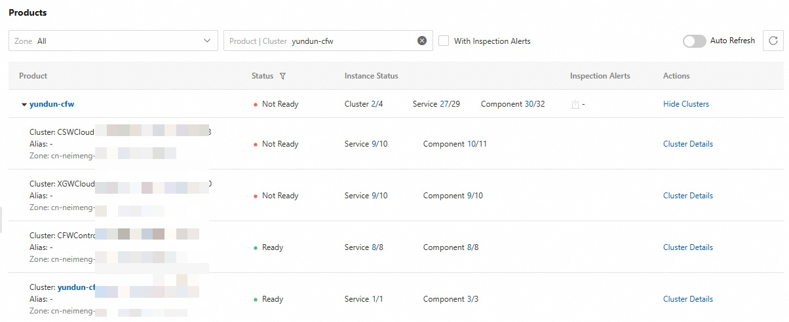
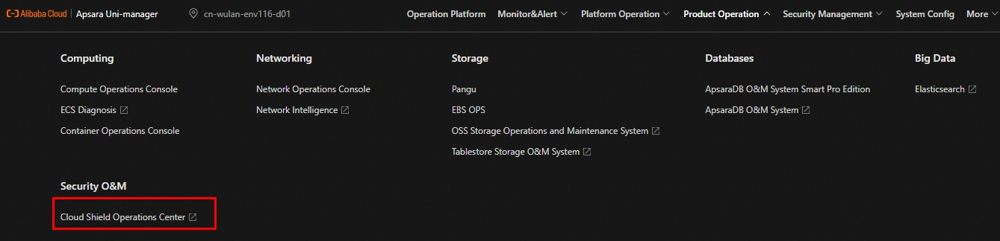

Alibaba Cloud  
Apsara Stack  
Cloud Security Firewall  
Operations and Maintenance  
Guide  
Product Version: v3.18.6-2607  
Document Version: 20260828

**Table of Contents**

- [1.Perform Cloud Firewall O&M in the Apsara Infrastructure Management console](#section-1)
    - [1.1. Log in to the Apsara Infrastructure Management console](#section-1-1)
    - [1.2. Check the service status](#section-1-2)

# 1.Perform Cloud Firewall O&M in the Apsara Infrastructure Management console

## 1.1. Log in to the Apsara Infrastructure Management console

This topic describes how to log in to the Apsara Infrastructure Management console.

**Prerequisites**

- The endpoint of the Apsara Uni-manager Operations Console and the username and password that are used to log in to the console are obtained from a deployment engineer or an administrator.

  The endpoint of the Apsara Uni-manager Operations Console is in the following format: *regi on-id*.ops.console.*intranet-domain-id*.

- A supported browser is used. We recommend that you use Google Chrome.

**Procedure**

1. Open your browser.

2. In the address bar, enter the endpoint of the Apsara Uni-manager Operations Console. Press the ENTER key.

   

   > **Note**
   >
   > You can click the current language in the upper-right corner to switch to another language. Simplified Chinese and English are supported.

3. Enter the correct username and password.

   > **Note**
   >
   > - Obtain the username and password that are used to log in to the Apsara Uni-manager Operations Console from a deployment engineer or an administrator.
   >
   > - If you enter an invalid password three consecutive times, the system enables the image verification login feature. If you enter an invalid password five consecutive times, the system locks your account. In this case, you can contact the administrator to unlock your account.
   >
   > - The first time that you log in to the Apsara Uni-manager Operations Console, change the password for your account as prompted.
   >
   >   To enhance security, make sure that your password meets the following requirements:
   >
   >   - The password contains uppercase and lowercase letters.
   >
   >   - The password contains digits.
   >
   >   - The password contains at least one of the following special characters: ! @ # $ %
   >
   >   - The password is 10 to 20 characters in length.

4. Click **Agree to Private Policy and Log On**.

5. In the top navigation bar of the Apsara Uni-manager Operations Console, choose **Platform Operation > Apsara Infrastructure Management**.

## 1.2. Check the service status

**Check whether the corresponding service has reached the desired state in the Apsara Infrastructure Management console**

1. Log in to the Apsara Infrastructure Management console.

2. In the left-side navigation pane, choose **Resource Management > Product & Cluster O&M**.

3. Enter **yundun-cfw** in the **Product | Cluster** search box to check whether the **Status** of the cluster is the desired state. Find the cluster that you want to view and click **Details** in the **Actions** column. On the cluster details page, check whether the **Status** of the service is the desired state.

   

**Check whether alerts at the P1, P2, and P3 levels are generated on the inspection page of Cloud Firewall**

1. In the top navigation bar of Apsara Uni-manager Operations Console, **Product Operation > Security O&M > Cloud Shield Operations Center**.

   

2. In the left-side navigation pane, choose **Cloud Services > Cloud Firewall O&M > Cloud Firewall Monitoring**. On the **Cloud Firewall Monitoring** page, check whether any abnormal result exists in the **System Inspection** section.

3. Find the system that you want to view and click **Details** in the **Actions** column. In the **Inspection Report** panel, view the alerts at the P1, P2, and P3 levels.

4. In the **Service Monitoring** section, check whether any abnormal result exists in the **Cloud Firewall Status Self-check** or **Service Check Status** section. If yes, view the details.
