Alibaba Cloud  
Apsara Stack  
Cloud Security Firewall  
User Guide  
Product Version: v3.18.6-2607  
Document Version: 20260911

**Table of Contents**

- [1.Usage notes](#section-1)
- [2.Quick start](#section-2)
    - [2.1. User roles and permissions](#section-2-1)
    - [2.2. Log on to the Apsara Uni-manager Management Console](#section-2-2)
- [3.云防火墙](#section-3)
    - [3.1. 访问控制](#section-3-1)
        - [3.1.1. Configure access control policies for the Internet firewall](#section-3-1-1)
        - [3.1.2. Configure access control policies on an internal firewall](#section-3-1-2)
        - [3.1.3. Create an access control policy for a VPC firewall](#section-3-1-3)
        - [3.1.4. Create an access control policy for an IDC-VPC firewall](#section-3-1-4)
        - [3.1.5. Manage address books](#section-3-1-5)
    - [3.2. View the traffic blocked by IPS](#section-3-2)
    - [3.3. 策略配置](#section-3-3)
        - [3.3.1. Synchronize information about IP addresses for the Internet firewall](#section-3-3-1)
        - [3.3.2. Create a VPC firewall](#section-3-3-2)
        - [3.3.3. Create an IDC-VPC firewall](#section-3-3-3)
    - [3.4. Configure intrusion prevention policies](#section-3-4)
    - [3.5. View event logs](#section-3-5)
    - [3.6. View traffic logs](#section-3-6)
- [4.Apsara Stack Security configurations](#section-4)
    - [4.1. Log on to the Apsara Uni-manager Management Console](#section-4-1)
    - [4.2. 规则运营](#section-4-2)
        - [4.2.1. Create and manage IPS rules](#section-4-2-1)
        - [4.2.2. Manage Anti-DDoS Service rules](#section-4-2-2)
        - [4.2.3. Manage Server Guard rules](#section-4-2-3)
        - [4.2.4. Create and manage WAF rules](#section-4-2-4)
    - [4.3. Configure alert settings](#section-4-3)
    - [4.4. 全局设置](#section-4-4)
        - [4.4.1. Configure the attack blocking feature](#section-4-4-1)
    - [4.5. Cloud Firewall monitoring](#section-4-5)
    - [4.6. 账号管理](#section-4-6)
        - [4.6.1. Manage Apsara Stack tenant accounts](#section-4-6-1)
        - [4.6.2. Manage Alibaba Cloud accounts](#section-4-6-2)
    - [4.7. Migration to Apsara Uni-manager Operations Console](#section-4-7)
        - [4.7.1. Log on to Cloud Security Operations Center](#section-4-7-1)
        - [4.7.2. View the system monitoring data](#section-4-7-2)
        - [4.7.3. Global settings](#section-4-7-3)
            - [4.7.3.1. Configure host security rules](#section-4-7-3-1)
            - [4.7.3.2. Whitelist configuration](#section-4-7-3-2)
        - [4.7.4. Upgrade center](#section-4-7-4)
            - [4.7.4.1. Upgrade center overview](#section-4-7-4-1)
            - [4.7.4.2. Update feature libraries or the version of Apsara Stack Security](#section-4-7-4-2)

# 1.Usage notes

Before you log on to Apsara Stack Security Center, you must verify that your computer meets the configuration requirements.

For more information about the configuration requirements, see .

Table 1. Configuration requirements

| Item | Requirement |
| --- | --- |
| Browser | • Internet Explorer: V11 or later • Google Chrome (recommended): V42.0.0 or later • Mozilla Firefox: V30 or later • Safari: V9.0.2 or later |
| Operating system | • Windows XP • Windows 7 or later • macOS |

# 2.Quick start

## 2.1. User roles and permissions

This topic describes the user roles involved in Apsara Stack Security.

All roles in Apsara Stack Security Center are provided by default. You cannot create custom roles. Before you log on to Apsara Stack Security Center, make sure that your account is assigned the required role. For more information, see Default roles in Apsara Stack Security.

Table 1. Default roles in Apsara Stack Security

| Role name | Description |
| --- | --- |
| Organization security administrator | Uses SOC to manage the security of hosts, applications, and networks for an organization. This role also manages security products related to Elastic Compute Service (ECS). |
| Global organization security administrator | Uses SOC to conduct security management for Apsara Stack and all tenants, and manages security products related to ECS. |

If you do not have an account that assumes the required role, contact the administrator to create an account and assign the role to the account. For more information, see the **Create a user** topic in **Apsara Uni-manager Management Console User Guide**.

## 2.2. Log on to the Apsara Uni-manager Management Console

This topic describes how to log on to the Apsara Uni-manager Management Console.

**Prerequisites**

- The URL of the Apsara Uni-manager Management Console is obtained from the deployment engineers.

- A web browser is available. We recommend that you use Google Chrome.

**Procedure**

1. Enter the URL of the Apsara Uni-manager Management Console in the address bar and press the Enter key.

   

   > **Note**
   >
   > - You can select a language from the drop-down list in the upper-right corner of the page.

2. Enter your username and password.

   > **Note**
   >
   > - You need to obtain the username and password from an operations administrator.
   >
   > - The first time you log on to the Apsara Uni-manager Management Console, you must change the password of your account as prompted. The password must be 10 to 32 characters in length. It must contain all of the following character types: uppercase letters, lowercase letters, digits, and special characters. Supported special characters include: ! @ # $ %

3. Click **Log On**.

4. If multi-factor authentication (MFA) is enabled for your account, perform the corresponding operations in the following scenarios:

   - **This is your first time logging on to the Apsara Uni-manager Management Console after MFA is enabled by the administrator.**

     <ol type="a">

     <li>

     On the Bind Virtual MFA Device page, bind an MFA device as prompted.

     </li>

     <li>

     Enter the username and password again as in Step 2 and click **Log On**.

     </li>

     </ol>

     <ol type="i" start="100">

     <li>

     Enter a six-digit MFA verification code and click **Authenticate**.

     </li>

     </ol>

   - **You have enabled MFA and bound an MFA device.**

     Enter a six-digit MFA verification code and click **Authenticate**.

     > **Note**
     >
     > For information about how to bind and enable MFA, see Manage MFA.

**What to do next**

**Forget password**

1. If you forget the logon password, click **Forgot Password** below the Password field.

2. On the Forgot Password page, configure the **Account Name** and **Email Address** parameters, specify the verification code, and then click **Confirm**.

   

   > **Note**
   >
   > - Enter the username of your account in the Account Name field and the email address that was used to create the account in the Email Address field.
   >
   > - The system sends a link for resetting the password to the email address that you specify.

# 3.云防火墙

## 3.1. 访问控制

### 3.1.1. Configure access control policies for the Internet firewall

The access control feature allows you to configure access control policies for the Internet firewall. You can configure inbound and outbound policies on the Internet Firewall tab to forbid unauthorized access between the Internet and your servers. This topic describes how to configure access control policies for the Internet firewall.

**Background information**

The Internet firewall supports **outbound policies** and **inbound policies**.

In this topic, IP address books, port address books, and domain address books are used. For more information about how to create these types of address books, see Manage address books.

**Procedure**

1. Log on to the Apsara Uni-manager Management Console.

2. In the upper-right corner of the Apsara Uni-manager Management Console, choose **Security** > **Network Security > Cloud Firewall**. On the **Cloud Firewall** page, select a region from the **Region** drop-down list and click **Access with Authorized Role**.

3. In the left-side navigation pane, click **Access Control**.

4. On the **Internet Firewall** tab, click the **Outbound Policies** or **Inbound Policies** tab.

   - **Outbound Policies** tab: You can configure policies for traffic from your internal network to the Internet.

   - **Inbound Policies** tab: You can configure policies for traffic from the Internet to your internal network.

5. Click **Create Policy**, configure the following parameters, and then click **Submit**.

   | Parameter | Description |
   | --- | --- |
   | Source Type | The type of the traffic source. Valid values: <strong>IP</strong> and <strong>Address Book</strong>. • <strong>IP</strong>: If you select this option, enter only one CIDR block for Source. • <strong>Address Book</strong>: If you select this option, select a preconfigured IP address book for Source. An IP address book contains multiple CIDR blocks. This allows you to configure access control for multiple IP addresses in an efficient manner. • <strong>Region</strong>: You can set Source Type to Region only when you create an <strong>inbound</strong> access control policy. |
   | Source | The source address that is allowed to access the Internet. • If you set <strong>Source Type</strong> to <strong>IP</strong>, enter a CIDR block. Example: 1.XX.XX.1/32. • If you set <strong>Source Type</strong> to <strong>Address Book</strong>, click <strong>Select Address Book</strong>.In the <strong>Select Address Book as Source</strong> dialog box, select an IP address book. • If you set <strong>Source Type</strong> to <strong>Region</strong>, select a location for Source.Example: Beijing. |
   | Destination Type | The type of the traffic destination. Valid values: <strong>IP</strong>, <strong>Address Book</strong>, <strong>Domain Name</strong>, and <strong>Region</strong>. Note You can set Destination Type to <strong>Domain Name</strong> or <strong>Region</strong> only when you create an <strong>inbound</strong> access control policy. |
   | Destination | The destination address that can be accessed. In this example, set <strong>Destination</strong> to an address on the Internet. • If you set <strong>Destination Type</strong> to <strong>IP</strong>, enter a CIDR block. Example: 1.XX.XX.1/32. • If you set <strong>Destination Type</strong> to <strong>Address Book</strong>, click <strong>Select Address</strong> <strong>Book</strong>. In the <strong>Select Address Book as Destination</strong> dialog box, select an IP address book. • If you set <strong>Destination Type</strong> to <strong>Domain Name</strong>, enter a domain name.Example: www.example.com. • If you set <strong>Destination Type</strong> to <strong>Region</strong>, select one or more destination locations from the drop-down list. |
   | Protocol | The protocol of outbound traffic. Valid values: <strong>TCP</strong>, <strong>UDP</strong>, <strong>ICMP</strong>, and <strong>ANY</strong>.If you do not know which protocol is used, select ANY. |
   | Port Type | The type of the port that is used for the selected protocol. Valid values: <strong>Ports</strong> and <strong>Address Book</strong>. • <strong>Ports</strong>: If you select this option, enter a port range for Ports. You can enter only one port range. • <strong>Address Book</strong>: If you select this option, select a preconfigured port address book for Ports. A port address book contains multiple ports.This allows you to control traffic on multiple ports. |
   | Ports | The ports on which you want to control traffic. Enter a port range or select a port address book based on the value of the Port Type parameter. • If you set <strong>Port Type</strong> to <strong>Ports</strong>, enter a port range. • If you set <strong>Port Type</strong> to <strong>Address Book</strong>, click <strong>Select Address Book</strong>. In the <strong>Select Ports</strong> dialog box, select a port address book. |
   | Application | The application on which you want the policy to take effect. |
   | Policy Action | The action on the traffic. • <strong>Allow</strong>: If outbound traffic meets the conditions that you specify for the policy, the traffic is allowed. • <strong>Monitor</strong>: If outbound traffic meets the conditions that you specify for the policy, the traffic is recorded and allowed. • <strong>Deny</strong>: If outbound traffic meets the conditions that you specify for the policy, the traffic is blocked. |
   | Description | The description of the policy. Enter an informative description to help identify the policy. The description can contain digits, letters, and underscores (_). |
   | Policy Status | Specify whether to enable the policy. |

After the policy is created, it is displayed in the policy list. You can also perform the following operations:

- Download the policy: Click the  icon above the policy list.

- Modify or delete the policy: Click **Modify** or **Delete** in the **Actions** column of the policy.

- Insert a new policy: Click **Insert** in the **Actions** column of the policy.

- Change the priority of the policy: Click **Move** in the **Actions** column of the policy.

- Enable or disable the policy: Turn on or turn off the switch in the **Policy Status** column of the policy.

- Import multiple policies at a time: Click **Download Template** above the policy list, enter the policy information in the downloaded file, click **Import Policy**, and then upload the file as prompted.

### 3.1.2. Configure access control policies on an internal firewall

This topic describes how to view the policy groups of an internal firewall, configure access control policies in the policy groups, and synchronize the policies to Elastic Compute Service (ECS) security groups.

**Background information**

On the **Internal Firewall** tab, you can view custom policy groups and security groups that are synchronized from ECS.

For more information about how to create a custom policy group, see Create a policy group.

**Procedure**

1. Log on to Apsara Stack Security Center.

2. In the upper-right corner of Apsara Stack Security Center, click **Security**.In the **Network Security** section, click **Cloud Firewall**.

3. In the left-side navigation pane, click **Access Control**.

4. On the **Access Control** page, click the **Internal Firewall** tab.

5. <strong>Optional:</strong>Specify search conditions and click **Search** to search for the required policy group.

   > **Note**
   >
   > If you want to view all policy groups, skip this step.

   The required policy group appears in the policy group list.

6. Find the required policy group and configure an access control policy in this group.

   <ol type="i">

   <li>

   In the **Actions** column, click **Configure Policy**.

   </li>

   <li>

   On the **Policies** page, click **Create Policy**.

   </li>

   </ol>

   > **Note**
   >
   > If you want to modify or delete an access control policy, you can perform
   >
   > the following steps: Click the **Inbound** or **Outbound** tab, find the policy, and then click **Modify** or **Delete** in the Actions column.

   <ol type="i" start="3">

   <li>

   In the **Create Policy** dialog box, configure the parameters.

   </li>

   </ol>

   | Paramete r | Description |
   | --- | --- |
   | Network Type | The type of the network to which the policy is applied. Default value: <strong>Internal</strong>, which indicates that the policy is applied to an internal network. |
   | Direction | The direction of traffic that is controlled by the policy. Valid values: • <strong>Inbound</strong>: Traffic is from other ECS instances to the specified ECS instance. • <strong>Outbound</strong>: Traffic is from the specified ECS instance to other ECS instances. |
   | Policy Type | The action on traffic that is controlled by the policy. Valid values: • <strong>Allow</strong>: Traffic is allowed in the internal network. • <strong>Deny</strong>: Traffic is blocked in the internal network. |
   | Protocol Type | The protocol of traffic that is controlled by the policy. Select a protocol from the <strong>Protocol Type</strong> drop-down list. Valid values: • TCP • UDP • ICMP • <strong>ANY</strong>: any protocol type If you do not know the protocol of the traffic, select <strong>ANY</strong> for Protocol Type. |
   | Port Range | The port range of traffic that is controlled by the policy. The traffic is destined for ports in this range. Enter a port range. Example: 22/22. |
   | Priority | The priority of the policy. Note The priority number must be an integer from 1 to 100. Different policies can have the same priority. If an Allow policy and a Deny policy have the same priority, the <strong>Deny</strong> policy takes effect. If two <strong>Allow</strong> policies have the same priority, both policies take effect. |
   | Source Type | The type of the traffic source. Valid values: • <strong>CIDR Block</strong>: The traffic source is a CIDR block. • <strong>Policy Group</strong>: The traffic source is an ECS instance in the policy group. Note If you create a policy in the ECS security group, you can set <strong>Source Type</strong> only to <strong>CIDR Block</strong>. |
   | Source | The source of traffic that is controlled by the policy.Enter a CIDR block or select a policy group based on the <strong>Source Type</strong> parameter. • If you set Source Type to <strong>CIDR Block</strong>, enter only one CIDR block. • If you set Source Type to <strong>Policy Group</strong>, select a policy group from the <strong>Source</strong> drop-down list. In this case, the traffic source is an ECS instance in the policy group. Note You can select only one policy group from the <strong>Source</strong> drop-down list. |
   | Destinati on | The destination of traffic that is controlled by the policy. Valid values: • <strong>All ECS Instances</strong>: The policy is applied to traffic destined for your ECS instances. • <strong>CIDR Block</strong>: The policy is applied to traffic destined for the specified CIDR block. |
   | Descripti on | The description of the policy. Enter an informative description to help identify the policy. It must be from 2 to 256 characters in length. |

   <ol type="i" start="4">

   <li>

   Click **Submit**. The access control policy is created.

   </li>

   </ol>

7. On the **Internal Firewall** tab, find the required policy group and click **Publish** in the **Actions** column to apply the policy and synchronize it to ECS security groups.

### 3.1.3. Create an access control policy for a VPC firewall

A virtual private cloud (VPC) firewall detects and controls the traffic between two VPCs. This topic describes how to create an access control policy for a VPC firewall.

**Prerequisites**

VPC firewalls are not automatically created. Before you create an access control policy for a VPC firewall, you must create and enable a VPC firewall. For more information, see Create a VPC firewall.

**Background information**

An access control policy for a VPC firewall takes effect only after the VPC firewall is enabled.

By default, a VPC firewall allows all traffic. If you want to control traffic between VPCs, you can configure access control policies to block traffic from untrusted sources. You can also allow traffic from trusted sources and block traffic from all other sources.

In this topic, IP address books, port address books, and domain address books are used. For more information about how to create these types of address books, see Manage address books.

**Procedure**

1. Log on to the Apsara Uni-manager Management Console.

2. In the upper-right corner of the Apsara Uni-manager Management Console, choose **Security** > **Network Security > Cloud Firewall**. On the **Cloud Firewall** page, select a region from the **Region** drop-down list and click **Access with Authorized Role**.

3. In the left-side navigation pane, click **Access Control**.

4. On the **VPC Firewall** tab, click **Create Policy**.

5. Configure the following parameters and click **Submit**.

   | Parameter | Description |
   | --- | --- |
   | Source Type | The type of the traffic source. Valid values: IP and Address Book. • <strong>IP</strong>: If you select this option, enter a CIDR block for Source. • <strong>Address Book</strong>: If you select this option, select a preconfigured address book for Source. You can add multiple CIDR blocks to an address book to simplify policy configuration. |
   | Source | The source of the traffic. Note You can enter only one CIDR block. Example: 1.\*.\*.1/32. If you set Source Type to Address Book, select a preconfigured address book for Source. |
   | Destination Type | The type of the traffic destination. Valid values: • <strong>IP</strong>: If you select this option, enter an IP address for Destination. • <strong>Address Book</strong>: If you select this option, select an address book for Destination. • <strong>Domain Name</strong>: If you select this option, enter a domain name for Destination. Wildcard domain names are supported. Example:  <code>*.aliyun.com</code>. Note By default, if an HTTP header does not contain the Host field or an HTTPS request does not contain the Server Name Indication (SNI), Cloud Firewall allows the traffic. |
   | Destination | The destination of the traffic. You can enter only one CIDR block. If you set Destination Type to Domain Name, enter a domain name.  Wildcard domain names are supported. Example: <code>*.aliyun.com</code>. |
   | Protocol | The protocol of the traffic. Valid values: • <strong>ANY</strong>: all protocols • TCP • UDP • ICMP |
   | Port Type | The port type of the destination. Valid values: <strong>Ports</strong> and <strong>Address Book</strong>. |
   | Ports | The port range of the traffic. The value 0/0 indicates all ports. • If you set <strong>Port Type</strong> to <strong>Port</strong>, enter a port range. • If you set <strong>Port Type</strong> to <strong>Address Book</strong>, select an address book. Note If you set Protocol to ICMP, the port configuration does not take effect.If you set Protocol to ANY, the port configuration does not take effect in controlling ICMP traffic. |
   | Application | The application for the traffic. Valid values: ANY, HTTP, HTTPS, Memcache, MQTT, MySQL, RDP, Redis, SMTP, SMTPS, SSH, and VNC. If you set Protocol to TCP, multiple applications are supported. If you set Protocol to another value, only ANY is supported. Note Cloud Firewall identifies applications based on packet characteristics, instead of port numbers. If Cloud Firewall fails to identify the application for a packet, Cloud Firewall allows the packet. |
   | Policy Action | The action on the traffic. Valid values: • <strong>Allow</strong>: If traffic meets the conditions that you specify for the policy, the traffic is allowed. • <strong>Deny</strong>: If traffic meets the conditions that you specify for the policy, the traffic is denied, and no notifications are sent. • <strong>Monitor</strong>: If traffic meets the conditions that you specify for the policy, the traffic is recorded and allowed. After you observe the traffic for a period of time, you can change the policy action to Allow or Deny. |
   | Description | The description of the policy. Enter a description that can help identify the policy. |
   | Policy Status | Specify whether to enable the policy. |

   After the policy is created, it is displayed in the policy list. You can also perform the following operations:

   - Download the policy: Click the  icon above the policy list.

   - Modify or delete a policy: Click **Modify** or **Delete** in the **Actions** column of the policy.

   - Insert a new policy: Click **Insert** in the **Actions** column of the policy.

   - Change the priority of the policy: Click **Move** in the **Actions** column of the policy.

   - Enable or disable the policy: Click the switch in the **Policy Status** column of the policy.

   - Import multiple policies at a time: Click **Download Template** above the policy list, enter the policy information in the downloaded file, click **Import Policy**, and then upload the file as prompted.

### 3.1.4. Create an access control policy for an IDC-VPC firewall

Cloud Firewall allows you to control traffic through IDC-VPC firewalls that can detect the traffic between a data center and a virtual private cloud (VPC). This topic describes how to create and manage an access control policy for an IDC-VPC firewall.

**Prerequisites**

IDC-VPC firewalls are not automatically created. Before you create an access control policy for an IDC-VPC firewall, you must create and enable an IDC-VPC firewall.

An access control policy for an IDC-VPC firewall takes effect only after the firewall is enabled.

In this topic, IP address books, port address books, and domain address books are used. For more information about how to create these types of address books, see Manage address books.

**Background information**

By default, an IDC-VPC firewall allows all traffic. If you want to control traffic between a data center and a VPC, you can create an access control policy to deny traffic from suspicious or malicious sources. You can also allow traffic from trusted sources and deny traffic from all other sources.

**Procedure**

1. Log on to the Apsara Uni-manager Management Console.

2. In the upper-right corner of the Apsara Uni-manager Management Console, choose **Security** > **Network Security > Cloud Firewall**. On the **Cloud Firewall** page, select a region from the **Region** drop-down list and click **Access with Authorized Role**.

3. In the left-side navigation pane, click **Access Control**.

4. On the **IDC-VPC Firewall** tab, click the **Outbound Policies** or **Inbound Policies** tab.

   - **Outbound Policies** tab: You can configure policies for traffic from your internal network to the Internet.

   - **Inbound Policies** tab: You can configure policies for traffic from the Internet to your internal network.

5. Click **Create Policy**, configure the following parameters, and then click **Submit**.

   | Parameter | Description |
   | --- | --- |
   | Source Type | The type of the traffic source. Valid values: • <strong>IP</strong>: If you select this option, enter a CIDR block for Source. • <strong>Address Book</strong>: If you select this option, select a preconfigured address book for Source. You can add multiple CIDR blocks to an address book to simplify policy configuration. |
   | Source | The source in an outbound policy. The value must be a private IP address.You must enter a CIDR block. Example: 10.XX.XX.0/24,172.16.XX.XX/32. If you set Source Type to Address Book, select a preconfigured address book for Source. |
   | Destination Type | The type of the traffic destination. Valid values: • <strong>IP</strong>: If you select this option, enter an IP address for Destination. • <strong>Address Book</strong>: If you select this option, select an address book for Destination. • <strong>Domain Name</strong>: If you select this option, enter a domain name for Destination. Wildcard domain names are supported. Example:  <code>*.aliyun.com</code>. Note By default, if an HTTP header does not contain the host field or an HTTPS request does not contain the Server Name Indication (SNI), Cloud Firewall allows the traffic. |
   | Destination | The destination in an inbound policy. The value must be a private IP address. You must enter a CIDR block. Example: 10.1.XX.XX/24,172.16.XX.XX/32. If you set Destination Type to Domain Name, enter a domain name.  Wildcard domain names are supported. Example: <code>*.aliyun.com</code>. |
   | Protocol | The protocol of the traffic. Valid values: • <strong>ANY</strong>: all protocols • TCP • UDP • ICMP |
   | Port Type | The port type of the destination. Valid values: <strong>Ports</strong> and <strong>address book</strong>. |
   | Port | The port range of the traffic. The value 0/0 indicates all ports. • If you set <strong>Port Type</strong> to <strong>Ports</strong>, enter a port range. • If you set <strong>Port Type</strong> to <strong>Address Book</strong>, select a port address book. Note If you set Protocol to ICMP, the port configuration does not take effect.If you set Protocol to ANY, the port configuration does not take effect in ICMP traffic control. |
   | Application | The application for the traffic. Valid values: ANY, HTTP, HTTPS, Memcache, MongoDB, MQTT, MySQL, RDP, Redis, SMTP, SMTPS, SSH, SSL, and VNC If you set Protocol to TCP, the applications that are in the list of valid values are available. If you set Protocol to a value other than TCP, you can select only ANY. Note Cloud Firewall identifies applications based on packet characteristics, instead of port numbers. If Cloud Firewall fails to identify the application for a packet, Cloud Firewall allows the packet. |
   | Policy Action | The action on the traffic. Valid values: • <strong>Allow</strong>: If traffic meets the conditions that you specify for the policy, the traffic is allowed. • <strong>Deny</strong>: If traffic meets the conditions that you specify for the policy, the traffic is denied, and no notifications are sent. • <strong>Monitor</strong>: If traffic meets the conditions that you specify for the policy, the traffic is recorded and allowed. After you observe the traffic for a period of time, you can change the policy action to Allow or Deny. |
   | Description | The description of the policy. Enter a description that can help identify the policy. |
   | Policy Status | Specify whether to enable the policy. |

   After the policy is created, it is displayed in the policy list. You can also perform the following operations:

   - Download the policy: Click the  icon above the policy list.

   - Modify or delete the policy: Click **Modify** or **Delete** in the **Actions** column of the policy.

   - Insert a new policy: Click **Insert** in the **Actions** column of the policy.

   - Change the priority of the policy: Click **Move** in the **Actions** column of the policy.

   - Enable or disable the policy: Click the switch in the **Policy Status** column of the policy.

   - Import multiple policies at a time: Click **Download Template** above the policy list, enter the policy information in the downloaded file, click **Import Policy**, and then upload the file as prompted.

### 3.1.5. Manage address books

You can store frequently used IP addresses and ports in address books to facilitate configurations of the Internet firewall. This topic describes how to create and manage IP address books and port address books. You can use address books to store one or more CIDR blocks or ports.

**Create an IP address book**

1. Log on to the Apsara Uni-manager Management Console.

2. In the upper-right corner of the Apsara Uni-manager Management Console, choose **Security** > **Network Security > Cloud Firewall**. On the **Cloud Firewall** page, select a region from the **Region** drop-down list and click **Access with Authorized Role**.

3. In the left-side navigation pane, click **Access Control**.

4. On the **Internet Firewall**, **VPC Firewall**, or **IDC-VPC Firewall** tab, click **Manage Address Books**.

5. On the **Address Books** page, click the IP Address Books or Port Address Book tab, click **New**, configure the following parameters, and then click **OK**.

   - **IP address book**

     | Parameter | Description |
     | --- | --- |
     | Address Book Type | The type of the address book. Set the value to <strong>IP Addresses</strong>. |
     | Address Book Name | The name of the address book. The name must be unique. The name can contain letters, digits, and underscores (_). However, the name cannot contain only digits. |
     | IP Address | The CIDR block that you want to add. Separate multiple CIDR blocks with commas (,). |
     | Description | The content and use scenarios of the address book. The description must be 2 to 512 characters in length. |

   - **Port address book**

     | Parameter | Description |
     | --- | --- |
     | Address Book Name | The name of the address book. The name must be unique. The name can contain letters, digits, and underscores (_). However, the name cannot contain only digits. |
     | Ports | The port range that you want to add. Separate multiple port ranges with commas (,). |
     | Description | The content and use scenarios of the address book. The description must be 2 to 512 characters in length. |

     After the address book is created, you can view the address book on the **IP Address Books** or **Port Address Book** tab. You can also **edit** or **delete** the address book.

**Import address books by importing an address book table**

1. Log on to Apsara Stack Security Center.

2. In the top navigation bar, click **Security**. In the **Network Security** section, click **Cloud Firewall**.

3. In the left-side navigation pane, click **Access Control**.

4. On the **Access Control** page, click the **Internet Firewall**, **VPC Firewall**, or **IDC-VPC Firewall** tab, and then click **Manage Address Books**.

5. In the upper-right corner of the **Address Book** page, click **Download Template**. Enter the information about the address books in the downloaded file.

   You can enter the information about IP address books and port address books.

6. Click **Import Address Book** and upload the file as prompted.

## 3.2. View the traffic blocked by IPS

This topic describes how to view the details about Internet and VPC attacks that are blocked by the intrusion prevention system (IPS) feature of Cloud Firewall.

**Procedure**

1. Log on to Apsara Stack Security Center.

2. In the upper-right corner of Apsara Stack Security Center, click **Security**. Choose **Network Security > Cloud Firewall**.

3. In the left-side navigation pane, click **Intrusion Prevention**.

4. Click the **Internet Traffic Blocking** and **VPC Traffic Blocking** tabs to view the details of the IPS-blocked traffic.

   - **Internet Traffic Blocking**

     On the **Internet Traffic Blocking** tab, you can view the blocking events of inbound and outbound traffic from the last one hour, one day, or seven days.

     The Internet Traffic Blocking tab contains the following sections:

     - **Defended Attacks**: displays the number and trend of attacks whose inbound or outbound traffic is blocked by IPS.

     - **Attack Types**: displays the distribution of attacks whose inbound or outbound traffic is blocked by IPS.

     - **Frequently Attacked Apps**: displays the applications whose inbound or outbound traffic is blocked by IPS.

     - **Frequently Attacked Destinations**: displays the traffic distribution of attack targets whose inbound or outbound traffic is blocked by IPS.

     - **Frequently Attacked Sources**: displays the traffic distribution of attack sources whose inbound or outbound traffic is blocked by IPS.

     - **Detailed Data**: displays the details of each traffic blocking event. The details include the risk level, number of times the event occurred, source IP address, and destination IP address.

       In the **Detailed Data** section, you can perform the following operations:

       - Specify a risk level, module, traffic direction, or time range to search for events.

       - Find a traffic blocking event and click **View Details** in the **Action** column to view the details. The details include the event description.

   - **VPC Traffic Blocking**

     The **VPC Traffic Blocking** tab displays the suspicious traffic blocked by IPS between VPCs. You can view the details of a traffic blocking event over a specific time range. The details include the event name, risk level, and attack type.

     On the **VPC Traffic Blocking** tab, you can perform the following operations:

     - Specify a risk level, defense mode, attack type, or time range to search for events. After you specify the search conditions, you must click **Search**.

     - Find a traffic blocking event and click **View Details** in the **Action** column to view the details. The details include the event description and defense mode.

## 3.3. 策略配置

### 3.3.1. Synchronize information about IP addresses for the Internet firewall

If new IP addresses are not displayed in the IP address list of the Internet firewall, you can manually synchronize information about the IP addresses for the Internet firewall. This topic describes how to manually synchronize information about IP addresses for the Internet firewall.

**Procedure**

1. Log on to the Apsara Uni-manager Management Console.

2. In the upper-right corner of the Apsara Uni-manager Management Console, choose **Security** > **Network Security > Cloud Firewall**. On the **Cloud Firewall** page, select a region from the **Region** drop-down list and click **Access with Authorized Role**.

3. In the left-side navigation pane, click **Firewall Policies**.

   <ol type="i">

   <li>

   On the **Internet Firewall** tab, click **Update Assets** in the upper-right corner.

   </li>

   <li>

   In the **Update Assets** message, click **OK** to synchronize information about the IP

   </li>

   </ol>

   addresses.

   After the synchronization is complete, the system automatically updates the IP address list.

4. On the **Internet Firewall** tab, view the details of each IP address in the IP address list. You can view the following information: **IP**, **Instance ID**, **Asset Type**, **Region**, **Bound Asset**, **Redirection Status**, **Firewall Status**, **Traffic Redirection Group Name**, **Tag**, and **Actions**.

   You can perform the following operations on an IP address:

   - **Tag**: Specify a unique identifier for the IP address.

   - **Actions**:

     - **Enable Traffic Redirection for Virtual Gateways**: Click **Enable Traffic Redirection for Virtual Gateways** in the Actions column of the IP address. In the dialog box that appears, select a traffic redirection group and click **OK**.

     - **Disable Traffic Redirection for Virtual Gateways**: Click **Disable Traffic Redirection for Virtual Gateways** in the Actions column of the IP address. In the message that appears, click **OK**.

### 3.3.2. Create a VPC firewall

A virtual private cloud (VPC) firewall is a distributed firewall that can detect and control traffic between VPCs. Cloud Firewall can be used to analyze and control traffic between two VPCs only after a VPC firewall is created and enabled. This topic describes how to create a VPC firewall.

**Background information**

A VPC firewall can be created only between two connected VPCs. VPCs can be connected by using Express Connect or Cloud Enterprise Network (CEN).

**Procedure**

1. 

2. 

3. 

4. On the **Firewall Switches** page, click the **VPC-VPC** tab. Find the required instance and click **Create** in the Actions column.

   | Parameter | Description |
   | --- | --- |
   | Instance Name | Enter a name for the VPC firewall. We recommend that you enter a unique and informative name that indicates specific business to help identify the VPC firewall. The name can contain letters, digits, underscores (_), and hyphens (-).However, the name cannot contain only digits. |
   | Route Table | When you create a VPC, the system automatically creates a default route table. You can add system routes to the route table to manage VPC traffic.VPC allows you to create multiple route tables. When you create a VPC firewall in the Cloud Firewall console, Cloud Firewall automatically reads your VPC route tables. Express Connect supports multiple route tables. If you create a VPC firewall for Express Connect, you can view multiple VPC route tables and can select specific route tables for protection. |
   | Destination CIDR block | After you select a route table from the Route Table drop-down list, the default destination Classless Inter-Domain Routing (CIDR) block of the route table appears in the Destination CIDR Block field. If you want to protect traffic destined for other CIDR blocks, you can manually modify the destination CIDR block. You can enter multiple CIDR blocks and separate them with commas (,). |
   | Peer Route Table | Confirm the region and name of the peer VPC, and select the route table for protection. |
   | Peer Destination CIDR Blocks | Confirm the destination CIDR block of the peer VPC. |
   | Firewall Mode | • Test: In this mode, the VPC firewall tests the health status of CIDR blocks or IP addresses to ensure normal links. • Active: In this mode, the VPC firewall redirects and protects traffic. • Bypass: In this mode, the VPC firewall does not redirect traffic. If a self-test or a health test fails, the VPC firewall automatically changes to the Bypass mode. When you create a VPC firewall, you can set Firewall Mode only to Test.After the firewall is created, you can change its mode to Active or Bypass.You cannot directly change the mode from Bypass to Active. You must change the mode from <strong>Bypass</strong> to <strong>Test</strong> first, and then to <strong>Active</strong>. In the <strong>Health Test</strong> section, enter 32-bit test IP addresses that belong to the local and peer VPCs. |
   | IPS Mode | Select the working mode of the intrusion prevention system (IPS). Valid values: • Monitoring Mode: If Cloud Firewall detects malicious traffic, it monitors the traffic and sends alerts. • Traffic Control Mode: Cloud Firewall intercepts malicious traffic and blocks intrusion attempts. |
   | IPS Capabilities | Select the intrusion prevention policies that you want to enable. Valid values: • Basic Policies: This feature provides basic intrusion prevention capabilities, such as protection against brute-force attacks and attacks that exploit command execution vulnerabilities. This feature also allows you to manage and control the connections from infected hosts to a command and control (C&amp;C) server. • Virtual Patches: This feature defends against the most common and high-risk application vulnerabilities in real time. |
   | Enable VPC Firewall | If you turn on Enable VPC Firewall, the VPC firewall is automatically enabled after it is created. If you do not require the VPC firewall to be automatically enabled, turn off the switch. |

5. Click **Submit**. If Firewall Status of the VPC firewall changes to **Enabled**, the VPC firewall takes effect.

### 3.3.3. Create an IDC-VPC firewall

An IDC-VPC firewall can detect the traffic between a data center and a virtual private cloud (VPC). Cloud Firewall allows you to control traffic by using IDC-VPC firewalls. This topic describes how to create an IDC-VPC firewall.

**Procedure**

1. 

2. 

3. 

4. On the **Firewall Switches** page, click the **IDC-VPC** tab. In the upper-right corner of the tab, click **Create**.

   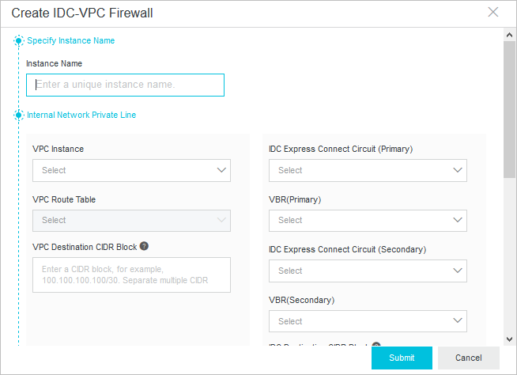

   | Parameter | Description |
   | --- | --- |
   | Instance Name | The name of the IDC-VPC firewall. We recommend that you enter a unique name that indicates specific business to help identify the IDC-VPC firewall. The name can contain letters, digits, underscores (_), and hyphens (-).However, the name cannot contain only digits. |
   | VPC Instance | The ID of the VPC. The ID is the unique identifier of the VPC. Cloud Firewall automatically synchronizes the VPCs that are connected to the data center. |
   | VPC Route Table | When you create a VPC, the system automatically creates a default route table. You can add system routes to the route table to manage VPC traffic.VPC allows you to create multiple route tables. When you create a VPC firewall in the Cloud Firewall console, Cloud Firewall automatically reads your VPC route tables. Express Connect supports multiple route tables. If you create a VPC firewall for Express Connect, you can view multiple VPC route tables and can select specific route tables for protection. |
   | VPC Destination CIDR Block | After you select a route table from the VPC Route Table drop-down list, the default destination CIDR block of the route table is automatically displayed for the VPC Destination CIDR Block field. If you need to protect traffic destined to other CIDR blocks, you can manually modify destination CIDR blocks. You can enter multiple CIDR blocks and separate them with commas (,). |
   | IDC Express Connect Circuit (Primary) | The ID of the Express Connect circuit that you create when you connect your data center to Apsara Stack. When the customer edge (CE) in your data center connects to the primary and secondary vSwitches, you must specify a primary Express Connect circuit. The IDC-VPC firewall automatically synchronizes the primary Express Connect circuit that you specify. You must specify this parameter when you create the IDC-VPC firewall. |
   | VBR(Primary) | The virtual border router (VBR) that is bound to the primary Express Connect circuit in your data center. The VBR facilitates communication between the VPC and your data center. The IDC-VPC firewall automatically synchronizes the VBR that you specify. You must specify this parameter when you create the IDC-VPC firewall. |
   | IDC Express Connect Circuit (Secondary) | The ID of the Express Connect circuit that you create when you connect your data center to Apsara Stack. You must specify a secondary Express Connect circuit when the CE in your data center connects to the primary and secondary vSwitches. The value of this parameter cannot be the same as that of the IDC Express Connect Circuit (Primary) parameter. The IDC-VPC firewall automatically synchronizes the secondary Express Connect circuit that you specify. You must specify this parameter when you create the IDC-VPC firewall. |
   | VBR(Secondary) | The VBR that is bound to the secondary Express Connect circuit in your data center. The VBR facilitates communication between the VPC and your data center. The IDC-VPC firewall automatically synchronizes the VBR that you specify. You must specify this parameter when you create the IDC-VPC firewall. |
   | IDC Destination CIDR Block | The destination CIDR block of the peer VPC. |
   | Configure Firewall Mode | • Test: This mode is used to test the health status of the CIDR block or the IP address to ensure that the link is normal. • Active: This mode is used to redirect and protect traffic. • Bypass: The firewall does not redirect traffic in this mode. If the self-check or the health test fails, the firewall is automatically changed to the Bypass mode. When you create a firewall, you can set Configure Firewall Mode only to Test. After the firewall is created, you can change its mode to Active or Bypass. You cannot directly change the mode from Bypass to Active. You must change the mode from <strong>Bypass</strong> to <strong>Test</strong> and then to <strong>Active</strong>. In the <strong>Health Test</strong> section, enter a 32-bit test IP address that is created in the local VPC. |
   | IPS Mode | The working mode of the intrusion prevention system (IPS). Valid values: • Monitoring Mode: If Cloud Firewall detects malicious traffic, it monitors the traffic and sends alerts. • Traffic Control Mode: Cloud Firewall intercepts malicious traffic and blocks intrusion attempts. |
   | IPS Capabilities | The intrusion prevention policies that you want to enable. Valid values: • Basic Policies: This feature provides basic intrusion prevention capabilities, such as protection against brute-force attacks and attacks that exploit command execution vulnerabilities. It also allows you to manage and control the connections from compromised hosts to a command and control (C&amp;C) server. • Virtual Patches: This feature protects against common high-risk application vulnerabilities in real time. |
   | Enable VPC Firewall | If you turn on Enable VPC Firewall, an IDC-VPC firewall is automatically enabled after it is created. If you do not require the IDC-VPC firewall to be automatically enabled, turn off the switch. |

5. Click **Submit**. If the status of the IDC-VPC firewall changes to **Enabled**, the IDC-VPC firewall is in effect.

## 3.4. Configure intrusion prevention policies

Cloud Firewall uses a built-in threat detection engine to defend against intrusions and common cyberattacks. It provides virtual patches to protect against vulnerabilities and intelligently block intrusion attempts.

**Procedure**

1. Log on to Apsara Stack Security Center.

2. In the upper-right corner of Apsara Stack Security Center, click **Security**. Choose **Network Security > Cloud Firewall**.

3. In the left-side navigation pane, click **Intrusion Prevention Policies**.

4. Select a running mode for the threat engine.

   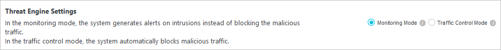

   Valid values: **Monitoring Mode** and **Traffic Control Mode**.

   - **Monitoring Mode**: In this mode, the system only generates alerts for malicious traffic but does not block the traffic.

   - **Traffic Control Mode**: In this mode, the system automatically blocks malicious traffic and generates alerts.

   To configure **Traffic Control Mode**, perform the following steps:

   <ol type="i">

   <li>

   Select **Traffic Control Mode**.

   </li>

   <li>

   In the message that appears, click **OK**.

   </li>

   </ol>

5. Configure the advanced features.

   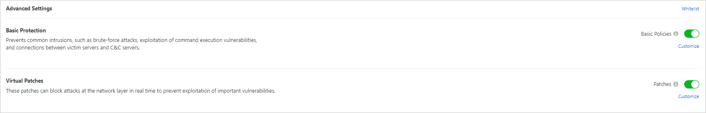

   - Cloud Firewall allows traffic from IP addresses in the whitelists that you configured.

     In the **Advanced Settings** section, click **Whitelist** to add trusted IP addresses to a whitelist.

     You can add trusted source IP addresses, destination IP addresses, or address books of both inbound and outbound traffic to the whitelist.

     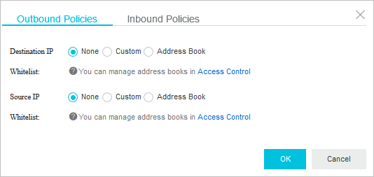

   - The basic protection feature defends against common intrusions, such as brute-force attacks and attacks that exploit command execution vulnerabilities. The basic protection feature also manages connections from compromised hosts to a command and control (C&C) server. After you enable the basic protection feature, it provides basic protection for your assets.

     <ol type="a">

     <li>

     Turn on **Basic Policies** to enable the basic protection feature.

     </li>

     <li>

     In the Basic Protection section, click **Customize**. In the **Customize Basic Protection Policies** dialog box, customize one or more basic protection policies.

     </li>

     </ol>

     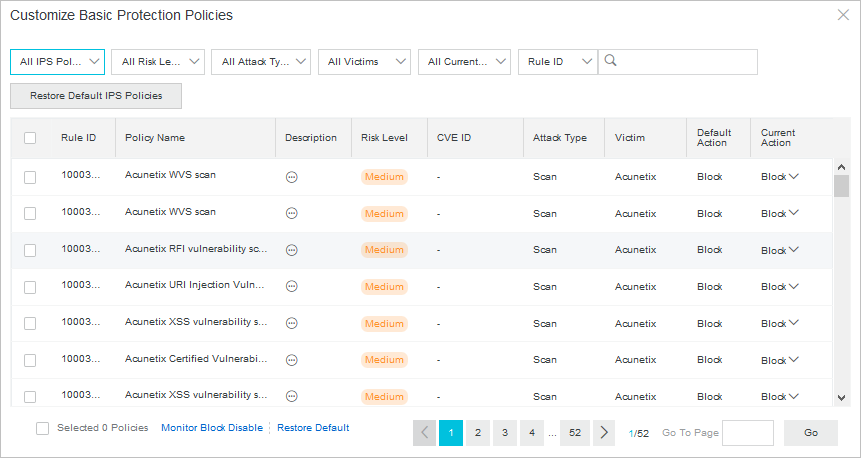

   - Virtual patches are installation-free. You can use them to protect against common high-risk application vulnerabilities.

     <ol type="a">

     <li>

     Turn on **Patches** to enable the virtual patching feature.

     </li>

     <li>

     In the **Virtual Patches** section, click **Customize**. In the **Customize Virtual Patches Policies** dialog box, customize one or more basic virtual patching policies.

     </li>

     </ol>

     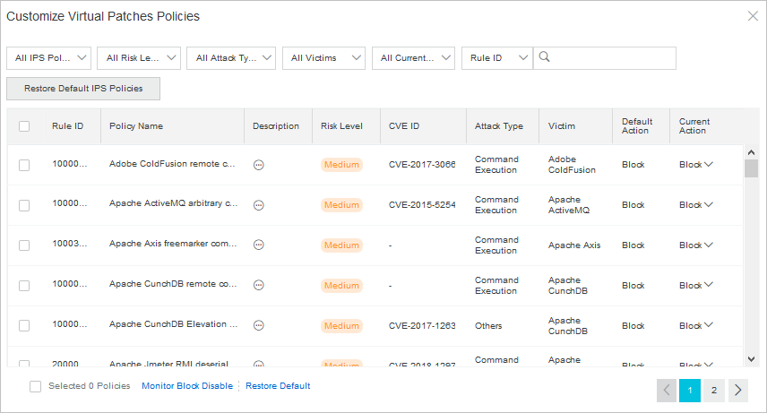

## 3.5. View event logs

All traffic that passes through Cloud Firewall is recorded on the Log Audit page. The logs are classified into traffic logs and event logs. You can use the logs to audit your network traffic in real time and take specific actions. This topic describes how to view event logs.

**Procedure**

1. Log on to Apsara Stack Security Center.

2. In the upper-right corner of Apsara Stack Security Center, click **Security**.In the **Network Security** section, click **Cloud Firewall**.

3. In the left-side navigation pane, click **Event Log**.

4. On the **Event Logs** tab of the page that appears, click **Internet Firewall**, **VPC-VPC Firewall**, or **IDC-VPC Firewall**.

5. Specify the search conditions and click **Search**.

   > **Note**
   >
   > If you want to view all event logs, skip this step.

   | Search condition | Description |
   | --- | --- |
   | Source IP | The source IP address of the event. |
   | Destination IP | The destination IP address of the event. |
   | Type | The type of the event. |
   | Action | The action for the event. Valid values: All, Monitor, and Discard. |
   | Time | The time range to query. You can specify a time range within the last seven days. |

6. View the required information in the event list. The information includes the detection time, threat type, traffic direction (inbound or outbound), source IP address, destination IP address, application type, severity, and policy action.

## 3.6. View traffic logs

All traffic that passes through Cloud Firewall is recorded on the Log Audit page. The logs are classified into traffic logs and event logs. You can use the logs to audit your network traffic in real time and take specific actions. This topic describes how to view traffic logs.

**Procedure**

1. 

2. In the upper-right corner of Apsara Stack Security Center, click **Security**. Choose **Network Security > Cloud Firewall**.

3. In the left-side navigation pane, click **Traffic Log**.

4. 

5. Specify the search condition and click **Search**.

   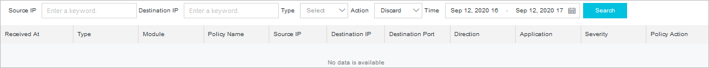

   > **Note**
   >
   > If you want to view all traffic logs, skip this step.

   | Search condition | Description |
   | --- | --- |
   | Source IP | The source IP address of the traffic. |
   | Destination IP | The destination IP address of the traffic. |
   | Application | The application type of the traffic. |
   | Time | The time range to query. You can specify a time range within the last seven days. |

   To enable the advanced search, perform the following steps:

   - **Show Advanced Search**

     Click **Show Advanced Search** to configure more search conditions.

   - **List Configuration**

     Click **List Configuration** to select columns for the traffic list.

6. View the required information of access traffic. The information includes the start time and end time, traffic direction (inbound or outbound), source IP address, destination IP address, application type, supported protocol, action, bytes, and packets.

# 4.Apsara Stack Security configurations

## 4.1. Log on to the Apsara Uni-manager Management Console

This topic describes how to log on to the Apsara Uni-manager Management Console.

**Prerequisites**

- The URL of the Apsara Uni-manager Management Console is obtained from the deployment engineers.

- A web browser is available. We recommend that you use Google Chrome.

**Procedure**

1. Enter the URL of the Apsara Uni-manager Management Console in the address bar and press the Enter key.

   

   > **Note**
   >
   > - You can select a language from the drop-down list in the upper-right corner of the page.

2. Enter your username and password.

   > **Note**
   >
   > - You need to obtain the username and password from an operations administrator.
   >
   > - The first time you log on to the Apsara Uni-manager Management Console, you must change the password of your account as prompted. The password must be 10 to 32 characters in length. It must contain all of the following character types: uppercase letters, lowercase letters, digits, and special characters. Supported special characters include: ! @ # $ %

3. Click **Log On**.

4. If multi-factor authentication (MFA) is enabled for your account, perform the corresponding operations in the following scenarios:

   - **This is your first time logging on to the Apsara Uni-manager Management Console after MFA is enabled by the administrator.**

     <ol type="a">

     <li>

     On the Bind Virtual MFA Device page, bind an MFA device as prompted.

     </li>

     <li>

     Enter the username and password again as in Step 2 and click **Log On**.

     </li>

     </ol>

     <ol type="i" start="100">

     <li>

     Enter a six-digit MFA verification code and click **Authenticate**.

     </li>

     </ol>

   - **You have enabled MFA and bound an MFA device.**

     Enter a six-digit MFA verification code and click **Authenticate**.

     > **Note**
     >
     > For information about how to bind and enable MFA, see Manage MFA.

**What to do next**

**Forget password**

1. If you forget the logon password, click **Forgot Password** below the Password field.

2. On the Forgot Password page, configure the **Account Name** and **Email Address** parameters, specify the verification code, and then click **Confirm**.

   

   > **Note**
   >
   > - Enter the username of your account in the Account Name field and the email address that was used to create the account in the Email Address field.
   >
   > - The system sends a link for resetting the password to the email address that you specify.

## 4.2. 规则运营

### 4.2.1. Create and manage IPS rules

Cloud Firewall provides built-in intrusion prevention system (IPS) rules. You can create custom IPS rules based on your business requirements and network environment to monitor the operations of Cloud Firewall. This topic describes how to create and manage custom IPS rules.

**Procedure**

1. Log on to the Apsara Uni-manager Management Console.

2. In the upper-right corner of the Apsara Uni-manager Management Console, choose **Security** > **Global Platform Security > System Configurations**. On the **System Configurations** page, select a region from the **Region** drop-down list and click **Access with Authorized Role**.

3. In the left-side navigation pane, click **Rule Operation**.

4. On the **Cloud Firewall IPS Rules** tab, click **Create Rule**. In the panel that appears, configure the parameters and click **OK**.

   | Parameter | Description |
   | --- | --- |
   | Rule Name | The name of the IPS rule. We recommend that you enter an informative name for easy management. |
   | Rules Engine | The rules engine that you want to use. Valid values: <strong>Basic Policies</strong> and <strong>Virtual Patches</strong>. |
   | Attack Type | The type of attacks that you want to detect by using the IPS rule |
   | Severity | The level of the severity. Valid values: <strong>Low</strong>, <strong>Medium</strong>, and <strong>High</strong>. |
   | CVE | The Common Vulnerabilities and Exposures (CVE) ID of the vulnerability that you want to list in the IPS rule. Note CVE provides a list of public security vulnerabilities. CVE IDs are allocated by a CVE Numbering Authority (CNA). |
   | Application | The name of the attacked application. |
   | Rule Mode | The mode of the IPS rule. Valid values: <strong>Packet</strong> and <strong>Traffic</strong>. |
   | Direction | The direction of traffic that you want to monitor by using the IPS rule.Valid values: <strong>Inbound and Outbound</strong>, <strong>Inbound</strong>, and <strong>Outbound</strong>. |
   | Rule Content | The content of the IPS rule. You must specify the content by using the Snort syntax. Note To prevent negative impact on your business, make sure that you enter valid content for the rule. |
   | Rule Description | The description of the IPS rule. We recommend that you enter information such as the purpose or impact of the rule. |
   | Description | The additional description of the IPS rule. We recommend that you enter information that can help you identify the IPS rule, such as the purpose or impact of the rule. |

   After you create a custom IPS rule, you can perform the following operations on the rule:

   - View the details of the rule

     You can filter rules.

     Find the rule whose details you want to view and click **Details** in the **Actions** column to view the rule details.

   - Enable the rule

     Find the rule that you want to enable and turn on the switch in the **Enable or not** column to change the status of the rule from **Disable** to **Enable**.

   - Disable the rule

     If a rule does not meet your business requirements, you can disable the rule.

     Find the rule that you want to disable and turn off the switch in the **Enable or not** column to change the status of the rule from **Enable** to **Disable**.

### 4.2.2. Manage Anti-DDoS Service rules

On the Anti-DDoS Service rules page, you can modify threshold settings for traffic scrubbing and redirection based on your business requirements. This topic describes how to modify threshold settings for traffic scrubbing and redirection.

**Procedure**

1. Log on to the Apsara Uni-manager Management Console.

2. In the upper-right corner of the Apsara Uni-manager Management Console, choose **Security** > **Global Platform Security > System Configurations**. On the **System Configurations** page, select a region from the **Region** drop-down list and click **Access with Authorized Role**.

3. In the left-side navigation pane, click **Rule Operation**.

4. On the **Anti-DDoS Service Rules** tab, click **Scrubbing Policy**. Then, specify a custom threshold for traffic scrubbing.

   <ol type="i">

   <li>

   Find the traffic scrubbing rule whose threshold you want to modify and click **Modify Threshold** in the **Solution** column.

   </li>

   <li>

   In the **Modify Threshold** dialog box, specify a threshold and click **OK**.

   </li>

   </ol>

5. On the **Anti-DDoS Service Rules** tab, click **Reroute Threshold**. Then, specify custom thresholds for traffic redirection.

   <ol type="i">

   <li>

   Find the rule whose thresholds you want to modify and click **Modify Threshold** in the **Solution** column.

   </li>

   <li>

   In the **Modify Threshold** dialog box, specify custom thresholds and click **OK**.

   </li>

   <li>

   **Optional.** Click **Automatic DDoS Traffic Redirection and Scrubbing**. In the **Enable Automatic Redirection** message, click **OK**.

   > **Note**
   >
   > By default, **Automatic DDoS Traffic Redirection and Scrubbing** is turned off.

   - If you turn on Automatic DDoS Traffic Redirection and Scrubbing, traffic scrubbing events are triggered based on custom thresholds. The traffic of attacked IP addresses is automatically forwarded to an Anti-DDoS cluster for scrubbing.

   - If you turn off Automatic DDoS Traffic Redirection and Scrubbing, alert events are triggered based on custom thresholds. You can start or end traffic scrubbing in the Anti-DDoS Service console based on your business requirements.

   </li>

   </ol>

### 4.2.3. Manage Server Guard rules

You can view vulnerabilities, baselines, and server exceptions on the Server Guard Rules tab. This topic describes how to view the information about Server Guard rules.

**Procedure**

1. Log on to the Apsara Uni-manager Management Console.

2. In the upper-right corner of the Apsara Uni-manager Management Console, choose **Security** > **Global Platform Security > System Configurations**. On the **System Configurations** page, select a region from the **Region** drop-down list and click **Access with Authorized Role**.

3. In the left-side navigation pane, click **Rule Operation**.

4. On the **Server Guard Rules** tab, view the information about Server Guard rules.

   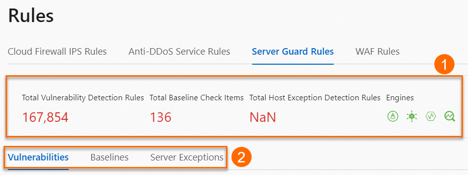

   | Item | Description |
   | --- | --- |
   | Overview (marked 1 in the preceding figure) | You can view the following information: <strong>Total Vulnerability Detection Rules</strong>, <strong>Total Baseline Check Items</strong>, <strong>Total Host Exception Detection Rules</strong>, and <strong>Engines</strong>. |
   | Vulnerabilities (marked 2 in the preceding figure) | On the <strong>Vulnerabilities</strong> tab, you can view all detected vulnerabilities and the total number of detected vulnerabilities. • To search for a vulnerability, you can select a vulnerability type from the Vulnerability Type drop-down list and enter a Common Vulnerabilities and Exposures (CVE) ID or operating system (OS) name in the search box. • In the vulnerability list, you can view the following information about a detected vulnerability: <strong>Vulnerability Name</strong>, <strong>CVE ID</strong>, <strong>Vulnerability Type</strong>, <strong>OS</strong>, <strong>Updated At</strong>, and <strong>Status</strong>. |
   | Baselines (marked 2 in the preceding figure) | On the <strong>Baselines</strong> tab, you can view the baseline types and check the items that are used. • To search for a baseline, you can select a baseline type from the Baseline Type drop-down list, select a severity from the Risk Level drop-down list, and enter a check item category or name in the search box. • In the baseline list, you can view the following information about a baseline: <strong>Baseline Type</strong>, <strong>Check Item Category</strong>, <strong>Check Item Name</strong>, <strong>Risk Level</strong>, <strong>Updated At</strong>, and <strong>Status</strong>. |
   | Server Exceptions (marked 2 in the preceding figure) | On the <strong>Server Exceptions</strong> tab, you can view the following information: <strong>Rule</strong> <strong>Alert Types</strong> and <strong>Webshell &amp; Malicious Processes</strong>. • To search for an exception on a server, you can select a rule category from the Rule Category drop-down list, select a severity level from the Risk Level drop-down list, and then enter a rule subcategory name in the search box. • In the server exception list, you can view the following information: <strong>Rule</strong> <strong>Subcategory</strong>, <strong>Rule Category</strong>, <strong>Risk Level</strong>, <strong>Updated At</strong>, <strong>Source</strong>, and <strong>Status</strong>. |

### 4.2.4. Create and manage WAF rules

You can create custom Web Application Firewall (WAF) rules based on your business requirements and network environment to monitor the operations of WAF. This topic describes how to create and manage WAF rules.

**Procedure**

> **Important**
>
> WAF rules are global custom rules that take effect on all tenants. Proceed with caution.

1. Log on to the Apsara Uni-manager Management Console.

2. In the upper-right corner of the Apsara Uni-manager Management Console, choose **Security** > **Global Platform Security > System Configurations**. On the **System Configurations** page, select a region from the **Region** drop-down list and click **Access with Authorized Role**.

3. In the left-side navigation pane, click **Rule Operation**.

4. On the **WAF Rules** tab, click **Create Rule**. Configure the parameters and click **OK**.

   | Parameter | Description |
   | --- | --- |
   | Mode | The handling action and status of the rule. • You can set the handling action to <strong>Block</strong>, <strong>Allow</strong>, <strong>Monitor</strong>, or <strong>Detection</strong> <strong>Module Control</strong>. • You can set the status to <strong>Enable</strong> or <strong>Disable</strong>. |
   | Description | The description of the rule. |
   | Severity | The level of the severity. Valid values: <strong>No Threat</strong>, <strong>Low</strong>, <strong>Moderate</strong>, and <strong>Important</strong>. |
   | Match Condition | The match condition of the rule. Each match condition consists of a <strong>match</strong> <strong>field</strong>, a <strong>logical operator</strong>, and a <strong>match value.</strong> |
   | Logging | Specifies whether to record logs. Valid values: <strong>Perform Logging When</strong> <strong>Match Condition Is Met</strong> and <strong>Do not Perform Logging When Match</strong> <strong>Condition Is Met</strong>. |
   | Attack Type | The type of attacks that you want the rule to detect. You can select only one option. |
   | Blocking Status Code | The status code that is returned. You can select only one option. |
   | Expire At | The expiration time of the rule. If you do not specify an expiration time, the rule never expires. |

   After you create a rule, you can perform the following operations on the rule:

   - Configure search conditions to filter WAF rules.

   - Find the rule and click **Modify** in the **Actions** column to modify the information about the rule.

## 4.3. Configure alert settings

On the Alert Settings page, you can configure alert contacts and alert rules. When monitoring data meets the conditions of an alert rule, the system automatically sends an alert to specified alert contacts by email and DingTalk message. This topic describes how to configure alert contacts and alert rules.

**Configure alert contacts**

1. Log on to the Apsara Uni-manager Management Console.

2. In the upper-right corner of the Apsara Uni-manager Management Console, choose **Security** > **Global Platform Security > System Configurations**. On the **System Configurations** page, select a region from the **Region** drop-down list and click **Access with Authorized Role**.

3. In the left-side navigation pane, click **Alert Settings**.

4. On the **Alert Settings** tab, click **Create Contact**. In the dialog box that appears, configure the Contact Name, DingTalk Chatbot Token, and Email parameters, and click **Determine**.

   You can view the added contact in the contact list. You can **modify** a contact or **delete** multiple contacts at a time.

**Configure alert rules**

1. Log on to the Apsara Uni-manager Management Console.

2. In the upper-right corner of the Apsara Uni-manager Management Console, choose **Security** > **Global Platform Security > System Configurations**. On the **System Configurations** page, select a region from the **Region** drop-down list and click **Access with Authorized Role**.

3. In the left-side navigation pane, click **Alert Settings**.

4. Click the **AEGIS** tab, configure alert rules, and then click **Save**.

   **Notificati**

   **Frequenc**

   **Alert type**

   **Alert subtype**

   **Alert level**

   **on**

   **y**

   **method**

   - Linux software vulnerability

   - Windows system

     - Low

     vulnerability

   Vulnerability

   - Medium

   - Web-CMS vulnerability

     - High

   - Application vulnerability

   - Urgent vulnerability

   - High-risk exploit

     - Low

   - MLPS compliance

   Baseline risk

   - Medium

   - Best security practices

     - High

   - Weak password

   - Vulnerability

   Asset exposure

   All levels

   - Non-vulnerability

     - 5 minutes

     - Email

   - Suspicious process

     - 10

     - DingTal

   - Webshell

     minutes

     k

   - Unusual logon

     messag

     - 30

     e

   - Exception

     minutes

   - Threat intelligence

     - 1 hour

   - Malicious process

     - 1 day

     - Low

   - Unusual network

     - 1 week

     connection

   Intrusion alert

   - Medium

   - Abnormal account

     - High

   - Application intrusion event

   - Cloud threat detection

   - Precision defense

   - Malicious script

   - Persistent webshell

   - Application threat detection

   Application

   Unauthorized process start

   All levels

   whitelist event

   - File modification

   Tampering

   - File addition

     All levels

   - File deletion

## 4.4. 全局设置

### 4.4.1. Configure the attack blocking feature

The attack blocking feature protects your servers from web attacks. This topic describes how to configure the attack blocking feature.

**Procedure**

1. Log on to the Apsara Uni-manager Management Console.

2. In the upper-right corner of the Apsara Uni-manager Management Console, choose **Security** > **Global Platform Security > System Configurations**. On the **System Configurations** page, select a region from the **Region** drop-down list and click **Access with Authorized Role**.

3. In the left-side navigation pane, click **Global Settings**.

4. On the **Global Settings** tab, turn on or off the switch in the Actions column to enable or disable the attack blocking feature.

   After you disable the attack blocking feature, Server Guard generates alerts for web attacks but does not block them.

## 4.5. Cloud Firewall monitoring

You can use the Cloud Firewall monitoring feature to monitor the status of Cloud Firewall, detect abnormal traffic, and handle abnormal events at the earliest opportunity. This topic describes how to perform system inspection and service monitoring.

**Procedure**

1. Log on to the Apsara Uni-manager Management Console.

2. In the upper-right corner of the Apsara Uni-manager Management Console, choose **Security** > **Global Platform Security > System Configurations**. On the **System Configurations** page, select a region from the **Region** drop-down list and click **Access with Authorized Role**.

3. In the left-side navigation pane, click **Cloud Firewall Monitoring**.

4. In the **System Inspection** section, click **One-click Inspection**.

   After the inspection is complete, you can perform the following operations:

   - Click **Details** in the **Actions** column of **Internet Firewall (ICFW)**, **VPC Firewall (CCFW)**, or **Traffic Monitoring (Beaver)** to view the status of each system.

   - Click **Inspect Now** in the **Actions** column of **Internet Firewall (ICFW)**, **VPC Firewall (CCFW)**, or **Traffic Monitoring (Beaver)** to perform inspection on each system.

5. In the **Service Monitoring** section, configure the monitoring settings on the **ICFW** or **CCFW** tab.

   - **ISW-side Cloud Firewall (ICFW)**

     <ol type="a">

     <li>

     In the **Traffic Forwarding Configuration - Service CIDR Block** section, click **Add**, configure the parameters, and then click **OK**.

     | Parameter | Description |
     | --- | --- |
     | Device Cluster ID | The cluster ID of specific devices. The devices use the CIDR block that you want to add for traffic redirection. |
     | Traffic Redirection Method | The traffic redirection method. Valid values: ISW and XGW. |
     | CIDR Block for Traffic Diversion | The CIDR block for traffic redirection. |
     | Type | The type of the CIDR block for traffic redirection. Value values: Test and Business. |
     | Service Description | The service-related description. |

     After the configuration is complete, you can view the automatic check frequency for the CIDR block and the self-check result of each cluster in the **Service Check Status** and **Interface Status** sections.

     > **Note**
     >
     > In each section, you can select a check frequency from the **automatic check** drop-down list to specify an automatic check frequency for the CIDR block. You can also click the  icon to manually refresh the check frequency for the CIDR block.

     </li>

     <li>

     In the **Connectivity Check** section, click **Add**. Configure the parameters and click **OK**.

     | Parameter | Description |
     | --- | --- |
     | Device Cluster ID | The cluster ID of specific devices. The devices use the CIDR block that you want to add for traffic redirection. |
     | Test IP Address | The IP address of the device that you want to connect. |
     | Type | The type of the connectivity health check. Valid values: Business, Test, and system. |
     | Check Frequency | The check frequency. Unit: seconds. The value must be an integer from 1 to 60. |
     | Check Threshold | The check threshold. Unit: times. The value must be an integer from 1 to 30. |
     | Action | The action that you want to take. Valid values: Automatic Bypass and Alert. |

     After you complete the configuration, you can test the connectivity to the IP address.

     </li>

     </ol>

     <ol type="i" start="100">

     <li>

     Set **Global Default Policy** to **block all** or **permit all**. The parameter takes effect for only inbound traffic.

     </li>

     </ol>

   - **CSW-side Cloud Firewall (CCFW)**

     Click the **CCFW** tab to view the following information: Cloud Firewall Taskflows, Cloud Firewall Status Self-check, Device Status Self-check, Interface Status, and Connectivity Test.

## 4.6. 账号管理

### 4.6.1. Manage Apsara Stack tenant accounts

This topic describes how to view and modify the information about your Apsara Stack tenant account.

> **Important**
>
> All assets in Apsara Stack Security are bound to your Apsara Stack tenant account. You can modify the account information. Proceed with caution.

**Procedure**

1. Log on to the Apsara Uni-manager Management Console.

2. In the upper-right corner of the Apsara Uni-manager Management Console, choose **Security** > **Global Platform Security > System Configurations**. On the **System Configurations** page, select a region from the **Region** drop-down list and click **Access with Authorized Role**.

3. In the left-side navigation pane, click **Accounts**.

4. On the **Apsara Stack Account** tab, modify the information about your Apsara Stack tenant account.

   <ol type="i">

   <li>

   Find your Apsara Stack tenant account and click **Revised** in the **Operation** column.

   </li>

   <li>

   In the **Change Account** dialog box, modify Apsara Stack Account, Access Key, and

   </li>

   </ol>

   Access Secret, and click **OK**.

After the modification, you can click Details in the **Operation** column to view the details of the Apsara Stack tenant account.

### 4.6.2. Manage Alibaba Cloud accounts

After you add an Alibaba Cloud account to Apsara Stack Security Center, you can manage the Anti-DDoS Pro, Anti-DDoS Premium, and Web Application Firewall (WAF) instances that belong to the Alibaba Cloud account in Apsara Stack Security Center. This way, you can use features in a hybrid cloud. This topic describes how to add an Alibaba Cloud account to Apsara Stack Security Center.

**Procedure**

To use features in a hybrid cloud, you can add an Alibaba Cloud account to Apsara Stack Security Center.

1. Log on to the Apsara Uni-manager Management Console.

2. In the upper-right corner of the Apsara Uni-manager Management Console, choose **Security** > **Global Platform Security > System Configurations**. On the **System Configurations** page, select a region from the **Region** drop-down list and click **Access with Authorized Role**.

3. In the left-side navigation pane, click **Accounts**.

4. On the **Alibaba Cloud Account** tab, click **Add**.

   <ol type="i">

   <li>

   | Parameter | Description |
   | --- | --- |
   | Access Key | The AccessKey ID of the Alibaba Cloud account that you want to add. |
   | Access Secret | The AccessKey secret of the Alibaba Cloud account. |
   | Alibaba Cloud Service | The Alibaba Cloud services that you want to use. Valid values: <strong>Anti-</strong><strong>DDoS Pro and Anti-DDoS Premium IP</strong> and <strong>Web Application</strong> <strong>Protection</strong>. You can select one value or both. |

   </li>

   </ol>

After the Alibaba Cloud account is added, you can view the account in the account list. You can **modify** or **remove** the account.

## 4.7. Migration to Apsara Uni-manager Operations Console

### 4.7.1. Log on to Cloud Security Operations Center

Cloud Security Operations Center is an operations platform for Apsara Stack Security services. You can use the platform to monitor the statuses and workloads of Apsara Stack Security services and notifies users of alerts. This topic describes how to log on to Apsara Stack Security Center to implement real-time monitoring.

**Prerequisites**

- The URL, username, and password that are required to log on to the Apsara Uni-manager Operations Console are obtained from the deployment personnel or administrators.

  The URL of the Apsara Uni-manager Operations Console is in the format of *region-id*.ops.console.*intranet-domain-id*.

- A browser is available. We recommend that you use Google Chrome.

**Procedure**

1. Open your browser.

2. In the address bar, enter the URL. Then, press the Enter key.

   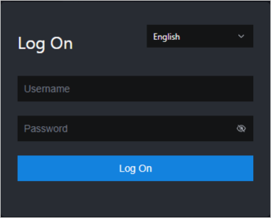

   > **Note**
   >
   > You can select a language from the drop-down list in the upper-right corner of the page.

3. Enter your username and password.

   > **Note**
   >
   > To obtain the username and password that are used to log on to the Apsara Uni-manager Operations Console, contact the deployment personnel or administrators.

   If you log on to the Apsara Uni-manager Operations Console for the first time, you must change the password of your username as prompted.

   To enhance security, make sure that the password meets the following requirements:

   - The password contains uppercase and lowercase letters.

   - The password contains digits.

   - The password contains special characters such as exclamation points (!), at signs (@), number signs (#), dollar signs ($), and percent signs (%).

   - The password is 10 to 20 characters in length.

4. Click **Log On**.

5. In the top navigation bar of the Apsara Uni-manager Operations Console, choose **Products > Apsara Stack Security**.

**Result**

On the **Cloud Security Operations Center** page, you can view the following information.

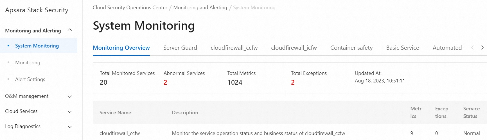

### 4.7.2. View the system monitoring data

You can use the system monitoring feature to monitor integrated cloud services and identify exceptions in the cloud services at the earliest opportunity. This facilitates service O&M. This topic describes how to view the system monitoring data.

**Procedure**

1. Log on to Cloud Security Operations Center.

2. In the left-side navigation pane, choose **Monitoring and Alerting** > **System Monitoring**.

3. On the page that appears, view the monitoring overview and monitoring data of cloud services.

   - On the **Monitoring Overview** tab, view the following information.

     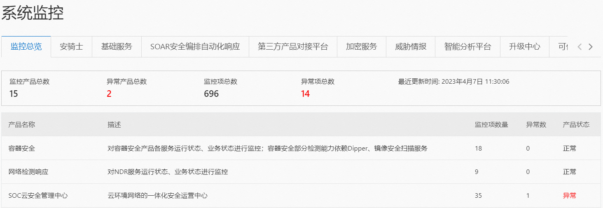

     - Overview: You can view the total numbers of monitored services, abnormal services, metrics, and exceptions.

     - Monitoring data of cloud services: You can view the number of metrics, the number of exceptions, and the statuses of all integrated cloud services.

   - On each cloud service tab, view the monitoring data of each cloud service.

     - Tabs of cloud services: Server Guard, Basic Service, Automated Orchestration, Platform for Connecting to Third-party Services, Data Encryption Service, Threat Intelligence, Intelligent Analytics Platform, Updates, Trusted Computing, NDR, Security Operations Center, Key Management Service, Key Management Service (Base Edition), Password service platform, and Container safety.

     - Monitoring scope:

       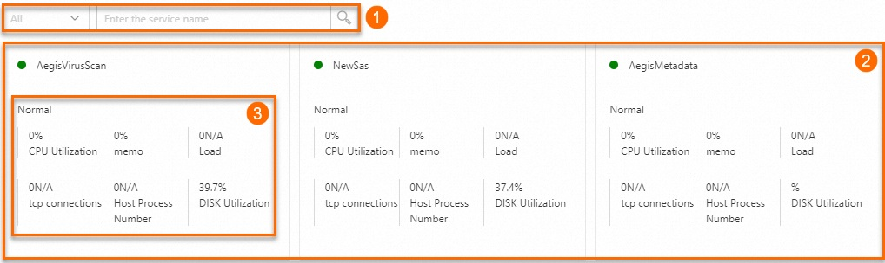

       - Click a cloud service tab to view all sub-services of the cloud service in the section marked 2 in the preceding figure.

       - On a cloud service tab, use the search box marked 1 in the preceding figure to search for the required sub-service by service status and name.

       - In a sub-service card marked 3 in the preceding figure, view the information such as the service status, CPU utilization, memory usage, workloads, TCP connections, processes, and the QPS of NGINX.

       - Click a sub-service card marked 3 in the preceding figure. On the page that appears, view the monitoring details of the cloud service.

         | Catego ry | Description |
         | --- | --- |

         <table>
           <tr>
             <td>Basic monitor ing</td>
             <td>• You can specify the monitoring time range and monitoring view to view the details of basic monitoring and middleware monitoring. • Valid values for the time range: 3 Hours, 6 Hours, 12 Hours, 1 Day, 2 Days, and Custom. You can click theicon to manually refresh the monitoring data. You can also turn on Automatic Refresh to automatically refresh the monitoring data. • Valid values for the View parameter: Cluster View and Single-server View. • You can view the following metrics: CPU usage (%), memory capacity (%), workloads, the number of TCP connections, the number of processes, and the QPS of NGINX.</td>
           </tr>
           <tr>
             <td>Middle ware</td>
             <td>• You can specify the monitoring time range and monitoring view to view the details of basic monitoring and middleware monitoring. • Valid values for the time range: 3 Hours, 6 Hours, 12 Hours, 1 Day, 2 Days, and Custom. You can click theicon to manually refresh the monitoring data. You can also turn on Automatic Refresh to automatically refresh the monitoring data. • Valid values for the View parameter: Cluster View and Single-server View. • You can view the following monitoring data: the QPS of MetaQ, the number of GCs in the JVM, the amount of time consumed to monitor GCs in the JVM, the amount of JVM memory, the number of loaded classes in the JVM, the numbers of JVM threads in different statuses, the number of JVM threads, the QPS of HSF, the response time of HSF (ms), and database usage (%).</td>
           </tr>
           <tr>
             <td>Health check</td>
             <td>Check the health status of all hosts in an application by using TCP or HTTP.</td>
           </tr>
         </table>

### 4.7.3. Global settings

#### 4.7.3.1. Configure host security rules

1. Log on to Alibaba Cloud Security Operations Hub.

2. In the navigation pane on the left, choose **Cloud Product Management > Server Guard O&M > Global Settings**.

3. On the **Host Security Rule Settings** tab, configure the global brute-force detection rules and silent threshold for important command auditing, and then click **Save And Apply**.

   > **Important**
   >
   > After you modify these rules, the brute-force attack detection rules for all host assets are affected, including tenant-side hosts and platform-side physical machines. The attack analysis results in Server Guard are also affected. Modify the rules with caution.

   | Configuration item | Description |
   | --- | --- |
   | Host Brute-force Attacks | Specify the time range within which you want to detect brute-force attacks and the threshold of logon failures that are allowed. If the number of logon failures exceeds the specified threshold within the specified time range, brute-force attacks occur. |
   | Batch Abnormal Logon | Specify the time range for batch abnormal logon and the number of servers that can be logged on to using a fixed account. If the number of servers that are logged on to using a fixed account exceeds the specified threshold within the specified time range, batch abnormal logon occurs. |
   | Suspicious Account Logon | If a remote logon account is in the suspicious account list, an alert for suspicious account logon is generated. Click Manage Suspicious Account List. In the Suspicious Account Management panel, manually enter suspicious accounts or upload a suspicious account list based on a template. Make sure that the size of the uploaded file is less than 5 KB. Due to the Windows system mechanism, use only lowercase letters when you enter Windows accounts. |
   | Important Command Audit | You can set the silent threshold for important command audit policies. After you complete this setting, when the number of alerts for this rule reaches the threshold, the rule enters silent mode and does not generate more alerts until it resumes in the next epoch. |

#### 4.7.3.2. Whitelist configuration

1. Log on to Alibaba Cloud Security Operations Hub.

2. In the navigation pane on the left, choose **Cloud Product Management > Server Guard O&M > Global Settings**.

3. On the **Whitelist Configuration** tab, click **Add**. In the **Add Whitelist** dialog box, complete the configuration and click **OK**.

   | Parameter | Description |
   | --- | --- |
   | Type | • <strong>Global Logon Whitelist</strong>: For IP addresses in this whitelist, Server Guard will not report brute-force attacks or abnormal logon events. • <strong>Brute-force Attack Whitelist</strong>: For IP addresses in this whitelist, Server Guard will not report brute-force attack events. |
   | Source IP | Enter a source IP address or CIDR block. |
   | Destination IP | Enter a destination IP address or CIDR block. This parameter is required when you select <strong>Brute-force Attack Whitelist</strong> as the type. |

   After a whitelist is added, you can click **Delete** to remove unwanted whitelists.

### 4.7.4. Upgrade center

#### 4.7.4.1. Upgrade center overview

The upgrade center allows you to manually or automatically update the feature library and the version of Apsara Stack Security to ensure up-to-date protection.

You can perform the following steps for an update:

1. Configure the import mode of your update package.

   The upgrade center supports **automatic import** and **manual import**.

   - If Apsara Stack can be accessed over the Internet, select **Online Automatic Import**.

   - If Apsara Stack cannot be accessed over the Internet, select **Offline Manual Import**. If you select this option, you must download the update package. For more information, see Download update packages.

2. Update the feature library and the version of Apsara Stack Security. For more information, see Update the feature library or the version of Apsara Stack Security.

#### 4.7.4.2. Update feature libraries or the version of Apsara Stack Security

The upgrade center supports automatic import and manual import of update packages. You can use the update packages to update feature libraries or the version of Apsara Stack Security. This topic describes how to update feature libraries or the version of Apsara Stack Security.

**Procedure**

1. Log on to the Apsara Uni-manager Management Console.

2. In the upper-right corner of the Apsara Uni-manager Management Console, choose **Security** > **Global Platform Security > System Configurations**. On the **System Configurations** page, select a region from the **Region** drop-down list and click **Access with Authorized Role**.

3. In the left-side navigation pane, click **Upgrade Center**.

4. On the **Upgrade configuration** tab, configure Upgrade Package Import.

   - **Manual import**

     If your Apsara Stack environment is inaccessible over the Internet, you can manually import update packages to update feature libraries or the version of Apsara Stack Security.

     <ol type="a">

     <li>

     Set Upgrade Package Import to **Offline Manual Import** and click **Generate Upgrade Identifier**. Then, download update packages. For more information, see Download update packages.

     </li>

     <li>

     Click Import Upgrade Package and drag the downloaded update packages to the dotted box. You can also click the  icon to upload the update packages.

     > **Note**
     >
     > Before you upload the update packages, click the link in the **Manually Import offline upgrade packages** dialog box and trust the certificate.

     After you import the update packages, you can view the update packages on the Feature Library Upgrade page and Version Upgrade page and perform updates.

     </li>

     </ol>

   - **Automatic import**

     If the Apsara Stack environment can connect to the Internet, you can select the automatic import method to import update packages and update feature libraries or the version of Apsara Stack Security.

     <ol type="a">

     <li>

     Set Upgrade Package Import to **Online Automatic Import** and configure the parameters.

     | Parameter | Description |
     | --- | --- |
     | Alibaba Cloud account ID | Enter the ID of your Apsara Stack tenant account. |
     | Access Key | Enter the AccessKey ID of the account. |
     | Access Secret | Enter an AccessKey secret of the account. |
     | Automatic upgrade time period | Select a time period for automatic updates. Valid values: • 0-6 when • 0-8 when • 0-24 when • 22-6 when |

     </li>

     <li>

     Click **Connectivity test**.

     </li>

     </ol>

     <ol type="i" start="100">

     <li>

     If the connectivity test is successful, turn on **Automatic update**.

     After **Automatic update** is turned on, the system automatically downloads update packages at regular intervals

     </li>

     </ol>

5. Update feature libraries or the version of Apsara Stack Security.

   - **Update feature libraries**

     - Batch update: On the **Feature Library Upgrade** tab, click **One-click upgrade**.

     - Update a service in Apsara Stack Security: Find the service that you want to update on the **Feature Library Upgrade** tab and click **Upgrade now** in the **Operation** column.

     After the update is complete, the status of the service is **Upgrade successful**.

     - If the update fails, you can click **Upgrade Records** in the **Operation** column to find the versions of the feature libraries that failed to be updated and click **Retry** in the Operation column.

     - If the update is successful, you can perform the following operations:

       - On the **Feature Library Upgrade** tab, find the service and click **Version Details** in the **Operation** column to view the versions of the updated rule libraries. You can click **Restart Upgrade** to update a rule library in a feature library.

       - In the **Feature Library Upgrade Records** panel, find the feature library that you want to view and click **Details** in the **Operation** column to view the details of the feature library update package. You can find a rule library and click **Restart Upgrade** in the **Operation** column to update the rule library.

       - On the **Feature Library Upgrade** tab, find the service and click **Upgrade Records** in the **Operation** column to view the versions of the updated feature libraries.

   - **Update the version of Apsara Stack Security**

     - Batch upgrade: On the **Version Upgrade** tab, click **One-click upgrade**.

     - Update a service in Apsara Stack Security: Find the service that you want to update on the **Version Upgrade** tab and click **Upgrade now** in the **Operation** column.

     After the update is complete, the status of the service is **Upgrade successful**.

     - If the update fails, you can click **Upgrade Records** in the **Operation** column to find the versions of the feature libraries that failed to be updated and click **Retry** in the Operation column.

     - If the update is successful, you can perform the following operations:

       Click **Upgrade Records** in the **Operation** column to view the versions of the updated feature libraries. You can also click **Restart Upgrade** or **Rollback**.
