Alibaba Cloud  
Apsara Stack  
Cloud Security Management  
Center User Guide  
Product Version: V3.18.6  
Document Version: 20260701

**Table of Contents**

- [1.Usage notes](#section-1)
- [2.Quick start](#section-2)
    - [2.1. User roles and permissions](#section-2-1)
    - [2.2. Log on to the Apsara Uni-manager Management Console](#section-2-2)
- [3.SOC](#section-3)
    - [3.1. Threat monitoring](#section-3-1)
    - [3.2. View data in the operations center](#section-3-2)
    - [3.3. Use the Risk Analysis module](#section-3-3)
        - [3.3.1. View threat events](#section-3-3-1)
        - [3.3.2. Use the threat investigation feature](#section-3-3-2)
        - [3.3.3. View attack surface assessment results](#section-3-3-3)
        - [3.3.4. View cloud service check data](#section-3-3-4)
        - [3.3.5. View vulnerability analysis results](#section-3-3-5)
        - [3.3.6. View traffic analysis results](#section-3-3-6)
    - [3.4. 威胁情报](#section-3-4)
        - [3.4.1. View the intelligence overview](#section-3-4-1)
        - [3.4.2. Query threat intelligence](#section-3-4-2)
    - [3.5. 资产管理](#section-3-5)
        - [3.5.1. View tenant assets](#section-3-5-1)
    - [3.6. Use the Logs module](#section-3-6)
        - [3.6.1. View the log overview](#section-3-6-1)
        - [3.6.2. Log query](#section-3-6-2)
            - [3.6.2.1. Query log details](#section-3-6-2-1)
            - [3.6.2.2. Query raw logs](#section-3-6-2-2)
        - [3.6.3. View tenant logs](#section-3-6-3)
    - [3.7. Create and manage a task](#section-3-7)
    - [3.8. Policy management](#section-3-8)
        - [3.8.1. Create and manage an analysis rule](#section-3-8-1)
        - [3.8.2. Create a response policy](#section-3-8-2)
    - [3.9. Use the Operations module](#section-3-9)
        - [3.9.1. Manage organization authorization](#section-3-9-1)

<a id="section-1"></a>

# 1.Usage notes

This topic describes the usage notes for the Security Operations Center (SOC) User Guide and the configuration requirements for a local machine used to log in to Apsara Stack Security Center.

**Configuration requirements for a local machine**

You can log in to Apsara Stack Security Center only when your local machine meets the configuration requirements described in Table 1.

Table 1: Configuration requirements

| Item | Requirement |
| --- | --- |
| Browser | • Internet Explorer: V11 or later<br>• Google Chrome (recommended): V42.0.0 or later<br>• Mozilla Firefox: V30 or later<br>• Safari: V9.0.2 or later |
| Operating system | • Windows XP<br>• Windows 7 or later<br>• macOS |

<a id="section-2"></a>

# 2.Quick start

<a id="section-2-1"></a>

## 2.1. User roles and permissions

This topic describes the user roles involved in Apsara Stack Security.

The roles available in Apsara Stack Security are all default roles. You cannot create custom roles. Before you log in to Apsara Stack Security Center, make sure that your account is assigned the required role. For more information, see the Default roles in Apsara Stack Security section of this topic.

Table 1: Default roles in Apsara Stack Security

| Role name | Description |
| --- | --- |
| Organization security administrator | This role has the permissions to manage security services for an organization, such as Security Operations Center (SOC), and services for server security, application security, and network security. |
| Global organization security administrator | This role has the permissions to use SOC to manage security for all tenants. |
| Global organization security auditor | This role has the permissions to use SOC to check the security status of all organizations. |
| Custom role | This role has the permissions to customize the operations management permissions of all organizations, the current organization, subordinate organizations of the current organization, and resource sets. This role has the read and write permissions on service feature menus and can configure custom service feature menus.<br>Note<br>The current custom permissions of all organizations do not include the permissions on the Apsara Uni-manager Management Console. The permissions of a custom role are different from the data permissions of the global organization security administrator. |

If you do not have an account or a role, contact the administrator to create a user and assign a role to the user. For more information, see **Create a user** in **Apsara Uni-manager Management Console User Guide**.

<a id="section-2-2"></a>

## 2.2. Log on to the Apsara Uni-manager Management Console

This topic describes how to log on to the Apsara Uni-manager Management Console.

**Prerequisites**

- The URL of the Apsara Uni-manager Management Console is obtained from the deployment personnel before you log on to the Apsara Uni-manager Management Console.

- We recommend that you use the Google Chrome browser.

**Procedure**

1. In the address bar, enter the URL of the Apsara Uni-manager Management Console. Press the Enter key.

2. Enter your username and password.

   Obtain the username and password that you can use to log on to the console from the operations administrator.

   > **Note**
   >
   > When you log on to the Apsara Uni-manager Management Console for the
   >
   > first time, you must change the password of your username. Your password must meet complexity requirements. The password must be 10 to 32 characters in length and must contain at least two of the following character types:
   >
   > - Uppercase or lowercase letters
   >
   > - Digits
   >
   > - Special characters, which include ! @ # $ %

3. Click **Log On**.

4. If your account has multi-factor authentication (MFA) enabled, perform corresponding operations in the following scenarios:

   - It is the first time that you log on to the console after MFA is forcibly enabled by the administrator.

     <ol type="a">

     <li>

     On the Bind Virtual MFA Device page, bind an MFA device.

     </li>

     <li>

     Enter the account and password again as in Step 2 and click **Log On**.

     </li>

     </ol>

     <ol type="i" start="100">

     <li>

     Enter a six-digit MFA verification code and click **Authenticate**.

     </li>

     </ol>

   - You have enabled MFA and bound an MFA device.

     Enter a six-digit MFA authentication code and click **Authenticate**.

     > **Note**
     >
     > For more information, see the **Bind a virtual MFA device to enable**
     >
     > **MFA** topic in **Apsara Uni-manager Operations Console User Guide**.

<a id="section-3"></a>

# 3.SOC

<a id="section-3-1"></a>

## 3.1. Threat monitoring

Security administrators can use the threat monitoring feature to understand the overall security of a network. This topic describes how to use the threat monitoring feature.

**Procedure**

1. Log in to the Apsara Uni-manager Management Console.

2. In the top navigation bar, choose **Security** > **Global Platform Security > Security Operations Center**. On the **Security Operations Center** page, select a region from the **Region** drop-down list and click **Access with Authorized Role**.

3. In the left-side navigation pane, click **Threat Monitoring**.

4. In the upper-right corner of the **Threat Monitoring** page, select values from the **Organization** and time statistics drop-down lists to filter network security information.

   - You can select **All Organizations** or **Organization** from the **Organization** drop-down list.

   - You can select **Today**, **Last 24 Hours**, **Last 7 Days**, or **Last 30 Days** from the drop-down list on the right.

5. View the overall network security information within a specified time range.

   | Section | Description |
   | --- | --- |
   | Global Security Situation | This section displays the statistics on security risks from the perspective of global security management. This section includes the following modules:<br>• <strong>Total Organizations</strong>: displays the total number of organizations within the specified organization scope.<br>• <strong>Risk Index</strong>: displays the statistics on global risk indexes based on threat events and risky assets within an organization.<br>• <strong>Trend of Risk Indexes</strong>: displays the trend of risk indexes within the specified period of time. The trends of risk indexes within the <strong>current day</strong> and <strong>last day</strong> are calculated by hour. The trends of risk indexes within the <strong>last 7 days</strong> and <strong>last 30 days</strong> are calculated by day.<br>• <strong>Organization Risks</strong>: displays the statistics on the top 5 risky organizations, assets of the top 5 risky organizations, and threat events of the top 5 risky organizations.<br>• <strong>Asset Information</strong>: displays the total number of assets, asset protection rate, and proportions of high-risk, medium-risk, low-risk, and risk-free assets.<br>• <strong>Threat Events</strong>: displays the total number of threat events and the number of threat events at each risk level. The information about external risk sources and attack sources is displayed on maps. The world map and China map are supported. |
   | Asset Risk Situation | This section displays the statistics on the asset risk situation from the perspective of asset risk management. This section includes the following modules:<br>• <strong>Asset Distribution by Risk Level</strong>: displays the distribution and statistics on high-risk, medium-risk, low-risk, and risk-free assets.<br>• <strong>Trend of Asset Risks</strong>: displays the trend in the number of risky assets. The trends within the <strong>current day</strong> and <strong>last day</strong> are calculated by hour. The trends within the <strong>last 7 days</strong> and <strong>last 30 days</strong> are calculated by day.<br>• <strong>Top 5 Security Vulnerability Risks</strong>: displays the top 5 asset security vulnerabilities.<br>• <strong>Top 5 Security Baseline Risks</strong>: displays the top 5 asset security baseline risks.<br>• <strong>Top 5 At-risk Assets</strong>: displays the top 5 risky assets, including the risk indexes, threat events, cyberattacks, abnormal behavior, security vulnerabilities, and security baseline risks of the assets. |
   | Threat Situation | This section displays the statistics on the threat situation from the perspective of threat event management. This section includes the following modules:<br>• <strong>Threat Event Distribution by Level</strong>: displays the distribution and statistics on threat events at the urgent, serious, suspicious, moderate, and information levels.<br>• <strong>Trend of Threat Events</strong>: displays the trend in the number of threat events. The trends within the <strong>current day</strong> and <strong>last day</strong> are calculated by hour. The trends within the <strong>last 7 days</strong> and <strong>last 30 days</strong> are calculated by day.<br>• <strong>Threat Event Distribution by Type</strong>: displays the distribution and statistics on threat events in the following types: cyberattack, abnormal behavior, malware, network scan, unauthorized privilege escalation, vulnerability exploitation, and risk connection.<br>• <strong>ATT&amp;CK Attack Behavior</strong>: displays the statistics on Adversarial Tactics, Techniques, and Common Knowledge (ATT&amp;CK) behavior involved in threat events.<br>• <strong>Top 10 Threat Events</strong>: displays the number of times that the top 10 threat events are detected.<br>• <strong>Threat Event Distribution by Attack Chain</strong>: displays the attack phases involved in threat events and the number of times that the threat events are detected. Attack phases include payload delivery, vulnerability exploitation, webshell insertion, command control, scan extension, privilege escalation, and target attacks. |

   <table>
     <tr>
       <td>Handling and Response Posture<br>Note<br>If you want to view data in the Handling and Response Posture section, you must have permissions on Security Orchestration and Automation Response (SOAR).</td>
       <td>This section displays the statistics on the handling and response posture from the perspective of handling and response management. This section includes the following modules:<br><strong>Total SOAR Handled Entities</strong>: displays the total number of entities handled by SOAR.<br><strong>Automatic Response Quantity</strong>: displays the number of automatic responses.<br><strong>Total Handling Tasks</strong>: displays the total number of tasks.<br><strong>Playbook Executions</strong>: displays the number of playbook executions.<br><strong>Enabled Playbooks/Total Playbooks</strong>: displays the number of enabled playbooks and the total number of playbooks.<br><strong>Trend of SOAR Handled Entities</strong>: displays the trend in the number of entities handled by SOAR. The trends within the <strong>current day</strong> and <strong>last day</strong> are calculated by hour. The trends within the <strong>last 7 days</strong> and <strong>last 30 days</strong> are calculated by day.<br><strong>Latest SOAR Handled Entities</strong>: displays the top 5 entities handled by SOAR.<br><strong>Top 5 Organizations with Highest Handling Task Completion Rate</strong>: displays the top 5 organizations that have the highest task completion rate and displays the task completion rate and on-time task completion rate for each organization.<br><strong>Automatic Response Distribution by Type</strong>: displays the trends in the number of automatic responses by type. The trends within the <strong>current day</strong> and <strong>last day</strong> are calculated by hour. The trends within the <strong>last 7 days</strong> and <strong>last 30 days</strong> are calculated by day.<br><strong>Playbook Running Trend</strong>: displays the playbook execution trend. The trends within the <strong>current day</strong> and <strong>last day</strong> are calculated by hour. The trends within the <strong>last 7 days</strong> and <strong>last 30 days</strong> are calculated by day.<br><strong>Top 5 Executed Playbook</strong>: displays the top 5 executed playbooks.</td>
     </tr>
   </table>

<a id="section-3-2"></a>

## 3.2. View data in the operations center

The Operations Center module provides the security alert data of security services provided by Apsara Stack Security. The Operations Center page provides the Network Risk View and Host Risk View tabs. Security administrators can use the module to obtain the information about cyberattacks and defenses. This helps improve network security. This topic describes how to view data in the Operations Center module.

**View data in the network risk view**

1. Log in to the Apsara Uni-manager Management Console.

2. In the top navigation bar, choose **Security** > **Global Platform Security > Security Operations Center**. On the **Security Operations Center** page, select a region from the **Region** drop-down list and click **Access with Authorized Role**.

3. In the left-side navigation pane, click **Operations Center**.

4. On the **Network Risk View** tab, view the following data.

   | Section | Description |
   | --- | --- |
   | Widget selection (marked 1 in the following figure) | In this section, you can specify the types of data that you want to view. You can also perform the following operations:<br>• Select statistics windows: Select the types of data that you want to view from the <strong>Select Statistics Window</strong> drop-down list.<br>By default, the following options are selected: <strong>Alert Data</strong>, <strong>Distribution of</strong> <strong>Alert Handling Methods</strong>, <strong>ECS Instance Protection</strong>, <strong>Risk Level</strong>, <strong>Distribution of Alerting Data Sources</strong>, <strong>Distribution of Alert Types</strong>, <strong>Top 10 Attacking IP Addresses</strong>, <strong>Top 10 Attacked IP Addresses</strong>, <strong>Top 5</strong> <strong>Attacked Websites</strong>, and <strong>List display area</strong>.<br>• Save the current view: Click theicon.<br>• Manually refresh data: Click theicon to manually refresh the data in the<br>current view.<br>• Enable auto-refresh: Turn on. The system automatically refreshes the<br>data in the current view every 5 minutes.<br>• Export data: Click theicon to export the data in the current view. |
   | Search condition (marked 2 in the following figure) | In this section, you can specify search conditions to search for data. You can specify the following search conditions based on your business requirements: time range, data source, organization, alert type, risk level, attack source, alert asset, source IP address, destination IP address, and alert name. |
   | Search result (marked 3 in the following figure) | In this section, Security Operations Center (SOC) displays the search results based on the data types and search conditions that you specified. |

   <table>
     <tr>
       <td>List (marked 4 in the following figure)</td>
       <td>In this section, SOC displays the details of threats in a list based on the data types and search conditions that you specified. The details include the occurrence time, attack source, alert name, alert type, risk level, and data source.<br>You can perform the following operations to manage the details of threats:<br>• Configure the data display mode.<br>• Above the list, click <strong>Details</strong>. The system displays the details of all attacked IP addresses in chronological order.<br>• Above the list, click <strong>Aggregate</strong>. The system aggregates the alerts that have the same attacked IP address, attacker IP address, and alert type every 10 minutes. You can click the + icon to view the details.<br>• View data details: Find the alert that you want to view and click <strong>Details</strong> in the Actions column. In the <strong>Details</strong> panel, view the details of the alert.<br>• Refresh list data: Click theicon to manually refresh the data in the list.<br>• Specify the items that you want to view in the list: Click theicon. By<br>default, all items are selected and displayed in the list.<br>• Deliver a task: Find the alert that you want to manage, click <strong>More</strong> in the <strong>Actions</strong> column, and then select <strong>Deliver Handling Task</strong>. In the <strong>Create</strong> <strong>Task</strong> panel, configure the parameters and click <strong>OK</strong>.<br>Note<br>If the alerts are aggregated, click the icon next to an alert to expand<br><br>the alert list.<br>• Create a response policy: Find the alert that you want to manage, click <strong>More</strong> in the Actions column, and then select <strong>Create Response Policy</strong>. In the <strong>Create Policy</strong> panel, configure the parameters and click <strong>OK</strong>.</td>
     </tr>
   </table>

   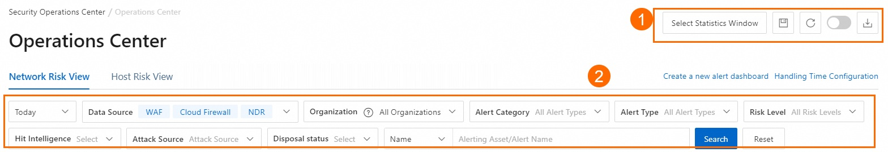

   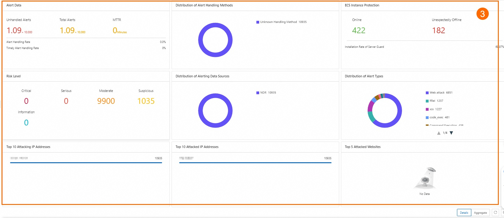

   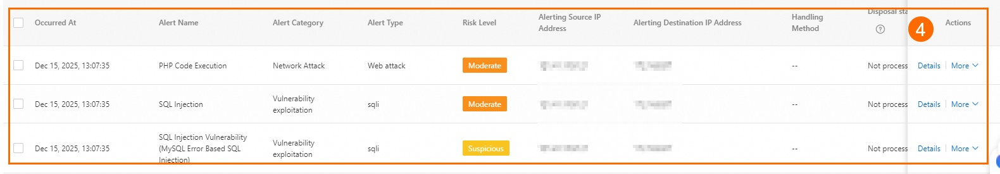

**View data in the host risk view**

1. Log in to the Apsara Uni-manager Management Console.

2. In the top navigation bar, choose **Security** > **Global Platform Security > Security Operations Center**. On the **Security Operations Center** page, select a region from the **Region** drop-down list and click **Access with Authorized Role**.

3. In the left-side navigation pane, click **Operations Center**.

4. On the **Host Risk View** tab, view the following data.

   | Section | Description |
   | --- | --- |

   <table>
     <tr>
       <td>Widget selection (marked 1 in the following figure)</td>
       <td>In this section, you can specify the types of data that you want to view. You can also perform the following operations:<br>• Select statistics windows: Select the types of data that you want to view from the <strong>Select Statistics Window</strong> drop-down list.<br>By default, the following options are selected: <strong>Alert Data</strong>, <strong>ECS Instance</strong> <strong>Protection</strong>, <strong>Risk Level</strong>, <strong>Distribution of Alert Types</strong>, <strong>Top 10 Attacked</strong> <strong>IP Addresses</strong>, and <strong>List display area</strong>.<br>• Save the current view: Click theicon.<br>• Manually refresh data: Click theicon to manually refresh the data in the<br>current view.<br>• Enable auto-refresh: Turn on. The system automatically refreshes the<br>data in the current view every 5 minutes.<br>• Export data: Click theicon to export the data in the current view.</td>
     </tr>
     <tr>
       <td>Search condition (marked 2 in the following figure)</td>
       <td>In this section, you can specify search conditions to search for data. You can specify the following search conditions based on your business requirements: time range, handling status, data source (<strong>Server Guard</strong> by default), organization, alert type, risk level, attack source, alert asset, source IP address, destination IP address, and alert name.</td>
     </tr>
     <tr>
       <td>Search result (marked 3 in the following figure)</td>
       <td>In this section, SOC displays the search results based on the data types and search conditions that you specified.</td>
     </tr>
   </table>

   <table>
     <tr>
       <td>List (marked 4 in the following figure)</td>
       <td>In this section, SOC displays the details of threats in a list based on the data types and search conditions that you specified. The details include the occurrence time, attack source, alert name, alert type, risk level, and data source.<br>You can perform the following operations to manage the details of threats:<br>• Configure the data display mode.<br>• Above the list, click <strong>Details</strong>. The system displays the details of all attacked IP addresses in chronological order.<br>• Above the list, click <strong>Aggregate</strong>. The system aggregates the alerts that have the same attacked IP address, attacker IP address, and alert type every 10 minutes. You can click the + icon to view the details.<br>• View data details: Find the alert that you want to view and click <strong>Details</strong> in the <strong>Actions</strong> column. In the details panel, view the details of the alert.<br>• Refresh list data: Click theicon to manually refresh the data in the list.<br>• Specify the items that you want to view in the list: Click theicon. By<br>default, all items are selected and displayed in the list.<br>• Deliver a task: Find the alert that you want to manage, click <strong>More</strong> in the <strong>Actions</strong> column, and then select <strong>Deliver Handling Task</strong>. In the <strong>Create</strong> <strong>Task</strong> panel, configure the parameters and click <strong>OK</strong>.<br>Note<br>If the alerts are aggregated, click the icon next to an alert to expand<br><br>the alert list.<br>• Create a response policy: Find the alert that you want to manage, click <strong>More</strong> in the Actions column, and then select <strong>Create Response Policy</strong>. In the <strong>Create Policy</strong> panel, configure the parameters and click <strong>OK</strong>.<br>• Handle one or more alerts: You can handle one or more alerts that occurred on a host. Find the alert that you want to handle and click Handle in the Actions column. In the dialog box that appears, select Quarantine, Add to Whitelist, Ignore, or Manually Handled in the Handling Method section. You can also select <strong>Handle the same type of alerts at a time</strong> in the Batch Handle section, which is optional. Then, click <strong>Handle Now</strong>.</td>
     </tr>
   </table>

   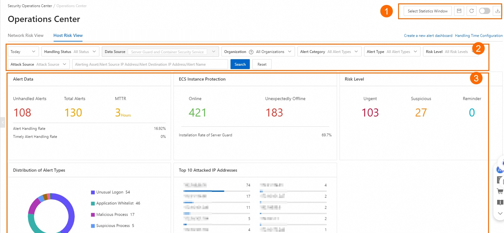

   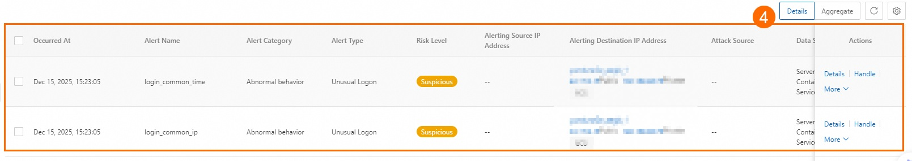

**Create a custom risk view**

By default, the Operations Center page provides the Network Risk View and Host Risk View tabs. To create a custom risk view, perform the following steps:

1. Log in to the Apsara Uni-manager Management Console.

2. In the top navigation bar, choose **Security** > **Global Platform Security > Security Operations Center**. On the **Security Operations Center** page, select a region from the **Region** drop-down list and click **Access with Authorized Role**.

3. In the left-side navigation pane, click **Operations Center**.

4. In the upper-right corner of the **Operations Center** page, click **Select Statistics**

   **Window**, select data types for the custom risk view to be created, and then click the 

   icon.

   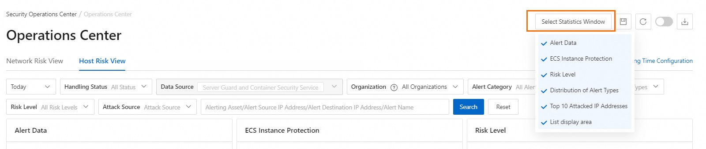

5. In the **Save current view** dialog box, enter a view name and click **Save**.

   The view name must up to 16 characters in length.

<a id="section-3-3"></a>

## 3.3. Use the Risk Analysis module

<a id="section-3-3-1"></a>

### 3.3.1. View threat events

Threat events are indicator of compromise (IOC) threat events generated by Security Operations Center (SOC) after comprehensive association analysis of raw logs and alerts, based on predefined or custom security analysis models. This topic describes how to view threat events. Security administrators can obtain threat details based on these events to ensure network security.

**Procedure**

1. Log in to the Apsara Uni-manager Management Console.

2. In the top navigation bar, choose **Security** > **Global Platform Security > Security Operations Center**. On the **Security Operations Center** page, select a region from the **Region** drop-down list and click **Access with Authorized Role**.

3. In the left-side navigation pane, choose **Risk Analysis > Threat Events**.

4. On the **Threat Events** page, view the details of the threat events.

   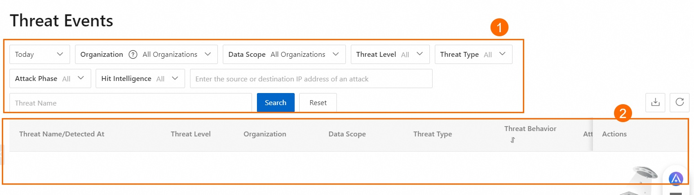

   | Section | Description | Supported operation |
   | --- | --- | --- |
   | Search condition (marked 1 in the preceding figure) | Specify search conditions to search for threat events.<br>You can specify the following search conditions: <strong>time range</strong>, <strong>organization</strong>, <strong>data scope</strong>, <strong>threat level</strong>, <strong>threat type</strong>, <strong>attack phase</strong>, <strong>handling status</strong>, <strong>threat name</strong>, <strong>source or</strong> <strong>destination IP address</strong>, and whether threat intelligence is <strong>hit</strong>. | Select options from drop-down lists or enter keywords in the search box, and<br>click the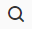icon.<br>If you do not specify search conditions, all threat events are displayed by default.<br>Note<br>• After you set the <strong>Organization</strong> parameter to <strong>Organization</strong>, you can select one or more organizations from the <strong>Organization</strong> drop-down list that appears.<br>• You can select one or more options from the <strong>Threat</strong> <strong>Level</strong>, <strong>Threat Type</strong>, and <strong>Attack Phase</strong> drop-down lists. |
   | Search result (marked 2 in the preceding figure) | In this section, you can view the information about threat events that meet the specified search conditions. | • Find the threat event that you want to manage and move the pointer over a value in the <strong>Attacked IP Address</strong> column to view the corresponding server.<br>• Find the threat event that you want to manage and click its name or <strong>Details</strong> in the Actions column. On the details page of the threat event, view the information on the <strong>Threat Details</strong> and <strong>Evidence Details</strong> tabs.<br>• Click theicon to refresh the threat<br>event list.<br>• Click theicon to export the threat<br>event list.<br>• Handle a threat event: Find the threat event that you want to manage and click <strong>Handle</strong> in the Actions column. In the <strong>Handle</strong> panel, perform the coordinated handling operation and view the handling records.<br>• Deliver a task: Find the threat event that you want to manage, click <strong>More</strong> in the <strong>Actions</strong> column, and then select <strong>Deliver Handling Task</strong>. In the <strong>Create</strong> <strong>Task</strong> panel, configure the parameters and click <strong>OK</strong>.<br>• Create a response policy: Find the threat event that you want to manage, click <strong>More</strong> in the Actions column, and then select <strong>Create Response Policy</strong>.In the <strong>Create Policy</strong> panel, configure the parameters and click <strong>OK</strong>.<br>• View threat tracing details: Find a threat event for which a tracing diagram is generated, and click the<br><br>icon next to the threat name. On<br>the <strong>Threat Tracing</strong> tab, view the threat tracing details.<br>Click theoricon to zoom out or<br>in the tracing diagram. |

   On the **Threat Details** tab, view the following information about the threat event: **Start Time**, **Last Detected At**, **Analytic Rule**, **Network Protocol**, **Threat Intelligence**, **Source/Destination Information**, and **Key Information**.

   - Click the rule ID next to **Analytic Rule** to view more information about the rule that detects the threat.

   - Click **Generate Case** to generate a case for the current threat event on the **Security Events** page of the Security Orchestration and Automation Response (SOAR) console. This helps monitor and handle this threat event.

   On the **Evidence Details** tab, view the raw logs of the threat event. Click **Details** next to a raw log to view the details of the raw log, including alert information. The content that matches an association analysis rule is highlighted.

   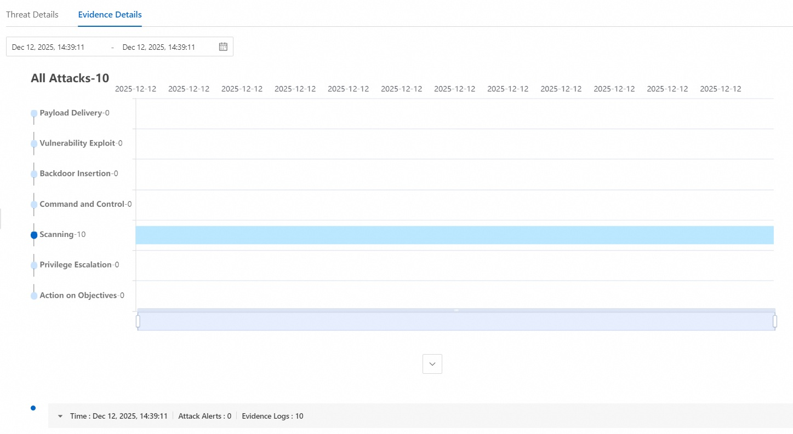

<a id="section-3-3-2"></a>

### 3.3.2. Use the threat investigation feature

The threat investigation feature allows you to perform comprehensive threat investigations based on IP addresses, asset names, and asset IDs. This topic describes how to use the threat investigation feature.

**Procedure**

1. Log in to the Apsara Uni-manager Management Console.

2. In the top navigation bar, choose **Security** > **Global Platform Security > Security Operations Center**. On the **Security Operations Center** page, select a region from the **Region** drop-down list and click **Access with Authorized Role**.

3. In the left-side navigation pane, choose **Risk Analysis > Threat Investigation**.

4. On the **Threat Investigation** page, select a time range, enter the IP address, name, or ID

   of the required asset, and then click the  icon.

   For an asset whose threat information is frequently queried, you can create a shortcut for the asset by performing the following steps: Click **Add Shortcut**. In the Add Shortcut dialog box, configure the **Type** and **Content** parameters and click OK. This way, you can quickly view the threat investigation results of the asset. After a shortcut is created, you can click the corresponding icon to view the threat investigation results of an asset.

   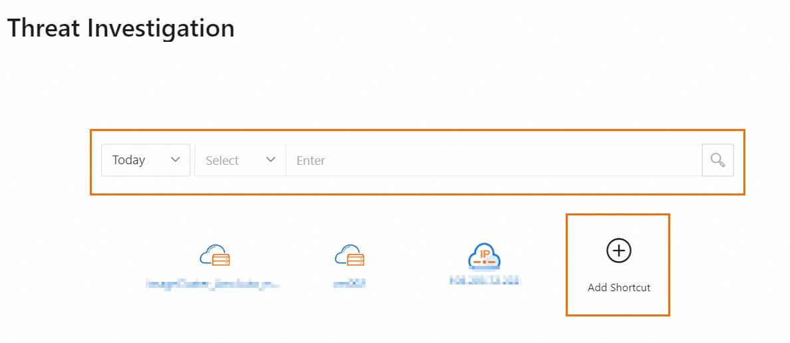

5. On the page that appears, view the risk items.

   The modules displayed vary based on assets. The modules displayed on the console shall prevail. Regular modules:

   - Asset Details: displays the network topology and fingerprints of the asset. The asset fingerprints include ports, software, processes, accounts, middleware, and startup items.

   - Suspicious Process: displays statistics on the abnormal behavior in the asset in the form of charts and tables. The statistics include the total amount of abnormal behavior, abnormal behavior distribution by level, abnormal behavior distribution by type, and top 5 abnormal behavior.

   - Network Attack: displays statistics on the cyberattacks on the asset in the form of charts and tables. The statistics include the total number of cyberattacks, distribution of cyberattack data sources, distribution of cyberattack types, and top 5 cyberattacks.

   - Vulnerabilities: displays statistics on the vulnerabilities in the asset and the failed baseline check items for the asset in the form of lists.

   - Attack Surface: displays the attack paths of attacks that the asset has suffered.

   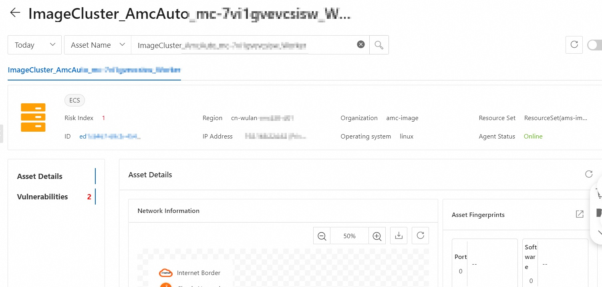

<a id="section-3-3-3"></a>

### 3.3.3. View attack surface assessment results

This topic describes how to view attack surface assessment results.

**Procedure**

1. Log in to the Apsara Uni-manager Management Console.

2. In the upper-right corner of the Apsara Uni-manager Management Console, choose **Security** > **Global Platform Security > Security Operations Center**. On the **Security Operations Center** page, select a region from the **Region** drop-down list and click **Access with Authorized Role**.

3. In the left-side navigation pane, choose **Risk Analysis** > **Attack Surface Assessment**.

4. In the upper-right corner of the **Attack Surface Assessment** page, select the organization that you want to view.

5. On the **Attack Surface Assessment** page, view the statistics on exposed attack surfaces.

   - **Shadow IP addresses Within Last 30 Days**: A shadow IP address outside the cloud is an IP address of an asset that can communicate with the cloud platform but is not managed by the cloud platform. The asset can be unauthorized software, an unapproved hardware device, a cloud service, or a third-party application. This asset is not managed by the cloud platform and may cause unknown risks or threats. Attackers can use a shadow IP address to attack assets in the cloud.

   - **Vulnerable Security Group**: A vulnerable security group is a security group that allows inbound traffic from IP addresses in a loose manner. To implement the principle of least privilege, we recommend that you delete security group rules that allow inbound traffic from unnecessary IP addresses. An unnecessary IP address refers to an IP address that is not required in your workloads. This helps reduce exposure at the network layer.

   - **Exposed Assets**: An exposed asset is an Elastic Compute Service (ECS) instance that is accessible from outside the cloud platform and involved in a known attack path.

   - **At-risk Accounts**: A risky account is an account that uses a weak password and can be used to log in to assets in the cloud from outside the cloud. If the account is leaked, attackers can intrude assets in the cloud with ease.

   - **Risk Level of Attack Surface**: The risk level of the attack surface for the specified organization is determined after a comprehensive evaluation is performed. The risk level can be Low, Medium, High, and Critical.

   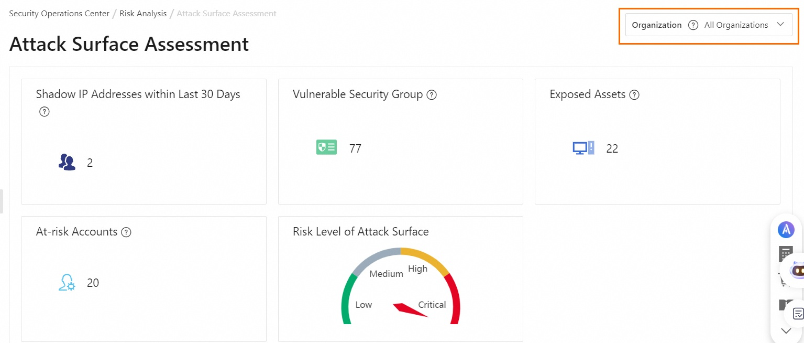

6. View the details of each risk on the corresponding tab.

   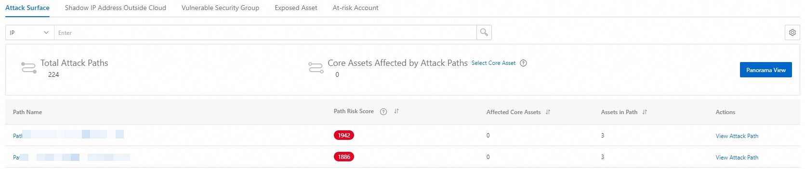

   - **Attack Surface**: This tab displays the statistics on attack paths and core assets affected by the attack paths. You can view the following information about an attack path: **Path Name**, **Path Risk Score**, **Affected Core Assets**, and **Assets in Path**.

     You can perform the following operations:

     - Click the  icon. In the **Attack Path Configuration** dialog box, configure the **Risk**

       **Score for Attack Path Filtering** and **Start Time for Attack Path** parameters and click OK.

     - Click **Panorama View** to view the network topologies of all attack paths.

     - Find the attack path that you want to manage and click its name or **View Attack Path** in the Actions column to view the network topology of the attack path.

     > **Note**
     >
     > You can click **2D Mode** or **3D Mode** in the details page of an attack path to switch the view mode.

   - **Shadow IP Address Outside Cloud**: This tab displays the list of **shadow IP addresses outside the cloud**. You can perform the following operations:

     - Click an IP address to view its details, including the **geographical location**, **cloud-connected assets**, **handling status**, **time when the IP address was first detected**, **time when the IP address was last detected**, **inbound cloud-connected assets**, **destination IP address**, and **inbound traffic**.

     - Find the IP address that you want to manage and click **Handle** in the **Actions** column to perform the **coordinated handling operation** and view the **handling records**.

       **Interactive Handling**: Click the  icon next to the Handling Entity column, select a

       **scenario** and select values from the **Applicable Scope** and **Action Validity Period** drop-down lists to block an entity.

       **Handling Records**: Find the handling record that you want to view and click **Details** in the **Actions** column to view the details of the handling record.

   - **Vulnerable Security Group**: This tab displays the list of vulnerable security groups. Find the security group that you want to view and click its name or **Details** in the **Details** column. In the panel that appears, view the details of the security group, including **VPC ID**, **Security Group Type**, **Organization**, **Resource Set**, **Description**, and **Instances Within Security Group**.

   - **Exposed Assets**: This tab displays the list of ECS instances that can be directly accessed from outside the cloud platform. Find the asset that you want to view and click its name to view the basic information about the asset and the security vulnerabilities that the asset suffers.

   - **At-risk Accounts**: This tab displays the list of risky accounts. Find the asset that you want to view and click its name. On the details page of the asset, view **Basic Information**, **Business Information**, and **Asset Fingerprints**.

<a id="section-3-3-4"></a>

### 3.3.4. View cloud service check data

You can use built-in security baselines to check and manage the security compliance of Apsara Stack services. This topic describes how to perform a cloud service check and view check data.

**Procedure**

1. Log in to the Apsara Uni-manager Management Console.

2. In the upper-right corner of the Apsara Uni-manager Management Console, choose **Security** > **Global Platform Security > Security Operations Center**. On the **Security Operations Center** page, select a region from the **Region** drop-down list and click **Access with Authorized Role**.

3. In the left-side navigation pane, choose **Risk Analysis** > **Cloud Service Check**.

4. In the upper-right corner of the **Cloud Service Check** page, click **Select Organization or Resource Set**. Select one or more organizations that you want to check and click **OK**.

5. Specify search conditions to search for baselines.

   > **Note**
   >
   > If you do not specify search conditions, all baselines of cloud services are displayed by default.

   | Search condition | Description |
   | --- | --- |
   | Baseline Scope | The application scope of the baseline. Valid values: Tenant and Platform. |
   | Baseline Type | The type of the baseline. Valid values: Security Protection, Identity Authentication, Access Control, Network Configuration, Data Security, Disaster Recovery Backup, Log Audit, and Monitoring Alarms. |
   | Risk Level | The risk level of the baseline. Valid values: High, Medium, and Low. |
   | Baseline name | Enter the name of a baseline in the search box and click theicon to search for<br>the baseline. |

6. On the **Cloud Service Check** page, view information about the baselines of cloud services. The information includes baseline risk items, affected assets, enabled baseline check items, disabled baseline check items, and the time when the check was last performed.

7. Perform a cloud service check.

   - Manual check

     Click **Check Now**. The system starts a full check on the configurations of all services to detect risks and affected assets. During the check, you can click **View** to view the check progress in the **Check Item Detection** dialog box.

     > **Note**
     >
     > Do not perform other operations until the check is complete.

   - Automatic check

     Click **Check Settings** to configure a check policy. The following table describes the required parameters.

     | Parameter | Description |
     | --- | --- |
     | Check Cycle | The days of the week on which you want to run an automatic check. Valid values: Monday to Sunday. You can select multiple days of the week. |
     | Checked At | The time range during which you want to run an automatic check. Valid values: 24:00 - 06:00, 06:00 - 12:00, 12:00 - 18:00, and 18:00 - 24:00. You can select only one time range. |
     | Baseline Check Item | The baselines that you want to use. |
     | Select Resource Set | The resource sets that you want to check. |

     After you configure the check policy, Security Operations Center (SOC) automatically performs a check based on all specified baselines within the specified time range.

8. View check data.

   - In the baseline list, view the following information about baselines: Cloud Product Baseline, Baseline Category, Baseline Type, Risk Level, Affected assets, Last Checked At, and Status.

   - Find a baseline and click its name or click **Details** in the **Actions** column. In the panel that appears, view data on the Baseline Check Details and Cloud Service Instances tabs.

     If an organization or instance is riskless, you can select and add the organization or instance to the whitelist.

   - Find a baseline and click **Verify** in the **Actions** column, or select one or more baselines and click **Verify** below the baseline list to verify that the detected baseline risks are fixed.

   - During the verification, you can click **View** in the Actions column of the baseline to view the verification progress. You can click **Cancel Verification** in the Actions column of the baseline to cancel the verification.

<a id="section-3-3-5"></a>

### 3.3.5. View vulnerability analysis results

This topic describes how to view vulnerability analysis results on the tenant side. Security administrators can use the results to troubleshoot issues.

**Procedure**

1. Log in to the Apsara Uni-manager Management Console.

2. In the top navigation bar, choose **Security** > **Global Platform Security > Security Operations Center**. On the **Security Operations Center** page, select a region from the **Region** drop-down list and click **Access with Authorized Role**.

3. In the left-side navigation pane, choose **Risk Analysis > Vulnerability Analytics**.

4. On the **Tenant** tab of the **Vulnerability Analytics** page, view the vulnerabilities and baselines.

   **Tenant**

   **Vulnerabilities**

   - On the **Vulnerabilities** tab, you can view the following information about a vulnerability: Vulnerability Name, Vulnerability Type, Priority Score, CVE ID, Affected Assets, Vulnerability Level, Last Detected At, and Organization.

   - You can specify search conditions to search for vulnerabilities.

     > **Note**
     >
     > If you do not specify search conditions, all vulnerabilities are displayed by default.

     | Search condition | Description |
     | --- | --- |
     | Organization | The organization whose risks you want to query. |
     | Time range | Specify the time range of the data that you want to query. You can select Today, Last 24 Hours, Last 7 Days, Last 30 Days, or Custom from the time range drop-down list. |
     | Vulnerability Type | The type of the vulnerabilities that you want to query. Valid values: All, Linux Software, Windows System, Web CMS, and Application(Urgent Vulnerability Included). |
     | Vulnerability Level | The severity of the vulnerabilities. Valid values: All, High, Medium, and Low. |
     | Vulnerability name or Common Vulnerabilities and Exposures (CVE) ID | Enter a keyword of a vulnerability name or CVE ID in the search box to search for vulnerabilities. Fuzzy search is supported. |

     All search results are displayed in the vulnerability list. You can perform the following operations based on your business requirements:

     - Click the  icon to refresh the vulnerability list.

     - Click the  icon to export the vulnerability list.

     - Find the vulnerability that you want to view and click its name or **Details** in the **Actions** column to view the vulnerability details and affected assets. On the **Vulnerability Details** tab of the panel that appears, view the details of the vulnerability and the suggestions on how to fix the vulnerability. On the **Scanned Asset** tab of the panel that appears, click the name of an affected asset. On the Basic Information tab of the Tenant Assets page, view the information about the affected asset.

       > **Note**
       >
       > You can view the result of a vulnerability fix on the **Scanned Asset** tab.

     - Deliver a task: Find the vulnerability that you want to manage, click **More** in the **Actions** column, and then select **Deliver Handling Task**. In the **Create Task** panel, configure the parameters and click **OK**.

     - Create a response policy: Click **More** in the Actions column of a vulnerability and select **Create Response Policy**. In the **Create Policy** panel, configure parameters and click **OK**.

     - Add vulnerabilities to the whitelist: Select one or more vulnerabilities and click **Add to Whitelist**. In the **Prompt** dialog box, enter remarks and click **OK**.

     - Fix multiple vulnerabilities at a time: Select one or more vulnerabilities and click **Batch repair** in the lower part of the vulnerability list. You can also click **Repair** in the Actions column of a vulnerability. In the **Batch repair** dialog box, select **I have understood the risk of repair failure.** and click **Repair now**.

   **Baselines**

   - On the Baselines tab, you can view the following information about a baseline: Baseline Name, Risk Type, Risk Level, Affected Assets, Last Detected At, Organization, and Data Source.

   - You can specify search conditions to search for baselines.

     > **Note**
     >
     > If you do not specify search conditions, all baselines are displayed by default.

     | Search condition | Description |
     | --- | --- |
     | Scope | The organization whose risks you want to query. |
     | Time range | The time range of data to query. Valid values: Today, Last 24 Hours, Last 7 Days, Last 30 Days, and Custom. |
     | Data Source | The data source of the baselines that you want to query. Valid values:<br>• All<br>• Server Guard<br>• Cloud Service Check |
     | Risk type | The risk type of the baselines. Valid values:<br>• hierarchy protection<br>• Unauthorized Access<br>• Internationally Agreed Best Practices for Security<br>• Custom baseline<br>• Best security practices<br>• Weak password<br>• Container security<br>• Data Security<br>• Access Control<br>• Monitoring Alarms<br>• Disaster Recovery Backup<br>• Log Audit<br>• Authentication<br>• Security<br>• Network Configuration |
     | Risk level | The severity of the baselines. Valid values: All, High, Medium, and Low. |
     | Baseline name | The name of the baseline. |

     All search results are displayed in the baseline list. You can perform the following operations based on your business requirements:

     - Click the  icon to refresh the baseline list.

     - Click the  icon to export the baseline list.

     - Click the name of a baseline or click **Details** in the **Actions** column of a baseline to view the baseline details, including **Affected Asset**, **Resource Set**, and **Organization**. Click the name of an affected asset to go to the **Tenant Assets** page. On the Tenant Assets page, you can view information about the affected asset.

     - Deliver a task: Find the baseline that you want to manage, click **More** in the **Actions** column, and then select **Deliver Handling Task**. In the **Create Task** panel, configure the parameters and click **OK**.

     - Create a response policy: Click **More** in the Actions column of a baseline and select **Create Response Policy**. In the **Create Policy** panel, configure parameters and click **OK**.

   > **Note**
   >
   > We recommend that you handle the risks based on the risk description provided by SOC.

<a id="section-3-3-6"></a>

### 3.3.6. View traffic analysis results

This topic describes how to view the analysis information about traffic, including the traffic of organizations, applications, source IP addresses, and destination IP addresses.

**Procedure**

1. Log in to the Apsara Uni-manager Management Console.

2. In the top navigation bar, choose **Security** > **Global Platform Security > Security Operations Center**. On the **Security Operations Center** page, select a region from the **Region** drop-down list and click **Access with Authorized Role**.

3. In the left-side navigation pane, choose **Risk Analysis > Traffic Analysis**.

4. On the **Traffic Analysis** page, select the widgets that you want to view and specify search conditions to view the global traffic information.

   | Section | Description |
   | --- | --- |
   | Widget selection (marked 1 in the following figure) | In this section, you can specify the types of data that you want to view. You can also perform the following operations:<br>• View raw logs: Click <strong>View Raw Log</strong> to go to the <strong>Log Query</strong> page and view the details of raw logs.<br>• Select statistics windows: Select the types of data that you want to view from the <strong>Select Statistics Window</strong> drop-down list.<br>By default, the following options are selected: <strong>Organization Traffic</strong>, <strong>Application Traffic</strong>, <strong>Traffic of Source IP Address</strong>, <strong>Traffic of</strong> <strong>Destination IP Address</strong>, <strong>Source Port Traffic</strong>, <strong>Destination Port Traffic</strong>, <strong>Access Destination Traffic</strong>, and <strong>Access Source Traffic</strong>.<br>• Select a data range: You can select <strong>TOP5</strong>, <strong>TOP10</strong>, or <strong>TOP20</strong> from the data range drop-down list.<br>• Select the view to be displayed.<br>• Save a view: Click theicon to save the current view.<br>• Export data: Click theicon to export the data in the current view. |
   | Search condition (marked 2 in the following figure) | In this section, you can specify search conditions to search for traffic analysis data. You can specify the following search conditions based on your business requirements: time range, organization, application, source IP address, destination IP address, source port, and destination port. |
   | Search result (marked 3 in the following figure) | In this section, Security Operations Center (SOC) displays the search results that meet the specified search conditions. |

   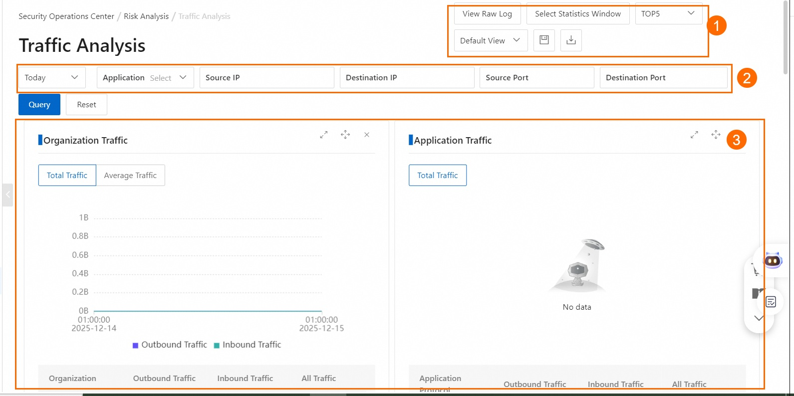

<a id="section-3-4"></a>

## 3.4. 威胁情报

<a id="section-3-4-1"></a>

### 3.4.1. View the intelligence overview

You can view the overall situation and statistics of threats to your assets on the Intelligence Overview page. This topic describes how to view the threat intelligence of assets.

**Procedure**

1. Log in to the Apsara Uni-manager Management Console.

2. In the top navigation bar, choose **Security** > **Global Platform Security > Security Operations Center**. On the **Security Operations Center** page, select a region from the **Region** drop-down list and click **Access with Authorized Role**.

3. In the left-side navigation pane, choose **Threat Intelligence > Intelligence Overview**.

4. On the **Intelligence Overview** page, view the statistics and events of threats that are detected on your assets by the threat intelligence feature.

   | Section | Description |
   | --- | --- |
   | Total Threat Indicators | This section displays the numbers of the following types of threats and the <strong>month-over-month changes</strong> in the numbers: <strong>malicious IP addresses</strong>, <strong>domain names</strong>, and <strong>files</strong>. |
   | Trend of Threat Indicators | This section displays the trends of threats within the specified period of time. |
   | Threat Intelligence Call Summary | This section displays the query statistics on threat intelligence in the following parts:<br>• Threat Indicators: the number of API operation calls.<br>• Threat IoC Query Type: the numbers of queries for <strong>IP addresses</strong>, <strong>domain names</strong>, and <strong>files</strong>.<br>• API Query Source Distribution: the proportions of query sources.<br>• Threat Intelligence Query Statistics: the trends of threats within the specified period of time. |
   | Threat Intelligence Tag Distribution | This section displays the following statistics on the tags that are added to threat intelligence:<br>• The numbers of tags at the <strong>high</strong>, <strong>medium</strong>, and <strong>low</strong> severity levels.<br>• Top 10 Hit Intelligence Tags: displays the top 10 tags that occur most frequently in the <strong>Threat Tag</strong> column and the number of occurrences for each tag in the <strong>Hits</strong> column. |

5. In the upper-right corner of the Intelligence Overview page, enter the IP address, domain name, or MD5 hash value of the file that you want to check in the search box, and click the

    icon.

   On the details page of the IP address, you can view the following information: **Threat Level**, **Basic Information**, **Threat Details**, and **Threat Overview**. For more information, see Query threat intelligence.

<a id="section-3-4-2"></a>

### 3.4.2. Query threat intelligence

You can use the threat intelligence feature to query the threat intelligence of an IP address. This feature helps you identify suspicious or malicious IP addresses at the earliest opportunity. This topic describes how to query threat intelligence.

**Procedure**

1. Log in to the Apsara Uni-manager Management Console.

2. In the upper-right corner of the Apsara Uni-manager Management Console, choose **Security** > **Global Platform Security > Security Operations Center**. On the **Security Operations Center** page, select a region from the **Region** drop-down list and click **Access with Authorized Role**.

3. In the left-side navigation pane, choose **Threat Intelligence** > **Intelligence Query**.

4. On the Intelligence Query page, perform the following operations:

   - View the threat intelligence in assets.

     | Section | Description |
     | --- | --- |
     | Top 10 Active Malicious IP Addresses | You can view the top 10 active malicious IP addresses and their tags.<br>Click a malicious IP address. On the page that appears, view the following information about the malicious IP address:<br>• <strong>Threat Level</strong>: The threat level of the suspicious or malicious IP address.Valid values: <strong>Normal</strong>, Medium Risk, and High Risk. If the threat level of the IP address is High Risk, we recommend that you handle the IP address at the earliest opportunity.<br>• <strong>Basic Information</strong>: The basic information about the suspicious or malicious IP address. The basic information includes Server in Data Center, ASN, ISP, ASN Label, Country, Associated Domain Names, Province, Associated Files, City, Activity, and IP Address Tag.<br>• <strong>Threat Details</strong>: The threat tag list of the malicious IP address. The list information include <strong>Intelligence Source</strong>, First Detected At, Last Active Time, and Threat Tag.<br>• <strong>Threat Overview</strong>: The risk analysis of the malicious IP address based on historical threat indicators and events. |
     | Top 10 Active Malicious Domain Names | You can view the top 10 active malicious domain names and their tags.<br>Click a malicious domain name. On the page that appears, view the following information about the malicious domain name:<br>• <strong>Threat Level</strong>: The threat level of the suspicious or malicious domain name. Valid values: <strong>Normal</strong>, Medium Risk, and High Risk. If the threat level of the domain name is High Risk, we recommend that you handle the domain name at the earliest opportunity.<br>• <strong>Summary of Domain Name Report</strong>: The basic information about the suspicious or malicious domain name. The basic information includes Domain Name Tag, Historical IP Addresses, Malicious IP Addresses, Malicious URL Containing Domain Name, Subdomain Name of Domain Name, Malicious Subdomain Names, Samples of Malicious Communication with Domain Name, Registered At, and Expiration Time.<br>• <strong>Domain Name Details</strong>: The WHOIS information about the malicious domain name. The WHOIS information includes <strong>WHOlS Details</strong> and <strong>WHOIS Value</strong>.<br>• <strong>Threat Overview</strong>: The risk analysis of the malicious domain name based on historical threat indicators and events.<br>• <strong>Threat Details</strong>: The threat tag list of the malicious domain name. The list information include <strong>Intelligence Source</strong>, First Detected At, Last Active Time, and Threat Tag. |
     | Top 10 File MD5 Hash Values | You can view the top 10 files and their tags.<br>Click the MD5 hash value of a file. On the page that appears, view the following information about the file:<br>• <strong>Threat Level</strong>: The threat level of the suspicious or malicious file. Valid values: <strong>Normal</strong>, Medium Risk, and High Risk. If the threat level of the file is High Risk, we recommend that you handle the file at the earliest opportunity.<br>• <strong>Basic Information</strong>: The basic information about the suspicious or malicious file. The basic information includes IP Address Tag, File Name, Runtime Environment, and First Detected At.<br>• <strong>Static Threat Analysis</strong>: The results of checks that are performed by multiple engines on the file. |

   - On the Intelligence Query page, enter a malicious IP address, malicious domain name, or the MD5 hash value of a malicious file in the search box. On the page that appears, view the details of the malicious IP address, domain name, or file.

<a id="section-3-5"></a>

## 3.5. 资产管理

<a id="section-3-5-1"></a>

### 3.5.1. View tenant assets

You can view the assets of tenants on the Tenant Assets page. The assets include Elastic Compute Service (ECS) instances, ApsaraDB RDS instances, Object Storage Service (OSS) buckets, Server Load Balancer (SLB) instances, and elastic IP addresses (EIPs). This topic describes how to view the assets of tenants.

You can also specify a search condition in a search box to search for an asset.

> **Note**
>
> If you do not specify a search condition, all assets are automatically displayed.

**Procedure**

1. Log in to the Apsara Uni-manager Management Console.

2. In the top navigation bar, choose **Security** > **Global Platform Security > Security Operations Center**. On the **Security Operations Center** page, select a region from the **Region** drop-down list and click **Access with Authorized Role**.

3. In the left-side navigation pane, choose **Assets > Tenant Assets**.

4. In the upper-right corner of the **Tenant Assets** page, select one or more organizations that you want to view from the **Organization** drop-down list. Then, you can view the overview of the tenant assets in the specified organizations.

   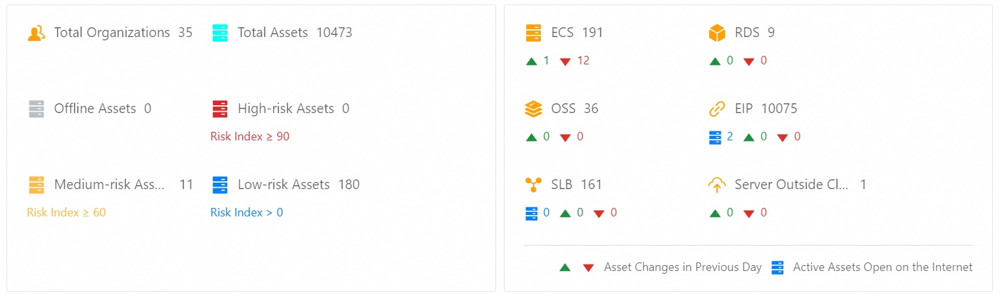

5. Click the following tabs to view the assets of the tenant: **ECS**, **ApsaraDB RDS**, **OSS**, **SLB**, **EIP**, **Active Internet IP Addresses**, **Tunnel**, and **Server Outside Cloud**.

   - You can specify search conditions to search for servers, assets, or instances.

     > **Note**
     >
     > If you do not specify search conditions, all servers, assets, or instances are automatically displayed.

   - Configure asset importance tags and business types.

   - Click a server or instance name to view the following details.

     **ECS**

     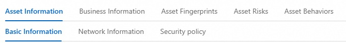

     | Tab | Description |
     | --- | --- |
     | Asset Information | • <strong>Basic Information</strong>: You can view the asset information in the Basic Information and Disk Information sections.<br>• <strong>Network Information</strong>: You can view the asset information in the VPC, SLB, NAT Gateway, and EIP sections.<br>You can also click <strong>Network Link View</strong> to view the network connections and Internet access paths to ECS instances. This helps you troubleshoot network issues, reduce exposure risks, and trace threats.<br>• You can zoom in, zoom out, and download the view. You can also drag the elements in the view.<br>• You can click <strong>Network Information List</strong> to return to the network information list.<br>• <strong>Security Policy</strong>: You can view the security login settings and security group information. |
     | Business Information | • <strong>Application</strong>: You can view the information about the application to which the asset belongs in the Apsara Stack configuration management database (CMDB).<br>• <strong>Application System</strong>: You can view the information about the application system to which the asset belongs in the Apsara Stack CMDB.<br>• <strong>Service</strong>: You can view the information about the service to which the asset belongs in the Apsara Stack CMDB. |
     | Asset Fingerprints | You can view fingerprint information on the Port, Software, Process, Account, Planned Tasks, Middleware, and Startup Item tabs. |

     <table>
       <tr>
         <td>Asset Risks</td>
         <td>• Risk Level<br>• You can view the risk assessment data of the asset, including asset risk indexes, cyberattack risks, abnormal behavior risks, security vulnerability risks, and security baseline risks.<br>• You can view the distribution of cyberattacks, abnormal behavior, security vulnerabilities, and security baselines by risk level. You can also view the trend of cyberattacks within the last seven days.<br>• You can view the following information: top 5 cyberattack risks, top 5 abnormal behavior risks, top 5 security vulnerability risks, and top 5 security baseline risks.<br>• <strong>Network Attacks</strong>: You can view and handle cyberattacks on the asset.<br>• <strong>Suspicious Processes</strong>: You can view and handle the abnormal behavior that affects the asset.<br>• <strong>Vulnerabilities</strong>: You can view the details of security vulnerabilities in the asset and fix the security vulnerabilities based on the provided suggestions.<br>Fix a security vulnerability: On the ECS tab of the Tenant Assets page, find the ECS instance that you want to manage, and click the name of the ECS instance to go to the Basic Information tab of the Asset Information tab or click the number in the <strong>Vulnerabilities</strong> column to go to the <strong>Vulnerabilities</strong> tab of the <strong>Asset Risks</strong> tab. On the Vulnerabilities tab, find the vulnerability that you want to fix and click <strong>Repair</strong> in the <strong>Actions</strong> column. In the <strong>Batch Fix</strong> dialog box, select <strong>I</strong> <strong>have understood the risk of repair failure.</strong> and click <strong>Fix Now</strong>.<br>• <strong>Baselines</strong>: You can view the details of the security baseline risks in the asset and handle the security baseline risks based on the provided suggestions.<br>Handle a security baseline risk: On the ECS tab of the Tenant Assets page, find the ECS instance that you want to manage, and click the name of the ECS instance to go to the Basic Information tab of the Asset Information tab or click the number in the <strong>Baselines</strong> column to go to the <strong>Baselines</strong> tab of the <strong>Asset Risks</strong> tab. On the Baselines tab, find the security baseline risk that you want to handle and click an option in the <strong>Actions</strong> column to perform the corresponding operation.<br>• <strong>Exposure on Internet</strong>: You can check whether the asset is exposed on the Internet and implement the required measures.</td>
       </tr>
     </table>

     <table>
       <tr>
         <td>Asset Behaviors</td>
         <td>• Process Behavior<br>• On the <strong>Process Behavior</strong> tab, you can view the statistics information in the <strong>Process Behavior Distribution</strong> and <strong>Top 5</strong> <strong>Process Behaviors</strong> sections. This helps you understand the behavior characteristics and distribution of each process in the system. You can select <strong>Today</strong>, <strong>Last 24 Hours</strong>, <strong>Last 7 Days</strong>, <strong>Last</strong> <strong>30 Days</strong>, or <strong>Custom</strong> as a time range. The default time range is Last 30 Days.<br>• In the <strong>Process Tree</strong> section, you can view the process location based on PIDs, usernames, or process names, along with a process tree view that provides association analysis and traceability for related scenarios.<br>• In the <strong>Process Behavior</strong> section, you can view the process behavior and its details. You can click a process behavior name to view the timeline of the process. Click <strong>Details</strong> next to a process to view the details of the process.<br>• Configuration Behavior<br>• On the <strong>Configuration Behavior</strong> tab, you can view the statistics information in the <strong>Configuration Behavior Analysis</strong> and <strong>Top 5</strong> <strong>Configuration Behavior</strong> sections. This helps you understand the distribution of configurations in the system. You can filter data by time or by behavior name. You can select <strong>Today</strong>, <strong>Last 24 Hours</strong>, <strong>Last 7 Days</strong>, <strong>Last 30 Days</strong>, or <strong>Custom</strong> as a time range. The default time range is Last 30 Days.<br>• In the configuration behavior list section, the list is displayed in a timeline format, showing all critical behavior detected within the statistical period, sorted by the time of occurrence. Click <strong>Query</strong> <strong>Instance Details</strong> to view the details of raw logs.</td>
       </tr>
     </table>

     **ApsaraDB RDS**

     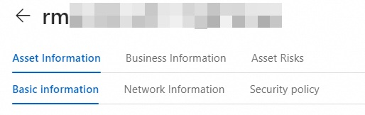

     | Tab | Description |
     | --- | --- |
     | Asset Information | • <strong>Basic Information</strong>: You can view the basic information about the ApsaraDB RDS instance in the Basic Information section.<br>• <strong>Network Information</strong>: You can view the tunnel information about the ApsaraDB RDS instance in the Tunnel section.<br>• <strong>Security Policy</strong>: You can view the whitelist of the ApsaraDB RDS instance in the Whitelist Information section. |
     | Business Information | • <strong>Application</strong>: You can view the information about the application to which the asset belongs in the Apsara Stack CMDB.<br>• <strong>Application System</strong>: You can view the information about the application system to which the asset belongs in the Apsara Stack CMDB.<br>• <strong>Service</strong>: You can view the information about the service to which the asset belongs in the Apsara Stack CMDB. |
     | Asset Risks | You can view the details of the security baseline risks in the asset and handle the security baseline risks based on the provided suggestions. |

     **OSS**

     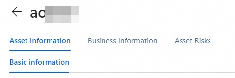

     | Tab | Description |
     | --- | --- |
     | Asset Information | You can view the basic information about the OSS bucket. |
     | Business Information | • <strong>Application</strong>: You can view the information about the application to which the asset belongs in the Apsara Stack CMDB.<br>• <strong>Application System</strong>: You can view the information about the application system to which the asset belongs in the Apsara Stack CMDB.<br>• <strong>Service</strong>: You can view the information about the service to which the asset belongs in the Apsara Stack CMDB. |
     | Asset Risks | You can view the details of the security baseline risks in the OSS bucket and handle the security baseline risks based on the provided suggestions. |

     **SLB, EIP, and Active Internet IP Addresses**

     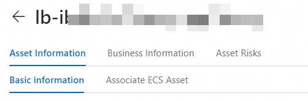

     | Tab | Description |
     | --- | --- |
     | Asset Information | • <strong>Basic Information</strong>: You can view the basic information about the asset in the Basic Information section.<br>• <strong>Associate ECS Asset</strong>: You can view the information about the ECS instances that are associated with the asset. You can click the name of an associated ECS instance to view its details. |
     | Business Information | • <strong>Application</strong>: You can view the information about the application to which the asset belongs in the Apsara Stack CMDB.<br>• <strong>Application System</strong>: You can view the information about the application system to which the asset belongs in the Apsara Stack CMDB.<br>• <strong>Service</strong>: You can view the information about the service to which the asset belongs in the Apsara Stack CMDB. |
     | Asset Risks | • <strong>Network Attacks</strong>: You can view and handle cyberattacks on the asset.<br>• <strong>Suspicious Processes</strong>: You can view and handle the abnormal behavior that affects the asset.<br>• <strong>Vulnerabilities</strong>: You can view the details of security vulnerabilities in the asset and fix the security vulnerabilities based on the provided suggestions.<br>• <strong>Baselines</strong>: You can view the details of the security baseline risks in the asset and handle the security baseline risks based on the provided suggestions. |

     **Tunnel**

     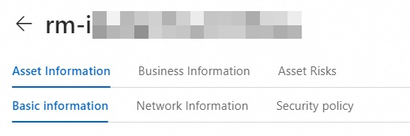

     | Tab | Description |
     | --- | --- |
     | Asset Informatio n | • <strong>Basic Information</strong>: You can view the basic information about the asset in the Basic Information section.<br>• <strong>Network Information</strong>: You can view the tunnel information about the asset in the Tunnel section.<br>• <strong>Security Policy</strong>: You can view the whitelist of the asset in the Whitelist Information section. |
     | Business Informatio n | • <strong>Application</strong>: You can view the information about the application to which the asset belongs in the Apsara Stack CMDB.<br>• <strong>Application System</strong>: You can view the information about the application system to which the asset belongs in the Apsara Stack CMDB.<br>• <strong>Service</strong>: You can view the information about the service to which the asset belongs in the Apsara Stack CMDB. |
     | Asset Risks | You can view the details of the security baseline risks in the asset and handle the security baseline risks based on the provided suggestions. |

     **Server Outside Cloud**

     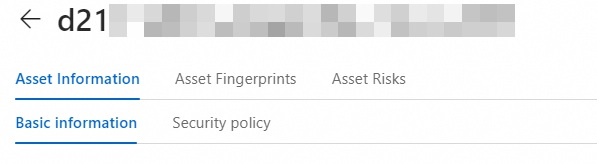

     | Tab | Description |
     | --- | --- |
     | Asset Informatio n | • <strong>Basic Information</strong>: You can view the basic information and network information about the asset.<br>• <strong>Security Policy</strong>: You can view the security login settings. |
     | Asset Fingerprin ts | You can view fingerprint information on the Port, Software, Process, Account, Planned Tasks, Middleware, and Startup Item tabs. |

     <table>
       <tr>
         <td>Asset Risks</td>
         <td>• Risk Level<br>• You can view the risk assessment data of the asset, including asset risk indexes, cyberattack risks, abnormal behavior risks, security vulnerability risks, and security baseline risks.<br>• You can view the distribution of cyberattacks, abnormal behavior, security vulnerabilities, and security baselines by risk level. You can also view the trend of cyberattacks within the last seven days.<br>• You can view the following information: top 5 cyberattack risks, top 5 abnormal behavior risks, top 5 security vulnerability risks, and top 5 security baseline risks.<br>• <strong>Suspicious Processes</strong>: You can view and handle the abnormal behavior that affects the asset.<br>• <strong>Vulnerabilities</strong>: You can view the details of security vulnerabilities in the asset and fix the security vulnerabilities based on the provided suggestions.<br>Fix a vulnerability: On the Server Outside Cloud tab of the Tenant Assets page, find the server that you want to manage, and click the name of the server to go to the Risk Level tab of the Asset Risks tab or click the number in the <strong>Vulnerabilities</strong> column to go to the Vulnerabilities tab of the <strong>Asset Risks</strong> tab.On the Vulnerabilities tab, find the vulnerability that you want to fix and click <strong>Repair</strong> in the <strong>Actions</strong> column. In the <strong>Batch Fix</strong> dialog box, select <strong>I have</strong> <strong>understood the risk of repair failure.</strong> and click <strong>Fix Now</strong>.<br>• <strong>Baselines</strong>: You can view the details of the security baseline risks in the asset and handle the security baseline risks based on the provided suggestions.<br>Handle a security baseline risk: On the Server Outside Cloud tab of the Tenant Assets page, find the server that you want to manage, and click the name of the server to go to the Risk Level tab of the Asset Risks tab or click the number in the <strong>Baselines</strong> column to go to the <strong>Baselines</strong> tab of the <strong>Asset Risks</strong> tab. On the Baselines tab, find the security baseline risk that you want to handle and click an option in the <strong>Actions</strong> column to perform the corresponding operation.<br>• <strong>Exposure on Internet</strong>: You can check whether the asset is exposed on the Internet and implement the required measures.</td>
       </tr>
       <tr>
         <td>Asset Behaviors</td>
         <td>• On the <strong>Process Behavior</strong> tab, you can view the statistics information in the <strong>Process Behavior Distribution</strong> and <strong>Top 5 Process Behaviors</strong> sections. This helps you understand the behavior characteristics and distribution of each process in the system. You can select <strong>Today</strong>, <strong>Last 24 Hours</strong>, <strong>Last 7 Days</strong>, <strong>Last 30 Days</strong>, or <strong>Custom</strong> as a time range. The default time range is Last 30 Days.<br>• In the <strong>Process Tree</strong> section, you can view the process location based on PIDs, usernames, or process names, along with a process tree view that provides association analysis and traceability for related scenarios.<br>• In the <strong>Process Behavior</strong> section, you can view the process behavior and its details. You can click a process behavior name to view the timeline of the process. Click <strong>Details</strong> next to a process to view the details of the process.</td>
       </tr>
     </table>

   - Click the  icon to refresh the asset list.

   - Click the  icon to export the asset information.

   - Click the  icon to configure the items that you want to view in the asset list.

<a id="section-3-6"></a>

## 3.6. Use the Logs module

<a id="section-3-6-1"></a>

### 3.6.1. View the log overview

The Overview page displays the overall statistics on all logs that are collected by Security Operations Center (SOC) in a visualized manner. On the Overview page, you can predefine and customize widgets to display logs. This topic describes how to view the logs that are displayed in the widgets on the Overview page.

**Procedure**

1. Log in to the Apsara Uni-manager Management Console.

2. In the top navigation bar, choose **Security** > **Global Platform Security > Security Operations Center**. On the **Security Operations Center** page, select a region from the **Region** drop-down list and click **Access with Authorized Role**.

3. In the left-side navigation pane, choose **Logs > Overview**.

4. On the **Overview** page, specify a time range, one or more organizations, and the widgets that you want to view.

   - You can select **Today**, **Last 24 Hours**, **Last 7 Days**, **Last 30 Days**, or **Custom** from the time range drop-down list.

   - You can click **Default View Windows** to select the following predefined widgets:

     - **Total Logs**: displays the total number of collected log entries and the comparison statistics on the total numbers of collected log entries between the current and previous time ranges.

     - **Distribution of Log Organizations**: displays the proportions of logs collected on the platform side and tenant side. This option is available only to global organization security administrators.

     - **Trend of Logs**: displays the trend in the number of collected log entries. The log entries are collected on an hourly basis within a time range of five days or less. The log entries are collected on a daily basis within a time range of more than five days.

     - **Log Statistics by Severity**: displays the total numbers of collected logs by severity level. Supported severities include: Information, Suspicious, Moderate, Serious, and Urgent.

     - **Log Distribution by Log Source**: displays the proportions of collected logs by log source. Supported log sources include, but are not limited to: Server Guard, Container Security Service (CSS), and Cloud Firewall.

     - **Log Distribution by Log Source System Type**: displays the proportions of collected logs by log source system type. System types for access log sources include security, data, host, and network logs.

     - **Log Distribution by Type**: displays the proportions of collected logs by type. Log types include network logs, operation logs, threat logs, application logs, and system logs.

     - **Log Trend by Type**: displays the trend in proportions of collected logs by type. On the Log Query page, click Follow Logs to set the query result as followed logs. In the Follow Logs dialog box, set the Followed Log Name parameter, select Save As Independent Window, and then click OK. Then, you can view the followed logs in a widget on the Overview page.

   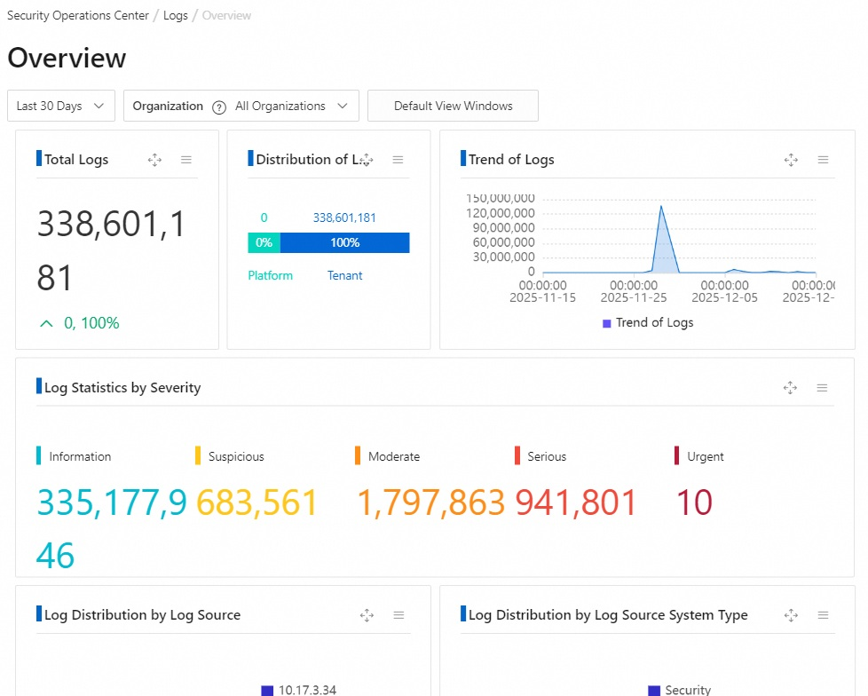

5. On the **Overview** page, manage the widgets of the logs.

   - Move a widget

     In the widget that you want to manage, click the  icon and drag the widget to a specific

     position. In the upper-right corner of the **Overview** page, click the  icon.

   - Close a widget

     In the widget that you want to manage, move the pointer over the  icon and click **Close**

     **View**. In the upper-right corner of the **Overview** page, click the  icon.

   - Export snapshots on the Overview page

     In the upper-right corner of the **Overview** page, click the  icon.

   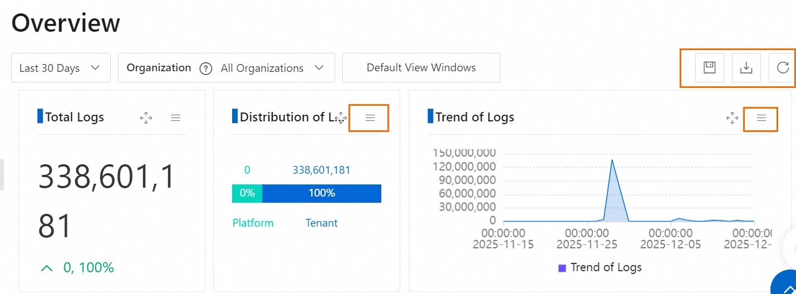

<a id="section-3-6-2"></a>

### 3.6.2. Log query

<a id="section-3-6-2-1"></a>

#### 3.6.2.1. Query log details

This topic describes how to query log details.

**Procedure**

1. Log in to the Apsara Uni-manager Management Console.

2. In the upper-right corner of the Apsara Uni-manager Management Console, choose **Security** > **Global Platform Security > Security Operations Center**. On the **Security Operations Center** page, select a region from the **Region** drop-down list and click **Access with Authorized Role**.

3. In the left-side navigation pane, choose **Logs > Log Query**.

4. Search for logs by specifying the following search conditions: time range, organization, system type, log source, log type, log subtype, log field, and query statement.

   Descriptions of the query results:

   - Log distribution histogram: displays the distribution of the queried logs by time. After you click a bar in the histogram, the system automatically adds the start time and end time of the bar as query conditions.

   - Table Mode: displays the logs of the specified log fields in a table and the log analysis result.

   - List Mode: displays the logs of the specified log fields in a list and the log analysis result.

   - Chart: displays the log analysis result and allows you to customize the chart type, chart size, chart title, and statistical field of a log.

   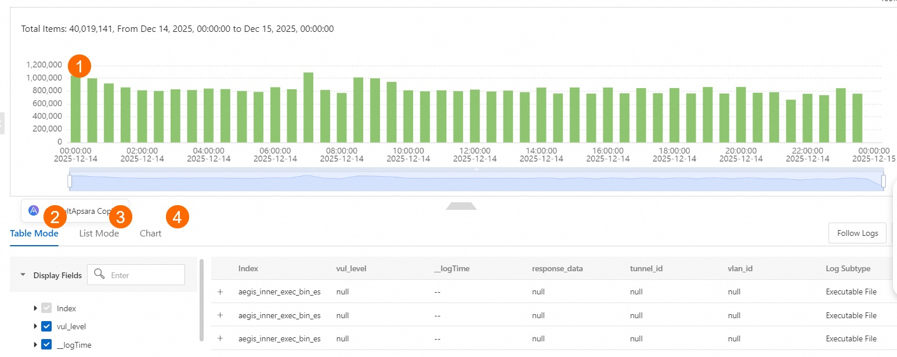

**What to do next**

- Configure the current log query results as followed logs: Click **Follow Logs**. In the Follow Logs dialog box, configure the **Followed Log Name** parameter, select Save As Independent Window, and then click OK.

  After the configuration is complete, you can query the followed logs in a widget of the **Overview** page.

- Save the current view: Click the  icon in the upper-right corner of the Log Query page. In

  the Create Filter Condition dialog box, enter the query condition name of the current view and click OK. After the current view is saved, you can select the query condition name of the current view from the **Default Data** drop-down list in the upper-right corner of the Log Query page to perform a quick query.

- Delete the current view: Click the  icon in the upper-right corner of the Log Query page

  to delete the saved view query conditions. The **Default Data** view cannot be deleted.

- Enable auto-refresh: Turn on  . The system automatically refreshes the log query

  information every 5 minutes.

  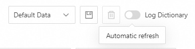

- View log dictionaries: Click **Log Dictionary** to view the information about different types of logs, including the field name, type, and description.

<a id="section-3-6-2-2"></a>

#### 3.6.2.2. Query raw logs

Security Operations Center (SOC) allows you to query raw logs. Raw logs contain the information that is required for debugging. Security administrators can use these raw logs to troubleshoot system failures. This topic describes how to query raw logs.

**Procedure**

1. Log in to the Apsara Uni-manager Management Console.

2. In the top navigation bar, choose **Security** > **Global Platform Security > Security Operations Center**. On the **Security Operations Center** page, select a region from the **Region** drop-down list and click **Access with Authorized Role**.

3. In the left-side navigation pane, choose **Logs > Log Query**.

4. On the **Log Query** page, specify the following search conditions: **time range**, **organization**, **system type**, **log source**, **log type**, **log subtype**, **log field**, and **query syntax**. Then, click **Search**.

   The number of queried logs within the specified period of time is displayed in a column chart. The log details are displayed in a list. The following list describes the supported query syntax:

   - **Full-text match**

     Example 1: 12.XX.XX.12. Example 2: www.bai\*.c?m.

   - **Field-based query**

     Example 1:

     ```text
     src_ip: 12.XX.XX.12 AND hostname:abc?o*al OR filesize:>100
     ```

     Example 2:

     ```text
     12.XX.XX.12 AND appName:yundun-soc
     ```

5. The queried log information is displayed in table, list, or chart mode. In the log list, select the fields that you want to query and view the logs about the fields.

   You can also expand a display field to view the top 5 values of the field.

<a id="section-3-6-3"></a>

### 3.6.3. View tenant logs

Tenant logs record information about tenants. Security administrators can use these logs to troubleshoot issues that occur on the tenant side. This topic describes how to view tenant logs.

1. Log in to the Apsara Uni-manager Management Console.

2. In the top navigation bar, choose **Security** > **Global Platform Security > Security Operations Center**. On the **Security Operations Center** page, select a region from the **Region** drop-down list and click **Access with Authorized Role**.

3. In the left-side navigation pane, choose **Logs > Tenant Log**.

4. On the **Tenant Log** page, specify the scope, log source, and time range based on your business requirements. The following list describes the supported query syntax:

   - **Full-text match**

     Example 1:

     ```text
     12.XX.XX.12
     ```

     Example 2:

     ```text
     www.bai*.c?m
     ```

   - **Field-based query**

     Example 1:

     ```text
     src_ip: 12.XX.XX.12 AND hostname:abc?o*al OR filesize:>100
     ```

     Example 2:

     ```text
     12.XX.XX.12 AND appName:yundun-soc
     ```

     The system displays **tenant logs** in a column chart based on the query conditions that you specify. You can view the numbers of logs at different points in time within the specified time range. You can also view the details of the queried logs in the log list.

     - To configure the fields that you want to display in the log list, click the 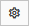 icon.

     - To view the details of a log, click **Details** in the data column of the log.

       

     - To export the log list, click the

       icon.

<a id="section-3-7"></a>

## 3.7. Create and manage a task

On the Tasks page, you can analyze and handle global security risks in a streamlined process. This facilitates security operations and management and helps accumulate experience in handling risks. This topic describes how to create and manage a task.

**Procedure**

1. Log in to the Apsara Uni-manager Management Console.

2. In the upper-right corner of the Apsara Uni-manager Management Console, choose **Security** > **Global Platform Security > Security Operations Center**. On the **Security Operations Center** page, select a region from the **Region** drop-down list and click **Access with Authorized Role**.

3. In the left-side navigation pane, choose **Handle > Tasks**.

4. On the Tasks page, view the overall information about tasks.

   - Total Tasks: the total number of tasks in Security Operations Center (SOC). The number is counted from the time when SOC starts to run until the current point in time.

   - Tasks Pending Handling, Tasks Being Handled, and Handled Tasks: the number of tasks that are pending, the number of tasks that are being handled, and the number of tasks that are handled. The numbers are counted from the time when SOC starts to run until the current point in time.

   - Task Completion Rate and On-time Task Completion Rate: the proportion of tasks that are completed to all tasks and the proportion of tasks that are completed on time to all tasks. The proportions are measured from the time when SOC starts to run until the current point in time.

   - Handling Solutions: the number of handling solutions that are manually created from the time when SOC starts to run until the current point in time. The handling solutions include solutions that are manually created and are synchronized from handling records.

     - Manually create a handling solution

       On the Tasks page, click **Handling Solutions**. On the Handling Solutions page, click **Create Solution**. In the Create Solution panel, configure the parameters that are described in the following table and click **OK**.

       | Parameter | Description |
       | --- | --- |
       | Solution Name | The name of the handling solution. The name must be 1 to 200 characters in length. |
       | Sharing Scope | One or more organizations to which the handling solution is delivered. |
       | Solution Type | The type of the handling solution. Valid values:<br>• Threat Event<br>• Security alert<br>• Vulnerabilities<br>• Baselines<br>• Asset Risks<br>• Security Inspection<br>• Playbook Review |
       | Problem Description | The issue description of the handling solution. The description must be 0 to 1,024 characters in length. |
       | Solution | The handling solution. The value must be 0 to 2,048 characters in length. |
       | Handled By | The contact. |

     - Synchronize a solution from a handling record. For more information, see the Handle a task section of this topic.

     A manually created handling solution is in the **Published** state. You can directly reference the handling solution. A solution synchronized from a handling record is in the **Pending Approval** state. Before you reference a solution synchronized from a handling record, you must **approve** the solution on the SOC console of the Apsara Uni-manager Operations Console. You can also **disable** a solution synchronized from a handling record on the SOC console of the Apsara Uni-manager Operations Console.

     You can **delete** or **modify** a handling solution.

5. On the Tasks page, click **Create Task**. In the Create Task panel, configure the parameters that are described in the following table and click **OK**.

   | Parameter | Description |
   | --- | --- |
   | Task Name | The name of the task. The name must be 0 to 128 characters in length. |
   | Task Type | The type of the task. Valid values:<br>• <strong>Threat Event</strong>: You can click <strong>Select Risk Record</strong> to select one or more threat events within your data permission scope.<br>• <strong>Security alert</strong>: You can click <strong>Select Risk Record</strong> to select a security alert within your data permission scope.<br>• <strong>Vulnerabilities</strong>: You can click <strong>Select Risk Record</strong> to select a vulnerability within your data permission scope.<br>• <strong>Baselines</strong>: You can click <strong>Select Risk Record</strong> to select a security baseline within your data permission scope.<br>• <strong>Asset Risks</strong>: You can click <strong>Select Risk Record</strong> to select one or more assets within your data permission scope.<br>• <strong>Security Inspection</strong>: You can customize risk information and issue descriptions. |
   | Delivering Organization | The organization to which the task is delivered. |
   | Reference Risk Information | Specifies whether to reference risk information. If you reference risk information, the risk information is auto-filled in the Problem Description and Handling Suggestion fields. |
   | Priority | The priority of the task. Valid values: <strong>Urgent</strong>, <strong>High</strong>, <strong>Medium</strong>, and <strong>Low</strong>. |
   | Problem Description | The issue description of the task. The description must be 0 to 1,024 characters in length. |
   | Handling Suggestion | The handling suggestions for the task. The value must be 0 to 1,024 characters in length.<br>After you select <strong>Referenced Solution</strong>, you can select one or more handling solutions from the drop-down list. |
   | Handling Deadline | The deadline for the task. If the task is not completed before the deadline, the handling status of the task changes to Timed Out. |
   | Handled By | The contact. |
   | Notification Method | The notification method of the task. Valid values: DingTalk and Mail. |

The created task is displayed in the task list. On the Tasks page, you can handle all tasks.

- Search for a task

  Specify filter conditions to search for a task. You can specify the following filter conditions: **Delivering Organization**, Task Type, Priority, Task Status, Handling Status, Task Name, and Handled By.

- Handle a task

  <ol type="i">

  <li>

  Find the task that you want to manage and click the task name or **Handling Details** in the **Actions** column.

  </li>

  <li>

  On the Task Details page, turn on Received. Start to Handle. In the message that

  </li>

  </ol>

  appears, click OK.

  <ol type="i" start="3">

  <li>

  Handle the task based on suggestions provided in the **Handling Suggestion** section and

  </li>

  </ol>

  record the handling process in the **Handling Records** field. The handling record must be 0 to 2,048 characters in length.

  > **Note**
  >
  > - After you enter and save a record, you can select **Synchronize to Handling Solutions**. If you encounter the same task later, you can directly reference the handling solution as the handling suggestion.
  >
  > - A handling record that is synchronized to the knowledge base of handling solutions becomes a handling solution and is in the **Pending Approval** state. To approve or disable a solution synchronized from a handling record, go to the SOC console of the Apsara Uni-manager Operations Console, find the solution that you want to manage on the **Handling Solutions** page, and then click **Approve** or **Disable** in the **Actions** column.

  After a task is handled, the task state changes from **In processing** to **Completed**, and you can no longer modify the task.

<a id="section-3-8"></a>

## 3.8. Policy management

<a id="section-3-8-1"></a>

### 3.8.1. Create and manage an analysis rule

You can perform comprehensive association analysis on a large number of logs based on the analysis logic of an analysis rule to detect threats and risks and trace attack paths of multi-phase attacks. This way, security administrators can obtain helpful risk information in an efficient and quick manner, thus improving the efficiency of security operations. This topic describes how to create and manage an analysis rule.

**Procedure**

**Create a rule**

Security Operations Center (SOC) provides predefined rules based on regular business requirements. The predefined rules can only be viewed but cannot be modified. If the predefined rules cannot meet your business requirements, you can perform the following operations to create a rule:

1. Log in to the Apsara Uni-manager Management Console.

2. In the top navigation bar, choose **Security** > **Global Platform Security > Security Operations Center**. On the **Security Operations Center** page, select a region from the **Region** drop-down list and click **Access with Authorized Role**.

3. In the left-side navigation pane, choose **Policies > Analytic Rules**.

4. On the **Analytic Rules** page, click **Create Rule**. On the Create Rule page, configure the parameters that are described in the following table.

   | Parameter | Description |
   | --- | --- |
   | Organization | The organization to which the analysis rule belongs. |
   | Threat Name | The name of a threat. |
   | Threat Level | The level of the threat. Valid values:<br>• Information<br>• Suspicious<br>• Moderate<br>• Serious<br>• Urgent |
   | Threat Type | The type of the threat. You can select one or more types for the threat. Valid values:<br>• Network Scanning<br>• Vulnerability Exploitation<br>• Malware<br>• Network Attack<br>• Suspicious Network Connection<br>• Suspicious Process<br>• Unauthorized Privilege Escalation |
   | ATT&amp;CK ID | The IDs of one or more attacks that are involved in the Adversarial Tactics, Techniques, and Common Knowledge (ATT&amp;CK) stages. |
   | Rule Type | The type of the rule that you want to create.<br>• If you set this parameter to <strong>Association-based Analysis</strong> <strong>Rule</strong>, configure the following parameters:<br>• <strong>Data Scope</strong>: the data scope.<br>• <strong>Time Series</strong>: the time condition for the rule that you want to create. Valid values:<br>• <strong>Periodicity</strong>: The rule is used to detect the threats that occur within the same period of time.<br>• <strong>Chronological Order</strong>: The rule is used to detect the threats that occur in sequence.<br>• <strong>Sequential Occurrence in Same Cycle</strong>: The rule is used to detect the threats that occur in sequence within the same period of time.<br>• <strong>Associated Object</strong>: the object on which the rule is used to detect threats. Set the value to <strong>Same Asset</strong>. By default, this value is selected.<br>• <strong>Trigger Condition</strong>: the trigger conditions. You can configure the following parameters to specify the trigger conditions.<br>Note<br>On the right side of the Trigger Condition section, you can click Add or Delete to add or delete a condition. You can also click Up or Down to change the condition order.<br>• <strong>Association Type</strong>: specifies whether the associated conditions are required conditions. Set the value to <strong>Necessary Condition</strong>.<br>• <strong>Log Scope</strong>: The log scope. You can one or more log sources, log types, log subtypes, and log levels.<br>• <strong>Source IP</strong> and <strong>Destination IP</strong>.<br>• <strong>Keyword</strong>: If you specify multiple keywords, separate them with semicolons (;). Click <strong>Add</strong> on the right side to add a keyword.<br>• <strong>Aggregation Field</strong>: SOC aggregates the logs within the statistical period based on the fields that you selected.Valid values: <strong>Standardized Field</strong> and <strong>Log Original</strong> <strong>Field</strong>.<br>• <strong>Match Threat Intelligence</strong>: specifies whether to match threat intelligence. If you select Match Threat Intelligence, select one or multiple keywords from the <strong>Reference</strong> <strong>Keyword</strong> drop-down list. You can select <strong>Source IP</strong> <strong>Address</strong>, <strong>Destination IP Address</strong>, <strong>Domain Name</strong>, and <strong>File MD5 Hash Value</strong>.<br>• <strong>Time Range</strong>: The time range for data analysis. Valid values of the unit: Minutes, Hours, and Days. The maximum time range is 365 days.<br>• <strong>Log Quantity</strong>: the number of logs.<br>• <strong>Attack Phase</strong>: The attack phase. Valid values: <strong>Payload</strong> <strong>Delivery</strong>, <strong>Vulnerability Exploitation</strong>, <strong>Backdoor</strong> <strong>Installation</strong>, <strong>Command and Control</strong>, <strong>Scanning</strong>, <strong>Privilege Escalation</strong>, and <strong>Action on Objectives</strong>.<br>• If you set this parameter to <strong>Search-based Analysis Rule</strong>, configure the following parameters:<br>• <strong>Data Scope</strong>: the data scope.<br>• <strong>Log Scope</strong>: The log scope. Valid values: <strong>Host</strong>, <strong>Network</strong>, <strong>Application</strong>, and <strong>Security</strong>.<br>• <strong>Search Condition</strong>: The search condition of the rule.<br>• <strong>Attack Phase</strong>: The attack phase. Valid values: <strong>Payload</strong> <strong>Delivery</strong>, <strong>Vulnerability Exploitation</strong>, <strong>Backdoor</strong> <strong>Installation</strong>, <strong>Command and Control</strong>, <strong>Scanning</strong>, <strong>Privilege</strong> <strong>Escalation</strong>, and <strong>Action on Objectives</strong>.<br>• <strong>Time Range</strong>: The time range for data analysis. Valid values of the unit: Minutes, Hours, and Days. The maximum time range is 365 days. |
   |  |  |
   | Execution Period | The interval at which the rule is executed. Default value: 5. Unit: minutes. Valid values of the unit: Minutes, Hours, and Days. The maximum execution interval is 365 days. |
   | Description | The description of the threat. The description must be 0 to 256 characters in length. |
   | Handling Suggestion | The handling suggestion. The suggestion must be 0 to 256 characters in length. |

5. **Optional.** If you want to verify the created rule, click **Quick Verify**.

6. Click **OK**.

   The created rule is displayed in the rule list.

   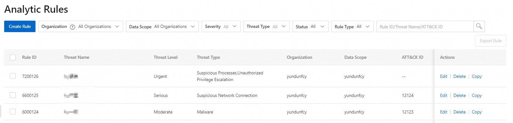

   You can modify or delete a custom rule based on your business requirements. To modify or delete a custom rule, find the rule that you want to manage and click **Edit** or **Delete** in the Actions column to modify or delete the rule.

**Manage a rule**

1. In the left-side navigation pane, choose **Policies > Analytic Rules**.

2. On the Analytic Rules page, find the rule that you want to view and view the following information about the rule: rule ID, threat name, threat level, threat type, organization, data scope, ATT&CK ID, rule type, and rule status. You can also perform the following operations to manage a rule:

   - **Change the status of a rule**

     On the Analytic Rules page, find the rule that you want to manage and click the switch icon in the **Status** column to enable or disable the rule.

   - **Modify or delete a rule** On the Analytic Rules page, find the rule that you want to manage and click **Edit** or **Delete** in the **Actions** column to modify or delete the rule.

   - **Copy a rule**

     On the Analytic Rules page, find the rule that you want to manage and click **Copy** in the **Actions** column. In the **Copy Rule** dialog box, select an organization from the **Organization** drop-down list and click **OK**. This operation is applicable to specific rules.

   > **Note**
   >
   > - If one or more predefined rules are disabled, **the system prompts you to confirm whether to enable them.**
   >
   > - The copied custom rules can be modified and deleted. The copied predefined rules can only be deleted.

<a id="section-3-8-2"></a>

### 3.8.2. Create a response policy

You can create a response policy to handle threat events and security alerts (security alerts on the Operations Center page) in a timely manner, and monitor risk information related to threat events, security alerts (security alerts on the Operations Center page), security baselines, and security vulnerabilities. Real-time alert notifications are sent to specified contacts via DingTalk or email. This topic describes how to create a response policy.

**Procedure**

1. Log in to the Apsara Uni-manager Management Console.

2. In the upper-right corner of the Apsara Uni-manager Management Console, choose **Security** > **Global Platform Security > Security Operations Center**. On the **Security Operations Center** page, select a region from the **Region** drop-down list and click **Access with Authorized Role**.

3. In the left-side navigation pane, choose **Policies** > **Response Policy**.

4. On the **Response Policy** page, click **Create Policy**.

5. In the **Create Policy** panel, configure the parameters that are described in the following table and click **OK**.

   | Paramete r | Description |
   | --- | --- |
   | Organiza tion | The organization to which the response policy to be created belongs. |
   | Policy Name | The name of the response policy. The name must be 0 to 64 characters in length. You can use the name to search for the response policy. |
   | Policy Descripti on | The description of the response policy. The description must be 0 to 128 characters in length. |
   | Policy Type | The type of the response policy.<br>• If you set this parameter to <strong>Threat Event</strong>, configure the following parameters:<br>• <strong>Threat Event Name</strong>: the name of the threat event.<br>• <strong>Threat Event Severity</strong>: one or more threat event levels. By default, all threat event levels are selected. Valid values: <strong>Information</strong>, <strong>Suspicious</strong>, <strong>Moderate</strong>, <strong>Critical</strong>, and <strong>Urgent</strong>.<br>• <strong>Threat Event Type</strong>: one or more threat event types. By default, all threat event types are selected. Valid values: <strong>Network Scanning</strong>, <strong>Vulnerability</strong> <strong>Exploitation</strong>, <strong>Malware</strong>, <strong>Network Attack</strong>, <strong>Suspicious Network Connection</strong>, Suspicious Processes, and Unauthorized Privilege Escalation.<br>• <strong>Attacker IP Address</strong>: one or more attack source IP addresses. Separate multiple IP addresses with commas (,).<br>• <strong>Attacked IP Address</strong>: one or more attack destination IP addresses. Separate multiple IP addresses with commas (,).<br>• <strong>Threat Behavior</strong>: the number of times that the threat event is detected.<br>• If you set this parameter to <strong>Alert</strong>, configure the following parameters:<br>• <strong>Alert Name</strong>: the name of the security alert.<br>• <strong>Alert Severity</strong>: one or more security alert levels. By default, all security alert levels are selected. Valid values: <strong>Information</strong>, <strong>Suspicious</strong>, <strong>Moderate</strong>, <strong>Serious</strong>, and <strong>Critical</strong>.<br>• <strong>Alert Type</strong>: one or more security alert types. By default, all security alert types are selected. Some of valid values: <strong>Unusual Logon</strong>, <strong>Webshell</strong>, <strong>Suspicious</strong> <strong>Process</strong>, and <strong>Malicious Script</strong>.<br>• <strong>Attacker IP Address</strong>: one or more attack source IP addresses. Separate multiple IP addresses with commas (,).<br>• <strong>Attacked IP Address</strong>: one or more attack destination IP addresses. Separate multiple IP addresses with commas (,).<br>• If you set this parameter to <strong>Vulnerability</strong>, configure the following parameters:<br>• <strong>Vulnerability Name</strong>: the name of the vulnerability.<br>• <strong>Vulnerability Severity</strong>: one or more vulnerability levels. By default, all vulnerability levels are selected. Valid values: <strong>Low Risk</strong>, <strong>Medium Risk</strong>, and <strong>High Risk</strong>.<br>• <strong>Vulnerability Type</strong>: one or more vulnerability types. By default, all vulnerability types are selected. Valid values: <strong>Linux Software</strong>, <strong>Windows System</strong>, <strong>Web</strong> <strong>CMS</strong>, and <strong>Application(Urgent Vulnerability Included)</strong>.<br>• <strong>CVE ID</strong>: the Common Vulnerabilities and Exposures (CVE) ID.<br>• <strong>Priority Score</strong>: the priority score. Valid values: 0 to 10.<br>• <strong>Affected Assets</strong>: the number of affected assets.<br>• If you set this parameter to <strong>Baseline</strong>, configure the following parameters:<br>• <strong>Baseline Name</strong>: the name of the baseline.<br>• <strong>Baseline Severity</strong>: one or more baseline risk levels. By default, all baseline risk levels are selected. Valid values: <strong>Low Risk</strong>, <strong>Medium Risk</strong>, and <strong>High Risk</strong>.<br>• <strong>Baseline Type</strong>: one or more baseline risk types. By default, all baseline risk types are selected. Some of valid values: <strong>hierarchy protection</strong>, <strong>Unauthorized</strong> <strong>Access</strong>, <strong>Internationally Agreed Best Practices for Security</strong>, <strong>Custom</strong> <strong>baseline</strong>, <strong>Best security practices</strong>, <strong>Weak password</strong>.<br>• <strong>Affected Assets</strong>: the number of affected assets. |
   | Data Scope | The data scope. Select an organization from the drop-down list. |
   | Policy Cycle | The statistic period of the response policy. Unit: <strong>Minutes</strong> or <strong>Hours</strong>. |
   | Scanned Asset | One or more assets to which the response policy is applied. Default value: All Assets.Valid values: All Assets, <strong>Instance Type</strong>, <strong>Instance Name</strong>, <strong>VPC</strong>, <strong>Public IP</strong> <strong>Address/Mask</strong>, <strong>Private IP Address/Mask</strong>, <strong>Public IP Address</strong>, and <strong>Private IP</strong> <strong>Address</strong>.<br>Note<br>After the <strong>Policy Type</strong> parameter is set to <strong>Threat Event</strong>, the valid values of the Scanned Asset parameter are All Assets, <strong>Public IP Address/Mask</strong>, <strong>Private IP</strong> <strong>Address/Mask</strong>, <strong>Public IP Address</strong>, and <strong>Private IP Address</strong>. |
   | Response Method | The response method.<br>Note<br>After the <strong>Policy Type</strong> parameter is set to <strong>Threat Event</strong> or <strong>Alert</strong>, you can set the Response Method parameter to <strong>Interactive Handling</strong>.<br>• If you set this parameter to <strong>Interactive Handling</strong>, configure <strong>one or more</strong> <strong>handling rules</strong>. To configure a handling rule, configure the <strong>Entity</strong>, <strong>Handling</strong> <strong>Scenario</strong>, <strong>Applicable Scope</strong>, and <strong>Action Validity Period</strong> parameters. Click the<br>icon below the handling rule list to add multiple handling rules. To delete a<br>handling rule, find it and click <strong>Delete</strong> in the Actions column.<br>• If you set this parameter to <strong>Notifications</strong>, configure the following parameters:<br>• <strong>Notification Recipient</strong>: one or more contacts.<br>• <strong>Notification Method</strong>: one or more notification methods. Valid values: <strong>DingTalk</strong> and <strong>Email</strong>. |

6. Click **OK**.

   The created response policy is displayed in the response policy list. You can **disable**, **enable**, **modify**, or **delete** a custom response policy based on your business requirements.

7. After the response policy is created, the contacts that are specified in the response policy receive alert notifications when the threat event is detected.

<a id="section-3-9"></a>

## 3.9. Use the Operations module

<a id="section-3-9-1"></a>

### 3.9.1. Manage organization authorization

This topic describes how to enable global organization service-linked role authorization.

**Procedure**

1. Log in to the Apsara Uni-manager Management Console.

2. In the top navigation bar, choose **Security** > **Global Platform Security > Security Operations Center**. On the **Security Operations Center** page, select a region from the **Region** drop-down list and click **Access with Authorized Role**.

3. In the left-side navigation pane, choose **Operations > Organization Authorization**.

4. In the Security Operations Center section of the Organization Authorization page, click **View Details** next to **Organization SLR Authorization**. In the Authorization Details panel, view the authorization state of the current organization. You can also enable or disable authorization for specific organizations.

   > **Note**
   >
   > If you want to turn on **Global Organization SLR Authorization**, you must perform this operation on the platform side of the Security Operations Center (SOC) console.

   - Enabled: SOC is assigned the service-linked role of the organization. SOC can automatically collect information about the cloud assets and security data of the organization. The global organization security administrator has the operations management permissions on the cloud assets and security data of the organization.

   - Disabled: SOC is not assigned the service-linked role of the organization. SOC cannot automatically collect information about the cloud assets and security data of the organization. The organization cannot use SOC features for security operations management.
