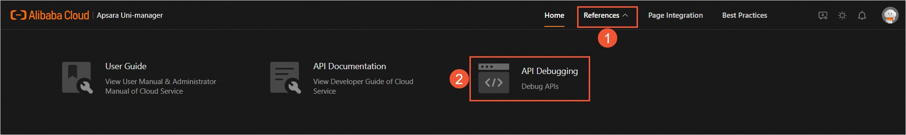
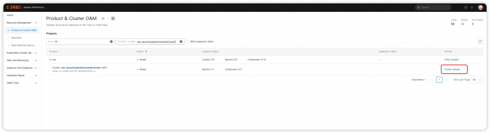
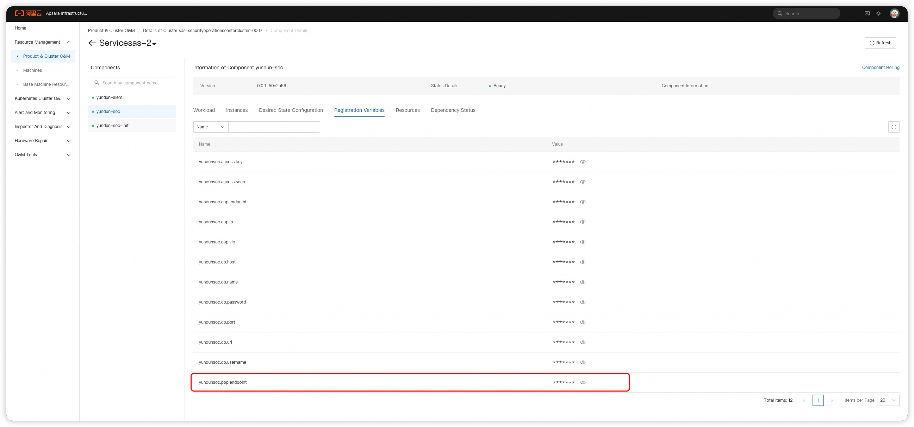

Alibaba Cloud  
Apsara Stack  
Cloud Security Scanner  
Developer Guide  
Product Version: V3.18.6  
Document Version: 20260701

**Table of Contents**

- [1.Getting started](#section-1)
    - [1.1. Obtain the developer guide](#section-1-1)
    - [1.2. Call an API operation](#section-1-2)
- [2.Before you begin](#section-2)
    - [2.1. Log on to OpenAPI Explorer](#section-2-1)
    - [2.2. Obtain API information](#section-2-2)
    - [2.3. Obtain an access credential assigned by RAM](#section-2-3)
    - [2.4. Obtain an access credential assigned by STS](#section-2-4)
    - [2.5. Obtain an endpoint](#section-2-5)
- [3.Call examples](#section-3)
    - [3.1. SDK for Python](#section-3-1)
        - [3.1.1. Getting started](#section-3-1-1)
        - [3.1.2. User guide](#section-3-1-2)
            - [3.1.2.1. Install Apsara Stack SDK for Python](#section-3-1-2-1)
            - [3.1.2.2. Use CommonRequest to call API operations](#section-3-1-2-2)
    - [3.2. SDK for Go](#section-3-2)
        - [3.2.1. Getting started](#section-3-2-1)
        - [3.2.2. User guide](#section-3-2-2)
            - [3.2.2.1. Install the core library of Apsara Stack SDK for Go](#section-3-2-2-1)
            - [3.2.2.2. Use CommonRequest to call API operations](#section-3-2-2-2)
- [4.Common parameters](#section-4)
- [5.Cloud Security Scanner](#section-5)
    - [5.1. Templates](#section-5-1)
        - [5.1.1. TemplateAssetDetectionAdd](#section-5-1-1)
        - [5.1.2. TemplateListGetByType](#section-5-1-2)
        - [5.1.3. TemplateRiskScanAdd](#section-5-1-3)
        - [5.1.4. TemplateAssetDetectionDetail](#section-5-1-4)
        - [5.1.5. GetAssetImportTaskInfo](#section-5-1-5)
        - [5.1.6. GetRiskScanTaskTemplate](#section-5-1-6)
        - [5.1.7. TemplateDelete](#section-5-1-7)
        - [5.1.8. TemplateList](#section-5-1-8)
        - [5.1.9. TemplateRiskScanDetail](#section-5-1-9)
        - [5.1.10. TemplateWebMonitorConf](#section-5-1-10)
        - [5.1.11. BasicRiskOption](#section-5-1-11)
        - [5.1.12. GetCommonVulnItemList](#section-5-1-12)
    - [5.2. Tasks](#section-5-2)
        - [5.2.1. BatchStartTasks](#section-5-2-1)
        - [5.2.2. TaskAssetScanCreate](#section-5-2-2)
        - [5.2.3. TaskList](#section-5-2-3)
        - [5.2.4. BatchStopTasks](#section-5-2-4)
        - [5.2.5. BatchDeleteTasks](#section-5-2-5)
        - [5.2.6. TaskProcessV2](#section-5-2-6)
        - [5.2.7. TaskStart](#section-5-2-7)
        - [5.2.8. TaskStop](#section-5-2-8)
        - [5.2.9. BatchSuspendTasks](#section-5-2-9)
        - [5.2.10. TaskProcess](#section-5-2-10)
        - [5.2.11. TaskRestart](#section-5-2-11)
        - [5.2.12. TaskDelete](#section-5-2-12)
        - [5.2.13. TaskRiskScanDetail](#section-5-2-13)
        - [5.2.14. GetAssetScanTaskInfo](#section-5-2-14)
        - [5.2.15. TaskAssetImportDetail](#section-5-2-15)
        - [5.2.16. TaskAssetScanDetail](#section-5-2-16)
        - [5.2.17. TaskAssetImportChildDetail](#section-5-2-17)
        - [5.2.18. CycleTaskAssetStats](#section-5-2-18)
        - [5.2.19. TaskAssetScanCycleRunning](#section-5-2-19)
        - [5.2.20. TaskAssetImport](#section-5-2-20)
        - [5.2.21. TaskRiskScanCreate](#section-5-2-21)
        - [5.2.22. TaskAssetImportDetailExists](#section-5-2-22)
        - [5.2.23. TaskQueueTaskDetail](#section-5-2-23)
        - [5.2.24. TaskAssetImportBaseInfo](#section-5-2-24)
        - [5.2.25. TaskRiskScanCycleRunning](#section-5-2-25)
        - [5.2.26. GetAssetRiskScanTaskInfo](#section-5-2-26)
        - [5.2.27. BatchRestartTasks](#section-5-2-27)
        - [5.2.28. TaskQueueTaskList](#section-5-2-28)
        - [5.2.29. TaskQueueTaskInfo](#section-5-2-29)
        - [5.2.30. TaskStatusStats](#section-5-2-30)
        - [5.2.31. TaskQueueTaskListDetail](#section-5-2-31)
        - [5.2.32. TaskRunTypeStats](#section-5-2-32)
        - [5.2.33. TaskQueueTaskCount](#section-5-2-33)
        - [5.2.34. SuspendStatus](#section-5-2-34)
- [6.Vulnerability Scan V2](#section-6)
    - [6.1. Asset API](#section-6-1)
        - [6.1.1. Host assets](#section-6-1-1)
            - [6.1.1.1. DescribeHostAssetList](#section-6-1-1-1)
        - [6.1.2. Website assets](#section-6-1-2)
            - [6.1.2.1. DescribeWebsiteAssetList](#section-6-1-2-1)
        - [6.1.3. Domain name assets](#section-6-1-3)
            - [6.1.3.1. DescribeDomainAssetList](#section-6-1-3-1)
        - [6.1.4. DeleteAsset](#section-6-1-4)
    - [6.2. Task API](#section-6-2)
        - [6.2.1. Asset import task](#section-6-2-1)
            - [6.2.1.1. CreateAssetImportTask](#section-6-2-1-1)
            - [6.2.1.2. DescribeAssetImportTask](#section-6-2-1-2)
            - [6.2.1.3. DescribeAssetImportTaskResult](#section-6-2-1-3)
        - [6.2.2. Asset scan](#section-6-2-2)
            - [6.2.2.1. CreateAssetScanTask](#section-6-2-2-1)
            - [6.2.2.2. DescribeAssetScanTask](#section-6-2-2-2)
        - [6.2.3. Risk scanning](#section-6-2-3)
            - [6.2.3.1. CreateRiskScanTask](#section-6-2-3-1)
            - [6.2.3.2. DescribeRiskScanTask](#section-6-2-3-2)
            - [6.2.3.3. DescribeRiskScanTaskResult](#section-6-2-3-3)
        - [6.2.4. DescribeTaskList](#section-6-2-4)
        - [6.2.5. StartTask](#section-6-2-5)
        - [6.2.6. StopTask](#section-6-2-6)
        - [6.2.7. SuspendTask](#section-6-2-7)
        - [6.2.8. DeleteTask](#section-6-2-8)
    - [6.3. Risk API](#section-6-3)
        - [6.3.1. Security vulnerability](#section-6-3-1)
            - [6.3.1.1. DescribeRiskList](#section-6-3-1-1)
        - [6.3.2. Public access](#section-6-3-2)
            - [6.3.2.1. DescribeBaselineRiskList](#section-6-3-2-1)
        - [6.3.3. Compliance vulnerability](#section-6-3-3)
            - [6.3.3.1. DescribeComplianceRiskList](#section-6-3-3-1)
- [7.Security audit](#section-7)
    - [7.1. GetData](#section-7-1)
    - [7.2. LouauditCleanData](#section-7-2)

<a id="section-1"></a>

# 1.Getting started

<a id="section-1-1"></a>

## 1.1. Obtain the developer guide

This topic describes how to find the required developer guide when you call an API operation of an Apsara Stack service.

**Flowchart**

You can follow the procedure described in the following figure to view the specific developer guide.


**Prerequisites**

The Apsara Stack version is obtained from an O&M or operations administrator.

**Procedure**

You can go to the Apsara Stack documentation center to view the required documentation.

1. Go to the Apsara Stack documentation center.

2. Click the **Enterprise**, **Agility&XStack**, or **All-in-one** tab based on the Apsara Stack edition that you use.

3. Select the Apsara Stack version from the drop-down list.

4. In the left-side navigation pane, select the Apsara Stack service whose documentation you want to view.

5. Find the developer guide and click **View Details** or **Download PDF**.

<a id="section-1-2"></a>

## 1.2. Call an API operation

Apsara Stack allows you to call API operations by using the POP gateway. To ensure that Apsara Stack provides the same experience as Alibaba Cloud Public Cloud, API operations in Apsara Stack V3.16.0 and later are called by using the POP gateway by default. This topic describes how to use the POP gateway to call Apsara Stack API operations.

**Flowchart**


**Procedure**

1. Obtain the access credential.

   Obtain the access credential that is required to call an API operation. For more information, see Obtain an access credential assigned by RAM or Obtain an access credential assigned by STS.

   > **Note**
   >
   > We recommend that you use the AccessKey pair of a personal account assigned by Resource Access Management (RAM) or an access credential assigned by Security Token Service (STS) to call the API operations of the Apsara Uni-manager Management Console and cloud services.

2. Obtain the region ID.

3. Obtain the organization ID and resource set ID.

   You must call an API operation to obtain an organization ID. For more information, see *GetO rganizationList* in *Apsara Uni-manager Management Console Developer Guide*.

   You must call an API operation to obtain a resource set ID. For more information, see *ListRe sourceGroup* in *Apsara Uni-manager Management Console Developer Guide*.

   > **Note**
   >
   > When you call an API operation, set the  `<x-acs-organizationid>`  header to the organization ID that you obtained, and set the  `<x-acs-resourcegroupid>`  header to the resource set ID that you obtained. This way, you can query resources in the specified organization and resource set.
   >
   > - If you do not specify the  `<x-acs-organizationid>`  header, the organization to which the current user belongs is used by default.
   >
   > - If you do not specify the  `<x-acs-resourcegroupid>`  header, this header is left empty by default. If you specify a resource set ID, you must also specify an organization ID.

4. View the developer guide of the cloud service on which you want to perform the operation.

   To learn the features of API operations and how to call the API operations, obtain the developer guide of the cloud service that you want to use. For more information, see Obtain the developer guide.

5. Obtain the endpoint of the cloud service.

6. Obtain the cloud service SDK and call an API operation.

<a id="section-2"></a>

# 2.Before you begin

<a id="section-2-1"></a>

## 2.1. Log on to OpenAPI Explorer

You can log on to OpenAPI Explorer from the Apsara Uni-manager Management Console.

**Prerequisites**

- The URL of the Apsara Uni-manager Management Console is obtained from a deployment engineer.

- A browser is available. We recommend that you use Google Chrome.

**Procedure**

1. Enter the URL of the Apsara Uni-manager Management Console in the address bar of your browser and press the Enter key.

2. Enter your username and password.

   You need to obtain the username and password from an operations administrator.

   > **Note**
   >
   > The first time you log on to the Apsara Uni-manager Management Console, you must change the password of your account as prompted. For security purposes, your password must be 10 to 32 characters in length and must contain at least two of the following character types:
   >
   > - Letters
   >
   > - Digits
   >
   > - Special characters, including exclamation points (!), at signs (@), number signs (#), dollar signs ($), and percent signs (%)

3. Click **Log on**.

4. If multi-factor authentication (MFA) is enabled for your account, perform the following operations based on your logon scenario:

   - Scenario 1: You log on to the Apsara Uni-manager Management Console for the first time after MFA is enabled by the administrator.

     <ol type="a">

     <li>

     On the Bind Virtual MFA Device page, bind an MFA device as prompted.

     </li>

     <li>

     Re-enter the username and password as described in Step 2 and click **Log On**.

     </li>

     </ol>

     <ol type="i" start="100">

     <li>

     Enter the six-digit MFA verification code and click **Authenticate**.

     </li>

     </ol>

   - Scenario 2: You log on to the Apsara Uni-manager Management Console after MFA is enabled and an MFA device is bound.

     Enter the six-digit MFA verification code and click **Authenticate**.

     > **Note**
     >
     > For more information, see **Bind a virtual MFA device to enable MFA** in **Apsara Uni-manager Management Console User Guide**.

5. In the top navigation bar, choose **Products > Development Tools > OpenAPI Explorer**.

<a id="section-2-2"></a>

## 2.2. Obtain API information

To call an API operation by using an SDK, you must first obtain information about the API operation, including the service code, operation name, and API version.

**Background information**

The API information on the debugging page in the Apsara Uni-manager Management Console is for reference only. For information about how to call API operations, see the developer guides of cloud services. If the information on the debugging page is different from that in the developer guide of a cloud service, the information in the developer guide prevails.

**Procedure**

1. Log on to the Apsara Uni-manager Management Console.

2. In the top navigation bar, choose **Products** > **Development** **Tools** > **OpenAPI** **Explorer**.

3. In the top navigation bar of the OpenAPI Explorer page, choose **API** **Integration** > **API Debugging**.

   

4. In the left-side navigation pane, select the cloud service that you want to manage. In the API operation list, you can view all API operations of the current version. If multiple API versions exist, you can select the required API version from the **Version** drop-down list.

<a id="section-2-3"></a>

## 2.3. Obtain an access credential assigned by RAM

Access credentials are assigned by Resource Access Management (RAM) or Security Token Service (STS). You can use either type of access credential for authentication when you make an API request. This topic describes how to obtain an access credential that is assigned by RAM.

**Background information**

An AccessKey pair is used to verify the identity of a request sender. An AccessKey pair consists of an AccessKey ID and an AccessKey secret that are used to implement symmetric encryption. The AccessKey ID is used to identify a user. The AccessKey secret is used to encrypt the signature string.

You can use RAM or STS to assign an access credential for authentication.

- Use RAM to assign an AccessKey ID and an AccessKey secret to a third party.

- Use STS to assign an AccessKey ID, an AccessKey secret, and a security token to a third party. For more information, see Obtain an access credential assigned by STS.

The Apsara Uni-manager Management Console provides AccessKey pairs to personal accounts and organizations. Only the administrators of level-1 organizations and operations administrators can obtain the AccessKey pairs of organizations. We recommend that you use the AccessKey pairs of personal accounts to call the API operations of the Apsara Uni-manager Management Console and cloud services. If you use the AccessKey pair of a personal account, you must configure the headers in the following table. Otherwise, an error that indicates insufficient permissions may occur.

> **Warning**
>
> The AccessKey pair of a personal account is managed by the permission system of the Apsara Uni-manager Management Console and has limited permissions. The AccessKey pair of an organization has greater permissions. If you want to use such an AccessKey pair, make sure that your operation is allowed by an administrator to ensure security.

| Header | Description |
| --- | --- |
| x-acs-regionid | The region ID. Example: cn-hangzhou-\*. |
| x-acs-organizationid | The organization ID in the Apsara Uni-manager Management Console. For more information about how to obtain an organization ID, see <strong>GetOrganizationList</strong> in <strong>Apsara Uni-manager</strong> <strong>Management Console Developer Guide</strong>. |
| x-acs-resourcegroupid | The resource set ID in the Apsara Uni-manager Management Console. For more information about how to obtain a resource set ID, see <strong>ListResourceGroup</strong> in <strong>Apsara Uni-manager</strong> <strong>Management Console Developer Guide</strong>. |
| x-acs-instanceid | The ID of the instance on which you want to perform the operation. For example, you can use the ID of an Elastic Compute Service (ECS) instance obtained from the ECS instance list. |

**Obtain the AccessKey pair of a personal account**

To obtain the AccessKey pair of a personal account, perform the following steps:

1. Log on to the Apsara Uni-manager Management Console.

2. Click the avatar in the upper-right corner of the page and click **User Information**.

3. In the **AccessKey Pair** section, view the AccessKey pair.

   

   > **Note**
   >
   > The AccessKey pair provides full permissions on cloud resources within your account. You must keep the AccessKey pair strictly confidential.

**Obtain the AccessKey pair of an organization**

To obtain the AccessKey pair of an organization, perform the following steps:

1. Log on to the Apsara Uni-manager Management Console as an administrator.

2. In the top navigation bar, click **Enterprise**.

3. In the left-side navigation pane, choose **Resources > Organizations**.

4. In the organization list, click the name of the level-1 organization whose AccessKey pair you want to obtain.

5. On the right side of the page, click **Manage AccessKey Pairs**.

6. In the dialog box that appears, view the AccessKey pair of the organization.

<a id="section-2-4"></a>

## 2.4. Obtain an access credential assigned by STS

This topic describes how to use Security Token Service (STS) to call API operations in Apsara Stack.

**Background information**

Alibaba Cloud STS allows you to manage temporary credentials to your Alibaba Cloud resources. You can use STS to call API operations in Apsara Stack.

An access credential assigned by STS consists of an AccessKey ID, an AccessKey secret, and a security token. When you use STS to call API operations, these three elements are required.

**Procedure**

1. Obtain the Apsara Stack Resource Name (ARN) of your Resource Access Management (RAM) role.

   <ol type="i">

   <li>

   Log on to the Apsara Uni-manager Management Console.

   </li>

   <li>

   Click the profile picture in the upper-right corner of the page and click **User**

   </li>

   </ol>

   **Information**.

   <ol type="i" start="3">

   <li>

   Click **View Current Role Policy**.

   </li>

   </ol>

   In the **View Policies of Current Role** dialog box, view the ARN of your RAM role.

2. Obtain the access credential assigned by STS.

   > **Note**
   >
   > Replace the variables in the following sample code with actual values. Do not retain the angle brackets (<>) in the final code.
   >
   > The following list describes the variables:
   >
   > - &lt;yourRegionID>: Replace this variable with the actual region ID.
   >
   > - &lt;yourAccessKeyID>: Replace this variable with your AccessKey ID.
   >
   > - &lt;yourAccessKeySecret>: Replace this variable with your AccessKey secret.
   >
   > - &lt;yourRoleSessionName>: Replace this variable with the actual session name.
   >
   >   You can customize the session name. We recommend that you set the session name to your identity information such as username. This way, users who assume the same RAM role to perform operations can be distinguished based on the value of the  `RoleSessionName`  variable. This implements user-specific auditing. The value of this variable must be 2 to 64 characters in length and can contain letters, digits, periods (.), at signs (@), hyphens (-), and underscores (_).
   >
   > - &lt;yourRoleArn>: Replace this variable with the actual ARN of your RAM role.
   >
   > - "sts.aliyuns.com": Replace this variable with the actual endpoint of STS.

   ```xml
   public static void main(String[] args) {
       // Create a DefaultAcsClient instance and initialize it. 
       // Replace <yourRegionID>, <yourAccessKeyID>, and <yourAccessKeySecret> with the actual region ID, your AccessKey ID, and your AccessKey secret. 
       DefaultProfile profile = DefaultProfile.getProfile("<yourRegionID>", "
   <yourAccessKeyID>", "<yourAccessKeySecret>");
       HttpClientConfig clientConfig = HttpClientConfig.getDefault();
       clientConfig.setIgnoreSSLCerts(true);
       clientConfig.setProtocolType(ProtocolType.HTTPS);
       profile.setHttpClientConfig(clientConfig);
       IAcsClient client = new DefaultAcsClient(profile);
       String assumeRole = callAssumeRole(client);
       if (StringUtils.isEmpty(assumeRole)) return;
       JSONObject assumeRoleJson = JSONObject.parseObject(assumeRole);
       JSONObject credentials = assumeRoleJson.getJSONObject("Credentials");
       // Obtain the access credential assigned by STS. 
       String stsAK = credentials.getString("AccessKeyId");
       String stsSK = credentials.getString("AccessKeySecret");
       String stsToken = credentials.getString("SecurityToken");
   }

   private static String callAssumeRole(IAcsClient client) {
       CommonRequest request = new CommonRequest();
       // Replace sts.aliyuns.com with the actual endpoint of STS. The format of an STS endpoint is sts-vpc.${global:region}.${global:internet-domain}. 
       request.setSysDomain("sts.aliyuns.com");
       request.setSysProduct("Sts");
       request.setSysAction("AssumeRole");
       request.setSysVersion("2015-04-01");
       request.setSysMethod(MethodType.POST);
       request.setHttpContentType(FormatType.FORM);
       // Replace <yourRoleSessionName> with the actual session name. 
       request.putQueryParameter("RoleSessionName", "<yourRoleSessionName>");
       // Replace <yourRoleArn> with the ARN of your RAM role that is obtained in the previous step. 
       request.putQueryParameter("RoleArn", "<yourRoleArn>");
       try {
           CommonResponse response = client.getCommonResponse(request);
           return response.getData();
       } catch (ServerException e) {
           System.out.println(e.getErrCode());
           System.out.println(e.getErrMsg());
       } catch (ClientException e) {
           System.out.println(e.getErrCode());
           System.out.println(e.getErrMsg());
       }
       return null;
   }
   ```

3. Use the access credential assigned by STS to call an API operation of a service. The following sample code provides an example on how to call the  `DescribeZones`  operation of Elastic Compute Service (ECS):

   > **Note**
   >
   > Replace the variables in the following sample code with actual values. Do not retain the angle brackets (<>) in the final code.
   >
   > The following list describes the variables:
   >
   > - &lt;yourRegionID>: Replace this variable with the actual region ID.
   >
   > - &lt;yourStsAccesskeyID>: Replace this variable with the AccessKey ID assigned by STS.
   >
   > - &lt;yourStsAccessKeySecret>: Replace this variable with the AccessKey secret assigned by STS.
   >
   > - &lt;yourStsToken>: Replace this variable with the security token assigned by STS.
   >
   > - &lt;yourResourceGroupID>: Replace this variable with the actual resource set ID.
   >
   > - &lt;yourOrganizationID>: Replace this variable with the actual organization ID.

   ```xml
   public static void main(String[] args) {
       // Replace <yourRegionID> with the actual region ID. 
       // Replace <yourStsAccessKeyID> and <yourStsAccessKeySecret> with the AccessKey I
   D and AccessKey secret assigned by STS, which are obtained in the previous step. 
       DefaultProfile profile = DefaultProfile.getProfile("<yourRegionID>", "
   <yourStsAccesskey>", "<yourStsAccessSecret>");
       HttpClientConfig clientConfig = HttpClientConfig.getDefault();
       clientConfig.setIgnoreSSLCerts(true);
       clientConfig.setProtocolType(ProtocolType.HTTPS);
       profile.setHttpClientConfig(clientConfig);
       IAcsClient client = new DefaultAcsClient(profile);
       CommonRequest request = new CommonRequest();
       request.setSysDomain("ecs.aliyuns.com");
       request.setSysProduct("Ecs");
       request.setSysAction("DescribeZones");
       request.setSysVersion("2014-05-26");
       request.setSysMethod(MethodType.POST);
       request.setHttpContentType(FormatType.FORM);
       // Replace <yourRegionID> with the actual region ID. 
       request.putHeadParameter("x-acs-regionid", "<yourRegionID>");
       // Replace <yourStsToken> with the security token assigned by STS, which is obtained in the previous step. 
       request.putQueryParameter("SecurityToken", "<yourStsToken>");
       // Optional. Replace <yourResourceGroupID> with the actual resource set ID. 
       // request.putHeadParameter("x-acs-resourcegroupid", "<yourResourceGroupID>");
       // Optional. Replace <yourOrganizationID> with the actual organization ID. 
       request.putHeadParameter("x-acs-organizationid", "<yourOrganizationID>");
       try {
           CommonResponse response = client.getCommonResponse(request);
           System.out.println(response.getData());
       } catch (ServerException e) {
           System.out.println(e.getErrCode());
           System.out.println(e.getErrMsg());
       } catch (ClientException e) {
           System.out.println(e.getErrCode());
           System.out.println(e.getErrMsg());
       }
   }
   ```

<a id="section-2-5"></a>

## 2.5. Obtain an endpoint

This topic describes how to obtain the endpoint of an Apsara Stack Security service.

**Background information**

To use the POP gateway to call the API operations of a cloud service, you must specify the endpoint of the cloud service. You can obtain an endpoint from onsite Apsara Stack O&M engineers. You can also perform the following steps to obtain an endpoint.

**Procedure**

1. Log on to the Apsara Uni-manager Operations Console.

2. In the top navigation bar, choose **Platform** **Operation** > **Apsara** **Infrastructure Management** > **Resource** **Management**.

3. In the left-side navigation pane, choose **Resource** **Management** > **Product & Cluster O&M**.

4. Enter sas-securityoperationscentercluster in the **Product | Cluster** search box. Then, click **Cluster Details** in the Actions column.

   

5. On the **Services** tab, click the name of the service.

6. Click **yundun-soc** in the **Components** pane. Then, click the **Registration Variables** tab and enter yundunsoc.pop.endpoint in the search box to obtain the endpoint of the service.

   

7. The endpoint of a cloud service is in the following format:

   ```text
   ${EndpointPre}.${global:region}.${global:internet-domain}
   ```

<a id="section-3"></a>

# 3.Call examples

<a id="section-3-1"></a>

## 3.1. SDK for Python

<a id="section-3-1-1"></a>

### 3.1.1. Getting started

This topic describes how to obtain and use Apsara Stack SDK for Python.

**Prerequisites**

- An Apsara Stack tenant account that has the required permissions and an AccessKey pair that consists of an AccessKey ID and an AccessKey secret are obtained before you can use Apsara Stack SDK for Python. For more information, see Obtain an access credential assigned by RAM.

- The endpoint of a service is obtained. For more information, see Obtain an endpoint.

**Install the core library of Apsara Stack SDK for Python**

- If you use Python 2.x, run the following command to install the core library of Apsara Stack SDK for Python:

  ```bash
  pip install aliyun-python-sdk-core
  ```

- If you use Python 3.x, run the following command to install the core library of Apsara Stack SDK for Python:

  ```bash
  pip3 install aliyun-python-sdk-core-v3
  ```

**Use Apsara Stack SDK for Python**

To use Apsara Stack SDK for Python, perform the following steps:

1. Create a client instance.

   Before you create a client instance, you must obtain a region ID, an AccessKey ID, and an AccessKey secret.

2. Create an API request and specify the required parameters.

3. Initiate the API request and manage the response or exceptions.

   > **Note**
   >
   > Replace the variables in the following sample code with actual values. Do not retain the angle brackets (<>) in the final code.
   >
   > The following list describes the variables:
   >
   > - &lt;your_region_id>: Replace this variable with the region ID.
   >
   > - &lt;your_access_key_id>: Replace this variable with your AccessKey ID.
   >
   > - &lt;your_access_key_secret>: Replace this variable with your AccessKey secret.
   >
   > - &lt;your-endpoint>: Replace this variable with the endpoint of the service.
   >
   > - &lt;API-version>: Replace the value of this parameter with the version of the API.
   >
   > - &lt;your-action>: Replace this variable with the name of the API operation.

   ```python
   from aliyunsdkcore.client import AcsClient
   from aliyunsdkcore.request import
   CommonRequest
   client = AcsClient('{your_access_key_id}',
   '{your_access_key_secret}', '{your_region_id}')
   request = CommonRequest()
   request.set_domain('<your-endpoint>')// The endpoint of the service.
   request.set_version('<API-version>')// The version of the API.
   request.set_action_name('<your-action>')// The name of the API operation.
   # or:
   # request =
   CommonRequest(domain='<your-endpoint>', version='<API-version>',
   action_name='<your-action>')
   request.add_query_param('PageNumber', '1')
   request.add_query_param('PageSize', '30')
   response =
   client.do_action_with_exception(request)

                       
   ```

<a id="section-3-1-2"></a>

### 3.1.2. User guide

<a id="section-3-1-2-1"></a>

#### 3.1.2.1. Install Apsara Stack SDK for Python

This topic describes how to install and use Apsara Stack SDK for Python.

<a id="section-3-1-2-2"></a>

#### 3.1.2.2. Use CommonRequest to call API operations

**Benefits**

CommonRequest provides the following benefits:

1. Lightweight: You need to only download the core package. You do not need to download and install SDKs of Apsara Stack services.

2. Easy to use: You can call the newly released API operations of an Apsara Stack service without the need to update the SDK for the service.

3. Fast iteration.

**Use CommonRequest**

Apsara Stack services provide remote procedure call (RPC) and RESTful APIs. The request method of CommonRequest varies based on the style of the API that you want to call.

In most cases, an API uses the RPC style if the API operations include the Action parameter. An API uses the RESTful style if the API operations include the PathPattern parameter. All API operations of a service use the same API style. The API of each service supports only one style. If you pass an invalid identifier, another API operation may be called, or the  `ApiNotFound`  error is returned.

If you want to send a CommonRequest request, you must obtain the values of the following parameters. For more information, see Common parameters.

- Endpoint: the endpoint of the service.

- Version: the version of the API. The version is in the YYYY-MM-DD format.

- Operation information: the name of the API operation that you want to call.

  - The APIs of most Apsara Stack services, such as Threat Detection Service, are RPC APIs. If you want to call an RPC API operation, you must obtain the value of the Action parameter, and then specify the value in the  `request.ApiName = "<Action>"`  format.

  - If you want to call a RESTful API operation of a service, such as Container Service for Kubernetes (ACK), you must obtain the value of the PathPattern parameter, and then specify the RESTful path in the  `request.PathPattern = "<PathPattern>"`  format.

**Example: Call an RPC API operation**

The following sample code provides an example on how to use CommonRequest to call an API operation:

```python
from aliyunsdkcore.client import AcsClient
from aliyunsdkcore.request import CommonRequest
client = AcsClient('{your_access_key_id}', '{your_access_key_secret}', 
'{your_region_id}') 
request = CommonRequest()
request.set_domain('<YOUR-ENDPOINT>') // The endpoint of the service.
request.set_version('<API-version>') // The version of the API.
request.set_action_name('<YOUR-ACTION>')// The name of the API operation.
# or: 
# request = CommonRequest(domain='<your-endpoint>', version='<API-version>', 
action_name='your-action')
request.add_query_param('PageNumber', '1')
request.add_query_param('PageSize', '30')
response = client.do_action_with_exception(request)
```

<a id="section-3-2"></a>

## 3.2. SDK for Go

<a id="section-3-2-1"></a>

### 3.2.1. Getting started

Apsara Stack SDK for Go allows you to access services without complex coding. This topic describes how to obtain and use Apsara Stack SDK for Go.

**Prerequisites**

- An Apsara Stack tenant account that has the required permissions and an AccessKey pair that consists of an AccessKey ID and an AccessKey secret are obtained before you can use Apsara Stack SDK for Go. You can view and obtain your AccessKey pair in the Apsara Uni-manager Management Console. For more information, see Obtain an access credential assigned by RAM.

- The endpoint of the service is obtained. For more information, see Obtain an endpoint.

**Install the core library of Apsara Stack SDK for Go**

Apsara Stack SDK for Go supports Go 1.10.x and later. You can run the following command to install the core library:

```text
go get -u github.com/aliyun/alibaba-cloud-sdk-go/sdk
```

**Use Apsara Stack SDK for Go**

To use Apsara Stack SDK for Go, perform the following steps:

1. Initialize a client instance.

2. Create an API request and specify the required parameters.

3. Initiate the API request and manage the response or exceptions.

   > **Note**
   >
   > Replace the variables in the following sample code with actual values. Do not retain the angle brackets (<>) in the final code.
   >
   > The following list describes the variables:
   >
   > - &lt;your_region_id>: Replace this variable with the region ID.
   >
   > - &lt;your_access_key_id>: Replace this variable with your AccessKey ID.
   >
   > - &lt;your_access_key_secret>: Replace this variable with your AccessKey secret.
   >
   > - &lt;your-endpoint>: Replace this variable with the endpoint of the service.
   >
   > - &lt;API-version>: Replace this variable with the version of the API.
   >
   > - &lt;your-action>: Replace this variable with the name of the API operation.

   ```go
   package main
   import (
   "github.com/aliyun/alibaba-cloud-sdk-go/sdk/requests"
   "github.com/aliyun/alibaba-cloud-sdk-go/sdk"
   "fmt"
   )
   func main() {
   client, err := sdk.NewClientWithAccessKey("<your_region_id>",
   "{your_access_key_id}", "{your_access_key_secret}")
   if err != nil {
   panic(err)
    }
    request
   := requests.NewCommonRequest()
   request.Domain = "<your-endpoint>"// The endpoint of the service.
   request.Version = "<API-version>"// The version of the API.
   request.ApiName = "<your-action>"// The name of the API operation.
   request.QueryParams["PageNumber"] = "1"
   request.QueryParams["PageSize"] = "30"
   response, err := client.ProcessCommonRequest(request)
   if err != nil {
   panic(err)
    }
   fmt.Print(response.GetHttpContentString())
   }
   ```

<a id="section-3-2-2"></a>

### 3.2.2. User guide

<a id="section-3-2-2-1"></a>

#### 3.2.2.1. Install the core library of Apsara Stack SDK for Go

This topic describes how to install the core library of Apsara Stack SDK for Go.

Apsara Stack SDK for Go supports Go 1.10.x and later. You can run the following command to install the core library:

```text
go get -u github.com/aliyun/alibaba-cloud-sdk-go/sdk
```

<a id="section-3-2-2-2"></a>

#### 3.2.2.2. Use CommonRequest to call API operations

**Benefits**

CommonRequest provides the following benefits:

1. Lightweight: You need to only download the core package. You do not need to download and install SDKs of Apsara Stack services.

2. Easy to use: You can call the newly released API operations of an Apsara Stack service without the need to update the SDK for the service.

3. Fast iteration.

**Use CommonRequest**

Apsara Stack services provide remote procedure call (RPC) and RESTful APIs. The request method of CommonRequest varies based on the style of the API that you want to call.

In most cases, an API uses the RPC style if the API operations include the Action parameter. An API uses the RESTful style if the API operations include the PathPattern parameter. All API operations of a service use the same API style. The API of each service supports only one style. If you pass an invalid identifier, another API operation may be called, or the  `ApiNotFound`  error is returned.

If you want to send a CommonRequest request, you must obtain the values of the following parameters. For more information, see Common parameters.

- Endpoint: the endpoint of the service.

- Version: the version of the API. The version is in the YYYY-MM-DD format.

- Operation information: the name of the API operation that you want to call.

  - The APIs of most Apsara Stack services, such as Threat Detection Service, are RPC APIs. If you want to call an RPC API operation, you must obtain the value of the Action parameter, and then specify the value in the  `request.ApiName = "<Action>"`  format.

  - If you want to call a RESTful API operation of a service, such as Container Service for Kubernetes (ACK), you must obtain the value of the PathPattern parameter, and then specify the RESTful path in the  `request.PathPattern = "<PathPattern>"`  format.

**Example: Call an RPC API operation**

The following sample code provides an example on how to use CommonRequest to call an API operation:

```go
package main
import (
    "github.com/aliyun/alibaba-cloud-sdk-go/sdk/requests"
    "github.com/aliyun/alibaba-cloud-sdk-go/sdk"
    "fmt"
)
func main() {
    client, err := sdk.NewClientWithAccessKey("cn-hangzhou", "{your_access_key_id}", "{
your_access_key_secret}")
    if err != nil {
        panic(err)
    }
    request := requests.NewCommonRequest()
    request.Domain = "<YOUR-ENDPOINT>"// The endpoint of the service.
    request.Version = "<API-version>"// The version of the API.
    request.ApiName = "<YOUR-ACTION>"// The name of the API operation.
    request.QueryParams["PageNumber"] = "1"
    request.QueryParams["PageSize"] = "30"
    response, err := client.ProcessCommonRequest(request)
    if err != nil {
        panic(err)
    }
    fmt.Print(response.GetHttpContentString())
}
```

<a id="section-4"></a>

# 4.Common parameters

**Common request parameters**

Common request parameters must be included in all Apsara Stack Security API requests.

Table 1. Common request parameters

| Parameter | Type | Requi red | Description |
| --- | --- | --- | --- |
| Format | Strin g | No | The type of the response. Set the value to JSON. |
| Version | Strin g | Yes | The version number of the API. Specify the version number in the YYYY-MM-DD format. Valid values:<br>• <strong>2018-01-16: </strong>Auditprivate.<br>• <strong>2019-07-23: </strong>yundunnextsoc.<br>• <strong>2018-12-03: </strong>Sas.<br>• <strong>2016-11-11: </strong>aegis.<br>• <strong>2021-10-11: </strong>yundun-css.<br>• <strong>2019-08-05: </strong>secspy.<br>• <strong>2018-01-16: </strong>Ddosprivate.<br>• <strong>2018-06-30: </strong>hsm-private.<br>• <strong>2017-12-07: </strong>Cloudfw.<br>• <strong>2019-01-03: </strong>Sddp.<br>• <strong>2020-07-01: </strong>semawaf.<br>• <strong>2018-12-03: </strong>soar. |
| AccessKeyId | Strin g | Yes | The AccessKey ID that is provided by Apsara Stack. |
| AccessKeySe cret | Strin g | Yes | The AccessKey secret that is provided by Apsara Stack. |
| RegionId | Strin g | Yes | The region ID of the service. |

<table>
  <tr>
    <td>Product</td>
    <td>Strin g</td>
    <td>Yes</td>
    <td>The code of the service to which the API operation belongs. Valid values:<br>• <strong>Auditprivate</strong>: basic components of Apsara Stack Security.<br>• <strong>yundunnextsoc</strong>: Security Operations Center (SOC).<br>• <strong>Sas</strong>: Threat Detection Service.<br>• <strong>aegis</strong>: Server Guard.<br>• <strong>yundun-css</strong>: Container Protection.<br>• <strong>secspy</strong>: Network Detection and Response.<br>• <strong>Ddosprivate</strong>: Anti-DDoS Service.<br>• <strong>hsm-private</strong>: Cloud Hardware Security Module (HSM).<br>• <strong>Cloudfw</strong>: Cloud Firewall (CFW).<br>• <strong>Sddp</strong>: Sensitive Data Discovery and Protection (SDDP).<br>• <strong>semawaf</strong>: Web Application Firewall (WAF).<br>• <strong>soar</strong>: Security Orchestration and Automation Response (SOAR).</td>
  </tr>
  <tr>
    <td>EndpointPre</td>
    <td>Strin g</td>
    <td>Yes</td>
    <td>The prefix in the endpoint of the service to which the API operation belongs. Valid values:<br>• <strong>auditprivate</strong>: the prefix in the endpoint of basic components of Apsara Stack Security.<br>• <strong>yundunnextsoc-pop</strong>: the prefix in the endpoint of SOC.<br>• <strong>tds</strong>: the prefix in the endpoint of Threat Detection Service.<br>• <strong>aegis</strong>: the prefix in the endpoint of Server Guard.<br>• <strong>yundun-css</strong>: the prefix in the endpoint of Container Protection.<br>• <strong>secspy-share</strong>: the prefix in the endpoint of Network Detection and Response.<br>• <strong>ddosprivate</strong>: the prefix in the endpoint of Anti-DDoS Service.<br>• <strong>hsmprivate</strong>: the prefix in the endpoint of HSM.<br>• <strong>cloudfw</strong>: the prefix in the endpoint of CFW.<br>• <strong>sddp-api</strong>: the prefix in the endpoint of SDDP.<br>• <strong>semawaf</strong>: the prefix in the endpoint of WAF.<br>• <strong>soar</strong>: the prefix in the endpoint of SOAR.</td>
  </tr>
</table>

**Common response parameters**

Responses are returned in the unified format for API requests. The following HTTP status codes indicate the request status:

- 2xx: indicates that the request is successful.

- 4xx or 5xx: indicates that the request failed.

Responses are returned in the JSON format. Each response returns a unique request ID regardless of whether the request is successful.

<a id="section-5"></a>

# 5.Cloud Security Scanner

<a id="section-5-1"></a>

## 5.1. Templates

<a id="section-5-1-1"></a>

### 5.1.1. TemplateAssetDetectionAdd

Creates an asset scan template. This operation is supported by Cloud Security Scanner V3.1.0 and later.

**Authorization information**

| Action | Access level | Resource type |
| --- | --- | --- |
| yundun-scanner:TemplateAssetDetectio nAdd | undefined | acs:yundun-scanner:\*: {#accountId}:\* |

**Traffic throttling**

- You can call this operation up to 10 times per second per account.

- You can call this operation up to 100 times per second.

**Request headers**

This operation does not have operation-specific request headers and uses only common request headers. For more information, see the "Common request parameters" section of the "Common parameters" topic.

**Request parameters**

| Parame ter | Typ e | Positi on | Require d | Example | Description |
| --- | --- | --- | --- | --- | --- |
| alive_port s | Strin g | Body | No |  | The ports to be scanned. |
| baseline | Integ er | Body | No | 1 | The baseline ID. |
| baseline_r ule | Integ er | Body | No | 1 | The baseline rule. |
| custom_p ort | Strin g | Body | No |  | The additional ports. |
| disable_su bdomain_api | Integ er | Body | No | 1 | Specifies whether to enable subdomain brute forcing. |
| disable_su bdomain_dict | Integ er | Body | No | 1 | Specifies whether to enable subdomain brute forcing. |
| exclude_p orts | Strin g | Body | No |  | The excluded ports. |
| icmp_ech o | Integ er | Body | No | 1 | Specifies whether to enable ICMP echo scan. |
| inherit_att rs | Integ er | Body | No | 1 | Specifies whether to enable automatic synchronization of asset information. |
| ip2domain | Integ er | Body | No | 1 | Specifies whether to enable reverse lookup of IP addresses. |
| ip_scan | Integ er | Body | No | 1 | Specifies whether to enable automatic import of associated IP addresses. |
| name | Strin g | Body | No | Full risk scan template | The template name. |
| no_status | Integ er | Body | No | 1 | Specifies whether to enable stateless scan. |
| port_area | Strin g | Body | No | ALL | The port range. |
| retry_time s | Integ er | Body | No | 1 | The maximum number of retries. |
| scan_spee d | Strin g | Body | No |  | The scan rate. |
| sctp | Integ er | Body | No | 1 | Specifies whether to enable SCTP scan. |
| spc_ports | Strin g | Body | No |  |  |
| sub_doma in_brute_r ate | Integ er | Body | No | 1 | The subdomain brute forcing rate. |
| sub_doma in_scan | Integ er | Body | No | 1 | Specifies whether to enable subdomain API query. |
| tcp_ack | Integ er | Body | No | 1 | Specifies whether to enable TCP ACK scan. |
| tcp_syn | Integ er | Body | No | 1 | Specifies whether to enable TCP SYN scan. |
| udp | Integ er | Body | No | 1 | Specifies whether to enable UDP scan. |
| vpc_id | Strin g | Body | No |  | The virtual private cloud (VPC) ID. |
| wait_time out | Integ er | Body | No | 1 | The timeout period. |

**Response parameters**

| Parameter | Type | Example | Description |
| --- | --- | --- | --- |
| RequestId | String | F0A8A039-930D-5EC1-97C8-\*\*\*\*\*\*\*\*\*\*\*\* | The request ID. |
| data | Integer | 1 | The template ID. |

**Examples**

Sample requests

```text
https://[Endpoint]/?Action=TemplateAssetDetectionAdd&RegionId=cn-
hangzhou&alive_ports=&baseline=1&baseline_rule=1&custom_port=&disable_subdomain_api=1&dis
le_subdomain_dict=1&exclude_ports=&icmp_echo=1&inherit_attrs=1&ip2domain=1&ip_scan=1&name
ull risk scan 
template&no_status=1&port_area=ALL&retry_times=1&scan_speed=&sctp=1&sub_domain_brute_rate
&sub_domain_scan=1&tcp_ack=1&tcp_syn=1&udp=1&vpc_id=&wait_timeout=1
```

Sample success responses

`JSON`  format

```text
HTTP/1.1 200 OK
Content-Type:application/json

{
    "RequestId":"F0A8A039-930D-5EC1-97C8-************",
    "data":1
}
```

`XML`  format

```xml
HTTP/1.1 200 OK
Content-Type:application/xml

<TemplateAssetDetectionAddResponse>
    <RequestId>F0A8A039-930D-5EC1-97C8-************</RequestId>
    <data>1</data>
</TemplateAssetDetectionAddResponse>
```

**Error codes**

| HTTP status code | Error code | Error message | Description |
| --- | --- | --- | --- |
| 500 | 100 | MissingParameter1001API | 1001API is required. |
| 500 |  | InternalError | An unknown error occurred. |

<a id="section-5-1-2"></a>

### 5.1.2. TemplateListGetByType

Queries a list of templates by type. This operation is supported by Cloud Security Scanner V3.1.0 and later.

**Authorization information**

| Action | Access level | Resource type |
| --- | --- | --- |
| yundun-scanner:TemplateListGetByTyp e | undefined | acs:yundun-scanner:\*: {#accountId}:\* |

**Traffic throttling**

- You can call this operation up to 10 times per second per account.

- You can call this operation up to 100 times per second.

**Request headers**

This operation does not have operation-specific request headers and uses only common request headers. For more information, see the "Common request parameters" section of the "Common parameters" topic.

**Request parameters**

| Parame ter | Typ e | Positi on | Require d | Example | Description |
| --- | --- | --- | --- | --- | --- |
| template_type | Integ er | Body | No | 1 | The template type. Valid values: 1: risk scan template. 4: availability monitoring template. 5: asset scan template. |

**Response parameters**

| Parameter | Type | Example | Description |
| --- | --- | --- | --- |
| data | Array |  |  |
| -create_tm | Integer |  | The time when the template was created. |
| -creator | String |  | The user who created the template. |
| -id | Integer |  | The template ID. |
| -is_default | Integer |  | Indicates whether the template is the default one. |
| -name | String |  | The template name. |
| -org_full_id | String |  | The full organization ID. |
| -org_id | String |  | The organization ID. |
| -type | Integer |  | The template type. |
| RequestId | String | F0A8A039-930D-5EC1-97C8-\*\*\*\*\*\*\*\*\*\*\*\* | The request ID. |

**Examples**

Sample requests

```text
https://[Endpoint]/?Action=TemplateListGetByType&RegionId=cn-hangzhou&template_type=1
```

Sample success responses

`JSON`  format

```text
HTTP/1.1 200 OK
Content-Type:application/json

{
    "RequestId":"F0A8A039-930D-5EC1-97C8-************",
    "data":[
        {
            "creator":"",
            "create_tm":"",
            "org_id":"",
            "name":"",
            "id":"",
            "is_default":"",
            "type":"",
            "org_full_id":""
        }
    ]
}
```

`XML`  format

```xml
HTTP/1.1 200 OK
Content-Type:application/xml

<TemplateListGetByTypeResponse>
    <RequestId>F0A8A039-930D-5EC1-97C8-************</RequestId>
    <data>
        <create_tm></create_tm>
        <creator></creator>
        <id></id>
        <is_default></is_default>
        <name></name>
        <org_full_id></org_full_id>
        <org_id></org_id>
        <type></type>
    </data>
</TemplateListGetByTypeResponse>
```

**Error codes**

| HTTP status code | Error code | Error message | Description |
| --- | --- | --- | --- |
| 500 | 100 | MissingParameter1001API | 1001API is required. |
| 500 |  | InternalError | An unknown error occurred. |

<a id="section-5-1-3"></a>

### 5.1.3. TemplateRiskScanAdd

Creates a risk scan template. This operation is supported by Cloud Security Scanner V3.1.0 and later.

**Authorization information**

| Action | Access level | Resource type |
| --- | --- | --- |
| yundun-scanner:TemplateRiskScanAdd | undefined | acs:yundun-scanner:\*: {#accountId}:\* |

**Traffic throttling**

- You can call this operation up to 10 times per second per account.

- You can call this operation up to 100 times per second.

**Request headers**

This operation does not have operation-specific request headers and uses only common request headers. For more information, see the "Common request parameters" section of the "Common parameters" topic.

**Request parameters**

| Parame ter | Typ e | Positi on | Require d | Example | Description |
| --- | --- | --- | --- | --- | --- |
| advanced _scan | Strin g | Body | No |  | The advanced scan configurations. |
| basic_sca n | Strin g | Body | No |  | The basic scan configurations. |
| emergent _scan | Strin g | Body | No |  | The emergency scan configurations. |
| exclude_p orts | Strin g | Body | No |  | The excluded ports. |
| name | Strin g | Body | No | Full risk scan template | The template name. |
| user_agen t | Strin g | Body | No |  | The user agent string. |
| vpc_id | Strin g | Body | No |  | The virtual private cloud (VPC) ID. |

**Response parameters**

| Parameter | Type | Example | Description |
| --- | --- | --- | --- |
| RequestId | String | F0A8A039-930D-5EC1-97C8-\*\*\*\*\*\*\*\*\*\*\*\* | The request ID. |
| data | Integer | 1 | The template ID. |

**Examples**

Sample requests

```text
https://[Endpoint]/?Action=TemplateRiskScanAdd&RegionId=cn-
hangzhou&advanced_scan=&basic_scan=&emergent_scan=&exclude_ports=&name=Full risk scan template&user_agent=&vpc_id=
```

Sample success responses

`JSON`  format

```text
HTTP/1.1 200 OK
Content-Type:application/json

{
    "RequestId":"F0A8A039-930D-5EC1-97C8-************",
    "data":1
}
```

`XML`  format

```xml
HTTP/1.1 200 OK
Content-Type:application/xml

<TemplateRiskScanAddResponse>
    <RequestId>F0A8A039-930D-5EC1-97C8-************</RequestId>
    <data>1</data>
</TemplateRiskScanAddResponse>
```

**Error codes**

| HTTP status code | Error code | Error message | Description |
| --- | --- | --- | --- |
| 500 | 100 | MissingParameter1001API | 1001API is required. |
| 500 |  | InternalError | An unknown error occurred. |

<a id="section-5-1-4"></a>

### 5.1.4. TemplateAssetDetectionDetail

Queries the details of an asset scan template. This operation is supported by Cloud Security Scanner V3.1.0 and later.

**Authorization information**

| Action | Access level | Resource type |
| --- | --- | --- |
| yundun-scanner:TemplateAssetDetectio nDetail | undefined | acs:yundun-scanner:\*: {#accountId}:\* |

**Traffic throttling**

- You can call this operation up to 10 times per second per account.

- You can call this operation up to 100 times per second.

**Request headers**

This operation does not have operation-specific request headers and uses only common request headers. For more information, see the "Common request parameters" section of the "Common parameters" topic.

**Request parameters**

| Parame ter | Typ e | Positi on | Require d | Example | Description |
| --- | --- | --- | --- | --- | --- |
| id | Integ er | Body | No | 1 | The template ID. |

**Response parameters**

| Parameter | Type | Example | Description |
| --- | --- | --- | --- |
| RequestId | String | F0A8A039-930D-5EC1-97C8-\*\*\*\*\*\*\*\*\*\*\*\* | The request ID. |
| alive_ports | String |  | The ports to be scanned. |
| baseline_id | Integer |  | The baseline ID. |
| baseline_name | String |  | The baseline name. |
| baseline_rule | Integer |  | The baseline rule. |
| custom_port | String |  | The additional ports. |
| disable_subdo main_api | Integer |  | Indicates whether subdomain brute forcing is enabled. |
| disable_subdo main_dict | Integer |  | Indicates whether subdomain brute forcing is enabled. |
| exclude_ports | String |  | The excluded ports. |
| icmp_echo | Integer |  | Indicates whether ICMP echo scan is enabled. |
| inherit_attrs | Integer |  | Indicates whether automatic synchronization of asset information is enabled. |
| ip2domain | Integer |  | Indicates whether reverse lookup of IP addresses is enabled. |
| ip_scan | Integer |  | Indicates whether automatic import of associated IP addresses is enabled. |
| name | String |  | The template name. |
| no_status | Integer |  | Indicates whether stateless scan is enabled. |
| opt | String |  | The options. |
| port_area | String |  | The port range. |
| retry_times | Integer |  | The maximum number of retries. |
| scan_speed | String |  | The scan rate. |
| sctp | Integer |  | Indicates whether SCTP scan is enabled. |
| sub_domain_b rute_rate | Integer |  | The subdomain brute forcing rate. |
| sub_domain_s can | Integer |  | Indicates whether subdomain API query is enabled. |
| target_type | String |  | The asset type. |
| tcp_ack | Integer |  | Indicates whether TCP ACK scan is enabled. |
| tcp_syn | Integer |  | Indicates whether TCP SYN scan is enabled. |
| type | String |  | The exposure type. Valid values: port and service. |
| udp | Integer |  | Indicates whether UDP scan is enabled. |
| value | String |  | The exposed ports or services. |
| vpc_id | String |  | The virtual private cloud (VPC) ID. |
| wait_timeout | Integer |  | The timeout period. |

**Examples**

Sample requests

```text
https://[Endpoint]/?Action=TemplateAssetDetectionDetail&RegionId=cn-hangzhou&id=1
```

Sample success responses

`JSON`  format

```text
HTTP/1.1 200 OK
Content-Type:application/json

{
    "RequestId":"F0A8A039-930D-5EC1-97C8-************",
    "alive_ports":"",
    "baseline_id":"",
    "baseline_name":"",
    "baseline_rule":"",
    "custom_port":"",
    "disable_subdomain_api":"",
    "disable_subdomain_dict":"",
    "exclude_ports":"",
    "icmp_echo":"",
    "inherit_attrs":"",
    "ip2domain":"",
    "ip_scan":"",
    "name":"",
    "no_status":"",
    "opt":"",
    "port_area":"",
    "retry_times":"",
    "scan_speed":"",
    "sctp":"",
    "sub_domain_brute_rate":"",
    "sub_domain_scan":"",
    "target_type":"",
    "tcp_ack":"",
    "tcp_syn":"",
    "type":"",
    "udp":"",
    "value":"",
    "vpc_id":"",
    "wait_timeout":""
}
```

`XML`  format

```xml
HTTP/1.1 200 OK
Content-Type:application/xml

<TemplateAssetDetectionDetailResponse>
    <RequestId>F0A8A039-930D-5EC1-97C8-************</RequestId>
    <alive_ports></alive_ports>
    <baseline_id></baseline_id>
    <baseline_name></baseline_name>
    <baseline_rule></baseline_rule>
    <custom_port></custom_port>
    <disable_subdomain_api></disable_subdomain_api>
    <disable_subdomain_dict></disable_subdomain_dict>
    <exclude_ports></exclude_ports>
    <icmp_echo></icmp_echo>
    <inherit_attrs></inherit_attrs>
    <ip2domain></ip2domain>
    <ip_scan></ip_scan>
    <name></name>
    <no_status></no_status>
    <opt></opt>
    <port_area></port_area>
    <retry_times></retry_times>
    <scan_speed></scan_speed>
    <sctp></sctp>
    <sub_domain_brute_rate></sub_domain_brute_rate>
    <sub_domain_scan></sub_domain_scan>
    <target_type></target_type>
    <tcp_ack></tcp_ack>
    <tcp_syn></tcp_syn>
    <type></type>
    <udp></udp>
    <value></value>
    <vpc_id></vpc_id>
    <wait_timeout></wait_timeout>
</TemplateAssetDetectionDetailResponse>
```

**Error codes**

| HTTP status code | Error code | Error message | Description |
| --- | --- | --- | --- |
| 500 | 100 | MissingParameter1001API | 1001API is required. |
| 500 |  | InternalError | An unknown error occurred. |

<a id="section-5-1-5"></a>

### 5.1.5. GetAssetImportTaskInfo

Queries the information about an asset import task. This operation is supported by Cloud Security Scanner V3.1.0 and later.

**Authorization information**

| Action | Access level | Resource type |
| --- | --- | --- |
| yundun-scanner:GetAssetImportTaskInf o | undefined | acs:yundun-scanner:\*: {#accountId}:\* |

**Traffic throttling**

- You can call this operation up to 10 times per second per account.

- You can call this operation up to 100 times per second.

**Request headers**

This operation does not have operation-specific request headers and uses only common request headers. For more information, see the "Common request parameters" section of the "Common parameters" topic.

**Request parameters**

| Parame ter | Typ e | Positi on | Require d | Example | Description |
| --- | --- | --- | --- | --- | --- |
| id | Integ er | Body | No | 1 | The task ID. |

**Response parameters**

| Parameter | Type | Example | Description |
| --- | --- | --- | --- |
| asset_list | String |  | The assets. Example: 1.1.1.1. |
| tag_names | String |  | The tags. |
| RequestId | String | F0A8A039-930D-5EC1-97C8-\*\*\*\*\*\*\*\*\*\*\*\* | The request ID. |
| group_id | Integer | 1 | The group ID. |
| screen_shot | Integer | 1 | Indicates whether website screenshot is enabled. A value of 1 indicates that website screenshot is enabled. A value of 0 indicates that website screenshot is disabled. |
| staff_id | Integer | 1 | The user ID. |
| task_name | String | test | The task name. |
| template_id | Integer | 1 | The template ID. |

**Examples**

Sample requests

```text
https://[Endpoint]/?Action=GetAssetImportTaskInfo&RegionId=cn-hangzhou&id=1
```

Sample success responses

`JSON`  format

```text
HTTP/1.1 200 OK
Content-Type:application/json

{
    "RequestId":"F0A8A039-930D-5EC1-97C8-************",
    "group_id":1,
    "screen_shot":1,
    "staff_id":1,
    "task_name":"test",
    "template_id":1
}
```

`XML`  format

```xml
HTTP/1.1 200 OK
Content-Type:application/xml

<GetAssetImportTaskInfoResponse>
    <RequestId>F0A8A039-930D-5EC1-97C8-************</RequestId>
    <asset_list>
        <asset_list></asset_list>
    </asset_list>
    <group_id>1</group_id>
    <screen_shot>1</screen_shot>
    <staff_id>1</staff_id>
    <tag_names>
        <tag_name></tag_name>
    </tag_names>
    <task_name>test</task_name>
    <template_id>1</template_id>
</GetAssetImportTaskInfoResponse>
```

**Error codes**

| HTTP status code | Error code | Error message | Description |
| --- | --- | --- | --- |
| 500 | 100 | MissingParameter1001API | 1001API is required. |
| 500 |  | InternalError | An unknown error occurred. |

<a id="section-5-1-6"></a>

### 5.1.6. GetRiskScanTaskTemplate

Queries the information about a risk scan template.

**Authorization information**

| Action | Access level | Resource type |
| --- | --- | --- |
| yundun-scanner:GetRiskScanTaskTempl ate | undefined | acs:yundun-scanner:\*: {#accountId}:\* |

**Traffic throttling**

- You can call this operation up to 10 times per second per account.

- You can call this operation up to 100 times per second.

**Request headers**

This operation does not have operation-specific request headers and uses only common request headers. For more information, see the "Common request parameters" section of the "Common parameters" topic.

**Request parameters**

| Parame ter | Typ e | Positi on | Require d | Example | Description |
| --- | --- | --- | --- | --- | --- |
| id | Integ er | Body | No | 1 | The template ID. |

**Response parameters**

| Parameter | Type | Example | Description |
| --- | --- | --- | --- |
| exclude_ports | String |  | The excluded ports. |
| RequestId | String | F0A8A039-930D-5EC1-97C8-\*\*\*\*\*\*\*\*\*\*\*\* | The request ID. |
| advanced_sca n | Map |  | The advanced scan configurations. |
| basic_scan | Map |  | The basic scan configurations. |
| emergent_sca n | Map |  | The emergency scan configurations. |
| name | String | Asset scan template-test | The template name. |
| user_agent | String | xxx | The user agent string. |

**Examples**

Sample requests

```text
https://[Endpoint]/?Action=GetRiskScanTaskTemplate&RegionId=cn-hangzhou&id=1
```

Sample success responses

`JSON`  format

```text
HTTP/1.1 200 OK
Content-Type:application/json

{
    "RequestId":"F0A8A039-930D-5EC1-97C8-************",
    "advanced_scan":"",
    "basic_scan":"",
    "emergent_scan":"",
    "name":"Asset scan template-test",
    "user_agent":"xxx"
}
```

`XML`  format

```xml
HTTP/1.1 200 OK
Content-Type:application/xml

<GetRiskScanTaskTemplateResponse>
    <RequestId>F0A8A039-930D-5EC1-97C8-************</RequestId>
    <advanced_scan></advanced_scan>
    <basic_scan></basic_scan>
    <emergent_scan></emergent_scan>
    <exclude_ports>
        <exclude_port></exclude_port>
    </exclude_ports>
    <name>Asset scan template-test</name>
    <user_agent>xxx</user_agent>
</GetRiskScanTaskTemplateResponse>
```

**Error codes**

| HTTP status code | Error code | Error message | Description |
| --- | --- | --- | --- |
| 500 | 100 | MissingParameter1001API | 1001API is required. |
| 500 |  | InternalError | An unknown error occurred. |

<a id="section-5-1-7"></a>

### 5.1.7. TemplateDelete

Deletes templates. This operation is supported by Cloud Security Scanner V3.1.0 and later.

**Authorization information**

| Action | Access level | Resource type |
| --- | --- | --- |
| yundun-scanner:TemplateDelete | undefined | acs:yundun-scanner:\*: {#accountId}:\* |

**Traffic throttling**

- You can call this operation up to 10 times per second per account.

- You can call this operation up to 100 times per second.

**Request headers**

This operation does not have operation-specific request headers and uses only common request headers. For more information, see the "Common request parameters" section of the "Common parameters" topic.

**Request parameters**

| Parame ter | Typ e | Positi on | Require d | Example | Description |
| --- | --- | --- | --- | --- | --- |
| ids | Strin g | Body | No |  | The template IDs.Example: \[85,86\]. |

**Response parameters**

| Parameter | Type | Example | Description |
| --- | --- | --- | --- |
| RequestId | String | F0A8A039-930D-5EC1-97C8-\*\*\*\*\*\*\*\*\*\*\*\* | The request ID. |
| status | String |  | The request status. |

**Examples**

Sample requests

```text
https://[Endpoint]/?Action=TemplateDelete&RegionId=cn-hangzhou&ids=
```

Sample success responses

`JSON`  format

```text
HTTP/1.1 200 OK
Content-Type:application/json

{
    "RequestId":"F0A8A039-930D-5EC1-97C8-************",
    "status":""
}
```

`XML`  format

```xml
HTTP/1.1 200 OK
Content-Type:application/xml

<TemplateDeleteResponse>
    <RequestId>F0A8A039-930D-5EC1-97C8-************</RequestId>
    <status></status>
</TemplateDeleteResponse>
```

**Error codes**

| HTTP status code | Error code | Error message | Description |
| --- | --- | --- | --- |
| 500 | 100 | MissingParameter1001API | 1001API is required. |
| 500 |  | InternalError | An unknown error occurred. |

<a id="section-5-1-8"></a>

### 5.1.8. TemplateList

Queries a list of templates. This operation is supported by Cloud Security Scanner V3.1.0 and later.

**Authorization information**

| Action | Access level | Resource type |
| --- | --- | --- |
| yundun-scanner:TemplateList | undefined | acs:yundun-scanner:\*: {#accountId}:\* |

**Traffic throttling**

- You can call this operation up to 10 times per second per account.

- You can call this operation up to 100 times per second.

**Request headers**

This operation does not have operation-specific request headers and uses only common request headers. For more information, see the "Common request parameters" section of the "Common parameters" topic.

**Request parameters**

| Parame ter | Typ e | Positi on | Require d | Example | Description |
| --- | --- | --- | --- | --- | --- |
| end_time | Strin g | Body | No | 2024-08-01 23:59:59 | The end of the time range to query. |
| page | Integ er | Body | No | 1 | The page number. |
| page_size | Integ er | Body | No | 10 | The number of entries per page. |
| search | Strin g | Body | No | Template | The filter conditions. You can query templates by name in fuzzy match mode. |
| start_time | Strin g | Body | No | 2024-07-01 00:00:00 | The beginning of the time range to query. |
| template_types | Strin g | Body | No |  | The template type. Valid values: 1: risk scan template. 4: availability monitoring template. 5: asset scan template. |

**Response parameters**

| Parameter | Type | Example | Description |
| --- | --- | --- | --- |
| results | Array |  |  |
| -create_tm | Integer |  | The time when the template was created. |
| -creator | String |  | The user who created the template. |
| -id | Integer |  | The template ID. |
| -is_default | Integer |  | Indicates whether the template is the default one. |
| -name | String |  | The template name. |
| -org_full_id | String |  | The full organization ID. |
| -org_id | String |  | The organization ID. |
| -type | Integer |  | The template type. |
| RequestId | String | F0A8A039-930D-5EC1-97C8-\*\*\*\*\*\*\*\*\*\*\*\* | The request ID. |
| count | Integer |  | The total number of tasks. |

**Examples**

Sample requests

```text
https://[Endpoint]/?Action=TemplateList&RegionId=cn-hangzhou&end_time=2024-08-01 23:59:59&page=1&page_size=10&search=Template&start_time=2024-07-01 00:00:00&template_types=
```

Sample success responses

`JSON`  format

```text
HTTP/1.1 200 OK
Content-Type:application/json

{
    "RequestId":"F0A8A039-930D-5EC1-97C8-************",
    "count":"",
    "results":[
        {
            "creator":"",
            "create_tm":"",
            "org_id":"",
            "name":"",
            "id":"",
            "is_default":"",
            "type":"",
            "org_full_id":""
        }
    ]
}
```

`XML`  format

```xml
HTTP/1.1 200 OK
Content-Type:application/xml

<TemplateListResponse>
    <RequestId>F0A8A039-930D-5EC1-97C8-************</RequestId>
    <count></count>
    <results>
        <create_tm></create_tm>
        <creator></creator>
        <id></id>
        <is_default></is_default>
        <name></name>
        <org_full_id></org_full_id>
        <org_id></org_id>
        <type></type>
    </results>
</TemplateListResponse>
```

**Error codes**

| HTTP status code | Error code | Error message | Description |
| --- | --- | --- | --- |
| 500 | 100 | MissingParameter1001API | 1001API is required. |
| 500 |  | InternalError | An unknown error occurred. |

<a id="section-5-1-9"></a>

### 5.1.9. TemplateRiskScanDetail

Queries the details of a risk scan template. This operation is supported by Cloud Security Scanner V3.1.0 and later.

**Authorization information**

| Action | Access level | Resource type |
| --- | --- | --- |
| yundun-scanner:TemplateRiskScanDeta il | undefined | acs:yundun-scanner:\*: {#accountId}:\* |

**Traffic throttling**

- You can call this operation up to 10 times per second per account.

- You can call this operation up to 100 times per second.

**Request headers**

This operation does not have operation-specific request headers and uses only common request headers. For more information, see the "Common request parameters" section of the "Common parameters" topic.

**Request parameters**

| Parame ter | Typ e | Positi on | Require d | Example | Description |
| --- | --- | --- | --- | --- | --- |
| id | Integ er | Body | No | 1 | The template ID. |

**Response parameters**

| Parameter | Type | Example | Description |
| --- | --- | --- | --- |
| exclude_ports | String |  | The excluded ports. |
| RequestId | String | F0A8A039-930D-5EC1-97C8-\*\*\*\*\*\*\*\*\*\*\*\* | The request ID. |
| advanced_sca n | Map |  | The advanced scan configurations. |
| basic_scan | Map |  | The basic scan configurations. |
| emergent_sca n | Map |  | The emergency scan configurations. |
| name | String | Asset scan template-test | The template name. |
| user_agent | String | xxx | The user agent string. |

**Examples**

Sample requests

```text
https://[Endpoint]/?Action=TemplateRiskScanDetail&RegionId=cn-hangzhou&id=1
```

Sample success responses

`JSON`  format

```text
HTTP/1.1 200 OK
Content-Type:application/json

{
    "RequestId":"F0A8A039-930D-5EC1-97C8-************",
    "advanced_scan":"",
    "basic_scan":"",
    "emergent_scan":"",
    "name":"Asset scan template-test",
    "user_agent":"xxx"
}
```

`XML`  format

```xml
HTTP/1.1 200 OK
Content-Type:application/xml

<TemplateRiskScanDetailResponse>
    <RequestId>F0A8A039-930D-5EC1-97C8-************</RequestId>
    <advanced_scan></advanced_scan>
    <basic_scan></basic_scan>
    <emergent_scan></emergent_scan>
    <exclude_ports>
        <exclude_port></exclude_port>
    </exclude_ports>
    <name>Asset scan template-test</name>
    <user_agent>xxx</user_agent>
</TemplateRiskScanDetailResponse>
```

**Error codes**

| HTTP status code | Error code | Error message | Description |
| --- | --- | --- | --- |
| 500 | 100 | MissingParameter1001API | 1001API is required. |
| 500 |  | InternalError | An unknown error occurred. |

<a id="section-5-1-10"></a>

### 5.1.10. TemplateWebMonitorConf

Queries the web monitoring configurations. This operation is supported by Cloud Security Scanner V3.1.0 and later.

**Authorization information**

| Action | Access level | Resource type |
| --- | --- | --- |
| yundun-scanner:TemplateWebMonitorC onf | undefined | acs:yundun-scanner:\*: {#accountId}:\* |

**Traffic throttling**

- You can call this operation up to 10 times per second per account.

- You can call this operation up to 100 times per second.

**Request headers**

This operation does not have operation-specific request headers and uses only common request headers. For more information, see the "Common request parameters" section of the "Common parameters" topic.

**Response parameters**

| Parameter | Type | Example | Description |
| --- | --- | --- | --- |
| RequestId | String | F0A8A039-930D-5EC1-97C8-\*\*\*\*\*\*\*\*\*\*\*\* | The request ID. |
| default_crawl_depth | Integer |  | The default crawl depth. |
| default_monito r_cycle | String |  | The default monitoring cycle. |
| default_url_lim it | Integer |  | The default URL limit. |
| monitor_optio n | Map |  | The monitoring parameters. |
| scan_param | Map |  | The scan parameters. |

**Examples**

Sample requests

```text
https://[Endpoint]/?Action=TemplateWebMonitorConf&RegionId=cn-hangzhou
```

Sample success responses

`JSON`  format

```text
HTTP/1.1 200 OK
Content-Type:application/json

{
    "RequestId":"F0A8A039-930D-5EC1-97C8-************",
    "default_crawl_depth":"",
    "default_monitor_cycle":"",
    "default_url_limit":"",
    "monitor_option":"",
    "scan_param":""
}
```

`XML`  format

```xml
HTTP/1.1 200 OK
Content-Type:application/xml

<TemplateWebMonitorConfResponse>
    <RequestId>F0A8A039-930D-5EC1-97C8-************</RequestId>
    <default_crawl_depth></default_crawl_depth>
    <default_monitor_cycle></default_monitor_cycle>
    <default_url_limit></default_url_limit>
    <monitor_option></monitor_option>
    <scan_param></scan_param>
</TemplateWebMonitorConfResponse>
```

**Error codes**

| HTTP status code | Error code | Error message | Description |
| --- | --- | --- | --- |
| 500 | 100 | MissingParameter1001API | 1001API is required. |
| 500 |  | InternalError | An unknown error occurred. |

<a id="section-5-1-11"></a>

### 5.1.11. BasicRiskOption

Queries the basic risk scan items.

**Authorization information**

| Action | Access level | Resource type |
| --- | --- | --- |
| yundun-scanner:BasicRiskOption | undefined | acs:yundun-scanner:\*: {#accountId}:\* |

**Traffic throttling**

- You can call this operation up to 10 times per second per account.

- You can call this operation up to 100 times per second.

**Request headers**

This operation does not have operation-specific request headers and uses only common request headers. For more information, see the "Common request parameters" section of the "Common parameters" topic.

**Request parameters**

| Parame ter | Typ e | Positi on | Require d | Example | Description |
| --- | --- | --- | --- | --- | --- |
| type | Integ er | Body | No |  | The type of risk scan. |

**Response parameters**

| Parameter | Type | Example | Description |
| --- | --- | --- | --- |
| data | Array |  |  |
| -define | String |  | The definition of the scan item. |
| -name | String |  | The name of the scan item. |
| RequestId | String | F0A8A039-930D-5EC1-97C8-\*\*\*\*\*\*\*\*\*\*\*\* | The request ID. |

**Examples**

Sample requests

```text
https://[Endpoint]/?Action=BasicRiskOption&RegionId=cn-hangzhou&type=
```

Sample success responses

`JSON`  format

```text
HTTP/1.1 200 OK
Content-Type:application/json

{
    "RequestId":"F0A8A039-930D-5EC1-97C8-************",
    "data":[
        {
            "define":"",
            "name":""
        }
    ]
}
```

`XML`  format

```xml
HTTP/1.1 200 OK
Content-Type:application/xml

<BasicRiskOptionResponse>
    <RequestId>F0A8A039-930D-5EC1-97C8-************</RequestId>
    <data>
        <define></define>
        <name></name>
    </data>
</BasicRiskOptionResponse>
```

**Error codes**

| HTTP status code | Error code | Error message | Description |
| --- | --- | --- | --- |
| 500 | 100 | MissingParameter1001API | 1001API is required. |
| 500 |  | InternalError | An unknown error occurred. |

<a id="section-5-1-12"></a>

### 5.1.12. GetCommonVulnItemList

Queries a list of vulnerabilities.

**Authorization information**

| Action | Access level | Resource type |
| --- | --- | --- |
| yundun-scanner:GetCommonVulnItemLi st | undefined | acs:yundun-scanner:\*: {#accountId}:\* |

**Traffic throttling**

- You can call this operation up to 10 times per second per account.

- You can call this operation up to 100 times per second.

**Request headers**

This operation does not have operation-specific request headers and uses only common request headers. For more information, see the "Common request parameters" section of the "Common parameters" topic.

**Request parameters**

| Parame ter | Typ e | Positi on | Require d | Example | Description |
| --- | --- | --- | --- | --- | --- |
| general_ty pe | Strin g | Body | No |  | The vulnerability type. |
| page | Integ er | Body | No |  | The page number. |
| page_size | Integ er | Body | No |  | The number of entries per page. |

**Response parameters**

| Parameter | Type | Example | Description |
| --- | --- | --- | --- |
| results | Array |  |  |
| -module_count | Integer |  | The number of modules. |
| -name | String |  | The vulnerability name. |
| -risk_count | Integer |  | The number of risks. |
| -status | Integer |  | The vulnerability status. |
| RequestId | String | F0A8A039-930D-5EC1-97C8-\*\*\*\*\*\*\*\*\*\*\*\* | The request ID. |
| count | Integer |  | The number of entries per page. |

**Examples**

Sample requests

```text
https://[Endpoint]/?Action=GetCommonVulnItemList&RegionId=cn-
hangzhou&general_type=&page=&page_size=
```

Sample success responses

`JSON`  format

```text
HTTP/1.1 200 OK
Content-Type:application/json

{
    "RequestId":"F0A8A039-930D-5EC1-97C8-************",
    "count":"",
    "results":[
        {
            "risk_count":"",
            "module_count":"",
            "name":"",
            "status":""
        }
    ]
}
```

`XML`  format

```xml
HTTP/1.1 200 OK
Content-Type:application/xml

<GetCommonVulnItemListResponse>
    <RequestId>F0A8A039-930D-5EC1-97C8-************</RequestId>
    <count></count>
    <results>
        <module_count></module_count>
        <name></name>
        <risk_count></risk_count>
        <status></status>
    </results>
</GetCommonVulnItemListResponse>
```

**Error codes**

| HTTP status code | Error code | Error message | Description |
| --- | --- | --- | --- |
| 500 | 100 | MissingParameter1001API | 1001API is required. |
| 500 |  | InternalError | An unknown error occurred. |

<a id="section-5-2"></a>

## 5.2. Tasks

<a id="section-5-2-1"></a>

### 5.2.1. BatchStartTasks

Starts multiple tasks at a time. This operation is supported by Cloud Security Scanner V3.2.0 and later.

**Authorization information**

| Action | Access level | Resource type |
| --- | --- | --- |
| yundun-scanner:BatchStartTasks | undefined | acs:yundun-scanner:\*: {#accountId}:\* |

**Traffic throttling**

- You can call this operation up to 10 times per second per account.

- You can call this operation up to 100 times per second.

**Request headers**

This operation does not have operation-specific request headers and uses only common request headers. For more information, see the "Common request parameters" section of the "Common parameters" topic.

**Request parameters**

| Parame ter | Typ e | Positi on | Require d | Example | Description |
| --- | --- | --- | --- | --- | --- |
| end_time | Strin g | Body | No | 2020-01-01 00:00:00 | The end of the time range. |
| page | Integ er | Body | No | 1 | The page number. |
| page_size | Integ er | Body | No | 10 | The number of entries per page. |
| parent_ta sk_id | Integ er | Body | No |  |  |
| run_types | Strin g | Body | No |  | The task execution mode. Valid values: cycle, once, and immediately. |
| search | Strin g | Body | No | 1_1_1_1_1 | The filter conditions. You can filter tasks by task ID, task name, and asset address. |
| start_time | Strin g | Body | No | 2020-01-01 00:00:00 | The beginning of the time range. |
| statuses | Strin g | Body | No |  | The task status. Valid values: RUNNING, INIT, FINISH, and STOP. |
| task_id | Integ er | Body | No | 1 | The task ID. |
| task_ids | Strin g | Body | No |  | The task IDs. Example: \[1,2,3\]. |
| task_types | Strin g | Body | No |  | The task type. Valid values: assetImport, assetRisk, and assetScan. |
| template | Integ er | Body | No | 1 | The template. |

**Response parameters**

| Parameter | Type | Example | Description |
| --- | --- | --- | --- |
| data | Array |  |  |
| -task_id | Integer | 173 | The task ID. |
| -task_instance_id | Integer | 208 | The task instance ID. |
| RequestId | String | F0A8A039-930D-5EC1-97C8-\*\*\*\*\*\*\*\*\*\*\*\* | The request ID. |

**Examples**

Sample requests

```text
https://[Endpoint]/?Action=BatchStartTasks&RegionId=cn-hangzhou&end_time=2020-01-01 00:00:00&page=1&page_size=10&run_types=&search=1_1_1_1_1&start_time=2020-01-01 
00:00:00&statuses=&task_id=1&task_ids=&task_types=&template=1
```

Sample success responses

`JSON`  format

```text
HTTP/1.1 200 OK
Content-Type:application/json

{
    "RequestId":"F0A8A039-930D-5EC1-97C8-************",
    "data":[
        {
            "task_instance_id":208,
            "task_id":173
        }
    ]
}
```

`XML`  format

```xml
HTTP/1.1 200 OK
Content-Type:application/xml

<BatchStartTasksResponse>
    <RequestId>F0A8A039-930D-5EC1-97C8-************</RequestId>
    <data>
        <task_id>173</task_id>
        <task_instance_id>208</task_instance_id>
    </data>
</BatchStartTasksResponse>
```

**Error codes**

| HTTP status code | Error code | Error message | Description |
| --- | --- | --- | --- |
| 500 | 100 | MissingParameter1001API | 1001API is required. |
| 500 |  | InternalError | An unknown error occurred. |

<a id="section-5-2-2"></a>

### 5.2.2. TaskAssetScanCreate

Creates an asset scan task. This operation is supported by Cloud Security Scanner V3.1.0 and later.

**Authorization information**

| Action | Access level | Resource type |
| --- | --- | --- |
| yundun-scanner:TaskAssetScanCreate | undefined | acs:yundun-scanner:\*: {#accountId}:\* |

**Traffic throttling**

- You can call this operation up to 10 times per second per account.

- You can call this operation up to 100 times per second.

**Request headers**

This operation does not have operation-specific request headers and uses only common request headers. For more information, see the "Common request parameters" section of the "Common parameters" topic.

**Request parameters**

| Parame ter | Typ e | Positi on | Require d | Example | Description |
| --- | --- | --- | --- | --- | --- |
| cycle | Strin g | Body | No | SPEC | The type of task cycle.Valid values: SPEC, MONTH, and WEEK. |
| end_tm | Strin g | Body | No | 24:00 | The time when the task ends. Example: 24:00. |
| is_immedi ately | Integ er | Body | No | 1 | Specifies whether to run the task immediately after it is created. |
| month | Strin g | Body | No |  | The days of the month on which the task is run.Example: \[1,2\]. |
| screen_sh ot | Integ er | Body | No | 1 | Specifies whether to enable website screenshot. Valid values: 1 and 0. |
| spec_cycl e | Integ er | Body | No | 1 | The interval at which the task is run. Unit: day. |
| start_tm | Strin g | Body | No | 2023-09-14 16:36:18 | The time when the task starts. Examples: 00:00 for a periodic task and 2023-09-14 16:36:18 for a one-time task. |
| targets | Strin g | Body | No |  | The assets to be scanned. Example: ALL_IP: 0/1 ALL_WEBSITE: 0/1 ALL_ASSET: 0/1 ALL_DOMAIN: 0/1 GROUP: \[1,2,3\] IP: \[1,2,3\] WEBSITE: \[1,2,3\] DOMAIN: \[1,2,3\]. |
| task_nam e | Strin g | Body | No | Risk scan task-test | The task name. |
| template_i d | Integ er | Body | No | 1 | The template ID. |
| vpc_id | Strin g | Body | No | 1 | The virtual private cloud (VPC) ID. |
| week | Strin g | Body | No |  | The days of the week on which the task is run.Example: \[1,2\]. |

**Response parameters**

| Parameter | Type | Example | Description |
| --- | --- | --- | --- |
| RequestId | String | F0A8A039-930D-5EC1-97C8-\*\*\*\*\*\*\*\*\*\*\*\* | The request ID. |
| data | Integer | 1 | The task ID. |

**Examples**

Sample requests

```text
https://[Endpoint]/?Action=TaskAssetScanCreate&RegionId=cn-
hangzhou&cycle=SPEC&end_tm=24:00&is_immediately=1&month=&screen_shot=1&spec_cycle=1&start
m=2023-09-14 16:36:18&targets=&task_name=Risk scan task-
test&template_id=1&vpc_id=1&week=
```

Sample success responses

`JSON`  format

```text
HTTP/1.1 200 OK
Content-Type:application/json

{
    "RequestId":"F0A8A039-930D-5EC1-97C8-************",
    "data":1
}
```

`XML`  format

```xml
HTTP/1.1 200 OK
Content-Type:application/xml

<TaskAssetScanCreateResponse>
    <RequestId>F0A8A039-930D-5EC1-97C8-************</RequestId>
    <data>1</data>
</TaskAssetScanCreateResponse>
```

**Error codes**

| HTTP status code | Error code | Error message | Description |
| --- | --- | --- | --- |
| 500 | 100 | MissingParameter1001API | 1001API is required. |
| 500 |  | InternalError | An unknown error occurred. |

<a id="section-5-2-3"></a>

### 5.2.3. TaskList

Queries a list of tasks. This operation is supported by Cloud Security Scanner V3.1.0 and later.

**Authorization information**

| Action | Access level | Resource type |
| --- | --- | --- |
| yundun-scanner:TaskList | undefined | acs:yundun-scanner:\*: {#accountId}:\* |

**Traffic throttling**

- You can call this operation up to 10 times per second per account.

- You can call this operation up to 100 times per second.

**Request headers**

This operation does not have operation-specific request headers and uses only common request headers. For more information, see the "Common request parameters" section of the "Common parameters" topic.

**Request parameters**

| Parame ter | Typ e | Positi on | Require d | Example | Description |
| --- | --- | --- | --- | --- | --- |
| end_time | Strin g | Body | No | 2020-01-01 00:00:00 | The end of the time range to query. |
| page | Integ er | Body | No | 1 | The page number. |
| page_size | Integ er | Body | No | 10 | The number of entries per page. |
| parent_ta sk_id | Integ er | Body | No |  |  |
| run_types | Strin g | Body | No |  | The task execution mode. Valid values: cycle, once, and immediately. |
| search | Strin g | Body | No | 1_1_1_1_1 | The filter conditions. You can filter tasks by task ID, task name, and asset address. |
| start_time | Strin g | Body | No | 2020-01-01 00:00:00 | The beginning of the time range to query. |
| statuses | Strin g | Body | No |  | The task status. Valid values: RUNNING, INIT, FINISH, and STOP. |
| task_id | Integ er | Body | No | 1 | The task ID. |
| task_ids | Strin g | Body | No |  | The task IDs. Example: \[1,2,3\]. |
| task_types | Strin g | Body | No |  | The task type. Valid values: assetImport, assetRisk, and assetScan. |
| template | Integ er | Body | No | 1 | The template ID. |

**Response parameters**

| Parameter | Type | Example | Description |
| --- | --- | --- | --- |
| results | Array |  |  |
| -asset_info | String |  | The assets. Example: 1.1.1.1. |
| -creator | String | admin | The user who created the task. |
| -cycle_count | Integer | 10 | The number of cycles the task is run. |
| -end_time | Integer | 1620000000 | The time when the task ends. |
| -id | Integer | 1 | The task ID. |
| -inster_time | Integer | 1620000000 | The time when the task was created. |
| -is_immediately | Integer | 1 | Indicates whether the task was run immediately after it was created. A value of 1 indicates that the task was run immediately after it was created. A value of 0 indicates that the task was not run immediately after it was created. |
| -is_public_asset | Integer | 1 | Indicates whether the assets are public network assets. A value of 1 indicates that the assets are public network assets. A value of 0 indicates that the assets are not public network assets. |
| -process | String | 100% | The task progress. |
| -start_time | Integer | 1620000000 | The time when the task started. |
| -status | String | INIT | The task status. Valid values: INIT, RUNNING, FINISH, and STOP. |
| -sub_type | Integer | 1 | The task subtype. |
| -task_cycle | Integer | 0 | The task cycle. |
| -task_instance_id | Integer | 123 | The task instance ID. |
| -task_name | String | Asset scan task-test | The task name. |
| -task_type | Integer | 6 | The task type. |
| RequestId | String | F0A8A039-930D-5EC1-97C8-\*\*\*\*\*\*\*\*\*\*\*\* | The request ID. |
| count | Integer | 10 | The total number of tasks. |

**Examples**

Sample requests

```text
https://[Endpoint]/?Action=TaskList&RegionId=cn-hangzhou&end_time=2020-01-01 00:00:00&page=1&page_size=10&run_types=&search=1_1_1_1_1&start_time=2020-01-01 
00:00:00&statuses=&task_id=1&task_ids=&task_types=&template=1
```

Sample success responses

`JSON`  format

```text
HTTP/1.1 200 OK
Content-Type:application/json

{
    "RequestId":"F0A8A039-930D-5EC1-97C8-************",
    "count":10,
    "results":[
        {
            "cycle_count":10,
            "task_name":"Asset scan task-test",
            "creator":"admin",
            "process":"100%",
            "end_time":1620000000,
            "inster_time":1620000000,
            "is_public_asset":1,
            "task_instance_id":123,
            "start_time":1620000000,
            "task_cycle":0,
            "sub_type":1,
            "id":1,
            "is_immediately":1,
            "task_type":6,
            "status":"INIT"
        }
    ]
}
```

`XML`  format

```xml
HTTP/1.1 200 OK
Content-Type:application/xml

<TaskListResponse>
    <RequestId>F0A8A039-930D-5EC1-97C8-************</RequestId>
    <count>10</count>
    <results>
        <asset_info>
            <asset_info></asset_info>
        </asset_info>
        <creator>admin</creator>
        <cycle_count>10</cycle_count>
        <end_time>1620000000</end_time>
        <id>1</id>
        <inster_time>1620000000</inster_time>
        <is_immediately>1</is_immediately>
        <is_public_asset>1</is_public_asset>
        <process>100%</process>
        <start_time>1620000000</start_time>
        <status>INIT</status>
        <sub_type>1</sub_type>
        <task_cycle>0</task_cycle>
        <task_instance_id>123</task_instance_id>
        <task_name>Asset scan task-test</task_name>
        <task_type>6</task_type>
    </results>
</TaskListResponse>
```

**Error codes**

| HTTP status code | Error code | Error message | Description |
| --- | --- | --- | --- |
| 500 | 100 | MissingParameter1001API | 1001API is required. |
| 500 |  | InternalError | An unknown error occurred. |

<a id="section-5-2-4"></a>

### 5.2.4. BatchStopTasks

Stops multiple tasks at a time. This operation is supported by Cloud Security Scanner V3.2.0 and later.

**Authorization information**

| Action | Access level | Resource type |
| --- | --- | --- |
| yundun-scanner:BatchStopTasks | undefined | acs:yundun-scanner:\*: {#accountId}:\* |

**Traffic throttling**

- You can call this operation up to 10 times per second per account.

- You can call this operation up to 100 times per second.

**Request headers**

This operation does not have operation-specific request headers and uses only common request headers. For more information, see the "Common request parameters" section of the "Common parameters" topic.

**Request parameters**

| Parame ter | Typ e | Positi on | Require d | Example | Description |
| --- | --- | --- | --- | --- | --- |
| end_time | Strin g | Body | No | 2020-01-01 00:00:00 | The end of the time range. |
| page | Integ er | Body | No | 1 | The page number. |
| page_size | Integ er | Body | No | 10 | The number of entries per page. |
| parent_ta sk_id | Integ er | Body | No |  |  |
| run_types | Strin g | Body | No |  | The task execution mode. Valid values: cycle, once, and immediately. |
| search | Strin g | Body | No | 1_1_1_1_1 | The filter conditions. You can filter tasks by task ID, task name, and asset address. |
| start_time | Strin g | Body | No | 2020-01-01 00:00:00 | The beginning of the time range. |
| statuses | Strin g | Body | No |  | The task status. Valid values: RUNNING, INIT, FINISH, and STOP. |
| task_id | Integ er | Body | No | 1 | The task ID. |
| task_ids | Strin g | Body | No |  | The task IDs. Example: \[1,2,3\]. |
| task_types | Strin g | Body | No |  | The task type. Valid values: assetImport, assetRisk, and assetScan. |
| template | Integ er | Body | No | 1 | The template. |

**Response parameters**

| Parameter | Type | Example | Description |
| --- | --- | --- | --- |
| RequestId | String | F0A8A039-930D-5EC1-97C8-\*\*\*\*\*\*\*\*\*\*\*\* | The request ID. |
| status | String |  | The request status. |

**Examples**

Sample requests

```text
https://[Endpoint]/?Action=BatchStopTasks&RegionId=cn-hangzhou&end_time=2020-01-01 00:00:00&page=1&page_size=10&run_types=&search=1_1_1_1_1&start_time=2020-01-01 
00:00:00&statuses=&task_id=1&task_ids=&task_types=&template=1
```

Sample success responses

`JSON`  format

```text
HTTP/1.1 200 OK
Content-Type:application/json

{
    "RequestId":"F0A8A039-930D-5EC1-97C8-************",
    "status":""
}
```

`XML`  format

```xml
HTTP/1.1 200 OK
Content-Type:application/xml

<BatchStopTasksResponse>
    <RequestId>F0A8A039-930D-5EC1-97C8-************</RequestId>
    <status></status>
</BatchStopTasksResponse>
```

**Error codes**

| HTTP status code | Error code | Error message | Description |
| --- | --- | --- | --- |
| 500 | 100 | MissingParameter1001API | 1001API is required. |
| 500 |  | InternalError | An unknown error occurred. |

<a id="section-5-2-5"></a>

### 5.2.5. BatchDeleteTasks

Deletes multiple tasks at a time. This operation is supported by Cloud Security Scanner V3.2.0 and later.

**Authorization information**

| Action | Access level | Resource type |
| --- | --- | --- |
| yundun-scanner:BatchDeleteTasks | undefined | acs:yundun-scanner:\*: {#accountId}:\* |

**Traffic throttling**

- You can call this operation up to 10 times per second per account.

- You can call this operation up to 100 times per second.

**Request headers**

This operation does not have operation-specific request headers and uses only common request headers. For more information, see the "Common request parameters" section of the "Common parameters" topic.

**Request parameters**

| Parame ter | Typ e | Positi on | Require d | Example | Description |
| --- | --- | --- | --- | --- | --- |
| end_time | Strin g | Body | No | 2020-01-01 00:00:00 | The end of the time range. |
| page | Integ er | Body | No | 1 | The page number. |
| page_size | Integ er | Body | No | 10 | The number of entries per page. |
| parent_ta sk_id | Integ er | Body | No |  |  |
| run_types | Strin g | Body | No |  | The task execution mode. Valid values: cycle, once, and immediately. |
| search | Strin g | Body | No | 1_1_1_1_1 | The filter conditions. You can filter tasks by task ID, task name, and asset address. |
| start_time | Strin g | Body | No | 2020-01-01 00:00:00 | The beginning of the time range. |
| statuses | Strin g | Body | No |  | The task status. Valid values: RUNNING, INIT, FINISH, and STOP. |
| task_id | Integ er | Body | No | 1 | The task ID. |
| task_ids | Strin g | Body | No |  | The task IDs. Example: \[1,2,3\]. |
| task_types | Strin g | Body | No |  | The task type. Valid values: assetImport, assetRisk, and assetScan. |
| template | Integ er | Body | No | 1 | The template. |

**Response parameters**

| Parameter | Type | Example | Description |
| --- | --- | --- | --- |
| RequestId | String | F0A8A039-930D-5EC1-97C8-\*\*\*\*\*\*\*\*\*\*\*\* | The request ID. |
| status | String |  | The request status. |

**Examples**

Sample requests

```text
https://[Endpoint]/?Action=BatchDeleteTasks&RegionId=cn-hangzhou&end_time=2020-01-01 00:00:00&page=1&page_size=10&run_types=&search=1_1_1_1_1&start_time=2020-01-01 00:00:00&statuses=&task_id=1&task_ids=&task_types=&template=1
```

Sample success responses

`JSON`  format

```text
HTTP/1.1 200 OK
Content-Type:application/json

{
    "RequestId":"F0A8A039-930D-5EC1-97C8-************",
    "status":""
}
```

`XML`  format

```xml
HTTP/1.1 200 OK
Content-Type:application/xml

<BatchDeleteTasksResponse>
    <RequestId>F0A8A039-930D-5EC1-97C8-************</RequestId>
    <status></status>
</BatchDeleteTasksResponse>
```

**Error codes**

| HTTP status code | Error code | Error message | Description |
| --- | --- | --- | --- |
| 500 | 100 | MissingParameter1001API | 1001API is required. |
| 500 |  | InternalError | An unknown error occurred. |

<a id="section-5-2-6"></a>

### 5.2.6. TaskProcessV2

Queries the task progress. This operation is supported by Cloud Security Scanner V3.1.0 and later.

**Authorization information**

| Action | Access level | Resource type |
| --- | --- | --- |
| yundun-scanner:TaskProcessV2 | undefined | acs:yundun-scanner:\*: {#accountId}:\* |

**Traffic throttling**

- You can call this operation up to 10 times per second per account.

- You can call this operation up to 100 times per second.

**Request headers**

This operation does not have operation-specific request headers and uses only common request headers. For more information, see the "Common request parameters" section of the "Common parameters" topic.

**Request parameters**

| Parame ter | Typ e | Positi on | Require d | Example | Description |
| --- | --- | --- | --- | --- | --- |
| all | Boole an | Body | No | True | Specifies whether to query all tasks. Valid values: True and False. |
| insert_tm_order | Integ er | Body | No | 1 | Specifies whether to sort the results in order of creation time. Valid values: 1 and -1. |
| page | Integ er | Body | No | 1 | The page number. |
| page_size | Integ er | Body | No | 10 | The number of entries per page. |
| risk_type | Integ er | Body | No | 2 | The risk type. Valid values: 2: security vulnerability. 3: compliance vulnerability. |
| search | Strin g | Body | No | 1_1_1_1_1 | The filter conditions. |
| task_insta nce_id | Integ er | Body | No | 1 | The task instance ID. |

**Response parameters**

| Parameter | Type | Example | Description |
| --- | --- | --- | --- |
| results | Array |  |  |
| -insert_tm | Integer | 1620000000 | The time when the task was created. |
| -risk_addr | String | http://1.1.1.1 | The address of the risk. |
| -risk_id | Integer | 1 | The ID of the risk. |
| -risk_level | String | LOW | The level of the risk. Valid values: LOW, MEDIUM, and HIGH. |
| -risk_name | String | xxx security vulnerability | The name of the risk. |
| -risk_type | Integer | 3 | The risk type. Valid values: 2: security vulnerability. 3: compliance vulnerability. |
| RequestId | String | F0A8A039-930D-5EC1-97C8-\*\*\*\*\*\*\*\*\*\*\*\* | The request ID. |
| count | Integer |  | The total number of tasks. |

**Examples**

Sample requests

```text
https://[Endpoint]/?Action=TaskProcessV2&RegionId=cn-
hangzhou&all=True&insert_tm_order=1&page=1&page_size=10&risk_type=2&search=1_1_1_1_1&task
nstance_id=1
```

Sample success responses

`JSON`  format

```text
HTTP/1.1 200 OK
Content-Type:application/json

{
    "RequestId":"F0A8A039-930D-5EC1-97C8-************",
    "count":"",
    "results":[
        {
            "risk_addr":"http://1.1.1.1",
            "risk_level":"LOW",
            "risk_id":1,
            "risk_type":3,
            "insert_tm":1620000000,
            "risk_name":"xxx security vulnerability"
        }
    ]
}
```

`XML`  format

```xml
HTTP/1.1 200 OK
Content-Type:application/xml

<TaskProcessV2Response>
    <RequestId>F0A8A039-930D-5EC1-97C8-************</RequestId>
    <count></count>
    <results>
        <insert_tm>1620000000</insert_tm>
        <risk_addr>http://1.1.1.1</risk_addr>
        <risk_id>1</risk_id>
        <risk_level>LOW</risk_level>
        <risk_name>xxx security vulnerability</risk_name>
        <risk_type>3</risk_type>
    </results>
</TaskProcessV2Response>
```

**Error codes**

| HTTP status code | Error code | Error message | Description |
| --- | --- | --- | --- |
| 500 | 100 | MissingParameter1001API | 1001API is required. |
| 500 |  | InternalError | An unknown error occurred. |

<a id="section-5-2-7"></a>

### 5.2.7. TaskStart

Starts a task. This operation is supported by Cloud Security Scanner V3.1.0 and later.

**Authorization information**

| Action | Access level | Resource type |
| --- | --- | --- |
| yundun-scanner:TaskStart | undefined | acs:yundun-scanner:\*: {#accountId}:\* |

**Traffic throttling**

- You can call this operation up to 10 times per second per account.

- You can call this operation up to 100 times per second.

**Request headers**

This operation does not have operation-specific request headers and uses only common request headers. For more information, see the "Common request parameters" section of the "Common parameters" topic.

**Request parameters**

| Parame ter | Typ e | Positi on | Require d | Example | Description |
| --- | --- | --- | --- | --- | --- |
| id | Integ er | Body | No | 1 | The task ID. |

**Response parameters**

| Parameter | Type | Example | Description |
| --- | --- | --- | --- |
| data | Array |  |  |
| -task_id | Integer | 173 | The task ID. |
| -task_instance_id | Integer | 208 | The task instance ID. |
| RequestId | String | F0A8A039-930D-5EC1-97C8-\*\*\*\*\*\*\*\*\*\*\*\* | The request ID. |

**Examples**

Sample requests

```text
https://[Endpoint]/?Action=TaskStart&RegionId=cn-hangzhou&id=1
```

Sample success responses

`JSON`  format

```text
HTTP/1.1 200 OK
Content-Type:application/json

{
    "RequestId":"F0A8A039-930D-5EC1-97C8-************",
    "data":[
        {
            "task_instance_id":208,
            "task_id":173
        }
    ]
}
```

`XML`  format

```xml
HTTP/1.1 200 OK
Content-Type:application/xml

<TaskStartResponse>
    <RequestId>F0A8A039-930D-5EC1-97C8-************</RequestId>
    <data>
        <task_id>173</task_id>
        <task_instance_id>208</task_instance_id>
    </data>
</TaskStartResponse>
```

**Error codes**

| HTTP status code | Error code | Error message | Description |
| --- | --- | --- | --- |
| 500 | 100 | MissingParameter1001API | 1001API is required. |
| 500 |  | InternalError | An unknown error occurred. |

<a id="section-5-2-8"></a>

### 5.2.8. TaskStop

Stops a task. This operation is supported by Cloud Security Scanner V3.1.0 and later.

**Authorization information**

| Action | Access level | Resource type |
| --- | --- | --- |
| yundun-scanner:TaskStop | undefined | acs:yundun-scanner:\*: {#accountId}:\* |

**Traffic throttling**

- You can call this operation up to 10 times per second per account.

- You can call this operation up to 100 times per second.

**Request headers**

This operation does not have operation-specific request headers and uses only common request headers. For more information, see the "Common request parameters" section of the "Common parameters" topic.

**Request parameters**

| Parame ter | Typ e | Positi on | Require d | Example | Description |
| --- | --- | --- | --- | --- | --- |
| id | Integ er | Body | No | 1 | The task ID. |

**Response parameters**

| Parameter | Type | Example | Description |
| --- | --- | --- | --- |
| RequestId | String | F0A8A039-930D-5EC1-97C8-\*\*\*\*\*\*\*\*\*\*\*\* | The request ID. |
| status | String |  | The request status. |

**Examples**

Sample requests

```text
https://[Endpoint]/?Action=TaskStop&RegionId=cn-hangzhou&id=1
```

Sample success responses

`JSON`  format

```text
HTTP/1.1 200 OK
Content-Type:application/json

{
    "RequestId":"F0A8A039-930D-5EC1-97C8-************",
    "status":""
}
```

`XML`  format

```xml
HTTP/1.1 200 OK
Content-Type:application/xml

<TaskStopResponse>
    <RequestId>F0A8A039-930D-5EC1-97C8-************</RequestId>
    <status></status>
</TaskStopResponse>
```

**Error codes**

| HTTP status code | Error code | Error message | Description |
| --- | --- | --- | --- |
| 500 | 100 | MissingParameter1001API | 1001API is required. |
| 500 |  | InternalError | An unknown error occurred. |

<a id="section-5-2-9"></a>

### 5.2.9. BatchSuspendTasks

Suspends multiple tasks at a time.

**Authorization information**

| Action | Access level | Resource type |
| --- | --- | --- |
| yundun-scanner:BatchSuspendTasks | undefined | acs:yundun-scanner:\*: {#accountId}:\* |

**Traffic throttling**

- You can call this operation up to 10 times per second per account.

- You can call this operation up to 100 times per second.

**Request headers**

This operation does not have operation-specific request headers and uses only common request headers. For more information, see the "Common request parameters" section of the "Common parameters" topic.

**Request parameters**

| Parame ter | Typ e | Positi on | Require d | Example | Description |
| --- | --- | --- | --- | --- | --- |
| end_time | Strin g | Body | No | 2020-01-01 00:00:00 | The end of the time range. |
| page | Integ er | Body | No | 1 | The page number. |
| page_size | Integ er | Body | No | 10 | The number of entries per page. |
| parent_ta sk_id | Integ er | Body | No |  |  |
| run_types | Strin g | Body | No |  | The task execution mode. Valid values: cycle, once, and immediately. |
| search | Strin g | Body | No | 1_1_1_1_1 | The filter conditions. You can filter tasks by task ID, task name, and asset address. |
| start_time | Strin g | Body | No | 2020-01-01 00:00:00 | The beginning of the time range. |
| statuses | Strin g | Body | No |  | The task status. Valid values: RUNNING, INIT, FINISH, and STOP. |
| task_id | Integ er | Body | No | 1 | The task ID. |
| task_ids | Strin g | Body | No |  | The task IDs. Example: \[1,2,3\]. |
| task_types | Strin g | Body | No |  | The task type. Valid values: assetImport, assetRisk, and assetScan. |
| template | Integ er | Body | No | 1 | The template. |

**Response parameters**

| Parameter | Type | Example | Description |
| --- | --- | --- | --- |
| RequestId | String | F0A8A039-930D-5EC1-97C8-\*\*\*\*\*\*\*\*\*\*\*\* | The request ID. |
| status | String |  | The request status. |

**Examples**

Sample requests

```text
https://[Endpoint]/?Action=BatchSuspendTasks&RegionId=cn-hangzhou&end_time=2020-01-01 00:00:00&page=1&page_size=10&run_types=&search=1_1_1_1_1&start_time=2020-01-01 00:00:00&statuses=&task_id=1&task_ids=&task_types=&template=1
```

Sample success responses

`JSON`  format

```text
HTTP/1.1 200 OK
Content-Type:application/json

{
    "RequestId":"F0A8A039-930D-5EC1-97C8-************",
    "status":""
}
```

`XML`  format

```xml
HTTP/1.1 200 OK
Content-Type:application/xml

<BatchSuspendTasksResponse>
    <RequestId>F0A8A039-930D-5EC1-97C8-************</RequestId>
    <status></status>
</BatchSuspendTasksResponse>
```

**Error codes**

| HTTP status code | Error code | Error message | Description |
| --- | --- | --- | --- |
| 500 | 100 | MissingParameter1001API | 1001API is required. |
| 500 |  | InternalError | An unknown error occurred. |

<a id="section-5-2-10"></a>

### 5.2.10. TaskProcess

Queries the task progress. This operation is supported by Cloud Security Scanner V3.1.0 and later.

**Authorization information**

| Action | Access level | Resource type |
| --- | --- | --- |
| yundun-scanner:TaskProcess | undefined | acs:yundun-scanner:\*: {#accountId}:\* |

**Traffic throttling**

- You can call this operation up to 10 times per second per account.

- You can call this operation up to 100 times per second.

**Request headers**

This operation does not have operation-specific request headers and uses only common request headers. For more information, see the "Common request parameters" section of the "Common parameters" topic.

**Request parameters**

| Parame ter | Typ e | Positi on | Require d | Example | Description |
| --- | --- | --- | --- | --- | --- |
| all | Boole an | Body | No | True | Specifies whether to query all tasks. Valid values: True and False. |
| insert_tm_order | Integ er | Body | No | 1 | Specifies whether to sort the results in order of creation time. Valid values: 1 and -1. |
| page | Integ er | Body | No | 1 | The page number. |
| page_size | Integ er | Body | No | 10 | The number of entries returned per page. |
| risk_type | Integ er | Body | No | 2 | The risk type. Valid values: 2: security vulnerability. 3: compliance vulnerability. |
| search | Strin g | Body | No | 1_1_1_1_1 | The filter conditions. |
| task_insta nce_id | Integ er | Body | No | 1 | The task instance ID. |

**Response parameters**

| Parameter | Type | Example | Description |
| --- | --- | --- | --- |
| results | Array |  |  |
| -asset_id | Integer | 1 | The asset ID. |
| -behavior | String | Checking website: … | The behavior. |
| -id | Integer | 1 | The task ID. |
| -insert_tm | Integer | 1620000000 | The time when the task was created. |
| -is_deleted | Integer | 0 | Indicates whether the asset is deleted.Valid values: 1: deleted. 0: not deleted. |
| -risk_id | Integer | 1 | The risk ID. |
| RequestId | String | F0A8A039-930D-5EC1-97C8-\*\*\*\*\*\*\*\*\*\*\*\* | The request ID. |
| count | Integer |  | The number of entries per page. |

**Examples**

Sample requests

```text
https://[Endpoint]/?Action=TaskProcess&RegionId=cn-
hangzhou&all=True&insert_tm_order=1&page=1&page_size=10&risk_type=2&search=1_1_1_1_1&task
nstance_id=1
```

Sample success responses

`JSON`  format

```text
HTTP/1.1 200 OK
Content-Type:application/json

{
    "RequestId":"F0A8A039-930D-5EC1-97C8-************",
    "count":"",
    "results":[
        {
            "risk_id":1,
            "is_deleted":0,
            "insert_tm":1620000000,
            "asset_id":1,
            "id":1,
            "behavior":"Checking website: …"
        }
    ]
}
```

`XML`  format

```xml
HTTP/1.1 200 OK
Content-Type:application/xml

<TaskProcessResponse>
    <RequestId>F0A8A039-930D-5EC1-97C8-************</RequestId>
    <count></count>
    <results>
        <asset_id>1</asset_id>
        <behavior>Checking website: …</behavior>
        <id>1</id>
        <insert_tm>1620000000</insert_tm>
        <is_deleted>0</is_deleted>
        <risk_id>1</risk_id>
    </results>
</TaskProcessResponse>
```

**Error codes**

| HTTP status code | Error code | Error message | Description |
| --- | --- | --- | --- |
| 500 | 100 | MissingParameter1001API | 1001API is required. |
| 500 |  | InternalError | An unknown error occurred. |

<a id="section-5-2-11"></a>

### 5.2.11. TaskRestart

Restarts a task. This operation is supported by Cloud Security Scanner V3.1.0 and later.

**Authorization information**

| Action | Access level | Resource type |
| --- | --- | --- |
| yundun-scanner:TaskRestart | undefined | acs:yundun-scanner:\*: {#accountId}:\* |

**Traffic throttling**

- You can call this operation up to 10 times per second per account.

- You can call this operation up to 100 times per second.

**Request headers**

This operation does not have operation-specific request headers and uses only common request headers. For more information, see the "Common request parameters" section of the "Common parameters" topic.

**Request parameters**

| Parame ter | Typ e | Positi on | Require d | Example | Description |
| --- | --- | --- | --- | --- | --- |
| id | Integ er | Body | No | 1 | The task ID. |

**Response parameters**

| Parameter | Type | Example | Description |
| --- | --- | --- | --- |
| data | Array |  |  |
| -task_id | Integer | 173 | The task ID. |
| -task_instance_id | Integer | 208 | The task instance ID. |
| RequestId | String | F0A8A039-930D-5EC1-97C8-\*\*\*\*\*\*\*\*\*\*\*\* | The request ID. |

**Examples**

Sample requests

```text
https://[Endpoint]/?Action=TaskRestart&RegionId=cn-hangzhou&id=1
```

Sample success responses

`JSON`  format

```text
HTTP/1.1 200 OK
Content-Type:application/json

{
    "RequestId":"F0A8A039-930D-5EC1-97C8-************",
    "data":[
        {
            "task_instance_id":208,
            "task_id":173
        }
    ]
}
```

`XML`  format

```xml
HTTP/1.1 200 OK
Content-Type:application/xml

<TaskRestartResponse>
    <RequestId>F0A8A039-930D-5EC1-97C8-************</RequestId>
    <data>
        <task_id>173</task_id>
        <task_instance_id>208</task_instance_id>
    </data>
</TaskRestartResponse>
```

**Error codes**

| HTTP status code | Error code | Error message | Description |
| --- | --- | --- | --- |
| 500 | 100 | MissingParameter1001API | 1001API is required. |
| 500 |  | InternalError | An unknown error occurred. |

<a id="section-5-2-12"></a>

### 5.2.12. TaskDelete

Deletes a task. This operation is supported by Cloud Security Scanner V3.1.0 and later.

**Authorization information**

| Action | Access level | Resource type |
| --- | --- | --- |
| yundun-scanner:TaskDelete | undefined | acs:yundun-scanner:\*: {#accountId}:\* |

**Traffic throttling**

- You can call this operation up to 10 times per second per account.

- You can call this operation up to 100 times per second.

**Request headers**

This operation does not have operation-specific request headers and uses only common request headers. For more information, see the "Common request parameters" section of the "Common parameters" topic.

**Request parameters**

| Parame ter | Typ e | Positi on | Require d | Example | Description |
| --- | --- | --- | --- | --- | --- |
| id | Integ er | Body | No | 1 | The task ID. |

**Response parameters**

| Parameter | Type | Example | Description |
| --- | --- | --- | --- |
| RequestId | String | F0A8A039-930D-5EC1-97C8-\*\*\*\*\*\*\*\*\*\*\*\* | The request ID. |
| status | String |  | The request status. |

**Examples**

Sample requests

```text
https://[Endpoint]/?Action=TaskDelete&RegionId=cn-hangzhou&id=1
```

Sample success responses

`JSON`  format

```text
HTTP/1.1 200 OK
Content-Type:application/json

{
    "RequestId":"F0A8A039-930D-5EC1-97C8-************",
    "status":""
}
```

`XML`  format

```xml
HTTP/1.1 200 OK
Content-Type:application/xml

<TaskDeleteResponse>
    <RequestId>F0A8A039-930D-5EC1-97C8-************</RequestId>
    <status></status>
</TaskDeleteResponse>
```

**Error codes**

| HTTP status code | Error code | Error message | Description |
| --- | --- | --- | --- |
| 500 | 100 | MissingParameter1001API | 1001API is required. |
| 500 |  | InternalError | An unknown error occurred. |

<a id="section-5-2-13"></a>

### 5.2.13. TaskRiskScanDetail

Queries the details of a risk scan task. This operation is supported by Cloud Security Scanner V3.1.0 and later.

**Authorization information**

| Action | Access level | Resource type |
| --- | --- | --- |
| yundun-scanner:TaskRiskScanDetail | undefined | acs:yundun-scanner:\*: {#accountId}:\* |

**Traffic throttling**

- You can call this operation up to 10 times per second per account.

- You can call this operation up to 100 times per second.

**Request headers**

This operation does not have operation-specific request headers and uses only common request headers. For more information, see the "Common request parameters" section of the "Common parameters" topic.

**Request parameters**

| Parame ter | Typ e | Positi on | Require d | Example | Description |
| --- | --- | --- | --- | --- | --- |
| id | Integ er | Body | No | 1 | The task ID. |

**Response parameters**

| Parameter | Type | Example | Description |
| --- | --- | --- | --- |
| targets | Array |  |  |
| -target | String |  | The scanned asset. |
| -type | String | ALL | The asset type. Valid values: ALL_ASSET, ALL_IP, and ALL_WEBSITE. |
| RequestId | String | F0A8A039-930D-5EC1-97C8-\*\*\*\*\*\*\*\*\*\*\*\* | The request ID. |
| cycle_count | Integer | 10 | The number of cycles the task was run. |
| finish_time | Integer | 1600000000 | The time when the task ended. |
| host_risk_coun t | Integer | 10 | The number of host vulnerabilities. |
| id | Integer | 1 | The task ID. |
| insert_tm | Integer | 1600000000 | The time when the task was created. |
| name | String | xx risk scan | The task name. |
| process | String | 100% | The task progress. |
| risk_count | Integer | 10 | The number of security vulnerabilities. |
| start_tm | Integer | 1600000000 | The time when the task started. |
| status | String | RUNNING | The task status. Valid values: RUNNING, INIT, FINISH, and STOP. |
| task_instance_id | Integer | 1 | The task instance ID. |
| template_id | Integer | 1 | The template ID. |
| template_nam e | String | xx risk scan template | The template name. |

**Examples**

Sample requests

```text
https://[Endpoint]/?Action=TaskRiskScanDetail&RegionId=cn-hangzhou&id=1
```

Sample success responses

`JSON`  format

```text
HTTP/1.1 200 OK
Content-Type:application/json

{
    "RequestId":"F0A8A039-930D-5EC1-97C8-************",
    "cycle_count":10,
    "finish_time":1600000000,
    "host_risk_count":10,
    "id":1,
    "insert_tm":1600000000,
    "name":"xx risk scan",
    "process":"100%",
    "risk_count":10,
    "start_tm":1600000000,
    "status":"RUNNING",
    "targets":[
        {
            "type":"ALL"
        }
    ],
    "task_instance_id":1,
    "template_id":1,
    "template_name":"xx risk scan template"
}
```

`XML`  format

```xml
HTTP/1.1 200 OK
Content-Type:application/xml

<TaskRiskScanDetailResponse>
    <RequestId>F0A8A039-930D-5EC1-97C8-************</RequestId>
    <cycle_count>10</cycle_count>
    <finish_time>1600000000</finish_time>
    <host_risk_count>10</host_risk_count>
    <id>1</id>
    <insert_tm>1600000000</insert_tm>
    <name>xx risk scan</name>
    <process>100%</process>
    <risk_count>10</risk_count>
    <start_tm>1600000000</start_tm>
    <status>RUNNING</status>
    <targets>
        <target>
            <target></target>
        </target>
        <type>ALL</type>
    </targets>
    <task_instance_id>1</task_instance_id>
    <template_id>1</template_id>
    <template_name>xx risk scan template</template_name>
</TaskRiskScanDetailResponse>
```

**Error codes**

| HTTP status code | Error code | Error message | Description |
| --- | --- | --- | --- |
| 500 | 100 | MissingParameter1001API | 1001API is required. |
| 500 |  | InternalError | An unknown error occurred. |

<a id="section-5-2-14"></a>

### 5.2.14. GetAssetScanTaskInfo

Queries the information about an asset scan task. This operation is supported by Cloud Security Scanner V3.1.0 and later.

**Authorization information**

| Action | Access level | Resource type |
| --- | --- | --- |
| yundun-scanner:GetAssetScanTaskInfo | undefined | acs:yundun-scanner:\*: {#accountId}:\* |

**Traffic throttling**

- You can call this operation up to 10 times per second per account.

- You can call this operation up to 100 times per second.

**Request headers**

This operation does not have operation-specific request headers and uses only common request headers. For more information, see the "Common request parameters" section of the "Common parameters" topic.

**Request parameters**

| Parame ter | Typ e | Positi on | Require d | Example | Description |
| --- | --- | --- | --- | --- | --- |
| id | Integ er | Body | No | 1 | The task ID. |

**Response parameters**

| Parameter | Type | Example | Description |
| --- | --- | --- | --- |
| month | Integer |  | The days of the month on which the task is run. Example: \[1,2\]. |
| week | Integer |  | The days of the week on which the task is run. Example: \[1,2\]. |
| RequestId | String | F0A8A039-930D-5EC1-97C8-\*\*\*\*\*\*\*\*\*\*\*\* | The request ID. |
| cycle | String | SPEC | The type of task cycle. Valid values: SPEC, MONTH, and WEEK. |
| end_tm | String | 24:00 | The time when the task ends. Example: 24:00. |
| is_immediately | Integer | 1 | Indicates whether the task is run immediately after it is created. |
| screen_shot | Integer | 1 | Indicates whether website screenshot is enabled. Valid values: 1: enabled. 0: disabled. |
| spec_cycle | Integer | 1 | The interval at which the task is run. Unit: day. |
| start_tm | String | 2023-09-14 16:36:18 | The time when the task starts. Examples: 00:00 for a periodic task and 2023-09-14 16:36:18 for a one-time task. |
| targets | Map |  | The scanned assets. |
| task_name | String | test | The task name. |
| task_type | Integer | 6 | The task type. |
| template_id | Integer | 1 | The template ID. |

**Examples**

Sample requests

```text
https://[Endpoint]/?Action=GetAssetScanTaskInfo&RegionId=cn-hangzhou&id=1
```

Sample success responses

`JSON`  format

```text
HTTP/1.1 200 OK
Content-Type:application/json

{
    "RequestId":"F0A8A039-930D-5EC1-97C8-************",
    "cycle":"SPEC",
    "end_tm":"24:00",
    "is_immediately":1,
    "screen_shot":1,
    "spec_cycle":1,
    "start_tm":"2023-09-14 16:36:18",
    "targets":"",
    "task_name":"test",
    "task_type":6,
    "template_id":1
}
```

`XML`  format

```xml
HTTP/1.1 200 OK
Content-Type:application/xml

<GetAssetScanTaskInfoResponse>
    <RequestId>F0A8A039-930D-5EC1-97C8-************</RequestId>
    <cycle>SPEC</cycle>
    <end_tm>24:00</end_tm>
    <is_immediately>1</is_immediately>
    <month>
        <month></month>
    </month>
    <screen_shot>1</screen_shot>
    <spec_cycle>1</spec_cycle>
    <start_tm>2023-09-14 16:36:18</start_tm>
    <targets></targets>
    <task_name>test</task_name>
    <task_type>6</task_type>
    <template_id>1</template_id>
    <week>
        <week></week>
    </week>
</GetAssetScanTaskInfoResponse>
```

**Error codes**

| HTTP status code | Error code | Error message | Description |
| --- | --- | --- | --- |
| 500 | 100 | MissingParameter1001API | 1001API is required. |
| 500 |  | InternalError | An unknown error occurred. |

<a id="section-5-2-15"></a>

### 5.2.15. TaskAssetImportDetail

Queries the details of an asset import task. This operation is supported by Cloud Security Scanner V3.1.0 and later.

**Authorization information**

| Action | Access level | Resource type |
| --- | --- | --- |
| yundun-scanner:TaskAssetImportDetail | undefined | acs:yundun-scanner:\*: {#accountId}:\* |

**Traffic throttling**

- You can call this operation up to 10 times per second per account.

- You can call this operation up to 100 times per second.

**Request headers**

This operation does not have operation-specific request headers and uses only common request headers. For more information, see the "Common request parameters" section of the "Common parameters" topic.

**Request parameters**

| Parame ter | Typ e | Positi on | Require d | Example | Description |
| --- | --- | --- | --- | --- | --- |
| asset_typ e | Strin g | Body | No | IP | The asset type. Valid values: IP, WEBSITE, and DOMAIN. |
| is_new | Integ er | Body | No | 1 | Specifies whether the asset is newly discovered. |
| page | Integ er | Body | No | 1 | The page number. |
| page_size | Integ er | Body | No | 10 | The number of entries per page. |
| search | Strin g | Body | No | 1_1_1_1_1 | The filter conditions. |
| task_insta nce_id | Integ er | Body | No | 1 | The task instance ID. |

**Response parameters**

| Parameter | Type | Example | Description |
| --- | --- | --- | --- |
| results | Array |  |  |
| -children | String |  | The subtask name. |
| -asset_name | String | 1.1.1.1 | The asset name. |
| -asset_source | String | Host import | The asset source. |
| -has_childs | Integer | 0 | Indicates whether the asset is a child asset. A value of 1 indicates that the asset is a child asset. A value of 0 indicates that the asset is not a child asset. |
| -id | Integer | 1 | The task ID. |
| -insert_tm | Integer | 1620000000 | The time when the task was created. |
| -is_deleted | Boolean | False | Indicates whether the asset is deleted.Valid values: True and False. |
| -is_new | Integer | 1 | Indicates whether the asset is newly discovered. A value of 1 indicates that the asset is newly discovered. A value of 0 indicates that the asset is not newly discovered. |
| -task_instance_id | Integer | 1 | The task instance ID. |
| RequestId | String | F0A8A039-930D-5EC1-97C8-\*\*\*\*\*\*\*\*\*\*\*\* | The request ID. |
| count | Integer |  | The number of entries per page. |

**Examples**

Sample requests

```text
https://[Endpoint]/?Action=TaskAssetImportDetail&RegionId=cn-
hangzhou&asset_type=IP&is_new=1&page=1&page_size=10&search=1_1_1_1_1&task_instance_id=1
```

Sample success responses

`JSON`  format

```text
HTTP/1.1 200 OK
Content-Type:application/json

{
    "RequestId":"F0A8A039-930D-5EC1-97C8-************",
    "count":"",
    "results":[
        {
            "is_deleted":false,
            "asset_name":"1.1.1.1",
            "is_new":1,
            "asset_source":"Host import",
            "task_instance_id":1,
            "has_childs":0,
            "insert_tm":1620000000,
            "id":1
        }
    ]
}
```

`XML`  format

```xml
HTTP/1.1 200 OK
Content-Type:application/xml

<TaskAssetImportDetailResponse>
    <RequestId>F0A8A039-930D-5EC1-97C8-************</RequestId>
    <count></count>
    <results>
        <asset_name>1.1.1.1</asset_name>
        <asset_source>Host import</asset_source>
        <children>
            <children></children>
        </children>
        <has_childs>0</has_childs>
        <id>1</id>
        <insert_tm>1620000000</insert_tm>
        <is_deleted>False</is_deleted>
        <is_new>1</is_new>
        <task_instance_id>1</task_instance_id>
    </results>
</TaskAssetImportDetailResponse>
```

**Error codes**

| HTTP status code | Error code | Error message | Description |
| --- | --- | --- | --- |
| 500 | 100 | MissingParameter1001API | 1001API is required. |
| 500 |  | InternalError | An unknown error occurred. |

<a id="section-5-2-16"></a>

### 5.2.16. TaskAssetScanDetail

Queries the details of an asset scan task. This operation is supported by Cloud Security Scanner V3.1.0 and later.

**Authorization information**

| Action | Access level | Resource type |
| --- | --- | --- |
| yundun-scanner:TaskAssetScanDetail | undefined | acs:yundun-scanner:\*: {#accountId}:\* |

**Traffic throttling**

- You can call this operation up to 10 times per second per account.

- You can call this operation up to 100 times per second.

**Request headers**

This operation does not have operation-specific request headers and uses only common request headers. For more information, see the "Common request parameters" section of the "Common parameters" topic.

**Requestparameters Request parameters**

| Parame ter | Typ e | Positi on | Require d | Example | Description |
| --- | --- | --- | --- | --- | --- |
| id | Integ er | Body | No | 1 | The task ID. |

**Response parameters**

| Parameter | Type | Example | Description |
| --- | --- | --- | --- |
| targets | Array |  |  |
| -target | String |  | The scanned asset. |
| -type | String | ALL | The asset type. |
| RequestId | String | F0A8A039-930D-5EC1-97C8-\*\*\*\*\*\*\*\*\*\*\*\* | The request ID. |
| cycle_count | Integer | 10 | The number of cycles the task was run. |
| finish_time | Integer | 1600000000 | The time when the task ended. |
| host_risk_coun t | Integer | 10 | The number of host vulnerabilities. |
| id | Integer | 1 | The asset ID. |
| import_count | Map |  | The number of imported assets. |
| insert_tm | Integer | 1600000000 | The time when the task was created. |
| name | String | xx asset scan | The task name. |
| process | String | 100% | The task progress. |
| risk_count | Integer | 10 | The number of security vulnerabilities. |
| start_tm | Integer | 1600000000 | The time when the task started. |
| status | String | RUNNING | The task status. Valid values: RUNNING, INIT, FINISH, and STOP. |
| task_instance_id | Integer | 1 | The task instance ID. |
| template_id | Integer | 1 | The template ID. |
| template_nam e | String | xx asset scan template | The template name. |

**Examples**

Sample requests

```text
https://[Endpoint]/?Action=TaskAssetScanDetail&RegionId=cn-hangzhou&id=1
```

Sample success responses

`JSON`  format

```text
HTTP/1.1 200 OK
Content-Type:application/json

{
    "RequestId":"F0A8A039-930D-5EC1-97C8-************",
    "cycle_count":10,
    "finish_time":1600000000,
    "host_risk_count":10,
    "id":1,
    "import_count":"",
    "insert_tm":1600000000,
    "name":"xx asset scan",
    "process":"100%",
    "risk_count":10,
    "start_tm":1600000000,
    "status":"RUNNING",
    "targets":[
        {
            "type":"ALL"
        }
    ],
    "task_instance_id":1,
    "template_id":1,
    "template_name":"xx asset scan template"
}
```

`XML`  format

```xml
HTTP/1.1 200 OK
Content-Type:application/xml

<TaskAssetScanDetailResponse>
    <RequestId>F0A8A039-930D-5EC1-97C8-************</RequestId>
    <cycle_count>10</cycle_count>
    <finish_time>1600000000</finish_time>
    <host_risk_count>10</host_risk_count>
    <id>1</id>
    <import_count></import_count>
    <insert_tm>1600000000</insert_tm>
    <name>xx asset scan</name>
    <process>100%</process>
    <risk_count>10</risk_count>
    <start_tm>1600000000</start_tm>
    <status>RUNNING</status>
    <targets>
        <target>
            <target></target>
        </target>
        <type>ALL</type>
    </targets>
    <task_instance_id>1</task_instance_id>
    <template_id>1</template_id>
    <template_name>xx asset scan template</template_name>
</TaskAssetScanDetailResponse>
```

**Error codes**

| HTTP status code | Error code | Error message | Description |
| --- | --- | --- | --- |
| 500 | 100 | MissingParameter1001API | 1001API is required. |
| 500 |  | InternalError | An unknown error occurred. |

<a id="section-5-2-17"></a>

### 5.2.17. TaskAssetImportChildDetail

Queries the details of an asset import subtask. This operation is supported by Cloud Security Scanner V3.1.0 later.

**Authorization information**

| Action | Access level | Resource type |
| --- | --- | --- |
| yundun-scanner:TaskAssetImportChildD etail | undefined | acs:yundun-scanner:\*: {#accountId}:\* |

**Traffic throttling**

- You can call this operation up to 10 times per second per account.

- You can call this operation up to 100 times per second.

**Request headers**

This operation does not have operation-specific request headers and uses only common request headers. For more information, see the "Common request parameters" section of the "Common parameters" topic.

**Request parameters**

| Parame ter | Typ e | Positi on | Require d | Example | Description |
| --- | --- | --- | --- | --- | --- |
| asset_id | Integ er | Body | No | 1 | The asset ID. |
| is_new | Integ er | Body | No | 1 | Specifies whether the asset is newly discovered. Valid values: 1 and 0. |
| task_insta nce_id | Integ er | Body | No | 1 | The task instance ID. |

**Response parameters**

| Parameter | Type | Example | Description |
| --- | --- | --- | --- |
| data | Array |  |  |
| -children | String |  | The subtask name. |
| -asset_name | String | 1.1.1.1 | The asset name. |
| -asset_source | String | Host import | The asset source. |
| -has_childs | Integer | 0 | Indicates whether the asset is a child asset. A value of 1 indicates that the asset is a child asset. A value of 0 indicates that the asset is not a child asset. |
| -id | Integer | 1 | The task ID. |
| -insert_tm | Integer | 1620000000 | The time when the subtask was created. |
| -is_deleted | Boolean | False | Indicates whether the asset is deleted.Valid values: True and False. |
| -is_new | Integer | 1 | Indicates whether the asset is newly discovered. A value of 1 indicates that the asset is newly discovered. A value of 0 indicates that the asset is not newly discovered. |
| -task_instance_id | Integer | 1 | The task instance ID. |
| RequestId | String | F0A8A039-930D-5EC1-97C8-\*\*\*\*\*\*\*\*\*\*\*\* | The request ID. |

**Examples**

Sample requests

```text
https://[Endpoint]/?Action=TaskAssetImportChildDetail&RegionId=cn-
hangzhou&asset_id=1&is_new=1&task_instance_id=1
```

Sample success responses

`JSON`  format

```text
HTTP/1.1 200 OK
Content-Type:application/json

{
    "RequestId":"F0A8A039-930D-5EC1-97C8-************",
    "data":[
        {
            "is_deleted":false,
            "asset_name":"1.1.1.1",
            "is_new":1,
            "asset_source":"Host import",
            "task_instance_id":1,
            "has_childs":0,
            "insert_tm":1620000000,
            "id":1
        }
    ]
}
```

`XML`  format

```xml
HTTP/1.1 200 OK
Content-Type:application/xml

<TaskAssetImportChildDetailResponse>
    <RequestId>F0A8A039-930D-5EC1-97C8-************</RequestId>
    <data>
        <asset_name>1.1.1.1</asset_name>
        <asset_source>Host import</asset_source>
        <children>
            <children></children>
        </children>
        <has_childs>0</has_childs>
        <id>1</id>
        <insert_tm>1620000000</insert_tm>
        <is_deleted>False</is_deleted>
        <is_new>1</is_new>
        <task_instance_id>1</task_instance_id>
    </data>
</TaskAssetImportChildDetailResponse>
```

**Error codes**

| HTTP status code | Error code | Error message | Description |
| --- | --- | --- | --- |
| 500 | 100 | MissingParameter1001API | 1001API is required. |
| 500 |  | InternalError | An unknown error occurred. |

<a id="section-5-2-18"></a>

### 5.2.18. CycleTaskAssetStats

Queries the statistics on periodic asset scan tasks. This operation is supported by Cloud Security Scanner V3.4.1 and later.

**Authorization information**

| Action | Access level | Resource type |
| --- | --- | --- |
| yundun-scanner:CycleTaskAssetStats | undefined | acs:yundun-scanner:\*: {#accountId}:\* |

**Traffic throttling**

- You can call this operation up to 10 times per second per account.

- You can call this operation up to 100 times per second.

**Request headers**

This operation does not have operation-specific request headers and uses only common request headers. For more information, see the "Common request parameters" section of the "Common parameters" topic.

**Response parameters**

| Parameter | Type | Example | Description |
| --- | --- | --- | --- |
| RequestId | String | F0A8A039-930D-5EC1-97C8-\*\*\*\*\*\*\*\*\*\*\*\* | The request ID. |

**Examples**

Sample requests

```text
https://[Endpoint]/?Action=CycleTaskAssetStats&RegionId=cn-hangzhou
```

Sample success responses

`JSON`  format

```text
HTTP/1.1 200 OK
Content-Type:application/json

{
    "RequestId":"F0A8A039-930D-5EC1-97C8-************"
}
```

`XML`  format

```xml
HTTP/1.1 200 OK
Content-Type:application/xml

<CycleTaskAssetStatsResponse>
    <RequestId>F0A8A039-930D-5EC1-97C8-************</RequestId>
</CycleTaskAssetStatsResponse>
```

**Error codes**

| HTTP status code | Error code | Error message | Description |
| --- | --- | --- | --- |
| 500 | 100 | MissingParameter1001API | 1001API is required. |
| 500 |  | InternalError | An unknown error occurred. |

<a id="section-5-2-19"></a>

### 5.2.19. TaskAssetScanCycleRunning

Queries whether periodic asset scan tasks exist. This operation is supported by Cloud Security Scanner V3.4.0 and later.

**Authorization information**

| Action | Access level | Resource type |
| --- | --- | --- |
| yundun-scanner:TaskAssetScanCycleRu nning | undefined | acs:yundun-scanner:\*: {#accountId}:\* |

**Traffic throttling**

- You can call this operation up to 10 times per second per account.

- You can call this operation up to 100 times per second.

**Request headers**

This operation does not have operation-specific request headers and uses only common request headers. For more information, see the "Common request parameters" section of the "Common parameters" topic.

**Response parameters**

| Parameter | Type | Example | Description |
| --- | --- | --- | --- |
| RequestId | String | F0A8A039-930D-5EC1-97C8-\*\*\*\*\*\*\*\*\*\*\*\* | The request ID. |

**Examples**

Sample requests

```text
https://[Endpoint]/?Action=TaskAssetScanCycleRunning&RegionId=cn-hangzhou
```

Sample success responses

`JSON`  format

```text
HTTP/1.1 200 OK
Content-Type:application/json

{
    "RequestId":"F0A8A039-930D-5EC1-97C8-************"
}
```

`XML`  format

```xml
HTTP/1.1 200 OK
Content-Type:application/xml

<TaskAssetScanCycleRunningResponse>
    <RequestId>F0A8A039-930D-5EC1-97C8-************</RequestId>
</TaskAssetScanCycleRunningResponse>
```

**Error codes**

| HTTP status code | Error code | Error message | Description |
| --- | --- | --- | --- |
| 500 | 100 | MissingParameter1001API | 1001API is required. |
| 500 |  | InternalError | An unknown error occurred. |

<a id="section-5-2-20"></a>

### 5.2.20. TaskAssetImport

Creates an asset import task. This operation is supported by Cloud Security Scanner V3.1.0 and later.

**Authorization information**

| Action | Access level | Resource type |
| --- | --- | --- |
| yundun-scanner:TaskAssetImport | undefined | acs:yundun-scanner:\*: {#accountId}:\* |

**Traffic throttling**

- You can call this operation up to 10 times per second per account.

- You can call this operation up to 100 times per second.

**Request headers**

This operation does not have operation-specific request headers and uses only common request headers. For more information, see the "Common request parameters" section of the "Common parameters" topic.

**Request parameters**

| Parame ter | Typ e | Positi on | Require d | Example | Description |
| --- | --- | --- | --- | --- | --- |
| asset_met adatas | Strin g | Body | No |  | The asset metadata. |
| content_m onitor | Integ er | Body | No |  |  |
| customize _asset_list | Strin g | Body | No |  |  |
| group_id | Integ er | Body | No | 0 | The group ID. |
| is_immedi ately | Integ er | Body | No | 1 | Specifies whether to run the task immediately after it is created. |
| is_public_asset | Integ er | Body | No |  | Specifies whether the assets are public network assets. |
| network_t ype | Integ er | Body | No | 1 | The network type. Valid values: 1 and 2. |
| not_alive_report | Integ er | Body | No | 1 | Specifies whether to report non-alive assets. |
| screen_sh ot | Integ er | Body | No | 1 | Specifies whether to enable website screenshot. A value of 1 specifies enabling website screenshot. A value of 0 specifies disabling website screenshot. |
| staff_id | Integ er | Body | No | 1 | The user ID. |
| start_tm | Strin g | Body | No | 2020-01-01 00:00:00 | The time when the task starts. |
| tag_ids | Strin g | Body | No |  | The tag IDs. Example: \[1,2,3\]. |
| targets | Strin g | Body | No |  | The assets to be imported. Example: ALL_IP: 0/1 ALL_WEBSITE: 0/1 ALL_ASSET: 0/1 ALL_DOMAIN: 0/1 GROUP: \[1,2,3\] IP: \[1,2,3\] WEBSITE: \[1,2,3\] DOMAIN: \[1,2,3\]. |
| task_nam e | Strin g | Body | No | Risk scan task-test | The task name. |
| template_i d | Integ er | Body | No | 1 | The template ID. |
| vpc_id | Strin g | Body | No | 1 | The virtual private cloud (VPC) ID. |
| web_moni tor | Integ er | Body | No |  |  |

**Response parameters**

| Parameter | Type | Example | Description |
| --- | --- | --- | --- |
| RequestId | String | F0A8A039-930D-5EC1-97C8-\*\*\*\*\*\*\*\*\*\*\*\* | The request ID. |
| data | Integer | 1 | The task ID. |

**Examples**

Sample requests

```text
https://[Endpoint]/?Action=TaskAssetImport&RegionId=cn-
hangzhou&asset_metadatas=&group_id=0&is_immediately=1&is_public_asset=&network_type=1&not
live_report=1&screen_shot=1&staff_id=1&start_tm=2020-01-01 
00:00:00&tag_ids=&targets=&task_name=Risk scan task-test&template_id=1&vpc_id=1
```

Sample success responses

`JSON`  format

```text
HTTP/1.1 200 OK
Content-Type:application/json

{
    "RequestId":"F0A8A039-930D-5EC1-97C8-************",
    "data":1
}
```

`XML`  format

```xml
HTTP/1.1 200 OK
Content-Type:application/xml

<TaskAssetImportResponse>
    <RequestId>F0A8A039-930D-5EC1-97C8-************</RequestId>
    <data>1</data>
</TaskAssetImportResponse>
```

**Error codes**

| HTTP status code | Error code | Error message | Description |
| --- | --- | --- | --- |
| 500 | 100 | MissingParameter1001API | 1001API is required. |
| 500 |  | InternalError | An unknown error occurred. |

<a id="section-5-2-21"></a>

### 5.2.21. TaskRiskScanCreate

Creates a risk scan task. This operation is supported by Cloud Security Scanner V3.1.0 and later.

**Authorization information**

| Action | Access level | Resource type |
| --- | --- | --- |
| yundun-scanner:TaskRiskScanCreate | undefined | acs:yundun-scanner:\*: {#accountId}:\* |

**Traffic throttling**

- You can call this operation up to 10 times per second per account.

- You can call this operation up to 100 times per second.

**Request headers**

This operation does not have operation-specific request headers and uses only common request headers. For more information, see the "Common request parameters" section of the "Common parameters" topic.

**Request parameters**

| Parame ter | Typ e | Positi on | Require d | Example | Description |
| --- | --- | --- | --- | --- | --- |
| cycle | Strin g | Body | No | SPEC | The type of task cycle.Valid values: SPEC, MONTH, and WEEK. |
| end_tm | Strin g | Body | No | 24:00 | The time when the task ends. Example: 24:00. |
| is_immedi ately | Integ er | Body | No | 1 | Specifies whether to run the task immediately after it is created. |
| month | Strin g | Body | No |  | The days of the month on which the task is run.Example: \[1,2\]. |
| scan_spee d | Strin g | Body | No |  | The scan rate. This parameter is no longer used. |
| spec_cycl e | Integ er | Body | No | 1 | The interval at which the task is run. Unit: day. |
| start_tm | Strin g | Body | No | 2023-09-14 16:36:18 | The time when the task starts. Examples: 00:00 for a periodic task and 2023-09-14 16:36:18 for a one-time task. |
| targets | Strin g | Body | No |  | The assets to be scanned. Example: ALL_IP: 0/1 ALL_WEBSITE: 0/1 ALL_ASSET: 0/1 ALL_DOMAIN: 0/1 GROUP: \[1,2,3\] IP: \[1,2,3\] WEBSITE: \[1,2,3\] DOMAIN: \[1,2,3\]. |
| task_nam e | Strin g | Body | No | Risk scan task-test | The task name. |
| template_i d | Integ er | Body | No | 1 | The template ID. |
| vpc_id | Strin g | Body | No | 1 | The virtual private cloud (VPC) ID. |
| week | Strin g | Body | No |  | The days of the week on which the task is run.Example: \[1,2\]. |

**Response parameters**

| Parameter | Type | Example | Description |
| --- | --- | --- | --- |
| RequestId | String | F0A8A039-930D-5EC1-97C8-\*\*\*\*\*\*\*\*\*\*\*\* | The request ID. |
| data | Integer | 1 | The task ID. |

**Examples**

Sample requests

```text
https://[Endpoint]/?Action=TaskRiskScanCreate&RegionId=cn-
hangzhou&cycle=SPEC&end_tm=24:00&is_immediately=1&month=&scan_speed=&spec_cycle=1&start_t
2023-09-14 16:36:18&targets=&task_name=Risk scan task-test&template_id=1&vpc_id=1&week=
```

Sample success responses

`JSON`  format

```text
HTTP/1.1 200 OK
Content-Type:application/json

{
    "RequestId":"F0A8A039-930D-5EC1-97C8-************",
    "data":1
}
```

`XML`  format

```xml
HTTP/1.1 200 OK
Content-Type:application/xml

<TaskRiskScanCreateResponse>
    <RequestId>F0A8A039-930D-5EC1-97C8-************</RequestId>
    <data>1</data>
</TaskRiskScanCreateResponse>
```

**Error codes**

| HTTP status code | Error code | Error message | Description |
| --- | --- | --- | --- |
| 500 | 100 | MissingParameter1001API | 1001API is required. |
| 500 |  | InternalError | An unknown error occurred. |

<a id="section-5-2-22"></a>

### 5.2.22. TaskAssetImportDetailExists

Queries a list of assets that already exist from the results of an asset import task. This operation is supported by Cloud Security Scanner V3.1.0 and later.

**Authorization information**

| Action | Access level | Resource type |
| --- | --- | --- |
| yundun-scanner:TaskAssetImportDetail Exists | undefined | acs:yundun-scanner:\*: {#accountId}:\* |

**Traffic throttling**

- You can call this operation up to 10 times per second per account.

- You can call this operation up to 100 times per second.

**Request headers**

This operation does not have operation-specific request headers and uses only common request headers. For more information, see the "Common request parameters" section of the "Common parameters" topic.

**Request parameters**

| Parame ter | Typ e | Positi on | Require d | Example | Description |
| --- | --- | --- | --- | --- | --- |
| asset_typ e | Strin g | Body | No | IP | The asset type. Valid values: IP, WEBSITE, and DOMAIN. |
| page | Integ er | Body | No | 1 | The page number. |
| page_size | Integ er | Body | No | 10 | The number of entries returned per page. |
| search | Strin g | Body | No | 1_1_1_1_1 | The filter conditions. |
| task_insta nce_id | Integ er | Body | No | 1 | The task instance ID. |

**Response parameters**

| Parameter | Type | Example | Description |
| --- | --- | --- | --- |
| results | Array |  |  |
| -asset_name | String | 1.1.1.1 | The asset name. |
| -asset_source | String | Host import | The asset source. |
| -id | Integer | 1 | The asset ID. |
| -insert_tm | Integer | 1620000000 | The time when the asset was imported. |
| -is_deleted | Boolean | False | Indicates whether the asset is deleted.Valid values: True and False. |
| -is_new | Integer | 1 | Indicates whether the asset is newly discovered. Valid values: 1: newly discovered. 0: not newly discovered. |
| RequestId | String | F0A8A039-930D-5EC1-97C8-\*\*\*\*\*\*\*\*\*\*\*\* | The request ID. |
| count | Integer |  | The number of entries per page. |

**Examples**

Sample requests

```text
https://[Endpoint]/?Action=TaskAssetImportDetailExists&RegionId=cn-
hangzhou&asset_type=IP&page=1&page_size=10&search=1_1_1_1_1&task_instance_id=1
```

Sample success responses

`JSON`  format

```text
HTTP/1.1 200 OK
Content-Type:application/json

{
    "RequestId":"F0A8A039-930D-5EC1-97C8-************",
    "count":"",
    "results":[
        {
            "is_deleted":false,
            "asset_name":"1.1.1.1",
            "is_new":1,
            "asset_source":"Host import",
            "insert_tm":1620000000,
            "id":1
        }
    ]
}
```

`XML`  format

```xml
HTTP/1.1 200 OK
Content-Type:application/xml

<TaskAssetImportDetailExistsResponse>
    <RequestId>F0A8A039-930D-5EC1-97C8-************</RequestId>
    <count></count>
    <results>
        <asset_name>1.1.1.1</asset_name>
        <asset_source>Host import</asset_source>
        <id>1</id>
        <insert_tm>1620000000</insert_tm>
        <is_deleted>False</is_deleted>
        <is_new>1</is_new>
    </results>
</TaskAssetImportDetailExistsResponse>
```

**Error codes**

| HTTP status code | Error code | Error message | Description |
| --- | --- | --- | --- |
| 500 | 100 | MissingParameter1001API | 1001API is required. |
| 500 |  | InternalError | An unknown error occurred. |

<a id="section-5-2-23"></a>

### 5.2.23. TaskQueueTaskDetail

Queries the details of a task.

**Authorization information**

| Action | Access level | Resource type |
| --- | --- | --- |
| yundun-scanner:TaskQueueTaskDetail | undefined | acs:yundun-scanner:\*: {#accountId}:\* |

**Traffic throttling**

- You can call this operation up to 10 times per second per account.

- You can call this operation up to 100 times per second.

**Request headers**

This operation does not have operation-specific request headers and uses only common request headers. For more information, see the "Common request parameters" section of the "Common parameters" topic.

**Request parameters**

| Parame ter | Typ e | Positi on | Require d | Example | Description |
| --- | --- | --- | --- | --- | --- |
| id | Strin g | Body | No | 207_1_1_11_0 | The subtask ID. |

**Response parameters**

| Parameter | Type | Example | Description |
| --- | --- | --- | --- |
| RequestId | String | F0A8A039-930D-5EC1-97C8-\*\*\*\*\*\*\*\*\*\*\*\* | The request ID. |
| result | Map |  | The task details. |

**Examples**

Sample requests

```text
https://[Endpoint]/?Action=TaskQueueTaskDetail&RegionId=cn-hangzhou&id=207_1_1_11_0
```

Sample success responses

`JSON`  format

```text
HTTP/1.1 200 OK
Content-Type:application/json

{
    "RequestId":"F0A8A039-930D-5EC1-97C8-************",
    "result":""
}
```

`XML`  format

```xml
HTTP/1.1 200 OK
Content-Type:application/xml

<TaskQueueTaskDetailResponse>
    <RequestId>F0A8A039-930D-5EC1-97C8-************</RequestId>
    <result></result>
</TaskQueueTaskDetailResponse>
```

**Error codes**

| HTTP status code | Error code | Error message | Description |
| --- | --- | --- | --- |
| 500 | 100 | MissingParameter1001API | 1001API is required. |
| 500 |  | InternalError | An unknown error occurred. |

<a id="section-5-2-24"></a>

### 5.2.24. TaskAssetImportBaseInfo

Queries the basic information about an asset import task. This operation is supported by Cloud Security Scanner V3.1.0 and later.

**Authorization information**

| Action | Access level | Resource type |
| --- | --- | --- |
| yundun-scanner:TaskAssetImportBaseIn fo | undefined | acs:yundun-scanner:\*: {#accountId}:\* |

**Traffic throttling**

- You can call this operation up to 10 times per second per account.

- You can call this operation up to 100 times per second.

**Request headers**

This operation does not have operation-specific request headers and uses only common request headers. For more information, see the "Common request parameters" section of the "Common parameters" topic.

**Request parameters**

| Parame ter | Typ e | Positi on | Require d | Example | Description |
| --- | --- | --- | --- | --- | --- |
| task_insta nce_id | Integ er | Body | No | 85 | The task instance ID. |

**Response parameters**

| Parameter | Type | Example | Description |
| --- | --- | --- | --- |
| RequestId | String | F0A8A039-930D-5EC1-97C8-\*\*\*\*\*\*\*\*\*\*\*\* | The request ID. |
| cycle_count | Integer | 10 | The task cycle. |
| finish_time | Integer | 1600000000 | The time when the task ended. |
| id | Integer | 1 | The task ID. |
| import_count | Map |  | The number of imported assets. |
| import_mode | String | MANUAL_IMPORT | The import method. Valid values: MANUAL_IMPORT and EXCEL_IMPORT. |
| import_res | Map |  | The imported data. |
| insert_tm | Integer | 1600000000 | The time when the task was created. |
| is_immediately | Integer | 1 | Indicates whether the task was run immediately after it was created. A value of 1 indicates that the task was run immediately after it was created. A value of 0 indicates that the task was not run immediately after it was created. |
| is_public_asset | Integer | 1 | Indicates whether the imported assets are public network assets. A value of 1 indicates that the assets are public network assets. A value of 0 indicates that the assets are not public network assets. |
| network_type | Integer | 1 | The network type. This parameter is no longer used. |
| not_alive_repo rt | Integer | 1 | Indicates whether non-alive assets were reported. A value of 1 indicates that non-alive assets were reported. A value of 0 indicates that non-alive assets were not reported. |
| process | String | 100% | The task progress. |
| screen_shot | Integer | 1 | Indicates whether website screenshot is enabled. |
| start_time | Integer | 1600000000 | The time when the task started. |
| status | String | INIT | The task status. Valid values: INIT, RUNNING, FINISH, and STOP. |
| target | Map |  | The imported assets. This parameter is no longer used. |
| task_instance_id | Integer | 1 | The task instance ID. |
| task_name | String | Asset scan task-test | The task name. |
| template_id | Integer | 1 | The template ID. |
| template_nam e | String | Asset scan template-test | The template name. |
| username | String | admin | The username. |
| view_detail | Map |  | The task details. A map or download link may be returned based on the import method. |
| vpc_id | String | 1 | The virtual private cloud (VPC) ID. |

**Examples**

Sample requests

```text
https://[Endpoint]/?Action=TaskAssetImportBaseInfo&RegionId=cn-
hangzhou&task_instance_id=85
```

Sample success responses `JSON`  format

```text
HTTP/1.1 200 OK
Content-Type:application/json

{
    "RequestId":"F0A8A039-930D-5EC1-97C8-************",
    "cycle_count":10,
    "finish_time":1600000000,
    "id":1,
    "import_count":"",
    "import_mode":"MANUAL_IMPORT",
    "import_res":"",
    "insert_tm":1600000000,
    "is_immediately":1,
    "is_public_asset":1,
    "network_type":1,
    "not_alive_report":1,
    "process":"100%",
    "screen_shot":1,
    "start_time":1600000000,
    "status":"INIT",
    "target":"",
    "task_instance_id":1,
    "task_name":"Asset scan task-test",
    "template_id":1,
    "template_name":"Asset scan template-test",
    "username":"admin",
    "view_detail":"",
    "vpc_id":"1"
}
```

`XML`  format

```xml
HTTP/1.1 200 OK
Content-Type:application/xml

<TaskAssetImportBaseInfoResponse>
    <RequestId>F0A8A039-930D-5EC1-97C8-************</RequestId>
    <cycle_count>10</cycle_count>
    <finish_time>1600000000</finish_time>
    <id>1</id>
    <import_count></import_count>
    <import_mode>MANUAL_IMPORT</import_mode>
    <import_res></import_res>
    <insert_tm>1600000000</insert_tm>
    <is_immediately>1</is_immediately>
    <is_public_asset>1</is_public_asset>
    <network_type>1</network_type>
    <not_alive_report>1</not_alive_report>
    <process>100%</process>
    <screen_shot>1</screen_shot>
    <start_time>1600000000</start_time>
    <status>INIT</status>
    <target></target>
    <task_instance_id>1</task_instance_id>
    <task_name>Asset scan task-test</task_name>
    <template_id>1</template_id>
    <template_name>Asset scan template-test</template_name>
    <username>admin</username>
    <view_detail></view_detail>
    <vpc_id>1</vpc_id>
</TaskAssetImportBaseInfoResponse>
```

**Error codes**

| HTTP status code | Error code | Error message | Description |
| --- | --- | --- | --- |
| 500 | 100 | MissingParameter1001API | 1001API is required. |
| 500 |  | InternalError | An unknown error occurred. |

<a id="section-5-2-25"></a>

### 5.2.25. TaskRiskScanCycleRunning

Queries whether a risk scan task is running. This operation is supported by Cloud Security Scanner V3.4.0 and later.

**Authorization information**

| Action | Access level | Resource type |
| --- | --- | --- |
| yundun-scanner:TaskRiskScanCycleRun ning | undefined | acs:yundun-scanner:\*: {#accountId}:\* |

**Traffic throttling**

- You can call this operation up to 10 times per second per account.

- You can call this operation up to 100 times per second.

**Request headers**

This operation does not have operation-specific request headers and uses only common request headers. For more information, see the "Common request parameters" section of the "Common parameters" topic.

**Response parameters**

| Parameter | Type | Example | Description |
| --- | --- | --- | --- |
| RequestId | String | F0A8A039-930D-5EC1-97C8-\*\*\*\*\*\*\*\*\*\*\*\* | The request ID. |

**Examples**

Sample requests

```text
https://[Endpoint]/?Action=TaskRiskScanCycleRunning&RegionId=cn-hangzhou
```

Sample success responses

`JSON`  format

```text
HTTP/1.1 200 OK
Content-Type:application/json

{
    "RequestId":"F0A8A039-930D-5EC1-97C8-************"
}
```

`XML`  format

```xml
HTTP/1.1 200 OK
Content-Type:application/xml

<TaskRiskScanCycleRunningResponse>
    <RequestId>F0A8A039-930D-5EC1-97C8-************</RequestId>
</TaskRiskScanCycleRunningResponse>
```

**Error codes**

| HTTP status code | Error code | Error message | Description |
| --- | --- | --- | --- |
| 500 | 100 | MissingParameter1001API | 1001API is required. |
| 500 |  | InternalError | An unknown error occurred. |

<a id="section-5-2-26"></a>

### 5.2.26. GetAssetRiskScanTaskInfo

Queries the information about an asset scan task or a risk scan task. This operation is supported by Cloud Security Scanner V3.1.0 and later.

**Authorization information**

| Action | Access level | Resource type |
| --- | --- | --- |
| yundun-scanner:GetAssetRiskScanTaskI nfo | undefined | acs:yundun-scanner:\*: {#accountId}:\* |

**Traffic throttling**

- You can call this operation up to 10 times per second per account.

- You can call this operation up to 100 times per second.

**Request headers**

This operation does not have operation-specific request headers and uses only common request headers. For more information, see the "Common request parameters" section of the "Common parameters" topic.

**Request parameters**

| Parame ter | Typ e | Positi on | Require d | Example | Description |
| --- | --- | --- | --- | --- | --- |
| id | Integ er | Body | No | 1 | The asset ID. |

**Response parameters**

| Parameter | Type | Example | Description |
| --- | --- | --- | --- |
| month | Integer |  | The days of the month on which the task is run. Example: \[1,2\]. |
| week | Integer |  | The days of the week on which the task is run. Example: \[1,2\]. |
| RequestId | String | F0A8A039-930D-5EC1-97C8-\*\*\*\*\*\*\*\*\*\*\*\* | The request ID. |
| cycle | String | SPEC | The type of task cycle. Valid values: SPEC, MONTH, and WEEK. |
| end_tm | String | 24:00 | The time when the task ends. Example: 24:00. |
| is_immediately | Integer | 1 | Indicates whether the task is run immediately after it is created. |
| scan_speed | String |  | The scan speed. This parameter is no longer used. |
| spec_cycle | Integer | 1 | The interval at which the task is run. Unit: day. |
| start_tm | String | 2023-09-14 16:36:18 | The time when the task starts. Examples: 00:00 for a periodic task and 2023-09-14 16:36:18 for a one-time task. |
| targets | Map |  | The assets that are scanned. The value is in the JSON format. Example: {'ALL_IP':0,'ALL_WEBSITE':0,'ALL_ASSET':0,'IP':\[1\],'WEBSITE':\[1\],'GROUP':\[1\]}. You can specify only one type of asset in the request. In the values of this parameter, an array indicates the asset IDs, 0 indicates selected, and 1 indicates not selected. |
| task_name | String | test | The task name. |
| task_type | Integer | 6 | The task type. |
| template_id | Integer | 1 | The template ID. |

**Examples**

Sample requests

```text
https://[Endpoint]/?Action=GetAssetRiskScanTaskInfo&RegionId=cn-hangzhou&id=1
```

Sample success responses

`JSON`  format

```text
HTTP/1.1 200 OK
Content-Type:application/json

{
    "RequestId":"F0A8A039-930D-5EC1-97C8-************",
    "cycle":"SPEC",
    "end_tm":"24:00",
    "is_immediately":1,
    "scan_speed":"",
    "spec_cycle":1,
    "start_tm":"2023-09-14 16:36:18",
    "targets":"",
    "task_name":"test",
    "task_type":6,
    "template_id":1
}
```

`XML`  format

```xml
HTTP/1.1 200 OK
Content-Type:application/xml

<GetAssetRiskScanTaskInfoResponse>
    <RequestId>F0A8A039-930D-5EC1-97C8-************</RequestId>
    <cycle>SPEC</cycle>
    <end_tm>24:00</end_tm>
    <is_immediately>1</is_immediately>
    <month>
        <month></month>
    </month>
    <scan_speed></scan_speed>
    <spec_cycle>1</spec_cycle>
    <start_tm>2023-09-14 16:36:18</start_tm>
    <targets></targets>
    <task_name>test</task_name>
    <task_type>6</task_type>
    <template_id>1</template_id>
    <week>
        <week></week>
    </week>
</GetAssetRiskScanTaskInfoResponse>
```

**Error codes**

| HTTP status code | Error code | Error message | Description |
| --- | --- | --- | --- |
| 500 | 100 | MissingParameter1001API | 1001API is required. |
| 500 |  | InternalError | An unknown error occurred. |

<a id="section-5-2-27"></a>

### 5.2.27. BatchRestartTasks

Restarts multiple tasks at a time. This operation is supported by Cloud Security Scanner V3.2.0 and later.

**Authorization information**

| Action | Access level | Resource type |
| --- | --- | --- |
| yundun-scanner:BatchRestartTasks | undefined | acs:yundun-scanner:\*: {#accountId}:\* |

**Traffic throttling**

- You can call this operation up to 10 times per second per account.

- You can call this operation up to 100 times per second.

**Request headers**

This operation does not have operation-specific request headers and uses only common request headers. For more information, see the "Common request parameters" section of the "Common parameters" topic.

**Request parameters**

| Parame ter | Typ e | Positi on | Require d | Example | Description |
| --- | --- | --- | --- | --- | --- |
| end_time | Strin g | Body | No | 2020-01-01 00:00:00 | The end of the time range. |
| page | Integ er | Body | No | 1 | The page number. |
| page_size | Integ er | Body | No | 10 | The number of entries per page. |
| parent_ta sk_id | Integ er | Body | No |  |  |
| run_types | Strin g | Body | No |  | The task execution mode. Valid values: cycle, once, and immediately. |
| search | Strin g | Body | No | 1_1_1_1_1 | The filter conditions. You can filter tasks by task ID, task name, and asset address. |
| start_time | Strin g | Body | No | 2020-01-01 00:00:00 | The beginning of the time range. |
| statuses | Strin g | Body | No |  | The task status. Valid values: RUNNING, INIT, FINISH, and STOP. |
| task_id | Integ er | Body | No | 1 | The task ID. |
| task_ids | Strin g | Body | No |  | The task IDs. Example: \[1,2,3\]. |
| task_types | Strin g | Body | No |  | The task type. Valid values: assetImport, assetRisk, and assetScan. |
| template | Integ er | Body | No | 1 | The template. |

**Response parameters**

| Parameter | Type | Example | Description |
| --- | --- | --- | --- |
| data | Array |  |  |
| -task_id | Integer | 173 | The task ID. |
| -task_instance_id | Integer | 208 | The task instance ID. |
| RequestId | String | F0A8A039-930D-5EC1-97C8-\*\*\*\*\*\*\*\*\*\*\*\* | The request ID. |

**Examples**

Sample requests

```text
https://[Endpoint]/?Action=BatchRestartTasks&RegionId=cn-hangzhou&end_time=2020-01-01 00:00:00&page=1&page_size=10&run_types=&search=1_1_1_1_1&start_time=2020-01-01 00:00:00&statuses=&task_id=1&task_ids=&task_types=&template=1
```

Sample success responses

`JSON`  format

```text
HTTP/1.1 200 OK
Content-Type:application/json

{
    "RequestId":"F0A8A039-930D-5EC1-97C8-************",
    "data":[
        {
            "task_instance_id":208,
            "task_id":173
        }
    ]
}
```

`XML`  format

```xml
HTTP/1.1 200 OK
Content-Type:application/xml

<BatchRestartTasksResponse>
    <RequestId>F0A8A039-930D-5EC1-97C8-************</RequestId>
    <data>
        <task_id>173</task_id>
        <task_instance_id>208</task_instance_id>
    </data>
</BatchRestartTasksResponse>
```

**Error codes**

| HTTP status code | Error code | Error message | Description |
| --- | --- | --- | --- |
| 500 | 100 | MissingParameter1001API | 1001API is required. |
| 500 |  | InternalError | An unknown error occurred. |

<a id="section-5-2-28"></a>

### 5.2.28. TaskQueueTaskList

Queries a list of tasks.

**Authorization information**

| Action | Access level | Resource type |
| --- | --- | --- |
| yundun-scanner:TaskQueueTaskList | undefined | acs:yundun-scanner:\*: {#accountId}:\* |

**Traffic throttling**

- You can call this operation up to 10 times per second per account.

- You can call this operation up to 100 times per second.

**Request headers**

This operation does not have operation-specific request headers and uses only common request headers. For more information, see the "Common request parameters" section of the "Common parameters" topic.

**Request parameters**

| Parame ter | Typ e | Positi on | Require d | Example | Description |
| --- | --- | --- | --- | --- | --- |
| page | Integ er | Body | No | 1 | The page number. |
| page_size | Integ er | Body | No | 10 | The number of entries per page. |
| search | Strin g | Body | No | 1_1_1_1_1 | The filter conditions. You can filter tasks only by subtask ID. |

**Response parameters**

| Parameter | Type | Example | Description |
| --- | --- | --- | --- |
| results | Array |  |  |
| -group_id | Integer | 0 | The device group ID. |
| -id | String | 0_11_0 | The queue name. |
| -list_type | String | asset_list | The queue type. Valid values: asset_list and vuln_list. |
| RequestId | String | F0A8A039-930D-5EC1-97C8-\*\*\*\*\*\*\*\*\*\*\*\* | The request ID. |
| count | Integer |  | The total number of tasks. |

**Examples**

Sample requests

```text
https://[Endpoint]/?Action=TaskQueueTaskList&RegionId=cn-
hangzhou&page=1&page_size=10&search=1_1_1_1_1
```

Sample success responses

`JSON`  format

```text
HTTP/1.1 200 OK
Content-Type:application/json

{
    "RequestId":"F0A8A039-930D-5EC1-97C8-************",
    "count":"",
    "results":[
        {
            "list_type":"asset_list",
            "group_id":0,
            "id":"0_11_0"
        }
    ]
}
```

`XML`  format

```xml
HTTP/1.1 200 OK
Content-Type:application/xml

<TaskQueueTaskListResponse>
    <RequestId>F0A8A039-930D-5EC1-97C8-************</RequestId>
    <count></count>
    <results>
        <group_id>0</group_id>
        <id>0_11_0</id>
        <list_type>asset_list</list_type>
    </results>
</TaskQueueTaskListResponse>
```

**Error codes**

| HTTP status code | Error code | Error message | Description |
| --- | --- | --- | --- |
| 500 | 100 | MissingParameter1001API | 1001API is required. |
| 500 |  | InternalError | An unknown error occurred. |

<a id="section-5-2-29"></a>

### 5.2.29. TaskQueueTaskInfo

Queries the information about the tasks in queues.

**Authorization information**

| Action | Access level | Resource type |
| --- | --- | --- |
| yundun-scanner:TaskQueueTaskInfo | undefined | acs:yundun-scanner:\*: {#accountId}:\* |

**Traffic throttling**

- You can call this operation up to 10 times per second per account.

- You can call this operation up to 100 times per second.

**Request headers**

This operation does not have operation-specific request headers and uses only common request headers. For more information, see the "Common request parameters" section of the "Common parameters" topic.

**Request parameters**

| Parame ter | Typ e | Positi on | Require d | Example | Description |
| --- | --- | --- | --- | --- | --- |
| mode | Integ er | Body | No | 1 | The task status. Valid values: 0: waiting. 1: running. |
| page | Integ er | Body | No | 1 | The page number. |
| page_size | Integ er | Body | No | 10 | The number of entries per page. |

**Response parameters**

| Parameter | Type | Example | Description |
| --- | --- | --- | --- |
| results | Array |  |  |
| -insert_tm | Integer | 1722477664 | The time when the task was created. This value is a UNIX timestamp representing the number of milliseconds that have elapsed since January 1, 1970, 00:00:00 UTC. |
| -task_instance_id | Integer | 206 | The task instance ID. |
| -task_name | String | dd | The task name. |
| -task_pri | String | high | The task priority. Valid values: emergent, high, mid, and low. |
| -task_run_num | Integer | 1 | The number of tasks that are running. |
| -task_type | String | asset_monitor_task | The task type. |
| -task_wait_num | Integer | 2 | The number of pending tasks. |
| -username | String | admin | The name of the user. |
| RequestId | String | F0A8A039-930D-5EC1-97C8-\*\*\*\*\*\*\*\*\*\*\*\* | The request ID. |
| count | Integer |  | The total number of tasks. |

**Examples**

Sample requests

```text
https://[Endpoint]/?Action=TaskQueueTaskInfo&RegionId=cn-
hangzhou&mode=1&page=1&page_size=10
```

Sample success responses

`JSON`  format

```text
HTTP/1.1 200 OK
Content-Type:application/json

{
    "RequestId":"F0A8A039-930D-5EC1-97C8-************",
    "count":"",
    "results":[
        {
            "task_name":"dd",
            "task_wait_num":2,
            "task_instance_id":206,
            "insert_tm":1722477664,
            "task_type":"asset_monitor_task",
            "task_run_num":1,
            "task_pri":"high",
            "username":"admin"
        }
    ]
}
```

`XML`  format

```xml
HTTP/1.1 200 OK
Content-Type:application/xml

<TaskQueueTaskInfoResponse>
    <RequestId>F0A8A039-930D-5EC1-97C8-************</RequestId>
    <count></count>
    <results>
        <insert_tm>1722477664</insert_tm>
        <task_instance_id>206</task_instance_id>
        <task_name>dd</task_name>
        <task_pri>high</task_pri>
        <task_run_num>1</task_run_num>
        <task_type>asset_monitor_task</task_type>
        <task_wait_num>2</task_wait_num>
        <username>admin</username>
    </results>
</TaskQueueTaskInfoResponse>
```

**Error codes**

| HTTP status code | Error code | Error message | Description |
| --- | --- | --- | --- |
| 500 | 100 | MissingParameter1001API | 1001API is required. |
| 500 |  | InternalError | An unknown error occurred. |

<a id="section-5-2-30"></a>

### 5.2.30. TaskStatusStats

Queries the statistics on task status. This operation is supported by Cloud Security Scanner V3.4.0 and later.

**Authorization information**

| Action | Access level | Resource type |
| --- | --- | --- |
| yundun-scanner:TaskStatusStats | undefined | acs:yundun-scanner:\*: {#accountId}:\* |

**Traffic throttling**

- You can call this operation up to 10 times per second per account.

- You can call this operation up to 100 times per second.

**Request headers**

This operation does not have operation-specific request headers and uses only common request headers. For more information, see the "Common request parameters" section of the "Common parameters" topic.

**Response parameters**

| Parameter | Type | Example | Description |
| --- | --- | --- | --- |
| data | Array |  |  |
| -count | Integer | 10 | The number of tasks. |
| -status | String | RUNNING | The task status. |
| RequestId | String | F0A8A039-930D-5EC1-97C8-\*\*\*\*\*\*\*\*\*\*\*\* | The request ID. |

**Examples**

Sample requests

```text
https://[Endpoint]/?Action=TaskStatusStats&RegionId=cn-hangzhou
```

Sample success responses

`JSON`  format

```text
HTTP/1.1 200 OK
Content-Type:application/json

{
    "RequestId":"F0A8A039-930D-5EC1-97C8-************",
    "data":[
        {
            "count":10,
            "status":"RUNNING"
        }
    ]
}
```

`XML`  format

```xml
HTTP/1.1 200 OK
Content-Type:application/xml

<TaskStatusStatsResponse>
    <RequestId>F0A8A039-930D-5EC1-97C8-************</RequestId>
    <data>
        <count>10</count>
        <status>RUNNING</status>
    </data>
</TaskStatusStatsResponse>
```

**Error codes**

| HTTP status code | Error code | Error message | Description |
| --- | --- | --- | --- |
| 500 | 100 | MissingParameter1001API | 1001API is required. |
| 500 |  | InternalError | An unknown error occurred. |

<a id="section-5-2-31"></a>

### 5.2.31. TaskQueueTaskListDetail

Queries the details of the tasks in queues.

**Authorization information**

| Action | Access level | Resource type |
| --- | --- | --- |
| yundun-scanner:TaskQueueTaskListDet ail | undefined | acs:yundun-scanner:\*: {#accountId}:\* |

**Traffic throttling**

- You can call this operation up to 10 times per second per account.

- You can call this operation up to 100 times per second.

**Request headers**

This operation does not have operation-specific request headers and uses only common request headers. For more information, see the "Common request parameters" section of the "Common parameters" topic.

**Request parameters**

| Parame ter | Typ e | Positi on | Require d | Example | Description |
| --- | --- | --- | --- | --- | --- |
| list_name | Strin g | Body | No | 0_11_0 | The queue name. |
| page | Integ er | Body | No | 1 | The page number. |
| page_size | Integ er | Body | No | 10 | The number of entries per page. |

**Response parameters**

| Parameter | Type | Example | Description |
| --- | --- | --- | --- |
| results | Array |  |  |
| -id | String | 208_1_1_11_0 | The task ID. |
| -list_type | String | asset_monitor_task | The task type. Valid values: asset_import_task, asset_monitor_task, basic_monitor_task, and vuln_verify_task. |
| -name | String | dd | The task name. |
| -task_level | String | high | The task priority. Valid values: emergent, high, mid, and low. |
| -user_name | String | admin | The username. |
| RequestId | String | F0A8A039-930D-5EC1-97C8-\*\*\*\*\*\*\*\*\*\*\*\* | The request ID. |
| count | Integer |  | The total number of tasks. |

**Examples**

Sample requests

```text
https://[Endpoint]/?Action=TaskQueueTaskListDetail&RegionId=cn-
hangzhou&list_name=0_11_0&page=1&page_size=10
```

Sample success responses

`JSON`  format

```text
HTTP/1.1 200 OK
Content-Type:application/json

{
    "RequestId":"F0A8A039-930D-5EC1-97C8-************",
    "count":"",
    "results":[
        {
            "list_type":"asset_monitor_task",
            "user_name":"admin",
            "name":"dd",
            "id":"208_1_1_11_0",
            "task_level":"high"
        }
    ]
}
```

`XML`  format

```xml
HTTP/1.1 200 OK
Content-Type:application/xml

<TaskQueueTaskListDetailResponse>
    <RequestId>F0A8A039-930D-5EC1-97C8-************</RequestId>
    <count></count>
    <results>
        <id>208_1_1_11_0</id>
        <list_type>asset_monitor_task</list_type>
        <name>dd</name>
        <task_level>high</task_level>
        <user_name>admin</user_name>
    </results>
</TaskQueueTaskListDetailResponse>
```

**Error codes**

| HTTP status code | Error code | Error message | Description |
| --- | --- | --- | --- |
| 500 | 100 | MissingParameter1001API | 1001API is required. |
| 500 |  | InternalError | An unknown error occurred. |

<a id="section-5-2-32"></a>

### 5.2.32. TaskRunTypeStats

Queries the statistics on task execution modes. This operation is supported by Cloud Security Scanner V3.4.0 and later.

**Authorization information**

| Action | Access level | Resource type |
| --- | --- | --- |
| yundun-scanner:TaskRunTypeStats | undefined | acs:yundun-scanner:\*: {#accountId}:\* |

**Traffic throttling**

- You can call this operation up to 10 times per second per account.

- You can call this operation up to 100 times per second.

**Request headers**

This operation does not have operation-specific request headers and uses only common request headers. For more information, see the "Common request parameters" section of the "Common parameters" topic.

**Response parameters**

| Parameter | Type | Example | Description |
| --- | --- | --- | --- |
| RequestId | String | F0A8A039-930D-5EC1-97C8-\*\*\*\*\*\*\*\*\*\*\*\* | The request ID. |
| cycle | Integer | 10 | The number of tasks that are periodically run. |
| immediately | Integer | 10 | The number of tasks that are run immediately after they are created. |
| once | Integer | 10 | The number of tasks that are run at the specified time. |

**Examples**

Sample requests

```text
https://[Endpoint]/?Action=TaskRunTypeStats&RegionId=cn-hangzhou
```

Sample success responses

`JSON`  format

```text
HTTP/1.1 200 OK
Content-Type:application/json

{
    "RequestId":"F0A8A039-930D-5EC1-97C8-************",
    "cycle":10,
    "immediately":10,
    "once":10
}
```

`XML`  format

```xml
HTTP/1.1 200 OK
Content-Type:application/xml

<TaskRunTypeStatsResponse>
    <RequestId>F0A8A039-930D-5EC1-97C8-************</RequestId>
    <cycle>10</cycle>
    <immediately>10</immediately>
    <once>10</once>
</TaskRunTypeStatsResponse>
```

**Error codes**

| HTTP status code | Error code | Error message | Description |
| --- | --- | --- | --- |
| 500 | 100 | MissingParameter1001API | 1001API is required. |
| 500 |  | InternalError | An unknown error occurred. |

<a id="section-5-2-33"></a>

### 5.2.33. TaskQueueTaskCount

Queries the statistics on tasks.

**Authorization information**

| Action | Access level | Resource type |
| --- | --- | --- |
| yundun-scanner:TaskQueueTaskCount | undefined | acs:yundun-scanner:\*: {#accountId}:\* |

**Traffic throttling**

- You can call this operation up to 10 times per second per account.

- You can call this operation up to 100 times per second.

**Request headers**

This operation does not have operation-specific request headers and uses only common request headers. For more information, see the "Common request parameters" section of the "Common parameters" topic.

**Response parameters**

| Parameter | Type | Example | Description |
| --- | --- | --- | --- |
| RequestId | String | F0A8A039-930D-5EC1-97C8-\*\*\*\*\*\*\*\*\*\*\*\* | The request ID. |
| await | Integer | 7 | The number of pending tasks. |
| run | Integer | 2 | The number of tasks that are running. |
| task_queue | Integer | 1 | The number of task queues. |

**Examples**

Sample requests

```text
https://[Endpoint]/?Action=TaskQueueTaskCount&RegionId=cn-hangzhou
```

Sample success responses

`JSON`  format

```text
HTTP/1.1 200 OK
Content-Type:application/json

{
    "RequestId":"F0A8A039-930D-5EC1-97C8-************",
    "await":7,
    "run":2,
    "task_queue":1
}
```

`XML`  format

```xml
HTTP/1.1 200 OK
Content-Type:application/xml

<TaskQueueTaskCountResponse>
    <RequestId>F0A8A039-930D-5EC1-97C8-************</RequestId>
    <await>7</await>
    <run>2</run>
    <task_queue>1</task_queue>
</TaskQueueTaskCountResponse>
```

**Error codes**

| HTTP status code | Error code | Error message | Description |
| --- | --- | --- | --- |
| 500 | 100 | MissingParameter1001API | 1001API is required. |
| 500 |  | InternalError | An unknown error occurred. |

<a id="section-5-2-34"></a>

### 5.2.34. SuspendStatus

Queries the task status.

**Authorization information**

| Action | Access level | Resource type |
| --- | --- | --- |
| yundun-scanner:SuspendStatus | undefined | acs:yundun-scanner:\*: {#accountId}:\* |

**Traffic throttling**

- You can call this operation up to 10 times per second per account.

- You can call this operation up to 100 times per second.

**Request headers**

This operation does not have operation-specific request headers and uses only common request headers. For more information, see the "Common request parameters" section of the "Common parameters" topic.

**Response parameters**

| Parameter | Type | Example | Description |
| --- | --- | --- | --- |
| RequestId | String | F0A8A039-930D-5EC1-97C8-\*\*\*\*\*\*\*\*\*\*\*\* | The request ID. |
| data | String |  | The task status. |

**Examples**

Sample requests

```text
https://[Endpoint]/?Action=SuspendStatus&RegionId=cn-hangzhou
```

Sample success responses

`JSON`  format

```text
HTTP/1.1 200 OK
Content-Type:application/json

{
    "RequestId":"F0A8A039-930D-5EC1-97C8-************",
    "data":""
}
```

`XML`  format

```xml
HTTP/1.1 200 OK
Content-Type:application/xml

<SuspendStatusResponse>
    <RequestId>F0A8A039-930D-5EC1-97C8-************</RequestId>
    <data></data>
</SuspendStatusResponse>
```

**Error codes**

| HTTP status code | Error code | Error message | Description |
| --- | --- | --- | --- |
| 500 | 100 | MissingParameter1001API | 1001API is required. |
| 500 |  | InternalError | An unknown error occurred. |

<a id="section-6"></a>

# 6.Vulnerability Scan V2

<a id="section-6-1"></a>

## 6.1. Asset API

<a id="section-6-1-1"></a>

### 6.1.1. Host assets

<a id="section-6-1-1-1"></a>

#### 6.1.1.1. DescribeHostAssetList

Retrieves a list of host assets.

**Authorization**

| Operation | Access level | Resource type |
| --- | --- | --- |
| yundun-scanner:DescribeHostAssetList | Read | acs:yundun-scanner:<em>:</em> <em>{#accountId}:</em> |

**Rate limit**

- Single-user rate limit: 10 queries per second (QPS).

- API rate limit: 100 QPS.

**Request headers**

This operation uses common request headers and has no special request headers. For more information, see common parameters.

**Request parameters**

| Parameter | Type | Locatio n | Required | Example | Description |
| --- | --- | --- | --- | --- | --- |
| vpc_id | String | body | No | vpc-l0miygn8aj171l811 5eg1 | The VPC ID. |
| group_ids | String | body | No | \[1, 2\] | The asset group IDs. |
| staff_ids | String | body | No | \[1, 2\] | The asset owner IDs. |
| tag_ids | String | body | No | \[11, 22\] | The IDs of the asset tags. |
| is_alive | Boolean | body | No | true | Specifies whether to query only for assets that are online. |
| asset_source | String | body | No | \["AUTO", "MANUAL"\] | The source of the assets.<br><code> MANUAL </code>: manually added. <code> AUTO </code>: automatically discovered. |
| changings | String | body | No | \["NEW", "UPDATED"\] | The change status of the assets.<br><code> NEW </code>: newly discovered. <code> UPDATED </code>: updated. <code> SAME </code>: unchanged. <code> OFFLINE </code>: offline. |
| device_types | String | body | No | \["net_product-server", "net_product-router"\] | The device types. |
| fingerprints | String | body | No | \["PHP", "Apache"\] | The asset fingerprints. |
| host_port | String | body | No | \[22, 3306\] | The host ports. |
| host_service | String | body | No | \["ssh", "http"\] | The host services. |
| insert_tm_en d | String | body | No | 2024-02-04 00:00:00 | The end of the asset creation time range. |
| insert_tm_sta rt | String | body | No | 2024-01-04 00:00:00 | The beginning of the asset creation time range. |
| is_cdn | Boolean | body | No | true | Specifies whether the asset is behind a Content Delivery Network (CDN). |
| os | String | body | No | \["Ubuntu", "Debian"\] | The operating system. |
| page | Integer | body | No | 1 | The page number. |
| page_size | Integer | body | No | 20 | The page size. Default value: 20. |
| risk_levels | String | body | No | \["HIGH","MIDDLE"\] | The risk levels of the assets.<br><code> HIGH </code>: High risk<br><code> MIDDLE </code>: Medium risk<br><code> LOW </code>: Low risk<br><code> HEALTH </code>: Secure |
| search | String | body | No | 192.168 | The keyword for a fuzzy search. You can search for assets by asset name or IP address. |
| update_tm_e nd | String | body | No | 2024-02-04 00:00:00 | The end of the asset update time range. |
| update_tm_st art | String | body | No | 2024-01-04 00:00:00 | The beginning of the asset update time range. |

**Response parameters**

| Parameter | Type | Example | Description |
| --- | --- | --- | --- |
| RequestId | String | F0A8A039-930D-5EC1-97C8-\*\*\*\*\*\*\*\*\*\*\*\* | The ID of the request, which is a unique identifier generated by Alibaba Cloud. You can use this ID to troubleshoot issues. |
| count | Integer | 10 | The total number of entries returned. |
| results | Array |  | The list of host assets. |
| results\[\].vpc_id | String | vpc-l0miygn8aj171l8115eg 1 | The VPC ID. |
| results\[\].asset_id | Integer | 123 | The asset ID. |
| results\[\].group_id | Integer | 1 | The asset group ID. |
| results\[\].asset_name | String | 192.168.100.100 | The asset name. |
| results\[\].group_name | String | this is a group name | The asset group name. |
| results\[\].asset_type | String | IP | The asset type. |
| results\[\].status | String | OK | The asset status. |
| results\[\].risk_level | String | HIGH | The asset risk level. |
| results\[\].changing | String | NEW | The change status of the asset. |
| results\[\].is_alive | Integer | 1 | The online status of the asset. A value of <code> 1 </code> means the asset is online. |
| results\[\].hostname | String | 192.168.100.100 | The hostname. |
| results\[\].service_count | Integer | 100 | The number of open ports. |
| results\[\].risk_count | Integer | 100 | The number of security vulnerabilities. |
| results\[\].compliance_ri sk_count | Integer | 100 | The number of compliance vulnerabilities. |
| results\[\].remark | String | this is a reremark | The remark. |
| results\[\].cdn | String |  | Information about the CDN. |
| results\[\].finger_print | Array | \[{}\] | The asset fingerprint. |
| results\[\].asset_tags | Array | \[{"tag_id": 11, "tag_name": "EIP"}\] | The asset tags. |
| results\[\].asset_tags\[\].t ag_id | Integer | 11 | The asset tag ID. |
| results\[\].asset_tags\[\].t ag_name | String | EIP | The tag name. |
| results\[\].staff | Object | {} | The owner information. |
| results\[\].asset_source | String | System Discovered | The asset source. |
| results\[\].device_types | Array | \[""\] | The device types. |
| results\[\].os | String | Ubuntu | The operating system. |
| results\[\].insert_tm | Integer | 1774428275 | The timestamp when the asset was added.Unit: seconds. |
| results\[\].scan_tm | Integer | 1774428275 | The timestamp of the last scan. Unit: seconds. |
| results\[\].update_tm | Integer | 1774428275 | The timestamp of the last update. Unit: seconds. |

**Examples**

Request example

```text
POST https://[Endpoint]/?Action=DescribeHostAssetList&RegionId=cn-hangzhou
Content-Type: application/json

{
  "vpc_id": "vpc-l0miygn8aj171l8115eg1",
  "group_ids": [
    1,
    2
  ],
  "staff_ids": [
    1,
    2
  ],
  "tag_ids": [
    11,
    22
  ],
  "is_alive": true,
  "asset_source": [
    "AUTO",
    "MANUAL"
  ],
  "changings": [
    "NEW",
    "UPDATED"
  ],
  "device_types": [
    "net_product-server",
    "net_product-router"
  ],
  "fingerprints": [
    "PHP",
    "Apache"
  ],
  "host_port": [
    22,
    3306
  ],
  "host_service": [
    "ssh",
    "http"
  ],
  "insert_tm_end": "2024-02-04 00:00:00",
  "insert_tm_start": "2024-01-04 00:00:00",
  "is_cdn": true,
  "os": [
    "Ubuntu",
    "Debian"
  ],
  "page": 1,
  "page_size": 20,
  "risk_levels": [
    "HIGH",
    "MIDDLE"
  ],
  "search": "",
  "update_tm_end": "2024-02-04 00:00:00",
  "update_tm_start": "2024-01-04 00:00:00"
}
```

Response example

`JSON`  format

```text
HTTP/1.1 200 OK
Content-Type:application/json

{
  "RequestId": "F0A8A039-930D-5EC1-97C8-************",
  "count": 10,
  "results": [
    {
      "vpc_id": "vpc-l0miygn8aj171l8115eg1",
      "asset_id": 123,
      "group_id": 1,
      "asset_name": "192.168.100.100",
      "group_name": "this is a group name",
      "asset_type": "IP",
      "status": "OK",
      "risk_level": "HIGH",
      "changing": "NEW",
      "is_alive": 1,
      "hostname": "192.168.100.100",
      "service_count": 100,
      "risk_count": 100,
      "compliance_risk_count": 100,
      "remark": "this is a reremark",
      "cdn": "",
      "finger_print": [
        {}
      ],
      "asset_tags": [
        {
          "tag_id": 11,
          "tag_name": "EIP"
        }
      ],
      "staff": {},
      "asset_source": "System Discovered",
      "device_types": [
        ""
      ],
      "os": "Ubuntu",
      "insert_tm": 1774428275,
      "scan_tm": 1774428275,
      "update_tm": 1774428275
    }
  ]
}
```

`XML`  format

```xml
HTTP/1.1 200 OK
Content-Type:application/xml

<DescribeHostAssetListResponse>
    <RequestId>F0A8A039-930D-5EC1-97C8-************</RequestId>
    <count>10</count>
    <results>
        <item>
            <vpc_id>vpc-l0miygn8aj171l8115eg1</vpc_id>
            <asset_id>123</asset_id>
            <group_id>1</group_id>
            <asset_name>192.168.100.100</asset_name>
            <group_name>this is a group name</group_name>
            <asset_type>IP</asset_type>
            <status>OK</status>
            <risk_level>HIGH</risk_level>
            <changing>NEW</changing>
            <is_alive>1</is_alive>
            <hostname>192.168.100.100</hostname>
            <service_count>100</service_count>
            <risk_count>100</risk_count>
            <compliance_risk_count>100</compliance_risk_count>
            <remark>this is a reremark</remark>
            <cdn></cdn>
            <finger_print>
                <item></item>
            </finger_print>
            <asset_tags>
                <item>
                    <tag_id>11</tag_id>
                    <tag_name>EIP</tag_name>
                </item>
            </asset_tags>
            <staff></staff>
            <asset_source>System Discovered</asset_source>
            <device_types>
                <item></item>
            </device_types>
            <os>Ubuntu</os>
            <insert_tm>1774428275</insert_tm>
            <scan_tm>1774428275</scan_tm>
            <update_tm>1774428275</update_tm>
        </item>
    </results>
</DescribeHostAssetListResponse>
```

**Error codes**

<table>
  <tr>
    <td>HTTP status code</td>
    <td>Error code</td>
    <td>Error message</td>
    <td>Description</td>
  </tr>
  <tr>
    <td>500</td>
    <td>101</td>
    <td>server-side passthrough</td>
    <td>An internal error occurred. This error is passed through from a backend service.</td>
  </tr>
</table>

<a id="section-6-1-2"></a>

### 6.1.2. Website assets

<a id="section-6-1-2-1"></a>

#### 6.1.2.1. DescribeWebsiteAssetList

Retrieves a list of your website assets.

**Authorization information**

| Actions | Access level | Resource type |
| --- | --- | --- |
| yundun-scanner:DescribeWebsiteAssetL ist | Read | acs:yundun-scanner:<em>:</em> <em>{#accountId}:</em> |

**Throttling**

- The request rate for a single user is limited to 10 queries per second (QPS).

- The total request rate for this API is limited to 100 QPS.

**Request headers**

This operation uses only common request headers. For more information, see Common request parameters.

**Request parameters**

| Parameter | Type | Locatio n | Require d | Example | Description |
| --- | --- | --- | --- | --- | --- |
| vpc_id | String | body | No | vpc-l0miygn8aj171l811 5eg1 | The ID of the VPC. |
| group_ids | String | body | No | \[1, 2\] | The ID of the asset group.This parameter is a JSON array of integers. |
| staff_ids | String | body | No | \[1, 2\] | The ID of the asset owner. This parameter is a JSON array of integers. |
| tag_ids | String | body | No | \[11, 22\] | The ID of the asset tag.This parameter is a JSON array of integers. |
| website_type | String | body | No | \["IP", "DOMAIN"\] | The website type. This parameter is a JSON array of strings. Valid values:<br><code> DOMAIN </code>: Domain-based websites.<br><code> IP </code>: IP-based websites. |
| is_alive | Boolea n | body | No | true | Filters assets by their liveness status. A value of true returns only online assets. |
| asset_source | String | body | No | \["AUTO", "MANUAL"\] | The asset source. This parameter is a JSON array of strings. Valid values:<br><code> MANUAL </code>: Assets that are manually added. |
| changings | String | body | No | \["NEW", "UPDATED"\] | The type of asset change.This parameter is a JSON array of strings. Valid values:<br><code> NEW </code>: Newly detected.<br><code> UPDATED </code>: Updated.<br><code> SAME </code>: Unchanged.<br><code> OFFLINE </code>: Offline. |
| fingerprints | String | body | No | \["PHP", "Apache"\] | The asset fingerprints to filter by. This parameter is a JSON array of strings. |
| insert_tm_end | String | body | No | 2024-02-04 00:00:00 | The end of the time range for filtering by asset import time. The time is in the yyyy-MM-dd HH:mm:ss format. |
| insert_tm_start | String | body | No | 2024-01-04 00:00:00 | The start of the time range for filtering by asset import time. The time is in the yyyy-MM-dd HH:mm:ss format. |
| is_waf | Boolea n | body | No | true | Filters for assets with WAF protection. A value of true returns only assets that are protected by a WAF. |
| page | Integer | body | No | 1 | The page number. |
| page_size | Integer | body | No | 20 | The number of entries to return on each page. |
| risk_levels | String | body | No | \["HIGH","MIDDLE"\] | The risk levels to filter by.This parameter is a JSON array of strings. Valid values:<br><code> HIGH </code>: High<br><code> MIDDLE </code>: Medium<br><code> LOW </code>: Low<br><code> HEALTH </code>: Healthy |
| search | String | body | No | https://163.com | The content to search for.This can be a domain or an IP address. |
| status_codes | String | body | No | \[403, 404\] | The website HTTP status codes to filter by. This parameter is a JSON array of integers. |
| update_tm_end | String | body | No | 2024-02-04 00:00:00 | The end of the time range for filtering by asset update time. The time is in the yyyy-MM-dd HH:mm:ss format. |
| update_tm_start | String | body | No | 2024-01-04 00:00:00 | The start of the time range for filtering by asset update time. The time is in the yyyy-MM-dd HH:mm:ss format. |

**Response parameters**

| Parameter | Type | Example | Description |
| --- | --- | --- | --- |
| RequestId | String | F0A8A039-930D-5EC1-97C8-\*\*\*\*\*\*\*\*\*\*\*\* | The unique ID generated for the request. This ID is used for troubleshooting. |
| count | Integer | 10 | The total number of entries returned. |
| results | Array |  | The list of website assets. |
| results\[\].vpc_id | String | vpc-l0miygn8aj171l8115eg 1 | The ID of the VPC. |
| results\[\].asset_id | Integer | 123 | The asset ID. |
| results\[\].group_id | Integer | 1 | The group ID. |
| results\[\].asset_name | String | 192.168.100.100 | The asset name. |
| results\[\].group_name | String | this is a group name | The group name. |
| results\[\].asset_type | String | IP | The asset type. |
| results\[\].website_type | String | DOMAIN | The website type. |
| results\[\].status | String | OK | The status. |
| results\[\].risk_level | String | HIGH | The risk level. |
| results\[\].changing | String | NEW | The type of asset change. |
| results\[\].is_alive | Integer | 1 | The liveness status. A value of <code> 1 </code> indicates online, and <code> 0 </code> indicates offline. |
| results\[\].service | String | Grafana | The service detected on the website. |
| results\[\].risk_count | Integer | 100 | The number of security vulnerabilities. |
| results\[\].compliance_ri sk_count | Integer | 100 | The number of compliance vulnerabilities. |
| results\[\].title | String | this is a title | The website title. |
| results\[\].custom_title | String |  | The custom title. |
| results\[\].remark | String | this is a remark | The remark. |
| results\[\].waf | Boolean | true | Indicates whether the website is protected by a WAF. |
| results\[\].finger_print | Array | \[{}\] | The asset fingerprint information. |
| results\[\].asset_tags | Array | \[{"tag_id": 11, "tag_name": "EIP"}\] | The asset tags. |
| results\[\].asset_tags\[\].t ag_id | Integer | 11 | The asset tag ID. |
| results\[\].asset_tags\[\].t ag_name | String | EIP | The tag name. |
| results\[\].staff | Object | {} | The information of the asset owner. |
| results\[\].asset_source | String | System Discovered | The source of the asset. |
| results\[\].screenshot | String |  | The website screenshot, encoded in Base64. |
| results\[\].status_code | Integer | 200 | The HTTP status code of the website. |
| results\[\].insert_tm | Integer | 1774428275 | The time the asset was imported. This value is a timestamp. |
| results\[\].scan_tm | Integer | 1774428275 | The scan time. This value is a timestamp. |
| results\[\].update_tm | Integer | 1774428275 | The time the asset was last updated. This value is a timestamp. |

**Examples**

Sample request

```text
POST https://[Endpoint]/?Action=DescribeWebsiteAssetList&RegionId=cn-hangzhou
Content-Type: application/json

{
  "vpc_id": "vpc-l0miygn8aj171l8115eg1",
  "group_ids": [
    1,
    2
  ],
  "staff_ids": [
    1,
    2
  ],
  "tag_ids": [
    11,
    22
  ],
  "website_type": [
    "IP",
    "DOMAIN"
  ],
  "is_alive": true,
  "asset_source": [
    "AUTO",
    "MANUAL"
  ],
  "changings": [
    "NEW",
    "UPDATED"
  ],
  "fingerprints": [
    "PHP",
    "Apache"
  ],
  "insert_tm_end": "2024-02-04 00:00:00",
  "insert_tm_start": "2024-01-04 00:00:00",
  "is_waf": true,
  "page": 1,
  "page_size": 20,
  "risk_levels": [
    "HIGH",
    "MIDDLE"
  ],
  "search": "",
  "status_codes": [
    403,
    404
  ],
  "update_tm_end": "2024-02-04 00:00:00",
  "update_tm_start": "2024-01-04 00:00:00"
}
```

Sample response `JSON`  format

```text
HTTP/1.1 200 OK
Content-Type:application/json

{
  "RequestId": "F0A8A039-930D-5EC1-97C8-************",
  "count": 10,
  "results": [
    {
      "vpc_id": "vpc-l0miygn8aj171l8115eg1",
      "asset_id": 123,
      "group_id": 1,
      "asset_name": "192.168.100.100",
      "group_name": "this is a group name",
      "asset_type": "IP",
      "website_type": "DOMAIN",
      "status": "OK",
      "risk_level": "HIGH",
      "changing": "NEW",
      "is_alive": 1,
      "service": "Grafana",
      "risk_count": 100,
      "compliance_risk_count": 100,
      "title": "this is a title",
      "custom_title": "",
      "remark": "this is a reremark",
      "waf": true,
      "finger_print": [
        {}
      ],
      "asset_tags": [
        {
          "tag_id": 11,
          "tag_name": "EIP"
        }
      ],
      "staff": {},
      "asset_source": "System Discovered",
      "screenshot": "",
      "status_code": 200,
      "insert_tm": 1774428275,
      "scan_tm": 1774428275,
      "update_tm": 1774428275
    }
  ]
}
```

`XML`  format

```xml
HTTP/1.1 200 OK
Content-Type:application/xml

<DescribeWebsiteAssetListResponse>
    <RequestId>F0A8A039-930D-5EC1-97C8-************</RequestId>
    <count>10</count>
    <results>
        <item>
            <vpc_id>vpc-l0miygn8aj171l8115eg1</vpc_id>
            <asset_id>123</asset_id>
            <group_id>1</group_id>
            <asset_name>192.168.100.100</asset_name>
            <group_name>this is a group name</group_name>
            <asset_type>IP</asset_type>
            <website_type>DOMAIN</website_type>
            <status>OK</status>
            <risk_level>HIGH</risk_level>
            <changing>NEW</changing>
            <is_alive>1</is_alive>
            <service>Grafana</service>
            <risk_count>100</risk_count>
            <compliance_risk_count>100</compliance_risk_count>
            <title>this is a title</title>
            <custom_title></custom_title>
            <remark>this is a reremark</remark>
            <waf>true</waf>
            <finger_print>
                <item></item>
            </finger_print>
            <asset_tags>
                <item>
                    <tag_id>11</tag_id>
                    <tag_name>EIP</tag_name>
                </item>
            </asset_tags>
            <staff></staff>
            <asset_source>System Discovered</asset_source>
            <screenshot></screenshot>
            <status_code>200</status_code>
            <insert_tm>1774428275</insert_tm>
            <scan_tm>1774428275</scan_tm>
            <update_tm>1774428275</update_tm>
        </item>
    </results>
</DescribeWebsiteAssetListResponse>
```

**Error codes**

<table>
  <tr>
    <td>HTTP status code</td>
    <td>Error code</td>
    <td>Error message</td>
    <td>Description</td>
  </tr>
  <tr>
    <td>500</td>
    <td>101</td>
    <td>An internal server error occurred.</td>
    <td>The server encountered an internal error and could not complete your request.</td>
  </tr>
</table>

<a id="section-6-1-3"></a>

### 6.1.3. Domain name assets

<a id="section-6-1-3-1"></a>

#### 6.1.3.1. DescribeDomainAssetList

Queries a list of domain assets.

**Authorization**

| Actions | Access level | Resource type |
| --- | --- | --- |
| yundun-scanner:DescribeDomainAssetL ist | undefined | acs:yundun-scanner:<em>:</em> <em>{#accountId}:</em> |

**Throttling**

- A single user is limited to 10 queries per second (QPS).

- This API is limited to a total of 100 QPS across all users.

**Request headers**

This operation uses only common request headers. For more information, see Common request parameters.

**Request parameters**

| Parameter | Type | In | Required | Example | Description |
| --- | --- | --- | --- | --- | --- |
| vpc_id | String | body | No | vpc-l0miygn8aj17 1l8115eg1 | The ID of the VPC. |
| group_ids | String | body | No | \[1, 2\] | An array of asset group IDs. |
| staff_ids | String | body | No | \[1, 2\] | An array of staff IDs. |
| tag_ids | String | body | No | \[11, 22\] | An array of asset tag IDs. |
| is_alive | Boolean | body | No | true | Specifies whether the asset is alive. |
| parse_status | String | body | No | \["FAILED", "SUCCESS"\] | The domain resolution status. Valid values:<br><code> FAILED </code>: The resolution failed.<code> SUCCESS </code>: The resolution succeeded. |
| asset_source | String | body | No | \["AUTO", "MANUAL"\] | The asset source. Valid values:<br><code> MANUAL </code>: The asset was manually added.<code> AUTO </code>: The asset was automatically discovered. |
| changings | String | body | No | \["NEW", "UPDATED"\] | The type of asset change. Valid values:<br><code> NEW </code>: The asset is newly discovered.<br><code> UPDATED </code>: The asset has been updated.<br><code> SAME </code>: The asset has not changed.<br><code> OFFLINE </code>: The asset is offline. |
| insert_tm_en d | String | body | No | 2024-02-04 00:00:00 | The end of the creation time range. Specify the time in the <code> yyyy-MM-dd </code> <code>HH:mm:ss </code> format. |
| insert_tm_sta rt | String | body | No | 2024-01-04 00:00:00 | The start of the creation time range. Specify the time in the <code> yyyy-MM-dd </code> <code>HH:mm:ss </code> format. |
| is_cdn | Boolean | body | No | true | Specifies whether a CDN is used for the domain asset. |
| is_wildcard | Boolean | body | No | true | Specifies whether the asset is a wildcard domain. |
| page | Integer | body | No | 1 | The page number. |
| page_size | Integer | body | No | 20 | The number of entries per page. |
| risk_levels | String | body | No | \["HIGH", "MIDDLE"\] | An array of risk levels.Valid values:<br><code>HIGH</code><br><code>MIDDLE</code><br><code>LOW</code><br><code>HEALTH</code> |
| search | String | body | No | baidu.com | A keyword for a fuzzy search by domain name or IP address. |
| update_tm_e nd | String | body | No | 2024-02-04 00:00:00 | The end of the update time range. Specify the time in the <code> yyyy-MM-dd </code> <code>HH:mm:ss </code> format. |
| update_tm_st art | String | body | No | 2024-01-04 00:00:00 | The start of the update time range. Specify the time in the <code> yyyy-MM-dd </code> <code>HH:mm:ss </code> format. |

**Response parameters**

| Parameter | Type | Example | Description |
| --- | --- | --- | --- |
| RequestId | String | F0A8A039-930D-5EC1-97C8-\*\*\*\*\*\*\*\*\*\*\*\* | The request ID. This unique identifier is generated by Alibaba Cloud and can be used to troubleshoot issues. |
| count | Integer | 10 | The total count of domain assets that match the filter conditions. |
| results | Array |  | An array of domain asset objects. |
| results\[\].vpc_id | String | vpc-l0miygn8aj171l8115eg 1 | The ID of the VPC. |
| results\[\].asset_id | Integer | 123 | The asset ID. |
| results\[\].group_id | Integer | 1 | The ID of the asset group. |
| results\[\].asset_name | String | 192.168.100.100 | The asset name. |
| results\[\].group_name | String | Default Group | The name of the asset group. |
| results\[\].asset_type | String | IP | The asset type. |
| results\[\].status | String | OK | The asset status. |
| results\[\].risk_level | String | HIGH | The risk level of the asset. |
| results\[\].changing | String | NEW | Asset change type |
| results\[\].is_alive | Integer | 1 | The liveness status. A value of <code> 1 </code> indicates that the asset is alive.A value of <code> 0 </code> indicates that it is not. |
| results\[\].hostname | String | 192.168.100.100 | The hostname. |
| results\[\].remark | String | This is a remark. | Remarks for the asset. |
| results\[\].parsed | String |  | The domain resolution status. |
| results\[\].parse_err | String | Domain resolution timed out. | The reason for a domain resolution failure. |
| results\[\].cdn | String | Alibaba Cloud | The CDN provider. |
| results\[\].asset_tags | Array | \[{"tag_id": 11, "tag_name": "EIP"}\] | An array of asset tag objects. |
| results\[\].asset_tags\[\].t ag_id | Integer | 11 | The ID of the asset tag. |
| results\[\].asset_tags\[\].t ag_name | String | EIP | The name of the tag. |
| results\[\].staff | Object | {} | Information about the staff assigned to the asset. |
| results\[\].domain_parse d | Array | \[{"id": 123, "ip": "192.168.131.100", "insert_tm": 1774428275, "update_tm": 1774428275}\] | The DNS records for the domain. |
| results\[\].domain_parse d\[\].id | Integer | 123 | The ID of the DNS record. |
| results\[\].domain_parse d\[\].ip | String | 192.168.131.100 | The IP address that the domain resolves to. |
| results\[\].domain_parse d\[\].insert_tm | Integer | 1774428275 | The time when the record was created.This value is a Unix timestamp. |
| results\[\].domain_parse d\[\].update_tm | Integer | 1774428275 | The time when the record was last updated. This value is a Unix timestamp. |
| results\[\].parsed_histor y | Array | \[{"id": 123, "ip": "192.168.131.100", "insert_tm": 1774428275, "update_tm": 1774428275}\] | The DNS record history. |
| results\[\].parsed_histor y\[\].id | Integer | 123 | The ID of the DNS record. |
| results\[\].parsed_histor y\[\].ip | String | 192.168.131.100 | The IP address that the domain resolves to. |
| results\[\].parsed_histor y\[\].insert_tm | Integer | 1774428275 | The time when the record was created.This value is a Unix timestamp. |
| results\[\].parsed_histor y\[\].update_tm | Integer | 1774428275 | The time when the record was last updated. This value is a Unix timestamp. |
| results\[\].asset_source | String | AUTO | The asset source. |
| results\[\].pan_domain | Integer | 1 | Indicates whether the asset is a wildcard domain. A value of <code> 1 </code> indicates that it is a wildcard domain, and a value of <code> 0 </code> means it is not. |
| results\[\].insert_tm | Integer | 1774428275 | The time when the asset was created.This value is a Unix timestamp. |
| results\[\].scan_tm | Integer | 1774428275 | The time when the asset was last scanned. This value is a Unix timestamp. |
| results\[\].update_tm | Integer | 1774428275 | The time when the asset was last updated. This value is a Unix timestamp. |

**Examples**

Sample request

```text
POST https://[Endpoint]/?Action=DescribeDomainAssetList&RegionId=cn-hangzhou
Content-Type: application/json

{
  "vpc_id": "vpc-l0miygn8aj171l8115eg1",
  "group_ids": [
    1,
    2
  ],
  "staff_ids": [
    1,
    2
  ],
  "tag_ids": [
    11,
    22
  ],
  "is_alive": true,
  "parse_status": [
    "FAILED",
    "SUCCESS"
  ],
  "asset_source": [
    "AUTO",
    "MANUAL"
  ],
  "changings": [
    "NEW",
    "UPDATED"
  ],
  "insert_tm_end": "2024-02-04 00:00:00",
  "insert_tm_start": "2024-01-04 00:00:00",
  "is_cdn": true,
  "is_wildcard": true,
  "page": 1,
  "page_size": 20,
  "risk_levels": [
    "HIGH",
    "MIDDLE"
  ],
  "search": "",
  "update_tm_end": "2024-02-04 00:00:00",
  "update_tm_start": "2024-01-04 00:00:00"
}
```

Sample responses

`JSON`  format

```text
HTTP/1.1 200 OK
Content-Type:application/json

{
  "RequestId": "F0A8A039-930D-5EC1-97C8-************",
  "count": 10,
  "results": [
    {
      "vpc_id": "vpc-l0miygn8aj171l8115eg1",
      "asset_id": 123,
      "group_id": 1,
      "asset_name": "192.168.100.100",
      "group_name": "Default Group",
      "asset_type": "IP",
      "status": "OK",
      "risk_level": "HIGH",
      "changing": "NEW",
      "is_alive": 1,
      "hostname": "192.168.100.100",
      "remark": "This is a remark.",
      "parsed": "",
      "parse_err": "Domain resolution timed out.",
      "cdn": "Alibaba Cloud",
      "asset_tags": [
        {
          "tag_id": 11,
          "tag_name": "EIP"
        }
      ],
      "staff": {},
      "domain_parsed": [
        {
          "id": 123,
          "ip": "192.168.131.100",
          "insert_tm": 1774428275,
          "update_tm": 1774428275
        }
      ],
      "parsed_history": [
        {
          "id": 123,
          "ip": "192.168.131.100",
          "insert_tm": 1774428275,
          "update_tm": 1774428275
        }
      ],
      "asset_source": "AUTO",
      "pan_domain": 1,
      "insert_tm": 1774428275,
      "scan_tm": 1774428275,
      "update_tm": 1774428275
    }
  ]
}
```

`XML`  format

```xml
HTTP/1.1 200 OK
Content-Type:application/xml

<DescribeDomainAssetListResponse>
    <RequestId>F0A8A039-930D-5EC1-97C8-************</RequestId>
    <count>10</count>
    <results>
        <item>
            <vpc_id>vpc-l0miygn8aj171l8115eg1</vpc_id>
            <asset_id>123</asset_id>
            <group_id>1</group_id>
            <asset_name>192.168.100.100</asset_name>
            <group_name>Default Group</group_name>
            <asset_type>IP</asset_type>
            <status>OK</status>
            <risk_level>HIGH</risk_level>
            <changing>NEW</changing>
            <is_alive>1</is_alive>
            <hostname>192.168.100.100</hostname>
            <remark>This is a remark.</remark>
            <parsed></parsed>
            <parse_err>Domain resolution timed out.</parse_err>
            <cdn>Alibaba Cloud</cdn>
            <asset_tags>
                <item>
                    <tag_id>11</tag_id>
                    <tag_name>EIP</tag_name>
                </item>
            </asset_tags>
            <staff></staff>
            <domain_parsed>
                <item>
                    <id>123</id>
                    <ip>192.168.131.100</ip>
                    <insert_tm>1774428275</insert_tm>
                    <update_tm>1774428275</update_tm>
                </item>
            </domain_parsed>
            <parsed_history>
                <item>
                    <id>123</id>
                    <ip>192.168.131.100</ip>
                    <insert_tm>1774428275</insert_tm>
                    <update_tm>1774428275</update_tm>
                </item>
            </parsed_history>
            <asset_source>AUTO</asset_source>
            <pan_domain>1</pan_domain>
            <insert_tm>1774428275</insert_tm>
            <scan_tm>1774428275</scan_tm>
            <update_tm>1774428275</update_tm>
        </item>
    </results>
</DescribeDomainAssetListResponse>
```

**Error codes**

| HTTP status code | Error code | Error message | Description |
| --- | --- | --- | --- |
| 500 | 101 | Internal server error. | An internal server error occurred. The error is passed from a backend service. |

<a id="section-6-1-4"></a>

### 6.1.4. DeleteAsset

Deletes one or more assets.

**Authorization**

| Actions | Access level | Resource type |
| --- | --- | --- |
| yundun-scanner:DeleteAsset | Not specified | acs:yundun-scanner:<em>:</em> <em>{#accountId}:</em> |

**Rate limiting**

- Rate limit per user: 10 queries per second (QPS).

- Rate limit for this API: 100 QPS.

**Request header**

This operation uses common request headers. For more information, see Common Request Parameters.

**Request parameters**

| Parameter | Type | Location | Required | Example | Description |
| --- | --- | --- | --- | --- | --- |
| add_white | Integer | body | No | 1 | Whether to add the asset to the whitelist. |
| ids | Array | body | No | \[123, 456\] | A list of asset IDs. |

**Response parameters**

| Parameter | Type | Example | Description |
| --- | --- | --- | --- |
| RequestId | String | F0A8A039-930D-5EC1-97C8-\*\*\*\*\*\*\*\*\*\*\*\* | The unique request ID generated by Alibaba Cloud. Use this ID to troubleshoot issues. |

**Examples**

Request example

```text
POST https://[Endpoint]/?Action=DeleteAsset&RegionId=cn-hangzhou
Content-Type: application/json

{
  "add_white": 1,
  "ids": [
    123,
    456
  ]
}
```

Successful response example

`JSON`  format

```text
HTTP/1.1 200 OK
Content-Type:application/json

{
  "RequestId": "F0A8A039-930D-5EC1-97C8-************"
}
```

`XML`  format

```xml
HTTP/1.1 200 OK
Content-Type:application/xml

<DeleteAssetResponse>
    <RequestId>F0A8A039-930D-5EC1-97C8-************</RequestId>
</DeleteAssetResponse>
```

**Error codes**

| HTTP status code | Error code | Error message | Description |
| --- | --- | --- | --- |
| 500 | 101 | server-side passthrough | server-side passthrough |

<a id="section-6-2"></a>

## 6.2. Task API

<a id="section-6-2-1"></a>

### 6.2.1. Asset import task

<a id="section-6-2-1-1"></a>

#### 6.2.1.1. CreateAssetImportTask

Creates an asset import task.

**Authorization**

| Actions | Access Level | Resource Type |
| --- | --- | --- |
| yundun-scanner:CreateAssetImportTask | undefined | acs:yundun-scanner:<em>:</em> <em>{#accountId}:</em> |

**Throttling**

- Calls from a single user are limited to 10 queries per second (QPS).

- Calls to this API are limited to 100 QPS.

**Request headers**

This operation uses only common request headers. For more information, see Common request parameters.

**Request parameters**

| Parameter | Type | In | Required | Example | Description |
| --- | --- | --- | --- | --- | --- |
| vpc_id | String | body | No | vpc_1 | The VPC ID. |
| template_id | Integer | body | No | 1 | The template ID. |
| group_id | Integer | body | No | 0 | The asset group ID. A value of 0 indicates the default group. |
| staff_id | Integer | body | No | 1 | The owner ID. |
| tag_ids | String | body | No | \[1, 2, 3\] | A list of tag IDs. |
| task_name | String | body | Yes | Risk-Scan-Task-Test | The task name. |
| network_type | Integer | body | No | 1 | Specifies the network type.Valid values include:<br>- <code> 1 </code>: public network<br>- <code> 2 </code>: private network |
| is_immediatel y | Integer | body | No | 1 | Specifies whether to execute the task immediately.Valid values: <code> 1 </code> (Yes) and <code> 0 </code> (No). |
| is_public_asse t | Integer | body | No | 1 | Specifies whether the asset is on a public network.Valid values: <code> 1 </code> (Yes) and <code> 0 </code> (No). |
| asset_metada tas | String | body | No | \[{"hostName": "xxlsk", "ip": "1.1.1.1", "instanceId": "xxx_ss", "instanceNam e": "xxx_ss", "osType": "linux"}\] | A JSON-formatted string that contains an array of asset metadata objects. |

<table>
  <tr>
    <td>not_alive_rep ort</td>
    <td>Integer</td>
    <td>body</td>
    <td>No</td>
    <td>1</td>
    <td>Specifies whether to report inactive assets. Valid values include:<br>- <code> 1 </code>: Report<br>- <code> 0 </code>: Do not report</td>
  </tr>
  <tr>
    <td>screen_shot</td>
    <td>Integer</td>
    <td>body</td>
    <td>No</td>
    <td>1</td>
    <td>Specifies whether to enable website screenshots.Valid values include:<br>- <code> 1 </code>: Enable<br>- <code> 0 </code>: Disable</td>
  </tr>
  <tr>
    <td>start_tm</td>
    <td>String</td>
    <td>body</td>
    <td>No</td>
    <td>2020-01-01 00:00:00</td>
    <td>The time when the task is scheduled to start. The value must be in the 'YYYY-MM-DD hh:mm:ss' format.</td>
  </tr>
</table>

**Response parameters**

| Parameter | Type | Example | Description |
| --- | --- | --- | --- |
| RequestId | String | F0A8A039-930D-5EC1-97C8-\*\*\*\*\*\*\*\*\*\*\*\* | The unique ID generated by Alibaba Cloud for this request.Use this ID to troubleshoot issues. |
| task_instance_id | Integer | 1 | The task instance ID. |

**Examples**

Request example

```text
POST https://[Endpoint]/?Action=CreateAssetImportTask&RegionId=cn-hangzhou
Content-Type: application/json

{
  "vpc_id": "1",
  "template_id": 1,
  "group_id": 0,
  "staff_id": 1,
  "tag_ids": [
    1,
    2,
    3
  ],
  "task_name": "Risk-Scan-Task-Test",
  "network_type": 1,
  "is_immediately": 1,
  "is_public_asset": 1,
  "asset_metadatas": [
    {
      "hostName": "xxlsk",
      "ip": "1.1.1.1",
      "instanceId": "xxx_ss",
      "instanceName": "xxx_ss",
      "osType": "linux"
    }
  ],
  "not_alive_report": 1,
  "screen_shot": 1,
  "start_tm": "2020-01-01 00:00:00"
}
```

Successful response example

`JSON`  format

```text
HTTP/1.1 200 OK
Content-Type:application/json

{
  "RequestId": "F0A8A039-930D-5EC1-97C8-************",
  "task_instance_id": 1
}
```

`XML`  format

```xml
HTTP/1.1 200 OK
Content-Type:application/xml

<CreateAssetImportTaskResponse>
    <RequestId>F0A8A039-930D-5EC1-97C8-************</RequestId>
    <task_instance_id>1</task_instance_id>
</CreateAssetImportTaskResponse>
```

**Error codes**

| HTTP status code | Error code | Error message | Description |
| --- | --- | --- | --- |
| 500 | 101 | Internal service error | An internal server error occurred while processing the request. |

<a id="section-6-2-1-2"></a>

#### 6.2.1.2. DescribeAssetImportTask

Retrieves the details of an asset import task.

**Permissions**

| Actions | Access level | Resource type |
| --- | --- | --- |
| yundun-scanner:DescribeAssetImportTa sk | undefined | acs:yundun-scanner:<em>:</em> <em>{#accountId}:</em> |

**Throttling**

- Maximum call frequency for a single user: 10 queries per second (QPS).

- Maximum call frequency for this API: 100 QPS.

**Request headers**

This operation uses only common request headers. For more information, see common parameters.

**Request parameters**

| Parameter | Type | Location | Required | Example | Description |
| --- | --- | --- | --- | --- | --- |
| task_instance _id | Integer | Body | No | 1 | The task instance ID. |

**Response parameters**

| Parameter | Type | Example | Description |
| --- | --- | --- | --- |
| RequestId | String | F0A8A039-930D-5EC1-97C8-\*\*\*\*\*\*\*\*\*\*\*\* | The unique ID generated for the request. Use this ID to troubleshoot issues. |
| vpc_id | String | 1 | The VPC ID. |
| id | Integer | 1 | The task ID. |
| task_instance_id | Integer | 1 | The task instance ID. |
| template_id | Integer | 1 | The template ID. |
| task_name | String | Asset scanning task -test | The task name. |
| template_name | String | Asset scanning template - test | The template name. |
| import_mode | String | MANUAL_IMPORT | The import mode.<br><code> MANUAL_IMPORT </code>: Assets are imported manually. |
| network_type | Integer | 1 | The network type.<br><code> 1 </code>: public network<br><code> 2 </code>: private network |
| status | String | INIT | The running status.<br><code> INIT </code>: The task is being initialized. |
| is_immediately | Integer | 1 | Specifies whether to execute the task immediately.<br><code> 1 </code>: Yes<br><code> 0 </code>: No |
| is_public_asset | Integer | 1 | Specifies whether to import assets from the public network.<br><code> 1 </code>: Yes<br><code> 0 </code>: No |
| cycle_count | Integer | 10 | The number of task cycles. |
| import_count | Object | {} | The number of imported assets. |
| not_alive_report | Integer | 1 | Specifies whether to report inactive assets. <code> 1 </code>: Yes<br><code> 0 </code>: No |
| screen_shot | Integer | 1 | Specifies whether to enable website screenshots.<br><code> 1 </code>: Enabled<br><code> 0 </code>: Disabled |
| finish_time | Integer | 1774428275 | The task completion time. |
| insert_tm | Integer | 1774428275 | The task creation time. |
| start_time | Integer | 1774428275 | The task start time. |

**Examples**

Request example

```text
POST https://[Endpoint]/?Action=DescribeAssetImportTask&RegionId=cn-hangzhou
Content-Type: application/json

{
  "task_instance_id": 1
}
```

Response example

`JSON`  format

```text
HTTP/1.1 200 OK
Content-Type:application/json

{
  "RequestId": "F0A8A039-930D-5EC1-97C8-************",
  "vpc_id": "1",
  "id": 1,
  "task_instance_id": 1,
  "template_id": 1,
  "task_name": "Asset scanning task - test",
  "template_name": "Asset scanning template - test",
  "import_mode": "MANUAL_IMPORT",
  "network_type": 1,
  "status": "INIT",
  "is_immediately": 1,
  "is_public_asset": 1,
  "cycle_count": 10,
  "import_count": {},
  "not_alive_report": 1,
  "screen_shot": 1,
  "finish_time": 1774428275,
  "insert_tm": 1774428275,
  "start_time": 1774428275
}
```

`XML`  format

```xml
HTTP/1.1 200 OK
Content-Type:application/xml

<DescribeAssetImportTaskResponse>
    <RequestId>F0A8A039-930D-5EC1-97C8-************</RequestId>
    <vpc_id>1</vpc_id>
    <id>1</id>
    <task_instance_id>1</task_instance_id>
    <template_id>1</template_id>
    <task_name>Asset scanning task - test</task_name>
    <template_name>Asset scanning template - test</template_name>
    <import_mode>MANUAL_IMPORT</import_mode>
    <network_type>1</network_type>
    <status>INIT</status>
    <is_immediately>1</is_immediately>
    <is_public_asset>1</is_public_asset>
    <cycle_count>10</cycle_count>
    <import_count></import_count>
    <not_alive_report>1</not_alive_report>
    <screen_shot>1</screen_shot>
    <finish_time>1774428275</finish_time>
    <insert_tm>1774428275</insert_tm>
    <start_time>1774428275</start_time>
</DescribeAssetImportTaskResponse>
```

**Error codes**

| HTTP status code | Error code | Error message | Description |
| --- | --- | --- | --- |
| 500 | 101 | Server Passthrough | A pass-through error message from the server. |

<a id="section-6-2-1-3"></a>

#### 6.2.1.3. DescribeAssetImportTaskResult

Returns a list of results for an asset import task.

**Authorization information**

| Actions | Access level | Resource type |
| --- | --- | --- |
| yundun-scanner:DescribeAssetImportTa skResult | undefined | acs:yundun-scanner:<em>:</em> <em>{#accountId}:</em> |

**Throttling**

- Single-user rate limit: 10 QPS.

- API rate limit: 100 QPS.

**Request headers**

This operation uses common request headers and has no special request headers. For more information, see common request parameters.

**Request parameters**

| Parameter | Type | Location | Required | Example | Description |
| --- | --- | --- | --- | --- | --- |
| task_instance _id | Integer | body | No | 1 | The task instance ID. |
| asset_type | String | body | No | IP | The asset type. Valid values:<br>IP<br>WEBSITE<br>DOMAIN |
| is_new | Integer | body | No | 1 | Specifies whether the asset is newly discovered.<br><code> 1 </code>: Yes<br><code> 0 </code>: No |
| page | Integer | body | No | 1 | The page number. |
| page_size | Integer | body | No | 10 | The page size. |
| search | String | body | No | 1.1.1.1 | The search keyword. |

**Response parameters**

| Parameter | Type | Example | Description |
| --- | --- | --- | --- |
| RequestId | String | F0A8A039-930D-5EC1-97C8-\*\*\*\*\*\*\*\*\*\*\*\* | The request ID. |
| count | Integer | 100 | The total number of entries returned. |
| results | Array |  | The list of results. |
| results\[\].id | Integer | 1 | The ID of the entry. |
| results\[\].task_instance _id | Integer | 1 | The task instance ID. |
| results\[\].asset_name | String | 1.1.1.1 | The asset name. |
| results\[\].is_new | Integer | 1 | Indicates whether the asset is newly discovered.<br><code> 1 </code>: Yes<br><code> 0 </code>: No |
| results\[\].is_deleted | Boolean | false | Indicates whether the asset is deleted.<br><code> true </code>: Yes<br><code> false </code>: No |
| results\[\].asset_source | String | Host Import | The asset source. |
| results\[\].insert_tm | Integer | 1774428275 | The time when the entry was created.This value is a UNIX timestamp. |

**Examples**

Request example

```text
POST https://[Endpoint]/?Action=DescribeAssetImportTaskResult&RegionId=cn-hangzhou
Content-Type: application/json

{
  "task_instance_id": 1,
  "asset_type": "IP",
  "is_new": 1,
  "page": 1,
  "page_size": 10,
  "search": "1.1.1.1"
}
```

Response example

`JSON`  format

```text
HTTP/1.1 200 OK
Content-Type:application/json

{
  "RequestId": "F0A8A039-930D-5EC1-97C8-************",
  "count": 100,
  "results": [
    {
      "id": 1,
      "task_instance_id": 1,
      "asset_name": "1.1.1.1",
      "is_new": 1,
      "is_deleted": false,
      "asset_source": "Host Import",
      "insert_tm": 1774428275
    }
  ]
}
```

`XML`  format

```xml
HTTP/1.1 200 OK
Content-Type:application/xml

<DescribeAssetImportTaskResultResponse>
    <RequestId>F0A8A039-930D-5EC1-97C8-************</RequestId>
    <count>100</count>
    <results>
        <item>
            <id>1</id>
            <task_instance_id>1</task_instance_id>
            <asset_name>1.1.1.1</asset_name>
            <is_new>1</is_new>
            <is_deleted>false</is_deleted>
            <asset_source>Host Import</asset_source>
            <insert_tm>1774428275</insert_tm>
        </item>
    </results>
</DescribeAssetImportTaskResultResponse>
```

**Error codes**

| HTTP status code | Error code | Error message | Description |
| --- | --- | --- | --- |
| 500 | 101 | server-side pass-through | A server-side pass-through error occurred. |

<a id="section-6-2-2"></a>

### 6.2.2. Asset scan

<a id="section-6-2-2-1"></a>

#### 6.2.2.1. CreateAssetScanTask

Creates an asset scan task.

**Permissions**

| Actions | Access level | Resource type |
| --- | --- | --- |
| yundun-scanner:CreateAssetScanTask | N/A | acs:yundun-scanner:<em>:</em> <em>{#accountId}:</em> |

**Throttling**

- Rate limit for a single user: 10 queries per second (QPS).

- Rate limit for this API: 100 QPS.

**Request headers**

This operation uses only common request headers. For more information, see Common request headers.

**Request parameters**

| Parameter | Type | Position | Required | Example | Description |
| --- | --- | --- | --- | --- | --- |
| vpc_id | String | body | No | 1 | The ID of the VPC. |
| template_id | Integer | body | No | 1 | The template ID. |
| task_name | String | body | Yes | Risk-Scan-Task-Test | The task name. |
| targets | String | body | No |  | The scan targets, specified as a JSON-formatted string.<br>You can scan all assets of a certain type (<code> ALL_IP </code>, <code> ALL_WEBSITE </code>, <code> ALL_ASSET </code>, <code> ALL_DOMAIN </code>) by setting the value to <code> 1 </code>, or scan specific asset groups by ID (<code> GROUP </code>).<br>To scan specific IP assets by ID, use the <code> IP </code> key.<br>To scan specific website or domain assets by ID, use the <code> WEBSITE </code> and <code> DOMAIN </code> keys. |
| screen_shot | Integer | body | No | 1 | Specifies whether to capture website screenshots.<br>Set the value to <code> 1 </code> to capture a website screenshot.<br>Set the value to <code> 0 </code> not to capture a website screenshot. |

**Response parameters**

| Parameter | Type | Example | Description |
| --- | --- | --- | --- |
| RequestId | String | F0A8A039-930D-5EC1-97C8-\*\*\*\*\*\*\*\*\*\*\*\* | The request ID. |
| task_id | Integer | 1 | The ID of the created asset scan task. |

**Examples**

Request example

```text
POST https://[Endpoint]/?Action=CreateAssetScanTask&RegionId=cn-hangzhou
Content-Type: application/json

{
  "vpc_id": "1",
  "template_id": 1,
  "task_name": "Risk-Scan-Task-Test",
  "targets": "",
  "screen_shot": 1
}
```

Response example

`JSON`  format

```text
HTTP/1.1 200 OK
Content-Type:application/json

{
  "RequestId": "F0A8A039-930D-5EC1-97C8-************",
  "task_id": 1
}
```

`XML`  format

```xml
HTTP/1.1 200 OK
Content-Type:application/xml

<CreateAssetScanTaskResponse>
    <RequestId>F0A8A039-930D-5EC1-97C8-************</RequestId>
    <task_id>1</task_id>
</CreateAssetScanTaskResponse>
```

**Error codes**

| HTTP status code | Error code | Error message | Description |
| --- | --- | --- | --- |
| 500 | 101 | internal service error | The request failed due to an internal server error. |

<a id="section-6-2-2-2"></a>

#### 6.2.2.2. DescribeAssetScanTask

Retrieves the details of a specified asset scan task.

**Authorization**

| Actions | Access level | Resource type |
| --- | --- | --- |
| yundun-scanner:DescribeAssetScanTas k | undefined | acs:yundun-scanner:<em>:</em> <em>{#accountId}:</em> |

**Throttling**

- The request rate for a single user is limited to 10 queries per second (QPS).

- The total request rate for this API is limited to 100 QPS.

**Request headers**

This operation uses only common request parameters. For more information, see common request parameters.

**Request parameters**

| Parameter | Type | Location | Required | Example | Description |
| --- | --- | --- | --- | --- | --- |
| id | Integer | body | No | 1 | The ID of the asset scan task. |

**Response parameters**

| Parameter | Type | Example | Description |
| --- | --- | --- | --- |
| RequestId | String | F0A8A039-930D-5EC1-97C8-\*\*\*\*\*\*\*\*\*\*\*\* | The request ID. Use this ID to troubleshoot issues. |
| id | Integer | 1 | The asset scan task ID. |
| task_instance_id | Integer | 1 | The task instance ID. |
| template_id | Integer | 1 | The template ID. |
| name | String | Example asset scan | The asset scan task name. |
| template_name | String | Example asset scan template | The task template name. |
| status | String | RUNNING | The task status.<br><code> INIT </code>: The task is initializing. |
| targets | Array | \[{"type": "ALL", "target": \[""\]}\] | The scan targets. |
| targets\[\].type | String | ALL | The scan target type. |
| targets\[\].target | Array | \[""\] | The specific scan targets. |
| cycle_count | Integer | 10 | The number of scan cycles. |
| import_count | Object | {} | The number of imported assets. |
| finish_time | Integer | 1774428275 | The UNIX timestamp when the task finished. |
| insert_tm | Integer | 1774428275 | The UNIX timestamp when the task was created. |
| start_tm | Integer | 1774428275 | The UNIX timestamp when the task started. |

**Examples**

Request example

```text
POST https://[Endpoint]/?Action=DescribeAssetScanTask&RegionId=cn-hangzhou
Content-Type: application/json

{
  "id": 1
}
```

Response example

`JSON`  format

```text
HTTP/1.1 200 OK
Content-Type:application/json

{
  "RequestId": "F0A8A039-930D-5EC1-97C8-************",
  "id": 1,
  "task_instance_id": 1,
  "template_id": 1,
  "name": "Example asset scan",
  "template_name": "Example asset scan template",
  "status": "RUNNING",
  "targets": [
    {
      "type": "ALL",
      "target": [
        ""
      ]
    }
  ],
  "cycle_count": 10,
  "import_count": {},
  "finish_time": 1774428275,
  "insert_tm": 1774428275,
  "start_tm": 1774428275
}
```

`XML`  format

```xml
HTTP/1.1 200 OK
Content-Type:application/xml

<DescribeAssetScanTaskResponse>
    <RequestId>F0A8A039-930D-5EC1-97C8-************</RequestId>
    <id>1</id>
    <task_instance_id>1</task_instance_id>
    <template_id>1</template_id>
    <name>Example asset scan</name>
    <template_name>Example asset scan template</template_name>
    <status>RUNNING</status>
    <targets>
        <item>
            <type>ALL</type>
            <target>
                <item></item>
            </target>
        </item>
    </targets>
    <cycle_count>10</cycle_count>
    <import_count></import_count>
    <finish_time>1774428275</finish_time>
    <insert_tm>1774428275</insert_tm>
    <start_tm>1774428275</start_tm>
</DescribeAssetScanTaskResponse>
```

**Error codes**

| HTTP code | Error code | Error message | Description |
| --- | --- | --- | --- |
| 500 | 101 | Server-side Pass-through | An internal server error occurred. |

<a id="section-6-2-3"></a>

### 6.2.3. Risk scanning

<a id="section-6-2-3-1"></a>

#### 6.2.3.1. CreateRiskScanTask

Creates a risk scan task.

**Authorization**

| Actions | Access level | Resource type |
| --- | --- | --- |
| yundun-scanner:CreateRiskScanTask | undefined | acs:yundun-scanner:<em>:</em> <em>{#accountId}:</em> |

**Throttling**

- The request rate for a single user is limited to 10 queries per second (QPS).

- The request rate for this API is limited to 100 queries per second (QPS).

**Request headers**

This operation has no special request headers. For more information, see common request parameters.

**Request parameters**

| Parameter | Type | Locatio n | Required | Example | Description |
| --- | --- | --- | --- | --- | --- |
| template_id | Integer | body | No | 1 | The template ID. |
| vpc_ids | String | body | No | \["vpc_1", "vpc_2"\] | The VPC IDs. |
| task_name | String | body | Yes | risk-scan-task-test | The task name. |
| targets | String | body | No |  | The scan targets.<br>ALL_IP: 0/1<br>ALL_WEBSITE: 0/1 ALL_ASSET: 0/1<br>GROUP: \[1,2,3\]<br>IP: \[1,2,3\]<br>WEBSITE: \[1,2,3\] |

**Response data**

| Parameter | Type | Example | Description |
| --- | --- | --- | --- |
| RequestId | String | F0A8A039-930D-5EC1-97C8-\*\*\*\*\*\*\*\*\*\*\*\* | A unique identifier for the request. You can use this ID to troubleshoot issues. |
| task_id | Integer | 1 |  |

**Examples**

Request example

```text
POST https://[Endpoint]/?Action=CreateRiskScanTask&RegionId=cn-hangzhou
Content-Type: application/json

{
  "template_id": 1,
  "vpc_ids": [
    "vpc_1",
    "vpc_2"
  ],
  "task_name": "risk-scan-task-test",
  "targets": ""
}
```

Successful response example

`JSON`  format

```text
HTTP/1.1 200 OK
Content-Type:application/json

{
  "RequestId": "F0A8A039-930D-5EC1-97C8-************",
  "task_id": 1
}
```

`XML`  format

```xml
HTTP/1.1 200 OK
Content-Type:application/xml

<CreateRiskScanTaskResponse>
    <RequestId>F0A8A039-930D-5EC1-97C8-************</RequestId>
    <task_id>1</task_id>
</CreateRiskScanTaskResponse>
```

**Error codes**

| HTTP code | Error code | Error message | Description |
| --- | --- | --- | --- |
| 500 | 101 | server-side passthrough | server-side passthrough |

<a id="section-6-2-3-2"></a>

#### 6.2.3.2. DescribeRiskScanTask

Retrieves the details of a specific risk scan task.

**Authorization**

<table>
  <tr>
    <td>Operation</td>
    <td>Access level</td>
    <td>Resource type</td>
  </tr>
  <tr>
    <td>yundun-scanner:DescribeRiskScanTask</td>
    <td>undefined</td>
    <td>acs:yundun-scanner:<em>:</em> <em>{#accountId}:</em></td>
  </tr>
</table>

**Throttling**

- Limit per user: 10 queries per second (QPS).

- Limit for this API: 100 QPS.

**Request headers**

This operation uses only common request headers. For more information, see common request parameters.

**Request parameters**

| Parameter | Type | Location | Required | Example | Description |
| --- | --- | --- | --- | --- | --- |
| id | Integer | body | No | 1 | The ID of the risk scan task. |

**Response parameters**

| Parameter | Type | Example | Description |
| --- | --- | --- | --- |
| RequestId | String | F0A8A039-930D-5EC1-97C8-\*\*\*\*\*\*\*\*\*\*\*\* | The unique ID of the request, generated by Alibaba Cloud. This ID is required for troubleshooting. |
| id | Integer | 1 | The ID of the risk scan task. |
| task_instance_id | Integer | 1 | The ID of the task instance. |
| template_id | Integer | 1 | The ID of the template. |
| name | String | xx risk scan | The name of the task. |
| template_name | String | xx risk scan template | The name of the task template. |
| status | String | RUNNING | The status of the task.<br>A value of <code> INIT </code> indicates that the task is initializing. |
| targets | Array | \[{"type": "ALL", "target": \[""\]}\] | The scan targets. |
| targets\[\].type | String | ALL | The type of the scan target. |
| targets\[\].target | Array | \[""\] | The specific scan target. |
| cycle_count | Integer | 10 | The number of cycles for the task. |
| finish_time | Integer | 1774428275 | The end time of the task. This value is a Unix timestamp. |
| insert_tm | Integer | 1774428275 | The creation time of the task. This value is a Unix timestamp. |
| start_tm | Integer | 1774428275 | The start time of the task. This value is a Unix timestamp. |

**Examples**

Sample request

```text
POST https://[Endpoint]/?Action=DescribeRiskScanTask&RegionId=cn-hangzhou
Content-Type: application/json

{
  "id": 1
}
```

Sample response

`JSON`  format

```text
HTTP/1.1 200 OK
Content-Type:application/json

{
  "RequestId": "F0A8A039-930D-5EC1-97C8-************",
  "id": 1,
  "task_instance_id": 1,
  "template_id": 1,
  "name": "xx risk scan",
  "template_name": "xx risk scan template",
  "status": "RUNNING",
  "targets": [
    {
      "type": "ALL",
      "target": [
        ""
      ]
    }
  ],
  "cycle_count": 10,
  "finish_time": 1774428275,
  "insert_tm": 1774428275,
  "start_tm": 1774428275
}
```

`XML`  format

```xml
HTTP/1.1 200 OK
Content-Type:application/xml

<DescribeRiskScanTaskResponse>
    <RequestId>F0A8A039-930D-5EC1-97C8-************</RequestId>
    <id>1</id>
    <task_instance_id>1</task_instance_id>
    <template_id>1</template_id>
    <name>xx risk scan</name>
    <template_name>xx risk scan template</template_name>
    <status>RUNNING</status>
    <targets>
        <item>
            <type>ALL</type>
            <target>
                <item></item>
            </target>
        </item>
    </targets>
    <cycle_count>10</cycle_count>
    <finish_time>1774428275</finish_time>
    <insert_tm>1774428275</insert_tm>
    <start_tm>1774428275</start_tm>
</DescribeRiskScanTaskResponse>
```

**Error codes**

| HTTP status code | Error code | Error message | Description |
| --- | --- | --- | --- |
| 500 | 101 | server passthrough | The error message is passed through from an upstream server. |

<a id="section-6-2-3-3"></a>

#### 6.2.3.3. DescribeRiskScanTaskResult

Retrieves the results of a risk scan task.

**Permissions**

| Actions | Access level | Resource type |
| --- | --- | --- |
| yundun-scanner:DescribeRiskScanTask Result | undefined | acs:yundun-scanner:<em>:</em> <em>{#accountId}:</em> |

**Throttling**

- Rate limit per user: 10 queries per second (QPS).

- Rate limit for the API: 100 QPS.

**Request headers**

This operation uses only common request headers. For more information, see common request parameters.

**Request parameters**

| Parameter | Type | In | Required | Example | Description |
| --- | --- | --- | --- | --- | --- |
| task_instance _id | Integer | body | No | 1 | The task instance ID. |
| risk_type | Integer | body | No | 2 | The risk type.Valid values:<br>2: security vulnerability<br>3: compliance vulnerability |
| page | Integer | body | No | 1 | The page number. |
| page_size | Integer | body | No | 10 | The number of entries to return on each page. |
| search | String | body | No | 1_1_1_1_1 | The search query. |

**Response parameters**

| Parameter | Type | Example | Description |
| --- | --- | --- | --- |
| RequestId | String | F0A8A039-930D-5EC1-97C8-\*\*\*\*\*\*\*\*\*\*\*\* | The unique ID of the request, generated by Alibaba Cloud. This ID is required for troubleshooting. |
| count | Integer | 100 | The total number of entries. |
| results | Array |  | The scan results. |
| results\[\].risk_id | Integer | 1 | The risk ID. |
| results\[\].risk_name | String | Example security vulnerability | The risk name. |
| results\[\].risk_type | Integer | 3 | The risk type. Valid values:<br>2: security vulnerability<br>3: compliance vulnerability |
| results\[\].risk_level | String | LOW | The risk level. Valid values:<br>HIGH: High<br>MIDDLE: Medium<br>LOW: Low |
| results\[\].risk_addr | String | http://1.1.1.1 | The risk address, such as a URL. |
| results\[\].insert_tm | Integer | 1774428275 | The time the record was inserted, in Unix timestamp format. |

**Examples**

Sample request

```text
POST https://[Endpoint]/?Action=DescribeRiskScanTaskResult&RegionId=cn-hangzhou
Content-Type: application/json

{
  "task_instance_id": 1,
  "risk_type": 2,
  "page": 1,
  "page_size": 10,
  "search": "1_1_1_1_1"
}
```

Sample response

`JSON`  format

```text
HTTP/1.1 200 OK
Content-Type:application/json

{
  "RequestId": "F0A8A039-930D-5EC1-97C8-************",
  "count": 100,
  "results": [
    {
      "risk_id": 1,
      "risk_name": "Example security vulnerability",
      "risk_type": 3,
      "risk_level": "LOW",
      "risk_addr": "http://1.1.1.1",
      "insert_tm": 1774428275
    }
  ]
}
```

`XML`  format

```xml
HTTP/1.1 200 OK
Content-Type:application/xml

<DescribeRiskScanTaskResultResponse>
    <RequestId>F0A8A039-930D-5EC1-97C8-************</RequestId>
    <count>100</count>
    <results>
        <item>
            <risk_id>1</risk_id>
            <risk_name>Example security vulnerability</risk_name>
            <risk_type>3</risk_type>
            <risk_level>LOW</risk_level>
            <risk_addr>http://1.1.1.1</risk_addr>
            <insert_tm>1774428275</insert_tm>
        </item>
    </results>
</DescribeRiskScanTaskResultResponse>
```

**Error codes**

| HTTP status code | Error code | Error message | Description |
| --- | --- | --- | --- |
| 500 | 101 | Server Passthrough | An internal server error occurred. |

<a id="section-6-2-4"></a>

### 6.2.4. DescribeTaskList

Retrieves a list of tasks.

**Authorization**

| Actions | Access level | Resource type |
| --- | --- | --- |
| yundun-scanner:DescribeTaskList | undefined | acs:yundun-scanner:<em>:</em> <em>{#accountId}:</em> |

**Throttling**

- Each user is limited to 10 queries per second (QPS).

- The system limits API calls to 100 per second (QPS).

**Request headers**

This operation uses only common request headers. For more information, see Common request parameters.

**Request parameters**

| Parameter | Type | Location | Required | Example | Description |
| --- | --- | --- | --- | --- | --- |
| template_id | Integer | body | No | 1 | The template ID. |
| page | Integer | body | No | 1 | The page number. |
| page_size | Integer | body | No | 10 | The number of entries per page. |
| run_types | String | body | No | cycle | The running mode.<br><code> cycle </code>: periodic execution<br><code> once </code>: one-time execution at a specified time<br><code> immediately </code>: immediate execution |
| search | String | body | No | 1_1_1_1_1 | The search keyword. You can search by the following fields:<br>Task ID<br>Task name<br>Asset address |
| statuses | String | body | No | \["RUNNIN G", "INIT", "FINISH", "STOP"\] | Filters tasks by status.<br><code> RUNNING </code>: Running<br><code> INIT </code>: Initializing<br><code> FINISH </code>: Finished<br><code> STOP </code>: Stopped |
| task_types | String | body | No | \["assetIm port", "assetRis k", "assetSca n"\] | Filters tasks by type.<br><code> assetImport </code>: asset import task<br><code> assetScan </code>: asset scan task<br><code> assetRisk </code>: risk scan task |
| end_time | String | body | No | 2020-01-01 00:00:00 | The end time. |
| start_time | String | body | No | 2020-01-01 00:00:00 | The start time. |

**Response parameters**

| Parameter | Type | Example | Description |
| --- | --- | --- | --- |
| RequestId | String | F0A8A039-930D-5EC1-97C8-\*\*\*\*\*\*\*\*\*\*\*\* | The unique ID of the request. Provide this ID when you submit a ticket for troubleshooting. |
| count | Integer | 10 | The total number of tasks returned. |
| results | Array |  | An array of task objects. |
| results\[\].id | Integer | 1 | The task ID. |
| results\[\].task_instance _id | Integer | 123 | The task instance ID. |
| results\[\].task_name | String | Asset Scan Task-Test | The task name. |
| results\[\].task_type | Integer | 6 | The task type. |
| results\[\].status | String | INIT | The task status.<br><code> RUNNING </code>: Running<br><code> INIT </code>: Initializing<br><code> FINISH </code>: Finished<br><code> STOP </code>: Stopped |
| results\[\].is_immediatel y | Integer | 1 | Indicates if the task was set to run immediately.<br><code> 1 </code>: Yes<br><code> 0 </code>: No |
| results\[\].is_public_asse t | Integer | 1 | Indicates if the task targets a public asset.<br><code> 1 </code>: Yes<br><code> 0 </code>: No |
| results\[\].cycle_count | Integer | 10 | The number of cycles for a periodic task. |
| results\[\].task_cycle | Integer | 0 | The task cycle. |
| results\[\].start_time | Integer | 1774428275 | The task creation time, in a UNIX timestamp. |
| results\[\].end_time | Integer | 1774428275 | The task end time, in a UNIX timestamp. |
| results\[\].insert_tm | Integer | 1774428275 | The time when the task record was inserted into the database, in a UNIX timestamp. |

**Examples**

Request example

```text
POST https://[Endpoint]/?Action=DescribeTaskList&RegionId=cn-hangzhou
Content-Type: application/json

{
  "template_id": 1,
  "page": 1,
  "page_size": 10,
  "run_types": "cycle",
  "search": "1_1_1_1_1",
  "statuses": [
    "RUNNING",
    "INIT",
    "FINISH",
    "STOP"
  ],
  "task_types": [
    "assetImport",
    "assetRisk",
    "assetScan"
  ],
  "end_time": "2020-01-01 00:00:00",
  "start_time": "2020-01-01 00:00:00"
}
```

Response example

```text
 JSON 
```

```text
HTTP/1.1 200 OK
Content-Type:application/json

{
  "RequestId": "F0A8A039-930D-5EC1-97C8-************",
  "count": 10,
  "results": [
    {
      "id": 1,
      "task_instance_id": 123,
      "task_name": "Asset Scan Task-Test",
      "task_type": 6,
      "status": "INIT",
      "is_immediately": 1,
      "is_public_asset": 1,
      "cycle_count": 10,
      "task_cycle": 0,
      "start_time": 1774428275,
      "end_time": 1774428275,
      "insert_tm": 1774428275
    }
  ]
}
```

```text
 XML 
```

```xml
HTTP/1.1 200 OK
Content-Type:application/xml

<DescribeTaskListResponse>
    <RequestId>F0A8A039-930D-5EC1-97C8-************</RequestId>
    <count>10</count>
    <results>
        <item>
            <id>1</id>
            <task_instance_id>123</task_instance_id>
            <task_name>Asset Scan Task-Test</task_name>
            <task_type>6</task_type>
            <status>INIT</status>
            <is_immediately>1</is_immediately>
            <is_public_asset>1</is_public_asset>
            <cycle_count>10</cycle_count>
            <task_cycle>0</task_cycle>
            <start_time>1774428275</start_time>
            <end_time>1774428275</end_time>
            <insert_tm>1774428275</insert_tm>
        </item>
    </results>
</DescribeTaskListResponse>
```

**Error codes**

| HTTP status code | Error code | Error message | Description |
| --- | --- | --- | --- |
| 500 | 101 | server passthrough | A server passthrough error occurred. |

<a id="section-6-2-5"></a>

### 6.2.5. StartTask

Starts one or more tasks.

**Authorization**

| Action | Access level | Resource type |
| --- | --- | --- |
| yundun-scanner:StartTask | undefined | acs:yundun-scanner:<em>:</em> <em>{#accountId}:</em> |

**Throttling**

- Each user is limited to 10 queries per second (QPS).

- The API supports a total of 100 calls per second (QPS).

**Request headers**

This operation uses only common request headers. For details, see common request parameters.

**Request parameters**

| Parameter | Type | Location | Required | Example | Description |
| --- | --- | --- | --- | --- | --- |
| task_ids | Array | body | No | \[1, 2, 3\] | An array of task IDs. |

**Response parameters**

| Parameter | Type | Example | Description |
| --- | --- | --- | --- |
| RequestId | String | F0A8A039-930D-5EC1-97C8-\*\*\*\*\*\*\*\*\*\*\*\* | The unique ID of the request. Use this ID for troubleshooting. |
| data | Array | \[{"task_instance_id": 208, "task_id": 173}\] | An array containing an object for each started task instance. |
| data\[\].task_instance_id | Integer | 208 | The task instance ID. |
| data\[\].task_id | Integer | 173 | The task ID. |

**Examples**

Sample request

```text
POST https://[Endpoint]/?Action=StartTask&RegionId=cn-hangzhou
Content-Type: application/json

{
  "task_ids": [
    1,
    2,
    3
  ]
}
```

Sample success response

`JSON`  format

```text
HTTP/1.1 200 OK
Content-Type:application/json

{
  "RequestId": "F0A8A039-930D-5EC1-97C8-************",
  "data": [
    {
      "task_instance_id": 208,
      "task_id": 173
    }
  ]
}
```

`XML`  format

```xml
HTTP/1.1 200 OK
Content-Type:application/xml

<StartTaskResponse>
    <RequestId>F0A8A039-930D-5EC1-97C8-************</RequestId>
    <data>
        <item>
            <task_instance_id>208</task_instance_id>
            <task_id>173</task_id>
        </item>
    </data>
</StartTaskResponse>
```

**Error codes**

| HTTP status code | Error code | Error message | Description |
| --- | --- | --- | --- |
| 500 | 101 | server-side pass-through | An internal server error occurred. |

<a id="section-6-2-6"></a>

### 6.2.6. StopTask

Stops a task.

**Permissions**

| Actions | Access level | Resource type |
| --- | --- | --- |
| yundun-scanner:StopTask | undefined | acs:yundun-scanner:<em>:</em> <em>{#accountId}:</em> |

**Throttling**

- Throttling limit per user: 10 QPS.

- Throttling limit for the API: 100 QPS.

**Request headers**

This operation uses only common request headers. For more information, see Common Request Parameters.

**Request parameters**

| Parameter | Type | Position | Required | Example | Description |
| --- | --- | --- | --- | --- | --- |
| task_ids | String | body | No | \[1, 2, 3\] | The IDs of the tasks to stop. |

**Response parameters**

| Parameter | Type | Example | Description |
| --- | --- | --- | --- |
| RequestId | String | F0A8A039-930D-5EC1-97C8-\*\*\*\*\*\*\*\*\*\*\*\* | The unique identifier for the request, generated by Alibaba Cloud for troubleshooting purposes. |
| status | String | OK | The status of the operation. A value of <code> OK </code> indicates that the request was successful. |

**Examples**

Sample request

```text
POST https://[Endpoint]/?Action=StopTask&RegionId=cn-hangzhou
Content-Type: application/json

{
  "task_ids": [
    1,
    2,
    3
  ]
}
```

Sample responses

`JSON`  format

```text
HTTP/1.1 200 OK
Content-Type:application/json

{
  "RequestId": "F0A8A039-930D-5EC1-97C8-************",
  "status": "OK"
}
```

`XML`  format

```xml
HTTP/1.1 200 OK
Content-Type:application/xml

<StopTaskResponse>
    <RequestId>F0A8A039-930D-5EC1-97C8-************</RequestId>
    <status>OK</status>
</StopTaskResponse>
```

**Error codes**

| HTTP status code | Error code | Error message | Description |
| --- | --- | --- | --- |
| 500 | 101 | server-side passthrough | An error from a dependent service was passed through. |

<a id="section-6-2-7"></a>

### 6.2.7. SuspendTask

Suspends a task.

**Authorization**

| Actions | Access level | Resource type |
| --- | --- | --- |
| yundun-scanner:SuspendTask | undefined | acs:yundun-scanner:<em>:</em> <em>{#accountId}:</em> |

**Throttling**

- The rate limit for a single user is 10 queries per second (QPS).

- The rate limit for this API is 100 QPS.

**Request headers**

This operation uses only common request headers. For more information, see common request parameters.

**Request parameters**

| Parameter | Type | Location | Required | Example | Description |
| --- | --- | --- | --- | --- | --- |
| task_ids | String | body | No | \[1, 2, 3\] | The IDs of the tasks to suspend. |

**Response parameters**

| Parameter | Type | Example | Description |
| --- | --- | --- | --- |
| RequestId | String | F0A8A039-930D-5EC1-97C8-\*\*\*\*\*\*\*\*\*\*\*\* | The unique request ID.Provide this ID to Alibaba Cloud when troubleshooting issues. |
| status | String | OK | The request status. |

**Examples**

Request example

```text
POST https://[Endpoint]/?Action=SuspendTask&RegionId=cn-hangzhou
Content-Type: application/json

{
  "task_ids": [
    1,
    2,
    3
  ]
}
```

Successful response example

`JSON`  format

```text
HTTP/1.1 200 OK
Content-Type:application/json

{
  "RequestId": "F0A8A039-930D-5EC1-97C8-************",
  "status": "OK"
}
```

`XML`  format

```xml
HTTP/1.1 200 OK
Content-Type:application/xml

<SuspendTaskResponse>
    <RequestId>F0A8A039-930D-5EC1-97C8-************</RequestId>
    <status>OK</status>
</SuspendTaskResponse>
```

**Error codes**

| Http code | Error code | Error message | Description |
| --- | --- | --- | --- |
| 500 | 101 | server-side pass-through | server-side pass-through |

<a id="section-6-2-8"></a>

### 6.2.8. DeleteTask

Deletes one or more tasks.

**Permissions**

<table>
  <tr>
    <td>Actions</td>
    <td>Access level</td>
    <td>Resource type</td>
  </tr>
  <tr>
    <td>yundun-scanner:DeleteTask</td>
    <td>undefined</td>
    <td>acs:yundun-scanner:<em>:</em> <em>{#accountId}:</em></td>
  </tr>
</table>

**Throttling**

- Per user: 10 queries per second (QPS).

- Per API: 100 QPS.

**Request header**

This operation uses only common request headers. For more information, see common request parameters.

**Request parameters**

| Parameter | Type | Location | Required | Example | Description |
| --- | --- | --- | --- | --- | --- |
| task_ids | String | body | No | \[1, 2, 3\] | The IDs of the tasks to delete. |

**Response parameters**

| Parameter | Type | Example | Description |
| --- | --- | --- | --- |
| RequestId | String | F0A8A039-930D-5EC1-97C8-\*\*\*\*\*\*\*\*\*\*\*\* | Alibaba Cloud generates this ID to help you troubleshoot issues. |
| status | String | OK | The status of the request. A value of <code> OK </code> indicates the request was successful. |

**Examples**

Request example

```text
POST https://[Endpoint]/?Action=DeleteTask&RegionId=cn-hangzhou
Content-Type: application/json

{
  "task_ids": [
    1,
    2,
    3
  ]
}
```

Successful response example

`JSON`  format

```text
HTTP/1.1 200 OK
Content-Type:application/json

{
  "RequestId": "F0A8A039-930D-5EC1-97C8-************",
  "status": "OK"
}
```

`XML`  format

```xml
HTTP/1.1 200 OK
Content-Type:application/xml

<DeleteTaskResponse>
    <RequestId>F0A8A039-930D-5EC1-97C8-************</RequestId>
    <status>OK</status>
</DeleteTaskResponse>
```

**Error codes**

| HTTP status code | Error code | Error message | Description |
| --- | --- | --- | --- |
| 500 | 101 | Server-side pass-through | This indicates a server-side pass-through error. |

<a id="section-6-3"></a>

## 6.3. Risk API

<a id="section-6-3-1"></a>

### 6.3.1. Security vulnerability

<a id="section-6-3-1-1"></a>

#### 6.3.1.1. DescribeRiskList

Retrieves a list of security vulnerabilities.

**Authorization**

| Actions | Access level | Resource type |
| --- | --- | --- |
| yundun-scanner:DescribeRiskList | undefined | acs:yundun-scanner:<em>:</em> <em>{#accountId}:</em> |

**Rate limits**

- The rate limit for a single user is 10 queries per second (QPS).

- The rate limit for this API is 100 QPS.

**Request headers**

This operation uses only common request headers. For more information, see Common request parameters.

**Request parameters**

| Parameter | Type | In | Req uire d | Example | Description |
| --- | --- | --- | --- | --- | --- |
| vpc_id | String | body | No | public_network_asset | The ID of the VPC. |
| asset_id | Integer | body | No | 1 | The ID of the asset. |
| group_ids | String | body | No | \[1, 2\] | The IDs of asset groups, formatted as a JSON array of integers. |
| staff_ids | String | body | No | \[1, 2\] | The IDs of staff, formatted as a JSON array of integers. |
| tag_ids | String | body | No | \[1, 2\] | The IDs of tags, formatted as a JSON array of integers. |
| status | String | body | No | REPAIRED | The handling status. Valid values:<br><code> REPAIRED </code>: The vulnerability is fixed.<code> UNREPAIRED </code>: The vulnerability is not fixed. |
| detect_status | String | body | No | \["SUCCESS", "FAILED", "DETECTING"\] | The detection statuses, formatted as a JSON array of strings. Valid values:<br><code> SUCCESS </code>: The detection was successful. <code> FAILED </code>: The detection failed.<code> DETECTING </code>: The detection is in progress. |
| source | String | body | No | \["1", "2"\] | The risk sources, formatted as a JSON array of strings. |
| insert_tm_end | String | body | No | 2021-01-04 00:00:00 | The end of the discovery time range. The format is <code> YYYY-</code><code>MM-DD hh:mm:ss </code>. |
| insert_tm_start | String | body | No | 2021-01-04 00:00:00 | The beginning of the discovery time range. The format is <code> YYYY-MM-DD </code> <code>hh:mm:ss </code>. |
| page | Integer | body | No | 1 | The page number. |
| page_size | Integer | body | No | 10 | The number of entries per page. |
| process | String | body | No | \["NEW", "CONFIRMED", "IGNORED"\] | The processing statuses of the security vulnerability, formatted as a JSON array of strings. Valid values:<br><code> NEW </code>: The vulnerability is not triaged.<br><code> CONFIRMED </code>: The vulnerability is confirmed.<code> IGNORED </code>: The vulnerability is ignored. |
| risk_levels | String | body | No | \["LOW", "MIDDLE", "HIGH"\] | The risk levels of the security vulnerability, formatted as a JSON array of strings. Valid values:<br><code> HIGH </code>: High<br><code> MIDDLE </code>: Medium<br><code> LOW </code>: Low |
| search | String | body | No | CVE-2021-44228 | A keyword for a fuzzy search.You can search by risk name or vulnerability SN. |
| update_tm_end | String | body | No | 2021-01-04 00:00:00 | The end of the time range for the last update. The format is <code> YYYY-MM-DD hh:mm:ss </code>. |
| update_tm_start | String | body | No | 2021-01-04 00:00:00 | The beginning of the time range for the last update. The format is <code> YYYY-MM-DD </code> <code>hh:mm:ss </code>. |
| vuln_types | String | body | No | \[1, 2\] | The vulnerability types, formatted as a JSON array of integers. |

**Response parameters**

| Parameter | Type | Example | Description |
| --- | --- | --- | --- |
| RequestId | String | F0A8A039-930D-5EC1-97C8-\*\*\*\*\*\*\*\*\*\*\*\* | The ID of the request.Alibaba Cloud generates a unique ID for each request. You can use this ID to troubleshoot issues. |
| count | Integer | 10 | The total number of matching entries. |
| results | Array |  | An array of security vulnerabilities. |
| results\[\].risk_id | Integer | 1 | The ID of the risk. |
| results\[\].asset_id | Integer | 1 | The ID of the asset. |
| results\[\].vuln_id | Integer | 1 | The ID of the vulnerability. |
| results\[\].risk_name | String | foo | The name of the risk. |
| results\[\].vuln_type | String | XSS vulnerability | The vulnerability type. |
| results\[\].general_type | String | web_vuln | The general type of the risk. |
| results\[\].risk_level | String | HIGH | The risk level. |
| results\[\].risk_status | String | SUCCESS | The status of the risk. |
| results\[\].detect_status | String | SUCCESS | The detection status. |
| results\[\].risk_process | String | NEW | The processing status of the risk. |
| results\[\].source | String | AUTO | The source of the risk. |
| results\[\].risk_addr | String | 192.168.0.1:3306 | The location of the risk, such as an IP address and port. |
| results\[\].ip | String | 192.168.0.1 | The IP address of the affected asset. |
| results\[\].related_doma in | String | www.foo.com | The domain name associated with the risk. |
| results\[\].fail_reason | String | xxx | The reason for the detection failure. |
| results\[\].ignore_comm ent | String | xxx | The comment provided when the risk was ignored. |
| results\[\].risk_sn | String | 2020-1-1-V100000000000 | The vulnerability SN. |
| results\[\].insert_tm | Integer | 1774428275 | The time when the risk was recorded, as a UNIX timestamp. |
| results\[\].last_detect_t m | Integer | 1774428275 | The time of the last detection, as a UNIX timestamp. |
| results\[\].update_tm | Integer | 1774428275 | The time of the last update, as a UNIX timestamp. |

**Examples**

Sample request

```text
POST https://[Endpoint]/?Action=DescribeRiskList&RegionId=cn-hangzhou
Content-Type: application/json

{
  "vpc_id": "public_network_asset",
  "asset_id": 1,
  "group_ids": [
    1,
    2
  ],
  "staff_ids": [
    1,
    2
  ],
  "tag_ids": [
    1,
    2
  ],
  "status": "REPAIRED",
  "detect_status": [
    "SUCCESS",
    "FAILED",
    "DETECTING"
  ],
  "source": [
    "1",
    "2"
  ],
  "insert_tm_end": "2021-01-04 00:00:00",
  "insert_tm_start": "2021-01-04 00:00:00",
  "page": 1,
  "page_size": 10,
  "process": [
    "NEW",
    "CONFIRMED",
    "IGNORED"
  ],
  "risk_levels": [
    "LOW",
    "MIDDLE",
    "HIGH"
  ],
  "search": "CVE-2021-44228",
  "update_tm_end": "2021-01-04 00:00:00",
  "update_tm_start": "2021-01-04 00:00:00",
  "vuln_types": [
    1,
    2
  ]
}
```

Sample success response Response in  `JSON`  format

```text
HTTP/1.1 200 OK
Content-Type:application/json

{
  "RequestId": "F0A8A039-930D-5EC1-97C8-************",
  "count": 10,
  "results": [
    {
      "risk_id": 1,
      "asset_id": 1,
      "vuln_id": 1,
      "risk_name": "foo",
      "vuln_type": "XSS vulnerability",
      "general_type": "web_vuln",
      "risk_level": "HIGH",
      "risk_status": "SUCCESS",
      "detect_status": "SUCCESS",
      "risk_process": "NEW",
      "source": "AUTO",
      "risk_addr": "192.168.0.1:3306",
      "ip": "192.168.0.1",
      "related_domain": "www.foo.com",
      "fail_reason": "xxx",
      "ignore_comment": "xxx",
      "risk_sn": "2020-1-1-V100000000000",
      "insert_tm": 1774428275,
      "last_detect_tm": 1774428275,
      "update_tm": 1774428275
    }
  ]
}
```

Response in  `XML`  format

```xml
HTTP/1.1 200 OK
Content-Type:application/xml

<DescribeRiskListResponse>
    <RequestId>F0A8A039-930D-5EC1-97C8-************</RequestId>
    <count>10</count>
    <results>
        <item>
            <risk_id>1</risk_id>
            <asset_id>1</asset_id>
            <vuln_id>1</vuln_id>
            <risk_name>foo</risk_name>
            <vuln_type>XSS vulnerability</vuln_type>
            <general_type>web_vuln</general_type>
            <risk_level>HIGH</risk_level>
            <risk_status>SUCCESS</risk_status>
            <detect_status>SUCCESS</detect_status>
            <risk_process>NEW</risk_process>
            <source>AUTO</source>
            <risk_addr>192.168.0.1:3306</risk_addr>
            <ip>192.168.0.1</ip>
            <related_domain>www.foo.com</related_domain>
            <fail_reason>xxx</fail_reason>
            <ignore_comment>xxx</ignore_comment>
            <risk_sn>2020-1-1-V100000000000</risk_sn>
            <insert_tm>1774428275</insert_tm>
            <last_detect_tm>1774428275</last_detect_tm>
            <update_tm>1774428275</update_tm>
        </item>
    </results>
</DescribeRiskListResponse>
```

**Error codes**

| HTTP status code | Error code | Error message | Description |
| --- | --- | --- | --- |
| 500 | 101 | server-side pass-through | An internal error occurred. The response includes the original error message from the backend service. |

<a id="section-6-3-2"></a>

### 6.3.2. Public access

<a id="section-6-3-2-1"></a>

#### 6.3.2.1. DescribeBaselineRiskList

Retrieves a list of baseline risks.

**Authorization**

| Actions | Access level | Resource type |
| --- | --- | --- |
| yundun-scanner:DescribeBaselineRiskLi st | undefined | acs:yundun-scanner:<em>:</em> <em>{#accountId}:</em> |

**Rate limiting**

- The rate limit for a single user is 10 queries per second (QPS).

- The rate limit for this operation is 100 QPS.

**Request headers**

This operation uses only common request headers. For more information, refer to the documentation on common parameters.

**Request parameters**

| Parameter | Type | Locatio n | Required | Example | Description |
| --- | --- | --- | --- | --- | --- |
| vpc_id | String | body | No | public_networ k_asset | The VPC ID. |
| group_ids | String | body | No | \[1, 2\] | The asset group ID. |
| staff_ids | String | body | No | \[1, 2\] | The owner ID. |
| tag_ids | String | body | No | \[1, 2\] | The tag ID. |
| status | String | body | No | REPAIRED | The remediation status.<br>Valid values: <code> REPAIRED </code> (Repaired) and <code> UNREPAIRED </code> (Unrepaired). |
| detect_status | String | body | No | \["SUCCESS", "FAILED", "DETECTING"\] | The detection status.<br>Valid values: <code> SUCCESS </code> (Success), <code> FAILED </code> (Failed), and <code>DETECTING</code> (Detecting). |
| insert_tm_end | String | body | No | 2021-01-04 00:00:00 | The end of the time range in which the risk was recorded. The time is in the <code> YYYY-MM-DD </code> <code>hh:mm:ss </code> format. |
| insert_tm_star t | String | body | No | 2021-01-04 00:00:00 | The beginning of the time range in which the risk was recorded. The time is in the <code> YYYY-MM-DD </code> <code>hh:mm:ss </code> format. |
| page | Integer | body | No | 1 | The page number. |
| page_size | Integer | body | No | 10 | The page size. |
| process | String | body | No | \["NEW", "CONFIRMED", "IGNORED"\] | The confirmation status.<br>Valid values: <code> NEW </code> (Unconfirmed), <code>CONFIRMED</code> (Confirmed), and <code> IGNORED </code> (Ignored). |
| risk_levels | String | body | No | \["LOW", "MIDDLE", "HIGH"\] | The risk level.<br>Valid values: <code> HIGH </code> (High),<br><code> MIDDLE </code> (Medium), and<br><code> LOW </code> (Low). |
| search | String | body | No | CVE-2021-44228 | The keyword for a fuzzy search, such as a risk name or CVE number. |
| update_tm_en d | String | body | No | 2021-01-04 00:00:00 | The end of the time range in which the risk was last updated. The time is in the <code> YYYY-MM-DD </code> <code>hh:mm:ss </code> format. |
| update_tm_st art | String | body | No | 2021-01-04 00:00:00 | The beginning of the time range in which the risk was last updated. The time is in the <code> YYYY-MM-</code><code>DD hh:mm:ss </code> format. |

**Response parameters**

| Parameter | Type | Example | Description |
| --- | --- | --- | --- |
| RequestId | String | F0A8A039-930D-5EC1-97C8-\*\*\*\*\*\*\*\*\*\*\*\* | The ID of the request.Provide this request ID for troubleshooting. |
| count | Integer | 10 | The total number of entries. |
| results | Array |  | The list of baseline risks. |
| results\[\].risk_id | Integer | 1 | The ID of the risk. |
| results\[\].asset_id | Integer | 1 | The ID of the asset. |
| results\[\].rule_id | Integer | 1 | The ID of the rule. |
| results\[\].risk_name | String | foo | The name of the risk. |
| results\[\].risk_level | String | HIGH | The risk level. |
| results\[\].risk_status | String | SUCCESS | The status of the risk. |
| results\[\].detect_status | String | SUCCESS | The detection status. |
| results\[\].risk_process | String | NEW | The confirmation status of the risk. |
| results\[\].risk_addr | String | 192.168.0.1:443 | The address of the risk. |
| results\[\].ip | String | 192.168.0.1 | The IP address of the asset. |
| results\[\].related_doma in | String | www.foo.com | The related domain. |
| results\[\].ignore_comm ent | String | xxx | The reason provided for ignoring the risk. |
| results\[\].risk_sn | String | 2020-1-1-V100000000000 | The serial number of the risk. |
| results\[\].vuln_addr | String | 192.168.0.1:443 | The vulnerability address. |
| results\[\].insert_tm | Integer | 1774428275 | The time when the risk was recorded. This value is a Unix timestamp. |
| results\[\].update_tm | Integer | 1774428275 | The time when the risk was last updated. This value is a Unix timestamp. |

**Examples**

Example request

```text
POST https://[Endpoint]/?Action=DescribeBaselineRiskList&RegionId=cn-hangzhou
Content-Type: application/json

{
  "vpc_id": "public_network_asset",
  "group_ids": [
    1,
    2
  ],
  "staff_ids": [
    1,
    2
  ],
  "tag_ids": [
    1,
    2
  ],
  "status": "REPAIRED",
  "detect_status": [
    "SUCCESS",
    "FAILED",
    "DETECTING"
  ],
  "insert_tm_end": "2021-01-04 00:00:00",
  "insert_tm_start": "2021-01-04 00:00:00",
  "page": 1,
  "page_size": 10,
  "process": [
    "NEW",
    "CONFIRMED",
    "IGNORED"
  ],
  "risk_levels": [
    "LOW",
    "MIDDLE",
    "HIGH"
  ],
  "search": "CVE-2021-44228",
  "update_tm_end": "2021-01-04 00:00:00",
  "update_tm_start": "2021-01-04 00:00:00"
}
```

Example of a successful response

`JSON`  format

```text
HTTP/1.1 200 OK
Content-Type:application/json

{
  "RequestId": "F0A8A039-930D-5EC1-97C8-************",
  "count": 10,
  "results": [
    {
      "risk_id": 1,
      "asset_id": 1,
      "rule_id": 1,
      "risk_name": "foo",
      "risk_level": "HIGH",
      "risk_status": "SUCCESS",
      "detect_status": "SUCCESS",
      "risk_process": "NEW",
      "risk_addr": "192.168.0.1:443",
      "ip": "192.168.0.1",
      "related_domain": "www.foo.com",
      "ignore_comment": "xxx",
      "risk_sn": "2020-1-1-V100000000000",
      "vuln_addr": "192.168.0.1:443",
      "insert_tm": 1774428275,
      "update_tm": 1774428275
    }
  ]
}
```

`XML`  format

```xml
HTTP/1.1 200 OK
Content-Type:application/xml

<DescribeBaselineRiskListResponse>
    <RequestId>F0A8A039-930D-5EC1-97C8-************</RequestId>
    <count>10</count>
    <results>
        <item>
            <risk_id>1</risk_id>
            <asset_id>1</asset_id>
            <rule_id>1</rule_id>
            <risk_name>foo</risk_name>
            <risk_level>HIGH</risk_level>
            <risk_status>SUCCESS</risk_status>
            <detect_status>SUCCESS</detect_status>
            <risk_process>NEW</risk_process>
            <risk_addr>192.168.0.1:443</risk_addr>
            <ip>192.168.0.1</ip>
            <related_domain>www.foo.com</related_domain>
            <ignore_comment>xxx</ignore_comment>
            <risk_sn>2020-1-1-V100000000000</risk_sn>
            <vuln_addr>192.168.0.1:443</vuln_addr>
            <insert_tm>1774428275</insert_tm>
            <update_tm>1774428275</update_tm>
        </item>
    </results>
</DescribeBaselineRiskListResponse>
```

**Error codes**

| HTTP status code | Error code | Error message | Description |
| --- | --- | --- | --- |
| 500 | 101 | Internal service error. | The server encountered an internal error. Try the request again later. |

<a id="section-6-3-3"></a>

### 6.3.3. Compliance vulnerability

<a id="section-6-3-3-1"></a>

#### 6.3.3.1. DescribeComplianceRiskList

Describes a list of compliance vulnerabilities.

**Permissions**

| Action | Access level | Resource type |
| --- | --- | --- |
| yundun-scanner:DescribeComplianceRis kList | undefined | acs:yundun-scanner:<em>:</em> <em>{#accountId}:</em> |

**Throttling**

- Rate limit for a single user: 10 QPS.

- API rate limit: 100 QPS.

**Request headers**

This operation uses only common request headers. For more information, see Common Request Parameters.

**Request parameters**

| Parameter | Type | Locatio n | Required | Example | Description |
| --- | --- | --- | --- | --- | --- |
| vpc_id | String | body | No | public_netwo rk_asset | The VPC ID. |
| asset_id | Integer | body | No | 1 | The asset ID. |
| host_asset_id | Integer | body | No | 1 | The host asset ID. |
| group_ids | String | body | No | \[1, 2\] | The asset group IDs. |
| staff_ids | String | body | No | \[1, 2\] | The staff IDs. |
| tag_ids | String | body | No | \[1, 2\] | The tag IDs. |
| status | String | body | No | REPAIRED | The status. Valid values:<br><code> REPAIRED </code>, <code>UNREPAIRED</code> |
| detect_status | String | body | No | \["SUCCESS", "FAILED", "DETECTING"\] | The detection status. Valid values:<br><code> SUCCESS </code>, <code> FAILED </code>, <code>DETECTING</code> |
| source | String | body | No | \["1", "2"\] | The source. |
| attack_compl exity | String | body | No | HIGH | The attack complexity.Valid values:<br><code> HIGH </code>: High<br><code> LOW </code>: Low |
| privileges_re quired | String | body | No | LOW | The privileges required.Valid values:<br><code> HIGH </code>: High<br><code> LOW </code>: Low<br><code> NONE </code>: None |
| availability_i mpact | String | body | No | HIGH | The availability impact.Valid values:<br><code> HIGH </code>: High<br><code> LOW </code>: Low<br><code> NONE </code>: None |
| exploitability | String | body | No | \["UNPROOFE D", "POC", "EXP"\] | The exploitability. Valid values:<br><code> UNPROOFED </code>: The vulnerability is unproven.<br><code> POC </code>: A proof-of-concept (PoC) exploit is available.<br><code> EXP </code>: An exploit is publicly available. |
| insert_tm_en d | String | body | No | 2021-01-04 00:00:00 | The discovery end time.The format is <code> YYYY-MM-</code><code>DD hh:mm:ss </code>. |
| insert_tm_sta rt | String | body | No | 2021-01-04 00:00:00 | The discovery start time.The format is <code> YYYY-MM-</code><code>DD hh:mm:ss </code>. |
| page | Integer | body | No | 1 | The page number. |
| page_size | Integer | body | No | 10 | The page size. |
| ports | String | body | No | \[80, 443\] | The port numbers. |
| process | String | body | No | \["NEW", "CONFIRMED ", "IGNORED"\] | The handling status. Valid values:<br><code> NEW </code>: Unconfirmed, <code> CONFIRMED </code>: Confirmed, <code> IGNORED </code>: Ignored. |
| risk_levels | String | body | No | \["LOW", "MIDDLE", "HIGH"\] | The risk levels. Valid values:<br><code> HIGH </code>: High<br><code> MIDDLE </code>: Medium<br><code> LOW </code>: Low |
| search | String | body | No | CVE-2021-44228 | A search keyword, such as a CVE ID. |
| update_tm_e nd | String | body | No | 2021-01-04 00:00:00 | The update end time. The format is <code> YYYY-MM-DD </code> <code>hh:mm:ss </code>. |
| update_tm_st art | String | body | No | 2021-01-04 00:00:00 | The update start time. The format is <code> YYYY-MM-DD </code> <code>hh:mm:ss </code>. |

**Response parameters**

| Parameter | Type | Example | Description |
| --- | --- | --- | --- |
| RequestId | String | F0A8A039-930D-5EC1-97C8-\*\*\*\*\*\*\*\*\*\*\*\* | The request ID. |
| count | Integer | 10 | The total number of entries returned. |
| results | Array |  | An array that contains the details of each compliance vulnerability. |
| results\[\].risk_id | Integer | 1 | The risk ID. |
| results\[\].asset_id | Integer | 1 | The asset ID. |
| results\[\].risk_name | String | foo | The name of the risk. |
| results\[\].risk_level | String | HIGH | The risk level. |
| results\[\].risk_status | String | SUCCESS | The status of the risk. |
| results\[\].detect_status | String | SUCCESS | The detection status. |
| results\[\].risk_process | String | NEW | The handling status of the risk. |
| results\[\].source | String | AUTO | The source of the risk. |
| results\[\].asset_addr | String | 192.168.0.1 | The address of the asset. |
| results\[\].ip | String | 192.168.0.1 | The IP address of the asset. |
| results\[\].port | String | 443 | The port number. |
| results\[\].service | String | nginx | The service that runs on the port. |
| results\[\].related_doma in | String | www.foo.com | The related domain. |
| results\[\].cve | String | CVE-2021-44228 | The CVE ID. |
| results\[\].avd | String | AVD-2021-44228 | The AVD ID. |
| results\[\].cnvd | String | CNVD-2021-95914 | The CNVD ID. |
| results\[\].cnnvd | String | CNNVD-202112-799 | The CNNVD ID. |
| results\[\].attack_compl exity | String | HIGH | The attack complexity.Valid values: <code> HIGH </code> and <code> LOW </code>. |
| results\[\].privileges_req uired | String | LOW | The privileges required. Valid values: <code> LOW </code>, <code> HIGH </code>, and <code> NONE </code>. |
| results\[\].availability_i mpact | String | HIGH | The availability impact. Valid values: <code> HIGH </code>, <code> LOW </code>, and <code> NONE </code>. |
| results\[\].exploitability | Array | \["UNPROOFED", "POC", "EXP"\] | The exploitability.Valid values: <code> UNPROOFED </code>, <code> POC </code>, and <code> EXP </code>. |
| results\[\].ignore_comm ent | String | xxx | The comment for an ignored risk. |
| results\[\].insert_tm | Integer | 1774428275 | The discovery time, as a Unix timestamp. |
| results\[\].update_tm | Integer | 1774428275 | The time of the last update, as a Unix timestamp. |

**Examples**

Sample request

```text
POST https://[Endpoint]/?Action=DescribeComplianceRiskList&RegionId=cn-hangzhou
Content-Type: application/json

{
  "vpc_id": "public_network_asset",
  "asset_id": 1,
  "host_asset_id": 1,
  "group_ids": [
    1,
    2
  ],
  "staff_ids": [
    1,
    2
  ],
  "tag_ids": [
    1,
    2
  ],
  "status": "REPAIRED",
  "detect_status": [
    "SUCCESS",
    "FAILED",
    "DETECTING"
  ],
  "source": [
    "1",
    "2"
  ],
  "attack_complexity": "HIGH",
  "privileges_required": "LOW",
  "availability_impact": "HIGH",
  "exploitability": [
    "UNPROOFED",
    "POC",
    "EXP"
  ],
  "insert_tm_end": "2021-01-04 00:00:00",
  "insert_tm_start": "2021-01-04 00:00:00",
  "page": 1,
  "page_size": 10,
  "ports": [
    80,
    443
  ],
  "process": [
    "NEW",
    "CONFIRMED",
    "IGNORED"
  ],
  "risk_levels": [
    "LOW",
    "MIDDLE",
    "HIGH"
  ],
  "search": "CVE-2021-44228",
  "update_tm_end": "2021-01-04 00:00:00",
  "update_tm_start": "2021-01-04 00:00:00"
}
```

Sample response

`JSON`  format

```text
HTTP/1.1 200 OK
Content-Type:application/json

{
  "RequestId": "F0A8A039-930D-5EC1-97C8-************",
  "count": 10,
  "results": [
    {
      "risk_id": 1,
      "asset_id": 1,
      "risk_name": "foo",
      "risk_level": "HIGH",
      "risk_status": "SUCCESS",
      "detect_status": "SUCCESS",
      "risk_process": "NEW",
      "source": "AUTO",
      "asset_addr": "192.168.0.1",
      "ip": "192.168.0.1",
      "port": "443",
      "service": "nginx",
      "related_domain": "www.foo.com",
      "cve": "CVE-2021-44228",
      "avd": "AVD-2021-44228",
      "cnvd": "CNVD-2021-95914",
      "cnnvd": "CNNVD-202112-799",
      "attack_complexity": "HIGH",
      "privileges_required": "LOW",
      "availability_impact": "HIGH",
      "exploitability": [
        "UNPROOFED",
        "POC",
        "EXP"
      ],
      "ignore_comment": "xxx",
      "insert_tm": 1774428275,
      "update_tm": 1774428275
    }
  ]
}
```

`XML`  format

```xml
HTTP/1.1 200 OK
Content-Type:application/xml

<DescribeComplianceRiskListResponse>
    <RequestId>F0A8A039-930D-5EC1-97C8-************</RequestId>
    <count>10</count>
    <results>
        <item>
            <risk_id>1</risk_id>
            <asset_id>1</asset_id>
            <risk_name>foo</risk_name>
            <risk_level>HIGH</risk_level>
            <risk_status>SUCCESS</risk_status>
            <detect_status>SUCCESS</detect_status>
            <risk_process>NEW</risk_process>
            <source>AUTO</source>
            <asset_addr>192.168.0.1</asset_addr>
            <ip>192.168.0.1</ip>
            <port>443</port>
            <service>nginx</service>
            <related_domain>www.foo.com</related_domain>
            <cve>CVE-2021-44228</cve>
            <avd>AVD-2021-44228</avd>
            <cnvd>CNVD-2021-95914</cnvd>
            <cnnvd>CNNVD-202112-799</cnnvd>
            <attack_complexity>HIGH</attack_complexity>
            <privileges_required>LOW</privileges_required>
            <availability_impact>HIGH</availability_impact>
            <exploitability>
                <item>UNPROOFED</item>
                <item>POC</item>
                <item>EXP</item>
            </exploitability>
            <ignore_comment>xxx</ignore_comment>
            <insert_tm>1774428275</insert_tm>
            <update_tm>1774428275</update_tm>
        </item>
    </results>
</DescribeComplianceRiskListResponse>
```

**Error codes**

| HTTP status code | Error code | Error message | Description |
| --- | --- | --- | --- |
| 500 | 101 | Internal server error. | An internal server error occurred. Try again later. If the issue persists, submit a ticket. |

<a id="section-7"></a>

# 7.Security audit

<a id="section-7-1"></a>

## 7.1. GetData

Queries a list of audit logs.

**Authorization information**

| Action | Access level | Resource type |
| --- | --- | --- |
| yundun-scanner:GetData | undefined | acs:yundun-scanner:\*: {#accountId}:\* |

**Traffic throttling**

- You can call this operation up to 10 times per second per account.

- You can call this operation up to 100 times per second.

**Request headers**

This operation does not have operation-specific request headers and uses only common request headers. For more information, see the "Common request parameters" section of the "Common parameters" topic.

**Request parameters**

| Parameter | Type | Posit ion | Required | Example | Description |
| --- | --- | --- | --- | --- | --- |
| company_i d | Integ er | Body | No | 0 | The tenant ID. |
| csv | Integ er | Body | No | 1 | Specifies whether to export the report. A value of 1 specifies exporting the report. A value of 0 specifies not exporting the report. |
| end | Strin g | Body | No | 1722478948 | The end of the time range to query. |
| module | Strin g | Body | No | OTHER | The module to which the logs belong. |
| page | Integ er | Body | No | 1 | The page number. |
| page_size | Integ er | Body | No | 10 | The number of entries per page. |
| search | Strin g | Body | No | 192.168.30.67 | The filter conditions. You can filter logs by username, IP address, and event. |
| start | Strin g | Body | No | 1722478944 | The beginning of the time range to query. |

**Response parameters**

| Parameter | Type | Example | Description |
| --- | --- | --- | --- |
| results | Array |  |  |
| -audit_event | String | Import assets | The log event. |
| -event_attr | String | \[rp\] import | The log property. |
| -event_result | String | SUCCESS | The event result. Valid values: SUCCESS and FAILED. |
| -id | Integer | 1947 | The event ID. |
| -insert_tm | Integer | 1722478948 | The log time. |
| -login_ip | String | 192.168.102.18 | The logon IP address. |
| -login_usernam e | String | aliens | The username that was used for logon. |
| -module | String | ASSET | The log module. Valid values: ASSET, RISK, REPORT, CONFIG, and OTHER. |
| RequestId | String | F0A8A039-930D-5EC1-97C8-\*\*\*\*\*\*\*\*\*\*\*\* | The request ID. |
| count | Integer | 150 | The number of entries per page. |
| path | String | http://oss.xxxx.xxx x/xxx/xx | The download path. |

**Examples**

Sample requests

```text
https://[Endpoint]/?Action=GetData&RegionId=cn-
hangzhou&company_id=0&csv=1&end=1722478948&module=OTHER&page=1&page_size=10&search=192.16
30.67&start=1722478944
```

Sample success responses

`JSON`  format

```text
HTTP/1.1 200 OK
Content-Type:application/json

{
    "RequestId":"F0A8A039-930D-5EC1-97C8-************",
    "count":150,
    "path":"http://oss.xxxx.xxxx/xxx/xx",
    "results":[
        {
            "audit_event":"Import assets",
            "event_attr":"[rp] import",
            "module":"ASSET",
            "login_username":"aliens",
            "event_result":"SUCCESS",
            "insert_tm":1722478948,
            "id":1947,
            "login_ip":"192.168.102.18"
        }
    ]
}
```

`XML`  format

```xml
HTTP/1.1 200 OK
Content-Type:application/xml

<GetDataResponse>
    <RequestId>F0A8A039-930D-5EC1-97C8-************</RequestId>
    <count>150</count>
    <path>http://oss.xxxx.xxxx/xxx/xx</path>
    <results>
        <audit_event>Import assets</audit_event>
        <event_attr>[rp] import</event_attr>
        <event_result>SUCCESS</event_result>
        <id>1947</id>
        <insert_tm>1722478948</insert_tm>
        <login_ip>192.168.102.18</login_ip>
        <login_username>aliens</login_username>
        <module>ASSET</module>
    </results>
</GetDataResponse>
```

**Error codes**

| HTTP status code | Error code | Error message | Description |
| --- | --- | --- | --- |
| 500 | 100 | MissingParameter1001API | 1001API is required. |
| 500 |  | InternalError | An unknown error occurred. |

<a id="section-7-2"></a>

## 7.2. LouauditCleanData

Clears audit logs.

**Authorization information**

| Action | Access level | Resource type |
| --- | --- | --- |
| yundun-scanner:LouauditCleanData | undefined | acs:yundun-scanner:\*: {#accountId}:\* |

**Traffic throttling**

- You can call this operation up to 10 times per second per account.

- You can call this operation up to 100 times per second.

**Request headers**

This operation does not have operation-specific request headers and uses only common request headers. For more information, see the "Common request parameters" section of the "Common parameters" topic.

**Request parameters**

| Parameter | Type | Posit ion | Required | Example | Description |
| --- | --- | --- | --- | --- | --- |
| keep_time | Integ er | Body | No | 1722478948 | The retention period. |

**Response parameters**

| Parameter | Type | Example | Description |
| --- | --- | --- | --- |
| RequestId | String | F0A8A039-930D-5EC1-97C8-\*\*\*\*\*\*\*\*\*\*\*\* | The request ID. |
| status | String |  | The request status. |

**Examples**

Sample requests

```text
https://[Endpoint]/?Action=LouauditCleanData&RegionId=cn-hangzhou&keep_time=1722478948
```

Sample success responses

`JSON`  format

```text
HTTP/1.1 200 OK
Content-Type:application/json

{
    "RequestId":"F0A8A039-930D-5EC1-97C8-************",
    "status":""
}
```

`XML`  format

```xml
HTTP/1.1 200 OK
Content-Type:application/xml

<LouauditCleanDataResponse>
    <RequestId>F0A8A039-930D-5EC1-97C8-************</RequestId>
    <status></status>
</LouauditCleanDataResponse>
```

**Error codes**

| HTTP status code | Error code | Error message | Description |
| --- | --- | --- | --- |
| 500 | 100 | MissingParameter1001API | 1001API is required. |
| 500 |  | InternalError | An unknown error occurred. |
