Alibaba Cloud  
Apsara Stack  
Cloud Security Scanner User  
Guide  
Product Version: V3.18.6  
Document Version: 20260701

**Table of Contents**

- [1.Usage notes](#section-1)
- [2.Quick start](#section-2)
    - [2.1. User roles and permissions](#section-2-1)
    - [2.2. Log on to the Apsara Uni-manager Management Console](#section-2-2)
    - [2.3. Getting started](#section-2-3)
- [3.Cloud Security Scanner](#section-3)
    - [3.1. Today's overview](#section-3-1)
    - [3.2. Assets](#section-3-2)
        - [3.2.1. Asset analysis](#section-3-2-1)
        - [3.2.2. Website assets](#section-3-2-2)
        - [3.2.3. Host assets](#section-3-2-3)
        - [3.2.4. Domain assets](#section-3-2-4)
    - [3.3. Risks](#section-3-3)
        - [3.3.1. Risk analysis](#section-3-3-1)
        - [3.3.2. Security vulnerabilities](#section-3-3-2)
        - [3.3.3. Compliance vulnerabilities](#section-3-3-3)
        - [3.3.4. External exposure](#section-3-3-4)
    - [3.4. Tasks](#section-3-4)
        - [3.4.1. Task list](#section-3-4-1)
            - [3.4.1.1. Asset import](#section-3-4-1-1)
            - [3.4.1.2. Risk scan](#section-3-4-1-2)
            - [3.4.1.3. Scan assets](#section-3-4-1-3)
        - [3.4.2. Template list](#section-3-4-2)
            - [3.4.2.1. Asset scan template](#section-3-4-2-1)
            - [3.4.2.2. Risk scan template](#section-3-4-2-2)
    - [3.5. Manage reports](#section-3-5)
    - [3.6. 配置管理](#section-3-6)
        - [3.6.1. Scan rules](#section-3-6-1)
        - [3.6.2. Task management](#section-3-6-2)
        - [3.6.3. System information](#section-3-6-3)
        - [3.6.4. O&M check](#section-3-6-4)
        - [3.6.5. Log audit](#section-3-6-5)
        - [3.6.6. Engine management](#section-3-6-6)
- [4.Apsara Stack Security configurations](#section-4)
    - [4.1. Log on to the Apsara Uni-manager Management Console](#section-4-1)
    - [4.2. 规则运营](#section-4-2)
        - [4.2.1. Create and manage IPS rules](#section-4-2-1)
        - [4.2.2. Manage Anti-DDoS Service rules](#section-4-2-2)
        - [4.2.3. Manage Server Guard rules](#section-4-2-3)
        - [4.2.4. Create and manage WAF rules](#section-4-2-4)
    - [4.3. 全局设置](#section-4-3)
        - [4.3.1. Configure the attack blocking feature](#section-4-3-1)
    - [4.4. 账号管理](#section-4-4)
        - [4.4.1. Manage Apsara Stack tenant accounts](#section-4-4-1)
        - [4.4.2. Manage Alibaba Cloud accounts](#section-4-4-2)

# 1.Usage notes

Before you log on to Apsara Stack Security Center, you must verify that your computer meets the configuration requirements.

For more information about the configuration requirements, see .

Table 1. Configuration requirements

| Item | Requirement |
| --- | --- |
| Browser | • Internet Explorer: V11 or later • Google Chrome (recommended): V42.0.0 or later • Mozilla Firefox: V30 or later • Safari: V9.0.2 or later |
| Operating system | • Windows XP • Windows 7 or later • macOS |

# 2.Quick start

## 2.1. User roles and permissions

This topic describes the user roles involved in Apsara Stack Security.

All roles in Apsara Stack Security Center are provided by default. You cannot create custom roles. Before you log on to Apsara Stack Security Center, make sure that your account is assigned the required role. For more information, see Default roles in Apsara Stack Security.

Table 1. Default roles in Apsara Stack Security

| Role name | Description |
| --- | --- |
| Organization security administrator | Uses SOC to manage the security of hosts, applications, and networks for an organization. This role also manages security products related to Elastic Compute Service (ECS). |
| Global organization security administrator | Uses SOC to conduct security management for Apsara Stack and all tenants, and manages security products related to ECS. |

If you do not have an account that assumes the required role, contact the administrator to create an account and assign the role to the account. For more information, see the **Create a user** topic in **Apsara Uni-manager Management Console User Guide**.

## 2.2. Log on to the Apsara Uni-manager Management Console

This topic describes how to log on to the Apsara Uni-manager Management Console.

**Prerequisites**

- The URL of the console that is obtained from the deployment personnel.

- A web browser. We recommend that you use Google Chrome.

**Procedure**

1. Enter the URL of the Apsara Uni-manager Management Console in the address bar and press the Enter key.

2. Enter your username and password.

   You need to obtain the username and password from an operations administrator.

   > **Note**
   >
   > - **First logon**
   >
   >   The first time that you log on to the Apsara Uni-manager Management Console, you need to change the password of your account. The password must be 10 to 32 characters in length. It must contain all of the following character types: uppercase letters, lowercase letters, digits, and special characters. Supported special characters include: ! @ # $ %
   >
   > - **Forget password**
   >
   >   If you have forgotten your password, click Forgot Password. On the page that appears, enter the username of your account, the email address that was used to create the account, and the CAPTCHA code. Then, the system sends a link for resetting the password to the specified email address.

3. Click **Log On**.

4. If multi-factor authentication (MFA) is enabled for your account, perform the corresponding operations in the following scenarios:

   - You log on to the Apsara Uni-manager Management Console for the first time after MFA is enabled by the administrator.

     <ol type="a">

     <li>

     On the Bind Virtual MFA Device page, bind an MFA device.

     </li>

     <li>

     Enter the username and password again as in Step 2 and click **Log On**.

     </li>

     </ol>

     <ol type="i" start="100">

     <li>

     Enter a six-digit MFA verification code and click **Authenticate**.

     </li>

     </ol>

   - You have enabled MFA and bound an MFA device:

     Enter a six-digit MFA verification code and click **Authenticate**.

## 2.3. Getting started

This topic describes how to get started with Cloud Security Scanner.

The following procedure shows how to use Cloud Security Scanner:

1. Configure Cloud Security Scanner detection items and detection rules based on your actual environment requirements. For more information, see Manage security scan rules.

2. Import the assets for which you want to perform Cloud Security Scanner detection.

   <ol type="i">

   <li>

   Configure a scan engine to discover and import Elastic IP Address (EIP) assets, Server Load Balancer (SLB) assets, and private assets in virtual private clouds (VPCs). For more information, see Configure a scan engine for internal assets.

   </li>

   <li>

   Configure an asset scan template to discover the assets to be imported. For more

   </li>

   </ol>

   information, see Asset scan template.

   <ol type="i" start="3">

   <li>

   Create an asset import task to import public and private assets. For more information,

   </li>

   </ol>

   see the Create asset import tasks section of the Asset import topic.

   > **Note**
   >
   > The number of imported assets cannot exceed the specified upper limit.

3. View asset analysis results and manage asset groups, leaders, and tags.

   - View asset analysis: You can view the number of assets, assets at risk, and assets updated. You can also view the host ports, host services, and operating systems of the host asset. For more information, see View the results of asset analysis.

   - View and manage website assets, host assets, and domain assets. For more information, see Manage assets.

4. View and confirm Cloud Security Scanner results.

   - View the overall information to obtain the results of vulnerability scans. For more information, see View the information on the Today's Overview page.

   - View risk analysis. For more information, see View risk analysis.

   - View and confirm security vulnerabilities. For more information, see Manage vulnerabilities.

   - View and confirm host compliance vulnerabilities. For more information, see Manage host compliance vulnerabilities.

   - View and confirm external risks, such as code leak risks. For more information, see Manage external risks.

5. Output Cloud Security Scanner report.

   Generate reports to regularly audit the vulnerabilities and baseline risks on assets. For more information, see Create a report.

6. Manually create risk scan and asset description tasks.

   - Risk scan task: Perform one-time or periodic vulnerability scans on target websites and hosts, and detect security and compliance vulnerabilities by using technologies such as POC plug-ins and web crawlers. For more information, see Risk scans.

   - Asset scan task: Automatically discover associated assets and enterprise boundary assets, and perform one-time or periodic asset exploration on the target assets. You can discover subdomain and multi-level domain names. For more information, see Asset scans.

7. View asset import task, risk scan task, and asset scan task status. You can manually stop a running task based on its blocking status. For more information, see View and manage tasks.

8. View the operation logs of asset import, risk scans, asset scans, report creation, and scan rule management. For more information, see View log audit.

# 3.Cloud Security Scanner

## 3.1. Today's overview

Vulnerabilities identified by Cloud Security Scanner include security vulnerabilities, external exposure risks, and compliance vulnerabilities. This topic describes the overall results of Cloud Security Scanner so that security administrators can quickly understand the vulnerability situation.

**Procedure**

1. Log in to the Apsara Uni-manager Management Console.

2. In the upper-right corner of the Apsara Uni-manager Management Console, choose **Security** > **Security Management > Cloud Security Scanner**. On the **Cloud Security Scanner** page, select a region from the **Region** drop-down list and click **Access with Authorized Role**.

   > **Note**
   >
   > - In multi-level organization mode, all data permissions are managed by using resource sets in organizations. You can select an organization or a resource set in the top navigation bar of the console to view or manage the assets of the organization or resource set.
   >
   > - The parent organization has the highest management permissions. Modifications to the parent organization take effect on all child organizations and resource sets that belong to the parent organization. Proceed with caution when you modify the configurations.

3. In the left-side navigation pane, click **Today's Overview**.

4. View the overall results of Cloud Security Scanner.

   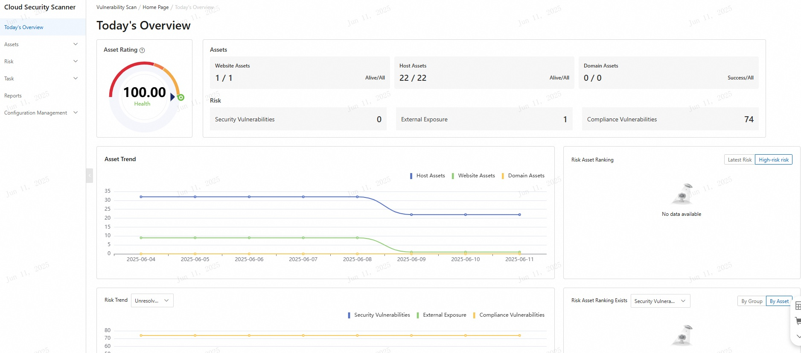

   | Section | Description |
   | --- | --- |
   | Asset Rating | The security rating of the current asset. |

   | Assets | The number of <strong>Host Assets</strong>, <strong>Website Assets</strong>, and <strong>Domain Assets</strong> today. |
   | --- | --- |
   | Risk | The number of <strong>Security Vulnerabilities</strong>, <strong>External Exposure</strong>, and <strong>Compliance Vulnerabilities</strong>. |
   | Asset Trend | The trends in the number of protected <strong>Host Assets</strong>, <strong>Website Assets</strong>, and <strong>Domain Assets</strong> over time. <strong>Host Assets</strong>, <strong>Website Assets</strong>, and <strong>Domain Assets</strong> are identified by lines in different colors. You can move the pointer over a line to view the number of protected host, website, and domain assets for the specific day. |
   | Risk Trend | Select <strong>Unresolved</strong> or <strong>Fixed</strong> from the drop-down list to view the trend charts of <strong>unfixed</strong> and <strong>fixed</strong> <strong>Security Vulnerabilities</strong>, <strong>External</strong> <strong>Exposure</strong>, and <strong>Compliance Vulnerabilities</strong>. <strong>Security Vulnerabilities</strong>, <strong>External Exposure</strong>, and <strong>Compliance</strong> <strong>Vulnerabilities</strong> are identified by lines in different colors. You can move the pointer over a line to view the numbers of <strong>Security Vulnerabilities</strong>, <strong>External Exposure</strong>, and <strong>Compliance Vulnerabilities</strong> today. |
   | Risk Asset Ranking | Click <strong>Latest Risk</strong> or <strong>High-risk risk</strong> to view the top 10 risky assets of the corresponding category. |
   | Risky Asset Ranking Exists | Select <strong>Security Vulnerabilities</strong>, <strong>External Exposure</strong>, or <strong>Compliance</strong> <strong>Vulnerabilities</strong> from the drop-down list, and the top five risky assets with <strong>Security Vulnerabilities</strong>, <strong>External Exposure</strong>, or <strong>Compliance</strong> <strong>Vulnerabilities</strong> are displayed. These assets are displayed by asset or group. |

## 3.2. Assets

### 3.2.1. Asset analysis

You can use the asset analysis feature to view the number of assets, assets at risk, and assets updated. You can also obtain information about host assets, such as host ports, host services, and operating systems. This topic describes how to view the analysis results of website assets, host assets, and domain assets.

**Procedure**

1. Log on to the Apsara Uni-manager Management Console.

2. In the upper-right corner of the Apsara Uni-manager Management Console, choose **Security** > **Security Management > Cloud Security Scanner**. On the **Cloud Security Scanner** page, select a region from the **Region** drop-down list and click **Access with Authorized Role**.

   > **Note**
   >
   > - In multi-level organization mode, all data permissions are managed by using resource sets in organizations. You can select an organization or a resource set in the top navigation bar of the console to view or manage the assets of the organization or resource set.
   >
   > - The parent organization has the highest management permissions. Modifications to the parent organization take effect on all child organizations and resource sets that belong to the parent organization. Proceed with caution when you modify the configurations.

3. In the left-side navigation pane, choose **Assets > Asset Analysis**.

4. On the **Asset Analysis** page, you can view statistical charts of **Website Assets**, **Host Assets**, and **Domain Assets**, including **Asset Overview**, **Host Port Service**, **Top 5 Website Fingerprints**, **Top 5 Domain Resolutions**, **Top 5 Hosts By Open Ports**, **Top 5 High-Risk Ports**, **Top 5 Host Ports**, **Top 5 Host Services**, **Top 5 Host Asset Device Types**, **Top 5 Operating Systems**, and **Website Status Code Distribution**.

   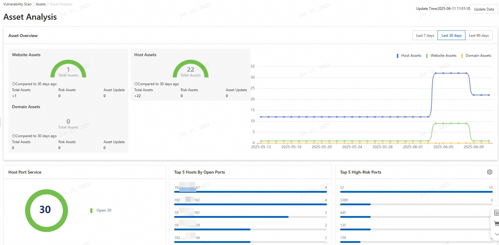

5. Click **Update Data** in the upper-right corner to manually update all statistical charts.

### 3.2.2. Website assets

This topic describes how to view and manage website assets that are imported to Cloud Security Scanner.

**Procedure**

1. Log in to the Apsara Uni-manager Management Console.

2. In the upper-right corner of the Apsara Uni-manager Management Console, choose **Security** > **Security Management > Cloud Security Scanner**. On the **Cloud Security Scanner** page, select a region from the **Region** drop-down list and click **Access with Authorized Role**.

   > **Note**
   >
   > - In multi-level organization mode, all data permissions are managed by using resource sets in organizations. You can select an organization or a resource set in the top navigation bar of the console to view or manage the assets of the organization or resource set.
   >
   > - The parent organization has the highest management permissions. Modifications to the parent organization take effect on all child organizations and resource sets that belong to the parent organization. Proceed with caution when you modify the configurations.

3. In the left-side navigation pane, choose **Assets > Web Assets**.

4. On the **Website Assets** page, manage website assets.

   - As shown in the following figure, you can search for assets by specifying filter conditions, such as **Risk Level**, **Change Status**, **Website Type**, **Status Code**, **Asset Group**, **Staff**, **Fingerprints**, **Asset Tag**, **VPC**, **Sources**, and **Is WAF recognition enabled?** You can also search for assets based on **Update Time** and keywords.

     You can click **Edit** next to **Asset Group**, **Staff**, or **Asset Tag** to add an asset group, owner, or asset tag.

   - Click **Export** above the asset list to export the asset list as an Excel file.

   - You can view or manage a single website address by clicking the corresponding operation in the Operation column of the website asset list. You can also select multiple website addresses and click the corresponding operation below the website asset list to view or manage them at a time.

     | Operation | Description |
     | --- | --- |
     | Detail | Find the website asset that you want to view and click Detail in the Operation column to go to the website asset details page. The details of the website asset are displayed on the <strong>Security Vulnerabilities</strong>, <strong>Compliance Vulnerabilities</strong>, <strong>Site Map</strong>, and <strong>Change Status</strong> tabs. |
     | Change Group | Change the group of website assets. You can change the group to <strong>Existing groups</strong> or <strong>Create Group</strong>. |
     | Change Staff | Change the owner of website assets. You can change the owner to <strong>Existing Staffs</strong> or <strong>New Staff</strong>. |
     | <strong>Delete</strong>/<strong>Batch</strong> Delete | Delete one or more website assets. After a website asset is deleted, the website asset is no longer scanned by the Cloud Security Scanner. |
     | Add Asset Tag | Add tags to assets. |

     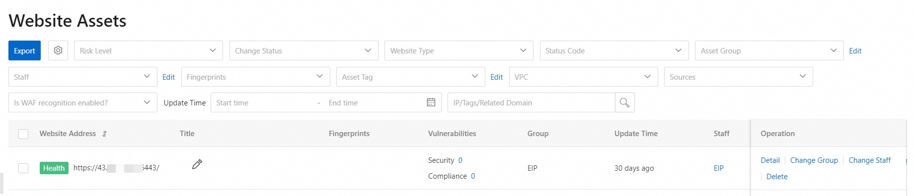

### 3.2.3. Host assets

This topic describes how to view and manage host assets that are imported to Cloud Security Scanner.

**Procedure**

1. Log in to the Apsara Uni-manager Management Console.

2. In the upper-right corner of the Apsara Uni-manager Management Console, choose **Security** > **Security Management > Cloud Security Scanner**. On the **Cloud Security Scanner** page, select a region from the **Region** drop-down list and click **Access with Authorized Role**.

   > **Note**
   >
   > - In multi-level organization mode, all data permissions are managed by using resource sets in organizations. You can select an organization or a resource set in the top navigation bar of the console to view or manage the assets of the organization or resource set.
   >
   > - The parent organization has the highest management permissions. Modifications to the parent organization take effect on all child organizations and resource sets that belong to the parent organization. Proceed with caution when you modify the configurations.

3. In the left-side navigation pane, choose **Assets > Host Assets**.

4. On the **Host Assets** page, manage host assets.

   - As shown in the following figure, you can search for assets by specifying filter conditions, such as **Risk Level**, **Service**, **Change Status**, **Asset Group**, **Alive status**, **Fingerprints**, **Asset Tag**, **VPC**, **Please select a port**, **Operating System**, **Staff**, **Sources**, **CDN Recognition**, and **Device Types**. You can also search for assets based on **Update Time** and keywords.

     - Click **Edit** next to the filter condition to add an asset group, owner, or asset tag.

     - Click **Export** above the asset list to export the asset list as an Excel file.

     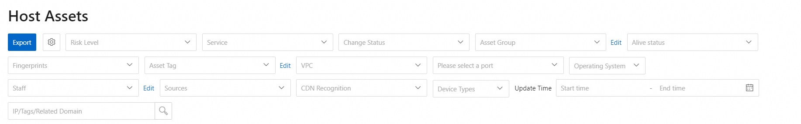

   - You can view or manage a single host address by clicking the corresponding operation in the Operation column of the host asset list. You can also select multiple host addresses and click the corresponding operation below the host asset list to view or manage them at a time.

     | Operation | Description |
     | --- | --- |
     | Detail | Click Detail in the Operation column to go to the host asset details page.The details include <strong>Host Topology</strong>, <strong>Security Vulnerabilities</strong>, <strong>Compliance Vulnerabilities</strong>, <strong>Host Service</strong>, and <strong>Change Status</strong>, as shown in the figure below. |
     | Change Group | Change the group of host assets. You can change the group to <strong>Existing</strong> <strong>Groups</strong> or <strong>Create Group</strong>. |
     | Change Staff | Change the owner of host assets. You can change the owner to <strong>Existing</strong> <strong>Staffs</strong> or <strong>New Staff</strong>. |
     | Add Asset Tag | Add tags to assets for management. |
     | <strong>Delete</strong>/<strong>Batch</strong> Delete | Delete one or more host assets. After a host asset is deleted, the host asset is no longer scanned by the Cloud Security Scanner. |

     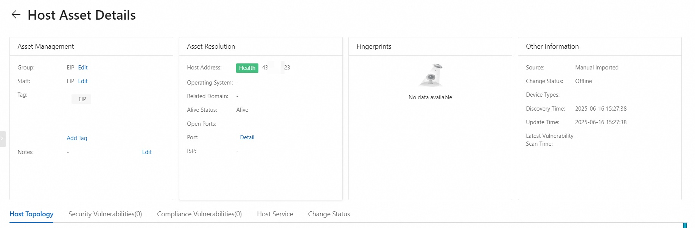

### 3.2.4. Domain assets

This topic describes how to view and manage domain assets that are imported to Cloud Security Scanner.

**Procedure**

1. Log on to the Apsara Uni-manager Management Console.

2. In the upper-right corner of the Apsara Uni-manager Management Console, choose **Security** > **Security Management > Cloud Security Scanner**. On the **Cloud Security Scanner** page, select a region from the **Region** drop-down list and click **Access with Authorized Role**.

   > **Note**
   >
   > - In multi-level organization mode, all data permissions are managed by using resource sets in organizations. You can select an organization or a resource set in the top navigation bar of the console to view or manage the assets of the organization or resource set.
   >
   > - The parent organization has the highest management permissions. Modifications to the parent organization take effect on all child organizations and resource sets that belong to the parent organization. Proceed with caution when you modify the configurations.

3. In the left-side navigation pane, choose **Assets > Domain Assets**.

4. On the **Domain Assets** page, manage domain assets.

   - As shown in the following figure, you can search for assets by specifying filter conditions, such as **Resolution Status**, **Change Status**, **Wildcard Resolution**, **Asset Group**, **Staff**, **Asset Tag**, **Sources**, and **VPC**. You can also search for assets based on **Update Time** and keywords.

     - Click **Edit** next to the filter condition to add an asset group, owner, or asset tag.

     - Click **Export** above the asset list to export the asset list as an Excel file.

   - You can perform the following operations to view or manage domain assets.

     | Operation | Description |
     | --- | --- |
     | Detail | Click Detail in the Operation column to go to the host asset details page.The details include <strong>Whois</strong>, <strong>Resolution History</strong>, and <strong>Risk Analysis</strong>, as shown in the figure below. |
     | Change Group | Change the group of assets in batches. You can change the group to <strong>Existing groups</strong> or <strong>Create Group</strong>. |
     | Change Staff | Change the owner of assets in batches. You can change the owner to <strong>Existing Staffs</strong> or <strong>New Staff</strong>. |
     | Add Asset Tag | Add tags to assets for management. |
     | Batch Delete | Delete assets in batches. After the assets are deleted, they will not be scanned by Cloud Security Scanner. |

     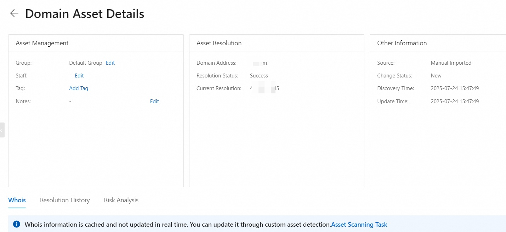

## 3.3. Risks

### 3.3.1. Risk analysis

This topic describes how to view the analysis results of security vulnerabilities, compliance vulnerabilities, and external exposure risks.

**Procedure**

1. Log on to the Apsara Uni-manager Management Console.

2. In the upper-right corner of the Apsara Uni-manager Management Console, choose **Security** > **Security Management > Cloud Security Scanner**. On the **Cloud Security Scanner** page, select a region from the **Region** drop-down list and click **Access with Authorized Role**.

   > **Note**
   >
   > - In multi-level organization mode, all data permissions are managed by using resource sets in organizations. You can select an organization or a resource set in the top navigation bar of the console to view or manage the assets of the organization or resource set.
   >
   > - The parent organization has the highest management permissions. Modifications to the parent organization take effect on all child organizations and resource sets that belong to the parent organization. Proceed with caution when you modify the configurations.

3. In the left-side navigation pane, choose **Risk > Risk Analysis**.

4. On the **Risk Analysis** page, you can view statistical charts of **Risk Overview**, **Vuln Type Distribution**, **Top 5 CMS Application Vulnerabilities**, **Top 5 Operations Security Risks**, **Top 5 High-Risk Website Assets**, **Top 5 High-Risk Host Assets**, and **Top 5 Weak Password Risk**.

5. Click **Update Time** in the upper-right corner to manually update all statistical charts.

### 3.3.2. Security vulnerabilities

This topic describes how to view and handle the security vulnerabilities detected by Cloud Security Scanner.

**Procedure**

**Create a risk scan**

1. Log on to the Apsara Uni-manager Management Console.

2. In the upper-right corner of the Apsara Uni-manager Management Console, choose **Security** > **Security Management > Cloud Security Scanner**. On the **Cloud Security Scanner** page, select a region from the **Region** drop-down list and click **Access with Authorized Role**.

   > **Note**
   >
   > - In multi-level organization mode, all data permissions are managed by using resource sets in organizations. You can select an organization or a resource set in the top navigation bar of the console to view or manage the assets of the organization or resource set.
   >
   > - The parent organization has the highest management permissions. Modifications to the parent organization take effect on all child organizations and resource sets that belong to the parent organization. Proceed with caution when you modify the configurations.

3. In the left-side navigation pane, choose **Risk > Security Vulnerability**.

4. On the **Security Vulnerability** page, click **New Risk Scan**, configure basic information, and click **Confirm**.

**View security vulnerabilities**

Security administrators can view the security vulnerabilities detected by Cloud Security Scanner.

1. In the left-side navigation pane, choose **Risk > Security Vulnerability**.

2. View the list of fixed and unfixed vulnerabilities.

   - Click the **Unresolved** or **Fixed** tab to view **unfixed vulnerabilities** or **fixed vulnerabilities**.

   - View risk statistics, including **Risk Name**, **Risk Address**, **Processing Status**, **Detection Status**, **Update Time**, and **Group**.

   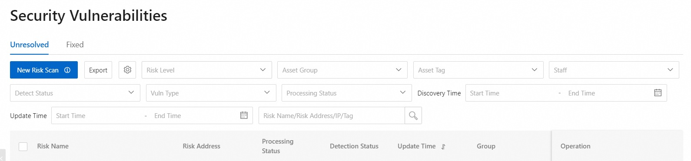

3. Search for security vulnerabilities by specifying **Risk Level**, **Asset Group**, **Asset Tag**, **Staff**, **Detect Status**, **Discovery Time**, **Update Time**, and keywords.

4. Handle security vulnerabilities.

   Security administrators can analyze and confirm whether a security vulnerability affects the security of assets based on information in the list of vulnerabilities.

   - Confirm risks If a security vulnerability affects the security of assets, confirm it after the vulnerability is fixed.

   - Ignore risks

     If a vulnerability is a false positive or does not affect the security of assets, ignore it.

5. Click **Export** to export the list of security vulnerabilities to your on-premises machine.

6. In the list of vulnerabilities, click **Details** in the **Operations** column to go to the vulnerability details page. You can view the CVSS score, threat level, risk overview, risk description, risk impact, risk details, fix suggestions, and request and response of the vulnerability.

   Notes:

   - The risk overview includes the risk address and corresponding asset address, IP address, associated domain name, risk type, first detection time, and last update time of the risk.

   - If a response packet in the request and response content is too large, the response packet will be truncated.

### 3.3.3. Compliance vulnerabilities

This article describes how to view and confirm host compliance vulnerabilities.

**Procedure**

**View risks**

Security administrators can view the host compliance issues that are detected by Cloud Security Scanner.

1. Log in to the Apsara Uni-manager Management Console.

2. In the upper-right corner of the Apsara Uni-manager Management Console, choose **Security** > **Security Management > Cloud Security Scanner**. On the **Cloud Security Scanner** page, select a region from the **Region** drop-down list and click **Access with Authorized Role**.

   > **Note**
   >
   > - In multi-level organization mode, all data permissions are managed by using resource sets in organizations. You can select an organization or a resource set in the top navigation bar of the console to view or manage the assets of the organization or resource set.
   >
   > - The parent organization has the highest management permissions. Modifications to the parent organization take effect on all child organizations and resource sets that belong to the parent organization. Proceed with caution when you modify the configurations.

3. In the left-side navigation pane, choose **Risk > Compliance Vulnerability**.

4. View host compliance risks.

   - Click the **Unresolved** or **Fixed** tab to view **unfixed vulnerabilities** or **fixed vulnerabilities**.

   - Search for host compliance risks by specifying **Risk Level**, **Asset Group**, **Staff**, **Detect Status**, **Please select a port**, **Asset Tag**, **Processing Status**, **Attack Complexity**, **Permission Requirements**, **Availability Impact**, **Use Code**, **Discovery Time**, **Update Time**, and keywords.

   - View risk statistics, including **Risk Name**, **Risk Serial**, **Asset Address**, **Attack Complexity**, **Permission Requirements**, **Availability**, **Use Code,** **Detection Status**, and **Update Time**.

5. Click **Export** to export the list of host compliance risks to **Reports** on your computer.

   You can download, delete, and forward the exported reports. For more information, see Manage reports.

**Handle risks**

1. In the left-side navigation pane, choose **Risk > Compliance Vulnerability**.

2. Click the **Unresolved** or **Fixed** tab. You can perform the following operations to handle vulnerabilities in the list.

   - **Details**: Click **Details** in the **Operation** column to view details in the risk details panel. You can handle risk items based on the provided fix suggestions and related links.

   - **Rescan**: Click **Rescan** in the **Operation** column to detect vulnerabilities again.

   - **Process**:

     - **Pending Repair**: Change the status of the risk to Pending Repair. You can handle risks in this status in a unified manner later.

     - **Ignore**: You can ignore the risk item if it is a false positive or a non-risk item.

   - **Batch Processing**: Select risk items for batch processing.

   - **Batch Rescan**: Select risk items for batch rescan.

### 3.3.4. External exposure

This topic describes how to view and confirm external exposure risks, such as code leaks.

**Prerequisites**

A GitHub account is available, and the tokens of the account are obtained.

**Procedure**

**View risks**

Security administrators can use Cloud Security Scanner to check whether the GitHub repository has risks of code leaks.

1. Log in to the Apsara Uni-manager Management Console.

2. In the upper-right corner of the Apsara Uni-manager Management Console, choose **Security** > **Security Management > Cloud Security Scanner**. On the **Cloud Security Scanner** page, select a region from the **Region** drop-down list and click **Access with Authorized Role**.

   > **Note**
   >
   > - In multi-level organization mode, all data permissions are managed by using resource sets in organizations. You can select an organization or a resource set in the top navigation bar of the console to view or manage the assets of the organization or resource set.
   >
   > - The parent organization has the highest management permissions. Modifications to the parent organization take effect on all child organizations and resource sets that belong to the parent organization. Proceed with caution when you modify the configurations.

3. In the left-side navigation pane, choose **Risk > Exposure**.

4. View the list of code leak risks.

   - Click the **Unresolved** or **Fixed** tab to view unfixed or fixed vulnerabilities.

   - Search for external exposure risks by specifying **Risk Level**, **Asset Group**, **Staff**, **Processing Status**, **Discovery Time**, **Update Time**, and keywords.

   - View the risk statistics, including **Risk Name**, **Risk Address**, **Processing Status**, **Detection Status**, and **Update Time**.

5. Click **Export** to export the list of vulnerabilities to your on-premises machine.

**Handle risks**

1. In the left-side navigation pane, choose **Risk > Exposure**.

2. Click the **Unresolved** or **Fixed** tab. You can perform the following operations to handle risks in the list.

   - **Details**: Click **Details** in the **Operation** column to view details in the risk details panel. You can handle risk items based on the **Repair Suggestion**.

   - **Process**:

     - **Pending Repair**: Change the status of the risk to Pending Repair. You can handle risks in this status in a unified manner later.

     - **Ignore**: You can ignore the risk item if it is a false positive or a non-risk item.

   - **Batch Processing**: Select risk items for batch processing.

## 3.4. Tasks

### 3.4.1. Task list

#### 3.4.1.1. Asset import

This topic describes how to create a task to import public and private assets.

**Usage notes**

- Cloud Security Scanner scans only imported assets, so you must import assets before vulnerability scan .

- Cloud Security Scanner allows you to add asset import tasks based on configured asset scan templates, and to discover and import IP addresses, domains, and website assets according to the corresponding scan policy. In addition, it allows you to detect asset liveness over TCP or ICMP. You can also perform service scanning and identification on specific or all ports to discover the fingerprints of asset operating systems and middleware. For more information about asset scan templates, see Asset scan template.

- Cloud Security Scanner supports public assets and private assets. Private assets refer to the assets in a virtual private cloud (VPC).

  Before you import private assets, you must first add a scan engine. For more information, see Configure a scan engine for internal scan.

**Create asset import tasks**

1. Log on to the Apsara Uni-manager Management Console.

2. In the upper-right corner of the Apsara Uni-manager Management Console, choose **Security** > **Security Management > Cloud Security Scanner**. On the **Cloud Security Scanner** page, select a region from the **Region** drop-down list and click **Access with Authorized Role**.

   > **Note**
   >
   > - In multi-level organization mode, all data permissions are managed by using resource sets in organizations. You can select an organization or a resource set in the top navigation bar of the console to view or manage the assets of the organization or resource set.
   >
   > - The parent organization has the highest management permissions. Modifications to the parent organization take effect on all child organizations and resource sets that belong to the parent organization. Proceed with caution when you modify the configurations.

3. In the left-side navigation pane, choose **Task > Tasks**.

4. On the Task List page, click **New Task** and select **Asset Import** to create an asset import task.

**Public assets**

- Import **EIP assets** and **SLB assets**

  On the **Public Network Assets** tab of the **Asset Import** page, **EIP Asset** and **SLB Asset** are automatically imported and monitored. Click **Sync New Assets** to add an asset.

- Import **public assets**

  On the **Public Network Assets** tab of the **Asset Import** page, click **Public Network Assets** to add a public asset.

  <ol type="i">

  <li>

  In the **Basic Configuration** section, specify **Task Name**, **Task Template**, and **Scanning Method**.

  > **Note**
  >
  > **Task Template** refers to the asset scan template. It specifies the scan policy for imported assets. In the left-side navigation pane, you can choose **Task > Templates** to add or delete asset scan templates. For more information, see Template list.

  </li>

  <li>

  In the **Target Assets** section, enter custom IP addresses in the **Custom IP** field.

  - You can enter domain names, URLs, IP addresses, and CIDR blocks.

  - You can enter the information about multiple assets at a time. Press Enter after you enter the information about one asset.

  - Do not enter information about assets in VPCs.

  - The number of imported assets must be less than the number of remaining assets supported by the platform.

    > **Note**
    >
    > For example, if the number of remaining assets supported by the platform is 100 and you enter the information of 90 assets, all the assets can be scanned. If you enter the information of 110 assets, only 100 assets will be scanned, and the 10 assets that remain will not be scanned.

  </li>

  <li>

  In the **Target Assets** section, specify the asset group, owner, tag, and **Should inactive**

  </li>

  </ol>

  **assets be included in the inventory?**

  - Select an asset group from the **Group** drop-down list.

  - Select an asset owner from the **Staff** drop-down list.

  - On the right side of **Tag**, click the

    icon to add tags to the imported assets.

  > **Note**
  >
  > In the left-side navigation pane, you can choose **Assets > Web Assets**, **Assets > Host Assets**, or **Assets > Domain Assets** to create, edit, or delete asset groups, owners, and tags. For more information, see Manage assets.

  <ol type="i" start="4">

  <li>

  Click **Confirm**.

  </li>

  </ol>

**Private assets**

1. On the **Asset Import** page, click the **Private Network Assets** tab.

2. In the **Basic Configuration** section, specify **Task Name**, **Task Template**, and **Scanning Method**.

   > **Note**
   >
   > **Task Template** refers to the asset scan template. It specifies the scan policy for imported assets. In the left-side navigation pane, you can choose **Task > Templates** to add or delete asset scan templates. For more information, see Template list.

3. In the **Target Assets** section, select a VPC, enter a private IP address in the **Private IP** field, and add custom asset addresses in the **Asset Address** field.

   - You can enter domain names, URLs, IP addresses, and CIDR blocks.

   - You can enter the information about multiple assets at a time. Press Enter after you enter the information about one asset.

   - The number of imported assets must be less than the number of remaining assets supported by the platform.

     > **Note**
     >
     > For example, if the number of remaining assets supported by the platform is 100 and you enter the information of 90 assets, all the assets can be scanned. If you enter the information of 110 assets, only 100 assets will be scanned, and the 10 assets that remain will not be scanned.

4. In the **Target Assets** section, specify the asset group, owner, tag, and **Should inactive assets be included in the inventory?**

   - Select an asset group from the **Group** drop-down list.

   - Select an asset owner from the **Staff** drop-down list.

   - On the right side of **Tag**, click the

     icon to add tags to the imported assets.

   > **Note**
   >
   > In the left-side navigation pane, you can choose **Assets > Web Assets**, **Assets > Host Assets**, or **Assets > Domain Assets** to create, edit, or delete asset groups, owners, and tags. For more information, see Manage assets.

5. Click **Confirm**.

**Manage asset import tasks**

After the asset import task is created, you can view all asset import tasks in the task list.

1. On the **Task List** page, set task type to **Asset Import** to view the imported assets. You can also search for and filter assets by **Task Status**, **Task Template**, or **Execution Method**.

2. You can perform the following operations on asset tasks.

   <table>
     <tr>
       <th>Operation</th>
       <th>Description</th>
     </tr>
     <tr>
       <td>Details</td>
       <td>View the details of the asset scan. Note • Import process: displays detailed logs and timeline of the current detection progress and supports querying by keyword. For example, the number of website assets, host assets, and domain assets discovered when the progress reaches 80%. • Import results: identifies imported assets as <strong>New Import</strong> and <strong>Already Exists</strong> and displays them based on the parent-child relationship of the assets.</td>
     </tr>
     <tr>
       <td>Execute Again</td>
       <td>Re-execute the asset import task.</td>
     </tr>
     <tr>
       <td>Delete</td>
       <td>Delete the asset import task.</td>
     </tr>
     <tr>
       <td>Batch Delete</td>
       <td rowspan="4">Select the check boxes before multiple asset tasks to perform batch operations on them.</td>
     </tr>
     <tr>
       <td>Batch Execution</td>
     </tr>
     <tr>
       <td>Batch Suspend</td>
     </tr>
     <tr>
       <td>Batch Stop</td>
     </tr>
   </table>

#### 3.4.1.2. Risk scan

This topic describes how to create a risk scan task for an asset.

**Procedure**

1. Log in to the Apsara Uni-manager Management Console.

2. In the upper-right corner of the Apsara Uni-manager Management Console, choose **Security** > **Security Management > Cloud Security Scanner**. On the **Cloud Security Scanner** page, select a region from the **Region** drop-down list and click **Access with Authorized Role**.

   > **Note**
   >
   > - In multi-level organization mode, all data permissions are managed by using resource sets in organizations. You can select an organization or a resource set in the top navigation bar of the console to view or manage the assets of the organization or resource set.
   >
   > - The parent organization has the highest management permissions. Modifications to the parent organization take effect on all child organizations and resource sets that belong to the parent organization. Proceed with caution when you modify the configurations.

3. In the left-side navigation pane, choose **Task > Tasks**.

4. On the Task List page, click **New Task** and select **Risk Scan**.

5. On the Create Risk Scan Task page, specify the parameters in the Basic Configuration section and click **Confirm**. The following table describes the parameters.

   | Parameter | Description |
   | --- | --- |
   | Task Name | Specify a name for the risk scan task. |
   | Task Template | Select a risk scan task template. Cloud Security Scanner allows you to add asset risk scan tasks based on configured risk scan templates. It initiates one-time or periodic vulnerability scans of websites and hosts according to corresponding scan policies. It can detect security vulnerabilities and compliance vulnerabilities by using technical methods such as POC plug-ins and web crawlers. For more information about risk scan templates, see Risk scan template. |
   | Execution Method | Select an execution method for the risk scan task. Valid values: <strong>Immediately</strong>, <strong>Scheduled</strong>, and <strong>Periodic</strong>. You can select Customize, Once a week, or Once a month for <strong>Periodic</strong>. • Customize: Specify the number of days between risk scan tasks and the time range on the day of the scan. • Once a week: Specify a risk scan cycle every week, and select the days of each week and the time range in which you want to perform the scan. • Once a month: Specify a risk scan cycle every month, and select the days of each month and the time range in which you want to perform the scan. |
   | VPC | Select one or more virtual private clouds (VPCs) based on your business requirements. Make sure that the scan engine is authorized for the selected VPC. After the authorization is complete, assets within the VPC can be scanned for vulnerabilities. For more information, see Engine management. |
   | Target | Specify the target of the risk scan task. Valid values: <strong>All</strong>, <strong>Website</strong>, <strong>Host</strong>, <strong>By Group</strong>, <strong>By Tag</strong>, and <strong>By Staff</strong>. |

#### 3.4.1.3. Scan assets

This topic describes how to create an asset discovery task.

**Procedure**

1. Log in to the Apsara Uni-manager Management Console.

2. In the upper-right corner of the Apsara Uni-manager Management Console, choose **Security** > **Security Management > Cloud Security Scanner**. On the **Cloud Security Scanner** page, select a region from the **Region** drop-down list and click **Access with Authorized Role**.

   > **Note**
   >
   > - In multi-level organization mode, all data permissions are managed by using resource sets in organizations. You can select an organization or a resource set in the top navigation bar of the console to view or manage the assets of the organization or resource set.
   >
   > - The parent organization has the highest management permissions. Modifications to the parent organization take effect on all child organizations and resource sets that belong to the parent organization. Proceed with caution when you modify the configurations.

3. In the left-side navigation pane, choose **Task > Tasks**.

4. On the Task List page, click **New Task** and select **Asset Scan**.

5. On the Create Asset Scan Task page, specify the parameters in the Basic Configuration section and click **Confirm**. The following table describes the parameters.

   | Parameter | Description |
   | --- | --- |
   | Task Name | Specify a name for the asset scan task. |
   | Task Template | Select an asset scan task template. Cloud Security Scanner allows you to add asset security scan tasks based on configured asset scan templates. It automatically discovers associated assets and enterprise boundary assets according to corresponding scan policies, and supports one-time or periodic activity detection for target assets. It also identifies subdomain and multi-level domain names. For more information about asset scan templates, see Asset scan template. |
   | Execution Method | Select an execution method for the asset scan task. Valid values: <strong>Immediately</strong>, <strong>Scheduled</strong>, and <strong>Periodic</strong>. You can select Customize, Once a week, or Once a month for <strong>Periodic</strong>. • Customize: Specify the number of days between asset scan tasks and the time range on the day of the scan. • Once a week: Specify an asset scan cycle every week, and select the days of each week and the time range in which you want to perform the scan. • Once a month: Specify an asset scan cycle every month, and select the days of each month and the time range in which you want to perform the scan. |
   | VPC | Select the virtual private cloud (VPC) in which the asset is deployed. Make sure that the scan engine is authorized for the selected VPC. After the authorization is complete, assets within the VPC can be scanned for vulnerabilities. For more information, see Engine management. |
   | Target | Specify the target of the asset scan task. Valid values: <strong>All</strong>, <strong>Website</strong>, <strong>Host</strong>, <strong>Domain Name</strong>, <strong>By Group</strong>, <strong>By Tag</strong>, and <strong>By Staff</strong>. |

### 3.4.2. Template list

#### 3.4.2.1. Asset scan template

This topic describes how to create an asset scan template for asset discovery and asset security scans.

**Scan template configuration description**

- Manage the asset scan rate, lost packet retransmission times, scan ports, and host liveness detection policies. You can customize port settings and restore the default settings.

- Select a scan policy and specify additional ports and excluded ports. If a port is added to both additional ports and excluded ports, it is treated as an excluded port.

- Specify the switches of the asset discovery policy, including whether to enable automatic synchronization of asset information, automatic import of associated IP addresses, subdomain discovery, and reverse lookup of IP addresses. (These features are disabled by default.)

**Procedure**

1. Log on to the Apsara Uni-manager Management Console.

2. In the upper-right corner of the Apsara Uni-manager Management Console, choose **Security** > **Security Management > Cloud Security Scanner**. On the **Cloud Security Scanner** page, select a region from the **Region** drop-down list and click **Access with Authorized Role**.

   > **Note**
   >
   > - In multi-level organization mode, all data permissions are managed by using resource sets in organizations. You can select an organization or a resource set in the top navigation bar of the console to view or manage the assets of the organization or resource set.
   >
   > - The parent organization has the highest management permissions. Modifications to the parent organization take effect on all child organizations and resource sets that belong to the parent organization. Proceed with caution when you modify the configurations.

3. In the left-side navigation pane, choose **Task > Templates**.

4. On the Template List page, click **New Template** and select **Asset Scan Template**.

5. Configure the basic information of the asset scan template.

   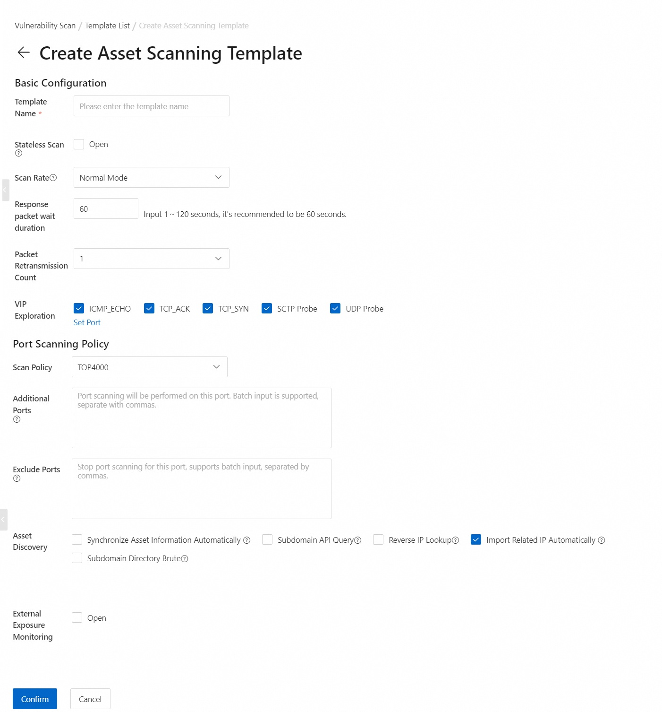

6. Click **Confirm**.

#### 3.4.2.2. Risk scan template

This topic describes how to create a risk scan template for the scans of asset vulnerabilities, security vulnerabilities, and compliance vulnerabilities.

**Scan template configuration description**

Manages the basic detection switch (enabled by default), risk type detection items, web risk detection, and user agent settings.

**Procedure**

1. Log on to the Apsara Uni-manager Management Console.

2. In the upper-right corner of the Apsara Uni-manager Management Console, choose **Security** > **Security Management > Cloud Security Scanner**. On the **Cloud Security Scanner** page, select a region from the **Region** drop-down list and click **Access with Authorized Role**.

   > **Note**
   >
   > - In multi-level organization mode, all data permissions are managed by using resource sets in organizations. You can select an organization or a resource set in the top navigation bar of the console to view or manage the assets of the organization or resource set.
   >
   > - The parent organization has the highest management permissions. Modifications to the parent organization take effect on all child organizations and resource sets that belong to the parent organization. Proceed with caution when you modify the configurations.

3. In the left-side navigation pane, choose **Task > Templates**.

4. On the template list page, click **New Template** and select **Risk Scan Template**.

5. Configure the basic information of the risk scan template.

   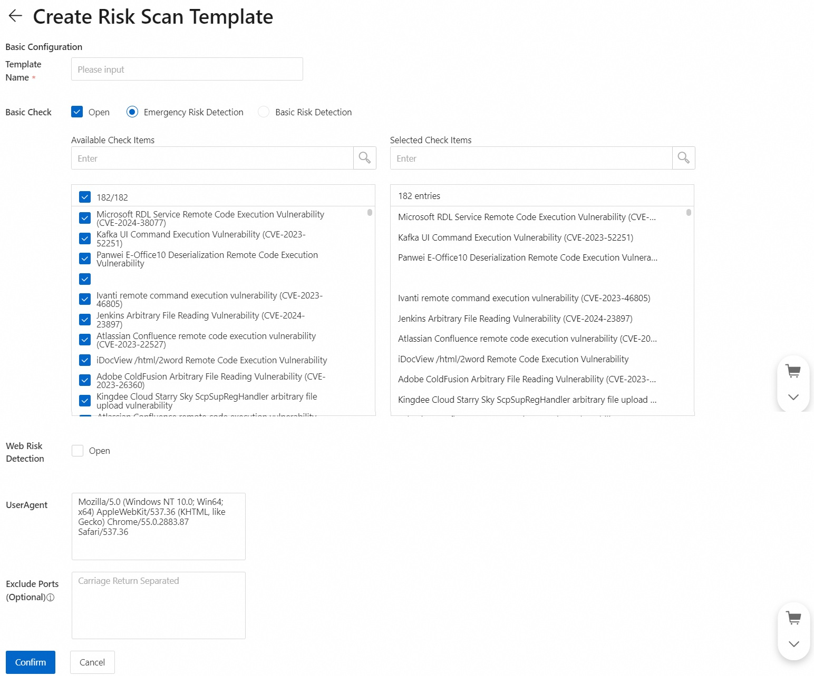

6. Click **Confirm**.

## 3.5. Manage reports

A security administrator can create a report to view the security status of specific assets during a period of time and implement improved security measures as required. This topic describes how to create, download, delete, and forward a report.

**Create a report**

1. Log in to the Apsara Uni-manager Management Console.

2. In the upper-right corner of the Apsara Uni-manager Management Console, choose **Security** > **Security Management > Cloud Security Scanner**. On the **Cloud Security Scanner** page, select a region from the **Region** drop-down list and click **Access with Authorized Role**.

   > **Note**
   >
   > - In multi-level organization mode, all data permissions are managed by using resource sets in organizations. You can select an organization or a resource set in the top navigation bar of the console to view or manage the assets of the organization or resource set.
   >
   > - The parent organization has the highest management permissions. Modifications to the parent organization take effect on all child organizations and resource sets that belong to the parent organization. Proceed with caution when you modify the configurations.

3. In the left-side navigation pane, click **Report List**.

4. On the **Report Export** page, click **Add Report**.

5. On the Add Report page, configure the report parameters and click **Confirm**. The following table describes the parameters.

   **Risk assessment report**

   | Parameter | Description |
   | --- | --- |
   | Report Name | The name of the report that you want to create. |
   | Report Type | The type of the report that you want to create. Select <strong>Risk Assessment Report</strong>. |
   | Asset Scope | The scope of assets to be covered by the report and the corresponding monitoring targets. Valid values: <strong>All</strong>, <strong>Website</strong>, <strong>Host</strong>, <strong>By Group</strong>, <strong>By Tag</strong>, and <strong>By Staff</strong>. |
   | Risk Scope | The scope of risks to be covered by the report. Valid values: <strong>Fixed</strong> and <strong>Unresolved</strong>. |
   | Vuln Type | The type of vulnerabilities to be covered by the report. Valid values: <strong>Security</strong> <strong>Vulnerabilities</strong> and <strong>Compliance Vulnerabilities</strong>. |
   | Risk Level | The level of risks to be covered by the report. Valid values: <strong>High</strong>, <strong>Medium</strong>, and <strong>Low</strong>. |
   | Logo | Reset the report cover page as prompted. |

   **Asset statistics report**

   | Parameter | Description |
   | --- | --- |
   | Report Name | The name of the report that you want to create. |
   | Report Type | The type of the report that you want to create. Select <strong>Asset Statistics Report</strong>. |
   | Update Time | Select the start time and end time for the update of assets to be covered by the report. |
   | Report Content | The type of assets to be covered by the report. Valid values: <strong>Host Assets</strong>, <strong>Website Assets</strong>, and <strong>Domain Assets</strong>. |

   **Risk statistics report**

   | Parameter | Description |
   | --- | --- |
   | Report Name | The name of the report that you want to create. |
   | Report Type | The type of the report that you want to create. Select <strong>Risk Statistics Report</strong>. |
   | Risk Scope | The scope of risks to be covered by the report. Valid values: <strong>Fixed</strong> and <strong>Unresolved</strong>. |
   | Vuln Type | The type of vulnerabilities to be covered by the report. Valid values: <strong>Security</strong> <strong>Vulnerabilities</strong>, <strong>Compliance Vulnerabilities</strong>, and <strong>External Exposure</strong>. |
   | Risk Level | The level of risks to be covered by the report. Valid values: <strong>High</strong>, <strong>Medium</strong>, and <strong>Low</strong>. |
   | Update Time | Select the start time and end time for the update of risks to be covered by the report. |

**Download a report**

1. In the left-side navigation pane, click **Report List**.

2. In the report list, find the report that you want to download, click **Download** in the **Operation** column, select a format from the **Report Format** drop-down list, and click **OK**.

   > **Note**
   >
   > If only one report export format is available, you do not need to select the format and can download the report directly.

**Delete one or more reports**

- **Delete a single report**

  <ol type="i">

  <li>

  In the left-side navigation pane, click **Report List**.

  </li>

  <li>

  In the report list, find the report that you want to delete, click **Delete** in the **Operation**

  </li>

  </ol>

  column, and click **OK**.

- **Delete multiple reports at a time**

  <ol type="i">

  <li>

  In the left-side navigation pane, click **Report List**.

  </li>

  <li>

  Select a report type from the **Report Type** drop-down list above the report list.

  </li>

  <li>

  In the report list, select the check boxes before the reports that you want to delete.

  </li>

  <li>

  Click **Batch Delete**. Click **OK**.

  </li>

  </ol>

**Forward a report via email**

Before you use the email forwarding feature, make sure that the ANS component is configured on the server. For more information, contact technical support.

1. In the left-side navigation pane, click **Report List**.

2. In the report list, find the report that you want to forward by using email and click **Email Forwarding** in the **Operation** column.

3. In the Scan report email forwarding dialog box, enter the email address to which the report is sent and click **OK**.

   You can click the plus sign (+) to the right of the input field to enter more email addresses.

## 3.6. 配置管理

### 3.6.1. Scan rules

This topic describes how to configure and manage security scan rules for Cloud Security Scanner, including security vulnerability configuration, compliance vulnerability configuration, external exposure configuration, directory brute management, and asset scan whitelist.

**Background information**

You can view and manage the monitoring items and detection results in Cloud Security Scanner based on security scanning rules.

The details of scan rules are maintained and managed in the upgrade center of Alibaba Cloud.

**Procedure**

1. Log on to the Apsara Uni-manager Management Console.

2. In the upper-right corner of the Apsara Uni-manager Management Console, choose **Security** > **Security Management > Cloud Security Scanner**. On the **Cloud Security Scanner** page, select a region from the **Region** drop-down list and click **Access with Authorized Role**.

   > **Note**
   >
   > - In multi-level organization mode, all data permissions are managed by using resource sets in organizations. You can select an organization or a resource set in the top navigation bar of the console to view or manage the assets of the organization or resource set.
   >
   > - The parent organization has the highest management permissions. Modifications to the parent organization take effect on all child organizations and resource sets that belong to the parent organization. Proceed with caution when you modify the configurations.

3. In the left-side navigation pane, choose **Configuration Management > Scan Rules**.

4. View and manage monitoring configuration items.

**Security vulnerability configuration**

- Monitoring results are displayed on the **CMS Application Vulnerabilities** and **Operations Security Vulnerabilities** tabs of the **Security Vulnerability Configuration** tab.

- On the **Weak Password Monitoring** tab of the **Security Vulnerability Configuration** tab, you can configure weak password monitoring rules.

  - By default, all weak password monitoring items use the default weak password library.

  - To disable an enabled monitoring item, click the

    icon in the **Default weak**

    **password** column.

  - To enable a disabled monitoring item, click the

    icon in the **Default weak**

    **password** column.

  - To specify custom weak passwords for a monitoring item, for example, **MySQL weak password vulnerability**, perform the following steps:

    <ol type="a">

    <li>

    In the **Default weak password** column, turn off the switch. The switch status changes

    to  .

    </li>

    <li>

    Click **Edit** in the **Operation** column.

    </li>

    </ol>

    <ol type="i" start="100">

    <li>

    In the dialog box that appears, specify a custom weak password and click **OK**.

    </li>

    </ol>

  - To apply the same custom weak passwords to multiple monitoring items, perform the following steps:

    <ol type="a">

    <li>

    In the **Default weak password** column, turn off the switch. The switch status changes

    to  .

    > **Note**
    >
    > To apply a custom weak password to monitoring items, you must turn off the switch in the Default weak password column of them.

    </li>

    <li>

    Click **Custom Global Weak Passwords**.

    </li>

    </ol>

    <ol type="i" start="100">

    <li>

    In the **Custom Global Weak Passwords** dialog box, specify custom weak passwords and click **OK**.

    </li>

    </ol>

**Compliance vulnerability configuration**

On the **Compliance Vulnerability Configuration** tab, you can enter the CVE, CNVD, and CNNVD numbers to query the monitoring results of the corresponding vulnerability.

**External exposure configuration**

On the **External Exposure Configuration** tab, the inspection results of **Key Database Port Exposure Rule**, **Key Remote Service Exposure Rule**, **Key Port Exposure Rule**, and **Key Service Exposure Rule** are displayed.

- **Key Database Port Exposure Rule**, **Key Remote Service Exposure Rule**, **Key Port Exposure Rule**, and **Key Service Exposure Rule** use default rules in the system.

- You can also configure **Port Opening Prohibited** and **Service opening is prohibited** rules.

- You can perform the following steps to add a rule:

  <ol type="i">

  <li>

  On the **External Exposure Configuration** tab, click **Add**.

  </li>

  <li>

  In the dialog box that appears, specify **Name** and **Exposure Rules**, configure rule

  </li>

  </ol>

  content, and then click **OK**.

**Directory brute management**

On the **Directory Brute Management** tab, you can specify **Brute Directories** and **Brute Rate**.

**Asset scan whitelist**

On the **Asset Scan Whitelist** tab, you can configure the IP address, CIDR block, URL, and domain name of **Prohibit Asset/Vulnerability Scanning** and **Prohibit Vulnerability Scanning** rules. The system does not identify or scan assets added to the whitelist.

Before you add assets to a whitelist, make sure that the assets are secure.

1. On the General Configuration page, click **Add**.

2. In the dialog box that appears, select a rule in the **Rules** field and configure **White List**.

3. Click **OK**.

### 3.6.2. Task management

This topic describes how to view and manage asset import, risk scan, and asset scan tasks.

**Procedure**

The task management feature of Cloud Security Scanner allows you to view pending tasks, running tasks, and tasks in the task queue. You can also manually stop running tasks based on the situation of blocked tasks.

1. Log on to the Apsara Uni-manager Management Console.

2. In the upper-right corner of the Apsara Uni-manager Management Console, choose **Security** > **Security Management > Cloud Security Scanner**. On the **Cloud Security Scanner** page, select a region from the **Region** drop-down list and click **Access with Authorized Role**.

   > **Note**
   >
   > - In multi-level organization mode, all data permissions are managed by using resource sets in organizations. You can select an organization or a resource set in the top navigation bar of the console to view or manage the assets of the organization or resource set.
   >
   > - The parent organization has the highest management permissions. Modifications to the parent organization take effect on all child organizations and resource sets that belong to the parent organization. Proceed with caution when you modify the configurations.

3. In the left-side navigation pane, choose **Configuration Management > Task Management**.

4. On the **Pending** and **Executing** tabs, view the task type, priority, and number of subtasks.

5. On the **Task Queue** tab, view the name, type, and device group ID of the task queue.

6. Manually stop running and pending tasks.

   <ol type="i">

   <li>

   Click **Stop Task** in the upper-right corner of the page.

   </li>

   <li>

   In the dialog box that appears, enter the verification code.

   </li>

   <li>

   Click **OK**.

   </li>

   </ol>

### 3.6.3. System information

This topic describes how to view the vulnerability database version and update records of Cloud Security Scanner, and how to configure the syslog parameter.

**Procedure**

System information includes the current vulnerability database information (version and update records) and system parameters (syslog settings).

1. Log on to the Apsara Uni-manager Management Console.

2. In the upper-right corner of the Apsara Uni-manager Management Console, choose **Security** > **Security Management > Cloud Security Scanner**. On the **Cloud Security Scanner** page, select a region from the **Region** drop-down list and click **Access with Authorized Role**.

   > **Note**
   >
   > - In multi-level organization mode, all data permissions are managed by using resource sets in organizations. You can select an organization or a resource set in the top navigation bar of the console to view or manage the assets of the organization or resource set.
   >
   > - The parent organization has the highest management permissions. Modifications to the parent organization take effect on all child organizations and resource sets that belong to the parent organization. Proceed with caution when you modify the configurations.

3. In the left-side navigation pane, choose **Configuration Management > System Information**.

4. On the **System Information** page, click the **Vulnerability Database Information** tab to view the current vulnerability database version and update records.

5. On the **System Parameters** tab of the **System Information** page, specify **User host**.

### 3.6.4. O&M check

**Procedure**

1. Log in to the Apsara Uni-manager Management Console.

2. In the upper-right corner of the Apsara Uni-manager Management Console, choose **Security** > **Security Management > Cloud Security Scanner**. On the **Cloud Security Scanner** page, select a region from the **Region** drop-down list and click **Access with Authorized Role**.

   > **Note**
   >
   > - In multi-level organization mode, all data permissions are managed by using resource sets in organizations. You can select an organization or a resource set in the top navigation bar of the console to view or manage the assets of the organization or resource set.
   >
   > - The parent organization has the highest management permissions. Modifications to the parent organization take effect on all child organizations and resource sets that belong to the parent organization. Proceed with caution when you modify the configurations.

3. In the left-side navigation pane, choose **Configuration Management > O&M Check**.

4. On the **Network Testing** page, select the VPC where the private engine for vulnerability scan is deployed and the ID of the scan engine, select ping, curl, or telnet for Test Method, enter the corresponding IP address or domain name, and click **Run** on the right side. The following execution result is displayed, based on which you can determine whether any vulnerability exists.

### 3.6.5. Log audit

This topic describes how to view the operation logs of Cloud Security Scanner.

**Background information**

The log audit feature records operation logs and operation results for asset import, risk scans, asset scans, report creation, and scan rule management.

**Procedure**

1. Log on to the Apsara Uni-manager Management Console.

2. In the upper-right corner of the Apsara Uni-manager Management Console, choose **Security** > **Security Management > Cloud Security Scanner**. On the **Cloud Security Scanner** page, select a region from the **Region** drop-down list and click **Access with Authorized Role**.

   > **Note**
   >
   > - In multi-level organization mode, all data permissions are managed by using resource sets in organizations. You can select an organization or a resource set in the top navigation bar of the console to view or manage the assets of the organization or resource set.
   >
   > - The parent organization has the highest management permissions. Modifications to the parent organization take effect on all child organizations and resource sets that belong to the parent organization. Proceed with caution when you modify the configurations.

3. In the left-side navigation pane, choose **Configuration Management > Log Audit**.

4. View the log audit data, including the log type and event result, on different tabs.

   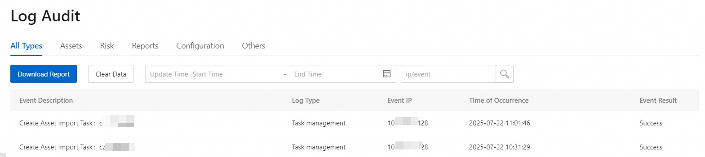

5. Click Download Report above the log list to download the corresponding log report file.

6. Click **Clear Data**. You can choose to retain the log data of **Latest 3 months** or **Latest 6 months**. Data beyond the selected range will be cleared.

### 3.6.6. Engine management

This topic describes how to configure a scan engine.

**Usage notes**

- The private asset engine (private engine) is used to discover and scan private assets.

  You must add a scan engine for a virtual private cloud (VPC) before you can scan for vulnerabilities on the assets of the VPC.

- The public asset engine (public engine) is used to discover and scan public assets.

- You can maintain a list of private engines for each VPC and add an unlimited number of private engines. By default, only two public engines are available and cannot be added or deleted.

**Procedure**

1. Log on to the Apsara Uni-manager Management Console.

2. In the upper-right corner of the Apsara Uni-manager Management Console, choose **Security** > **Security Management > Cloud Security Scanner**. On the **Cloud Security Scanner** page, select a region from the **Region** drop-down list and click **Access with Authorized Role**.

   > **Note**
   >
   > - In multi-level organization mode, all data permissions are managed by using resource sets in organizations. You can select an organization or a resource set in the top navigation bar of the console to view or manage the assets of the organization or resource set.
   >
   > - The parent organization has the highest management permissions. Modifications to the parent organization take effect on all child organizations and resource sets that belong to the parent organization. Proceed with caution when you modify the configurations.

3. In the left-side navigation pane, choose **Configuration Management > Engine Management**.

4. On the **Public Network Engine** tab, you can view the status of the scan engine and turn on Enable Automatic Import of EIP/SLB.

   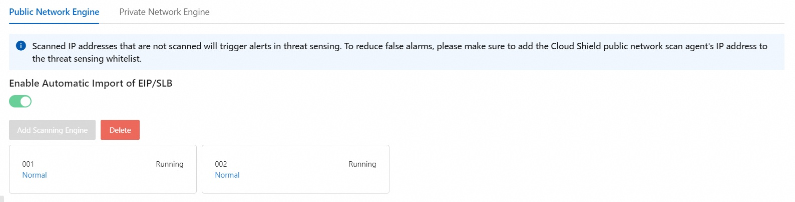

5. Click the **Private Network Engine** tab to configure the scan engine for private assets.

   <ol type="i">

   <li>

   Click the name of the VPC whose assets you want to scan.

   </li>

   <li>

   Click **Add Scanning Engine**.

   </li>

   <li>

   In the **Add Scanning Engine** dialog box, select a vSwitch for the VPC from the **vswitch**

   </li>

   </ol>

   drop-down list.

   <ol type="i" start="4">

   <li>

   Click **OK**.

   </li>

   </ol>

# 4.Apsara Stack Security configurations

## 4.1. Log on to the Apsara Uni-manager Management Console

This topic describes how to log on to the Apsara Uni-manager Management Console.

**Prerequisites**

- The URL of the console that is obtained from the deployment personnel.

- A web browser. We recommend that you use Google Chrome.

**Procedure**

1. Enter the URL of the Apsara Uni-manager Management Console in the address bar and press the Enter key.

2. Enter your username and password.

   You need to obtain the username and password from an operations administrator.

   > **Note**
   >
   > - **First logon**
   >
   >   The first time that you log on to the Apsara Uni-manager Management Console, you need to change the password of your account. The password must be 10 to 32 characters in length. It must contain all of the following character types: uppercase letters, lowercase letters, digits, and special characters. Supported special characters include: ! @ # $ %
   >
   > - **Forget password**
   >
   >   If you have forgotten your password, click Forgot Password. On the page that appears, enter the username of your account, the email address that was used to create the account, and the CAPTCHA code. Then, the system sends a link for resetting the password to the specified email address.

3. Click **Log On**.

4. If multi-factor authentication (MFA) is enabled for your account, perform the corresponding operations in the following scenarios:

   - You log on to the Apsara Uni-manager Management Console for the first time after MFA is enabled by the administrator.

     <ol type="a">

     <li>

     On the Bind Virtual MFA Device page, bind an MFA device.

     </li>

     <li>

     Enter the username and password again as in Step 2 and click **Log On**.

     </li>

     </ol>

     <ol type="i" start="100">

     <li>

     Enter a six-digit MFA verification code and click **Authenticate**.

     </li>

     </ol>

   - You have enabled MFA and bound an MFA device:

     Enter a six-digit MFA verification code and click **Authenticate**.

## 4.2. 规则运营

### 4.2.1. Create and manage IPS rules

Cloud Firewall provides built-in intrusion prevention system (IPS) rules. You can create custom IPS rules based on your business requirements and network environment to monitor the operations of Cloud Firewall. This topic describes how to create and manage custom IPS rules.

**Procedure**

1. Log on to the Apsara Uni-manager Management Console.

2. In the upper-right corner of the Apsara Uni-manager Management Console, choose **Security** > **Global Platform Security > System Configurations**. On the **System Configurations** page, select a region from the **Region** drop-down list and click **Access with Authorized Role**.

3. In the left-side navigation pane, click **Rule Operation**.

4. On the **Cloud Firewall IPS Rules** tab, click **Create Rule**. In the panel that appears, configure the parameters and click **OK**.

   | Parameter | Description |
   | --- | --- |
   | Rule Name | The name of the IPS rule. We recommend that you enter an informative name for easy management. |
   | Rules Engine | The rules engine that you want to use. Valid values: <strong>Basic Policies</strong> and <strong>Virtual Patches</strong>. |
   | Attack Type | The type of attacks that you want to detect by using the IPS rule |
   | Severity | The level of the severity. Valid values: <strong>Low</strong>, <strong>Medium</strong>, and <strong>High</strong>. |
   | CVE | The Common Vulnerabilities and Exposures (CVE) ID of the vulnerability that you want to list in the IPS rule. Note CVE provides a list of public security vulnerabilities. CVE IDs are allocated by a CVE Numbering Authority (CNA). |
   | Application | The name of the attacked application. |
   | Rule Mode | The mode of the IPS rule. Valid values: <strong>Packet</strong> and <strong>Traffic</strong>. |
   | Direction | The direction of traffic that you want to monitor by using the IPS rule.Valid values: <strong>Inbound and Outbound</strong>, <strong>Inbound</strong>, and <strong>Outbound</strong>. |
   | Rule Content | The content of the IPS rule. You must specify the content by using the Snort syntax. Note To prevent negative impact on your business, make sure that you enter valid content for the rule. |
   | Rule Description | The description of the IPS rule. We recommend that you enter information such as the purpose or impact of the rule. |
   | Description | The additional description of the IPS rule. We recommend that you enter information that can help you identify the IPS rule, such as the purpose or impact of the rule. |

   After you create a custom IPS rule, you can perform the following operations on the rule:

   - View the details of the rule

     You can filter rules.

     Find the rule whose details you want to view and click **Details** in the **Actions** column to view the rule details.

   - Enable the rule

     Find the rule that you want to enable and turn on the switch in the **Enable or not** column to change the status of the rule from **Disable** to **Enable**.

   - Disable the rule

     If a rule does not meet your business requirements, you can disable the rule.

     Find the rule that you want to disable and turn off the switch in the **Enable or not** column to change the status of the rule from **Enable** to **Disable**.

### 4.2.2. Manage Anti-DDoS Service rules

On the Anti-DDoS Service rules page, you can modify threshold settings for traffic scrubbing and redirection based on your business requirements. This topic describes how to modify threshold settings for traffic scrubbing and redirection.

**Procedure**

1. Log on to the Apsara Uni-manager Management Console.

2. In the upper-right corner of the Apsara Uni-manager Management Console, choose **Security** > **Global Platform Security > System Configurations**. On the **System Configurations** page, select a region from the **Region** drop-down list and click **Access with Authorized Role**.

3. In the left-side navigation pane, click **Rule Operation**.

4. On the **Anti-DDoS Service Rules** tab, click **Scrubbing Policy**. Then, specify a custom threshold for traffic scrubbing.

   <ol type="i">

   <li>

   Find the traffic scrubbing rule whose threshold you want to modify and click **Modify Threshold** in the **Solution** column.

   </li>

   <li>

   In the **Modify Threshold** dialog box, specify a threshold and click **OK**.

   </li>

   </ol>

5. On the **Anti-DDoS Service Rules** tab, click **Reroute Threshold**. Then, specify custom thresholds for traffic redirection.

   <ol type="i">

   <li>

   Find the rule whose thresholds you want to modify and click **Modify Threshold** in the **Solution** column.

   </li>

   <li>

   In the **Modify Threshold** dialog box, specify custom thresholds and click **OK**.

   </li>

   <li>

   **Optional.** Click **Automatic DDoS Traffic Redirection and Scrubbing**. In the **Enable Automatic Redirection** message, click **OK**.

   > **Note**
   >
   > By default, **Automatic DDoS Traffic Redirection and Scrubbing** is turned off.

   - If you turn on Automatic DDoS Traffic Redirection and Scrubbing, traffic scrubbing events are triggered based on custom thresholds. The traffic of attacked IP addresses is automatically forwarded to an Anti-DDoS cluster for scrubbing.

   - If you turn off Automatic DDoS Traffic Redirection and Scrubbing, alert events are triggered based on custom thresholds. You can start or end traffic scrubbing in the Anti-DDoS Service console based on your business requirements.

   </li>

   </ol>

### 4.2.3. Manage Server Guard rules

You can view vulnerabilities, baselines, and server exceptions on the Server Guard Rules tab. This topic describes how to view the information about Server Guard rules.

**Procedure**

1. Log on to the Apsara Uni-manager Management Console.

2. In the upper-right corner of the Apsara Uni-manager Management Console, choose **Security** > **Global Platform Security > System Configurations**. On the **System Configurations** page, select a region from the **Region** drop-down list and click **Access with Authorized Role**.

3. In the left-side navigation pane, click **Rule Operation**.

4. On the **Server Guard Rules** tab, view the information about Server Guard rules.

   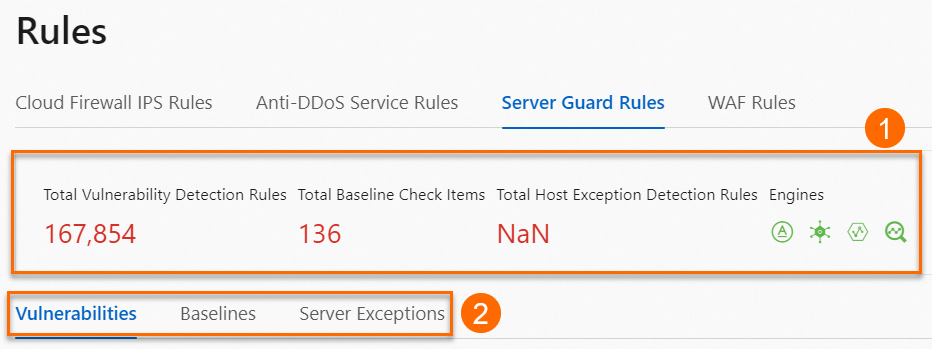

   | Item | Description |
   | --- | --- |
   | Overview (marked 1 in the preceding figure) | You can view the following information: <strong>Total Vulnerability Detection Rules</strong>, <strong>Total Baseline Check Items</strong>, <strong>Total Host Exception Detection Rules</strong>, and <strong>Engines</strong>. |
   | Vulnerabilities (marked 2 in the preceding figure) | On the <strong>Vulnerabilities</strong> tab, you can view all detected vulnerabilities and the total number of detected vulnerabilities. • To search for a vulnerability, you can select a vulnerability type from the Vulnerability Type drop-down list and enter a Common Vulnerabilities and Exposures (CVE) ID or operating system (OS) name in the search box. • In the vulnerability list, you can view the following information about a detected vulnerability: <strong>Vulnerability Name</strong>, <strong>CVE ID</strong>, <strong>Vulnerability Type</strong>, <strong>OS</strong>, <strong>Updated At</strong>, and <strong>Status</strong>. |
   | Baselines (marked 2 in the preceding figure) | On the <strong>Baselines</strong> tab, you can view the baseline types and check the items that are used. • To search for a baseline, you can select a baseline type from the Baseline Type drop-down list, select a severity from the Risk Level drop-down list, and enter a check item category or name in the search box. • In the baseline list, you can view the following information about a baseline: <strong>Baseline Type</strong>, <strong>Check Item Category</strong>, <strong>Check Item Name</strong>, <strong>Risk Level</strong>, <strong>Updated At</strong>, and <strong>Status</strong>. |
   | Server Exceptions (marked 2 in the preceding figure) | On the <strong>Server Exceptions</strong> tab, you can view the following information: <strong>Rule</strong> <strong>Alert Types</strong> and <strong>Webshell &amp; Malicious Processes</strong>. • To search for an exception on a server, you can select a rule category from the Rule Category drop-down list, select a severity level from the Risk Level drop-down list, and then enter a rule subcategory name in the search box. • In the server exception list, you can view the following information: <strong>Rule</strong> <strong>Subcategory</strong>, <strong>Rule Category</strong>, <strong>Risk Level</strong>, <strong>Updated At</strong>, <strong>Source</strong>, and <strong>Status</strong>. |

### 4.2.4. Create and manage WAF rules

You can create custom Web Application Firewall (WAF) rules based on your business requirements and network environment to monitor the operations of WAF. This topic describes how to create and manage WAF rules.

**Procedure**

> **Important**
>
> WAF rules are global custom rules that take effect on all tenants. Proceed with caution.

1. Log on to the Apsara Uni-manager Management Console.

2. In the upper-right corner of the Apsara Uni-manager Management Console, choose **Security** > **Global Platform Security > System Configurations**. On the **System Configurations** page, select a region from the **Region** drop-down list and click **Access with Authorized Role**.

3. In the left-side navigation pane, click **Rule Operation**.

4. On the **WAF Rules** tab, click **Create Rule**. Configure the parameters and click **OK**.

   | Parameter | Description |
   | --- | --- |
   | Mode | The handling action and status of the rule. • You can set the handling action to <strong>Block</strong>, <strong>Allow</strong>, <strong>Monitor</strong>, or <strong>Detection</strong> <strong>Module Control</strong>. • You can set the status to <strong>Enable</strong> or <strong>Disable</strong>. |
   | Description | The description of the rule. |
   | Severity | The level of the severity. Valid values: <strong>No Threat</strong>, <strong>Low</strong>, <strong>Moderate</strong>, and <strong>Important</strong>. |
   | Match Condition | The match condition of the rule. Each match condition consists of a <strong>match</strong> <strong>field</strong>, a <strong>logical operator</strong>, and a <strong>match value.</strong> |
   | Logging | Specifies whether to record logs. Valid values: <strong>Perform Logging When</strong> <strong>Match Condition Is Met and </strong>Do not Perform Logging When Match Condition Is Met. |
   | Attack Type | The type of attacks that you want the rule to detect. You can select only one value. |
   | Blocking Status Code | The status code that is returned. You can select only one value. |
   | Expire At | The expiration time of the rule. If you do not specify an expiration time, the rule never expires. |

   After you create a rule, you can perform the following operations on the rule:

   - Filter the WAF rules.

   - Find the rule whose details you want to view and click **Details** in the **Actions** column to view the rule details.

## 4.3. 全局设置

### 4.3.1. Configure the attack blocking feature

The attack blocking feature protects your servers from web attacks. This topic describes how to configure the attack blocking feature.

**Procedure**

1. Log on to the Apsara Uni-manager Management Console.

2. In the upper-right corner of the Apsara Uni-manager Management Console, choose **Security** > **Global Platform Security > System Configurations**. On the **System Configurations** page, select a region from the **Region** drop-down list and click **Access with Authorized Role**.

3. In the left-side navigation pane, click **Global Settings**.

4. On the **Global Settings** tab, turn on or off the switch in the Actions column to enable or disable the attack blocking feature.

   After you disable the attack blocking feature, Server Guard generates alerts for web attacks but does not block them.

## 4.4. 账号管理

### 4.4.1. Manage Apsara Stack tenant accounts

This topic describes how to view and modify the information about your Apsara Stack tenant account.

> **Important**
>
> All assets in Apsara Stack Security are bound to your Apsara Stack tenant account. You can modify the account information. Proceed with caution.

**Procedure**

1. Log on to the Apsara Uni-manager Management Console.

2. In the upper-right corner of the Apsara Uni-manager Management Console, choose **Security** > **Global Platform Security > System Configurations**. On the **System Configurations** page, select a region from the **Region** drop-down list and click **Access with Authorized Role**.

3. In the left-side navigation pane, click **Accounts**.

4. On the **Apsara Stack Account** tab, modify the information about your Apsara Stack tenant account.

   <ol type="i">

   <li>

   Find your Apsara Stack tenant account and click **Revised** in the **Operation** column.

   </li>

   <li>

   In the **Change Account** dialog box, modify Apsara Stack Account, Access Key, and

   </li>

   </ol>

   Access Secret, and click **OK**.

After the modification, you can click Details in the **Operation** column to view the details of the Apsara Stack tenant account.

### 4.4.2. Manage Alibaba Cloud accounts

After you add an Alibaba Cloud account to Apsara Stack Security Center, you can manage the Anti-DDoS Pro, Anti-DDoS Premium, and Web Application Firewall (WAF) instances that belong to the Alibaba Cloud account in Apsara Stack Security Center. This way, you can use features in a hybrid cloud. This topic describes how to add an Alibaba Cloud account to Apsara Stack Security Center.

**Procedure**

To use features in a hybrid cloud, you can add an Alibaba Cloud account to Apsara Stack Security Center.

1. Log on to the Apsara Uni-manager Management Console.

2. In the upper-right corner of the Apsara Uni-manager Management Console, choose **Security** > **Global Platform Security > System Configurations**. On the **System Configurations** page, select a region from the **Region** drop-down list and click **Access with Authorized Role**.

3. In the left-side navigation pane, click **Accounts**.

4. On the **Alibaba Cloud Account** tab, click **Add**.

   <ol type="i">

   <li>

   | Parameter | Description |
   | --- | --- |
   | Access Key | The AccessKey ID of the Alibaba Cloud account that you want to add. |
   | Access Secret | The AccessKey secret of the Alibaba Cloud account. |
   | Alibaba Cloud Service | The Alibaba Cloud services that you want to use. Valid values: <strong>Anti-</strong><strong>DDoS Pro and Anti-DDoS Premium IP</strong> and <strong>Web Application</strong> <strong>Protection</strong>. You can select one value or both. |

   </li>

   </ol>

After the Alibaba Cloud account is added, you can view the account in the account list. You can **modify** or **remove** the account.
