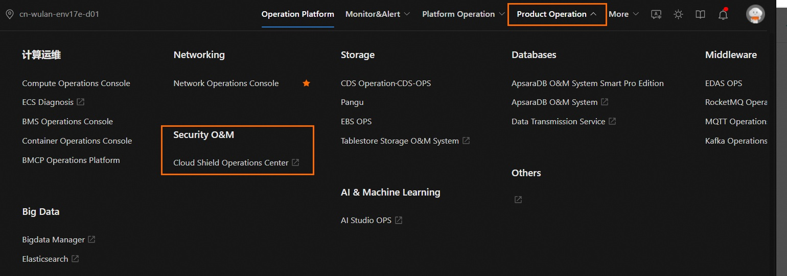
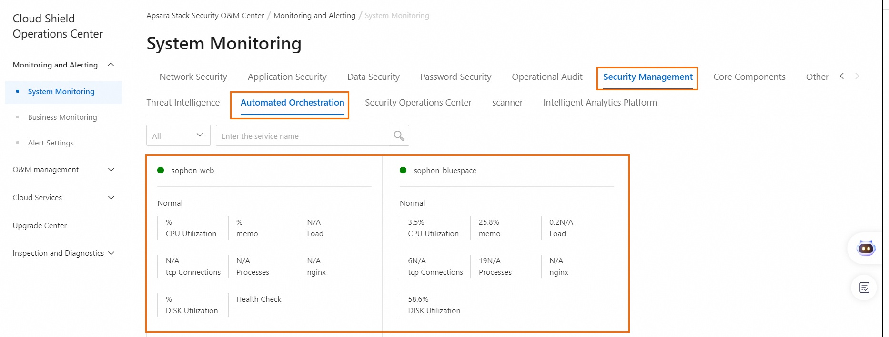
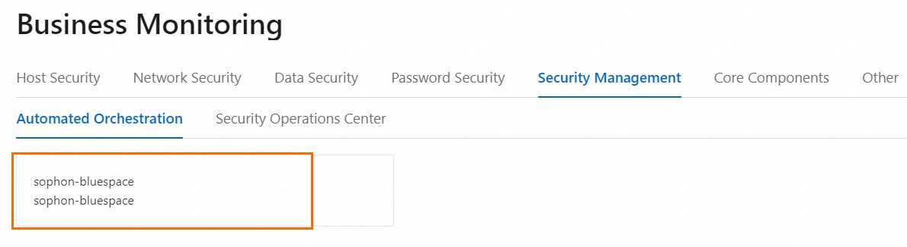
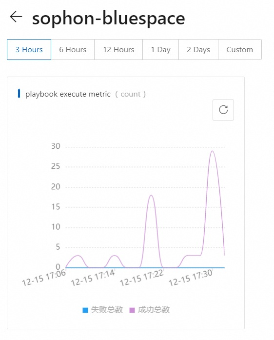
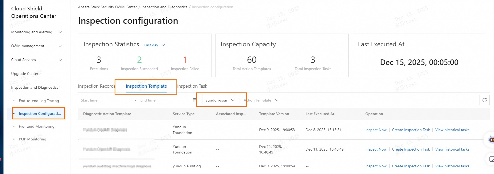
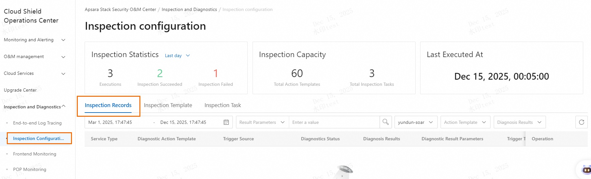

Alibaba Cloud  
Apsara Stack  
Security Orchestration  
Automation and Response  
(SOAR) Operations and  
Maintenance Guide  
Product Version: V3.18.6  
Document Version: 20260701

**Table of Contents**

- [1.Log in to the Apsara Infrastructure Management console](#section-1)
- [2.View alert notifications](#section-2)
- [3.View a dashboard](#section-3)
- [4.View an inspection task](#section-4)

# 1.Log in to the Apsara Infrastructure Management console

This topic describes how to log in to the Apsara Infrastructure Management console.

**Prerequisites**

- The URL, username, and password that are required to log on to the Apsara Uni-manager Operations Console are obtained from the deployment personnel or administrators.

  The URL of the Apsara Uni-manager Operations Console is in the format of *region-id*.ops.console.*intranet-domain-id*.

- A browser is available. We recommend that you use Google Chrome.

**Procedure**

1. Open your browser.

2. In the address bar, enter the endpoint of the Apsara Uni-manager Operations Console. Press the ENTER key.

   

   > **Note**
   >
   > You can click the current language in the upper-right corner to switch to another language. Simplified Chinese, English, and traditional Chinese are supported.

3. Enter the username and password.

   > **Note**
   >
   > - Obtain the username and password that are used to log on to the Apsara Uni-manager Operations Console from a deployment engineer or an administrator.
   >
   > - If you enter an invalid password for three consecutive times, the system enables the image verification logon feature. If you enter an invalid password for five consecutive times, the account is locked. Contact the administrator to activate the account.

   If this is the first time you log on to the Apsara Uni-manager Operations Console, you must change the password as prompted.

   To enhance security, your password must meet the following requirements:

   - The password contains uppercase and lowercase letters.

   - The password contains digits.

   - The password contains at least one of the following special characters: ! @ # $ %

   - The password is 10 to 20 characters in length.

4. Click **Log In**.

5. In the top navigation bar of the Apsara Uni-manager Operations Console, choose **Platform Operation > Apsara Infrastructure Management**.

# 2.View alert notifications

**Procedure**

1. Log in to the Apsara Infrastructure Management console.

2. In the top navigation bar of the Apsara Uni-manager Operations Console, choose **Monitor&Alert > Alert Management** > **Alert Overview**.

3. Use the modules in the left-side navigation pane to view service alert information and configure related alert notifications.

# 3.View a dashboard

**Procedure**

1. Log in to the Apsara Infrastructure Management console.

2. In the top navigation bar of the Apsara Uni-manager Operations Console, choose **Product Operation > Security O&M > Cloud Shield Operations Center**.

   

3. In the left-side navigation pane, choose **Monitoring and Alerting** > **System Monitoring**.

4. On the **System Monitoring** page, click the **Automated Orchestration** tab. On the Automated Orchestration tab, view the CPU utilization, load, and status of Security Orchestration Automation and Response (SOAR).

   

4. In the left-side navigation pane, choose **Monitoring and Alerting > Business Monitoring**.

5. On the **Business Monitoring** page, click the **Automated Orchestration** tab.

   

6. On the Automated Orchestration tab, click the **sophon-bluespace** card to view the numbers of successful and failed executions of the SOAR playbook.

   

# 4.View an inspection task

**Procedure**

1. Log in to the Apsara Infrastructure Management console.

2. In the top navigation bar of the Apsara Uni-manager Operations Console, choose **Product Operation > Security O&M > Cloud Shield Operations Center**.

3. In the left-side navigation pane, choose **Inspection and Diagnostics** > **Inspection Configuration**.

4. On the Inspection configuration page, click the Inspection Template tab. On the **Inspection Template** tab, select yundun-soar from the service type drop-down list. Find the inspection template that you want to manage and click **Inspect Now** in the Operation column. In the Perform Diagnostics panel, click Diagnose Now.

   > **Note**
   >
   > Sandbox diagnostics is used to check whether the network configurations of the Python sandbox on the current tenant side meet your expectations.
   >
   > Global diagnostics is used to inspect the system resource usage of the sophon-web and sophon-bluespace services.

   

5. Switch to the Inspection Records tab. On the Inspection Records tab, find the completed inspection record and click View in the Operation column. In the panel that appears, view the inspection details.

   
