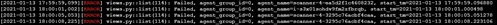
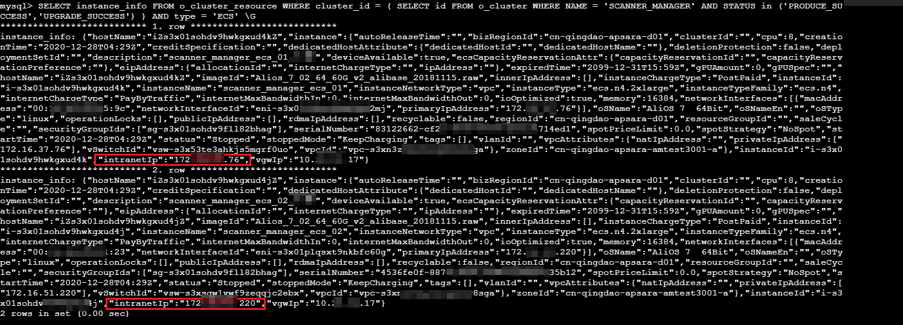
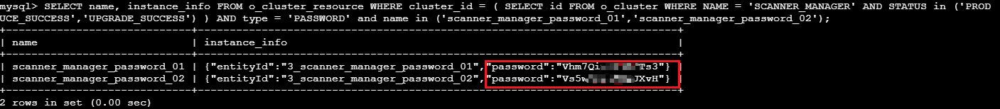
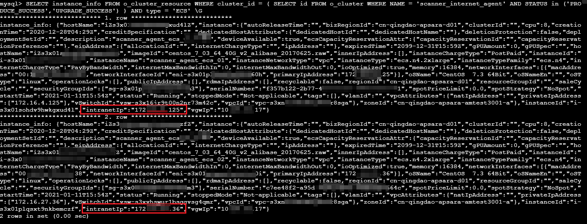
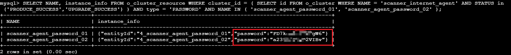
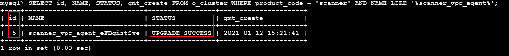
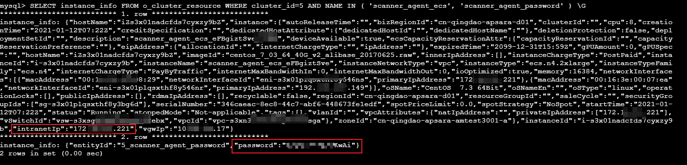

Alibaba Cloud  
Apsara Stack  
Alibaba Cloud Security-  
Situation Awareness  
Cloud Security Scanner  
Operations and Maintenance  
Guide  
Product Version: v3.18.6-2607  
Document Version: 20260828

**Table of Contents**

- [1.System deployment](#section-1)
    - [1.1. Before you begin](#section-1-1)
    - [1.2. Deployment](#section-1-2)
- [2.System O&M](#section-2)
    - [2.1. Scenario 1: The CI/CD environment fails to be deployed](#section-2-1)
    - [2.2. Scenario 2: An error is reported on the control-side web page of Cloud Security Scanner](#section-2-2)
    - [2.3. Scenario 3: The Internet scan engine of Cloud Security Scanner is abnormal](#section-2-3)
    - [2.4. Scenario 4: The private scan engine of Cloud Security Scanner is abnormal](#section-2-4)
- [3.Business troubleshooting](#section-3)
    - [3.1. Scenario 1: Assets fail to be imported](#section-3-1)
    - [3.2. Scenario 2: The progress bar is not updated while importing assets](#section-3-2)
    - [3.3. Scenario 3: The status of an asset custom update detection task is always displayed as Initialization](#section-3-3)
    - [3.4. Scenario 4: The report cannot be downloaded](#section-3-4)
- [4.Appendix](#section-4)
    - [4.1. Query the IP address and password of a jump server](#section-4-1)
    - [4.2. Query the IP address and password of a control-side server](#section-4-2)
    - [4.3. Query the IP address and password of the Internet engine](#section-4-3)
    - [4.4. Query the IP address and password of a private engine](#section-4-4)

<a id="section-1"></a>

# 1.System deployment

<a id="section-1-1"></a>

## 1.1. Before you begin

The image package of Cloud Security Scanner is built in the continuous integration and continuous deployment (CI/CD) environment, and an environment for system deployment is prepared.

<a id="section-1-2"></a>

## 1.2. Deployment

Click Deploy in the continuous integration and continuous deployment (CI/CD) environment. In the deployment template, select the desired update. Wait until the deployment is complete. After the success message appears, you can log on to the control-side Elastic Compute Service (ECS) instance of Cloud Security Scanner and view the Docker information to check whether a Docker image is recently created. If no Docker image exists or the creation time of the Docker image is different from the deployment time, the deployment may fail. In this case, repeat the deployment. If the issue persists, contact the environment owner to troubleshoot the issue.

<a id="section-2"></a>

# 2.System O&M

<a id="section-2-1"></a>

## 2.1. Scenario 1: The CI/CD environment fails to be deployed

**Problem description**

The continuous integration and continuous deployment (CI/CD) environment fails to be deployed.

**Possible causes**

- An error occurs in the environment.

- An error occurs in the image package of Cloud Security Scanner.

**Troubleshooting**

1. Apply for another environment for the deployment. If the deployment is successful in the new environment, an error may occur in the old environment.

2. If the deployment fails in multiple environments, an error may occur in the image package. In this case, contact the developers of Cloud Security Scanner to obtain a new package. In most cases, a released image package is tested multiple times to ensure validity. However, the image package may be incompatible with specific modules or services.

<a id="section-2-2"></a>

## 2.2. Scenario 2: An error is reported on the control-side web page of Cloud Security Scanner

**Problem description**

After I complete the deployment and log on to the control side, error codes such as Error and SystemError appear on the web page.

**Possible causes**

- The request timed out.

- The service on the control side is abnormal.

- An error occurs in the service on the control side.

**Troubleshooting**

1. Open the browser developer tool, view the network request of the corresponding operation, view and copy the request ID in the response body, and then query the specific error message in the Original Equipment Manufacturer (OEM) log.

2. Refer to the topics in the Appendix to query the IP addresses and passwords of the jump server and the control side. Use SSH to connect to the jump server, use SSH to connect to the two control sides over the jump server, run the docker ps command, and then view the running docker containers. Each control side has a container named yundun-scanner.YundunMoscanApp__.yundun-moscan-ap. Run the docker exec command to enter the scanner container of Docker and then run the supervisorctl command to check whether the managed services are running.

3. Log in to the two control sides, enter the Docker container, and then view the running logs of the server. The logs are stored in the  `/home/moresec/logs/`  directory. Check whether the ERROR logs exist. (The following ERROR log can be ignored.)

   

<a id="section-2-3"></a>

## 2.3. Scenario 3: The Internet scan engine of Cloud Security Scanner is abnormal

**Possible causes**

- The machine time of the Internet engine used by Cloud Security Scanner is inconsistent with the machine time of the control side.

- The environment in which the Internet engine runs is abnormal.

- Other causes.

**Troubleshooting**

1. Refer to the topics in the Appendix to query the IP address and password of the Internet engine. Use the queried information to log on to the machine on which the Internet engine runs. Then, view the system time and check whether the system time is consistent with the system time of the control side. If the system times are different, the issue is caused by the time inconsistency. Wait for up to 5 minutes until the scheduled script synchronizes time.

2. If the system times are the same, the issue may be caused by the abnormal environment in which the Internet engine runs.

3. Log on to the oem docker container, go to the logs/applog/ directory, and then view the type of the abnormal engine in cluster.log.

<a id="section-2-4"></a>

## 2.4. Scenario 4: The private scan engine of Cloud Security Scanner is abnormal

**Possible causes**

- The machine time of the private engine used by Cloud Security Scanner is inconsistent with the machine time of the control side.

- The environment in which the private engine runs is abnormal.

- Other causes.

**Troubleshooting**

1. Go to the web page in the control side and restart the private engine. If the error persists, refer to the topics in the Appendix to query the IP address and password of the private engine. Use the queried information to log on to the machine on which the private engine runs. Then, view the system time and check whether the system time is consistent with the system time of the control side. If the system times are different, the issue is caused by the time inconsistency. Wait for up to 5 minutes until the scheduled script synchronizes time.

2. If the system times are the same, the issue may be caused by the abnormal environment in which the private engine runs.

3. Log on to the oem docker container, go to the logs/applog/ directory, and then view the type of the abnormal engine in cluster.log.

<a id="section-3"></a>

# 3.Business troubleshooting

<a id="section-3-1"></a>

## 3.1. Scenario 1: Assets fail to be imported

**Problem description**

Assets fail to be imported on the control-side web page.

**Possible causes**

- The Internet scan engine is abnormal.

- The private scan engine is abnormal.

- The request timed out.

- The quota for asset import is insufficient.

**Troubleshooting**

1. To view the status of the Internet DPI engine, go to the management console page and choose Configuration Management > DPI Engine Management > Public Assets. You can also log on to the OEM database and execute the following SQL statement to query the cluster status of the Internet DPI engine:

   ```sql
     SELECT id, NAME, STATUS FROM o_cluster WHERE NAME = 'scanner_internet_agent' ORDER BY 
   gmt_create; 
   ```

   If the value of the status field in the returned result is PRODUCE_SUCCESS or UPGRADE_SUCCESS, the status is normal. Otherwise, the status is abnormal. You can refer to the Scenario 3: The Internet scan engine of Cloud Security Scanner is abnormal topic to troubleshoot the issue.

2. To view the status of the private network DPI engine, go to the management console page and choose Configuration Management > DPI Engine Management > Private Network Assets. You can also log on to the OEM database and execute the following SQL statement to query the cluster status of the private network DPI engine:

   ```sql
     SELECT id, NAME, STATUS, gmt_create FROM o_cluster WHERE product_code = 'scanner' AND 
   NAME LIKE '%scanner_vpc_agent%'; 
   ```

   If the value of the status field in the returned result is PRODUCE_SUCCESS or UPGRADE_SUCCESS, the status is normal. Otherwise, the status is abnormal. You can refer to the Scenario 4: The private scan engine of Cloud Security Scanner is abnormal topic to troubleshoot the issue.

3. Re-import the assets. If the issue persists, open the developer tool, query the request ID in the response body, and then use the ID to query the specific failure cause in the OEM log.

4. Delete unnecessary assets that are imported to release quota and try again.

<a id="section-3-2"></a>

## 3.2. Scenario 2: The progress bar is not updated while importing assets

**Problem description**

When I import assets on the control-side web page, the progress bar is not updated on the import details page.

**Possible causes**

- The Internet scan engine is abnormal.

- The private scan engine is abnormal.

- A large number of tasks run at the same time on the engine side, and the current import task is not started.

**Troubleshooting**

1. Check the status of the Internet scan engine by using the method described in the Scenario 1: Assets fail to be imported topic.

2. Check the status of the private scan engine by using the method described in the Scenario 1: Assets fail to be imported topic.

3. If the status of the import task is Initializing or In progress, wait until other import tasks are complete. After the current task is scheduled on the engine side, check whether the progress bar is updated. If the status of the import task is Failed, check whether the engine is normal. If the engine is abnormal, restart the engine.

<a id="section-3-3"></a>

## 3.3. Scenario 3: The status of an asset custom update detection task is always displayed as Initialization

**Problem description**

When I create an asset custom update detection task on the web page of the control side, the status of the task is always displayed as Initialization.

**Possible causes**

- The Internet scan engine is abnormal.

- The private scan engine is abnormal.

- A large number of tasks run at the same time on the engine side, and the current import task is not started.

**Troubleshooting**

1. Check whether the Internet scan engine is normal. If the engine is abnormal, restart the engine.

2. Check whether the private scan engine is normal. If the engine is abnormal, restart the engine.

3. If a large number of tasks are running, wait for several minutes. If only a few tasks are running but the task status is still Initialization, the scan engine may be abnormal. You can troubleshoot the exceptions in the Internet scan engine and private scan engine by referring to the topics in Appendix.

<a id="section-3-4"></a>

## 3.4. Scenario 4: The report cannot be downloaded

**Problem description**

When I go to the control-side web page and click Download for a report, I cannot download the report as an Excel file.

**Possible causes**

- An Object Storage Service (OSS) issue occurs.

**Troubleshooting**

1. If the request operation is valid, contact the OSS team to troubleshoot the issue.

<a id="section-4"></a>

# 4.Appendix

<a id="section-4-1"></a>

## 4.1. Query the IP address and password of a jump server

This topic describes how to query the IP address and password of a jump server.

View the login information about a jump server

- Obtain the virtual IP address (VIP) of the jump server (including the IP address and password of the jump server). You can use a VIP to log in to a jump server in a version earlier than Yundun3.16.2SP023.

  ```sql
  select name,instance_info from o_cluster_resource where cluster_id = (select id from o_cluster where name = 'yundun_vpc' and status in 
  ('UPGRADE_SUCCESS','PRODUCE_SUCCESS')) and type in ('ALB','PASSWORD')\G
  ```

- Obtain the login information about a reverse proxy (recommended).

  ```sql
  select name,instance_info from o_cluster_resource where cluster_id = (select id from o_cluster where name = 'yundun_vpc' and status in 
  ('UPGRADE_SUCCESS','PRODUCE_SUCCESS')) and type in ('REVERSE_VIP','PASSWORD')\G
  ```

Log in to the jump server

**on tianji**

1. Log in to the Original Equipment Manufacturer (OEM) container.

   <ol type="i">

   <li>

   Log in to the OPS1 server and run the following commands to access the OEM container:

   ```bash
   hostname=$(curl -s localhost:7070/api/v3/column/c.id?c.project=yundun-advance | grep Basic | awk -F '"' '{print $4}' | head -n 1)
   machine=$(curl -s "localhost:7070/api/v5/ListMachineSR?cluster=${hostname}" | /home/tops/bin/python -m json.tool | grep '"hostname":' | sort | uniq | grep -v vm | awk-F '"' '{print $4}' | head -n 1)
   ssh $machine
   containerId=$(docker ps --format "{{.ID}} {{.Names}}" | grep 'oem' | awk '{print $1
   }')
   docker exec -it ${containerId} bash
   ```

   </li>

   <li>

   Log in to the jump server.

   </li>

   </ol>

   ```bash
   ssh -p ${mappingPort} root@${mappingIp}
   ```

**on paas**

1. Log in to the OEM container.

   <ol type="i">

   <li>

   Log in to the OPS1 server.

   </li>

   <li>

   Run the following command to log in to the OEM container.

   </li>

   </ol>

   ```bash
   kubectl exec -it yundun-oem-0 bash -n yundun-basic
   ```

2. Log in to the jump server.

   ```bash
   ssh -p ${mappingPort} root@${mappingIp}
   ```

<a id="section-4-2"></a>

## 4.2. Query the IP address and password of a control-side server

This topic describes how to query the IP address and password of a control-side server.

**Query the IP addresses of two control-side servers**

1. Log in to the Original Equipment Manufacturer (OEM) database in the required environment.

2. Run the following SQL statement. The values of the intranetIp fields in the query result are the IP addresses of the control-side servers of Cloud Security Scanner.

   ```sql
   SELECT instance_info FROM o_cluster_resource WHERE cluster_id = ( SELECT id FROM o_cluster WHERE NAME = 'SCANNER_MANAGER' AND STATUS in 
   ('PRODUCE_SUCCESS','UPGRADE_SUCCESS') ) AND type = 'ECS' \G
   ```

   

**Query the passwords of two control-side servers**

1. Log in to the OEM database in the required environment.

2. Run the following SQL statement. The values of the password fields in the query result are the passwords of the control-side servers of Cloud Security Scanner.

   ```sql
   SELECT name, instance_info FROM o_cluster_resource WHERE cluster_id = ( SELECT id FRO
   M o_cluster WHERE NAME = 'SCANNER_MANAGER' AND STATUS in 
   ('PRODUCE_SUCCESS','UPGRADE_SUCCESS') ) AND type = 'PASSWORD' and name in ('scanner_manager_password_01','scanner_manager_password_02');
   ```

   

<a id="section-4-3"></a>

## 4.3. Query the IP address and password of the Internet engine

This topic describes how to query the IP address and password of the Internet engine.

**Query the IP addresses of the Internet engines**

1. Log in to the Original Equipment Manufacturer (OEM) database in the required environment.

2. Run the following SQL statement. The values of the intranetIp fields in the query result are the IP addresses of the Internet engines of Cloud Security Scanner.

   ```sql
   SELECT instance_info FROM o_cluster_resource WHERE cluster_id = ( SELECT id FROM o_cluster WHERE NAME = 'scanner_internet_agent' AND STATUS in 
   ('PRODUCE_SUCCESS','UPGRADE_SUCCESS') ) AND type = 'ECS' \G
   ```

   

**Query the passwords of the Internet engines**

1. Log in to the OEM database in the required environment.

2. Run the following SQL statement. The values of the password fields in the query result are the passwords of the Internet engines of Cloud Security Scanner.

   ```sql
   SELECT NAME, instance_info FROM o_cluster_resource WHERE cluster_id=( SELECT id FROM o_cluster WHERE NAME = 'scanner_internet_agent' AND STATUS in 
   ('PRODUCE_SUCCESS','UPGRADE_SUCCESS')) AND type = 'PASSWORD';
   ```

   

<a id="section-4-4"></a>

## 4.4. Query the IP address and password of a private engine

This topic describes how to query the IP address and password of a private engine.

**Query the ID of a private engine used by Cloud Security Scanner**

**Method 1: Obtain the ID from the web page of the control side**

The following figure shows how to obtain the ID of a private engine.

**Method 2: Query the ID from the OEM database**

1. Log in to the Original Equipment Manufacturer (OEM) database in the required environment.

2. Run the following SQL statement to query all engines of Cloud Security Scanner. If the status field of an engine is  `PRODUCE_SUCCESS` , the production of the engine is successful. Use the value of the gmt_create field to locate a specific cluster. Then, find the specific cluster resources based on the cluster ID.

   ```sql
   SELECT id, NAME, STATUS, gmt_create FROM o_cluster WHERE product_code = 'scanner' AND
   NAME LIKE '%scanner_vpc_agent%';
   ```

   

**Query the IP address and password of a private engine**

1. Log in to the OEM database in the required environment.

2. Run the following SQL statement to obtain the IDs of the engines whose status is not SUCCESS.

   ```sql
   SELECT name,instance_info FROM o_cluster_resource WHERE cluster_id = ${ID of the private engine} AND NAME IN('scanner_agent_ecs','scanner_agent_password')\G
   ```

3. Replace the ID in the following SQL statement with the ID that you obtained and run the SQL statement. The value of the intranetIp field in the query result is the IP address of the private engine of Cloud Security Scanner. You can use this method to obtain the IP addresses of other private engines. The value of the password field in the query result is the password of the private engine.

   ```sql
   SELECT instance_info FROM o_cluster_resource WHERE cluster_id = The ID that you obtained AND NAME IN ( 'scanner_agent_ecs', 'scanner_agent_password' ) \G
   ```

   
