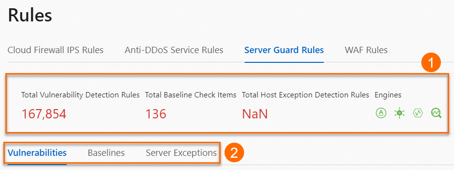
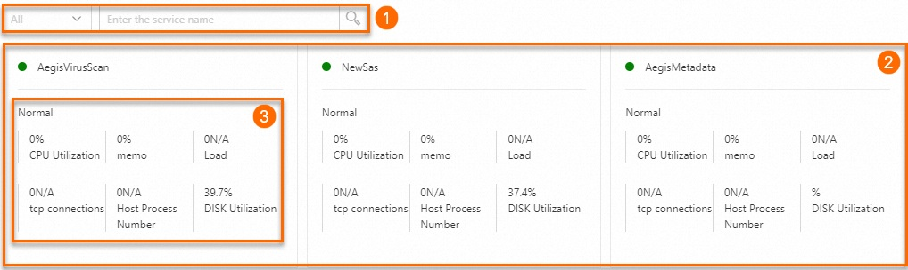

Alibaba Cloud  
Apsara Stack  
Alibaba Cloud Security-  
Situation Awareness  
Security Orchestration  
Automation and Response  
(SOAR) User Guide  
Product Version: v3.18.6-2607  
Document Version: 20260828

**Table of Contents**

- [1.Prerequisites](#section-1)
- [2.Quick start](#section-2)
    - [2.1. User permission description](#section-2-1)
    - [2.2. Log on to the Apsara Uni-manager Management Console](#section-2-2)
- [3.Security Orchestration, Automation and Response SOAR](#section-3)
    - [3.1. Risk handling](#section-3-1)
        - [3.1.1. Case management](#section-3-1-1)
    - [3.2. SOAR](#section-3-2)
        - [3.2.1. Playbook template](#section-3-2-1)
        - [3.2.2. List](#section-3-2-2)
        - [3.2.3. Component list](#section-3-2-3)
        - [3.2.4. Blocklist](#section-3-2-4)
        - [3.2.5. Manage IOCs](#section-3-2-5)
        - [3.2.6. Playbook execution records](#section-3-2-6)
    - [3.3. Operations management](#section-3-3)
        - [3.3.1. SOAR settings](#section-3-3-1)
            - [3.3.1.1. Environment variable configuration](#section-3-3-1-1)
            - [3.3.1.2. Streaming Data Source Configuration](#section-3-3-1-2)
            - [3.3.1.3. War room instruction configuration](#section-3-3-1-3)
        - [3.3.2. Organization authorization](#section-3-3-2)
- [4.Apsara Stack Security configurations](#section-4)
    - [4.1. Log on to the Apsara Uni-manager Management Console](#section-4-1)
    - [4.2. 规则运营](#section-4-2)
        - [4.2.1. Create and manage IPS rules](#section-4-2-1)
        - [4.2.2. Manage Anti-DDoS Service rules](#section-4-2-2)
        - [4.2.3. Manage Server Guard rules](#section-4-2-3)
        - [4.2.4. Create and manage WAF rules](#section-4-2-4)
    - [4.3. Configure alert settings](#section-4-3)
    - [4.4. 全局设置](#section-4-4)
        - [4.4.1. Configure the attack blocking feature](#section-4-4-1)
    - [4.5. 账号管理](#section-4-5)
        - [4.5.1. Manage Apsara Stack tenant accounts](#section-4-5-1)
        - [4.5.2. Manage Alibaba Cloud accounts](#section-4-5-2)
    - [4.6. Migration to Apsara Uni-manager Operations Console](#section-4-6)
        - [4.6.1. Log on to Cloud Shield Operations Center](#section-4-6-1)
        - [4.6.2. View system monitoring data](#section-4-6-2)
        - [4.6.3. Global settings](#section-4-6-3)
            - [4.6.3.1. Configure host security rules](#section-4-6-3-1)
            - [4.6.3.2. Configure whitelist settings](#section-4-6-3-2)
        - [4.6.4. Upgrade center](#section-4-6-4)
            - [4.6.4.1. Upgrade center overview](#section-4-6-4-1)
            - [4.6.4.2. Feature library or version updates](#section-4-6-4-2)

# 1.Prerequisites

This document describes the information you must understand before using the Security Orchestration, Automation and Response user guide. It also lists the local PC configuration requirements you must confirm before logging in to the Apsara Stack Security console.

**Local PC configuration requirements**

Your local PC must meet the requirements listed in the Configuration requirements table to log in to the Apsara Stack Security console successfully.

Table 1. Configuration requirements table

| Item | Requirement |
| --- | --- |
| Browser | • Internet Explorer: version 11 or later • Chrome (recommended): version 42.0.0 or later • Firefox: version 30 or later • Safari: version 9.0.2 or later |
| Operating system | • Windows XP • Windows 7 or later • macOS |

# 2.Quick start

## 2.1. User permission description

This topic describes the user roles related to Apsara Stack Security.

All Security Center roles in Apsara Stack Security are default roles. The system also supports custom role creation. Before you log in to Security Center, confirm that your account has been assigned a role related to Apsara Stack Security. For details about roles, see Default roles in Apsara Stack Security.

Table 1. Default roles in Apsara Stack Security

| Role name | Role description |
| --- | --- |
| Organization Security Administrator | Manages security operations within a single organization. This includes managing security products such as Security Operations Center (SOC), host security, application security, and network security. |
| Global Organization Security Administrator | Manages security operations for all tenants through Security Operations Center (SOC). |
| Global Organization Security Auditor | Views the security status of all organizations through Security Operations Center (SOC). |
| Custom role | Grants operations management permissions for all organizations, the current organization and its subordinate organizations, and resource sets. You can distinguish read/write permissions and configure product feature menus as needed. Note The current custom role for all organizations does not include platform permissions and differs from the data permission scope of the Global Organization Security Administrator. |

If you do not have an account or role, contact your administrator to create a user and assign a role. For specific steps, see **Apsara Uni-Manager Management Console User Guide** under **Create a user**.

## 2.2. Log on to the Apsara Uni-manager Management Console

This topic describes how to log on to the Apsara Uni-manager Management Console.

**Prerequisites**

- The URL of the console that is obtained from the deployment personnel.

- A web browser. We recommend that you use Google Chrome.

**Procedure**

1. Enter the URL of the Apsara Uni-manager Management Console in the address bar and press the Enter key.

2. Enter your username and password.

   You need to obtain the username and password from an operations administrator.

   > **Note**
   >
   > - **First logon**
   >
   >   The first time that you log on to the Apsara Uni-manager Management Console, you need to change the password of your account. The password must be 10 to 32 characters in length. It must contain all of the following character types: uppercase letters, lowercase letters, digits, and special characters. Supported special characters include: ! @ # $ %
   >
   > - **Forget password**
   >
   >   If you have forgotten your password, click Forgot Password. On the page that appears, enter the username of your account, the email address that was used to create the account, and the CAPTCHA code. Then, the system sends a link for resetting the password to the specified email address.

3. Click **Log On**.

4. If multi-factor authentication (MFA) is enabled for your account, perform the corresponding operations in the following scenarios:

   - You log on to the Apsara Uni-manager Management Console for the first time after MFA is enabled by the administrator.

     <ol type="a">

     <li>

     On the Bind Virtual MFA Device page, bind an MFA device.

     </li>

     <li>

     Enter the username and password again as in Step 2 and click **Log On**.

     </li>

     </ol>

     <ol type="i" start="100">

     <li>

     Enter a six-digit MFA verification code and click **Authenticate**.

     </li>

     </ol>

   - You have enabled MFA and bound an MFA device:

     Enter a six-digit MFA verification code and click **Authenticate**.

# 3.Security Orchestration, Automation and Response SOAR

## 3.1. Risk handling

### 3.1.1. Case management

The case management feature allows you to centrally manage and investigate security events. This topic describes how to create and investigate cases, and view case information and statistics.

**Overview**

A case can be automatically created from a Security Operations Center (SOC) alert event or manually created.

- Case automatically created from a SOC alert event

  After you subscribe to SOC attack protection and security alert messages, Security Orchestration Automation and Response (SOAR) reads the details of a SOC alert and creates a case when receiving the alert.

  - The case name is the name of a SOC alert event, or the name of an attack protection event.

  - The case status is the status of the SOC alert event.

  - The case creation time is the time when the SOC alert event was reported.

  - The case creator is the name of the tenant account in which the event was reported.

- Case manually created

  You can create a case based on your business requirements. For more information, see the Create a case section of this topic.

**View case statistics**

1. Log in to the Apsara Uni-manager Management Console.

2. In the upper-right corner of the Apsara Uni-manager Management Console, choose **Security** > **Security Management > Security Orchestration, Automation, and Response**. On the **Security Orchestration, Automation, and Response** page, select a region from the **Region** drop-down list and click **Access with Authorized Role**.

3. In the left-side navigation pane, choose **Handle > Case Management**.

4. On the **Case Management** page, view case statistics.

   | Section | Description |
   | --- | --- |
   | New Cases | The number of new cases in the current Apsara Stack tenant account. |
   | Cases Pending Handling | The number of cases that require attention and further processing by a security administrator in the current Apsara Stack tenant account. |
   | Automatically Handled Cases | The number of cases that are automatically responded to within the statistical period in the current Apsara Stack tenant account. |
   | Automatically Blocked Threats | The number of threats automatically blocked through playbook execution in the current week or on the current day in the current Apsara Stack tenant account. |
   | Case list | In the case list of the <strong>Case Management</strong> page, view case details. • Search for a case: You can specify search conditions to view the case information that meets the conditions. • Delete a case: Find the case and click <strong>Delete</strong> in the Actions column to delete the case from the case list. Set the status of a case to Handled: Find the case and click <strong>Set to</strong> <strong>Handled</strong> in the Actions column. This way, the status of the case is displayed as <strong>Handled</strong> in the <strong>Case Status</strong> column. • Change the status of multiple cases at a time: Select the cases, click <strong>Modify Status</strong> below the case list, and then select the required status. |

**Create a case**

On the **Case Management** page, click **Create**. In the Create Case dialog box, configure the parameters and click **OK**.

| Parameter | Description |
| --- | --- |
| Organization | Select the organization to which the case belongs from the drop-down list. |
| Case Name | The name of the case. The name can be up to 128 characters in length and can contain letters, digits, periods (.), underscores (_), hyphens (-), parentheses (), and spaces. |
| Case Status | The status of the case. |
| Remarks | The remarks of the case. |

**Investigate a case**

After you create a case, you can investigate, analyze, and collect evidence on a security event on the Case Details page.

1. Find the case that you want to investigate and click **Details** in the **Actions** column.

2. On the Case Details page, view and configure the basic information of the case.

   You can view information such as the organization, case status, priority, user who assigned the case, case ID, case source, creator, case UUID, update time, and remarks.

   You can configure information such as the case name, case status, priority, user who assigned the case, and remarks.

3. On the **Entities** tab, configure the entities that you want to extract.

   > **Note**
   >
   > You can also automatically add entities from a playbook to the entity list by using the EventHouse component in the playbook and executing the playbook. For more information about how to view components, see Manage components. For more information about how to create a playbook, see Manage playbooks.

   - Click **Create** and configure the **Monitored Entity**, **Entity Type**, and **processStatus** parameters.

     > **Note**
     >
     > An entity is a fixed type of data. The following entity types are supported:
     >
     > **IP**, **hostname**, **appname**, **domain**, **db_name**, **cna**, **file_hash**, **process**, **AccesskeyID**, **email**, **aegis_file**, and **file_md5**.

   - Click **Settings**, and configure the **Automatically Generate Associated Entity** and **Entity Type** parameters.

4. On the **Elements** tab, click **Add Element**. In the **Add Element** dialog box, configure the parameters and click **OK**.

   | Parameter | Description |
   | --- | --- |
   | Element Content | The content of the element. Specify the added entities as the element content. Only the JSON format is supported. |
   | Tag | The tag of the element. |

   You can view the element in the element list and perform the following operations:

   - View the element in the table or JSON format.

   - Modify the element. If you modify the element content, the modification is synchronized to the **Entities** tab.

   - Add the element as an evidence.

     You can view or modify the evidence on the **Evidences** tab. You can also view the information added as the evidence on the **Joint War Room** tab.

   - Click **Configure Headers** and select keys to add as headers.

     > **Note**
     >
     > The default header cannot be removed.

   - Select multiple elements, click **Batch Operation**, and then select **Add to Case**, **Change Tag**, or **Delete**.

   - Click **Add to Case** to add the element to an existing case.

     If the element has been added to another case, move the pointer over the message icon in the **Source** column to view the case and go to its details page.

   After the element is added, when a security event that meets the requirements of a case occurs, the system adds the security event to the joint war room at the earliest opportunity within the case retention period and the period for entity-based case merging, and investigates and handles the case. The case information is displayed in the joint war room. A security analyst can add the indicators of compromise (IOCs) in the event to the intelligence library for continuous monitoring, and view the records of all operations performed during event investigation and response on the **Operation History** tab.

   > **Note**
   >
   > You can also automatically add elements from a playbook to the element list by using the EventHouse component in the playbook and executing the playbook. If an automatically added element is the same as a manually added element, the system automatically performs deduplication. For more information about how to view components, see Manage components. For more information about how to create a playbook, see Manage playbooks.

5. On the **Joint War Room** tab, find the case that you want to manage, enter **@Jarvis** and a command in the message field, and then press the Enter key. Alternatively, click **Run Playbook/Action**, select and configure an in-cloud action and a playbook, and then click **OK**.

   You are navigated to the joint war room with parameters passed and converted to a message that contains @Jarvis. In this case, the final text of the message to be sent is constructed through a series of interactions before you enter the joint war room.

   > **Note**
   >
   > - You can also mention other members by using the at sign (@) to send messages to them.
   >
   > - Multiple group members can work together in the joint war room by sending messages and sharing security alert information and event investigation results, to collaboratively handle security events.

   The system returns the execution result in a message.

6. On the **Operation History** tab, view the records of all operations performed during case investigation and response.

7. On the **Evidences** tab, enter, edit, and delete evidences.

## 3.2. SOAR

### 3.2.1. Playbook template

This topic describes how to create a playbook by using a template.

1. Log on to the Apsara Uni-manager Management Console.

2. In the upper-right corner of the Apsara Uni-manager Management Console, choose **Security** > **Security Management > Security Orchestration, Automation, and Response**. On the **Security Orchestration, Automation, and Response** page, select a region from the **Region** drop-down list and click **Access with Authorized Role**.

3. In the left-side navigation pane,Select **SOAR > Playbook Template**.

4. On the **Playbook Template** page, the system provides multiple built-in types of security operation scripts.

   Only one-click blocking and联动封禁 playbook templates are supported.

5. Find the appropriate playbook template and click **Create Playbook**.

6. In the **Create Playbook** panel, complete the following configurations and click **OK**.

   | Configuration item | Description |
   | --- | --- |
   | Organization | Select the organization to which the automation orchestration playbook belongs from the drop-down list. |
   | Scope | The scope where the automation orchestration playbook applies. The default value is <strong>Tenant</strong>. |
   | Template version | Each playbook template has multiple versions. Select the appropriate version. |
   | Name | The name of the automation orchestration playbook. It can contain only letters, digits, and underscores (_), and must be up to 128 characters in length. |
   | Display name | The display name of the automation orchestration playbook. |
   | Playbook type | The type of the automation orchestration playbook. Valid values: <strong>General-</strong><strong>purpose</strong>, <strong>Investigation</strong>, <strong>Immediate Remediation</strong>, <strong>Mitigation</strong>. |
   | Sharing scope | The sharing scope for using the automation orchestration playbook. The default value is <strong>Private</strong>. |
   | Description | The description of the automation orchestration playbook. |

### 3.2.2. List

Playbook management

Automated orchestration improves security response speed and simplifies daily tasks for security experts by automating and streamlining routine security operations. This allows teams to focus on combating advanced persistent threats (APT). Routine security operations can be compiled into visual, interpretable, and executable playbooks stored within the product, facilitating the inheritance of operational experience. This article describes how to view, create, and edit playbooks.

**Getting Started**

When you first enter the **Playbooks** page, the system provides a quick-start guide. You can create playbooks through the Getting Started wizard, by using templates, or by direct orchestration.

- **Getting Started** The Getting Started wizard provides step-by-step configuration guidance. Complete playbook settings progressively. You can debug and run a playbook only after successfully publishing it.

  After enabling **Do Not Remind Me Again**, the quick-start wizard will no longer appear when you re-enter the **Playbooks** page. To reopen the wizard dialog, click **Quick Start** in the upper-right corner of the **Playbooks** page.

- **Use Template**

  To create a playbook using a template, see the relevant instructions in Create a playbook from a template. Predefined templates enable efficient playbook construction.

- **Orchestrate**

  To create a playbook from scratch, refer to the detailed tutorial in Create a playbook.

**Create a playbook**

- **Public Playbook** includes **Built-in** and **Global Sharing** types.

  - **Built-in** playbooks are system-preset. You can also create custom playbooks by copying built-in ones.

    > **Important**
    >
    > We recommend using playbook templates to create custom playbooks. Built-in playbooks will no longer be maintained.

    **Global Sharing** playbooks can only be created on the SOAR platform side. When the application scope of a **Global Sharing** playbook is set to **Tenant**, it automatically syncs to the tenant-side public playbook list after creation.

- **Custom Playbook** supports only the **Private** type.

1. Log on to the Apsara Uni-manager Management Console.

2. In the upper-right corner of the Apsara Uni-manager Management Console, choose **Security** > **Security Management > Security Orchestration, Automation, and Response**. On the **Security Orchestration, Automation, and Response** page, select a region from the **Region** drop-down list and click **Access with Authorized Role**.

3. In the left-side navigation pane,Select **SOAR**>**Playbooks**.

   On the **Playbooks** page, select the **Custom Playbook** tab, then click **Create**. Complete the following configurations, then click **Create Playbook**.

   | Configuration item | Description |
   | --- | --- |
   | Organization | Select the organization to which the automated orchestration playbook belongs from the drop-down list. |
   | Scope | The application scope of the automated orchestration playbook. The default value is <strong>Tenant</strong>. |
   | Name | The name of the automated orchestration playbook. It can contain only letters, digits, and underscores, with a maximum length of 128 characters. |
   | Display name | The display name of the automated orchestration playbook. |

   | Playbook type | The type of the automated orchestration playbook. Valid values: <strong>General-</strong><strong>purpose</strong>, <strong>Investigation</strong>, <strong>Immediate Remediation</strong>, <strong>Mitigation</strong>. |
   | --- | --- |
   | Sharing scope | The sharing scope of the automated orchestration playbook. The default value is <strong>Private</strong>. |
   | Description | A description of the automated orchestration playbook. |

**Create a playbook flowchart**

After you create a playbook, the system automatically redirects you to the orchestration workflow editing page. You can also go to the **Playbooks** page, locate the target playbook, and click **Edit** in the **Actions** column to draw the automation orchestration playbook flowchart.

1. Drag and drop components from the left navigation bar—such as **Basic Components**, **Cloud Security Service Components**, **Cloud Service Components**, or **Playbooks**— onto the visual workflow canvas to serve as playbook elements.

   - **Basic Components**: Search for component actions by action name, description, or component name.

   - **Tenant Basic Components**: Search for component actions by action name or description.

   - **Tenant Cloud Service Components**: Search for standard actions by action name, description, or API Chinese name.

   - **Tenant Cloud Security Service Components**: Search for cloud-native actions by action name, description, or API Chinese name.

     > **Note**
     >
     > The system automatically runs a connectivity test every 30 minutes to update the online status of cloud-native components.

   - **Playbooks**: Search all playbooks by action name or description.

2. Select each element in the flowchart. On the right-side **Basic Information** tab under **Edit**, view and configure its name, description, and actions.

   Click **Advanced Settings** to configure whether the component must **Run at Least Once**, define the action to take when **OnError** occurs, and set **Conditions to Return True for Response Status**.

3. Select each element in the flowchart, then click the basic nodes on the right to adjust execution methods.

   : Indicates start.

    : Indicates end.

   : Indicates single-path output.

   : Indicates sub-process.

    : Indicates multi-path output.

   : Indicates multi-path convergence.

    : Represents a checkbox. After enabling the checkbox, you can select multiple elements

   on the canvas and delete them.

    : Indicates add comment.

    : Indicates connector line.

    : Indicates delete.

    : Indicates debug.

4. You can also click **Debug** in the upper-left corner of the canvas, or click the **Input Parameters (Debug)** tab below. In the **Input Parameters (Debug)** text box, enter JSON text and click **Run** to execute in debug mode.

   The **Execution Logs** tab displays the debug results. If any node fails, you can modify the JSON text on the **Input Parameters (Debug)** tab, or click **Input Parameters Wizard** to adjust parameters for further debugging.

5. Click **Check** in the upper-left corner of the canvas. If no anomalies are detected, click **Save and Publish**. The system saves and enables the automated orchestration workflow.

   > **Note**
   >
   > If you click **Save** in the upper-left corner of the canvas, the system saves the workflow without enabling it. The playbook’s **Status** in the playbook list becomes **Disabled**.

After successful publishing, the playbook’s **Status** in the playbook list becomes **Enabled**. You can perform the following operations:

- Click **More** above the canvas to perform the following actions:

  - **Import XML**: Create an automation orchestration flowchart by importing an XML file.

  - **Export XML**: Export the created automation orchestration flowchart as an XML file.

  - **Save As Image**: Save the created automation orchestration flowchart as an image.

  - **Undo**, **Redo**.

  - **Zoom In**, **Zoom Out**, **Center Align**, **Delete** components.

- Turn the playbook **License** switch on or off.

**Create a playbook from a template**

For details about creating a playbook from a template, see Playbook template.

After you create the playbook, follow the **Playbook Orchestration Guide** wizard to complete environment and allowlist checks and configure request parameters. Then, click **Start Orchestration**.

After orchestration starts, the process is consistent with the Create a playbook flowchart. Configure parameters based on the relevant parameter descriptions.

**View and manage playbooks**

Users can view and manage playbook information on the **Playbooks** page. Public playbooks support only viewing and copying. Users cannot edit or delete public playbooks.

- View data such as **Enabled Playbooks/Total Playbooks** and **Successful executions/Total executions (last 30 days)**.

- You can view the following basic information about a playbook:

  - **Name**: The **name** and **display name** of the automation orchestration playbook. The **name** is the unique identifier of the playbook. The **display name** improves readability for users.

  - **Type**: The sharing scope of the automation orchestration playbook. This field appears only for public playbooks and supports the **Built-in** and **Global Sharing** types.

  - **Execution method**: The execution method of the playbook. If you set the **execution method** of a playbook to **Scheduled**, you can configure the cycle for executing a playbook task. The system starts the playbook at a specified point in time every day, week, month, hour, or minute.

  - **Last executed at**: The time when the playbook was last executed.

  - **Status**: The current status of the playbook. Valid values: **Enabled** and **Disabled**.

- Modify the status of a playbook: Click **Status** in the row that corresponds to the target playbook, and then click **Disable** or **Enable**.

- View and manage a playbook:

  Click **Actions** in the row that corresponds to the target playbook, and then click **Details** to perform the following operations:

  - On the **Playbook Details** tab, perform the following operations:

    - View the details of the playbook.

    - Click **Edit Playbook** to modify the playbook.

    - **Zoom in**, **Zoom out**, and **Center align** components.

  - On the **Basic Information** tab, perform the following operations:

    - Modify the display name, sharing scope, type, enabled status, and description of the playbook.

    - View the **run details** and **historical release versions** of the playbook.

    - In the **Historical Release Versions** list, click **Actions** in the row that corresponds to a version, and then click **View** to view the playbook.

    - In the **Historical Release Versions** list, click **Actions** in the row that corresponds to a version, and then click **Roll Back to Edit** to overwrite the current version to the playbook being edited.

    - In the **Historical Release Versions** list, click **Actions** in the row that corresponds to a version, and then click **Roll Back and Publish** to overwrite the current version to the playbook being edited and publish the playbook.

  - On the **Historical Run Records** tab, view the execution records of the playbook.

- Edit a playbook: Click **Actions** in the row that corresponds to the target playbook, and then click **Edit**. On the playbook editing page, modify the playbook.

- View the running status of a playbook: Click **Actions** in the row that corresponds to the target playbook, move the pointer over **More**, and then click **Running Details**. The system redirects you to the **Playbook Execution Logs** page where you can view the execution logs of the playbook. For more information, see Playbook execution records.

- Modify the execution method of a playbook: Click **Actions** in the row that corresponds to the target playbook, move the pointer over **More**, and then click **Execution Method** to modify the execution method of the playbook.

  - Manual trigger: No additional settings are required.

  - Scheduled trigger: You must configure a **Cron expression**. You can click **Tool-based Generation**, specify the trigger time, and then click **Validate Cron** to view the next five trigger times.

  - Streaming trigger: You must configure trigger conditions.

    <ol type="a">

    <li>

    Click **Add Trigger Condition**. After you complete the configuration, click **OK**.

    | Configuration item | Description |
    | --- | --- |
    | Streaming data source | You can set this parameter only to SOC alert messages. |
    | Trigger condition | • Enter a trigger condition directly. • Click <strong>Tool-based Generation</strong>. In the <strong>Edit</strong> dialog box, configure the matching relationship and matching condition. |

    </li>

    <li>

    Click **Test**.

    </li>

    </ol>

    <ol type="i" start="100">

    <li>

    In the **Test Data** dialog box, click **Test Run**.

    After the test run is complete, you can click **View Execution Logs** in the result dialog box to go to the **Playbook Execution Records** page and view the execution logs of the playbook. For more information, see Playbook execution records.

    If the test run result does not meet your expectations, you can adjust the relevant information in the **Test Data** dialog box.

    </li>

    </ol>

- Copy or delete a playbook: Click **Actions** in the row that corresponds to the target playbook, move the pointer over **More**, and then click **Copy** or **Delete**.

### 3.2.3. Component list

A component is a collection of one or more assets and actions that complete specific tasks. When you need to connect to an external service, a component can act as a manager for that external service, such as WAF, Firewall, Database, or Notification Service. This topic describes how to view component information.

1. Log on to the Apsara Uni-manager Management Console.

2. In the upper-right corner of the Apsara Uni-manager Management Console, choose **Security** > **Security Management > Security Orchestration, Automation, and Response**. On the **Security Orchestration, Automation, and Response** page, select a region from the **Region** drop-down list and click **Access with Authorized Role**.

3. In the left-side navigation pane, Select **SOAR** > **Components**.

4. On the **Components** page, users can filter and view components by **Scope** and **Component Name**.

   You can view information such as component type, scope, version, actions, and assets.

### 3.2.4. Blocklist

The blocklist records various data accumulated during security event handling. It enables reuse of processing experience and data. The blocklist has two types: **Value Table** and **Key-value Table**. This topic describes how to create a blocklist, add entries to it, and import entries into the blocklist in the form of a dimension table.

**Create a blocklist**

1. Log on to the Apsara Uni-manager Management Console.

2. In the upper-right corner of the Apsara Uni-manager Management Console, choose **Security** > **Security Management > Security Orchestration, Automation, and Response**. On the **Security Orchestration, Automation, and Response** page, select a region from the **Region** drop-down list and click **Access with Authorized Role**.

3. In the left-side navigation pane,Select **SOAR** **List Group**.

4. On the List Group page, click **Create** in the upper-left corner.

5. In the **Create List Group** dialog box, complete the following configurations, then click **OK**.

   | Configuration item | Description |
   | --- | --- |
   | Organization | Select the organization to which the list group belongs from the drop-down list. |
   | List Group Name | Set the name of the list group. The maximum length is 128 characters. |
   | List Group ID | Set the ID of the list group. It can contain only letters, digits, and underscores. |
   | List Group Type | Select the type of the list group from the drop-down list. Valid values: <strong>Value Table</strong>, <strong>Key-value Table</strong>. Important • The value table type supports up to 1,000 entries. • The key-value table type supports up to one million entries. |
   | Description | Set the description of the list group. |

   The newly created list group appears in the list on the left side of the **List Group** page. You can **Edit** or **Delete** this list group. Built-in system list groups cannot be deleted.

6. Click the created list group, then click **Create** on the right.

   The list group has two types: **Table** and **Key-Value**. The configuration for adding entries differs by type.

   - **Value Table**

     | Parameter | Description |
     | --- | --- |
     | Content | The content of the list. It can be an IP address, text, string, number, or other content. The content must not exceed 2048 characters. It supports Chinese, English, and special characters <code> @#¥%&amp;*</code>（）<code>——+ </code>. |
     | Description | The description of the list. |
     | Expiration Time | The validity period of the list content. The system automatically deletes content that exceeds the validity period. Valid values: <strong>Never Expire</strong>, <strong>7 Days</strong>, <strong>90 Days</strong>, <strong>180 Days</strong>, and Custom. Default value: <strong>Never Expire</strong>. |

   - **Key-value Table**

     | Parameter | Description |
     | --- | --- |
     | Key | The content of an attribute list. It can be an IP address, text, string, number, or other content. The content must not exceed 512 characters. It supports Chinese, English, and special characters <code> @#¥%&amp;*</code>（）<code>——+ </code>. |
     | Value | The content of another attribute list. It can be an IP address, text, string, number, or other content. The content must not exceed 2048 characters. It supports Chinese, English, and special characters <code> @#¥%&amp;*</code>（）<code>——+ </code>. |
     | Description | The description of the list. |
     | Expiration Time | The validity period of the list content. The system automatically deletes content that exceeds the validity period. Valid values: <strong>Never Expire</strong>, <strong>7 Days</strong>, <strong>90 Days</strong>, <strong>180 Days</strong>, and Custom. Default value: <strong>Never Expire</strong>. |

   The created list appears in the list library. You can perform the following operations:

   - Edit a list: In the **Actions** column of the list, click **Edit**. In the **Edit List** dialog box, modify the **Key**, **Value**, **Description**, and **Expiration Time**.

   - Delete a list: In the **Actions** column of the list, click **Delete**. In the dialog box that appears, click **OK** to delete the list in the current row.

   - Enable or disable a list: In the **Actions** column of the list, turn on the **Enable** switch to enable the list. Turn off the **Enable** switch to disable the list.

**Import a list**

1. Log on to the Apsara Uni-manager Management Console.

2. In the upper-right corner of the Apsara Uni-manager Management Console, choose **Security** > **Security Management > Security Orchestration, Automation, and Response**. On the **Security Orchestration, Automation, and Response** page, select a region from the **Region** drop-down list and click **Access with Authorized Role**.

3. In the left-side navigation pane,Click **SOAR > List Group**.

4. In the left-side pane of the List Group page, click the target list to import.

5. Click **Import** on the right side of the page. On the **Import List** page, click Import Template to automatically download the template.

   The system provides different import templates based on the type. It supports both key-value two-dimensional table templates and value-only templates. On the **List Group** page, click different lists in the left-side pane to select different types.

   > **Note**
   >
   > Each template has different restrictions. For example, for the key-value two-dimensional table, follow these rules:
   >
   > <ol type="i">
   >
   > <li>
   >
   > You can import up to 10,000 entries at a time. The maximum number of entries in a single list is 1 million. For key-value tables, the system updates the value based on the key.
   >
   > </li>
   >
   > <li>
   >
   > If the system already contains a key, it updates the corresponding value during
   >
   > </li>
   >
   > </ol>
   >
   > import.
   >
   > <ol type="i" start="3">
   >
   > <li>
   >
   > If Permanent Validity is set to Yes, the expiration time does not take effect.
   >
   > </li>
   >
   > <li>
   >
   > The key length cannot exceed 512 characters.
   >
   > </li>
   >
   > <li>
   >
   > The key and value fields cannot be empty.
   >
   > </li>
   >
   > <li>
   >
   > Keys must be unique within the same table.
   >
   > </li>
   >
   > </ol>

   | Parameter | Description |
   | --- | --- |
   | Key | The content of an attribute in the list. It can be an IP address, text, string, or number. The content cannot exceed 512 characters and supports Chinese, English, and special characters <code> @#¥%&amp;*</code>（）<code>——+ </code>. |
   | Value | The content of another attribute in the list. It can be an IP address, text, string, or number. The content cannot exceed 2,048 characters and supports Chinese, English, and special characters <code> @#¥%&amp;*</code>（）<code>——+ </code>. |
   | Permanent validity | Permanently valid entries do not expire and are not deleted. Otherwise, they are deleted after expiration. |
   | Expiration Time | The validity period of the list entry. Entries that exceed the validity period are automatically deleted. Valid values: <strong>Never Expire</strong>, <strong>7 Days</strong>, <strong>90 Days</strong>, <strong>180 Days</strong>, and Custom. Default value: <strong>Never Expire</strong>. |
   | Description | The description of the list. |

6. After you prepare the template, click **Import**. In the Import List dialog box, follow the wizard to complete the import.

You can click **Export** to export entries from the list at any time.

### 3.2.5. Manage IOCs

The Intelligence Library page displays all blocked indicators of compromise (IOCs). You can manage IOCs, such as viewing, blocking, and unblocking IOCs. This topic describes how to add and manage IOCs, and view IOC details.

**Add IOCs**

1. Log in to the Apsara Uni-manager Management Console.

2. In the upper-right corner of the Apsara Uni-manager Management Console, choose **Security** > **Security Management > Security Orchestration, Automation, and Response**. On the **Security Orchestration, Automation, and Response** page, select a region from the **Region** drop-down list and click **Access with Authorized Role**.

3. In the left-side navigation pane, choose **SOAR > Intelligence Library**.

4. On the **Intelligence Library** page, click **Create**.

5. In the **Add Intelligence Record** dialog box, configure the following parameters and click **OK**.

   | Parameter | Description |
   | --- | --- |
   | Organization | Select the organization to which the IOC belongs from the drop-down list. |
   | Intelligence Record Name | The name of the IOC. The name can be up to 200 characters in length. |
   | Type | The type of the IOC. Valid values: <strong>hostname</strong>, <strong>appname</strong>, <strong>db_name</strong>, <strong>file_hash</strong>, <strong>AccesskeyID</strong>, <strong>file_md5</strong>, <strong>IP</strong>, <strong>domain</strong>, <strong>cns</strong>, and <strong>aegis_file</strong>. |
   | Remarks | The IOC remarks. |

**View and manage IOCs**

1. Log in to the Apsara Uni-manager Management Console.

2. In the upper-right corner of the Apsara Uni-manager Management Console, choose **Security** > **Security Management > Security Orchestration, Automation, and Response**. On the **Security Orchestration, Automation, and Response** page, select a region from the **Region** drop-down list and click **Access with Authorized Role**.

3. In the left-side navigation pane, choose **SOAR > Intelligence Library**.

4. On the **Intelligence Library** page, view the IOC statistics.

   | Section | Description |
   | --- | --- |
   | Total Threat Indicators | The total number of IOCs in the current Apsara Stack tenant account. |
   | Blocked Threat Indicators | The total number of blocked IOCs within the statistical period in the current Apsara Stack tenant account, The statistical period can be the current day or week. • Current day: the total number of blocked IOCs from 00:00 on the current day to the current time. Total number of blocked IOCs = Number of temporarily blocked IOCs + Number of permanently blocked IOCs. • Current week: the total number of blocked IOCs from 00:00 on the first day (Sunday) of the current week to the current time. Total number of blocked IOCs = Number of temporarily blocked IOCs + Number of permanently blocked IOCs. |
   | Unblocked Threat Indicators | The number of unblocked IOCs within the statistical period in the current Apsara Stack tenant account. The statistical period can be the current day or week. • Current day: the number of unblocked IOCs from 00:00 on the current day to the current time. • Current week: the number of unblocked IOCs from 00:00 on the first day (Sunday) of the current week to the current time. |
   | Quarantined Hosts | The number of quarantined hosts within the statistical period in the current Apsara Stack tenant account. The statistical period can be the current day or week. • Current day: the number of quarantined hosts from 00:00 on the current day to the current time. • Current week: the number of quarantined hosts from 00:00 on the first day (Sunday) of the current week to the current time. |
   | IOC list | • You can view the following information: • <strong>Organization</strong>: the organization to which the IOC belongs. • <strong>Type</strong>: the type of the IOC. Valid values: hostname, appname, db_name, file_hash, AccesskeyID, file_md5, IP, domain, cna, and aegis_file. • <strong>Threat Indicators</strong>: the number of IOCs that are blocked. • <strong>First Blocked At</strong>: the time when the IOC was first blocked through SOAR. • <strong>Unblocking Time</strong>: the end time of the blocking period. If the current IOC has a permanent blocking rule, this column is displayed as Permanent. • You can perform the following operations: • Filter IOCs You can configure the <strong>Organization</strong>, <strong>First Blocked At</strong>, and <strong>Intelligence</strong> <strong>Record Name</strong> parameters to filter IOCs. • View and manage blocked IOCs • Find the IOC that you want to manage and click <strong>Details</strong> in the Actions column. The attacker IP address can be blocked by the joint war room through playbook execution. You can also click <strong>Create</strong> and configure the following parameters to create a blocking rule: a. <strong>Blocking Type</strong>: the blocking rule applied through Security Orchestration Automation and Response (SOAR). Valid values: Network Traffic Monitoring System-Based Blocking and WAF-Based Blocking. You can add multiple rules of the Traffic Monitoring System-Based Blocking type and of the WAF-Based Blocking type. The list displays only blocking rules that are manually added. Blocking rules configured in WAF and NDR are not displayed. b. <strong>Rule Name</strong>: the name of the blocking rule. The name must be 2 to 64 characters in length and can contain digits, letters, and hyphens (-). c. <strong>Organization</strong>: By default, the organization to which the IOC belongs is displayed. This parameter is displayed only when you set Blocking Type to WAF-Based Blocking. d. <strong>Source IP Address</strong>: the source IP address of the IOC. e. Optional. <strong>Destine IP Address</strong>: the destination IP address of the IOC.This parameter is displayed only when you set Blocking Type to Network Traffic Monitoring System-Based Blocking. f. Optional. <strong>Destination Port</strong>: the destination port of the IOC. This parameter is displayed only when you set Blocking Type to Network Traffic Monitoring System-Based Blocking. g. Optional. <strong>Protected Site ID</strong>: the protected site ID of the IOC. This parameter is displayed only when you set Blocking Type to WAF-Based Blocking. h. <strong>Blocking Time</strong>: the time range from the current system time to the unblocking time. Valid values: 1 Day, 1 Week, 1 Month, and Permanent. • Find a blocking rule and click <strong>Edit</strong> in the Actions column to modify the blocking time to generate a new blocking rule. • Find a blocking rule and click <strong>Unblock</strong> in the Actions column to unblock the rule. • Find the IOC and click <strong>Synchronize to Threat Intelligence</strong> in the Actions column. Then, configure the following parameters: |

   - **Threat Level**: the threat level. Valid values: High Risk, Medium Risk, and Low Risk.

### 3.2.6. Playbook execution records

- **Indicator Type**: the scenario. Valid values: Indicator of Attack and Indicator of Compromise.

You can view all playbook information, playbook execution logs, and action execution logs on

- **Expiration Time**: the validity period. Unit: seconds.

the Playbook Execution Records page.

- Find the IOC and click **Remove from Threat Intelligence** in the Actions

**View playbook messages**

column.

1. Log on to the Apsara Uni-manager Management Console.

2. In the upper-right corner of the Apsara Uni-manager Management Console, choose **Security** > **Security Management > Security Orchestration, Automation, and Response**. On the **Security Orchestration, Automation, and Response** page, select a region from the **Region** drop-down list and click **Access with Authorized Role**.

3. In the left-side navigation pane,Select **SOAR > Playbook Execution Records**.

4. On the **Playbook Message** tab, set filters for organization, task status, playbook name, node name, and content search to find tasks.

5. Locate the target task, click its playbook name to go to the **Playbooks** page and view playbook details. If the playbook has notification content configured, click **Details** in the Actions column to view message details.

**View playbook execution logs**

1. Log on to the Apsara Uni-manager Management Console.

2. In the upper-right corner of the Apsara Uni-manager Management Console, choose **Security** > **Security Management > Security Orchestration, Automation, and Response**. On the **Security Orchestration, Automation, and Response** page, select a region from the **Region** drop-down list and click **Access with Authorized Role**.

3. In the left-side navigation pane, select **SOAR > Playbook Execution Records**.

4. On the **Playbook Execution Logs** tab, view playbook execution logs. You can perform the following actions:

   - Search logs by setting filters such as **Organization**, **Running Status**, **Occurred At**, **Running Version**, and **Playbook Name**.

   - View log details: Click the

     icon.

   - View action execution: Click **Details** in the Actions column of the playbook execution log list to go to the **Playbook Execution Records** page. There you can view the **Complete Output Results**, **Input Parameters**, and **Output Parameters**.

   - View visualization: Click **Visualization** in the Actions column of the playbook execution log list to open the visualization page and view node information graphically.

   - View startup parameters: Click **View Startup Parameters** in the Actions column of the playbook execution log list.

   - View playbook: Click **More** in the Actions column of the playbook execution log list, then select **More** > **View Playbook** to go to the Playbooks page and view playbook information.

   - Stop task: Click **More** in the Actions column of the playbook execution log list, then select **More** > **Stop Task**.

   - Replay playbook: Click **More** in the Actions column of the playbook execution log list, then select **More** > **Replay**. In the **Input Parameters** dialog box, click **OK** to re-execute the playbook using the same data source.

**View playbook action execution logs**

1. Log on to the Apsara Uni-manager Management Console.

2. In the upper-right corner of the Apsara Uni-manager Management Console, choose **Security** > **Security Management > Security Orchestration, Automation, and Response**. On the **Security Orchestration, Automation, and Response** page, select a region from the **Region** drop-down list and click **Access with Authorized Role**.

3. In the left-side navigation pane, select **SOAR > Playbook Execution Records**.

4. On the **Action Execution Logs** tab, view playbook action execution logs. You can perform the following actions:

   - Search for executed actions by setting filters such as **Organization**, **Running Status**, **Occurred At**, and **Trigger Data ID**.

   - View action execution information.

   - View run details: Click **Details** in the Actions column of the playbook execution action list to view the **Complete Output Results**, **Input Parameters**, and **Output Parameters**.

## 3.3. Operations management

### 3.3.1. SOAR settings

#### 3.3.1.1. Environment variable configuration

An environment variable is a centralized and secure repository of configuration parameters. Playbooks can dynamically read the required variables and parameters at runtime.

**Procedure**

1. Log on to the Apsara Uni-manager Management Console.

2. In the upper-right corner of the Apsara Uni-manager Management Console, choose **Security** > **Security Management > Security Orchestration, Automation, and Response**. On the **Security Orchestration, Automation, and Response** page, select a region from the **Region** drop-down list and click **Access with Authorized Role**.

3. In the left-side navigation pane, select **Operations Management** > **SOAR Settings**.

4. On the **SOAR Settings** page, select the **Environment Variable Settings** tab to view and configure environment variables.

   - Create an environment variable

     Click **Create** above the environment variable list. Complete the following configuration and click **OK**.

     | Configuration item | Description |
     | --- | --- |
     | Key | The name of the environment variable. Keys in environment variables are basic system backend parameters, including region, tenant, and AK. Do not add keys arbitrarily. Update only the value corresponding to each key based on the actual situation at each site. |
     | Value | The configuration content of the environment variable. Keys in environment variables are basic system backend parameters, including region, tenant, and AK. Do not add keys arbitrarily. Update only the value corresponding to each key based on the actual situation at each site. |
     | Description | The description of the environment variable configuration. |
     | Expiration Time | The validity period of the environment variable configuration. Options include: <strong>Never Expire</strong>, <strong>7 Days</strong>, <strong>90 Days</strong>, <strong>180 Days</strong>, or Custom. The default is <strong>Never Expire</strong>. |
     | Value Encryption | Choose whether to encrypt the value of <strong>Value</strong>. When you enable this switch, the system displays the value in encrypted form. Save the original value for your records. |

   - Search for environment variables Search for environment variables by specifying the key, value, or description.

   - Enable, disable, edit, or delete existing environment variables

     Click **Edit** or **Delete** in the Actions column of the target environment variable. Alternatively, toggle the switch in the **Enable** column to enable or disable it.

#### 3.3.1.2. Streaming Data Source Configuration

Streaming data sources include SOC alert message data and data manually created by users. The system primarily uses this data to automatically execute playbooks. This article describes how to create, search for, delete, and edit streaming data sources.

**Procedure**

1. Log on to the Apsara Uni-manager Management Console.

2. In the upper-right corner of the Apsara Uni-manager Management Console, choose **Security** > **Security Management > Security Orchestration, Automation, and Response**. On the **Security Orchestration, Automation, and Response** page, select a region from the **Region** drop-down list and click **Access with Authorized Role**.

3. In the left-side navigation pane, select **Operations Management** > **SOAR Settings**.

4. On the **SOAR Settings** page, select the **Streaming Data Source Configuration** tab to view the creation time, last modified time, status, and other details for **SOC alert messages**.

   > **Note**
   >
   > **SOC alert messages** cannot be deleted.

5. Manually create a streaming data source.

   <ol type="i">

   <li>

   On the **Streaming Data Source Configuration** page, click **Create**.

   </li>

   <li>

   After you complete the following configuration, click **OK**.

   </li>

   </ol>

   | Configuration Item | Description |
   | --- | --- |
   | Name | Set the name of the streaming data source. |
   | Organization | Select the organization to which the streaming data source belongs from the drop-down list. |
   | Type | The type of streaming data source. Options: • MetaQ If you select this option, enter the Topic, Consumer ID, and Tag information for the streaming data source. • SLSRealTime If you select this option, enter the Project, Logstore, Endpoint, AccessKey, and AccessSecret information for the streaming data source. |

   After you complete the configuration, the new data source appears in the streaming data source list. You can perform the following operations:

   - Search for a streaming data source: In the search box above the streaming data source list, select the organization to which the streaming data source belongs, then enter its name, type, or creator.

   - Delete a streaming data source: In the **Actions** column of the streaming data source list, click **Delete**, then click **OK** in the dialog box to delete the streaming data source in the corresponding row.

   - Edit a streaming data source: In the **Name** column of the streaming data source list, click the name of the streaming data source you want to modify. In the **Edit** dialog box, update the streaming data source information.

**Related operations**

After you configure a streaming data source, you can set the playbook execution method to streaming trigger and select the created streaming data source. When the trigger condition is met, the system automatically executes the playbook to enable real-time response and handling of security events. For specific operations, see View and manage playbooks.

#### 3.3.1.3. War room instruction configuration

Use war room instruction configuration to view and create case-related war room instructions. This article describes how to view and create war room instructions.

**Create war room instruction configuration**

Skip this step if you only need to view war room instructions for a case.

1. Log on to the Apsara Uni-manager Management Console.

2. In the upper-right corner of the Apsara Uni-manager Management Console, choose **Security** > **Security Management > Security Orchestration, Automation, and Response**. On the **Security Orchestration, Automation, and Response** page, select a region from the **Region** drop-down list and click **Access with Authorized Role**.

3. In the left-side navigation pane, Select **Operations Management** > **SOAR Settings**.

4. On the **SOAR Settings** page, select the **Instruction Settings for War Room** tab. Click **Create**. Complete the following configurations and click **OK**.

   | Configuration Item | Description |
   | --- | --- |
   | Command category | The command category of the war room instruction. Only <strong>custom</strong> <strong>commands</strong> are supported. |
   | Organization | Select the organization to which the war room instruction belongs from the drop-down list. |
   | Name | The name of the war room instruction. The name can be up to 128 characters in length. |
   | Action type | The action type of the war room instruction. Valid values: <strong>Investigation</strong>, <strong>Block</strong>, and <strong>Immediate Remediation</strong>. |
   | Entity type | The entity type of the war room instruction. Valid values: <strong>Server IP</strong> <strong>Address</strong>, <strong>Hostname</strong>, <strong>Application name</strong>, <strong>Domain Name</strong>, <strong>Database</strong>, <strong>CNA</strong>, <strong>File hash</strong>, <strong>Process</strong>, <strong>AccessKey ID</strong>, <strong>Email address</strong>, <strong>Server</strong> <strong>Guard file</strong>, and <strong>File MD5 hash value</strong>. |
   | Method | The method used to call tasks. Valid values: <strong>Playbook-initiated Call</strong> and <strong>API Call</strong>. If you select <strong>Playbook-initiated Call</strong>, configure the <strong>Playbooks</strong> parameter. If you select <strong>API Call</strong>, configure the <strong>Bean name</strong> parameter. • If you select <strong>Playbook-initiated Call</strong>, configure the <strong>Playbooks</strong> parameter. Select playbooks from the drop-down list. • If you select <strong>API Call</strong>, configure the <strong>Bean name</strong> parameter. |
   | Parameter | Click <strong>Create Parameter</strong> to set the <strong>Key</strong> and <strong>Value</strong> parameters. |
   | Confirm again | Specify whether confirmation is required. Valid values: <strong>Required</strong> and <strong>Not Required</strong>. |
   | Example | Describe how to use the command. |
   | Advanced settings | Click <strong>Advanced settings</strong> and enter the command line in JSON format in the text box. |

**View or manage war room instructions**

1. In the search box on the **Instruction Settings for War Room** tab, search for war room instructions by **Name**.

2. Locate the target war room instruction and view or manage it.

   - You can view the following information about the war room instruction:

     - **ID**: The ID of the war room instruction.

     - **Name**: The name of the war room instruction.

     - **Organization**: The organization to which the war room instruction belongs.

     - **Description**: The description of the command category of the war room instruction. Descriptions include **Custom Instructions** and **Common Instructions**. **Common Instructions** are created on the SOAR platform side.

     - **Example**: The description of how to use the command.

     - **Last modified**: The user who last modified the war room instruction and the modification time.

   - **Edit** or **Delete** the war room instruction.

### 3.3.2. Organization authorization

This topic describes how to enable organization authorization for Security Orchestration, Automation and Response (SOAR).

**EnableOrganization SLR Authorization**

1. Log on to the Apsara Uni-manager Management Console.

2. In the upper-right corner of the Apsara Uni-manager Management Console, choose **Security** > **Security Management > Security Orchestration, Automation, and Response**. On the **Security Orchestration, Automation, and Response** page, select a region from the **Region** drop-down list and click **Access with Authorized Role**.

3. In the left-side navigation pane, select **Operations Management > Organization Authorization**.

4. On the **Organization Authorization** page, in the **Security Orchestration, Automation and Response** section, click **View Details** to view, enable, or disable the authorization status for the organization.

   - Enabled: SOAR receives SLR authorization for this organization. SOAR can automatically collect cloud assets and related security information for this organization. It also gains API calling capabilities and operations management permissions for Apsara Stack Security products under this organization’s administrator. Additionally, the Global Organization Security Administrator gains operations management permissions for this organization’s assets and related security information.

   - Disabled: SOAR does not receive SLR authorization for this organization. SOAR cannot automatically collect cloud assets or related security information for this organization. It lacks API calling capabilities and operations management permissions for Apsara Stack Security products under this organization’s administrator. The organization also cannot use SOC product features for security operations management.

**Assume RAM Role to Run Tasks**

On the **Organization Authorization** page, in the **Security Orchestration, Automation and Response** section, enable or disable **Assume RAM Role to Run Tasks**.

This authorization allows SOAR to invoke other products or services using your RAM identity, including running scheduled playbooks and streaming playbooks continuously on your behalf. If you do not enable this feature, you cannot use SOAR product functions.

# 4.Apsara Stack Security configurations

## 4.1. Log on to the Apsara Uni-manager Management Console

This topic describes how to log on to the Apsara Uni-manager Management Console.

**Prerequisites**

- The URL of the console that is obtained from the deployment personnel.

- A web browser. We recommend that you use Google Chrome.

**Procedure**

1. Enter the URL of the Apsara Uni-manager Management Console in the address bar and press the Enter key.

2. Enter your username and password.

   You need to obtain the username and password from an operations administrator.

   > **Note**
   >
   > - **First logon**
   >
   >   The first time that you log on to the Apsara Uni-manager Management Console, you need to change the password of your account. The password must be 10 to 32 characters in length. It must contain all of the following character types: uppercase letters, lowercase letters, digits, and special characters. Supported special characters include: ! @ # $ %
   >
   > - **Forget password**
   >
   >   If you have forgotten your password, click Forgot Password. On the page that appears, enter the username of your account, the email address that was used to create the account, and the CAPTCHA code. Then, the system sends a link for resetting the password to the specified email address.

3. Click **Log On**.

4. If multi-factor authentication (MFA) is enabled for your account, perform the corresponding operations in the following scenarios:

   - You log on to the Apsara Uni-manager Management Console for the first time after MFA is enabled by the administrator.

     <ol type="a">

     <li>

     On the Bind Virtual MFA Device page, bind an MFA device.

     </li>

     <li>

     Enter the username and password again as in Step 2 and click **Log On**.

     </li>

     </ol>

     <ol type="i" start="100">

     <li>

     Enter a six-digit MFA verification code and click **Authenticate**.

     </li>

     </ol>

   - You have enabled MFA and bound an MFA device:

     Enter a six-digit MFA verification code and click **Authenticate**.

## 4.2. 规则运营

### 4.2.1. Create and manage IPS rules

Cloud Firewall provides built-in intrusion prevention system (IPS) rules. You can create custom IPS rules based on your business requirements and network environment to monitor the operations of Cloud Firewall. This topic describes how to create and manage custom IPS rules.

**Procedure**

1. Log in to the Apsara Uni-manager Management Console.

2. In the upper-right corner of the Apsara Uni-manager Management Console, choose **Security** > **Global Platform Security > System Configurations**. On the **System Configurations** page, select a region from the **Region** drop-down list and click **Access with Authorized Role**.

3. In the left-side navigation pane, click **Rule Operation**.

4. On the **Cloud Firewall IPS Rules** tab, click **Create Rule**. In the Create Rule panel, configure the parameters and click **OK**. The following table describes the parameters.

   | Parameter | Description |
   | --- | --- |
   | Rule Name | The name of the IPS rule. We recommend that you enter an informative name to facilitate management. |
   | Rules Engine | The rules engine that you want to use. Valid values: <strong>Basic Policies</strong> and <strong>Virtual</strong> <strong>Patches</strong>. |
   | Attack Type | The type of attacks that you want to detect by using the IPS rule |
   | Severity | The severity level. Valid values: <strong>Low</strong>, <strong>Medium</strong>, and <strong>High</strong>. |
   | CVE | The Common Vulnerabilities and Exposures (CVE) ID of the vulnerability that you want to list in the IPS rule. Note CVE provides a list of public security vulnerabilities. CVE IDs are allocated by a CVE Numbering Authority (CNA). |
   | Application | The name of the attacked application. |
   | Rule Mode | The mode of the IPS rule. Valid values: <strong>Packet</strong> and <strong>Traffic</strong>. |
   | Direction | The direction of traffic that you want to monitor by using the IPS rule. Valid values: <strong>Inbound and Outbound</strong>, <strong>Inbound</strong>, and <strong>Outbound</strong>. |
   | Rule Content | The content of the IPS rule. You must specify the content by using the Snort syntax. Note To prevent negative impact on your business, make sure that you enter valid content for the rule. |
   | Rule Description | The description of the IPS rule. We recommend that you enter information such as the purpose or impact of the rule. |
   | Remarks | The additional description of the IPS rule. We recommend that you enter information that can help you identify the IPS rule, such as the purpose or impact of the rule to facilitate management. |

   After you create custom IPS rules, you can perform the following operations on the rules:

   - View the details of a rule

     You can filter rules by specifying filter conditions above the rule list.

     Find the rule whose details you want to view and click **Details** in the **Actions** column to view the rule details.

   - Enable an IPS rule

     Find the rule that you want to enable and turn on the switch in the **Enable or not** column to change the state of the rule from **Disable** to **Enable**.

   - Disable an IPS rule

     If a rule does not meet your business requirements, you can disable the rule.

     Find the rule that you want to disable and turn off the switch in the **Enable or not** column to change the state of the rule from **Enable** to **Disable**.

### 4.2.2. Manage Anti-DDoS Service rules

On the Anti-DDoS Service Rules page, you can modify threshold settings for traffic scrubbing and redirection based on your business requirements. This topic describes how to modify threshold settings for traffic scrubbing and redirection.

**Procedure**

1. Log in to the Apsara Uni-manager Management Console.

2. In the upper-right corner of the Apsara Uni-manager Management Console, choose **Security** > **Global Platform Security > System Configurations**. On the **System Configurations** page, select a region from the **Region** drop-down list and click **Access with Authorized Role**.

3. In the left-side navigation pane, click **Rule Operation**.

4. On the **Anti-DDoS Service Rules** tab, click **Scrubbing Policy**. Then, specify a custom threshold for traffic scrubbing.

   <ol type="i">

   <li>

   Find the traffic scrubbing rule whose threshold you want to modify and click **Modify Threshold** in the **Solution** column.

   </li>

   <li>

   In the **Modify Threshold** dialog box, specify a threshold and click **OK**.

   </li>

   </ol>

5. On the **Anti-DDoS Service Rules** tab, click **Reroute Threshold**. Then, specify custom thresholds for traffic redirection.

   <ol type="i">

   <li>

   Find the rule whose thresholds you want to modify and click **Modify Threshold** in the **Solution** column.

   </li>

   <li>

   In the **Modify Threshold** dialog box, specify custom thresholds and click **OK**.

   </li>

   <li>

   **Optional.** Click **Automatic DDoS Traffic Redirection and Scrubbing**. In the **Enable Automatic Redirection** message, click **OK**.

   > **Note**
   >
   > By default, **Automatic DDoS Traffic Redirection and Scrubbing** is turned off.

   - If you turn on Automatic DDoS Traffic Redirection and Scrubbing, traffic scrubbing events are triggered based on the thresholds that you specify. The traffic of attacked IP addresses is automatically forwarded to an Anti-DDoS cluster for scrubbing.

   - If you turn off Automatic DDoS Traffic Redirection and Scrubbing, alert events are triggered based on the thresholds that you specify. You can start or end traffic scrubbing in the Anti-DDoS Service console based on your business requirements.

   </li>

   </ol>

### 4.2.3. Manage Server Guard rules

You can view vulnerabilities, baselines, and server exceptions on the Server Guard Rules tab. This topic describes how to view the information about Server Guard rules.

**Procedure**

1. Log in to the Apsara Uni-manager Management Console.

2. In the upper-right corner of the Apsara Uni-manager Management Console, choose **Security** > **Global Platform Security > System Configurations**. On the **System Configurations** page, select a region from the **Region** drop-down list and click **Access with Authorized Role**.

3. In the left-side navigation pane, click **Rule Operation**.

4. On the **Server Guard Rules** tab, view the operations of Server Guard rules.

   

   | Section or tab | Description |
   | --- | --- |
   | Overview (marked with ① in the preceding figure) | In this section, you can view the following information: <strong>Total Vulnerability</strong> <strong>Detection Rules</strong>, <strong>Total Baseline Check Items</strong>, <strong>Total Host Exception</strong> <strong>Detection Rules</strong>, and <strong>Engines</strong>. |
   | Vulnerabilities (marked with ② in the preceding figure) | On the <strong>Vulnerabilities</strong> tab, you can view all detected vulnerabilities and the total number of detected vulnerabilities. • To search for a vulnerability, you can select a vulnerability type from the Vulnerability Type drop-down list and enter a Common Vulnerabilities and Exposures (CVE) ID or an OS name in the search box. • In the vulnerability list, you can view the information about a detected vulnerability in the following columns: <strong>Vulnerability Detection Rule</strong> <strong>Name</strong>, <strong>CVE ID</strong>, <strong>Operating System</strong>, <strong>Release Version</strong>, <strong>Updated At</strong>, <strong>Online At</strong>, and <strong>Status</strong>. |
   | Baselines (marked with ② in the preceding figure) | On the <strong>Baselines</strong> tab, you can view the baseline types and the check items that are used. • To search for a baseline, you can select a baseline type from the Baseline Type drop-down list, select a severity from the Risk Level drop-down list, and then enter a check item category or name in the search box. • In the baseline list, you can view the information about a baseline in the following columns: <strong>Baseline Type</strong>, <strong>Check Item Category</strong>, <strong>Check Item</strong> <strong>Name</strong>, <strong>Risk Level</strong>, <strong>Updated At</strong>, and <strong>Status</strong>. |
   | Server Exceptions (marked with ② in the preceding figure) | On the <strong>Server Exceptions</strong> tab, you can view the following information: <strong>Rule</strong> <strong>Alert Types</strong> and <strong>Webshell &amp; Malicious Processes</strong>. • To search for an exception on a server, you can select a rule category from the Rule Category drop-down list, select a severity level from the Risk Level drop-down list, and then enter a rule subcategory name in the search box. • In the server exception list, you can view the information about an exception in the following columns: <strong>Rule Subcategory</strong>, <strong>Rule Category</strong>, <strong>Risk Level</strong>, <strong>Updated At</strong>, <strong>Source</strong>, and <strong>Status</strong>. |

### 4.2.4. Create and manage WAF rules

You can create custom Web Application Firewall (WAF) rules based on your business requirements and network environment to monitor the operations of WAF. This topic describes how to create and manage WAF rules.

**Procedure**

> **Important**
>
> WAF rules are global custom rules that take effect on all tenants. Proceed with caution.

1. Log in to the Apsara Uni-manager Management Console.

2. In the upper-right corner of the Apsara Uni-manager Management Console, choose **Security** > **Global Platform Security > System Configurations**. On the **System Configurations** page, select a region from the **Region** drop-down list and click **Access with Authorized Role**.

3. In the left-side navigation pane, click **Rule Operation**.

4. On the **WAF Rules** tab, click **Create Rule**. In the Create Rule panel, configure the parameters and click **OK**. The following table describes the parameters.

   | Parameter | Description |
   | --- | --- |
   | Mode | The handling action and status of the rule. • You can set the handling action to <strong>Block</strong>, <strong>Allow</strong>, <strong>Monitor</strong>, or <strong>Detection</strong> <strong>Module Control</strong>. • You can set the status to <strong>Enable</strong> or <strong>Disable</strong>. |
   | Description | The description of the rule. |
   | Severity | The level of the severity. Valid values: <strong>No Threat</strong>, <strong>Low</strong>, <strong>Moderate</strong>, and <strong>Important</strong>. |
   | Match Condition | The match condition of the rule. Each match condition consists of a <strong>match field</strong>, a <strong>logical operator</strong>, and a <strong>match value.</strong> |
   | Logging | Specifies whether to record logs. Valid values: • Perform Logging When Match Condition Is Met • Do not Perform Logging When Match Condition Is Met |
   | Attack Type | The type of attacks that you want the rule to detect. You can select only one option. |
   | Blocking Status Code | The status code that is returned. You can select only one option. |
   | Expire At | The expiration time of the rule. If you do not specify an expiration time, the rule never expires. |

   After you create rules, you can perform the following operations on the rules:

   - Filter WAF rules by specifying filter conditions above the rule list.

   - Find the rule that you want to manage and click **Modify** in the **Actions** column to modify the rule.

## 4.3. Configure alert settings

On the Alert Settings page, you can configure alert contacts and alert rules. When monitoring data triggers alert rules, the system automatically sends alerts to specified alert contacts by using DingTalk messages or emails. This topic describes how to configure alert contacts and alert rules.

**Configure alert contacts**

1. Log in to the Apsara Uni-manager Management Console.

2. In the upper-right corner of the Apsara Uni-manager Management Console, choose **Security** > **Global Platform Security > System Configurations**. On the **System Configurations** page, select a region from the **Region** drop-down list and click **Access with Authorized Role**.

3. In the left-side navigation pane, click **Alert Settings**.

4. On the Alert Settings tab, click **Create Contact**. In the Create Contact dialog box, enter the contact name, DingTalk chatbot token, email address, and organization, and click **Determine**.

   You can view the added contact in the contact list. You can **modify** a contact or **delete** multiple contacts at a time.

**Configure alert rules**

1. Log in to the Apsara Uni-manager Management Console.

2. In the upper-right corner of the Apsara Uni-manager Management Console, choose **Security** > **Global Platform Security > System Configurations**. On the **System Configurations** page, select a region from the **Region** drop-down list and click **Access with Authorized Role**.

3. In the left-side navigation pane, click **Alert Settings**.

4. On the Alert Settings page, click the **AEGIS** tab. On the AEGIS tab, configure the alert rules that you want to use and click **Save**.

   **Notificati**

   **Alert**

   **Alert type**

   **Alert subtype**

   **on**

   **Frequency**

   **level**

   **method**

   - Linux software vulnerability

   - Windows system

     - Low

     vulnerability

   Vulnerability

   - Medium

   - Web-CMS vulnerability

     - High

   - Application vulnerability

   - Urgent vulnerability

   - High-risk exploit

     - Low

   - Classified protection compliance

   Baseline risk

   - Medium

   - Best security practices

     - High

   - Weak password

   - Vulnerability

   Asset exposure

   All levels

   - Non-vulnerability

     - 5 minutes

     - 10 minutes

   - Suspicious process

     - Email

       - 30 minutes

   - Webshell

     - DingTal

       - 1 hour

       k

   - Unusual login

     - 1 day

   - Anomalous activity

     - 1 week

   - Threat intelligence

   - Malicious process (cloud threat detection)

     - Low

   - Unusual network connection

   Intrusion alert

   - Medium

   - Abnormal account

     - High

   - Application intrusion event

   - Cloud threat detection

   - Precision defense

   - Malicious script

   - Persistent webshell

   - Application threat detection

   Application

   Unauthorized process

   All levels

   whitelist event

   start

   - Unusual file modification

   Tamper-

   All levels

   proofing event

   - Unusual file addition

   - Unusual file deletion

## 4.4. 全局设置

### 4.4.1. Configure the attack blocking feature

The attack blocking feature protects your servers from web attacks and brute-force attacks. This topic describes how to configure the attack blocking feature.

**Procedure**

1. Log in to the Apsara Uni-manager Management Console.

2. In the upper-right corner of the Apsara Uni-manager Management Console, choose **Security** > **Global Platform Security > System Configurations**. On the **System Configurations** page, select a region from the **Region** drop-down list and click **Access with Authorized Role**.

3. In the left-side navigation pane, click **Global Settings**.

4. On the **Global Settings** tab, turn on or off the switch in the Actions column to enable or disable the attack blocking feature.

   After you disable the attack blocking feature, Apsara Stack Security generates alerts for web attacks and brute-force attacks but does not block them.

## 4.5. 账号管理

### 4.5.1. Manage Apsara Stack tenant accounts

This topic describes how to view and modify the information about your Apsara Stack tenant account.

> **Important**
>
> All assets in Apsara Stack Security are bound to your Apsara Stack tenant account. Proceed with caution when you modify the account information.

**Procedure**

1. Log in to the Apsara Uni-manager Management Console.

2. In the upper-right corner of the Apsara Uni-manager Management Console, choose **Security** > **Global Platform Security > System Configurations**. On the **System Configurations** page, select a region from the **Region** drop-down list and click **Access with Authorized Role**.

3. In the left-side navigation pane, click **Accounts**.

4. On the **Apsara Stack Account** tab, modify the information about your Apsara Stack tenant account.

   <ol type="i">

   <li>

   Find the Apsara Stack tenant account that you want to modify and click **Revised** in the **Actions** column.

   </li>

   <li>

   In the **Change Account** dialog box, modify the Apsara Stack Account, Access Key, and

   </li>

   </ol>

   Access Secret parameters, and click **OK**.

   After the modification, you can click Details in the **Actions** column to view the details of the Apsara Stack tenant account.

### 4.5.2. Manage Alibaba Cloud accounts

After you add an Alibaba Cloud account to Apsara Stack Security, you can manage the Anti-DDoS Pro, Anti-DDoS Premium, and Web Application Firewall (WAF) instances that belong to the Alibaba Cloud account in Apsara Stack Security. This way, you can use features in a hybrid cloud. This topic describes how to add an Alibaba Cloud account to Apsara Stack Security.

**Procedure**

To use features in a hybrid cloud, you can add an Alibaba Cloud account to Apsara Stack Security.

1. Log in to the Apsara Uni-manager Management Console.

2. In the upper-right corner of the Apsara Uni-manager Management Console, choose **Security** > **Global Platform Security > System Configurations**. On the **System Configurations** page, select a region from the **Region** drop-down list and click **Access with Authorized Role**.

3. In the left-side navigation pane, click **Accounts**.

4. On the **Alibaba Cloud Account** tab, click **Add**.

   In the **Add Account** dialog box, configure the parameters and click **OK**. The following table describes the parameters.

   | Parameter | Description |
   | --- | --- |
   | Access Key | The AccessKey ID of the Alibaba Cloud account that you want to add. |
   | Access Secret | The AccessKey secret of the Alibaba Cloud account. |
   | Alibaba Cloud Service | The Alibaba Cloud services that you want to use. Valid values: <strong>Anti-</strong><strong>DDoS Pro and Anti-DDoS Premium IP</strong> and <strong>Web Application</strong> <strong>Protection</strong>. You can select one value or both. |

   After the Alibaba Cloud account is added, you can view the account in the account list. You can **modify** or **remove** the account.

## 4.6. Migration to Apsara Uni-manager Operations Console

### 4.6.1. Log on to Cloud Shield Operations Center

Cloud Shield Operations Center is an operations platform for Apsara Stack Security services. The platform monitors the status and workloads of Apsara Stack Security services in real time and sends alert notifications to users. This topic describes how to log on to Cloud Shield Operations Center.

**Prerequisites**

- The endpoint of the Apsara Uni-manager Operations Console and the username and password that are used to log in to the console are obtained from a deployment engineer or an administrator.

  The endpoint of the Apsara Uni-manager Operations Console is in the following format: *regi on-id*.ops.console.*intranet-domain-id*.

- A supported browser is used. We recommend that you use Google Chrome.

**Procedure**

1. Open a web browser.

2. In the address bar, enter the endpoint of the Apsara Uni-manager Operations Console. Press the ENTER key.

   

   > **Note**
   >
   > You can click the current language in the upper-right corner to switch to another language. Simplified Chinese, English, and traditional Chinese are supported.

3. Enter the correct username and password.

   > **Note**
   >
   > - Obtain the username and password that are used to log in to the Apsara Uni-manager Operations Console from a deployment engineer or an administrator.
   >
   > - If you enter an invalid password three consecutive times, the system enables the image verification login feature. If you enter an invalid password five consecutive times, the system locks your account. In this case, you can contact the administrator to unlock your account.
   >
   > - The first time that you log in to the Apsara Uni-manager Operations Console, change the password for your account as prompted.
   >
   >   To enhance security, make sure that your password meets the following requirements:
   >
   >   - The password contains uppercase and lowercase letters.
   >
   >   - The password contains digits.
   >
   >   - The password contains at least one of the following special characters: ! @ # $ %
   >
   >   - The password is 10 to 20 characters in length.

4. Click **Agree to Private Policy and Log On**.

5. In the top navigation bar, choose **Product Operation > Security O&M > Cloud Shield Operations Center**.

**View execution results**

You can view information on the pages of **Cloud Shield Operations Center**.

### 4.6.2. View system monitoring data

You can use the system monitoring feature to monitor integrated cloud services and identify exceptions in the cloud services at the earliest opportunity. This facilitates service O&M. This topic describes how to view the system monitoring data.

**Procedure**

1. Log in to Cloud Shield Operations Center.

2. In the left-side navigation pane, choose **Monitoring and Alerting** > **System Monitoring**.

3. On the System Monitoring page, view the monitoring overview and monitoring data of cloud services.

   - On the **Monitoring Overview** tab, view the following information:

     - Monitoring overview: You can view the total numbers of monitored services, abnormal services, metrics, and exceptions.

     - Monitoring data of cloud services: You can view the information about each monitored cloud service, such as the service name, number of metrics, number of exceptions, and service status.

   - You can view the monitoring data of each cloud service on the corresponding cloud service tab.

     Cloud services that can be integrated include: Server Guard, Security Operations Center (SOC), Network Traffic Detection and Response (NDR), Privileged Access Management (PAM), Tenant-side Bastionhost, Cloud Security Scanner, Container Security Service (CSS), and Key Management Service (KMS).

- Monitoring scope:

  

  - Click a cloud service tab to view all sub-services of the cloud service in the section marked with ② in the preceding figure.

  - On a cloud service tab, use the search box marked with ① in the preceding figure to search for the required sub-service by service status and name.

  - In a sub-service card marked with ③ in the preceding figure, view the information such as the CPU utilization, memory usage, workloads, number of TCP connections, and number of processes.

  - Click a sub-service card marked with ③ in the preceding figure. On the page that appears, view the monitoring details of the cloud service.

    | Tab | Description |
    | --- | --- |
    | Basic Monitorin g | • You can specify the monitoring time range and monitoring view to view the details of basic monitoring and middleware monitoring. • Valid values for the time range: 3 Hours, 6 Hours, 12 Hours, 1 Day, 2 Days, and Custom. You can click theicon to manually update the monitoring data. You can also turn on Automatic Refresh to automatically update the monitoring data. • The monitoring view supports Cluster View and Single-server View. • You can view the following monitoring data: CPU utilization (%), memory usage (%), workloads, number of TCP connections, number of processes, and disk usage. |
    | Middlewar e | • You can specify the monitoring time range and monitoring view to view the details of basic monitoring and middleware monitoring. • Valid values for the time range: 3 Hours, 6 Hours, 12 Hours, 1 Day, 2 Days, and Custom. You can click theicon to manually update the monitoring data. You can also turn on Automatic Refresh to automatically update the monitoring data. • The monitoring view supports Cluster View and Single-server View. • You can view the following monitoring data: the QPS of MetaQ, the number of garbage collections (GCs) in the JVM, the amount of time consumed to monitor GCs in the JVM, the amount of JVM memory, the number of loaded classes in the JVM, the numbers of JVM threads in different states, the number of JVM threads, the QPS of HSF, the response time of HSF and database usage. |
    | Health Check | You can check the health status of all hosts in an application based on check methods such as TCP- and HTTP-based health checks. |

### 4.6.3. Global settings

#### 4.6.3.1. Configure host security rules

1. Log in to the Cloud Shield Operations Center console.

2. In the left-side navigation pane, choose **Cloud Services > Server Guard O&M > Global Settings**.

3. On the **Host Security Rule Settings** tab, configure the global brute-force attack detection rule and silence threshold for high-risk command audit and click **Save and Apply**. The following table describes the parameters.

   > **Important**
   >
   > If you modify the global brute-force attack detection rule, the detection rules for brute-force attacks on all host assets, such as tenant-side hosts and platform-side physical servers, are affected. The attack analysis result of Server Guard is also affected. Proceed with caution.

   | Parameter | Description |
   | --- | --- |
   | Host Brute-force Attack | The time range within which you want to detect brute-force attacks and the maximum number of login failures that are allowed. If the number of login failures exceeds the specified upper limit within the specified time range, the system determines that a point-to-point brute-force attack is initiated from the source IP address. |
   | Batch Unusual Logon | The time range within which you want to detect unusual logins and the maximum number of servers that can be logged in to by using a fixed account.If the number of servers that can be logged in to by using a fixed account exceeds the specified upper limit within the specified time range, the system determines that batch unusual logins are initiated from the source IP address. |
   | Suspicious Account Logon | If a remote login account is included in the list of suspicious accounts, an alert is generated for logins that use the account. Click <strong>Manage Suspicious Accounts</strong>. In the Suspicious Account Management panel, enter suspicious accounts or upload a list of suspicious accounts by using a template. Make sure that the file to be uploaded does not exceed 5 KB in size.To ensure compatibility with the Windows system mechanism, use lowercase letters when you enter Windows accounts. |
   | Audit of High-risk Commands | You can configure the silence threshold for high-risk command audit. After you configure the threshold, when the number of alerts generated by the rule reaches the threshold, the rule enters the silent mode and does not generate alerts until it resumes in the next cycle. Default threshold: 100 alerts within 5 minutes. For more information, see <strong>Configure host security rules</strong> in Apsara Stack Security User Guide for security administrators. |

#### 4.6.3.2. Configure whitelist settings

1. Log in to the Cloud Shield Operations Center console.

2. In the left-side navigation pane, choose **Cloud Services > Server Guard O&M > Global Settings**.

3. On the Global Settings page, click the **Whitelist Settings** tab. On the Whitelist Settings tab, click **Add**. In the **Create Whitelist** dialog box, configure the parameters and click **OK**. The following table describes the parameters.

   | Parameter | Description |
   | --- | --- |
   | Type | • <strong>Global Logon Whitelist</strong>: Server Guard does not generate alerts for unusual logins from the IP addresses that are included in this whitelist. • <strong>Whitelist for Brute-force Attacks</strong>: Server Guard does not generate alerts for brute-force attacks from the IP addresses that are included in this whitelist. |
   | Source IP Address | The source IP address or CIDR block. |
   | Destination IP | The destination IP address or CIDR block. If you set the Type parameter to <strong>Whitelist for Brute-force Attacks</strong>, you must configure the Destination IP parameter. |

   You can **delete** a whitelist that is no longer required.

### 4.6.4. Upgrade center

#### 4.6.4.1. Upgrade center overview

The upgrade center allows you to manually or automatically update the feature library and the version of Apsara Stack Security to ensure up-to-date protection.

You can perform the following steps for an update:

1. Configure the import mode of your update package.

   The upgrade center supports **automatic import** and **manual import**.

   - If Apsara Stack can be accessed over the Internet, select **Online Automatic Import**.

   - If Apsara Stack cannot be accessed over the Internet, select **Offline Manual Import**. If you select this option, you must download the update package. For more information, see Download update packages.

2. Update the feature library and the version of Apsara Stack Security. For more information, see Update the feature library or the version of Apsara Stack Security.

#### 4.6.4.2. Feature library or version updates

The upgrade center supports automatic import and manual import of update packages. You can use the update packages to update the feature libraries or versions of Apsara Stack Security services. This topic describes how to update the feature libraries or versions of Apsara Stack Security services.

**Procedure**

1. Log in to Cloud Shield Operations Center.

2. In the left-side navigation pane, click **Upgrade Center**.

3. On the Upgrade Center page, click the **Upgrade configuration** tab. On the Upgrade configuration tab, configure the Upgrade Package Import parameter.

   - **Offline Manual Import**

     If your Apsara Stack environment is inaccessible over the Internet, you can manually import update packages to update the feature libraries or versions of Apsara Stack Security services.

     <ol type="a">

     <li>

     Set the Upgrade Package Import parameter to **Offline Manual Import** and click **Generate Upgrade Identifier**. Then, use the generated upgrade identifier to obtain and download update packages.

     </li>

     <li>

     Click Import Upgrade Package. In the Manually Import offline upgrade packages dialog box, drag the downloaded update packages to the dotted box. Alternatively, click the 

     icon to upload the update packages.

     > **Note**
     >
     > Before you upload the update packages, click the link in the **Manually Import offline upgrade packages** dialog box and trust the certificate.

     After you import the update packages, you can view the update packages on the Feature Library Upgrade and Version Upgrade tabs and perform updates.

     </li>

     </ol>

   - **Online Automatic Import**

     If the Apsara Stack environment can connect to the Internet, you can select the automatic import method to import update packages and update the feature libraries or versions of Apsara Stack Security services.

     > **Note**
     >
     > If you select online automatic import, take note of the following items:
     >
     > 1. Apsara Stack Security products and services must be able to access the Internet. 2.
     >
     > You must apply for an Alibaba Cloud account or use an existing account. The account is used as the identity to automatically obtain the update package online. We recommend that you do not use your personal account. 3. After you complete the configuration, the system automatically obtains and imports the latest update package of Apsara Stack Security and related rule libraries. After the update package is imported, you can view the update package on the Feature Library Upgrade and Version Upgrade tabs and perform the update.

     <ol type="a">

     <li>

     Set the Upgrade Package Import parameter to **Online Automatic Import** and configure the parameters. The following table describes the parameters.

     | Parameter | Description |
     | --- | --- |
     | Alibaba Cloud account ID | The ID of your Alibaba Cloud account. |
     | Access Key | The AccessKey ID of the account. |
     | Access Secret | The AccessKey secret of the account. |
     | Automatic upgrade time period | The period within which automatic updates are performed. Valid values: • 0-6 when • 0-8 when • 0-24 when • 22-6 when |
     | SLB IP | The IP address of the Server Load Balancer (SLB) instance that can connect to the Internet. |

     </li>

     <li>

     Click **Connectivity test**.

     </li>

     </ol>

     <ol type="i" start="100">

     <li>

     Turn on **Automatic update** if the connectivity test is successful.

     After **Automatic update** is turned on, the system automatically downloads update packages at a regular interval.

     </li>

     </ol>

4. Update the feature libraries or versions of Apsara Stack Security services.

   - **Update feature libraries**

     - Update feature libraries of all services: On the **Feature Library Upgrade** tab, click **One-click upgrade**.

     - Update feature libraries of a specific service: On the **Feature Library Upgrade** tab, find the service that you want to manage and click **Upgrade now** in the **Actions** column.

     After the update is complete, the state of the service changes to **Upgrade successful**. You can perform the following operations:

     - If the update fails, click **Upgrade Records** in the **Actions** column. In the Feature Library Upgrade Records panel, find the feature library version that failed to be updated and click **Retry** in the Actions column.

     - If the update is successful, you can perform the following operations:

       - On the **Feature Library Upgrade** tab, find the service that you want to manage and click **Version Details** in the **Actions** column. In the Feature Library Version Details panel, view the versions of the updated rule libraries. You can click **Restart Upgrade** to update a rule library in a feature library.

       - On the **Feature Library Upgrade** tab, find the service that you want to manage and click **Upgrade Records** in the **Actions** column. In the Feature Library Upgrade Records panel, view the versions of the updated feature libraries.

       - In the **Feature Library Upgrade Records** panel, find the feature library that you want to view and click **Details** in the **Actions** column. In the Feature Library Upgrade Package Details panel, view the details of the feature library update package. Find the rule library that you want to manage and click **Restart Upgrade** in the **Actions** column to update the rule library.

   - **Update versions**

     - Update versions of all services: On the **Version Upgrade** tab, click **One-click upgrade**.

     - Update the version of a specific service: Find the service that you want to update on the **Version Upgrade** tab and click **Upgrade now** in the **Actions** column.

     After the update is complete, the state of the service is **Upgrade successful**.

     - If the update fails, click **Upgrade Records** in the **Actions** column. In the panel that appears, find the feature library version that failed to be updated and click **Retry** in the Actions column.

     - If the update is successful, you can perform the following operations:

       Click **Upgrade Records** in the **Actions** column to view the versions of the updated feature libraries. You can also click **Restart Upgrade** or **Rollback**.
