Alibaba Cloud  
Apsara Stack  
Container Security Service  
Operations and Maintenance  
Guide  
Product Version: V3.18.6  
Document Version: 20260701

**Table of Contents**

- [1.O&M documentation](#section-1)
    - [1.1. Introduction](#section-1-1)
        - [1.1.1. Deployment architecture](#section-1-1-1)
        - [1.1.2. Core modules](#section-1-1-2)
            - [1.1.2.1. Asset Management](#section-1-1-2-1)
            - [1.1.2.2. Container Firewall](#section-1-1-2-2)
            - [1.1.2.3. Mirror Scan](#section-1-1-2-3)
            - [1.1.2.4. Cluster defense](#section-1-1-2-4)
    - [1.2. High availability](#section-1-2)
    - [1.3. Disaster recovery and backup](#section-1-3)
    - [1.4. Monitor objects and send alert notifications](#section-1-4)
    - [1.5. Capacity Planning](#section-1-5)
    - [1.6. XC](#section-1-6)
    - [1.7. Hot upgrade](#section-1-7)
    - [1.8. AliNet (06_21) Linux Driver OS / Kernel List](#section-1-8)

# 1.O&M documentation

## 1.1. Introduction

Container Security Service (CSS) is a centralized management and operations platform for immutable infrastructure to ensure cloud native container security. CSS uses the automatic mode to resolve security issues that occur when containers are constantly integrated, delivered, deployed, and run.

CSS uses a cloud-native architecture of Server Guard to provide multiple features such as cloud asset management, baseline check, proactive defense, security hardening, and security status visualization. CSS can efficiently detect and block risks such as container escapes, viruses, attacks, encryption ransomware, and vulnerability exploits. CSS protects runtime nodes, containers, and images in and outside the cloud, and helps you meet regulatory compliance requirements.

- The feature of container image scan detects high-risk and medium-risk system vulnerabilities, application vulnerabilities, malicious samples, configuration risks, and sensitive data in images. The feature provides suggestions on how to handle these issues and supports end-to-end image risk management.

- The container firewall feature is provided by CSS to ensure the security of container environments. If attackers exploit vulnerabilities or malicious images to intrude into clusters, the container firewall feature generates alerts or blocks attacks.

### 1.1.1. Deployment architecture

**Deployment architecture**

**V3.18.1 and earlier**

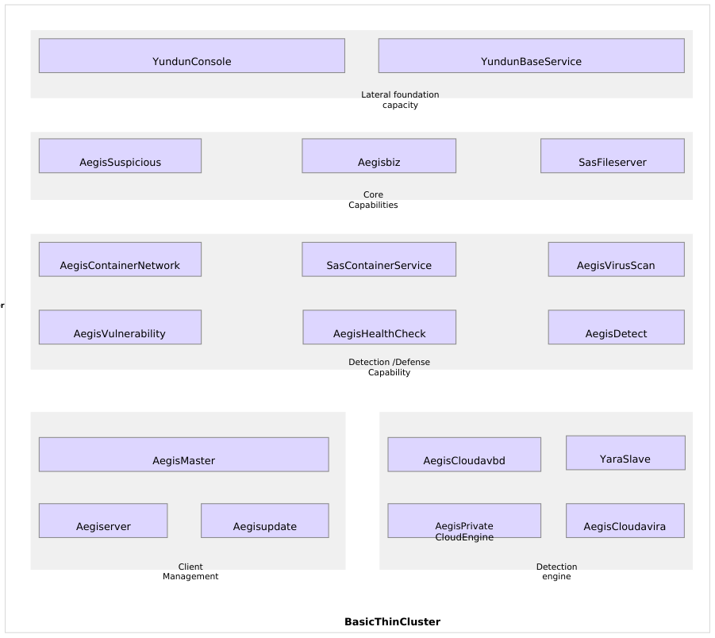

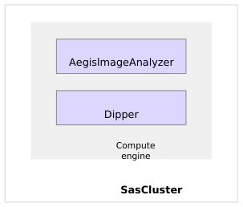

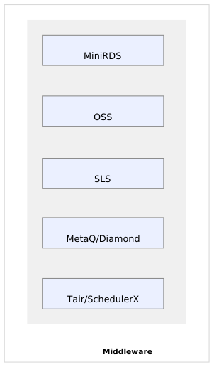

**Server Side**

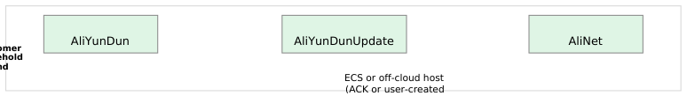

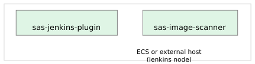

**Customer household**

**end**

**V3.18.2- V3.18.6(2512 universal)**

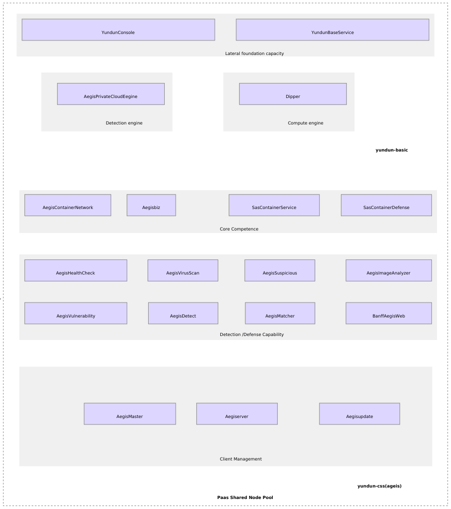

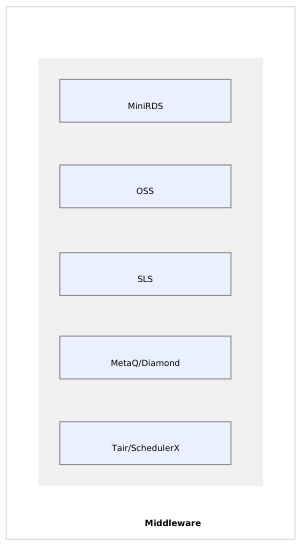

**Server Side**

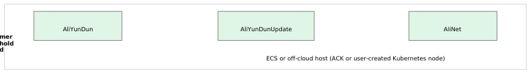

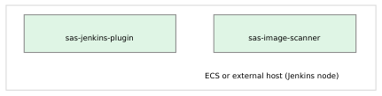

**Customer household**

**end**

**V3.19- V3.18.6(2512limit)**

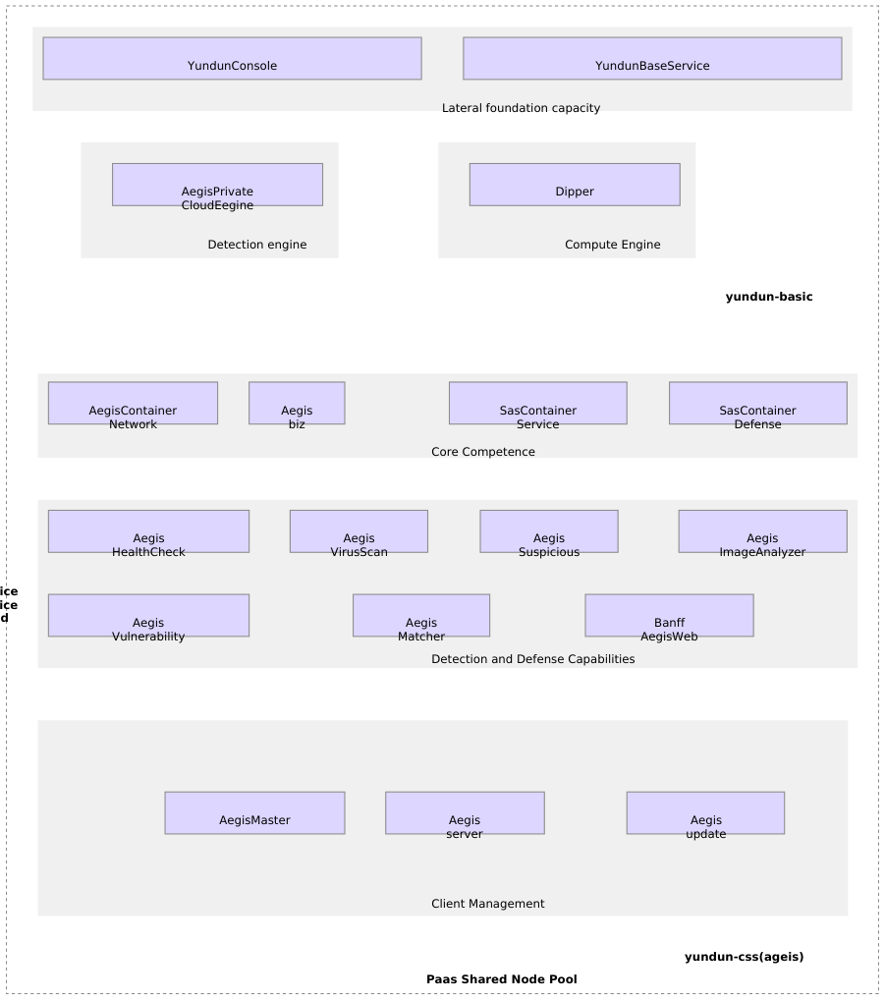

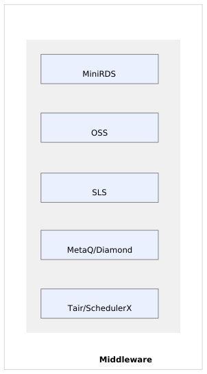

**Service service**

**end**

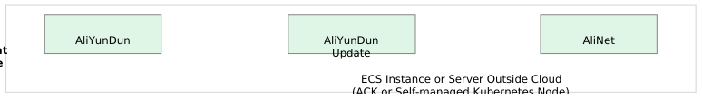

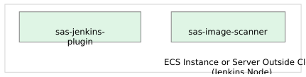

**Client Side**

ECS Instance or Server Outside Cloud

(ACKorSelf-managedKubernetesNode)

(JenkinsNode)

**Versions later than V3.18.6(2512limit)**

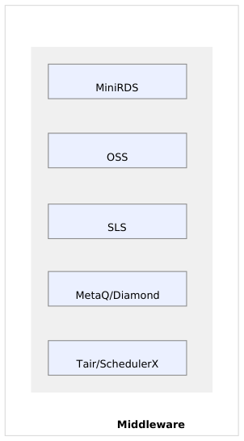

**Service service**

**end**

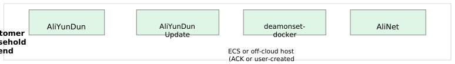

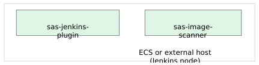

**Customer household**

**end**

(Jenkinsnode)

Container security, reuse Server Guard detection capabilities, including the server and client two modules.

Server: manages container clusters and image assets on and off the cloud, and provides core capabilities such as detection and defense.

Client side: reports the running status of container clusters and nodes in real time, and provides running detection and network blocking capabilities.

**Server side**

The server side consists of the following types of modules:

- Lateral basic capabilities: the common capabilities of Apsara Stack Security services, which can be used in consoles or by calling API operations.

- Core capabilities: asset management, alerting, and file collection.

- Detection and defense: detection of and defense against vulnerabilities and baseline risks, and protection of files, networks, and processes.

- Detection engines: the commercial virus detection engines, a self-developed virus detection engine, and a big data computing engine.

- Client management: manages client connections, updates the status of container clusters, and delivers configuration rules.

The following table describes modules of the server side.

| Module | Responsibilities |
| --- | --- |
| YundunConsole | The console provides a unified management interface for security administrators. |
| YundunBaseService | API Gateway, which opens host security capabilities to third-party developers. |
| AegisSuspicious | Intrusion alert events and application whitelists. |
| Aegisbiz | Manage the assets of container clusters and images inside and outside the cloud. |
| SasFileserver | This module corresponds to the file collection feature. |
| AegisContainerNetwork (AegisMetaData) | This module corresponds to the network visualization and container firewall features. |
| SasContainerService (NewSas) | This module corresponds to the image plug-in scan feature. |
| SasContainerDefence (NewSas) | This module corresponds to the active defense for containers feature. |
| AegisHealthCheck | This module corresponds to the baseline check feature. |
| AegisVirusScan | File detection. |
| AegisDetect | In the old version of file detection, only file whitelist management is retained. All other processes are migrated to AegisVirusScan. |
| AegisDefence | Tamper-proof. |
| AegisVulnerability | Vulnerability detection. |
| AegisPrivateCloudEngine | The GLE engine is a virus detection engine developed by Alibaba. |
| AegisMaster | Client configuration and plug-in management. |
| Aegiserver | Client connection management, configuration delivery, and message forwarding. |
| Aegisupdate | Files such as customer order upgrades, rules /scripts /patches are pulled. |
| YaraSlave | Yara binary detection engine, a commercial virus detection engine. |
| AegisCloudavira | Red umbrella binary engine, commercial virus detection engine. |
| AegisCloudavbd | This module corresponds to the Bitdefender engine used to check binary files, which is a commercial virus detection engine. |
| AegisImageAnalyzer | This module corresponds to the image scan feature. |
| Dipper | This module corresponds to the big data compute engine that is used to detect intrusions. |

**Client side**

The following table describes the server processes that correspond to the modules of the client side.

| Process name | Description |
| --- | --- |
| SasJenkinsPlugin | The Jenkins plug-in used for image scans, which pulls up the SasImageScanner container. |
| SasImageScanner | The container process that is used to implement the image scan feature. |
| AliYunDun | A core process that is used to establish connections with Server Guard. |
| AliYunDunUpdate | A core process that is used to periodically check whether the Server Guard agent needs to be updated. |
| AliNet | The container process that is used to implement the container firewall feature. |

> **Note**
>
> Operating systems supported by the Server Guard agent
>
> Operating systems supported by AliNet

### 1.1.2. Core modules

#### 1.1.2.1. Asset Management

The Container Security Asset Center allows you to view the security protection status of managed assets, such as container clusters and images.

**Supported asset types**

Cloud assets: Container Service for Kubernetes (ACK) and Container Registry (Container Registry)

Assets outside the cloud: self-built kubernetes,quay image repository, harbor image repository, and Jenkins image

**Core Process**

**Asset synchronization**

- Obtain ACK and ACR data by using OpenAPI.

- Access user-created Kubernetes:

  - V3.18.6-2512 the-limit version and earlier to obtain the data of user-created Kubernetes and user-created image warehouses through directional access.

  - In versions later than V3.18.6-2512-limit, you can run the YAML command on the master node of the self-managed cluster and obtain the cluster information by using the client.

- The container cluster asset updates the container status in real time based on the container change messages reported by the client.

**V3.18.6-2512-limit version and earlier core process**

Self-built

1. Use the webhook to

   image warehouse

notify you of changes

to the image asset.

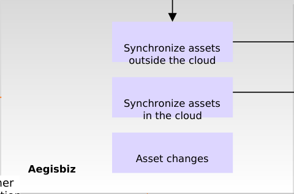

1. Synchronize assets

through reverse access

user-created

Kubernetes apis

user-created image

repository apis

3. Broadcast container

asset change information

1. Call OpenAPI to

synchronize ACK assets

**Service**

2. Forward container

**Service**

change information

**End**

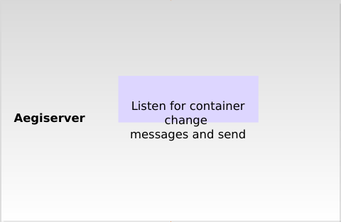

ACK control ACK control

Other applications

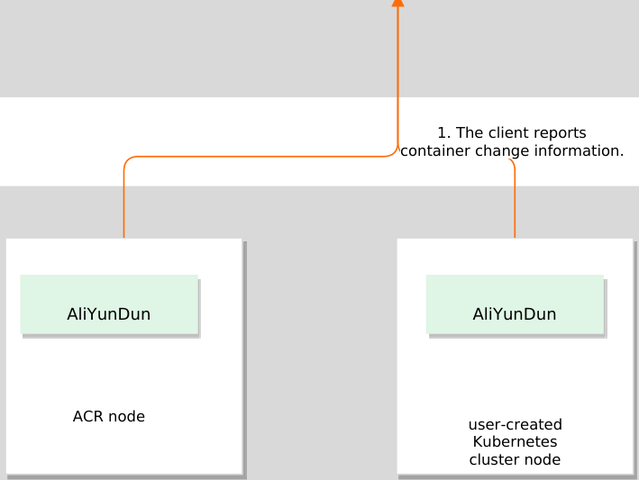

**Customer Household**

**End**

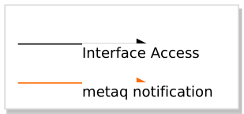

**V3.18.6 -2512-limit later version core process**

Self-built image

1. Use the webhook to notify you of changes to the image asset.

   warehouse

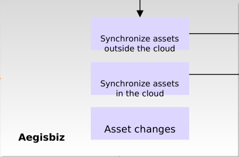

1. Configure access to a managed image cluster

   image managed set

   group access information

   1. Call OpenAPI to synchronize ACK assets

**Service**

3. Broadcast container asset change information

   2. Forward container change information

**Service**

**End**

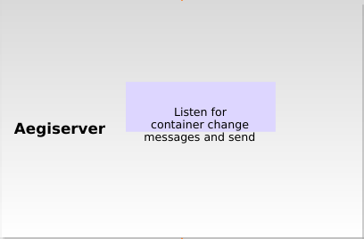

ACK control ACK control

Other applications

2. Run the YAML of the man

1. The client reports container change information.

AliYunDun

AliYunDun

**Customer Household**

**End**

ACR node

user-created Kubernetes cluster node

Interface Access

metaq notification

**Access process for external assets**

- Through reverse access, the container security server can access the user VPC network from the control area to request the mirror warehouse api and Kubernetes apiServer.

- In IDC scenarios, off-cloud assets may be integrated into container security management by using the grid connection method.

  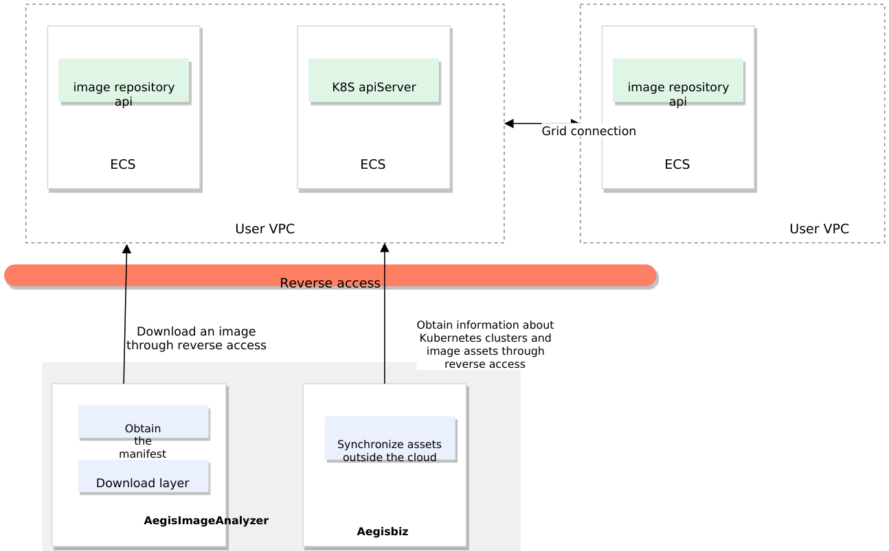

Control

area

**Core process of container network topology**

The network logs of containers are marked as in and out traffic. Combined with the network link logs, after dipper processing, the east-west traffic between containers, the public network, and the north-south traffic between containers are retained and presented in the topology diagram.

- east-west traffic: the in and out log time intervals are within a specific range, and the quintet (source ip, source port, destination ip, destination port) of the two logs exactly match.

- north-south traffic: the time interval between in and out logs is within a specific range, and either the source ip address or the destination ip address can be traced to the public ip address

- Match interval: The exact match time is 60 seconds, and the service mode time is 10 seconds.

  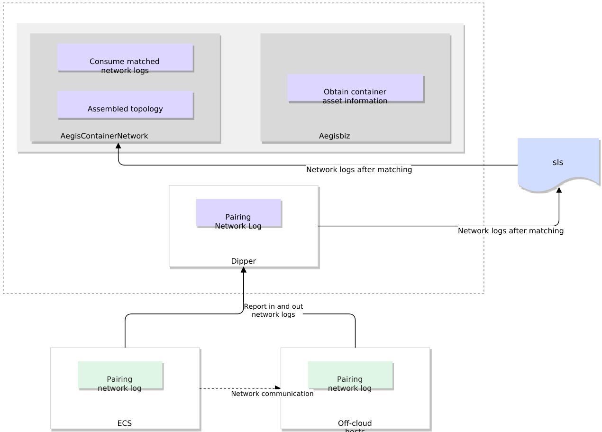

**Service Service**

**End**

**Customer Household**

**End**

hosts

#### 1.1.2.2. Container Firewall

Container Firewall is a firewall service provided by Container Security for container environments and is a core feature of Container Security run time protection. Combined with container network visualization, configure reasonable isolation rules. When hackers exploit vulnerabilities or malicious images to invade a container cluster, the container firewall will alert or intercept abnormal behaviors, which can control risks within a small range and prevent the entire container environment from being invaded.

**Network object description**

compared with hosts, containers and pods have a short lifetime and drift between different nodes. you cannot configure rules based on fixed ip addresses and ports. therefore, you need to define additional network objects for firewall isolation rules.

The user's isolation rules are to be configured on the IP,DNS, or pod,namespace, image, and label of the container. The IP address, DNS address, and isolation rules between images and tags must be matched in real time when the container instance is started.

**Object**

**Property**

**Description**

**Remarks**

**Type**

**Name**

The namespace that

Tag: kubernetes.io/metadata.name:

Namespace

is defined in the

&lt;namespace>

cluster.

The essence is a custom label app:

Container

&lt;application name>. ack is marked with

Tags defined within

Application

app: by default. , self-built Kubernetes

each application

Name

need to define the label, otherwise, the

(app)

corresponding application will not be selected when defining the network object.

Image

Image Name

Label

Custom tags

Separate multiple IP addresses or CIDR blocks with commas

IP

IP

(,). You can specify up to 50 IP addresses or CIDR blocks.

The configured domain names are resolved to IP

DNS domain

DNS domain

addresses (up to 500)

name

name

through DNS, and these IP addresses are RAM.

**Core Process**

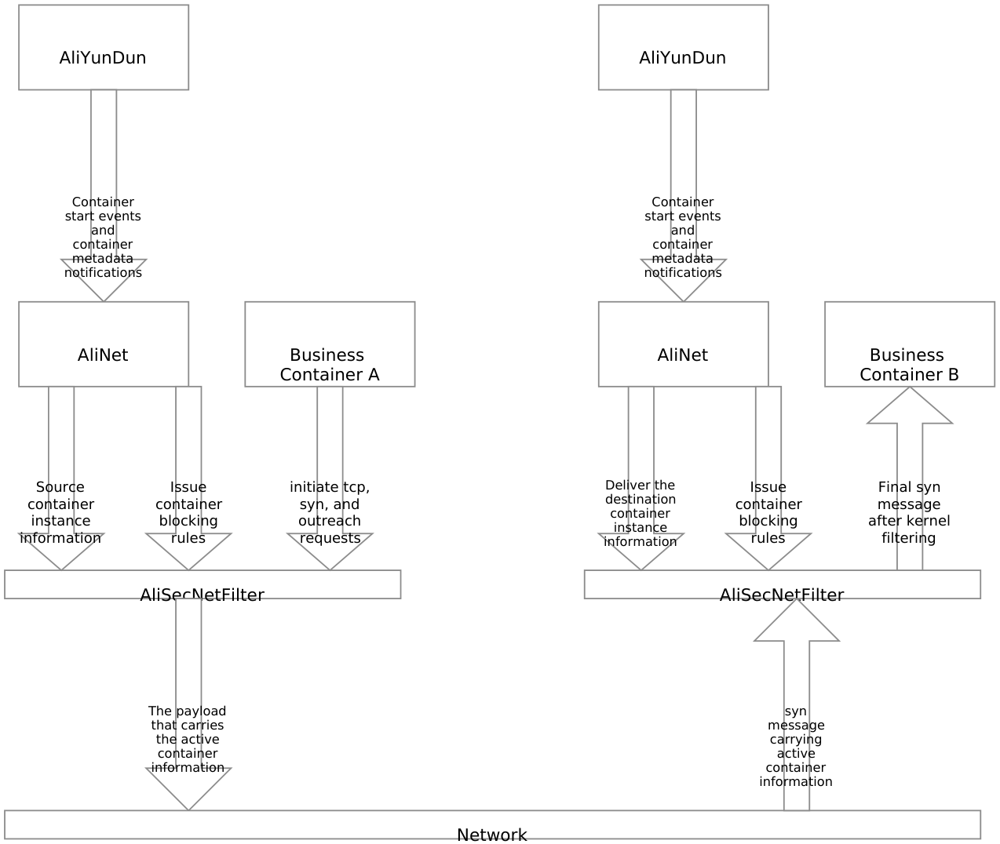

Network

1. configure firewall rules: the configuration and blocking functions of the container firewall completely depend on the alinet plug-in. the status of the alinet plug-in is verified before the container firewall function is enabled. if the alinet plug-in is not installed or the heartbeat of the alinet plug-in is abnormal, the container firewall function cannot be enabled.

2. Issue firewall rules: The aliNet plug-in records the container status and metadata of the current node, and accepts firewall rules issued by the server.

3. Allows, alerts, and blocks network traffic: The aliNet neutron plug-in aliSecNetFilter enables, alerts, and blocks traffic that hits rules based on the recorded container metadata and firewall rules.

#### 1.1.2.3. Mirror Scan

The image security scan feature can detect high and high risk system vulnerability, application vulnerabilities, malicious samples, and configuration risks in images.

**Supported scan image types**

In-cloud image type: defaultACR, Enterprise Edition ACR

Image types outside the cloud: quay,harbor, and images built by jenkins

**Support for scanning risky content**

**Vulnerabilities**: system vulnerability (cve) and application vulnerabilities (sca)

**Baseline:**

- Identity Authentication

  - Make sure that no duplicate usernames or UIDs exist

  - Make sure that no account has the same password hash

  - Make sure that no account with an empty password exists in the system

  - Ensure that a strong password hashing algorithm is used

  - Ensure root is the only account with UID 0

  - Make sure that no duplicate user groups or GIDs exist

- Unauthorized access

  - CouchDB unauthorized access configuration risk

  - Risk of unauthorized access to Elasticsearch

  - PostgreSQL unauthorized access configuration risk

  - Jenkins unauthorized access configuration risk

  - Risk of unauthorized access to Hadoop

- Weak password

  - Tomcat weak password configuration

  - Configure weak passwords for ApsaraDB for Redis

  - rsync weak password configuration

  - svn weak password configuration

- Service configuration

  - Make sure that the openssh service is not installed

**Malicious samples:** webshells, binary files, such as trojans, ransomware, mining viruses, and backdoor programs

**Scan process**

**Image scan for periodic tasks**

You can use the image scan settings to scan images from a specified image repository within a specified period.

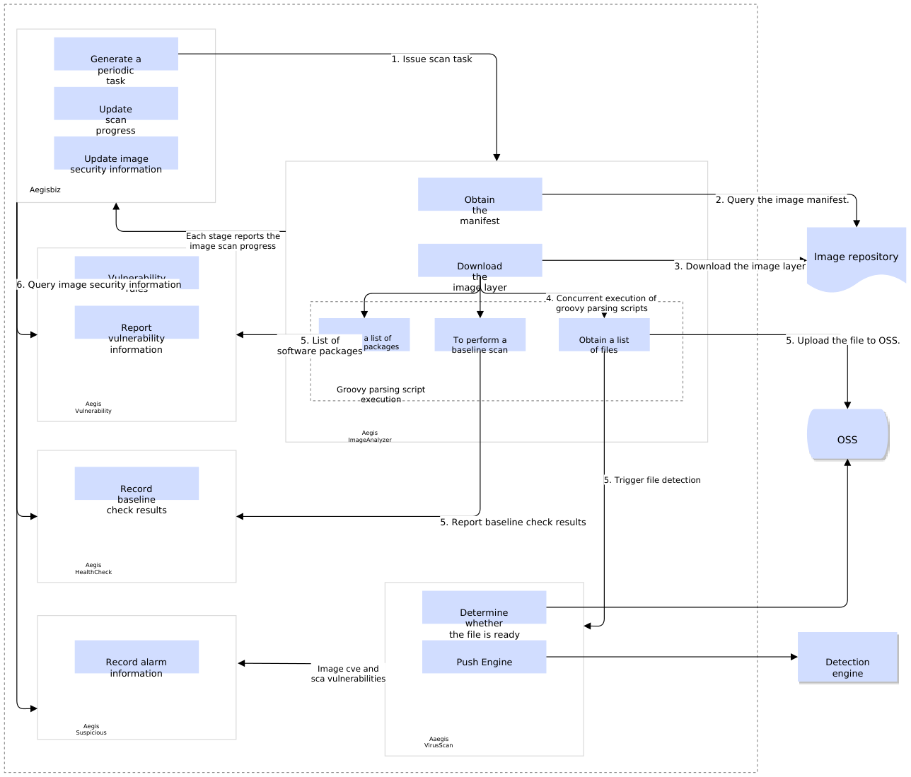

**Webhook Image Scan**

acr images and user-created image repositions can use webhooks to report image changes, create a single-cycle image scan task, and immediately run tasks to scan images.

**Image scan of Jenkins plug-ins**

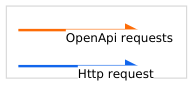

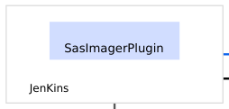

1. Download the

SasImageScanner image

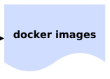

2. Load the

SasImageScanner image

3. Start the image

   scan container.

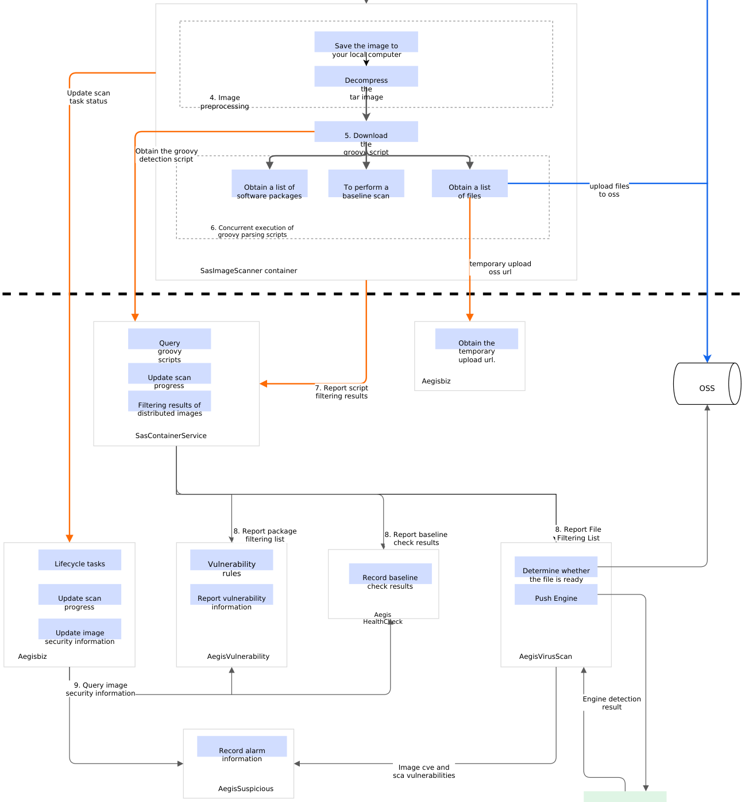

Client

Server

Detection

engine

#### 1.1.2.4. Cluster defense

**Container file defense**

This feature is a basic service of container protection. The cluster must be connected to container security, and the operating system and kernel version must be supported. You can create file defense rules to implement fine-grained file-level protection by specifying the paths to be protected, the types of files to be included or excluded, the actions to be executed (alerts or block), and the whitelist process. The following figure shows the flowchart of container file defense:

Container

tamper-proofing

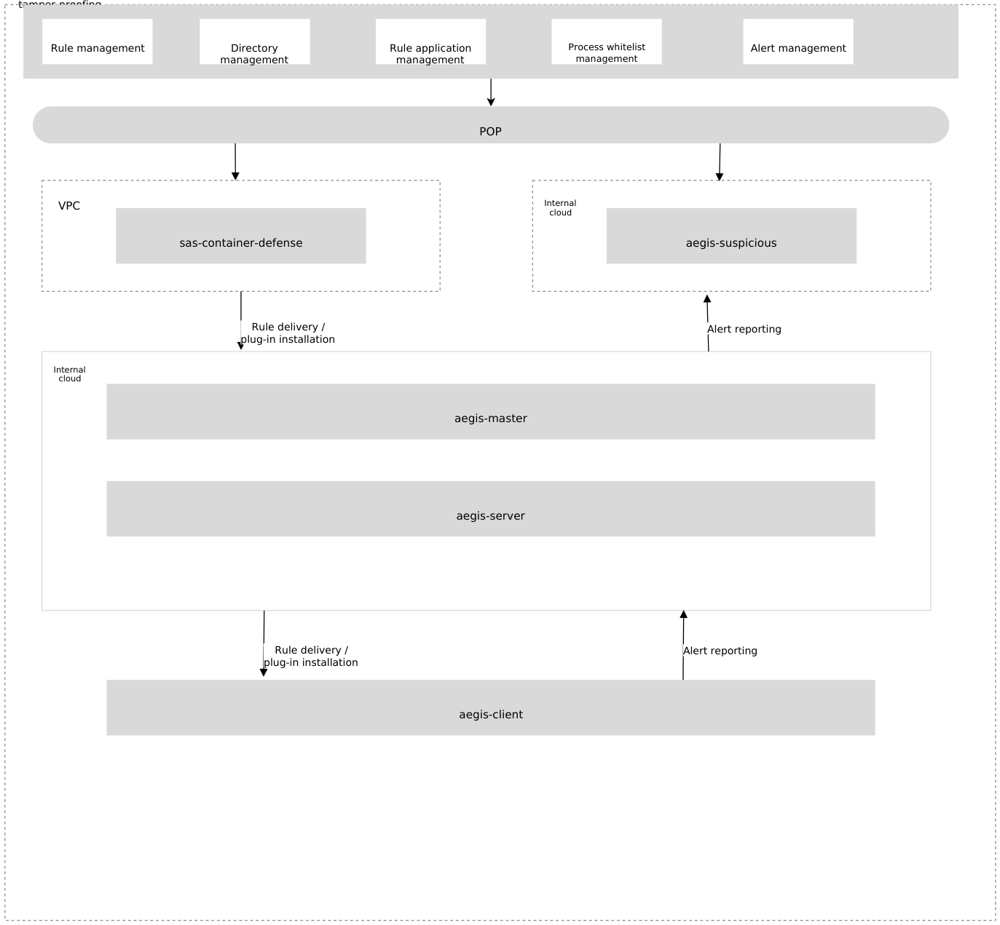

**Active defense for containers**

This feature detects security risks during container startup or run time from multiple perspectives: image security, run time security, and runtime environment security. By configuring corresponding rules, you can block the running of risky images, stop untrusted processes, and block container escapes to improve the security level of the overall container runtime environment. This topic describes how to configure risky image blocking, non-image program defense, and container escape protection rules.

| Rule Type | Rule description | Remarks |
| --- | --- | --- |
| Block risky images | After you create a <strong>risky image blocking</strong> <strong>rule</strong>, Container Security checks the security of the image when you create resources from the image in the specified cluster. If the image that matches the risky image blocking rule is enabled, Container Security checks the security of the image. This ensures that the image that is started in the cluster meets your security requirements. | Only some cluster types of Container Service for Kubernetes (Container Service for Kubernetes) are supported. |
| Non-image program defense | After you create a <strong>protection rule for non-</strong><strong>image programs</strong>, Container Security can detect and block the startup of programs outside the image. This helps you defend against known or unknown attack modes. | • AliYunDun ≥ aegis_12_13, and AliHips ≥ 00_43. • Make sure that the container image name cannot exceed 287 characters in length. • The full path length of the running program in the container cannot exceed 1023 characters. • The namespace of the cluster cannot exceed 287 characters in length. |
| Container anti-escape | The <strong>container anti-escape</strong> feature can detect high-risk behaviors from multiple dimensions, such as processes, files, and system calls. It establishes a barrier between containers and hosts to effectively prevent escaping behaviors and ensure container runtime security. This feature blocks attacks from attackers that exploit container vulnerabilities to host servers. This helps improve server system security. | The server where the cluster resides is connected to Container Service. |

**Block risky images**

Create a rule

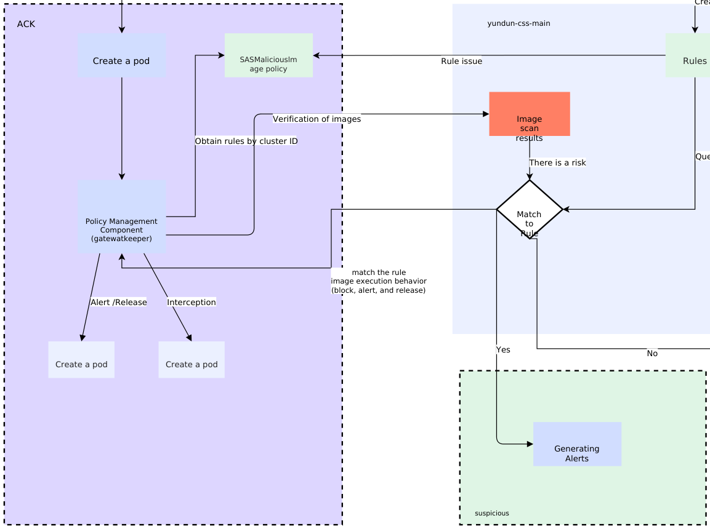

Query rules

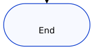

**Non-mirror program defense flowchart**

**Flow chart of container anti-escape**

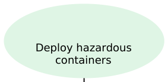

6. Dangerous container

   deployment

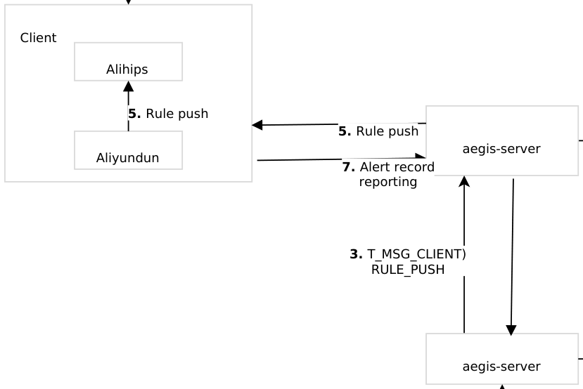

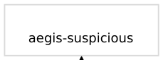

8. T_MSG_PLUGIN

_EVENT_ALIHIPS

1. T_MSG_PLUGIN

   _HEARTS

2. Assemble the rules

**Container Signature**

Container signatures enable trusted signatures on container images to ensure that only approved container images are allowed to be deployed. This prevents unauthorized images from being started and fundamentally helps you improve asset security.

This feature is based on the asymmetric encryption algorithm. You must use KMS to create a key of the RSA_2048 type and use the SIGN/VERIFY key. This feature integrates the signature verification capability with ACK clusters by configuring the **attestor** and **security policy** for containers. After the policy is enabled, only images with valid signatures can be deployed in the specified namespace. Images that are not signed or fail to be verified will be blocked. The flowchart is as follows:

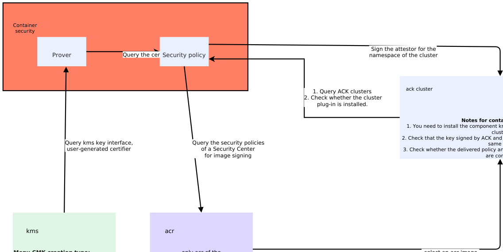

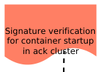

**Notes for container signing:**

1. You need to install the component kritis-validation-hook to create an ACK

   cluster

2. Check that the key signed by ACK and the certifier of Security Center use the

   same key

3. Check whether the delivered policy and the namespace delivered to the ack

   are correct.

**Menu CMK creation type:**

only acr of the

select an acr image

RSA_2048

enterprise

to create a container.

**Key purpose:** the key of

edition has the image

SIGN/VERIFY

signing feature.

## 1.2. High availability

**High-availability server side**

> **Note**
>
> High availability is delivered by using stateless applications.

The server side of Container Security Service (CSS) consists of stateless applications and implements load balancing based on virtual IP addresses (VIPs) and Dubbo to ensure service availability.

- The server side is stateless. If you have at least two physical machines, service availability is ensured when one physical machine runs as expected.

- Data is stored in middleware such as Diamond and MetaQ or cloud services such as MiniRDS, Simple Log Service, Object Storage Service (OSS), and Tair. The middleware and cloud services provide high data storage availability.

- CSS provides API operations that can be called over HTTPS and implements load balancing based on domain names and VIPs to ensure service availability.

- Service calls in CSS depend on the Dubbo microservices framework. Software-based load balancing of Dubbo ensures service availability.

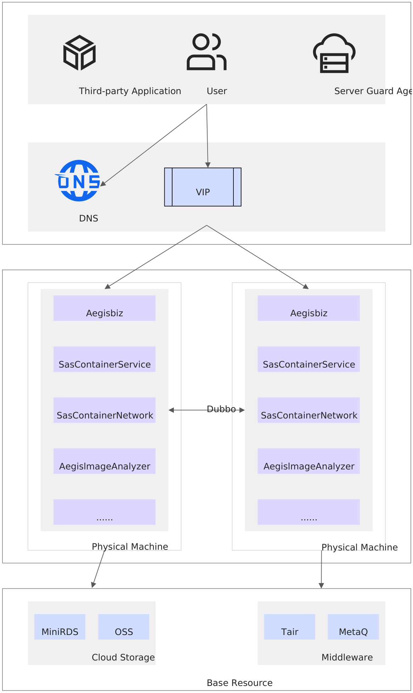

Server Guard Age

## 1.3. Disaster recovery and backup

**Zone-disaster recovery**

> **Note**
>
> Zone-disaster recovery is delivered by using the active-active mode.

The zone-disaster recovery architecture of Container Security Service (CSS) follows the rules of the active-active mode. In this architecture, disaster recovery is ensured by cloud storage services or middleware.

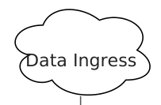

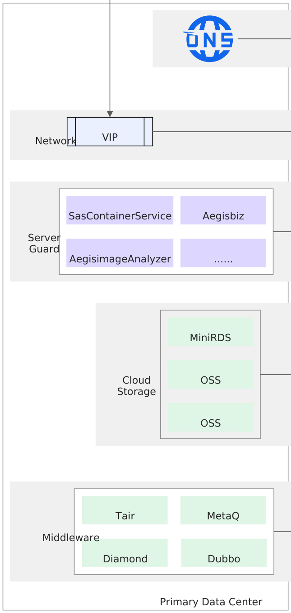

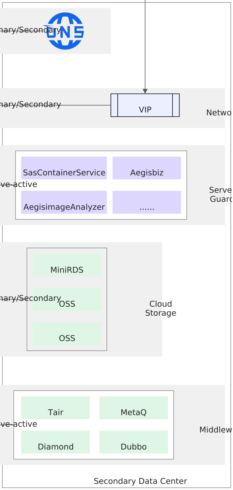

Primary/Secondary

Primary/Secondary

Active-active

Guard

Primary/Secondary

Active-active

The following table describes the disaster recovery solution in each component.

| Component | Solution |
| --- | --- |
| Container security | The active-active deployment strategy depends on middleware and Object Storage Service (OSS) to ensure data consistency. |
| DNS | Anycast VIPs are used to isolate traffic between the primary and secondary data centers. |
| VIP | BGP routing is used to implement primary/secondary switchover. |
| MiniRDS | Secondary databases synchronize data from the primary databases based on binary logs. |
| SLS | Data synchronization is implemented based on backups in OSS. |
| OSS | Data synchronization between the primary and secondary data centers is supported. |
| Middleware | The active-active deployment strategy depends on MiniRDS to ensure data consistency. |

**Geo-disaster recovery**

> **Note**
>
> Geo-disaster recovery is delivered based on independent regions.

The multi-region architecture of CSS follows the rules of independent regions. General regions do not depend on the central region, and data is completely isolated from services.

## 1.4. Monitor objects and send alert notifications

**System metrics**

System monitoring of Container Security Service (CSS) is connected to the TianjiMon console.

> **Important**
>
> Note: The alerting feature is not enabled for versions earlier than Apsara Stack V3.17.1.

This section describes the monitoring metrics of applications.

**aegisbiz**

Alert

Alert

Metric description

Descriptio

Metric name (TianjiMon)

Monitored object

Threshold

n

CPU Utilization

Consecuti

aegisbiz_cpu_container_host

(Single Machine)

ve times: 3 times

Silence

aegisbiz_cpu_container_serv

CPU utilization

util_avg >

CPU Usage

duration:

errole

(service role)

95

300s

Detection interval:

aegisbiz_cpu_container_clust

CPU Utilization

60s

er

(Cluster)

aegisbiz_memo_container_ho

Memory

Consecuti

st

(standalone)

ve times: 3 times

Maximum and

Silence

aegisbiz_memo_container_se

Memory (service

util_avg >

average memory

duration:

rverrole

role)

90

usage

300s

Detection interval:

aegisbiz_memo_container_cl

Memory (Cluster)

60s

uster

Load (single

Consecuti

aegisbiz_load_container_host

machine)

ve times: 3 times

Maximum and

Silence

aegisbiz_load_container_serv

Load (service

load1_av

average CPU load

duration:

errole

role)

g > 1

(load1,load5,load15)

300s

Detection interval:

aegisbiz_load_container_clus

Load (Cluster)

60s

ter

aegisbiz_tcp_conns_containe

tcp connections

r_host

(standalone)

Maximum and

aegisbiz_tcp_conns_containe

tcp connections

average tcp

No

No

r_serverrole

(server role)

connections

aegisbiz_tcp_conns_containe

tcp connections

r_cluster

(cluster)

aegisbiz_ntp_container_host

NTP (standalone)

aegisbiz_ntp_container_serve

NTP (service

rrole

role)

NTP

No

No

aegisbiz_ntp_container_clust

NTP (cluster)

er

Number of processes (on a

aegisbiz_process_count_cont

single machine)

ainer_host

Consecuti ve times: 3 times

Maximum and

process_n

Silence

Number of

average number of

umber_m

duration:

aegisbiz_process_count_cont

processes

processes

ax > 100

300s

ainer_cluster

(service roles)

Detection interval: 60s

Number of

aegisbiz_process_count_cont

processes

ainer_host

(cluster)

aegisbiz_nginx_container_ho

NGINX QPS

st

(standalone)

aegisbiz_nginx_container_ser

Nginx QPS

The QPS of NGINX

No

No

verrole

(service role)

requests.

aegisbiz_nginx_container_clu

Nginx QPS

ster

(cluster)

aegisbiz_health_container_ho

health check

Consecuti

st

(stand-alone)

ve times: 3 times

Whether the

Silence

aegisbiz_health_container_se

health check

health >

application is started

duration:

rverrole

(service role)

0

normally

300s

Detection interval:

aegisbiz_health_container_cl

health check

60s

uster

(Cluster)

**aegis-metadata application**

<table>
  <tr>
    <td>Monitoring metric (TianjiMon metric name)</td>
    <td>Monitoring name</td>
    <td>Monitoring description</td>
    <td>Alert Threshold</td>
    <td>Alert Descriptio n</td>
  </tr>
</table>

aegismetadata_cpu_containe

CPU Utilization

r_host

(Single Machine)

Consecuti ve times: 3 times

CPU utilization

Silence

aegismetadata_cpu_containe

util_avg >

(service role)

CPU Usage

duration:

r_serverrole

95

300s

Detection interval: 60s

aegismetadata_cpu_containe

CPU Utilization

r_cluster

(Cluster)

aegismetadata_memo_contai

Memory

Consecuti

ner_host

(standalone)

ve times: 3 times

Maximum and

Silence

aegismetadata_memo_contai

Memory (service

util_avg >

average memory

duration:

ner_serverrole

role)

90

usage

300s

Detection interval:

aegismetadata_memo_contai

Memory (Cluster)

60s

ner_cluster

aegismetadata_load_contain

Load (single

Consecuti

er_host

machine)

ve times: 3 times

Maximum and

Silence

aegismetadata_load_contain

Load (service

load1_av

average CPU load

duration:

er_serverrole

role)

g > 1

(load1,load5,load15)

300s

Detection interval:

aegismetadata_load_contain

Load (Cluster)

60s

er_cluster

aegismetadata_tcp_conns_co

tcp connections

ntainer_host

(standalone)

Maximum and

aegismetadata_tcp_conns_co

tcp connections

average tcp

No

No

ntainer_serverrole

(server role)

connections

aegismetadata_tcp_conns_co

tcp connections

ntainer_cluster

(cluster)

aegismetadata_ntp_containe

NTP (standalone)

r_host

aegismetadata_ntp_containe

NTP (service

r_serverrole

role)

NTP

No

No

aegismetadata_ntp_containe

NTP (cluster)

r_cluster

Number of

aegismetadata_process_coun

processes (on a

t_container_host

Consecuti

single machine)

ve times: 3 times

process_n umber_m

Number of

Maximum and

Silence

aegismetadata_process_coun

ax > 100

processes

average number of

duration:

t_container_cluster

(service roles)

processes

300s

Detection interval:

Number of

60s

aegismetadata_process_coun

processes

t_container_host

(cluster)

aegismetadata_nginx_contai

NGINX QPS

ner_host

(standalone)

aegismetadata_nginx_contai

Nginx QPS

The QPS of NGINX

No

No

ner_serverrole

(service role)

requests.

aegismetadata_nginx_contai

Nginx QPS

ner_cluster

(cluster)

aegismetadata_health_contai

health check

Consecuti

ner_host

(stand-alone)

ve times: 3 times

Whether the

Silence

aegismetadata_health_contai

health check

health >

application is started

duration:

ner_serverrole

(service role)

0

normally

300s

Detection interval:

aegismetadata_health_contai

health check

60s

ner_cluster

(Cluster)

**aegisContainerNetWork application**

| Monitoring metric (TianjiMon metric name) | Monitoring name | Monitoring description | Alert Threshold |
| --- | --- | --- | --- |
| tjmon_aegismetadata_memo_conta iner_host | Memory (standalone) | CPU Usage | util_avg &gt; 90 |
| tjmon_aegismetadata_load_contain er_host | Load (single machine) | Maximum and average CPU load (load1,load5,load15) | load1_avg &gt; 2 |
| tjmon_aegismetadata_process_cou nt_container_host | Number of processes (on a single machine) | Maximum number of processes | process_nu mber_max&gt; 100 |
| tjmon_aegismetadata_health_conta iner_host | health check (stand-alone) | Whether the application is started normally | health&gt;0 |
| tjmon_aegismetadata_exception_al arm | Abnormal Alert (Single Machine) | Error Alert Reporting | level=="ER ROR" |
| tjmon_aegiscontainer_oom_host | Memory overflow alarm (standalone) | Memory overflow alarm | oom_status_sum&gt;0 |

**aegis-image-analyzer application**

Alert

Monitoring metric (TianjiMon

Monitoring

Alert

Monitoring name

Descriptio

metric name)

description

Threshold

n

aegisimageanalyzer_cpu_con

CPU Utilization

Consecuti

tainer_host

(Single Machine)

ve times: 3 times

Silence

aegisimageanalyzer_cpu_con

CPU utilization

util_avg >

CPU Usage

duration:

tainer_serverrole

(service role)

95

300s

Detection interval:

aegisimageanalyzer_cpu_con

CPU Utilization

60s

tainer_cluster

(Cluster)

aegisimageanalyzer_memo_c

Memory

ontainer_host

(standalone)

aegisimageanalyzer_memo_c

Memory (service

ontainer_serverrole

role)

Consecuti ve times: 3 times

aegisimageanalyzer_memo_c

Memory (Cluster)

ontainer_cluster

Maximum and

Silence

util_avg >

average memory

duration:

90

usage

300s

Detection interval: 60s

aegisimageanalyzer_load_co

Load (single

Consecuti

ntainer_host

machine)

ve times: 3 times

Maximum and

Silence

aegisimageanalyzer_load_co

Load (service

load1_av

average CPU load

duration:

ntainer_serverrole

role)

g > 1

(load1,load5,load15)

300s

Detection interval:

aegisimageanalyzer_load_co

Load (Cluster)

60s

ntainer_cluster

aegisimageanalyzer_tcp_con

tcp connections

ns_container_host

(standalone)

Maximum and

aegisimageanalyzer_tcp_con

tcp connections

average tcp

No

No

ns_container_serverrole

(server role)

connections

aegisimageanalyzer_tcp_con

tcp connections

ns_container_cluster

(cluster)

aegisimageanalyzer_ntp_con

NTP (standalone)

tainer_host

aegisimageanalyzer_ntp_con

NTP (service

NTP

No

No

tainer_serverrole

role)

aegisimageanalyzer_ntp_con

NTP (cluster)

tainer_cluster

Number of

aegisimageanalyzer_process

processes (on a

_count_container_host

Consecuti

single machine)

ve times: 3 times

Number of

Maximum and

process_n

Silence

aegisimageanalyzer_process

processes

average number of

umber_m

duration:

_count_container_cluster

(service roles)

processes

ax > 100

300s

Detection interval:

Number of

60s

aegisimageanalyzer_process

processes

_count_container_host

(cluster)

aegisimageanalyzer_nginx_c

NGINX QPS

ontainer_host

(standalone)

aegisimageanalyzer_nginx_c

Nginx QPS

ontainer_serverrole

(service role)

The QPS of NGINX

No

No

requests.

aegisimageanalyzer_nginx_c

Nginx QPS

ontainer_cluster

(cluster)

aegisimageanalyzer_health_c

health check

Consecuti

ontainer_host

(stand-alone)

ve times: 3 times

Whether the

Silence

aegisimageanalyzer_health_c

health check

health >

application is started

duration:

ontainer_serverrole

(service role)

0

normally

300s

Detection interval:

aegisimageanalyzer_health_c

health check

60s

ontainer_cluster

(Cluster)

> **Note**
>
> For more information about the system monitoring of reusable Server Guard applications, see Server Guard Operations Guide.

**Business metrics**

System monitoring of CSS is implemented based on TianjiMon. The following table describes the metrics.

Modules

Metric name

Description

Statistics on the number of nodes in all

Node Quantity

dimensions of a container cluster

Statistics on the number of applications in all

Number of applications

dimensions of a container cluster

Statistics on the number of pods in all

Container asset

Number of pods

dimensions of a container cluster

Statistics on the number of containers in all

Number of containers

dimensions of a container cluster

Statistics on the number of images in all

Number of images

dimensions

Number of image scan

Number of image scan tasks that are created

tasks

Number of image scan

Number of image layers that are scanned

layers Number of image scan

Monitoring of the number of image scan

results

results

Image scan

Duration of image pre-

Time consumed for image scan pre-analysis in

analysis

each dimension

Duration of image

Time consumed for image scan analysis in

analysis

each dimension

Duration of image

Time consumed for image scan analysis of

analysis for manifests

manifests in each dimension

Number of times that

Number of times that Groovy rules are pulled

Jenkins rules are pulled

during image scans in Jenkins

Duration of rull pulling

Time consumed for pulling Groovy rules

in Jenkins

during image scans in Jenkins

CICD

Number of times that

Number of times that Jenkins scans images

Jenkins scan results are

and reports results

reported

Duration of reporting

Time consumed for reporting scan results

Jenkins scan results

after image scans in Jenkins are complete

Number of container

Number of messages that are consumed by

network logs that are

Dipper for container network visualization

consumed

Time consumed for

Time consumed by Dipper for container

Container firewall

processing container

network visualization

network logs

Number of blocks by

Numbers alerts and blocks by using the

using the container

container firewall feature

firewall feature

Number of container

Number of container Linux vulnerabilities

Linux vulnerabilities

Number of container

Container runtime

application

Number of container application vulnerabilities

protection

vulnerabilities

Number of container

Number of container alerts

alerts

## 1.5. Capacity Planning

Container security is calculated based on the number of CPU cores of the NC in the zone. For each additional 12000 container cores, two physical machines must be added to the BasicThinCluster (the ratio of NC to ECS is 1:6,500 NC to 3000 ECS, and the average specification of each ECS is 4 cores).

The maximum specification of the Server Guard can only support up to 192000 cores. If the upper limit is exceeded, contact R&D for intervention.

**Resource Specifications**

| Server Guard specifications | BasicThinCluster | SasCluster | Calculation formula (the expected number of CPU cores of the entire cloud machine) |
| --- | --- | --- | --- |
| small | 2 | 2 | Total core number of containers in the cluster &lt; 12000 |
| standard | 2~4 | 2~4 | Total core number of containers in the cluster &lt; 24000 |
| large | 4~8 | 4~8 | Total core number of containers in the cluster &lt; 48000 |
| xlarge | 8~16 | 8~16 | Total core number of containers in the cluster &lt; 96000 |
| 2xlarge | 16~32 | 16~32 | Total core number of containers in the cluster &lt; 192000 |

**MiniRDS resource specifications**

x86 Database Specifications

<table>
  <tr>
    <th>Speci ficati on</th>
    <th colspan="2">small</th>
    <th colspan="2">standard</th>
    <th colspan="2">large</th>
    <th colspan="2">xlarge</th>
    <th colspan="2">2xlarge</th>
  </tr>
  <tr>
    <td>Data base insta nce nam e</td>
    <td>Data base insta nce type</td>
    <td>Disk spac e (Unit: GB)</td>
    <td>Data base insta nce type</td>
    <td>Disk spac e (Unit: GB)</td>
    <td>Data base insta nce type</td>
    <td>Disk spac e (Unit: GB)</td>
    <td>Data base insta nce type</td>
    <td>Disk spac e (Unit: GB)</td>
    <td>Data base insta nce type</td>
    <td>Disk spac e (Unit: GB)</td>
  </tr>
  <tr>
    <td>aegis erver</td>
    <td>rds.m ys2.st andar d</td>
    <td>50</td>
    <td>rds.m ys2.st andar d</td>
    <td>50</td>
    <td>rds.m ys2.la rge</td>
    <td>100</td>
    <td>rds.m ys2.xl arge</td>
    <td>200</td>
    <td>rds.m ys2.2 xlarg e</td>
    <td>500</td>
  </tr>
  <tr>
    <td>healt hche ck</td>
    <td>rds.m ys2.la rge</td>
    <td>50</td>
    <td>rds.m ys2.la rge</td>
    <td>50</td>
    <td>rds.m ys2.xl arge</td>
    <td>200</td>
    <td>rds.m ys2.2 xlarg e</td>
    <td>500</td>
    <td>rds.m ys2.2 xlarg e</td>
    <td>500</td>
  </tr>
  <tr>
    <td>defe nder</td>
    <td>rds.m ys2.st andar d</td>
    <td>50</td>
    <td>rds.m ys2.st andar d</td>
    <td>50</td>
    <td>rds.m ys2.la rge</td>
    <td>100</td>
    <td>rds.m ys2.xl arge</td>
    <td>200</td>
    <td>rds.m ys2.xl arge</td>
    <td>200</td>
  </tr>
  <tr>
    <td>aegis vul</td>
    <td>rds.m ys2.la rge</td>
    <td>50</td>
    <td>rds.m ys2.la rge</td>
    <td>50</td>
    <td>rds.m ys2.xl arge</td>
    <td>200</td>
    <td>rds.m ys2.2 xlarg e</td>
    <td>500</td>
    <td>rds.m ys2.2 xlarg e</td>
    <td>500</td>
  </tr>
  <tr>
    <td>mord or</td>
    <td>rds.m ys2.st andar d</td>
    <td>50</td>
    <td>rds.m ys2.st andar d</td>
    <td>50</td>
    <td>rds.m ys2.la rge</td>
    <td>100</td>
    <td>rds.m ys2.xl arge</td>
    <td>200</td>
    <td>rds.m ys2.xl arge</td>
    <td>200</td>
  </tr>
  <tr>
    <td>aegis biz</td>
    <td>rds.m ys2.st andar d</td>
    <td>50</td>
    <td>rds.m ys2.la rge</td>
    <td>100</td>
    <td>rds.m ys2.la rge</td>
    <td>100</td>
    <td>rds.m ys2.xl arge</td>
    <td>200</td>
    <td>rds.m ys2.2 xlarg e</td>
    <td>500</td>
  </tr>
  <tr>
    <td>aegis asset s</td>
    <td>rds.m ys2.la rge</td>
    <td>50</td>
    <td>rds.m ys2.la rge</td>
    <td>50</td>
    <td>rds.m ys2.xl arge</td>
    <td>200</td>
    <td>rds.m ys2.2 xlarg e</td>
    <td>500</td>
    <td>rds.m ys2.2 xlarg e</td>
    <td>500</td>
  </tr>
  <tr>
    <td>aegis dete ct</td>
    <td>rds.m ys2.st andar d</td>
    <td>50</td>
    <td>rds.m ys2.st andar d</td>
    <td>50</td>
    <td>rds.m ys2.la rge</td>
    <td>100</td>
    <td>rds.m ys2.la rge</td>
    <td>100</td>
    <td>rds.m ys2.xl arge</td>
    <td>200</td>
  </tr>
  <tr>
    <td>aegis mast er</td>
    <td>rds.m ys2.st andar d</td>
    <td>50</td>
    <td>rds.m ys2.la rge</td>
    <td>100</td>
    <td>rds.m ys2.xl arge</td>
    <td>200</td>
    <td>rds.m ys2.2 xlarg e</td>
    <td>500</td>
    <td>rds.m ys2.2 xlarg e</td>
    <td>500</td>
  </tr>
  <tr>
    <td>suspi cious</td>
    <td>rds.m ys2.la rge</td>
    <td>50</td>
    <td>rds.m ys2.la rge</td>
    <td>50</td>
    <td>rds.m ys2.xl arge</td>
    <td>200</td>
    <td>rds.m ys2.2 xlarg e</td>
    <td>500</td>
    <td>rds.m ys2.2 xlarg e</td>
    <td>500</td>
  </tr>
  <tr>
    <td>banff web</td>
    <td>rds.m ys2.st andar d</td>
    <td>50</td>
    <td>rds.m ys2.st andar d</td>
    <td>50</td>
    <td>rds.m ys2.la rge</td>
    <td>100</td>
    <td>rds.m ys2.la rge</td>
    <td>100</td>
    <td>rds.m ys2.xl arge</td>
    <td>200</td>
  </tr>
  <tr>
    <td>aegis virus scan</td>
    <td>rds.m ys2.la rge</td>
    <td>50</td>
    <td>rds.m ys2.la rge</td>
    <td>50</td>
    <td>rds.m ys2.xl arge</td>
    <td>200</td>
    <td>rds.m ys2.2 xlarg e</td>
    <td>500</td>
    <td>rds.m ys2.2 xlarg e</td>
    <td>500</td>
  </tr>
  <tr>
    <td>sasfil eserv er</td>
    <td>rds.m ys2.la rge</td>
    <td>50</td>
    <td>rds.m ys2.la rge</td>
    <td>50</td>
    <td>rds.m ys2.la rge</td>
    <td>50</td>
    <td>rds.m ys2.la rge</td>
    <td>50</td>
    <td>rds.m ys2.xl arge</td>
    <td>200</td>
  </tr>
  <tr>
    <td>aegis meta data</td>
    <td>rds.m ys2.st andar d</td>
    <td>50</td>
    <td>rds.m ys2.la rge</td>
    <td>100</td>
    <td>rds.m ys2.la rge</td>
    <td>100</td>
    <td>rds.m ys2.xl arge</td>
    <td>200</td>
    <td>rds.m ys2.2 xlarg e</td>
    <td>500</td>
  </tr>
  <tr>
    <td>basel ine</td>
    <td>rds.m ys2.st andar d</td>
    <td>50</td>
    <td>rds.m ys2.st andar d</td>
    <td>50</td>
    <td>rds.m ys2.la rge</td>
    <td>100</td>
    <td>rds.m ys2.xl arge</td>
    <td>200</td>
    <td>rds.m ys2.2 xlarg e</td>
    <td>500</td>
  </tr>
  <tr>
    <td>news as</td>
    <td>rds.m ys2.st andar d</td>
    <td>50</td>
    <td>rds.m ys2.st andar d</td>
    <td>50</td>
    <td>rds.m ys2.la rge</td>
    <td>100</td>
    <td>rds.m ys2.la rge</td>
    <td>100</td>
    <td>rds.m ys2.xl arge</td>
    <td>200</td>
  </tr>
  <tr>
    <td>aegis matc her</td>
    <td>rds.m ys2.la rge</td>
    <td>50</td>
    <td>rds.m ys2.la rge</td>
    <td>50</td>
    <td>rds.m ys2.la rge</td>
    <td>50</td>
    <td>rds.m ys2.xl arge</td>
    <td>200</td>
    <td>rds.m ys2.xl arge</td>
    <td>200</td>
  </tr>
  <tr>
    <td>aegis defe nce</td>
    <td>rds.m ys2.st andar d</td>
    <td>50</td>
    <td>rds.m ys2.st andar d</td>
    <td>50</td>
    <td>rds.m ys2.la rge</td>
    <td>100</td>
    <td>rds.m ys2.xl arge</td>
    <td>200</td>
    <td>rds.m ys2.xl arge</td>
    <td>200</td>
  </tr>
  <tr>
    <td>mag piebr idge db</td>
    <td>rds.m ys2.st andar d</td>
    <td>-</td>
    <td>rds.m ys2.st andar d</td>
    <td>-</td>
    <td>rds.m ys2.st andar d</td>
    <td>-</td>
    <td>rds.m ys2.la rge</td>
    <td>-</td>
    <td>rds.m ys2.la rge</td>
    <td>-</td>
  </tr>
  <tr>
    <td>yund unap i</td>
    <td>rds.m ys2.st andar d</td>
    <td>-</td>
    <td>rds.m ys2.st andar d</td>
    <td>-</td>
    <td>rds.m ys2.st andar d</td>
    <td>-</td>
    <td>rds.m ys2.la rge</td>
    <td>-</td>
    <td>rds.m ys2.la rge</td>
    <td>-</td>
  </tr>
  <tr>
    <td>yund unlu ban</td>
    <td>rds.m ys2.st andar d</td>
    <td>-</td>
    <td>rds.m ys2.st andar d</td>
    <td>-</td>
    <td>rds.m ys2.st andar d</td>
    <td>-</td>
    <td>rds.m ys2.la rge</td>
    <td>-</td>
    <td>rds.m ys2.la rge</td>
    <td>-</td>
  </tr>
  <tr>
    <td>data sync</td>
    <td>rds.m ys2.st andar d</td>
    <td>-</td>
    <td>rds.m ys2.st andar d</td>
    <td>-</td>
    <td>rds.m ys2.st andar d</td>
    <td>-</td>
    <td>rds.m ys2.la rge</td>
    <td>-</td>
    <td>rds.m ys2.la rge</td>
    <td>-</td>
  </tr>
</table>

Arm /sw database specifications

| Database instance name | small | standard | large | xlarge | 2xlarge |
| --- | --- | --- | --- | --- | --- |
| aegiserve r | rds.mysql.s1.s mall | rds.mysql.s1.s mall | rds.mysql.s2.l arge | rds.mysql.s3.l arge | rds.mysql.c1.la rge |
| healthch eck | rds.mysql.s1.s mall | rds.mysql.s2.la rge | rds.mysql.s3.l arge | rds.mysql.c1.l arge | rds.mysql.c1.la rge |
| defender | rds.mysql.s1.s mall | rds.mysql.s1.s mall | rds.mysql.s2.l arge | rds.mysql.s3.l arge | rds.mysql.s3.la rge |
| aegisvul | rds.mysql.s1.s mall | rds.mysql.s2.la rge | rds.mysql.s3.l arge | rds.mysql.c1.l arge | rds.mysql.c1.la rge |
| mordor | rds.mysql.s1.s mall | rds.mysql.s1.s mall | rds.mysql.s2.l arge | rds.mysql.s3.l arge | rds.mysql.s3.la rge |
| aegisbiz | rds.mysql.s1.s mall | rds.mysql.s2.la rge | rds.mysql.s2.l arge | rds.mysql.s3.l arge | rds.mysql.c1.la rge |
| aegisasse ts | rds.mysql.s1.s mall | rds.mysql.s2.la rge | rds.mysql.s3.l arge | rds.mysql.c1.l arge | rds.mysql.c1.la rge |
| aegisdete ct | rds.mysql.s1.s mall | rds.mysql.s1.s mall | rds.mysql.s2.l arge | rds.mysql.s2.l arge | rds.mysql.s3.la rge |
| aegismas ter | rds.mysql.s1.s mall | rds.mysql.s2.la rge | rds.mysql.s3.l arge | rds.mysql.c1.l arge | rds.mysql.c1.la rge |
| suspiciou s | rds.mysql.s1.s mall | rds.mysql.s2.la rge | rds.mysql.s3.l arge | rds.mysql.c1.l arge | rds.mysql.c1.la rge |
| banffweb | rds.mysql.s1.s mall | rds.mysql.s1.s mall | rds.mysql.s2.l arge | rds.mysql.s2.l arge | rds.mysql.s3.la rge |
| aegisviru sscan | rds.mysql.s1.s mall | rds.mysql.s2.la rge | rds.mysql.s3.l arge | rds.mysql.c1.l arge | rds.mysql.c1.la rge |
| sasfileser ver | rds.mysql.s1.s mall | rds.mysql.s1.s mall | rds.mysql.s2.l arge | rds.mysql.s2.l arge | rds.mysql.s3.la rge |
| aegismet adata | rds.mysql.s1.s mall | rds.mysql.s2.la rge | rds.mysql.s2.l arge | rds.mysql.s3.l arge | rds.mysql.c1.la rge |
| baseline | rds.mysql.s1.s mall | rds.mysql.s1.s mall | rds.mysql.s2.l arge | rds.mysql.s3.l arge | rds.mysql.c1.la rge |
| newsas | rds.mysql.s1.s mall | rds.mysql.s1.s mall | rds.mysql.s2.l arge | rds.mysql.s2.l arge | rds.mysql.s3.la rge |
| aegismat cher | rds.mysql.s1.s mall | rds.mysql.s1.s mall | rds.mysql.s2.l arge | rds.mysql.s3.l arge | rds.mysql.s3.la rge |
| aegisdefe nce | rds.mysql.s1.s mall | rds.mysql.s1.s mall | rds.mysql.s2.l arge | rds.mysql.s3.l arge | rds.mysql.s3.la rge |
| magpiebr idgedb | rds.mysql.s1.s mall | rds.mysql.s1.s mall | rds.mysql.s1.small | rds.mysql.s2.l arge | rds.mysql.s2.la rge |
| yunduna pi | rds.mysql.s1.s mall | rds.mysql.s1.s mall | rds.mysql.s1.small | rds.mysql.s2.l arge | rds.mysql.s2.la rge |
| yundunlu ban | rds.mysql.s1.s mall | rds.mysql.s1.s mall | rds.mysql.s1.small | rds.mysql.s2.l arge | rds.mysql.s2.la rge |
| datasync | rds.mysql.s1.s mall | rds.mysql.s1.s mall | rds.mysql.s1.small | rds.mysql.s2.l arge | rds.mysql.s2.la rge |

**Oss/Sls-inner resource capacity planning**

**Total core number of**

**sls-Inner Total Disk Used**

**OSS Capacity (GB)**

**containers in a cluster**

**(GB)**

**Specific**

**ations**

**Formula**

**2 GB per machine**

**0.1 GB per machine**

<table>
  <tr>
    <td>small</td>
    <td>12000</td>
    <td>7000</td>
    <td>350</td>
  </tr>
  <tr>
    <td>standar d</td>
    <td>24000</td>
    <td>14000</td>
    <td>700</td>
  </tr>
  <tr>
    <td>large</td>
    <td>48000</td>
    <td>28000</td>
    <td>1400</td>
  </tr>
  <tr>
    <td>xlarge</td>
    <td>96000</td>
    <td>56000</td>
    <td>2800</td>
  </tr>
  <tr>
    <td>2xlarge</td>
    <td>192000</td>
    <td>112000</td>
    <td>5600</td>
  </tr>
</table>

**Tair resource capacity planning**

<table>
  <tr>
    <th rowspan="2">Speci ficati ons</th>
    <th>Total core num ber of cont ainer s in a clust er</th>
    <th colspan="9">Required Allocation Quota for Each Tair Namespace (MB)</th>
  </tr>
  <tr>
    <td>nam espa ce</td>
    <td>92</td>
    <td>381</td>
    <td>499</td>
    <td>663</td>
    <td>106</td>
    <td>690</td>
    <td>478</td>
    <td>692</td>
    <td>Total (Unit: MB)</td>
  </tr>
  <tr>
    <td>small</td>
    <td>1200 0</td>
    <td>512</td>
    <td>512</td>
    <td>512</td>
    <td>256</td>
    <td>256</td>
    <td>256</td>
    <td>256</td>
    <td>256</td>
    <td>2816</td>
  </tr>
  <tr>
    <td>stan dard</td>
    <td>2400 0</td>
    <td>512</td>
    <td>512</td>
    <td>512</td>
    <td>256</td>
    <td>256</td>
    <td>256</td>
    <td>256</td>
    <td>256</td>
    <td>2816</td>
  </tr>
  <tr>
    <td>large</td>
    <td>4800 0</td>
    <td>512</td>
    <td>512</td>
    <td>512</td>
    <td>256</td>
    <td>256</td>
    <td>256</td>
    <td>256</td>
    <td>256</td>
    <td>2816</td>
  </tr>
  <tr>
    <td>xlarg e</td>
    <td>9600 0</td>
    <td>1024</td>
    <td>1024</td>
    <td>1024</td>
    <td>512</td>
    <td>512</td>
    <td>512</td>
    <td>512</td>
    <td>512</td>
    <td>5632</td>
  </tr>
  <tr>
    <td>2xlar ge</td>
    <td>1920 00</td>
    <td colspan="9">Contact R&amp;D for confirmation</td>
  </tr>
</table>

**MetaQ resource capacity planning**

<table>
  <tr>
    <th rowspan="3">Specific ations</th>
    <th rowspan="2">Total core numbe r of contai ners in a cluster</th>
    <th colspan="7">Metaq Capacity Planning (Unit: 10,000)</th>
  </tr>
  <tr>
    <td>Process messag es</td>
    <td>Networ k Messag es</td>
    <td>File Messag es</td>
    <td>Process write file messag es</td>
    <td>Plug-in heartbe at messag es</td>
    <td>Other</td>
    <td>Total (Unit: 10,000)</td>
  </tr>
  <tr>
    <td>Formula: (Messa ges/Hour/Machin e)</td>
    <td>240</td>
    <td>20</td>
    <td>5</td>
    <td>15</td>
    <td>60</td>
    <td>140</td>
    <td>0.058</td>
  </tr>
  <tr>
    <td>small</td>
    <td>12000</td>
    <td>84</td>
    <td>7</td>
    <td>1.75</td>
    <td>5.25</td>
    <td>21</td>
    <td>49</td>
    <td>203</td>
  </tr>
  <tr>
    <td>standa rd</td>
    <td>24000</td>
    <td>168</td>
    <td>14</td>
    <td>3.5</td>
    <td>10.5</td>
    <td>42</td>
    <td>98</td>
    <td>406</td>
  </tr>
  <tr>
    <td>large</td>
    <td>48000</td>
    <td>336</td>
    <td>28</td>
    <td>7</td>
    <td>21</td>
    <td>84</td>
    <td>196</td>
    <td>812</td>
  </tr>
  <tr>
    <td>xlarge</td>
    <td>96000</td>
    <td>672</td>
    <td>56</td>
    <td>14</td>
    <td>42</td>
    <td>168</td>
    <td>392</td>
    <td>1624</td>
  </tr>
  <tr>
    <td>2xlarg e</td>
    <td>192000</td>
    <td>1344</td>
    <td>112</td>
    <td>28</td>
    <td>84</td>
    <td>336</td>
    <td>784</td>
    <td>3248</td>
  </tr>
</table>

## 1.6. XC

**Difference between Apsara Stack and controllable capabilities**

The difference between Apsara Stack and controllable capabilities is caused by different platforms.

- Apsara Stack x86 and Hygon x86 have the same capabilities.

- The capabilities of Phytium ARM and Kunpeng ARM differ from Apsara Stack by less than 30%, and plans are in place to align them in the future.

- The capabilities of ShenWei differ from Apsara Stack x86 by less than 50%, and no plans exist to align them in the future.

**Differences in container security capabilities**

| Feature | x86 | AR M | Sh en We i | Description |
| --- | --- | --- | --- | --- |
| Overvie w | 100 % | 100 % | 100 % | This feature displays assets, vulnerabilities, exceptions, configuration defects, and events that require attention. |
| Containe r manage ment | 100 % | 100 % | 100 % | This feature provides information about the security status of containers. You can view the security status, groups, virtual private clouds (VPCs) of servers. You can also view the numbers of all servers, at-risk servers, unprotected servers, inactive servers, and new servers. You can click the name of a server to view the server details, including vulnerabilities, alerts, baseline check results, and asset fingerprint investigation. |
| Image scan and CI/CD scan | 100 % | 90 % | 80 % | The vulnerability detection feature detects Linux software vulnerabilities and application vulnerabilities. The feature provides details of vulnerabilities. You can use the quick scan feature. The baseline check feature automatically checks for risks related to the operating systems, accounts, databases, passwords, and security compliance configurations of your servers, and provides reinforcement suggestions. The malicious sample detection feature detects and removes virus and webshell. The system automatically detects and removes common trojan viruses, ransomware, mining viruses, and DDoS trojans. Important Capability differences • Specific independent and controllable operating systems are not supported and must be adapted by using rule packages. • Avira and Bitdefender detection engines are not supported by ARM. Only Graph Learning Engine (GLE) is supported. ShenWei does not support an engine. |
| Containe r firewall | 100 % | 0% | 0% | The container firewall feature is provided by Container Security Service (CSS) to ensure the security of container environments. If attackers exploit vulnerabilities or malicious images to intrude into clusters, the container firewall feature generates alerts or blocks attacks. Important Differences in capabilities: ARM and ShenWei do not support AliNet. No alerts are generated, and abnormal behavior is not blocked if you use ARM or ShenWei. |
| Containe r runtime protectio n | 100 % | 80 % | 50 % | This feature displays the information about alerts for affected cluster nodes in a centralized manner, including the number of servers on which alerts are generated, the total number of unhandled alerts, and alerts that require urgent handling. The alert types include abnormal process behavior, webshell, unusual logon, malicious process (cloud detection and removal), sensitive file tampering, abnormal network connection, persistent webshell, and web application threat detection. Important Differences in capabilities: Avira and Bitdefender detection engines are not supported by ARM. Only GLE is supported.ShenWei does not support an engine. |
| Log query | 100 % | 100 % | 100 % | This feature allows you to query logs for logon, brute-force attacks, process snapshots, network connections, listening port snapshots, account snapshots, and process startup. |

**Adaptation information of modules**

| Module | x86 (Apsara Stack and Hygon) | ARM (Phytium and Kunpeng) | ShenWei |
| --- | --- | --- | --- |
| Client | 100% | 50% (AliNet is not supported.) | 50% (AliNet is not supported.) |
| Server | 100% | 100% | 100% |
| Frontend | 100% | 100% | 100% |
| Compute engine | 100% | 100% | 100% |
| Detectio n engine | 100% | 50% (Avira and Bitdefender engines are not supported.) | 0% (No detection engine is supported.) |

**Multi-chip architecture in one cloud**

Multi-chip architecture in one cloud is commonly suitable for two scenarios: heterogeneous zone-disaster recovery (hardware heterogeneity at the data center level for primary and backup data centers) and heterogeneous multi-region deployment (hardware heterogeneity at the central/unit data center level).

The following table describes the scenarios that are supported with CSS.

<table>
  <tr>
    <td>Scenario</td>
    <td>Supported</td>
  </tr>
  <tr>
    <td>Heterogeneous zone-disaster recovery (x86 and ARM) Hardware heterogeneity at the data center level for primary and backup data centers</td>
    <td>Yes (Specific capabilities do not take effect in the ARM data center, such as proactive defense and self-protection.)</td>
  </tr>
  <tr>
    <td>Heterogeneous multi-region deployment ((x86 and ARM)) Hardware heterogeneity at the central/unit data center level</td>
    <td>Yes</td>
  </tr>
</table>

## 1.7. Hot upgrade

Container Security Service (CSS) supports hot upgrade by default. No additional O&M operations are required.

## 1.8. AliNet (06_21) Linux Driver OS / Kernel List

**Supported system versions**

| Linux major version | Linux minor version |
| --- | --- |
| CentOS6 | 6.5, 6.6, 6.7, 6.8, 6.9, 6.10 |
| CentOS7 | 7.0, 7.1, 7.2, 7.3, 7.4, 7.5, 7.6, 7.7, 7.8, 7.9 |
| CentOS8 | 8 |
| Ubuntu14 | 14.04 |
| Ubuntu16 | 16.04 |
| Ubuntu18 | 18.04 |
| Ubuntu20 | 20.04 |
| AliYunLinux | 2.1903, 17.01, 3 |
| ANOLIS | 7.9,8.4 |

**Kernel versions**

| Linux | Kernel version | Remarks |
| --- | --- | --- |
| CentOS | 2.6.32 3.10.0 4.18.0 4.19.104 5.4.8 5.4.42 | For kernel versions that start with 3.10.0-123, special match is supported. For kernel versions that start with 4.18.0, exact match is supported. ( 4.18.0-147.5.1.el8_1.x86_64 4.18.0-193.14.2.el8_2.x86_64 4.18.0-193.28.1.el8_2.x86_64 4.18.0-240.15.1.el8_3.x86_64 4.18.0-240.22.1.el8_3.x86_64 4.18.0-305.3.1.el8.x86_64 4.18.0-305.10.2.el8_4.x86_64 4.18.0-305.19.1.el8_4.x86_64 4.18.0-348.2.1.el8_5.x86_64 4.18.0-348.7.1.el8_5.x86_64 4.18.0-358.el8.x86_64 4.18.0-365.el8.x86_64 4.19.104-300.el7.x86_64 5.4.8-1.el7.elrepo.x86_64 5.4.42-200.el7.x86_64) |
| Ubuntu | 3.13.0-32-generic 3.13.0-86-generic 4.4.0-62-generic 4.4.0-63-generic 4.4.0-93-generic 4.4.0-96-generic 4.4.0-104-generic 4.4.0-117-generic 4.4.0-124-generic 4.4.0-142-generic 4.4.0-146-generic 4.4.0-151-generic 4.4.0-170-generic 4.4.0-174-generic 4.4.0-179-generic 4.4.0-184-generic 4.4.0-185-generic 4.4.0-210-generic 4.15.0-13-generic 4.15.0-23-generic 4.15.0-42-generic 4.15.0-45-generic 4.15.0-52-generic 4.15.0-54-generic 4.15.0-72-generic 4.15.0-96-generic 4.15.0-106-generic 4.15.0-109-generic 4.15.0-111-generic 4.15.0-118-generic 4.15.0-124-generic 4.15.0-128-generic 4.15.0-144-generic 4.15.0-147-generic 4.15.0-158-generic 4.15.0-166-generic 4.15.0-169-generic 4.15.0-170-generic 4.15.0-1047-gcp 5.3.0-40-generic 5.4.0-31-generic 5.4.0-42-generic 5.4.0-47-generic 5.4.0-58-generic 5.4.0-73-generic 5.4.0-77-generic 5.4.0-86-generic 5.4.0-91-generic 5.4.0-92-generic 5.4.0-94-generic 5.4.0-100-generic 5.4.0-102-generic 5.4.0-106-generic | Exact match is supported.Example: 3.13.0-32-generic. |
| AliYunLinux | 3.10.0-1160.al7.1.x86_64 4.4.95-1.al7.x86_64 4.4.95-3.al7.x86_64 4.19.24-7.al7.x86_64 4.19.24-7.14.al7.x86_64 4.19.81-17.al7.x86_64 4.19.81-17.2.al7.x86_64 4.19.91-19.1.al7.x86_64 4.19.91-21.2.al7.x86_64 4.19.91-21.al7.x86_64 4.19.91-22.2.al7.x86_64 4.19.91-22.al7.x86_64 4.19.91-23.al7.x86_64 4.19.91-24.1.al7.x86_64 4.19.91-25.1.al7.x86_64 4.19.91-25.3.al7.x86_64 4.19.91-25.6.al7.x86_64 4.19.91-25.7.al7.x86_64 5.10.23-5.al8.x86_64 5.10.60-9.al8.x86_64 5.10.84-10.2.al8.x86_64 5.10.84-10.3.al8.x86_64 | Exact match is supported. |
| Anolis | 3.10.0-1160.an7.x86_64 3.10.0-1062.an7.x86_64 3.10.0-1160.59.1.0.1.an7.x86_64 4.19.91-25.2.an7.x86_64 4.19.91-25.7.an7.x86_64 4.18.0-348.2.1.an8_4.x86_64 4.18.0-348.12.2.an8.x86_64 |  |
