Alibaba Cloud  
Apsara Stack  
Database Audit  
Database Security Audit  
Operations and Maintenance  
Guide  
Product Version: v3.18.6-2607  
Document Version: 20260831

**Table of Contents**

- [1.System configuration and monitoring](#section-1)
    - [1.1. Log on to the Apsara Uni-manager Management Console](#section-1-1)
    - [1.2. View service alerts](#section-1-2)
    - [1.3. View service configuration parameters](#section-1-3)
- [2.Troubleshooting](#section-2)
    - [2.1. FAQ about audit](#section-2-1)
        - [2.1.1. What do I do if no audit is performed?](#section-2-1-1)
        - [2.1.2. What do I do if some SQL statements are not audited?](#section-2-1-2)
        - [2.1.3. What do I do if usernames and database client information are not audited?](#section-2-1-3)
        - [2.1.4. What do I do if the number of affected rows or response time is 0 in audit results?](#section-2-1-4)
    - [2.2. FAQ about rules](#section-2-2)
        - [2.2.1. What do I do if a rule is not triggered as expected?](#section-2-2-1)
    - [2.3. FAQ about notification](#section-2-3)
        - [2.3.1. What do I do if notifications cannot be sent by email?](#section-2-3-1)
        - [2.3.2. What do I do if the number of alert notifications is less than the number of times that a risk is triggered?](#section-2-3-2)
        - [2.3.3. What do I do if no syslog server can be selected?](#section-2-3-3)
    - [2.4. FAQ about log retrieval](#section-2-4)
        - [2.4.1. What do I do if a result set is not fully displayed or is not displayed?](#section-2-4-1)
    - [2.5. FAQ about data maintenance](#section-2-5)
        - [2.5.1. What do I do if audit data is cleared?](#section-2-5-1)
        - [2.5.2. What do I do if backup data cannot be restored?](#section-2-5-2)
        - [2.5.3. What do I do if backup data fails to be uploaded over FTP?](#section-2-5-3)
- [3.Developer tools](#section-3)
    - [3.1. Use tcpdump to capture packets](#section-3-1)
    - [3.2. Use Wireshark](#section-3-2)

# 1.System configuration and monitoring

## 1.1. Log on to the Apsara Uni-manager Management Console

This topic describes how to log on to the Apsara Uni-manager Management Console.

**Prerequisites**

- The URL of the Apsara Uni-manager Management Console is obtained from the deployment personnel before you log on to the Apsara Uni-manager Management Console.

- We recommend that you use the Google Chrome browser.

**Procedure**

1. In the address bar, enter the URL of the Apsara Uni-manager Management Console. Press the Enter key.

2. Enter your username and password.

   Obtain the username and password that you can use to log on to the console from the operations administrator.

   > **Note**
   >
   > When you log on to the Apsara Uni-manager Management Console for the
   >
   > first time, you must change the password of your username. Your password must meet complexity requirements. The password must be 10 to 32 characters in length and must contain at least two of the following character types:
   >
   > - Uppercase or lowercase letters
   >
   > - Digits
   >
   > - Special characters, which include ! @ # $ %

3. Click **Log On**.

4. If your account has multi-factor authentication (MFA) enabled, perform corresponding operations in the following scenarios:

   - It is the first time that you log on to the console after MFA is forcibly enabled by the administrator.

     <ol type="a">

     <li>

     On the Bind Virtual MFA Device page, bind an MFA device.

     </li>

     <li>

     Enter the account and password again as in Step 2 and click **Log On**.

     </li>

     </ol>

     <ol type="i" start="100">

     <li>

     Enter a six-digit MFA verification code and click **Authenticate**.

     </li>

     </ol>

   - You have enabled MFA and bound an MFA device.

     Enter a six-digit MFA authentication code and click **Authenticate**.

     > **Note**
     >
     > For more information, see the **Bind a virtual MFA device to enable**
     >
     > **MFA** topic in **Apsara Uni-manager Operations Console User Guide**.

## 1.2. View service alerts

This topic describes the alerts that are triggered when Database Security Audit determines that its status is abnormal.

Database Security Audit supports the following service alerts:

- Data partition usage: An alert is triggered if the disk usage of a data partition exceeds a threshold. You can configure thresholds in the console by performing the following steps:

  <ol type="i">

  <li>

  Log in to the Apsara Uni-manager Management Console.

  <ol type="i" start="2">

  <li>

  In the top navigation bar, choose **Security** > **Data Security** > **Database Audit**.

  </li>

  <li>

  On the Database Audit page, find the Database Security Audit instance that you want to

  </li>

  </ol>

  manage and click **Details** in the **Actions** column to log in to Database Security Audit.

  </li>

  <li value="4">

  In the left-side navigation pane, choose **Maintenance** > **Alerts & Data Cleanup**.

  </li>

  <li>

  Configure thresholds for the disk usage of data partitions based on your business requirements.

  </li>

  </ol>

- Abnormal shutdown: An alert is triggered if a server shuts down due to unexpected causes such as power failure.

- CPU utilization: An alert is triggered if the CPU utilization exceeds 90%.

- Memory usage: An alert is triggered if the memory usage exceeds 90%.

- Number of sessions: An alert is triggered if the number of database sessions exceeds the upper limit supported by the system. The maximum number varies based on the instance specifications.

- Number of packets: An alert is triggered if the number of packets received by the system exceeds the upper limit supported by the system. The maximum number varies based on the instance specifications.

- Number of SQL statements: An alert is triggered if the number of SQL statements exceeds the upper limit supported by the system. The maximum number varies based on the instance specifications.

- Agent alert: An alert is triggered if RMAgent is disconnected or abnormal.

## 1.3. View service configuration parameters

Service configurations are divided into full-database configurations and single-database configurations, which control global configuration parameters and configuration parameters for a single database, respectively. This topic describes the parameters.

| configuration items | Description | Recommended Configuration |
| --- | --- | --- |
| Audit Options | Used to control system audit actions on protected databases. • Full audit: records all database behaviors. • Rule compliance audit: records only database behaviors that trigger rules. | We recommend that you enable full audit. |
| Result set audit switch | Used to specify the system audit action on the SQL result set. Open: Parses and records SQL result sets. Disable: does not log SQL result sets. | We recommend that you turn off or turn on the switch in the single-database parameter configuration. Opening all result assemblies consumes system processing performance and occupies disk space. |
| Maximum save length of result set | This parameter is used to control the maximum data length for the system to save SQL result sets. The range is 1 to 1024K. | We recommend that you keep the default value 1K. When not necessary, the smaller the result set, the smaller the performance loss. |
| Maximum number of rows saved in a result set | Used to control the maximum number of rows that the system saves to the SQL result set. The range is 1 to 2,147,483,647. | We recommend that you keep the default value of 3 rows. When not necessary, the smaller the result set, the smaller the performance loss. |
| User name resolution switch | Used to control whether the SQL Server database and client-side encrypted transmitted user information are parsed. • Open: parses encrypted user information. • Disable: does not parse encrypted user information. | Configure the settings based on your business requirements. |

# 2.Troubleshooting

## 2.1. FAQ about audit

### 2.1.1. What do I do if no audit is performed?

This topic describes the possible causes and solutions in scenarios where no data is available on the audit overview page.

**Problem description**

No data is available on the audit overview page.

**Possible cause**

- RMAgent is not connected to Database Security Audit.

- The connection status of RMAgent is abnormal.

- The application and database are deployed on the same Elastic Compute Service (ECS) instance. RMAgent is not configured to capture loopback packets.

- RMAgent is deployed on a Windows ECS instance. The application and database are deployed on the same ECS instance, which does not have Npcap installed.

- **Meet the rule audit** is selected as **Audit Options**, and no rules are met.

**Troubleshooting procedure**

1. Log in to the Apsara Uni-manager Management Console.

2. In the top navigation bar, choose **Security** > **Data Security** > **Database Audit**.

3. On the Database Audit page, find the Database Security Audit instance that you want to manage and click **Details** in the **Actions** column to log in to Database Security Audit.

4. In the left-side navigation pane, choose **Configuration** > **RMAgent Component**.

5. On the **RMAgent Organizer** tab, perform the following checks:

   <ol type="i">

   <li>

   Check whether RMAgent deployed on the ECS instance that you want to manage is displayed.

   If not, RMAgent is not connected to Database Security Audit. Log in to the ECS instance where RMAgent is deployed. Check the following items:

   <ol type="a">

   <li>

   Check whether the RMAgent process is started.

   In Windows, open Task Manager to check the status of the RMAgent process. In Linux, run the  `ps -ef|grep rmagent`  command to check the status of the RMAgent process.

   </li>

   <li>

   Check whether the server IP address configured in the RMAgent configuration file rmagent.ini is the IP address of Database Security Audit.

   <ol type="a">

   <li>

   Send PING messages to check whether Database Security Audit is accessible from the ECS instance where RMAgent is deployed.

   </li>

   <li>

   Run the  `nc -nvv`  command or telnet commands to check whether port 9266 of Database Security Audit is accessible from the ECS instance where RMAgent is deployed. If not, check whether port 9266 is restricted in firewall configurations.

   </li>

   </ol>

   If one of the preceding check items fails, RMAgent is not connected to Database Security Audit after it is deployed. In this case, resolve the issue by referring to Solution 1.

   </li>

   </ol>

   </li>

   <li>

   Check whether RMAgent deployed on the ECS instance that you want to manage works

   </li>

   </ol>

   properly.

   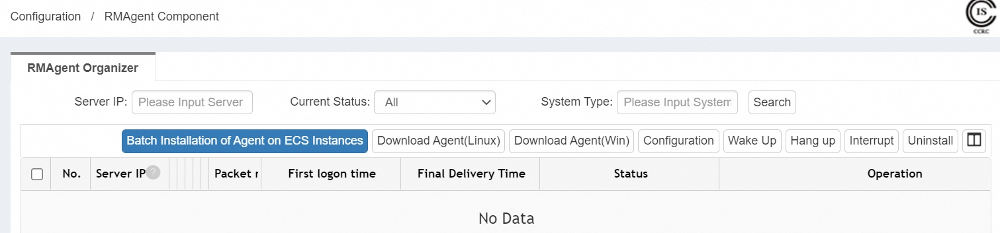

   RMAgent may be in one of the following abnormal states:

   - Abnormal: The ECS instance where RMAgent is deployed breaks down, or RMAgent stops running after it is started.

   - Suspended: The CPU utilization or memory usage of the ECS instance where RMAgent is deployed exceeds the specified threshold, or the CPU utilization or memory usage of RMAgent exceeds the specified threshold.

   - Version mismatch: The version of RMAgent does not match the version of Database Security Audit.

   If RMAgent is in one of the preceding states, resolve the issue by referring to Solution 2.

   <ol type="i" start="3">

   <li>

   If the application or test client is deployed on the same ECS instance as the database

   </li>

   </ol>

   server, traffic is redirected by using the local loopback interface. If you are not sure whether traffic is on the same ECS instance, you can run one of the following commands. In this example, port 9207 or 1433 is used. Replace the port number with the actual one.

   - In Linux, run the netstat -nap|grep 9207 command.

     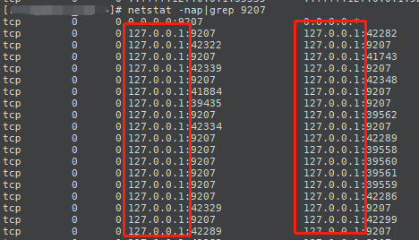

   - In Windows, run the netstat -nao|findstr 1433 commend.

     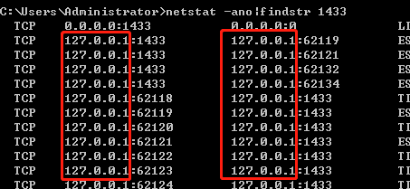

   > **Note**
   >
   > If the application and database are deployed on the same ECS instance and need to use the loopback interface for interaction, RMAgent must support the loopback interface. If the  `loopback`  parameter is not set to 1 or no comments are added, RMAgent does not support the loopback interface. In this case, resolve the issue by referring to Solution 3.

   <ol type="i" start="4">

   <li>

   On the Windows ECS instance, open Control Panel and check whether Npcap is installed.

   Npcap can be used to capture loopback traffic. If Npcap is not installed, the issue occurs. In this case, resolve the issue by referring to Solution 4.

   </li>

   <li>

   If Meet the rule audit is selected as Audit Options but no SQL rules are configured, no rules can be triggered. In the left-side navigation pane of the Database Security Audit console, choose **Maintenance** > **Engine Management** to check the Audit Options parameter.

   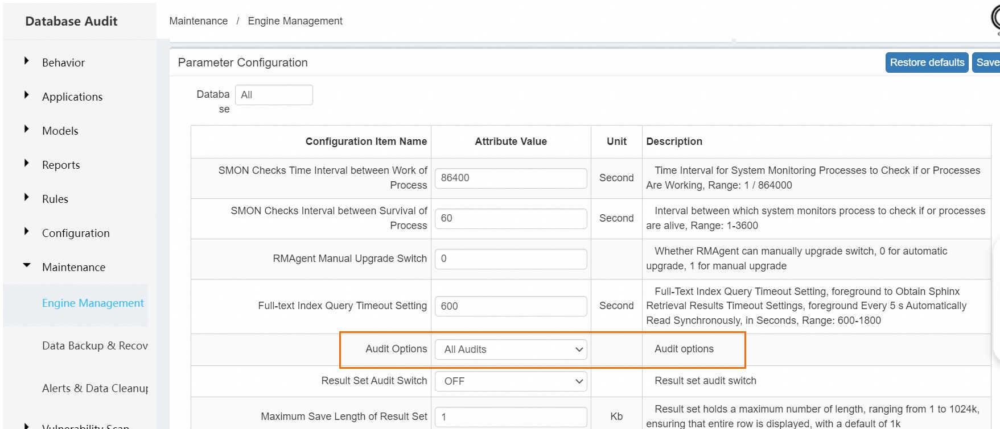

   As shown in the preceding figure, **Meet the rule audit** is selected as Audit Options. In this case, resolve the issue by referring to Solution 5.

   </li>

   </ol>

**Solution**

1. If the RMAgent process does not exist, manually start RMAgent.

   - If the server IP address configured in the rmagent.ini file is not the IP address of Database Security Audit, manually change it to the correct IP address and restart RMAgent.

   - If Database Security Audit is inaccessible from the ECS instance where RMAgent is deployed, request a network engineer to resolve the network issue.

   - If port 9266 of Database Security Audit is inaccessible from the ECS instance where RMAgent is deployed, request a network engineer to open the port in firewall configurations.

2. If RMAgent is in an **abnormal** state, request a database O&M engineer to troubleshoot the database server. If no exception occurs, log on to the database server and start the RMAgent service.

   - If the status is **Suspended**, check the CPU utilization and memory usage of the RMAgent host.

   - If the occupancy rate is too high, please technical support personnel the customer to reduce the pressure appropriately.

   - If the overall CPU and memory of the host are high, make sure that sufficient space is available. You can also adjust the RMAgent parameter to trigger overrun. Use the secadmin account to log on to the system. On the **Configuration** page, choose **RMAgent Components** > **RMAgent Management**, select the target RMAgent component, click **Configure**, and modify the parameter **cpu_limit/my_cpu_limit/mem_limit/my_mem_limit**.

     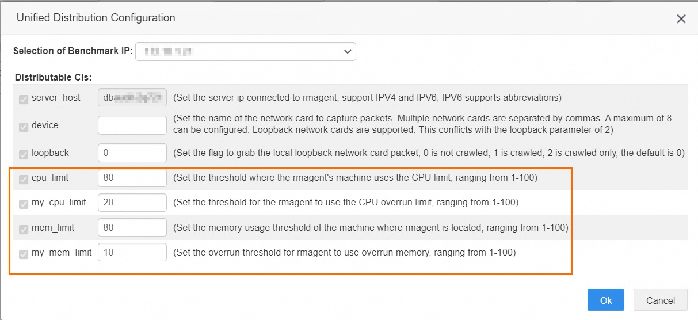

     If the RMAgent version is too low, download the latest RMAgent and install it on the target host.

3. Use the secadmin account to log on to the system, choose **Configuration** > **RMAgent Components** > **RMAgent Management**, select the target RMAgent, click **Configure**, and modify the parameter **loopback** to  `1` .

   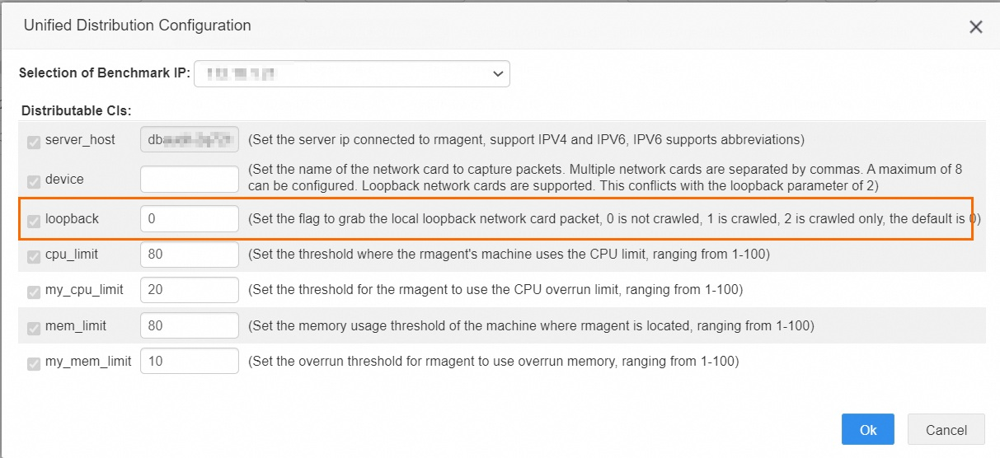

4. Install the Npcap software on the Windows database server (you can install it by selecting Npcap when reinstalling RMAgent). If Winpcap is already installed, you need to uninstall Npcap first and then install Winpcap.

5. In the top navigation pane, choose **Maintenance** > **Engine Management**. On the **Audit Options** page, set **Audit Options** to **All Audit**.

### 2.1.2. What do I do if some SQL statements are not audited?

This topic describes the possible causes and solutions in scenarios where some SQL statements are not audited.

**Possible cause**

- Trust rules are configured and met.

- The number of sessions or SQL statements exceeds the upper limit.

- The dynamic port feature is enabled for protected Oracle databases.

**Troubleshooting procedure**

- If trust rules are configured for objects such as specific types of operations, client IP addresses, and database users, these objects are not audited. Check whether trust rules are configured.

  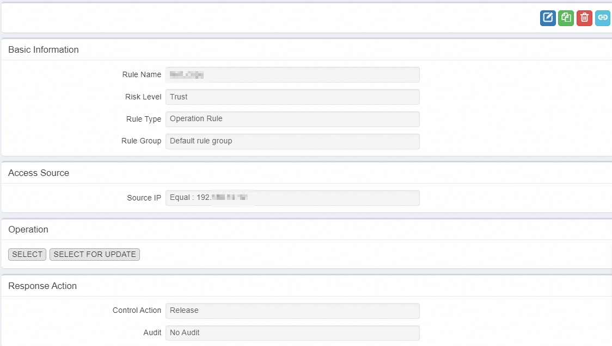

  If trust rules are configured for the SQL statements that are not audited, resolve the issue by referring to Solution 1.

- If the number of sessions or SQL statements exceeds the upper limit supported by the system, no more sessions or SQL statements can be audited. Go to the System Alerts page of the Database Security Audit console and check whether an alert is triggered because the number of sessions or SQL statements exceeds the upper limit.

- Check whether the version of protected Oracle databases is 9i or 10.1, and whether database servers run on Windows.

**Solution**

1. Modify trust rules.

   <ol type="i">

   <li>

   Log in to the Apsara Uni-manager Management Console.

   <ol type="i" start="2">

   <li>

   In the top navigation bar, choose **Security** > **Data Security** > **Database Audit**.

   </li>

   <li>

   On the Database Audit page, find the Database Security Audit instance that you want to

   </li>

   </ol>

   manage and click **Details** in the **Actions** column to log in to Database Security Audit.

   </li>

   <li value="4">

   In the left-side navigation pane, choose **Rules** > **Rule Management**.

   </li>

   <li>

   Find the rule that you want to manage and click the  icon in the Operation column to

   modify the rule.

   </li>

   </ol>

2. Compare the specifications of Database Security Audit instances. Reduce the number of protected databases or purchase an instance with higher specifications.

3. Disable the dynamic port feature for protected databases.

### 2.1.3. What do I do if usernames and database client information are not audited?

This topic describes the possible causes and solutions in scenarios where usernames and database client information are not audited.

**Possible causes**

- Database types do not support the audit of usernames and database client information.

- Persistent connections are established for database sessions.

- Packet loss occurs during database login.

- The username resolution feature is not enabled for protected SQL Server databases.

- The database users configured for protected SQL Server databases do not have the required permissions, or no users are configured for protected SQL Server databases.

- Short-lived connections are established for SQL Server database sessions.

- The system management port is inaccessible from SQL Server database servers, or a large number of packets are lost.

**Troubleshooting procedure**

1. Database Security Audit supports a variety of databases, but does not support the audit of all database information, such as database client information. Check whether the types of protected databases support the audit of usernames and database client information. Resolve the issue by referring to Solution 1.

2. In most cases, connection information such as database usernames, client tools, hostnames, and OS usernames is transmitted only when a client establishes a connection with a database. After the connection is established, only SQL statements are transmitted. If the traffic received by Database Security Audit does not contain connection information, connection information such as usernames cannot be audited. This issue may occur in the following scenarios:

   - If database connections are already established when Database Security Audit is accessed from a customer network, no connection information can be obtained.

   - During audit, the Database Security Audit instance is restarted. As a result, the connection information before the restart cannot be identified.

   - RMAgent is shortly interrupted during database login. As a result, the packets forwarded by RMAgent do not contain login information.

   - An alert is triggered because the number of sessions exceeds the upper limit. New sessions are not audited.

   - Packet loss occurs due to heavy network loads. This is recorded in RMAgent logs.

   In the first three scenarios, the issue is caused by external factors. You must capture packets to check whether packets are sent for establishing database connections in a short period of time: Capture the traffic of a network interface. Find relevant statements in the sessions of the database that you want to manage to check whether packets are sent for establishing database connections. The content of packets for establishing database connections varies based on the database type. In this example, the packets of Oracle and MySQL are used.

   - Oracle As shown in the following figure, the Request,Connect packet is the first request packet sent by a client to log in to a database. The Request,Data User OCI Functions packet contains basic login information such as the database username and hostname.

     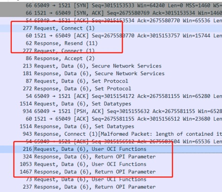

   - MySQL

     As shown in the following figure, the Login Request packet of MySQL contains the username for login.

     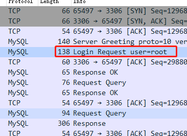

     If the captured packets do not contain session establishment information, the issue may be caused by external factors and can be resolved next time a connection is established. In the last two scenarios, resolve the issue by referring to Solution 2.

3. When a client communicates with an SQL Server database, the username and database client information are encrypted and transmitted. You must check whether the username resolution feature is enabled. Log in to Database Security Audit by using the secadmin account. In the left-side navigation pane, choose **Maintenance** > **Engine Management**. In the Parameter Configuration section, check whether the **Username Resolution Switch** parameter is set to OFF.

   

   If the parameter is set to OFF, resolve the issue by referring to Solution 3.

4. If the username resolution feature is enabled, check whether a user with the required permissions is configured for an SQL Server database. In the left-side navigation pane of the Database Security Audit console, choose **Configuration** > **Database**. In the Database list section, find the SQL Server database that you want to manage and click the View details icon in the Operation column. In the panel that appears, check whether a username and a password are configured. Click **Authority Verification** to check whether the configured user has the required permissions.

   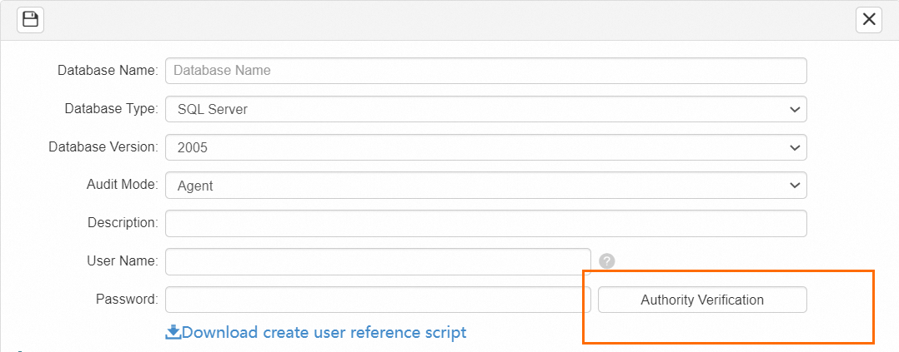

5. To obtain information such as usernames and tools from an SQL Server database, Database Security Audit needs to connect to the database. If the connection duration is very short, Database Security Audit may fail to obtain such information. As a result, such information cannot be audited. Go to the **Session Search** page of the SQL Server database and check its sessions, including the start time and end time of each session.

   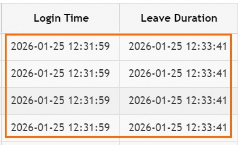

   As shown in the preceding figure, the session duration is less than 30s. In this case, resolve the issue by referring to Solution 5.

6. Log in to the backend of Database Security Audit and send PING messages to test the connectivity between the management port and an SQL Server database. If the connectivity test fails or packet loss occurs, resolve the issue by referring to Solution 6.

**Solutions**

1. Refer to user manuals or consult technical support engineers to check whether database types support the audit of usernames and database client information.

2. If the number of sessions exceeds the upper limit, you must check whether the actual traffic is too large and consider upgrading the instance specifications. If packet loss occurs due to the heavy loads of RMAgent, resolve the issue by referring to the Solution section of the "What do I do if some SQL statements are not audited?" topic.

3. Log in to Database Security Audit by using the secadmin account. In the left-side navigation pane, choose **Maintenance** > **Engine Management**. In the Parameter Configuration section, set the **Username Resolution Switch** parameter to ON.

4. Contact a database administrator (DBA) to grant higher permissions to the configured user or configure the sa user for the SQL Server database.

5. Modify the session duration to last longer than 1 minute.

6. Request a network engineer to resolve the network issue and ensure the connectivity between the management IP address and the IP address of the SQL Server database.

### 2.1.4. What do I do if the number of affected rows or response time is 0 in audit results?

This topic describes the possible causes and solutions in scenarios where the number of affected rows or response time is 0 in audit results.

**Possible causes**

- Packet loss occurs because the size of a single packet exceeds the default forwarding capability of RMAgent.

- Packet loss occurs because the size of a single packet exceeds the default buffer space of RMAgent.

**Troubleshooting procedure**

The direct cause is packet loss in result sets. Capture packets to check whether packet loss occurs in the result set, and find the response packet of the relevant statement for analysis.

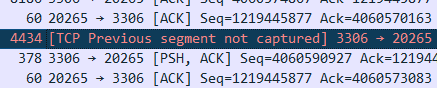

As shown in the preceding figure, packet loss occurs in the response packet of the relevant statement. You can check the following items to troubleshoot the issue:

- If the size of the original packet is larger than the length that RMAgent can obtain, the packet forwarded by RMAgent is also lost. Check the length of the lost packet in captured packets. If the value is greater than 8192, resolve the issue by referring to Solution 1.

- If the size of the original packet exceeds the buffer space of RMAgent for receiving packets, the packet forwarded by RMAgent may also be lost. Check the info logs of RMAgent. If the pcap drop field has a value, the buffer space for receiving packets is insufficient and packets are discarded.

  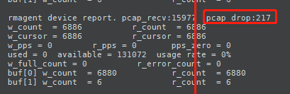

**Solutions**

- Modify the pcap_snap_len parameter of RMAgent in the RMAgent configuration file rmagent.ini, and then restart RMAgent. You can modify the parameter based on the actual size of packets or set the parameter to the maximum value.

- Modify the pcap_buffer parameter of RMAgent in the RMAgent configuration file rmagent.ini, and then restart RMAgent. You can modify the parameter based on the actual size of packets or set the parameter to the maximum value.

## 2.2. FAQ about rules

### 2.2.1. What do I do if a rule is not triggered as expected?

This topic describes the possible causes and solutions in scenarios where a rule is not triggered as expected.

**Possible causes**

Two similar rules are configured for a database. The priority of Rule A is higher than that of Rule B.

- Rule A is triggered if the SELECT statement is executed.

- Rule B is triggered if the SELECT statement is executed for more than 20 rows of data.

**Troubleshooting procedure**

The priority of Rule A is higher than that of Rule B. When the SELECT statement is executed, only Rule A is triggered and Rule B is not triggered.

1. Log in to the Apsara Uni-manager Management Console.

2. In the top navigation bar, choose **Security** > **Data Security** > **Database Audit**.

3. On the Database Audit page, find the Database Security Audit instance that you want to manage and click **Details** in the **Actions** column to log in to Database Security Audit.

4. In the left-side navigation pane, choose **Rules** > **Rule Activation**.

5. Check the priorities of rules for the database that you want to manage. If the priority of Rule A is higher than that of Rule B, resolve the issue by referring to the Solutions section of this topic.

**Solutions**

- Combine Rule A and Rule B.

- Disable Rule A. Execute the SELECT statement again to query more than 20 rows of data. In this case, Rule B is triggered.

- Modify the priorities of rules so that the priority of Rule B is higher than that of Rule A.

## 2.3. FAQ about notification

### 2.3.1. What do I do if notifications cannot be sent by email?

This topic describes the possible causes and solutions in scenarios where notifications cannot be sent by email.

**Possible causes**

- The password of the sender is invalid.

- The sender does not have the Simple Mail Transfer Protocol (SMTP) permissions.

**Troubleshooting procedure**

1. Use the account and password of the sender to send emails on other email clients to check whether emails can be sent successfully.

2. Log in to the backend of Database Security Audit to capture packets and check the content of messages sent from Database Security Audit to the sender's email server. Run the following command to capture packets based on the domain name and service port 25 of the sender's email server, and save the results to the /tmp/mail.cap file:

   # tcpdump -s 0 -i eth0 host smtp.dbsec.cn 25 -w /tmp/mail.cap

   Transmit the packet capture file to a Windows system and use Wireshark to analyze the file and view the message flow.

   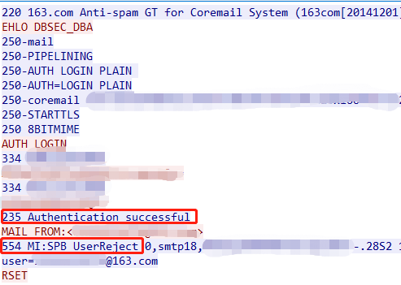

   If an error similar to UserReject is reported, the sender may not have the SMTP permissions and can send emails only by using the URL of another email service provider.

**Solutions**

- Obtain the valid password of the sender and configure it in Database Security Audit.

- In email configurations on a web page, grant the SMTP permissions to the sender.

### 2.3.2. What do I do if the number of alert notifications is less than the number of times that a risk is triggered?

This topic describes the possible causes and solutions in scenarios where the number of alert notifications is less than the number of times that a risk is triggered.

**Possible causes**

The number of times that a risk is triggered in a day exceeds the maximum number of alert notifications per day.

**Troubleshooting procedure**

1. Log in to the Apsara Uni-manager Management Console.

2. In the top navigation bar, choose **Security** > **Data Security** > **Database Audit**.

3. On the Database Audit page, find the Database Security Audit instance that you want to manage and click **Details** in the **Actions** column to log in to Database Security Audit.

4. In the left-side navigation pane, choose **Rules** > **Rule Management**.

5. Find the rule that you want to manage and view the details of the rule to check the maximum number of alert notifications per day.

   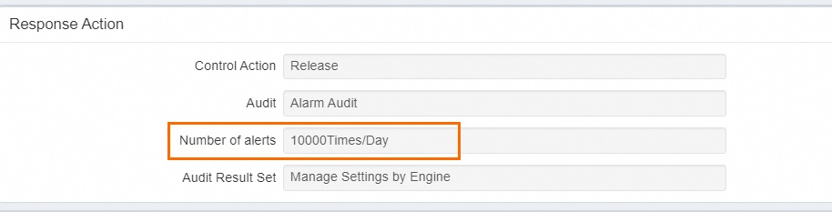

   By default, a maximum of 10,000 alert notifications can be sent per day for a risk.

**Solutions**

Modify the rule and set the maximum number of alert notifications per day to the expected value.

### 2.3.3. What do I do if no syslog server can be selected?

This topic describes the possible causes and solutions in scenarios where no syslog server can be selected.

**Possible cause**

No syslog server is added.

**Troubleshooting procedure**

1. Log in to the Apsara Uni-manager Management Console.

2. In the top navigation bar, choose **Security** > **Data Security** > **Database Audit**.

3. On the Database Audit page, find the Database Security Audit instance that you want to manage and click **Details** in the **Actions** column to log in to Database Security Audit.

4. In the left-side navigation pane, choose **System** > **Notification Management**. On the page that appears, click the **SYSLOG** tab.

5. Check whether a SYSLOG server whose log type is **Rule Alert CEF File** is added.

   

**Solution**

On the **System** > **Notification Management** > **SYSLOG** page, add a SYSLOG server and select **Rule Alert CEF File Style** for **Log Type**.

## 2.4. FAQ about log retrieval

### 2.4.1. What do I do if a result set is not fully displayed or is not displayed?

This topic describes the possible causes and solutions in scenarios where a result set is not fully displayed or is not displayed.

**Possible causes**

In a result set, the data size per row is large or each row contains more than 1 KB of data, which is the default setting.

**Troubleshooting procedure**

1. Log in to the Apsara Uni-manager Management Console by using the secadmin account.

2. In the top navigation bar, choose **Security** > **Data Security** > **Database Audit**.

3. On the Database Audit page, find the Database Security Audit instance that you want to manage and click **Details** in the **Actions** column to log in to Database Security Audit.

4. In the left-side navigation pane, choose **Maintenance** > **Engine Management**.

5. On the **Engine Management** page, view the parameters.

   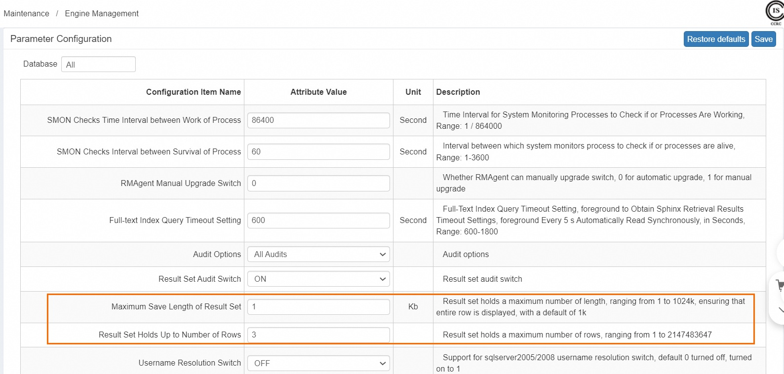

**Solutions**

On the **Engine Management** page, modify the **Maximum Save Length of Result Set** parameter. Valid values: 1 to 1024. Unit: KB.

## 2.5. FAQ about data maintenance

### 2.5.1. What do I do if audit data is cleared?

This topic describes the possible causes and solutions in scenarios where audit data is cleared.

**Possible causes**

- The number of online statements reaches the specified cleanup threshold in Database Security Audit.

- The disk usage of the data center partition reaches the specified cleanup threshold in Database Security Audit.

**Troubleshooting procedure**

1. Log in to the Apsara Uni-manager Management Console.

2. In the top navigation bar, choose **Security** > **Data Security** > **Database Audit**.

3. On the Database Audit page, find the Database Security Audit instance that you want to manage and click **Details** in the **Actions** column to log in to Database Security Audit.

4. In the left-side navigation pane, choose **Maintenance** > **Alerts & Data Cleanup**.

5. On the **Alerts & Data Cleanup** page, check the Cleanup Threshold parameter in the **Online Data** section.

   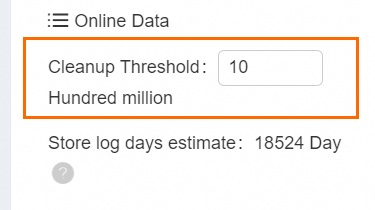

   - In the left-side navigation pane, click Overview / All. On the Overview / All page, check the **Online Statements** parameter.

     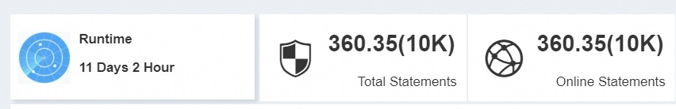

     If the total number of online statements is close to the cleanup threshold of online data, audit data is cleared after the number of online statements reaches the specified cleanup threshold.

   - On the **Alerts & Data Cleanup** page, check the **Cleanup Threshold** parameter in the **All Data** section.

     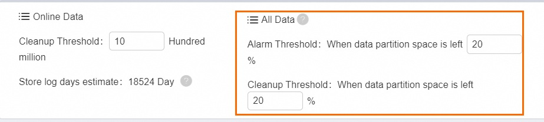

**Solutions**

- If you need to store more online data, increase the cleanup threshold of online data.

- If you need more available space in Database Security Audit, increase the cleanup threshold of all data. To ensure system feasibility, we recommend that you set the cleanup threshold of all data to at most 95%.

### 2.5.2. What do I do if backup data cannot be restored?

This topic describes the possible causes and solutions in scenarios where backup data cannot be restored.

**Possible cause**

After data is restored, the disk usage of the data center partition or the data backup partition exceeds 95%.

**Troubleshooting procedure**

1. Log in to the Apsara Uni-manager Management Console.

2. In the top navigation bar, choose **Security** > **Data Security** > **Database Audit**.

3. On the Database Audit page, find the Database Security Audit instance that you want to manage and click **Details** in the **Actions** column to log in to Database Security Audit.

4. In the left-side navigation pane, choose **System** > **System Alerts**.

5. On the **System Alerts** page, check whether an alert is triggered because the disk usage of a partition exceeds the specified threshold.

   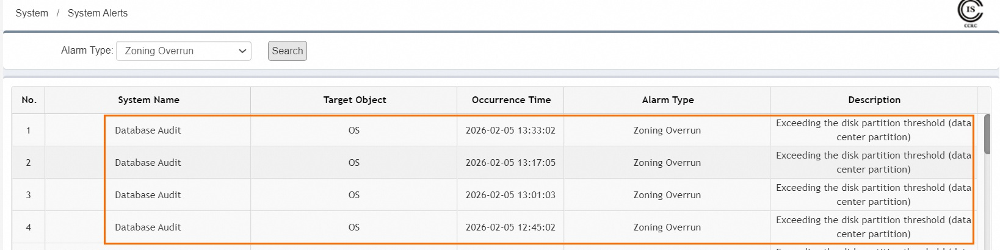

   When Database Security Audit processes a restore task, it first estimates the disk usage after data is restored. If the estimated disk usage exceeds 95%, data is not restored for space protection. The preceding figure shows that the space is insufficient.

**Solution**

If you need to restore data, you can decrease the cleanup threshold of all data on the **Alerts & Data Cleanup** page. Then, you can restore data the next day.

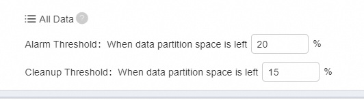

### 2.5.3. What do I do if backup data fails to be uploaded over FTP?

This topic describes the possible causes and solutions in scenarios where backup data fails to be uploaded over FTP.

**Problem description**

data backup and recovery interface-after you add an upload ftp server, an error is reported when you upload backup data.

**Possible cause**

- The FTP user cannot log in to the FTP directory because the user does not have the required permissions.

- The entered password of the FTP user is invalid.

- The password of the FTP user is too complex.

**Troubleshooting procedure**

1. Log in to the FTP server by using a file manager or browser. Check whether the FTP user can properly log in.

2. Check whether the password of the FTP user is valid.

3. Check whether the password of the FTP user contains special characters that cannot be identified.

   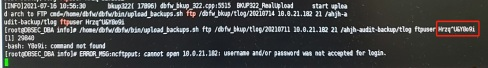

**Solution**

1. Log in to the FTP server to grant the required permissions to the FTP user.

2. Change and record the password of the ftp user.

3. Delete special characters from the password of the FTP user. Set a password that contains only letters and digits.

# 3.Developer tools

## 3.1. Use tcpdump to capture packets

When you troubleshoot traffic issues, you can use tcpdump to capture traffic. This topic describes the parameters of tcpdump.

Parameters:

- -s: the size of data to be captured from each packet. Unit: bytes. To prevent packets from being truncated, we recommend that you set this parameter to 0. A value of 0 specifies that the maximum size of data is captured.

- -i: the network interface whose traffic is captured. A value of any specifies that traffic is captured from all network interfaces.

- -r: reads traffic from files instead of network interfaces.

- and: the AND relationship among multiple filter conditions. If and is specified, all the specified filter conditions must be met.

- or: the OR relationship among multiple filter conditions. If or is specified, one of the specified filter conditions must be met.

- host: the IP address from which traffic is captured. If you do not specify this parameter, traffic is captured from all IP addresses.

- port: the port from which traffic is captured. If you do not specify this parameter, traffic is captured from all ports.

- -w: saves the captured results to a file.

- -n: resolves the domain name and displays the IP address instead of the hostname in the output.

Examples:

- Capture the traffic of the network interface eth0: tcpdump -s 0 -i eth0

- Capture the traffic of the network interface bond0 from the server whose IP address is 192.168.XX.XX: tcpdump -s 0 -i bond0 host 192.168.XX.XX

- Capture the traffic of the network interface bond0 from the server whose IP address is 192.168.XX.XX and port number is 1521: tcpdump -s 0 -i bond0 host 192.168.XX.XX and port 1521

- Capture the traffic of the network interface bond0 between the server whose IP address is 192.168.XX.XX and the server whose IP address is 192.168.XX.XX: tcpdump -s 0 -i eth0 host 192.XX.XX and 192.168.XX.XX

- Capture the traffic of the network interface eth0 from the server whose IP address is 192.168.XX.XX or 192.168.XX.XX, and save the captured results to the test.cap file: tcpdump -s 0 -i eth0 host 192.168.XX.XX or 192.168.XX.XX -w test.cap

- Read traffic from the capfie file and resolve the domain name: tcpdump -s 0 -r /tmp/nfw4web_pcap_recv.fifo -n

## 3.2. Use Wireshark

When you troubleshoot traffic issues, you can use Wireshark to analyze traffic in Windows. This topic describes the operations that you can perform by using Wireshark.

**View basic information**

After a packet capture file is opened by using Wireshark, packets are sorted in ascending order based on the time when a packet is captured. The following figure shows the columns of the packet list.

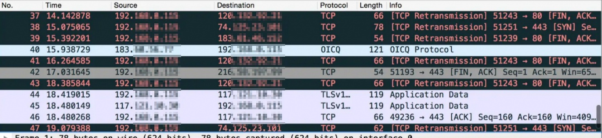

**Filter traffic**

After a packet capture file is opened by using Wireshark, you can enter filter conditions in the field framed in red to filter traffic, as shown in the following figure.

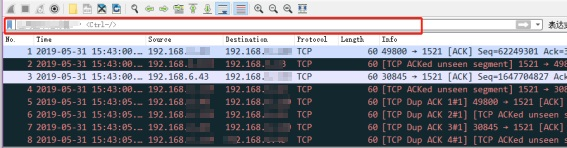

- ip.addr == 1.1.XX.XX: the server IP address.

- tcp.port == 1521: the TCP port.

- tns, mysql, or tds: the name of the protocol, such as the Oracle protocol tns, MySQL protocol mysql, or SQL Server protocol tds.

- &&: the logical operator AND.

- ||: the logical operator OR.

- !: the logical operator NOT.

**Examples**

- Search for the traffic whose server IP address is 192.168.XX.XX: ip.addr == 192.168.XX.XX

  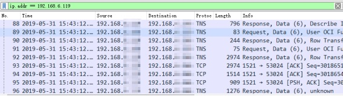

- Search for the traffic whose TCP port number is 1521: tcp.port == 1521

  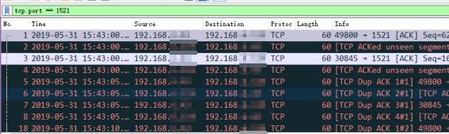

- Search for the traffic whose server IP address is 192.168.XX.XX and TCP port number is 3306: ip.addr == 192.168.XX.XX && tcp.port == 3306

  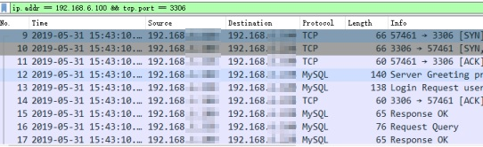

- Search for the traffic whose server IP address is 192.168.XX.XX or 192.168.XX.XX: ip.addr == 192.168.XX.XX || ip.addr == 192.168.XX.XX

  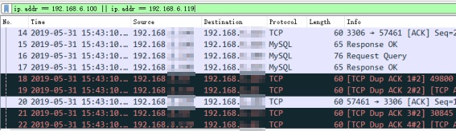

- Search for the traffic from Oracle: tns

  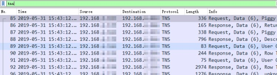

- Search for the traffic whose server IP address is not 192.168.XX.XX: ip.addr != 192.168.XX.XX

  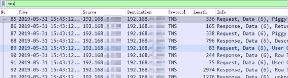

- View details

  Click a packet. The content of the packet is displayed in the lower part.

  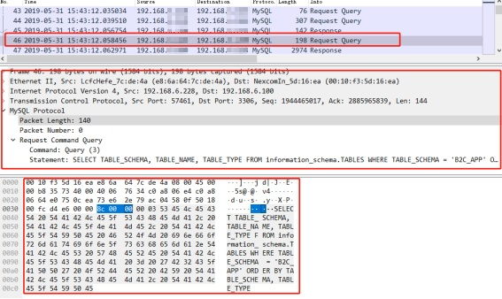

- Search for a string

  You can search for a string to find specific SQL statements. You can use a table name or other keywords as a string search condition. In the Wireshark window, press Ctrl+F to open the search window. The following figure shows how to search for a string to find the packet that contains the string.

  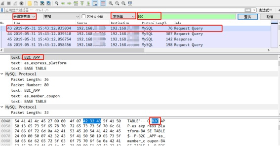
