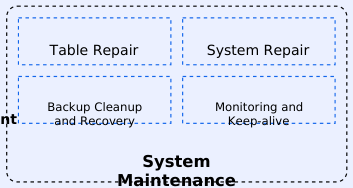
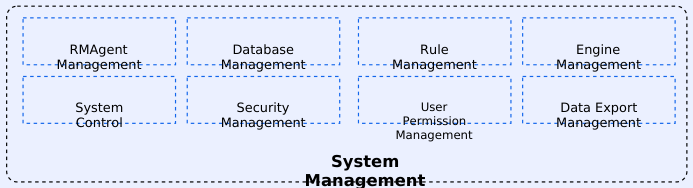
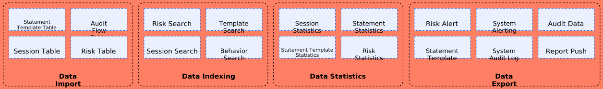
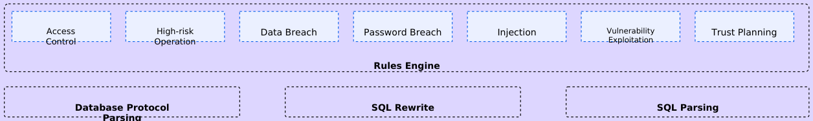
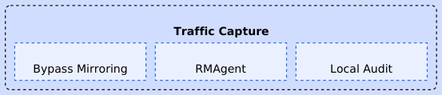
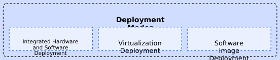

Alibaba Cloud  
Apsara Stack  
Database Audit  
Database Security Audit  
Product Introduction  
Product Version: v3.18.6-2607  
Document Version: 20260831

**Table of Contents**

- [1.Database Security Audit Product Introduction](#section-1)
- [2.Features](#section-2)
- [3.What is Database Security Audit?](#section-3)
- [4.Service architecture](#section-4)
- [5.Common scenarios](#section-5)
- [6.Deployment mode](#section-6)

# 1.Database Security Audit Product Introduction

Database Security Audit supports audit on the process and behavior of accessing self-managed databases in the cloud and ApsaraDB services, and supports association with application users for operation audit. It also monitors the risks, status, performance, and statement distribution in real time.

Database Security Audit provides a cloud database audit service that can be quickly deployed and easily maintained by using database-based UI languages, intelligent protocol recognition, visualized status display, and interactive risk tracking that supports drill-down.

# 2.Features

This topic describes the features of Database Audit.

**Secondary**

**Level 1**

**Characterist**

**Feature Description**

**features**

**ics**

IP Address

You can create IP address groups.

Group

Object groups can be created and referenced when you configure

Object Group

rules.

Application

Group

Supports creating application user groups.

user group

management

Database

You can create database user groups to facilitate database

User Group

management.

You can create time groups and reference them when you configure

Time Group

rules.

Supports ApsaraDB services such as PolarDB(Mysql), PolarDB(PostgreSQL), PolarDB-X(Mysql), RDSMySQL, RDSSQLServer,

ApsaraDB

RDSPostgreSQL, RDSMariaDB, RDSMongoDB, OceanBase, AnalyticDB(MySQL), AnalyticDB(PostgreSQL), MaxCompute, and Hologres.

Chinese-

The system supports audit on Chinese-made databases, including

made

KingbaseES, Dameng, Shentong, GBase, and Huawei GaussDB.

database

The system supports audit on international mainstream databases,

International

including Oracle, SQL Server, Db2, Informix, PostgreSQL, Sybase

Protocol

database

ASE, Sybase IQ, MySQL, MongoDB, SAP HANA, Teradata, Cache,

support

MariaDB, and Percona.

The system supports audit on big data platforms, including Hive,

Big data

HBase, Sentry, Impala, HDFS, Elasticsearch, Greenplum, and Redis.

<table>
  <tr>
    <td rowspan="5">Audit information display and search</td>
    <td>Session analysis</td>
    <td>• The system supports session search and session details display, and provides dedicated analysis pages for session information, including online concurrent sessions, active sessions, and failed login sessions. • The system supports session statistics collection, search, and analysis based on database access sources, as well as statistical analysis on active sessions and failed sessions within a time period. • You can lock a specific session to which an SQL statement belongs and perform a drill-down to obtain all SQL statements within the session lifetime.</td>
  </tr>
  <tr>
    <td>Audit information display</td>
    <td>• The system supports search and analysis in three dimensions: session dimension, statement dimension, and risk dimension. • The system records audit information and displays the following detailed information in the audit result: alert level, event occurrence time, client IP address, destination database IP address, operation type, client MAC address, destination database MAC address, client port number, response time, return status, result information, SQL statement, and SQL parameters.</td>
  </tr>
  <tr>
    <td>Search</td>
    <td>• The system supports statistical analysis based on multiple dimensions. You can perform statistical analysis globally, for a group, or for a single database. • The system supports multi-database statistical queries with at least 20 search conditions.</td>
  </tr>
  <tr>
    <td>Statistical analysis</td>
    <td>You can perform trend analysis and statistics collection based on multiple dimensions, such as session, risk, and statement distribution, and display the data in charts.</td>
  </tr>
  <tr>
    <td>Statistical comparison</td>
    <td>You can create a comparison of statistics across different databases at different intervals. This way, you can visualize the current client access status, database performance, and the number of SQL statements.</td>
  </tr>
  <tr>
    <td>Audit log backup and recovery</td>
    <td>Audit log backup and recovery</td>
    <td>• Supports automatic backup of audit data to local and remote FTP, SFTP, NFS, and OSS servers. • Supports import and export of audit logs and system configurations. • Supports high performance and high compression ratio for data backup.</td>
  </tr>
</table>

- Terminal information of the session: IP, MAC, Port, tool name (program name), operating system user.

- The host information of the session: IP address, port number, database name (instance name), and business host group.

- Other information about the session: logon time and session duration.

- Operation information: operation type (such as DDL, DML, and

Audit

DCL), operation time, execution duration, operation object

information

(database instance, schema, and table), SQL statement, and SQL error code.

- The operation scope information: the number of rows affected by the query, modify, and delete operations, and the number of rows

audit

returned.

capability

- Supports result set auditing and records the success and failure of operations.

- Supports one-way request package audit.

Result set

Result sets can be audited based on policies. You can specify result

audit by rule

sets to audit sensitive tables to reduce system overheads.

Long

Supports the audit of extremely long SQL statements. The length of

statement

a single statement can be up to 2 MB.

audit

- Rule types: access rule, injection, action rule, and password breach

  You can configure at least 20 conditions for an audit rule. The

Audit rule

logical relationship between the conditions of an audit rule can be

and policy

AND or OR.

- Statement rule: You can configure rules for trusted statements based on statement templates in a single database. This way, you can create a blacklist or whitelist of statements.

- You can create global policies. Based on global policies, rules can be set for all databases.

- You can create policies for a single database to configure trusted statements. This way, you can create a blacklist or whitelist of

Audit rule

statements for a single database.

management

Audit risk

- You can import and export policies and configure priorities.

monitoring capability

- You can add exception rules to improve policies.

- The system provides default built-in rules for different databases.

Database

The system provides a built-in database vulnerability exploitation

vulnerability

rule library to monitor attacks that exploit database vulnerabilities

exploitation

and generate alerts.

monitoring

- Risk levels: high, medium, and low

Risk alert

- Alert methods: email and syslog

- The system provides at least 40 report models based on multi-database and single-database dimensions, including compliance reports, special reports, and comprehensive reports.

- The system combines charts and tables to display reports from

Report

multiple dimensions, such as the overview, performance,

content

sessions, statements, and risks.

- The system supports multiple types of reports, such as reports for risky logins, high risks, and client risks.

Report content

- Supported export formats: Word, PDF, and HTML

Report

The system provides multiple display methods, such as tables,

presentation

column charts, pie charts, and line charts.

Report

The system supports report push, report preset, and custom

feature

reports.

Integration

Business

The system integrates with Cloud Monitor to monitor system

with Cloud

monitoring

resource usage and business metrics.

Monitor

- The bypass deployment method does not affect the original network, and the failure of the network audit product does not affect the normal operation of the audited system.

Bypass agent

- Self-built database (ECS): directly deployed on the database end

deployment

of the audited system.

- Databases provided by cloud service providers (RDS): need to be

Deployment

deployed at the application end that accesses the database of

mode

the audited system.

You can obtain logs from Data Security and Open Platform. You can

Data security

obtain logs from the following cloud-native database types:

open

ApsaraDB RDS, Polardlocal (MySQL, Oracle, and Postgres),

platform

OceanBase, MaxCompute, and AnalyticDB for PostgreSQL.

# 3.What is Database Security Audit?

Data has become a new driver of business decision-making, a new content of trade in goods and services, and even a new means of comprehensive social governance. To ensure the security of important data and the normal operation of databases, Database Security Audit acts as a scout to protect database security, monitor data security, gain insights into data risks, and help users complete security compliance, user behavior analysis, O&M monitoring, risk audit, incident tracing, and security audit in scenarios related to database security.

Database Security Audit is an accurate database security audit system based on database protocol parsing and SQL parsing technologies. The system provides the capabilities of comprehensive data behavior audit and timely detection of data risks, which can meet the requirements of data security compliance, risk monitoring and tracing, user behavior analysis, and auxiliary business optimization.

The system adopts a browser/server (B/S) architecture. Users can log in to the system by using a browser on a connected terminal over the network. By using an effective database monitoring method, the system monitors the behaviors of accessing and operating databases and the return results to conduct a comprehensive audit. The system provides a security monitoring engine to allow users to customize different audit rules, and generates risk records and alerts for risky database operations such as database collision attacks, high-risk operations, important object queries, database vulnerability exploitations, and SQL injections. The engine also allows users to add trusted statements to a whitelist. The system provides search and statistics collection capabilities to implement user behavior analysis and risk tracing.

# 4.Service architecture

The architecture of Database Security Audit is divided into the traffic capture, protocol parsing, data processing, and system management layers.

**System**

**Management**

**Maintenance**

**Management**

**Data**

**Processing**

**Protocol Parsing**

**Parsing**

**Data**

**Capture**

Deployment

**Traffic capture layer**

The traffic capture layer accesses the traffic to be audited, filters out the traffic that does not need to be audited, and captures the traffic that needs to be audited. RMAgent is used for traffic capture in Apsara Stack. If the environment does not support traffic mirroring on the switch, you must install RMAgent on the database server or on a server that directly accesses the database. The agent captures local traffic for database access and sends it to Database Security Audit.

**Protocol parsing layer**

The protocol parsing layer calls Network Protocol Processor (NPP) to parse the captured database traffic. For an SQL statement obtained from protocol parsing, NPP rewrites the statement to generate a statement template, and parses the SQL statement. For all audit elements, NPP makes a reasonable information integration to ensure the completeness of audit elements. The R&D team of Database Security Audit has rich experience in kernel development for large databases. After dozes of years of polishing, Database Security Audit supports accurate and comprehensive database protocol analysis. As an important module of NPP, its rules engine identifies and processes all risks and trust rules.

**Data processing layer**

The audit data is sent to the data center and stored in multiple tables. The system regularly collects statistics from the audit data by minute, hour, or day. The full-text indexing mechanism is adopted to support queries in huge amounts of data, and the query results can be generated within a few seconds for hundreds of millions of data records. The audit result can be sent by using email, syslog, or Security Operations Center (SOC).

**System management layer**

Database Security Audit provides a variety of auxiliary capabilities, such as table repair, system repair, data backup cleanup and recovery, monitoring, and keep-alive, to further ensure the normal operation of databases. The web console provides many system management capabilities, such as database management and rule management.

# 5.Common scenarios

- **Compliance**

  Database Security Audit meets classified protection requirements such as database operation audit and log retention in compliance with laws such as the Cybersecurity Law and Data Security Law.

- **Security event tracing**

  Database Security Audit provides database operation records and post-event analysis from multiple dimensions such as statement, session, IP address, database user, business user, response time, and number of affected rows. It serves as a reliable tracking basis and source for security events.

  Based on the accurate association between SQL behavior and business users, Database Security Audit allows you to associate the business staff with database access behavior to effectively investigate and determine the accountability.

- **Database performance diagnostics**

  Database Security Audit displays the database status, database access traffic, concurrent throughput, and SQL statement response speed in real time. It analyzes inefficient statements and frequently used statements to help O&M engineers diagnose the performance.

- **Webshell program detection**

  Database Security Audit provides the SQL learning and SQL whitelist capabilities to perform SQL modeling for business systems. Based on the modeling of legal system behavior, Database Security Audit generates alerts in real time when it detects the startup of webshell programs hidden in software systems. This reduces losses caused by data leaks.

- **Database attack response**

  Database Security Audit provides database risk alerting and supports policy configuration and real-time alerting for risky behavior such as SQL injections, database vulnerability attacks, excessive data downloads, and dangerous SQL statements (such as the DELETE statement without a WHERE clause).

# 6.Deployment mode

This topic describes the deployment mode of Database Security Audit.

Database Security Audit supports agent-based deployment. The RMAgent component is deployed on a database server (or the server of an application system that accesses the database) to collect the traffic of the server network interface controller (NIC) or local loopback traffic to complete data collection, and delivers the captured database traffic to the specified audit device through the NIC allocated by the server. The audit device uses a built-in and independent process to receive and parse the collected database traffic to complete the audit operation. The system supports multi-agent deployment, batch installation, and centralized management.

**Usage notes**:

- If RMAgent is deployed on an application server, the system can audit only the operations of the application system accessing the database.

- If RMAgent is deployed on a database server, the system can collect traffic of the server NIC and local loopback traffic.

- RMAgent only captures and transmits data to the audit device, and does not affect the system load of the server on which the agent is deployed.

- RMAgent provides high compatibility and can be installed on mainstream operating systems such as CentOS, Red Hat, Solaris, and AIX.
