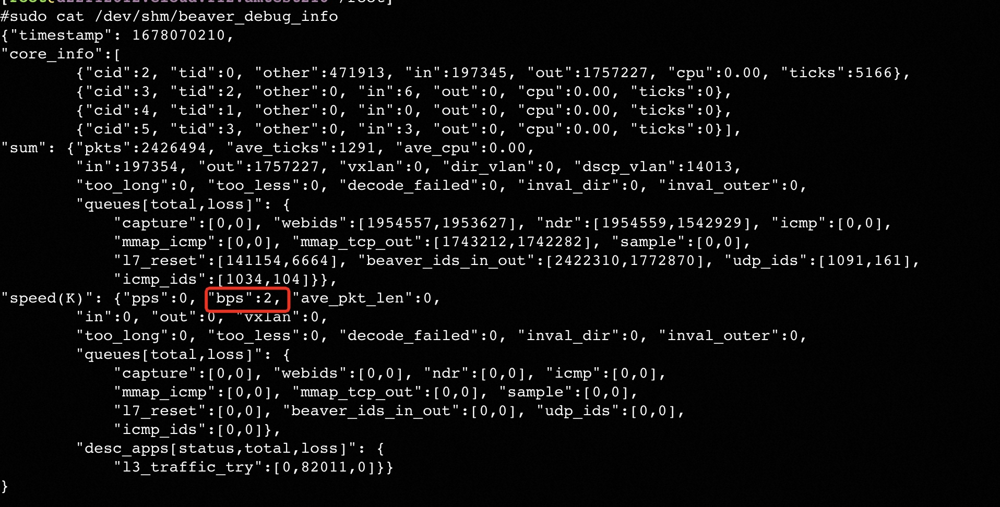
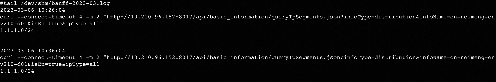
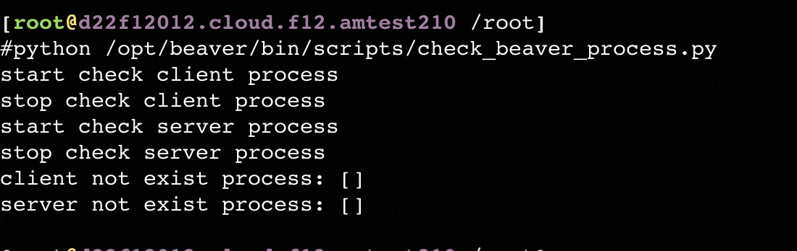
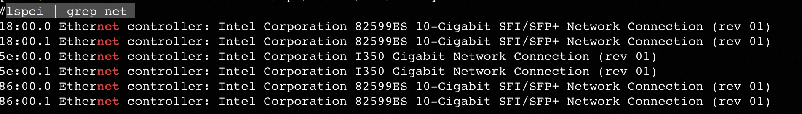
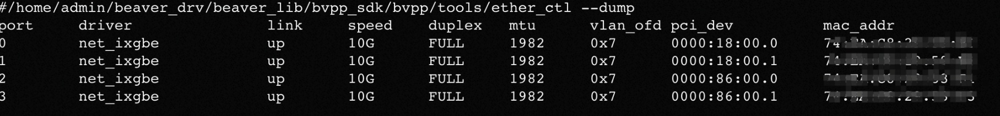
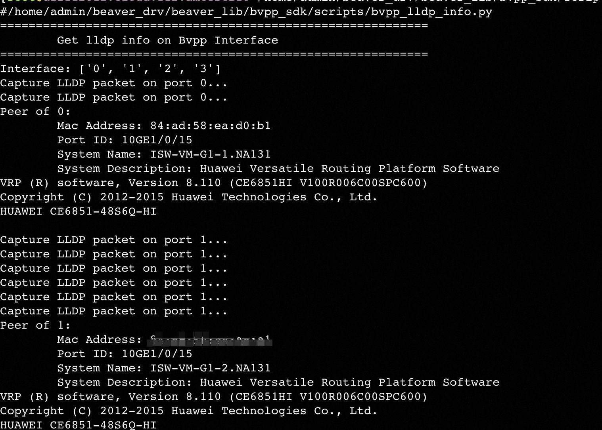
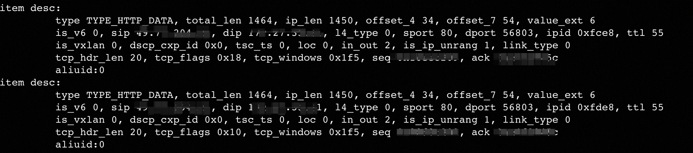

Alibaba Cloud  
Apsara Stack  
Cloud Security Network  
Detection and Response  
Operations and Maintenance  
Guide  
Product Version: v3.18.6-2607  
Document Version: 20260828

**Table of Contents**

- [1.Log on to the Apsara Infrastructure Management console](#section-1)
- [2.Service status check](#section-2)
    - [2.1. Basic inspection](#section-2-1)
    - [2.2. Advanced inspection](#section-2-2)
- [3.Common operations and maintenance](#section-3)
    - [3.1. Restart the beaver_drv process](#section-3-1)
    - [3.2. View NDR logs in SLS](#section-3-2)
    - [3.3. Access databases](#section-3-3)
    - [3.4. View the NIC types and status](#section-3-4)
    - [3.5. Use packet capture tools](#section-3-5)
    - [3.6. Replay packets](#section-3-6)
    - [3.7. Query information about a server](#section-3-7)

<a id="section-1"></a>

# 1.Log on to the Apsara Infrastructure Management console

This topic describes how to log on to the Apsara Infrastructure Management console.

**Prerequisites**

- The endpoint of the Apsara Uni-manager Operations Console and the username and password that are used to log in to the console are obtained from a deployment engineer or an administrator.

  The endpoint of the Apsara Uni-manager Operations Console is in the following format: *regi on-id*.ops.console.*intranet-domain-id*.

- A supported browser is used. We recommend that you use Google Chrome.

**Procedure**

1. Open a web browser.

2. In the address bar, enter the endpoint of the Apsara Uni-manager Operations Console. Press the ENTER key.

   

   > **Note**
   >
   > You can click the current language in the upper-right corner to switch to another language. Simplified Chinese, English, and traditional Chinese are supported.

3. Enter the correct username and password.

   > **Note**
   >
   > - Obtain the username and password that are used to log in to the Apsara Uni-manager Operations Console from a deployment engineer or an administrator.
   >
   > - If you enter an invalid password three consecutive times, the system enables the image verification login feature. If you enter an invalid password five consecutive times, the system locks your account. In this case, you can contact the administrator to unlock your account.
   >
   > - The first time that you log in to the Apsara Uni-manager Operations Console, change the password for your account as prompted.
   >
   >   To enhance security, make sure that your password meets the following requirements:
   >
   >   - The password contains uppercase and lowercase letters.
   >
   >   - The password contains digits.
   >
   >   - The password contains at least one of the following special characters: ! @ # $ %
   >
   >   - The password is 10 to 20 characters in length.

4. Click **Agree to Private Policy and Log On**.

5. In the top navigation bar of the Apsara Uni-manager Operations Console, choose **Products > Platforms > Apsara Infrastructure Management Framework**.

<a id="section-2"></a>

# 2.Service status check

This topic describes how to check the service status of Network Detection Response (NDR).

<a id="section-2-1"></a>

## 2.1. Basic inspection

The purpose of a basic inspection is to check the service status of Network Detection and Response (NDR). This topic describes how to perform a basic inspection.

**Procedure**

1. Log in to the Apsara Infrastructure Management console.

2. In the left-side navigation pane, choose **Resource Management > Product & Cluster O&M**.

3. In the **Product | Cluster** search box, enter **BeaverCluster**.

4. Find the  `BeaverClusterForTAPSW-A-xx`  cluster and click **Cluster Details** in the **Actions** column.

5. On the cluster details page, click the **Services** tab.

6. On the Services tab, enter **yundun-beaver-advance** in the **Service** search box. Then, check whether the service status is normal.

<a id="section-2-2"></a>

## 2.2. Advanced inspection

The purpose of an advanced inspection is to check the service status and features of Network Detection and Response (NDR). This topic describes how to perform an advanced inspection.

**Procedure**

1. Log in to the Apsara Infrastructure Management console.

2. Log in to the two physical servers of NDR.

   <ol type="i">

   <li>

   In the left-side navigation pane, choose **Resource Management > Product & Cluster O&M**.

   </li>

   <li>

   In the **Product | Cluster** search box, enter **BeaverCluster**.

   </li>

   <li>

   Find the  `BeaverClusterForTAPSW-A-xx`  cluster and click **Cluster Details** in the **Actions**

   </li>

   </ol>

   column.

   <ol type="i" start="4">

   <li>

   On the cluster details page, click the **Services** tab.

   </li>

   <li>

   On the Services tab, enter **yundun-beaver-advance** in the **Service** search box. Then, click **Details** in the **Actions** column to open the service details page.

   </li>

   <li>

   In the **Components** section, click **BeaverAdvance#** to view the detailed information about the component.

   </li>

   <li>

   In the Information of Component BeaverAdvance# section, click the **Instances** tab. On

   </li>

   </ol>

   this tab, find the instance whose information you want to view and click **Terminal** in the **Actions** column.

   <ol type="i" start="8">

   <li>

   In the left-side navigation pane, click the node to which you want to log in or the  icon.

   </li>

   </ol>

   In the dialog box that appears, select **Account Type** and **Server Account**, and then click **OK**.

   For more information about account types and server accounts, see **Platform O&M > Apsara Infrastructure Management > Web clients > Web Client Logon > Server logon** in Apsara Uni-manager Operations Console User Guide.

3. Check the status of NDR logs.

   Run the following commands. If results are returned, the NDR logs are normal.

   - Run the following command to view migrated messages logs:  `sudo tail`

     ```text
     /home/logs/ndr/messages 
     ```

   - Run the following command to view management logs:  `sudo tail`

     ```text
     /home/logs/ndr/ndr_manager.log 
     ```

4. Check the status of mirrored traffic.

   Run the  `sudo cat /dev/shm/beaver_debug_info`  command. If the **speed(K)** value in the second-to-last row in the output is not 0, the traffic mirroring is normal.

   

5. Check the configurations of the protected CIDR block.

   Run the  `tail -f /dev/shm/banff-<year>-<month>.log`  command. Replace *&lt;year>* with the current year and *&lt;month>* with the current month. For example, if the year and month are March 2023, query the banff-2023-03.log file. The CIDR block in the command output is a Server Load Balancer (SLB) or Elastic IP Address (EIP) CIDR block on the classic network. However, if the CIDR block is connected to a customer access switch (CSW), a CIDR block in a virtual private cloud (VPC) is returned.

   

6. View the status of all NDR processes.

   Run the python /opt/beaver/bin/scripts/check_beaver_process.py command. If the client not exist process and server not exist process parameters have no values, all NDR processes are normal.

   

<a id="section-3"></a>

# 3.Common operations and maintenance

<a id="section-3-1"></a>

## 3.1. Restart the beaver_drv process

This topic describes how to restart the beaver_drv process.

**Procedure**

1. Log in to the two physical servers of Network Detection and Response (NDR).

2. Switch to the root user.

3. Run the following command to restart the NDR process:

   Run the  `/home/admin/beaver_drv/bin/beaver_drv.sh stop`  command five times, and then wait until the process automatically starts.

<a id="section-3-2"></a>

## 3.2. View NDR logs in SLS

This topic describes how to log in to Simple Log Service (SLS) to view Network Detection and Response (NDR) logs.

**Log in to the SLS console**

1. Log in to the Apsara Infrastructure Management console.

2. In the left-side navigation pane, choose **O&M Tools > Service Registration Variable Dashboard**.

3. On the **Service Registration Variable Dashboard** page, enter **sls** in the search box, find

   the **sls-common** service, click the  icon in the **Service Registration** column, and then

   click the information.

4. In the **Registration Variables** dialog box, obtain the information in the  `sls_portal.endpoint`  field, and populate the obtained  `sls_portal.endpoint`  value into the URL address bar of your browser.

5. Use the AccessKey ID and AccessKey secret to log in to the SLS console.

   You can create and obtain the AccessKey ID and AccessKey secret from the **AccessKey Management** page in the **Platform Credential Management (PCM)** console. For more information, see **Security management > Account security > PCM > AccessKey pair management** in **Apsara Uni-manager Operations Console User Guide**.

**SLS projects and logstores for NDR**

| Project | Logstore | Description |
| --- | --- | --- |
| tjm-yundun-beaver-common | beavercommon | Stores the monitoring logs of the beavercommon service. |

Stores the monitoring

**tjm-yundun-beaver-**

logs of the

**beaveradvance**

**advance**

beaveradvance service.

Stores the domain generation algorithm

**ndr_attack_behavior_dga**

(DGA) attack logs of the behavior analysis feature.

Stores the brute-force

**ndr_attack_behavior_login_brute_cra**

attack logs of the

**ck**

behavior analysis feature.

Stores the process monitoring logs of the

**ndr_attack_behavior_monitor_log**

behavior analysis feature.

**ndr_attack_behavior_ssl**

Stores the SSL logs of the behavior analysis feature.

Stores the weak password logs of the

**ndr_attack_behavior_weak_pwd**

behavior analysis feature.

Stores the communication status

**ndr_behavior_access_stats**

logs of the behavior

**ali-beaver-behavior-log**

analysis feature.

Stores the DNS whitelist of the

**ndr_behavior_dns_whitelist**

behavior analysis feature.

Stores the encryption whitelist of the

**ndr_behavior_encrypt_whitelist**

behavior analysis feature.

Stores the raw logs of the behavior analysis

**ndr_behavior_log**

feature.

Stores the task monitoring detail logs

**ndr_monitor_task_detail_log**

of the behavior analysis feature.

**ndr_web_attack_check**

Stores the attack confirmation logs of the behavior analysis feature.

**ndr_log_5tuple**

Stores 5-tuple logs.

**ndr_log_dns**

Stores DNS logs.

**ndr_log_http**

Stores HTTP logs.

**ndr_log_protocol**

Stores protocol logs.

**ndr_log_ssh**

Stores SSH logs.

**ndr_log_ssl**

Stores SSL logs.

Stores packet capture

**ndr_pcap_index**

(PCAP) logs.

Stores DNS logs. This Logstore is used in

**odl_beaver_log_dns**

Apsara Stack V3.17 and has been discontinued.

Stores HTTP request logs. This Logstore is

**odl_beaver_log_http_request**

used in Apsara Stack V3.17 and has been discontinued.

Stores HTTP response

**ali-beaver-net-log**

logs. This Logstore is

**odl_beaver_log_http_response**

used in Apsara Stack V3.17 and has been discontinued.

Stores MySQL logs. This Logstore is used

**odl_beaver_log_mysql**

in Apsara Stack V3.17 and has been discontinued.

Stores SLA logs. This Logstore is used in

**odl_beaver_log_sla**

Apsara Stack V3.17 and has been discontinued.

Stores TCP logs. This Logstore is used in

**odl_beaver_log_tcp_session**

Apsara Stack V3.17 and has been discontinued.

Stores UDP logs. This Logstore is used in

**odl_beaver_log_udp_session**

Apsara Stack V3.17 and has been discontinued.

**beaver_cc_detail**

Stores Layer-4 threat detection logs. This Logstore is used in Apsara Stack V3.16 and has been discontinued.

Stores Layer-7 threat detection logs. This Logstore is used in

**beaver_rtds_scan**

Apsara Stack V3.16 and has been discontinued.

Stores the alert logs of

**ndr_attack_alert**

the threat detection feature.

Stores the record logs

**ndr_attack_log**

of the threat detection

**ali-beaver-rt-display**

feature.

Stores HTTPS-based Server Load Balancer (SLB) access logs. This Logstore is used in Apsara Stack V3.16

**slb_https_access_log**

and has been discontinued.

Stores the blocking

**ali-beaver-reset-log**

**ndr_reset_log**

logs at Layer 4 and Layer 7.

<a id="section-3-3"></a>

## 3.3. Access databases

This topic describes how to access the three databases on which a Network Detection and Response (NDR) server depends from the NDR server.

**Procedure**

1. Log in to the two physical servers of NDR.

2. Run the following command to access the NDR database:

   ```text
   /opt/beaver/bin/tools/mysql_jifei_ctl
   ```

<a id="section-3-4"></a>

## 3.4. View the NIC types and status

This topic describes how to view the network interface controller (NIC) types, check whether a business NIC is enabled, and view the link status of NICs on a server of Network Detection and Response (NDR).

**Procedure**

1. Log in to the two physical servers of Network Detection and Response (NDR).

2. Run the following command to view the network interface controller (NIC) types and status.

**View the NIC types**

```text
lspci | grep net
```



> **Note**
>
> - NICs used by NDR servers consist of management NICs and business NICs.
>
>   - A management NIC is a local NIC of a server. A management NIC is usually a GE NIC, such as the I350 NIC shown in the preceding figure.
>
>   - A business NIC is a NIC that receives mirrored traffic. A business NIC is usually a 10GE NIC, such as the 82599ES NIC shown in the preceding figure.
>
> - NDR servers use NICs of specific types as business NICs.
>
>   The following NIC types are supported:
>
>   ```json
>   ["RP2000","RP1000","MT28800","MT27800", "MT27700", "MT27710", "X710", "XL710", "X520", "82599ES", "82599EB", "82599"]
>   ```

**Check whether a business NIC is enabled**

```text
/home/admin/beaver_drv/beaver_lib/bvpp_sdk/bvpp/tools/ether_ctl --dump
```



> **Note**
>
> Check the values in the  `link`  column. If a value in the link column is  `down` , you need to troubleshoot the cable connection or optical module.

**View the link status**

```text
/home/admin/beaver_drv/beaver_lib/bvpp_sdk/scripts/bvpp_lldp_info.py
```



> **Note**
>
> You can use the preceding script to view the information about the peer device and port that are connected to the NDR server.

<a id="section-3-5"></a>

## 3.5. Use packet capture tools

This topic describes the built-in packet capture tools of Network Detection and Response (NDR) that are used for troubleshooting.

**Procedure**

1. Log in to the two physical servers of NDR.

2. Troubleshoot the issue based on the following descriptions of packet capture tools.

**DPDK**

```text
/home/admin/beaver_drv/bin/example_no_dpdk pkt_desc 1 -1 <IP address>
```

The following logs are generated:



> **Note**
>
> - `is_v6` : indicates whether IPv6 is used. Valid values: 0 and 1. A value of  `0` indicates that IPv6 is not used. A value of  `1`  indicates that IPv6 is used.
>
> - `sip` : the source IP address.
>
> - `dip` : the destination IP address.
>
> - `sport` : the source port.
>
> - `dport` : the destination port.
>
> - `dscp_cxp_id` : the hexadecimal value of the VLAN ID. This can be used to determine whether the traffic is on a specific VLAN.
>
> - `aliuid` : the tenant UID. This can be used to distinguish the traffic of different tenants.
>
>   A value of 0 indicates the non-tenant resources, an error in the synchronization of NDR resources, or an error in mirrored traffic.

**CapTool**

```text
#/home/admin/beaver_drv/beaver_lib/bvpp_sdk/bvpp/tools/captool
CapTool git info: 691f6a7, compile at 2022-02-23 19:32:40
must specific the action param, dump to screen or dump to file
Usage:
/home/admin/beaver_drv/beaver_lib/bvpp_sdk/bvpp/tools/captool --time [0-3600], 0 means infinite, default 0
         --count [0-10000], 0 means infinite, default 0
         --intf [0-63]
         --vlan [0-4095]
         --core [0-63]
         --ether [0xXXXX]]
         --tunnel-id [xxxxx]
         --proto [0-255]]
         --src-ip [src ipaddr]
         --dst-ip [dst ipaddr]
         --ip [dst or src ipaddr]
         --port [0-65535]
         --inner-proto [0-255]]
         --inner-src-ip [inner src ipaddr]
         --inner-dst-ip [inner dst ipaddr]
         --inner-ip [inner dst or src ipaddr]
         --inner-port [0-65535]
         --direction 
rx|tx|drop|kernel|pre_routing|local_in|post_routing|pre_routing6|local_in6|post_routing6

         --file     file path to write in cap format
         --screen   dump to screen
         --unix    capture on which master, default main
         --stop
         --help
         --version
```

> **Note**
>
> The results of CapTool can be displayed on the screen or stored to packet capture (PCAP) files. However, you cannot distinguish traffic among tenants.

<a id="section-3-6"></a>

## 3.6. Replay packets

This topic describes how to use DPDK to replay packets. This way, you can test the performance of Network Detection and Response (NDR) features.

**Procedure**

1. Log in to the two physical servers of NDR.

2. Run the following command to replay packets.

**Replay commands**

```text
#/home/admin/beaver_drv/beaver_lib/bvpp_sdk/bvpp/tools/pkt_replay <cap file> <speed> <replay_loops> <Interval>
Userage ./pkt_repaly <cap file> <speed(Kpps)> <time(Second), 0 means nolimit> <replay_loops, 0:replay persist, other replay n times> <Interval time(us) for frame,0 means nolimit>
```

<a id="section-3-7"></a>

## 3.7. Query information about a server

This topic describes how to query information about a server.

**Procedure**

1. Log in to the two physical servers of Network Detection and Response (NDR).

2. Run the following commands to query information about a server.

**Obtain the serial number of a server**

```text
dmidecode |grep "Serial Number" 
# The value of Serial Number in the command output is the serial number of the server.
```

**Query the information about a server**

```bash
curl "localhost:7070/api/v3/column/m.*?m.sn=Serial number of the server"
```
