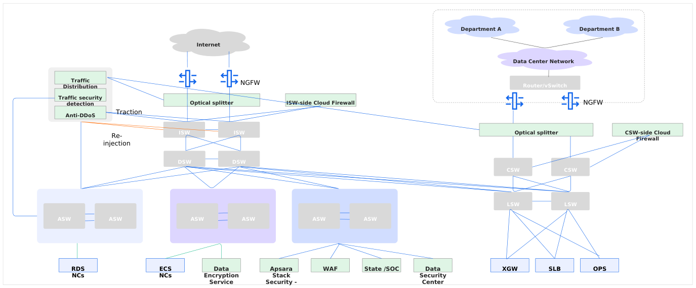

Alibaba Cloud  
Apsara Stack  
Cloud Security Network  
Detection and Response  
Product Introduction  
Product Version: v3.18.6-2607  
Document Version: 20260828

**Table of Contents**

- [1.What is NDR?](#section-1)
- [2.Benefits](#section-2)
- [3.Architecture](#section-3)
- [4.Functions and features](#section-4)
- [5.Use scenarios](#section-5)
- [6.Terms](#section-6)

# 1.What is NDR?

Network Detection and Response (NDR) uses a variety of threat detection engines and threat intelligence to detect network attacks at the Internet and internal network perimeters and takes appropriate measures to defend against attacks.

**Overview**

- NDR is a service that can analyze big data in real time within microseconds. It is the first line of defense against attacks. NDR performs in-depth packet analysis on mirrored traffic of data centers to detect various attacks and abnormal behaviors in real time. In addition, NDR accurately identifies network threats based on custom thresholds and can work together with other security systems.

- NDR is dedicated to detecting and responding to attacks in network traffic before, during, and after events. Before events, NDR provides preventive measures such as port anti-scanning and threat intelligence. During events, NDR provides detection and blocking capabilities such as intrusion detection system (IDS), web IDS, behavior analysis, and one-click blocking. After events, NDR provides tracing capabilities such as protocol log collection for all traffic and malicious packet retention. In addition, NDR can be used with Security Orchestration, Automation and Response (SOAR) to perform detection and response orchestration. This implements automated operations on all traffic.

# 2.Benefits

Apsara Stack Security is a leading service in the cloud security industry and has received various certifications from relevant authorities. Apsara Stack Security safeguards Apsara Stack environments with advanced security systems and security technologies.

**Leading service in the cloud security industry**

The Apsara Stack Security team accumulated rich security experience by protecting all internal business systems of Alibaba Group from 2005. After the service was released in 2011, Apsara Stack Security became a leading service that provides comprehensive protection to ensure cloud security.

Apsara Stack Security has protected more than 40% of websites in China. It mitigates more than 50% of DDoS attacks and blocks up to 3.6 billion times of attacks every day. It has patched more than 6.13 million vulnerabilities over the previous year.

**Mature systems and advanced technologies**

Apsara Stack Security is developed based on ten years of experience in the cloud security industry. After a decade of experience in providing security services for the internal business systems of Alibaba Group, Alibaba Cloud has obtained considerable security research achievements, security data, and security operations methods, and has built a professional cloud security team. Apsara Stack Security is developed based on the rich experience of the security team to help enterprises build sophisticated systems that can enhance the security of cloud computing platforms. This service can protect the cloud platforms, cloud networks, and cloud business systems of Apsara Stack tenants.

**Comparison with traditional security services**

| Feature | Traditional security service | Apsara Stack Security |
| --- | --- | --- |
| Industry-leading security capabilities that surpass other Internet enterprises | A traditional security service provider only has limited products and features and cannot provide a comprehensive security protection system. | Alibaba Group accumulated a large number of intelligence sources based on years of attack prevention experience.This enables Apsara Stack Security to detect common Internet attacks such as zero-day exploits, and provide comprehensive security capabilities. |
| Prompt risk forecasting | Traditional security services cannot forecast risks because they are not tested in a wide array of security monitoring scenarios. | Apsara Stack Security can detect and quickly respond to critical vulnerabilities and security events to prevent security issues. |
| Big data modeling and analysis | Traditional security services cannot detect threats by verifying their signatures. The traditional log analysis feature can only be used to collect data and generate reports. You cannot use this feature to perform data modeling or analysis. | Apsara Stack Security implements big data modeling and analysis to detect threats in networks and display security data. More than 30 algorithmic models are used to analyze historical data, network data, and server data. This way, Apsara Stack Security provides insights into the security of business systems. |
| Scalability and hardware and software decoupling | Traditional security services are developed based on existing hardware devices. These security services require virtual hosts that are created on virtualization platforms. | • Hardware and software decoupling: All modules are developed based on the cloud computing architecture and the generalist x86 architecture for hardware.Therefore, the modules do not require specific hardware. • Scalability: You can scale out the number of hardware devices to improve performance without the need to change the network architecture. |
| Comprehensive protection system that supports unified detection and emergency response | Traditional security services add devices to enhance security capabilities. The devices can collect only device logs and status data, and display the data on the management platform.The devices cannot collaborate to provide additional features. | Apsara Stack Security provides comprehensive Internet protection to ensure the security of networks, servers, applications, data, and user identities. The security modules automatically interact with each other to respond to security issues and share intelligence. |
| Compatibility with all data center environments and decoupling from specific cloud platforms | Most traditional security services are provided as hardware appliances. Due to this reason, the services are incompatible with the cloud platforms that adopt the Software Defined Network (SDN) technology. | Apsara Stack Security is developed based on interactions between servers and the operating system, and performs data analysis to detect threats at the data ingress and egress of networks.This ensures that Apsara Stack Security is compatible with all data center environments and avoids the complex network topology in data centers. |

# 3.Architecture

NDR detects and analyzes inbound and outbound traffic on a packet-by-packet basis through traffic mirroring.

**Product network architecture**

NDR is deployed in bypass mode, which is transparent to your business systems. NDR requires network devices such as optical splitters and network Test Access Points (TAPs) to mirror traffic over uplink ports of Inter-connection Switches (ISWs), Customer Switches (CSWs), and LVS Switches (LSWs) to the NDR cluster.

**Terms**

| Term | Description |
| --- | --- |
| NDR | NDR is a service that detects and analyzes network traffic. |
| optical splitter | An optical splitter or an optical fiber splitter is a passive device. Only light beams are input to the device. An optical splitter consists of entrance slits, exit slits, mirrors, and dispersive elements, and is used to separate the required resonance line. The key component of an optical splitter is the dispersive element. Gratings are used as dispersive elements for commercial use. |
| Traffic Distribution Switch | A traffic distribution switch is a network TAP that is used to replicate, aggregate, and filter data. Protocol conversion is performed to convert 10GE POS data into GE LAN data, and the data is sent in load balancing mode based on specific algorithms. This ensures that all data packets from the same session or IP address are sent over the same port. Note NDR has two types of network TAPs: commercial network TAP and network TAP developed by Apsara Stack. The network TAP developed by Apsara Stack is a TSW used to replicate and distribute traffic, but it is unable to filter traffic.Commercial network TAPs are provided by vendors such as Accelink, EmbedWay, and Hengguang. |
| ISW | An Inter-Connect Switch (ISW) provides access to the networks of Internet service providers (ISPs) or the backbone networks of enterprises. |
| DSW | A Distribution Switch (DSW) is a core switch that is used to connect all Access Switches (ASWs). |
| ASW | An Access Switch (ASW) provides access to Elastic Compute Service (ECS) instances and uses an uplink to connect to a DSW. |
| CSW | A Customer Switch (CSW) provides access to your internal backbone networks, including access to virtual private clouds (VPCs) by using leased lines, and performs route distribution and exchange between the internal network and the Internet. A CSW can encapsulate Virtual Extensible LAN (VXLAN) packets sent from leased lines to Extendable Gateways (XGWs). |
| LSW | An Integrated Access Switch (LSW) functions as gateways to provide access to various cloud services, such as VPC and Server Load Balancer (SLB). Each cloud service server, such as the XGW, SLB, or OPS server, is connected to two LSWs. These servers exchange routing information by using Open Shortest Path First (OSPF). The two LSWs exchange routing information with each other by using Internal Border Gateway Protocol (IBGP). The LSWs exchange routing information with DSWs and CSWs by using External Border Gateway Protocol (eBGP). |

# 4.Functions and features

This topic describes the functions and features of NDR.

**Level-1**

**Level-2**

**Level-3**

**Feature description**

**feature**

**feature**

**feature**

The network threat detection and response system supports out-of-band deployment. You can perform

Deploy

Out-of-band

security analysis on traffic from the cloud network to the

ment

deployment

Internet (ISW side), from the cloud network to the

Mode

enterprise intranet (CSW side), and on ECS ENI traffic in

Traffic

the cloud network (VPC traffic mirroring).

detectio n

Network

Throughput

A single cluster processes up to 20 Gbit/s of traffic and

perform

and detection

handles up to 10 Gbit/s of threat detection traffic.

ance

performance

The system detects DoS attacks, including Denial-of-

DDoS attack

Service Attack behaviors that target services such as Web,

detection

MySQL, FTP, Samba, OpenLDAP, and Redis.

The system detects SQL injection attacks and protects

SQL injection

against common SQL injection attacks and blind SQL

detection

injection attacks.

Webshell

The system detects Webshell upload attacks and identifies

detection

tools such as China Chopper and malicious file uploads.

Ransomware

The system detects ransomware behaviors and supports

behavior

detection of ransomware families such as Buran, Clop,

detection

Yatron, Samsam, and Bad Rabbit.

Reverse shell

The system detects Reverse Shell behaviors in Linux and

behavior

Windows operating systems.

detection

Abnormal

The system detects abnormal connection behaviors such as

connection

DNS tunneling and PowerShell-based connections.

detection

The system detects malicious scanning behaviors from

Malicious scan

scanners such as AWVS, Acunetix, Masscan, Nessus, Nmap,

detection

Burp Suite, Zed Attack Proxy, AppScan, WVS, TangScan, and eEye.

Mining

The system detects Mining behaviors and identifies host

behavior

mining software such as DecredMiner and XMRig that

detection

consume host resources.

The system detects data leakage attacks that target

Sensitive data

services such as WordPress, Microsoft SharePoint, Oracle

leakage

Application Server, Apache, WebCMS, Nginx, Oracle DB,

detection

MySQL, and Elasticsearch.

Brute-force cracking

The system detects brute-force cracking attacks.

detection

Threat

The system detects Trojan behaviors, including

detectio

communication behaviors of hundreds of Back Door

Trojan behavior

n

programs such as FireEye, BlackRAT, SoreFang, Azorult,

detection

and Rifdoor, as well as Webshell remote control communication behaviors.

Threat detectio

The system supports configuration and management of

n

Whitelist policy

threat detection whitelists. Traffic that matches a whitelist entry no longer generates threat detection alerts.

Directory

The system detects Web Attack types such as Directory

traversal

Traversal, path traversal, arbitrary file upload, arbitrary file

detection

read, SSRF, and CSRF.

Buffer overflow

The system detects common Buffer Overflow attack

detection

behaviors.

The system supports asynchronous export of threat

Network threat

detection events and block logs. You can view export tasks

response

in the download task management section, and download the exported content or delete export tasks.

The system detects worm behaviors and prevents worms

Worm behavior

from downloading, spreading, and communicating across

detection

the network.

Cross-site

The system detects Cross-Site Scripting (XSS) attack

scripting

behaviors.

detection

Remote code

The system detects remote code execution and Remote

execution

Command Execution attack behaviors.

detection

Remote code

The system detects remote code execution vulnerability

execution

exploitation behaviors that target applications such as

vulnerability

Microsoft SharePoint, Dynamics 365, Oracle WebLogic

detection

Server, Apache, and CMS.

Remote file

The system detects remote file inclusion and Local File

inclusion

Inclusion attack behaviors.

detection

The system provides statistics on the top 5 source IP

Top block

addresses and destination IP addresses in block logs, along

information

with a Trend Chart of alert count changes.

Block logs

Traffic that matches a protection policy generates a block log. You can view the source, destination, attack count,

Block logs

matched policy ID, and matched rule name in the block log, and modify the protection action of the policy.

You can view attack process details and download attack

Attack process

payload and PCAP files.

Attacker

Attacker

profile

profile

The system provides a unified analysis and display of

Attacker

attacker basic information, threat intelligence, attack

behavior

techniques, attack targets, and attack processes from the attacker perspective.

You can search and query logs by using combined

Search criteria

conditions and logical expressions based on time range, organization, and log type.

Log export

The system supports log export task management and

tasks

allows asynchronous log export.

The system provides a utility to convert log fields in special

Log conversion

formats.

Log

Log

Retrieva

Retrieva

l

l

Log export

You can export all log fields or select specific fields for

fields

export, and export log details as PCAP files.

You can select the fields to display in logs, add search

Search

criteria to any field, and save the search criteria as a

templates

Template for subsequent filtering.

Traffic log

You can view traffic logs and Security Event logs for the

retrieval

past 1 hour, 4 hours, 8 hours, 24 hours, 7 days, or 30 days.

The system provides more than 4,300 Preset network intrusion attack detection rules and supports configuration management of detection rules. You can enable or disable

Intrusion

individual rules and create Custom Rule with attributes

detection rules

such as rule name, rule engine, attack type, severity, CVE, attack application, rule mode, direction, rule content, rule description, and remarks.

The system supports Internal IP address identification and

Internal IP

configuration for Network Traffic direction determination.

Address Pool

The system supports IP address book management. You can manage IP addresses in batches and reference

Address book

address books in protection policies.

management

Policy

Policy

The system supports Application Layer protection policies.

manage

manage

HTTP Custom

You can configure observation and blocking policies based

ment

ment

Policy

on HTTP packet field content and set the effective time for policies.

The system provides more than 1,200 Preset Web intrusion

Web

attack detection rules, including detection of Webshell

application

upload, SQL injection, Cross-Site Scripting (XSS), Code

detection

Execution, CRLF, Local File Inclusion, and other attack

configuration

behaviors. You can manage Web application detection rules and enable or disable them.

Port Scan

The system supports Port Scan deception policies. You can

deception

add IP addresses and ports that require protection to

policy

deceive malicious port scanning behaviors.

The system supports Layer 4 protection policies. You can

Network layer

configure traffic observation and blocking policies based on

policy

Source IP addresses, destination IP addresses, and ports.

The system monitors unauthorized or abnormal outbound

Outbound

connections initiated by cloud hosts. It identifies potential

connection

risks by using views such as protocol distribution, high-

analysis

frequency IP addresses, and time trends, and supports Whitelist filtering and log export.

The system detects DGA domains and DNS Tunnel activities, identifies suspicious DNS requests, and generates alerts. You can export results asynchronously, customize the detection time range, request count, and

DNS behavior

total domain name length, and view statistics on the

analysis

Behavio

Behavio

number and trends of suspicious domains.

r

r

analysis

analysis

The system detects SSL Encryption traffic characteristics,

Encrypted

identifies malware communication behaviors in encrypted

traffic analysis

traffic, and generates alerts. You can export alert content asynchronously.

Network

Network

Users with the Global Organization Security Administrator

Network packet

packet

packet

role can create network packet capture tasks to capture

capture

capture

capture

TCP, UDP, and ICMP packets.

The system records Inbound and Outbound Network Traffic between the Internet boundary and cloud hosts, including

Internet

the number of active IP addresses, the number of

boundary

application types, the average traffic volume, and the peak

traffic statistics

traffic volume. You can view statistics for the past 1 hour, 24 hours, or 7 days.

Internet

The system ranks active IP addresses at the Internet

boundary

boundary by Network Traffic volume, number of accessed

traffic ranking

IP addresses, number of application types, and number of sessions.

Internet boundar

You can view network access record details for each IP

y

Internet

address, including the Network Traffic Trend Chart,

boundary

associated ECS assets, and historical network session

access record

records. You can view statistics for the past 1 hour, 24

details

hours, or 7 days.

One-click blocking at the Internet

You can block suspicious network access behaviors with

boundary

one click to prevent suspicious IP addresses from sending or receiving network traffic.

Traffic analysis

You can view network access record details for each IP

Intranet

address, including the Network Traffic Trend Chart,

boundary

associated ECS assets, and historical network session

access record

records. You can view statistics for the past 1 hour, 24

details

hours, or 7 days.

The system records Inbound and Outbound Network Traffic between the IDC network and cloud hosts, including the

Intranet

number of active IP addresses, the number of application

boundary

types, the average traffic volume, and the peak traffic

traffic statistics

volume. You can view statistics for the past 1 hour, 24

Intranet

hours, or 7 days.

boundar y

The system ranks active IP addresses from the IDC network

Intranet

to cloud hosts by Network Traffic volume, number of

boundary

accessed IP addresses, number of application types, and

traffic ranking

number of sessions.

<table>
  <tr>
    <td rowspan="3">Traffic trends</td>
    <td rowspan="3">Traffic trends</td>
    <td>Inbound session traffic trends</td>
    <td>The system ranks the top 5 sources of traffic to cloud hosts from the Internet and IDC IP addresses by Network Traffic volume and displays the distribution of application types.You can also view the ranking of cloud hosts by network access traffic volume and view statistics for the past 1 hour, 24 hours, or 7 days.</td>
  </tr>
  <tr>
    <td>Outbound session traffic trends</td>
    <td>The system ranks the top 5 destinations of traffic from cloud hosts to external networks by Network Traffic volume and displays the distribution of application types. You can also view the ranking of cloud hosts by outbound network access traffic volume and view statistics for the past 1 hour, 24 hours, or 7 days.</td>
  </tr>
  <tr>
    <td>Total traffic trends</td>
    <td>The system tracks overall Network Traffic trends. You can view the Network Bandwidth and packet count trends for the past 1 hour, 24 hours, or 7 days.</td>
  </tr>
</table>

# 5.Use scenarios

Network Detection and Response (NDR) provides flexible and scalable network security solutions for users of different scales and from various sectors, such as industry, agriculture, transportation, public service, finance, and education.

**Apsara Stack for public services**

Apsara Stack for public services allows users from the public service sector to build a centralized service platform for public services in the Apsara Stack environment. This way, the users can work on intelligent platforms and provide intelligent services for the public. The work efficiency of the users is greatly improved, and the public receives better services. Users can deploy Anti-DDoS and Web Application Firewall (WAF) in the cloud to establish the first and outermost-level line of defense, and use Apsara Stack Security to ensure the operational security, data security, and O&M security of public service systems. Apsara Stack Security can also provide security services to help build an organizational structure for security management, optimize management policies, and foster an awareness of security operations.

**Apsara Stack for finance**

Apsara Stack for finance can help users build an in-depth security protection system. Users can deploy NDR, Anti-DDoS, and Cloud Firewall at the data egress of Apsara Stack to perform in-depth detection and protection against attacks at the network layer, deploy WAF to filter out malicious traffic at the application layer, and deploy the Server Guard agent on hosts to ensure terminal security. Apsara Stack Security collects network-wide security logs to perform centralized big data modeling and analysis and eliminate security silos. Users can deploy security protection systems in the cloud based on the x86 architecture, eliminating the need for traditional security hardware.

# 6.Terms

This topic describes terms related to Network Detection and Response (NDR).

**optical splitter**

An optical splitter or an optical fiber splitter is a passive device. Only light beams are input to the device. An optical splitter consists of entrance slits, exit slits, mirrors, and dispersive elements, and is used to separate the required resonance line. The key component of an optical splitter is the dispersive element. Gratings are used as dispersive elements for commercial use.

**traffic distribution switch**

A traffic distribution switch is a network TAP that is used to replicate, aggregate, and filter data. Protocol conversion is performed to convert 10GE POS data into GE LAN data, and the data is sent in load balancing mode based on specific algorithms. This ensures that all data packets from the same session or IP address are sent over the same port.

**IDS detection**

An Intrusion Detection System (IDS) is a network security device used to monitor network transmission in real time. When anomalies are detected, the system triggers alerts or proactively takes security measures.

**web IDS**

Web IDS is a subset of intrusion detection systems, specifically designed for detecting intrusions targeting web applications, such as SQL injection and cross-site scripting (XSS) attacks.

**DDoS attack**

An attacker combines multiple computers by using the client-server model to form an attack platform and initiates a large number of valid requests to one or more targets from this platform to cause network failures. DDoS attacks are much stronger than common denial of service (DoS) attacks.

**SQL injection**

An attacker makes the server run malicious SQL commands by inserting these commands in web tables or by inserting malicious strings in URL requests.

**traffic scrubbing**

The traffic scrubbing service monitors the inbound traffic of a data center in real time to identify unusual traffic that may be from DDoS attacks and other attacks. This service scrubs the unusual traffic without affecting businesses.

**brute-force attack**

Brute-force attacks work by iterating through all possible combinations that can make up a password.

**webshell**

A webshell is a script written in languages such as Active Server Pages (ASP) and Hypertext Preprocessor (PHP). Attackers can run a webshell on a web server to perform high-risk operations. This enables attackers to obtain sensitive information or control the server through server penetration or privilege escalation.

**SOAR**

Security Orchestration, Automation and Response (SOAR) is a security management service provided by Apsara Stack Security. You can use SOAR to automate and process security event operations to improve security response efficiency.

**ISW**

An Inter-Connect Switch (ISW) provides access to the networks of Internet service providers (ISPs) or the backbone networks of enterprises.

**DSW**

A Distribution Switch (DSW) is a core switch that is used to connect all Access Switches (ASWs).

**ASW**

An Access Switch (ASW) provides access to Elastic Compute Service (ECS) instances and uses an uplink to connect to a DSW.

**CSW**

A Customer Switch (CSW) provides access to your internal backbone networks, including access to virtual private clouds (VPCs) by using leased lines, and performs route distribution and exchange between the internal network and the Internet. A CSW can encapsulate Virtual Extensible LAN (VXLAN) packets sent from leased lines to Extendable Gateways (XGWs).

**LSW**

An Integrated Access Switch (LSW) functions as gateways to provide access to various cloud services, such as VPC and Server Load Balancer (SLB). Each cloud service server, such as the XGW, SLB, or OPS server, is connected to two LSWs. These servers exchange routing information by using Open Shortest Path First (OSPF). The two LSWs exchange routing information with each other by using Internal Border Gateway Protocol (IBGP). The LSWs exchange routing information with DSWs and CSWs by using External Border Gateway Protocol (EBGP).
