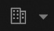
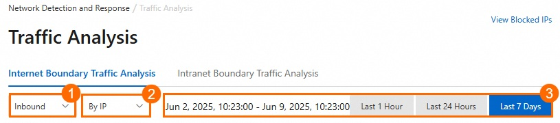
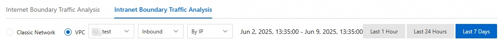
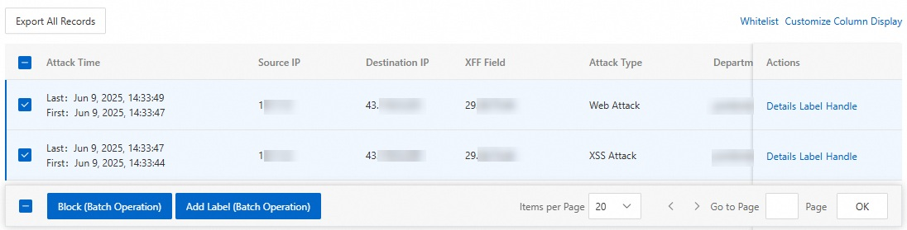
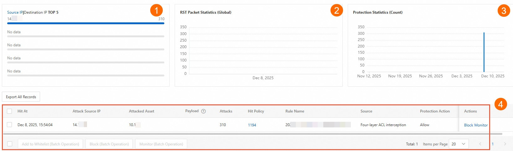
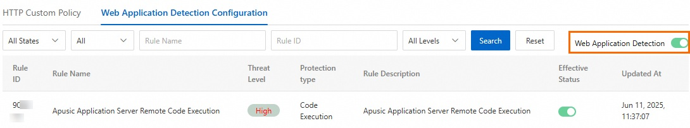
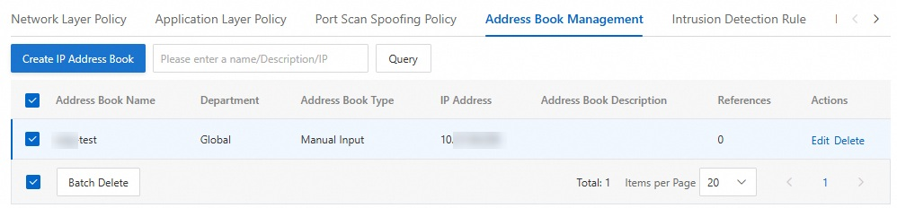

Alibaba Cloud  
Apsara Stack  
Cloud Security Network  
Detection and Response  
User Guide  
Product Version: v3.18.6-2607  
Document Version: 20260828

**Table of Contents**

- [1.Usage notes](#section-1)
- [2.Quick start](#section-2)
    - [2.1. User roles and permissions](#section-2-1)
    - [2.2. Log on to the Apsara Uni-manager Management Console](#section-2-2)
- [3.Network Detection and Response](#section-3)
    - [3.1. Change the organization to view the menu items](#section-3-1)
    - [3.2. View traffic trends](#section-3-2)
    - [3.3. View traffic statistics](#section-3-3)
        - [3.3.1. Analyze Internet traffic](#section-3-3-1)
        - [3.3.2. Analyze internal network traffic](#section-3-3-2)
    - [3.4. Search for logs](#section-3-4)
    - [3.5. View an attacker profile](#section-3-5)
    - [3.6. Use the Threat Detection module](#section-3-6)
        - [3.6.1. View threat detection results](#section-3-6-1)
        - [3.6.2. View logs of blocked traffic](#section-3-6-2)
    - [3.7. Use the Behavior Analysis module](#section-3-7)
        - [3.7.1. Outbound Connection Analysis](#section-3-7-1)
        - [3.7.2. View DNS behavior analysis results](#section-3-7-2)
        - [3.7.3. View encrypted traffic analysis results](#section-3-7-3)
    - [3.8. Policy configuration](#section-3-8)
        - [3.8.1. Configure network layer policies](#section-3-8-1)
        - [3.8.2. Configure application-layer policies](#section-3-8-2)
        - [3.8.3. Configure spoofing policies for port scanning](#section-3-8-3)
        - [3.8.4. Manage address books](#section-3-8-4)
        - [3.8.5. Manage IDS rules](#section-3-8-5)
        - [3.8.6. Manage internal CIDR blocks for traffic monitoring](#section-3-8-6)

# 1.Usage notes

Before you log on to Apsara Stack Security Center, make sure that your computer meets the configuration requirements.

For more information, see the Configuration requirements table of this topic.

Table 1. Configuration requirements

| Item | Requirement |
| --- | --- |
| Browser | • Internet Explorer: V11 or later • Google Chrome (recommended): V42.0.0 or later • Mozilla Firefox: V30 or later • Safari: V9.0.2 or later |
| Operating system | • Windows XP • Windows 7 or later • macOS |

# 2.Quick start

## 2.1. User roles and permissions

This topic describes the user roles involved in Apsara Stack Security.

All roles in Apsara Stack Security Center are provided by default. You cannot create custom roles. Before you log on to Apsara Stack Security Center, make sure that your account is assigned the required role. For more information, see Default roles in Apsara Stack Security.

Table 1. Default roles in Apsara Stack Security

| Role name | Description |
| --- | --- |
| Organization security administrator | Uses SOC to manage the security of hosts, applications, and networks for an organization. This role also manages security products related to Elastic Compute Service (ECS). |
| Global organization security administrator | Uses SOC to conduct security management for Apsara Stack and all tenants, and manages security products related to ECS. |

If you do not have an account that assumes the required role, contact the administrator to create an account and assign the role to the account. For more information, see the **Create a user** topic in **Apsara Uni-manager Management Console User Guide**.

## 2.2. Log on to the Apsara Uni-manager Management Console

This topic describes how to log on to the Apsara Uni-manager Management Console.

**Prerequisites**

- The URL of the Apsara Uni-manager Management Console is obtained from the deployment personnel.

- We recommend that you use Google Chrome.

**Procedure**

1. Enter the URL of the Apsara Uni-manager Management Console in the address bar and press the Enter key.

2. Enter your username and password.

   You must obtain the username and password from the operations administrator.

   > **Note**
   >
   > When you log on to the Apsara Uni-manager Management Console for the first time, you must change the password of your account. The password must be 10 to 32 characters in length and must contain at least two of the following character types:
   >
   > - Uppercase or lowercase letters
   >
   > - Digits
   >
   > - Special characters, which include ! @ # $ %

3. Click **Log On**.

4. If multi-factor authentication (MFA) is enabled for your account, perform corresponding operations in the following scenarios:

   - It is the first time that you log on to the Apsara Uni-manager Management Console after MFA is enabled by the administrator.

     <ol type="a">

     <li>

     On the Bind Virtual MFA Device page, bind an MFA device.

     </li>

     <li>

     Enter the username and password that you entered in Step 2 and click **Log On**.

     </li>

     </ol>

     <ol type="i" start="100">

     <li>

     Enter a six-digit MFA verification code and click **Authenticate**.

     </li>

     </ol>

   - You enabled MFA and bound an MFA device:

     Enter a six-digit MFA verification code and click **Authenticate**.

     > **Note**
     >
     > For more information, see the **Bind a virtual MFA device to enable MFA** topic in **Apsara Uni-manager Management Console User Guide**.

# 3.Network Detection and Response

## 3.1. Change the organization to view the menu items

The Network Detection and Response (NDR) console displays the full or partial menu based on the organization level. This topic describes how to change the organization to view the full menu.

The menu display varies based on the organization and resource set that you select in the top navigation bar of the NDR console. For most organizations and resource sets, the system displays only the Log Retrieval and Threat Detection pages.

- Security administrator: views the full menu of the NDR console, such as the Traffic Trends, Traffic Analytics, Packet Capture, Log Retrieval, Attacker Profile, Threat Detection, Behavior Analysis, and Policy Configurations pages.

- Level-1 organization or lower: views the Log Retrieval and Threat Detection pages.

  If a level-1 or lower organization needs to view the full menu, change the organization to the security administrator level, which is the root level.

**Procedure**

1. Log on to Apsara Stack Security Center.

2. In the top navigation bar, choose **Security >** **Network Security > Network Detection and Response**. On the **Network Detection and Response** page, select a region from the **Region** drop-down list and click **Access with Authorized Role**.

3. If you are using a level-1 or lower organization, click the  icon in the top navigation bar

   to change the organization to the security administrator level (root level) to view the full menu.

## 3.2. View traffic trends

Organization security administrators and global organization security administrators can analyze traffic trends and obtain the traffic rate, peaks, and troughs. The top five IP addresses that have the largest amount of traffic can also be viewed to identify malicious IP addresses. This topic describes how to view network traffic trends and statistics about inbound and outbound traffic.

**Procedure**

1. Log in to the Apsara Uni-manager Management Console.

2. In the top navigation bar, choose **Security >** **Network Security > Network Detection and Response**. On the **Network Detection and Response** page, select a region from the **Region** drop-down list and click **Access with Authorized Role**.

3. In the top navigation bar, click the  icon and change the organization to the root

   organization that is of the security administrator level to view the full menu.

4. In the left-side navigation pane, click **Traffic Trends**.

5. On the **Traffic Trends** page, select **Last 1 Hour**, **Last 24 Hours**, or **Last 7 Days** to query traffic trends within the specified time range.

6. View network traffic information in the following sections.

   - Network Traffic Trend

     View the network traffic trends within the specified time range, including the average traffic, peak traffic, as well as the inbound and outbound traffic measured in bytes per second (BPS) and packets per second (PPS).

   - Inbound Traffic

     View statistics about inbound sessions, inbound applications, and destination IP addresses that receive most requests.

   - Outbound Traffic

     View statistics about outbound sessions, outbound applications, and source IP addresses that send most requests.

## 3.3. View traffic statistics

### 3.3.1. Analyze Internet traffic

Network Detection and Response (NDR) allows you to view traffic at the Internet border. You can use traffic information to identify abnormal Internet traffic. This topic describes how to view traffic at the Internet border.

**Prerequisites**

**NDR** is purchased and deployed. This product audits, analyzes, and manages both inbound and outbound traffic at the Internet border.

**Procedure**

1. Log in to the Apsara Uni-manager Management Console.

2. In the top navigation bar, click **Security** and choose **Network Security > Network Detection and Response**. On the **Network Detection and Response** page, select a region from the **Region** drop-down list and click **Access with Authorized Role**.

3. In the top navigation bar, click the  icon and change the organization to the root

   organization that is of the security administrator level to view the full menu.

4. In the left-side navigation pane, click **Traffic Analytics**.

5. On the **Internet Boundary Traffic Analysis** tab of the Traffic Analysis page, view the information about the traffic at the Internet border.

   <ol type="i">

   <li>

   Specify conditions to filter traffic.

   

   | Position | Description |
   | --- | --- |
   | 1 | Specifies the traffic direction. Valid values: <strong>Inbound</strong> and <strong>Outbound</strong>. • <strong>Inbound</strong>: The traffic flows from the Internet to the internal network. • <strong>Outbound</strong>: The traffic flows from the internal network to the Internet. |
   | 2 | Specifies whether to view traffic information by IP address or application. Valid values: <strong>By IP</strong> and <strong>By Application</strong>. |
   | 3 | Specifies the time range. Valid values: <strong>Last 1 Hour</strong>, <strong>Last 24 Hours</strong>, and <strong>Last 7 Days</strong>. |

   </li>

   <li>

   View the details of the traffic at the Internet border in the following sections.

   - **Traffic Statistics**

     - In the **Visits to IP** section, view the **Source IPs**, **Destination IPs**, and **Applications** parameters.

     - On the right side of the Visits to IP section, view the **Average Traffic** and **Peak Traffic** parameters, and traffic trends in a chart.

   - **Traffic List**

     In the **Traffic List** section, sort IP addresses by traffic volume, number of source or destination IP addresses, number of applications, and number of sessions.

     - View traffic information.

       - If you select **Inbound**, the traffic information is displayed on the **By Source IP** and **By Destination IP** tabs of the Traffic List section.

       - If you select **Outbound**, the traffic information is displayed in the Traffic List section.

     - Find the IP address whose traffic details you want to view and click **Details** in the **Actions** column to view the traffic trends, basic information, and sessions of the IP address.

   </li>

   </ol>

### 3.3.2. Analyze internal network traffic

Network Detection and Response (NDR) allows you to view traffic at the internal network border. You can use traffic information to identify suspicious traffic from the internal network. This topic describes how to view traffic at the internal network border.

**Prerequisites Prerequisites**

**NDR** is purchased and deployed. This product audits, analyzes, and manages both inbound and outbound traffic routed over leased lines between data centers and virtual private clouds (VPCs).

**Procedure**

1. Log in to the Apsara Uni-manager Management Console.

2. In the top navigation bar, click **Security** and choose **Network Security > Network Detection and Response**. On the **Network Detection and Response** page, select a region from the **Region** drop-down list and click **Access with Authorized Role**.

3. In the top navigation bar, click the  icon and change the organization to the root

   organization that is of the security administrator level to view the full menu.

4. In the left-side navigation pane, click **Traffic Analytics**.

5. On the **Intranet Boundary Traffic Analysis** tab of the Traffic Analysis page, view traffic at the internal network border.

   <ol type="i">

   <li>

   Specify conditions to filter traffic.

   

   | Filter condition | Description |
   | --- | --- |
   | Classic network | If a Server Load Balancer (SLB) IP address is used but no VLAN tag is added to traffic, use this filter condition. |
   | VPC | If VLAN tags are used to improve flexibility, security, and management, use this filter condition. |
   | VPC name | The name of the VPC that you want to use. |
   | Traffic direction | The traffic direction. Valid values: <strong>Inbound</strong> and <strong>Outbound</strong>. • <strong>Inbound</strong>: The traffic flows from the Internet to the internal network. • <strong>Outbound</strong>: The traffic flows from the internal network to the Internet. |
   | Viewing method | Specifies whether you want to view the traffic by IP address or application. Valid values: <strong>By IP</strong> and <strong>By Application</strong>. |
   | Time range | The time range to query. Valid values: <strong>Last 1 Hour</strong>, <strong>Last 24 Hours</strong>, and <strong>Last 7 Days</strong>. |

   </li>

   <li>

   View the details of the traffic at the internal network border in the following sections.

   - **Traffic Statistics**

     - In the **Visits from IP** section, view the **Source IPs**, **Destination IPs**, and **Applications** parameters.

     - On the right side of the Visits from IP section, view the **Average Traffic** and **Peak Traffic** parameters, and traffic trends in a chart.

   - **Traffic List**

     In the **Traffic List** section, sort IP addresses by traffic volume, number of source or destination IP addresses, number of applications, and number of sessions.

     - View traffic information.

       - If you select **Inbound**, the traffic information is displayed on the **By Source IP** and **By Destination IP** tabs of the Traffic List section.

       - If you select **Outbound**, the traffic information is displayed in the Traffic List section.

     - Find the IP address whose traffic details you want to view and click **Details** in the **Actions** column to view the traffic trends, basic information, and sessions of the IP address.

   </li>

   </ol>

## 3.4. Search for logs

This topic describes how to search for and view logs.

1. Log in to the Apsara Uni-manager Management Console.

2. In the top navigation bar, click **Security** and choose **Network Security > Network Detection and Response**. On the **Network Detection and Response** page, select a region from the **Region** drop-down list and click **Access with Authorized Role**.

3. In the left-side navigation pane, click **Log Retrieval**.

4. On the **Log Retrieval** page, specify search conditions. The following table describes the conditions.

   | Search condition | Description |
   | --- | --- |
   | Today | The time range for log search. Valid values: <strong>Last Hour</strong>, <strong>Last 4 Hours</strong>, <strong>Last 8 Hours</strong>, <strong>Today</strong>, <strong>Last 7 Days</strong>, <strong>Last 14 Days</strong>, <strong>Last 30 Days</strong>, and <strong>Custom</strong>. |
   | All Departments | The department to which the logs belong. Note • You can select a department only if the organization is the root organization. • If you are in a level-1 or subordinate organization, click the icon in the top navigation bar to change the  organization to the root organization that is of the security administrator level to view the full menu. |
   | Log Type | The type of the logs that you want to search for. Valid values: <strong>Security Event Log</strong>, <strong>Full Traffic Log</strong>, and <strong>Behavior Analysis Log</strong>.Default value: <strong>Security Event Log / ndr_attack_log</strong>. |
   | Search Template | The template for log search. You can save search conditions as a template. |
   | Enter the content | The log content. You must use a search syntax that is similar to Lucene to specify the content. |

5. Click the  icon to view the search results.

   - **Clear**: If you no longer want to use the specified search conditions, you can click **Clear** to clear the conditions.

   - **Save**: If you want to reuse the specified search conditions, you can click **Save** to save the conditions as a template. In the dialog box that appears, specify a name for the template.

   The system displays logs in a column chart based on the specified search conditions. You can view the number of logs at different points in time within the specified time range.

   In the lower part of the Log Retrieval page, you can view the details of the returned logs. You can also click the parameters in the log list to add the parameters to search conditions.

   - Select the fields that you want to display in the log list: Select the fields in the lower-left section of the Log Retrieval page.

   - Export all fields of the returned logs: Click **Export All Fields** to export all fields of the returned logs. All fields of the returned logs are displayed in the lower-left section of the **Log Retrieval** page. The fields are divided into **Displayed Fields** and **Optional Fields**. You can click **Download Task Management** in the upper-right corner of the Log Retrieval page to view export results.

   - Export the selected fields of the returned logs: Click **Export Selected Fields** to export the selected fields of the returned logs. You can click **Download Task Management** in the upper-right corner of the Log Retrieval page to view export results.

   - View log details: Find the log that you want to manage and click **Details** in the **Actions** column.

   - View field details: Click **Documentation** in the upper-right corner of the **Log Retrieval** page to view the details of a field.

   - Decode fields: Click **Decoding Gadget** in the upper-right corner of the **Log Retrieval** page to convert fields that are encoded in a specific format into another format. The following encoding methods are supported: **Unicode encoding**, **UTF-8 encoding**,**URL encoding**,**Hex encoding**, and **Base64 encoding**.

   - View the percentage of a field: Click the  icon next to a field in the lower-left corner of

     the **Log Retrieval** page to view the percentage of the field. To hide the data, click the icon again.

   - View field descriptions: Move the pointer over a field in the lower-left corner of the Log Retrieval page to view the description of the field.

## 3.5. View an attacker profile

The attacker profile feature analyzes and displays the basic information, threat intelligence, attack methods, attack targets, and attack processes of attacks that are initiated from IP addresses in a centralized manner. This topic describes how to view an attacker profile.

1. Log in to the Apsara Uni-manager Management Console.

2. In the top navigation bar, click **Security** and choose **Network Security > Network Detection and Response**. On the **Network Detection and Response** page, select a region from the **Region** drop-down list and click **Access with Authorized Role**.

3. In the top navigation bar, click the  icon and change the organization to the root

   organization that is of the security administrator level to view the full menu.

4. In the left-side navigation pane, click **Attacker Profile**.

5. On the **Attacker Profile** page, specify search conditions. The following table describes the search conditions.

   | Search condition | Description |
   | --- | --- |
   | Last Hour | The time range for search. Valid values: <strong>Last Hour</strong>, <strong>Last 4 Hours</strong>, <strong>Last 8 Hours</strong>, <strong>Today</strong>, <strong>Last 7 Days</strong>, <strong>Last 14 Days</strong>, <strong>Last 30 Days</strong>, and <strong>Custom</strong>. |
   | All Departments | The departments for search. Only a global organization security administrator can view the logs of all tenants. An organization security administrator can view only the logs of the tenant to which the department belongs. |
   | Attack Result | The result of the attacks. Valid values: <strong>Attempt</strong>, <strong>Success</strong>, and <strong>Lost</strong>. |
   | Threat Level | The severity of the attacks. Valid values: <strong>Low Risk</strong>, <strong>Medium Risk</strong>, and <strong>High Risk</strong>. |
   | Please enter the attacker IP | The IP address from which the attacks are initiated. |

6. In the **List** section, view the search results.

7. Click an entry in the **List** section to view the information about the attacks that are initiated from the specified IP address.

   - Click the **Basic Information** tab to view the basic information about the attacks. Click **Download Attack Packets** in the upper-right corner of the **Basic Information** tab to download attack evidence messages. You can click **Download Task Management** in the upper-right corner of the Attacker Profile page to view the download results.

   - Click the **Attack Method** tab to view the attack details, including the attack events, attack results, victim IP addresses, victim assets, departments, IP address types, and listening ports.

   - Click the **Top Victim IP Addresses** tab to view the top five hosts and IP addresses that receive the highest number of attacks. You can also view the number of attack attempts, the number of successful attacks, and the number of attacks by severity.

   - Click the **Attack Process** tab to view the detailed process of the attacks. Click a rightwards arrow on the **Attack Process** tab to view the details of the attack.

## 3.6. Use the Threat Detection module

### 3.6.1. View threat detection results

This topic describes how to view threat detection results.

**Background information**

Some threat detection features are available only in the root organization that is of the security administrator level. These include selecting a department, selecting columns to display, viewing the whitelist, handling attacks, and adding tags to attacks. If you are in a

level-1 or subordinate organization, you can click the  icon in the top navigation bar to

switch to the root organization. This way, you can use all threat detection features.

**Procedure**

1. Log in to the Apsara Uni-manager Management Console.

2. In the upper-right corner of the Apsara Uni-manager Management Console, choose **Security** > **Network Security > Network Detection Response**. On the **Network Detection Response** page, select a region from the **Region** drop-down list and click **Access with Authorized Role**.

3. In the left-side navigation pane, click **Threat Detection**.

4. On the **Threat Detection** tab of the Threat Detection page, click **Show Details** and specify query conditions. The following table describes the query conditions.

   | Query condition | Description |
   | --- | --- |
   | Time | The time range to query. Valid values: <strong>Last Hour</strong>, <strong>Last 4 Hours</strong>, <strong>Last</strong> <strong>8 Hours</strong>, <strong>Today</strong>, <strong>Last 7 Days</strong>, <strong>Last 14 Days</strong>, <strong>Last 30 Days</strong>, and <strong>Custom</strong>. |
   | Source IP | The IP address from which the attacks are initiated. |
   | Threat Level | The severity of the attacks. Valid values: <strong>All</strong>, <strong>Low Risk</strong>, <strong>Medium</strong> <strong>Risk</strong>, and <strong>High Risk</strong>. |
   | Attack Type | The type of the attacks. Valid values: <strong>All</strong>, <strong>Suspicious Connection</strong>, <strong>Command Execution</strong>, <strong>Brute-force Attack</strong>, <strong>Scan</strong>, <strong>Other</strong>, <strong>Information Leak</strong>, <strong>DoS Attack</strong>, <strong>Overflow Attack</strong>, <strong>Web Attack</strong>, <strong>Trojan Backdoor</strong>, <strong>Worm</strong>, <strong>Mining</strong>, <strong>Reverse Shell</strong>, <strong>Remote File</strong> <strong>Inclusion</strong>, <strong>Webshell Upload</strong>, <strong>SQL Injection</strong>, <strong>XSS Attack</strong>, <strong>Code</strong> <strong>Execution</strong>, <strong>CRLF</strong>, and <strong>Local File Inclusion</strong>. |
   | Destination IP | The IP address that receives the attacks. |
   | HTTP Response Code | The HTTP response code. |
   | XFF Field | The X-Forwarded-For (XFF) header. |
   | Domain Name | The domain name. |
   | Rule ID | The rule ID. |
   | Attack Result | The result of the attacks. Valid values: <strong>All</strong>, <strong>Attempt</strong>, <strong>Success</strong>, and <strong>Failure</strong>. |
   | Alert Source | The alert source. Valid values: <strong>All</strong>, <strong>IDS</strong>, and <strong>WEBIDS</strong>. |
   | Department | The level-1 department. |
   | Tags | The tag of the attacks. |
   | Protection Status | The protection status. Valid values: <strong>All</strong>, <strong>Unhandled</strong>, <strong>Blocked</strong>, <strong>Added</strong> <strong>to Whitelist</strong>, and <strong>Ignored</strong>. |

5. Click **Query** to view the query results.

   If you no longer require the specified query conditions, click **Reset** to clear the query conditions.

   The system analyzes the attacks that meet the query conditions and displays the analysis results in charts.

   - The pie chart in the **Alert Type Chart** section displays the percentages of different alert types.

   - The bar chart in the **Source IP | Destination IP Top 5** section displays the top five source IP addresses and destination IP addresses of attacks and the number of attacks.

   - The chart in the **Alert Trend Chart** section displays the trend of the number of attacks in a specific time range.

   - The attack list in the lower part of the Threat Detection page displays the details of the attacks.

     

     - Select the columns that you want to display: Click **Customize Column Display** in the upper-right corner of the attack list to select the columns that you want to display in the attack list.

     - View details of an attack: Find the attack that you want to manage and click **Details** in the Actions column to view the details of the attack on the **Basic Information**, **Rule Details**, and **Original Alert List** tabs.

     - Add a tag to an attack: Find the attack that you want to manage and click **Label** in the Actions column to add a custom tag to the attack.

     - Select a handling method for an attack: Find the attack that you want to manage and click **Handle** in the Actions column to select a handling method for the attack. The following handling methods are supported: **Block**, **Threat Detection Whitelist**, and **Ignore**.

       > **Note**
       >
       > If the detection object is elastic network interfaces (ENIs), you cannot handle the detected attack in the Actions column.

       - **Block**: blocks the source IP address of the attack and XFF header by using a network-layer access control policy.

         - **Network Blocking**

           | Parameter | Description |
           | --- | --- |
           | Blocking Type | After you select <strong>Network Blocking</strong> from the <strong>Blocking Type</strong> drop-down list, you can create an access control policy to block the source IP address of the attack. |
           | Source IP | The source IP address of the attack. |
           | Destination IP | The IP address of the attacked asset. |
           | Destination Port | The destination port of the attack. |
           | Effective Duration | The validity period of the handling method. Valid values: <strong>One Day</strong>, <strong>One Week</strong>, <strong>One Month</strong>, <strong>Custom</strong>, and <strong>Permanent</strong>. |

         - **XFF Blocking**

           | Parameter | Description |
           | --- | --- |
           | Blocking Type | After you select <strong>XFF Blocking</strong> from the <strong>Blocking Type</strong> drop-down list, you can create an access control policy to block the XFF header. |
           | XFF Field | The XFF header in the attack. |
           | Effective Duration | The validity period of the handling method. Valid values: <strong>One Day</strong>, <strong>One Week</strong>, <strong>One Month</strong>, <strong>Custom</strong>, and <strong>Permanent</strong>. |

       - **Threat Detection Whitelist**:

         - Add the source IP address of the attack, the attacked asset, the name of the attack, or the attack payload to the whitelist. The source IP address, attacked asset, attack name, and attack payload are evaluated by using the AND operator. No alerts are generated for attacks that match the whitelist rule. You can click **Whitelist** in the upper-right corner of the attack list to view the source IP address, attacked asset, attack name, and attack payload that are added to the whitelist. In the **Whitelist Management** dialog box, you can remove or add a whitelist rule.

         - Effective Duration: the validity period of the handling method. Valid values: **One Day**, **One Week**, **One Month**, **Custom**, and **Permanent**.

       - **Ignore**: ignores an alert. If the same attack is initiated again, a new alert is generated.

       Each value in the Protection Status column corresponds to the handling method that you selected. By default, Unhandled is displayed. After you select a handling method, the value in the Protection Status column is updated. If you select **Block**, **Blocked** is displayed in the Protection Status column. If you select **Threat Detection Whitelist**, **Trusted** is displayed. If you select **Ignore**, **Ignored** is displayed.

       You can also select multiple attacks and click **Block (Batch Operation)**, or **Add Label (Batch Operation)** to handle the attacks at a time.

     - Export the attack list: Click **Export All Records** above the attack list to export the returned attacks. You can click **Download Task Management** in the upper-right corner of the Threat Detection page to view export results.

### 3.6.2. View logs of blocked traffic

Logs of blocked traffic record the traffic that matches a blocking policy. This topic describes how to view the logs of blocked traffic.

1. Log in to the Apsara Uni-manager Management Console.

2. In the top navigation bar, choose **Security >** **Network Security > Network Detection and Response**. On the **Network Detection and Response** page, select a region from the **Region** drop-down list and click **Access with Authorized Role**.

3. In the top navigation bar, click the  icon and change the organization to the root

   organization that is of the security administrator level to view the full menu.

4. In the left-side navigation pane, click **Threat Detection**.

5. On the **Blocking Logs** tab of the Threat Detection page, specify query conditions. The following table describes the query conditions.

   | Query condition | Description |
   | --- | --- |
   | Created At | The time range to query. Valid values: <strong>Last Hour</strong>, <strong>Last 4 Hours</strong>, <strong>Last</strong> <strong>8 Hours</strong>, <strong>Today</strong>, <strong>Last 7 Days</strong>, <strong>Last 14 Days</strong>, <strong>Last 30 Days</strong>, and <strong>Custom</strong>. |
   | Protection Results | The protection result. Valid values: <strong>All Actions</strong>, <strong>Allow</strong>, <strong>Monitor</strong>, and <strong>Block</strong>. |
   | Policy ID | The ID of the blocking policy. |
   | Source IP | The IP address from which the attacks are initiated. |
   | Destination IP | The IP address that receives the attacks. |

6. Click **Query** to view the query results.

   

   - The bar chart in the **Source IP | Destination IP Top 5** section that is labeled as 1 in the preceding figure displays the top five source IP addresses and destination IP addresses of attacks and the number of attacks.

   - The line chart in the **RST Packet Statistics (Global)** section that is labeled as 2 in the preceding figure displays the numbers of reset (RST) packets at different points in time.

   - The chart in the **Protection Statistics (Count)** section that is labeled as 3 in the preceding figure displays the number of times that attacks are blocked within the specified time range.

   - The log list that is labeled as 4 in the preceding figure in the lower part of the Blocking Log tab displays the details of the logs for blocked traffic. You can perform the following operations in the log list:

     - Export logs of blocked traffic: Click **Export All Records** above the log list to export all returned logs of blocked traffic. You can click **Download Task Management** in the upper-right corner of the Threat Detection page to view export results.

     - Change the action of the blocking policy that a log of blocked traffic matches: Find a log of blocked traffic and click **Block**, **Add to Whitelist**, or **Monitor** in the **Actions** column. This way, if traffic that matches the blocking policy is detected, the corresponding action is performed. This setting does not change the action in existing logs. Instead, it changes the action of the matched blocking policy. The new action applies to all future traffic that matches this blocking policy.

       > **Note**
       >
       > You can configure only the **Monitor** action for blocked traffic whose **Source** is **Port spoofing**.

       - **Block**: When the system detects traffic that matches a blocking policy, the system generates an alert and blocks the detected traffic.

       - **Monitor**: When the system detects traffic that matches a blocking policy, the system generates an alert but does not block the detected traffic.

       - **Add to Whitelist**: No alerts are generated for traffic from the IP address that is added to the whitelist.

     - Change the actions of the blocking policies that multiple logs of blocked traffic match: Select multiple logs of blocked traffic and click **Add to Whitelist (Batch Operation)**, **Block (Batch Operation)**, or **Monitor (Batch Operation)**.

## 3.7. Use the Behavior Analysis module

### 3.7.1. Outbound Connection Analysis

Outbound connection analysis monitors and analyzes unauthorized or anomalous external connection attempts from hosts to identify potential threats. This topic describes how to view outbound connection analysis.

**Procedure**

1. Log on to the Apsara Uni-manager Management Console.

2. In the top navigation bar, choose **Security** > **Network Security > Network Detection and Response**. On the **Network Detection and Response** page, select a region from the **Region** drop-down list and click **Access with Authorized Role**.

3. In the top navigation bar, click the  icon to switch the organization to the security

   administrator level (root) and view the full menu.

4. In the left-side navigation pane,Click **Behavior Analysis**.

5. On the **Outbound Connection Analysis** tab, set search criteria.

   | Search item | Description |
   | --- | --- |
   | Created At | Select a time range for the query. Valid values: <strong>Last Hour</strong>, <strong>Last 4</strong> <strong>Hours</strong>, <strong>Last 8 Hours</strong>, <strong>Today</strong>, <strong>Last 7 Days</strong>, <strong>Last 14 Days</strong>, <strong>Last 30</strong> <strong>Days</strong>, <strong>Custom</strong>. |
   | Department | Select the department. |
   | Source IP | Enter the source IP address. |
   | Destination IP | Enter the destination IP address. |
   | Application protocol type | Select the application protocol type. |

6. Click **Query** to view the **Application Protocol Distribution by Type**, **Source IP|Destination IP Top 5**, **Outbound Connection Trend**, and the outbound connection analysis list.

   In the outbound connection analysis list, you can perform the following operations:

   - View detailed information about an outbound connection: Click **Details** in the **Actions** column of the target record.

   - Export the outbound connection list: Click **Export All Records** above the list. You can view the export result by clicking **Download Task Management** in the upper-right corner of the page.

   - View the allowlist: Click **Whitelist** above the list. The **Whitelist** allows you to add or delete entries.

### 3.7.2. View DNS behavior analysis results

DNS behavior analysis can analyze the characteristics of suspicious domain names to detect suspicious DNS behaviors. This topic describes how to view DNS behavior analysis results.

1. Log in to the Apsara Uni-manager Management Console.

2. In the top navigation bar, choose **Security** > **Network Security > Network Detection and Response**. On the **Network Detection and Response** page, select a region from the **Region** drop-down list and click **Access with Authorized Role**.

3. In the top navigation bar, click the  icon and change the organization to the root

   organization that is of the security administrator level to view the full menu.

4. In the left-side navigation pane, click **Behavior Analysis**.

5. On the **DNS Behavior Analysis** tab of the Behavior Analysis page, specify query conditions. The following table describes the query conditions.

   | Query condition | Description |
   | --- | --- |
   | Created At | The time range to query. Valid values: <strong>Last Hour</strong>, <strong>Last 4 Hours</strong>, <strong>Last</strong> <strong>8 Hours</strong>, <strong>Today</strong>, <strong>Last 7 Days</strong>, <strong>Last 14 Days</strong>, <strong>Last 30 Days</strong>, and <strong>Custom</strong>. |
   | Department | The department to which the DNS behaviors belong. |
   | Domain Name | The domain name. |
   | Source IP | The source IP address. |
   | Exception Type | The exception type. Valid values: <strong>All</strong>, <strong>DGA Domain Name</strong>, and <strong>DNS</strong> <strong>Tunneling-involved Domain Name</strong>. |

6. Click **Query** to view DNS behavior analysis results in the following sections: **Statistics on DGA Domain Names**, **Statistics on DNS Tunneling-involved Domain Names**, and **Trends of Suspicious DNS Resolutions**. You can also view the DNS behavior list below the sections.

   You can perform the following operations in the DNS behavior list:

   - View the details of a suspicious DNS behavior: Find the DNS behavior that you want to manage and click **Details** in the **Actions** column to view the details of the behavior.

   - Add a suspicious DNS behavior to the whitelist: Find the DNS behavior that you want to manage and click **Add to Whitelist** in the **Actions** column to add the behavior to the whitelist. You can also select multiple behaviors and click **Add to Whitelist (Batch Operation)** to add the behaviors to the whitelist at the same time.

   - Export the DNS behavior list: Click **Export All Records** above the DNS behavior list to export all DNS behaviors. You can click **Download Task Management** in the upper-right corner of the Behavior Analysis page to view export results.

   - View the whitelist: Click **Whitelist** above the DNS behavior list to view the details of the whitelist. In the **Whitelist** dialog box, you can query, add, or remove a behavior.

   - Configure a rule to detect DNS tunneling attacks: Click **DNS Tunneling Detection Rule** above the DNS behavior list. In the Configure DNS Tunneling Detection Rule dialog box, configure the Request Scope(Minutes), Requests(Minutes), and DNS Domain Name Length(Character) parameters and click **OK**.

### 3.7.3. View encrypted traffic analysis results

Encrypted traffic analysis can detect suspicious encrypted traffic by analyzing the characteristics of traffic. This topic describes how to view encrypted traffic analysis results.

1. Log in to the Apsara Uni-manager Management Console.

2. In the top navigation bar, choose **Security** > **Network Security > Network Detection and Response**. On the **Network Detection and Response** page, select a region from the **Region** drop-down list and click **Access with Authorized Role**.

3. In the top navigation bar, click the  icon and change the organization to the root

   organization that is of the security administrator level to view the full menu.

4. In the left-side navigation pane, click **Behavior Analysis**.

5. On the **Encrypted Traffic Analysis** tab, specify query conditions. The following table describes the query conditions.

   | Query condition | Description |
   | --- | --- |
   | Created At | The time range to query. Valid values: <strong>Last Hour</strong>, <strong>Last 4 Hours</strong>, <strong>Last</strong> <strong>8 Hours</strong>, <strong>Today</strong>, <strong>Last 7 Days</strong>, <strong>Last 14 Days</strong>, <strong>Last 30 Days</strong>, and <strong>Custom</strong>. |
   | Department | The department to which the traffic analysis results belong. |
   | Source IP | The source IP address. |
   | Destination IP | The destination IP address. |
   | Attack Tool Type | The type of the attack tool. Valid values: <strong>All</strong>, <strong>Awvs</strong>, <strong>Burpsuite</strong>, <strong>Bxss</strong>, <strong>Nessus</strong>, <strong>Nimbostratus</strong>, <strong>Nmap</strong>, <strong>Sqlmap</strong>, and <strong>Whatweb</strong>. |

6. Click **Query** to view encrypted traffic analysis results that meet the query conditions in the following sections: **Analysis of Encrypted Traffic Types**, **Type Analysis of Attack Tools**, and **Source IP | Destination IP Top 5**. You can also view the encrypted traffic list below the sections.

   You can perform the following operations in the encrypted traffic list:

   - View the details of encrypted traffic: Find a record of encrypted traffic and click **Details** in the **Actions** column to view the details of the record.

   - Add encrypted traffic to the whitelist: Find a record of encrypted traffic and click **Add to Whitelist** in the **Actions** column to add the encrypted traffic to the whitelist. You can also select multiple records of suspicious encrypted traffic and click **Add to Whitelist (Batch Operation)** in the lower-left corner the list to add the traffic to the whitelist at the same time.

   - Export encrypted traffic list: Click **Export All Records** above the encrypted traffic list to export all records of suspicious encrypted traffic. You can click **Download Task Management** in the upper-right corner of the Behavior Analysis page to view export results.

   - View the whitelist: Click **Whitelist** above the encrypted traffic list to view the details of the whitelist. In the **Whitelist** dialog box, you can query, add, or remove a behavior.

## 3.8. Policy configuration

### 3.8.1. Configure network layer policies

This article describes how to create and view network layer policies.

**Create a network layer policy**

1. Log on to the Apsara Uni-manager Management Console.

2. In the top navigation bar, choose **Security** > **Network Security > Network Detection and Response**. On the **Network Detection and Response** page, select a region from the **Region** drop-down list and click **Access with Authorized Role**.

3. In the top navigation bar, click the  icon to switch the organization to the security

   administrator level (root) and view the full menu.

4. In the left-side navigation pane,Click **Policy Configurations**.

5. Create a network layer policy.

   - Create a single network layer policy

     On the **Network Layer Policy** tab, click **Create Policy**. Complete the following configurations, then click **OK**.

     | Configuration item | Description |
     | --- | --- |
     | Policy Name | Set the name of the policy. |
     | Policy Description | Set the descriptive information for the policy. |
     | Direction | The direction of the policy. |
     | Policy Type | Set the type of policy. Options: <strong>Source IP Only</strong>, <strong>Destination IP</strong> <strong>Only</strong>, <strong>Source and Destination IP Addresses/Ports</strong>. |
     | Rules | Set the policy rule. Options: <strong>Manual Input</strong>, <strong>Import File</strong>, <strong>Address Book</strong>. You can set multiple policy rules. Note Supports IPv4 or IPv6 types. Mixed addition is not supported. |
     | Enable | Use the toggle to enable or disable the policy. |
     | Action | Select the action for the policy. Options: <strong>Allow</strong>, <strong>Monitor</strong>, <strong>Block</strong>. |
     | Effective Duration | Select the duration for which the policy is effective. Options: <strong>Permanent</strong>, <strong>One Day</strong>, <strong>One Week</strong>, <strong>One Month</strong>, <strong>Custom</strong>. |

   - Incrementally import network layer policies

     <ol type="a">

     <li>

     On the **Network layer policy** tab, select **Import policy > Download template**.

     </li>

     <li>

     After filling out the network layer policy template, select **Import policy > Incremental import**. Click **Select file** to import the completed template, then click **OK**.

     </li>

     </ol>

**View network layer policies**

On the **Network Layer Policy** tab, you can select the rule action of the policy and choose search conditions (exact search by source IP of active rules, exact search by destination IP of active rules, fuzzy search of all rules). Enter source IP, destination IP, rule name, rule description, rule ID, or UUID information according to different search conditions. Set the creation or expiration time of the policy to search and view the policy list.

In the policy list, you can also perform the following operations:

- Enable or disable a policy: Click the  icon or the  icon in the **Enable** column for the

  target policy.

   icon indicates that the policy is enabled.

   icon indicates that the policy is disabled.

- Edit a policy: Click **Edit** in the **Actions** column for the target policy. You can edit a policy only when it is disabled.

- Delete a policy: Click **Delete** in the **Actions** column for the target policy. You can delete a policy only when it is disabled.

- Enable global network policy: Click the  icon next to **Global Network Policies** above the

  policy list.

- Enable threat intelligence filtering: Click the  icon next to **Threat Intelligence Filtering**.

  After enabling threat intelligence filtering, traffic matching threat intelligence is blocked by default.

- Export all network layer policies: Click **Export All** below the list. You can view the export result by clicking **Download Task Management** in the upper-right corner of the page.

- Manage network layer policies in batches: Select multiple network layer policies and click **Batch Operation** below the policy list. Supports **Batch Delete**, **Batch Enable**, **Batch Disable**, **Batch Export**.

### 3.8.2. Configure application-layer policies

This topic describes how to create an application-layer policy, view application-layer policies, and view policies for web application detection.

**Create an application-layer policy**

1. Log in to the Apsara Uni-manager Management Console.

2. In the top navigation bar, choose **Security >** **Network Security > Network Detection and Response**. On the **Network Detection and Response** page, select a region from the **Region** drop-down list and click **Access with Authorized Role**.

3. In the top navigation bar, click the  icon and change the organization to the root

   organization that is of the security administrator level to view the full menu.

4. In the left-side navigation pane, click **Policy Configurations**.

5. On the **Application Layer Policy** tab of the Policy Configurations page, click the **HTTP Custom Policy** tab.

6. Click **Create Policy**. In the Create Policy panel, configure parameters and click **OK**. The following table describes the parameters.

   | Parameter | Description |
   | --- | --- |
   | Policy Name | The name of the policy. |
   | Matching condition | The matching condition for the policy. A matching condition is the core element of a policy. A policy matches traffic against the conditions and then allows, monitors, or blocks the traffic that meets the conditions. You must configure the <strong>Matching Field</strong>, <strong>Logical Operator</strong>, <strong>Matching Content</strong>, and <strong>Case-sensitive</strong> parameters to add a matching condition. |
   | Direction | The direction of traffic on which the policy takes effect. Valid values: <strong>Inbound</strong> and <strong>Outbound</strong>. |
   | Protection Action | The action for the policy. Valid values: <strong>Allow</strong>, <strong>Monitor</strong>, and <strong>Block</strong>. |
   | Enable | Specifies whether to enable the policy. |
   | Effective Duration | The validity period of the policy. Valid values: <strong>Permanent</strong>, <strong>One</strong> <strong>Day</strong>, <strong>One Week</strong>, <strong>One Month</strong>, and <strong>Custom</strong>. |

**View application-layer policies**

On the **HTTP Custom Policy** tab of the **Application Layer Policy** tab, you can query and view application-layer policies based on the action, status, direction, matching field content, creation time, and expiration time.

You can also perform the following operations:

- Enable or disable a policy: Find the policy that you want to manage and click the  or 

  icon in the **State** column.

  - The  icon indicates that the policy is enabled.

  - The  icon indicates that the policy is disabled.

- Modify a policy: Find the policy that you want to modify and click **Edit** in the **Actions** column.

- Delete a policy: Find the policy that you want to delete and click **Delete** in the **Actions** column.

- Manage multiple application-layer policies at a time: Select multiple application-layer policies and click **Batch Operation** below the policy list. You can delete, enable, disable, or export multiple application-layer policies at a time. You can click **Download Task Management** in the upper-right corner of the Policy Configurations page to view export results.

**View policies for web application detection**

1. Log in to the Apsara Uni-manager Management Console.

2. In the top navigation bar, choose **Security >** **Network Security > Network Detection and Response**. On the **Network Detection and Response** page, select a region from the **Region** drop-down list and click **Access with Authorized Role**.

3. In the top navigation bar, click the  icon and change the organization to the root

   organization that is of the security administrator level to view the full menu.

4. In the left-side navigation pane, click **Policy Configurations**.

5. On the **Application Layer Policy** tab, click the **Web Application Detection Configuration** tab.

6. Query and view policies for web application detection based on the policy status, protection type, policy name, policy ID, and threat level.

   You can find a policy in the policy list and click the  or  icon in the **Effective Status**

   column to enable or disable the policy.

   - The  icon indicates that the policy is enabled.

   - The  icon indicates that the policy is disabled.

7. In the upper-right corner of the policy list, click the  or  icon for **Web Application**

   **Detection**.

   

   - The  icon indicates that all policies are enabled.

   - The  icon indicates that all policies are disabled.

### 3.8.3. Configure spoofing policies for port scanning

A spoofing policy for port scanning lures attackers to launch attacks against ports that do not exist. This way, attacks are exposed. This topic describes how to configure spoofing policies for port scanning.

**Create a spoofing policy for port scanning**

1. Log in to the Apsara Uni-manager Management Console.

2. In the top navigation bar, choose **Security >** **Network Security > Network Detection and Response**. On the **Network Detection and Response** page, select a region from the **Region** drop-down list and click **Access with Authorized Role**.

3. In the top navigation bar, click the  icon and change the organization to the root

   organization that is of the security administrator level to view the full menu.

4. In the left-side navigation pane, click **Policy Configurations**.

5. On the **Port Scan Spoofing Policy** tab of the Policy Configurations page, click **Create Policy**. In the Create Policy panel, configure parameters and click **OK**. The following table describes the parameters.

   | Parameter | Description |
   | --- | --- |
   | Organization | The organization to which the policy belongs. All organizations of Network Detection Response (NDR) are displayed in the drop-down list. |
   | Address Type | The type of the address that you want to protect. The address consists of an IP address and ports that are configured in a service. You can obtain the address by using the port of the security component. Valid values: <strong>WAF</strong>, <strong>Public SLB</strong>, <strong>EIP</strong>, and <strong>Custom</strong>. |
   | Protection Address | The address that you want to protect. |
   | Port Whitelist | The ports in the whitelist. Spoofing policies for port scanning apply only to the ports that are not added to the whitelist. |
   | Protection Mode | The protection mode. Valid values: <strong>Monitor</strong> and <strong>Protect</strong>. If you select <strong>Monitor</strong>, NDR generates alerts but does not block attacks.If you select <strong>Protect</strong>, NDR generates alerts and blocks attacks. |

**View spoofing policies for port scanning**

On the **Port Scan Spoofing Policy** tab, you can query and view policies by department and address type. You can also enter the protection address, policy ID, or protection port in the search box to query policies.

You can also perform the following operations:

- Modify a policy: Find the policy that you want to modify and click **Edit** in the **Actions** column.

- Delete a policy: Find the policy that you want to delete and click **Delete** in the **Actions** column.

- Delete multiple policies at a time: Select multiple policies that you want to delete and click **Batch Delete**.

- Enable or disable a policy: Find the policy that you want to manage and click the  or 

  icon in the **Status** column.

  - The  icon indicates that the policy is enabled.

  - The  icon indicates that the policy is disabled.

### 3.8.4. Manage address books

An address book is a collection of IP addresses. You can create an address book to improve protection configuration efficiency. This topic describes how to create an address book and query address books.

**Create an address book**

1. Log in to the Apsara Uni-manager Management Console.

2. In the top navigation bar, choose **Security >** **Network Security > Network Detection and Response**. On the **Network Detection and Response** page, select a region from the **Region** drop-down list and click **Access with Authorized Role**.

3. In the top navigation bar, click the  icon and change the organization to the root

   organization that is of the security administrator level to view the full menu.

4. In the left-side navigation pane, click **Policy Configurations**.

5. On the **Address Book Management** tab of the Policy Configurations page, click **Create IP Address Book**. In the Create Address Book panel, configure parameters and click **OK**. The following table describes the parameters.

   | Parameter | Description |
   | --- | --- |
   | Address Book Name | The name of the address book. |
   | Address Book Type | The method that you want to use to add addresses to the address book. Valid values: <strong>File Import</strong> and <strong>Manual Input</strong>. |
   | Select Attachment | If you set the <strong>Address Book Type</strong> parameter to <strong>File Import</strong>, click Select File to import a file. |
   | IP Address | If you set the <strong>Address Book Type</strong> parameter to <strong>Manual Input</strong>, enter 32-bit IP addresses. Specify only IPv4 addresses or only IPv6 addresses in an address book. An address book cannot contain both IPv4 addresses and IPv6 addresses. |
   | Address Book Description | The description of the address book. |

**Query address books**

On the **Address Book Management** tab, perform the following operations to manage the address books in the address book list.

- Filter address books: Specify an address book name, address book description, or IP address in the upper part of the page and click **Query** to filter address books.

- Modify an address book: Find the address book that you want to modify and click **Edit** in the **Actions** column.

- Delete an address book: Find the address book that you want to delete and click **Delete** in the **Actions** column.

- Delete multiple address books at a time: Select the address books that you want to delete and click **Batch Delete**.

### 3.8.5. Manage IDS rules

Network Detection and Response (NDR) provides built-in intrusion detection system (IDS) rules. You can configure custom IDS rules based on your business requirements and network environment. This topic describes how to create and manage IDS rules.

**Procedure**

1. Log in to the Apsara Uni-manager Management Console.

2. In the upper-right corner of the Apsara Uni-manager Management Console, choose **Security** > **Network Security > Network Detection Response**. On the **Network Detection Response** page, select a region from the **Region** drop-down list and click **Access with Authorized Role**.

3. In the top navigation bar, click the  icon and change the organization to the root

   organization to view the full menu.

4. In the left-side navigation pane, click **Policy Configurations**.

5. On the **Intrusion Detection Rule** tab of the Policy Configurations page, click **Create Rule**. In the Create Rule panel, configure parameters and click **OK**. The following table describes the parameters.

   | Parameter | Description |
   | --- | --- |
   | Rule Name | The name of the IDS rule. We recommend that you enter a name that can help you identify and manage the IDS rule in an efficient manner. |
   | Rules Engine | The rules engine that you want to use. Valid values: <strong>Basic Policies</strong> and <strong>Virtual Patches</strong>. |
   | Attack Type | The type of the attack that you want to detect by using the IDS rule.Valid values: <strong>Suspicious Connection</strong>, <strong>Command Execution</strong>, <strong>Brute</strong> <strong>Force</strong>, <strong>Scanning</strong>, <strong>Information Leakage</strong>, <strong>DoS</strong>, <strong>Buffer Overflow</strong>, <strong>Web Attack</strong>, <strong>Trojan</strong>, <strong>Virus and Worm</strong>, <strong>Mining</strong>, <strong>Reverse Shell</strong>, <strong>Suspicious URL</strong>, and <strong>Other</strong>. |
   | Risk Level | The severity level of the attack. Valid values: <strong>Low</strong>, <strong>Medium</strong>, and <strong>High</strong>. |
   | CVE | The Common Vulnerabilities and Exposures (CVE) ID of the vulnerability to be listed in the rule. Note CVE provides a list of the public security vulnerabilities. CVE IDs are allocated by a CVE Numbering Authority (CNA). |
   | Application | The name of the attacked application. |
   | Rule Mode | The mode of the rule. Valid values: <strong>Packet</strong> and <strong>Traffic</strong>. |
   | Direction | The direction of traffic that you want to monitor by using the IDS rule.Valid values: <strong>Inbound and Outbound</strong>, <strong>Inbound</strong>, and <strong>Outbound</strong>. |
   | Rule Content | The content of the IDS rule. Use the Snort syntax to specify the content. Note To prevent a negative impact on your business, make sure that you enter valid content for the IDS rule. |
   | Rule Description | The description of the rule. We recommend that you enter information such as the purpose or impact of the rule. |
   | Description | The remarks for the rule. We recommend that you enter information such as the purpose or impact of the rule. |

After you create an IDS rule, you can manage the rule in the IDS rule list.

- View the details of an IDS rule.

  You can specify filter conditions in the upper part of the page to query specific IDS rules.

  Find the rule that you want to manage and click **Details** in the **Actions** column.

- Enable an IDS rule.

  Find the rule that you want to enable and turn on the switch in the **Effective Status** column to change the status of the rule from **Disabled** to **Enabled**.

- Disable an IDS rule.

  If a rule is not suitable for your business, you can disable the rule.

  Find the rule that you want to disable and turn off the switch in the **Effective Status** column to change the status of the rule from **Enabled** to **Disabled**.

### 3.8.6. Manage internal CIDR blocks for traffic monitoring

Network Detection and Response (NDR) allows you to configure CIDR blocks for the traffic security monitoring module. Security administrators can modify the CIDR blocks configured for traffic monitoring based on business requirements. The settings of CIDR blocks apply only to a data center that is deployed in the region to which the CIDR blocks belong. This topic describes how to add and manage internal CIDR blocks for traffic monitoring.

> **Note**
>
> - Changes to CIDR block settings immediately take effect without the need for intervention of security administrators.
>
> - If you configure the same CIDR block in the traffic security monitoring module and the region settings, make sure that you select the same region.

**Procedure**

1. Log in to the Apsara Uni-manager Management Console.

2. In the upper-right corner of the Apsara Uni-manager Management Console, choose **Security** > **Network Security > Network Detection Response**. On the **Network Detection Response** page, select a region from the **Region** drop-down list and click **Access with Authorized Role**.

3. In the top navigation bar, click the  icon and change the organization to the root

   organization to view the full menu.

4. In the left-side navigation pane, click **Policy Configurations**.

5. On the **IP Address Pool of Internal Assets** tab of the Policy Configurations page, click **Add**.

6. In the **New** dialog box, configure the following parameters and click **OK**.

   - **CIDR Block**: the CIDR block for traffic monitoring.

     > **Note**
     >
     > You must enter a valid CIDR block. You cannot enter a CIDR block that is already configured for the region.

   - **Region**: the region in which the data center resides.

After you complete the preceding configurations, you can manage the internal CIDR block in the CIDR block list.

- View the internal CIDR block for traffic monitoring and region information

  Select a **region**, enter the internal CIDR block that you want to manage, and then click **Query**.

- Modify an internal CIDR block for traffic monitoring

  Find the internal CIDR block that you want to modify and click **Edit** in the **Actions** column.

- Delete an internal CIDR block for traffic monitoring

  Find the internal CIDR block that you want to delete and click **Delete** in the **Actions** column.
