Alibaba Cloud  
Apsara Stack  
Alibaba Cloud Security-Server  
Guard Advanced Edition  
Server Guard Advanced  
Edition Product Introduction  
Product Version: v3.18.6-2607  
Document Version: 20260828

**Table of Contents**

- [1.Product Overview](#section-1)
- [2.Product Design](#section-2)
- [3.Features](#section-3)
- [4.Features](#section-4)
    - [4.1. Security overview](#section-4-1)
    - [4.2. Assets](#section-4-2)
    - [4.3. Risk prevention](#section-4-3)
    - [4.4. Intrusion prevention](#section-4-4)
    - [4.5. Log search](#section-4-5)
    - [4.6. Host settings](#section-4-6)
- [5.Key features](#section-5)

# 1.Product Overview

**A pioneer in cloud security**

Cloud computing has grown rapidly in recent years, leading traditional data centers to migrate to cloud architectures. This digital transformation has made moving business and data to the cloud essential for all industries. In 2011, the Alibaba Cloud Security team launched its security products to protect Alibaba Cloud services. As the Apsara Stack business grew, the Alibaba Cloud Security team released the first official version of Alibaba Cloud Security for Apsara Stack in 2013. This version provided IaaS layer security for Apsara Stack and industry cloud users.

The Alibaba Cloud Security team leveraged its years of hands-on cloud experience to create Server Guard (Aegis), a host security product. Server Guard is a comprehensive security management system that combines threat detection, analysis, alerting, and remediation for all your assets. It accurately identifies and remediates asset vulnerabilities, baseline risks, and exposed attack surfaces. It also supports emergency response for 0-day, 1-day, and N-day exploits. Server Guard uses its proprietary multi-engine system to provide threat detection capabilities, including cloud-based scanning, signature-based scanning, heuristic scanning, malicious process behavior detection, ransomware trapping, and detection based on big data models. Server Guard can also provide rule-based protection for files, processes, and networks. This effectively prevents tampering with online business systems. Server Guard collects and displays more than 10 types of logs and cloud Asset Fingerprints. It combines this data with threat intelligence on network entities to perform security posture analysis. This expands security visibility and creates an automated security operations loop for threat detection, response, and source tracing. Server Guard protects cloud assets and local servers and helps you meet regulatory compliance requirements.

**Product positioning**

Alibaba Cloud Security-Server Guard Advanced Edition (Aegis) is a cloud-native endpoint detection and response (EDR) system from Alibaba Cloud. It provides real-time security alerts and defends against malicious intrusions. It eliminates system weaknesses and prevents malicious attacks by performing vulnerability and baseline configuration checks. It also provides security posture analysis and a visualization interface for incident forensics and analysis. This builds a complete endpoint security system for cloud environments.

Server Guard uses an agent plugin at the server's kernel level to perform global monitoring and real-time analysis of file and process behavior. It automatically analyzes the persistent attack methods of large volumes of virus samples. This allows it to bypass the anti-detection capabilities of persistent Trojans and malicious programs. It can also use program behavior analysis to uncover malicious threats not identified by blacklists and proactively block them. Its cloud-based virus database is updated in real time. It integrates cutting-edge technologies, such as leading global antivirus engines, Alibaba Cloud's proprietary sandbox, and machine learning engines. This prevents losses caused by outdated virus databases.

The mitigation policies and data sources are built on years of experience protecting millions of Alibaba Cloud users from hundreds of thousands of daily attacks. The Alibaba Cloud Security team analyzes over 10 TB of security data on the public cloud every day. This analysis builds foundational security capabilities, such as libraries for malicious IPs, malicious behaviors, malicious samples, and security vulnerabilities. These capabilities are quickly integrated into the protection modules of the security posture awareness system. This enhances mitigation capabilities and provides enhanced security for users.

**Scenarios**

Server Guard is widely used to build security systems for various cloud environments. These include industry clouds, Alibaba Gov Clouds, XC Clouds, and jointly-built hybrid clouds for government, finance, energy, central state-owned enterprises, and major ministries. It supports security management and operations for cloud servers across all industries.

**Unified security management for diverse assets in multicloud and multi-chip environments**

In hybrid cloud, multicloud, and one cloud with multiple ISAs scenarios, Server Guard provides centralized management of diverse tenant assets through a single product. At the device layer, this includes Alibaba Cloud ECS instances, underlying physical machines, Alibaba Cloud Security servers on ECS, hosts in external Internet Data Centers (IDCs), and virtual or physical machines on other clouds. These devices can run in environments such as x86_32/64 Intel/AMD, x86_64 Hygon, and ARM_64 Phytium/Kunpeng. It also provides automated security monitoring, customizable security rules, and correlation analysis of threat data. Server Guard covers daily security operations scenarios in Apsara Stack, industry cloud, hybrid cloud, heterogeneous cloud, multicloud, XC Cloud, and one cloud with multiple ISAs environments.

**Classified protection compliance**

Classified Protection 2.0 requires that cloud service providers and customers manage asset risks within their respective areas of control. This is based on a shared responsibility model. These risks include asset vulnerabilities and threat events. Each party must remediate risks in their controlled assets, such as vulnerability risks, baseline risks, viruses, Trojans, and malicious intrusions.

**Building a defense system**

Server Guard provides asset and attack surface inventory capabilities. It maps out the assets, applications, and network links that provide external services in the cloud environment. It also provides asset hardening for host operating systems and web applications. This effectively reduces the exposed attack surface of assets. Server Guard can also accurately detect external intrusion behaviors and block them in real time at the process level.

**APT threat defense in cloud environments**

Server Guard integrates leading antivirus engines, such as Bitdefender and Avira, with Alibaba Cloud's own scanning engine. This combination provides powerful binary threat detection capabilities. Its proprietary GLE multi-engine combines static and dynamic analysis. This includes static matching, dynamic taint simulation using a universal syntax tree (AST), and abnormal heuristic detection. This allows it to accurately detect webshells and malicious scripts.

For threat events and Advanced Persistent Threats (APTs), Server Guard uses its Dipper engine. The engine provides over 350 threat detection models to identify potential security risks in high-level data.

**Platform-side asset security operations**

Physical machines form the foundation of a cloud platform. Any application risks on these machines can pose security risks to the platform and its tenants. Therefore, platform users must monitor and control physical machine assets and business risks. Server Guard provides security monitoring for platform physical machines. This ensures the security of the cloud platform and the business stability of other cloud tenants.

# 2.Product Design

**Service architecture**

Server Guard uses a client/server (C/S) architecture. The Server Guard client, or agent, can be installed on servers in various cloud environments, such as physical machines in a classic network, ECS instances, and hosts outside Alibaba Cloud or in other cloud environments. The agent communicates with the Server Guard server through a persistent TCP connection. It uses HTTP to retrieve files such as scripts, rules, and installation packages from the server. The agent is available for Windows and Linux and automatically connects to the Server Guard server for online updates. In addition, Server Guard continuously retrieves network data from the cloud-native environment, such as SLB, DNAT, EIP, and security group data. It also retrieves basic asset and disk information to provide a more comprehensive description of the asset status in the cloud environment.

**Server Guard**

**service**

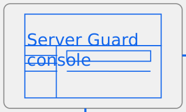

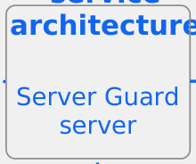

**architecture**

Instruction

Data

dispatch

collection

Security

Disk

Asset

group

snapshot

information

Risk

Security

management

management

SLB

DNAT

EIP

Cloud-native environment

Data

Instruction

collection

dispatch

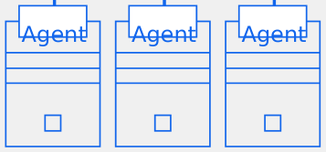

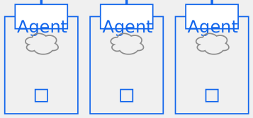

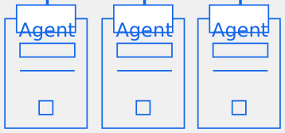

NC

NC

NC

ECS

ECS

ECS

Off-

Off-

Off-

cloud

cloud

cloud

Classic

VPC

Off-cloud

host

host

host

t

k

i

Server Guard uses a browser/server (B/S) architecture for user interaction and supports access to the Server Guard console over HTTPS. You can access the console using a mainstream browser to query cloud environment risk data in real time, configure security policies for your environment, and handle security risks.

**Deployment**

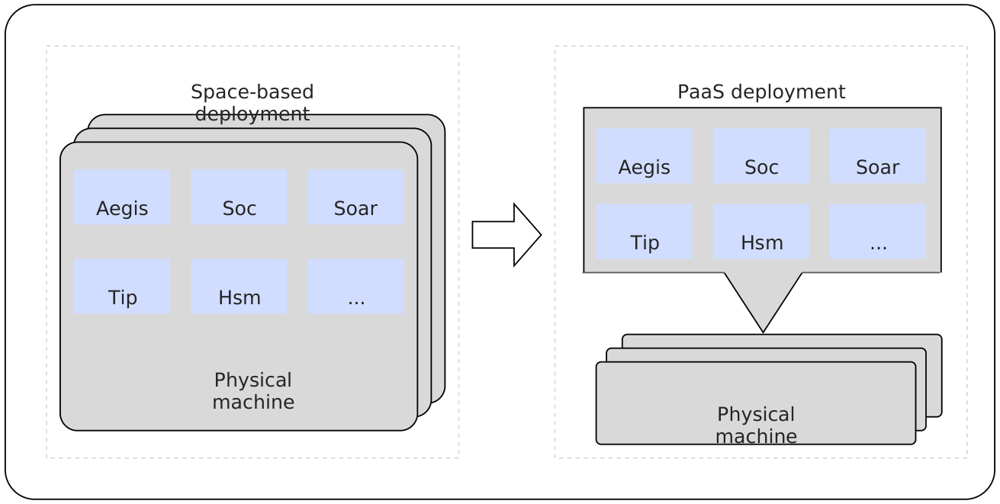

In version 3.18.2, Server Guard updated its use of base resources. It upgraded from a deployment on Alibaba Cloud Security dedicated physical machines on the Apsara Stack platform to a Platform as a Service (PaaS) deployment that shares a physical machine resource pool with all cloud products. The following diagram shows the architecture upgrade.

The Server Guard server consists of basic services, business services, and security services. The basic services, business services, and some security services are deployed in a shared physical machine resource pool on the PaaS platform. All related services require 140 CPU cores and 304 GB of memory for a minimum deployment of two replicas. The server provides features directly to security operations administrators, such as Security Overview, asset management, security prevention, intrusion prevention, and log retrieval. These features support administrators in the daily security management of cloud servers.

The Dipper data analytics engine is a basic component of Server Guard. It is used for real-time analysis and processing of big data, including threat association analysis for operating systems, applications, and networks. This supports Server Guard's threat and Advanced Persistent Threat (APT) detection.

Server Guard uses cloud-native components provided by the PaaS platform for data storage and middleware. This provides a shared resource pool, high stability, and disaster recovery capabilities.

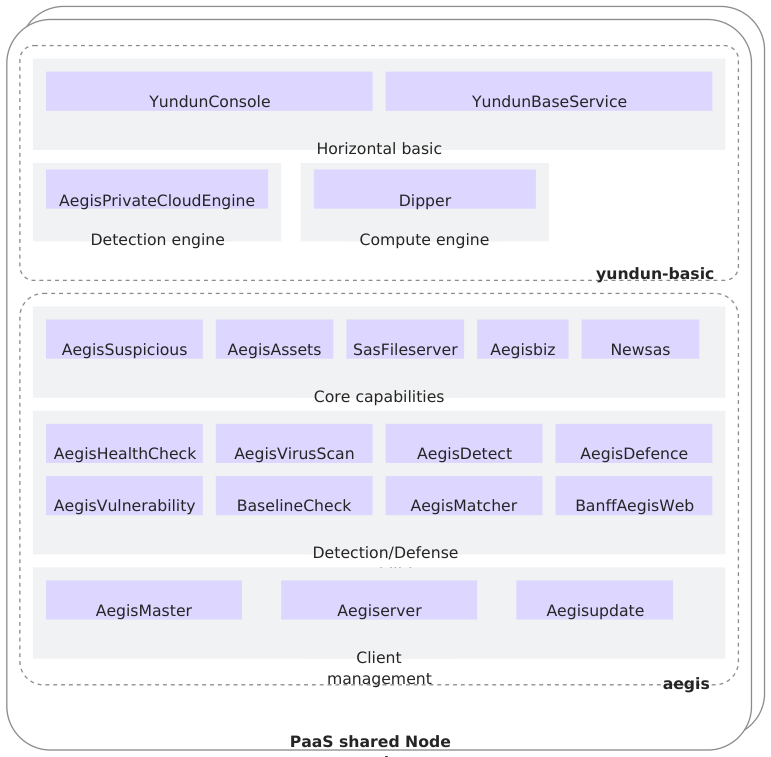

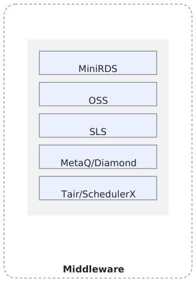

**Server**

**pool**

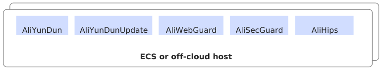

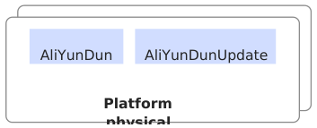

**Client**

**physical**

The server consists of the following main modules:

- Basic capabilities: Provides common Alibaba Cloud Security capabilities, a console, and an OpenAPI.

- Agent management: Manages agent connections, configurations, rules, and patch packages.

- Core capabilities: Includes asset management, alerts, log management, file collection, and security reports.

- Detection and defense: Provides detection and defense for vulnerabilities, baselines, files, networks, and processes.

- Detection engines: Includes commercial virus detection engines, Alibaba's self-developed virus detection engine, and a big data compute engine.

> **Note**
>
> Server Guard uses a typical client/server (C/S) architecture, which includes a server and a client. The server is responsible for core capabilities such as asset management, detection, and defense. The client monitors host status, executes detection scripts, and provides defense in real time.

**Feature architecture**

Server Guard's security capabilities primarily protect tenant-side, platform-side, and server assets in the cloud environment, along with hosts in off-cloud Internet Data Centers (IDCs) or in other cloud environments. The features can be divided into three main areas: cloud asset management, asset vulnerability remediation, and threat and intrusion prevention.

**Server Guard feature**

**architecture**

**Security**

**Overview**

Security Overview

View asset threat

statistics

**Asset Center**

management

Fingerprints

View asset security

status

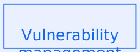

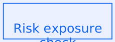

**Security**

**prevention**

management

check

Detect/remediate

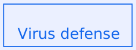

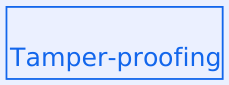

asset vulnerabilities

**Intrusion**

**prevention**

events

Detect/handle threat

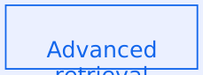

events

**Log retrieval**

retrieval

Query logs using

regex/command line

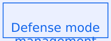

**Host Settings**

installation

management

Client installation and performance

configuration

- Vulnerability management: The agent identifies vulnerabilities by collecting information about cloud server components, software versions, files, and the registry. You can trigger vulnerability remediation from the console or by calling the OpenAPI. Windows patches are stored on the server. Linux uses custom yum sources.

- Baseline check: The server sends baseline check requests to the agent based on policies. The agent collects host information according to the detection policies and compares it with security baselines to identify risks.

- Risk exposure: Associates network information, such as SLB, DNAT, EIP, and security groups, with assets and applications to identify the assets and applications that provide external services in the cloud environment.

- Virus defense: Supports virus detection capabilities for binary features and behaviors, webshells, scripts, and ransomware trapping.

- Tamper-proofing: Supports a dual mode of backup and restore plus driver-level interception (supported by some operating systems). It provides tamper-proofing for the file protection directories and file types that you configure.

- Intrusion events: Displays all risks and their details that occur in the current user's cloud environment in real time. It also provides features for handling risks and adding them to a whitelist.

**Disaster recovery architecture**

The high availability (HA) of the Server Guard server depends on the HA of Application Load Balancer (ALB) and the Apsara Stack platform middleware.

Physical machines (NCs) in the Alibaba Cloud Security basic modules form a Yundun-BasicThin cluster. All Server Guard services run on each NC.

The Server Guard server services that communicate with the client are load-balanced by ALB.

Services that use storage or middleware rely on the high availability provided by the Apsara Stack platform to synchronize data or messages.

Server Guard high availability

architecture

**AZone-A**

**AZone-B**

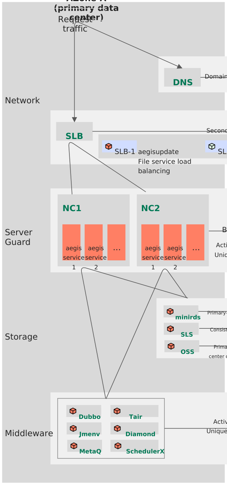

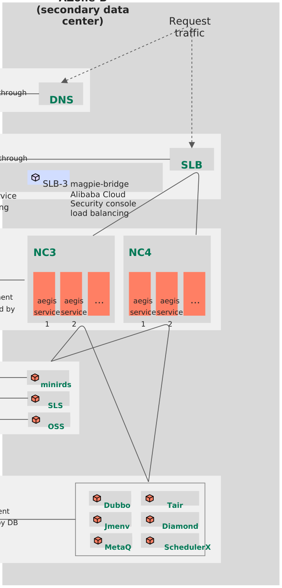

Domain name resolution through

Anycast VIP

Second-level switchover through

BGP route, same VIP

SLB-2

aegiserver Message service load balancing

BasicThinCluster

Active-active deployment

Uniqueness maintained by

DB or middleware

Primary-secondary DB binlog

replication

Consistency maintained by

OSS backup

Primary-secondary data

center data synchronization

(DSS)

Active-active deployment

Uniqueness maintained by DB

# 3.Features

This topic describes the features supported by Server Guard and their descriptions.

**Primary**

**Secondary**

**Feature Description**

**Feature**

**Feature**

Securely manage ECS server assets in Apsara Stack. Perform batch asset security checks and data exporting. Export up to

ECS

50 asset vulnerability and risk baseline data entries at once.

Management

Export up to 15 full baseline data entries at once. Export client logs for a single server only.

Off-cloud Host

Include off-cloud physical machines in Apsara Stack under

Management

Server Guard management.

Host List

Underlying Physical

View the security status of underlying physical machines within

Machine

Apsara Stack.

Management

BMS/BMCP Asset

Include BMS/BMCP intelligent computing high-performance

Management

bare metal assets under Server Guard management.

Security

Display information on assets, vulnerabilities, anomalies,

Overview

configuration defects, and events that require attention.

Security Overview

Security

Provide situational dashboards, such as asset security status

Dashboard

and attack region maps.

Middleware name, type, version, PID, installation path, last scan time, version validation information, parent process PID,

Middleware

running user, process listening IP, process listening port,

Fingerprint

listening status, listening port protocol, process start time, process command line, container name, image name, configuration file path, and web directory.

Startup Item

Startup item name, command line, task path/MD5, and last

Fingerprint

collection time.

Top Fingerprint

Top 5 rankings for fingerprints such as port, software, process,

Rankings

account, scheduled task, middleware, and startup item.

Port, network protocol, corresponding process, IP address, and

Port Fingerprint

last collection time.

Host Fingerprint

Scheduled Task

Task path, execution command, task epoch, account name,

Fingerprint

and last collection time.

Account name, logon permissions, root permissions, user group, Expired At, last logon time, latest collection time, and other information.

Account Fingerprint

Account name, logon permission, root permissions, user group, Expired At, last logon time, and last collection time. Display account fingerprint change records.

Software

Software asset name, software version, software installation

Fingerprint

directory, and last collection time.

Process name, process path, startup parameters, start time,

Process

running user, running permission, PID, parent process, and last

Fingerprint

collection time.

> **Note**
>
> Purchase Alibaba Cloud Threat Intelligence.

Server Guard effectively detects potential threats in assets. Threat intelligence correlates, analyzes, and processes threat information. It alerts you promptly when threats are detected, improving threat detection efficiency and response speed.

Threat

Supported intelligence types:

Intelligence

- malicious domain names

Detection

- malicious IP

- dark web communication IP

- command and control communication IP

- Miner Pool communication IP

- malicious URL

- Malicious download source

Intrusion Events

Server Guard's threat detection module includes over 350 threat detection models. These models cover more than 95% of intrusion events in the cloud. They classify events by operating system, analysis object, and attack method, helping you quickly understand cloud intrusion events.

Supported alert types:

- abnormal process behavior

- abnormal logon

- anomaly

Threat Model

- sensitive file tampering

Detection

- suspicious network connection

- abnormal account

- application intrusion event

- persistent backdoor

- application threat detection

- web shell

- malicious process (cloud anti-virus scanning)

- malicious script

Custom Security

Customize common logon locations, logon IP, logon time, logon

Rules

accounts, and web directories.

- Supported mainstream Linux operating systems include the following: CentOS 5/6/7, Red Hat 5-9, Debian 6-10, Ubuntu 12.04/14.04/16.04/18.04/20.04/22.04, Oracle Linux 5/6/7/8,

Linux Software

Amazon Linux AMI, Amazon Linux 2, SLES 10 SP4, SLES 11

Vulnerability

SP1/SP2/SP3/SP4, and SLES 12/12 SP1/SP2/SP3/SP4/SP5.

- Supported domestic operating systems include the following: UnionTech OS V20, Kylin V10, and Anolis OS 7/8.

Supported systems include the following: 74CMS, DedeCMS,

Web-CMS

Discuz, ECShop, FCKEditor, Joomla, PHPCMS, phpMyAdmin,

Vulnerability

phpwind, ThinkPHP5, and WordPress.

Vulnerability

Windows

Windows system vulnerability detection synchronizes with

Management

System

Microsoft's official patch source. It detects and alerts you to

Vulnerability

important and impactful vulnerabilities.

Application Vulnerabilities

Detect weak passwords for system services, and vulnerabilities

(including

in system and application services.

emergency)

- Active defense supports process behavior blocking, process chain defense, process binary detection, and script execution detection. It blocks ransomware, mining programs, Trojan programs, worms, malicious programs, back doors, DDoS Trojans, self-mutating Trojans, infectious viruses, hacking tools, vulnerability exploits, compromised basic software, Rootkits, and malicious scripts.

- Ransomware protection monitors ransomware honeypots

Real-time

and data restoration risks. It helps you block ransomware

Protection (x86

execution, identify assets with poor backup habits, and

Client)

reduce data restoration risks.

Anti-virus

- Web shell protection in Server Guard automatically blocks

Scanning

suspicious connections made by hackers through known web shells. It isolates related files and effectively cleans and isolates web shells such as PHP, ASP, and JSP.

Provide anti-virus scanning and web shell detection and

Anti-virus

remediation. Automatically isolate and eliminate mainstream

Scanning

Trojan viruses, ransomware, mining viruses, and DDoS Trojans upon detection.

Perform high-risk exploit baseline checks for applications with unauthorized access risks. These include the following: CouchDB, Docker, Elasticsearch, Hadoop, Jenkins, Memcached,

Unauthorized

Apache, Tomcat, and ZooKeeper.

Access Baseline

Detect risky accounts such as weak password accounts, suspicious hidden accounts, cloned accounts, and accounts with empty passwords. Also detect password policy compliance

Weak Password

issues in Linux servers. These include the following:

Baseline

MongoDB, SQL Server, MySQL, PostgreSQL, Redis, Rsync, SVN, Linux logon, Windows logon, Apache Tomcat console logon, and weak password FTP logon.

Perform best practices baseline checks on Elastic Compute Service (ECS) instances. Identify configuration weaknesses in operating systems and application software. These include the following:

Memcached, MongoDB, MySQL, Oracle 11g, Redis, SQL Server,

Best Security

Apache, Nginx, WebSphere Application Server, WebLogic

Practices

Server 12c, Alibaba Cloud Linux/Aliyun Linux 2, Debian Linux 8,

Baseline

CentOS Linux 6/7/8, Red Hat Linux 6/7, Ubuntu 14/16/18, Windows 2008 R2/2012 R2/2016/2019 R2, IIS 8, UnionTech OS 20 (64-bit), UnionTech OS 20 SP1 (64-bit), UnionTech OS Server 20 (64-bit), Kylin V4 (64-bit), Kylin V10 (64-bit), Kylin V10 SP1 (64-bit), and NeoKylin V7 (64-bit).

Baseline Check

- CIS standard supported scope includes:

  Alibaba Cloud Linux, Aliyun Linux 2, CentOS Linux 6/7/8, Debian Linux 8, Ubuntu 14/16/18, and Windows Server 2008 R2/2012 R2/2016 R2/2019 R2.

- Multi-Level Protection Scheme (MLPS) Level 2 supported scope includes: Alibaba Cloud Linux/Aliyun Linux, CentOS Linux 6/7/8, Red Hat Linux 7, Ubuntu 14/16/18, and Windows

Classified

2008 R2/2012 R2/2016/2019 R2.

Protection

- Multi-Level Protection Scheme (MLPS) Level 3 supported

Compliance

scope includes: Alibaba Cloud Linux/Aliyun Linux 2, BC Linux

Baseline

6/7, CentOS Linux 6/7/8, Debian Linux 8, Red Hat Linux 6/7, SUSE 10/11/12, Ubuntu 14/16/18, Windows 2008 R2/2012 R2/2016/2019 R2, UnionTech OS 20 (64-bit), UnionTech OS 20 SP1 (64-bit), UnionTech OS Server 20 (64-bit), Kylin V4 (64-bit), Kylin V10 (64-bit), Kylin V10 SP1 (64-bit), and NeoKylin V7 (64-bit).

Customize and deliver checks for some detection parameters in CentOS Linux 7/8 custom baselines, CentOS Linux 6 custom

Custom Baseline

baselines, Windows custom baselines, and Ubuntu custom security baselines.

Perform high-risk exploit baseline checks for applications with

High-Risk Exploit

unauthorized access risks. These include the following:

Baseline

CouchDB, Docker, Elasticsearch, Hadoop, Jenkins, Memcached, Apache, Tomcat, and ZooKeeper.

Inventory asset exposure by application dimension. It provides

Application

information such as exposed middleware name, type, version,

Exposure

associated vulnerabilities, affected assets, and last scan time.

Inventory asset exposure by host dimension. It provides information such as assets, exposure methods, exposed

Asset Exposure

components, exposed ports, exploitable vulnerabilities, exposure link topology, and exposure risk details.

Risk Exposure Check

<table>
  <tr>
    <td rowspan="3">Security Alert</td>
    <td>Threat Intelligence Detection</td>
    <td>Note Purchase Alibaba Cloud Threat Intelligence. Server Guard effectively detects potential threats in assets.Threat intelligence correlates, analyzes, and processes threat information. It alerts you promptly when threats are detected, improving threat detection efficiency and response speed. Supported intelligence types: • malicious domain names • malicious IP • dark web communication IP • command and control communication IP • Miner Pool communication IP • malicious URL • Malicious download source</td>
  </tr>
  <tr>
    <td>Threat Model Detection</td>
    <td>Server Guard's threat detection module includes over 350 threat detection models. These models cover more than 95% of intrusion events in the cloud. They classify events by operating system, analysis object, and attack method, helping you quickly understand cloud intrusion events. Supported alert types: • abnormal process behavior • abnormal logon • anomaly • sensitive file tampering • suspicious network connection • abnormal account • application intrusion event • persistent backdoor • application threat detection • web shell • malicious process (cloud anti-virus scanning) • malicious script</td>
  </tr>
  <tr>
    <td>Custom Security Rules</td>
    <td>Customize common logon locations, logon IP, logon time, logon accounts, and web directories.</td>
  </tr>
  <tr>
    <td>Attack Analysis</td>
    <td>Attack Analysis</td>
    <td>Show attack statistics and details from the attacker’s perspective. Display the number of attacks, attack types, top five sources, and top five destinations for different time ranges.</td>
  </tr>
</table>

- Supported virus types for anti-virus scanning:

  Ransomware, mining programs, DDoS Trojans, Trojan programs, back doors, malicious programs, important programs, worms, suspicious programs, and self-mutating Trojans.

- Support immediate scanning.

Virus Scanning

Immediately issue scan tasks. Deliver policies by asset group.

- Support periodic scanning.

  Set scan epochs. Scan selected servers within specified asset groups.

- Support process behavior blocking, process chain defense, process binary detection, and script execution detection.

- Block ransomware, mining programs, Trojan programs, worms, malicious programs, back doors, DDoS Trojans, self-mutating Trojans, infectious viruses, hacking tools, vulnerability exploits, compromised basic software, and Rootkits.

- Detect scripting languages such as Bash, Python, Perl, PowerShell, VBS, BAT, JScript, CSharp, C, and Lua.

- Detect batch worm mining scripts.

Precise Defense

- Detect exploit scripts automatically generated by open source weaponization frameworks (such as Cobalt Strike, Empire, Metasploit, and Nishang).

Virus Defense

> **Note**
>
> - The kernel version must support enabling relevant plug-ins.
>
> - ARM is not supported.

Ransomware protection monitors ransomware honeypots and data restoration risks. It helps you block ransomware execution, identify assets with poor backup habits, and reduce data restoration risks.

Ransomware Protection

> **Note**
>
> Only Windows is supported.

Detect web shells. Automatically block suspicious connections made by hackers through known web shells. Isolate related

Web Shell

files and effectively clean and isolate web shells such as PHP,

Detection

PHT, JSP, JSPX, ASP, ASA, CER, CDX, HTR, HDX, ASMX, ASHX, ASAX, ASPX, ASCX, and CS.

Provide tamper-proofing for web directories on servers through policy configuration.

Protection

File types protected from tampering include the following: PHP,

Management

JSP, ASP, ASPX, JS, CGI, HTML, HTM, XML, SHTML, SHTM, JPG, GIF, and PNG.

Backup and

Provide backup within seconds and revert protection for file

Revert Mode

tampering in protected directories.

- Provide real-time block protection for file tampering in protected directories.

- Generate alerts for file tampering in protected directories without blocking the action.

- Add specified processes to the modification whitelist.

Driver Protection Mode

> **Note**
>
> - The kernel version must support enabling relevant plug-ins.

Tamper-

> - ARM is not supported.

proofing

All unexcluded subdirectories, file types, and specified files enter protection status.

> **Note**
>
> - The kernel version must support enabling relevant plug-ins.

Whitelist Mode

> - ARM is not supported.

All unexcluded subdirectories, file types, and specified files enter protection status. It supports observation, alerting, and

Blacklist Mode

block modes. Excludable file types include the following: Log, TXT, and LDB.

Add servers requiring key defense to policies. Distinguish trusted, suspicious, and malicious programs by detecting specified applications in the whitelist. Prevent unauthorized

Policy

programs from running.

Management

Application Whitelist

Collection/Learni

Form a whitelist of trusted processes based on periodic

ng Task

collection and learning from selected assets.

Custom Process

Manually edit process groups. Use them as part of a policy to

Group

provide a basis for the whitelist.

Real-time monitoring of core file access on servers. Real-time monitoring and alerting for operations such as file access, modification, deletion, renaming, and permission changes. Monitor whether core files are stolen or tampered with.

Core File

/

> **Note**

Monitoring

> - The kernel version must support enabling relevant plug-ins.
>
> - ARM is not supported.

- Support system defense rules and custom defense rules.

- Fine-grained management of HIPS precise defense rule content and asset scope.

- Set custom rules. These include process HASH, command line, process network, file read/write, registry operations, dynamic-link library loading, file renaming, DNS, IP, and file

Malicious

path.

Behavior Defense

> **Note**
>
> - The kernel version must support enabling relevant plug-ins.
>
> - ARM is not supported.

- Set matching rules to monitor command line content on

Important

Host Rule

hosts in real time. If an important command is hit, generate

Command

Management

a real-time alert notification.

Auditing

- Generate different alert levels for different matching rules.

- Set brute-force attack block policies and their effective asset scope. Automatically generate corresponding block rules for IPs that trigger brute-force alerts and hit policies. Prohibit these IPs from logging on to servers for a custom time period.

- Set custom rules to configure network access block rules for

Brute-force

any IP and port.

Attacks Protection

> **Note**
>
> - The kernel version must support enabling relevant plug-ins.
>
> - ARM is not supported.

Prioritize business operations. The client uses minimal memory

Basic Defense

and CPU for protection. Peak CPU usage is less than 10% of a

Mode

single core, and peak memory usage is less than 200 MB.

Prioritize balanced protection. The client uses balanced

Advanced

memory and CPU for protection. Peak CPU usage is less than

Defense Mode

30% of a single core, and peak memory usage is less than 300 MB.

Prioritize security protection. The client uses relatively high

Major Event

system memory and CPU for protection. Customize the

Support Mode

effective asset scope, CPU usage peak threshold (5%-60%), and memory usage peak (less than 500 MB).

Protect Server Guard client processes and file directories through underlying drivers. This prevents hackers from compromising the agent after an intrusion.

Defense Mode

> **Note**

Self-protection

> - The kernel version must support enabling relevant plug-ins.
>
> - ARM is not supported.

Prioritize business operations. The client uses minimal memory

Business First

and CPU for protection. Peak CPU usage is less than 10%, and

Mode

peak memory usage is less than 50 MB.

Prioritize security protection. The client uses relatively high

Security First

system memory and CPU for protection. Peak CPU usage is

Mode

less than 20%, and peak memory usage is less than 80 MB.

Enable major event support mode. Server Guard will use

Major Event

intelligent rules to increase the sensitivity of the alert detection

Support Mode

engine. Customize the asset scope and CPU threshold.

Query logs for logon flow, brute-force attacks, process

Quick Retrieval

snapshots, network connectivity, port listening snapshots, account snapshots, and process startups.

Log Retrieval

Provide command line query for Simple Log Service (SLS) logs.

Advanced

> **Note**

Retrieval

> Enable SLS first.

Multi-level

Enable multi-level organization mode. The smallest isolation

Organization

granularity for database permission is a resource set.

Other Capabilities

Manage grayscale upgrade policies for asset clients through a

Grayscale

visual interface.

Upgrade

Grayscale management dimensions include tenant ID, asset ID,

Management

kernel version, CPU architecture, and time interval.

# 4.Features

## 4.1. Security overview

The Security Overview page is the security operations hub for Server Guard. It displays real-time statistics and security trends for all assets in your account to facilitate centralized management. The page displays the following information:

- The distribution of operating systems on your assets and the status of the Server Guard client.

- Threat trends for vulnerabilities, baselines, viruses, trojans, and intrusion events.

- Alerts for threat events.

## 4.2. Assets

**Server list**

The host list displays the security status of all hosts for the current account. It categorizes assets into groups, such as all hosts, at-risk hosts, unprotected hosts, inactive hosts, and new hosts. You can also manage asset relationships, such as host groups, providers, and VPCs.

You can perform batch security checks on assets, export data, and detach external hosts. You can export vulnerability and baseline risk data for up to 50 hosts at a time. You can export full baseline data for up to 15 hosts at a time. Client logs can only be exported for one host at a time.

If the current logon account belongs to a tenant, Server Guard displays the Elastic Compute Service (ECS) instances and servers that are not deployed in Alibaba Cloud of the tenant. If the current logon account is used to deploy Server Guard, Server Guard displays platform-side physical machines.

The host list includes the following asset information: Host Name, Public IP, Private IP, Custom Tags, VPC, Operating System, Snapshot Recovery Risk, Host Status, Client Status, Internet Exposure, Vulnerability Risk, Baseline Risk, Intrusion Alert, and Host Risk Status.

**Server details**

The details page of a server displays basic information, security policies, and risk information. Security policy settings include the approved logon time range and logon locations of the server. You can modify the settings on the details page. Risk information includes asset vulnerability information, alert handling details, baseline risks, Internet exposure, and asset fingerprints. If the server is not deployed in Alibaba Cloud, the basic information includes the server provider.

| Details | Content |
| --- | --- |
| Basic information | ECS information, hardware information, operating system information, disk snapshot information, vulnerability detection settings, and secure logon settings. |
| Vulnerabilities | Linux software vulnerabilities, Windows system vulnerabilities, Web-CMS vulnerabilities, application vulnerabilities, and emergency vulnerabilities. |
| Baseline checks | Weak passwords, high-risk exploits, container security, best security practices, and classified protection compliance. |
| Alerts | Anomalous process behavior, web shells, unusual logons, anomalous activities, sensitive file tampering, malicious processes (cloud threat detection), suspicious network connections, abnormal accounts, application intrusion events, precision defense, application whitelists, persistence back doors, application threat detection, malicious scripts, and threat intelligence. |
| Internet exposure | Middleware name/version/port/PID, middleware vulnerability information, vulnerability threat level, and associated SLB/EIP/DNAT/security groups. |
| Asset fingerprint investigation | Port, software, process, account, scheduled task, middleware, and startup item. |

**Server fingerprints**

Server Guard displays the statistics about operating systems of servers in the cloud and software assets. This helps you understand the distribution of different types of fingerprints in servers. If emergency response events occur, you can quickly identify the affected assets based on fingerprints. This improves operations efficiency.

| Host fingerprint items | Displayed information |
| --- | --- |
| Overview | Top 5 open ports, Top 5 software assets, Top 5 processes, Top 5 identical accounts, Top 5 middleware, Top 5 startup items, and latest accounts. |
| Port Fingerprint | Port, network protocol, corresponding process, IP address, and latest collection time. |
| Software fingerprint | Software asset name, software version, software installation directory, and latest collection time. |
| Process fingerprint | Process name, process path, startup parameter, startup time, running user, running permission, PID, parent process, and latest collection time. |
| Account fingerprint | Account name, logon permissions, root permission, user group, expiration time, last logon time, and latest collection time. |
| Scheduled task | Task path, execution command, task epoch, account name, and latest collection time. |
| Middleware | Middleware name, type, version, PID, installation path, latest scan time, version verification information, parent process PID, running user, process listener IP, process listener port, listener status, listener port protocol, process startup time, process command line, container name, image name, configuration file path, and web directory. |
| Startup item | Startup item name, command line, task path/MD5, and latest collection time. |

## 4.3. Risk prevention

**Vulnerability management**

Server Guard can detect common types of vulnerabilities to help you understand the vulnerabilities and risks in your assets. The following types of vulnerabilities are supported: Linux software vulnerabilities, Windows system vulnerabilities, Web-CMS vulnerabilities, application vulnerabilities, and urgent vulnerabilities. Server Guard provides solutions to fix the detected vulnerabilities. You can verify vulnerability fixes, view the details of vulnerabilities, and scan for vulnerabilities with a few clicks.

**Detection and fixing of Linux software vulnerabilities**

Server Guard checks the software version on your Elastic Compute Service (ECS) instances, compares the version information with the vulnerabilities that are recorded in the Common Vulnerabilities and Exposures (CVE) database to detect software that contains vulnerabilities, such as SSH, OpenSSL, and MySQL, and then reports the information about the vulnerabilities. Server Guard also provides suggestions to fix the vulnerabilities.

**Linux software vulnerabilities**

- CentOS 5/6/7, Red Hat 5/6/7.

- Debian 3.0/3.1/4/5/6/7/8/9/10/11/SID.

- Ubuntu precise (12.04), trusty (14.04), xenial (16.04), bionic (18.04).

- Oracle Linux 5/6/7/8.

- Amazon Linux AMI, Amazon Linux 2.

- SLES 10 SP4, SLES 11 SP1/SP2/SP3/SP4, SLES 12/12 SP1/SP2/SP3/SP4/SP5, SLES 15.

**Detection and fixing of Windows system vulnerabilities**

Server Guard subscribes to the official Microsoft update source to detect unpatched, high-risk vulnerabilities in your ECS instances. It then pushes official Microsoft patches to fix them.

> **Note**
>
> Push and offline updates are supported. By default, the system pushes patches only for high-risk vulnerabilities. Security updates and patches for low-risk vulnerabilities require manual updates.

Windows vulnerabilities: Windows Server 2008, Windows Server 2012, Windows Server 2016, Windows Server 2019.

**Detection and fixing of Web-CMS vulnerabilities**

Server Guard detects Web-CMS vulnerabilities based on the security intelligence of Alibaba Cloud by scanning directories and files. Server Guard also provides patches developed by Apsara Stack Security to fix vulnerabilities and lets you undo vulnerability fixes.

Web-CMS vulnerabilities: 74CMS, DedeCMS, Discuz, ECShop, FCKEditor, Joomla, PHPCMS, phpMyAdmin, phpwind, ThinkPHP5, WordPress.

**Application vulnerability detection and fixing**

Server Guard checks the middleware version on your ECS instances, compares the version information with the vulnerability library disclosed by the middleware service to detect middleware that contains vulnerabilities, and then reports the information about the vulnerabilities. Server Guard also provides suggestions to fix the vulnerabilities.

- Weak passwords in system services: OpenSSH, MySQL, MSSQL, MongoDB, FTP, VSFTP, ProFTPD, Memcache, Redis, Subversion, SMB, SMTP, POP3, IMAP.

- Vulnerabilities in system services: OpenSSL, SMB, RSYNC, VNC, pcAnywhere, Redis.

- Vulnerabilities in application services:

  - Tomcat, Apache Struts 2, ActiveMQ, Confluence, CouchDB Query Server, Discuz!.

  - Docker, Drupal Drupalgeddon 2, ECShop, Elasticsearch, Weaver OA, Hadoop.

  - JavaServer Faces 2, JBoss, Jenkins, Kubernetes, MetInfo, PHP, OpenSSL.

  - phpMyAdmin, Actuator unauth RCE, ThinkPHP, WebLogic, WordPress, Zabbix.

**Urgent vulnerability detection**

This feature covers high-risk emergency vulnerabilities that have recently emerged on the internet. You can apply updates using offline upgrade packages. The scope of emergency vulnerability detection includes only vulnerabilities for which Microsoft has disclosed information but has not yet released a patch. This scope is adjusted in real time based on information released by Microsoft and is updated frequently. Therefore, the supported scope is not listed in this document. For specific support details, visit the official Alibaba Cloud website and search for emergency vulnerabilities.

**Baseline check**

Server Guard provides default baseline check items. You can perform baseline checks on servers to identify risks and weaknesses that exist in the baseline configurations and applications of the servers. If risks and weaknesses are detected, Server Guard generates alerts and provides suggestions to fix the risks.

**Weak password detection**

This feature detects at-risk accounts, such as accounts with weak passwords, suspicious hidden accounts, cloned accounts, and accounts with empty passwords. It also checks for password policy compliance issues on Linux servers. Examples of checks include weak passwords for MongoDB, SQL Server, MySQL, PostgreSQL, Redis, Rsync, SVN, Linux system logon, Windows system logon, Apache Tomcat console logon, and FTP logon.

**High-risk exploitation baseline**

This feature performs high-risk exploit baseline checks for applications that have unauthorized access risks, such as CouchDB, Docker, Elasticsearch, Hadoop, Jenkins, Memcached, Apache, Tomcat, and ZooKeeper.

**Baseline check in compliance with best practices**

Server Guard lets you check the configurations of servers based on the best practices to detect configuration risks in operating systems and applications.

- Memcached, MongoDB, MySQL, Oracle 11g, Redis, SQL server.

- Apache, Nginx, WebSphere Application Server, WebLogic Server 12c.

- Alibaba Cloud Linux/Aliyun Linux 2.

- Debian Linux 8.

- CentOS Linux 6/7/8.

- Redhat Linux 6/7.

- Ubuntu 14/16/18.

- Windows 2008 R2/2012 R2/2016/2019 R2, IIS 8.

- UnionTech OS (UOS) 20 (64-bit), UnionTech OS (UOS) 20 SP1 (64-bit), UnionTech OS (UOS) Server 20 (64-bit).

- Kylin V4 (64-bit), Kylin V10 (64-bit), Kylin V10 SP1 (64-bit), NeoKylin V7 (64-bit).

**Baseline check for classified protection**

Server Guard lets you perform security checks on servers based on Multi-Level Protection Scheme (MLPS) level 3, MLPS level 2, and Center for Internet Security (CIS) standards.

| MLPS compliance baseline standard | Check item |
| --- | --- |
| CIS standards | • Alibaba Cloud Linux, Aliyun Linux 2. • CentOS Linux 6/7/8. • Debian Linux 8. • Ubuntu 14/16/18. • Windows Server 2008 R2/2012 R2/2016 R2/2019 R2. |
| MLPS level 2 | • Alibaba Cloud Linux/Aliyun Linux. • CentOS Linux 6/7/8. • Redhat Linux 7. • Ubuntu 14/16/18. • Windows 2008 R2/2012 R2/2016/2019 R2. |
| MLPS level 3 | • Alibaba Cloud Linux/Aliyun Linux 2. • BCLinux 6/7. • CentOS Linux 6/7/8. • Debian Linux 8. • Redhat Linux 6/7. • SUSE 10/11/12. • Ubuntu 14/16/18. • Windows 2008 R2/ 2012 R2/2016/2019 R2. • UnionTech OS (UOS) 20 (64-bit), UnionTech OS (UOS) 20 SP1 (64-bit), UnionTech OS (UOS) Server 20 (64-bit). • Kylin V4 (64-bit), Kylin V10 (64-bit), Kylin V10 SP1 (64-bit), NeoKylin V7 (64-bit). |

**Unauthorized access baseline**

This feature performs high-risk exploit baseline checks for applications with unauthorized access risks. These applications include CouchDB, Docker, Elasticsearch, Hadoop, Jenkins, Memcached, Apache, Tomcat, and ZooKeeper.

**Custom baseline**

This feature lets you customize and apply detection parameters for custom baseline checks on CentOS Linux 7/8, CentOS Linux 6, Windows, and Ubuntu.

**Risk exposure check**

Server Guard automatically analyzes the exposure of ECS instances. Server Guard displays the communication links between ECS instances and applications outside the cloud, including Server Load Balancer (SLB) instances, DNAT rules, elastic IP addresses (EIPs), and security groups, and displays exploitable vulnerabilities, weak passwords, and intrusions on assets or applications. This helps you conduct a comprehensive assessment of asset exposure.

The risk exposure check feature resolves the issue of managing complex assets in cloud environments and the discontinuity in tracing exploitable vulnerabilities. The risk exposure check feature can effectively analyze cloud asset exposure and handle vulnerabilities and potential risks. This facilitates continuous monitoring of asset security and vulnerability management.

| Exposure check item | Description |
| --- | --- |
| Host exposure details | Exposure method, exposed component, exposed port, exploitable vulnerability, weak password, security alert, server exposure link topology graph. |
| Application exposure details | Exposed middleware name, type, version, exposure method, associated vulnerability, affected asset, latest scan time. |

> **Warning**
>
> The risk exposure check requires extensive data management of assets, applications, and risks. It relies on the Dipper engine. You cannot use this feature if your environment does not have this engine.

## 4.4. Intrusion prevention

**Antivirus**

**Virus detection and removal**

The security experts of Alibaba Cloud conduct automated analysis on attack methods based on many persistent virus samples. Then, the security experts release an engine that can detect and remove viruses based on machine learning results. This engine enables Server Guard to detect and remove viruses on servers that you specify. If viruses are detected, you can remove, ignore, and handle the viruses, and add the viruses to the whitelist.

- **Supported virus types:** Ransomware, mining programs, DDoS Trojans, trojan programs, backdoor programs, malicious programs, high-risk programs, worms, suspicious programs, and self-mutating trojans.

- **Scan methods**

  - Immediate scan: Immediately starts a scan task. You can apply policies to specific asset groups.

  - Periodic scan: Configure a scan schedule to periodically scan selected servers in a specified asset group.

> **Warning**
>
> Risk exposure checks require extensive data management of assets, applications, and risks. This feature depends on the Dipper engine. You cannot use this feature if your environment does not have this engine.

**Real-time protection**

**Proactive defense**

Proactive defense can intercept risk-associated actions such as virus trojans, malicious programs, malicious network connections, and webshell connections in real time based on heuristic behavior rules.

The proactive defense feature supports single-step and multi-step defenses. The proactive defense feature can precisely generate alerts before your information systems are affected by intrusions. The feature builds an intelligent defense system that can identify threats to reduce intrusions into Elastic Compute Service (ECS) instances. The feature also supports interception at the driver level to eliminate latency in virus handling using Server Guard.

| Defense type | Description |
| --- | --- |
| Process behavior interception | Server Guard detects risks from various dimensions, such as server processes, network behavior, and command lines, based on the heuristic and regular rule library provided by the machine learning engine of Alibaba Cloud and then blocks risk behavior. |
| Process chain-based protection | Server Guard can identify risks by analyzing the process context and block common vulnerability exploits, such as conducting information reconnaissance by exploiting web vulnerabilities and downloading malicious code. |
| Process Binary Detection | Detects ransomware, mining programs, trojan programs, worms, malicious programs, back door programs, DDoS Trojans, self-mutating trojans, infectious viruses, hacking tools, vulnerability exploits, contaminated basic software, and Rootkits. |
| Script execution detection | • Server Guard can detect scripts in the following languages: Bash, Python, Perl, PowerShell, VBScript, Batch, JavaScript, C#, and C. • Supports detection of exploit scripts automatically generated by open-source weaponization frameworks, such as Cobalt Strike, Empire, Metasploit, and Nishang. • Server Guard can detect mining worms in large amounts. |

**Anti-ransomware**

The anti-ransomware feature can trap ransomware and monitor data restoration risks. It helps you block ransomware from running, identify assets with inadequate backup policies, and reduce the risk of data restoration failure after a ransomware attack.

- Ransomware trapping: Server Guard creates random bait files on the server. If a suspicious process attempts to modify a bait file, Server Guard immediately detects and blocks the ransomware behavior. The bait files are used only to capture new types of ransomware and do not affect your services.

  > **Note**
  >
  > This feature is effective only for Windows.

- Backup risk monitoring: Assets with inadequate backup habits face data restoration risks after a ransomware attack. This feature helps you quickly identify risks in asset backup policies and reminds you to fix them promptly.

**Webshell prevention**

Server Guard supports webshell protection. It automatically blocks suspicious connections that hackers make through known webshells and quarantines the related files. It effectively cleans and quarantines webshell backdoors of types such as PHP, ASP, and JSP.

The webshell detection capability of Server Guard is provided by the self-developed GLE engine. The GLE engine has been refined on the Alibaba Cloud public cloud for seven years. It integrates static matching detection, dynamic taint simulation execution with a universal abstract syntax tree (AST), and abnormal heuristic detection into a hybrid static-dynamic capability. This allows it to accurately analyze various types of webshells, such as large trojans, small trojans, and one-line trojans.

The GLE passed tests from more than 600 white-hat attackers in four seasons of the publicly held Zeus Crowdsourced Testing program. The GLE has achieved an impressive detection rate of more than 95% for sophisticated adversarial samples designed by elite white-hat attackers.

Server Guard supports scanning for webshells in automatically discovered or manually added web directories. It also supports full-disk scanning for webshells written to disk.

**Tamper proofing**

The tamper-proofing feature of Server Guard lets you configure policies to protect web directories on your servers from tampering. A policy includes key information such as protected file directories and protected file types. After a policy is enabled, the tamper-proofing feature uses an agent to monitor all processes that operate on files in the protected directories in real time. It identifies and blocks anomalous processes and file changes in real time. This protects website information on important systems from malicious tampering and prevents the insertion of content such as trojans, hidden links, terrorist threats, or pornography.

Tamper-proofing supports the configuration of trusted processes for service releases. Trusted processes can add, delete, and modify files in protected directories. Additionally, if a trusted process is modified, Server Guard immediately prohibits it from modifying the protected directory.

- **Whitelist mode**

  In whitelist mode, Server Guard adds common file types that require protection to the protection list by default. You can add more file types as needed to ensure your business systems run normally.

  | Parameter | Description |
  | --- | --- |
  | Protected Directory | The directory that you want to protect. The maximum size of a directory can be 20 GB. |
  | Protected File Formats | PHP, JSP, ASP, ASPX, JS, CGI, HTML, HTM, XML, SHTML, SHTM, JPG, GIF, and PNG. |
  | Prevention Mode | • Alert Mode: Server Guard identifies suspicious processes and abnormal file changes and generates alerts. Server Guard does not intercept the processes or changes. • Interception Mode: Server Guard intercepts suspicious processes and abnormal file changes. If you configure a whitelist and add a suspicious process to the whitelist, Server Guard does not intercept the process. |
  | Local Backup Directory | You can specify custom backup paths based on your business needs. |

- **Blacklist mode**

  In blacklist mode, all subdirectories, file types, and specified files that are not excluded are protected. You can configure these settings as needed to ensure your business systems run normally.

  | Parameter | Description |
  | --- | --- |
  | Protected Directory | The directory that you want to protect and subdirectory that do not require protection. The maximum size of the directory that you want to protect can be 20 GB. |
  | Excluded File Formats | Log, txt, and ldb. |
  | Exclude File Path | Supports excluding files using a relative path. |
  | Prevention Mode | • Alert Mode: Server Guard identifies suspicious processes and abnormal file changes and generates alerts. Server Guard does not intercept the processes or changes. • Interception Mode: Server Guard intercepts suspicious processes and abnormal file changes. If you configure a whitelist and add a suspicious process to the whitelist, Server Guard does not intercept the process. |
  | Local Backup Directory | You can customize backup paths based on your business needs. |

- **Protection management**

  You can configure policies to provide tamper-proofing for web directories on your servers. The file types that can be protected from tampering include PHP, JSP, ASP, ASPX, JS, CGI, HTML, HTM, XML, SHTML, SHTM, JPG, GIF, and PNG.

- **Backup and restoration mode** This mode provides second-level backup and restoration protection for file tampering activities in protected directories.

- **Driver protection mode**

  - This mode provides real-time interception and protection against file tampering in protected directories.

  - This mode generates alerts for file tampering in protected directories without blocking the action.

  - This mode adds specified processes to a modification whitelist.

  > **Note**
  >
  > The kernel version must support the related plugin. ARM architecture is not currently supported.

**Application whitelist**

You can use the application whitelist feature to add applications running on servers that require reinforced protection to an application whitelist based on intelligent learning results. Server Guard identifies applications as trusted, suspicious, or malicious based on the application whitelist to prevent unauthorized applications from running.

| Feature | Description |
| --- | --- |
| Collection Tasks | The task collects and learns the running environment of specific assets to generate a basic trusted environment template. |
| Custom Process Group | The custom trusted process group that you specify. When you create a policy, the trusted process group takes effect together with the collection task template to serve as the application whitelist. |
| Strategy Pattern | The policy mode. Valid values: Alert Mode and Observation Mode. |
| Base process allowlist | The default intelligence library provided by the system, which can be used to identify malicious processes. |
| Select an asset | The assets on which you want the policy to take effect. |

**Attack analysis**

The Attack Analysis page displays the attack trends in the last 7 days and 30 days, and the distribution of attack types from the perspectives of attackers and victims. Statistics on this page include the attack time, attack sources, attacked assets, event sources, number of attacks, and attack types.

**Intrusion alerting**

Server Guard supports real-time detection of security alert events on your assets. It covers security alert types such as web tamper-proofing, anomalous processes, webshells, suspicious logons, and malicious processes. Using detection modules such as the stream computing engine, GLE, and Hips, it provides comprehensive security alert detection. This lets you promptly discover security threats on your assets and understand their security status in real time.

An intrusion alert can be generated after Server Guard detects common threats or advanced persistent threats (APTs) on your server. The detected threats may be attacks that are launched using a malicious IP address or an intrusion into your server, such as malicious script execution on your server or access to malicious download sources.

**Threat model-based detection**

Leveraging the big data correlation analysis capabilities of the Dipper engine, Server Guard is equipped with more than 350 threat detection models that can be used to detect more than 95% of intrusion events in the cloud. The intrusion events are categorized by dimensions such as operating system, analysis object, and attack method. This helps you quickly understand intrusion events in the cloud.

- **Supported asset types:** ECS instances, physical servers in the classic network, hosts in off-cloud IDCs, and hosts on other clouds.

- **Supported alert types (dependent on Dipper):** Anomalous process behavior, suspicious logon, anomalous activity, sensitive file tampering, suspicious network connection, abnormal account, application intrusion event, persistence backdoor, and application threat detection.

- **Supported alert types:** Webshell, malicious process (cloud scan), and malicious script.

> **Warning**
>
> The computing capability of the Server Guard threat detection models depends on the Dipper engine. You cannot use this feature if your environment does not have this engine.

**Threat intelligence-based detection**

Server Guard can effectively identify potential threats in your assets based on Alibaba Cloud threat intelligence. Threat intelligence can correlate threat information to analyze and process the information. If threats are detected, threat intelligence can generate alerts. This helps improve the detection efficiency and response speed.

**Supported intelligence types:** Malicious domain names, malicious IP addresses, dark web communication IP addresses, command and control (C&C) communication IP addresses, miner pool communication IP addresses, malicious URLs, and malicious download sources.

> **Warning**
>
> - The Server Guard threat intelligence detection feature depends on the Dipper engine. You cannot use this feature if your environment does not have this engine.
>
> - If you want to use threat intelligence in the Server Guard console, you must separately purchase Alibaba Cloud threat intelligence.

**Custom security rules**

You can customize common logon locations, logon IP addresses, logon times, logon accounts, and web directories.

**Quarantine**

The Intrusion Events page has a quarantine feature. This feature stores virus files and webshell files discovered by Server Guard in a quarantine box. You can then choose further actions, such as cleaning or reverting, based on your business needs.

**Alert settings**

You can configure custom alert rules for intrusion events as needed. Alert rule settings include approved logon locations, approved logon IP addresses, approved logon time ranges, approved logon accounts, web directories, and whitelist rules.

## 4.5. Log search

**Quick search**

Allows you to query logs for logons, brute-force attacks, snapshots of processes, network connections, snapshots of listening ports, snapshots of accounts, and process startups. You can use prefixes to query logs in fuzzy match mode.

**Supported log types:**

- Logon logs: Successful system logons.

- Brute-force attack logs: Failed system logons.

- Process snapshots: Information about processes that are running on a host at a specific time.

- Listening port snapshots: Information about listening ports on a host at a specific time.

- Account snapshots: Information about logon accounts on a host at a specific time.

- Process startup logs: Information about process startups on a host.

- Network connection logs: Information about active outbound connections from a host.

**Advanced search**

You can use the search bar on the Log Analysis page of the Server Guard console to perform custom log query and analysis in multiple complex scenarios. Logs are categorized into host logs and security logs, which are divided into 10 subtypes. Server Guard provides near-real-time automatic log collection and storage. Server Guard also provides the log query, analysis, and shipping capabilities that are supported by Simple Log Service. After you select a specific log type, you can query and analyze the collected logs of this type in real time. You can also enable the log synchronization feature to synchronize logs of Server Guard to tenant-side Logstores of users.

> **Warning**
>
> To use the advanced search feature, follow the instructions on the Server Guard page.

## 4.6. Host settings

**Client installation**

**Clients to be installed**

On the \*\*Clients to be installed\*\* page, you can view the number of servers that do not have the client installed and a list of these servers. You can search by server operating system, region, or IP address/name to quickly find a specific server.

**Client installation guide**

The Server Guard client runs on Intel x86 and other mainstream platforms. It supports command line deployment for servers within Alibaba Cloud, and command line or image deployment for servers outside Alibaba Cloud. For clients outside Alibaba Cloud, you can associate them with an environment context, such as the provider, region, and availability zone (AZ).

On the \*\*Client installation guide\*\* page, you can customize the client installer for your cloud environment. You can configure settings such as the client runtime environment version, the installation method for clients outside Alibaba Cloud, the usage duration, and provider information. The page also provides the DNS resolution address required to deploy Server Guard after assets outside Alibaba Cloud are connected to the network. You can copy this address to the  `hosts`  file of your assets outside Alibaba Cloud or add it to your domain name resolution server.

Supported client runtime environments:

| Platform | Supported environments |
| --- | --- |
| x86_64 (Intel) Windows | Windows Server 2008–2019 |
| x86_32/64 (Intel) Linux | • CentOS: Versions 5, 6, and 7 (32/64-bit) • Ubuntu: 9.10–18.4 (32/64-bit) • Debian: Versions 6, 7, 8, and 9 (32/64-bit) • Red Hat Enterprise Linux (RHEL): Versions 5, 6, and 7 (32/64-bit) • Gentoo (32/64-bit) • openSUSE (32/64-bit) • SUSE (32/64-bit) • Alibaba Cloud Linux |
| x86_64 (Hygon) | • Kylin V10 (64-bit), Kylin V10 SP1 (64-bit) • UOS 20 (64-bit), UOS 20 SP1 (64-bit), UOS Server 20 (64-bit) |
| Arm (Phytium/Kunpeng) | • UOS 20 SP1 (64-bit), UOS Server 20 (64-bit) • Kylin V4 (64-bit), Kylin V10 (64-bit), Kylin V10 SP1 (64-bit) • NeoKylin V7 (64-bit) • AliOS 2 (64-bit), CentOS 7 (64-bit) |
| SW6B (Sunway) | • Deepin V15.4 (SW6B 64-bit) • AliOS V1 (SW6B 64-bit) |

**Defense mode management**

The Server Guard agent is a local plug-in. You must install the agent plug-in on the server's operating system to use the security protection services provided by Server Guard. The defense mode management feature provides multiple agent running modes to meet the security requirements of different scenarios.

**Business first mode**

This mode prioritizes business operations. It uses minimal memory and CPU resources for protection tasks to ensure that your business operations run smoothly. This mode is suitable for servers with high workloads that cannot be interrupted.

**Performance metrics**

Business first mode: Peak CPU usage is less than 10%. Peak memory usage is less than 50 MB.

**Protection first mode**

This mode prioritizes security protection. It uses more system memory and CPU resources for protection tasks. This allows for more timely virus scanning and threat alerts. This mode is suitable for servers that require a high level of security.

**Performance metrics**

Protection first mode: Peak CPU usage is less than 20%. Peak memory usage is less than 80 MB.

**Major event support mode**

The major event support mode is designed to ensure security during major events. When this mode is enabled, Server Guard uses intelligent rules to increase the sensitivity of the alert detection engine. It generates alerts for any suspicious intrusions and potential threats. This helps you accurately detect and block attacks and threats.

**Basic protection mode**

This mode prioritizes business operations. The client uses minimal memory and CPU resources for protection tasks.

**Performance metrics**

Basic protection mode: Peak CPU usage is less than 10% of a single core. Peak memory usage is less than 200 MB.

**Advanced protection mode**

This mode prioritizes balanced protection. The client uses a balanced amount of memory and CPU resources for protection tasks.

**Performance metrics**

Advanced protection mode: Peak CPU usage is less than 30% of a single core. Peak memory usage is less than 300 MB.

**Major assurance mode**

This mode prioritizes security protection. The client uses more system memory and CPU resources for protection tasks.

**Performance metrics**

Major assurance mode: You can customize the effective asset scope and set the peak CPU usage threshold from 5% to 60%. Peak memory usage is less than 500 MB.

**Self-protection**

This feature uses a low-level driver to protect Server Guard client processes and folders. This prevents hackers from tampering with the agent after an intrusion.

**Limits**

- The kernel version must support the required plug-ins.

- The Arm architecture is not currently supported.

**Host rule settings**

You can use the host rule management feature to manage the detection and defense rules that Server Guard applies to hosts. This feature lets you configure settings for malicious behavior defense.

**Malicious behavior defense**

Server Guard provides system defense rules to defend against common attack behaviors, such as the execution of malicious script commands and the injection of malicious files. You can use the malicious behavior defense feature to manage the system defense rules provided by Security Center. You can also customize defense rules based on your business scenarios to build a more fine-grained defense system.

| Rule type | Scenarios |
| --- | --- |
| System defense rules | • Defense against common malicious attacks Automatically blocks common malicious behaviors. Customize defense rules for your assets by disabling system defense rules or modifying the servers on which they take effect. This minimizes false positive alerts. • Handling false positives in security alert events When handling alert events of the "Precision Defense" type, if you identify a security alert event detected by a Security Center system defense rule as a normal business process, disable the rule on the System defense rules tab of the Malicious behavior defense page. Alternatively, remove the affected server from the list of assets protected by the rule. |
| Custom defense rules | To allow or specifically block certain behaviors, use the custom defense rules feature to create fine-grained rules tailored to your business scenarios. |

**Limits**

- The kernel version must support the required plug-ins.

- Arm architectures are not currently supported.

**Important command auditing**

Server Guard provides real-time monitoring of commands executed on hosts. If a command that matches an important command rule is detected, a real-time alert is generated.

| Parameter | Description |
| --- | --- |
| Command line data source | Commands executed by processes, Bash/Shell command lines. |
| Matching method | Process path + command regular expression. |
| Running status | • Running: The rule is in effect. • Not enabled: The rule is not in effect. • Silent running: If the maximum trigger count is exceeded within a set period, the rule enters a silent state. In this state, it does not generate more alerts until the next period begins. Note To modify the limit, log on to ASO and go to Alibaba Cloud Security &gt; Operation Center &gt; Server Guard Global Settings. |

**Brute-force attacks protection**

- You can set brute-force attack blocking policies and the scope of affected assets. The system automatically generates blocking rules for IP addresses that trigger brute-force attack alerts and match the policy. These rules prohibit the IP addresses from logging on to servers for a custom period.

- You can set custom rules to block network access for specific IP addresses and ports.

**Limits**

- The kernel version must support the required plug-ins.

- Arm architectures are not currently supported.

# 5.Key features

**Binary virus detection**

Server Guard uses cloud threat detection, signature-based and heuristic scanning, and malicious process behavior analysis to detect binary viruses. It also provides real-time, driver-level blocking capabilities.

| Virus detection engine | Description |
| --- | --- |
| Cloud threat detection | This feature uses 6 million real virus samples from cyberattacks on the public cloud and the 100,000 most popular samples from Apsara Stack. |
| AliHips | Provides process behavior and process chain detection. The detection rate covers more than 95% of threats on the Alibaba Cloud public cloud. |
| Yara | Classifies malware to supplement the binary virus detection of the Alibaba Cloud security team. |

**Webshell and script detection**

The webshell and malicious script detection feature is powered by the Graph Learning Engine (GLE), which was developed by the Alibaba Cloud security team. The GLE has been refined for seven years on the Alibaba Cloud public cloud. The engine combines static and dynamic detection capabilities, such as static matching, dynamic taint simulation using Abstract Syntax Trees (ASTs), and abnormal heuristic detection.

**GLE:**

- Achieves a detection coverage rate of over 90% on the Alibaba Cloud public cloud.

- Automatically creates malicious sample features, eliminates false positives, and is continuously updated from the public cloud library.

- Effectively removes PHP, ASP, and JSP webshell back doors.

- Detects scripts in languages such as Bash, Python, Perl, PowerShell, VBScript, Batch, JScript, C#, and C.

- Detects batch worm and mining scripts.

- Detects exploit scripts automatically generated by open source weaponization frameworks, such as Cobalt Strike, Empire, Metasploit, and Nishang.

Real-world testing: The Alibaba Cloud Security GLE has been publicly tested in four "Zeus Crowdsourced Testing" events. More than 600 white hat hackers participated. The GLE achieved a detection rate of over 95% for advanced adversarial samples created by top white hat hackers.

**Ransomware detection**

Server Guard can create random bait files on your server using its ransomware honeypot capability. If a suspicious process tries to modify a bait file, Server Guard immediately detects and blocks the ransomware behavior. The bait files are used only to capture new types of ransomware and do not affect your services.

Assets with inconsistent backup schedules are at risk of data loss in the event of a ransomware attack. Server Guard provides an ECS snapshot risk monitoring feature. This feature helps you quickly identify risks caused by missing asset backup policies and prompts you to resolve them. When ransomware is detected on an asset, Server Guard can also call the ECS API to retain the asset's snapshots from the last three days. This ensures that your data can be recovered and prevents data loss that could be caused by rolling snapshot overwrites.

**Server Guard tamper-proofing**

The Server Guard tamper-proofing feature supports a backup and restoration mode and a real-time Block Mode. Because of Linux kernel fragmentation, the real-time Block Mode for tamper-proofing currently supports only mainstream Linux operating systems. To use this feature, select a compatible operating system from the table below.

<table>
  <tr>
    <th>OS</th>
    <th>Kernel</th>
    <th>Note</th>
  </tr>
  <tr>
    <td>CentOS 6.3-6.10</td>
    <td>2.6.32-*</td>
    <td>The wildcard character (*) indicates that any kernel is supported if its major version matches.Only the default kernel version of the operating system is supported.</td>
  </tr>
  <tr>
    <td>CentOS 7.0-7.8</td>
    <td>3.10.0-*</td>
    <td>The wildcard character (*) indicates that any kernel is supported if its major version matches.Only the default kernel version of the operating system is supported.</td>
  </tr>
  <tr>
    <td>CentOS 8.0</td>
    <td>4.18.0-80.11.2.el8_0.x86_64</td>
    <td rowspan="4">Only the default kernel version of the operating system is supported. If you use other 4.18.0-* kernel versions, there is a risk of unexpected system breakdown. You must perform tests and accept the associated risks.</td>
  </tr>
  <tr>
    <td rowspan="3">CentOS 8.1</td>
    <td>4.18.0-80.11.2.el8_0.x86_64</td>
  </tr>
  <tr>
    <td>4.18.0-147.5.1.el8_1.x86_64</td>
  </tr>
  <tr>
    <td>4.18.0-147.8.1.el8_1.x86_64</td>
  </tr>
  <tr>
    <td rowspan="3">Ubuntu 14.04</td>
    <td>4.4.0-93-generic</td>
    <td rowspan="3">Only the default kernel version of the operating system is supported.</td>
  </tr>
  <tr>
    <td>3.13.0-86-generic</td>
  </tr>
  <tr>
    <td>3.13.0-32-generic</td>
  </tr>
  <tr>
    <td rowspan="4">Ubuntu 16.04</td>
    <td>4.4.0-62-generic</td>
    <td rowspan="4">Only the default kernel version of the operating system is supported.</td>
  </tr>
  <tr>
    <td>4.4.0-63-generic</td>
  </tr>
  <tr>
    <td>4.4.0-93-generic</td>
  </tr>
  <tr>
    <td></td>
  </tr>
  <tr>
    <td rowspan="6"></td>
    <td></td>
    <td rowspan="6"></td>
  </tr>
  <tr>
    <td>4.4.0-117-generic</td>
  </tr>
  <tr>
    <td>4.4.0-151-generic</td>
  </tr>
  <tr>
    <td>4.4.0-154-generic</td>
  </tr>
  <tr>
    <td>4.4.0-157-generic</td>
  </tr>
  <tr>
    <td>4.4.0-179-generic</td>
  </tr>
  <tr>
    <td rowspan="7">Ubuntu 18.04</td>
    <td>4.15.0-23-generic</td>
    <td rowspan="7">Only the default kernel version of the operating system is supported.</td>
  </tr>
  <tr>
    <td>4.15.0-42-generic</td>
  </tr>
  <tr>
    <td>4.15.0-45-generic</td>
  </tr>
  <tr>
    <td>4.15.0-52-generic</td>
  </tr>
  <tr>
    <td>4.15.0-70-generic</td>
  </tr>
  <tr>
    <td>4.15.0-88-generic</td>
  </tr>
  <tr>
    <td>4.15.0-109-generic</td>
  </tr>
</table>
