Alibaba Cloud  
Apsara Stack  
Alibaba Cloud Security-Server  
Guard Advanced Edition  
Server Guard Advanced  
Edition User Guide  
Product Version: v3.18.6-2607  
Document Version: 20260828

**Table of Contents**

- [1.Usage notes](#section-1)
- [2.Quick start](#section-2)
    - [2.1. User roles and permissions](#section-2-1)
    - [2.2. Log on to the Apsara Uni-manager Management Console](#section-2-2)
- [3.Agent installation](#section-3)
    - [3.1. Operating systems supported by the Server Guard agent](#section-3-1)
    - [3.2. FAQ](#section-3-2)
- [4.Server Guard](#section-4)
    - [4.1. Security overview](#section-4-1)
    - [4.2. Assets](#section-4-2)
        - [4.2.1. Manage assets](#section-4-2-1)
        - [4.2.2. Use the server fingerprints feature](#section-4-2-2)
    - [4.3. 安全预防](#section-4-3)
        - [4.3.1. 漏洞管理](#section-4-3-1)
            - [4.3.1.1. Scan assets for vulnerabilities and view vulnerability statistics](#section-4-3-1-1)
            - [4.3.1.2. Manage Linux software vulnerabilities](#section-4-3-1-2)
            - [4.3.1.3. Manage Windows system vulnerabilities](#section-4-3-1-3)
            - [4.3.1.4. Manage Web-CMS vulnerabilities](#section-4-3-1-4)
            - [4.3.1.5. Application vulnerability (urgent vulnerability included)](#section-4-3-1-5)
            - [4.3.1.6. Configure vulnerability management policies](#section-4-3-1-6)
        - [4.3.2. 基线检查](#section-4-3-2)
            - [4.3.2.1. Baseline check overview](#section-4-3-2-1)
            - [4.3.2.2. Manage baseline check policies](#section-4-3-2-2)
            - [4.3.2.3. View baseline check results and handle baseline risks](#section-4-3-2-3)
        - [4.3.3. Risk exposure detection](#section-4-3-3)
        - [4.3.4. Use the application protection feature](#section-4-3-4)
    - [4.4. Intrusion prevention](#section-4-4)
        - [4.4.1. Use the antivirus feature](#section-4-4-1)
        - [4.4.2. Web tamper proofing](#section-4-4-2)
        - [4.4.3. Application whitelist](#section-4-4-3)
        - [4.4.4. Attack analysis](#section-4-4-4)
        - [4.4.5. Security alert](#section-4-4-5)
            - [4.4.5.1. Overview](#section-4-4-5-1)
            - [4.4.5.2. View and handle alerts](#section-4-4-5-2)
            - [4.4.5.3. View exceptions related to an alert](#section-4-4-5-3)
            - [4.4.5.4. Quarantine](#section-4-4-5-4)
            - [4.4.5.5. Configure alerts](#section-4-4-5-5)
        - [4.4.6. Use SDK for malicious file detection](#section-4-4-6)
        - [4.4.7. Use the core file monitoring feature](#section-4-4-7)
    - [4.5. 日志检索](#section-4-5)
        - [4.5.1. Log retrieval overview](#section-4-5-1)
        - [4.5.2. Query logs](#section-4-5-2)
        - [4.5.3. Supported log sources and fields](#section-4-5-3)
        - [4.5.4. 语法逻辑说明](#section-4-5-4)
    - [4.6. Server settings](#section-4-6)
        - [4.6.1. Install the Server Guard agent](#section-4-6-1)
        - [4.6.2. Manage protection capabilities and protection modes](#section-4-6-2)
        - [4.6.3. Configure defense rules](#section-4-6-3)
- [5.Apsara Stack Security configurations](#section-5)
    - [5.1. Log on to the Apsara Uni-manager Management Console](#section-5-1)
    - [5.2. 规则运营](#section-5-2)
        - [5.2.1. Create and manage IPS rules](#section-5-2-1)
        - [5.2.2. Manage Anti-DDoS Service rules](#section-5-2-2)
        - [5.2.3. Manage Server Guard rules](#section-5-2-3)
        - [5.2.4. Create and manage WAF rules](#section-5-2-4)
    - [5.3. Configure alert settings](#section-5-3)
    - [5.4. 全局设置](#section-5-4)
        - [5.4.1. Configure the attack blocking feature](#section-5-4-1)
    - [5.5. 账号管理](#section-5-5)
        - [5.5.1. Manage Apsara Stack tenant accounts](#section-5-5-1)
        - [5.5.2. Manage Alibaba Cloud accounts](#section-5-5-2)
    - [5.6. Migration to Apsara Uni-manager Operations Console](#section-5-6)
        - [5.6.1. Log on to Cloud Shield Operations Center](#section-5-6-1)
        - [5.6.2. View system monitoring data](#section-5-6-2)
        - [5.6.3. Global settings](#section-5-6-3)
            - [5.6.3.1. Configure host security rules](#section-5-6-3-1)
            - [5.6.3.2. Configure whitelist settings](#section-5-6-3-2)
        - [5.6.4. Upgrade center](#section-5-6-4)
            - [5.6.4.1. Upgrade center overview](#section-5-6-4-1)
            - [5.6.4.2. Feature library or version updates](#section-5-6-4-2)

<a id="section-1"></a>

# 1.Usage notes

Before you log on to Apsara Stack Security Center, make sure that your computer meets the configuration requirements.

For more information about the configuration requirements, see .

Table 1. Configuration requirements

| Item | Requirement |
| --- | --- |
| Browser | • Internet Explorer: V11 or later<br>• Google Chrome (recommended): V42.0.0 or later<br>• Mozilla Firefox: V30 or later<br>• Safari: V9.0.2 or later<br>• GmSSL browser that runs the Chrome kernel: V69.0.0 or later |
| Operating system | • Windows XP<br>• Windows 7 or later<br>• macOS<br>• Anolis OS |

<a id="section-2"></a>

# 2.Quick start

<a id="section-2-1"></a>

## 2.1. User roles and permissions

This topic describes the user roles involved in Apsara Stack Security.

The roles available in Apsara Stack Security are all default roles. You cannot create custom roles. Before you log on to Apsara Stack Security, make sure that your account is assigned the required role. For more information, see the Default roles in Apsara Stack Security section of this topic.

Table 1: Default roles in Apsara Stack Security

| Role name | Description |
| --- | --- |
| Organization security administrator | This role has the permissions to manage security services for an organization, such as Security Operations Center (SOC), and services for server security, application security, and network security. |
| Global organization security administrator | This role has the permissions to use SOC to manage security for all tenants. |
| Global organization security auditor | This role has the permissions to use SOC to check the security status of all organizations. |
| Custom role | This role has the permissions to customize the operations management permissions of all organizations, the current organization, subordinate organizations of the current organization, and resource sets. This role has the read and write permissions on service feature menus and can configure custom service feature menus.<br>Note<br>The current custom permissions of all organizations do not include the permissions on the Apsara Uni-manager Management Console. The permissions of a custom role are different from the data permissions of the global organization security administrator. |

If you do not have an account or a role, contact the administrator to create an account and assign a role to the account. For more information, see the **Create a user** topic in **Apsara Uni-manager Management Console User Guide**.

<a id="section-2-2"></a>

## 2.2. Log on to the Apsara Uni-manager Management Console

This topic describes how to log on to the Apsara Uni-manager Management Console.

**Prerequisites**

- The URL of the console that is obtained from the deployment personnel.

- A web browser. We recommend that you use Google Chrome.

**Procedure**

1. Enter the URL of the Apsara Uni-manager Management Console in the address bar and press the Enter key.

2. Enter your username and password.

   You need to obtain the username and password from an operations administrator.

   > **Note**
   >
   > - **First logon**
   >
   >   The first time that you log on to the Apsara Uni-manager Management Console, you need to change the password of your account. The password must be 10 to 32 characters in length. It must contain all of the following character types: uppercase letters, lowercase letters, digits, and special characters. Supported special characters include: ! @ # $ %
   >
   > - **Forget password**
   >
   >   If you have forgotten your password, click Forgot Password. On the page that appears, enter the username of your account, the email address that was used to create the account, and the CAPTCHA code. Then, the system sends a link for resetting the password to the specified email address.

3. Click **Log On**.

4. If multi-factor authentication (MFA) is enabled for your account, perform the corresponding operations in the following scenarios:

   - You log on to the Apsara Uni-manager Management Console for the first time after MFA is enabled by the administrator.

     <ol type="a">

     <li>

     On the Bind Virtual MFA Device page, bind an MFA device.

     </li>

     <li>

     Enter the username and password again as in Step 2 and click **Log On**.

     </li>

     </ol>

     <ol type="i" start="100">

     <li>

     Enter a six-digit MFA verification code and click **Authenticate**.

     </li>

     </ol>

   - You have enabled MFA and bound an MFA device:

     Enter a six-digit MFA verification code and click **Authenticate**.

<a id="section-3"></a>

# 3.Agent installation

<a id="section-3-1"></a>

## 3.1. Operating systems supported by the Server Guard agent

The Server Guard client provides real-time security protection for your servers by running core processes and plug-ins. This topic describes the operating systems and kernel versions that are supported by the Server Guard agent and the agent plug-ins.

**Overview**

- The client provides the basic protection capabilities of Server Guard by running core processes such as information collection and client engine processes. The runtime environment of core processes **depends on the specific operating system version, but is not limited by the kernel version.** The core processes are described as follows:

  - `AliYunDunMonitor` : monitors and checks the security of a server.

  - `AliSecCheck` : dynamically detects threats such as mining viruses, trojans, and webshells, and provides features such as baseline checks, vulnerability scanning, vulnerability fixes, and asset fingerprint collection.

- The client allows you to enhance its capabilities to block and protect against modifications to host networks, process activities, and files by loading protection plug-ins such as  `AliNet` ,  `AliSecGuard` ,  `AliHips` , and  `AliWebGuard` . These plug-ins have strict compatibility requirements for the **versions of operating systems and kernels** of your servers.

**Supported operating systems**

| Operating system type | Supported operating system |
| --- | --- |
| Windows (32-bit and 64-bit) | • Windows Server 2022<br>• Windows Server 2019<br>• Windows Server 2016<br>• Windows Server 2012<br>• Windows Server 2008<br>• Windows 11<br>• Windows 10 |

<table>
  <tr>
    <td>Linux (64-bit)</td>
    <td>• Alibaba Cloud Linux<br>• AlmaLinux<br>• Anolis OS<br>• CentOS 6, CentOS 7, and CentOS 8<br>• CentOS Stream<br>• Debian 8 and later<br>• Gentoo<br>• OpenSUSE<br>• Red Hat Enterprise Linux (RHEL) 6, RHEL 7, RHEL 8, and RHEL 9<br>• Rocky Linux<br>• SUSE Linux Enterprise Server<br>• Ubuntu 14.04 and later<br>• Kylin V10<br>• Oracle Linux 7, Oracle Linux 8, and Oracle Linux 9<br>• openEuler 20.03 and openEuler 22.03<br>• Amazon Linux 2 (AL2) and Amazon Linux 2023 (AL2023)</td>
  </tr>
</table>

**Operating systems and kernel versions supported by AliNet**

| Supported operating system type | Kernel version of supported operating system |
| --- | --- |

<table>
  <tr>
    <td>kylin</td>
    <td>3.x series (x86_64 architecture)<br><code>3.10.0-1160.66.1.el7.01.x86_64</code><br><code>3.10.0-1160.123.1.el7.01.x86_64</code><br><code>3.10.0-1160.123.1.el7.02.x86_64</code><br>4.x series (AArch64 and x86_64 architectures)<br><code># AArch64 architecture</code><br><code>4.19.90-24.4.v2101.ky10.aarch64</code><br><code>4.19.90-25.26.v2101.ky10.aarch64</code><br><code>4.19.90-89.11.v2401.ky10.aarch64</code><br><code># x86_64 architecture</code><br><code>4.19.90-24.4.v2101.ky10.x86_64</code><br><code>4.19.90-23.8.v2101.ky10.x86_64</code><br><code>4.19.90-25.18.v2101.ky10.x86_64</code><br><code>4.19.90-25.37.v2101.ky10.x86_64</code><br><code>4.19.90-52.15.v2207.ky10.x86_64</code><br><code>4.19.90-52.22.v2207.ky10.x86_64</code><br><code>4.19.90-52.40.v2207.ky10.x86_64</code><br><code>4.19.90-89.11.v2401.ky10.x86_64</code><br><code>4.19.90-23.28.v2101.ky10.x86_64</code><br><code>4.19.90-25.21.v2101.ky10.x86_64</code><br><code>4.19.90-52.23.v2207.ky10.x86_64</code><br><code>4.19.90-52.41.v2207.ky10.x86_64</code></td>
  </tr>
  <tr>
    <td>centos</td>
    <td>2.x series (x86_64 architecture)<br><code>2.6.32-504.8.1.el6.x86_64,</code><br><code>2.6.32-754.35.1.0.2.el6.x86_64,</code><br><code>2.6.32-431.1.2.0.1.el6.x86_64,</code><br><code>2.6.32-431.5.1.el6.x86_64,</code><br><code>2.6.32-220.13.1.el6.x86_64,</code><br><code>2.6.32-220.23.1.el6.x86_64,</code><br><code>2.6.32-220.el6.x86_64,</code><br><code>2.6.32-279.14.1.el6.x86_64,</code><br><code>2.6.32-279.el6.x86_64,</code><br><code>2.6.32-358.18.1.el6.x86_64,</code><br><code>2.6.32-358.2.1.el6.x86_64,</code><br><code>2.6.32-358.23.2.el6.x86_64,</code><br><code>2.6.32-358.6.2.el6.x86_64,</code><br><code>2.6.32-358.el6.x86_64,</code><br><code>2.6.32-431.17.1.el6.x86_64,</code><br><code>2.6.32-431.20.3.el6.x86_64,</code><br><code>2.6.32-431.23.3.el6.x86_64,</code><br><code>2.6.32-431.29.2.el6.x86_64,</code><br><code>2.6.32-431.el6.x86_64,</code><br><code>2.6.32-504.12.2.el6.x86_64,</code><br><code>2.6.32-504.16.2.el6.x86_64,</code><br><code>2.6.32-504.23.4.el6.x86_64,</code><br><code>2632-50433el6x8664,</code> <code>2.6.32504.3.3.el6.x86_64,</code><br><code>2.6.32-504.30.3.el6.x86_64,</code><br><code>2.6.32-504.el6.x86_64,</code><br><code>2.6.32-573.12.1.el6.x86_64,</code><br><code>2.6.32-573.18.1.el6.x86_64,</code><br><code>2.6.32-573.22.1.el6.x86_64,</code><br><code>2.6.32-573.26.1.el6.centos.plus.x86_64,</code><br><code>2.6.32-573.26.1.el6.x86_64,</code><br><code>2.6.32-573.3.1.el6.x86_64,</code><br><code>2.6.32-573.7.1.el6.x86_64,</code><br><code>2.6.32-573.8.1.el6.x86_64,</code><br><code>2.6.32-573.el6.x86_64,</code><br><code>2.6.32-642.1.1.el6.x86_64,</code><br><code>2.6.32-642.11.1.el6.centos.plus.x86_64,</code><br><code>2.6.32-642.11.1.el6.x86_64,</code><br><code>2.6.32-642.13.1.el6.centos.plus.x86_64,</code><br><code>2.6.32-642.13.1.el6.x86_64,</code><br><code>2.6.32-642.13.2.el6.x86_64,</code><br><code>2.6.32-642.15.1.el6.centos.plus.x86_64,</code><br><code>2.6.32-642.15.1.el6.x86_64,</code><br><code>2.6.32-642.3.1.el6.centos.plus.x86_64,</code><br><code>2.6.32-642.3.1.el6.x86_64,</code><br><code>2.6.32-642.4.2.el6.x86_64,</code><br><code>2.6.32-642.6.1.el6.x86_64,</code><br><code>2.6.32-642.6.2.el6.centos.plus.x86_64,</code><br><code>2.6.32-642.6.2.el6.x86_64,</code><br><code>2.6.32-642.el6.x86_64,</code><br><code>2.6.32-696.1.1.el6.x86_64,</code><br><code>2.6.32-696.1.1.el6.centos.plus.x86_64,</code><br><code>2.6.32-696.10.1.el6.x86_64,</code><br><code>2.6.32-696.10.2.el6.centos.plus.x86_64,</code><br><code>2.6.32-696.10.2.el6.x86_64,</code><br><code>2.6.32-696.13.2.el6.centos.plus.x86_64,</code><br><code>2.6.32-696.13.2.el6.x86_64,</code><br><code>2.6.32-696.16.1.el6.centos.plus.x86_64,</code><br><code>2.6.32-696.16.1.el6.x86_64,</code><br><code>2.6.32-696.18.7.el6.x86_64,</code><br><code>2.6.32-696.20.1.el6.x86_64,</code><br><code>2.6.32-696.23.1.el6.centos.plus.x86_64,</code><br><code>2.6.32-696.23.1.el6.x86_64,</code><br><code>2.6.32-696.28.1.el6.centos.plus.x86_64,</code><br><code>2.6.32-696.28.1.el6.x86_64,</code><br><code>2.6.32-696.3.1.el6.centos.plus.x86_64,</code><br><code>2.6.32-696.3.1.el6.x86_64,</code><br><code>2.6.32-696.3.2.el6.x86_64,</code><br><code>2.6.32-696.30.1.el6.centos.plus.x86_64,</code><br><code>2.6.32-696.30.1.el6.x86_64,</code><br><code>2.6.32-696.6.3.el6.x86_64,</code><br><code>2.6.32-696.el6.x86_64,</code><br><code>2.6.32-754.10.1.el6.centos.plus.x86_64,</code><br><code>2.6.32-754.10.1.el6.x86_64,</code><br><code>2.6.32-754.11.1.el6.centos.plus.x86_64,</code><br><code>2.6.32-754.11.1.el6.x86_64,</code><br><code>2.6.32-754.12.1.el6.x86_64,</code><br><code>2.6.32-754.14.2.el6.x8664,</code> <code>2.6.32-754.14.2.el6.x86_64,</code><br><code>2.6.32-754.15.3.el6.x86_64,</code><br><code>2.6.32-754.17.1.el6.centos.plus.x86_64,</code><br><code>2.6.32-754.17.1.el6.x86_64,</code><br><code>2.6.32-754.18.2.el6.x86_64,</code><br><code>2.6.32-754.2.1.el6.x86_64,</code><br><code>2.6.32-754.22.1.el6.x86_64,</code><br><code>2.6.32-754.23.1.el6.x86_64,</code><br><code>2.6.32-754.24.2.el6.x86_64,</code><br><code>2.6.32-754.24.3.el6.x86_64,</code><br><code>2.6.32-754.25.1.el6.x86_64,</code><br><code>2.6.32-754.27.1.el6.x86_64,</code><br><code>2.6.32-754.27.1.el6.centos.plus.x86_64,</code><br><code>2.6.32-754.28.1.el6.centos.plus.x86_64,</code><br><code>2.6.32-754.28.1.el6.x86_64,</code><br><code>2.6.32-754.29.1.el6.x86_64,</code><br><code>2.6.32-431.3.1.el6.x86_64,</code><br><code>2.6.32-504.1.3.el6.x86_64,</code><br><code>2.6.32-754.29.2.el6.centos.plus.x86_64,</code><br><code>2.6.32-754.29.2.el6.x86_64,</code><br><code>2.6.32-754.3.5.el6.centos.plus.x86_64,</code><br><code>2.6.32-754.3.5.el6.x86_64,</code><br><code>2.6.32-754.30.2.el6.centos.plus.x86_64,</code><br><code>2.6.32-754.30.2.el6.x86_64,</code><br><code>2.6.32-754.31.1.el6.centos.plus.x86_64,</code><br><code>2.6.32-754.31.1.el6.x86_64,</code><br><code>2.6.32-754.33.1.el6.centos.plus.x86_64,</code><br><code>2.6.32-754.33.1.el6.x86_64,</code><br><code>2.6.32-754.35.1.el6.centos.plus.x86_64,</code><br><code>2.6.32-754.35.1.el6.x86_64,</code><br><code>2.6.32-754.6.3.el6.centos.plus.x86_64,</code><br><code>2.6.32-754.6.3.el6.x86_64,</code><br><code>2.6.32-754.9.1.el6.centos.plus.x86_64,</code><br><code>2.6.32-754.9.1.el6.x86_64,</code><br><code>2.6.32-754.el6.centos.plus.x86_64,</code><br><code>2.6.32-754.el6.x86_64,</code><br>3.x series (x86_64 architecture)<br><code>3.10.0-1160.114.2.0.1.el7.x86_64,</code><br><code>3.10.0-1160.el7.x86_64,</code><br><code>3.10.0-1127.el7.x86_64,</code><br><code>3.10.0-1160.114.2.el7.x86_64,</code><br><code>3.10.0-1160.119.1.el7.x86_64,</code><br><code>3.10.0-862.14.1.5.h757.eulerosv2r7.x86_64,</code><br><code>3.10.0-862.14.1.5.h654.eulerosv2r7.x86_64,</code><br><code>3.10.0-1062.1.1.el7.x86_64,</code><br><code>3.10.0-1062.1.2.el7.x86_64,</code><br><code>3.10.0-1062.12.1.el7.x86_64,</code><br><code>3.10.0-1062.18.1.el7.x86_64,</code><br><code>3.10.0-1062.4.1.el7.x86_64,</code><br><code>3.10.0-1062.4.2.el7.x86_64,</code><br><code>3.10.0-1062.4.3.el7.x86_64,</code><br><code>3.10.0-1062.7.1.el7.x86_64,</code><br><code>3.10.0-1062.9.1.el7.x8664,</code> <code>3.10.0-1062.9.1.el7.x86_64,</code><br><code>3.10.0-1062.el7.x86_64,</code><br><code>3.10.0-1127.10.1.el7.x86_64,</code><br><code>3.10.0-1127.13.1.el7.x86_64,</code><br><code>3.10.0-1127.18.2.el7.x86_64,</code><br><code>3.10.0-1127.19.1.el7.x86_64,</code><br><code>3.10.0-1127.8.2.el7.x86_64,</code><br><code>3.10.0-1160.102.1.el7.x86_64,</code><br><code>3.10.0-1160.105.1.el7.x86_64,</code><br><code>3.10.0-1160.108.1.el7.x86_64,</code><br><code>3.10.0-1160.118.1.el7.x86_64,</code><br><code>3.10.0-1160.11.1.el7.x86_64,</code><br><code>3.10.0-1160.15.2.el7.x86_64,</code><br><code>3.10.0-1160.2.2.el7.x86_64,</code><br><code>3.10.0-1160.21.1.el7.x86_64,</code><br><code>3.10.0-1160.24.1.el7.x86_64,</code><br><code>3.10.0-1160.25.1.el7.x86_64,</code><br><code>3.10.0-1160.31.1.el7.x86_64,</code><br><code>3.10.0-1160.36.2.el7.x86_64,</code><br><code>3.10.0-1160.41.1.el7.x86_64,</code><br><code>3.10.0-1160.42.2.el7.x86_64,</code><br><code>3.10.0-1160.45.1.el7.x86_64,</code><br><code>3.10.0-1160.49.1.el7.x86_64,</code><br><code>3.10.0-1160.53.1.el7.x86_64,</code><br><code>3.10.0-1160.59.1.el7.x86_64,</code><br><code>3.10.0-1160.6.1.el7.x86_64,</code><br><code>3.10.0-1160.62.1.el7.x86_64,</code><br><code>3.10.0-1160.66.1.el7.x86_64,</code><br><code>3.10.0-1160.71.1.el7.x86_64,</code><br><code>3.10.0-1160.76.1.el7.centos.plus.x86_64,</code><br><code>3.10.0-1160.76.1.el7.x86_64,</code><br><code>3.10.0-1160.80.1.el7.x86_64,</code><br><code>3.10.0-1160.81.1.el7.x86_64,</code><br><code>3.10.0-1160.83.1.el7.x86_64,</code><br><code>3.10.0-1160.88.1.el7.x86_64,</code><br><code>3.10.0-1160.90.1.el7.x86_64,</code><br><code>3.10.0-1160.92.1.el7.x86_64,</code><br><code>3.10.0-1160.95.1.el7.x86_64,</code><br><code>3.10.0-1160.99.1.el7.x86_64,</code><br><code>3.10.0-1160.al7.1.x86_64,</code><br><code>3.10.0-123.9.3.el7.x86_64,</code><br><code>3.10.0-123.el7.x86_64,</code><br><code>3.10.0-229.1.2.el7.x86_64,</code><br><code>3.10.0-229.11.1.el7.x86_64,</code><br><code>3.10.0-229.14.1.el7.x86_64,</code><br><code>3.10.0-229.20.1.el7.x86_64,</code><br><code>3.10.0-229.4.2.el7.x86_64,</code><br><code>3.10.0-229.7.2.el7.x86_64,</code><br><code>3.10.0-229.el7.x86_64,</code><br><code>3.10.0-327.10.1.el7.x86_64,</code><br><code>3.10.0-327.13.1.el7.x86_64,</code><br><code>3.10.0-327.18.2.el7.x86_64,</code><br><code>3.10.0-327.22.2.el7.x86_64,</code><br><code>3.10.0-327.28.2.el7.x86_64,</code><br><code>3.10.0-327.28.3.el7.x86_64,</code> <code>3.10.0-327.3.1.el7.x86_64,</code><br><code>3.10.0-327.36.1.el7.x86_64,</code><br><code>3.10.0-327.36.2.el7.x86_64,</code><br><code>3.10.0-327.36.3.el7.x86_64,</code><br><code>3.10.0-327.4.4.el7.x86_64,</code><br><code>3.10.0-327.4.5.el7.x86_64,</code><br><code>3.10.0-327.el7.x86_64,</code><br><code>3.10.0-514.10.2.el7.x86_64,</code><br><code>3.10.0-514.16.1.el7.x86_64,</code><br><code>3.10.0-514.2.2.el7.x86_64,</code><br><code>3.10.0-514.21.1.el7.x86_64,</code><br><code>3.10.0-514.21.2.el7.x86_64,</code><br><code>3.10.0-514.26.1.el7.x86_64,</code><br><code>3.10.0-514.26.2.el7.x86_64,</code><br><code>3.10.0-514.6.1.el7.x86_64,</code><br><code>3.10.0-514.6.2.el7.x86_64,</code><br><code>3.10.0-514.el7.x86_64,</code><br><code>3.10.0-693.11.1.el7.x86_64,</code><br><code>3.10.0-693.11.6.el7.x86_64,</code><br><code>3.10.0-693.17.1.el7.x86_64,</code><br><code>3.10.0-693.2.2.el7.x86_64,</code><br><code>3.10.0-693.21.1.el7.x86_64,</code><br><code>3.10.0-693.5.2.el7.x86_64,</code><br><code>3.10.0-693.el7.x86_64,</code><br><code>3.10.0-862.11.6.el7.x86_64,</code><br><code>3.10.0-862.14.4.el7.x86_64,</code><br><code>3.10.0-862.2.3.el7.x86_64,</code><br><code>3.10.0-862.3.2.el7.x86_64,</code><br><code>3.10.0-862.3.3.el7.x86_64,</code><br><code>3.10.0-862.6.3.el7.x86_64,</code><br><code>3.10.0-862.9.1.el7.x86_64,</code><br><code>3.10.0-862.el7.x86_64,</code><br><code>3.10.0-957.1.3.el7.x86_64,</code><br><code>3.10.0-957.10.1.el7.x86_64,</code><br><code>3.10.0-957.12.1.el7.x86_64,</code><br><code>3.10.0-957.12.2.el7.x86_64,</code><br><code>3.10.0-957.21.2.el7.x86_64,</code><br><code>3.10.0-957.21.3.el7.x86_64,</code><br><code>3.10.0-957.27.2.el7.x86_64,</code><br><code>3.10.0-957.5.1.el7.x86_64,</code><br><code>3.10.0-957.el7.x86_64,</code><br><code>3.18.32-20.el7.x86_64,</code><br>4.x series (AArch64 and x86_64 architectures)<br><code># AArch64 architecture</code><br><code>4.18.0-348.20.1.el7.aarch64</code><br><code># x86_64 architecture</code><br><code>4.17.10-1.el7.elrepo.x86_64,</code><br><code>4.18.0-80.el8.x86_64,</code><br><code>4.18.0-338.el8.x86_64,</code><br><code>4.13.12-1.el7.elrepo.x86_64,</code><br><code>4.14.10-1.el7.elrepo.x86_64,</code> <code>4.18.0-544.el8.x86_64,</code><br><code>4.4.215-1.el7.elrepo.x86_64,</code><br><code>4.14.105-19-0016,</code><br><code>4.14.105-19-0017,</code><br><code>4.14.105-19-0018,</code><br><code>4.14.105-19-0019,</code><br><code>4.14.105-19-0020,</code><br><code>4.14.105-19-0022,</code><br><code>4.14.105-19-0023,</code><br><code>4.14.105-19-0023.1,</code><br><code>4.14.105-19-0024,</code><br><code>4.19.90-2003.4.0.0036.oe1.x86_64,</code><br><code>4.19.90-2112.8.0.0131.oe1.x86_64,</code><br><code>4.19.90-2401.1.0.0233.oe1.x86_64,</code><br><code>4.18.0-147.5.1.6.h541.eulerosv2r9.x86_64,</code><br><code>4.18.0-147.5.1.6.h766.eulerosv2r9.x86_64,</code><br><code>4.18.0-147.5.1.6.h1152.eulerosv2r9.x86_64,</code><br><code>4.11.8-1.el7.elrepo.x86_64,</code><br><code>4.12.10-1.el7.elrepo.x86_64,</code><br><code>4.12.6-1.el7.elrepo.x86_64,</code><br><code>4.12.7-1.el7.elrepo.x86_64,</code><br><code>4.13.10-1.el7.elrepo.x86_64,</code><br><code>4.13.11-1.el7.elrepo.x86_64,</code><br><code>4.13.2-1.el7.elrepo.x86_64,</code><br><code>4.13.3-1.el7.elrepo.x86_64,</code><br><code>4.14.13-1.el7.elrepo.x86_64,</code><br><code>4.14.14-1.el7.elrepo.x86_64,</code><br><code>4.15.7-1.el7.elrepo.x86_64,</code><br><code>4.16.0-1.el7.elrepo.x86_64,</code><br><code>4.16.2-1.el7.elrepo.x86_64,</code><br><code>4.16.3-1.el7.elrepo.x86_64,</code><br><code>4.16.10-1.el7.elrepo.x86_64,</code><br><code>4.16.12-1.el7.elrepo.x86_64,</code><br><code>4.16.9-1.el7.elrepo.x86_64,</code><br><code>4.17.1-1.el7.elrepo.x86_64,</code><br><code>4.17.11-1.el7.elrepo.x86_64,</code><br><code>4.17.14-1.el7.elrepo.x86_64,</code><br><code>4.18.0-1.el7.elrepo.x86_64,</code><br><code>4.18.0-147.3.1.el8_1.x86_64,</code><br><code>4.18.0-147.5.1.el8_1.x86_64,</code><br><code>4.18.0-147.8.1.el8_1.x86_64,</code><br><code>4.18.0-147.el8.x86_64,</code><br><code>4.18.0-193.1.2.el8_2.x86_64,</code><br><code>4.18.0-193.14.2.el8_2.x86_64,</code><br><code>4.18.0-193.19.1.el8_2.x86_64,</code><br><code>4.18.0-193.28.1.el8_2.x86_64,</code><br><code>4.18.0-193.6.3.el8_2.x86_64,</code><br><code>4.18.0-193.el8.x86_64,</code><br><code>4.18.0-240.1.1.el8_3.x86_64,</code><br><code>4.18.0-240.10.1.el8_3.x86_64,</code><br><code>4.18.0-240.15.1.el8_3.x86_64,</code><br><code>4.18.0-240.22.1.el8_3.x86_64,</code><br><code>4.18.0-240.el8.x86_64,</code><br><code>4.18.0-305.10.2.el8_4.x86_64,</code> <code>4.18.0-305.12.1.el8_4.x86_64,</code><br><code>4.18.0-305.17.1.el8_4.x86_64,</code><br><code>4.18.0-305.19.1.el8_4.x86_64,</code><br><code>4.18.0-305.25.1.el8_4.centos.plus.x86_64,</code><br><code>4.18.0-305.25.1.el8_4.x86_64,</code><br><code>4.18.0-305.3.1.el8.x86_64,</code><br><code>4.18.0-305.7.1.el8_4.x86_64,</code><br><code>4.18.0-348.2.1.el8_5.x86_64,</code><br><code>4.18.0-348.7.1.el8_5.x86_64,</code><br><code>4.18.0-348.el8.x86_64,</code><br><code>4.18.0-358.el8.x86_64,</code><br><code>4.18.0-365.el8.x86_64,</code><br><code>4.18.0-372.16.1.el8_6.0.1.x86_64,</code><br><code>4.18.0-372.19.1.el8_6.x86_64,</code><br><code>4.18.0-372.9.1.el8.x86_64,</code><br><code>4.18.0-373.el8.x86_64,</code><br><code>4.18.0-383.el8.x86_64,</code><br><code>4.18.0-394.el8.x86_64,</code><br><code>4.18.0-408.el8.x86_64,</code><br><code>4.18.0-448.el8.x86_64,</code><br><code>4.18.0-485.el8.x86_64,</code><br><code>4.18.0-486.el8.x86_64,</code><br><code>4.18.0-489.el8.x86_64,</code><br><code>4.18.0-490.el8.x86_64,</code><br><code>4.18.0-492.el8.x86_64,</code><br><code>4.18.0-496.el8.x86_64,</code><br><code>4.18.0-497.el8.x86_64,</code><br><code>4.18.0-499.el8.x86_64,</code><br><code>4.18.0-500.el8.x86_64,</code><br><code>4.18.0-512.el8.x86_64,</code><br><code>4.18.0-513.el8.x86_64,</code><br><code>4.18.0-521.el8.x86_64,</code><br><code>4.18.0-529.el8.x86_64,</code><br><code>4.18.0-80.11.2.el8_0.x86_64,</code><br><code>4.18.0-326.el8.x86_64,</code><br><code>4.18.0-540.el8.x86_64,</code><br><code>4.18.0-552.el8.x86_64,</code><br><code>4.18.0-553.6.1.el8.x86_64,</code><br><code>4.18.12-1.el7.elrepo.x86_64,</code><br><code>4.18.14-1.el7.elrepo.x86_64,</code><br><code>4.18.7-1.el7.elrepo.x86_64,</code><br><code>4.18.9-1.el7.elrepo.x86_64,</code><br><code>4.18.10-1.el7.elrepo.x86_64,</code><br><code>4.18.16-1.el7.elrepo.x86_64,</code><br><code>4.18.8-1.el7.elrepo.x86_64,</code><br><code>4.19.0-1.el7.elrepo.x86_64,</code><br><code>4.19.104-300.el7.x86_64,</code><br><code>4.19.110-300.el7.x86_64,</code><br><code>4.19.113-300.el7.x86_64,</code><br><code>4.19.118-2.el7.centos.x86_64,</code><br><code>4.19.12-1.el7.elrepo.x86_64,</code><br><code>4.19.2-1.el7.elrepo.x86_64,</code><br><code>4.19.3-1.el7.elrepo.x86_64,</code><br><code>4.19.43-300.el7.x86_64,</code> <code>4.19.57-15.1.al7.x86_64,</code><br><code>4.19.72-300.el7.x86_64,</code><br><code>4.19.8-1.el7.elrepo.x86_64,</code><br><code>4.19.9-1.el7.elrepo.x86_64,</code><br><code>4.19.91-25.8.al7.x86_64,</code><br><code>4.19.91-26.1.al7.x86_64,</code><br><code>4.19.91-26.2.al7.x86_64,</code><br><code>4.19.91-26.al7.x86_64,</code><br><code>4.19.94-300.el7.x86_64,</code><br><code>4.19.7-1.el7.elrepo.x86_64,</code><br><code>4.20.0-1.el7.elrepo.x86_64,</code><br><code>4.20.12-1.el7.elrepo.x86_64,</code><br><code>4.20.13-1.el7.elrepo.x86_64,</code><br><code>4.20.8-1.el7.elrepo.x86_64,</code><br><code>4.3.0-1.el7.elrepo.x86_64,</code><br><code>4.4.105-1.el7.elrepo.x86_64,</code><br><code>4.4.106-1.el7.elrepo.x86_64,</code><br><code>4.4.108-1.el7.elrepo.x86_64,</code><br><code>4.4.115-1.el7.elrepo.x86_64,</code><br><code>4.4.143-1.el7.elrepo.x86_64,</code><br><code>4.4.15-1.el7.elrepo.x86_64,</code><br><code>4.4.178-1.el7.elrepo.x86_64,</code><br><code>4.4.182-1.el7.elrepo.x86_64,</code><br><code>4.4.183-1.el7.elrepo.x86_64,</code><br><code>4.4.189-1.el7.elrepo.x86_64,</code><br><code>4.4.190-1.el7.elrepo.x86_64,</code><br><code>4.4.194-1.el7.elrepo.x86_64,</code><br><code>4.4.196-1.el7.elrepo.x86_64,</code><br><code>4.4.201-1.el7.elrepo.x86_64,</code><br><code>4.4.202-1.el7.elrepo.x86_64,</code><br><code>4.4.206-1.el7.elrepo.x86_64,</code><br><code>4.4.207-1.el7.elrepo.x86_64,</code><br><code>4.4.208-1.el7.elrepo.x86_64,</code><br><code>4.4.214-1.el7.elrepo.x86_64,</code><br><code>4.4.216-1.el7.elrepo.x86_64,</code><br><code>4.4.217-1.el7.elrepo.x86_64,</code><br><code>4.4.218-1.el7.elrepo.x86_64,</code><br><code>4.4.219-1.el7.elrepo.x86_64,</code><br><code>4.4.221-1.el7.elrepo.x86_64,</code><br><code>4.4.222-1.el7.elrepo.x86_64,</code><br><code>4.4.223-1.el7.elrepo.x86_64,</code><br><code>4.4.226-1.el7.elrepo.x86_64,</code><br><code>4.4.227-1.el7.elrepo.x86_64,</code><br><code>4.4.228-2.el7.elrepo.x86_64,</code><br><code>4.4.229-1.el7.elrepo.x86_64,</code><br><code>4.4.230-1.el7.elrepo.x86_64,</code><br><code>4.4.232-1.el7.elrepo.x86_64,</code><br><code>4.4.235-1.el7.elrepo.x86_64,</code><br><code>4.4.236-1.el7.elrepo.x86_64,</code><br><code>4.4.237-1.el7.elrepo.x86_64,</code><br><code>4.4.238-1.el7.elrepo.x86_64,</code><br><code>4.4.240-1.el7.elrepo.x86_64,</code><br><code>4.4.241-1.el7.elrepo.x86_64,</code><br><code>4.4.242-1.el7.elrepo.x86_64,</code><br><code>442431el7elrepox8664</code> <code>4.4.243-1.el7.elrepo.x86_64,</code><br><code>4.4.244-1.el7.elrepo.x86_64,</code><br><code>4.4.246-1.el7.elrepo.x86_64,</code><br><code>4.4.247-1.el7.elrepo.x86_64,</code><br><code>4.4.248-1.el7.elrepo.x86_64,</code><br><code>4.4.249-1.el7.elrepo.x86_64,</code><br><code>4.4.30-1.el7.elrepo.x86_64,</code><br><code>4.4.52-1.el7.elrepo.x86_64,</code><br><code>4.4.6-1.el7.elrepo.x86_64,</code><br><code>4.4.61-1.el7.elrepo.x86_64,</code><br><code>4.4.71-1.el7.elrepo.x86_64,</code><br><code>4.4.99-1.el7.elrepo.x86_64,</code><br><code>4.4.169-1.el7.elrepo.x86_64,</code><br><code>4.4.176-1.el7.elrepo.x86_64,</code><br><code>4.4.180-2.el7.elrepo.x86_64,</code><br><code>4.4.184-1.el7.elrepo.x86_64,</code><br><code>4.4.185-1.el7.elrepo.x86_64,</code><br><code>4.4.188-1.el7.elrepo.x86_64,</code><br><code>4.4.192-1.el7.elrepo.x86_64,</code><br><code>4.4.199-1.el7.elrepo.x86_64,</code><br><code>4.4.210-1.el7.elrepo.x86_64,</code><br><code>4.4.224-1.el7.elrepo.x86_64,</code><br><code>4.4.225-1.el7.elrepo.x86_64,</code><br><code>4.4.231-1.el7.elrepo.x86_64,</code><br><code>4.9.165-35.el7.x86_64,</code><br><code>4.9.220-37.el7.x86_64,</code><br><code>4.9.230-37.el7.x86_64,</code><br><code>4.9.241-37.el7.x86_64,</code><br><code>4.9.0-1.el7.elrepo.x86_64,</code><br><code>4.9.184-35.el7.x86_64,</code><br><code>4.9.215-36.el7.x86_64,</code><br><code>4.9.34-29.el7.x86_64,</code><br><code>4.9.44-29.el7.x86_64,</code><br>5.x series (x86_64 architecture)<br><code>5.0.4-1.el7.elrepo.x86_64,</code><br><code>5.4.271-1.el7.elrepo.x86_64,</code><br><code>5.4.272-1.el7.elrepo.x86_64,</code><br><code>5.4.273-1.el7.elrepo.x86_64,</code><br><code>5.10.134-16.1.al8.x86_64,</code><br><code>5.14.0-474.el9.x86_64,</code><br><code>5.14.0-480.el9.x86_64,</code><br><code>5.15.117-1.el7.x86_64,</code><br><code>5.4.1-1.el7.elrepo.x86_64,</code><br><code>5.1.10-1.el7.elrepo.x86_64,</code><br><code>5.4.154-1.el7.elrepo.x86_64,</code><br><code>5.4.158-1.el7.elrepo.x86_64,</code><br><code>5.14.0-533.el9.x86_64,</code><br><code>5.4.119-19.0009.14,</code><br><code>5.4.119-19.0009.21,</code><br><code>5.4.119-19.0009.28,</code><br><code>5.4.119-19.0009.32,</code><br><code>5.4.119-19-0006,</code><br><code>54119190007</code> <code>5.4.119-19-0007,</code><br><code>5.4.119-19-0008,</code><br><code>5.4.119-19-0009,</code><br><code>5.4.119-19-0009.1,</code><br><code>5.4.119-19-0009.11,</code><br><code>5.4.119-19.0009.15,</code><br><code>5.4.119-19-0009.3,</code><br><code>5.4.119-19-0009.6,</code><br><code>5.4.119-19.0009.37,</code><br><code>5.4.119-19.0009.40,</code><br><code>5.4.119-19.0009.44,</code><br><code>5.10.0-182.0.0.95.oe2203sp3.x86_64,</code><br><code>5.10.0-60.97.0.121.oe2203.x86_64,</code><br><code>5.10.0-60.104.0.131.oe2203.x86_64,</code><br><code>5.10.0-187.0.0.100.oe2203sp3.x86_64,</code><br><code>5.10.0-60.18.0.50.r1002_47.hce2.x86_64,</code><br><code>5.10.0-60.18.0.50.r865_35.hce2.x86_64,</code><br><code>5.10.0-60.18.0.50.r1083_58.hce2.x86_64,</code><br><code>5.10.0-60.18.0.50.r1002_48.hce2.x86_64,</code><br><code>5.10.0-136.12.0.86.r1526_92.hce2.x86_64,</code><br><code>5.10.0-182.0.0.95.r1941_123.hce2.x86_64,</code><br><code>5.14.0-496.el9.x86_64,</code><br><code>5.14.0-508.el9.x86_64,</code><br><code>5.14.0-513.el9.x86_64,</code><br><code>5.14.0-514.el9.x86_64,</code><br><code>5.14.0-516.el9.x86_64,</code><br><code>5.14.0-522.el9.x86_64,</code><br><code>5.10.134-17.al8.x86_64,</code><br><code>5.4.101-1.el7.elrepo.x86_64,</code><br><code>5.4.143-2.ve1.x86_64,</code><br><code>5.4.250-4.ve1.x86_64,</code><br><code>5.10.135-6.1.ve1.x86_64,</code><br><code>5.14.0-479.el9.x86_64,</code><br><code>5.14.0-432.el9.x86_64,</code><br><code>5.12.4-1.el7.elrepo.x86_64,</code><br><code>5.8.13-1.el7.elrepo.x86_64,</code><br><code>5.4.165-1.el7.elrepo.x86_64,</code><br><code>5.0.7-1.el7.elrepo.x86_64,</code><br><code>5.4.113-1.el7.elrepo.x86_64,</code><br><code>5.14.3-1.el7.elrepo.x86_64,</code><br><code>5.0.0-1.el7.elrepo.x86_64,</code><br><code>5.0.13-1.el7.elrepo.x86_64,</code><br><code>5.0.5-1.el7.elrepo.x86_64,</code><br><code>5.0.8-1.el7.elrepo.x86_64,</code><br><code>5.0.9-1.el7.elrepo.x86_64,</code><br><code>5.1.0-1.el7.elrepo.x86_64,</code><br><code>5.1.11-1.el7.elrepo.x86_64,</code><br><code>5.1.15-1.el7.elrepo.x86_64,</code><br><code>5.1.16-1.el7.elrepo.x86_64,</code><br><code>5.1.3-1.el7.elrepo.x86_64,</code><br><code>5.1.5-1.el7.elrepo.x86_64,</code><br><code>5.1.6-1.el7.elrepo.x86_64,</code><br><code>5.1.8-1.el7.elrepo.x86_64,</code><br><code>5.1.9-1.el7.elrepo.x86_64,</code><br><code>5100-1el7elrepox8664,</code> <code>5.10.01.el7.elrepo.x86_64,</code><br><code>5.10.10-1.el7.elrepo.x86_64,</code><br><code>5.10.11-1.el7.elrepo.x86_64,</code><br><code>5.10.170-1.el7.x86_64,</code><br><code>5.10.48-1.el7.x86_64,</code><br><code>5.10.8-1.el7.elrepo.x86_64,</code><br><code>5.10.1-1.el7.elrepo.x86_64,</code><br><code>5.10.134-12.2.al8.x86_64,</code><br><code>5.10.134-12.al8.x86_64,</code><br><code>5.10.134-15.1.al8.x86_64,</code><br><code>5.10.134-16.3.al8.x86_64,</code><br><code>5.10.2-1.el7.elrepo.x86_64,</code><br><code>5.10.3-1.el7.elrepo.x86_64,</code><br><code>5.10.6-1.el7.elrepo.x86_64,</code><br><code>5.10.7-1.el7.elrepo.x86_64,</code><br><code>5.10.81-1.el7.x86_64,</code><br><code>5.10.84-10.3.al8.x86_64,</code><br><code>5.10.84-10.4.al8.x86_64,</code><br><code>5.10.9-1.el7.elrepo.x86_64,</code><br><code>5.11.0-1.el7.elrepo.x86_64,</code><br><code>5.11.1-1.el7.elrepo.x86_64,</code><br><code>5.11.16-1.el7.elrepo.x86_64,</code><br><code>5.11.16-1.el8.elrepo.x86_64,</code><br><code>5.11.2-1.el7.elrepo.x86_64,</code><br><code>5.11.5-1.el7.elrepo.x86_64,</code><br><code>5.11.8-1.el7.elrepo.x86_64,</code><br><code>5.12.0-1.el7.elrepo.x86_64,</code><br><code>5.12.10-1.el7.elrepo.x86_64,</code><br><code>5.12.12-1.el7.elrepo.x86_64,</code><br><code>5.12.3-1.el7.elrepo.x86_64,</code><br><code>5.12.5-1.el7.elrepo.x86_64,</code><br><code>5.12.9-1.el7.elrepo.x86_64,</code><br><code>5.13.1-1.el7.elrepo.x86_64,</code><br><code>5.13.12-1.el7.elrepo.x86_64,</code><br><code>5.13.2-1.el7.elrepo.x86_64,</code><br><code>5.13.5-1.el7.elrepo.x86_64,</code><br><code>5.13.9-1.el7.elrepo.x86_64,</code><br><code>5.14.0-1.el7.elrepo.x86_64,</code><br><code>5.14.0-331.el9.x86_64,</code><br><code>5.14.0-444.el9.x86_64,</code><br><code>5.14.0-446.el9.x86_64,</code><br><code>5.14.0-447.el9.x86_64,</code><br><code>5.14.8-1.el7.elrepo.x86_64,</code><br><code>5.14.0-119.el9.x86_64,</code><br><code>5.14.0-130.el9.x86_64,</code><br><code>5.14.0-134.el9.x86_64,</code><br><code>5.14.0-148.el9.x86_64,</code><br><code>5.14.0-160.el9.x86_64,</code><br><code>5.14.0-171.el9.x86_64,</code><br><code>5.14.0-191.el9.x86_64,</code><br><code>5.14.0-197.el9.x86_64,</code><br><code>5.14.0-200.el9.x86_64,</code><br><code>5.14.0-205.el9.x86_64,</code><br><code>5.14.0-210.el9.x86_64,</code><br><code>5.14.0-226.el9.x8664,</code> <code>5.14.0-226.el9.x86_64,</code><br><code>5.14.0-229.el9.x86_64,</code><br><code>5.14.0-234.el9.x86_64,</code><br><code>5.14.0-252.el9.x86_64,</code><br><code>5.14.0-267.el9.x86_64,</code><br><code>5.14.0-285.el9.x86_64,</code><br><code>5.14.0-289.el9.x86_64,</code><br><code>5.14.0-295.el9.x86_64,</code><br><code>5.14.0-299.el9.x86_64,</code><br><code>5.14.0-302.el9.x86_64,</code><br><code>5.14.0-305.el9.x86_64,</code><br><code>5.14.0-307.el9.x86_64,</code><br><code>5.14.0-312.el9.x86_64,</code><br><code>5.14.0-319.el9.x86_64,</code><br><code>5.14.0-325.el9.x86_64,</code><br><code>5.14.0-333.el9.x86_64,</code><br><code>5.14.0-344.el9.x86_64,</code><br><code>5.14.0-350.el9.x86_64,</code><br><code>5.14.0-361.el9.x86_64,</code><br><code>5.14.0-362.el9.x86_64,</code><br><code>5.14.0-366.el9.x86_64,</code><br><code>5.14.0-383.el9.x86_64,</code><br><code>5.14.0-386.el9.x86_64,</code><br><code>5.14.0-388.el9.x86_64,</code><br><code>5.14.0-390.el9.x86_64,</code><br><code>5.14.0-391.el9.x86_64,</code><br><code>5.14.0-407.el9.x86_64,</code><br><code>5.14.0-412.el9.x86_64,</code><br><code>5.14.0-425.el9.x86_64,</code><br><code>5.14.0-427.el9.x86_64,</code><br><code>5.14.0-437.el9.x86_64,</code><br><code>5.14.0-452.el9.x86_64,</code><br><code>5.14.10-1.el7.elrepo.x86_64,</code><br><code>5.14.1-1.el7.elrepo.x86_64,</code><br><code>5.14.1-1.el8.elrepo.x86_64,</code><br><code>5.14.11-1.el7.elrepo.x86_64,</code><br><code>5.14.13-1.el7.elrepo.x86_64,</code><br><code>5.14.15-1.el7.elrepo.x86_64,</code><br><code>5.14.5-1.el7.elrepo.x86_64,</code><br><code>5.14.6-1.el7.elrepo.x86_64,</code><br><code>5.14.7-1.el7.elrepo.x86_64,</code><br><code>5.15.0-1.el7.elrepo.x86_64,</code><br><code>5.15.10-1.el7.elrepo.x86_64,</code><br><code>5.15.102-1.el7.x86_64,</code><br><code>5.15.1-1.el7.elrepo.x86_64,</code><br><code>5.15.11-1.el7.elrepo.x86_64,</code><br><code>5.15.3-1.el7.elrepo.x86_64,</code><br><code>5.15.4-1.el7.elrepo.x86_64,</code><br><code>5.15.5-1.el7.elrepo.x86_64,</code><br><code>5.15.6-1.el7.elrepo.x86_64,</code><br><code>5.15.63-1.el7.x86_64,</code><br><code>5.15.7-1.el7.elrepo.x86_64,</code><br><code>5.16.0-1.el7.elrepo.x86_64,</code><br><code>5.16.10-1.el7.elrepo.x86_64,</code><br><code>5.16.1-1.el7.elrepo.x86_64,</code> <code>5.16.11-1.el7.elrepo.x86_64,</code><br><code>5.16.12-1.el7.elrepo.x86_64,</code><br><code>5.16.13-1.el7.elrepo.x86_64,</code><br><code>5.16.14-1.el7.elrepo.x86_64,</code><br><code>5.16.15-1.el7.elrepo.x86_64,</code><br><code>5.16.16-1.el7.elrepo.x86_64,</code><br><code>5.16.7-1.el7.elrepo.x86_64,</code><br><code>5.16.9-1.el7.elrepo.x86_64,</code><br><code>5.17.0-1.el7.elrepo.x86_64,</code><br><code>5.17.1-1.el7.elrepo.x86_64,</code><br><code>5.17.2-1.el7.elrepo.x86_64,</code><br><code>5.17.3-1.el7.elrepo.x86_64,</code><br><code>5.17.4-1.el7.elrepo.x86_64,</code><br><code>5.17.5-1.el7.elrepo.x86_64,</code><br><code>5.17.6-1.el7.elrepo.x86_64,</code><br><code>5.17.8-1.el7.elrepo.x86_64,</code><br><code>5.17.9-1.el7.elrepo.x86_64,</code><br><code>5.18.0-1.el7.elrepo.x86_64,</code><br><code>5.18.10-1.el7.elrepo.x86_64,</code><br><code>5.18.1-1.el7.elrepo.x86_64,</code><br><code>5.18.11-1.el7.elrepo.x86_64,</code><br><code>5.18.12-1.el7.elrepo.x86_64,</code><br><code>5.18.14-1.el7.elrepo.x86_64,</code><br><code>5.18.15-1.el7.elrepo.x86_64,</code><br><code>5.18.2-1.el7.elrepo.x86_64,</code><br><code>5.18.3-1.el7.elrepo.x86_64,</code><br><code>5.18.5-1.el7.elrepo.x86_64,</code><br><code>5.18.6-1.el7.elrepo.x86_64,</code><br><code>5.18.7-1.el7.elrepo.x86_64,</code><br><code>5.18.8-1.el7.elrepo.x86_64,</code><br><code>5.18.9-1.el7.elrepo.x86_64,</code><br><code>5.18.9-1.el8.elrepo.x86_64,</code><br><code>5.19.0-1.el7.elrepo.x86_64,</code><br><code>5.19.10-1.el7.elrepo.x86_64,</code><br><code>5.19.1-1.el7.elrepo.x86_64,</code><br><code>5.19.1-1.el8.elrepo.x86_64,</code><br><code>5.19.2-1.el7.elrepo.x86_64,</code><br><code>5.19.3-1.el7.elrepo.x86_64,</code><br><code>5.19.5-1.el7.elrepo.x86_64,</code><br><code>5.19.6-1.el7.elrepo.x86_64,</code><br><code>5.19.7-1.el7.elrepo.x86_64,</code><br><code>5.19.8-1.el7.elrepo.x86_64,</code><br><code>5.19.9-1.el7.elrepo.x86_64,</code><br><code>5.2.1-1.el7.elrepo.x86_64,</code><br><code>5.2.11-1.el7.elrepo.x86_64,</code><br><code>5.2.14-1.el7.elrepo.x86_64,</code><br><code>5.2.4-1.el7.elrepo.x86_64,</code><br><code>5.2.7-1.el7.elrepo.x86_64,</code><br><code>5.2.8-1.el7.elrepo.x86_64,</code><br><code>5.2.9-1.el7.elrepo.x86_64,</code><br><code>5.3.0-1.el7.elrepo.x86_64,</code><br><code>5.3.1-1.el7.elrepo.x86_64,</code><br><code>5.3.11-1.el7.elrepo.x86_64,</code><br><code>5.3.6-1.el7.elrepo.x86_64,</code> <code>5.3.7-1.el7.elrepo.x86_64,</code><br><code>5.3.9-1.el7.elrepo.x86_64,</code><br><code>5.4.104-1.el7.elrepo.x86_64,</code><br><code>5.4.105-1.el7.elrepo.x86_64,</code><br><code>5.4.107-1.el7.elrepo.x86_64,</code><br><code>5.4.108-1.el7.elrepo.x86_64,</code><br><code>5.4.109-1.el7.elrepo.x86_64,</code><br><code>5.4.110-1.el7.elrepo.x86_64,</code><br><code>5.4.114-1.el7.elrepo.x86_64,</code><br><code>5.4.115-1.el7.elrepo.x86_64,</code><br><code>5.4.116-1.el7.elrepo.x86_64,</code><br><code>5.4.117-1.el7.elrepo.x86_64,</code><br><code>5.4.118-1.el7.elrepo.x86_64,</code><br><code>5.4.119-1.el7.elrepo.x86_64,</code><br><code>5.4.12-1.el7.elrepo.x86_64,</code><br><code>5.4.122-1.el7.elrepo.x86_64,</code><br><code>5.4.124-1.el7.elrepo.x86_64,</code><br><code>5.4.126-1.el7.elrepo.x86_64,</code><br><code>5.4.127-1.el7.elrepo.x86_64,</code><br><code>5.4.128-1.el7.elrepo.x86_64,</code><br><code>5.4.129-1.el7.elrepo.x86_64,</code><br><code>5.4.131-1.el7.elrepo.x86_64,</code><br><code>5.4.132-1.el7.elrepo.x86_64,</code><br><code>5.4.134-1.el7.elrepo.x86_64,</code><br><code>5.4.135-1.el7.elrepo.x86_64,</code><br><code>5.4.137-1.el7.elrepo.x86_64,</code><br><code>5.4.138-1.el7.elrepo.x86_64,</code><br><code>5.4.139-1.el7.elrepo.x86_64,</code><br><code>5.4.141-1.el7.elrepo.x86_64,</code><br><code>5.4.142-1.el7.elrepo.x86_64,</code><br><code>5.4.143-1.el7.elrepo.x86_64,</code><br><code>5.4.144-1.el7.elrepo.x86_64,</code><br><code>5.4.148-1.el7.elrepo.x86_64,</code><br><code>5.4.149-1.el7.elrepo.x86_64,</code><br><code>5.4.150-1.el7.elrepo.x86_64,</code><br><code>5.4.153-1.el7.elrepo.x86_64,</code><br><code>5.4.155-1.el7.elrepo.x86_64,</code><br><code>5.4.157-1.el7.elrepo.x86_64,</code><br><code>5.4.160-1.el7.elrepo.x86_64,</code><br><code>5.4.161-1.el7.elrepo.x86_64,</code><br><code>5.4.162-1.el7.elrepo.x86_64,</code><br><code>5.4.163-1.el7.elrepo.x86_64,</code><br><code>5.4.164-1.el7.elrepo.x86_64,</code><br><code>5.4.167-1.el7.elrepo.x86_64,</code><br><code>5.4.168-1.el7.elrepo.x86_64,</code><br><code>5.4.170-1.el7.elrepo.x86_64,</code><br><code>5.4.172-1.el7.elrepo.x86_64,</code><br><code>5.4.173-1.el7.elrepo.x86_64,</code><br><code>5.4.177-1.el7.elrepo.x86_64,</code><br><code>5.4.180-1.el7.elrepo.x86_64,</code><br><code>5.4.181-1.el7.elrepo.x86_64,</code><br><code>5.4.182-1.el7.elrepo.x86_64,</code><br><code>5.4.184-1.el7.elrepo.x86_64,</code><br><code>5.4.185-1.el7.elrepo.x86_64,</code><br><code>5.4.187-1.el7.elrepo.x86_64,</code> <code>5.4.187-1.el7.elrepo.x86_64,</code><br><code>5.4.188-1.el7.elrepo.x86_64,</code><br><code>5.4.189-1.el7.elrepo.x86_64,</code><br><code>5.4.190-1.el7.elrepo.x86_64,</code><br><code>5.4.192-1.el7.elrepo.x86_64,</code><br><code>5.4.194-1.el7.elrepo.x86_64,</code><br><code>5.4.195-1.el7.elrepo.x86_64,</code><br><code>5.4.196-1.el7.elrepo.x86_64,</code><br><code>5.4.197-1.el7.elrepo.x86_64,</code><br><code>5.4.198-1.el7.elrepo.x86_64,</code><br><code>5.4.199-1.el7.elrepo.x86_64,</code><br><code>5.4.201-1.el7.elrepo.x86_64,</code><br><code>5.4.202-1.el7.elrepo.x86_64,</code><br><code>5.4.203-1.el7.elrepo.x86_64,</code><br><code>5.4.204-1.el7.elrepo.x86_64,</code><br><code>5.4.206-1.el7.elrepo.x86_64,</code><br><code>5.4.206-200.el7.x86_64,</code><br><code>5.4.207-1.el7.elrepo.x86_64,</code><br><code>5.4.208-1.el7.elrepo.x86_64,</code><br><code>5.4.209-1.el7.elrepo.x86_64,</code><br><code>5.4.210-1.el7.elrepo.x86_64,</code><br><code>5.4.211-1.el7.elrepo.x86_64,</code><br><code>5.4.212-1.el7.elrepo.x86_64,</code><br><code>5.4.213-1.el7.elrepo.x86_64,</code><br><code>5.4.214-1.el7.elrepo.x86_64,</code><br><code>5.4.217-1.el7.elrepo.x86_64,</code><br><code>5.4.218-1.el7.elrepo.x86_64,</code><br><code>5.4.219-1.el7.elrepo.x86_64,</code><br><code>5.4.220-1.el7.elrepo.x86_64,</code><br><code>5.4.221-1.el7.elrepo.x86_64,</code><br><code>5.4.222-1.el7.elrepo.x86_64,</code><br><code>5.4.223-1.el7.elrepo.x86_64,</code><br><code>5.4.224-1.el7.elrepo.x86_64,</code><br><code>5.4.225-1.el7.elrepo.x86_64,</code><br><code>5.4.226-1.el7.elrepo.x86_64,</code><br><code>5.4.227-1.el7.elrepo.x86_64,</code><br><code>5.4.228-1.el7.elrepo.x86_64,</code><br><code>5.4.230-1.el7.elrepo.x86_64,</code><br><code>5.4.231-1.el7.elrepo.x86_64,</code><br><code>5.4.233-1.el7.elrepo.x86_64,</code><br><code>5.4.234-1.el7.elrepo.x86_64,</code><br><code>5.4.236-1.el7.elrepo.x86_64,</code><br><code>5.4.237-1.el7.elrepo.x86_64,</code><br><code>5.4.238-1.el7.elrepo.x86_64,</code><br><code>5.4.239-1.el7.elrepo.x86_64,</code><br><code>5.4.240-1.el7.elrepo.x86_64,</code><br><code>5.4.241-1.el7.elrepo.x86_64,</code><br><code>5.4.242-1.el7.elrepo.x86_64,</code><br><code>5.4.243-1.el7.elrepo.x86_64,</code><br><code>5.4.244-1.el7.elrepo.x86_64,</code><br><code>5.4.245-1.el7.elrepo.x86_64,</code><br><code>5.4.246-1.el7.elrepo.x86_64,</code><br><code>5.4.247-1.el7.elrepo.x86_64,</code><br><code>5.4.248-1.el7.elrepo.x86_64,</code><br><code>54249-1el7elrepox8664</code> <code>5.4.2491.el7.elrepo.x86_64,</code><br><code>5.4.250-1.el7.elrepo.x86_64,</code><br><code>5.4.250-2.1.ve1.x86_64,</code><br><code>5.4.251-1.el7.elrepo.x86_64,</code><br><code>5.4.252-1.el7.elrepo.x86_64,</code><br><code>5.4.253-1.el7.elrepo.x86_64,</code><br><code>5.4.254-1.el7.elrepo.x86_64,</code><br><code>5.4.255-1.el7.elrepo.x86_64,</code><br><code>5.4.256-1.el7.elrepo.x86_64,</code><br><code>5.4.257-1.el7.elrepo.x86_64,</code><br><code>5.4.258-1.el7.elrepo.x86_64,</code><br><code>5.4.259-1.el7.elrepo.x86_64,</code><br><code>5.4.260-1.el7.elrepo.x86_64,</code><br><code>5.4.261-1.el7.elrepo.x86_64,</code><br><code>5.4.262-1.el7.elrepo.x86_64,</code><br><code>5.4.262-1.el8.elrepo.x86_64,</code><br><code>5.4.263-1.el7.elrepo.x86_64,</code><br><code>5.4.264-1.el7.elrepo.x86_64,</code><br><code>5.4.265-1.el7.elrepo.x86_64,</code><br><code>5.4.266-1.el7.elrepo.x86_64,</code><br><code>5.4.267-1.el7.elrepo.x86_64,</code><br><code>5.4.268-1.el7.elrepo.x86_64,</code><br><code>5.4.269-1.el7.elrepo.x86_64,</code><br><code>5.4.270-1.el7.elrepo.x86_64,</code><br><code>5.4.275-1.el7.elrepo.x86_64,</code><br><code>5.4.276-1.el7.elrepo.x86_64,</code><br><code>5.4.277-1.el7.elrepo.x86_64,</code><br><code>5.4.278-1.el7.elrepo.x86_64,</code><br><code>5.4.28-200.el7.x86_64,</code><br><code>5.4.4-1.el7.elrepo.x86_64,</code><br><code>5.4.42-200.el7.x86_64,</code><br><code>5.4.6-1.el7.elrepo.x86_64,</code><br><code>5.4.8-1.el7.elrepo.x86_64,</code><br><code>5.4.86-1.el7.elrepo.x86_64,</code><br><code>5.4.87-1.el7.elrepo.x86_64,</code><br><code>5.4.88-1.el7.elrepo.x86_64,</code><br><code>5.4.89-1.el7.elrepo.x86_64,</code><br><code>5.4.90-1.el7.elrepo.x86_64,</code><br><code>5.4.91-1.el7.elrepo.x86_64,</code><br><code>5.4.92-1.el7.elrepo.x86_64,</code><br><code>5.4.99-1.el7.elrepo.x86_64,</code><br><code>5.5.1-1.el7.elrepo.x86_64,</code><br><code>5.5.2-1.el7.elrepo.x86_64,</code><br><code>5.5.3-1.el7.elrepo.x86_64,</code><br><code>5.5.5-1.el7.elrepo.x86_64,</code><br><code>5.5.6-1.el7.elrepo.x86_64,</code><br><code>5.5.6-2.el7.elrepo.x86_64,</code><br><code>5.5.7-1.el7.elrepo.x86_64,</code><br><code>5.5.8-1.el7.elrepo.x86_64,</code><br><code>5.5.9-1.el7.elrepo.x86_64,</code><br><code>5.6.0-1.el7.elrepo.x86_64,</code><br><code>5.6.10-1.el7.elrepo.x86_64,</code><br><code>5.6.13-1.el7.elrepo.x86_64,</code><br><code>5.6.3-1.el7.elrepo.x86_64,</code><br><code>5.6.4-1.el7.elrepo.x8664,</code> <code>5.6.4-1.el7.elrepo.x86_64,</code><br><code>5.6.5-1.el7.elrepo.x86_64,</code><br><code>5.6.7-1.el7.elrepo.x86_64,</code><br><code>5.7.10-1.el7.elrepo.x86_64,</code><br><code>5.7.1-1.el7.elrepo.x86_64,</code><br><code>5.7.11-1.el7.elrepo.x86_64,</code><br><code>5.7.2-1.el7.elrepo.x86_64,</code><br><code>5.7.3-1.el7.elrepo.x86_64,</code><br><code>5.7.4-1.el7.elrepo.x86_64,</code><br><code>5.7.7-1.el7.elrepo.x86_64,</code><br><code>5.7.8-1.el7.elrepo.x86_64,</code><br><code>5.7.9-1.el7.elrepo.x86_64,</code><br><code>5.8.0-1.el7.elrepo.x86_64,</code><br><code>5.8.10-1.el7.elrepo.x86_64,</code><br><code>5.8.1-1.el7.elrepo.x86_64,</code><br><code>5.8.11-1.el7.elrepo.x86_64,</code><br><code>5.8.12-1.el7.elrepo.x86_64,</code><br><code>5.8.14-1.el7.elrepo.x86_64,</code><br><code>5.8.3-1.el7.elrepo.x86_64,</code><br><code>5.8.5-1.el7.elrepo.x86_64,</code><br><code>5.9.0-1.el7.elrepo.x86_64,</code><br><code>5.9.12-1.el7.elrepo.x86_64,</code><br><code>5.9.13-1.el7.elrepo.x86_64,</code><br><code>5.9.4-1.el7.elrepo.x86_64,</code><br><code>5.9.8-1.el7.elrepo.x86_64,</code><br><code>5.15.2-1.el7.elrepo.x86_64,</code><br><code>5.15.8-1.el7.elrepo.x86_64,</code><br><code>5.16.2-1.el7.elrepo.x86_64,</code><br><code>5.19.11-1.el7.elrepo.x86_64,</code><br><code>5.19.12-1.el7.elrepo.x86_64,</code><br><code>5.3.12-1.el7.elrepo.x86_64,</code><br><code>5.4.0-1.el7.elrepo.x86_64,</code><br><code>5.4.103-1.el7.elrepo.x86_64,</code><br><code>5.4.142-200.el7.x86_64,</code><br><code>5.4.143-1.el8.elrepo.x86_64,</code><br><code>5.4.147-1.el7.elrepo.x86_64,</code><br><code>5.4.151-1.el7.elrepo.x86_64,</code><br><code>5.4.159-1.el7.elrepo.x86_64,</code><br><code>5.4.171-1.el7.elrepo.x86_64,</code><br><code>5.4.2-1.el7.elrepo.x86_64,</code><br><code>5.4.200-1.el7.elrepo.x86_64,</code><br><code>5.4.205-1.el7.elrepo.x86_64,</code><br><code>5.4.232-1.el7.elrepo.x86_64,</code><br><code>5.4.235-1.el7.elrepo.x86_64,</code><br><code>5.4.72-200.el7.x86_64,</code><br><code>5.4.93-1.el7.elrepo.x86_64,</code><br><code>5.4.94-1.el7.elrepo.x86_64,</code><br><code>5.5.0-1.el7.elrepo.x86_64,</code><br><code>5.6.11-1.el7.elrepo.x86_64,</code><br><code>5.6.12-1.el7.elrepo.x86_64,</code><br><code>5.6.14-1.el7.elrepo.x86_64,</code><br><code>5.6.6-1.el7.elrepo.x86_64,</code><br><code>5.7.0-1.el7.elrepo.x86_64,</code><br><code>5.7.6-1.el7.elrepo.x86_64,</code><br><code>5.8.7-1.el7.elrepo.x86_64,</code> <code>5.8.8-1.el7.elrepo.x86_64,</code><br><code>5.8.9-1.el7.elrepo.x86_64,</code><br><code>5.9.0-1.el8.elrepo.x86_64,</code><br><code>5.9.1-1.el7.elrepo.x86_64,</code><br><code>5.9.11-1.el7.elrepo.x86_64,</code><br>6.x series (x86_64 architecture)<br><code>6.0.0-1.el7.elrepo.x86_64,</code><br><code>6.0.10-1.el7.elrepo.x86_64,</code><br><code>6.0.1-1.el7.elrepo.x86_64,</code><br><code>6.0.11-1.el7.elrepo.x86_64,</code><br><code>6.0.12-1.el7.elrepo.x86_64,</code><br><code>6.0.2-1.el7.elrepo.x86_64,</code><br><code>6.0.3-1.el7.elrepo.x86_64,</code><br><code>6.0.5-1.el7.elrepo.x86_64,</code><br><code>6.0.6-1.el7.elrepo.x86_64,</code><br><code>6.0.6-1.el9.elrepo.x86_64,</code><br><code>6.0.7-1.el7.elrepo.x86_64,</code><br><code>6.0.8-1.el7.elrepo.x86_64,</code><br><code>6.0.9-1.el7.elrepo.x86_64,</code><br><code>6.1.0-1.el7.elrepo.x86_64,</code><br><code>6.1.1-1.el7.elrepo.x86_64,</code><br><code>6.1.3-1.el7.elrepo.x86_64,</code><br><code>6.1.7-1.el9.elrepo.x86_64,</code><br><code>6.1.8-1.el7.elrepo.x86_64,</code><br><code>6.1.9-1.el7.elrepo.x86_64,</code><br><code>6.2.0-1.el8.elrepo.x86_64,</code><br><code>6.2.10-1.el7.elrepo.x86_64,</code><br><code>6.2.1-1.el7.elrepo.x86_64,</code><br><code>6.2.11-1.el7.elrepo.x86_64,</code><br><code>6.2.2-1.el7.elrepo.x86_64,</code><br><code>6.2.5-1.el7.elrepo.x86_64,</code><br><code>6.2.6-1.el7.elrepo.x86_64,</code><br><code>6.2.7-1.el7.elrepo.x86_64,</code><br><code>6.2.9-1.el7.elrepo.x86_64,</code><br><code>6.3.0-1.el7.elrepo.x86_64,</code><br><code>6.3.2-1.el7.elrepo.x86_64,</code><br><code>6.3.3-1.el7.elrepo.x86_64,</code><br><code>6.3.4-1.el7.elrepo.x86_64,</code><br><code>6.3.6-1.el7.elrepo.x86_64,</code><br><code>6.3.7-1.el7.elrepo.x86_64,</code><br><code>6.4.0-1.el7.elrepo.x86_64,</code><br><code>6.4.10-1.el7.elrepo.x86_64,</code><br><code>6.4.1-1.el7.elrepo.x86_64,</code><br><code>6.4.11-1.el7.elrepo.x86_64,</code><br><code>6.4.12-1.el7.elrepo.x86_64,</code><br><code>6.4.13-1.el7.elrepo.x86_64,</code><br><code>6.4.3-1.el7.elrepo.x86_64,</code><br><code>6.4.4-1.el9.elrepo.x86_64,</code><br><code>6.4.6-1.el9.elrepo.x86_64,</code><br><code>6.4.7-1.el7.elrepo.x86_64,</code><br><code>6.5.2-1.el7.elrepo.x86_64,</code><br><code>6.5.5-1.el7.elrepo.x86_64,</code> <code>6.5.9-1.el7.elrepo.x86_64,</code><br><code>6.6.1-1.el7.elrepo.x86_64,</code><br><code>6.1.11-1.el7.elrepo.x86_64,</code><br><code>6.2.0-1.el7.elrepo.x86_64,</code><br><code>6.2.8-1.el8.elrepo.x86_64,</code><br><code>6.2.12-1.el8.elrepo.x86_64,</code><br><code>6.9.3-1.el7.elrepo.x86_64,</code><br><code>6.9.7-1.el7.elrepo.x86_64,</code><br><code>6.8.1-1.el7.elrepo.x86_64,</code></td>
  </tr>
  <tr>
    <td>alibaba_cloud_lin ux</td>
    <td>3.x series (x86_64 architecture)<br><code>3.10.0-693.al7.x86_64,</code><br><code>3.10.0-1062.12.1.al7.1.x86_64,</code><br><code>3.10.0-1062.18.1.al7.1.x86_64,</code><br><code>3.10.0-1062.4.1.al7.1.x86_64,</code><br><code>3.10.0-1127.10.1.al7.1.x86_64,</code><br><code>3.10.0-1127.13.1.al7.1.x86_64,</code><br><code>3.10.0-1127.13.1.el7.x86_64,</code><br><code>3.10.0-1127.18.2.al7.1.x86_64,</code><br><code>3.10.0-1127.19.1.al7.1.x86_64,</code><br><code>3.10.0-1127.8.2.al7.1.x86_64,</code><br><code>3.10.0-1127.al7.1.x86_64,</code><br><code>3.10.0-1160.45.1.el7.x86_64,</code><br><code>3.10.0-1160.6.1.el7.x86_64,</code><br><code>3.10.0-1160.al7.1.x86_64,</code><br><code>3.10.0-514.2.3.al7.x86_64,</code><br><code>3.10.0-957.21.3.al7.1.x86_64,</code><br><code>3.10.0-957.21.3.el7.x86_64,</code><br><code>3.10.0-957.27.2.al7.1.x86_64,</code><br>4.x series (x86_64 architecture)<br><code>4.19.24-9.al7.x86_64,</code><br><code>4.19.91-22.fc.1.al7.x86_64,</code><br><code>4.18.0-147.5.1.el8_1.x86_64,</code><br><code>4.18.0-348.2.1.el8_5.x86_64,</code><br><code>4.19.24-7.14.al7.x86_64,</code><br><code>4.19.24-7.al7.x86_64,</code><br><code>4.19.34-11.al7.x86_64,</code><br><code>4.19.36-12.al7.x86_64,</code><br><code>4.19.43-13.2.al7.x86_64,</code><br><code>4.19.48-14.al7.x86_64,</code><br><code>4.19.57-15.1.al7.x86_64,</code><br><code>4.19.67-16.al7.x86_64,</code><br><code>4.19.81-17.1.al7.x86_64,</code><br><code>4.19.81-17.2.al7.x86_64,</code><br><code>4.19.81-17.al7.x86_64,</code><br><code>4.19.91-18.al7.x86_64,</code><br><code>4.19.91-19.1.al7.x86_64,</code><br><code>4.19.91-19.2.al7.x86_64,</code><br><code>4.19.91-21.2.al7.x86_64,</code> <code>4.19.91-21.al7.x86_64,</code><br><code>4.19.91-22.1.al7.x86_64,</code><br><code>4.19.91-22.2.al7.x86_64,</code><br><code>4.19.91-22.2_fc.4.al7.x86_64,</code><br><code>4.19.91-22.al7.x86_64,</code><br><code>4.19.91-23.1.al7.x86_64,</code><br><code>4.19.91-23.al7.x86_64,</code><br><code>4.19.91-24.1.al7.x86_64,</code><br><code>4.19.91-24.al7.x86_64,</code><br><code>4.19.91-25.1.al7.x86_64,</code><br><code>4.19.91-25.3.al7.x86_64,</code><br><code>4.19.91-25.6.al7.x86_64,</code><br><code>4.19.91-25.7.al7.x86_64,</code><br><code>4.19.91-25.8.al7.x86_64,</code><br><code>4.19.91-25.al7.x86_64,</code><br><code>4.19.91-26.1.al7.x86_64,</code><br><code>4.19.91-26.2.al7.x86_64,</code><br><code>4.19.91-26.3.al7.x86_64,</code><br><code>4.19.91-26.4.al7.x86_64,</code><br><code>4.19.91-26.5.al7.x86_64,</code><br><code>4.19.91-26.6.al7.x86_64,</code><br><code>4.19.91-26.al7.x86_64,</code><br><code>4.19.91-27.1.al7.x86_64,</code><br><code>4.19.91-27.2.al7.x86_64,</code><br><code>4.19.91-27.3.al7.x86_64,</code><br><code>4.19.91-27.4.al7.x86_64,</code><br><code>4.19.91-27.5.al7.x86_64,</code><br><code>4.19.91-27.6.al7.x86_64,</code><br><code>4.19.91-27.7.al7.x86_64,</code><br><code>4.19.91-27.8.al7.x86_64,</code><br><code>4.19.91-27.al7.x86_64,</code><br><code>4.19.91-28.al7.x86_64,</code><br><code>4.19.91-28.1.al7.x86_64,</code><br><code>4.19.91-28.2.al7.x86_64,</code><br><code>4.4.24-2.al7.x86_64,</code><br><code>4.4.95-1.al7.x86_64,</code><br><code>4.4.95-2.al7.x86_64,</code><br><code>4.4.95-3.al7.x86_64,</code><br><code>4.19.91-28.3.al7.x86_64,</code><br><code>4.19.91-28.4.al7.x86_64,</code><br>5.x series (AArch64 and x86_64 architectures)<br><code># AArch64 architecture</code><br><code>5.10.134-13.1.al8.aarch64,</code><br><code>5.10.134-14.al8.aarch64,</code><br><code>5.10.134-14.1.al8.aarch64,</code><br><code>5.10.134-15.al8.aarch64,</code><br><code>5.10.134-15.1.al8.aarch64,</code><br><code>5.10.134-15.2.al8.aarch64,</code><br><code>5.10.134-16.al8.aarch64,</code><br><code>5.10.134-16.1.al8.aarch64,</code><br><code>5.10.134-16.2.al8.aarch64,</code><br><code>5.10.134-16.3.al8.aarch64,</code> <code>5.10.84-10.2.al8.aarch64,</code><br><code>5.10.134-16.4.al8.aarch64,</code><br><code>5.10.134-17.1.al8.aarch64,</code><br><code>5.10.134-17.2.al8.aarch64,</code><br><code>5.10.134-17.3.al8.aarch64</code><br><code># x86_64 architecture</code><br><code>5.10.112-11.1.al8.x86_64,</code><br><code>5.10.112-11.2.al8.x86_64,</code><br><code>5.10.112-11.al8.x86_64,</code><br><code>5.10.134-12.1.al8.x86_64,</code><br><code>5.10.134-12.2.al8.x86_64,</code><br><code>5.10.134-12.al8.x86_64,</code><br><code>5.10.134-13.1.al8.x86_64,</code><br><code>5.10.134-13.al8.x86_64,</code><br><code>5.10.134-14.1.al8.x86_64,</code><br><code>5.10.134-14.al8.x86_64,</code><br><code>5.10.134-14.an8.x86_64,</code><br><code>5.10.134-15.al8.x86_64,</code><br><code>5.10.134-15.1.al8.x86_64,</code><br><code>5.10.134-15.2.al8.x86_64,</code><br><code>5.10.134-16.al8.x86_64,</code><br><code>5.10.134-16.1.al8.x86_64,</code><br><code>5.10.134-16.2.al8.x86_64,</code><br><code>5.10.134-16.3.al8.x86_64,</code><br><code>5.10.134-16.4.al8.x86_64,</code><br><code>5.10.134-17.al8.x86_64,</code><br><code>5.10.134-17.1.al8.x86_64,</code><br><code>5.10.134-17.2.al8.x86_64,</code><br><code>5.10.23-4.al8.x86_64,</code><br><code>5.10.23-5.al8.x86_64,</code><br><code>5.10.23-6.1.al8.x86_64,</code><br><code>5.10.23-6.al8.x86_64,</code><br><code>5.10.60-9.al8.x86_64,</code><br><code>5.10.84-10.2.al8.x86_64,</code><br><code>5.10.84-10.3.al8.x86_64,</code><br><code>5.10.84-10.4.al8.x86_64,</code><br><code>5.12.2-1.el7.elrepo.x86_64,</code><br><code>5.17.1-1.el7.elrepo.x86_64,</code><br><code>5.18.10-1.el7.elrepo.x86_64,</code><br><code>5.19.10-1.el7.elrepo.x86_64,</code><br><code>5.2.11-1.el7.elrepo.x86_64,</code><br><code>5.4.88-1.el7.elrepo.x86_64,</code><br><code>5.10.134-17.3.al8.x86_64,</code><br><code>5.10.134-010.ali5000.pro.al8.x86_64,</code><br><code>5.10.134-12.3.al8.x86_64,</code><br><code>5.10.134-13.2.al8.x86_64,</code><br><code>5.10.134-16.5.al8.x86_64,</code><br><code>5.10.84-10.1.al8.x86_64,</code><br><code>5.10.84-10.al8.x86_64,</code><br><code>5.10.134-18.al8.x86_64</code><br>6.x series (x86_64 architecture) <code>6.2.10-1.el7.elrepo.x86_64,</code><br><code>6.2.9-1.el8.elrepo.x86_64</code></td>
  </tr>
  <tr>
    <td>suse_linux</td>
    <td>4.x series<br><code>4.12.14-95.19-default,</code><br><code>4.12.14-95.45-default,</code><br><code>4.12.14-95.54-default,</code><br><code>4.12.14-122.189-default,</code><br><code>4.12.14-120-default,</code><br><code>4.12.14-195-default,</code><br><code>4.12.14-197.37-default,</code><br><code>4.12.14-197.40-default,</code><br><code>4.12.14-94.41-default,</code><br><code>4.12.14-95.16-default,</code><br><code>4.12.14-95.40-default,</code><br><code>4.12.14-122.130-default,</code><br><code>4.12.14-197.61-default</code><br>5.x series<br><code>5.14.21-150400.24.63-default,</code><br><code>5.14.21-150500.55.39-default,</code><br><code>5.14.21-150500.55.52-default,</code><br><code>5.3.18-150300.59.106-default,</code><br><code>5.3.18-150300.59.141-default,</code><br><code>5.3.18-150300.59.46-default,</code><br><code>5.3.18-150300.59.90-default,</code><br><code>5.3.18-22-default,</code><br><code>5.3.18-24.43-default,</code><br><code>5.3.18-24.49-default,</code><br><code>5.3.18-57-default,</code><br><code>5.14.21-150500.55.59-default,</code><br><code>5.14.21-150500.55.73-default,</code><br><code>5.14.21-150500.55.62-default</code></td>
  </tr>
  <tr>
    <td>oracle_linux</td>
    <td>3.x series (x86_64 architecture)<br><code>3.10.0-1160.25.1.el7.x86_64</code><br>4.x series (x86_64 architecture) <code>4.1.12-124.62.3.1.el7uek.x86_64,</code><br><code>4.14.35-1902.301.1.el7uek.x86_64,</code><br><code>4.14.35-2047.503.1.el7uek.x86_64,</code><br><code>4.14.35-2047.505.4.3.el7uek.x86_64,</code><br><code>4.14.35-2047.506.10.el7uek.x86_64,</code><br><code>4.14.35-2047.510.5.2.el7uek.x86_64,</code><br><code>4.14.35-2047.514.5.el7uek.x86_64,</code><br><code>4.14.35-2047.517.3.el7uek.x86_64,</code><br><code>4.14.35-2047.519.2.1.el7uek.x86_64,</code><br><code>4.14.35-2047.523.4.2.el7uek.x86_64,</code><br><code>4.18.0-513.18.1.0.1.el8_9.x86_64,</code><br><code>4.18.0-513.9.1.el8_9.x86_64,</code><br><code>4.18.0-513.18.0.2.el8_9.x86_64,</code><br><code>4.18.0-553.8.1.el8_10.x86_64,</code><br><code>4.18.0-513.11.0.1.el8_9.x86_64,</code><br><code>4.18.0-513.5.1.el8_9.x86_64,</code><br><code>4.1.12-112.16.4.el7uek.x86_64</code><br>5.x series (x86_64 architecture) <code>5.14.0-427.20.1.el9_4.x86_64,</code><br><code>5.15.0-101.103.2.1.el8uek.x86_64,</code><br><code>5.15.0-103.114.4.el8uek.x86_64,</code><br><code>5.15.0-3.60.5.1.el8uek.x86_64,</code><br><code>5.4.17-2011.3.2.1.el7uek.x86_64,</code><br><code>5.4.17-2011.6.2.el7uek.x86_64,</code><br><code>5.4.17-2011.7.4.el7uek.x86_64,</code><br><code>5.4.17-2036.100.6.1.el7uek.x86_64,</code><br><code>5.4.17-2036.101.2.el7uek.x86_64,</code><br><code>5.4.17-2036.102.0.2.el7uek.x86_64,</code><br><code>5.4.17-2036.104.5.el7uek.x86_64,</code><br><code>5.4.17-2102.200.13.el7uek.x86_64,</code><br><code>5.4.17-2102.201.3.el7uek.x86_64,</code><br><code>5.4.17-2102.202.5.el8uek.x86_64,</code><br><code>5.4.17-2136.300.7.el8uek.x86_64,</code><br><code>5.4.17-2136.302.7.2.2.el8uek.x86_64,</code><br><code>5.4.17-2136.306.1.3.el8uek.x86_64,</code><br><code>5.4.17-2136.310.7.1.el8uek.x86_64,</code><br><code>5.4.17-2136.311.6.1.el8uek.x86_64,</code><br><code>5.4.17-2136.312.3.4.el8uek.x86_64,</code><br><code>5.4.17-2136.313.6.el8uek.x86_64,</code><br><code>5.4.17-2136.314.6.2.el7uek.x86_64,</code><br><code>5.4.17-2136.315.5.el7uek.x86_64,</code><br><code>5.4.17-2136.316.7.el7uek.x86_64,</code><br><code>5.4.17-2136.317.5.5.el7uek.x86_64,</code><br><code>5.4.17-2136.318.7.1.el7uek.x86_64,</code><br><code>5.4.17-2136.320.7.1.el8uek.x86_64,</code><br><code>5.4.17-2136.320.7.el7uek.x86_64,</code></td>
  </tr>
  <tr>
    <td>debian</td>
    <td><code>5.4.17-2136.320.7.el8uek.x86_64,</code><br><code>5.4.17-2136.321.4.el7uek.x86_64,</code>3.x (AMD64 architecture) <code>5.4.17-2102.203.6.el8uek.x86_64,</code><br><code>5.4.17-2136.300.7.el7uek.x86_64,</code><code>3.16.0-4-amd64,</code><br><code>3.2.0-4-amd64</code><code>5.4.17-2136.301.1.3.el8uek.x86_64,</code><br><code>5.4.17-2136.302.6.1.el7uek.x86_64,</code><br><code>5.4.17-2136.307.3.1.el7uek.x86_64,</code> 4.x (AMD64 architecture) <code>5.4.17-2136.308.9.el8uek.x86_64,</code><br><code>5.4.17-2136.310.7.1.el7uek.x86_64,</code><br><code>5.4.17-2136.314.6.3.el7uek.x86_64,</code><br><code>5.4.17-2136.319.1.3.el7uek.x86_64,</code><br><code>5.4.17-2136.329.3.1.el7uek.x86_64,</code><br><code>5.4.17-2136.304.4.5.el7uek.x86_64,</code><br><code>5.4.17-2136.330.7.1.el8uek.x86_64,</code><br><code>5.4.17-2011.1.2.el8uek.x86_64,</code><br><code>5.4.17-2136.318.7.1.el8uek.x86_64,</code><br><code>5.15.0-105.125.6.2.1.el8uek.x86_64,</code><br><code>5.15.0-203.146.5.1.el8uek.x86_64,</code><br><code>5.15.0-106.131.4.el8uek.x86_64,</code><br><code>5.15.0-202.135.2.el8uek.x86_64</code> <code>4.19.0-10-amd64,</code><br><code>4.19.0-12-amd64,</code><br><code>4.19.0-13-amd64,</code><br><code>4.19.0-16-amd64,</code><br><code>4.19.0-17-amd64,</code><br><code>4.19.0-18-amd64,</code><br><code>4.19.0-19-amd64,</code><br><code>4.19.0-20-amd64,</code><br><code>4.19.0-21-amd64,</code><br><code>4.19.0-22-amd64,</code><br><code>4.19.0-23-amd64,</code><br><code>4.19.0-24-amd64,</code><br><code>4.19.0-6-amd64,</code><br><code>4.19.0-8-amd64,</code><br><code>4.19.0-9-amd64,</code><br><code>4.9.0-11-amd64,</code><br><code>4.9.0-12-amd64,</code><br><code>4.9.0-14-amd64,</code><br><code>4.9.0-15-amd64,</code><br><code>4.9.0-16-amd64,</code><br><code>4.9.0-17-amd64,</code><br><code>4.9.0-18-amd64,</code><br><code>4.9.0-19-amd64,</code><br><code>4.9.0-4-amd64,</code><br><code>4.9.0-6-amd64,</code><br><code>4.9.0-7-amd64,</code><br><code>4.9.0-8-amd64,</code><br><code>4.9.0-9-amd64</code><br>5.x (AMD64 architecture)<br><code>5.10.0-11-amd64,</code><br><code>5.10.0-12-amd64,</code><br><code>5.10.0-14-amd64,</code><br><code>5.10.0-15-amd64,</code><br><code>5.10.0-16-amd64,</code><br><code>5.10.0-17-amd64,</code><br><code>5.10.0-18-amd64,</code><br><code>5.10.0-19-amd64,</code><br><code>5.10.0-20-amd64,</code><br><code>5.10.0-21-amd64,</code><br><code>5.10.0-23-amd64,</code><br><code>5.10.0-25-amd64,</code><br><code>5.10.0-26-amd64,</code><br><code>5.10.0-27-amd64,</code><br><code>5.10.0-28-amd64,</code><br><code>5.10.0-29-amd64,</code><br><code>5.10.0-30-amd64,</code><br><code>5.10.0-8-amd64</code><br>6.x (AMD64 architecture) <code>6.1.0-10-amd64,</code><br><code>6.1.0-12-amd64,</code><br><code>6.1.0-13-amd64,</code><br><code>6.1.0-15-amd64,</code><br><code>6.1.0-16-amd64,</code><br><code>6.1.0-17-amd64,</code><br><code>6.1.0-18-amd64,</code><br><code>6.1.0-20-amd64,</code><br><code>6.1.0-21-amd64,</code><br><code>6.1.0-22-amd64,</code><br><code>6.1.0-23-amd64,</code><br><code>5.10.0-13-amd64,</code><br><code>5.10.0-31-amd64,</code><br><code>5.10.0-32-amd64,</code><br><code>5.10.0-33-amd64,</code><br><code>6.1.0-25-amd64,</code><br><code>6.1.0-26-amd64,</code><br><code>6.1.0-27-amd64,</code><br><code>6.1.0-28-cloud-amd64,</code><br><code>6.1.0-27-cloud-amd64,</code><br><code>6.1.0-29-cloud-amd64,</code><br><code>6.1.0-31-amd64</code></td>
  </tr>
  <tr>
    <td>alma_linux</td>
    <td>4.x series (x86_64 architecture) <code>4.18.0-348.20.1.el8_5.x86_64,</code><br><code>4.18.0-372.16.1.el8_6.x86_64,</code><br><code>4.18.0-372.19.1.el8_6.x86_64,</code><br><code>4.18.0-372.26.1.el8_6.x86_64,</code><br><code>4.18.0-372.32.1.el8_6.x86_64,</code><br><code>4.18.0-372.9.1.el8.x86_64,</code><br><code>4.18.0-425.10.1.el8_7.x86_64,</code><br><code>4.18.0-425.13.1.el8_7.x86_64,</code><br><code>4.18.0-425.19.2.el8_7.x86_64,</code><br><code>4.18.0-425.3.1.el8.x86_64,</code><br><code>4.18.0-477.13.1.el8_8.x86_64,</code><br><code>4.18.0-477.15.1.el8_8.x86_64,</code><br><code>4.18.0-477.21.1.el8_8.x86_64,</code><br><code>4.18.0-477.27.2.el8_8.x86_64,</code><br><code>4.18.0-513.11.1.el8_9.x86_64,</code><br><code>4.18.0-513.18.1.el8_9.x86_64,</code><br><code>4.18.0-553.5.1.el8_10.x86_64,</code><br><code>4.18.0-553.8.1.el8_10.x86_64,</code><br><code>4.18.0-513.24.1.el8_9.x86_64,</code><br><code>4.18.0-553.16.1.el8_10.x86_64,</code><br><code>4.18.0-513.5.1.el8_9.x86_64,</code><br><code>4.18.0-553.22.1.el8_10.x86_64,</code><br><code>4.18.0-553.27.1.el8_10.x86_64</code><br>5.x series (x86_64 architecture)<br><code>5.14.0-70.17.1.el9_0.x86_64,</code><br><code>5.14.0-162.12.1.el9_1.x86_64,</code><br><code>5.14.0-162.18.1.el9_1.x86_64,</code><br><code>5.14.0-162.6.1.el9_1.x86_64,</code><br><code>5.14.0-162.23.1.el9_1.x86_64,</code><br><code>5.14.0-284.11.1.el9_2.x86_64,</code><br><code>5.14.0-284.18.1.el9_2.x86_64,</code><br><code>5.14.0-284.25.1.el9_2.x86_64,</code><br><code>5.14.0-284.30.1.el9_2.x86_64,</code><br><code>5.14.0-362.8.1.el9_3.x86_64,</code><br><code>5.14.0-362.13.1.el9_3.x86_64,</code><br><code>5.14.0-362.18.1.el9_3.x86_64,</code><br><code>5.14.0-362.24.2.el9_3.x86_64,</code><br><code>5.14.0-427.13.1.el9_4.x86_64,</code><br><code>5.14.0-427.18.1.el9_4.x86_64,</code><br><code>5.14.0-427.22.1.el9_4.x86_64,</code><br><code>5.14.0-427.26.1.el9_4.x86_64,</code><br><code>5.14.0-427.28.1.el9_4.x86_64,</code><br><code>5.4.242-1.el8.elrepo.x86_64,</code><br><code>5.19.11-1.el8.elrepo.x86_64,</code></td>
  </tr>
  <tr>
    <td>rocky_linux</td>
    <td><code>5.14.0-427.33.1.el9_4.x86_64,</code> 4.x series (x86_64 architecture) <code>5.14.0-427.35.1.el9_4.x86_64,</code><br><code>5.14.0-427.37.1.el9_4.x86_64,</code><br><code>5.14.0-427.40.1.el9_4.x86_64,</code><br><code>5.14.0-427.42.1.el9_4.x86_64</code> <code>4.18.0-348.12.2.el8_5.x86_64,</code><br><code>4.18.0-348.2.1.el8_5.x86_64,</code><br><code>4.18.0-348.7.1.el8_5.x86_64,</code><br><code>4.18.0-348.20.1.el8_5.x86_64,</code><br><code>4.18.0-372.13.1.el8_6.x86_64,</code><br><code>4.18.0-372.16.1.el8_6.0.1.x86_64,</code><br><code>4.18.0-372.19.1.el8_6.x86_64,</code><br><code>4.18.0-372.26.1.el8_6.x86_64,</code><br><code>4.18.0-372.32.1.el8_6.x86_64,</code><br><code>4.18.0-372.9.1.el8.x86_64,</code><br><code>4.18.0-425.10.1.el8_7.x86_64,</code><br><code>4.18.0-425.13.1.el8_7.x86_64,</code><br><code>4.18.0-425.19.2.el8_7.x86_64,</code><br><code>4.18.0-425.3.1.el8.x86_64,</code><br><code>4.18.0-477.10.1.el8_8.x86_64,</code><br><code>4.18.0-477.13.1.el8_8.x86_64,</code><br><code>4.18.0-477.15.1.el8_8.x86_64,</code><br><code>4.18.0-477.21.1.el8_8.x86_64,</code><br><code>4.18.0-477.27.1.el8_8.x86_64,</code><br><code>4.18.0-513.9.1.el8_9.x86_64,</code><br><code>4.18.0-513.11.1.el8_9.x86_64,</code><br><code>4.18.0-513.18.1.el8_9.x86_64,</code><br><code>4.18.0-513.24.1.el8_9.x86_64,</code><br><code>4.18.0-553.el8_10.x86_64,</code><br><code>4.18.0-553.5.1.el8_10.x86_64,</code><br><code>4.18.0-513.5.1.el8_9.x86_64,</code><br><code>4.18.0-553.8.1.el8_10.x86_64,</code><br><code>4.18.0-348.el8.0.2.x86_64,</code><br><code>4.18.0-348.23.1.el8_5.x86_64,</code><br><code>4.18.0-553.16.1.el8_10.x86_64,</code><br><code>4.18.0-553.22.1.el8_10.x86_64,</code><br><code>4.18.0-553.27.1.el8_10.x86_64</code><br>5.x series (x86_64 architecture) <code>5.14.0-162.22.2.el9_1.x86_64,</code><br><code>5.14.0-162.23.1.el9_1.x86_64,</code><br><code>5.14.0-162.6.1.el9_1.0.1.x86_64,</code><br><code>5.14.0-162.6.1.el9_1.x86_64,</code><br><code>5.14.0-284.11.1.el9_2.x86_64,</code><br><code>5.14.0-284.18.1.el9_2.x86_64,</code><br><code>5.14.0-284.25.1.el9_2.x86_64,</code><br><code>5.14.0-284.30.1.el9_2.x86_64,</code><br><code>5.14.0-362.13.1.el9_3.x86_64,</code><br><code>5.14.0-362.18.1.el9_3.x86_64,</code><br><code>5.14.0-362.18.1.el9_3.0.1.x86_64,</code><br><code>5.14.0-362.24.1.el9_3.0.1.x86_64,</code><br><code>5.14.0-427.16.1.el9_4.x86_64,</code><br><code>5.14.0-427.18.1.el9_4.x86_64,</code><br><code>5.14.0-427.22.1.el9_4.x86_64,</code><br><code>5.14.0-70.13.1.el9_0.x86_64,</code><br><code>5.14.0-70.17.1.el9_0.x86_64,</code><br><code>5.14.0-70.30.1.el9_0.x86_64,</code><br><code>5.4.230-1.el8.elrepo.x86_64,</code><br><code>5.4.244-1.el8.elrepo.x86_64,</code><br><code>5.4.247-1.el8.elrepo.x86_64,</code><br><code>5.4.266-1.el8.elrepo.x86_64,</code><br><code>5.4.257-1.el8.elrepo.x86_64,</code><br><code>5.4.260-1.el8.elrepo.x86_64,</code><br><code>5.14.0-427.24.1.el9_4.x86_64,</code><br><code>5.14.0-427.26.1.el9_4.x86_64,</code><br><code>5.14.0-362.8.1.el9_3.x86_64,</code><br><code>5.14.0-427.13.1.el9_4.x86_64,</code><br><code>5.14.0-427.28.1.el9_4.x86_64,</code><br><code>5.14.0-427.31.1.el9_4.x86_64,</code><br><code>5.14.0-503.26.1.el9_5.x86_64,</code><br><code>5.14.0-427.33.1.el9_4.x86_64,</code><br><code>5.14.0-427.35.1.el9_4.x86_64,</code><br><code>5.14.0-427.40.1.el9_4.x86_64,</code><br><code>5.14.0-427.42.1.el9_4.x86_64</code><br>6.x series (x86_64 architecture)<br><code>6.3.6-1.el9.elrepo.x86_64,</code><br><code>6.10.8-1.el8.elrepo.x86_64</code></td>
  </tr>
  <tr>
    <td></td>
    <td></td>
  </tr>
  <tr>
    <td>rhel</td>
    <td>2.x series (x86_64 architecture)<br><code>2.6.32-220.23.1.el6.x86_64,</code><br><code>2.6.32-220.el6.x86_64,</code><br><code>2.6.32-279.el6.x86_64,</code><br><code>2.6.32-358.el6.x86_64,</code><br><code>2.6.32-431.23.3.el6.x86_64,</code><br><code>2.6.32-431.29.2.el6.x86_64,</code><br><code>2.6.32-431.el6.x86_64,</code><br><code>2.6.32-504.23.4.el6.x86_64,</code><br><code>2.6.32-504.el6.x86_64,</code><br><code>2.6.32-573.12.1.el6.x86_64,</code><br><code>2.6.32-573.22.1.el6.x86_64,</code><br><code>2.6.32-642.1.1.el6.x86_64,</code><br><code>2.6.32-642.el6.x86_64,</code><br><code>2.6.32-696.1.1.el6.x86_64,</code><br><code>2.6.32-696.10.1.el6.x86_64,</code><br><code>2.6.32-696.16.1.el6.x86_64,</code><br><code>2.6.32-696.18.7.el6.x86_64,</code><br><code>2.6.32-696.30.1.el6.x86_64,</code><br><code>2.6.32-696.el6.x86_64,</code><br><code>2.6.32-754.12.1.el6.centos.plus.x86_64,</code><br><code>2.6.32-754.17.1.el6.x86_64,</code><br><code>2.6.32-754.23.1.el6.x86_64,</code><br><code>2.6.32-754.24.3.el6.x86_64,</code><br><code>2.6.32-754.27.1.el6.x86_64,</code><br><code>2.6.32-754.29.1.el6.x86_64,</code><br><code>2.6.32-754.29.2.el6.x86_64,</code><br><code>2.6.32-754.31.1.el6.centos.plus.x86_64,</code><br><code>2.6.32-754.33.1.el6.x86_64,</code><br><code>2.6.32-754.35.1.el6.x86_64,</code><br><code>2.6.32-754.9.1.el6.x86_64,</code><br><code>2.6.32-754.el6.x86_64,</code><br><code>2.6.32-573.el6.x86_64</code><br>3.x series (x86_64 architecture)<br><code>3.10.0-693.17.1.el7.x86_64,</code><br><code>3.10.0-1062.1.2.el7.x86_64,</code><br><code>3.10.0-1062.12.1.el7.x86_64,</code><br><code>3.10.0-1062.4.3.el7.x86_64,</code><br><code>3.10.0-1062.9.1.el7.x86_64,</code><br><code>3.10.0-1062.el7.x86_64,</code><br><code>3.10.0-1127.10.1.el7.x86_64,</code><br><code>3.10.0-1127.13.1.el7.x86_64,</code><br><code>3.10.0-1127.19.1.el7.x86_64,</code><br><code>3.10.0-1127.8.2.el7.x86_64,</code><br><code>3.10.0-1127.el7.x86_64,</code><br><code>3.10.0-1160.11.1.el7.x86_64,</code> <code>3.10.0-1160.15.2.el7.x86_64,</code><br><code>3.10.0-1160.2.1.el7.x86_64,</code><br><code>3.10.0-1160.21.1.el7.x86_64,</code><br><code>3.10.0-1160.25.1.el7.x86_64,</code><br><code>3.10.0-1160.31.1.el7.x86_64,</code><br><code>3.10.0-1160.36.2.el7.x86_64,</code><br><code>3.10.0-1160.41.1.el7.x86_64,</code><br><code>3.10.0-1160.42.2.el7.x86_64,</code><br><code>3.10.0-1160.45.1.el7.x86_64,</code><br><code>3.10.0-1160.49.1.el7.x86_64,</code><br><code>3.10.0-1160.53.1.el7.x86_64,</code><br><code>3.10.0-1160.59.1.el7.x86_64,</code><br><code>3.10.0-1160.6.1.el7.x86_64,</code><br><code>3.10.0-1160.62.1.el7.x86_64,</code><br><code>3.10.0-1160.66.1.el7.x86_64,</code><br><code>3.10.0-1160.71.1.el7.x86_64,</code><br><code>3.10.0-1160.76.1.el7.x86_64,</code><br><code>3.10.0-1160.80.1.el7.x86_64,</code><br><code>3.10.0-1160.81.1.el7.x86_64,</code><br><code>3.10.0-1160.83.1.el7.x86_64,</code><br><code>3.10.0-1160.88.1.el7.x86_64,</code><br><code>3.10.0-1160.90.1.el7.x86_64,</code><br><code>3.10.0-1160.92.1.el7.x86_64,</code><br><code>3.10.0-1160.95.1.el7.x86_64,</code><br><code>3.10.0-1160.99.1.el7.x86_64,</code><br><code>3.10.0-1160.102.1.el7.x86_64,</code><br><code>3.10.0-1160.105.1.el7.x86_64,</code><br><code>3.10.0-1160.108.1.el7.x86_64,</code><br><code>3.10.0-1160.114.2.el7.x86_64,</code><br><code>3.10.0-1160.118.1.el7.x86_64,</code><br><code>3.10.0-1160.119.1.el7.x86_64,</code><br><code>3.10.0-1160.el7.x86_64,</code><br><code>3.10.0-123.el7.x86_64,</code><br><code>3.10.0-327.el7.x86_64,</code><br><code>3.10.0-514.el7.x86_64,</code><br><code>3.10.0-693.11.6.el7.x86_64,</code><br><code>3.10.0-693.el7.x86_64,</code><br><code>3.10.0-862.11.6.el7.x86_64,</code><br><code>3.10.0-862.el7.x86_64,</code><br><code>3.10.0-957.1.3.el7.x86_64,</code><br><code>3.10.0-957.10.1.el7.x86_64,</code><br><code>3.10.0-957.12.2.el7.x86_64,</code><br><code>3.10.0-957.21.3.el7.x86_64,</code><br><code>3.10.0-957.27.2.el7.x86_64,</code><br><code>3.10.0-957.5.1.el7.x86_64,</code><br><code>3.10.0-957.el7.x86_64,</code><br><code>3.10.0-229.el7.x86_64,</code><br><code>3.10.0-229.20.1.el7.x86_64,</code><br><code>3.10.0-693.2.2.el7.x86_64</code><br>4.x series (x86_64 architecture) <code>4.18.0-193.1.2.el8_2.x86_64,</code><br><code>4.18.0-193.14.3.el8_2.x86_64,</code><br><code>4.18.0-193.el8.x86_64,</code><br><code>4.18.0-240.1.1.el8_3.x86_64,</code><br><code>4.18.0-305.3.1.el8_4.x86_64,</code><br><code>4.18.0-348.12.2.el8_5.x86_64,</code><br><code>4.18.0-348.2.1.el8_5.x86_64,</code><br><code>4.18.0-348.20.1.el8_5.x86_64,</code><br><code>4.18.0-348.23.1.el8_5.x86_64,</code><br><code>4.18.0-348.7.1.el8_5.x86_64,</code><br><code>4.18.0-348.el8.x86_64,</code><br><code>4.18.0-372.19.1.el8_6.x86_64,</code><br><code>4.18.0-372.26.1.el8_6.x86_64,</code><br><code>4.18.0-372.32.1.el8_6.x86_64,</code><br><code>4.18.0-372.9.1.el8.x86_64,</code><br><code>4.18.0-425.10.1.el8_7.x86_64,</code><br><code>4.18.0-425.13.1.el8_7.x86_64,</code><br><code>4.18.0-425.19.2.el8_7.x86_64,</code><br><code>4.18.0-425.3.1.el8.x86_64,</code><br><code>4.18.0-477.15.1.el8_8.x86_64,</code><br><code>4.18.0-477.21.1.el8_8.x86_64,</code><br><code>4.18.0-477.27.1.el8_8.x86_64,</code><br><code>4.18.0-513.5.1.el8_9.x86_64,</code><br><code>4.18.0-513.9.1.el8_9.x86_64,</code><br><code>4.18.0-513.11.0.1.el8_9.x86_64,</code><br><code>4.18.0-513.11.1.el8_9.x86_64,</code><br><code>4.18.0-513.18.0.2.el8_9.x86_64,</code><br><code>4.18.0-513.18.1.el8_9.x86_64,</code><br><code>4.18.0-513.18.1.0.1.el8_9.x86_64,</code><br><code>4.18.0-513.24.1.el8_9.x86_64,</code><br><code>4.18.0-553.el8_10.x86_64,</code><br><code>4.18.0-553.5.1.el8_10.x86_64,</code><br><code>4.18.0-553.30.1.el8_10.x86_64,</code><br><code>4.18.0-553.33.1.el8_10.x86_64,</code><br><code>4.18.0-553.34.1.el8_10.x86_64,</code><br><code>4.18.0-553.40.1.el8_10.x86_64,</code><br><code>4.18.0-80.1.2.el8_0.x86_64,</code><br><code>4.18.0-305.7.1.el8_4.x86_64,</code><br><code>4.18.0-477.10.1.el8_8.x86_64,</code><br><code>4.18.0-305.el8.x86_64,</code><br><code>4.18.0-477.13.1.el8_8.x86_64,</code><br><code>4.18.0-553.16.1.el8_10.x86_64,</code><br><code>4.18.0-553.8.1.el8_10.x86_64,</code><br><code>4.18.0-553.22.1.el8_10.x86_64,</code><br><code>4.18.0-553.27.1.el8_10.x86_64</code><br>5.x series (x86_64 architecture) <code>5.14.0-284.11.1.el9_2.x86_64,</code><br><code>5.14.0-362.8.1.el9_3.x86_64,</code><br><code>5.14.0-362.18.1.el9_3.x86_64,</code><br><code>5.14.0-362.24.1.el9_3.x86_64,</code><br><code>5.14.0-427.16.1.el9_4.x86_64,</code><br><code>5.14.0-427.18.1.el9_4.x86_64,</code><br><code>5.14.0-427.20.1.el9_4.x86_64,</code><br><code>5.14.0-427.22.1.el9_4.x86_64,</code><br><code>5.14.0-503.21.1.el9_5.x86_64,</code><br><code>5.14.0-362.13.1.el9_3.x86_64,</code><br><code>5.14.0-427.24.1.el9_4.x86_64,</code><br><code>5.14.0-427.28.1.el9_4.x86_64,</code><br><code>5.14.0-427.33.1.el9_4.x86_64,</code><br><code>5.14.0-427.35.1.el9_4.x86_64,</code><br><code>5.14.0-427.37.1.el9_4.x86_64,</code><br><code>5.14.0-427.40.1.el9_4.x86_64,</code><br><code>5.14.0-427.42.1.el9_4.x86_64</code></td>
  </tr>
  <tr>
    <td>anolis</td>
    <td>3.x series (x86_64 architecture) <code>3.10.0-514.el7.x86_64,</code><br><code>3.10.0-1062.1.2.el7.x86_64,</code><br><code>3.10.0-1062.an7.x86_64,</code><br><code>3.10.0-1127.18.2.el7.x86_64,</code><br><code>3.10.0-1127.19.1.el7.x86_64,</code><br><code>3.10.0-1127.el7.x86_64,</code><br><code>3.10.0-1160.11.1.el7.x86_64,</code><br><code>3.10.0-1160.42.2.el7.x86_64,</code><br><code>3.10.0-1160.49.1.el7.x86_64,</code><br><code>3.10.0-1160.53.1.el7.x86_64,</code><br><code>3.10.0-1160.59.1.0.1.an7.x86_64,</code><br><code>3.10.0-1160.62.1.0.1.an7.x86_64,</code><br><code>3.10.0-1160.66.1.0.1.an7.x86_64,</code><br><code>3.10.0-1160.71.1.0.1.an7.x86_64,</code><br><code>3.10.0-1160.76.1.0.1.an7.x86_64,</code><br><code>3.10.0-1160.76.1.el7.x86_64,</code><br><code>3.10.0-1160.80.1.0.1.an7.x86_64,</code><br><code>3.10.0-1160.81.1.0.1.an7.x86_64,</code><br><code>3.10.0-1160.83.1.0.1.an7.x86_64,</code><br><code>3.10.0-1160.88.1.0.1.an7.x86_64,</code><br><code>3.10.0-1160.90.1.0.1.an7.x86_64,</code><br><code>3.10.0-1160.92.1.0.1.an7.x86_64,</code><br><code>3.10.0-1160.95.1.0.1.an7.x86_64,</code><br><code>3.10.0-1160.99.1.0.1.an7.x86_64,</code><br><code>3.10.0-1160.an7.x86_64,</code><br><code>3.10.0-1160.el7.x86_64</code><br>4.x series (x86_64 architecture)<br><code>4.18.0-147.5.1.el8_1.x86_64,</code><br><code>4.18.0-193.28.1.el8_2.x86_64,</code><br><code>4.18.0-193.60.2.an8_2.x86_64,</code><br><code>4.18.0-193.70.1.an8_2.x86_64,</code><br><code>4.18.0-193.el8.x86_64,</code><br><code>4.18.0-240.22.1.el8_3.x86_64,</code><br><code>4.18.0-305.19.1.el8_4.x86_64,</code><br><code>4.18.0-305.an8.x86_64,</code><br><code>4.18.0-348.12.2.an8.x86_64,</code><br><code>4.18.0-348.2.1.an8_4.x86_64,</code><br><code>4.18.0-348.2.1.el8_5.x86_64,</code><br><code>4.18.0-348.20.1.an8_5.x86_64,</code><br><code>4.18.0-348.23.1.an8_5.x86_64,</code><br><code>4.18.0-348.7.1.el8_5.x86_64,</code><br><code>4.18.0-358.el8.x86_64,</code><br><code>4.18.0-365.el8.x86_64,</code><br><code>4.18.0-372.13.1.an8_6.x86_64,</code><br><code>4.18.0-372.16.1.an8_6.x86_64,</code><br><code>4.18.0-372.19.1.an8_6.x86_64,</code><br><code>4.18.0-372.26.1.an8_6.x86_64,</code><br><code>4.18.0-372.32.1.an8_6.x86_64,</code><br><code>4.18.0-372.9.1.an8.x86_64,</code><br><code>4.18.0-383.el8.x86_64,</code><br><code>4.18.0-408.el8.x86_64,</code><br><code>4180-425101an8x8664,</code> <code>4.18.0425.10.1.an8.x86_64,</code><br><code>4.18.0-425.13.1.0.1.an8.x86_64,</code><br><code>4.18.0-425.19.2.0.1.an8.x86_64,</code><br><code>4.18.0-477.10.1.0.1.an8.x86_64,</code><br><code>4.18.0-477.13.1.0.1.an8.x86_64,</code><br><code>4.18.0-477.21.1.0.1.an8.x86_64,</code><br><code>4.18.0-477.27.1.0.1.an8.x86_64,</code><br><code>4.18.0-477.36.1.0.1.an8.x86_64,</code><br><code>4.18.0-513.24.1.0.1.an8.x86_64,</code><br><code>4.18.0-553.5.1.0.1.an8.x86_64,</code><br><code>4.19.12-1.el7.elrepo.x86_64,</code><br><code>4.19.91-23.4.an8.x86_64,</code><br><code>4.19.91-24.8.an7.x86_64,</code><br><code>4.19.91-24.8.an8.x86_64,</code><br><code>4.19.91-25.2.an7.x86_64,</code><br><code>4.19.91-25.7.an7.x86_64,</code><br><code>4.19.91-25.7.an8.x86_64,</code><br><code>4.19.91-25.8.an7.x86_64,</code><br><code>4.19.91-25.8.an8.x86_64,</code><br><code>4.19.91-26.1.an8.x86_64,</code><br><code>4.19.91-26.4.an7.x86_64,</code><br><code>4.19.91-26.4.an8.x86_64,</code><br><code>4.19.91-26.5.an7.x86_64,</code><br><code>4.19.91-26.5.an8.x86_64,</code><br><code>4.19.91-26.6.an7.x86_64,</code><br><code>4.19.91-26.6.an8.x86_64,</code><br><code>4.19.91-26.an7.x86_64,</code><br><code>4.19.91-26.an8.x86_64,</code><br><code>4.19.91-27.1.an7.x86_64,</code><br><code>4.19.91-27.1.an8.x86_64,</code><br><code>4.19.91-27.2.an7.x86_64,</code><br><code>4.19.91-27.2.an8.x86_64,</code><br><code>4.19.91-27.4.an7.x86_64,</code><br><code>4.19.91-27.4.an8.x86_64,</code><br><code>4.19.91-27.5.an7.x86_64,</code><br><code>4.19.91-27.5.an8.x86_64,</code><br><code>4.19.91-27.7.an7.x86_64,</code><br><code>4.19.91-27.8.an7.x86_64,</code><br><code>4.19.91-27.an7.x86_64,</code><br><code>4.19.91-27.an8.x86_64,</code><br><code>4.19.91-28.an7.x86_64,</code><br><code>4.18.0-553.8.1.0.1.an8.x86_64,</code><br><code>4.19.91-28.2.an8.x86_64,</code><br><code>4.18.0-553.16.1.0.1.an8.x86_64,</code><br><code>4.19.91-28.an8.x86_64,</code><br><code>4.19.91-28.2.an7.x86_64,</code><br><code>4.18.0-553.22.1.0.1.an8.x86_64,</code><br><code>4.18.0-513.18.1.0.1.an8.x86_64</code><br>5.x series (x86_64 architecture) <code>5.10.112-11.1.an8.x86_64,</code><br><code>5.10.134-12.2.an8.x86_64,</code><br><code>5.10.134-13.1.an8.x86_64,</code><br><code>5.10.134-13.an8.x86_64,</code><br><code>5.10.134-14.1.an8.x86_64,</code></td>
  </tr>
  <tr>
    <td>alios</td>
    <td><code>5.10.134-14.an8.x86_64,</code> 2.x series (x86_64 architecture) <code>5.10.134-15.an8.x86_64,</code><br><code>5.10.134-15.2.an8.x86_64,</code><br><code>2.6.32-220.23.2.al.ali1.1.alios6.x86_64</code><br><code>5.10.134-16.1.an8.x86_64,</code><br><code>5.10.134-16.2.an8.x86_64,</code> 3.x series (x86_64 architecture) <code>5.10.134-16.3.an8.x86_64,</code><br><code>5.10.134-17.an8.x86_64,</code><br><code>3.10.0-327.ali2008.alios7.x86_64,</code><br><code>5.10.84-10.3.an8.x86_64,</code><br><code>3.10.0-327.ali2010.alios7.x86_64,</code><br><code>5.14.0-285.el9.x86_64,</code><br><code>3.10.0-327.ali2011.alios7.x86_64,</code><br><code>5.10.134-17.1.an8.x86_64,</code><br><code>3.10.0-327.ali2017.alios7.x86_64,</code><br><code>5.10.134-17.2.an8.x86_64,</code><br><code>3.10.0-327.ali2019.alios7.x86_64</code><br><code>5.10.134-17.3.an8.x86_64,</code><br><code>5.10.134-13.al8.x86_64</code> 4.x series (x86_64 architecture)<br><code>4.19.91-007.ali4000.alios7.x86_64,</code><br><code>4.19.91-009.ali4000.alios7.x86_64,</code><br><code>4.19.91-011.ali4000.alios7.x86_64,</code><br><code>4.9.93-012.ali3000.alios7.x86_64,</code><br><code>4.9.151-015.ali3000.alios7.x86_64,</code><br><code>4.9.168-017.ali3000.ecsvm.alios7.x86_64,</code><br><code>4.9.168-018.ali3000.alios7.x86_64,</code><br><code>4.19.91-012.ali4000.alios7.x86_64</code><br>5.x series (x86_64 architecture)<br><code>5.10.112-005.ali5000.alios7.x86_64</code></td>
  </tr>
  <tr>
    <td>ubuntu</td>
    <td>3.x series <code>3.13.0-107-generic,</code><br><code>3.13.0-132-generic,</code><br><code>3.13.0-144-generic,</code><br><code>3.13.0-153-generic,</code><br><code>3.13.0-87-generic,</code><br><code>3.13.0-93-generic,</code><br><code>3.11.0-18-generic,</code><br><code>3.13.0-101-generic,</code><br><code>3.13.0-112-generic,</code><br><code>3.13.0-113-generic,</code><br><code>3.13.0-117-generic,</code><br><code>3.13.0-119-generic,</code><br><code>3.13.0-125-generic,</code><br><code>3.13.0-126-generic,</code><br><code>3.13.0-135-generic,</code><br><code>3.13.0-142-generic,</code><br><code>3.13.0-143-generic,</code><br><code>3.13.0-151-generic,</code><br><code>3.13.0-160-generic,</code><br><code>3.13.0-161-generic,</code><br><code>3.13.0-162-generic,</code><br><code>3.13.0-164-generic,</code><br><code>3.13.0-165-generic,</code><br><code>3.13.0-169-generic,</code><br><code>3.13.0-170-generic,</code><br><code>3.13.0-24-generic,</code><br><code>3.13.0-30-generic,</code><br><code>3.13.0-32-generic,</code><br><code>3.13.0-46-generic,</code><br><code>3.13.0-48-generic,</code><br><code>3.13.0-61-generic,</code><br><code>3.13.0-65-generic,</code><br><code>3.13.0-70-generic,</code><br><code>3.13.0-85-generic,</code><br><code>3.13.0-86-generic,</code><br><code>3.13.0-92-generic,</code><br><code>3.13.0-95-generic,</code><br><code>3.13.0-96-generic,</code><br><code>3.13.0-98-generic,</code><br><code>3.16.0-30-generic,</code><br><code>3.19.0-25-generic,</code><br><code>3.19.0-80-generic,</code><br><code>3.2.0-126-generic,</code><br><code>3.2.0-67-generic,</code><br><code>3.5.0-23-generic,</code><br><code>3.2.0-23-generic,</code><br><code>3.16.0-43-generic,</code><br><code>3.16.0-38-generic,</code><br><code>3.13.0-156-generic,</code><br><code>3.13.0-43-generic,</code><br><code>3.13.0-145-generic,</code><br>4.x series <code>4.10.0-32-generic,</code><br><code>4.10.0-42-generic,</code><br><code>4.11.0-14-generic,</code><br><code>4.13.0-32-generic,</code><br><code>4.13.0-45-generic,</code><br><code>4.15.0-101-generic,</code><br><code>4.15.0-1047-gcp,</code><br><code>4.15.0-106-generic,</code><br><code>4.15.0-108-generic,</code><br><code>4.15.0-1098-gcp,</code><br><code>4.15.0-109-generic,</code><br><code>4.15.0-111-generic,</code><br><code>4.15.0-112-generic,</code><br><code>4.15.0-115-generic,</code><br><code>4.15.0-117-generic,</code><br><code>4.15.0-118-generic,</code><br><code>4.15.0-121-generic,</code><br><code>4.15.0-122-generic,</code><br><code>4.15.0-123-generic,</code><br><code>4.15.0-124-generic,</code><br><code>4.15.0-128-generic,</code><br><code>4.15.0-129-generic,</code><br><code>4.15.0-130-generic,</code><br><code>4.15.0-132-generic,</code><br><code>4.15.0-133-generic,</code><br><code>4.15.0-135-generic,</code><br><code>4.15.0-136-generic,</code><br><code>4.15.0-137-generic,</code><br><code>4.15.0-139-generic,</code><br><code>4.15.0-13-generic,</code><br><code>4.15.0-140-generic,</code><br><code>4.15.0-141-generic,</code><br><code>4.15.0-142-generic,</code><br><code>4.15.0-143-generic,</code><br><code>4.15.0-144-generic,</code><br><code>4.15.0-145-generic,</code><br><code>4.15.0-147-generic,</code><br><code>4.15.0-151-generic,</code><br><code>4.15.0-153-generic,</code><br><code>4.15.0-154-generic,</code><br><code>4.15.0-156-generic,</code><br><code>4.15.0-158-generic,</code><br><code>4.15.0-159-generic,</code><br><code>4.15.0-161-generic,</code><br><code>4.15.0-162-generic,</code><br><code>4.15.0-163-generic,</code><br><code>4.15.0-166-generic,</code><br><code>4.15.0-167-generic,</code><br><code>4.15.0-169-generic,</code><br><code>4.15.0-170-generic,</code><br><code>4.15.0-171-generic,</code><br><code>4.15.0-173-generic,</code><br><code>4.15.0-175-generic,</code><br><code>4.15.0-176-generic,</code> <code>4.15.0-177-generic,</code><br><code>4.15.0-180-generic,</code><br><code>4.15.0-181-generic,</code><br><code>4.15.0-184-generic,</code><br><code>4.15.0-187-generic,</code><br><code>4.15.0-188-generic,</code><br><code>4.15.0-189-generic,</code><br><code>4.15.0-190-generic,</code><br><code>4.15.0-191-generic,</code><br><code>4.15.0-192-generic,</code><br><code>4.15.0-193-generic,</code><br><code>4.15.0-194-generic,</code><br><code>4.15.0-196-generic,</code><br><code>4.15.0-197-generic,</code><br><code>4.15.0-200-generic,</code><br><code>4.15.0-201-generic,</code><br><code>4.15.0-202-generic,</code><br><code>4.15.0-204-generic,</code><br><code>4.15.0-206-generic,</code><br><code>4.15.0-207-generic,</code><br><code>4.15.0-208-generic,</code><br><code>4.15.0-209-generic,</code><br><code>4.15.0-20-generic,</code><br><code>4.15.0-210-generic,</code><br><code>4.15.0-211-generic,</code><br><code>4.15.0-212-generic,</code><br><code>4.15.0-213-generic,</code><br><code>4.15.0-23-generic,</code><br><code>4.15.0-29-generic,</code><br><code>4.15.0-33-generic,</code><br><code>4.15.0-36-generic,</code><br><code>4.15.0-39-generic,</code><br><code>4.15.0-42-generic,</code><br><code>4.15.0-43-generic,</code><br><code>4.15.0-45-generic,</code><br><code>4.15.0-46-generic,</code><br><code>4.15.0-47-generic,</code><br><code>4.15.0-48-generic,</code><br><code>4.15.0-50-generic,</code><br><code>4.15.0-52-generic,</code><br><code>4.15.0-54-generic,</code><br><code>4.15.0-55-generic,</code><br><code>4.15.0-58-generic,</code><br><code>4.15.0-60-generic,</code><br><code>4.15.0-62-generic,</code><br><code>4.15.0-64-generic,</code><br><code>4.15.0-65-generic,</code><br><code>4.15.0-66-generic,</code><br><code>4.15.0-70-generic,</code><br><code>4.15.0-72-generic,</code><br><code>4.15.0-74-generic,</code><br><code>4.15.0-76-generic,</code><br><code>4.15.0-88-generic,</code><br><code>4.15.0-91-generic,</code> <code>4.15.0-96-generic,</code><br><code>4.15.0-99-generic,</code><br><code>4.18.0-13-generic,</code><br><code>4.18.0-15-generic,</code><br><code>4.18.0-26-generic,</code><br><code>4.2.0-42-generic,</code><br><code>4.15.0-134-generic,</code><br><code>4.15.0-34-generic,</code><br><code>4.15.0-38-generic,</code><br><code>4.15.0-44-generic,</code><br><code>4.18.0-21-generic,</code><br><code>4.4.0-67-generic,</code><br><code>4.4.0-101-generic,</code><br><code>4.4.0-121-generic,</code><br><code>4.4.0-168-generic,</code><br><code>4.4.0-204-generic,</code><br><code>4.4.0-207-generic,</code><br><code>4.4.0-209-generic,</code><br><code>4.4.0-57-generic,</code><br><code>4.4.0-66-generic,</code><br><code>4.4.0-75-generic,</code><br><code>4.4.0-104-generic,</code><br><code>4.4.0-105-generic,</code><br><code>4.4.0-108-generic,</code><br><code>4.4.0-109-generic,</code><br><code>4.4.0-1128-aws,</code><br><code>4.4.0-116-generic,</code><br><code>4.4.0-117-generic,</code><br><code>4.4.0-119-generic,</code><br><code>4.4.0-122-generic,</code><br><code>4.4.0-124-generic,</code><br><code>4.4.0-127-generic,</code><br><code>4.4.0-128-generic,</code><br><code>4.4.0-130-generic,</code><br><code>4.4.0-131-generic,</code><br><code>4.4.0-133-generic,</code><br><code>4.4.0-135-generic,</code><br><code>4.4.0-137-generic,</code><br><code>4.4.0-138-generic,</code><br><code>4.4.0-139-generic,</code><br><code>4.4.0-140-generic,</code><br><code>4.4.0-141-generic,</code><br><code>4.4.0-142-generic,</code><br><code>4.4.0-143-generic,</code><br><code>4.4.0-145-generic,</code><br><code>4.4.0-146-generic,</code><br><code>4.4.0-148-generic,</code><br><code>4.4.0-150-generic,</code><br><code>4.4.0-151-generic,</code><br><code>4.4.0-154-generic,</code><br><code>4.4.0-157-generic,</code><br><code>4.4.0-159-generic,</code><br><code>4.4.0-161-generic,</code><br><code>4.4.0-164-generic,</code> <code>4.4.0-165-generic,</code><br><code>4.4.0-166-generic,</code><br><code>4.4.0-169-generic,</code><br><code>4.4.0-170-generic,</code><br><code>4.4.0-171-generic,</code><br><code>4.4.0-173-generic,</code><br><code>4.4.0-174-generic,</code><br><code>4.4.0-176-generic,</code><br><code>4.4.0-177-generic,</code><br><code>4.4.0-178-generic,</code><br><code>4.4.0-179-generic,</code><br><code>4.4.0-184-generic,</code><br><code>4.4.0-185-generic,</code><br><code>4.4.0-186-generic,</code><br><code>4.4.0-187-generic,</code><br><code>4.4.0-189-generic,</code><br><code>4.4.0-190-generic,</code><br><code>4.4.0-193-generic,</code><br><code>4.4.0-194-generic,</code><br><code>4.4.0-197-generic,</code><br><code>4.4.0-198-generic,</code><br><code>4.4.0-200-generic,</code><br><code>4.4.0-201-generic,</code><br><code>4.4.0-203-generic,</code><br><code>4.4.0-206-generic,</code><br><code>4.4.0-208-generic,</code><br><code>4.4.0-210-generic,</code><br><code>4.4.0-31-generic,</code><br><code>4.4.0-53-generic,</code><br><code>4.4.0-59-generic,</code><br><code>4.4.0-62-generic,</code><br><code>4.4.0-63-generic,</code><br><code>4.4.0-78-generic,</code><br><code>4.4.0-79-generic,</code><br><code>4.4.0-81-generic,</code><br><code>4.4.0-85-generic,</code><br><code>4.4.0-87-generic,</code><br><code>4.4.0-93-generic,</code><br><code>4.4.0-96-generic,</code><br><code>4.4.0-97-generic,</code><br><code>4.4.0-98-generic,</code><br><code>4.4.0-1118-aws</code><br>5.x series<br><code>5.0.0-29-generic,</code><br><code>5.0.0-37-generic,</code><br><code>5.13.0-1021-aws,</code><br><code>5.13.0-1023-aws,</code><br><code>5.13.0-1031-aws,</code><br><code>5.13.0-19-generic,</code><br><code>5.15.0-1022-aws,</code><br><code>5.15.0-1023-aws,</code><br><code>5.15.0-1026-aws,</code> <code>5.15.0-1028-aws,</code><br><code>5.15.0-1030-aws,</code><br><code>5.15.0-1030-gcp,</code><br><code>5.15.0-1031-aws,</code><br><code>5.15.0-1033-aws,</code><br><code>5.15.0-1038-aws,</code><br><code>5.15.0-25-generic,</code><br><code>5.15.0-39-generic,</code><br><code>5.15.0-40-generic,</code><br><code>5.15.0-41-generic,</code><br><code>5.15.0-43-generic,</code><br><code>5.15.0-46-generic,</code><br><code>5.15.0-47-generic,</code><br><code>5.15.0-50-generic,</code><br><code>5.15.0-52-generic,</code><br><code>5.15.0-53-generic,</code><br><code>5.15.0-56-generic,</code><br><code>5.15.0-57-generic,</code><br><code>5.15.0-58-generic,</code><br><code>5.15.0-60-generic,</code><br><code>5.15.0-67-generic,</code><br><code>5.15.0-68-generic,</code><br><code>5.15.0-69-generic,</code><br><code>5.15.0-70-generic,</code><br><code>5.15.0-71-generic,</code><br><code>5.15.0-72-generic,</code><br><code>5.15.0-73-generic,</code><br><code>5.15.0-74-generic,</code><br><code>5.15.0-75-generic,</code><br><code>5.15.0-76-generic,</code><br><code>5.15.0-78-generic,</code><br><code>5.15.0-79-generic,</code><br><code>5.15.0-82-generic,</code><br><code>5.15.0-83-generic,</code><br><code>5.15.0-84-generic,</code><br><code>5.15.0-86-generic,</code><br><code>5.15.0-87-generic,</code><br><code>5.15.0-88-generic,</code><br><code>5.15.0-89-generic,</code><br><code>5.15.0-91-generic,</code><br><code>5.15.0-94-generic,</code><br><code>5.15.0-92-generic,</code><br><code>5.15.0-97-generic,</code><br><code>5.15.0-101-generic,</code><br><code>5.15.0-102-generic,</code><br><code>5.15.0-105-generic,</code><br><code>5.15.0-106-generic,</code><br><code>5.15.0-107-generic,</code><br><code>5.15.0-1036-aws,</code><br><code>5.15.0-112-generic,</code><br><code>5.15.0-113-generic,</code><br><code>5.3.0-26-generic,</code><br><code>5.4.0-37-generic,</code><br><code>5.4.0-40-generic,</code><br><code>5.4.0-45-generic,</code> <code>5.4.0-45-generic,</code><br><code>5.4.0-62-generic,</code><br><code>5.4.0-71-generic,</code><br><code>5.4.0-97-generic,</code><br><code>5.19.0-1025-aws,</code><br><code>5.19.0-1026-aws,</code><br><code>5.19.0-1028-aws,</code><br><code>5.19.0-40-generic,</code><br><code>5.19.0-46-generic,</code><br><code>5.19.0-50-generic,</code><br><code>5.3.0-1023-aws,</code><br><code>5.3.0-1032-aws,</code><br><code>5.3.0-24-generic,</code><br><code>5.3.0-40-generic,</code><br><code>5.3.0-42-generic,</code><br><code>5.3.0-46-generic,</code><br><code>5.3.0-59-generic,</code><br><code>5.4.0-100-generic,</code><br><code>5.4.0-1028-aws,</code><br><code>5.4.0-1029-aws,</code><br><code>5.4.0-102-generic,</code><br><code>5.4.0-1038-aws,</code><br><code>5.4.0-1039-aws,</code><br><code>5.4.0-1047-aws,</code><br><code>5.4.0-1049-aws,</code><br><code>5.4.0-104-generic,</code><br><code>5.4.0-1051-aws,</code><br><code>5.4.0-1054-aws,</code><br><code>5.4.0-1055-aws,</code><br><code>5.4.0-1056-aws,</code><br><code>5.4.0-1057-aws,</code><br><code>5.4.0-1058-aws,</code><br><code>5.4.0-1059-aws,</code><br><code>5.4.0-105-generic,</code><br><code>5.4.0-1060-aws,</code><br><code>5.4.0-1064-aws,</code><br><code>5.4.0-1065-aws,</code><br><code>5.4.0-1066-aws,</code><br><code>5.4.0-1068-aws,</code><br><code>5.4.0-1069-aws,</code><br><code>5.4.0-106-generic,</code><br><code>5.4.0-1071-aws,</code><br><code>5.4.0-1072-aws,</code><br><code>5.4.0-1075-aws,</code><br><code>5.4.0-1078-aws,</code><br><code>5.4.0-107-generic,</code><br><code>5.4.0-1080-aws,</code><br><code>5.4.0-1083-aws,</code><br><code>5.4.0-1084-aws,</code><br><code>5.4.0-1085-aws,</code><br><code>5.4.0-1088-aws,</code><br><code>5.4.0-1089-aws,</code><br><code>5.4.0-108-generic,</code><br><code>5.4.0-1092-aws,</code><br><code>540-1093-aws</code> <code>5.4.01093aws,</code><br><code>5.4.0-1094-aws,</code><br><code>5.4.0-1096-aws,</code><br><code>5.4.0-1097-aws,</code><br><code>5.4.0-1099-aws,</code><br><code>5.4.0-109-generic,</code><br><code>5.4.0-1100-aws,</code><br><code>5.4.0-1101-aws,</code><br><code>5.4.0-1103-aws,</code><br><code>5.4.0-110-generic,</code><br><code>5.4.0-113-generic,</code><br><code>5.4.0-117-generic,</code><br><code>5.4.0-120-generic,</code><br><code>5.4.0-121-generic,</code><br><code>5.4.0-122-generic,</code><br><code>5.4.0-123-generic,</code><br><code>5.4.0-124-generic,</code><br><code>5.4.0-1125-gcp,</code><br><code>5.4.0-125-generic,</code><br><code>5.4.0-126-generic,</code><br><code>5.4.0-128-generic,</code><br><code>5.4.0-131-generic,</code><br><code>5.4.0-132-generic,</code><br><code>5.4.0-135-generic,</code><br><code>5.4.0-136-generic,</code><br><code>5.4.0-137-generic,</code><br><code>5.4.0-139-generic,</code><br><code>5.4.0-144-generic,</code><br><code>5.4.0-145-generic,</code><br><code>5.4.0-146-generic,</code><br><code>5.4.0-147-generic,</code><br><code>5.4.0-148-generic,</code><br><code>5.4.0-149-generic,</code><br><code>5.4.0-150-generic,</code><br><code>5.4.0-151-generic,</code><br><code>5.4.0-152-generic,</code><br><code>5.4.0-153-generic,</code><br><code>5.4.0-154-generic,</code><br><code>5.4.0-155-generic,</code><br><code>5.4.0-156-generic,</code><br><code>5.4.0-159-generic,</code><br><code>5.4.0-162-generic,</code><br><code>5.4.0-163-generic,</code><br><code>5.4.0-164-generic,</code><br><code>5.4.0-165-generic,</code><br><code>5.4.0-166-generic,</code><br><code>5.4.0-167-generic,</code><br><code>5.4.0-168-generic,</code><br><code>5.4.0-169-generic,</code><br><code>5.4.0-170-generic,</code><br><code>5.4.0-171-generic,</code><br><code>5.4.0-172-generic,</code><br><code>5.4.0-173-generic,</code><br><code>5.4.0-174-generic,</code><br><code>5.4.0-176-generic,</code> <code>5.4.0-176-generic,</code><br><code>5.4.0-177-generic,</code><br><code>5.4.0-181-generic,</code><br><code>5.4.0-182-generic,</code><br><code>5.4.0-186-generic,</code><br><code>5.4.0-187-generic,</code><br><code>5.4.0-189-generic,</code><br><code>5.4.0-196-generic,</code><br><code>5.4.0-31-generic,</code><br><code>5.4.0-42-generic,</code><br><code>5.4.0-47-generic,</code><br><code>5.4.0-48-generic,</code><br><code>5.4.0-51-generic,</code><br><code>5.4.0-52-generic,</code><br><code>5.4.0-53-generic,</code><br><code>5.4.0-54-generic,</code><br><code>5.4.0-58-generic,</code><br><code>5.4.0-59-generic,</code><br><code>5.4.0-60-generic,</code><br><code>5.4.0-64-generic,</code><br><code>5.4.0-65-generic,</code><br><code>5.4.0-66-generic,</code><br><code>5.4.0-67-generic,</code><br><code>5.4.0-70-generic,</code><br><code>5.4.0-72-generic,</code><br><code>5.4.0-73-generic,</code><br><code>5.4.0-74-generic,</code><br><code>5.4.0-75-generic,</code><br><code>5.4.0-77-generic,</code><br><code>5.4.0-80-generic,</code><br><code>5.4.0-81-generic,</code><br><code>5.4.0-83-generic,</code><br><code>5.4.0-84-generic,</code><br><code>5.4.0-86-generic,</code><br><code>5.4.0-88-generic,</code><br><code>5.4.0-89-generic,</code><br><code>5.4.0-90-generic,</code><br><code>5.4.0-91-generic,</code><br><code>5.4.0-92-generic,</code><br><code>5.4.0-94-generic,</code><br><code>5.4.0-96-generic,</code><br><code>5.4.0-99-generic,</code><br><code>5.15.0-124-generic,</code><br><code>5.15.0-125-generic,</code><br><code>5.4.0-198-generic,</code><br><code>5.4.0-200-generic,</code><br><code>5.15.0-1069-gke,</code><br><code>5.15.0-1067-gke,</code><br><code>5.15.0-1072-gke,</code><br><code>5.15.0-1061-gke,</code><br><code>5.15.0-130-generic,</code><br><code>5.4.0-204-generic,</code><br><code>5.15.0-131-generic,</code><br><code>5.15.0-117-generic,</code><br><code>5.4.0-190-generic,</code> <code>5.4.0-192-generic,</code><br><code>5.15.0-1057-azure,</code><br><code>5.15.0-1053-azure,</code><br><code>5.11.0-1021-aws,</code><br><code>5.11.0-1022-aws,</code><br><code>5.13.0-1022-aws,</code><br><code>5.4.0-1045-aws,</code><br><code>5.4.0-193-generic,</code><br><code>5.15.0-119-generic,</code><br><code>5.15.0-100-generic,</code><br><code>5.15.0-118-generic,</code><br><code>5.15.0-122-generic,</code><br><code>5.4.0-195-generic,</code><br><code>5.15.0-133-generic,</code><br><code>5.4.0-205-generic,</code><br><code>5.4.0-202-generic</code><br>6.x series<br><code>6.2.0-26-generic,</code><br><code>6.2.0-37-generic,</code><br><code>6.2.0-1018-gcp,</code><br><code>6.2.0-1021-gcp,</code><br><code>6.5.0-1015-gcp,</code><br><code>6.5.0-1016-azure,</code><br><code>6.5.0-1017-aws,</code><br><code>6.5.0-1019-azure,</code><br><code>6.5.0-1021-azure,</code><br><code>6.8.0-31-generic,</code><br><code>6.5.0-1022-aws,</code><br><code>6.8.0-41-generic,</code><br><code>6.8.0-47-generic,</code><br><code>6.8.0-48-generic,</code><br><code>6.8.0-1015-aws,</code><br><code>6.8.0-1016-aws,</code><br><code>6.8.0-1017-aws,</code><br><code>6.8.0-1018-aws,</code><br><code>6.8.0-1019-aws,</code><br><code>6.8.0-1020-aws,</code><br><code>6.8.0-1021-aws,</code><br><code>6.2.0-1013-aws,</code><br><code>6.8.0-40-generic,</code><br><code>6.8.0-45-generic,</code><br><code>6.8.0-51-generic,</code><br><code>6.8.0-1018-azure,</code><br><code>6.5.0-1015-aws</code></td>
  </tr>
</table>

**Operating systems and kernel versions supported by AliSecGuard**

| Supported operating system type | Kernel version of supported operating system |
| --- | --- |
| uos | 4.x series (x86_64 architecture)<br><code>4.19.0-91.82.152.uelc20.x86_64,</code><br><code>4.19.0-91.82.112.uelc20.x86_64,</code><br><code>4.19.0-91.77.97.uelc20.x86_64</code> |
| rocky_linux | 4.x series (x86_64 architecture)<br><code>4.18.0-553.27.1.el8_10.x86_64,</code><br><code>4.18.0-553.22.1.el8_10.x86_64,</code><br><code>4.18.0-553.16.1.el8_10.x86_64,</code><br><code>4.18.0-553.8.1.el8_10.x86_64,</code><br><code>4.18.0-553.5.1.el8_10.x86_64,</code><br><code>4.18.0-553.el8_10.x86_64,</code><br><code>4.18.0-513.24.1.el8_9.x86_64,</code><br><code>4.18.0-513.18.1.el8_9.x86_64,</code><br><code>4.18.0-513.11.1.el8_9.x86_64,</code><br><code>4.18.0-513.9.1.el8_9.x86_64,</code><br><code>4.18.0-513.5.1.el8_9.x86_64,</code><br><code>4.18.0-477.27.1.el8_8.x86_64,</code><br><code>4.18.0-477.21.1.el8_8.x86_64,</code><br><code>4.18.0-477.15.1.el8_8.x86_64,</code><br><code>4.18.0-477.13.1.el8_8.x86_64,</code><br><code>4.18.0-477.10.1.el8_8.x86_64,</code><br><code>4.18.0-425.19.2.el8_7.x86_64,</code><br><code>4.18.0-425.13.1.el8_7.x86_64,</code><br><code>4.18.0-425.10.1.el8_7.x86_64,</code><br><code>4.18.0-425.3.1.el8.x86_64,</code><br><code>4.18.0-372.32.1.el8_6.x86_64,</code><br><code>4.18.0-372.16.1.el8_6.0.1.x86_64,</code><br><code>4.18.0-372.26.1.el8_6.x86_64,</code><br><code>4.18.0-372.13.1.el8_6.x86_64,</code><br><code>4.18.0-372.9.1.el8.x86_64,</code><br><code>4.18.0-348.23.1.el8_5.x86_64,</code><br><code>4.18.0-348.20.1.el8_5.x86_64,</code><br><code>4.18.0-348.12.2.el8_5.x86_64</code><br>5.x series (x86_64 architecture) <code>5.14.0-503.26.1.el9_5.x86_64,</code><br><code>5.14.0-503.19.1.el9_5.x86_64,</code><br><code>5.14.0-503.15.1.el9_5.x86_64,</code><br><code>5.14.0-503.14.1.el9_5.x86_64,</code><br><code>5.14.0-427.42.1.el9_4.x86_64,</code><br><code>5.14.0-427.37.1.el9_4.x86_64,</code><br><code>5.14.0-427.35.1.el9_4.x86_64,</code><br><code>5.14.0-427.28.1.el9_4.x86_64,</code><br><code>5.14.0-427.26.1.el9_4.x86_64,</code><br><code>5.14.0-427.24.1.el9_4.x86_64,</code><br><code>5.14.0-427.18.1.el9_4.x86_64,</code><br><code>5.14.0-427.16.1.el9_4.x86_64,</code><br><code>5.14.0-427.13.1.el9_4.x86_64,</code><br><code>5.14.0-362.24.1.el9_3.0.1.x86_64,</code><br><code>5.14.0-362.18.1.el9_3.0.1.x86_64,</code><br><code>5.14.0-362.18.1.el9_3.x86_64,</code><br><code>5.14.0-362.13.1.el9_3.x86_64,</code><br><code>5.14.0-284.30.1.el9_2.x86_64,</code><br><code>5.14.0-284.25.1.el9_2.x86_64,</code><br><code>5.14.0-284.18.1.el9_2.x86_64,</code><br><code>5.14.0-284.11.1.el9_2.x86_64,</code><br><code>5.14.0-162.18.1.el9_1.x86_64,</code><br><code>5.14.0-162.23.1.el9_1.x86_64,</code><br><code>5.14.0-162.6.1.el9_1.0.1.x86_64,</code><br><code>5.14.0-70.30.1.el9_0.x86_64,</code><br><code>5.4.278-1.el8.elrepo.x86_64,</code><br><code>5.4.260-1.el8.elrepo.x86_64,</code><br><code>5.4.257-1.el8.elrepo.x86_64</code><br>6.x series (x86_64 architecture)<br><code>6.10.8-1.el8.elrepo.x86_64</code> |
|  |  |
| amazon_linux | 4.x series (x86_64 architecture)<br><code>4.14.322-244.539.amzn2.x86_64,</code><br><code>4.14.294-220.533.amzn2.x86_64</code><br>5.x series (x86_64 architecture)<br><code>5.10.228-219.884.amzn2.x86_64,</code><br><code>5.10.126-117.518.amzn2.x86_64,</code><br><code>5.10.96-90.460.amzn2.x86_64</code><br>6.x series (x86_64 architecture)<br><code>6.1.119-129.201.amzn2023.x86_64,</code><br><code>6.1.109-118.189.amzn2023.x86_64,</code><br><code>6.1.106-116.188.amzn2023.x86_64,</code><br><code>6.1.102-111.182.amzn2023.x86_64,</code><br><code>6.1.87-99.174.amzn2023.x86_64,</code><br><code>6.1.79-99.164.amzn2023.x86_64,</code><br><code>6.1.66-93.164.amzn2023.x86_64,</code><br><code>6.1.41-63.114.amzn2023.x86_64</code> |
| kylin | 3.x series (x86_64 architecture)<br><code>3.10.0-1160.66.1.el7.01.x86_64,</code><br><code>3.10.0-693.el7.x86_64</code><br>4.x series (x86_64 architecture)<br><code>4.19.90-52.23.v2207.ky10.x86_64,</code><br><code>4.19.90-25.37.v2101.ky10.x86_64,</code><br><code>4.19.90-25.21.v2101.ky10.x86_64,</code><br><code>4.19.90-23.28.v2101.ky10.x86_64,</code><br><code>4.19.90-23.8.v2101.ky10.x86_64</code> |
| alios | 3.x series (x86_64 architecture)<br><code>3.10.0-327.ali2017.alios7.x86_64,</code><br><code>3.10.0-327.ali2012.alios7.x86_64,</code><br><code>3.10.0-327.ali2011.alios7.x86_64,</code><br><code>3.10.0-327.ali2010.alios7.x86_64</code><br>5.x series (x86_64 architecture)<br><code>5.10.112-005.ali5000.alios7.x86_64</code> |
| oracle_linux | 4.x series (x86_64 architecture)<br><code>4.18.0-513.18.1.0.1.el8_9.x86_64,</code><br><code>4.18.0-513.5.1.el8_9.x86_64,</code><br><code>4.14.35-2047.519.2.1.el7uek.x86_64,</code><br><code>4.14.35-2047.508.3.3.el7uek.x86_64,</code><br><code>4.14.35-2047.505.4.3.el7uek.x86_64,</code><br><code>4.14.35-2025.404.1.1.el7uek.x86_64,</code><br><code>4.14.35-1902.301.1.el7uek.x86_64,</code><br><code>4.14.35-1902.8.4.el7uek.x86_64</code><br>5.x series (x86_64 architecture) <code>5.15.0-203.146.5.1.el8uek.x86_64,</code><br><code>5.15.0-106.131.4.el8uek.x86_64,</code><br><code>5.15.0-105.125.6.2.1.el8uek.x86_64,</code><br><code>5.15.0-103.114.4.el8uek.x86_64,</code><br><code>5.15.0-3.60.5.1.el8uek.x86_64,</code><br><code>5.14.0-427.20.1.el9_4.x86_64,</code><br><code>5.4.17-2136.330.7.1.el8uek.x86_64,</code><br><code>5.4.17-2136.329.3.1.el7uek.x86_64,</code><br><code>5.4.17-2136.321.4.el7uek.x86_64,</code><br><code>5.4.17-2136.320.7.el8uek.x86_64,</code><br><code>5.4.17-2136.320.7.el7uek.x86_64,</code><br><code>5.4.17-2136.320.7.1.el8uek.x86_64,</code><br><code>5.4.17-2136.316.7.el7uek.x86_64,</code><br><code>5.4.17-2136.315.5.el7uek.x86_64,</code><br><code>5.4.17-2136.314.6.2.el7uek.x86_64,</code><br><code>5.4.17-2136.313.6.el8uek.x86_64,</code><br><code>5.4.17-2136.312.3.4.el8uek.x86_64,</code><br><code>5.4.17-2136.311.6.1.el8uek.x86_64,</code><br><code>5.4.17-2136.310.7.1.el8uek.x86_64,</code><br><code>5.4.17-2136.310.7.1.el7uek.x86_64,</code><br><code>5.4.17-2136.309.5.el8uek.x86_64,</code><br><code>5.4.17-2136.308.9.el8uek.x86_64,</code> |
| suse_linux | <code>5.4.17-2136.307.3.5.el8uek.x86_64,</code><br><code>5.4.17-2136.307.3.1.el7uek.x86_64,</code> 4.x series <code>5.4.17-2136.306.1.3.el8uek.x86_64,</code><br><code>5.4.17-2136.302.7.2.2.el8uek.x86_64,</code><code>4.12.14-197.61-default,</code><br><code>5.4.17-2136.302.7.2.2.el7uek.x86_64,</code><code>4.12.14-195-default,</code><br><code>5.4.17-2136.302.7.2.1.el7uek.x86_64,</code><code>4.12.14-122.189-default,</code><br><code>5.4.17-2136.302.6.1.el7uek.x86_64,</code><code>4.12.14-122.130-default,</code><br><code>5.4.17-2136.300.7.el8uek.x86_64,</code><code>4.12.14-120-default,</code><br><code>5.4.17-2136.300.7.el7uek.x86_64,</code><code>4.12.14-95.54-default,</code><br><code>5.4.17-2102.203.6.el8uek.x86_64,</code><code>4.12.14-95.45-default,</code><br><code>5.4.17-2102.203.6.el7uek.x86_64,</code><code>4.12.14-95.19-default,</code><br><code>5.4.17-2102.202.5.el8uek.x86_64,</code><code>4.12.14-94.41-default</code><br><code>5.4.17-2102.202.5.el7uek.x86_64,</code><br><code>5.4.17-2102.201.3.el7uek.x86_64,</code> 5.x series <code>5.4.17-2102.200.13.el7uek.x86_64,</code><br><code>5.4.17-2036.104.5.el7uek.x86_64,</code><br><code>5.14.21-150500.55.52-default,</code><br><code>5.4.17-2036.102.0.2.el7uek.x86_64,</code><br><code>5.14.21-150500.55.39-default,</code><br><code>5.4.17-2011.6.2.el8uek.x86_64,</code><br><code>5.14.21-150500.55.59-default,</code><br><code>5.4.17-2011.6.2.el7uek.x86_64,</code><br><code>5.14.21-150400.24.63-default,</code><br><code>5.4.17-2011.3.2.1.el7uek.x86_64</code><br><code>5.3.18-150300.59.141-default,</code><br><code>5.3.18-150300.59.106-default,</code><br><code>5.3.18-150300.59.90-default,</code><br><code>5.3.18-57-default,</code><br><code>5.3.18-22-default</code> |
| rhel | 2.x series (x86_64 architecture) <code>2.6.32-754.35.1.el6.x86_64,</code><br><code>2.6.32-754.31.1.el6.centos.plus.x86_64,</code><br><code>2.6.32-754.17.1.el6.x86_64,</code><br><code>2.6.32-754.9.1.el6.x86_64,</code><br><code>2.6.32-754.el6.x86_64,</code><br><code>2.6.32-696.el6.x86_64,</code><br><code>2.6.32-642.el6.x86_64,</code><br><code>2.6.32-573.el6.x86_64,</code><br><code>2.6.32-431.el6.x86_64,</code><br><code>2.6.32-358.el6.x86_64,</code><br><code>2.6.32-279.el6.x86_64,</code><br><code>2.6.32-220.el6.x86_64</code><br>3.x series (x86_64 architecture) <code>3.10.0-1160.118.1.el7.x86_64,</code><br><code>3.10.0-1160.108.1.el7.x86_64,</code><br><code>3.10.0-1160.105.1.el7.x86_64,</code><br><code>3.10.0-1160.102.1.el7.x86_64,</code><br><code>3.10.0-1160.99.1.el7.x86_64,</code><br><code>3.10.0-1160.95.1.el7.x86_64,</code><br><code>3.10.0-1160.92.1.el7.x86_64,</code><br><code>3.10.0-1160.90.1.el7.x86_64,</code><br><code>3.10.0-1160.88.1.el7.x86_64,</code><br><code>3.10.0-1160.83.1.el7.x86_64,</code><br><code>3.10.0-1160.81.1.el7.x86_64,</code><br><code>3.10.0-1160.80.1.el7.x86_64,</code><br><code>3.10.0-1160.76.1.el7.x86_64,</code><br><code>3.10.0-1160.71.1.el7.x86_64,</code><br><code>3.10.0-1160.62.1.el7.x86_64,</code><br><code>3.10.0-1160.59.1.el7.x86_64,</code><br><code>3.10.0-1160.53.1.el7.x86_64,</code><br><code>3.10.0-1160.49.1.el7.x86_64,</code><br><code>3.10.0-1160.45.1.el7.x86_64,</code><br><code>3.10.0-1160.42.2.el7.x86_64,</code><br><code>3.10.0-1160.41.1.el7.x86_64,</code><br><code>3.10.0-1160.36.2.el7.x86_64,</code><br><code>3.10.0-1160.31.1.el7.x86_64,</code><br><code>3.10.0-1160.21.1.el7.x86_64,</code><br><code>3.10.0-1127.19.1.el7.x86_64,</code><br><code>3.10.0-1160.11.1.el7.x86_64,</code><br><code>3.10.0-1160.2.1.el7.x86_64,</code><br><code>3.10.0-1160.el7.x86_64,</code><br><code>3.10.0-1127.el7.x86_64,</code><br><code>3.10.0-1062.9.1.el7.x86_64,</code><br><code>3.10.0-1062.el7.x86_64,</code><br><code>3.10.0-957.27.2.el7.x86_64,</code><br><code>3.10.0-957.el7.x86_64,</code><br><code>3.10.0-862.el7.x86_64,</code><br><code>3.10.0-693.2.2.el7.x86_64,</code><br><code>3.10.0-693.el7.x86_64,</code><br><code>3.10.0-327.el7.x86_64,</code><br><code>3.10.0-229.20.1.el7.x86_64,</code><br><code>3.10.0-123.el7.x86_64</code><br>4.x series (x86_64 architecture) <code>4.18.0-553.22.1.el8_10.x86_64,</code><br><code>4.18.0-553.16.1.el8_10.x86_64,</code><br><code>4.18.0-553.8.1.el8_10.x86_64,</code><br><code>4.18.0-553.5.1.el8_10.x86_64,</code><br><code>4.18.0-553.el8_10.x86_64,</code><br><code>4.18.0-513.24.1.el8_9.x86_64,</code><br><code>4.18.0-513.18.1.0.1.el8_9.x86_64,</code><br><code>4.18.0-513.18.1.el8_9.x86_64,</code><br><code>4.18.0-513.18.0.2.el8_9.x86_64,</code><br><code>4.18.0-513.11.1.el8_9.x86_64,</code><br><code>4.18.0-513.11.0.1.el8_9.x86_64,</code><br><code>4.18.0-513.9.1.el8_9.x86_64,</code><br><code>4.18.0-513.5.1.el8_9.x86_64,</code> |
| anolis | <code>4.18.0-477.21.1.el8_8.x86_64,</code> 3.x series (x86_64 architecture) <code>4.18.0-477.15.1.el8_8.x86_64,</code><br><code>4.18.0-477.13.1.el8_8.x86_64,</code><br><code>3.10.0-1160.88.1.0.1.an7.x86_64,</code><br><code>4.18.0-477.10.1.el8_8.x86_64,</code><br><code>3.10.0-1160.83.1.0.1.an7.x86_64,</code><br><code>4.18.0-425.19.2.el8_7.x86_64,</code><br><code>3.10.0-1160.81.1.0.1.an7.x86_64,</code><br><code>4.18.0-425.13.1.el8_7.x86_64,</code><br><code>3.10.0-1160.80.1.0.1.an7.x86_64,</code><br><code>4.18.0-425.3.1.el8.x86_64,</code><br><code>3.10.0-1160.76.1.0.1.an7.x86_64,</code><br><code>4.18.0-372.32.1.el8_6.x86_64,</code><br><code>3.10.0-1160.71.1.0.1.an7.x86_64,</code><br><code>4.18.0-372.19.1.el8_6.x86_64,</code><br><code>3.10.0-1160.66.1.0.1.an7.x86_64,</code><br><code>4.18.0-372.9.1.el8.x86_64,</code><br><code>3.10.0-1160.62.1.0.1.an7.x86_64,</code><br><code>4.18.0-348.23.1.el8_5.x86_64,</code><br><code>3.10.0-1160.59.1.0.1.an7.x86_64,</code><br><code>4.18.0-348.20.1.el8_5.x86_64,</code><br><code>3.10.0-1160.49.1.el7.x86_64,</code><br><code>4.18.0-348.12.2.el8_5.x86_64,</code><br><code>3.10.0-1062.an7.x86_64,</code><br><code>4.18.0-348.2.1.el8_5.x86_64,</code><br><code>3.10.0-1160.an7.x86_64</code><br><code>4.18.0-305.3.1.el8_4.x86_64,</code><br><code>4.18.0-80.el8.x86_64</code> 4.x series (x86_64 architecture)<br>5.x series (x86_64 architecture)<br><code>5.14.0-427.40.1.el9_4.x86_64,</code><br><code>5.14.0-427.28.1.el9_4.x86_64,</code><br><code>5.14.0-427.22.1.el9_4.x86_64,</code><br><code>5.14.0-427.18.1.el9_4.x86_64,</code><br><code>5.14.0-427.16.1.el9_4.x86_64,</code><br><code>5.14.0-362.24.1.el9_3.x86_64,</code><br><code>5.14.0-362.18.1.el9_3.x86_64,</code><br><code>5.14.0-362.8.1.el9_3.x86_64,</code><br><code>5.14.0-284.11.1.el9_2.x86_64</code> <code>4.19.91-28.2.an8.x86_64,</code><br><code>4.19.91-28.2.an7.x86_64,</code><br><code>4.19.91-28.an8.x86_64,</code><br><code>4.19.91-28.an7.x86_64,</code><br><code>4.19.91-27.8.an7.x86_64,</code><br><code>4.19.91-27.7.an7.x86_64,</code><br><code>4.19.91-27.4.an8.x86_64,</code><br><code>4.19.91-27.1.an7.x86_64,</code><br><code>4.19.91-27.an8.x86_64,</code><br><code>4.19.91-27.an7.x86_64,</code><br><code>4.19.91-26.6.an8.x86_64,</code><br><code>4.19.91-26.6.an7.x86_64,</code><br><code>4.19.91-26.5.an8.x86_64,</code><br><code>4.19.91-26.5.an7.x86_64,</code><br><code>4.19.91-26.4.an8.x86_64,</code><br><code>4.19.91-26.4.an7.x86_64,</code><br><code>4.19.91-26.1.an8.x86_64,</code><br><code>4.19.91-26.an8.x86_64,</code><br><code>4.19.91-26.an7.x86_64,</code><br><code>4.19.91-25.8.an8.x86_64,</code><br><code>4.19.91-25.7.an8.x86_64,</code><br><code>4.19.91-25.7.an7.x86_64,</code><br><code>4.19.91-25.2.an7.x86_64,</code><br><code>4.19.91-24.8.an8.x86_64,</code><br><code>4.18.0-553.16.1.0.1.an8.x86_64,</code><br><code>4.18.0-553.8.1.0.1.an8.x86_64,</code><br><code>4.18.0-553.5.1.0.1.an8.x86_64,</code><br><code>4.18.0-513.24.1.0.1.an8.x86_64,</code><br><code>4.18.0-513.18.1.0.1.an8.x86_64,</code><br><code>4.18.0-477.36.1.0.1.an8.x86_64,</code><br><code>4.18.0-477.27.1.0.1.an8.x86_64,</code><br><code>4.18.0-477.21.1.0.1.an8.x86_64,</code><br><code>4.18.0-477.13.1.0.1.an8.x86_64,</code><br><code>4.18.0-425.19.2.0.1.an8.x86_64,</code><br><code>4.18.0-425.13.1.0.1.an8.x86_64,</code><br><code>4.18.0-372.32.1.an8_6.x86_64,</code><br><code>4.18.0-372.26.1.an8_6.x86_64,</code><br><code>4.18.0-372.19.1.an8_6.x86_64,</code><br><code>4.18.0-372.16.1.an8_6.x86_64,</code><br><code>4.18.0-372.9.1.an8.x86_64,</code><br><code>4.18.0-348.23.1.an8_5.x86_64,</code><br><code>4.18.0-348.20.1.an8_5.x86_64,</code><br><code>4.18.0-348.12.2.an8.x86_64,</code> |
| alibaba_cloud_lin ux | <code>4.18.0-348.2.1.an8_4.x86_64,</code><br><code>4.18.0-305.an8.x86_64</code> 3.x series (x86_64 architecture)<br><code>3.10.0-1160.al7.1.x86_64,</code> 5.x series (x86_64 architecture) <code>3.10.0-1127.19.1.al7.1.x86_64,</code><br><code>3.10.0-1127.al7.1.x86_64,</code><br><code>3.10.0-1062.12.1.al7.1.x86_64,</code><br><code>3.10.0-1062.4.1.al7.1.x86_64,</code><br><code>3.10.0-957.27.2.al7.1.x86_64,</code><br><code>3.10.0-514.2.3.al7.x86_64</code> 4.x series (x86_64 architecture)<br><code>4.19.91-28.4.al7.x86_64,</code><br><code>4.19.91-28.3.al7.x86_64,</code><br><code>4.19.91-28.2.al7.x86_64,</code><br><code>4.19.91-28.1.al7.x86_64,</code><br><code>4.19.91-28.al7.x86_64,</code><br><code>4.19.91-27.8.al7.x86_64,</code><br><code>4.19.91-27.7.al7.x86_64,</code><br><code>4.19.91-27.6.al7.x86_64,</code><br><code>4.19.91-27.5.al7.x86_64,</code><br><code>4.19.91-27.4.al7.x86_64,</code><br><code>4.19.91-27.3.al7.x86_64,</code><br><code>4.19.91-27.2.al7.x86_64,</code><br><code>4.19.91-27.1.al7.x86_64,</code><br><code>4.19.91-27.al7.x86_64,</code><br><code>4.19.91-26.6.al7.x86_64,</code><br><code>4.19.91-26.5.al7.x86_64,</code><br><code>4.19.91-26.4.al7.x86_64,</code><br><code>4.19.91-26.3.al7.x86_64,</code><br><code>4.19.91-26.2.al7.x86_64,</code><br><code>4.19.91-26.1.al7.x86_64,</code><br><code>4.19.91-26.al7.x86_64,</code><br><code>4.19.91-25.8.al7.x86_64,</code><br><code>4.19.91-25.7.al7.x86_64,</code><br><code>4.19.91-25.6.al7.x86_64,</code><br><code>4.19.91-25.3.al7.x86_64,</code><br><code>4.19.91-25.1.al7.x86_64,</code><br><code>4.19.91-25.al7.x86_64,</code><br><code>4.19.91-24.1.al7.x86_64,</code><br><code>4.19.91-24.al7.x86_64,</code><br><code>4.19.91-23.1.al7.x86_64,</code><br><code>4.19.91-23.al7.x86_64,</code><br><code>4.19.91-22.2.al7.x86_64,</code><br><code>4.19.91-22.1.al7.x86_64,</code><br><code>4.19.91-22.fc.1.al7.x86_64,</code><br><code>4.19.91-22.al7.x86_64,</code><br><code>4.19.91-21.2.al7.x86_64,</code><br><code>4.19.91-21.al7.x86_64,</code><br><code>4.19.91-19.2.al7.x86_64,</code><br><code>4.19.91-19.1.al7.x86_64,</code><br><code>4.19.91-18.al7.x86_64,</code><br><code>4.19.81-17.2.al7.x86_64,</code><br><code>4.19.81-17.1.al7.x86_64,</code><br><code>4.19.81-17.al7.x86_64,</code><br><code>4.19.67-16.al7.x86_64,</code><br><code>4.19.57-15.1.al7.x86_64,</code><br><code>4.19.43-13.2.al7.x86_64,</code><br><code>4.19.36-12.al7.x86_64,</code><br><code>4.19.34-11.al7.x86_64,</code><br><code>4.19.24-9.al7.x86_64,</code><br><code>4.19.24-7.14.al7.x86_64,</code><br><code>4.19.24-7.al7.x86_64,</code><br><code>4.4.95-3.al7.x86_64,</code><br><code>4495-2al7x8664</code> <code>4.4.952.al7.x86_64,</code><br><code>4.4.95-1.al7.x86_64,</code><br><code>4.4.24-2.al7.x86_64</code><br>5.x series (x86_64 architecture)<br><code>5.10.134-010.ali5000.pro.al8.x86_64,</code><br><code>5.10.134-18.al8.x86_64,</code><br><code>5.10.134-17.3.al8.x86_64,</code><br><code>5.10.134-17.2.al8.x86_64,</code><br><code>5.10.134-17.1.al8.x86_64,</code><br><code>5.10.134-17.al8.x86_64,</code><br><code>5.10.134-16.5.al8.x86_64,</code><br><code>5.10.134-16.4.al8.x86_64,</code><br><code>5.10.134-16.3.al8.x86_64,</code><br><code>5.10.134-16.2.al8.x86_64,</code><br><code>5.10.134-16.1.al8.x86_64,</code><br><code>5.10.134-16.al8.x86_64,</code><br><code>5.10.134-15.2.al8.x86_64,</code><br><code>5.10.134-15.1.al8.x86_64,</code><br><code>5.10.134-15.al8.x86_64,</code><br><code>5.10.134-14.1.al8.x86_64,</code><br><code>5.10.134-14.al8.x86_64,</code><br><code>5.10.134-13.2.al8.x86_64,</code><br><code>5.10.134-13.1.al8.x86_64,</code><br><code>5.10.134-13.al8.x86_64,</code><br><code>5.10.134-12.3.al8.x86_64,</code><br><code>5.10.134-12.2.al8.x86_64,</code><br><code>5.10.134-12.1.al8.x86_64,</code><br><code>5.10.134-12.al8.x86_64,</code><br><code>5.10.112-11.2.al8.x86_64,</code><br><code>5.10.112-11.1.al8.x86_64,</code><br><code>5.10.112-11.al8.x86_64,</code><br><code>5.10.84-10.4.al8.x86_64,</code><br><code>5.10.84-10.3.al8.x86_64,</code><br><code>5.10.84-10.2.al8.x86_64,</code><br><code>5.10.84-10.1.al8.x86_64,</code><br><code>5.10.84-10.al8.x86_64,</code><br><code>5.10.60-9.al8.x86_64,</code><br><code>5.10.23-6.al8.x86_64,</code><br><code>5.10.23-6.1.al8.x86_64,</code><br><code>5.10.23-5.al8.x86_64,</code><br><code>5.10.23-4.al8.x86_64</code> |
| debian | 4.x (AMD64 architecture) <code>4.19.0-25-amd64,</code><br><code>4.19.0-24-amd64,</code><br><code>4.19.0-23-amd64,</code><br><code>4.19.0-22-amd64,</code><br><code>4.19.0-21-amd64,</code><br><code>4.19.0-20-amd64,</code><br><code>4.19.0-18-amd64,</code><br><code>4.19.0-17-amd64,</code><br><code>4.19.0-16-amd64,</code><br><code>4.19.0-13-amd64,</code><br><code>4.19.0-12-amd64,</code><br><code>4.19.0-10-amd64,</code><br><code>4.19.0-9-amd64,</code><br><code>4.19.0-8-amd64,</code><br><code>4.19.0-6-amd64,</code><br><code>4.9.0-19-amd64,</code><br><code>4.9.0-18-amd64,</code><br><code>4.9.0-17-amd64,</code><br><code>4.9.0-16-amd64,</code><br><code>4.9.0-15-amd64,</code><br><code>4.9.0-14-amd64,</code><br><code>4.9.0-13-amd64,</code><br><code>4.9.0-12-amd64,</code><br><code>4.9.0-11-amd64,</code><br><code>4.9.0-9-amd64,</code><br><code>4.9.0-8-amd64,</code><br><code>4.9.0-4-amd64</code><br>5.x (AMD64 architecture) <code>5.10.0-33-amd64,</code><br><code>5.10.0-32-amd64,</code><br><code>5.10.0-30-amd64,</code><br><code>5.10.0-29-amd64,</code><br><code>5.10.0-28-amd64,</code><br><code>5.10.0-27-amd64,</code><br><code>5.10.0-26-amd64,</code><br><code>5.10.0-25-amd64,</code><br><code>5.10.0-24-amd64,</code><br><code>5.10.0-23-amd64,</code><br><code>5.10.0-22-amd64,</code><br><code>5.10.0-21-amd64,</code><br><code>5.10.0-20-amd64,</code><br><code>5.10.0-19-amd64,</code><br><code>5.10.0-18-amd64,</code><br><code>5.10.0-17-amd64,</code><br><code>5.10.0-16-amd64,</code><br><code>5.10.0-15-amd64,</code><br><code>5.10.0-14-amd64,</code><br><code>5.10.0-12-amd64,</code><br><code>5.10.0-11-amd64,</code><br><code>5.10.0-10-amd64,</code><br><code>5.10.0-9-amd64,</code> |
| ubuntu | <code>5.10.0-8-amd64</code> 3.x series<br>6.x (AMD64 architecture) <code>3.19.0-80-generic,</code><br><code>3.19.0-25-generic,</code><br><code>6.1.0-29-cloud-amd64,</code><br><code>3.13.0-170-generic,</code><br><code>6.1.0-28-cloud-amd64,</code><br><code>3.13.0-169-generic,</code><br><code>6.1.0-27-cloud-amd64,</code><br><code>3.13.0-164-generic,</code><br><code>6.1.0-31-amd64,</code><br><code>3.13.0-161-generic,</code><br><code>6.1.0-30-amd64,</code><br><code>3.13.0-153-generic,</code><br><code>6.1.0-29-amd64,</code><br><code>3.13.0-145-generic,</code><br><code>6.1.0-27-amd64,</code><br><code>3.13.0-144-generic,</code><br><code>6.1.0-26-amd64,</code><br><code>3.13.0-142-generic,</code><br><code>6.1.0-25-amd64,</code><br><code>3.13.0-135-generic,</code><br><code>6.1.0-23-amd64,</code><br><code>3.13.0-125-generic,</code><br><code>6.1.0-22-amd64,</code><br><code>3.13.0-92-generic,</code><br><code>6.1.0-21-amd64,</code><br><code>3.13.0-86-generic,</code><br><code>6.1.0-20-amd64,</code><br><code>3.13.0-65-generic,</code><br><code>6.1.0-18-amd64,</code><br><code>3.13.0-46-generic,</code><br><code>6.1.0-17-amd64,</code><br><code>3.13.0-32-generic,</code><br><code>6.1.0-16-amd64,</code><br><code>3.13.0-30-generic,</code><br><code>6.1.0-15-amd64,</code><br><code>3.2.0-126-generic,</code><br><code>6.1.0-13-amd64,</code><br><code>3.2.0-67-generic</code><br><code>6.1.0-12-amd64,</code><br><code>6.1.0-11-amd64,</code> 4.x series<code>6.1.0-10-amd64</code><br><code>4.4.0-1128-aws,</code><br><code>4.15.0-1098-gcp,</code><br><code>4.15.0-1047-gcp,</code><br><code>4.18.0-21-generic,</code><br><code>4.18.0-15-generic,</code> <code>4.15.0-213-generic,</code><br><code>4.15.0-212-generic,</code><br><code>4.15.0-211-generic,</code><br><code>4.15.0-210-generic,</code><br><code>4.15.0-209-generic,</code><br><code>4.15.0-208-generic,</code><br><code>4.15.0-207-generic,</code><br><code>4.15.0-206-generic,</code><br><code>4.15.0-204-generic,</code><br><code>4.15.0-202-generic,</code><br><code>4.15.0-201-generic,</code><br><code>4.15.0-200-generic,</code><br><code>4.15.0-197-generic,</code><br><code>4.15.0-196-generic,</code><br><code>4.15.0-194-generic,</code><br><code>4.15.0-193-generic,</code><br><code>4.15.0-192-generic,</code><br><code>4.15.0-191-generic,</code><br><code>4.15.0-190-generic,</code><br><code>4.15.0-189-generic,</code><br><code>4.15.0-188-generic,</code><br><code>4.15.0-187-generic,</code><br><code>4.15.0-184-generic,</code><br><code>4.15.0-181-generic,</code><br><code>4.15.0-180-generic,</code><br><code>4.15.0-177-generic,</code><br><code>4.15.0-176-generic,</code><br><code>4.15.0-175-generic,</code><br><code>4.15.0-173-generic,</code><br><code>4.15.0-171-generic,</code><br><code>4.15.0-170-generic,</code><br><code>4.15.0-169-generic,</code><br><code>4.15.0-167-generic,</code><br><code>4.15.0-166-generic,</code><br><code>4.15.0-161-generic,</code><br><code>4.15.0-163-generic,</code><br><code>4.15.0-162-generic,</code><br><code>4.15.0-159-generic,</code><br><code>4.15.0-158-generic,</code><br><code>4.15.0-156-generic,</code><br><code>4.15.0-154-generic,</code><br><code>4.15.0-153-generic,</code><br><code>4.15.0-151-generic,</code><br><code>4.15.0-147-generic,</code><br><code>4.15.0-145-generic,</code><br><code>4.15.0-144-generic,</code><br><code>4.15.0-143-generic,</code><br><code>4.15.0-141-generic,</code><br><code>4.15.0-142-generic,</code><br><code>4.15.0-140-generic,</code><br><code>4.15.0-139-generic,</code><br><code>4.15.0-137-generic,</code><br><code>4.15.0-136-generic,</code><br><code>4.15.0-135-generic,</code> <code>4.15.0-134-generic,</code><br><code>4.15.0-132-generic,</code><br><code>4.15.0-130-generic,</code><br><code>4.15.0-129-generic,</code><br><code>4.15.0-128-generic,</code><br><code>4.15.0-124-generic,</code><br><code>4.15.0-122-generic,</code><br><code>4.15.0-121-generic,</code><br><code>4.15.0-117-generic,</code><br><code>4.15.0-118-generic,</code><br><code>4.15.0-112-generic,</code><br><code>4.15.0-111-generic,</code><br><code>4.15.0-109-generic,</code><br><code>4.15.0-108-generic,</code><br><code>4.15.0-106-generic,</code><br><code>4.15.0-101-generic,</code><br><code>4.15.0-99-generic,</code><br><code>4.15.0-96-generic,</code><br><code>4.15.0-91-generic,</code><br><code>4.15.0-88-generic,</code><br><code>4.15.0-76-generic,</code><br><code>4.15.0-74-generic,</code><br><code>4.15.0-72-generic,</code><br><code>4.15.0-70-generic,</code><br><code>4.15.0-66-generic,</code><br><code>4.15.0-65-generic,</code><br><code>4.15.0-64-generic,</code><br><code>4.15.0-62-generic,</code><br><code>4.15.0-58-generic,</code><br><code>4.15.0-54-generic,</code><br><code>4.15.0-55-generic,</code><br><code>4.15.0-52-generic,</code><br><code>4.15.0-51-generic,</code><br><code>4.15.0-48-generic,</code><br><code>4.15.0-47-generic,</code><br><code>4.15.0-46-generic,</code><br><code>4.15.0-45-generic,</code><br><code>4.15.0-43-generic,</code><br><code>4.15.0-42-generic,</code><br><code>4.15.0-29-generic,</code><br><code>4.15.0-23-generic,</code><br><code>4.15.0-15-generic,</code><br><code>4.15.0-13-generic,</code><br><code>4.4.0-210-generic,</code><br><code>4.4.0-208-generic,</code><br><code>4.4.0-206-generic,</code><br><code>4.4.0-203-generic,</code><br><code>4.4.0-201-generic,</code><br><code>4.4.0-200-generic,</code><br><code>4.4.0-198-generic,</code><br><code>4.4.0-197-generic,</code><br><code>4.4.0-194-generic,</code><br><code>4.4.0-193-generic,</code><br><code>4.4.0-190-generic,</code> <code>4.4.0-189-generic,</code><br><code>4.4.0-187-generic,</code><br><code>4.4.0-186-generic,</code><br><code>4.4.0-185-generic,</code><br><code>4.4.0-184-generic,</code><br><code>4.4.0-179-generic,</code><br><code>4.4.0-178-generic,</code><br><code>4.4.0-177-generic,</code><br><code>4.4.0-176-generic,</code><br><code>4.4.0-174-generic,</code><br><code>4.4.0-173-generic,</code><br><code>4.4.0-171-generic,</code><br><code>4.4.0-170-generic,</code><br><code>4.4.0-169-generic,</code><br><code>4.4.0-166-generic,</code><br><code>4.4.0-165-generic,</code><br><code>4.4.0-164-generic,</code><br><code>4.4.0-161-generic,</code><br><code>4.4.0-159-generic,</code><br><code>4.4.0-157-generic,</code><br><code>4.4.0-154-generic,</code><br><code>4.4.0-151-generic,</code><br><code>4.4.0-150-generic,</code><br><code>4.4.0-148-generic,</code><br><code>4.4.0-146-generic,</code><br><code>4.4.0-145-generic,</code><br><code>4.4.0-143-generic,</code><br><code>4.4.0-142-generic,</code><br><code>4.4.0-141-generic,</code><br><code>4.4.0-140-generic,</code><br><code>4.4.0-139-generic,</code><br><code>4.4.0-138-generic,</code><br><code>4.4.0-137-generic,</code><br><code>4.4.0-135-generic,</code><br><code>4.4.0-131-generic,</code><br><code>4.4.0-130-generic,</code><br><code>4.4.0-128-generic,</code><br><code>4.4.0-127-generic,</code><br><code>4.4.0-124-generic,</code><br><code>4.4.0-122-generic,</code><br><code>4.4.0-121-generic,</code><br><code>4.4.0-119-generic,</code><br><code>4.4.0-117-generic,</code><br><code>4.4.0-116-generic,</code><br><code>4.4.0-112-generic,</code><br><code>4.4.0-109-generic,</code><br><code>4.4.0-105-generic,</code><br><code>4.4.0-104-generic,</code><br><code>4.4.0-101-generic,</code><br><code>4.4.0-98-generic,</code><br><code>4.4.0-97-generic,</code><br><code>4.4.0-96-generic,</code><br><code>4.4.0-93-generic,</code><br><code>4.4.0-87-generic,</code><br><code>44085generic</code> <code>4.4.0-85-generic,</code><br><code>4.4.0-81-generic,</code><br><code>4.4.0-79-generic,</code><br><code>4.4.0-63-generic,</code><br><code>4.4.0-62-generic,</code><br><code>4.4.0-57-generic,</code><br><code>4.4.0-53-generic</code><br>5.x series<br><code>5.19.0-1028-aws,</code><br><code>5.15.0-1051-aws,</code><br><code>5.15.0-1037-aws,</code><br><code>5.15.0-1031-aws,</code><br><code>5.15.0-1026-aws,</code><br><code>5.15.0-1023-aws,</code><br><code>5.4.0-1125-gcp,</code><br><code>5.15.0-1073-gke,</code><br><code>5.15.0-1072-gke,</code><br><code>5.15.0-1069-gke,</code><br><code>5.15.0-1067-gke,</code><br><code>5.15.0-1061-gke,</code><br><code>5.19.0-50-generic,</code><br><code>5.19.0-40-generic,</code><br><code>5.15.0-130-generic,</code><br><code>5.15.0-125-generic,</code><br><code>5.15.0-124-generic,</code><br><code>5.15.0-122-generic,</code><br><code>5.15.0-119-generic,</code><br><code>5.15.0-117-generic,</code><br><code>5.15.0-113-generic,</code><br><code>5.15.0-112-generic,</code><br><code>5.15.0-107-generic,</code><br><code>5.15.0-106-generic,</code><br><code>5.15.0-105-generic,</code><br><code>5.15.0-102-generic,</code><br><code>5.15.0-101-generic,</code><br><code>5.15.0-100-generic,</code><br><code>5.15.0-94-generic,</code><br><code>5.15.0-92-generic,</code><br><code>5.15.0-91-generic,</code><br><code>5.15.0-89-generic,</code><br><code>5.15.0-88-generic,</code><br><code>5.15.0-87-generic,</code><br><code>5.15.0-86-generic,</code><br><code>5.15.0-84-generic,</code><br><code>5.15.0-83-generic,</code><br><code>5.15.0-82-generic,</code><br><code>5.15.0-79-generic,</code><br><code>5.15.0-78-generic,</code><br><code>5.15.0-76-generic,</code><br><code>5.15.0-75-generic,</code><br><code>5.15.0-73-generic,</code><br><code>5.15.0-72-generic,</code><br><code>5.15.0-71-generic,</code> <code>5.15.0-71-generic,</code><br><code>5.15.0-70-generic,</code><br><code>5.15.0-69-generic,</code><br><code>5.15.0-67-generic,</code><br><code>5.15.0-60-generic,</code><br><code>5.15.0-58-generic,</code><br><code>5.15.0-56-generic,</code><br><code>5.15.0-53-generic,</code><br><code>5.15.0-52-generic,</code><br><code>5.15.0-48-generic,</code><br><code>5.15.0-47-generic,</code><br><code>5.15.0-46-generic,</code><br><code>5.15.0-43-generic,</code><br><code>5.15.0-41-generic,</code><br><code>5.15.0-40-generic,</code><br><code>5.15.0-25-generic,</code><br><code>5.8.0-63-generic,</code><br><code>5.4.0-208-generic,</code><br><code>5.4.0-204-generic,</code><br><code>5.4.0-202-generic,</code><br><code>5.4.0-200-generic,</code><br><code>5.4.0-198-generic,</code><br><code>5.4.0-196-generic,</code><br><code>5.4.0-195-generic,</code><br><code>5.4.0-193-generic,</code><br><code>5.4.0-192-generic,</code><br><code>5.4.0-190-generic,</code><br><code>5.4.0-189-generic,</code><br><code>5.4.0-187-generic,</code><br><code>5.4.0-186-generic,</code><br><code>5.4.0-182-generic,</code><br><code>5.4.0-181-generic,</code><br><code>5.4.0-177-generic,</code><br><code>5.4.0-176-generic,</code><br><code>5.4.0-174-generic,</code><br><code>5.4.0-173-generic,</code><br><code>5.4.0-172-generic,</code><br><code>5.4.0-171-generic,</code><br><code>5.4.0-170-generic,</code><br><code>5.4.0-169-generic,</code><br><code>5.4.0-167-generic,</code><br><code>5.4.0-166-generic,</code><br><code>5.4.0-165-generic,</code><br><code>5.4.0-164-generic,</code><br><code>5.4.0-163-generic,</code><br><code>5.4.0-162-generic,</code><br><code>5.4.0-159-generic,</code><br><code>5.4.0-156-generic,</code><br><code>5.4.0-155-generic,</code><br><code>5.4.0-154-generic,</code><br><code>5.4.0-153-generic,</code><br><code>5.4.0-152-generic,</code><br><code>5.4.0-151-generic,</code><br><code>5.4.0-150-generic,</code><br><code>540-149-generic</code> <code>5.4.0149generic,</code><br><code>5.4.0-148-generic,</code><br><code>5.4.0-147-generic,</code><br><code>5.4.0-146-generic,</code><br><code>5.4.0-145-generic,</code><br><code>5.4.0-144-generic,</code><br><code>5.4.0-139-generic,</code><br><code>5.4.0-137-generic,</code><br><code>5.4.0-136-generic,</code><br><code>5.4.0-135-generic,</code><br><code>5.4.0-132-generic,</code><br><code>5.4.0-131-generic,</code><br><code>5.4.0-128-generic,</code><br><code>5.4.0-126-generic,</code><br><code>5.4.0-125-generic,</code><br><code>5.4.0-124-generic,</code><br><code>5.4.0-123-generic,</code><br><code>5.4.0-122-generic,</code><br><code>5.4.0-121-generic,</code><br><code>5.4.0-120-generic,</code><br><code>5.4.0-117-generic,</code><br><code>5.4.0-113-generic,</code><br><code>5.4.0-110-generic,</code><br><code>5.4.0-109-generic,</code><br><code>5.4.0-108-generic,</code><br><code>5.4.0-107-generic,</code><br><code>5.4.0-106-generic,</code><br><code>5.4.0-105-generic,</code><br><code>5.4.0-104-generic,</code><br><code>5.4.0-102-generic,</code><br><code>5.4.0-100-generic,</code><br><code>5.4.0-99-generic,</code><br><code>5.4.0-97-generic,</code><br><code>5.4.0-96-generic,</code><br><code>5.4.0-94-generic,</code><br><code>5.4.0-92-generic,</code><br><code>5.4.0-91-generic,</code><br><code>5.4.0-90-generic,</code><br><code>5.4.0-89-generic,</code><br><code>5.4.0-88-generic,</code><br><code>5.4.0-86-generic,</code><br><code>5.4.0-84-generic,</code><br><code>5.4.0-83-generic,</code><br><code>5.4.0-81-generic,</code><br><code>5.4.0-80-generic,</code><br><code>5.4.0-77-generic,</code><br><code>5.4.0-75-generic,</code><br><code>5.4.0-74-generic,</code><br><code>5.4.0-73-generic,</code><br><code>5.4.0-72-generic,</code><br><code>5.4.0-70-generic,</code><br><code>5.4.0-67-generic,</code><br><code>5.4.0-66-generic,</code><br><code>5.4.0-65-generic,</code><br><code>5.4.0-62-generic,</code> <code>5.4.0-62-generic,</code><br><code>5.4.0-60-generic,</code><br><code>5.4.0-59-generic,</code><br><code>5.4.0-58-generic,</code><br><code>5.4.0-54-generic,</code><br><code>5.4.0-53-generic,</code><br><code>5.4.0-52-generic,</code><br><code>5.4.0-51-generic,</code><br><code>5.4.0-48-generic,</code><br><code>5.4.0-47-generic,</code><br><code>5.4.0-45-generic,</code><br><code>5.4.0-42-generic,</code><br><code>5.4.0-40-generic,</code><br><code>5.4.0-37-generic,</code><br><code>5.4.0-31-generic,</code><br><code>5.4.0-26-generic,</code><br><code>5.3.0-40-generic</code><br>6.x series<br><code>6.8.0-1021-aws,</code><br><code>6.8.0-1020-aws,</code><br><code>6.8.0-1019-aws,</code><br><code>6.8.0-1018-aws,</code><br><code>6.8.0-1017-aws,</code><br><code>6.8.0-1016-aws,</code><br><code>6.8.0-1015-aws,</code><br><code>6.5.0-1022-aws,</code><br><code>6.5.0-1015-aws,</code><br><code>6.2.0-1013-aws,</code><br><code>6.8.0-1018-azure,</code><br><code>6.5.0-1021-azure,</code><br><code>6.5.0-1019-azure,</code><br><code>6.5.0-1016-azure,</code><br><code>6.2.0-1018-gcp,</code><br><code>6.8.0-51-generic,</code><br><code>6.8.0-48-generic,</code><br><code>6.8.0-47-generic,</code><br><code>6.8.0-45-generic,</code><br><code>6.8.0-41-generic,</code><br><code>6.8.0-40-generic,</code><br><code>6.8.0-31-generic,</code><br><code>6.5.0-26-generic</code> |
|  |  |
| centos | 2.x series (x86_64 architecture)<br><code>2.6.32-754.35.1.el6.centos.plus.x86_64,</code><br><code>2.6.32-754.35.1.el6.x86_64,</code><br><code>2.6.32-754.33.1.el6.x86_64,</code><br><code>2.6.32-754.31.1.el6.centos.plus.x86_64,</code><br><code>2.6.32-754.31.1.el6.x86_64,</code><br><code>2.6.32-754.30.2.el6.centos.plus.x86_64,</code><br><code>2.6.32-754.30.2.el6.x86_64,</code><br><code>2.6.32-754.29.2.el6.centos.plus.x86_64,</code><br><code>2.6.32-754.29.2.el6.x86_64,</code><br><code>2.6.32-754.29.1.el6.x86_64,</code><br><code>2.6.32-754.28.1.el6.x86_64,</code><br><code>2.6.32-754.27.1.el6.x86_64,</code><br><code>2.6.32-754.25.1.el6.x86_64,</code><br><code>2.6.32-754.24.3.el6.x86_64,</code><br><code>2.6.32-754.24.2.el6.x86_64,</code><br><code>2.6.32-754.23.1.el6.x86_64,</code><br><code>2.6.32-754.22.1.el6.x86_64,</code><br><code>2.6.32-754.18.2.el6.x86_64,</code><br><code>2.6.32-754.17.1.el6.x86_64,</code><br><code>2.6.32-754.15.3.el6.x86_64,</code><br><code>2.6.32-754.14.2.el6.x86_64,</code><br><code>2.6.32-754.12.1.el6.x86_64,</code><br><code>2.6.32-754.11.1.el6.centos.plus.x86_64,</code><br><code>2.6.32-754.11.1.el6.x86_64,</code><br><code>2.6.32-754.10.1.el6.x86_64,</code><br><code>2.6.32-754.9.1.el6.centos.plus.x86_64,</code><br><code>2.6.32-754.9.1.el6.x86_64,</code><br><code>2.6.32-754.6.3.el6.x86_64,</code><br><code>2.6.32-754.3.5.el6.x86_64,</code><br><code>2.6.32-754.2.1.el6.x86_64,</code><br><code>2.6.32-754.el6.x86_64,</code><br><code>2.6.32-696.30.1.el6.centos.plus.x86_64,</code><br><code>2.6.32-696.30.1.el6.x86_64,</code><br><code>2.6.32-696.28.1.el6.x86_64,</code><br><code>2.6.32-696.23.1.el6.x86_64,</code><br><code>2.6.32-696.20.1.el6.x86_64,</code><br><code>2.6.32-696.18.7.el6.x8664,</code> <code>2.6.32-696.18.7.el6.x86_64,</code><br><code>2.6.32-696.16.1.el6.x86_64,</code><br><code>2.6.32-696.13.2.el6.x86_64,</code><br><code>2.6.32-696.10.2.el6.x86_64,</code><br><code>2.6.32-696.10.1.el6.x86_64,</code><br><code>2.6.32-696.6.3.el6.x86_64,</code><br><code>2.6.32-696.3.2.el6.x86_64,</code><br><code>2.6.32-696.3.1.el6.centos.plus.x86_64,</code><br><code>2.6.32-696.3.1.el6.x86_64,</code><br><code>2.6.32-696.1.1.el6.centos.plus.x86_64,</code><br><code>2.6.32-696.1.1.el6.x86_64,</code><br><code>2.6.32-696.el6.x86_64,</code><br><code>2.6.32-642.15.1.el6.x86_64,</code><br><code>2.6.32-642.13.1.el6.x86_64,</code><br><code>2.6.32-642.11.1.el6.x86_64,</code><br><code>2.6.32-642.13.1.el6.centos.plus.x86_64,</code><br><code>2.6.32-642.11.1.el6.centos.plus.x86_64,</code><br><code>2.6.32-642.6.2.el6.centos.plus.x86_64,</code><br><code>2.6.32-642.6.2.el6.x86_64,</code><br><code>2.6.32-642.6.1.el6.x86_64,</code><br><code>2.6.32-642.4.2.el6.x86_64,</code><br><code>2.6.32-642.3.1.el6.x86_64,</code><br><code>2.6.32-642.1.1.el6.x86_64,</code><br><code>2.6.32-642.el6.x86_64,</code><br><code>2.6.32-573.22.1.el6.x86_64,</code><br><code>2.6.32-573.18.1.el6.x86_64,</code><br><code>2.6.32-573.12.1.el6.x86_64,</code><br><code>2.6.32-573.26.1.el6.x86_64,</code><br><code>2.6.32-573.3.1.el6.x86_64,</code><br><code>2.6.32-573.7.1.el6.x86_64,</code><br><code>2.6.32-573.8.1.el6.x86_64,</code><br><code>2.6.32-573.el6.x86_64,</code><br><code>2.6.32-504.30.3.el6.x86_64,</code><br><code>2.6.32-504.23.4.el6.x86_64,</code><br><code>2.6.32-504.16.2.el6.x86_64,</code><br><code>2.6.32-504.12.2.el6.x86_64,</code><br><code>2.6.32-504.8.1.el6.x86_64,</code><br><code>2.6.32-504.3.3.el6.x86_64,</code><br><code>2.6.32-504.1.3.el6.x86_64,</code><br><code>2.6.32-504.el6.x86_64,</code><br><code>2.6.32-431.29.2.el6.x86_64,</code><br><code>2.6.32-431.23.3.el6.x86_64,</code><br><code>2.6.32-431.20.3.el6.x86_64,</code><br><code>2.6.32-431.17.1.el6.x86_64,</code><br><code>2.6.32-431.el6.x86_64,</code><br><code>2.6.32-358.18.1.el6.x86_64,</code><br><code>2.6.32-358.6.2.el6.x86_64,</code><br><code>2.6.32-358.2.1.el6.x86_64,</code><br><code>2.6.32-358.el6.x86_64,</code><br><code>2.6.32-279.el6.x86_64,</code><br><code>2.6.32-220.13.1.el6.x86_64,</code><br><code>2.6.32-220.el6.x86_64</code><br>3.x series (x86_64 architecture) <code>3.18.32-20.el7.x86_64,</code><br><code>3.10.0-1160.119.1.el7.x86_64,</code><br><code>3.10.0-1160.118.1.el7.x86_64,</code><br><code>3.10.0-1160.114.2.0.1.el7.x86_64,</code><br><code>3.10.0-1160.114.2.el7.x86_64,</code><br><code>3.10.0-1160.108.1.el7.x86_64,</code><br><code>3.10.0-1160.105.1.el7.x86_64,</code><br><code>3.10.0-1160.102.1.el7.x86_64,</code><br><code>3.10.0-1160.99.1.el7.x86_64,</code><br><code>3.10.0-1160.95.1.el7.x86_64,</code><br><code>3.10.0-1160.92.1.el7.x86_64,</code><br><code>3.10.0-1160.90.1.el7.x86_64,</code><br><code>3.10.0-1160.88.1.el7.x86_64,</code><br><code>3.10.0-1160.83.1.el7.x86_64,</code><br><code>3.10.0-1160.81.1.el7.x86_64,</code><br><code>3.10.0-1160.80.1.el7.x86_64,</code><br><code>3.10.0-1160.76.1.el7.x86_64,</code><br><code>3.10.0-1160.71.1.el7.x86_64,</code><br><code>3.10.0-1160.66.1.el7.x86_64,</code><br><code>3.10.0-1160.62.1.el7.x86_64,</code><br><code>3.10.0-1160.59.1.el7.x86_64,</code><br><code>3.10.0-1160.53.1.el7.x86_64,</code><br><code>3.10.0-1160.49.1.el7.x86_64,</code><br><code>3.10.0-1160.45.1.el7.x86_64,</code><br><code>3.10.0-1160.42.2.el7.x86_64,</code><br><code>3.10.0-1160.41.1.el7.x86_64,</code><br><code>3.10.0-1160.36.2.el7.x86_64,</code><br><code>3.10.0-1160.31.1.el7.x86_64,</code><br><code>3.10.0-1160.25.1.el7.x86_64,</code><br><code>3.10.0-1160.24.1.el7.x86_64,</code><br><code>3.10.0-1160.21.1.el7.x86_64,</code><br><code>3.10.0-1160.15.2.el7.x86_64,</code><br><code>3.10.0-1160.11.1.el7.x86_64,</code><br><code>3.10.0-1160.6.1.el7.x86_64,</code><br><code>3.10.0-1160.2.2.el7.x86_64,</code><br><code>3.10.0-1160.2.1.el7.x86_64,</code><br><code>3.10.0-1160.el7.x86_64,</code><br><code>3.10.0-1127.19.1.el7.x86_64,</code><br><code>3.10.0-1127.18.2.el7.x86_64,</code><br><code>3.10.0-1127.13.1.el7.x86_64,</code><br><code>3.10.0-1127.10.1.el7.x86_64,</code><br><code>3.10.0-1127.8.2.el7.x86_64,</code><br><code>3.10.0-1127.el7.x86_64,</code><br><code>3.10.0-1062.18.1.el7.x86_64,</code><br><code>3.10.0-1062.12.1.el7.x86_64,</code><br><code>3.10.0-1062.9.1.el7.x86_64,</code><br><code>3.10.0-1062.7.1.el7.x86_64,</code><br><code>3.10.0-1062.4.3.el7.x86_64,</code><br><code>3.10.0-1062.4.2.el7.x86_64,</code><br><code>3.10.0-1062.4.1.el7.x86_64,</code><br><code>3.10.0-1062.1.2.el7.x86_64,</code><br><code>3.10.0-1062.1.1.el7.x86_64,</code><br><code>3.10.0-1062.el7.x86_64,</code><br><code>3.10.0-957.27.2.el7.x86_64,</code> <code>3.10.0-957.21.3.el7.x86_64,</code><br><code>3.10.0-957.21.2.el7.x86_64,</code><br><code>3.10.0-957.12.2.el7.x86_64,</code><br><code>3.10.0-957.12.1.el7.x86_64,</code><br><code>3.10.0-957.10.1.el7.x86_64,</code><br><code>3.10.0-957.5.1.el7.x86_64,</code><br><code>3.10.0-957.1.3.el7.x86_64,</code><br><code>3.10.0-957.el7.x86_64,</code><br><code>3.10.0-862.14.4.el7.x86_64,</code><br><code>3.10.0-862.11.6.el7.x86_64,</code><br><code>3.10.0-862.9.1.el7.x86_64,</code><br><code>3.10.0-862.6.3.el7.x86_64,</code><br><code>3.10.0-862.3.3.el7.x86_64,</code><br><code>3.10.0-862.3.2.el7.x86_64,</code><br><code>3.10.0-862.2.3.el7.x86_64,</code><br><code>3.10.0-862.el7.x86_64,</code><br><code>3.10.0-693.21.1.el7.x86_64,</code><br><code>3.10.0-693.17.1.el7.x86_64,</code><br><code>3.10.0-693.11.6.el7.x86_64,</code><br><code>3.10.0-693.11.1.el7.x86_64,</code><br><code>3.10.0-693.5.2.el7.x86_64,</code><br><code>3.10.0-693.2.2.el7.x86_64,</code><br><code>3.10.0-693.el7.x86_64,</code><br><code>3.10.0-514.26.2.el7.x86_64,</code><br><code>3.10.0-514.26.1.el7.x86_64,</code><br><code>3.10.0-514.21.2.el7.x86_64,</code><br><code>3.10.0-514.21.1.el7.x86_64,</code><br><code>3.10.0-514.16.1.el7.x86_64,</code><br><code>3.10.0-514.10.2.el7.x86_64,</code><br><code>3.10.0-514.6.2.el7.x86_64,</code><br><code>3.10.0-514.6.1.el7.x86_64,</code><br><code>3.10.0-514.2.2.el7.x86_64,</code><br><code>3.10.0-514.el7.x86_64,</code><br><code>3.10.0-327.36.3.el7.x86_64,</code><br><code>3.10.0-327.36.2.el7.x86_64,</code><br><code>3.10.0-327.36.1.el7.x86_64,</code><br><code>3.10.0-327.28.3.el7.x86_64,</code><br><code>3.10.0-327.28.2.el7.x86_64,</code><br><code>3.10.0-327.22.2.el7.x86_64,</code><br><code>3.10.0-327.18.2.el7.x86_64,</code><br><code>3.10.0-327.13.1.el7.x86_64,</code><br><code>3.10.0-327.10.1.el7.x86_64,</code><br><code>3.10.0-327.4.5.el7.x86_64,</code><br><code>3.10.0-327.3.1.el7.x86_64,</code><br><code>3.10.0-327.el7.x86_64,</code><br><code>3.10.0-229.20.1.el7.x86_64,</code><br><code>3.10.0-229.14.1.el7.x86_64,</code><br><code>3.10.0-229.11.1.el7.x86_64,</code><br><code>3.10.0-229.7.2.el7.x86_64,</code><br><code>3.10.0-229.4.2.el7.x86_64,</code><br><code>3.10.0-229.1.2.el7.x86_64,</code><br><code>3.10.0-229.el7.x86_64,</code><br><code>3.10.0-123.9.3.el7.x86_64,</code><br><code>3.10.0-123.el7.x86_64,</code> <code>3.10.107-1.el6.elrepo.x86_64</code><br>4.x series (x86_64 architecture)<br><code>4.20.13-1.el7.elrepo.x86_64,</code><br><code>4.20.0-1.el7.elrepo.x86_64,</code><br><code>4.19.118-2.el7.centos.x86_64,</code><br><code>4.19.113-300.el7.x86_64,</code><br><code>4.19.104-300.el7.x86_64,</code><br><code>4.19.110-300.el7.x86_64,</code><br><code>4.19.94-300.el7.x86_64,</code><br><code>4.19.12-1.el7.elrepo.x86_64,</code><br><code>4.19.1-1.el7.elrepo.x86_64,</code><br><code>4.18.10-1.el7.elrepo.x86_64,</code><br><code>4.18.8-1.el7.elrepo.x86_64,</code><br><code>4.18.7-1.el7.elrepo.x86_64,</code><br><code>4.18.0-553.6.1.el8.x86_64,</code><br><code>4.18.0-552.el8.x86_64,</code><br><code>4.18.0-544.el8.x86_64,</code><br><code>4.18.0-540.el8.x86_64,</code><br><code>4.18.0-529.el8.x86_64,</code><br><code>4.18.0-521.el8.x86_64,</code><br><code>4.18.0-513.el8.x86_64,</code><br><code>4.18.0-512.el8.x86_64,</code><br><code>4.18.0-500.el8.x86_64,</code><br><code>4.18.0-497.el8.x86_64,</code><br><code>4.18.0-496.el8.x86_64,</code><br><code>4.18.0-490.el8.x86_64,</code><br><code>4.18.0-485.el8.x86_64,</code><br><code>4.18.0-448.el8.x86_64,</code><br><code>4.18.0-408.el8.x86_64,</code><br><code>4.18.0-394.el8.x86_64,</code><br><code>4.18.0-383.el8.x86_64,</code><br><code>4.18.0-373.el8.x86_64,</code><br><code>4.18.0-372.19.1.el8_6.x86_64,</code><br><code>4.18.0-372.9.1.el8.x86_64,</code><br><code>4.18.0-365.el8.x86_64,</code><br><code>4.18.0-358.el8.x86_64,</code><br><code>4.18.0-348.7.1.el8_5.x86_64,</code><br><code>4.18.0-348.2.1.el8_5.x86_64,</code><br><code>4.18.0-348.el8.x86_64,</code><br><code>4.18.0-305.25.1.el8_4.x86_64,</code><br><code>4.18.0-305.19.1.el8_4.x86_64,</code><br><code>4.18.0-305.17.1.el8_4.x86_64,</code><br><code>4.18.0-305.12.1.el8_4.x86_64,</code><br><code>4.18.0-305.10.2.el8_4.x86_64,</code><br><code>4.18.0-305.7.1.el8_4.x86_64,</code><br><code>4.18.0-305.3.1.el8.x86_64,</code><br><code>4.18.0-240.22.1.el8_3.x86_64,</code><br><code>4.18.0-240.15.1.el8_3.x86_64,</code><br><code>4.18.0-240.10.1.el8_3.x86_64,</code><br><code>4.18.0-240.1.1.el8_3.x86_64,</code><br><code>4.18.0-240.el8.x86_64,</code><br><code>4.18.0-193.28.1.el8_2.x86_64,</code> <code>4.18.0-193.19.1.el8_2.x86_64,</code><br><code>4.18.0-193.14.2.el8_2.x86_64,</code><br><code>4.18.0-193.6.3.el8_2.x86_64,</code><br><code>4.18.0-193.1.2.el8_2.x86_64,</code><br><code>4.18.0-147.8.1.el8_1.x86_64,</code><br><code>4.18.0-147.el8.x86_64,</code><br><code>4.18.0-147.5.1.el8_1.x86_64,</code><br><code>4.18.0-147.3.1.el8_1.x86_64,</code><br><code>4.18.0-80.11.2.el8_0.x86_64,</code><br><code>4.16.12-1.el7.elrepo.x86_64,</code><br><code>4.14.1-1.el7.elrepo.x86_64,</code><br><code>4.13.3-1.el7.elrepo.x86_64,</code><br><code>4.13.2-1.el7.elrepo.x86_64,</code><br><code>4.11.8-1.el7.elrepo.x86_64,</code><br><code>4.9.230-37.el7.x86_64,</code><br><code>4.9.220-37.el7.x86_64,</code><br><code>4.9.215-36.el7.x86_64,</code><br><code>4.4.248-1.el7.elrepo.x86_64,</code><br><code>4.4.247-1.el7.elrepo.x86_64,</code><br><code>4.4.240-1.el7.elrepo.x86_64,</code><br><code>4.4.236-1.el7.elrepo.x86_64,</code><br><code>4.4.232-1.el7.elrepo.x86_64,</code><br><code>4.4.231-1.el7.elrepo.x86_64,</code><br><code>4.4.228-2.el7.elrepo.x86_64,</code><br><code>4.4.225-1.el7.elrepo.x86_64,</code><br><code>4.4.223-1.el7.elrepo.x86_64,</code><br><code>4.4.219-1.el7.elrepo.x86_64,</code><br><code>4.4.217-1.el7.elrepo.x86_64,</code><br><code>4.4.216-1.el7.elrepo.x86_64,</code><br><code>4.4.214-1.el7.elrepo.x86_64,</code><br><code>4.4.207-1.el7.elrepo.x86_64,</code><br><code>4.4.202-1.el7.elrepo.x86_64,</code><br><code>4.4.196-1.el7.elrepo.x86_64,</code><br><code>4.4.175-1.el7.elrepo.x86_64,</code><br><code>4.4.169-1.el7.elrepo.x86_64,</code><br><code>4.4.108-1.el7.elrepo.x86_64,</code><br><code>4.4.106-1.el7.elrepo.x86_64,</code><br><code>4.4.71-1.el7.elrepo.x86_64,</code><br><code>4.18.0-147.5.1.6.h1152.eulerosv2r9.x86_64,</code><br><code>4.18.0-147.5.1.6.h998.eulerosv2r9.x86_64,</code><br><code>4.18.0-147.5.1.6.h841.eulerosv2r9.x86_64,</code><br><code>4.18.0-147.5.1.6.h766.eulerosv2r9.x86_64,</code><br><code>4.18.0-193.el8.x86_64,</code><br><code>4.14.105-19-0024,</code><br><code>4.14.105-19-0023.1,</code><br><code>4.14.105-19-0023,</code><br><code>4.14.105-19-0022,</code><br><code>4.14.105-19-0021,</code><br><code>4.14.105-19-0020,</code><br><code>4.14.105-19-0016</code><br>5.x series (x86_64 architecture)<br><code>5.19.12-1.el7.elrepo.x86_64,</code> <code>5.19.10-1.el7.elrepo.x86_64,</code><br><code>5.19.9-1.el7.elrepo.x86_64,</code><br><code>5.19.8-1.el7.elrepo.x86_64,</code><br><code>5.19.6-1.el7.elrepo.x86_64,</code><br><code>5.19.5-1.el7.elrepo.x86_64,</code><br><code>5.19.1-1.el7.elrepo.x86_64,</code><br><code>5.19.0-1.el7.elrepo.x86_64,</code><br><code>5.18.10-1.el7.elrepo.x86_64,</code><br><code>5.18.9-1.el7.elrepo.x86_64,</code><br><code>5.18.7-1.el7.elrepo.x86_64,</code><br><code>5.18.6-1.el7.elrepo.x86_64,</code><br><code>5.18.5-1.el7.elrepo.x86_64,</code><br><code>5.18.4-1.el7.elrepo.x86_64,</code><br><code>5.18.3-1.el7.elrepo.x86_64,</code><br><code>5.18.2-1.el7.elrepo.x86_64,</code><br><code>5.18.0-1.el7.elrepo.x86_64,</code><br><code>5.17.8-1.el7.elrepo.x86_64,</code><br><code>5.17.6-1.el7.elrepo.x86_64,</code><br><code>5.17.5-1.el7.elrepo.x86_64,</code><br><code>5.17.4-1.el7.elrepo.x86_64,</code><br><code>5.17.3-1.el7.elrepo.x86_64,</code><br><code>5.17.1-1.el7.elrepo.x86_64,</code><br><code>5.17.0-1.el7.elrepo.x86_64,</code><br><code>5.16.15-1.el7.elrepo.x86_64,</code><br><code>5.16.14-1.el7.elrepo.x86_64,</code><br><code>5.16.12-1.el7.elrepo.x86_64,</code><br><code>5.16.1-1.el7.elrepo.x86_64,</code><br><code>5.16.0-1.el7.elrepo.x86_64,</code><br><code>5.15.117-1.el7.x86_64,</code><br><code>5.15.102-1.el7.x86_64,</code><br><code>5.15.11-1.el7.elrepo.x86_64,</code><br><code>5.15.10-1.el7.elrepo.x86_64,</code><br><code>5.15.6-1.el7.elrepo.x86_64,</code><br><code>5.15.5-1.el7.elrepo.x86_64,</code><br><code>5.15.2-1.el7.elrepo.x86_64,</code><br><code>5.15.1-1.el7.elrepo.x86_64,</code><br><code>5.15.0-1.el7.elrepo.x86_64,</code><br><code>5.14.15-1.el7.elrepo.x86_64,</code><br><code>5.14.2-1.el7.elrepo.x86_64,</code><br><code>5.14.1-1.el7.elrepo.x86_64,</code><br><code>5.14.0-553.el9.x86_64,</code><br><code>5.14.0-536.el9.x86_64,</code><br><code>5.14.0-533.el9.x86_64,</code><br><code>5.14.0-529.el9.x86_64,</code><br><code>5.14.0-527.el9.x86_64,</code><br><code>5.14.0-516.el9.x86_64,</code><br><code>5.14.0-508.el9.x86_64,</code><br><code>5.14.0-496.el9.x86_64,</code><br><code>5.14.0-480.el9.x86_64,</code><br><code>5.14.0-479.el9.x86_64,</code><br><code>5.14.0-474.el9.x86_64,</code><br><code>5.14.0-452.el9.x86_64,</code><br><code>5.14.0-437.el9.x86_64,</code><br><code>5.14.0-432.el9.x86_64,</code> <code>5.14.0-427.el9.x86_64,</code><br><code>5.14.0-425.el9.x86_64,</code><br><code>5.14.0-412.el9.x86_64,</code><br><code>5.14.0-407.el9.x86_64,</code><br><code>5.14.0-391.el9.x86_64,</code><br><code>5.14.0-386.el9.x86_64,</code><br><code>5.14.0-383.el9.x86_64,</code><br><code>5.14.0-366.el9.x86_64,</code><br><code>5.14.0-361.el9.x86_64,</code><br><code>5.14.0-350.el9.x86_64,</code><br><code>5.14.0-333.el9.x86_64,</code><br><code>5.14.0-331.el9.x86_64,</code><br><code>5.14.0-325.el9.x86_64,</code><br><code>5.14.0-312.el9.x86_64,</code><br><code>5.14.0-307.el9.x86_64,</code><br><code>5.14.0-299.el9.x86_64,</code><br><code>5.14.0-289.el9.x86_64,</code><br><code>5.14.0-285.el9.x86_64,</code><br><code>5.14.0-267.el9.x86_64,</code><br><code>5.14.0-252.el9.x86_64,</code><br><code>5.14.0-229.el9.x86_64,</code><br><code>5.14.0-226.el9.x86_64,</code><br><code>5.14.0-210.el9.x86_64,</code><br><code>5.14.0-205.el9.x86_64,</code><br><code>5.14.0-197.el9.x86_64,</code><br><code>5.14.0-191.el9.x86_64,</code><br><code>5.14.0-177.el9.x86_64,</code><br><code>5.14.0-160.el9.x86_64,</code><br><code>5.14.0-148.el9.x86_64,</code><br><code>5.14.0-134.el9.x86_64,</code><br><code>5.14.0-119.el9.x86_64,</code><br><code>5.13.12-1.el7.elrepo.x86_64,</code><br><code>5.13.2-1.el7.elrepo.x86_64,</code><br><code>5.12.12-1.el7.elrepo.x86_64,</code><br><code>5.12.3-1.el7.elrepo.x86_64,</code><br><code>5.11.8-1.el7.elrepo.x86_64,</code><br><code>5.11.6-1.el7.elrepo.x86_64,</code><br><code>5.11.1-1.el7.elrepo.x86_64,</code><br><code>5.10.135-6.1.ve1.x86_64,</code><br><code>5.10.81-1.el7.x86_64,</code><br><code>5.10.48-1.el7.x86_64,</code><br><code>5.10.9-1.el7.elrepo.x86_64,</code><br><code>5.10.8-1.el7.elrepo.x86_64,</code><br><code>5.10.3-1.el7.elrepo.x86_64,</code><br><code>5.9.1-1.el7.elrepo.x86_64,</code><br><code>5.9.0-1.el7.elrepo.x86_64,</code><br><code>5.8.8-1.el7.elrepo.x86_64,</code><br><code>5.8.5-1.el7.elrepo.x86_64,</code><br><code>5.8.1-1.el7.elrepo.x86_64,</code><br><code>5.8.0-1.el7.elrepo.x86_64,</code><br><code>5.7.9-1.el7.elrepo.x86_64,</code><br><code>5.7.11-1.el7.elrepo.x86_64,</code><br><code>5.7.1-1.el7.elrepo.x86_64,</code><br><code>5.7.0-1.el7.elrepo.x86_64,</code><br><code>56131el7elrepox8664</code> <code>5.6.13-1.el7.elrepo.x86_64,</code><br><code>5.6.5-1.el7.elrepo.x86_64,</code><br><code>5.6.0-1.el7.elrepo.x86_64,</code><br><code>5.5.7-1.el7.elrepo.x86_64,</code><br><code>5.5.6-2.el7.elrepo.x86_64,</code><br><code>5.5.5-1.el7.elrepo.x86_64,</code><br><code>5.5.2-1.el7.elrepo.x86_64,</code><br><code>5.5.1-1.el7.elrepo.x86_64,</code><br><code>5.4.278-1.el7.elrepo.x86_64,</code><br><code>5.4.277-1.el7.elrepo.x86_64,</code><br><code>5.4.276-1.el7.elrepo.x86_64,</code><br><code>5.4.275-1.el7.elrepo.x86_64,</code><br><code>5.4.273-1.el7.elrepo.x86_64,</code><br><code>5.4.272-1.el7.elrepo.x86_64,</code><br><code>5.4.270-1.el7.elrepo.x86_64,</code><br><code>5.4.269-1.el7.elrepo.x86_64,</code><br><code>5.4.268-1.el8.elrepo.x86_64,</code><br><code>5.4.268-1.el7.elrepo.x86_64,</code><br><code>5.4.267-1.el7.elrepo.x86_64,</code><br><code>5.4.266-1.el7.elrepo.x86_64,</code><br><code>5.4.265-1.el7.elrepo.x86_64,</code><br><code>5.4.264-1.el7.elrepo.x86_64,</code><br><code>5.4.262-1.el7.elrepo.x86_64,</code><br><code>5.4.261-1.el7.elrepo.x86_64,</code><br><code>5.4.260-1.el7.elrepo.x86_64,</code><br><code>5.4.259-1.el7.elrepo.x86_64,</code><br><code>5.4.258-1.el7.elrepo.x86_64,</code><br><code>5.4.257-1.el7.elrepo.x86_64,</code><br><code>5.4.256-1.el7.elrepo.x86_64,</code><br><code>5.4.255-1.el7.elrepo.x86_64,</code><br><code>5.4.254-1.el7.elrepo.x86_64,</code><br><code>5.4.253-1.el8.elrepo.x86_64,</code><br><code>5.4.253-1.el7.elrepo.x86_64,</code><br><code>5.4.252-1.el7.elrepo.x86_64,</code><br><code>5.4.251-1.el7.elrepo.x86_64,</code><br><code>5.4.250-4.ve1.x86_64,</code><br><code>5.4.250-2.1.ve1.x86_64,</code><br><code>5.4.250-1.el7.elrepo.x86_64,</code><br><code>5.4.249-1.el7.elrepo.x86_64,</code><br><code>5.4.248-1.el7.elrepo.x86_64,</code><br><code>5.4.247-1.el7.elrepo.x86_64,</code><br><code>5.4.245-1.el7.elrepo.x86_64,</code><br><code>5.4.246-1.el7.elrepo.x86_64,</code><br><code>5.4.243-1.el7.elrepo.x86_64,</code><br><code>5.4.242-1.el7.elrepo.x86_64,</code><br><code>5.4.241-1.el7.elrepo.x86_64,</code><br><code>5.4.240-1.el7.elrepo.x86_64,</code><br><code>5.4.239-1.el7.elrepo.x86_64,</code><br><code>5.4.237-1.el7.elrepo.x86_64,</code><br><code>5.4.236-1.el7.elrepo.x86_64,</code><br><code>5.4.235-1.el7.elrepo.x86_64,</code><br><code>5.4.234-1.el7.elrepo.x86_64,</code><br><code>5.4.233-1.el7.elrepo.x86_64,</code><br><code>5.4.232-1.el7.elrepo.x86_64,</code><br><code>5.4.231-1.el7.elrepo.x8664,</code> <code>5.4.2311.el7.elrepo.x86_64,</code><br><code>5.4.230-1.el7.elrepo.x86_64,</code><br><code>5.4.228-1.el7.elrepo.x86_64,</code><br><code>5.4.225-200.el7.x86_64,</code><br><code>5.4.225-1.el7.elrepo.x86_64,</code><br><code>5.4.223-1.el7.elrepo.x86_64,</code><br><code>5.4.221-1.el7.elrepo.x86_64,</code><br><code>5.4.219-1.el7.elrepo.x86_64,</code><br><code>5.4.211-1.el7.elrepo.x86_64,</code><br><code>5.4.210-1.el7.elrepo.x86_64,</code><br><code>5.4.209-1.el7.elrepo.x86_64,</code><br><code>5.4.208-1.el7.elrepo.x86_64,</code><br><code>5.4.207-1.el7.elrepo.x86_64,</code><br><code>5.4.206-1.el7.elrepo.x86_64,</code><br><code>5.4.204-1.el7.elrepo.x86_64,</code><br><code>5.4.203-1.el7.elrepo.x86_64,</code><br><code>5.4.201-1.el7.elrepo.x86_64,</code><br><code>5.4.199-1.el7.elrepo.x86_64,</code><br><code>5.4.197-1.el7.elrepo.x86_64,</code><br><code>5.4.195-1.el7.elrepo.x86_64,</code><br><code>5.4.194-1.el7.elrepo.x86_64,</code><br><code>5.4.192-1.el7.elrepo.x86_64,</code><br><code>5.4.188-1.el7.elrepo.x86_64,</code><br><code>5.4.187-1.el7.elrepo.x86_64,</code><br><code>5.4.185-1.el7.elrepo.x86_64,</code><br><code>5.4.184-1.el7.elrepo.x86_64,</code><br><code>5.4.182-1.el7.elrepo.x86_64,</code><br><code>5.4.181-1.el7.elrepo.x86_64,</code><br><code>5.4.180-1.el7.elrepo.x86_64,</code><br><code>5.4.179-1.el7.elrepo.x86_64,</code><br><code>5.4.177-1.el7.elrepo.x86_64,</code><br><code>5.4.173-1.el7.elrepo.x86_64,</code><br><code>5.4.172-1.el7.elrepo.x86_64,</code><br><code>5.4.170-1.el7.elrepo.x86_64,</code><br><code>5.4.168-1.el7.elrepo.x86_64,</code><br><code>5.4.167-1.el7.elrepo.x86_64,</code><br><code>5.4.165-1.el7.elrepo.x86_64,</code><br><code>5.4.164-1.el7.elrepo.x86_64,</code><br><code>5.4.162-1.el7.elrepo.x86_64,</code><br><code>5.4.161-1.el7.elrepo.x86_64,</code><br><code>5.4.160-1.el7.elrepo.x86_64,</code><br><code>5.4.157-1.el7.elrepo.x86_64,</code><br><code>5.4.155-200.el7.x86_64,</code><br><code>5.4.155-1.el7.elrepo.x86_64,</code><br><code>5.4.150-1.el7.elrepo.x86_64,</code><br><code>5.4.149-1.el7.elrepo.x86_64,</code><br><code>5.4.148-1.el7.elrepo.x86_64,</code><br><code>5.4.147-1.el7.elrepo.x86_64,</code><br><code>5.4.144-1.el7.elrepo.x86_64,</code><br><code>5.4.143-2.ve1.x86_64,</code><br><code>5.4.143-1.el7.elrepo.x86_64,</code><br><code>5.4.142-1.el7.elrepo.x86_64,</code><br><code>5.4.141-1.el7.elrepo.x86_64,</code><br><code>5.4.138-1.el7.elrepo.x86_64,</code><br><code>5.4.137-1.el7.elrepo.x8664,</code> <code>5.4.137-1.el7.elrepo.x86_64,</code><br><code>5.4.132-1.el7.elrepo.x86_64,</code><br><code>5.4.131-1.el7.elrepo.x86_64,</code><br><code>5.4.129-1.el7.elrepo.x86_64,</code><br><code>5.4.128-1.el7.elrepo.x86_64,</code><br><code>5.4.127-1.el7.elrepo.x86_64,</code><br><code>5.4.126-1.el7.elrepo.x86_64,</code><br><code>5.4.124-1.el7.elrepo.x86_64,</code><br><code>5.4.117-1.el7.elrepo.x86_64,</code><br><code>5.4.109-1.el7.elrepo.x86_64,</code><br><code>5.4.91-1.el7.elrepo.x86_64,</code><br><code>5.4.86-1.el7.elrepo.x86_64,</code><br><code>5.4.42-200.el7.x86_64,</code><br><code>5.4.12-1.el7.elrepo.x86_64,</code><br><code>5.4.8-1.el7.elrepo.x86_64,</code><br><code>5.4.1-1.el7.elrepo.x86_64,</code><br><code>5.3.8-1.el7.elrepo.x86_64,</code><br><code>5.3.7-1.el7.elrepo.x86_64,</code><br><code>5.3.6-1.el7.elrepo.x86_64,</code><br><code>5.3.1-1.el7.elrepo.x86_64,</code><br><code>5.3.0-1.el7.elrepo.x86_64,</code><br><code>5.2.14-1.el7.elrepo.x86_64,</code><br><code>5.2.7-1.el7.elrepo.x86_64,</code><br><code>5.4.119-19.0009.28,</code><br><code>5.4.119-19-0009.11,</code><br><code>5.4.119-19-0009.1,</code><br><code>5.10.0-187.0.0.100.oe2203sp3.x86_64,</code><br><code>5.10.0-182.0.0.95.r1941_123.hce2.x86_64,</code><br><code>5.10.0-182.0.0.95.oe2203sp3.x86_64,</code><br><code>5.10.0-136.12.0.86.r1526_92.hce2.x86_64,</code><br><code>5.10.0-60.97.0.121.oe2203.x86_64,</code><br><code>5.10.0-60.18.0.50.r1083_58.hce2.x86_64,</code><br><code>5.10.0-60.18.0.50.r1002_47.hce2.x86_64,</code><br><code>5.4.119-19.0009.44,</code><br><code>5.4.119-19.0009.40,</code><br><code>5.4.119-19.0009.37,</code><br><code>5.4.119-19.0009.32,</code><br><code>5.4.119-19-0009.6,</code><br><code>5.4.119-19-0009.3,</code><br><code>5.4.119-19-0009,</code><br><code>5.4.119-19-0008,</code><br><code>5.4.119-19-0007,</code><br><code>5.4.262-1.el8.elrepo.x86_64</code><br>6.x series (x86_64 architecture) <code>6.9.7-1.el7.elrepo.x86_64,</code><br><code>6.9.3-1.el7.elrepo.x86_64,</code><br><code>6.8.3-1.el7.elrepo.x86_64,</code><br><code>6.8.1-1.el7.elrepo.x86_64,</code><br><code>6.6.9-1.el7.elrepo.x86_64,</code><br><code>6.6.4-1.el8.elrepo.x86_64,</code><br><code>6.6.1-1.el7.elrepo.x86_64,</code><br><code>6.5.5-1.el7.elrepo.x86_64,</code><br><code>6.4.12-1.el7.elrepo.x86_64,</code><br><code>6.4.11-1.el7.elrepo.x86_64,</code><br><code>6.4.10-1.el7.elrepo.x86_64,</code><br><code>6.4.8-1.el7.elrepo.x86_64,</code><br><code>6.4.7-1.el7.elrepo.x86_64,</code><br><code>6.4.3-1.el7.elrepo.x86_64,</code><br><code>6.4.2-1.el7.elrepo.x86_64,</code><br><code>6.4.1-1.el7.elrepo.x86_64,</code><br><code>6.4.0-1.el7.elrepo.x86_64,</code><br><code>6.3.9-1.el7.elrepo.x86_64,</code><br><code>6.3.8-1.el7.elrepo.x86_64,</code><br><code>6.3.7-1.el7.elrepo.x86_64,</code><br><code>6.3.6-1.el7.elrepo.x86_64,</code><br><code>6.3.5-1.el7.elrepo.x86_64,</code><br><code>6.3.4-1.el7.elrepo.x86_64,</code><br><code>6.3.3-1.el7.elrepo.x86_64,</code><br><code>6.3.2-1.el7.elrepo.x86_64,</code><br><code>6.3.1-1.el7.elrepo.x86_64,</code><br><code>6.3.0-1.el7.elrepo.x86_64,</code><br><code>6.2.12-1.el7.elrepo.x86_64,</code><br><code>6.2.11-1.el7.elrepo.x86_64,</code><br><code>6.2.10-1.el7.elrepo.x86_64,</code><br><code>6.2.9-1.el7.elrepo.x86_64,</code><br><code>6.2.8-1.el7.elrepo.x86_64,</code><br><code>6.2.7-1.el7.elrepo.x86_64,</code><br><code>6.2.6-1.el7.elrepo.x86_64,</code><br><code>6.2.2-1.el7.elrepo.x86_64,</code><br><code>6.2.1-1.el7.elrepo.x86_64,</code><br><code>6.2.0-1.el7.elrepo.x86_64,</code><br><code>6.1.9-1.el7.elrepo.x86_64,</code><br><code>6.1.3-1.el7.elrepo.x86_64,</code><br><code>6.1.1-1.el7.elrepo.x86_64,</code><br><code>6.1.0-1.el7.elrepo.x86_64,</code><br><code>6.0.10-1.el7.elrepo.x86_64,</code><br><code>6.0.9-1.el7.elrepo.x86_64,</code><br><code>6.0.8-1.el7.elrepo.x86_64,</code><br><code>6.0.6-1.el9.elrepo.x86_64,</code><br><code>6.0.6-1.el7.elrepo.x86_64,</code><br><code>6.0.5-1.el7.elrepo.x86_64,</code><br><code>6.0.2-1.el7.elrepo.x86_64,</code><br><code>6.0.1-1.el7.elrepo.x86_64,</code><br><code>6.0.0-1.el7.elrepo.x86_64,</code><br><code>6.2.12-1.el8.elrepo.x86_64</code> |

<table>
  <tr>
    <td>alma_linux</td>
    <td>4.x series (x86_64 architecture)<br><code>4.18.0-553.27.1.el8_10.x86_64,</code><br><code>4.18.0-553.16.1.el8_10.x86_64,</code><br><code>4.18.0-553.5.1.el8_10.x86_64,</code><br><code>4.18.0-513.18.2.el8_9.x86_64,</code><br><code>4.18.0-513.18.1.el8_9.x86_64,</code><br><code>4.18.0-513.11.1.el8_9.x86_64,</code><br><code>4.18.0-513.9.1.el8_9.x86_64,</code><br><code>4.18.0-477.27.2.el8_8.x86_64,</code><br><code>4.18.0-477.21.1.el8_8.x86_64,</code><br><code>4.18.0-477.15.1.el8_8.x86_64,</code><br><code>4.18.0-477.13.1.el8_8.x86_64,</code><br><code>4.18.0-425.19.2.el8_7.x86_64,</code><br><code>4.18.0-425.3.1.el8.x86_64,</code><br><code>4.18.0-372.32.1.el8_6.x86_64,</code><br><code>4.18.0-372.13.1.el8_6.x86_64,</code><br><code>4.18.0-348.20.1.el8_5.x86_64,</code><br><code>4.18.0-348.12.2.el8_5.x86_64</code><br>5.x series (x86_64 architecture)<br><code>5.19.11-1.el8.elrepo.x86_64,</code><br><code>5.14.0-503.15.1.el9_5.x86_64,</code><br><code>5.14.0-427.42.1.el9_4.x86_64,</code><br><code>5.14.0-427.37.1.el9_4.x86_64,</code><br><code>5.14.0-427.35.1.el9_4.x86_64,</code><br><code>5.14.0-427.28.1.el9_4.x86_64,</code><br><code>5.14.0-427.31.1.el9_4.x86_64,</code><br><code>5.14.0-427.22.1.el9_4.x86_64,</code><br><code>5.14.0-427.18.1.el9_4.x86_64,</code><br><code>5.14.0-362.24.2.el9_3.x86_64,</code><br><code>5.14.0-362.18.1.el9_3.x86_64,</code><br><code>5.14.0-362.13.1.el9_3.x86_64,</code><br><code>5.14.0-362.8.1.el9_3.x86_64,</code><br><code>5.14.0-284.30.1.el9_2.x86_64,</code><br><code>5.14.0-284.25.1.el9_2.x86_64,</code><br><code>5.14.0-284.11.1.el9_2.x86_64,</code><br><code>5.14.0-162.23.1.el9_1.x86_64,</code><br><code>5.14.0-162.12.1.el9_1.x86_64,</code><br><code>5.14.0-162.6.1.el9_1.x86_64,</code><br><code>5.14.0-70.26.1.el9_0.x86_64,</code><br><code>5.14.0-70.17.1.el9_0.x86_64,</code><br><code>5.4.242-1.el8.elrepo.x86_64</code><br>6.x series (x86_64 architecture)<br><code>6.8.9-1.el9.elrepo.x86_64</code></td>
  </tr>
</table>

**Operating systems and kernel versions supported by AliHips**

| Supported operating system type | Kernel version of supported operating system |
| --- | --- |
| ubuntu | 3.x series<br><code>3.11.0-18-generic,</code><br><code>3.13.0-24-generic,</code><br><code>3.13.0-30-generic,</code><br><code>3.13.0-32-generic,</code><br><code>3.13.0-46-generic,</code><br><code>3.13.0-48-generic,</code><br><code>3.13.0-61-generic,</code><br><code>3.13.0-65-generic,</code><br><code>3.13.0-70-generic,</code><br><code>3.13.0-85-generic,</code><br><code>3.13.0-86-generic,</code><br><code>3.13.0-87-generic,</code><br><code>3.13.0-92-generic,</code><br><code>3.13.0-93-generic,</code><br><code>3.13.0-95-generic,</code><br><code>3.13.0-96-generic,</code><br><code>3.13.0-98-generic,</code><br><code>3.13.0-101-generic,</code><br><code>3.13.0-107-generic,</code><br><code>3.13.0-113-generic,</code><br><code>3.13.0-119-generic,</code><br><code>3.13.0-125-generic,</code><br><code>3.13.0-126-generic,</code><br><code>3.13.0-132-generic,</code><br><code>3.13.0-142-generic,</code><br><code>3.13.0-143-generic,</code><br><code>3.13.0-144-generic,</code><br><code>3.13.0-145-generic,</code><br><code>3.13.0-151-generic,</code><br><code>3.13.0-153-generic,</code><br><code>3.13.0-160-generic,</code><br><code>3.13.0-161-generic,</code><br><code>3.13.0-164-generic,</code><br><code>3.13.0-165-generic,</code><br><code>3.13.0-169-generic,</code><br><code>3.13.0-170-generic,</code><br><code>3.16.0-30-generic,</code><br><code>3.19.0-25-generic,</code><br><code>3.19.0-80-generic</code><br>4.x series<br><code>4.4.0-1044-aws,</code><br><code>4.4.0-53-generic,</code><br><code>4.4.0-57-generic,</code><br><code>4.4.0-59-generic,</code><br><code>4.4.0-62-generic,</code> <code>4.4.0-63-generic,</code><br><code>4.4.0-66-generic,</code><br><code>4.4.0-75-generic,</code><br><code>4.4.0-78-generic,</code><br><code>4.4.0-79-generic,</code><br><code>4.4.0-81-generic,</code><br><code>4.4.0-85-generic,</code><br><code>4.4.0-87-generic,</code><br><code>4.4.0-93-generic,</code><br><code>4.4.0-96-generic,</code><br><code>4.4.0-97-generic,</code><br><code>4.4.0-98-generic,</code><br><code>4.4.0-101-generic,</code><br><code>4.4.0-104-generic,</code><br><code>4.4.0-105-generic,</code><br><code>4.4.0-108-generic,</code><br><code>4.4.0-109-generic,</code><br><code>4.4.0-116-generic,</code><br><code>4.4.0-117-generic,</code><br><code>4.4.0-119-generic,</code><br><code>4.4.0-121-generic,</code><br><code>4.4.0-122-generic,</code><br><code>4.4.0-124-generic,</code><br><code>4.4.0-127-generic,</code><br><code>4.4.0-128-generic,</code><br><code>4.4.0-130-generic,</code><br><code>4.4.0-131-generic,</code><br><code>4.4.0-135-generic,</code><br><code>4.4.0-137-generic,</code><br><code>4.4.0-138-generic,</code><br><code>4.4.0-139-generic,</code><br><code>4.4.0-140-generic,</code><br><code>4.4.0-141-generic,</code><br><code>4.4.0-142-generic,</code><br><code>4.4.0-143-generic,</code><br><code>4.4.0-145-generic,</code><br><code>4.4.0-146-generic,</code><br><code>4.4.0-148-generic,</code><br><code>4.4.0-150-generic,</code><br><code>4.4.0-151-generic,</code><br><code>4.4.0-154-generic,</code><br><code>4.4.0-157-generic,</code><br><code>4.4.0-159-generic,</code><br><code>4.4.0-161-generic,</code><br><code>4.4.0-164-generic,</code><br><code>4.4.0-165-generic,</code><br><code>4.4.0-166-generic,</code><br><code>4.4.0-168-generic,</code><br><code>4.4.0-169-generic,</code><br><code>4.4.0-170-generic,</code><br><code>4.4.0-171-generic,</code><br><code>4.4.0-173-generic,</code><br><code>4.4.0-174-generic,</code><br><code>4.4.0-176-generic,</code> <code>4.4.0-177-generic,</code><br><code>4.4.0-178-generic,</code><br><code>4.4.0-179-generic,</code><br><code>4.4.0-184-generic,</code><br><code>4.4.0-185-generic,</code><br><code>4.4.0-186-generic,</code><br><code>4.4.0-187-generic,</code><br><code>4.4.0-189-generic,</code><br><code>4.4.0-190-generic,</code><br><code>4.4.0-193-generic,</code><br><code>4.4.0-194-generic,</code><br><code>4.4.0-197-generic,</code><br><code>4.4.0-198-generic,</code><br><code>4.4.0-200-generic,</code><br><code>4.4.0-201-generic,</code><br><code>4.4.0-203-generic,</code><br><code>4.4.0-204-generic,</code><br><code>4.4.0-206-generic,</code><br><code>4.4.0-207-generic,</code><br><code>4.4.0-208-generic,</code><br><code>4.4.0-209-generic,</code><br><code>4.4.0-210-generic,</code><br><code>4.4.0-1128-aws,</code><br><code>4.10.0-32-generic,</code><br><code>4.10.0-42-generic,</code><br><code>4.11.0-14-generic,</code><br><code>4.13.0-45-generic,</code><br><code>4.15.0-13-generic,</code><br><code>4.15.0-20-generic,</code><br><code>4.15.0-23-generic,</code><br><code>4.15.0-29-generic,</code><br><code>4.15.0-34-generic,</code><br><code>4.15.0-38-generic,</code><br><code>4.15.0-39-generic,</code><br><code>4.15.0-42-generic,</code><br><code>4.15.0-43-generic,</code><br><code>4.15.0-44-generic,</code><br><code>4.15.0-45-generic,</code><br><code>4.15.0-46-generic,</code><br><code>4.15.0-47-generic,</code><br><code>4.15.0-48-generic,</code><br><code>4.15.0-50-generic,</code><br><code>4.15.0-52-generic,</code><br><code>4.15.0-54-generic,</code><br><code>4.15.0-55-generic,</code><br><code>4.15.0-58-generic,</code><br><code>4.15.0-60-generic,</code><br><code>4.15.0-62-generic,</code><br><code>4.15.0-64-generic,</code><br><code>4.15.0-65-generic,</code><br><code>4.15.0-66-generic,</code><br><code>4.15.0-70-generic,</code><br><code>4.15.0-72-generic,</code><br><code>4.15.0-74-generic,</code><br><code>4.15.0-76-generic,</code> <code>4.15.0-76-generic,</code><br><code>4.15.0-88-generic,</code><br><code>4.15.0-91-generic,</code><br><code>4.15.0-96-generic,</code><br><code>4.15.0-99-generic,</code><br><code>4.15.0-101-generic,</code><br><code>4.15.0-106-generic,</code><br><code>4.15.0-108-generic,</code><br><code>4.15.0-109-generic,</code><br><code>4.15.0-111-generic,</code><br><code>4.15.0-112-generic,</code><br><code>4.15.0-117-generic,</code><br><code>4.15.0-118-generic,</code><br><code>4.15.0-121-generic,</code><br><code>4.15.0-122-generic,</code><br><code>4.15.0-123-generic,</code><br><code>4.15.0-124-generic,</code><br><code>4.15.0-128-generic,</code><br><code>4.15.0-129-generic,</code><br><code>4.15.0-130-generic,</code><br><code>4.15.0-132-generic,</code><br><code>4.15.0-134-generic,</code><br><code>4.15.0-135-generic,</code><br><code>4.15.0-136-generic,</code><br><code>4.15.0-137-generic,</code><br><code>4.15.0-139-generic,</code><br><code>4.15.0-140-generic,</code><br><code>4.15.0-141-generic,</code><br><code>4.15.0-142-generic,</code><br><code>4.15.0-143-generic,</code><br><code>4.15.0-144-generic,</code><br><code>4.15.0-145-generic,</code><br><code>4.15.0-147-generic,</code><br><code>4.15.0-151-generic,</code><br><code>4.15.0-153-generic,</code><br><code>4.15.0-154-generic,</code><br><code>4.15.0-156-generic,</code><br><code>4.15.0-158-generic,</code><br><code>4.15.0-159-generic,</code><br><code>4.15.0-161-generic,</code><br><code>4.15.0-162-generic,</code><br><code>4.15.0-163-generic,</code><br><code>4.15.0-166-generic,</code><br><code>4.15.0-167-generic,</code><br><code>4.15.0-169-generic,</code><br><code>4.15.0-170-generic,</code><br><code>4.15.0-171-generic,</code><br><code>4.15.0-173-generic,</code><br><code>4.15.0-175-generic,</code><br><code>4.15.0-176-generic,</code><br><code>4.15.0-177-generic,</code><br><code>4.15.0-180-generic,</code><br><code>4.15.0-181-generic,</code><br><code>4.15.0-184-generic,</code><br><code>4150-187-generic</code> <code>4.15.0-187-generic,</code><br><code>4.15.0-188-generic,</code><br><code>4.15.0-189-generic,</code><br><code>4.15.0-190-generic,</code><br><code>4.15.0-191-generic,</code><br><code>4.15.0-192-generic,</code><br><code>4.15.0-193-generic,</code><br><code>4.15.0-194-generic,</code><br><code>4.15.0-196-generic,</code><br><code>4.15.0-197-generic,</code><br><code>4.15.0-200-generic,</code><br><code>4.15.0-201-generic,</code><br><code>4.15.0-202-generic,</code><br><code>4.15.0-204-generic,</code><br><code>4.15.0-206-generic,</code><br><code>4.15.0-207-generic,</code><br><code>4.15.0-208-generic,</code><br><code>4.15.0-209-generic,</code><br><code>4.15.0-210-generic,</code><br><code>4.15.0-211-generic,</code><br><code>4.15.0-212-generic,</code><br><code>4.15.0-213-generic,</code><br><code>4.15.0-1047-gcp,</code><br><code>4.15.0-1098-gcp,</code><br><code>4.18.0-13-generic,</code><br><code>4.18.0-15-generic,</code><br><code>4.18.0-21-generic</code><br>5.x series<br><code>5.15.0-152-generic,</code><br><code>5.15.0-1085-gke,</code><br><code>5.15.0-144-generic,</code><br><code>5.15.0-143-generic,</code><br><code>5.15.0-142-generic,</code><br><code>5.15.0-140-generic,</code><br><code>5.15.0-141-generic,</code><br><code>5.4.0-212-generic,</code><br><code>5.4.0-214-generic,</code><br><code>5.4.0-215-generic,</code><br><code>5.4.0-216-generic,</code><br><code>5.15.0-139-generic,</code><br><code>5.15.0-1089-azure,</code><br><code>5.15.0-127-generic,</code><br><code>5.15.0-136-generic,</code><br><code>5.4.0-211-generic,</code><br><code>5.15.0-1073-gke,</code><br><code>5.4.0-208-generic,</code><br><code>5.15.0-133-generic,</code><br><code>5.15.0-134-generic,</code><br><code>5.15.0-1067-gke,</code><br><code>5.15.0-1072-gke,</code><br><code>5.4.0-205-generic,</code><br><code>5.15.0-130-generic,</code><br><code>5150131generic</code> <code>5.15.0-131-generic,</code><br><code>5.15.0-1061-gke,</code><br><code>5.15.0-1069-gke,</code><br><code>5.0.0-29-generic,</code><br><code>5.0.0-37-generic,</code><br><code>5.3.0-24-generic,</code><br><code>5.3.0-26-generic,</code><br><code>5.3.0-40-generic,</code><br><code>5.3.0-42-generic,</code><br><code>5.3.0-59-generic,</code><br><code>5.4.0-26-generic,</code><br><code>5.4.0-31-generic,</code><br><code>5.4.0-37-generic,</code><br><code>5.4.0-40-generic,</code><br><code>5.4.0-42-generic,</code><br><code>5.4.0-45-generic,</code><br><code>5.4.0-47-generic,</code><br><code>5.4.0-48-generic,</code><br><code>5.4.0-51-generic,</code><br><code>5.4.0-52-generic,</code><br><code>5.4.0-53-generic,</code><br><code>5.4.0-54-generic,</code><br><code>5.4.0-58-generic,</code><br><code>5.4.0-59-generic,</code><br><code>5.4.0-60-generic,</code><br><code>5.4.0-62-generic,</code><br><code>5.4.0-65-generic,</code><br><code>5.4.0-66-generic,</code><br><code>5.4.0-67-generic,</code><br><code>5.4.0-70-generic,</code><br><code>5.4.0-71-generic,</code><br><code>5.4.0-72-generic,</code><br><code>5.4.0-73-generic,</code><br><code>5.4.0-74-generic,</code><br><code>5.4.0-75-generic,</code><br><code>5.4.0-77-generic,</code><br><code>5.4.0-80-generic,</code><br><code>5.4.0-81-generic,</code><br><code>5.4.0-83-generic,</code><br><code>5.4.0-84-generic,</code><br><code>5.4.0-86-generic,</code><br><code>5.4.0-88-generic,</code><br><code>5.4.0-89-generic,</code><br><code>5.4.0-90-generic,</code><br><code>5.4.0-91-generic,</code><br><code>5.4.0-92-generic,</code><br><code>5.4.0-94-generic,</code><br><code>5.4.0-96-generic,</code><br><code>5.4.0-97-generic,</code><br><code>5.4.0-99-generic,</code><br><code>5.4.0-100-generic,</code><br><code>5.4.0-102-generic,</code><br><code>5.4.0-104-generic,</code><br><code>5.4.0-105-generic,</code><br><code>5.4.0-106-generic,</code> <code>5.4.0106generic,</code><br><code>5.4.0-107-generic,</code><br><code>5.4.0-108-generic,</code><br><code>5.4.0-109-generic,</code><br><code>5.4.0-110-generic,</code><br><code>5.4.0-113-generic,</code><br><code>5.4.0-117-generic,</code><br><code>5.4.0-120-generic,</code><br><code>5.4.0-121-generic,</code><br><code>5.4.0-122-generic,</code><br><code>5.4.0-123-generic,</code><br><code>5.4.0-124-generic,</code><br><code>5.4.0-125-generic,</code><br><code>5.4.0-126-generic,</code><br><code>5.4.0-128-generic,</code><br><code>5.4.0-131-generic,</code><br><code>5.4.0-132-generic,</code><br><code>5.4.0-135-generic,</code><br><code>5.4.0-136-generic,</code><br><code>5.4.0-137-generic,</code><br><code>5.4.0-139-generic,</code><br><code>5.4.0-144-generic,</code><br><code>5.4.0-145-generic,</code><br><code>5.4.0-146-generic,</code><br><code>5.4.0-147-generic,</code><br><code>5.4.0-148-generic,</code><br><code>5.4.0-149-generic,</code><br><code>5.4.0-150-generic,</code><br><code>5.4.0-151-generic,</code><br><code>5.4.0-152-generic,</code><br><code>5.4.0-153-generic,</code><br><code>5.4.0-154-generic,</code><br><code>5.4.0-155-generic,</code><br><code>5.4.0-156-generic,</code><br><code>5.4.0-159-generic,</code><br><code>5.4.0-162-generic,</code><br><code>5.4.0-163-generic,</code><br><code>5.4.0-164-generic,</code><br><code>5.4.0-165-generic,</code><br><code>5.4.0-166-generic,</code><br><code>5.4.0-167-generic,</code><br><code>5.4.0-168-generic,</code><br><code>5.4.0-169-generic,</code><br><code>5.4.0-170-generic,</code><br><code>5.4.0-171-generic,</code><br><code>5.4.0-172-generic,</code><br><code>5.4.0-173-generic,</code><br><code>5.4.0-174-generic,</code><br><code>5.4.0-176-generic,</code><br><code>5.4.0-177-generic,</code><br><code>5.4.0-181-generic,</code><br><code>5.4.0-182-generic,</code><br><code>5.4.0-186-generic,</code><br><code>5.4.0-187-generic,</code><br><code>5.4.0-189-generic,</code> <code>5.4.0-190-generic,</code><br><code>5.4.0-192-generic,</code><br><code>5.4.0-193-generic,</code><br><code>5.4.0-195-generic,</code><br><code>5.4.0-196-generic,</code><br><code>5.4.0-198-generic,</code><br><code>5.4.0-200-generic,</code><br><code>5.4.0-202-generic,</code><br><code>5.4.0-204-generic,</code><br><code>5.13.0-19-generic,</code><br><code>5.15.0-25-generic,</code><br><code>5.15.0-39-generic,</code><br><code>5.15.0-40-generic,</code><br><code>5.15.0-41-generic,</code><br><code>5.15.0-43-generic,</code><br><code>5.15.0-46-generic,</code><br><code>5.15.0-47-generic,</code><br><code>5.15.0-48-generic,</code><br><code>5.15.0-50-generic,</code><br><code>5.15.0-52-generic,</code><br><code>5.15.0-53-generic,</code><br><code>5.15.0-56-generic,</code><br><code>5.15.0-57-generic,</code><br><code>5.15.0-58-generic,</code><br><code>5.15.0-60-generic,</code><br><code>5.15.0-67-generic,</code><br><code>5.15.0-68-generic,</code><br><code>5.15.0-69-generic,</code><br><code>5.15.0-70-generic,</code><br><code>5.15.0-71-generic,</code><br><code>5.15.0-72-generic,</code><br><code>5.15.0-73-generic,</code><br><code>5.15.0-74-generic,</code><br><code>5.15.0-75-generic,</code><br><code>5.15.0-76-generic,</code><br><code>5.15.0-78-generic,</code><br><code>5.15.0-79-generic,</code><br><code>5.15.0-83-generic,</code><br><code>5.15.0-84-generic,</code><br><code>5.15.0-86-generic,</code><br><code>5.15.0-88-generic,</code><br><code>5.15.0-89-generic,</code><br><code>5.15.0-91-generic,</code><br><code>5.15.0-92-generic,</code><br><code>5.15.0-94-generic,</code><br><code>5.15.0-100-generic,</code><br><code>5.15.0-101-generic,</code><br><code>5.15.0-105-generic,</code><br><code>5.15.0-106-generic,</code><br><code>5.15.0-107-generic,</code><br><code>5.15.0-112-generic,</code><br><code>5.15.0-113-generic,</code><br><code>5.15.0-117-generic,</code><br><code>5.15.0-119-generic,</code> <code>5.15.0-121-generic,</code><br><code>5.15.0-122-generic,</code><br><code>5.15.0-124-generic,</code><br><code>5.15.0-125-generic,</code><br><code>5.15.0-1023-aws,</code><br><code>5.15.0-1026-aws,</code><br><code>5.15.0-1030-gcp,</code><br><code>5.15.0-1031-aws,</code><br><code>5.15.0-1037-aws,</code><br><code>5.15.0-1051-aws,</code><br><code>5.15.0-1053-azure,</code><br><code>5.15.0-1057-azure,</code><br><code>5.15.0-1063-gke,</code><br><code>5.19.0-40-generic,</code><br><code>5.19.0-46-generic,</code><br><code>5.19.0-50-generic,</code><br><code>5.19.0-1028-aws</code><br>6.x series <code>6.8.0-65-generic,</code><br><code>6.8.0-78-generic,</code><br><code>6.8.0-1024-aws,</code><br><code>6.8.0-1029-aws,</code><br><code>6.8.0-1031-aws,</code><br><code>6.8.0-64-generic,</code><br><code>6.8.0-1026-gke,</code><br><code>6.8.0-1027-gke,</code><br><code>6.8.0-1028-gke,</code><br><code>6.8.0-1029-gke,</code><br><code>6.8.0-1030-gke,</code><br><code>6.8.0-1031-gke,</code><br><code>6.8.0-49-generic,</code><br><code>6.8.0-1025-gke,</code><br><code>6.8.0-59-generic,</code><br><code>6.8.0-62-generic,</code><br><code>6.8.0-63-generic,</code><br><code>6.8.0-60-generic,</code><br><code>6.8.0-1024-gke,</code><br><code>6.8.0-57-generic,</code><br><code>6.8.0-53-generic,</code><br><code>6.8.0-55-generic,</code><br><code>6.8.0-1018-azure,</code><br><code>6.8.0-51-generic,</code><br><code>6.5.0-1015-aws,</code><br><code>6.2.0-1013-aws,</code><br><code>6.2.0-1018-gcp,</code><br><code>6.5.0-1016-azure,</code><br><code>6.5.0-1017-aws,</code><br><code>6.5.0-1019-azure,</code><br><code>6.5.0-1021-azure,</code><br><code>6.5.0-1022-aws,</code><br><code>6.8.0-31-generic,</code><br><code>6.8.0-40-generic,</code><br><code>6.8.0-41-generic,</code><br><code>6.8.0-44-generic,</code><br><code>6.8.0-45-generic,</code><br><code>6.8.0-47-generic,</code><br><code>6.8.0-48-generic,</code><br><code>6.8.0-1015-aws,</code><br><code>6.8.0-1016-aws,</code><br><code>6.8.0-1017-aws,</code><br><code>6.8.0-1018-aws,</code><br><code>6.8.0-1019-aws,</code><br><code>6.8.0-1020-aws,</code><br><code>6.8.0-1021-aws</code> |
|  |  |
| rocky_linux | 4.x series (x86_64 architecture) <code>4.18.0-553.63.1.el8_10.x86_64,</code><br><code>4.18.0-553.69.1.el8_10.x86_64,</code><br><code>4.18.0-553.62.1.el8_10.x86_64,</code><br><code>4.18.0-553.50.1.el8_10.x86_64,</code><br><code>4.18.0-553.51.1.el8_10.x86_64,</code><br><code>4.18.0-553.54.1.el8_10.x86_64,</code><br><code>4.18.0-553.47.1.el8_10.x86_64,</code><br><code>4.18.0-553.44.1.el8_10.x86_64,</code><br><code>4.18.0-553.34.1.el8_10.x86_64,</code><br><code>4.18.0-147.5.1.el8_1.x86_64,</code><br><code>4.18.0-348.2.1.el8_5.x86_64,</code><br><code>4.18.0-348.7.1.el8_5.x86_64,</code><br><code>4.18.0-348.12.2.el8_5.x86_64,</code><br><code>4.18.0-348.20.1.el8_5.x86_64,</code><br><code>4.18.0-372.13.1.el8_6.x86_64,</code><br><code>4.18.0-372.16.1.el8_6.x86_64,</code><br><code>4.18.0-372.26.1.el8_6.x86_64,</code><br><code>4.18.0-372.32.1.el8_6.x86_64,</code><br><code>4.18.0-425.3.1.el8.x86_64,</code><br><code>4.18.0-425.10.1.el8_7.x86_64,</code><br><code>4.18.0-425.13.1.el8_7.x86_64,</code><br><code>4.18.0-425.19.2.el8_7.x86_64,</code><br><code>4.18.0-477.10.1.el8_8.x86_64,</code><br><code>4.18.0-477.13.1.el8_8.x86_64,</code><br><code>4.18.0-477.15.1.el8_8.x86_64,</code><br><code>4.18.0-477.21.1.el8_8.x86_64,</code><br><code>4.18.0-477.27.1.el8_8.x86_64,</code><br><code>4.18.0-513.5.1.el8_9.x86_64,</code><br><code>4.18.0-513.9.1.el8_9.x86_64,</code><br><code>4.18.0-513.11.1.el8_9.x86_64,</code><br><code>4.18.0-513.18.1.el8_9.x86_64,</code><br><code>4.18.0-513.24.1.el8_9.x86_64,</code><br><code>4.18.0-553.el8_10.x86_64,</code><br><code>4.18.0-553.5.1.el8_10.x86_64,</code><br><code>4.18.0-553.8.1.el8_10.x86_64,</code><br><code>4.18.0-553.16.1.el8_10.x86_64,</code><br><code>4.18.0-553.22.1.el8_10.x86_64,</code><br><code>4.18.0-553.27.1.el8_10.x86_64,</code><br><code>4.18.0-553.30.1.el8_10.x86_64,</code><br><code>4.18.0-553.32.1.el8_10.x86_64,</code><br><code>4.18.0-553.33.1.el8_10.x86_64</code><br>5.x series (x86_64 architecture) |
| centos | 2.x series (x86_64 architecture)<br><code>2.6.32-220.el6.x86_64,</code> <code>2.6.32-220.13.1.el6.x86_64,</code><br><code>2.6.32-220.23.1.el6.x86_64,</code><br><code>2.6.32-279.el6.x86_64,</code><br><code>2.6.32-279.14.1.el6.x86_64,</code><br><code>2.6.32-358.el6.x86_64,</code><br><code>2.6.32-358.2.1.el6.x86_64,</code><br><code>2.6.32-358.6.2.el6.x86_64,</code><br><code>2.6.32-358.18.1.el6.x86_64,</code><br><code>2.6.32-358.23.2.el6.x86_64,</code><br><code>2.6.32-431.el6.x86_64,</code><br><code>2.6.32-431.17.1.el6.x86_64,</code><br><code>2.6.32-431.20.3.el6.x86_64,</code><br><code>2.6.32-431.23.3.el6.x86_64,</code><br><code>2.6.32-431.29.2.el6.x86_64,</code><br><code>2.6.32-504.el6.x86_64,</code><br><code>2.6.32-504.3.3.el6.x86_64,</code><br><code>2.6.32-504.12.2.el6.x86_64,</code><br><code>2.6.32-504.16.2.el6.x86_64,</code><br><code>2.6.32-504.23.4.el6.x86_64,</code><br><code>2.6.32-504.30.3.el6.x86_64,</code><br><code>2.6.32-573.el6.x86_64,</code><br><code>2.6.32-573.3.1.el6.x86_64,</code><br><code>2.6.32-573.7.1.el6.x86_64,</code><br><code>2.6.32-573.8.1.el6.x86_64,</code><br><code>2.6.32-573.12.1.el6.x86_64,</code><br><code>2.6.32-573.18.1.el6.x86_64,</code><br><code>2.6.32-573.22.1.el6.x86_64,</code><br><code>2.6.32-573.26.1.el6.centos.plus.x86_64,</code><br><code>2.6.32-573.26.1.el6.x86_64,</code><br><code>2.6.32-642.el6.x86_64,</code><br><code>2.6.32-642.1.1.el6.x86_64,</code><br><code>2.6.32-642.3.1.el6.x86_64,</code><br><code>2.6.32-642.4.2.el6.x86_64,</code><br><code>2.6.32-642.6.1.el6.x86_64,</code><br><code>2.6.32-642.6.2.el6.centos.plus.x86_64,</code><br><code>2.6.32-642.6.2.el6.x86_64,</code><br><code>2.6.32-642.11.1.el6.centos.plus.x86_64,</code><br><code>2.6.32-642.11.1.el6.x86_64,</code><br><code>2.6.32-642.13.1.el6.centos.plus.x86_64,</code><br><code>2.6.32-642.13.1.el6.x86_64,</code><br><code>2.6.32-642.13.2.el6.x86_64,</code><br><code>2.6.32-642.15.1.el6.centos.plus.x86_64,</code><br><code>2.6.32-642.15.1.el6.x86_64,</code><br><code>2.6.32-696.el6.x86_64,</code><br><code>2.6.32-696.1.1.el6.centos.plus.x86_64,</code><br><code>2.6.32-696.1.1.el6.x86_64,</code><br><code>2.6.32-696.3.1.el6.centos.plus.x86_64,</code><br><code>2.6.32-696.3.1.el6.x86_64,</code><br><code>2.6.32-696.3.2.el6.x86_64,</code><br><code>2.6.32-696.6.3.el6.x86_64,</code><br><code>2.6.32-696.10.1.el6.x86_64,</code><br><code>2.6.32-696.10.2.el6.centos.plus.x86_64,</code><br><code>2.6.32-696.10.2.el6.x86_64,</code><br><code>2.6.32-696.13.2.el6.centos.plus.x86_64,</code><br><code>2632696132el6</code><code>2.6.32-696.13.2.el6.x86_64,</code> <code>2.6.32-696.13.2.el6.x86_64,</code><br><code>2.6.32-696.16.1.el6.centos.plus.x86_64,</code><br><code>2.6.32-696.16.1.el6.x86_64,</code><br><code>2.6.32-696.18.7.el6.x86_64,</code><br><code>2.6.32-696.20.1.el6.x86_64,</code><br><code>2.6.32-696.23.1.el6.centos.plus.x86_64,</code><br><code>2.6.32-696.23.1.el6.x86_64,</code><br><code>2.6.32-696.28.1.el6.centos.plus.x86_64,</code><br><code>2.6.32-696.28.1.el6.x86_64,</code><br><code>2.6.32-696.30.1.el6.centos.plus.x86_64,</code><br><code>2.6.32-696.30.1.el6.x86_64,</code><br><code>2.6.32-754.el6.centos.plus.x86_64,</code><br><code>2.6.32-754.el6.x86_64,</code><br><code>2.6.32-754.2.1.el6.x86_64,</code><br><code>2.6.32-754.3.5.el6.centos.plus.x86_64,</code><br><code>2.6.32-754.3.5.el6.x86_64,</code><br><code>2.6.32-754.6.3.el6.centos.plus.x86_64,</code><br><code>2.6.32-754.6.3.el6.x86_64,</code><br><code>2.6.32-754.9.1.el6.centos.plus.x86_64,</code><br><code>2.6.32-754.9.1.el6.x86_64,</code><br><code>2.6.32-754.10.1.el6.centos.plus.x86_64,</code><br><code>2.6.32-754.10.1.el6.x86_64,</code><br><code>2.6.32-754.11.1.el6.centos.plus.x86_64,</code><br><code>2.6.32-754.11.1.el6.x86_64,</code><br><code>2.6.32-754.12.1.el6.x86_64,</code><br><code>2.6.32-754.14.2.el6.x86_64,</code><br><code>2.6.32-754.15.3.el6.x86_64,</code><br><code>2.6.32-754.17.1.el6.x86_64,</code><br><code>2.6.32-754.18.2.el6.x86_64,</code><br><code>2.6.32-754.22.1.el6.x86_64,</code><br><code>2.6.32-754.23.1.el6.x86_64,</code><br><code>2.6.32-754.24.2.el6.x86_64,</code><br><code>2.6.32-754.24.3.el6.x86_64,</code><br><code>2.6.32-754.25.1.el6.x86_64,</code><br><code>2.6.32-754.27.1.el6.centos.plus.x86_64,</code><br><code>2.6.32-754.27.1.el6.x86_64,</code><br><code>2.6.32-754.28.1.el6.x86_64,</code><br><code>2.6.32-754.29.1.el6.x86_64,</code><br><code>2.6.32-754.29.2.el6.centos.plus.x86_64,</code><br><code>2.6.32-754.29.2.el6.x86_64,</code><br><code>2.6.32-754.30.2.el6.centos.plus.x86_64,</code><br><code>2.6.32-754.30.2.el6.x86_64,</code><br><code>2.6.32-754.31.1.el6.centos.plus.x86_64,</code><br><code>2.6.32-754.31.1.el6.x86_64,</code><br><code>2.6.32-754.33.1.el6.x86_64,</code><br><code>2.6.32-754.35.1.el6.centos.plus.x86_64,</code><br><code>2.6.32-754.35.1.el6.x86_64</code><br>3.x series (x86_64 architecture)<br><code>3.10.0-123.8.1.el7.x86_64,</code><br><code>3.10.0-862.14.1.5.h520.eulerosv2r7.x86_64,</code><br><code>3.10.0-123.el7.x86_64,</code><br><code>3.10.0-123.9.3.el7.x86_64,</code><br><code>3100229</code><code>3.10.0-229.el7.x86_64,</code> <code>3.10.0-229.el7.x86_64,</code><br><code>3.10.0-229.1.2.el7.x86_64,</code><br><code>3.10.0-229.4.2.el7.x86_64,</code><br><code>3.10.0-229.7.2.el7.x86_64,</code><br><code>3.10.0-229.11.1.el7.x86_64,</code><br><code>3.10.0-229.14.1.el7.x86_64,</code><br><code>3.10.0-229.20.1.el7.x86_64,</code><br><code>3.10.0-327.el7.x86_64,</code><br><code>3.10.0-327.3.1.el7.x86_64,</code><br><code>3.10.0-327.4.4.el7.x86_64,</code><br><code>3.10.0-327.4.5.el7.x86_64,</code><br><code>3.10.0-327.10.1.el7.x86_64,</code><br><code>3.10.0-327.13.1.el7.x86_64,</code><br><code>3.10.0-327.18.2.el7.x86_64,</code><br><code>3.10.0-327.22.2.el7.x86_64,</code><br><code>3.10.0-327.28.2.el7.x86_64,</code><br><code>3.10.0-327.28.3.el7.x86_64,</code><br><code>3.10.0-327.36.1.el7.x86_64,</code><br><code>3.10.0-327.36.2.el7.x86_64,</code><br><code>3.10.0-327.36.3.el7.x86_64,</code><br><code>3.10.0-514.el7.x86_64,</code><br><code>3.10.0-514.2.2.el7.x86_64,</code><br><code>3.10.0-514.6.1.el7.x86_64,</code><br><code>3.10.0-514.6.2.el7.x86_64,</code><br><code>3.10.0-514.10.2.el7.x86_64,</code><br><code>3.10.0-514.16.1.el7.x86_64,</code><br><code>3.10.0-514.21.1.el7.x86_64,</code><br><code>3.10.0-514.21.2.el7.x86_64,</code><br><code>3.10.0-514.26.1.el7.x86_64,</code><br><code>3.10.0-514.26.2.el7.x86_64,</code><br><code>3.10.0-693.el7.x86_64,</code><br><code>3.10.0-693.2.2.el7.x86_64,</code><br><code>3.10.0-693.5.2.el7.x86_64,</code><br><code>3.10.0-693.11.1.el7.x86_64,</code><br><code>3.10.0-693.11.6.el7.x86_64,</code><br><code>3.10.0-693.17.1.el7.x86_64,</code><br><code>3.10.0-693.21.1.el7.x86_64,</code><br><code>3.10.0-862.el7.x86_64,</code><br><code>3.10.0-862.2.3.el7.x86_64,</code><br><code>3.10.0-862.3.2.el7.x86_64,</code><br><code>3.10.0-862.3.3.el7.x86_64,</code><br><code>3.10.0-862.6.3.el7.x86_64,</code><br><code>3.10.0-862.9.1.el7.x86_64,</code><br><code>3.10.0-862.11.6.el7.x86_64,</code><br><code>3.10.0-862.14.4.el7.x86_64,</code><br><code>3.10.0-957.el7.x86_64,</code><br><code>3.10.0-957.1.3.el7.x86_64,</code><br><code>3.10.0-957.5.1.el7.x86_64,</code><br><code>3.10.0-957.10.1.el7.x86_64,</code><br><code>3.10.0-957.12.1.el7.x86_64,</code><br><code>3.10.0-957.12.2.el7.x86_64,</code><br><code>3.10.0-957.21.2.el7.x86_64,</code><br><code>3.10.0-957.21.3.el7.x86_64,</code><br><code>3.10.0-957.27.2.el7.x86_64,</code><br><code>3100-1062el7x8664</code> <code>3.10.01062.el7.x86_64,</code><br><code>3.10.0-1062.1.1.el7.x86_64,</code><br><code>3.10.0-1062.1.2.el7.x86_64,</code><br><code>3.10.0-1062.4.1.el7.x86_64,</code><br><code>3.10.0-1062.4.2.el7.x86_64,</code><br><code>3.10.0-1062.4.3.el7.x86_64,</code><br><code>3.10.0-1062.7.1.el7.x86_64,</code><br><code>3.10.0-1062.9.1.el7.x86_64,</code><br><code>3.10.0-1062.12.1.el7.x86_64,</code><br><code>3.10.0-1062.18.1.el7.x86_64,</code><br><code>3.10.0-1127.el7.x86_64,</code><br><code>3.10.0-1127.8.2.el7.x86_64,</code><br><code>3.10.0-1127.10.1.el7.x86_64,</code><br><code>3.10.0-1127.13.1.el7.x86_64,</code><br><code>3.10.0-1127.18.2.el7.x86_64,</code><br><code>3.10.0-1127.19.1.el7.x86_64,</code><br><code>3.10.0-1160.al7.1.x86_64,</code><br><code>3.10.0-1160.el7.x86_64,</code><br><code>3.10.0-1160.2.1.el7.x86_64,</code><br><code>3.10.0-1160.2.2.el7.x86_64,</code><br><code>3.10.0-1160.6.1.el7.x86_64,</code><br><code>3.10.0-1160.11.1.el7.x86_64,</code><br><code>3.10.0-1160.15.2.el7.x86_64,</code><br><code>3.10.0-1160.21.1.el7.x86_64,</code><br><code>3.10.0-1160.24.1.el7.x86_64,</code><br><code>3.10.0-1160.25.1.el7.x86_64,</code><br><code>3.10.0-1160.31.1.el7.x86_64,</code><br><code>3.10.0-1160.36.2.el7.x86_64,</code><br><code>3.10.0-1160.41.1.el7.x86_64,</code><br><code>3.10.0-1160.42.2.el7.x86_64,</code><br><code>3.10.0-1160.45.1.el7.x86_64,</code><br><code>3.10.0-1160.49.1.el7.x86_64,</code><br><code>3.10.0-1160.53.1.el7.x86_64,</code><br><code>3.10.0-1160.59.1.el7.x86_64,</code><br><code>3.10.0-1160.62.1.el7.x86_64,</code><br><code>3.10.0-1160.66.1.el7.x86_64,</code><br><code>3.10.0-1160.71.1.el7.x86_64,</code><br><code>3.10.0-1160.76.1.el7.centos.plus.x86_64,</code><br><code>3.10.0-1160.76.1.el7.x86_64,</code><br><code>3.10.0-1160.80.1.el7.x86_64,</code><br><code>3.10.0-1160.81.1.el7.x86_64,</code><br><code>3.10.0-1160.83.1.el7.x86_64,</code><br><code>3.10.0-1160.88.1.0.1.an7.x86_64,</code><br><code>3.10.0-1160.88.1.el7.x86_64,</code><br><code>3.10.0-1160.90.1.el7.x86_64,</code><br><code>3.10.0-1160.92.1.el7.x86_64,</code><br><code>3.10.0-1160.95.1.el7.x86_64,</code><br><code>3.10.0-1160.99.1.el7.x86_64,</code><br><code>3.10.0-1160.102.1.el7.x86_64,</code><br><code>3.10.0-1160.105.1.el7.x86_64,</code><br><code>3.10.0-1160.108.1.el7.x86_64,</code><br><code>3.10.0-1160.114.2.0.1.el7.x86_64,</code><br><code>3.10.0-1160.114.2.el7.x86_64,</code><br><code>3.10.0-1160.118.1.el7.x86_64,</code><br><code>3.10.0-1160.119.1.el7.x8664,</code> <code>3.10.0-1160.119.1.el7.x86_64,</code><br><code>3.18.32-20.el7.x86_64,</code><br><code>3.10.0-862.14.1.5.h654.eulerosv2r7.x86_64</code><br>4.x series (x86_64 architecture)<br><code>4.19.113-11.nfs4.x86_64,</code><br><code>4.18.0-147.5.2.10.h933.eulerosv2r10.x86_64,</code><br><code>4.18.0-147.5.1.6.h475.eulerosv2r9.x86_64,</code><br><code>4.18.0-147.5.1.6.h1447.eulerosv2r9.x86_64,</code><br><code>4.18.0-147.5.1.6.h1305.eulerosv2r9.x86_64,</code><br><code>4.18.0-147.5.1.6.h1071.eulerosv2r9.x86_64,</code><br><code>4.4.215-1.el7.elrepo.x86_64,</code><br><code>4.4.30-1.el7.elrepo.x86_64,</code><br><code>4.4.52-1.el7.elrepo.x86_64,</code><br><code>4.4.61-1.el7.elrepo.x86_64,</code><br><code>4.4.71-1.el7.elrepo.x86_64,</code><br><code>4.4.99-1.el7.elrepo.x86_64,</code><br><code>4.4.105-1.el7.elrepo.x86_64,</code><br><code>4.4.106-1.el7.elrepo.x86_64,</code><br><code>4.4.108-1.el7.elrepo.x86_64,</code><br><code>4.4.115-1.el7.elrepo.x86_64,</code><br><code>4.4.169-1.el7.elrepo.x86_64,</code><br><code>4.4.176-1.el7.elrepo.x86_64,</code><br><code>4.4.178-1.el7.elrepo.x86_64,</code><br><code>4.4.180-2.el7.elrepo.x86_64,</code><br><code>4.4.183-1.el7.elrepo.x86_64,</code><br><code>4.4.184-1.el7.elrepo.x86_64,</code><br><code>4.4.185-1.el7.elrepo.x86_64,</code><br><code>4.4.188-1.el7.elrepo.x86_64,</code><br><code>4.4.189-1.el7.elrepo.x86_64,</code><br><code>4.4.190-1.el7.elrepo.x86_64,</code><br><code>4.4.192-1.el7.elrepo.x86_64,</code><br><code>4.4.194-1.el7.elrepo.x86_64,</code><br><code>4.4.196-1.el7.elrepo.x86_64,</code><br><code>4.4.199-1.el7.elrepo.x86_64,</code><br><code>4.4.202-1.el7.elrepo.x86_64,</code><br><code>4.4.206-1.el7.elrepo.x86_64,</code><br><code>4.4.207-1.el7.elrepo.x86_64,</code><br><code>4.4.210-1.el7.elrepo.x86_64,</code><br><code>4.4.214-1.el7.elrepo.x86_64,</code><br><code>4.4.216-1.el7.elrepo.x86_64,</code><br><code>4.4.217-1.el7.elrepo.x86_64,</code><br><code>4.4.218-1.el7.elrepo.x86_64,</code><br><code>4.4.219-1.el7.elrepo.x86_64,</code><br><code>4.4.222-1.el7.elrepo.x86_64,</code><br><code>4.4.223-1.el7.elrepo.x86_64,</code><br><code>4.4.224-1.el7.elrepo.x86_64,</code><br><code>4.4.225-1.el7.elrepo.x86_64,</code><br><code>4.4.226-1.el7.elrepo.x86_64,</code><br><code>4.4.227-1.el7.elrepo.x86_64,</code><br><code>4.4.228-2.el7.elrepo.x86_64,</code><br><code>4.4.229-1.el7.elrepo.x86_64,</code><br><code>4.4.230-1.el7.elrepo.x86_64,</code><br><code>4.4.231-1.el7.elrepo.x8664,</code> <code>4.4.231-1.el7.elrepo.x86_64,</code><code>epo.86_6,</code><br><code>4.4.232-1.el7.elrepo.x86_64,</code><br><code>4.4.235-1.el7.elrepo.x86_64,</code><br><code>4.4.236-1.el7.elrepo.x86_64,</code><br><code>4.4.240-1.el7.elrepo.x86_64,</code><br><code>4.4.242-1.el7.elrepo.x86_64,</code><br><code>4.4.243-1.el7.elrepo.x86_64,</code><br><code>4.4.247-1.el7.elrepo.x86_64,</code><br><code>4.4.249-1.el7.elrepo.x86_64,</code><br><code>4.9.0-1.el7.elrepo.x86_64,</code><br><code>4.9.34-29.el7.x86_64,</code><br><code>4.9.165-35.el7.x86_64,</code><br><code>4.9.215-36.el7.x86_64,</code><br><code>4.9.220-37.el7.x86_64,</code><br><code>4.9.230-37.el7.x86_64,</code><br><code>4.9.241-37.el7.x86_64,</code><br><code>4.11.8-1.el7.elrepo.x86_64,</code><br><code>4.12.6-1.el7.elrepo.x86_64,</code><br><code>4.12.7-1.el7.elrepo.x86_64,</code><br><code>4.12.10-1.el7.elrepo.x86_64,</code><br><code>4.13.3-1.el7.elrepo.x86_64,</code><br><code>4.13.10-1.el7.elrepo.x86_64,</code><br><code>4.14.13-1.el7.elrepo.x86_64,</code><br><code>4.14.14-1.el7.elrepo.x86_64,</code><br><code>4.14.105-19-0016,</code><br><code>4.14.105-19-0018,</code><br><code>4.14.105-19-0019,</code><br><code>4.14.105-19-0020,</code><br><code>4.14.105-19-0022,</code><br><code>4.14.105-19-0023,</code><br><code>4.14.105-19-0023.1,</code><br><code>4.14.105-19-0024,</code><br><code>4.15.7-1.el7.elrepo.x86_64,</code><br><code>4.16.0-1.el7.elrepo.x86_64,</code><br><code>4.16.2-1.el7.elrepo.x86_64,</code><br><code>4.16.3-1.el7.elrepo.x86_64,</code><br><code>4.16.9-1.el7.elrepo.x86_64,</code><br><code>4.16.10-1.el7.elrepo.x86_64,</code><br><code>4.16.12-1.el7.elrepo.x86_64,</code><br><code>4.17.1-1.el7.elrepo.x86_64,</code><br><code>4.17.11-1.el7.elrepo.x86_64,</code><br><code>4.18.0-80.11.2.el8_0.x86_64,</code><br><code>4.18.0-147.el8.x86_64,</code><br><code>4.18.0-147.5.1.el8_1.x86_64,</code><br><code>4.18.0-147.8.1.el8_1.x86_64,</code><br><code>4.18.0-193.el8.x86_64,</code><br><code>4.18.0-193.1.2.el8_2.x86_64,</code><br><code>4.18.0-193.6.3.el8_2.x86_64,</code><br><code>4.18.0-193.14.2.el8_2.x86_64,</code><br><code>4.18.0-193.19.1.el8_2.x86_64,</code><br><code>4.18.0-193.28.1.el8_2.x86_64,</code><br><code>4.18.0-240.el8.x86_64,</code><br><code>4.18.0-240.1.1.el8_3.x86_64,</code><br><code>4.18.0-240.10.1.el8_3.x86_64,</code><br><code>4.18.0-240.15.1.el8_3.x86_64,</code> <code>4.18.0-240.22.1.el8_3.x86_64,</code><br><code>4.18.0-305.3.1.el8.x86_64,</code><br><code>4.18.0-305.7.1.el8_4.x86_64,</code><br><code>4.18.0-305.10.2.el8_4.x86_64,</code><br><code>4.18.0-305.12.1.el8_4.x86_64,</code><br><code>4.18.0-305.19.1.el8_4.x86_64,</code><br><code>4.18.0-305.25.1.el8_4.x86_64,</code><br><code>4.18.0-326.el8.x86_64,</code><br><code>4.18.0-348.el8.x86_64,</code><br><code>4.18.0-348.2.1.el8_5.x86_64,</code><br><code>4.18.0-348.7.1.el8_5.x86_64,</code><br><code>4.18.0-358.el8.x86_64,</code><br><code>4.18.0-365.el8.x86_64,</code><br><code>4.18.0-372.9.1.el8.x86_64,</code><br><code>4.18.0-372.16.1.el8_6.0.1.x86_64,</code><br><code>4.18.0-372.19.1.el8_6.x86_64,</code><br><code>4.18.0-373.el8.x86_64,</code><br><code>4.18.0-383.el8.x86_64,</code><br><code>4.18.0-394.el8.x86_64,</code><br><code>4.18.0-408.el8.x86_64,</code><br><code>4.18.0-448.el8.x86_64,</code><br><code>4.18.0-485.el8.x86_64,</code><br><code>4.18.0-486.el8.x86_64,</code><br><code>4.18.0-489.el8.x86_64,</code><br><code>4.18.0-490.el8.x86_64,</code><br><code>4.18.0-492.el8.x86_64,</code><br><code>4.18.0-496.el8.x86_64,</code><br><code>4.18.0-497.el8.x86_64,</code><br><code>4.18.0-499.el8.x86_64,</code><br><code>4.18.0-500.el8.x86_64,</code><br><code>4.18.0-512.el8.x86_64,</code><br><code>4.18.0-513.el8.x86_64,</code><br><code>4.18.0-521.el8.x86_64,</code><br><code>4.18.0-529.el8.x86_64,</code><br><code>4.18.0-540.el8.x86_64,</code><br><code>4.18.0-544.el8.x86_64,</code><br><code>4.18.0-552.el8.x86_64,</code><br><code>4.18.0-553.6.1.el8.x86_64,</code><br><code>4.18.7-1.el7.elrepo.x86_64,</code><br><code>4.18.8-1.el7.elrepo.x86_64,</code><br><code>4.18.9-1.el7.elrepo.x86_64,</code><br><code>4.18.10-1.el7.elrepo.x86_64,</code><br><code>4.18.12-1.el7.elrepo.x86_64,</code><br><code>4.18.14-1.el7.elrepo.x86_64,</code><br><code>4.18.16-1.el7.elrepo.x86_64,</code><br><code>4.19.3-1.el7.elrepo.x86_64,</code><br><code>4.19.7-1.el7.elrepo.x86_64,</code><br><code>4.19.8-1.el7.elrepo.x86_64,</code><br><code>4.19.9-1.el7.elrepo.x86_64,</code><br><code>4.19.12-1.el7.elrepo.x86_64,</code><br><code>4.19.43-300.el7.x86_64,</code><br><code>4.19.57-15.1.al7.x86_64,</code><br><code>4.19.72-300.el7.x86_64,</code><br><code>4.19.91-25.8.al7.x86_64,</code> <code>4.19.91-26.al7.x86_64,</code><br><code>4.19.91-27.1.al7.x86_64,</code><br><code>4.19.90-2112.8.0.0131.oe1.x86_64,</code><br><code>4.19.94-300.el7.x86_64,</code><br><code>4.19.104-300.el7.x86_64,</code><br><code>4.19.110-300.el7.x86_64,</code><br><code>4.19.113-300.el7.x86_64,</code><br><code>4.19.118-2.el7.centos.x86_64,</code><br><code>4.20.0-1.el7.elrepo.x86_64,</code><br><code>4.20.8-1.el7.elrepo.x86_64,</code><br><code>4.20.12-1.el7.elrepo.x86_64,</code><br><code>4.20.13-1.el7.elrepo.x86_64,</code><br><code>4.18.0-147.5.1.6.h1152.eulerosv2r9.x86_64,</code><br><code>4.18.0-147.5.1.6.h541.eulerosv2r9.x86_64,</code><br><code>4.18.0-147.5.1.6.h766.eulerosv2r9.x86_64,</code><br><code>4.18.0-147.5.1.6.h841.eulerosv2r9.x86_64,</code><br><code>4.18.0-147.5.1.6.h998.eulerosv2r9.x86_64,</code><br><code>4.19.90-2003.4.0.0036.oe1.x86_64,</code><br><code>4.19.90-2401.1.0.0233.oe1.x86_64</code><br>5.x series (x86_64 architecture)<br><code>5.14.0-601.el9.x86_64,</code><br><code>5.14.0-598.el9.x86_64,</code><br><code>5.14.0-533.el9.x86_64,</code><br><code>5.14.0-536.el9.x86_64,</code><br><code>5.14.0-547.el9.x86_64,</code><br><code>5.14.0-522.el9.x86_64,</code><br><code>5.14.0-565.el9.x86_64,</code><br><code>5.14.0-570.el9.x86_64,</code><br><code>5.14.0-575.el9.x86_64,</code><br><code>5.14.0-585.el9.x86_64,</code><br><code>5.14.0-592.el9.x86_64,</code><br><code>5.10.0-182.0.0.95.r2220_156.hce2.x86_64,</code><br><code>5.0.0-1.el7.elrepo.x86_64,</code><br><code>5.0.5-1.el7.elrepo.x86_64,</code><br><code>5.0.9-1.el7.elrepo.x86_64,</code><br><code>5.0.13-1.el7.elrepo.x86_64,</code><br><code>5.1.0-1.el7.elrepo.x86_64,</code><br><code>5.1.3-1.el7.elrepo.x86_64,</code><br><code>5.1.5-1.el7.elrepo.x86_64,</code><br><code>5.1.6-1.el7.elrepo.x86_64,</code><br><code>5.1.9-1.el7.elrepo.x86_64,</code><br><code>5.1.15-1.el7.elrepo.x86_64,</code><br><code>5.1.16-1.el7.elrepo.x86_64,</code><br><code>5.2.1-1.el7.elrepo.x86_64,</code><br><code>5.2.4-1.el7.elrepo.x86_64,</code><br><code>5.2.7-1.el7.elrepo.x86_64,</code><br><code>5.2.8-1.el7.elrepo.x86_64,</code><br><code>5.2.9-1.el7.elrepo.x86_64,</code><br><code>5.2.11-1.el7.elrepo.x86_64,</code><br><code>5.2.14-1.el7.elrepo.x86_64,</code><br><code>5.3.0-1.el7.elrepo.x86_64,</code><br><code>5.3.1-1.el7.elrepo.x86_64,</code> <code>5.3.7-1.el7.elrepo.x86_64,</code><br><code>5.3.11-1.el7.elrepo.x86_64,</code><br><code>5.3.12-1.el7.elrepo.x86_64,</code><br><code>5.4.0-1.el7.elrepo.x86_64,</code><br><code>5.4.1-1.el7.elrepo.x86_64,</code><br><code>5.4.2-1.el7.elrepo.x86_64,</code><br><code>5.4.8-1.el7.elrepo.x86_64,</code><br><code>5.4.12-1.el7.elrepo.x86_64,</code><br><code>5.4.28-200.el7.x86_64,</code><br><code>5.4.42-200.el7.x86_64,</code><br><code>5.4.72-200.el7.x86_64,</code><br><code>5.4.86-1.el7.elrepo.x86_64,</code><br><code>5.4.89-1.el7.elrepo.x86_64,</code><br><code>5.4.90-1.el7.elrepo.x86_64,</code><br><code>5.4.91-1.el7.elrepo.x86_64,</code><br><code>5.4.92-1.el7.elrepo.x86_64,</code><br><code>5.4.93-1.el7.elrepo.x86_64,</code><br><code>5.4.94-1.el7.elrepo.x86_64,</code><br><code>5.4.99-1.el7.elrepo.x86_64,</code><br><code>5.4.103-1.el7.elrepo.x86_64,</code><br><code>5.4.104-1.el7.elrepo.x86_64,</code><br><code>5.4.105-1.el7.elrepo.x86_64,</code><br><code>5.4.107-1.el7.elrepo.x86_64,</code><br><code>5.4.108-1.el7.elrepo.x86_64,</code><br><code>5.4.109-1.el7.elrepo.x86_64,</code><br><code>5.4.110-1.el7.elrepo.x86_64,</code><br><code>5.4.114-1.el7.elrepo.x86_64,</code><br><code>5.4.115-1.el7.elrepo.x86_64,</code><br><code>5.4.116-1.el7.elrepo.x86_64,</code><br><code>5.4.117-1.el7.elrepo.x86_64,</code><br><code>5.4.118-1.el7.elrepo.x86_64,</code><br><code>5.4.119-1.el7.elrepo.x86_64,</code><br><code>5.4.119-19-0006,</code><br><code>5.4.119-19-0007,</code><br><code>5.4.119-19-0008,</code><br><code>5.4.119-19-0009,</code><br><code>5.4.119-19-0009.1,</code><br><code>5.4.119-19-0009.11,</code><br><code>5.4.119-19-0009.3,</code><br><code>5.4.119-19-0009.6,</code><br><code>5.4.119-19.0009.14,</code><br><code>5.4.119-19.0009.21,</code><br><code>5.4.119-19.0009.28,</code><br><code>5.4.119-19.0009.32,</code><br><code>5.4.119-19.0009.37,</code><br><code>5.4.119-19.0009.40,</code><br><code>5.4.119-19.0009.44,</code><br><code>5.4.122-1.el7.elrepo.x86_64,</code><br><code>5.4.124-1.el7.elrepo.x86_64,</code><br><code>5.4.126-1.el7.elrepo.x86_64,</code><br><code>5.4.127-1.el7.elrepo.x86_64,</code><br><code>5.4.128-1.el7.elrepo.x86_64,</code><br><code>5.4.129-1.el7.elrepo.x86_64,</code><br><code>5.4.131-1.el7.elrepo.x86_64,</code> <code>5.4.132-1.el7.elrepo.x86_64,</code><br><code>5.4.137-1.el7.elrepo.x86_64,</code><br><code>5.4.138-1.el7.elrepo.x86_64,</code><br><code>5.4.139-1.el7.elrepo.x86_64,</code><br><code>5.4.141-1.el7.elrepo.x86_64,</code><br><code>5.4.142-1.el7.elrepo.x86_64,</code><br><code>5.4.142-200.el7.x86_64,</code><br><code>5.4.143-1.el7.elrepo.x86_64,</code><br><code>5.4.143-1.el8.elrepo.x86_64,</code><br><code>5.4.143-2.ve1.x86_64,</code><br><code>5.4.144-1.el7.elrepo.x86_64,</code><br><code>5.4.147-1.el7.elrepo.x86_64,</code><br><code>5.4.148-1.el7.elrepo.x86_64,</code><br><code>5.4.149-1.el7.elrepo.x86_64,</code><br><code>5.4.150-1.el7.elrepo.x86_64,</code><br><code>5.4.151-1.el7.elrepo.x86_64,</code><br><code>5.4.153-1.el7.elrepo.x86_64,</code><br><code>5.4.155-1.el7.elrepo.x86_64,</code><br><code>5.4.157-1.el7.elrepo.x86_64,</code><br><code>5.4.159-1.el7.elrepo.x86_64,</code><br><code>5.4.160-1.el7.elrepo.x86_64,</code><br><code>5.4.161-1.el7.elrepo.x86_64,</code><br><code>5.4.162-1.el7.elrepo.x86_64,</code><br><code>5.4.163-1.el7.elrepo.x86_64,</code><br><code>5.4.164-1.el7.elrepo.x86_64,</code><br><code>5.4.167-1.el7.elrepo.x86_64,</code><br><code>5.4.168-1.el7.elrepo.x86_64,</code><br><code>5.4.170-1.el7.elrepo.x86_64,</code><br><code>5.4.171-1.el7.elrepo.x86_64,</code><br><code>5.4.172-1.el7.elrepo.x86_64,</code><br><code>5.4.173-1.el7.elrepo.x86_64,</code><br><code>5.4.177-1.el7.elrepo.x86_64,</code><br><code>5.4.180-1.el7.elrepo.x86_64,</code><br><code>5.4.181-1.el7.elrepo.x86_64,</code><br><code>5.4.182-1.el7.elrepo.x86_64,</code><br><code>5.4.184-1.el7.elrepo.x86_64,</code><br><code>5.4.185-1.el7.elrepo.x86_64,</code><br><code>5.4.187-1.el7.elrepo.x86_64,</code><br><code>5.4.188-1.el7.elrepo.x86_64,</code><br><code>5.4.189-1.el7.elrepo.x86_64,</code><br><code>5.4.190-1.el7.elrepo.x86_64,</code><br><code>5.4.192-1.el7.elrepo.x86_64,</code><br><code>5.4.194-1.el7.elrepo.x86_64,</code><br><code>5.4.195-1.el7.elrepo.x86_64,</code><br><code>5.4.196-1.el7.elrepo.x86_64,</code><br><code>5.4.197-1.el7.elrepo.x86_64,</code><br><code>5.4.199-1.el7.elrepo.x86_64,</code><br><code>5.4.200-1.el7.elrepo.x86_64,</code><br><code>5.4.201-1.el7.elrepo.x86_64,</code><br><code>5.4.202-1.el7.elrepo.x86_64,</code><br><code>5.4.203-1.el7.elrepo.x86_64,</code><br><code>5.4.204-1.el7.elrepo.x86_64,</code><br><code>5.4.205-1.el7.elrepo.x86_64,</code><br><code>5.4.206-1.el7.elrepo.x86_64,</code><br><code>54206200el7</code><code>5.4.206-200.el7.x86_64,</code> <code>5.4.206-200.el7.x86_64,</code><br><code>5.4.207-1.el7.elrepo.x86_64,</code><br><code>5.4.208-1.el7.elrepo.x86_64,</code><br><code>5.4.209-1.el7.elrepo.x86_64,</code><br><code>5.4.210-1.el7.elrepo.x86_64,</code><br><code>5.4.211-1.el7.elrepo.x86_64,</code><br><code>5.4.212-1.el7.elrepo.x86_64,</code><br><code>5.4.213-1.el7.elrepo.x86_64,</code><br><code>5.4.214-1.el7.elrepo.x86_64,</code><br><code>5.4.217-1.el7.elrepo.x86_64,</code><br><code>5.4.218-1.el7.elrepo.x86_64,</code><br><code>5.4.219-1.el7.elrepo.x86_64,</code><br><code>5.4.221-1.el7.elrepo.x86_64,</code><br><code>5.4.222-1.el7.elrepo.x86_64,</code><br><code>5.4.223-1.el7.elrepo.x86_64,</code><br><code>5.4.224-1.el7.elrepo.x86_64,</code><br><code>5.4.225-1.el7.elrepo.x86_64,</code><br><code>5.4.227-1.el7.elrepo.x86_64,</code><br><code>5.4.228-1.el7.elrepo.x86_64,</code><br><code>5.4.230-1.el7.elrepo.x86_64,</code><br><code>5.4.230-1.el8.elrepo.x86_64,</code><br><code>5.4.231-1.el7.elrepo.x86_64,</code><br><code>5.4.232-1.el7.elrepo.x86_64,</code><br><code>5.4.233-1.el7.elrepo.x86_64,</code><br><code>5.4.234-1.el7.elrepo.x86_64,</code><br><code>5.4.235-1.el7.elrepo.x86_64,</code><br><code>5.4.236-1.el7.elrepo.x86_64,</code><br><code>5.4.237-1.el7.elrepo.x86_64,</code><br><code>5.4.238-1.el7.elrepo.x86_64,</code><br><code>5.4.239-1.el7.elrepo.x86_64,</code><br><code>5.4.240-1.el7.elrepo.x86_64,</code><br><code>5.4.241-1.el7.elrepo.x86_64,</code><br><code>5.4.242-1.el7.elrepo.x86_64,</code><br><code>5.4.243-1.el7.elrepo.x86_64,</code><br><code>5.4.244-1.el7.elrepo.x86_64,</code><br><code>5.4.245-1.el7.elrepo.x86_64,</code><br><code>5.4.246-1.el7.elrepo.x86_64,</code><br><code>5.4.247-1.el7.elrepo.x86_64,</code><br><code>5.4.248-1.el7.elrepo.x86_64,</code><br><code>5.4.249-1.el7.elrepo.x86_64,</code><br><code>5.4.250-1.el7.elrepo.x86_64,</code><br><code>5.4.250-2.1.ve1.x86_64,</code><br><code>5.4.250-4.ve1.x86_64,</code><br><code>5.4.251-1.el7.elrepo.x86_64,</code><br><code>5.4.252-1.el7.elrepo.x86_64,</code><br><code>5.4.252-1.el8.elrepo.x86_64,</code><br><code>5.4.253-1.el7.elrepo.x86_64,</code><br><code>5.4.254-1.el7.elrepo.x86_64,</code><br><code>5.4.255-1.el7.elrepo.x86_64,</code><br><code>5.4.256-1.el7.elrepo.x86_64,</code><br><code>5.4.257-1.el7.elrepo.x86_64,</code><br><code>5.4.258-1.el7.elrepo.x86_64,</code><br><code>5.4.259-1.el7.elrepo.x86_64,</code><br><code>5.4.260-1.el7.elrepo.x86_64,</code><br><code>54261-1el7elrepox8664,</code> <code>5.4.2611.el7.elrepo.x86_64,</code><br><code>5.4.262-1.el7.elrepo.x86_64,</code><br><code>5.4.263-1.el7.elrepo.x86_64,</code><br><code>5.4.264-1.el7.elrepo.x86_64,</code><br><code>5.4.265-1.el7.elrepo.x86_64,</code><br><code>5.4.266-1.el7.elrepo.x86_64,</code><br><code>5.4.267-1.el7.elrepo.x86_64,</code><br><code>5.4.268-1.el7.elrepo.x86_64,</code><br><code>5.4.269-1.el7.elrepo.x86_64,</code><br><code>5.4.270-1.el7.elrepo.x86_64,</code><br><code>5.4.271-1.el7.elrepo.x86_64,</code><br><code>5.4.272-1.el7.elrepo.x86_64,</code><br><code>5.4.273-1.el7.elrepo.x86_64,</code><br><code>5.4.275-1.el7.elrepo.x86_64,</code><br><code>5.4.276-1.el7.elrepo.x86_64,</code><br><code>5.4.277-1.el7.elrepo.x86_64,</code><br><code>5.4.278-1.el7.elrepo.x86_64,</code><br><code>5.5.0-1.el7.elrepo.x86_64,</code><br><code>5.5.1-1.el7.elrepo.x86_64,</code><br><code>5.5.2-1.el7.elrepo.x86_64,</code><br><code>5.5.3-1.el7.elrepo.x86_64,</code><br><code>5.5.5-1.el7.elrepo.x86_64,</code><br><code>5.5.6-1.el7.elrepo.x86_64,</code><br><code>5.5.6-2.el7.elrepo.x86_64,</code><br><code>5.5.7-1.el7.elrepo.x86_64,</code><br><code>5.5.8-1.el7.elrepo.x86_64,</code><br><code>5.5.9-1.el7.elrepo.x86_64,</code><br><code>5.6.0-1.el7.elrepo.x86_64,</code><br><code>5.6.3-1.el7.elrepo.x86_64,</code><br><code>5.6.5-1.el7.elrepo.x86_64,</code><br><code>5.6.6-1.el7.elrepo.x86_64,</code><br><code>5.6.7-1.el7.elrepo.x86_64,</code><br><code>5.6.10-1.el7.elrepo.x86_64,</code><br><code>5.6.11-1.el7.elrepo.x86_64,</code><br><code>5.6.12-1.el7.elrepo.x86_64,</code><br><code>5.6.13-1.el7.elrepo.x86_64,</code><br><code>5.6.14-1.el7.elrepo.x86_64,</code><br><code>5.7.0-1.el7.elrepo.x86_64,</code><br><code>5.7.1-1.el7.elrepo.x86_64,</code><br><code>5.7.2-1.el7.elrepo.x86_64,</code><br><code>5.7.3-1.el7.elrepo.x86_64,</code><br><code>5.7.4-1.el7.elrepo.x86_64,</code><br><code>5.7.6-1.el7.elrepo.x86_64,</code><br><code>5.7.7-1.el7.elrepo.x86_64,</code><br><code>5.7.9-1.el7.elrepo.x86_64,</code><br><code>5.7.10-1.el7.elrepo.x86_64,</code><br><code>5.7.11-1.el7.elrepo.x86_64,</code><br><code>5.8.0-1.el7.elrepo.x86_64,</code><br><code>5.8.1-1.el7.elrepo.x86_64,</code><br><code>5.8.3-1.el7.elrepo.x86_64,</code><br><code>5.8.5-1.el7.elrepo.x86_64,</code><br><code>5.8.7-1.el7.elrepo.x86_64,</code><br><code>5.8.8-1.el7.elrepo.x86_64,</code><br><code>5.8.9-1.el7.elrepo.x86_64,</code><br><code>5.8.10-1.el7.elrepo.x8664,</code> <code>5.8.10-1.el7.elrepo.x86_64,</code><br><code>5.8.11-1.el7.elrepo.x86_64,</code><br><code>5.8.12-1.el7.elrepo.x86_64,</code><br><code>5.8.14-1.el7.elrepo.x86_64,</code><br><code>5.9.0-1.el7.elrepo.x86_64,</code><br><code>5.9.0-1.el8.elrepo.x86_64,</code><br><code>5.9.1-1.el7.elrepo.x86_64,</code><br><code>5.9.8-1.el7.elrepo.x86_64,</code><br><code>5.9.11-1.el7.elrepo.x86_64,</code><br><code>5.9.13-1.el7.elrepo.x86_64,</code><br><code>5.10.0-182.0.0.95.oe2203sp3.x86_64,</code><br><code>5.10.2-1.el7.elrepo.x86_64,</code><br><code>5.10.3-1.el7.elrepo.x86_64,</code><br><code>5.10.7-1.el7.elrepo.x86_64,</code><br><code>5.10.8-1.el7.elrepo.x86_64,</code><br><code>5.10.9-1.el7.elrepo.x86_64,</code><br><code>5.10.10-1.el7.elrepo.x86_64,</code><br><code>5.10.11-1.el7.elrepo.x86_64,</code><br><code>5.10.48-1.el7.x86_64,</code><br><code>5.10.81-1.el7.x86_64,</code><br><code>5.10.84-10.4.al8.x86_64,</code><br><code>5.10.134-12.al8.x86_64,</code><br><code>5.10.134-12.2.al8.x86_64,</code><br><code>5.10.134-13.1.al8.x86_64,</code><br><code>5.10.134-15.1.al8.x86_64,</code><br><code>5.10.134-16.3.al8.x86_64,</code><br><code>5.10.135-6.1.ve1.x86_64,</code><br><code>5.10.170-1.el7.x86_64,</code><br><code>5.11.0-1.el7.elrepo.x86_64,</code><br><code>5.11.2-1.el7.elrepo.x86_64,</code><br><code>5.11.8-1.el7.elrepo.x86_64,</code><br><code>5.11.16-1.el7.elrepo.x86_64,</code><br><code>5.11.16-1.el8.elrepo.x86_64,</code><br><code>5.12.0-1.el7.elrepo.x86_64,</code><br><code>5.12.3-1.el7.elrepo.x86_64,</code><br><code>5.13.1-1.el7.elrepo.x86_64,</code><br><code>5.13.9-1.el7.elrepo.x86_64,</code><br><code>5.13.12-1.el7.elrepo.x86_64,</code><br><code>5.14.0-197.el9.x86_64,</code><br><code>5.14.0-200.el9.x86_64,</code><br><code>5.14.0-205.el9.x86_64,</code><br><code>5.14.0-210.el9.x86_64,</code><br><code>5.14.0-226.el9.x86_64,</code><br><code>5.14.0-229.el9.x86_64,</code><br><code>5.14.0-234.el9.x86_64,</code><br><code>5.14.0-252.el9.x86_64,</code><br><code>5.14.0-267.el9.x86_64,</code><br><code>5.14.0-285.el9.x86_64,</code><br><code>5.14.0-295.el9.x86_64,</code><br><code>5.14.0-299.el9.x86_64,</code><br><code>5.14.0-305.el9.x86_64,</code><br><code>5.14.0-307.el9.x86_64,</code><br><code>5.14.0-312.el9.x86_64,</code><br><code>5.14.0-319.el9.x86_64,</code><br><code>5.14.0-325.el9.x86_64,</code> <code>5.14.0-331.el9.x86_64,</code><br><code>5.14.0-333.el9.x86_64,</code><br><code>5.14.0-350.el9.x86_64,</code><br><code>5.14.0-383.el9.x86_64,</code><br><code>5.14.0-388.el9.x86_64,</code><br><code>5.14.0-390.el9.x86_64,</code><br><code>5.14.0-391.el9.x86_64,</code><br><code>5.14.0-407.el9.x86_64,</code><br><code>5.14.0-412.el9.x86_64,</code><br><code>5.14.0-425.el9.x86_64,</code><br><code>5.14.0-427.el9.x86_64,</code><br><code>5.14.0-432.el9.x86_64,</code><br><code>5.14.0-437.el9.x86_64,</code><br><code>5.14.0-444.el9.x86_64,</code><br><code>5.14.0-446.el9.x86_64,</code><br><code>5.14.0-447.el9.x86_64,</code><br><code>5.14.0-452.el9.x86_64,</code><br><code>5.14.0-474.el9.x86_64,</code><br><code>5.14.0-479.el9.x86_64,</code><br><code>5.14.0-480.el9.x86_64,</code><br><code>5.14.0-496.el9.x86_64,</code><br><code>5.14.0-503.el9.x86_64,</code><br><code>5.14.0-508.el9.x86_64,</code><br><code>5.14.1-1.el7.elrepo.x86_64,</code><br><code>5.14.2-1.el7.elrepo.x86_64,</code><br><code>5.14.5-1.el7.elrepo.x86_64,</code><br><code>5.14.8-1.el7.elrepo.x86_64,</code><br><code>5.14.15-1.el7.elrepo.x86_64,</code><br><code>5.15.0-1.el7.elrepo.x86_64,</code><br><code>5.15.1-1.el7.elrepo.x86_64,</code><br><code>5.15.2-1.el7.elrepo.x86_64,</code><br><code>5.15.3-1.el7.elrepo.x86_64,</code><br><code>5.15.4-1.el7.elrepo.x86_64,</code><br><code>5.15.5-1.el7.elrepo.x86_64,</code><br><code>5.15.6-1.el7.elrepo.x86_64,</code><br><code>5.15.7-1.el7.elrepo.x86_64,</code><br><code>5.15.8-1.el7.elrepo.x86_64,</code><br><code>5.15.10-1.el7.elrepo.x86_64,</code><br><code>5.15.11-1.el7.elrepo.x86_64,</code><br><code>5.15.63-1.el7.x86_64,</code><br><code>5.15.102-1.el7.x86_64,</code><br><code>5.15.117-1.el7.x86_64,</code><br><code>5.16.0-1.el7.elrepo.x86_64,</code><br><code>5.16.1-1.el7.elrepo.x86_64,</code><br><code>5.16.2-1.el7.elrepo.x86_64,</code><br><code>5.16.9-1.el7.elrepo.x86_64,</code><br><code>5.16.10-1.el7.elrepo.x86_64,</code><br><code>5.16.11-1.el7.elrepo.x86_64,</code><br><code>5.16.12-1.el7.elrepo.x86_64,</code><br><code>5.16.13-1.el7.elrepo.x86_64,</code><br><code>5.16.14-1.el7.elrepo.x86_64,</code><br><code>5.16.15-1.el7.elrepo.x86_64,</code><br><code>5.17.0-1.el7.elrepo.x86_64,</code><br><code>5.17.1-1.el7.elrepo.x86_64,</code> <code>5.17.2-1.el7.elrepo.x86_64,</code><br><code>5.17.3-1.el7.elrepo.x86_64,</code><br><code>5.17.4-1.el7.elrepo.x86_64,</code><br><code>5.17.5-1.el7.elrepo.x86_64,</code><br><code>5.17.6-1.el7.elrepo.x86_64,</code><br><code>5.17.8-1.el7.elrepo.x86_64,</code><br><code>5.17.9-1.el7.elrepo.x86_64,</code><br><code>5.18.0-1.el7.elrepo.x86_64,</code><br><code>5.18.1-1.el7.elrepo.x86_64,</code><br><code>5.18.2-1.el7.elrepo.x86_64,</code><br><code>5.18.3-1.el7.elrepo.x86_64,</code><br><code>5.18.5-1.el7.elrepo.x86_64,</code><br><code>5.18.6-1.el7.elrepo.x86_64,</code><br><code>5.18.7-1.el7.elrepo.x86_64,</code><br><code>5.18.9-1.el7.elrepo.x86_64,</code><br><code>5.18.9-1.el8.elrepo.x86_64,</code><br><code>5.18.10-1.el7.elrepo.x86_64,</code><br><code>5.18.11-1.el7.elrepo.x86_64,</code><br><code>5.18.12-1.el7.elrepo.x86_64,</code><br><code>5.18.14-1.el7.elrepo.x86_64,</code><br><code>5.19.0-1.el7.elrepo.x86_64,</code><br><code>5.19.1-1.el7.elrepo.x86_64,</code><br><code>5.19.1-1.el8.elrepo.x86_64,</code><br><code>5.19.3-1.el7.elrepo.x86_64,</code><br><code>5.19.5-1.el7.elrepo.x86_64,</code><br><code>5.19.6-1.el7.elrepo.x86_64,</code><br><code>5.19.8-1.el7.elrepo.x86_64,</code><br><code>5.19.9-1.el7.elrepo.x86_64,</code><br><code>5.19.10-1.el7.elrepo.x86_64,</code><br><code>5.19.11-1.el7.elrepo.x86_64,</code><br><code>5.19.12-1.el7.elrepo.x86_64,</code><br><code>5.10.0-60.18.0.50.r1002_47.hce2.x86_64,</code><br><code>5.10.0-60.18.0.50.r1083_58.hce2.x86_64,</code><br><code>5.10.0-60.97.0.121.oe2203.x86_64,</code><br><code>5.10.0-136.12.0.86.r1526_92.hce2.x86_64,</code><br><code>5.10.0-182.0.0.95.r1941_123.hce2.x86_64,</code><br><code>5.10.0-187.0.0.100.oe2203sp3.x86_64</code><br>6.x series (x86_64 architecture) <code>6.10.8-1.el8.elrepo.x86_64,</code><br><code>6.0.0-1.el7.elrepo.x86_64,</code><br><code>6.0.1-1.el7.elrepo.x86_64,</code><br><code>6.0.2-1.el7.elrepo.x86_64,</code><br><code>6.0.5-1.el7.elrepo.x86_64,</code><br><code>6.0.6-1.el7.elrepo.x86_64,</code><br><code>6.0.6-1.el9.elrepo.x86_64,</code><br><code>6.0.8-1.el7.elrepo.x86_64,</code><br><code>6.0.9-1.el7.elrepo.x86_64,</code><br><code>6.0.10-1.el7.elrepo.x86_64,</code><br><code>6.0.11-1.el7.elrepo.x86_64,</code><br><code>6.1.0-1.el7.elrepo.x86_64,</code><br><code>6.1.1-1.el7.elrepo.x86_64,</code><br><code>6.1.3-1.el7.elrepo.x86_64,</code><br><code>6.1.7-1.el9.elrepo.x86_64,</code><br><code>6.1.8-1.el7.elrepo.x86_64,</code><br><code>6.1.9-1.el7.elrepo.x86_64,</code><br><code>6.1.11-1.el7.elrepo.x86_64,</code><br><code>6.2.0-1.el7.elrepo.x86_64,</code><br><code>6.2.0-1.el8.elrepo.x86_64,</code><br><code>6.2.1-1.el7.elrepo.x86_64,</code><br><code>6.2.8-1.el8.elrepo.x86_64,</code><br><code>6.2.9-1.el7.elrepo.x86_64,</code><br><code>6.2.11-1.el7.elrepo.x86_64,</code> |
| alibaba_cloud_lin ux | <code>6.2.12-1.el8.elrepo.x86_64,</code> 3.x series (x86_64 architecture) <code>6.3.4-1.el7.elrepo.x86_64,</code><br><code>6.4.1-1.el7.elrepo.x86_64,</code><br><code>3.10.0-514.2.3.al7.x86_64,</code><br><code>6.4.3-1.el7.elrepo.x86_64,</code><br><code>3.10.0-693.al7.x86_64,</code><br><code>6.4.8-1.el7.elrepo.x86_64,</code><br><code>3.10.0-957.21.3.al7.1.x86_64,</code><br><code>6.4.11-1.el7.elrepo.x86_64,</code><br><code>3.10.0-957.21.3.el7.x86_64,</code><br><code>6.5.3-1.el7.elrepo.x86_64,</code><br><code>3.10.0-957.27.2.al7.1.x86_64,</code><br><code>6.5.5-1.el7.elrepo.x86_64,</code><br><code>3.10.0-1062.4.1.al7.1.x86_64,</code><br><code>6.6.9-1.el7.elrepo.x86_64,</code><br><code>3.10.0-1062.12.1.al7.1.x86_64,</code><br><code>6.8.1-1.el7.elrepo.x86_64,</code><br><code>3.10.0-1062.18.1.al7.1.x86_64,</code><br><code>6.8.7-1.el7.elrepo.x86_64,</code><br><code>3.10.0-1127.al7.1.x86_64,</code><br><code>6.9.3-1.el7.elrepo.x86_64</code><br><code>3.10.0-1127.8.2.al7.1.x86_64,</code><br><code>3.10.0-1127.10.1.al7.1.x86_64,</code><br><code>3.10.0-1127.13.1.al7.1.x86_64,</code><br><code>3.10.0-1127.18.2.al7.1.x86_64,</code><br><code>3.10.0-1127.19.1.al7.1.x86_64,</code><br><code>3.10.0-1160.al7.1.x86_64</code><br>4.x series (x86_64 architecture)<br><code>4.4.24-2.al7.x86_64,</code><br><code>4.4.95-1.al7.x86_64,</code><br><code>4.4.95-2.al7.x86_64,</code><br><code>4.4.95-3.al7.x86_64,</code><br><code>4.19.24-7.al7.x86_64,</code><br><code>4.19.24-7.14.al7.x86_64,</code><br><code>4.19.24-9.al7.x86_64,</code><br><code>4.19.34-11.al7.x86_64,</code><br><code>4.19.36-12.al7.x86_64,</code><br><code>41943132</code><code>4.19.43-13.2.al7.x86_64,</code> <code>4.19.43-13.2.al7.x86_64,</code><br><code>4.19.48-14.al7.x86_64,</code><br><code>4.19.57-15.1.al7.x86_64,</code><br><code>4.19.67-16.al7.x86_64,</code><br><code>4.19.81-17.al7.x86_64,</code><br><code>4.19.81-17.1.al7.x86_64,</code><br><code>4.19.81-17.2.al7.x86_64,</code><br><code>4.19.91-18.al7.x86_64,</code><br><code>4.19.91-19.1.al7.x86_64,</code><br><code>4.19.91-19.2.al7.x86_64,</code><br><code>4.19.91-21.al7.x86_64,</code><br><code>4.19.91-21.2.al7.x86_64,</code><br><code>4.19.91-22.al7.x86_64,</code><br><code>4.19.91-22.fc.1.al7.x86_64,</code><br><code>4.19.91-22.1.al7.x86_64,</code><br><code>4.19.91-22.2.al7.x86_64,</code><br><code>4.19.91-23.al7.x86_64,</code><br><code>4.19.91-23.1.al7.x86_64,</code><br><code>4.19.91-24.al7.x86_64,</code><br><code>4.19.91-24.1.al7.x86_64,</code><br><code>4.19.91-25.al7.x86_64,</code><br><code>4.19.91-25.1.al7.x86_64,</code><br><code>4.19.91-25.3.al7.x86_64,</code><br><code>4.19.91-25.6.al7.x86_64,</code><br><code>4.19.91-25.7.al7.x86_64,</code><br><code>4.19.91-25.8.al7.x86_64,</code><br><code>4.19.91-26.al7.x86_64,</code><br><code>4.19.91-26.1.al7.x86_64,</code><br><code>4.19.91-26.2.al7.x86_64,</code><br><code>4.19.91-26.3.al7.x86_64,</code><br><code>4.19.91-26.4.al7.x86_64,</code><br><code>4.19.91-26.5.al7.x86_64,</code><br><code>4.19.91-26.6.al7.x86_64,</code><br><code>4.19.91-27.al7.x86_64,</code><br><code>4.19.91-27.1.al7.x86_64,</code><br><code>4.19.91-27.2.al7.x86_64,</code><br><code>4.19.91-27.3.al7.x86_64,</code><br><code>4.19.91-27.4.al7.x86_64,</code><br><code>4.19.91-27.5.al7.x86_64,</code><br><code>4.19.91-27.6.al7.x86_64,</code><br><code>4.19.91-27.7.al7.x86_64,</code><br><code>4.19.91-27.8.al7.x86_64,</code><br><code>4.19.91-28.al7.x86_64,</code><br><code>4.19.91-28.1.al7.x86_64,</code><br><code>4.19.91-28.2.al7.x86_64,</code><br><code>4.19.91-28.3.al7.x86_64,</code><br><code>4.19.91-28.4.al7.x86_64</code><br>5.x series (AArch64 and x86_64 architectures)<br><code># AArch64 architecture</code><br><code>5.10.134-16.4.al8.aarch64,</code><br><code>5.10.134-17.1.al8.aarch64,</code><br><code>5.10.134-17.2.al8.aarch64,</code><br><code>510134173</code><code>5.10.134-17.3.al8.aarch64,</code> <code>5.10.134-17.3.al8.aarch64,</code><br><code>5.10.134-18.al8.aarch64,</code><br><code>5.10.134-19.1.al8.aarch64,</code><br><code>5.10.134-15.2.al8.aarch64,</code><br><code>5.10.134-15.al8.aarch64,</code><br><code>5.10.134-16.al8.aarch64,</code><br><code>5.10.134-16.3.al8.aarch64,</code><br><code>5.10.134-14.al8.aarch64,</code><br><code>5.10.134-15.1.al8.aarch64,</code><br><code>5.10.134-16.1.al8.aarch64,</code><br><code>5.10.134-14.1.al8.aarch64,</code><br><code>5.10.134-13.1.al8.aarch64,</code><br><code>5.10.134-16.2.al8.aarch64,</code><br><code>5.10.84-10.2.al8.aarch64,</code><br><code>5.10.134-13.al8.aarch64</code><br><code># x86_64 architecture</code><br><code>5.10.134-18.1.al8.x86_64,</code><br><code>5.10.134-19.1.al8.x86_64,</code><br><code>5.10.134-16.101.al8.x86_64,</code><br><code>5.10.134-19.al8.x86_64,</code><br><code>5.4.170-1.el7.elrepo.x86_64,</code><br><code>5.10.23-4.al8.x86_64,</code><br><code>5.10.23-5.al8.x86_64,</code><br><code>5.10.23-6.al8.x86_64,</code><br><code>5.10.23-6.1.al8.x86_64,</code><br><code>5.10.60-9.al8.x86_64,</code><br><code>5.10.84-10.al8.x86_64,</code><br><code>5.10.84-10.1.al8.x86_64,</code><br><code>5.10.84-10.2.al8.x86_64,</code><br><code>5.10.84-10.3.al8.x86_64,</code><br><code>5.10.84-10.4.al8.x86_64,</code><br><code>5.10.112-11.al8.x86_64,</code><br><code>5.10.112-11.1.al8.x86_64,</code><br><code>5.10.112-11.2.al8.x86_64,</code><br><code>5.10.134-010.ali5000.pro.al8.x86_64,</code><br><code>5.10.134-12.al8.x86_64,</code><br><code>5.10.134-12.1.al8.x86_64,</code><br><code>5.10.134-12.2.al8.x86_64,</code><br><code>5.10.134-12.3.al8.x86_64,</code><br><code>5.10.134-13.al8.x86_64,</code><br><code>5.10.134-13.1.al8.x86_64,</code><br><code>5.10.134-13.2.al8.x86_64,</code><br><code>5.10.134-14.al8.x86_64,</code><br><code>5.10.134-14.1.al8.x86_64,</code><br><code>5.10.134-15.al8.x86_64,</code><br><code>5.10.134-15.1.al8.x86_64,</code><br><code>5.10.134-15.2.al8.x86_64,</code><br><code>5.10.134-16.al8.x86_64,</code><br><code>5.10.134-16.1.al8.x86_64,</code><br><code>5.10.134-16.2.al8.x86_64,</code><br><code>5.10.134-16.3.al8.x86_64,</code><br><code>5.10.134-16.4.al8.x86_64,</code><br><code>5.10.134-16.5.al8.x86_64,</code><br><code>510134-17al8x8664</code> <code>5.10.134-17.al8.x86_64,</code><br><code>5.10.134-17.1.al8.x86_64,</code><br><code>5.10.134-17.2.al8.x86_64,</code><br><code>5.10.134-17.3.al8.x86_64,</code><br><code>5.10.134-18.al8.x86_64,</code><br><code>5.16.10-1.el7.elrepo.x86_64,</code><br><code>5.17.1-1.el7.elrepo.x86_64</code> |

<table>
  <tr>
    <td>alios</td>
    <td>2.x series (x86_64 architecture)<br><code>2.6.32-220.23.2.al.ali1.1.alios6.x86_64</code><br>3.x series (x86_64 architecture)<br><code>3.10.0-327.ali2010.alios7.x86_64,</code><br><code>3.10.0-327.ali2017.alios7.x86_64,</code><br><code>3.10.0-327.ali2008.alios7.x86_64,</code><br><code>3.10.0-327.ali2011.alios7.x86_64,</code><br><code>3.10.0-327.ali2013.alios7.x86_64,</code><br><code>3.10.0-327.ali2018.alios7.x86_64,</code><br><code>3.10.0-327.ali2019.alios7.x86_64</code><br>4.x series (x86_64 architecture)<br><code>4.9.151-015.ali3000.alios7.x86_64,</code><br><code>4.9.168-016.ali3000.alios7.x86_64,</code><br><code>4.9.168-017.ali3000.ecsvm.alios7.x86_64,</code><br><code>4.19.91-007.ali4000.alios7.x86_64,</code><br><code>4.19.91-008.ali4000.alios7.x86_64,</code><br><code>4.19.91-009.ali4000.alios7.x86_64,</code><br><code>4.19.91-011.ali4000.alios7.x86_64,</code><br><code>4.19.91-012.ali4000.alios7.x86_64</code><br>5.x series (x86_64 architecture)<br><code>5.10.84-004.ali5000.alios7.x86_64,</code><br><code>5.10.112-005.ali5000.alios7.x86_64</code></td>
  </tr>
  <tr>
    <td>alma_linux</td>
    <td>4.x series (x86_64 architecture) <code>4.18.0-553.70.1.el8_10.x86_64,</code><br><code>4.18.0-553.53.1.el8_10.x86_64,</code><br><code>4.18.0-553.58.1.el8_10.x86_64,</code><br><code>4.18.0-553.47.1.el8_10.x86_64,</code><br><code>4.18.0-553.34.1.el8_10.x86_64,</code><br><code>4.18.0-147.5.1.el8_1.x86_64,</code><br><code>4.18.0-348.2.1.el8_5.x86_64,</code><br><code>4.18.0-348.7.1.el8_5.x86_64,</code><br><code>4.18.0-348.12.2.el8_5.x86_64,</code><br><code>4.18.0-348.20.1.el8_5.x86_64,</code><br><code>4.18.0-372.13.1.el8_6.x86_64,</code><br><code>4.18.0-372.16.1.el8_6.x86_64,</code><br><code>4.18.0-372.26.1.el8_6.x86_64,</code><br><code>4.18.0-372.32.1.el8_6.x86_64,</code><br><code>4.18.0-425.3.1.el8.x86_64,</code><br><code>4.18.0-425.10.1.el8_7.x86_64,</code><br><code>4.18.0-425.13.1.el8_7.x86_64,</code><br><code>4.18.0-425.19.2.el8_7.x86_64,</code><br><code>4.18.0-477.10.1.el8_8.x86_64,</code><br><code>4.18.0-477.13.1.el8_8.x86_64,</code><br><code>4.18.0-477.15.1.el8_8.x86_64,</code><br><code>4.18.0-477.21.1.el8_8.x86_64,</code><br><code>4.18.0-477.27.2.el8_8.x86_64,</code><br><code>4.18.0-513.5.1.el8_9.x86_64,</code><br><code>4.18.0-513.9.1.el8_9.x86_64,</code><br><code>4.18.0-513.11.1.el8_9.x86_64,</code><br><code>4.18.0-513.18.1.el8_9.x86_64,</code><br><code>4.18.0-513.24.1.el8_9.x86_64,</code><br><code>4.18.0-553.5.1.el8_10.x86_64,</code><br><code>4.18.0-553.8.1.el8_10.x86_64,</code><br><code>4.18.0-553.16.1.el8_10.x86_64,</code><br><code>4.18.0-553.22.1.el8_10.x86_64,</code><br><code>4.18.0-553.30.1.el8_10.x86_64,</code><br><code>4.18.0-553.32.1.el8_10.x86_64,</code><br><code>4.18.0-553.33.1.el8_10.x86_64</code><br>5.x series (x86_64 architecture) <code>5.14.0-570.35.1.el9_6.x86_64,</code><br><code>5.14.0-570.17.1.el9_6.x86_64,</code><br><code>5.14.0-570.23.1.el9_6.x86_64,</code><br><code>5.14.0-503.35.1.el9_5.x86_64,</code><br><code>5.14.0-513.el9.x86_64,</code><br><code>5.14.0-516.el9.x86_64,</code><br><code>5.14.0-527.el9.x86_64,</code><br><code>5.4.242-1.el8.elrepo.x86_64,</code><br><code>5.14.0-284.11.1.el9_2.x86_64,</code><br><code>5.14.0-284.18.1.el9_2.x86_64,</code><br><code>5.14.0-284.25.1.el9_2.x86_64,</code><br><code>5.14.0-362.8.1.el9_3.x86_64,</code></td>
  </tr>
</table>

```text
5.14.0-362.13.1.el9_3.x86_64, 
5.14.0-362.18.1.el9_3.x86_64, 
5.14.0-362.24.2.el9_3.x86_64, 
5.14.0-427.13.1.el9_4.x86_64, 
5.14.0-427.16.1.el9_4.x86_64, 
5.14.0-427.18.1.el9_4.x86_64, 
5.14.0-427.22.1.el9_4.x86_64, 
5.14.0-427.26.1.el9_4.x86_64, 
5.14.0-427.28.1.el9_4.x86_64, 
5.14.0-427.31.1.el9_4.x86_64, 
5.14.0-427.33.1.el9_4.x86_64, 
5.14.0-427.35.1.el9_4.x86_64, 
5.14.0-427.37.1.el9_4.x86_64, 
5.14.0-427.42.1.el9_4.x86_64, 
5.14.0-503.15.1.el9_5.x86_64, 
5.19.11-1.el8.elrepo.x86_64
```

<table>
  <tr>
    <td>amazon_linux</td>
    <td>4.x series (x86_64 architecture)<br><code>4.14.123-86.109.amzn1.x86_64,</code><br><code>4.14.165-103.209.amzn1.x86_64,</code><br><code>4.14.181-108.257.amzn1.x86_64,</code><br><code>4.14.186-110.268.amzn1.x86_64,</code><br><code>4.14.193-113.317.amzn1.x86_64,</code><br><code>4.14.203-116.332.amzn1.x86_64,</code><br><code>4.14.209-117.337.amzn1.x86_64,</code><br><code>4.14.214-118.339.amzn1.x86_64,</code><br><code>4.14.219-119.340.amzn1.x86_64,</code><br><code>4.14.232-123.381.amzn1.x86_64,</code><br><code>4.14.252-131.483.amzn1.x86_64,</code><br><code>4.14.294-220.533.amzn2.x86_64,</code><br><code>4.14.322-244.539.amzn2.x86_64</code><br>5.x series (x86_64 architecture)<br><code>5.10.235-227.919.amzn2.x86_64,</code><br><code>5.10.96-90.460.amzn2.x86_64,</code><br><code>5.10.126-117.518.amzn2.x86_64,</code><br><code>5.10.228-219.884.amzn2.x86_64</code><br>6.x series (AArch64 and x86_64 architectures)<br><code># x86_64 architecture</code><br><code>6.1.144-170.251.amzn2023.x86_64,</code><br><code>6.1.134-152.225.amzn2023.x86_64,</code><br><code>6.1.131-143.221.amzn2023.x86_64,</code><br><code>6.1.141-155.222.amzn2023.x86_64,</code><br><code>6.1.140-154.222.amzn2023.x86_64,</code><br><code>6.1.141-165.249.amzn2023.x86_64,</code><br><code>6.1.112-122.189.amzn2023.x86_64,</code><br><code>6.1.147-172.266.amzn2023.x86_64,</code><br><code>6.1.66-93.164.amzn2023.x86_64,</code><br><code>6.1.102-111.182.amzn2023.x86_64,</code><br><code>6.1.106-116.188.amzn2023.x86_64</code><br><code>6.1.134-150.224.amzn2023.x86_64,</code><br><code>6.1.109-118.189.amzn2023.x86_64,</code><br><code>6.1.119-129.201.amzn2023.x86_64,</code><br><code>6.1.41-63.114.amzn2023.x86_64,</code><br><code>6.1.79-99.164.amzn2023.x86_64,</code><br><code>6.1.87-99.174.amzn2023.x86_64</code><br><code># AArch64 architecture</code><br><code>6.1.127-135.201.amzn2023.aarch64</code></td>
  </tr>
  <tr>
    <td>anolis</td>
    <td>3.x series (x86_64 architecture)<br><code>3.10.0-1062.an7.x86_64,</code><br><code>3.10.0-1062.1.2.el7.x86_64,</code><br><code>3.10.0-1127.13.1.el7.x86_64,</code><br><code>3.10.0-1127.19.1.el7.x86_64,</code><br><code>3.10.0-1160.an7.x86_64,</code><br><code>3.10.0-1160.49.1.el7.x86_64,</code><br><code>3.10.0-1160.59.1.0.1.an7.x86_64,</code><br><code>3.10.0-1160.62.1.0.1.an7.x86_64,</code><br><code>3.10.0-1160.66.1.0.1.an7.x86_64,</code><br><code>3.10.0-1160.71.1.0.1.an7.x86_64,</code><br><code>3.10.0-1160.76.1.0.1.an7.x86_64,</code><br><code>3.10.0-1160.80.1.0.1.an7.x86_64,</code><br><code>3.10.0-1160.81.1.0.1.an7.x86_64,</code><br><code>3.10.0-1160.83.1.0.1.an7.x86_64,</code><br><code>3.10.0-1160.88.1.0.1.an7.x86_64,</code><br><code>3.10.0-1160.90.1.0.1.an7.x86_64,</code><br><code>3.10.0-1160.92.1.0.1.an7.x86_64,</code><br><code>3.10.0-1160.119.1.0.1.an7.x86_64</code><br>4.x series (x86_64 architecture)<br><code>4.18.0-553.45.1.0.1.an8.x86_64,</code><br><code>4.18.0-553.54.1.0.1.an8.x86_64,</code><br><code>4.18.0-193.60.2.an8_2.x86_64,</code><br><code>4.18.0-193.70.1.an8_2.x86_64,</code><br><code>4.18.0-240.22.1.el8_3.x86_64,</code><br><code>4.18.0-305.an8.x86_64,</code><br><code>4.18.0-305.3.1.el8.x86_64,</code><br><code>4.18.0-305.19.1.el8_4.x86_64,</code><br><code>4.18.0-348.2.1.an8_4.x86_64,</code><br><code>4.18.0-348.2.1.el8_5.x86_64,</code><br><code>4.18.0-348.12.2.an8.x86_64,</code><br><code>4.18.0-348.20.1.an8_5.x86_64,</code><br><code>4.18.0-348.23.1.an8_5.x86_64,</code><br><code>4.18.0-358.el8.x86_64,</code><br><code>4.18.0-365.el8.x86_64,</code><br><code>4.18.0-372.9.1.an8.x86_64,</code><br><code>4.18.0-372.13.1.an8_6.x86_64,</code><br><code>4.18.0-372.16.1.an8_6.x86_64,</code><br><code>4.18.0-372.19.1.an8_6.x86_64,</code><br><code>4.18.0-372.26.1.an8_6.x86_64,</code><br><code>4.18.0-372.32.1.an8_6.x86_64,</code><br><code>4.18.0-383.el8.x86_64,</code><br><code>4.18.0-425.10.1.an8.x86_64,</code><br><code>4.18.0-425.13.1.0.1.an8.x86_64,</code><br><code>4.18.0-425.19.2.0.1.an8.x86_64,</code><br><code>4.18.0-477.10.1.0.1.an8.x86_64,</code><br><code>4.18.0-477.13.1.0.1.an8.x86_64,</code><br><code>4.18.0-477.21.1.0.1.an8.x86_64,</code><br><code>4.18.0-477.27.1.0.1.an8.x86_64,</code><br><code>4.18.0-477.36.1.0.1.an8.x86_64,</code><br><code>4.18.0-513.18.1.0.1.an8.x86_64,</code><br><code>418051324101</code><code>4.18.0-513.24.1.0.1.an8.x86_64,</code> <code>4.18.0-513.24.1.0.1.an8.x86_64,</code><br><code>4.18.0-553.5.1.0.1.an8.x86_64,</code><br><code>4.18.0-553.8.1.0.1.an8.x86_64,</code><br><code>4.18.0-553.16.1.0.1.an8.x86_64,</code><br><code>4.19.12-1.el7.elrepo.x86_64,</code><br><code>4.19.91-23.4.an8.x86_64,</code><br><code>4.19.91-24.8.an7.x86_64,</code><br><code>4.19.91-24.8.an8.x86_64,</code><br><code>4.19.91-25.2.an7.x86_64,</code><br><code>4.19.91-25.7.an7.x86_64,</code><br><code>4.19.91-25.7.an8.x86_64,</code><br><code>4.19.91-25.8.an7.x86_64,</code><br><code>4.19.91-25.8.an8.x86_64,</code><br><code>4.19.91-26.an7.x86_64,</code><br><code>4.19.91-26.an8.x86_64,</code><br><code>4.19.91-26.1.an8.x86_64,</code><br><code>4.19.91-26.4.an7.x86_64,</code><br><code>4.19.91-26.4.an8.x86_64,</code><br><code>4.19.91-26.5.an7.x86_64,</code><br><code>4.19.91-26.5.an8.x86_64,</code><br><code>4.19.91-26.6.an7.x86_64,</code><br><code>4.19.91-26.6.an8.x86_64,</code><br><code>4.19.91-27.an7.x86_64,</code><br><code>4.19.91-27.an8.x86_64,</code><br><code>4.19.91-27.1.an7.x86_64,</code><br><code>4.19.91-27.1.an8.x86_64,</code><br><code>4.19.91-27.2.an7.x86_64,</code><br><code>4.19.91-27.4.an7.x86_64,</code><br><code>4.19.91-27.4.an8.x86_64,</code><br><code>4.19.91-27.7.an7.x86_64,</code><br><code>4.19.91-27.8.an7.x86_64,</code><br><code>4.19.91-28.an7.x86_64,</code><br><code>4.19.91-28.an8.x86_64,</code><br><code>4.19.91-28.2.an7.x86_64,</code><br><code>4.19.91-28.2.an8.x86_64,</code><br>5.x series (x86_64 architecture) <code>5.10.134-18.an8.x86_64,</code><br><code>5.10.134-13.al8.x86_64,</code><br><code>5.4.143-1.el7.elrepo.x86_64,</code><br><code>5.10.84-10.3.an8.x86_64,</code><br><code>5.10.134-12.2.an8.x86_64,</code><br><code>5.10.134-13.an8.x86_64,</code><br><code>5.10.134-13.1.an8.x86_64,</code><br><code>5.10.134-14.an8.x86_64,</code><br><code>5.10.134-14.1.an8.x86_64,</code><br><code>5.10.134-15.an8.x86_64,</code><br><code>5.10.134-15.2.an8.x86_64,</code><br><code>5.10.134-16.1.an8.x86_64,</code><br><code>5.10.134-16.2.an8.x86_64,</code></td>
  </tr>
  <tr>
    <td>debian</td>
    <td><code>5.10.134-16.3.an8.x86_64,</code> 4.x (AMD64 architecture) <code>5.10.134-17.an8.x86_64,</code><br><code>5.10.134-17.1.an8.x86_64,</code><br><code>4.9.0-4-amd64,</code><br><code>5.10.134-17.2.an8.x86_64,</code><br><code>4.9.0-8-amd64,</code><br><code>5.10.134-17.3.an8.x86_64,</code><br><code>4.9.0-9-amd64,</code><br><code>5.14.0-285.el9.x86_64</code><br><code>4.9.0-14-amd64,</code><br><code>4.9.0-15-amd64,</code> 6.x series (x86_64 architecture)<code>4.9.0-16-amd64,</code><br><code>4.9.0-17-amd64,</code><br><code>6.2.12-1.el8.elrepo.x86_64</code><br><code>4.9.0-18-amd64,</code><br><code>4.9.0-19-amd64,</code><br><code>4.19.0-6-amd64,</code><br><code>4.19.0-8-amd64,</code><br><code>4.19.0-9-amd64,</code><br><code>4.19.0-10-amd64,</code><br><code>4.19.0-12-amd64,</code><br><code>4.19.0-13-amd64,</code><br><code>4.19.0-16-amd64,</code><br><code>4.19.0-17-amd64,</code><br><code>4.19.0-18-amd64,</code><br><code>4.19.0-19-amd64,</code><br><code>4.19.0-20-amd64,</code><br><code>4.19.0-21-amd64,</code><br><code>4.19.0-22-amd64,</code><br><code>4.19.0-23-amd64,</code><br><code>4.19.0-24-amd64</code><br>5.x (AMD64 architecture) <code>5.10.0-8-amd64,</code><br><code>5.10.0-11-amd64,</code><br><code>5.10.0-12-amd64,</code><br><code>5.10.0-14-amd64,</code><br><code>5.10.0-15-amd64,</code><br><code>5.10.0-16-amd64,</code><br><code>5.10.0-17-amd64,</code><br><code>5.10.0-18-amd64,</code><br><code>5.10.0-19-amd64,</code><br><code>5.10.0-20-amd64,</code><br><code>5.10.0-21-amd64,</code><br><code>5.10.0-23-amd64,</code><br><code>5.10.0-25-amd64,</code><br><code>5.10.0-26-amd64,</code><br><code>5.10.0-27-amd64,</code><br><code>5.10.0-28-amd64,</code><br><code>5.10.0-29-amd64,</code><br><code>5.10.0-30-amd64,</code><br><code>5.10.0-32-amd64,</code><br><code>5.10.0-33-amd64</code><br>6.x (AMD64 architecture)<br><code>6.1.0-38-amd64,</code><br><code>6.1.0-37-cloud-amd64,</code><br><code>6.1.0-37-amd64,</code><br><code>6.1.0-28-amd64,</code><br><code>6.1.0-32-amd64,</code><br><code>6.1.0-33-amd64,</code><br><code>6.1.0-31-amd64,</code><br><code>6.1.0-27-cloud-amd64,</code><br><code>6.1.0-28-cloud-amd64,</code><br><code>6.1.0-29-cloud-amd64,</code><br><code>6.1.0-10-amd64,</code><br><code>6.1.0-12-amd64,</code><br><code>6.1.0-13-amd64,</code><br><code>6.1.0-15-amd64,</code><br><code>6.1.0-16-amd64,</code></td>
  </tr>
</table>

```text
6.1.0-17-amd64, 
6.1.0-18-amd64, 
6.1.0-20-amd64, 
6.1.0-21-amd64, 
6.1.0-22-amd64, 
6.1.0-23-amd64, 
6.1.0-25-amd64, 
6.1.0-26-amd64, 
6.1.0-27-amd64
```

<table>
  <tr>
    <td>kylin</td>
    <td>3.x series (x86_64 architecture)<br><code>3.10.0-693.el7.x86_64,</code><br><code>3.10.0-1160.66.1.el7.01.x86_64</code><br>4.x series (x86_64 architecture)<br><code>4.19.90-23.8.v2101.ky10.x86_64,</code><br><code>4.19.90-23.28.v2101.ky10.x86_64,</code><br><code>4.19.90-24.4.v2101.ky10.x86_64,</code><br><code>4.19.90-25.19.v2101.ky10.x86_64,</code><br><code>4.19.90-25.21.v2101.ky10.x86_64,</code><br><code>4.19.90-25.35.v2101.ky10.x86_64,</code><br><code>4.19.90-52.22.v2207.ky10.x86_64,</code><br><code>4.19.90-52.40.v2207.ky10.x86_64,</code><br><code>4.19.90-52.41.v2207.ky10.x86_64,</code><br><code>4.19.90-52.46.v2207.ky10.x86_64,</code><br><code>4.19.90-52.39.v2207.ky10.x86_64,</code><br><code>4.19.90-52.23.v2207.ky10.x86_64,</code><br><code>4.19.90-25.37.v2101.ky10.x86_64,</code><br><code>4.19.90-52.15.v2207.ky10.x86_64,</code><br><code>4.19.90-89.11.v2401.ky10.x86_64</code></td>
  </tr>
  <tr>
    <td>opensuse</td>
    <td>5.x series<br><code>5.3.18-150300.59.63-default,</code><br><code>5.3.18-150300.59.68-default,</code><br><code>5.14.21-150400.24.63-default</code><br>6.x series<br><code>6.4.0-150600.23.14-default</code></td>
  </tr>
  <tr>
    <td>oracle_linux</td>
    <td>4.x series (x86_64 architecture) <code>4.1.12-112.16.4.el7uek.x86_64,</code><br><code>4.14.35-1902.8.4.el7uek.x86_64,</code><br><code>4.14.35-1902.301.1.el7uek.x86_64,</code><br><code>4.14.35-2025.404.1.1.el7uek.x86_64,</code><br><code>4.14.35-2047.503.1.el7uek.x86_64,</code><br><code>4.14.35-2047.505.4.3.el7uek.x86_64,</code><br><code>4.14.35-2047.508.3.3.el7uek.x86_64,</code><br><code>4.14.35-2047.510.5.2.el7uek.x86_64,</code><br><code>4.14.35-2047.514.5.el7uek.x86_64,</code><br><code>4.14.35-2047.517.3.el7uek.x86_64,</code><br><code>4.14.35-2047.519.2.1.el7uek.x86_64,</code><br><code>4.14.35-2047.523.4.2.el7uek.x86_64,</code><br><code>4.18.0-513.5.1.el8_9.x86_64,</code><br><code>4.18.0-513.9.1.el8_9.x86_64,</code><br><code>4.18.0-513.18.0.2.el8_9.x86_64,</code><br><code>4.18.0-513.18.1.0.1.el8_9.x86_64,</code><br><code>4.18.0-553.8.1.el8_10.x86_64</code><br>5.x series (x86_64 architecture) <code>5.4.17-2011.3.2.1.el7uek.x86_64,</code><br><code>5.4.17-2011.6.2.el7uek.x86_64,</code><br><code>5.4.17-2011.6.2.el8uek.x86_64,</code><br><code>5.4.17-2011.7.4.el7uek.x86_64,</code></td>
  </tr>
  <tr>
    <td>rhel</td>
    <td><code>5.4.17-2036.100.6.1.el7uek.x86_64,</code> 2.x series (x86_64 architecture)<code>5.4.17-2036.101.2.el7uek.x86_64,</code><br><code>5.4.17-2036.102.0.2.el7uek.x86_64,</code><br><code>2.6.32-220.el6.x86_64,</code><br><code>5.4.17-2036.104.5.el7uek.x86_64,</code><br><code>2.6.32-220.23.1.el6.x86_64,</code><br><code>5.4.17-2102.200.13.el7uek.x86_64,</code><br><code>2.6.32-279.el6.x86_64,</code><br><code>5.4.17-2102.201.3.el7uek.x86_64,</code><br><code>2.6.32-358.el6.x86_64,</code><br><code>5.4.17-2102.202.5.el7uek.x86_64,</code><br><code>2.6.32-431.el6.x86_64,</code><br><code>5.4.17-2102.202.5.el8uek.x86_64,</code><br><code>2.6.32-431.23.3.el6.x86_64,</code><br><code>5.4.17-2102.203.6.el7uek.x86_64,</code><br><code>2.6.32-431.29.2.el6.x86_64,</code><br><code>5.4.17-2102.203.6.el8uek.x86_64,</code><br><code>2.6.32-504.el6.x86_64,</code><br><code>5.4.17-2136.300.7.el7uek.x86_64,</code><br><code>2.6.32-504.23.4.el6.x86_64,</code><br><code>5.4.17-2136.300.7.el8uek.x86_64,</code><br><code>2.6.32-573.el6.x86_64,</code><br><code>5.4.17-2136.301.1.3.el8uek.x86_64,</code><br><code>2.6.32-573.12.1.el6.x86_64,</code><br><code>5.4.17-2136.302.6.1.el7uek.x86_64,</code><br><code>2.6.32-573.22.1.el6.x86_64,</code><br><code>5.4.17-2136.302.7.2.1.el7uek.x86_64,</code><br><code>2.6.32-642.el6.x86_64,</code><br><code>5.4.17-2136.302.7.2.2.el7uek.x86_64,</code><br><code>2.6.32-642.1.1.el6.x86_64,</code><br><code>5.4.17-2136.302.7.2.2.el8uek.x86_64,</code><br><code>2.6.32-696.el6.x86_64,</code><br><code>5.4.17-2136.306.1.3.el8uek.x86_64,</code><br><code>2.6.32-696.1.1.el6.x86_64,</code><br><code>5.4.17-2136.307.3.1.el7uek.x86_64,</code><br><code>2.6.32-696.10.1.el6.x86_64,</code><br><code>5.4.17-2136.307.3.5.el8uek.x86_64,</code><br><code>2.6.32-696.16.1.el6.x86_64,</code><br><code>5.4.17-2136.308.9.el8uek.x86_64,</code><br><code>2.6.32-696.18.7.el6.x86_64,</code><br><code>5.4.17-2136.309.5.el8uek.x86_64,</code><br><code>2.6.32-696.30.1.el6.x86_64,</code><br><code>5.4.17-2136.310.7.1.el7uek.x86_64,</code><br><code>2.6.32-754.el6.x86_64,</code><br><code>5.4.17-2136.310.7.1.el8uek.x86_64,</code><br><code>2.6.32-754.9.1.el6.x86_64,</code><br><code>5.4.17-2136.311.6.1.el8uek.x86_64,</code><br><code>2.6.32-754.12.1.el6.centos.plus.x86_64,</code><br><code>5.4.17-2136.312.3.4.el8uek.x86_64,</code><br><code>2.6.32-754.17.1.el6.x86_64,</code><br><code>5.4.17-2136.313.6.el8uek.x86_64,</code><br><code>2.6.32-754.23.1.el6.x86_64,</code><br><code>5.4.17-2136.314.6.2.el7uek.x86_64,</code><br><code>2.6.32-754.27.1.el6.x86_64,</code><br><code>5.4.17-2136.314.6.3.el7uek.x86_64,</code><br><code>2.6.32-754.29.1.el6.x86_64,</code><br><code>5.4.17-2136.315.5.el7uek.x86_64,</code><br><code>2.6.32-754.29.2.el6.x86_64,</code><br><code>5.4.17-2136.316.7.el7uek.x86_64,</code><br><code>2.6.32-754.31.1.el6.centos.plus.x86_64,</code><br><code>5.4.17-2136.317.5.5.el7uek.x86_64,</code><br><code>2.6.32-754.33.1.el6.x86_64,</code><br><code>5.4.17-2136.318.7.1.el7uek.x86_64,</code><br><code>2.6.32-754.35.1.el6.x86_64</code><br><code>5.4.17-2136.319.1.3.el7uek.x86_64,</code><br><code>5.4.17-2136.320.7.1.el8uek.x86_64,</code><br><code>5.4.17-2136.320.7.el7uek.x86_64,</code> 3.x series (x86_64 architecture) <code>5.4.17-2136.320.7.el8uek.x86_64,</code><br><code>5.4.17-2136.321.4.el7uek.x86_64,</code><code>3.10.0-123.el7.x86_64,</code><br><code>5.4.17-2136.329.3.1.el7uek.x86_64,</code><code>3.10.0-229.el7.x86_64,</code><br><code>5.4.17-2136.330.7.1.el8uek.x86_64,</code><code>3.10.0-229.20.1.el7.x86_64,</code><br><code>5.14.0-427.20.1.el9_4.x86_64,</code><code>3.10.0-327.el7.x86_64,</code><br><code>5.15.0-3.60.5.1.el8uek.x86_64,</code><code>3.10.0-514.el7.x86_64,</code><br><code>5.15.0-103.114.4.el8uek.x86_64,</code><code>3.10.0-693.el7.x86_64,</code><br><code>5.15.0-105.125.6.2.1.el8uek.x86_64,</code><code>3.10.0-693.2.2.el7.x86_64,</code><br><code>5.15.0-106.131.4.el8uek.x86_64,</code><code>3.10.0-693.11.6.el7.x86_64,</code><br><code>5.15.0-203.146.5.1.el8uek.x86_64</code><code>3.10.0-862.el7.x86_64,</code><br><code>3.10.0-862.11.6.el7.x86_64,</code><br><code>3.10.0-957.el7.x86_64,</code><br><code>3.10.0-957.1.3.el7.x86_64,</code><br><code>3.10.0-957.5.1.el7.x8664,</code> <code>3.10.0-957.5.1.el7.x86_64,</code><br><code>3.10.0-957.10.1.el7.x86_64,</code><br><code>3.10.0-957.12.2.el7.x86_64,</code><br><code>3.10.0-957.21.3.el7.x86_64,</code><br><code>3.10.0-957.27.2.el7.x86_64,</code><br><code>3.10.0-1062.el7.x86_64,</code><br><code>3.10.0-1062.1.2.el7.x86_64,</code><br><code>3.10.0-1062.4.3.el7.x86_64,</code><br><code>3.10.0-1062.9.1.el7.x86_64,</code><br><code>3.10.0-1062.12.1.el7.x86_64,</code><br><code>3.10.0-1127.el7.x86_64,</code><br><code>3.10.0-1127.8.2.el7.x86_64,</code><br><code>3.10.0-1127.10.1.el7.x86_64,</code><br><code>3.10.0-1127.13.1.el7.x86_64,</code><br><code>3.10.0-1127.19.1.el7.x86_64,</code><br><code>3.10.0-1160.el7.x86_64,</code><br><code>3.10.0-1160.2.1.el7.x86_64,</code><br><code>3.10.0-1160.6.1.el7.x86_64,</code><br><code>3.10.0-1160.11.1.el7.x86_64,</code><br><code>3.10.0-1160.15.2.el7.x86_64,</code><br><code>3.10.0-1160.21.1.el7.x86_64,</code><br><code>3.10.0-1160.25.1.el7.x86_64,</code><br><code>3.10.0-1160.31.1.el7.x86_64,</code><br><code>3.10.0-1160.36.2.el7.x86_64,</code><br><code>3.10.0-1160.41.1.el7.x86_64,</code><br><code>3.10.0-1160.42.2.el7.x86_64,</code><br><code>3.10.0-1160.45.1.el7.x86_64,</code><br><code>3.10.0-1160.49.1.el7.x86_64,</code><br><code>3.10.0-1160.53.1.el7.x86_64,</code><br><code>3.10.0-1160.59.1.el7.x86_64,</code><br><code>3.10.0-1160.62.1.el7.x86_64,</code><br><code>3.10.0-1160.66.1.el7.x86_64,</code><br><code>3.10.0-1160.71.1.el7.x86_64,</code><br><code>3.10.0-1160.76.1.el7.x86_64,</code><br><code>3.10.0-1160.80.1.el7.x86_64,</code><br><code>3.10.0-1160.81.1.el7.x86_64,</code><br><code>3.10.0-1160.83.1.el7.x86_64,</code><br><code>3.10.0-1160.88.1.el7.x86_64,</code><br><code>3.10.0-1160.90.1.el7.x86_64,</code><br><code>3.10.0-1160.92.1.el7.x86_64,</code><br><code>3.10.0-1160.95.1.el7.x86_64,</code><br><code>3.10.0-1160.99.1.el7.x86_64,</code><br><code>3.10.0-1160.102.1.el7.x86_64,</code><br><code>3.10.0-1160.105.1.el7.x86_64,</code><br><code>3.10.0-1160.108.1.el7.x86_64,</code><br><code>3.10.0-1160.114.2.el7.x86_64,</code><br><code>3.10.0-1160.118.1.el7.x86_64,</code><br><code>3.10.0-1160.119.1.el7.x86_64</code><br>4.x series (x86_64 architecture) <code>4.18.0-80.1.2.el8_0.x86_64,</code><br><code>4.18.0-193.el8.x86_64,</code><br><code>4.18.0-193.1.2.el8_2.x86_64,</code><br><code>4.18.0-240.1.1.el8_3.x86_64,</code><br><code>4.18.0-305.el8.x86_64,</code><br><code>4.18.0-305.3.1.el8_4.x86_64,</code><br><code>4.18.0-305.7.1.el8_4.x86_64,</code><br><code>4.18.0-305.10.2.el8_4.x86_64,</code><br><code>4.18.0-305.19.1.el8_4.x86_64,</code><br><code>4.18.0-348.el8.x86_64,</code><br><code>4.18.0-348.2.1.el8_5.x86_64,</code><br><code>4.18.0-348.7.1.el8_5.x86_64,</code><br><code>4.18.0-348.12.2.el8_5.x86_64,</code><br><code>4.18.0-348.20.1.el8_5.x86_64,</code><br><code>4.18.0-348.23.1.el8_5.x86_64,</code><br><code>4.18.0-372.9.1.el8.x86_64,</code><br><code>4.18.0-372.19.1.el8_6.x86_64,</code><br><code>4.18.0-372.26.1.el8_6.x86_64,</code><br><code>4.18.0-372.32.1.el8_6.x86_64,</code><br><code>4.18.0-425.3.1.el8.x86_64,</code><br><code>4.18.0-425.10.1.el8_7.x86_64,</code><br><code>4.18.0-425.13.1.el8_7.x86_64,</code><br><code>4.18.0-425.19.2.el8_7.x86_64,</code><br><code>4.18.0-477.10.1.el8_8.x86_64,</code><br><code>4.18.0-477.13.1.el8_8.x86_64,</code><br><code>4.18.0-477.15.1.el8_8.x86_64,</code><br><code>4.18.0-477.21.1.el8_8.x86_64,</code><br><code>4.18.0-477.27.1.el8_8.x86_64,</code><br><code>4.18.0-513.5.1.el8_9.x86_64,</code><br><code>4.18.0-513.9.1.el8_9.x86_64,</code><br><code>4.18.0-513.11.0.1.el8_9.x86_64,</code><br><code>4.18.0-513.11.1.el8_9.x86_64,</code><br><code>4.18.0-513.18.0.2.el8_9.x86_64,</code><br><code>4.18.0-513.18.1.0.1.el8_9.x86_64,</code><br><code>4.18.0-513.18.1.el8_9.x86_64,</code><br><code>4.18.0-513.24.1.el8_9.x86_64,</code><br><code>4.18.0-553.el8_10.x86_64,</code><br><code>4.18.0-553.5.1.el8_10.x86_64,</code><br><code>4.18.0-553.8.1.el8_10.x86_64,</code><br><code>4.18.0-553.16.1.el8_10.x86_64,</code><br><code>4.18.0-553.22.1.el8_10.x86_64,</code><br><code>4.18.0-553.34.1.el8_10.x86_64,</code><br><code>4.18.0-553.40.1.el8_10.x86_64,</code><br><code>4.18.0-553.52.1.el8_10.x86_64</code><br>5.x series (x86_64 architecture) <code>5.14.0-284.11.1.el9_2.x86_64,</code><br><code>5.14.0-362.8.1.el9_3.x86_64,</code><br><code>5.14.0-362.13.1.el9_3.x86_64,</code><br><code>5.14.0-362.18.1.el9_3.x86_64,</code><br><code>5.14.0-362.24.1.el9_3.x86_64,</code><br><code>5.14.0-427.16.1.el9_4.x86_64,</code><br><code>5.14.0-427.18.1.el9_4.x86_64,</code><br><code>5.14.0-427.22.1.el9_4.x86_64,</code><br><code>5.14.0-427.24.1.el9_4.x86_64,</code><br><code>5.14.0-427.26.1.el9_4.x86_64,</code><br><code>5.14.0-427.28.1.el9_4.x86_64,</code><br><code>5.14.0-427.35.1.el9_4.x86_64,</code></td>
  </tr>
</table>

```text
5.14.0-427.40.1.el9_4.x86_64, 
5.14.0-427.42.1.el9_4.x86_64,
5.14.0-427.31.1.el9_4.x86_64,
5.14.0-503.38.1.el9_5.x86_64
```

<table>
  <tr>
    <td>suse_linux</td>
    <td>4.x series<br><code>4.12.14-122.179-default,</code><br><code>4.12.14-122.201-default,</code><br><code>4.12.14-122.231-default,</code><br><code>4.12.14-94.41-default,</code><br><code>4.12.14-95.16-default,</code><br><code>4.12.14-95.19-default,</code><br><code>4.12.14-95.40-default,</code><br><code>4.12.14-95.45-default,</code><br><code>4.12.14-95.54-default,</code><br><code>4.12.14-120-default,</code><br><code>4.12.14-122.130-default,</code><br><code>4.12.14-122.189-default,</code><br><code>4.12.14-195-default,</code><br><code>4.12.14-197.37-default,</code><br><code>4.12.14-197.40-default,</code><br><code>4.12.14-197.61-default</code><br>5.x series<br><code>5.14.21-150400.24.100-default,</code><br><code>5.14.21-150400.24.161-default,</code><br><code>5.14.21-150500.55.83-default,</code><br><code>5.3.18-150300.59.121-default,</code><br><code>5.3.18-22-default,</code><br><code>5.3.18-24.43-default,</code><br><code>5.3.18-24.49-default,</code><br><code>5.3.18-57-default,</code><br><code>5.3.18-150300.59.106-default,</code><br><code>5.3.18-150300.59.141-default,</code><br><code>5.3.18-150300.59.46-default,</code><br><code>5.3.18-150300.59.90-default,</code><br><code>5.14.21-150400.24.63-default,</code><br><code>5.14.21-150500.55.39-default,</code><br><code>5.14.21-150500.55.52-default,</code><br><code>5.14.21-150500.55.59-default,</code><br><code>5.14.21-150500.55.62-default</code><br>6.x series<br><code>6.4.0-150600.23.22-default</code></td>
  </tr>
  <tr>
    <td>uos</td>
    <td>4.x series (x86_64 architecture)<br><code>4.19.0-91.77.97.uelc20.x86_64,</code><br><code>4.19.0-91.82.112.uelc20.x86_64,</code><br><code>4.19.0-91.82.152.uelc20.x86_64,</code><br><code>4.19.0-91.82.179.uelc20.x86_64</code></td>
  </tr>
</table>

**Operating systems and kernel versions supported by AliWebGuard**

| Supported operating system type | Kernel version of supported operating system |
| --- | --- |
| velinux | 5.x series (x86_64 architecture)<br><code>5.4.250-4.ve1.x86_64,</code><br><code>5.4.250-2.1.ve1.x86_64</code> |
| oracle_linux | 4.x series (x86_64 architecture)<br><code>4.18.0-513.18.1.0.1.el8_9.x86_64,</code><br><code>4.18.0-513.5.1.el8_9.x86_64,</code><br><code>4.14.35-2047.505.4.3.el7uek.x86_64,</code><br><code>4.14.35-1902.301.1.el7uek.x86_64</code><br>5.x series (x86_64 architecture)<br><code>5.14.0-427.20.1.el9_4.x86_64,</code><br><code>5.4.17-2136.330.7.1.el8uek.x86_64,</code><br><code>5.4.17-2136.329.3.1.el7uek.x86_64,</code><br><code>5.4.17-2136.311.6.1.el8uek.x86_64,</code><br><code>5.4.17-2136.307.3.1.el7uek.x86_64,</code><br><code>5.4.17-2136.302.7.2.2.el8uek.x86_64,</code><br><code>5.4.17-2136.300.7.el7uek.x86_64,</code><br><code>5.4.17-2136.310.7.1.el8uek.x86_64,</code><br><code>5.4.17-2102.203.6.el8uek.x86_64,</code><br><code>5.4.17-2102.203.6.el7uek.x86_64,</code><br><code>5.4.17-2102.201.3.el7uek.x86_64,</code><br><code>5.4.17-2011.3.2.1.el7uek.x86_64</code> |
| ubuntu | 3.x series <code>3.19.0-80-generic,</code><br><code>3.19.0-25-generic,</code><br><code>3.13.0-170-generic,</code><br><code>3.13.0-169-generic,</code><br><code>3.13.0-164-generic,</code><br><code>3.13.0-153-generic,</code><br><code>3.13.0-145-generic,</code><br><code>3.13.0-144-generic,</code><br><code>3.13.0-135-generic,</code><br><code>3.13.0-92-generic,</code><br><code>3.13.0-86-generic,</code><br><code>3.13.0-65-generic,</code><br><code>3.13.0-32-generic,</code><br><code>3.13.0-30-generic,</code><br><code>3.2.0-126-generic,</code><br><code>3.2.0-67-generic</code><br>4.x series<br><code>4.18.0-21-generic,</code><br><code>4.18.0-15-generic,</code><br><code>4.15.0-1098-gcp,</code><br><code>4.15.0-1047-gcp,</code><br><code>4.15.0-213-generic,</code><br><code>4.15.0-212-generic,</code><br><code>4.15.0-211-generic,</code><br><code>4.15.0-210-generic,</code><br><code>4.15.0-209-generic,</code><br><code>4.15.0-208-generic,</code><br><code>4.15.0-206-generic,</code><br><code>4.15.0-204-generic,</code><br><code>4.15.0-202-generic,</code><br><code>4.15.0-201-generic,</code><br><code>4.15.0-200-generic,</code><br><code>4.15.0-197-generic,</code><br><code>4.15.0-196-generic,</code><br><code>4.15.0-194-generic,</code><br><code>4.15.0-193-generic,</code><br><code>4.15.0-192-generic,</code><br><code>4.15.0-191-generic,</code><br><code>4.15.0-190-generic,</code><br><code>4.15.0-189-generic,</code><br><code>4.15.0-188-generic,</code><br><code>4.15.0-187-generic,</code><br><code>4.15.0-184-generic,</code><br><code>4.15.0-181-generic,</code><br><code>4.15.0-180-generic,</code><br><code>4.15.0-177-generic,</code><br><code>4.15.0-176-generic,</code><br><code>4.15.0-175-generic,</code><br><code>4.15.0-173-generic,</code><br><code>4.15.0-171-generic,</code><br><code>4.15.0-170-generic,</code><br><code>4150-169-generic,</code> <code>4.15.0169generic,</code><br><code>4.15.0-167-generic,</code><br><code>4.15.0-166-generic,</code><br><code>4.15.0-161-generic,</code><br><code>4.15.0-163-generic,</code><br><code>4.15.0-162-generic,</code><br><code>4.15.0-159-generic,</code><br><code>4.15.0-158-generic,</code><br><code>4.15.0-156-generic,</code><br><code>4.15.0-154-generic,</code><br><code>4.15.0-153-generic,</code><br><code>4.15.0-151-generic,</code><br><code>4.15.0-147-generic,</code><br><code>4.15.0-145-generic,</code><br><code>4.15.0-144-generic,</code><br><code>4.15.0-143-generic,</code><br><code>4.15.0-141-generic,</code><br><code>4.15.0-142-generic,</code><br><code>4.15.0-140-generic,</code><br><code>4.15.0-139-generic,</code><br><code>4.15.0-137-generic,</code><br><code>4.15.0-136-generic,</code><br><code>4.15.0-135-generic,</code><br><code>4.15.0-134-generic,</code><br><code>4.15.0-132-generic,</code><br><code>4.15.0-130-generic,</code><br><code>4.15.0-129-generic,</code><br><code>4.15.0-128-generic,</code><br><code>4.15.0-124-generic,</code><br><code>4.15.0-122-generic,</code><br><code>4.15.0-121-generic,</code><br><code>4.15.0-117-generic,</code><br><code>4.15.0-118-generic,</code><br><code>4.15.0-112-generic,</code><br><code>4.15.0-111-generic,</code><br><code>4.15.0-109-generic,</code><br><code>4.15.0-108-generic,</code><br><code>4.15.0-106-generic,</code><br><code>4.15.0-101-generic,</code><br><code>4.15.0-99-generic,</code><br><code>4.15.0-96-generic,</code><br><code>4.15.0-91-generic,</code><br><code>4.15.0-88-generic,</code><br><code>4.15.0-76-generic,</code><br><code>4.15.0-74-generic,</code><br><code>4.15.0-72-generic,</code><br><code>4.15.0-70-generic,</code><br><code>4.15.0-66-generic,</code><br><code>4.15.0-65-generic,</code><br><code>4.15.0-64-generic,</code><br><code>4.15.0-62-generic,</code><br><code>4.15.0-58-generic,</code><br><code>4.15.0-54-generic,</code><br><code>4.15.0-55-generic,</code><br><code>4.15.0-52-generic,</code> <code>4.15.0-52-generic,</code><br><code>4.15.0-51-generic,</code><br><code>4.15.0-48-generic,</code><br><code>4.15.0-47-generic,</code><br><code>4.15.0-46-generic,</code><br><code>4.15.0-45-generic,</code><br><code>4.15.0-43-generic,</code><br><code>4.15.0-42-generic,</code><br><code>4.15.0-29-generic,</code><br><code>4.15.0-23-generic,</code><br><code>4.15.0-15-generic,</code><br><code>4.15.0-13-generic,</code><br><code>4.4.0-210-generic,</code><br><code>4.4.0-208-generic,</code><br><code>4.4.0-206-generic,</code><br><code>4.4.0-203-generic,</code><br><code>4.4.0-201-generic,</code><br><code>4.4.0-200-generic,</code><br><code>4.4.0-198-generic,</code><br><code>4.4.0-197-generic,</code><br><code>4.4.0-194-generic,</code><br><code>4.4.0-193-generic,</code><br><code>4.4.0-190-generic,</code><br><code>4.4.0-189-generic,</code><br><code>4.4.0-187-generic,</code><br><code>4.4.0-186-generic,</code><br><code>4.4.0-185-generic,</code><br><code>4.4.0-184-generic,</code><br><code>4.4.0-179-generic,</code><br><code>4.4.0-178-generic,</code><br><code>4.4.0-177-generic,</code><br><code>4.4.0-176-generic,</code><br><code>4.4.0-174-generic,</code><br><code>4.4.0-173-generic,</code><br><code>4.4.0-171-generic,</code><br><code>4.4.0-170-generic,</code><br><code>4.4.0-169-generic,</code><br><code>4.4.0-166-generic,</code><br><code>4.4.0-165-generic,</code><br><code>4.4.0-164-generic,</code><br><code>4.4.0-161-generic,</code><br><code>4.4.0-159-generic,</code><br><code>4.4.0-157-generic,</code><br><code>4.4.0-154-generic,</code><br><code>4.4.0-151-generic,</code><br><code>4.4.0-150-generic,</code><br><code>4.4.0-148-generic,</code><br><code>4.4.0-146-generic,</code><br><code>4.4.0-145-generic,</code><br><code>4.4.0-143-generic,</code><br><code>4.4.0-142-generic,</code><br><code>4.4.0-141-generic,</code><br><code>4.4.0-140-generic,</code><br><code>4.4.0-139-generic,</code><br><code>4.4.0-138-generic,</code> <code>4.4.0-137-generic,</code><br><code>4.4.0-135-generic,</code><br><code>4.4.0-131-generic,</code><br><code>4.4.0-130-generic,</code><br><code>4.4.0-128-generic,</code><br><code>4.4.0-127-generic,</code><br><code>4.4.0-124-generic,</code><br><code>4.4.0-122-generic,</code><br><code>4.4.0-119-generic,</code><br><code>4.4.0-117-generic,</code><br><code>4.4.0-116-generic,</code><br><code>4.4.0-112-generic,</code><br><code>4.4.0-109-generic,</code><br><code>4.4.0-105-generic,</code><br><code>4.4.0-104-generic,</code><br><code>4.4.0-101-generic,</code><br><code>4.4.0-98-generic,</code><br><code>4.4.0-97-generic,</code><br><code>4.4.0-96-generic,</code><br><code>4.4.0-93-generic,</code><br><code>4.4.0-87-generic,</code><br><code>4.4.0-85-generic,</code><br><code>4.4.0-81-generic,</code><br><code>4.4.0-79-generic,</code><br><code>4.4.0-63-generic,</code><br><code>4.4.0-62-generic,</code><br><code>4.4.0-57-generic,</code><br><code>4.4.0-53-generic</code><br>5.x series<br><code>5.15.0-136-generic,</code><br><code>5.15.0-127-generic,</code><br><code>5.15.0-125-generic,</code><br><code>5.15.0-124-generic,</code><br><code>5.15.0-122-generic,</code><br><code>5.15.0-119-generic,</code><br><code>5.15.0-117-generic,</code><br><code>5.15.0-113-generic,</code><br><code>5.15.0-112-generic,</code><br><code>5.15.0-107-generic,</code><br><code>5.15.0-106-generic,</code><br><code>5.15.0-105-generic,</code><br><code>5.15.0-102-generic,</code><br><code>5.15.0-101-generic,</code><br><code>5.15.0-100-generic,</code><br><code>5.15.0-94-generic,</code><br><code>5.15.0-92-generic,</code><br><code>5.15.0-91-generic,</code><br><code>5.15.0-89-generic,</code><br><code>5.15.0-88-generic,</code><br><code>5.15.0-87-generic,</code><br><code>5.15.0-86-generic,</code><br><code>5.15.0-84-generic,</code> <code>5.15.0-83-generic,</code><br><code>5.15.0-82-generic,</code><br><code>5.15.0-79-generic,</code><br><code>5.15.0-78-generic,</code><br><code>5.15.0-76-generic,</code><br><code>5.15.0-75-generic,</code><br><code>5.15.0-73-generic,</code><br><code>5.15.0-72-generic,</code><br><code>5.15.0-71-generic,</code><br><code>5.15.0-70-generic,</code><br><code>5.15.0-69-generic,</code><br><code>5.15.0-67-generic,</code><br><code>5.15.0-60-generic,</code><br><code>5.15.0-58-generic,</code><br><code>5.15.0-56-generic,</code><br><code>5.15.0-53-generic,</code><br><code>5.15.0-52-generic,</code><br><code>5.15.0-46-generic,</code><br><code>5.15.0-43-generic,</code><br><code>5.15.0-41-generic,</code><br><code>5.15.0-40-generic,</code><br><code>5.8.0-63-generic,</code><br><code>5.4.0-216-generic,</code><br><code>5.4.0-211-generic,</code><br><code>5.4.0-208-generic,</code><br><code>5.4.0-200-generic,</code><br><code>5.4.0-196-generic,</code><br><code>5.4.0-193-generic,</code><br><code>5.4.0-192-generic,</code><br><code>5.4.0-190-generic,</code><br><code>5.4.0-189-generic,</code><br><code>5.4.0-187-generic,</code><br><code>5.4.0-186-generic,</code><br><code>5.4.0-182-generic,</code><br><code>5.4.0-181-generic,</code><br><code>5.4.0-176-generic,</code><br><code>5.4.0-174-generic,</code><br><code>5.4.0-173-generic,</code><br><code>5.4.0-172-generic,</code><br><code>5.4.0-171-generic,</code><br><code>5.4.0-170-generic,</code><br><code>5.4.0-169-generic,</code><br><code>5.4.0-167-generic,</code><br><code>5.4.0-166-generic,</code><br><code>5.4.0-165-generic,</code><br><code>5.4.0-164-generic,</code><br><code>5.4.0-163-generic,</code><br><code>5.4.0-162-generic,</code><br><code>5.4.0-159-generic,</code><br><code>5.4.0-156-generic,</code><br><code>5.4.0-155-generic,</code><br><code>5.4.0-154-generic,</code><br><code>5.4.0-153-generic,</code><br><code>5.4.0-152-generic,</code> <code>5.4.0-151-generic,</code><br><code>5.4.0-150-generic,</code><br><code>5.4.0-149-generic,</code><br><code>5.4.0-148-generic,</code><br><code>5.4.0-147-generic,</code><br><code>5.4.0-146-generic,</code><br><code>5.4.0-144-generic,</code><br><code>5.4.0-139-generic,</code><br><code>5.4.0-137-generic,</code><br><code>5.4.0-136-generic,</code><br><code>5.4.0-135-generic,</code><br><code>5.4.0-132-generic,</code><br><code>5.4.0-131-generic,</code><br><code>5.4.0-128-generic,</code><br><code>5.4.0-126-generic,</code><br><code>5.4.0-125-generic,</code><br><code>5.4.0-124-generic,</code><br><code>5.4.0-123-generic,</code><br><code>5.4.0-122-generic,</code><br><code>5.4.0-121-generic,</code><br><code>5.4.0-120-generic,</code><br><code>5.4.0-117-generic,</code><br><code>5.4.0-113-generic,</code><br><code>5.4.0-110-generic,</code><br><code>5.4.0-109-generic,</code><br><code>5.4.0-108-generic,</code><br><code>5.4.0-107-generic,</code><br><code>5.4.0-106-generic,</code><br><code>5.4.0-105-generic,</code><br><code>5.4.0-104-generic,</code><br><code>5.4.0-102-generic,</code><br><code>5.4.0-100-generic,</code><br><code>5.4.0-99-generic,</code><br><code>5.4.0-97-generic,</code><br><code>5.4.0-96-generic,</code><br><code>5.4.0-94-generic,</code><br><code>5.4.0-92-generic,</code><br><code>5.4.0-91-generic,</code><br><code>5.4.0-90-generic,</code><br><code>5.4.0-89-generic,</code><br><code>5.4.0-88-generic,</code><br><code>5.4.0-86-generic,</code><br><code>5.4.0-84-generic,</code><br><code>5.4.0-83-generic,</code><br><code>5.4.0-81-generic,</code><br><code>5.4.0-80-generic,</code><br><code>5.4.0-77-generic,</code><br><code>5.4.0-75-generic,</code><br><code>5.4.0-74-generic,</code><br><code>5.4.0-73-generic,</code><br><code>5.4.0-72-generic,</code><br><code>5.4.0-70-generic,</code><br><code>5.4.0-67-generic,</code><br><code>5.4.0-66-generic,</code><br><code>5.4.0-65-generic,</code> <code>5.4.0-65-generic,</code><br><code>5.4.0-62-generic,</code><br><code>5.4.0-60-generic,</code><br><code>5.4.0-59-generic,</code><br><code>5.4.0-58-generic,</code><br><code>5.4.0-54-generic,</code><br><code>5.4.0-53-generic,</code><br><code>5.4.0-52-generic,</code><br><code>5.4.0-48-generic,</code><br><code>5.4.0-47-generic,</code><br><code>5.4.0-45-generic,</code><br><code>5.4.0-42-generic,</code><br><code>5.4.0-40-generic,</code><br><code>5.4.0-31-generic,</code><br><code>5.3.0-40-generic,</code><br><code>5.4.0-1125-gcp,</code><br><code>5.15.0-1073-gke,</code><br><code>5.15.0-1072-gke,</code><br><code>5.15.0-1069-gke,</code><br><code>5.15.0-1067-gke,</code><br><code>5.15.0-1061-gke,</code><br><code>5.15.0-1031-aws</code><br>6.x series<br><code>6.2.0-1018-gcp,</code><br><code>6.8.0-1025-gke,</code><br><code>6.8.0-1024-gke,</code><br><code>6.8.0-1022-gke,</code> |
| centos | <code>6.8.0-1018-azure,</code> 2.x series (x86_64 architecture) <code>6.5.0-1015-aws,</code><br><code>6.2.0-1017-aws,</code><br><code>2.6.32-754.35.1.el6.x86_64,</code><br><code>6.8.0-59-generic,</code><br><code>2.6.32-754.33.1.el6.x86_64,</code><br><code>6.8.0-57-generic,</code><br><code>2.6.32-754.31.1.el6.x86_64,</code><br><code>6.8.0-53-generic,</code><br><code>2.6.32-754.30.2.el6.x86_64,</code><br><code>6.8.0-49-generic</code><br><code>2.6.32-754.29.2.el6.x86_64,</code><br><code>2.6.32-754.29.1.el6.x86_64,</code><br><code>2.6.32-754.28.1.el6.x86_64,</code><br><code>2.6.32-754.27.1.el6.x86_64,</code><br><code>2.6.32-754.25.1.el6.x86_64,</code><br><code>2.6.32-754.24.3.el6.x86_64,</code><br><code>2.6.32-754.23.1.el6.x86_64,</code><br><code>2.6.32-754.22.1.el6.x86_64,</code><br><code>2.6.32-754.18.2.el6.x86_64,</code><br><code>2.6.32-754.17.1.el6.x86_64,</code><br><code>2.6.32-754.15.3.el6.x86_64,</code><br><code>2.6.32-754.14.2.el6.x86_64,</code><br><code>2.6.32-754.12.1.el6.x86_64,</code><br><code>2.6.32-754.11.1.el6.x86_64,</code><br><code>2.6.32-754.10.1.el6.x86_64,</code><br><code>2.6.32-754.9.1.el6.x86_64,</code><br><code>2.6.32-754.6.3.el6.x86_64,</code><br><code>2.6.32-754.3.5.el6.x86_64,</code><br><code>2.6.32-754.2.1.el6.x8664,</code> <code>2.6.32-754.2.1.el6.x86_64,</code><code>75...e6.86_6,</code><br><code>2.6.32-754.el6.x86_64,</code><br><code>2.6.32-696.30.1.el6.x86_64,</code><br><code>2.6.32-696.28.1.el6.x86_64,</code><br><code>2.6.32-696.23.1.el6.x86_64,</code><br><code>2.6.32-696.20.1.el6.x86_64,</code><br><code>2.6.32-696.18.7.el6.x86_64,</code><br><code>2.6.32-696.16.1.el6.x86_64,</code><br><code>2.6.32-696.13.2.el6.x86_64,</code><br><code>2.6.32-696.10.2.el6.x86_64,</code><br><code>2.6.32-696.10.1.el6.x86_64,</code><br><code>2.6.32-696.6.3.el6.x86_64,</code><br><code>2.6.32-696.3.2.el6.x86_64,</code><br><code>2.6.32-696.3.1.el6.x86_64,</code><br><code>2.6.32-696.1.1.el6.x86_64,</code><br><code>2.6.32-696.el6.x86_64,</code><br><code>2.6.32-642.15.1.el6.x86_64,</code><br><code>2.6.32-642.13.1.el6.x86_64,</code><br><code>2.6.32-642.11.1.el6.x86_64,</code><br><code>2.6.32-642.13.1.el6.centos.plus.x86_64,</code><br><code>2.6.32-642.11.1.el6.centos.plus.x86_64,</code><br><code>2.6.32-642.6.2.el6.centos.plus.x86_64,</code><br><code>2.6.32-642.6.2.el6.x86_64,</code><br><code>2.6.32-642.6.1.el6.x86_64,</code><br><code>2.6.32-642.4.2.el6.x86_64,</code><br><code>2.6.32-642.3.1.el6.x86_64,</code><br><code>2.6.32-642.1.1.el6.x86_64,</code><br><code>2.6.32-642.el6.x86_64,</code><br><code>2.6.32-573.22.1.el6.x86_64,</code><br><code>2.6.32-573.18.1.el6.x86_64,</code><br><code>2.6.32-573.12.1.el6.x86_64,</code><br><code>2.6.32-573.26.1.el6.x86_64,</code><br><code>2.6.32-573.3.1.el6.x86_64,</code><br><code>2.6.32-573.7.1.el6.x86_64,</code><br><code>2.6.32-573.8.1.el6.x86_64,</code><br><code>2.6.32-573.el6.x86_64,</code><br><code>2.6.32-504.30.3.el6.x86_64,</code><br><code>2.6.32-504.23.4.el6.x86_64,</code><br><code>2.6.32-504.16.2.el6.x86_64,</code><br><code>2.6.32-504.12.2.el6.x86_64,</code><br><code>2.6.32-504.8.1.el6.x86_64,</code><br><code>2.6.32-504.3.3.el6.x86_64,</code><br><code>2.6.32-504.1.3.el6.x86_64,</code><br><code>2.6.32-504.el6.x86_64,</code><br><code>2.6.32-431.29.2.el6.x86_64,</code><br><code>2.6.32-431.23.3.el6.x86_64,</code><br><code>2.6.32-431.20.3.el6.x86_64,</code><br><code>2.6.32-431.17.1.el6.x86_64,</code><br><code>2.6.32-431.el6.x86_64,</code><br><code>2.6.32-358.18.1.el6.x86_64,</code><br><code>2.6.32-358.6.2.el6.x86_64,</code><br><code>2.6.32-358.el6.x86_64,</code><br><code>2.6.32-279.el6.x86_64,</code><br><code>2.6.32-220.13.1.el6.x86_64,</code><br><code>2.6.32-220.el6.x86_64</code> 3.x series (x86_64 architecture)<br><code>3.10.0-1160.119.1.el7.x86_64,</code><br><code>3.10.0-1160.118.1.el7.x86_64,</code><br><code>3.10.0-1160.114.2.0.1.el7.x86_64,</code><br><code>3.10.0-1160.114.2.el7.x86_64,</code><br><code>3.10.0-1160.108.1.el7.x86_64,</code><br><code>3.10.0-1160.105.1.el7.x86_64,</code><br><code>3.10.0-1160.102.1.el7.x86_64,</code><br><code>3.10.0-1160.99.1.el7.x86_64,</code><br><code>3.10.0-1160.95.1.el7.x86_64,</code><br><code>3.10.0-1160.92.1.el7.x86_64,</code><br><code>3.10.0-1160.90.1.el7.x86_64,</code><br><code>3.10.0-1160.88.1.el7.x86_64,</code><br><code>3.10.0-1160.83.1.el7.x86_64,</code><br><code>3.10.0-1160.81.1.el7.x86_64,</code><br><code>3.10.0-1160.80.1.el7.x86_64,</code><br><code>3.10.0-1160.76.1.el7.x86_64,</code><br><code>3.10.0-1160.71.1.el7.x86_64,</code><br><code>3.10.0-1160.66.1.el7.x86_64,</code><br><code>3.10.0-1160.62.1.el7.x86_64,</code><br><code>3.10.0-1160.59.1.el7.x86_64,</code><br><code>3.10.0-1160.53.1.el7.x86_64,</code><br><code>3.10.0-1160.49.1.el7.x86_64,</code><br><code>3.10.0-1160.45.1.el7.x86_64,</code><br><code>3.10.0-1160.42.2.el7.x86_64,</code><br><code>3.10.0-1160.41.1.el7.x86_64,</code><br><code>3.10.0-1160.36.2.el7.x86_64,</code><br><code>3.10.0-1160.31.1.el7.x86_64,</code><br><code>3.10.0-1160.25.1.el7.x86_64,</code><br><code>3.10.0-1160.24.1.el7.x86_64,</code><br><code>3.10.0-1160.21.1.el7.x86_64,</code><br><code>3.10.0-1160.15.2.el7.x86_64,</code><br><code>3.10.0-1160.11.1.el7.x86_64,</code><br><code>3.10.0-1160.6.1.el7.x86_64,</code><br><code>3.10.0-1160.2.2.el7.x86_64,</code><br><code>3.10.0-1160.2.1.el7.x86_64,</code><br><code>3.10.0-1160.el7.x86_64,</code><br><code>3.10.0-1127.19.1.el7.x86_64,</code><br><code>3.10.0-1127.18.2.el7.x86_64,</code><br><code>3.10.0-1127.13.1.el7.x86_64,</code><br><code>3.10.0-1127.10.1.el7.x86_64,</code><br><code>3.10.0-1127.8.2.el7.x86_64,</code><br><code>3.10.0-1127.el7.x86_64,</code><br><code>3.10.0-1062.18.1.el7.x86_64,</code><br><code>3.10.0-1062.12.1.el7.x86_64,</code><br><code>3.10.0-1062.9.1.el7.x86_64,</code><br><code>3.10.0-1062.7.1.el7.x86_64,</code><br><code>3.10.0-1062.4.3.el7.x86_64,</code><br><code>3.10.0-1062.4.2.el7.x86_64,</code><br><code>3.10.0-1062.4.1.el7.x86_64,</code><br><code>3.10.0-1062.1.2.el7.x86_64,</code><br><code>3.10.0-1062.1.1.el7.x8664,</code> <code>3.10.0-1062.1.1.el7.x86_64,</code><br><code>3.10.0-1062.el7.x86_64,</code><br><code>3.10.0-957.27.2.el7.x86_64,</code><br><code>3.10.0-957.21.3.el7.x86_64,</code><br><code>3.10.0-957.21.2.el7.x86_64,</code><br><code>3.10.0-957.12.2.el7.x86_64,</code><br><code>3.10.0-957.12.1.el7.x86_64,</code><br><code>3.10.0-957.10.1.el7.x86_64,</code><br><code>3.10.0-957.5.1.el7.x86_64,</code><br><code>3.10.0-957.1.3.el7.x86_64,</code><br><code>3.10.0-957.el7.x86_64,</code><br><code>3.10.0-862.14.4.el7.x86_64,</code><br><code>3.10.0-862.11.6.el7.x86_64,</code><br><code>3.10.0-862.9.1.el7.x86_64,</code><br><code>3.10.0-862.6.3.el7.x86_64,</code><br><code>3.10.0-862.3.3.el7.x86_64,</code><br><code>3.10.0-862.3.2.el7.x86_64,</code><br><code>3.10.0-862.2.3.el7.x86_64,</code><br><code>3.10.0-862.el7.x86_64,</code><br><code>3.10.0-693.21.1.el7.x86_64,</code><br><code>3.10.0-693.17.1.el7.x86_64,</code><br><code>3.10.0-693.11.6.el7.x86_64,</code><br><code>3.10.0-693.11.1.el7.x86_64,</code><br><code>3.10.0-693.5.2.el7.x86_64,</code><br><code>3.10.0-693.2.2.el7.x86_64,</code><br><code>3.10.0-693.el7.x86_64,</code><br><code>3.10.0-514.26.2.el7.x86_64,</code><br><code>3.10.0-514.26.1.el7.x86_64,</code><br><code>3.10.0-514.21.2.el7.x86_64,</code><br><code>3.10.0-514.21.1.el7.x86_64,</code><br><code>3.10.0-514.16.1.el7.x86_64,</code><br><code>3.10.0-514.10.2.el7.x86_64,</code><br><code>3.10.0-514.6.2.el7.x86_64,</code><br><code>3.10.0-514.6.1.el7.x86_64,</code><br><code>3.10.0-514.2.2.el7.x86_64,</code><br><code>3.10.0-514.el7.x86_64,</code><br><code>3.10.0-327.36.3.el7.x86_64,</code><br><code>3.10.0-327.36.2.el7.x86_64,</code><br><code>3.10.0-327.36.1.el7.x86_64,</code><br><code>3.10.0-327.28.3.el7.x86_64,</code><br><code>3.10.0-327.28.2.el7.x86_64,</code><br><code>3.10.0-327.22.2.el7.x86_64,</code><br><code>3.10.0-327.18.2.el7.x86_64,</code><br><code>3.10.0-327.13.1.el7.x86_64,</code><br><code>3.10.0-327.10.1.el7.x86_64,</code><br><code>3.10.0-327.3.1.el7.x86_64,</code><br><code>3.10.0-327.el7.x86_64,</code><br><code>3.10.0-229.7.2.el7.x86_64,</code><br><code>3.10.0-229.el7.x86_64,</code><br><code>3.10.0-123.9.3.el7.x86_64,</code><br><code>3.10.0-862.14.1.5.h520.eulerosv2r7.x86_64,</code><br><code>3.10.107-1.el6.elrepo.x86_64</code><br>4.x series (x86_64 architecture) <code>4.20.13-1.el7.elrepo.x86_64,</code><br><code>4.19.118-2.el7.centos.x86_64,</code><br><code>4.19.113-300.el7.x86_64,</code><br><code>4.19.104-300.el7.x86_64,</code><br><code>4.19.110-300.el7.x86_64,</code><br><code>4.19.94-300.el7.x86_64,</code><br><code>4.19.12-1.el7.elrepo.x86_64,</code><br><code>4.19.1-1.el7.elrepo.x86_64,</code><br><code>4.18.10-1.el7.elrepo.x86_64,</code><br><code>4.18.8-1.el7.elrepo.x86_64,</code><br><code>4.18.0-552.el8.x86_64,</code><br><code>4.18.0-544.el8.x86_64,</code><br><code>4.18.0-540.el8.x86_64,</code><br><code>4.18.0-529.el8.x86_64,</code><br><code>4.18.0-521.el8.x86_64,</code><br><code>4.18.0-513.el8.x86_64,</code><br><code>4.18.0-512.el8.x86_64,</code><br><code>4.18.0-500.el8.x86_64,</code><br><code>4.18.0-497.el8.x86_64,</code><br><code>4.18.0-496.el8.x86_64,</code><br><code>4.18.0-490.el8.x86_64,</code><br><code>4.18.0-485.el8.x86_64,</code><br><code>4.18.0-448.el8.x86_64,</code><br><code>4.18.0-408.el8.x86_64,</code><br><code>4.18.0-394.el8.x86_64,</code><br><code>4.18.0-383.el8.x86_64,</code><br><code>4.18.0-373.el8.x86_64,</code><br><code>4.18.0-372.19.1.el8_6.x86_64,</code><br><code>4.18.0-372.9.1.el8.x86_64,</code><br><code>4.18.0-365.el8.x86_64,</code><br><code>4.18.0-358.el8.x86_64,</code><br><code>4.18.0-348.7.1.el8_5.x86_64,</code><br><code>4.18.0-348.2.1.el8_5.x86_64,</code><br><code>4.18.0-348.el8.x86_64,</code><br><code>4.18.0-305.25.1.el8_4.x86_64,</code><br><code>4.18.0-305.19.1.el8_4.x86_64,</code><br><code>4.18.0-305.17.1.el8_4.x86_64,</code><br><code>4.18.0-305.12.1.el8_4.x86_64,</code><br><code>4.18.0-305.10.2.el8_4.x86_64,</code><br><code>4.18.0-305.7.1.el8_4.x86_64,</code><br><code>4.18.0-305.3.1.el8.x86_64,</code><br><code>4.18.0-240.22.1.el8_3.x86_64,</code><br><code>4.18.0-240.15.1.el8_3.x86_64,</code><br><code>4.18.0-240.10.1.el8_3.x86_64,</code><br><code>4.18.0-240.1.1.el8_3.x86_64,</code><br><code>4.18.0-193.28.1.el8_2.x86_64,</code><br><code>4.18.0-193.19.1.el8_2.x86_64,</code><br><code>4.18.0-193.14.2.el8_2.x86_64,</code><br><code>4.18.0-193.6.3.el8_2.x86_64,</code><br><code>4.18.0-193.1.2.el8_2.x86_64,</code><br><code>4.18.0-147.8.1.el8_1.x86_64,</code><br><code>4.18.0-147.5.1.el8_1.x86_64,</code><br><code>4.18.0-147.3.1.el8_1.x86_64,</code><br><code>4.18.0-80.11.2.el8_0.x86_64,</code> <code>4.14.1-1.el7.elrepo.x86_64,</code><br><code>4.13.3-1.el7.elrepo.x86_64,</code><br><code>4.13.2-1.el7.elrepo.x86_64,</code><br><code>4.11.8-1.el7.elrepo.x86_64,</code><br><code>4.9.230-37.el7.x86_64,</code><br><code>4.9.220-37.el7.x86_64,</code><br><code>4.9.215-36.el7.x86_64,</code><br><code>4.4.248-1.el7.elrepo.x86_64,</code><br><code>4.4.240-1.el7.elrepo.x86_64,</code><br><code>4.4.231-1.el7.elrepo.x86_64,</code><br><code>4.4.228-2.el7.elrepo.x86_64,</code><br><code>4.4.225-1.el7.elrepo.x86_64,</code><br><code>4.4.223-1.el7.elrepo.x86_64,</code><br><code>4.4.219-1.el7.elrepo.x86_64,</code><br><code>4.4.217-1.el7.elrepo.x86_64,</code><br><code>4.4.216-1.el7.elrepo.x86_64,</code><br><code>4.4.202-1.el7.elrepo.x86_64,</code><br><code>4.4.196-1.el7.elrepo.x86_64,</code><br><code>4.4.175-1.el7.elrepo.x86_64,</code><br><code>4.4.169-1.el7.elrepo.x86_64,</code><br><code>4.4.71-1.el7.elrepo.x86_64,</code><br><code>4.19.90-2003.4.0.0036.oe1.x86_64,</code><br><code>4.18.0-193.el8.x86_64,</code><br><code>4.18.0-147.5.2.10.h933.eulerosv2r10.x86_64,</code><br><code>4.18.0-147.5.1.6.h1447.eulerosv2r9.x86_64,</code><br><code>4.18.0-147.5.1.6.h1305.eulerosv2r9.x86_64,</code><br><code>4.18.0-147.5.1.6.h1152.eulerosv2r9.x86_64,</code><br><code>4.18.0-147.5.1.6.h1071.eulerosv2r9.x86_64,</code><br><code>4.18.0-147.5.1.6.h766.eulerosv2r9.x86_64,</code><br><code>4.18.0-147.5.1.6.h475.eulerosv2r9.x86_64,</code><br><code>4.14.105-19-0024,</code><br><code>4.14.105-19-0021,</code><br><code>4.14.105-19-0020</code><br>5.x series (x86_64 architecture)<br><code>5.19.12-1.el7.elrepo.x86_64,</code><br><code>5.19.1-1.el7.elrepo.x86_64,</code><br><code>5.19.0-1.el7.elrepo.x86_64,</code><br><code>5.18.10-1.el7.elrepo.x86_64,</code><br><code>5.18.7-1.el7.elrepo.x86_64,</code><br><code>5.18.6-1.el7.elrepo.x86_64,</code><br><code>5.18.4-1.el7.elrepo.x86_64,</code><br><code>5.18.0-1.el7.elrepo.x86_64,</code><br><code>5.17.6-1.el7.elrepo.x86_64,</code><br><code>5.17.1-1.el7.elrepo.x86_64,</code><br><code>5.17.0-1.el7.elrepo.x86_64,</code><br><code>5.16.12-1.el7.elrepo.x86_64,</code><br><code>5.15.102-1.el7.x86_64,</code><br><code>5.15.11-1.el7.elrepo.x86_64,</code><br><code>5.15.6-1.el7.elrepo.x86_64,</code><br><code>5.15.5-1.el7.elrepo.x86_64,</code><br><code>5.15.2-1.el7.elrepo.x86_64,</code><br><code>5.15.1-1.el7.elrepo.x86_64,</code> <code>5.14.15-1.el7.elrepo.x86_64,</code><br><code>5.14.0-553.el9.x86_64,</code><br><code>5.14.0-536.el9.x86_64,</code><br><code>5.14.0-533.el9.x86_64,</code><br><code>5.14.0-529.el9.x86_64,</code><br><code>5.14.0-527.el9.x86_64,</code><br><code>5.14.0-496.el9.x86_64,</code><br><code>5.14.0-480.el9.x86_64,</code><br><code>5.14.0-479.el9.x86_64,</code><br><code>5.14.0-474.el9.x86_64,</code><br><code>5.14.0-452.el9.x86_64,</code><br><code>5.14.0-437.el9.x86_64,</code><br><code>5.14.0-432.el9.x86_64,</code><br><code>5.14.0-427.el9.x86_64,</code><br><code>5.14.0-425.el9.x86_64,</code><br><code>5.14.0-412.el9.x86_64,</code><br><code>5.14.0-407.el9.x86_64,</code><br><code>5.14.0-391.el9.x86_64,</code><br><code>5.14.0-386.el9.x86_64,</code><br><code>5.14.0-383.el9.x86_64,</code><br><code>5.14.0-366.el9.x86_64,</code><br><code>5.14.0-361.el9.x86_64,</code><br><code>5.14.0-350.el9.x86_64,</code><br><code>5.14.0-333.el9.x86_64,</code><br><code>5.14.0-331.el9.x86_64,</code><br><code>5.14.0-325.el9.x86_64,</code><br><code>5.14.0-312.el9.x86_64,</code><br><code>5.14.0-307.el9.x86_64,</code><br><code>5.14.0-299.el9.x86_64,</code><br><code>5.14.0-289.el9.x86_64,</code><br><code>5.14.0-285.el9.x86_64,</code><br><code>5.14.0-267.el9.x86_64,</code><br><code>5.14.0-252.el9.x86_64,</code><br><code>5.14.0-229.el9.x86_64,</code><br><code>5.14.0-226.el9.x86_64,</code><br><code>5.14.0-210.el9.x86_64,</code><br><code>5.14.0-205.el9.x86_64,</code><br><code>5.14.0-197.el9.x86_64,</code><br><code>5.14.0-191.el9.x86_64,</code><br><code>5.14.0-177.el9.x86_64,</code><br><code>5.14.0-160.el9.x86_64,</code><br><code>5.14.0-148.el9.x86_64,</code><br><code>5.14.0-134.el9.x86_64,</code><br><code>5.14.0-119.el9.x86_64,</code><br><code>5.13.2-1.el7.elrepo.x86_64,</code><br><code>5.12.12-1.el7.elrepo.x86_64,</code><br><code>5.12.3-1.el7.elrepo.x86_64,</code><br><code>5.11.8-1.el7.elrepo.x86_64,</code><br><code>5.11.6-1.el7.elrepo.x86_64,</code><br><code>5.11.1-1.el7.elrepo.x86_64,</code><br><code>5.10.81-1.el7.x86_64,</code><br><code>5.10.9-1.el7.elrepo.x86_64,</code><br><code>5.9.1-1.el7.elrepo.x86_64,</code><br><code>5.8.8-1.el7.elrepo.x86_64,</code> <code>5.8.1-1.el7.elrepo.x86_64,</code><br><code>5.8.0-1.el7.elrepo.x86_64,</code><br><code>5.6.5-1.el7.elrepo.x86_64,</code><br><code>5.6.0-1.el7.elrepo.x86_64,</code><br><code>5.5.7-1.el7.elrepo.x86_64,</code><br><code>5.5.6-2.el7.elrepo.x86_64,</code><br><code>5.5.5-1.el7.elrepo.x86_64,</code><br><code>5.5.1-1.el7.elrepo.x86_64,</code><br><code>5.4.278-1.el7.elrepo.x86_64,</code><br><code>5.4.277-1.el7.elrepo.x86_64,</code><br><code>5.4.276-1.el7.elrepo.x86_64,</code><br><code>5.4.275-1.el7.elrepo.x86_64,</code><br><code>5.4.273-1.el7.elrepo.x86_64,</code><br><code>5.4.272-1.el7.elrepo.x86_64,</code><br><code>5.4.270-1.el7.elrepo.x86_64,</code><br><code>5.4.269-1.el7.elrepo.x86_64,</code><br><code>5.4.268-1.el8.elrepo.x86_64,</code><br><code>5.4.268-1.el7.elrepo.x86_64,</code><br><code>5.4.267-1.el7.elrepo.x86_64,</code><br><code>5.4.266-1.el7.elrepo.x86_64,</code><br><code>5.4.265-1.el7.elrepo.x86_64,</code><br><code>5.4.264-1.el7.elrepo.x86_64,</code><br><code>5.4.261-1.el7.elrepo.x86_64,</code><br><code>5.4.259-1.el7.elrepo.x86_64,</code><br><code>5.4.258-1.el7.elrepo.x86_64,</code><br><code>5.4.257-1.el7.elrepo.x86_64,</code><br><code>5.4.256-1.el7.elrepo.x86_64,</code><br><code>5.4.255-1.el7.elrepo.x86_64,</code><br><code>5.4.254-1.el7.elrepo.x86_64,</code><br><code>5.4.253-1.el8.elrepo.x86_64,</code><br><code>5.4.249-1.el7.elrepo.x86_64,</code><br><code>5.4.248-1.el7.elrepo.x86_64,</code><br><code>5.4.247-1.el7.elrepo.x86_64,</code><br><code>5.4.246-1.el7.elrepo.x86_64,</code><br><code>5.4.245-1.el7.elrepo.x86_64,</code><br><code>5.4.243-1.el7.elrepo.x86_64,</code><br><code>5.4.242-1.el7.elrepo.x86_64,</code><br><code>5.4.240-1.el7.elrepo.x86_64,</code><br><code>5.4.234-1.el7.elrepo.x86_64,</code><br><code>5.4.233-1.el7.elrepo.x86_64,</code><br><code>5.4.232-1.el7.elrepo.x86_64,</code><br><code>5.4.231-1.el7.elrepo.x86_64,</code><br><code>5.4.230-1.el7.elrepo.x86_64,</code><br><code>5.4.228-1.el7.elrepo.x86_64,</code><br><code>5.4.225-200.el7.x86_64,</code><br><code>5.4.225-1.el7.elrepo.x86_64,</code><br><code>5.4.223-1.el7.elrepo.x86_64,</code><br><code>5.4.221-1.el7.elrepo.x86_64,</code><br><code>5.4.210-1.el7.elrepo.x86_64,</code><br><code>5.4.209-1.el7.elrepo.x86_64,</code><br><code>5.4.208-1.el7.elrepo.x86_64,</code><br><code>5.4.207-1.el7.elrepo.x86_64,</code><br><code>5.4.204-1.el7.elrepo.x86_64,</code><br><code>5.4.203-1.el7.elrepo.x86_64,</code><br><code>5.4.201-1.el7.elrepo.x86_64,</code> <code>5.4.201-1.el7.elrepo.x86_64,</code><br><code>5.4.195-1.el7.elrepo.x86_64,</code><br><code>5.4.194-1.el7.elrepo.x86_64,</code><br><code>5.4.188-1.el7.elrepo.x86_64,</code><br><code>5.4.181-1.el7.elrepo.x86_64,</code><br><code>5.4.179-1.el7.elrepo.x86_64,</code><br><code>5.4.173-1.el7.elrepo.x86_64,</code><br><code>5.4.172-1.el7.elrepo.x86_64,</code><br><code>5.4.170-1.el7.elrepo.x86_64,</code><br><code>5.4.168-1.el7.elrepo.x86_64,</code><br><code>5.4.165-1.el7.elrepo.x86_64,</code><br><code>5.4.157-1.el7.elrepo.x86_64,</code><br><code>5.4.155-200.el7.x86_64,</code><br><code>5.4.155-1.el7.elrepo.x86_64,</code><br><code>5.4.150-1.el7.elrepo.x86_64,</code><br><code>5.4.148-1.el7.elrepo.x86_64,</code><br><code>5.4.144-1.el7.elrepo.x86_64,</code><br><code>5.4.143-1.el7.elrepo.x86_64,</code><br><code>5.4.132-1.el7.elrepo.x86_64,</code><br><code>5.4.131-1.el7.elrepo.x86_64,</code><br><code>5.4.129-1.el7.elrepo.x86_64,</code><br><code>5.4.126-1.el7.elrepo.x86_64,</code><br><code>5.4.124-1.el7.elrepo.x86_64,</code><br><code>5.4.117-1.el7.elrepo.x86_64,</code><br><code>5.4.109-1.el7.elrepo.x86_64,</code><br><code>5.4.91-1.el7.elrepo.x86_64,</code><br><code>5.4.86-1.el7.elrepo.x86_64,</code><br><code>5.4.42-200.el7.x86_64,</code><br><code>5.4.8-1.el7.elrepo.x86_64,</code><br><code>5.4.1-1.el7.elrepo.x86_64,</code><br><code>5.3.8-1.el7.elrepo.x86_64,</code><br><code>5.3.7-1.el7.elrepo.x86_64,</code><br><code>5.3.6-1.el7.elrepo.x86_64,</code><br><code>5.3.0-1.el7.elrepo.x86_64,</code><br><code>5.10.0-182.0.0.95.oe2203sp3.x86_64,</code><br><code>5.10.0-182.0.0.95.r2220_156.hce2.x86_64,</code><br><code>5.10.0-182.0.0.95.r1941_123.hce2.x86_64,</code><br><code>5.10.0-60.18.0.50.r1083_58.hce2.x86_64,</code><br><code>5.10.0-60.18.0.50.r1002_47.hce2.x86_64,</code><br><code>5.4.119-19.0009.28,</code><br><code>5.4.119-19-0009.11,</code><br><code>5.4.119-19-0009.1,</code><br><code>5.4.119-19.0009.40,</code><br><code>5.4.119-19.0009.37,</code><br><code>5.4.119-19.0009.32,</code><br><code>5.4.119-19-0007,</code><br><code>5.4.262-1.el8.elrepo.x86_64,</code><br><code>5.10.0-187.0.0.100.oe2203sp3.x86_64,</code><br><code>5.10.0-60.97.0.121.oe2203.x86_64,</code><br><code>5.10.0-136.12.0.86.r1526_92.hce2.x86_64</code><br>6.x series (x86_64 architecture) <code>6.6.9-1.el7.elrepo.x86_64,</code><br><code>6.6.4-1.el8.elrepo.x86_64,</code><br><code>6.6.1-1.el7.elrepo.x86_64,</code><br><code>6.4.12-1.el7.elrepo.x86_64,</code><br><code>6.4.11-1.el7.elrepo.x86_64,</code><br><code>6.4.10-1.el7.elrepo.x86_64,</code><br><code>6.4.8-1.el7.elrepo.x86_64,</code><br><code>6.4.7-1.el7.elrepo.x86_64,</code><br><code>6.4.3-1.el7.elrepo.x86_64,</code><br><code>6.4.2-1.el7.elrepo.x86_64,</code><br><code>6.4.1-1.el7.elrepo.x86_64,</code><br><code>6.4.0-1.el7.elrepo.x86_64,</code><br><code>6.3.9-1.el7.elrepo.x86_64,</code><br><code>6.3.8-1.el7.elrepo.x86_64,</code><br><code>6.3.7-1.el7.elrepo.x86_64,</code><br><code>6.3.6-1.el7.elrepo.x86_64,</code><br><code>6.3.5-1.el7.elrepo.x86_64,</code><br><code>6.3.4-1.el7.elrepo.x86_64,</code><br><code>6.3.3-1.el7.elrepo.x86_64,</code><br><code>6.3.2-1.el7.elrepo.x86_64,</code><br><code>6.3.1-1.el7.elrepo.x86_64,</code><br><code>6.3.0-1.el7.elrepo.x86_64,</code><br><code>6.2.12-1.el7.elrepo.x86_64,</code><br><code>6.2.11-1.el7.elrepo.x86_64,</code><br><code>6.2.10-1.el7.elrepo.x86_64,</code><br><code>6.2.9-1.el7.elrepo.x86_64,</code><br><code>6.2.8-1.el7.elrepo.x86_64,</code><br><code>6.2.7-1.el7.elrepo.x86_64,</code><br><code>6.2.6-1.el7.elrepo.x86_64,</code><br><code>6.2.2-1.el7.elrepo.x86_64,</code><br><code>6.2.1-1.el7.elrepo.x86_64,</code><br><code>6.1.0-1.el7.elrepo.x86_64,</code><br><code>6.0.10-1.el7.elrepo.x86_64,</code><br><code>6.0.6-1.el9.elrepo.x86_64,</code><br><code>6.0.1-1.el7.elrepo.x86_64,</code><br><code>6.2.12-1.el8.elrepo.x86_64</code> |

<table>
  <tr>
    <td>alma_linux</td>
    <td>4.x series (x86_64 architecture)<br><code>4.18.0-553.5.1.el8_10.x86_64,</code><br><code>4.18.0-513.18.2.el8_9.x86_64,</code><br><code>4.18.0-513.18.1.el8_9.x86_64,</code><br><code>4.18.0-513.11.1.el8_9.x86_64,</code><br><code>4.18.0-513.9.1.el8_9.x86_64,</code><br><code>4.18.0-477.27.2.el8_8.x86_64,</code><br><code>4.18.0-477.21.1.el8_8.x86_64,</code><br><code>4.18.0-477.15.1.el8_8.x86_64,</code><br><code>4.18.0-477.13.1.el8_8.x86_64,</code><br><code>4.18.0-425.19.2.el8_7.x86_64,</code><br><code>4.18.0-425.3.1.el8.x86_64,</code><br><code>4.18.0-372.32.1.el8_6.x86_64,</code><br><code>4.18.0-348.20.1.el8_5.x86_64,</code><br><code>4.18.0-348.12.2.el8_5.x86_64,</code><br><code>4.18.0-553.27.1.el8_10.x86_64</code><br>5.x series (x86_64 architecture)<br><code>5.14.0-427.37.1.el9_4.x86_64,</code><br><code>5.14.0-427.31.1.el9_4.x86_64,</code><br><code>5.14.0-427.22.1.el9_4.x86_64,</code><br><code>5.14.0-427.18.1.el9_4.x86_64,</code><br><code>5.14.0-427.13.1.el9_4.x86_64,</code><br><code>5.14.0-362.24.2.el9_3.x86_64,</code><br><code>5.14.0-362.18.1.el9_3.x86_64,</code><br><code>5.14.0-362.13.1.el9_3.x86_64,</code><br><code>5.14.0-362.8.1.el9_3.x86_64,</code><br><code>5.14.0-284.30.1.el9_2.x86_64,</code><br><code>5.14.0-284.25.1.el9_2.x86_64,</code><br><code>5.14.0-284.11.1.el9_2.x86_64,</code><br><code>5.14.0-162.23.1.el9_1.x86_64,</code><br><code>5.14.0-162.12.1.el9_1.x86_64,</code><br><code>5.14.0-162.6.1.el9_1.x86_64,</code><br><code>5.14.0-70.26.1.el9_0.x86_64,</code><br><code>5.14.0-70.17.1.el9_0.x86_64,</code><br><code>5.4.242-1.el8.elrepo.x86_64,</code><br><code>5.14.0-427.42.1.el9_4.x86_64</code></td>
  </tr>
  <tr>
    <td>rocky_linux</td>
    <td>4.x series (x86_64 architecture) <code>4.18.0-553.54.1.el8_10.x86_64,</code><br><code>4.18.0-553.51.1.el8_10.x86_64,</code><br><code>4.18.0-553.50.1.el8_10.x86_64,</code><br><code>4.18.0-553.47.1.el8_10.x86_64,</code><br><code>4.18.0-553.40.1.el8_10.x86_64,</code><br><code>4.18.0-553.22.1.el8_10.x86_64,</code><br><code>4.18.0-553.16.1.el8_10.x86_64,</code><br><code>4.18.0-553.8.1.el8_10.x86_64,</code><br><code>4.18.0-553.5.1.el8_10.x86_64,</code><br><code>4.18.0-553.el8_10.x86_64,</code><br><code>4.18.0-513.24.1.el8_9.x86_64,</code><br><code>4.18.0-513.18.1.el8_9.x86_64,</code><br><code>4.18.0-513.11.1.el8_9.x86_64,</code><br><code>4.18.0-513.9.1.el8_9.x86_64,</code><br><code>4.18.0-513.5.1.el8_9.x86_64,</code><br><code>4.18.0-477.27.1.el8_8.x86_64,</code><br><code>4.18.0-477.21.1.el8_8.x86_64,</code><br><code>4.18.0-477.15.1.el8_8.x86_64,</code><br><code>4.18.0-477.13.1.el8_8.x86_64,</code><br><code>4.18.0-477.10.1.el8_8.x86_64,</code><br><code>4.18.0-425.19.2.el8_7.x86_64,</code><br><code>4.18.0-425.13.1.el8_7.x86_64,</code><br><code>4.18.0-425.10.1.el8_7.x86_64,</code><br><code>4.18.0-425.3.1.el8.x86_64,</code><br><code>4.18.0-372.32.1.el8_6.x86_64,</code><br><code>4.18.0-372.16.1.el8_6.0.1.x86_64,</code><br><code>4.18.0-372.26.1.el8_6.x86_64,</code><br><code>4.18.0-372.9.1.el8.x86_64,</code><br><code>4.18.0-348.20.1.el8_5.x86_64,</code><br><code>4.18.0-348.12.2.el8_5.x86_64,</code><br><code>4.18.0-553.27.1.el8_10.x86_64</code><br>5.x series (x86_64 architecture) <code>5.14.0-503.26.1.el9_5.x86_64,</code><br><code>5.14.0-503.14.1.el9_5.x86_64,</code><br><code>5.14.0-427.37.1.el9_4.x86_64,</code><br><code>5.14.0-427.35.1.el9_4.x86_64,</code><br><code>5.14.0-427.28.1.el9_4.x86_64,</code><br><code>5.14.0-427.26.1.el9_4.x86_64,</code><br><code>5.14.0-427.24.1.el9_4.x86_64,</code><br><code>5.14.0-427.18.1.el9_4.x86_64,</code><br><code>5.14.0-427.16.1.el9_4.x86_64,</code><br><code>5.14.0-362.24.1.el9_3.0.1.x86_64,</code><br><code>5.14.0-362.18.1.el9_3.0.1.x86_64,</code><br><code>5.14.0-362.18.1.el9_3.x86_64,</code><br><code>5.14.0-362.13.1.el9_3.x86_64,</code><br><code>5.14.0-284.30.1.el9_2.x86_64,</code><br><code>5.14.0-284.25.1.el9_2.x86_64,</code><br><code>5.14.0-284.18.1.el9_2.x86_64,</code><br><code>5.14.0-284.11.1.el9_2.x86_64,</code><br><code>5.14.0-162.18.1.el9_1.x86_64,</code><br><code>5.14.0-162.23.1.el9_1.x86_64,</code><br><code>5.14.0-162.6.1.el9_1.0.1.x86_64,</code><br><code>5.14.0-70.30.1.el9_0.x86_64,</code><br><code>5.4.278-1.el8.elrepo.x86_64,</code><br><code>5.4.260-1.el8.elrepo.x86_64,</code><br><code>5.4.257-1.el8.elrepo.x86_64,</code><br><code>5.14.0-427.42.1.el9_4.x86_64</code><br>6.x series (x86_64 architecture)<br><code>6.10.8-1.el8.elrepo.x86_64</code></td>
  </tr>
  <tr>
    <td>rhel</td>
    <td>2.x series (x86_64 architecture) <code>2.6.32-754.35.1.el6.x86_64,</code><br><code>2.6.32-754.23.1.el6.x86_64,</code><br><code>2.6.32-754.17.1.el6.x86_64,</code><br><code>2.6.32-754.9.1.el6.x86_64,</code><br><code>2.6.32-754.el6.x86_64,</code><br><code>2.6.32-696.el6.x86_64,</code><br><code>2.6.32-642.el6.x86_64,</code><br><code>2.6.32-573.el6.x86_64,</code><br><code>2.6.32-431.el6.x86_64,</code><br><code>2.6.32-358.el6.x86_64,</code><br><code>2.6.32-279.el6.x86_64,</code><br><code>2.6.32-220.el6.x86_64</code><br>3.x series (x86_64 architecture)<br><code>3.10.0-1160.118.1.el7.x86_64,</code><br><code>3.10.0-1160.108.1.el7.x86_64,</code><br><code>3.10.0-1160.105.1.el7.x86_64,</code><br><code>3.10.0-1160.102.1.el7.x86_64,</code><br><code>3.10.0-1160.99.1.el7.x86_64,</code><br><code>3.10.0-1160.95.1.el7.x86_64,</code><br><code>3.10.0-1160.92.1.el7.x86_64,</code><br><code>3.10.0-1160.90.1.el7.x86_64,</code><br><code>3.10.0-1160.88.1.el7.x86_64,</code><br><code>3.10.0-1160.83.1.el7.x86_64,</code><br><code>3.10.0-1160.81.1.el7.x86_64,</code><br><code>3.10.0-1160.80.1.el7.x86_64,</code><br><code>3.10.0-1160.76.1.el7.x86_64,</code><br><code>3.10.0-1160.71.1.el7.x86_64,</code><br><code>3.10.0-1160.62.1.el7.x86_64,</code><br><code>3.10.0-1160.59.1.el7.x86_64,</code><br><code>3.10.0-1160.53.1.el7.x86_64,</code><br><code>3.10.0-1160.49.1.el7.x86_64,</code><br><code>3.10.0-1160.45.1.el7.x86_64,</code><br><code>3.10.0-1160.42.2.el7.x86_64,</code><br><code>3.10.0-1160.41.1.el7.x86_64,</code><br><code>3.10.0-1160.36.2.el7.x86_64,</code><br><code>3.10.0-1160.31.1.el7.x86_64,</code><br><code>3.10.0-1160.21.1.el7.x86_64,</code><br><code>3.10.0-1127.19.1.el7.x86_64,</code><br><code>3.10.0-1160.11.1.el7.x86_64,</code><br><code>3.10.0-1160.2.1.el7.x86_64,</code><br><code>3.10.0-1160.el7.x86_64,</code><br><code>3.10.0-1127.el7.x86_64,</code><br><code>3.10.0-1062.9.1.el7.x86_64,</code><br><code>3.10.0-1062.el7.x86_64,</code><br><code>3.10.0-957.27.2.el7.x86_64,</code><br><code>3.10.0-957.el7.x86_64,</code><br><code>3.10.0-862.el7.x86_64,</code><br><code>3.10.0-693.2.2.el7.x86_64,</code><br><code>3.10.0-693.el7.x86_64,</code><br><code>3.10.0-327.el7.x86_64</code> 4.x series (x86_64 architecture)<br><code>4.18.0-553.22.1.el8_10.x86_64,</code><br><code>4.18.0-553.16.1.el8_10.x86_64,</code><br><code>4.18.0-553.8.1.el8_10.x86_64,</code><br><code>4.18.0-553.5.1.el8_10.x86_64,</code><br><code>4.18.0-553.el8_10.x86_64,</code><br><code>4.18.0-513.24.1.el8_9.x86_64,</code><br><code>4.18.0-513.18.1.0.1.el8_9.x86_64,</code><br><code>4.18.0-513.18.0.2.el8_9.x86_64,</code><br><code>4.18.0-513.18.1.el8_9.x86_64,</code><br><code>4.18.0-513.11.1.el8_9.x86_64,</code><br><code>4.18.0-513.11.0.1.el8_9.x86_64,</code><br><code>4.18.0-513.5.1.el8_9.x86_64,</code><br><code>4.18.0-477.21.1.el8_8.x86_64,</code><br><code>4.18.0-477.15.1.el8_8.x86_64,</code><br><code>4.18.0-477.13.1.el8_8.x86_64,</code><br><code>4.18.0-477.10.1.el8_8.x86_64,</code><br><code>4.18.0-425.19.2.el8_7.x86_64,</code><br><code>4.18.0-425.13.1.el8_7.x86_64,</code><br><code>4.18.0-425.3.1.el8.x86_64,</code><br><code>4.18.0-372.32.1.el8_6.x86_64,</code><br><code>4.18.0-372.19.1.el8_6.x86_64,</code><br><code>4.18.0-372.9.1.el8.x86_64,</code><br><code>4.18.0-348.20.1.el8_5.x86_64,</code><br><code>4.18.0-348.12.2.el8_5.x86_64,</code><br><code>4.18.0-348.2.1.el8_5.x86_64,</code><br><code>4.18.0-305.3.1.el8_4.x86_64,</code><br><code>4.18.0-80.el8.x86_64</code><br>5.x series (x86_64 architecture)<br><code>5.14.0-427.31.1.el9_4.x86_64,</code><br><code>5.14.0-427.28.1.el9_4.x86_64,</code><br><code>5.14.0-427.24.1.el9_4.x86_64,</code><br><code>5.14.0-427.22.1.el9_4.x86_64,</code><br><code>5.14.0-427.18.1.el9_4.x86_64,</code><br><code>5.14.0-427.16.1.el9_4.x86_64,</code><br><code>5.14.0-362.24.1.el9_3.x86_64,</code><br><code>5.14.0-362.18.1.el9_3.x86_64,</code><br><code>5.14.0-284.11.1.el9_2.x86_64</code></td>
  </tr>
  <tr>
    <td></td>
    <td></td>
  </tr>
  <tr>
    <td>debian</td>
    <td>4.x (AMD64 architecture)<br><code>4.19.0-25-amd64,</code><br><code>4.19.0-24-amd64,</code><br><code>4.19.0-23-amd64,</code><br><code>4.19.0-22-amd64,</code><br><code>4.19.0-21-amd64,</code><br><code>4.19.0-20-amd64,</code><br><code>4.19.0-18-amd64,</code><br><code>4.19.0-16-amd64,</code><br><code>4.19.0-17-amd64,</code><br><code>4.19.0-13-amd64,</code><br><code>4.19.0-12-amd64,</code><br><code>4.19.0-10-amd64,</code><br><code>4.19.0-9-amd64,</code><br><code>4.19.0-8-amd64,</code><br><code>4.19.0-6-amd64,</code><br><code>4.9.0-19-amd64,</code><br><code>4.9.0-18-amd64,</code><br><code>4.9.0-17-amd64,</code><br><code>4.9.0-16-amd64,</code><br><code>4.9.0-15-amd64,</code><br><code>4.9.0-14-amd64,</code><br><code>4.9.0-13-amd64,</code><br><code>4.9.0-12-amd64,</code><br><code>4.9.0-11-amd64,</code><br><code>4.9.0-9-amd64,</code><br><code>4.9.0-8-amd64,</code><br><code>4.9.0-4-amd64</code><br>5.x (AMD64 architecture) <code>5.10.0-33-amd64,</code><br><code>5.10.0-32-amd64,</code><br><code>5.10.0-30-amd64,</code><br><code>5.10.0-28-amd64,</code><br><code>5.10.0-29-amd64,</code><br><code>5.10.0-27-amd64,</code><br><code>5.10.0-26-amd64,</code><br><code>5.10.0-25-amd64,</code><br><code>5.10.0-24-amd64,</code><br><code>5.10.0-23-amd64,</code><br><code>5.10.0-22-amd64,</code><br><code>5.10.0-21-amd64,</code><br><code>5.10.0-20-amd64,</code><br><code>5.10.0-19-amd64,</code><br><code>5.10.0-18-amd64,</code><br><code>5.10.0-17-amd64,</code><br><code>5.10.0-16-amd64,</code><br><code>5.10.0-15-amd64,</code><br><code>5.10.0-14-amd64,</code><br><code>5.10.0-11-amd64,</code><br><code>5.10.0-10-amd64,</code><br><code>5.10.0-9-amd64,</code><br><code>5.10.0-8-amd64</code><br>6.x (AMD64 architecture)<br><code>6.1.0-37-amd64,</code><br><code>6.1.0-31-amd64,</code><br><code>6.1.0-29-cloud-amd64,</code><br><code>6.1.0-28-cloud-amd64,</code><br><code>6.1.0-27-cloud-amd64,</code><br><code>6.1.0-27-amd64,</code><br><code>6.1.0-26-amd64,</code><br><code>6.1.0-25-amd64,</code><br><code>6.1.0-23-amd64,</code><br><code>6.1.0-22-amd64,</code><br><code>6.1.0-21-amd64,</code><br><code>6.1.0-20-amd64,</code><br><code>6.1.0-18-amd64,</code><br><code>6.1.0-17-amd64,</code><br><code>6.1.0-16-amd64,</code><br><code>6.1.0-15-amd64,</code><br><code>6.1.0-13-amd64,</code><br><code>6.1.0-12-amd64,</code><br><code>6.1.0-11-amd64,</code><br><code>6.1.0-10-amd64</code></td>
  </tr>
  <tr>
    <td></td>
    <td></td>
  </tr>
  <tr>
    <td>alibaba_cloud_lin ux</td>
    <td>3.x series (x86_64 architecture)<br><code>3.10.0-1160.al7.1.x86_64,</code><br><code>3.10.0-1127.19.1.al7.1.x86_64,</code><br><code>3.10.0-1127.al7.1.x86_64,</code><br><code>3.10.0-1062.12.1.al7.1.x86_64,</code><br><code>3.10.0-1062.4.1.al7.1.x86_64,</code><br><code>3.10.0-957.27.2.al7.1.x86_64,</code><br><code>3.10.0-514.2.3.al7.x86_64</code><br>4.x series (x86_64 architecture)<br><code>4.19.91-28.4.al7.x86_64,</code><br><code>4.19.91-28.3.al7.x86_64,</code><br><code>4.19.91-28.2.al7.x86_64,</code><br><code>4.19.91-28.1.al7.x86_64,</code><br><code>4.19.91-28.al7.x86_64,</code><br><code>4.19.91-27.8.al7.x86_64,</code><br><code>4.19.91-27.7.al7.x86_64,</code><br><code>4.19.91-27.6.al7.x86_64,</code><br><code>4.19.91-27.5.al7.x86_64,</code><br><code>4.19.91-27.4.al7.x86_64,</code><br><code>4.19.91-27.3.al7.x86_64,</code><br><code>4.19.91-27.2.al7.x86_64,</code><br><code>4.19.91-27.1.al7.x86_64,</code><br><code>4.19.91-27.al7.x86_64,</code><br><code>4.19.91-26.6.al7.x86_64,</code><br><code>4.19.91-26.5.al7.x86_64,</code><br><code>4.19.91-26.4.al7.x86_64,</code><br><code>4.19.91-26.3.al7.x86_64,</code><br><code>4.19.91-26.2.al7.x86_64,</code><br><code>4.19.91-26.1.al7.x86_64,</code><br><code>4.19.91-26.al7.x86_64,</code><br><code>4.19.91-25.8.al7.x86_64,</code><br><code>4.19.91-25.7.al7.x86_64,</code><br><code>4.19.91-25.6.al7.x86_64,</code><br><code>4.19.91-25.3.al7.x86_64,</code><br><code>4.19.91-25.1.al7.x86_64,</code><br><code>4.19.91-25.al7.x86_64,</code><br><code>4.19.91-24.1.al7.x86_64,</code><br><code>4.19.91-24.al7.x86_64,</code><br><code>4.19.91-23.1.al7.x86_64,</code><br><code>4.19.91-23.al7.x86_64,</code><br><code>4.19.91-22.2.al7.x86_64,</code><br><code>4.19.91-22.1.al7.x86_64,</code><br><code>4.19.91-22.fc.1.al7.x86_64,</code><br><code>4.19.91-22.al7.x86_64,</code><br><code>4.19.91-21.2.al7.x86_64,</code><br><code>4.19.91-21.al7.x86_64,</code><br><code>41991192al7</code><code>4.19.91-19.2.al7.x86_64,</code> <code>4.19.91-19.2.al7.x86_64,</code><br><code>4.19.91-19.1.al7.x86_64,</code><br><code>4.19.91-18.al7.x86_64,</code><br><code>4.19.81-17.2.al7.x86_64,</code><br><code>4.19.81-17.1.al7.x86_64,</code><br><code>4.19.81-17.al7.x86_64,</code><br><code>4.19.67-16.al7.x86_64,</code><br><code>4.19.57-15.1.al7.x86_64,</code><br><code>4.19.43-13.2.al7.x86_64,</code><br><code>4.19.36-12.al7.x86_64,</code><br><code>4.19.34-11.al7.x86_64,</code><br><code>4.19.24-9.al7.x86_64,</code><br><code>4.19.24-7.14.al7.x86_64,</code><br><code>4.19.24-7.al7.x86_64,</code><br><code>4.4.95-3.al7.x86_64,</code><br><code>4.4.95-2.al7.x86_64,</code><br><code>4.4.95-1.al7.x86_64,</code><br><code>4.4.24-2.al7.x86_64</code><br>5.x series (x86_64 architecture) <code>5.10.134-19.1.al8.x86_64,</code><br><code>5.10.134-19.al8.x86_64,</code><br><code>5.10.134-18.1.al8.x86_64,</code><br><code>5.10.134-18.al8.x86_64,</code><br><code>5.10.134-17.3.al8.x86_64,</code><br><code>5.10.134-17.2.al8.x86_64,</code><br><code>5.10.134-17.1.al8.x86_64,</code><br><code>5.10.134-17.al8.x86_64,</code><br><code>5.10.134-16.5.al8.x86_64,</code><br><code>5.10.134-16.4.al8.x86_64,</code><br><code>5.10.134-16.3.al8.x86_64,</code><br><code>5.10.134-16.2.al8.x86_64,</code><br><code>5.10.134-16.1.al8.x86_64,</code><br><code>5.10.134-16.al8.x86_64,</code><br><code>5.10.134-15.2.al8.x86_64,</code><br><code>5.10.134-15.1.al8.x86_64,</code><br><code>5.10.134-15.al8.x86_64,</code><br><code>5.10.134-14.1.al8.x86_64,</code><br><code>5.10.134-14.al8.x86_64,</code><br><code>5.10.134-13.2.al8.x86_64,</code><br><code>5.10.134-13.1.al8.x86_64,</code><br><code>5.10.134-13.al8.x86_64,</code><br><code>5.10.134-12.3.al8.x86_64,</code><br><code>5.10.134-12.2.al8.x86_64,</code><br><code>5.10.134-12.1.al8.x86_64,</code><br><code>5.10.134-12.al8.x86_64,</code><br><code>5.10.112-11.2.al8.x86_64,</code><br><code>5.10.112-11.1.al8.x86_64,</code><br><code>5.10.112-11.al8.x86_64,</code><br><code>5.10.84-10.4.al8.x86_64,</code><br><code>5.10.84-10.3.al8.x86_64,</code><br><code>5.10.84-10.2.al8.x86_64,</code><br><code>5.10.84-10.1.al8.x86_64,</code><br><code>5.10.84-10.al8.x86_64,</code><br><code>5.10.60-9.al8.x86_64,</code><br><code>5.10.23-6.al8.x86_64,</code><br><code>5.10.23-6.1.al8.x86_64,</code><br><code>5.10.23-5.al8.x86_64,</code><br><code>5.10.23-4.al8.x86_64</code></td>
  </tr>
  <tr>
    <td>anolis</td>
    <td>3.x series (x86_64 architecture)<br><code>3.10.0-1160.88.1.0.1.an7.x86_64,</code><br><code>3.10.0-1160.83.1.0.1.an7.x86_64,</code><br><code>3.10.0-1160.81.1.0.1.an7.x86_64,</code><br><code>3.10.0-1160.80.1.0.1.an7.x86_64,</code><br><code>3.10.0-1160.76.1.0.1.an7.x86_64,</code><br><code>3.10.0-1160.71.1.0.1.an7.x86_64,</code><br><code>3.10.0-1160.66.1.0.1.an7.x86_64,</code><br><code>3.10.0-1160.62.1.0.1.an7.x86_64,</code><br><code>3.10.0-1160.59.1.0.1.an7.x86_64,</code><br><code>3.10.0-1160.49.1.el7.x86_64,</code><br><code>3.10.0-1062.an7.x86_64,</code><br><code>3.10.0-1160.an7.x86_64</code> 4.x series (x86_64 architecture)<br><code>4.19.91-28.2.an7.x86_64,</code><br><code>4.19.91-28.an7.x86_64,</code><br><code>4.19.91-27.8.an7.x86_64,</code><br><code>4.19.91-27.7.an7.x86_64,</code><br><code>4.19.91-27.4.an8.x86_64,</code><br><code>4.19.91-27.1.an7.x86_64,</code><br><code>4.19.91-27.an7.x86_64,</code><br><code>4.19.91-26.6.an8.x86_64,</code><br><code>4.19.91-26.6.an7.x86_64,</code><br><code>4.19.91-26.5.an8.x86_64,</code><br><code>4.19.91-26.5.an7.x86_64,</code><br><code>4.19.91-26.4.an8.x86_64,</code><br><code>4.19.91-26.4.an7.x86_64,</code><br><code>4.19.91-26.1.an8.x86_64,</code><br><code>4.19.91-26.an8.x86_64,</code><br><code>4.19.91-26.an7.x86_64,</code><br><code>4.19.91-25.8.an8.x86_64,</code><br><code>4.19.91-25.7.an8.x86_64,</code><br><code>4.19.91-25.7.an7.x86_64,</code><br><code>4.19.91-25.2.an7.x86_64,</code><br><code>4.19.91-24.8.an8.x86_64,</code><br><code>4.18.0-553.54.1.0.1.an8.x86_64,</code><br><code>4.18.0-553.45.1.0.1.an8.x86_64,</code><br><code>4.18.0-477.36.1.0.1.an8.x86_64,</code><br><code>4.18.0-477.27.1.0.1.an8.x86_64,</code><br><code>4.18.0-477.21.1.0.1.an8.x86_64,</code><br><code>4.18.0-477.13.1.0.1.an8.x86_64,</code><br><code>4.18.0-553.16.1.0.1.an8.x86_64,</code><br><code>4.18.0-553.8.1.0.1.an8.x86_64,</code><br><code>4.18.0-553.5.1.0.1.an8.x86_64,</code><br><code>4.18.0-513.24.1.0.1.an8.x86_64,</code><br><code>4.18.0-513.18.1.0.1.an8.x86_64,</code><br><code>4.18.0-425.19.2.0.1.an8.x86_64,</code><br><code>4.18.0-425.13.1.0.1.an8.x86_64,</code><br><code>4.18.0-372.32.1.an8_6.x86_64,</code><br><code>4.18.0-372.26.1.an8_6.x86_64,</code><br><code>4.18.0-372.19.1.an8_6.x86_64,</code><br><code>4.18.0-372.16.1.an8_6.x86_64,</code><br><code>4.18.0-372.9.1.an8.x86_64,</code><br><code>4.18.0-348.23.1.an8_5.x86_64,</code><br><code>4.18.0-348.20.1.an8_5.x86_64,</code><br><code>4.18.0-348.12.2.an8.x86_64,</code><br><code>4.18.0-348.2.1.an8_4.x86_64,</code><br><code>4.18.0-305.an8.x86_64</code><br>5.x series (x86_64 architecture) <code>5.10.134-16.3.an8.x86_64,</code><br><code>5.10.134-16.2.an8.x86_64,</code><br><code>5.10.134-16.1.an8.x86_64,</code><br><code>5.10.134-15.2.an8.x86_64,</code><br><code>5.10.134-15.an8.x86_64,</code><br><code>5.10.134-14.1.an8.x86_64,</code><br><code>5.10.134-14.an8.x86_64,</code><br><code>5.10.134-13.1.an8.x86_64,</code><br><code>5.10.134-13.an8.x86_64</code></td>
  </tr>
  <tr>
    <td>amazon_linux</td>
    <td>4.x series (x86_64 architecture)<br><code>4.14.322-244.539.amzn2.x86_64,</code><br><code>4.14.294-220.533.amzn2.x86_64,</code><br><code>4.14.198-152.320.amzn2.x86_64</code><br>5.x series (x86_64 architecture)<br><code>5.10.228-219.884.amzn2.x86_64,</code><br><code>5.10.224-212.876.amzn2.x86_64,</code><br><code>5.10.220-209.869.amzn2.x86_64,</code><br><code>5.10.215-203.850.amzn2.x86_64,</code><br><code>5.10.214-202.855.amzn2.x86_64,</code><br><code>5.10.130-118.517.amzn2.x86_64,</code><br><code>5.10.126-117.518.amzn2.x86_64,</code><br><code>5.10.109-104.500.amzn2.x86_64,</code><br><code>5.10.102-99.473.amzn2.x86_64,</code><br><code>5.10.96-90.460.amzn2.x86_64</code><br>6.x series (x86_64 architecture)<br><code>6.1.134-150.224.amzn2023.x86_64,</code><br><code>6.1.119-129.201.amzn2023.x86_64,</code><br><code>6.1.109-118.189.amzn2023.x86_64,</code><br><code>6.1.106-116.188.amzn2023.x86_64,</code><br><code>6.1.102-111.182.amzn2023.x86_64,</code><br><code>6.1.102-108.177.amzn2023.x86_64,</code><br><code>6.1.87-99.174.amzn2023.x86_64,</code><br><code>6.1.79-99.164.amzn2023.x86_64,</code><br><code>6.1.66-93.164.amzn2023.x86_64,</code><br><code>6.1.66-91.160.amzn2023.x86_64,</code><br><code>6.1.55-75.123.amzn2023.x86_64,</code><br><code>6.1.41-63.114.amzn2023.x86_64</code></td>
  </tr>
  <tr>
    <td>alios</td>
    <td>3.x series (x86_64 architecture)<br><code>3.10.0-327.ali2017.alios7.x86_64,</code><br><code>3.10.0-327.ali2012.alios7.x86_64,</code><br><code>3.10.0-327.ali2011.alios7.x86_64,</code><br><code>3.10.0-327.ali2010.alios7.x86_64</code><br>4.x series (x86_64 architecture)<br><code>4.19.91-007.ali4000.alios7.x86_64</code><br>5.x series (x86_64 architecture)<br><code>5.10.112-005.ali5000.alios7.x86_64</code></td>
  </tr>
  <tr>
    <td>suse_linux</td>
    <td>4.x series<br><code>4.12.14-122.189-default,</code><br><code>4.12.14-95.54-default,</code><br><code>4.12.14-95.45-default,</code><br><code>4.12.14-95.19-default</code><br>5.x series<br><code>5.14.21-150500.55.59-default,</code><br><code>5.14.21-150400.24.63-default,</code><br><code>5.3.18-150300.59.141-default,</code><br><code>5.3.18-150300.59.121-default,</code><br><code>5.3.18-150300.59.106-default,</code><br><code>5.3.18-150300.59.90-default</code></td>
  </tr>
  <tr>
    <td>kylin</td>
    <td>3.x series (x86_64 architecture)<br><code>3.10.0-1160.66.1.el7.01.x86_64,</code><br><code>3.10.0-693.el7.x86_64</code><br>4.x series (x86_64 architecture)<br><code>4.19.90-89.11.v2401.ky10.x86_64,</code><br><code>4.19.90-52.23.v2207.ky10.x86_64,</code><br><code>4.19.90-25.37.v2101.ky10.x86_64,</code><br><code>4.19.90-25.21.v2101.ky10.x86_64,</code><br><code>4.19.90-23.28.v2101.ky10.x86_64,</code><br><code>4.19.90-23.8.v2101.ky10.x86_64</code></td>
  </tr>
  <tr>
    <td>uos</td>
    <td>4.x series (x86_64 architecture)<br><code>4.19.0-91.82.152.uelc20.x86_64,</code><br><code>4.19.0-91.82.179.uelc20.x86_64,</code><br><code>4.19.0-91.82.112.uelc20.x86_64,</code><br><code>4.19.0-91.77.97.uelc20.x86_64</code></td>
  </tr>
</table>

<a id="section-3-2"></a>

## 3.2. FAQ

**Problem description**

**Background information**

The default version of the Server Guard agent that is installed when an Elastic Compute Service (ECS) instance is created is later than the required version. As a result, specific features may be unavailable or unexpected execution results may occur.

**Overview**

**Applicable scope**

- Apsara Stack version: V3.18.6

- Service: Server Guard

**Risk description**

For example, if you change the configurations of the Server Guard agent, the single-core CPU utilization of a machine where the agent is installed may increase for 3 to 5 seconds. During this period, services at the application layer may be blocked or fail.

- Impact of using the solution on the cloud platform

  - Risk level: low.

  - Risk description: none.

- Impact of not using the solution on the cloud platform

  - Risk level: high.

  - Risk description: none.

- Impact of using the solution on services

  - Risk level: low.

  - Risk description: The agent may be temporarily offline.

- Impact of not using the solution on service risks

  - Risk level: low.

  - Risk description: Specific configurations cannot be applied to the agent, and specific features, such as disk-based collection, cannot be used on the agent.

**Usage notes**

We recommend that you troubleshoot the issue during off-peak hours, monitor your services, and make sure that your services support retries to recover from service failures.

**Solution**

**Environment check**

**Check whether the version of the Server Guard agent is later than the required version.**

**V6.5.2 (Apsara Stack V3.18.6)**

| Agent | Linux | Windows |
| --- | --- | --- |
| AliYundun | aegis_11_73 | aegis_11_70 |
| AliYundun(arm) | 64-bit 11_81<br>32-bit 10_95 | N/A |
| AliYundun(sw) | 10_85 | N/A |

Log in to your ECS instance and run the following command:

```text
ps -ef|grep aegis
```

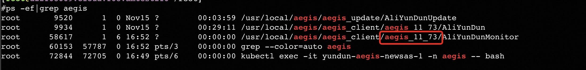

Check whether the Server Guard agent version is later than that specified in Apsara Stack V3.18.6.

**Check whether the ECS Cloud Assistant module exists in the ECS console**

Log in to the Aspara Uni-manager Management Console as an organization administrator. In the top navigation bar, choose Products > Computing > Elastic Compute Service. In the left-side navigation pane of the ECS console, check whether the **ECS Cloud Assistant** module exists.

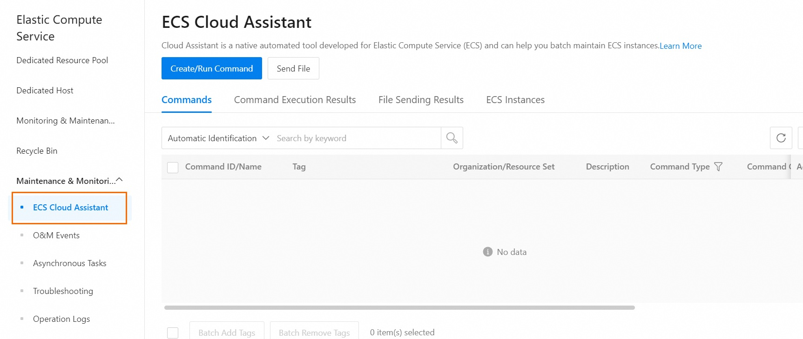

To reinstall the Server Guard agent, perform the following steps:

- **If the ECS Cloud Assistant module does not exist:**

  Directly copy the agent installation command in the Server Guard console to the ECS instances and run the command on each ECS instance.

- **If the ECS Cloud Assistant module exists:**

  Create a command by using the ECS Cloud Assistant, copy the Server Guard agent installation command to the Command Content field on the Create Command page, and select the instances on which you want to run the command to install the agent on multiple instances at a time.

**Implementation steps (We recommend that you fix the issue after you submit a ticket.)**

1. Disable the self-protection mode for your abnormal instances.

   <ol type="i">

   <li>

   Go to the **Protection Mode Management** tab and click **Manage** in the **Self-protection Management** section.

   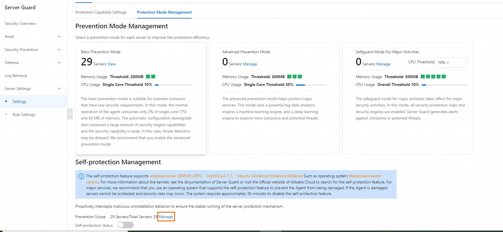

   </li>

   <li>

   In the Protection Scope dialog box, clear the abnormal instances.

   </li>

   </ol>

   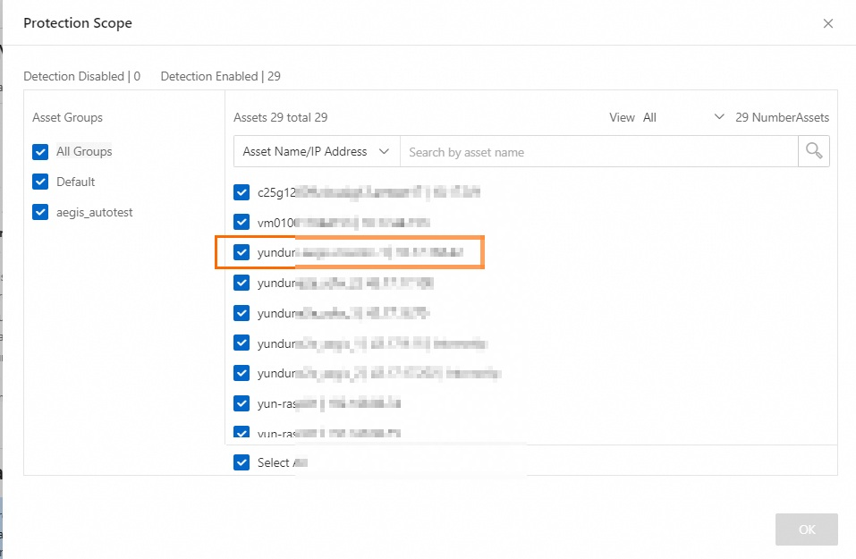

2. Reinstall the agent.

   > **Important**
   >
   > The agent installation commands vary with instance types.

   - **If the ECS Cloud Assistant module does not exist:**

     **Log in to the ECS instance, find the agent installation command for the instance type, copy the command to the ECS instance, and then run the command on the instance.**

     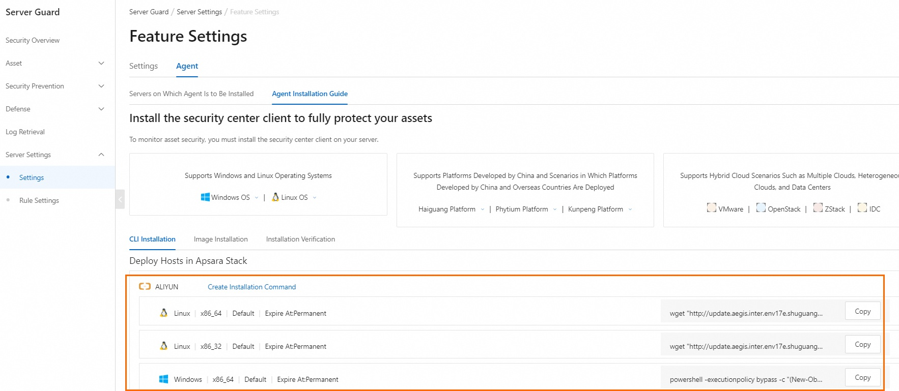

   - **If the ECS Cloud Assistant module exists:**

     **Log in to the ECS console. In the left-side navigation pane, choose Maintenance & Monitoring > ECS Cloud Assistant. On the ECS Cloud Assistant page, click Create/Run Command. On the Create Command page, copy the agent installation command for the instance type to the Command Content field, select the type of ECS instances on which you want to install the agent, and then click Run. (Note: You can save the command, select the required instances and then run it. You can also directly select an instance and run the command on the instance.)**

     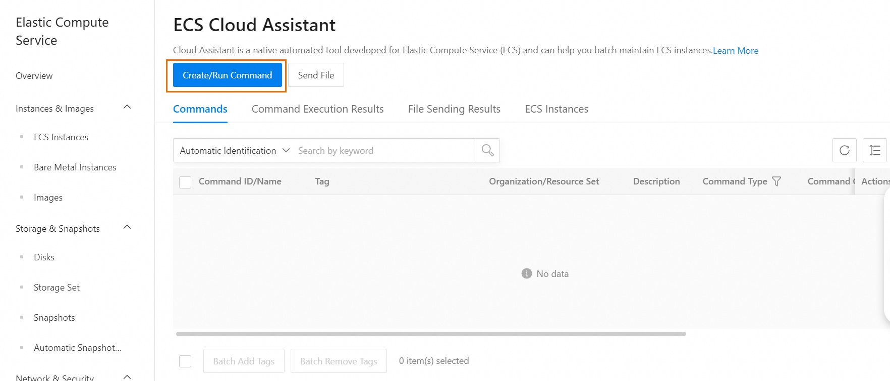

     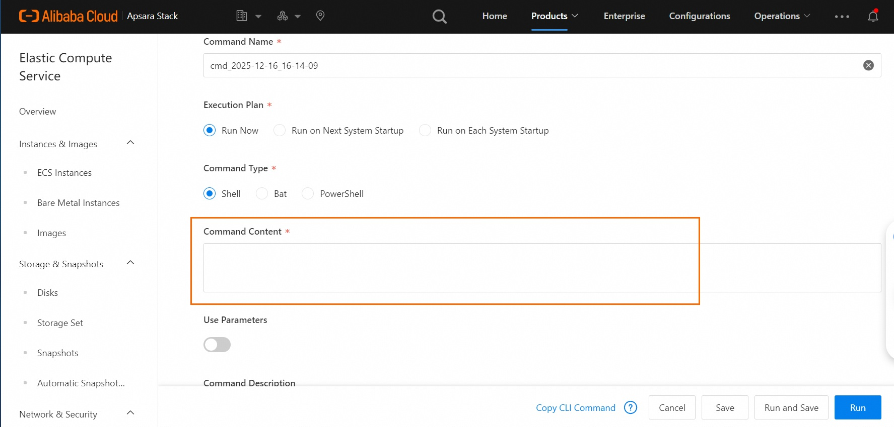

     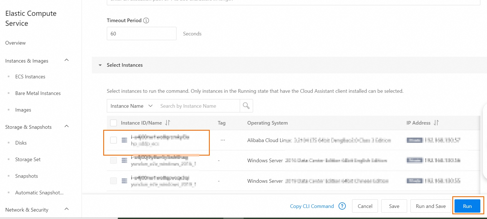

**Verify the result**

After you run the command, log in to the ECS instance and check the agent version.

You can view that the agent of an earlier version is being reinstalled, and then the agent version is updated to a version required in Apsara Stack V3.18.6.


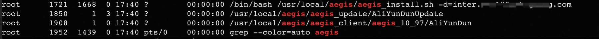


<a id="section-4"></a>

# 4.Server Guard

<a id="section-4-1"></a>

## 4.1. Security overview

Security administrators can view the details of server security on the Security Overview page in the Server Guard console. This helps security administrators gain insights into the security status of servers in the cloud. This topic describes how to view the security status of servers.

**Security overview**

1. Log in to the Apsara Uni-manager Management Console.

2. In the upper-right corner of the Apsara Uni-manager Management Console, choose **Security** > **Server Security > Server Guard**. On the **Server Guard** page, select a region from the **Region** drop-down list and click **Access with Authorized Role**.

   > **Note**
   >
   > - In multi-level organization mode, all data permissions are managed by using resource sets in organizations. You can select an organization or a resource set in the top navigation bar of the console to view or manage the assets of the organization or resource set.
   >
   > - The parent organization has the highest management permissions. Modifications to the parent organization take effect on all child organizations and resource sets that belong to the parent organization. Proceed with caution when you modify the configurations.

3. In the left-side navigation pane, click **Security Overview**.

4. Click the **Security Overview** tab to view the global security information and security trend dashboard.

   The Security Overview tab displays the numbers of security vulnerabilities and security events on servers. You can view information about security vulnerabilities, including **Unhandled Vulnerabilities** and **Baseline Risks**. You can also view information about security events, including **Unhandled Alerts**, **Precision defense**, and **Blocked File Tampering Attempts**.

   - **Server Risks**: This section displays the number of unhandled vulnerabilities, the number of baseline risks, and the distribution of risks at each level.

   - **Asset Protection**: This section displays the number of online servers, the number of offline servers, and the number of servers with abnormal agent status.

   - **Recent Important Security Risks and Intrusions**: This section displays recent risks and events on servers.

   - **Operating System Distribution**: This section displays servers by operating system.

**Security dashboard**

The Security Dashboard tab displays data such as assets, vulnerabilities, baselines, and alerts. You can customize content of the dashboard based on your business requirements.

> **Important**
>
> In multi-level organization mode, the security dashboard can be accessed only if you are granted the required permissions and have specified the view as all resource sets in the level-1 organization.

**Customize the security dashboard**

1. On the **Security Dashboard** tab, click **Direct access**.

   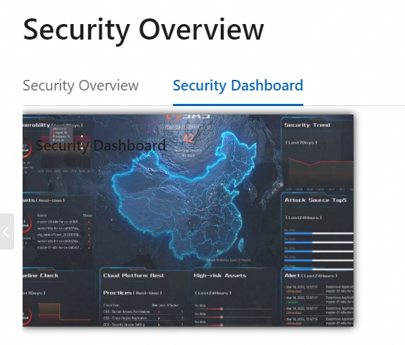

2. In the upper-right corner the page that appears, click the  icon.

3. Complete the following configurations and click **Save**.

   - On the **Select Statistics** tab, select the type of data that you want to display in real time on the dashboard. You can select **All** to display all types of data. You can also select a specific data type.

   - On the **Configurations** tab, configure the **Title** and **Title Decoration** parameters.

**Create a custom scenario-specific dashboard**

You can create custom scenario-specific dashboards based on your business requirements.

1. On the **Security Dashboard** tab, click **Direct access**.

   

2. In the upper-right corner the page that appears, click the  icon.

3. Then, click **Create**, complete the following configurations, and then click **Save**.

   - On the **Select Statistics** tab, select the type of data that you want to display in real time on the dashboard. You can select **All** to display all types of data. You can also select a specific data type.

   - On the **Configurations** tab, configure the **Title** and **Title Decoration** parameters.

   If you want to display a dashboard, find the dashboard on the **Scenarios** page, move the pointer over the dashboard, and then click **Enable Now**.

   > **Note**
   >
   > The number of dashboards that you can create is unlimited.

**SAS page**

**Vulnerability**

The **Vulnerability** section displays the total number of vulnerabilities in your assets, a doughnut chart that shows the proportions of vulnerabilities of different priorities, the number of vulnerabilities of each priority, and a chart that shows the vulnerability information within the last seven days. The **Vulnerability** section displays the following information:

- **Total**: the total number of vulnerabilities in your assets.

- **Urgent**: the number of vulnerabilities that must be fixed at the earliest opportunity. The status icon is a red dot.

- **Moderate**: the number of vulnerabilities that can be fixed at a later point in time. The status icon is an orange dot.

- **Low**: the number of vulnerabilities that cannot be fixed. The status icon is a gray dot.

- A chart that shows the number of vulnerabilities of each priority within the last seven days.

**Assets**

The **Assets** section displays the statistics on detected assets. The **Assets** section displays the following information:

- **Total**: the total number of assets.

- **Compromised**: the number of servers with unhandled high-risk alerts. The status icon is a red dot.

- **At-risk**: the number of servers with vulnerabilities, baseline risks, or medium-risk or low-risk alerts. The status icon is an orange dot.

- **Safe**: the number of servers without vulnerabilities, baseline risks, or alerts. The status icon is a green dot.

- **Unknown**: the number of low-risk vulnerabilities that can be exploited over the Internet in your servers. The status icon is a gray dot.

- A list that displays the top five high-risk assets and the corresponding status.

**Baseline Check**

The **Baseline Check** section displays the total number of baseline risks in your assets, the number of check items at each risk level, and a chart that shows the check items at each risk level within the last seven days. Real-time data is displayed. The **Baseline Check** section displays the following information:

- **Total**: the total number of at-risk check items in your assets.

- **High**: the number of high-risk check items. The status icon is a red dot. We recommend that you troubleshoot and handle such risks at the earliest opportunity.

- **Medium**: the number of medium-risk check items. The status icon is an orange dot.

- **Low**: the number of low-risk check items. The status icon is a gray dot.

- A chart that shows the check items at each risk level within the last seven days.

**Security Trend**

The **Security Trend** section displays the trend chart of security scores within the last seven days. Real-time data is displayed.

**Alerting**

The **Alert** section displays the information about the top 5 unhandled high-risk alerts within the last 24 hours, including the alert time, alert name, and the affected servers.

**Attack Source Top5**

The **Attack Source Top5** section displays the top 5 attacker IP addresses and the number of attacks from the top 5 IP addresses on your server within the last 24 hours.

**Cloud Platform Best Practices**

The **Cloud Platform Best Practices** section displays the information about the check items that are detected by the configuration assessment feature in real time.

The Cloud Platform Best Practices section displays the following information:

- **Check Item**: the check items that are supported by the configuration assessment feature.

- **Risk Level**: the risk level of a check item. The following list describes the relationship between colors and risk levels.

  - Red: indicates a high level of risk.

  - Orange: indicates a medium level of risk.

  - Gray: indicates a low level of risk.

  - Green: indicates a normal state.

- **Affected**: the number of affected assets.

**High-risk Assets**

The **High-risk Assets** section displays the top 5 high-risk assets within the last 24 hours.

<a id="section-4-2"></a>

## 4.2. Assets

<a id="section-4-2-1"></a>

### 4.2.1. Manage assets

After you add servers to Server Guard, you can manually synchronize the information about the most recent servers, view server information, and manage servers by group. This topic describes how to manage servers.

**Synchronize the information about the most recent servers**

1. Log in to the Apsara Uni-manager Management Console.

2. In the upper-right corner of the Apsara Uni-manager Management Console, choose **Security** > **Server Security > Server Guard**. On the **Server Guard** page, select a region from the **Region** drop-down list and click **Access with Authorized Role**.

   > **Note**
   >
   > - In multi-level organization mode, all data permissions are managed by using resource sets in organizations. You can select an organization or a resource set in the top navigation bar of the console to view or manage the assets of the organization or resource set.
   >
   > - The parent organization has the highest management permissions. Modifications to the parent organization take effect on all child organizations and resource sets that belong to the parent organization. Proceed with caution when you modify the configurations.

3. In the left-side navigation pane, choose **Assets** > **Asset Management**.

4. On the **Assets** page, click **Synchronize Assets**.

   Server Guard obtains the information about the most recent servers and updates the server list.

   > **Note**
   >
   > The system takes 1 minute to update the information. Wait until the information is updated.

**View the server information**

On the **Assets** page, view the server information.

- View the information about servers that match one or more search conditions

  You can configure filter conditions above the server list to search for a server. The filter conditions include **Instance Name**, **Internet IP**, and **Private IP Address**. You can configure one or more filter conditions.

  Find a server that you want to manage and view the security status of the server in the **Risk Status** column.

  Find a server whose details you want to view and click **View** or **Fix** in the **Details** column. On the details page of the server, view the details of the server.

  | Feature tab | Description |
  | --- | --- |

  <table>
    <tr>
      <td>Basic Information</td>
      <td>• <strong>Risk Status</strong>: displays risks such as vulnerabilities and alerts.<br>• <strong>Details</strong>: displays the basic information about the server, such as the server ID, region, group, and operating system. You can click <strong>Group</strong> to change the group to which the server belongs.<br>• <strong>Cloud Disk Snapshot</strong>: displays disk snapshots.<br>• <strong>Vulnerabilities</strong>: displays the types of vulnerabilities that can be detected. You<br>can find a vulnerability type and click theicon to enable or disable the<br>detection of vulnerabilities of the type for the server.<br>• <strong>Asset Fingerprints</strong>: displays server fingerprints.<br>• <strong>Logon Security Settings</strong>: displays the approved logon locations, approved IP addresses, approved time ranges, and approved accounts. You can manage alerts for the server.<br>Note<br>If you turn on <strong>Unapproved IP Address Alert</strong>, <strong>Unapproved Logon Time</strong> <strong>Alert</strong>, and <strong>Unapproved Account Logon Alert</strong>, you can view the following parameters.<br>• <strong>Approved Logon Location</strong>: Click <strong>Manage</strong> to specify approved logon locations.<br>• <strong>Common Login IPs</strong>: Click <strong>Manage</strong> to specify approved IP addresses.<br>• <strong>Common Login Time</strong>: Click <strong>Manage</strong> to specify the approved logon time ranges.<br>• <strong>Common Login Accounts</strong>: Click <strong>Manage</strong> to specify approved logon accounts.</td>
    </tr>
    <tr>
      <td>Vulnerabiliti es</td>
      <td>This tab displays the vulnerabilities that are detected on the server.</td>
    </tr>
    <tr>
      <td>Alerts</td>
      <td>This tab displays the alerts that are generated for the server.</td>
    </tr>
    <tr>
      <td>Network Exposure</td>
      <td>This tab displays the information about servers that are exposed on the Internet.</td>
    </tr>
    <tr>
      <td>Baseline Risks</td>
      <td>This tab displays the baseline check results of the server.</td>
    </tr>
    <tr>
      <td>Asset Fingerprints</td>
      <td>This tab displays information about the fingerprints of the server. The following capabilities are supported:<br>• <strong>Collect latest data</strong>: On a sub-tab, click <strong>Collect Data Now</strong> in the upper-right corner. The system initiates the data collection task, which takes approximately 1 to 5 minutes. Wait until the task is complete.<br>• <strong>View historical records</strong>: On the Accounts, Software, Middleware, Startup Items, and Scheduled Tasks sub-tabs, click <strong>Historical Records</strong> in the upper-right corner of the page. You can view add, delete, and modify operations that are performed in the last week, last month, last three months, or a custom time range.</td>
    </tr>
  </table>

- View the information about servers in a category. Server Guard allows you to manage servers by category. The categories include **Security Risks** and **Asset Attributes**.

  In the server list, you can perform the operations described in the following table.

  | Scenario | Procedure |
  | --- | --- |
  | Classify servers | i. Select the required servers and choose <strong>Asset Classification</strong> &gt; <strong>Group</strong> below the server list.<br>ii. In the <strong>Group</strong> dialog box, select a group and click <strong>OK</strong>. |
  | Issue commands | i. Select the required servers and click <strong>Order Issuance</strong> below the server list.<br>ii. In the <strong>Order Issuance</strong> dialog box, select required items and click <strong>OK</strong>. |
  | Export information | Select the server whose information you want to export and click the information that you want to export below the server list.<br>You can export basic asset information, weak password information, asset vulnerability information, baseline risk information, baseline check information, and client logs. |
  | Enable protection | i. Select the servers that you want to manage and choose <strong>More Operations</strong> <strong>&gt; Enable Protection</strong> below the server list.<br>ii. In the dialog box that appears, click <strong>OK</strong>. |
  | Remove servers from Server Guard | Select the required servers and choose <strong>More Operations &gt; Remove Assets</strong> below the server list. |

  <table>
    <tr>
      <td>Disable protection</td>
      <td>i. Select the required servers and choose <strong>More Operations &gt; Disable</strong> <strong>Protection</strong> below the server list.<br>ii. In the dialog box that appears, click <strong>OK</strong>.<br>Note<br>After you disable protection for a server, all detection and protection capabilities cannot be used, including fingerprint collection, vulnerability management, baseline checks, antivirus, web tamper proofing, and application whitelist. The heartbeat of the Server Guard agent is not affected.</td>
    </tr>
  </table>

**Add multi-cloud servers**

Server Guard allows you to protect and manage third-party cloud servers and servers in data centers. The following procedure describes how to add a multi-cloud or data center provider.

1. In the left-side **Asset Management by Classification** section of the **Assets** page, click **Providers**.

2. On the **Providers** page, click **Create Provider**. In the dialog box that appears, configure the Provider Name **parameter.**

   If the provider does not specify regions, create a default region to manage data centers.

   After the provider is added, you can perform the following operations in the **Actions** column: **Edit**, **Delete**, and **Add Region**.

**Manage server groups and tags**

In the left-side navigation tree of the **Assets** page, manage server groups and tags.

- Manage server groups: You can add servers to server groups in advance. This way, when you use the features of Server Guard, you can select servers on which you want the features to take effect by server group. The features include web tamper proofing, baseline check, and vulnerability scan.

  In the left-side navigation tree, click **Server Groups** below **Asset Management by Classification**. On the **Server Groups** page, you can manage server groups.

  - Create a server group: Click **Add Group**. In the dialog box that appears, enter a group name in the **Group name** field, select the servers that you want to add to the group, and then click **OK**.

    > **Note**
    >
    > Alternatively, you can skip the step of specifying assets. After you click **OK**, you can add assets to the group that you create.

  - Modify a server group: Find the server group that you want to modify and click **Manage** in the **Actions** column.

  - Delete a server group: Find the server group that you want to delete and click **Delete** in the **Actions** column.

- Manage server tags: You can add **tags** to servers to identify their special attributes. This allows you to search for servers that have the same attributes.

  In the left-side navigation tree, manage server tags in the **Tag** section.

  - Create a tag: Click **Manage**. In the Add Tag dialog box, enter a tag name, select the servers to which you want to add the tag, and then click **OK**.

  - Delete a tag: Find the tag that you want to delete and click the  icon. In the Note

    message, click **OK**.

**Manage downloaded tasks**

On the Manage Downloaded Tasks page, you can view and download the task information under the **Asset Center and Fingerprint**, **Client Logs**, **Vulnerability Management**, **Baseline Check**, **Internet Exposures**, and **Alerts** tabs.

<a id="section-4-2-2"></a>

### 4.2.2. Use the server fingerprints feature

This topic describes how to view the fingerprints of multiple assets on a server. This topic also describes how to configure the fingerprint collection frequency and the number of days for fingerprint history retention of a server.

**View server fingerprints**

1. Log in to the Apsara Uni-manager Management Console.

2. In the upper-right corner of the Apsara Uni-manager Management Console, choose **Security** > **Server Security > Server Guard**. On the **Server Guard** page, select a region from the **Region** drop-down list and click **Access with Authorized Role**.

   > **Note**
   >
   > - In multi-level organization mode, all data permissions are managed by using resource sets in organizations. You can select an organization or a resource set in the top navigation bar of the console to view or manage the assets of the organization or resource set.
   >
   > - The parent organization has the highest management permissions. Modifications to the parent organization take effect on all child organizations and resource sets that belong to the parent organization. Proceed with caution when you modify the configurations.

3. In the left-side navigation pane, choose **Assets** > **Server Fingerprints**.

4. On the **Server Fingerprints** page, view the server fingerprints.

   **View server fingerprints in global overview**: Click the **Overview** tab to view the fingerprints of all servers. Click **Details** next to a specific asset to go to the asset details page.

   **View the fingerprints of a single asset (12 assets are supported)**: Click a specific asset tab to view the asset fingerprints. The following asset tabs are provided: Ports, Software, Processes, Accounts, Scheduled Tasks, Middleware, AI Component, Databases, Web service, Startup Items, Kernel Module, and Website.

   | Asset | Description |
   | --- | --- |
   | Port | On the <strong>Port</strong> tab, view listening port information in columns such as <strong>Port</strong>, <strong>Protocol</strong>, and <strong>Server Information</strong>. You can view information about listening ports to perform the following checks: check for servers that monitor a specific port and check for ports that are monitored by a specific server.<br>• You can search for a port by port number, server process name, server name, or server IP address.<br>• In the server information list, you can view the process, IP address, PID, and latest collection time of a server. |
   | Software | On the <strong>Software</strong> tab, view all the software assets in use in the <strong>Software Name</strong> column and the fingerprints that use these software assets in the <strong>Fingerprints</strong> column. You can view information about software versions to perform the following checks and operation: check for software assets that are installed without authorization, check for outdated versions of software assets, and identify affected assets if vulnerabilities are detected.<br>• You can use a software name and another search condition, such as version, installation directory, server name, or server IP address, to search for specific software.<br>If you use version as the second search condition, a component of a version number can contain up to five characters in length, and a version number can contain up to five components. Components are separated by delimiters in a version number. If a version number contains more than five components, only the five components from the left are used. The following list describes the supported search conditions:<br>• The value <strong>6.2.1</strong>. The value is used to search for software packages whose versions are 6.2.1.<br>• A value <strong>greater than 6.2.1</strong>. The value is used to search for software packages whose versions are later than 6.2.1.<br>• A value <strong>smaller than 6.2.1</strong>. The value is used to search for software packages whose versions are earlier than 6.2.1.<br>• A value <strong>greater than 6.2.1 and smaller than 6.2.5</strong>. The value is used to search for software packages whose versions are later than 6.2.1 and earlier than 6.2.5.<br>• You can click a software name to view the software details, such as the software versions and the servers that use the software.<br>• You can click theicon in the upper-right corner to download a software<br>version list to your computer for subsequent asset check. |
   | Processes | On the <strong>Processes</strong> tab, view all running processes and the number of fingerprints that are running these processes in the <strong>Fingerprints</strong> column. You can view information about running processes to perform the following checks: check for servers on which a specific process runs and check for processes that run on a specific server.<br>• You can search for a process by <strong>Process Name</strong>, <strong>Running user</strong>, <strong>Startup</strong> <strong>parameters</strong>, or <strong>Server Name/IP</strong>.<br>• You can click the name of a process to view the details of the process, such as the server information, process path, and startup parameters. |
   | Accounts | On the <strong>Accounts</strong> tab, view all accounts that are logged in and the number of fingerprints that are using these accounts in the <strong>Fingerprints</strong> column. You can view information about accounts to perform the following checks: check for servers on which a specific account is created, and check for accounts that are created on a specific server.<br>• You can search for an account by account name, root permissions, server name, or IP address.<br>• You can click the name of an account to view the details of the account, such as the server information, root permissions, and user group. |
   | Scheduled Tasks | On the <strong>Scheduled Tasks</strong> tab, view the paths of all tasks and the number of fingerprints that are running these tasks in the <strong>Fingerprints</strong> column.<br>• You can search for a task by task path, server name, or IP address.<br>• You can click a task path to view the details such as the servers, executed commands, and task cycles. |
   | Middleware | On the <strong>Middleware</strong> tab, view all middleware, the type of each middleware, and the number of corresponding fingerprints.<br>• You can use a middleware name or type and another search condition, such as server IP address, port, or version, to search for specific middleware.<br>If you use version as the second search condition, a component of a version number can contain up to five characters in length, and a version number can contain up to five components. Components are separated by delimiters in a version number. If a version number contains more than five components, only the five components from the left are used. The following list describes the supported search conditions:<br>• The value <strong>6.2.1</strong>. The value is used to search for middleware packages whose versions are 6.2.1.<br>• A value <strong>greater than 6.2.1</strong>. The value is used to search for middleware packages whose versions are later than 6.2.1.<br>• A value <strong>smaller than 6.2.1</strong>. The value is used to search for middleware packages whose versions are earlier than 6.2.1.<br>• A value <strong>greater than 6.2.1 and smaller than 6.2.5</strong>. The value is used to search for middleware packages whose versions are later than 6.2.1 and earlier than 6.2.5.<br>• You can click a middleware name to view the middleware details such as the assets, version, and installation path. |
   | AI Component | On the <strong>AI Component</strong> tab, view all AI components and the number of corresponding fingerprints. |
   | Database | On the <strong>Database</strong> tab, view all databases and the number of corresponding fingerprints. |
   | Web service | On the <strong>Web service</strong> tab, view all web services and the number of corresponding fingerprints. |
   | Startup Items | On the <strong>Startup Items</strong> tab, view all startup items and the number of corresponding fingerprints. |
   | Kernel Module | On the <strong>Kernel Module</strong> tab, view all kernel modules and the number of corresponding fingerprints. |
   | Website | On the <strong>Website</strong> tab, view all websites and the number of corresponding fingerprints. |

**Configure the fingerprint collection frequency and record retention days**

> **Important**
>
> In multi-level organization mode, only an account that has level-1 organization permissions or global organization permissions can modify the fingerprint collection frequency for servers and the record retention settings.

1. In the upper-right corner of the **Server Fingerprints** page, click **Settings**.

2. On the **Collection Cycle Settings** tab of the **Settings** dialog box, configure the fingerprint collection frequency.

3. On the **Record Retention Settings** tab of the **Settings** dialog box, select a value from the **Fingerprint History Retention** drop-down list.

<a id="section-4-3"></a>

## 4.3. 安全预防

<a id="section-4-3-1"></a>

### 4.3.1. 漏洞管理

<a id="section-4-3-1-1"></a>

#### 4.3.1.1. Scan assets for vulnerabilities and view vulnerability statistics

This topic describes how to scan assets for vulnerabilities and view vulnerability scan results and fixing statistics.

**Scan assets for vulnerabilities**

1. Log in to the Apsara Uni-manager Management Console.

2. In the upper-right corner of the Apsara Uni-manager Management Console, choose **Security** > **Server Security > Server Guard**. On the **Server Guard** page, select a region from the **Region** drop-down list and click **Access with Authorized Role**.

   > **Note**
   >
   > - In multi-level organization mode, all data permissions are managed by using resource sets in organizations. You can select an organization or a resource set in the top navigation bar of the console to view or manage the assets of the organization or resource set.
   >
   > - The parent organization has the highest management permissions. Modifications to the parent organization take effect on all child organizations and resource sets that belong to the parent organization. Proceed with caution when you modify the configurations.

3. In the left-side navigation pane, choose **Prevention** > **Vulnerabilities**.

4. On the **Vulnerabilities** page, manually scan vulnerabilities or run an automatic periodic scan task on your servers.

   - **Manually scan vulnerabilities**

     If you want to immediately check whether vulnerabilities exist in your servers, you can use the quick scan feature to scan your servers for vulnerabilities.

     Before you perform a quick scan, perform the following steps to check whether the required servers exist in the system: Click **Settings** in the upper-right corner of the **Vulnerabilities** page. In the **Settings** panel, click **Manage** to the right of a vulnerability type.

     <ol type="a">

     <li>

     On the **Vulnerabilities** page, click **Scan Now**.

     </li>

     <li>

     In the **Scan Now** dialog box, select the types of vulnerabilities that you want to detect and click **OK**.

     After a scan task is created, wait for 15 minutes before you can stop the scan task.

     > **Note**
     >
     > If you did not specify the servers on which the vulnerability scan task runs, the scan task runs on all assets that are protected by Server Guard and is complete within 30 minutes. You can refresh the page to view the latest scan results.

     </li>

     </ol>

   - **Run an automatic periodic scan task**

     You can configure a scan cycle for an automatic periodic scan task. Then, Server Guard runs the automatic periodic scan task to scan for vulnerabilities on your servers on a regular basis. For more information, see the ***Configure vulnerability management po licies*** topic under ***Vulnerability management***.

**View vulnerability scan results**

In the upper part of the **Vulnerabilities** page, you can view vulnerability statistics.

| Parameter | Description |
| --- | --- |
| High-priority Vulnerability (CVE) | The number of vulnerabilities that need to be urgently fixed. Click the number below <strong>High-priority Vulnerability (CVE)</strong> to go to the <strong>High-priority</strong> <strong>Vulnerability (CVE)</strong> panel. In this panel, you can view all types of vulnerabilities with the high priority. For more information about how to fix vulnerabilities, see the topics under <strong><em>Vulnerability management</em></strong>. |
| Vul Servers | The number of servers on which vulnerabilities are detected. Click the number below <strong>Vul Servers</strong> to go to the <strong>Server(s)</strong> tab of the <strong>Assets</strong> |
| Fixing | The number of vulnerabilities that are being fixed. Click the number below <strong>Fixing</strong> to go to the <strong>Fixing</strong> panel. In this panel, you can view the list of vulnerabilities that are being fixed and the fixing progress. |
| Total Handled Vulnerabilities | The total number of handled vulnerabilities. Click the number below <strong>Total</strong> <strong>Handled Vulnerabilities</strong> to go to the <strong>Total Handled Vulnerabilities</strong> panel.In this panel, you can view the details of all vulnerabilities that have been handled. By default, assets in the <strong>Handled</strong> and <strong>Ignored</strong> states are displayed.You can filter assets based on your business requirements to facilitate management. |
| Disclosed Vulnerabilities | The number of vulnerabilities that can be detected. Click the number below <strong>Disclosed Vulnerabilities</strong> to go to the <strong>Detectable Vulnerabilities</strong> panel. In this panel, you can view the list and details of the vulnerabilities that can be detected by Server Guard. The details include the information in the <strong>CVE ID</strong>, <strong>Vulnerability Name</strong>, <strong>Detection Method</strong>, and <strong>Released At</strong> columns.<br>In this panel, you can also enter a CVE ID or a vulnerability name in the search boxes above the vulnerability list to search for a vulnerability. This way, you can check whether the vulnerability can be detected by Server Guard. You can click the CVE ID of a vulnerability to view details of the vulnerability in the Apsara Stack vulnerability library. |
| Defended Application Vulnerabilities | The number of application vulnerabilities that have been defended. Click the number below <strong>Defended Application Vulnerabilities</strong> to go to the <strong>Application(Urgent Vulnerability Included)</strong> panel. In this panel, you can view the list of and information about the assets affected by vulnerabilities. |
| Detection Time of Latest Vul | The latest point in time when a vulnerability was detected by a scan. |

<a id="section-4-3-1-2"></a>

#### 4.3.1.2. Manage Linux software vulnerabilities

This topic describes how to manage Linux software vulnerabilities.

**Background information**

Apsara Stack Security automatically scans software that is installed on your servers to detect the vulnerabilities in the Common Vulnerabilities and Exposures (CVE) list. Apsara Stack Security also sends you alert notifications about the detected vulnerabilities. In addition, Apsara Stack Security provides commands that you can use to fix vulnerabilities and allows you to verify vulnerability fixes.

**Procedure**

1. Log on to the Apsara Uni-manager Management Console.

2. In the top navigation bar, choose **Security** > **Server Security** > **Server Guard**.

   > **Note**
   >
   > You can select an organization, a resource set, and a region in the top navigation bar. You can select a resource set that belongs to a level-2 organization or a specific user.

3. In the left-side navigation pane, choose **Prevention** > **Vulnerabilities**.

4. On the **Linux Software** tab, view the detected Linux software vulnerabilities.

   > **Note**
   >
   > You can search for specific vulnerabilities by using the search and filter features.

5. Click a vulnerability. In the panel that appears, you can view the details of the vulnerability and the assets that are affected by the vulnerability.

   > **Note**
   >
   > You can find affected assets by using the search and filter features.

   - **Details**: This tab displays the basic information about the vulnerability, including the CVE ID, vulnerability impact score, and the security bulletin. You can click the **CVE ID** to view more information about the vulnerability.

   - **Pending vulnerability**: This tab displays the servers that are affected by the vulnerability.

6. Fix a vulnerability based on the impact.

   Table 1 Actions to fix vulnerabilities

   | Action | Description |
   | --- | --- |
   | Fix | • Use fixing commands: Run the commands that are automatically generated on the server to fix the vulnerability.<br>• Quick fix: Directly fix the vulnerability in the Server Guard console. |
   | Restarted and Verified | If a vulnerability fix takes effect only after a server reboot, reboot the server after the status of the vulnerability changes to <strong>Handled (To Be Restarted)</strong>.After you reboot the server, click <strong>Restarted and Verified</strong>. The vulnerability is fixed. |
   | Ignore | If you select this action to ignore a vulnerability, the system no longer reports alerts for the vulnerability. |
   | Verify | Click <strong>Verify</strong> to verify the vulnerability fix.<br>If you do not manually verify a fix, the system automatically verifies the fix within 48 hours after the vulnerability is fixed. |

   You can manage a vulnerability for one or more affected assets at a time.

   - To manage a vulnerability for one affected asset, find the asset and select an action from the **Actions** column of the asset.

   - To manage a vulnerability for multiple affected assets, select the assets and select an action below the list of the affected assets.

<a id="section-4-3-1-3"></a>

#### 4.3.1.3. Manage Windows system vulnerabilities

This topic describes how to manage Window system vulnerabilities.

**Background information**

Apsara Stack Security automatically checks whether the latest Microsoft updates are installed on your servers, and notifies you of the detected vulnerabilities. Apsara Stack Security also automatically detects and fixes major vulnerabilities on your servers.

**Procedure**

1. Log on to the Apsara Uni-manager Management Console.

2. In the top navigation bar, choose **Security** > **Server Security** > **Server Guard**.

   > **Note**
   >
   > You can select an organization, a resource set, and a region in the top navigation bar. You can select a resource set that belongs to a level-2 organization or a specific user.

3. In the left-side navigation pane, choose **Prevention** > **Vulnerabilities**.

4. On the **Windows System** tab, view the detected Windows system vulnerabilities.

   > **Note**
   >
   > You can search for specific vulnerabilities by using the search and filter features.

5. Click a vulnerability. In the panel that appears, you can view details about the vulnerability and the assets that are affected by the vulnerability.

   > **Note**
   >
   > You can find affected assets by using the search and filter features.

   - **Detail**: This tab displays the basic information about the vulnerability.

   - **Pending vulnerability**: This tab displays the servers that are affected by the vulnerability.

6. Handle the vulnerability based on its impact. The following table describes the actions that are used to fix vulnerabilities.

   Table 1 Actions to fix vulnerabilities

   | Operation | Procedure |
   | --- | --- |
   | Fix | Select this action to fix the vulnerability. The system caches an official Windows patch in the cloud. Your server can automatically download the patch for updates. |
   | Ignored. | If you select this action to ignore a vulnerability, the system no longer reports alerts for the vulnerability. |
   | Verify | Click <strong>Verify</strong> to verify the vulnerability fix. |
   | Restarted and Verified | If a vulnerability fix takes effect only after a server reboot, reboot the server after the status of the vulnerability changes to <strong>Handled (To Be Restarted)</strong>.After you reboot the server, click <strong>Restarted and Verified</strong>. The vulnerability is fixed. |

   You can manage a vulnerability for one or more affected assets at a time.

   - To manage a vulnerability for one affected asset, find the asset and select an action from the **Actions** column of the asset.

   - To manage a vulnerability for multiple affected assets, select the assets and select an action below the list of the affected assets.

<a id="section-4-3-1-4"></a>

#### 4.3.1.4. Manage Web-CMS vulnerabilities

This topic describes how to manage Web-CMS vulnerabilities.

**Background information**

The Web-CMS vulnerability detection feature obtains information about the latest vulnerabilities and provides patches in the cloud. This helps you detect and fix vulnerabilities.

**Procedure**

1. Log on to the Apsara Uni-manager Management Console.

2. In the top navigation bar, choose **Security** > **Server Security** > **Server Guard**.

   > **Note**
   >
   > You can select an organization, a resource set, and a region in the top navigation bar. You can select a resource set that belongs to a level-2 organization or a specific user.

3. In the left-side navigation pane, choose **Prevention** > **Vulnerabilities**.

4. On the **Web CMS** tab, view all vulnerabilities.

   > **Note**
   >
   > You can search for specific vulnerabilities by using the search and filter features.

5. Click a vulnerability. In the panel that appears, you can view details about the vulnerability and the assets that are affected by the vulnerability.

   > **Note**
   >
   > You can find affected assets by using the search and filter features.

6. Handle the vulnerability based on its impact. The following table describes the actions that are used to fix vulnerabilities.

   Table 1 Actions to fix vulnerabilities

   | Action | Description |
   | --- | --- |
   | Fix | If you select this action, the system replaces the web files affected by the vulnerability on your server to fix the Web-CMS vulnerability.<br>Note<br>Before you fix the vulnerability, we recommend that you back up the web files affected by the vulnerability. For more information about the paths of the web files, click Details in the Actions column. |
   | Ignore | If you select this action to ignore a vulnerability, the system no longer reports alerts for the vulnerability. |
   | Verify | Click <strong>Verify</strong> to verify the vulnerability fix.<br>If you do not manually verify the fix of a vulnerability, the system automatically verifies the fix within 48 hours after the vulnerability is fixed. |
   | Roll Back | For vulnerabilities that have been fixed, click <strong>Roll Back</strong> to restore the web files that have been replaced. |

   You can manage a vulnerability for one or more affected assets at a time.

   - To manage a vulnerability for one affected asset, find the asset and select an action from the **Actions** column of the asset.

   - To manage a vulnerability for multiple affected assets, select the assets and select an action below the list of the affected assets.

<a id="section-4-3-1-5"></a>

#### 4.3.1.5. Application vulnerability (urgent vulnerability included)

This topic describes how to manage application vulnerabilities, including urgent vulnerabilities.

**Background information**

Apsara Stack Security automatically detects vulnerabilities on servers, such as the unauthorized Redis access vulnerability and Struts-052 vulnerability, and generates vulnerability alerts. After you fix a vulnerability, you can also check whether the fix is successful.

**Procedure**

1. Log in to the Apsara Uni-manager Management Console.

2. In the top navigation bar, choose **Security** > **Server Security** > **Server Guard**.

   > **Note**
   >
   > You can select an organization, a resource set, and a region in the top navigation bar. You can select a resource set that belongs to a level-2 organization or a specific user.

3. In the left-side navigation pane, choose **Prevention** > **Vulnerabilities**.

4. On the **Application(Urgent Vulnerability Included)** tab, view all vulnerabilities.

   You can search for a specific vulnerability by using the search and filter features.

5. In the upper-right corner of the vulnerability list, click **Immediate Protect** in the Actions column. Select the target group from the drop-down list, and select the required asset in the **Select Assets** list. For vulnerabilities that support RASP protection, the system can detect application attacks and enable self-protection at runtime.

6. Click the name of a vulnerability. In the panel that appears, view the details in the following sections: **Details**, **Suggestions**, and **Unhandled Vulnerabilities**.

   You can find affected assets by using the search and filter features.

7. Handle the vulnerability based on its impact. The following table describes the actions that are used to fix vulnerabilities.

   Follow the instructions to manually fix the vulnerabilities on the Application(Urgent Vulnerability Included) tab.

   Table 1 Operations to handle vulnerabilities

   | Operation | Description |
   | --- | --- |
   | Ignore | If you select this action to ignore a vulnerability, the system no longer reports alerts for the vulnerability. |
   | Verify | After you manually fix the vulnerability, click <strong>Verify</strong> to check whether the vulnerability is fixed.<br>If you do not manually verify a fix, the system automatically verifies the fix within 48 hours after the vulnerability is fixed. |

   You can manage a vulnerability for one or multiple affected assets at a time.

   - To manage a vulnerability for one affected asset, select an action from the **Actions** column of the asset.

   - To manage a vulnerability for multiple affected assets, select the assets and select an action below the list of the affected assets.

<a id="section-4-3-1-6"></a>

#### 4.3.1.6. Configure vulnerability management policies

You can enable or disable automatic detection for different types of vulnerabilities and enable vulnerability detection for specific servers. You can also specify a time duration during which invalid vulnerabilities are retained and configure a vulnerability whitelist.

**Background information**

A vulnerability whitelist allows you to exclude vulnerabilities from the detection list. You can add multiple vulnerabilities in the vulnerability list to the whitelist. The system does not detect vulnerabilities that are added to the whitelist. You can manage the vulnerability whitelist on the vulnerability settings panel.

**Procedure**

1. Log on to the Apsara Uni-manager Management Console.

2. In the upper-right corner of the Apsara Uni-manager Management Console, choose **Security** > **Server Security > Server Guard**. On the **Server Guard** page, select a region from the **Region** drop-down list and click **Access with Authorized Role**.

   > **Note**
   >
   > - In multi-level organization mode, all data permissions are managed by using resource sets in organizations. You can select an organization or a resource set in the top navigation bar of the console to view or manage the assets of the organization or resource set.
   >
   > - The parent organization has the highest management permissions. Modifications to the parent organization take effect on all child organizations and resource sets that belong to the parent organization. Proceed with caution when you modify the configurations.

3. In the left-side navigation pane, choose **Prevention** > **Vulnerabilities**.

4. In the upper-right corner, click **Settings** to configure vulnerability management policies.

   - Configure policies in non-multi-level organization mode

     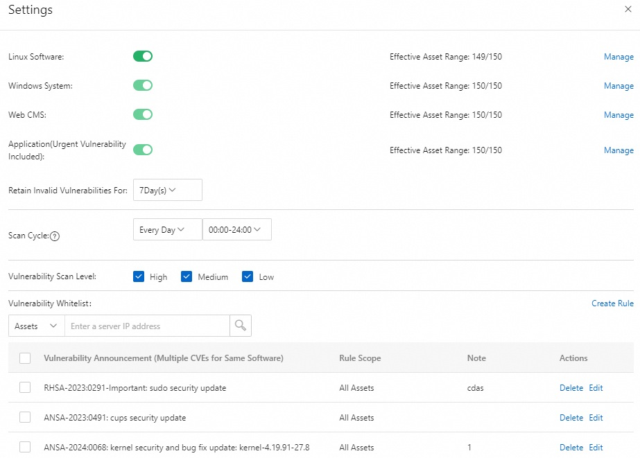

     | Item | Description |
     | --- | --- |
     | Whether to enable detection for vulnerabilities. | Find a vulnerability type and enable or disable detection for vulnerabilities of this type. |
     | Effective Asset Range | Click <strong>Manage</strong> next to a vulnerability type and specify the servers on which vulnerabilities of this type are detected. |
     | Retain Invalid Vulnerabilities For | Select a period of time during which invalid vulnerabilities are retained. Valid values: 7 days, 30 days, and 90 days.<br>Note<br>If you do not handle a detected vulnerability, the system determines that the alert for the vulnerability is invalid. The system deletes the vulnerability after the specified period of time ends. |
     | Scan cycle | Select the scan cycle for vulnerabilities. Default value: 00:00 to 06:00 every day.<br>The configuration of the scan cycle applies only to the detection of Linux software vulnerabilities, Windows system vulnerabilities, and application vulnerabilities. If you enable the detection of Web-CMS vulnerabilities, the system scans for this type of vulnerabilities once a day.<br>If you modify the scan cycle, the historical cycle tasks that are not run are deleted. Full scan tasks are created based on the new scan cycle. If the scan cycle is changed to 18:00 to 24:00 every day at 17:00, scan tasks are run immediately based on the new scan cycle from the current day. If the scan cycle is changed to 18:00 to 24:00 every day at 19: 00, a complete scan window does not exist on the current day, and scan tasks are run based on the new scan cycle from the next day. |
     | Vulnerability Scan Level | Select the vulnerability severities for detection. Valid values:<br>• <strong>High</strong>: Vulnerabilities of this severity must be fixed at the earliest opportunity.<br>• <strong>Medium</strong>: Vulnerabilities of this severity can be fixed later.<br>• <strong>Low</strong>: Vulnerabilities of this severity are less urgent, and can be fixed later. |
     | Vulnerability Whitelist Settings | Click <strong>Create Rule</strong> to configure a vulnerability whitelist for the specified servers. Server Guard does not detect the vulnerabilities that you add to the whitelist. |

   - Configure policies in multi-level organization mode

     In multi-level organization mode, your operations take effect only on the resource sets on which you have permissions in the current organization.

     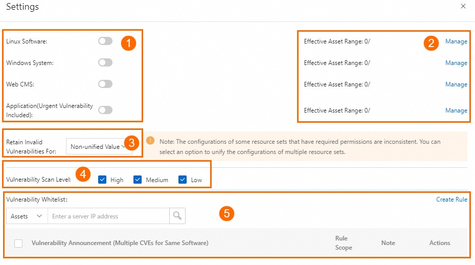

     | Number | Description |
     | --- | --- |
     | 1 | Find a vulnerability type and enable or disable detection for vulnerabilities of this type. You can click <strong>Details</strong> to configure vulnerability detection for the child organizations within the current organization. The parent organization has the highest management permissions. Modifications to the parent organization take effect on all child organizations and resource sets that belong to the parent organization. |
     | 2 | Click <strong>Manage</strong> next to a vulnerability type and specify the resource sets and servers on which vulnerabilities of this type are detected. |
     | 3 | Select a period of time during which invalid vulnerabilities are retained.Valid values: <strong>7 days</strong>, <strong>30 days</strong>, and <strong>90 days</strong>.<br>If <strong>Non-unified Value</strong> is displayed, the resource sets on which you have permissions have different configurations. You can configure the resource sets to ensure that the configurations are the same.<br>Note<br>If you do not handle a detected vulnerability, the system determines that the alert for the vulnerability is invalid. The system deletes the vulnerability after the specified period of time ends. |
     | 4 | Select the vulnerability severities for detection. Valid values:<br>• <strong>High</strong>: Vulnerabilities of this severity must be fixed at the earliest opportunity.<br>• <strong>Medium</strong>: Vulnerabilities of this severity can be fixed later.<br>• <strong>Low</strong>: Vulnerabilities of this severity are less urgent, and can be fixed later.<br>If theicon is displayed, specific resource sets are selected. You can clear<br>the items to configure the resource sets in a centralized manner. |
     | 5 | Click <strong>Create Rule</strong> to configure a vulnerability whitelist for the specified servers. Server Guard does not detect the vulnerabilities that you add to the whitelist. |

<a id="section-4-3-2"></a>

### 4.3.2. 基线检查

<a id="section-4-3-2-1"></a>

#### 4.3.2.1. Baseline check overview

The baseline check feature automatically checks the security configurations on servers and provides detailed check results and suggestions for baseline reinforcement.

**Overview**

After you enable the baseline check feature, Apsara Stack Security automatically checks for risks related to the operating systems, accounts, databases, passwords, and security compliance configurations of your servers, and provides reinforcement suggestions. For more information, see Baseline check items.

By default, a full baseline check is automatically performed from 00:00 to 06:00 every day. You can create and manage baseline check policies. When you create or modify a policy, you can specify the baselines, interval, and time period, and select the servers to which you want to apply this policy.

**Usage notes**

By default, the following baselines are disabled. To check these baselines, make sure that these baselines do not affect your business and select them when you configure a custom policy.

- Baselines related to weak passwords for specific applications such as MySQL, PostgreSQL, and SQL Server

  > **Note**
  >
  > If these baselines are enabled, the system attempts to log on to servers with weak passwords. The logon attempts consume server resources and generate a large number of logon failure records.

- Baselines related to classified protection of cybersecurity

- Internationally agreed best practices for security

**Baselines**

| Category | Baseline |
| --- | --- |
| Unauthorized access | • ActiveMQ unauthorized access high exploit vulnerability risk<br>• CouchDB unauthorized access high exploit risk<br>• Docker unauthorized access high vulnerability risk<br>• Elasticsearch unauthorized access high exploit vulnerability risk<br>• Hadoop unauthorized access high exploit vulnerability risk<br>• Jboss unauthorized access high exploit vulnerability risk<br>• Jenkins unauthorized access high exploit vulnerability risk<br>• Kubernetes-Apiserver unauthorized access to high-risk risks<br>• LDAP unauthorized access high exploit vulnerability risk (Windows)<br>• OpenLDAP unauthorized access vulnerability baseline (Linux)<br>• Memcached unauthorized access high exploit vulnerability risk<br>• Mongodb unauthorized access high exploit vulnerability risk<br>• Postgresql unauthorized access to high-risk risk baseline<br>• RabbitMQ unauthorized access high exploit vulnerability risk<br>• Redis unauthorized access high exploit vulnerability risk<br>• rsync unauthorized access high exploit vulnerability risk<br>• ZooKeeper unauthorized access high exploit vulnerability risk |
| MLPS compliance | • MLPS Level 3 Compliance Baseline for Alibaba Cloud Linux 3<br>• MLPS Level 2 Compliance Baseline for Alibaba Cloud Linux 2<br>• MLPS Level 3 Compliance Baseline for Alibaba Cloud Linux 2<br>• MLPS Level 3 Compliance Baseline for Anolis 8<br>• MLPS Level 3 Compliance Baseline for Bind<br>• MLPS Level 2 Compliance Baseline for CentOS Linux 6<br>• MLPS Level 3 Compliance Baseline for CentOS Linux 6<br>• MLPS Level 2 Compliance Baseline for CentOS Linux 7<br>• MLPS Level 3 Compliance Baseline for CentOS Linux 7<br>• MLPS Level 3 Compliance Baseline for CentOS Linux 8<br>• MLPS Level 2 Compliance Baseline for Debian Linux 8<br>• MLPS Level 3 Compliance Baseline for Debian Linux 8/9/10<br>• MLPS Level 3 Compliance Baseline for IIS<br>• MLPS Level 3 Compliance Baseline for Informix<br>• MLPS Level 3 Compliance Baseline for JBoss 6/7<br>• MLPS Level 3 Compliance Baseline for Kylin<br>• MLPS Level 3 Compliance Baseline for MongoDB<br>• MLPS Level 3 Compliance Baseline for SQL Server<br>• MLPS Level 3 Compliance Baseline for MySQL<br>• MLPS Level 3 Compliance Baseline for Nginx<br>• MLPS Level 3 Compliance Baseline for Oracle<br>• MLPS Level 3 Compliance Baseline for PostgreSQL<br>• MLPS Level 3 Compliance Baseline for Red Hat Linux 6<br>• MLPS Level 2 Compliance Baseline for Red Hat Linux 7<br>• MLPS Level 3 Compliance Baseline for Red Hat Linux 7<br>• MLPS Level 3 Compliance Baseline for Redis<br>• MLPS Level 3 Compliance Baseline for SUSE 10<br>• MLPS Level 3 Compliance Baseline for SUSE 12<br>• MLPS Level 3 Compliance Baseline for SUSE 15<br>• MLPS Level 3 Compliance Baseline for SUSE 11<br>• MLPS Level 3 Compliance Baseline for Ubuntu 14<br>• MLPS Level 2 Compliance Baseline for Ubuntu 16/18<br>• MLPS Level 3 Compliance Baseline for Ubuntu 16/18/20<br>• MLPS Level 3 Compliance Baseline for UOS<br>• MLPS Level 3 Compliance Baseline for Websphere Application Server<br>• MLPS Level 3 Compliance Baseline for WebLogic<br>• MLPS Level 2 Compliance Baseline for Windows 2008 R2<br>• MLPS Level 3 Compliance Baseline for Windows 2008 R2<br>• MLPS Level 2 Compliance Baseline for Windows 2012 R2<br>• MLPS Level 3 Compliance Baseline for Windows 2012 R2<br>• MLPS Level 2 Compliance Baseline for Windows Server 2016/2019<br>• MLPS Level 3 Compliance Baseline for Windows Server 2016/2019 |
| Best security practices | • Alibaba Cloud Standard - Alibaba Cloud Linux 2/3 Benchmark<br>• Alibaba Cloud Standard - Anolis 7/8 Security Baseline Check<br>• Alibaba Cloud Standard - Apache Security Baseline Check<br>• Alibaba Cloud Standard - CentOS Linux 6 Security Baseline Check<br>• Alibaba Cloud Standard - CentOS Linux 7/8 Security Baseline Check<br>• Alibaba cloud standard - CouchDB security baseline check<br>• Alibaba Cloud Standard-SQL Server Security Baseline Check (2008 or Later)<br>• Alibaba Cloud Standard - Debian Linux 8/9/10/11/12 Security Baseline<br>• Alibaba Cloud Standard-Docker Host Security Baseline Check<br>• Alibaba Cloud Standard - ElasticSearch Security Baseline Check<br>• Alibaba Cloud Standard - Hadoop Security Baseline Check<br>• Alibaba Cloud Standard - IIS 8 Security Baseline Check<br>• Alibaba Cloud Standard - Influxdb Security Baseline Check<br>• Alibaba Cloud Standard -Jboss6/7 Security Baseline<br>• Alibaba Cloud Standard - Kylin Security Baseline Check<br>• Alibaba Cloud Standard - Memcached Security Baseline Check<br>• Alibaba Cloud Standard - Activemq Security Baseline<br>• Alibaba Cloud Standard - Jenkins Security Baseline Check<br>• Alibaba Cloud Standard - RabbitMQ Security Baseline<br>• Alibaba Cloud Standard - MongoDB Security Baseline Check (Version 3.x )<br>• Alibaba Cloud Standard - Mysql Security Baseline Check<br>• Alibaba Cloud Standard - Nginx Security Baseline Check<br>• Alibaba Cloud Standard - Oracle Security Baseline Check<br>• Alibaba Cloud Standard-PostgreSql Security Initialization Check<br>• Alibaba Cloud Standard - Red Hat Enterprise Linux 6 Security Baseline Check<br>• Alibaba Cloud Standard - Red Hat Enterprise Linux 7/8 Security Baseline Check<br>• Alibaba Cloud Standard - Redis Security Baseline Check<br>• Alibaba Cloud Standard - Rocky Linux 8/9 Security Baseline Check<br>• Alibaba Cloud Standard - Windows SMB Security Baseline Check<br>• Alibaba Cloud Standard - SUSE Linux 15 Security Baseline Check<br>• Alibaba Cloud Standard - Apache Tomcat Security Baseline(on windows)<br>• Alibaba Cloud Standard - Ubuntu Security Baseline<br>• Alibaba Cloud Standard - Uos Security Baseline Check<br>• Alibaba Cloud Standard - Windows Server 2008 R2 Security Baseline Check<br>• Alibaba Cloud Standard - Windows 2012 R2 Security Baseline<br>• Alibaba Cloud Standard - Windows 2016/2019 Security Baseline<br>• Alibaba Cloud Standard-Apache Tomcat Security Baseline |
| Internationally agreed best practices for security | • Alibaba Cloud Linux 2/3 Internationally Agreed Best Practices for Security<br>• CentOS Linux 6 LTS Internationally Agreed Best Practices for Security<br>• CentOS Linux 7 LTS Internationally Agreed Best Practices for Security<br>• CentOS Linux 8 LTS Internationally Agreed Best Practices for Security<br>• Debian Linux 8/9/10 Internationally Agreed Best Practices for Security<br>• Ubuntu 14 LTS Internationally Agreed Best Practices for Security<br>• Ubuntu 16/18/20 LTS Internationally Agreed Best Practices for Security<br>• Windows Server 2008 R2 Internationally Agreed Best Practices for Security<br>• Windows Server 2012 R2 Internationally Agreed Best Practices for Security<br>• Windows Server 2016/2019 R2 Internationally Agreed Best Practices for Security |
| Weak password | • MongoDB Weak Password baseline(support version 2. X)<br>• Ftp login weak password baseline<br>• Jboss6/7 login weak password baseline<br>• Jenkins login weak password baseline<br>• Linux system login weak password baseline<br>• MongoDB Weak Password baseline<br>• SQL Server DB login weak password baseline<br>• Mysql database login weak password check (version 8.x is not supported)<br>• Mysql DB login weak password baseline(Windows version)<br>• Openldap login weak password baseline<br>• OpenVPN weak password detection in Linux system<br>• Oracle login weak password detection<br>• PostgreSQL DB login weak password baseline<br>• pptpd login weak password baseline<br>• Proftpd login weak password baseline<br>• RabbitMQ login weak password baseline<br>• Redis DB login weak password baseline<br>• rsync login weak password baseline<br>• svn login weak password baseline<br>• Apache Tomcat Console weak password baseline<br>• VncServer weak password check<br>• Weblogic 12c login weak password detection<br>• Windows system login weak password baseline<br>• Activemq login weak password baseline |

<a id="section-4-3-2-2"></a>

#### 4.3.2.2. Manage baseline check policies

This topic describes how to create, modify, and delete baseline check policies and how to specify baseline check levels.

**Background information**

By default, the baseline check feature uses **default baseline check policies** to check the baseline risks of assets. You can also create custom baseline check policies based on your business requirements. For example, you can create a custom baseline check policy to check the compliance based on Multi-Level Protection Scheme (MLPS) level 2 in China.

**Procedure**

1. Log on to the Apsara Uni-manager Management Console.

2. In the upper-right corner of the Apsara Uni-manager Management Console, choose **Security** > **Server Security > Server Guard**. On the **Server Guard** page, select a region from the **Region** drop-down list and click **Access with Authorized Role**.

   > **Note**
   >
   > - In multi-level organization mode, all data permissions are managed by using resource sets in organizations. You can select an organization or a resource set in the top navigation bar of the console to view or manage the assets of the organization or resource set.
   >
   > - The parent organization has the highest management permissions. Modifications to the parent organization take effect on all child organizations and resource sets that belong to the parent organization. Proceed with caution when you modify the configurations.

3. In the left-side navigation pane, choose **Prevention** > **Baseline Check**.

4. In the upper-right corner of the Baseline Check page, click **Manage Policy**. In the **Manage Policy** panel, manage baseline check policies.

   > **Important**
   >
   > - In multi-level organization mode, your operations take effect only on the resource sets on which you have permissions in the current organization.
   >
   > - In multi-level organization mode, the resource sets on which you have permissions have different configurations if **Nonunified Value** is displayed. You can configure the resource sets to ensure that the configurations are the same.

   - Create a standard baseline check policy: Click **Create Standard Policy**. In the panel that appears, configure the parameters and click **OK**.

     | Parameter | Description |
     | --- | --- |
     | Policy Name | Enter a policy name. |
     | Check Cycle | Specify an interval for the baseline check task. Valid values: 1 day, Every 3 Day, Every 7 Day, and Every 30 Day. |
     | Detection time | Select a time range for the baseline check task. Valid values: 00:00 to 6:00, 06:00 to 12:00, 12:00 to 18:00, and 18:00 to 24:00. |
     | Check Items | Select the baselines that you want to check. The default policy includes the following types of baselines: unauthorized access, MLPS compliance, best security practices, internationally agreed best practices for security, and weak password. |
     | Servers | Select the server groups to which you want to apply the baseline check policy. In multi-level organization mode, you must select the resource set on which you have permissions in the current organization.<br>Note<br>By default, newly purchased servers are classified into the <strong>Default &gt; Asset Group</strong>. To apply the policy to new servers, select <strong>Default</strong>. |

   - Create a custom baseline check policy: Click **Create Custom Policy**. In the panel that appears, configure the parameters and click **OK**.

     | Parameter | Description |
     | --- | --- |
     | Policy Name | Enter a policy name. |
     | Check Cycle | Specify an interval for the baseline check task. Valid values: 1 day, Every 3 Day, Every 7 Day, and Every 30 Day. |
     | Detection time | Select a time range for the baseline check task. Valid values: 00:00 to 6:00, 06:00 to 12:00, 12:00 to 18:00, and 18:00 to 24:00. |
     | Check Items | Select the baselines that you want to check. |
     | Servers | Select the server groups to which you want to apply the baseline check policy. In multi-level organization mode, you must select one or more resource sets on which you have permissions in the current organization.<br>Note<br>By default, newly purchased servers are classified into the <strong>Default &gt; Asset Group</strong>. To apply the policy to new servers, select <strong>Default</strong>. |

   - Modify a baseline check policy.

     - In the policy list, find the policy that you want to modify and click **Edit** in the **Actions** column.

       > **Note**
       >
       > You cannot modify the baselines of the default policy. You can only modify the server groups to which the default policy is applied.

     - Modify multiple policies at a time (supported only in multi-level organization mode): If you create multiple policies that have the same name and the same type under different resource sets, click **Centrally Edit** below the policy list to modify the policies at a time.

       > **Note**
       >
       > If the resource sets have different configurations after you modify the policies as an administrator, the system displays a message instructing you to change the configurations to ensure that all resource sets have the same configurations.

   - Delete a baseline check policy: In the policy list, find the policy that you want to delete and click **Delete** in the **Actions** column.

     > **Important**
     >
     > You cannot restore a policy after you delete the policy. You cannot delete the default policy.

   - Specify the baseline check levels: In the **Baseline Check Level** section, specify the baseline check levels. Valid values: High, Medium, and Low.

     In multi-level organization mode, the  icon for a level indicates that the level is

     specified in specific resource sets. You can clear the selected items to configure baseline check levels in a centralized manner.

   - Create custom weak password rules: Server Guard provides default weak password rules based on the Alibaba Cloud threat intelligence. You can also use a template to upload custom weak password rules. Make sure that the size of the file that you upload does not exceed 5 KB.

     In the **Custom Weak Password Rules** section, click **Import File** to upload an on-premises file of weak password rules.

     To export the uploaded file, right-click the name of the file to save the file or click the name of the file to save the file on the preview page.

<a id="section-4-3-2-3"></a>

#### 4.3.2.3. View baseline check results and handle baseline risks

Apsara Stack Security Center provides details of baseline check results and suggestions on how to manage failed check items. This topic describes how to view baseline check results and manage failed check items in Apsara Stack Security Center. The check results include affected assets, checked items, and suggestions.

**View the summary of baseline check results**

1. Log on to the Apsara Uni-manager Management Console.

2. In the upper-right corner of the Apsara Uni-manager Management Console, choose **Security** > **Server Security > Server Guard**. On the **Server Guard** page, select a region from the **Region** drop-down list and click **Access with Authorized Role**.

   > **Note**
   >
   > - In multi-level organization mode, all data permissions are managed by using resource sets in organizations. You can select an organization or a resource set in the top navigation bar of the console to view or manage the assets of the organization or resource set.
   >
   > - The parent organization has the highest management permissions. Modifications to the parent organization take effect on all child organizations and resource sets that belong to the parent organization. Proceed with caution when you modify the configurations.

3. In the left-side navigation pane, choose **Prevention** > **Baseline Check**.

4. In the upper part of the **Baseline Check** page, view the summary of baseline check results. You can filter data by baseline check policy.

   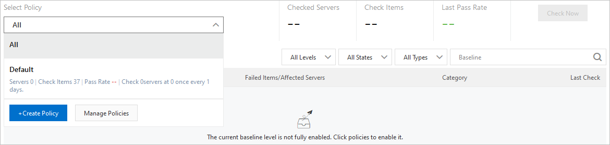

   You can select a baseline check policy from the **Select Policy** drop-down list to view the following information:

   - **Checked Servers**: The number of servers on which the baseline check runs. These servers are specified in the selected baseline check policy.

   - **Check Items**: The number of **check items** specified in the selected baseline check policy.

   - **Last Pass Rate**: The pass rate of the last baseline check.

     If the number below **Last Pass Rate** is green, the pass rate of the checked servers is high. If the number is red, a large number of failed check items were detected on the checked servers. We recommend that you view the details of the check result and manage the failed check items.

5. Select **All** from the **Select Policy** drop-down list.

   The **Baseline Check** page displays the details of all baselines, such as **Baseline**, **Checked Items**, **Failed Items/Affected Servers**, **Category**, and **Last Checked At**.

   > **Note**
   >
   > You can also select a baseline check policy from the **Select Policy** drop-down list to view the baselines that are specified in the policy.

**View the details of a baseline**

1. Log on to the Apsara Uni-manager Management Console.

2. In the upper-right corner of the Apsara Uni-manager Management Console, choose **Security** > **Server Security > Server Guard**. On the **Server Guard** page, select a region from the **Region** drop-down list and click **Access with Authorized Role**.

   > **Note**
   >
   > - In multi-level organization mode, all data permissions are managed by using resource sets in organizations. You can select an organization or a resource set in the top navigation bar of the console to view or manage the assets of the organization or resource set.
   >
   > - The parent organization has the highest management permissions. Modifications to the parent organization take effect on all child organizations and resource sets that belong to the parent organization. Proceed with caution when you modify the configurations.

3. In the left-side navigation pane, choose **Prevention** > **Baseline Check**.

4. In the **Baseline** column, click a baseline to view the details of the baseline.

   Baseline details include the affected assets and the numbers of **Passed Items** and **At-Risk Items**.

5. Manage baseline risks on the baseline details page.

   - Find the asset that you want to manage and click **View** in the **Actions** column to open the **At-Risk Items** panel.

   - Click **Verify** in the **Actions** column to check whether the baseline risks of an asset are managed. If the verification is passed, the number of **At-Risk Items** is reduced, and the status of the check items changes to **Passed**.

**View the details of a failed check item**

1. Find the baseline that you want to manage and click the baseline. In the panel that appears, find the asset that you want to manage and click **View** in the **Actions** column to view failed check items.

   You can view the check items of the asset and the status of the check items. The status can be **Passed** or **Failed**.

2. Find a check item and click **Details** in the **Actions** column to view the description, result, and suggestion for the check item.

> **Note**
>
> We recommend that you follow the suggestions to manage check items whose status is **Failed** at the earliest opportunity, especially high-risk check items.

**Manage failed check items**

In the At-Risk Items panel, manage failed check items.

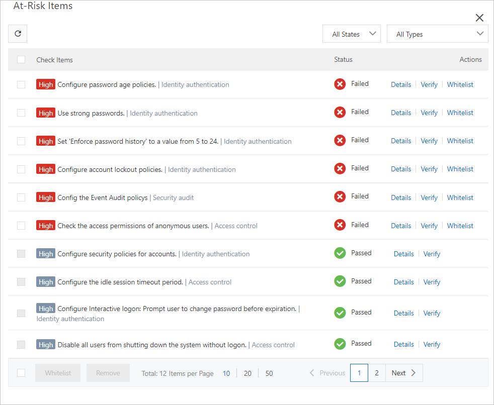

- **Add check items to the whitelist**

  If you want to disable alerts for a check item, click **Whitelist** to add the check item to the whitelist. Check items in the whitelist do not trigger alerts.

  > **Note**
  >
  > You can also select multiple check items and click **Whitelist** in the lower-left corner to add the check items to the whitelist at a time.

- **Repair**

  Server Guard allows you to fix only multiple baseline risks that are detected based on the Alibaba Cloud standards at a time. You can select multiple servers that have the same baseline risks.

  > **Important**
  >
  > Fixing baseline risks may be risky. Before you handle baseline risks, make sure that a backup is performed.

- **Remove check items from the whitelist**

  If you want to enable alerts for a check item in the whitelist, click **Remove** to remove the check item from the whitelist. You can remove one or more check items from the whitelist at a time. After you remove a check item from the whitelist, the check item triggers alerts.

- **Verify the fix of a failed check item**

  After you fix a check item, you can click Verify to check whether the check item is fixed. After you click Verify, the status of the check item changes to **Checking**.

  If you do not manually perform the verification, Apsara Stack Security automatically verifies the fix based on the detection interval specified in the policy.

  If the verification is passed, the **Status** of the check item changes to **Passed**.

<a id="section-4-3-3"></a>

### 4.3.3. Risk exposure detection

The risk exposure detection feature automatically analyzes the exposure of your servers on the Internet. This helps you quickly detect abnormal exposure of your assets and applications on the Internet. The feature also provides suggestions on how to fix the detected vulnerabilities. This topic describes how to use the risk exposure detection feature.

**Statistics**

| Parameter | Description |
| --- | --- |
| Exposed Assets/Public IP Addresses | The total numbers of servers and IP addresses that are exposed on the Internet. |
| Gateways | The total number of gateway assets that are exposed on the Internet. The gateway assets include NAT gateways and Server Load Balancer (SLB) instances. You can click the number below Gateways to go to the <strong>Gateways</strong> panel. In the panel, you can view the gateway assets that are exposed on the Internet. |
| Exposed Ports | The total number of ports that are exposed on the Internet. You can click the number below Exposed Ports to go to the <strong>Exposed Ports</strong> panel. In the panel, you can view the ports that are exposed on the Internet. |
| Exposed Components | The total number of system components that run on your Elastic Compute Service (ECS) instances and are exposed on the Internet. The components include OpenSSL and OpenSSH. You can click the number below <strong>Exposed</strong> <strong>Components</strong> to go to the Exposed Components panel. In the panel, you can view the components that are exposed on the Internet. |

<table>
  <tr>
    <td>Exploitable Vulnerabilities</td>
    <td>The total number of vulnerabilities that are exposed on the Internet and can be exploited by attackers, and the numbers of high-risk, medium-risk, and low-risk vulnerabilities. You can click the number of high-risk, medium-risk, or low-risk vulnerabilities to go to the <strong>Vulnerabilities</strong> page. Vulnerabilities of different severities are marked in different colors:<br>• High-risk vulnerabilities: red. These vulnerabilities pose major threats to your assets. We recommend that you take note of these vulnerabilities and fix them at the earliest opportunity.<br>• Medium-risk vulnerabilities: orange. These vulnerabilities cause damage to your assets. We recommend that you fix the vulnerabilities at the earliest opportunity.<br>• Low-risk vulnerabilities: gray. These vulnerabilities are less harmful to your assets than high-risk and medium-risk vulnerabilities. You can fix low-risk vulnerabilities at your convenience.</td>
  </tr>
</table>

**View the exposure details of assets**

**Exposed assets**

1. Log on to the Apsara Uni-manager Management Console.

2. In the upper-right corner of the Apsara Uni-manager Management Console, choose **Security** > **Server Security > Server Guard**. On the **Server Guard** page, select a region from the **Region** drop-down list and click **Access with Authorized Role**.

   > **Note**
   >
   > - In multi-level organization mode, all data permissions are managed by using resource sets in organizations. You can select an organization or a resource set in the top navigation bar of the console to view or manage the assets of the organization or resource set.
   >
   > - The parent organization has the highest management permissions. Modifications to the parent organization take effect on all child organizations and resource sets that belong to the parent organization. Proceed with caution when you modify the configurations.

3. In the left-side navigation pane, choose **Prevention** > **Risk Exposure Detection**.

4. On the **Asset Exposure** tab of the **Risk Exposure Detection** page, view the information about exposed assets.

   - Filter assets: Filter assets by vulnerability, asset group, or port.

   - View the exposure details of an asset: Find the asset whose details you want to view and click **Exposure Details** in the **Actions** column. In the panel that appears, you can view the communication link topology between the asset and the Internet, and the details of the links.

   - Export data of exposed assets: Click the

     

     icon in the upper-right corner of the exposed asset list to export and save the details of the exposed assets to your computer. The exported file is an Excel file.

**Exposed applications**

1. Log on to the Apsara Uni-manager Management Console.

2. In the upper-right corner of the Apsara Uni-manager Management Console, choose **Security** > **Server Security > Server Guard**. On the **Server Guard** page, select a region from the **Region** drop-down list and click **Access with Authorized Role**.

   > **Note**
   >
   > - In multi-level organization mode, all data permissions are managed by using resource sets in organizations. You can select an organization or a resource set in the top navigation bar of the console to view or manage the assets of the organization or resource set.
   >
   > - The parent organization has the highest management permissions. Modifications to the parent organization take effect on all child organizations and resource sets that belong to the parent organization. Proceed with caution when you modify the configurations.

3. In the left-side navigation pane, choose **Prevention** > **Risk Exposure Detection**.

4. On the **Application exposure** tab of the **Risk Exposure Detection** page, view the information about exposed applications.

   - Filter applications: Filter applications by specifying whether vulnerabilities exist or entering the service version or middleware version, or the service name or middleware name.

   - View the exposure details of an application: Find the application whose details you want to view and click **Exposure Details** in the **Actions** column. In the panel that appears, you can view the exposure details of the application.

   - Export data of an exposed application: Click the

     

     icon in the upper-right corner of the list of exposed applications to export and save the details of the exposed applications to your computer. The exported file is an Excel file.

<a id="section-4-3-4"></a>

### 4.3.4. Use the application protection feature

The application protection feature is developed based on the runtime application self-protection (RASP) technology. This feature can detect attacks and provide protection during application runtime. To use the application protection feature, you do not need to change the application code. You need to only install the application protection agent on the servers that you want to protect. The feature can protect your applications against attacks that are launched by exploiting most unknown vulnerabilities.

**Step 1: Add applications for protection**

Before you can use the application protection feature, you must add an application and enable the application protection feature for the server or container in which the application is deployed.

**Add an application**

1. Log in to the Apsara Uni-manager Management Console.

2. In the upper-right corner of the Apsara Uni-manager Management Console, choose **Security** > **Server Security > Server Guard**. On the **Server Guard** page, select a region from the **Region** drop-down list and click **Access with Authorized Role**.

   > **Note**
   >
   > - In multi-level organization mode, all data permissions are managed by using resource sets in organizations. You can select an organization or a resource set in the top navigation bar of the console to view or manage the assets of the organization or resource set.
   >
   > - The parent organization has the highest management permissions. Modifications to the parent organization take effect on all child organizations and resource sets that belong to the parent organization. Proceed with caution when you modify the configurations.

3. In the left-side navigation pane, choose **Prevention** > **Application Protection**.

4. On the **Configuration** tab of the **Application Protection** page, click **Create Application**. In the dialog box that appears, specify a name and enter remarks for the application that you want to add, and click **OK**.

   After you add an application, the default protection policy takes effect on the application. The default protection mode is Monitor. You can click **Protection strategy** in the **Operation** column to view information about the default protection policy.

5. In the **Note** message, click **Cancel**.

   You can also click **OK** to enable the application protection feature. For more information, see the Enable the application security feature for a server and Enable the application security feature for a container sections of this topic.

6. **Optional**. If you do not want to use the default policy, perform the following steps to modify the protection policy:

   <ol type="i">

   <li>

   In the application list of the **Configuration** tab, find the application whose protection policy you want to modify and click **Protection strategy** in the **Operation** column.

   </li>

   <li>

   In the **Protection strategy** panel, modify the protection policy and click **OK**. The

   </li>

   </ol>

   following table describes the parameters that you can configure in this panel.

   | Parameter | Description |
   | --- | --- |
   | Protection Mode | The protection mode for the application. Valid values:<br>• <strong>Monitor</strong>: monitors your application to detect attacks. The application can run as expected. If an attack is detected, an alert is generated. The <strong>Handling Method</strong> of this alert is <strong>Monitor</strong>.<br>• <strong>Block</strong>: monitors and blocks attacks, and monitors high-risk operations that are performed on the application. If an attack is blocked, an alert is generated. The <strong>Handling Method</strong> of this alert is <strong>Block</strong>.<br>• <strong>Disable</strong>: disables the application protection feature for the application.Attacks are not monitored or blocked. |
   | Detection timeout | The maximum timeout period for attack detection. Valid values: 1 to 60000.Unit: milliseconds. Default value: 300. After the specified period elapses, the original business logic continues regardless of whether the detection logic is incomplete. We recommend that you use the default value. |
   | SOURCE IP judgment method | • The method that is used to obtain source IP addresses. If you select <strong>Default</strong>, the system obtains source IP addresses based on the values of standard request headers that record source IP addresses. Standard request headers that record source IP addresses include X-Real-IP, True-Client-IP, and X-Forwarded-For.<br>• If you select <strong>Taken from the value that defines the header</strong>, the system preferentially obtains source IP addresses based on the values of custom headers. If the system cannot obtain source IP addresses based on the values of custom headers, the system obtains source IP addresses based on the values of standard request headers that record source IP addresses. |
   | Protection Policy Group | Select a protection policy group based on your business requirements. For more information, see the Create a protection policy group section of this topic. |
   | Threat Type | The types of attacks that you want to detect. We recommend that you retain the default settings. To retain the default settings, select all types of attacks. For more information about different types of attacks, see the Attack types section of this topic. |
   | Memory horse detection | This engine scans the memory for malicious code to help you detect hidden threats and displays alerts that are generated for detected in-memory webshells in the Server Guard console. To enable this engine for an application group, turn on Memory horse detection. |

**Create a protection policy group**

1. In the left-side navigation pane, choose **Prevention** > **Application Protection**.

2. On the **Configuration** tab of the **Application Protection** page, click **Protection Policy Group Management**.

3. On the **Protection Policy Group Management** page, click **Create Protection Policy Group**. In the Create Protection Policy Group panel, specify a name and enter remarks for the protection policy group. Click Selection to open the **Select Threat Type** panel. In this panel, specify the types of threats that you want to detect and click **OK**.

4. Click **OK**. The protection policy group is created.

5. In the list of protection policy groups, view information about the protection policy group in the following columns: **Policy Group ID**, **Policy Group Name**, **Remarks**, **Detection Rules**, and **Associated Application Groups**.

**Enable the application protection feature for a server**

You can use the automatic access or manual access mode to add servers based on your business requirements.

**Automatic access**

1. In the application list of the **Configuration** tab, find the application that you want to manage and click **Access management** in the **Operation** column.

2. In the **Access management** panel, click the **Automatic Access** tab and click **Select Asset for Application Protection**.

3. In the **Select Asset** panel, select the assets that you want to add and click **OK**.

   After you select a server, the application protection feature automatically identifies and adds the Java processes on the server or on a container hosted on the server. You do not need to restart the processes.

4. In the list of protected assets, view information such as **Server Information**, **Application Protection**, **Region**, and **Protection Status**.

**Manual access**

1. In the application list of the **Configuration** tab, find the application that you want to manage and click **Access management** in the **Operation** column.

2. In the **Access management** panel, click the **Manual Access** tab and perform steps on the **Host Access Guide** tab to install the RASP agent. Then, restart the application.

   You can also click **Point-and-click Push** to push and install the RASP agent on the server on which the application resides.

   Before you restart an application, you must complete related deployment based on the runtime environment of the application. The following table describes the Java Virtual Machine (JVM) parameter settings for deployment in different runtime environments.

   When you configure the parameters, replace  `{appId}`  with the application ID that is displayed on the **Host Access Guide** tab.

   | Runtime environment | Parameter settings |
   | --- | --- |
   | Tomcat (Linux) | Add the following configurations to the first line of the {TOMCAT_HOME}/bin/setenv.sh file:<br><code>JAVA_OPTS="$JAVA_OPTS -</code><br><code>javaagent:/usr/local/aegis/rasp/apps/{appId}/rasp.jar"</code><br>If your Tomcat version does not support the setenv.sh configuration file, open the {TOMCAT_HOME}/bin/catalina.sh file and append the preceding configurations to JAVA_OPTS. |
   | Tomcat (Windows) | Add the following configurations below :setArgs in the {TOMCAT_HOME}/bin/catalina.bat file:<br>• 64-bit Windows:<br><code>set JAVA_OPTS=%JAVA_OPTS% "-javaagent:C:\Program Files</code><br><code>(x86)\Alibaba\Aegis\rasp\apps\{appId}\rasp.jar"</code><br>• 32-bit Windows:<br><code>set JAVA_OPTS=%JAVA_OPTS% "-javaagent:C:\Program</code><br><code>Files\Alibaba\Aegis\rasp\apps\{appId}\rasp.jar"</code> |
   | Jetty | Add the following configurations to the {JETTY_HOME}/start.ini configuration file:<br><code>--exec -javaagent:/usr/local/aegis/rasp/apps/{appId}/rasp.jar</code> |
   | Spring Boot | Add the -javaagent parameter to the startup command for the Spring Boot process:<br><code>java -javaagent:/usr/local/aegis/rasp/apps/{appId}/rasp.jar</code><br>For example, the original startup command of the Spring Boot process is <code> java </code> <code>-jar app.jar </code>. Before you restart the application to install the RASP agent, you must change the startup command to <code> java -</code><code>javaagent:/usr/local/aegis/rasp/apps/{appId}/rasp.jar -jar</code> <code>app.jar </code>. |
   | JBoss | • Standalone mode<br>Open the <code> &lt;JBoss installation directory&gt;/bin/standalone.sh </code> file and add the following configurations below <code> # Display our environment </code>:<br><code>JAVA_OPTS="${JAVA_OPTS} -</code><br><code>javaagent:/usr/local/aegis/rasp/apps/{appId}/rasp.jar"</code><br>• Domain mode<br>Go to the &lt;JBoss installation directory&gt; directory, find the tag in the tag based on which you want to install the RASP agent, and then add the following configurations:<br><code>&lt;jvm-options&gt;</code><br><code>&lt;option value="-</code><br><code>javaagent:/usr/local/aegis/rasp/apps/{appId}/rasp.jar"/&gt;</code><br><code>&lt;/jvm-options&gt;</code> |
   | WildFly | • Standalone mode<br>Open the <code> &lt;WildFly installation directory&gt;/bin/standalone.sh </code> file and add the following configurations below <code> # Display our environment </code>:<br><code>JAVA_OPTS="${JAVA_OPTS} -</code><br><code>javaagent:/usr/local/aegis/rasp/apps/{appId}/rasp.jar"</code><br>• Domain mode<br>Go to the &lt;WildFly installation directory&gt; directory, find the tag in the tag based on which you want to install the RASP agent, and then add the following configurations:<br><code>&lt;jvm-options&gt;</code><br><code>&lt;option value="-</code><br><code>javaagent:/usr/local/aegis/rasp/apps/{appId}/rasp.jar"/&gt;</code><br><code>&lt;/jvm-options&gt;</code> |
   | Liberty | Go to the <code> &lt;Liberty installation directory&gt;/${server.config.dir} </code> directory. The default directory is<code> /opt/ibm/wlp/usr/servers/defaultServer/jvm.options </code>. Create or modify the <code> jvm.options </code> file and add the following configurations to the file:<br><code>-javaagent:/usr/local/aegis/rasp/apps/{appId}/rasp.jar</code> |
   | Resin | • Resin3<br>Open the <code> &lt;Resin installation directory&gt;/conf/resin.conf </code> file. Find the <code> &lt;jvm-arg&gt; </code> tag in the <code> &lt;server-default&gt; </code> tag and add the following configurations:<br><code>&lt;jvm-arg&gt;</code><br><code>-javaagent:/usr/local/aegis/rasp/apps/{appId}/rasp.jar</code><br><code>&lt;/jvm-arg&gt;</code><br>• Resin4<br>Open the <code> &lt;Resin installation directory&gt;/conf/cluster-</code><code>default.xml </code> file. Find the <code> &lt;jvm-arg-line&gt; </code> tag in the <code> &lt;server-</code><code>default&gt; </code> tag and add the following configurations:<br><code>&lt;jvm-arg&gt;</code><br><code>-javaagent:/usr/local/aegis/rasp/apps/{appId}/rasp.jar</code><br><code>&lt;/jvm-arg&gt;</code> |

   If you no longer want to protect your application by using the application protection feature, you can click the **Uninstallation guide** tab and perform steps on the tab to uninstall the RASP agent.

**Enable the application protection feature for a container**

1. In the application list of the **Configuration** tab, find the application that you want to manage and click **Access management** in the **Operation** column.

2. On the **Manual Access** tab of the **Access management** panel, follow the instructions on the **Add Container** tab to install the RASP agent and then restart your container.

   You can also click **Point-and-click Push** to push and install the RASP agent for the container in which the application resides.

   Before you restart your container, you must complete related deployment based on the runtime environment of the container. The following table describes the JVM parameter settings for deployment in different runtime environments.

   When you configure the parameters, replace  `{manager.key}`  with the value of  `Dmanager.key`  that is displayed on the Add Container tab.

   | Runtime environmen t | Parameter settings |
   | --- | --- |
   | SpringBoot | To install the RASP agent when an image is being packaged, modify the startup parameters in the Dockerfile and change the startup command for your application from <code> CMD ["java","-jar","/app.jar"] </code> to <code> CMD ["java","-</code><code>javaagent:/rasp/rasp.jar","-Dmanager.key={manager.key}","-</code><code>jar","/app.jar"] </code>. |
   | Tomcat | • To install the RASP agent when an image is being packaged, add the following configurations to the Dockerfile:<br><code>ENV JAVA_OPTS="-javaagent:/rasp/rasp.jar -Dmanager.key=</code><br><code>{manager.key}"</code><br>• To install the RASP agent when a container is being started, add the following configurations to the startup command:<br><code>docker --env JAVA_OPTS="-javaagent:/rasp/rasp.jar -Dmanager.key=</code><br><code>{manager.key}"</code><br>For example, the original startup command of a container is <code> docker -itd --</code><code>name=test -P image name </code>. Before you restart the container to install the RASP agent, you must change the startup command to <code> docker -itd --env </code> <code>JAVA_OPTS="-javaagent:/rasp/rasp.jar -Dmanager.key={manager.key}" --</code><code>name=test -P image name </code>. |

   <table>
     <tr>
       <td>Weblogic</td>
       <td>• To install the RASP agent when an image is being packaged, add the following configurations to the Dockerfile:<br><code>ENV JAVA_OPTIONS="-javaagent:/rasp/rasp.jar -Dmanager.key=</code><br><code>{manager.key}"</code><br>• To install the RASP agent when a container is being started, add the following configurations to the startup command:<br><code>docker --env JAVA_OPTIONS="-javaagent:/rasp/rasp.jar -</code><br><code>Dmanager.key={manager.key}"</code><br>For example, the original startup command of a container is <code> docker -itd --</code><code>name=test -P image name </code>. Before you restart the container to install the RASP agent, you must change the startup command to <code> docker -itd --env </code> <code>JAVA_OPTIONS="-javaagent:/rasp/rasp.jar -Dmanager.key={manager.key}"</code> <code>--name=test -P image name </code>.</td>
     </tr>
   </table>

   If you no longer want to protect your container by using the application protection feature, you can click the **Uninstallation guide** tab and perform steps on the tab to uninstall the RASP agent.

**Step 2: View alert events**

1. Log in to the Apsara Uni-manager Management Console.

2. In the upper-right corner of the Apsara Uni-manager Management Console, choose **Security** > **Server Security > Server Guard**. On the **Server Guard** page, select a region from the **Region** drop-down list and click **Access with Authorized Role**.

   > **Note**
   >
   > - In multi-level organization mode, all data permissions are managed by using resource sets in organizations. You can select an organization or a resource set in the top navigation bar of the console to view or manage the assets of the organization or resource set.
   >
   > - The parent organization has the highest management permissions. Modifications to the parent organization take effect on all child organizations and resource sets that belong to the parent organization. Proceed with caution when you modify the configurations.

3. In the left-side navigation pane, choose **Prevention** > **Application Protection**.

4. On the **Alert** tab of the **Application Protection** page, view the information about alert events.

   On the **Alert** tab, the doughnut charts display the behaviors of applications after the application protection feature is enabled for the applications and the statistics about attacks on the applications. The list in the lower part of the page displays the details of each attack. The details include the type, URL, behavior data, and processing method of each attack.

   - View statistics about application behaviors

     The **Application Behavior Statistics** section displays the application behaviors that are monitored by the application protection feature and the behavior types. The behavior types include normal behavior and attacks.

   - View attack statistics

     The **Attack Statistics** section displays the attacks that are detected by the application protection feature and the types of attacks.

   - View attack details

     The list in the lower part of the Application Protection page displays the information about each attack. In the list, you can view the time, type, URL, behavior data, and processing method of each attack. You can also click **View** in the **Operation** column of an attack to view the attack details in the **Details** panel, including vulnerability details, request details, and server details.

**Configure a whitelist rule**

You can configure a whitelist rule to allow requests from specific IP addresses. If requests match a whitelist rule that you specify, Server Guard does not block or generate alerts for the requests.

1. Log in to the Apsara Uni-manager Management Console.

2. In the upper-right corner of the Apsara Uni-manager Management Console, choose **Security** > **Server Security > Server Guard**. On the **Server Guard** page, select a region from the **Region** drop-down list and click **Access with Authorized Role**.

   > **Note**
   >
   > - In multi-level organization mode, all data permissions are managed by using resource sets in organizations. You can select an organization or a resource set in the top navigation bar of the console to view or manage the assets of the organization or resource set.
   >
   > - The parent organization has the highest management permissions. Modifications to the parent organization take effect on all child organizations and resource sets that belong to the parent organization. Proceed with caution when you modify the configurations.

3. In the left-side navigation pane, choose **Prevention** > **Application Protection**.

4. On the **Whitelist** tab of the **Application Protection** page, click **Configure Whitelist**.

   In the **Configure Whitelist** panel, perform the following steps to configure a whitelist rule and select applications to which you want to apply the rule.

   <ol type="i">

   <li>

   In the **Rule Name** field, enter a name for the rule.

   </li>

   <li>

   In the **Source IP Address** field, enter the source IP addresses that you want to add to

   </li>

   </ol>

   the whitelist.

   You can enter up to 100 IP addresses or CIDR blocks.

   > **Important**
   >
   > If you enter 0.0.0.0/0, Server Guard allows requests from all IP addresses. Proceed with caution.

   <ol type="i" start="3">

   <li>

   In the **Request Path** section, configure the path that is used to match requests from the

   </li>

   </ol>

   IP addresses in the whitelist.

   You can select one of the following match methods for the path:

   - **Prefix Match**: If requests are sent from IP addresses in the whitelist and the prefixes of the request paths match a specific prefix, the requests are allowed. Example:  `http://39.104.XX.XX:8080/` .

   - **Suffix Match**: If requests are sent from IP addresses in the whitelist and the suffixes of the request paths match a specific suffix, the requests are allowed. Example:  `/Vulns/file/io/read` .

   > **Note**
   >
   > When Server Guard matches a request path against the specified condition, Server Guard ignores the content in the query string. For example, the request path is  `http://127.0.XX.XX:8088/Vulns/file/io/read?path=/etc/passwd` . Server Guard ignores the question mark (?) and the content that follows the question mark (?). In this example,  `?path=/etc/passwd`  is ignored.

   <ol type="i" start="4">

   <li>

   In the **Threat Type** section, select the types of attacks that you want to detect and click **Next**.

   </li>

   <li>

   In the Selected Applications panel, select the applications to which you want to apply the whitelist rule and click **OK**.

   </li>

   </ol>

After you complete the configuration, the whitelist rule takes effect on all online RASP agents in the applications that you select for the rule.

**In-memory webshell prevention**

In-memory webshells are malicious programs that exclusively run in memory and do not write to disks. They can launch stealthy attacks and bypass conventional virus detection. The application protection feature uses the RASP technology to detect in-memory webshells by analyzing memory data and blocks the injection and execution of in-memory webshells.

**Prerequisites**

Java applications are added to the application protection feature, and application instances are in the Authorized state.

1. On the **In-memory Webshell Prevention** tab of the **Application Protection** page, click **Alert for In-memory Webshell Detection**. Select the name of the application that you want to view and specify a time range. The static in-memory webshell files that are detected by the in-memory webshell detection engine are displayed.

   - In the alert list, find the alert that you want to manage and click **Handle** in the Actions column. In the Handle panel, select a handling method for the alert. You can select **Mark as Handed**, **Ignore**, or **Delete Record**.

   - In the alert list, find the alert that you want to view and click **Details** in the Actions column. To view the source code of the Java program that is running in memory, you must turn on Decompiled

     Java File.

2. On the **In-memory Webshell Prevention** tab of the **Application Protection** page, click **Alert for In-memory Webshell Insertion**. The alerts that are detected by the in-memory webshell injection model are displayed. In the alert list, find the alert that you want to view and click **Details** in the Actions column. On the page that appears, view the details of the alert that is generated for the detected in-memory webshell and check whether the alert needs to be handled.

**Attack types**

The following table describes the types of attacks that the application protection feature can detect and the solutions to defend against each type of attack.

| Attack type | Description | Protection suggestion |
| --- | --- | --- |
| JNI injection | Java Native Interface (JNI) injection is a common method to bypass the RASP technology. After an attacker obtains the permissions to execute code, the attacker can use JNI functions to call external malicious dynamic-link libraries. This allows the attacker to bypass the security protection at the Java layer and conceal specific malicious behavior. | A code execution vulnerability may exist on your server. Check the location of the vulnerability and control the permissions to execute code. |
| SQL injection | An SQL injection attack inserts SQL statements into the query strings of web requests or web forms and induces the server to execute the SQL statements. An attacker can obtain the data on websites on which security vulnerabilities exist by inserting SQL statements into web forms. | SQL injection is caused by concatenating SQL statements.Precompile input parameters or use whitelists and blacklists to limit concatenated parameters. |
| XXE | XXE injection is short for XML external entity injection. If an XML file references an external entity, an attacker can construct malicious content to cause arbitrary file reads, command execution, and internal network attacks. | Check whether your application needs to load external entities when XML files are parsed. If your application does not need to load external entities, disable external entities in the XML parsing configuration. |
| Malicious DNS query | An attacker can use multiple methods to exploit malicious Domain Name System (DNS) queries. An attacker can use the DNS protocol to bring sensitive information out of internal networks. The attacker can also use the DNS protocol to check whether an internal network system has vulnerabilities such as Server-Side Request Forgery (SSRF) and Java Naming and Directory Interface (JNDI) injection. | Malicious DNS queries are caused by server requests for user-controlled parameters. Check parameter settings and configure whitelists. |
| Malicious reflection call | The self-protection module of RASP prohibits attackers from using reflection to modify RASP data during runtime. | Your server may have a code execution vulnerability. Check the location of the vulnerability and control the permissions to execute code. |
| SSRF | SSRF is a web vulnerability that allows an attacker to attack the internal system of a website by inducing a server-side application to initiate HTTP requests. | SSRF is caused by server requests for input parameters. Check parameter settings and configure whitelists. |
| Malicious file read and write | Java provides the RandomAccessFile class for file read and write operations. If you use this class to read and write files but do not restrict the file path or file content, an attacker may read sensitive system files or upload trojan files. | Check whether file read or write operations are normal. If an exception occurs, check the function code and configure blacklists. |
| Malicious file upload | For the file upload feature provided by a website, if the types of files are not restricted, an attacker may obtain higher permissions on the server by uploading trojan files. This causes serious harm. | Restrict the types of files that can be uploaded and prohibit the upload of files that have the execute permissions, such as Jakarta Server Pages (JSP) files. |
| Command execution | A command execution vulnerability allows an attacker to execute arbitrary system commands on a server. | In most cases, remote command execution is caused by webshells or the risky code of a server. Check the location where commands are executed. If command execution is caused by webshells, delete the webshells at the earliest opportunity.If commands are executed to implement normal features on a server, configure whitelists to control the commands that can be executed. |
| Directory traversal | The directories of a website may be arbitrarily browsed due to the configuration defects of the website. This results in the disclosure of privacy information. An attacker can use the disclosed information to attack the website. | Check whether directory traversal operations are normal. If an exception occurs, check the function code and configure blacklists to restrict related commands, such as "./" and "../". |
| In-memory webshell injection | In-memory webshell is an emerging trojan technique. An attacker can inject trojans into memory by using special technical methods, which can bypass the detection of Web Application Firewall (WAF) and host defense. | Your server may have a code execution vulnerability. Check the location of the vulnerability and control the permissions to execute code. |
| Arbitrary file read | For the file download and read feature provided by a website, if files are read and downloaded by using an absolute path or a directory traversal character and file paths are not restricted, an attacker can exploit this vulnerability to obtain sensitive information and attack the server. | Check whether file read operations are normal. If an exception occurs, check the function code and configure blacklists to restrict input parameters, such as "./" and "../". |
| Weak database password | If a database password is weak, an attacker can initiate brute-force attacks to obtain the password. Then, the attacker can steal data from the database and obtain system permissions. | Use a more complex password. |
| Thread injection | Thread injection is a common method that is used to bypass the RASP technology. If an attacker obtains the permissions to execute code, the attacker can create a thread that causes RASP to lose the context of the runtime environment. In this case, the defense capability of RASP is compromised. | Your server may have a code execution vulnerability. Check the location of the vulnerability and control the permissions to execute code. |
| Malicious Attach API | Attach API is a Java technology that can be used to dynamically modify the bytecode of running applications. An attacker can use the technology to inject agent-type in-memory webshells. This method is highly deceptive. | Your server may have a code execution vulnerability. Check the location of the vulnerability and control the permissions to execute code. |
| JNDI injection | If an application initiates a JNDI query but the query URL is controlled by an attacker, the attacker can induce the server on which the application runs to query malicious links and load malicious classes. This results in arbitrary code execution on the server. | • If this vulnerability is caused by third-party components, you must upgrade the components at the earliest opportunity.<br>• If this vulnerability is caused by self-written code for JNDI queries, you must restrict the query URLs to prohibit queries over insecure protocols. |
| Usage of insecure protocols | If the URL that a server accesses is user-controllable and the URL protocol is not restricted on your application, an attacker can read sensitive files on the server over insecure protocols such as File and NetDoc. | Restrict URL protocols. |
| Deserialization attack | Java deserialization is the process of restoring a sequence of bytes into a Java object. If the Java object contains high-risk code, an attacker can control the member variables of the Java object to initiate attacks during the deserialization process. | • Upgrade the components on which vulnerabilities are detected at the earliest opportunity.<br>• If no official component versions in which the vulnerabilities are fixed are released, temporarily disable deserialization. |
| Arbitrary file deletion | For the file deletion feature provided by a website, if files are read and downloaded by using an absolute path or a directory traversal character and file paths are not restricted, an attacker can exploit this vulnerability to obtain sensitive information and attack the server. | Check whether you can delete files as expected. If an exception occurs, check the function code and configure blacklists to restrict input parameters, such as "./" and "../". |
| Expression injection | Expressions provide various features, such as data query and processing during runtime. Multiple expressions also provide features that require advanced permissions such as function calls. If the features are not restricted, attackers can modify the content of expressions and execute arbitrary code. | Strictly restrict the content of expressions and disable calls for most Java functions. If this vulnerability is caused by third-party components, upgrade the components at the earliest opportunity. |
| Engine injection | Java provides various third-party JavaScript engines such as Rhino and Nashorn, and template engines such as Apache Velocity and FreeMarker. In most cases, the engines provide features that require advanced permissions such as function calls. If the features are not restricted, attackers can modify the content that is executed by the engines and execute arbitrary code. | Strictly restrict the content imported to the engines and disable calls for most Java functions. If this vulnerability is caused by third-party components, upgrade the components at the earliest opportunity. |
| Malicious beans binding | Some Java frameworks support bean property binding when applications are running. If the types of bean properties that can be bound are not restricted, attackers can modify the values of sensitive bean properties to disrupt the running of applications or execute arbitrary code. | Restrict the types of bean properties that can be bound to prevent the values of bean properties such as class and class loaders from being changed. If this vulnerability is caused by third-party components, upgrade the components at the earliest opportunity. |
| Malicious class loading | Zero-day vulnerabilities and webshells depend on the loading of malicious classes. After malicious classes are loaded, attackers can initialize malicious classes, obtain the permissions to execute code, and perform malicious operations. | • If malicious classes are loaded by using webshells, delete the webshells at the earliest opportunity.<br>• If malicious classes are loaded due to framework vulnerabilities, upgrade the frameworks at the earliest opportunity. |
| JSTL arbitrary file inclusion | The JavaServer Pages Standard Tag Library (JSTL) is a set of JavaServer Pages (JSP) tags, which encapsulates the common core features of JSP applications.If a user-controllable parameter is directly concatenated in JSTL without any restrictions on the parameter, attackers can construct a special script that causes arbitrary file reads and SSRF attacks. | We recommend that you do not directly concatenate user-controllable parameters in JSTL. If you need to do this, you must exercise strict whitelist control on the content of the parameters. |

<a id="section-4-4"></a>

## 4.4. Intrusion prevention

<a id="section-4-4-1"></a>

### 4.4.1. Use the antivirus feature

Server Guard provides the antivirus feature. This feature allows you to customize settings for virus and webshell detection.

**Virus detection and removal**

**Configure virus detection**

The antivirus feature can automatically quarantine common network viruses, such as common trojans, ransomware, mining programs, and DDoS trojans. Apsara Stack Security experts check and verify all the automatically quarantined viruses to ensure a minimum false positive rate.

If the automatic virus blocking feature is disabled, Server Guard generates alerts when viruses are detected. You must manually manage detected viruses in the Server Guard console. We recommend that you enable the virus blocking feature to improve the security of your servers.

1. Log on to the Apsara Uni-manager Management Console.

2. In the upper-right corner of the Apsara Uni-manager Management Console, choose **Security** > **Server Security > Server Guard**. On the **Server Guard** page, select a region from the **Region** drop-down list and click **Access with Authorized Role**.

   > **Note**
   >
   > - In multi-level organization mode, all data permissions are managed by using resource sets in organizations. You can select an organization or a resource set in the top navigation bar of the console to view or manage the assets of the organization or resource set.
   >
   > - The parent organization has the highest management permissions. Modifications to the parent organization take effect on all child organizations and resource sets that belong to the parent organization. Proceed with caution when you modify the configurations.

3. In the left-side navigation pane, choose **Defense** > **Virus Defense**.

4. In the upper-right corner of the **Anti-virus** tab, click **Scan Settings**.

5. In the **Scan Settings** panel, configure the **Scan Cycle**, **Scan mode**, and **Scan Scope** parameters, and click **OK**.

   In multi-level organization mode, you can search for the assets that you want to scan by resource set.

**Scan for viruses**

1. On the **Anti-virus** tab, click **Scan** or **Rescan**.

2. In the panel that appears, configure the **Scan mode** and **Scan Scope** parameters and click **OK**.

   | Paramete r | Description |
   | --- | --- |
   | Scan mode | Select a scan mode. Valid values:<br>• <strong>Quick Scan</strong>: In this mode, Server Guard automatically scans items such as active processes, startup items, and sensitive directories and files for risks.<br>• <strong>Custom Directory Scan</strong>: In this mode, you can specify the file directories that you want to scan.<br>Enter the file directory that you want to scan. Separate multiple directories with line feeds. A single scan supports up to 30,000 files. If more than 30,000 files are included in the specified directories, the excess files are not scanned. |
   | Scan Scope | Select the assets that you want to scan. You can select assets based on the following types:<br>• <strong>All Assets</strong>: If you select this option, all assets are scanned.<br>• <strong>By asset</strong>: If you select this option, you can select servers based on your business requirements.<br>• <strong>By group</strong>: If you select this option, you can select asset groups. Then, Server Guard scans all assets in the asset groups. If new assets are added to the asset groups, the assets are automatically scanned by Server Guard. |

**Handle alerts**

> **Important**
>
> Virus removal may cause service interruptions. Before you perform deep cleanup, we recommend that you manually back up snapshots of your system to prevent unnecessary losses.

1. On the **Anti-virus** tab, click **Process**.

2. Click **Process**, select the required servers, and then click **Batch handled**. Alternatively, find a server and click **Handle** in the **Actions** column.

3. In the **Alert Process** dialog box, select one of the following handling methods, select **I Am Aware of Risks of Virus Removal**, and then click **Process Now**.

   - **Deep cleanup**: After the Server Guard experts conduct tests and analysis on persistent viruses, the experts develop the Deep cleanup method based on the test and analysis results to detect and remove the viruses.

   - **Whitelist**: If you select this method, Server Guard no longer generates alerts for the detected viruses. Proceed with caution.

   - **Ignore**: If you select this method, the status of the alert changes to Ignored. Server Guard still generates this alert in subsequent detection.

   - **Handled manually**: This alert reports a suspicious exception. We recommend that you troubleshoot the exception based on the handling suggestions. After you troubleshoot the exception, click Process Now. The alert status changes to Handled.

<a id="section-4-4-2"></a>

### 4.4.2. Web tamper proofing

The web tamper proofing feature can monitor website directories and files on your server in real time. The feature can also restore tampered files or directories by using backups if a website is tampered with. This prevents the website from being inserted with illegal information and ensures that the website runs as expected. This topic describes how to use the web tamper proofing feature.

**Prerequisites**

The Server Guard agent is installed on the server for which you want to enable the web tamper proofing feature. For more information, see Install the Server Guard agent.

**Background information**

To make illegal profits or launch business attacks, attackers exploit vulnerabilities in websites to tamper with the websites. For example, attackers insert hidden links to the websites. Tampering with web pages affects normal user access and may cause serious economic loss, damage to brand reputation, and political risks.

The Server Guard agent automatically collects information about the processes related to the files in the protected directories of protected servers. The agent identifies suspicious processes and abnormal file changes in real time and generates alerts for or intercepts the processes that cause abnormal file changes.

**Limits**

- A quota of 1 on web tamper proofing can be consumed to protect one server.

- You can enable the web tamper proofing feature for a server only once. You can add up to 10 directories on each server for protection.

- If the operating system and kernel version of your server are **supported by the whitelist feature**, take note of the following items. For more information, see ***Supported versions of operating systems and kernels***.

  - Use the whitelist feature: If Server Guard generates an alert for or blocks a process that causes abnormal file changes but the process is required by your workloads, you can add the process to the process whitelist. Then, Server Guard no longer blocks or generates alerts for the process.

  - When you add directories for protection, take note of the following items:

    - The maximum length of the full path to each specified file or directory is 1,000 characters.

    - If you add a process path of a Network File System (NFS) server for protection, Server Guard cannot protect the files in the path from NFS client-based attacks that attempt to modify the files.

- If the operating system and kernel version of your server are **not supported by the whitelist feature**, take note of the following items. For more information, see ***Supported versions of operating systems and kernels***.

  - The whitelist feature is not supported. The web tamper proofing feature still blocks a process even if you add the process to the process whitelist.

  - When you add directories for protection, take note of the following items:

    - The maximum size of each specified directory is 20 GB.

    - The maximum number of folders in each specified directory is 20,000.

    - The maximum number of folder levels in each specified directory is 20.

    - The maximum size of each specified file is 20 GB.

    - You cannot set Prevention Mode to Alert Mode.

    - The paths to the NFS cannot be protected.

    - Alerts may not be generated. Details of alerts do not include information about process paths.

Table 1. Supported versions of operating systems and kernels

| Supported operating system | Supported operating system version | Supported kernel version |
| --- | --- | --- |
| Windows (32-bit or 64-bit) | Windows Server 2008, Windows Server 2012, Windows Server 2016, and Windows Server 2019. | All versions |
| CentOS (64-bit) | Unlimited. However, only limited kernel versions are supported. | • 2.6.32 series<br>• 2.6.32-754.35.1.el6.x86_64<br>• 2.6.32-754.33.1.el6.x86_64<br>• 2.6.32-754.31.1.el6.x86_64<br>• 2.6.32-754.30.2.el6.x86_64<br>• 2.6.32-754.29.2.el6.x86_64<br>• 2.6.32-754.29.1.el6.x86_64<br>• 2.6.32-754.28.1.el6.x86_64<br>• 2.6.32-754.27.1.el6.x86_64<br>• 2.6.32-754.25.1.el6.x86_64<br>• 2.6.32-754.24.3.el6.x86_64<br>• 2.6.32-754.23.1.el6.x86_64<br>• 2.6.32-754.22.1.el6.x86_64<br>• 2.6.32-754.18.2.el6.x86_64<br>• 2.6.32-754.17.1.el6.x86_64<br>• 2.6.32-754.15.3.el6.x86_64<br>• 2.6.32-754.14.2.el6.x86_64<br>• 2.6.32-754.12.1.el6.x86_64<br>• 2.6.32-754.11.1.el6.x86_64<br>• 2.6.32-754.10.1.el6.x86_64<br>• 2.6.32-754.9.1.el6.x86_64<br>• 2.6.32-754.6.3.el6.x86_64<br>• 2.6.32-754.3.5.el6.x86_64<br>• 2.6.32-754.2.1.el6.x86_64<br>• 2.6.32-754.el6.x86_64<br>• 2.6.32-696.30.1.el6.x86_64<br>• 2.6.32-696.28.1.el6.x86_64<br>• 2.6.32-696.23.1.el6.x86_64<br>• 2.6.32-696.20.1.el6.x86_64<br>• 2.6.32-696.18.7.el6.x86_64<br>• 2.6.32-696.16.1.el6.x86_64<br>• 2.6.32-696.13.2.el6.x86_64<br>• 2.6.32-696.10.2.el6.x86_64<br>• 2.6.32-696.10.1.el6.x86_64<br>• 2.6.32-696.6.3.el6.x86_64<br>• 2.6.32-696.3.2.el6.x86_64<br>• 2.6.32-696.3.1.el6.x86_64<br>• 2.6.32-696.1.1.el6.x86_64<br>• 2.6.32-696.el6.x86_64<br>• 2.6.32-642.15.1.el6.x86_64<br>• 2.6.32-642.13.1.el6.x86_64<br>• 2.6.32-642.11.1.el6.x86_64<br>• 2.6.32-642.13.1.el6.centos.plus.x86_64<br>• 2.6.32-642.11.1.el6.centos.plus.x86_64<br>• 2.6.32-642.6.2.el6.centos.plus.x86_64<br>• 2.6.32-642.6.2.el6.x86_64<br>• 2.6.32-642.6.1.el6.x86_64<br>• 2.6.32-642.4.2.el6.x86_64<br>• 2.6.32-642.3.1.el6.x86_64<br>• 2.6.32-642.1.1.el6.x86_64<br>• 2.6.32-642.el6.x86_64<br>• 2.6.32-573.22.1.el6.x86_64<br>• 2.6.32-573.18.1.el6.x86_64<br>• 2.6.32-573.12.1.el6.x86_64<br>• 2.6.32-573.26.1.el6.x86_64<br>• 2.6.32-573.3.1.el6.x86_64<br>• 2.6.32-573.7.1.el6.x86_64<br>• 2.6.32-573.8.1.el6.x86_64<br>• 2.6.32-573.el6.x86_64<br>• 2.6.32-504.30.3.el6.x86_64<br>• 2.6.32-504.23.4.el6.x86_64<br>• 2.6.32-504.16.2.el6.x86_64<br>• 2.6.32-504.12.2.el6.x86_64<br>• 2.6.32-504.8.1.el6.x86_64<br>• 2.6.32-504.3.3.el6.x86_64<br>• 2.6.32-504.1.3.el6.x86_64<br>• 2.6.32-504.el6.x86_64<br>• 2.6.32-431.29.2.el6.x86_64<br>• 2.6.32-431.23.3.el6.x86_64<br>• 2.6.32-431.20.3.el6.x86_64<br>• 2.6.32-431.17.1.el6.x86_64<br>• 2.6.32-431.el6.x86_64<br>• 2.6.32-358.18.1.el6.x86_64<br>• 2.6.32-358.6.2.el6.x86_64<br>• 2.6.32-358.el6.x86_64<br>• 2.6.32-279.el6.x86_64<br>• 2.6.32-220.13.1.el6.x86_64<br>• 2.6.32-220.el6.x86_64<br>• 3.10.x series<br>• 3.10.107-1.el6.elrepo.x86_64<br>• 3.10.0-1160.108.1.el7.x86_64<br>• 3.10.0-1160.105.1.el7.x86_64<br>• 3.10.0-1160.102.1.el7.x86_64<br>• 3.10.0-1160.99.1.el7.x86_64<br>• 3.10.0-1160.95.1.el7.x86_64<br>• 3.10.0-1160.92.1.el7.x86_64<br>• 3.10.0-1160.90.1.el7.x86_64<br>• 3.10.0-1160.88.1.el7.x86_64<br>• 3.10.0-1160.83.1.el7.x86_64<br>• 3.10.0-1160.81.1.el7.x86_64<br>• 3.10.0-1160.80.1.el7.x86_64<br>• 3.10.0-1160.76.1.el7.x86_64<br>• 3.10.0-1160.71.1.el7.x86_64<br>• 3.10.0-1160.66.1.el7.x86_64<br>• 3.10.0-1160.62.1.el7.x86_64<br>• 3.10.0-1160.59.1.el7.x86_64<br>• 3.10.0-1160.53.1.el7.x86_64<br>• 3.10.0-1160.49.1.el7.x86_64<br>• 3.10.0-1160.45.1.el7.x86_64<br>• 3.10.0-1160.42.2.el7.x86_64<br>• 3.10.0-1160.41.1.el7.x86_64<br>• 3.10.0-1160.36.2.el7.x86_64<br>• 3.10.0-1160.31.1.el7.x86_64<br>• 3.10.0-1160.25.1.el7.x86_64<br>• 3.10.0-1160.24.1.el7.x86_64<br>• 3.10.0-1160.21.1.el7.x86_64<br>• 3.10.0-1160.15.2.el7.x86_64<br>• 3.10.0-1160.11.1.el7.x86_64<br>• 3.10.0-1160.6.1.el7.x86_64<br>• 3.10.0-1160.2.2.el7.x86_64<br>• 3.10.0-1160.2.1.el7.x86_64<br>• 3.10.0-1160.el7.x86_64<br>• 3.10.0-1127.19.1.el7.x86_64<br>• 3.10.0-1127.18.2.el7.x86_64<br>• 3.10.0-1127.13.1.el7.x86_64<br>• 3.10.0-1127.10.1.el7.x86_64<br>• 3.10.0-1127.8.2.el7.x86_64<br>• 3.10.0-1127.el7.x86_64<br>• 3.10.0-1062.18.1.el7.x86_64<br>• 3.10.0-1062.12.1.el7.x86_64<br>• 3.10.0-1062.9.1.el7.x86_64<br>• 3.10.0-1062.7.1.el7.x86_64<br>• 3.10.0-1062.4.3.el7.x86_64<br>• 3.10.0-1062.4.2.el7.x86_64<br>• 3.10.0-1062.4.1.el7.x86_64<br>• 3.10.0-1062.1.2.el7.x86_64<br>• 3.10.0-1062.1.1.el7.x86_64<br>• 3.10.0-1062.el7.x86_64<br>• 3.10.0-957.27.2.el7.x86_64<br>• 3.10.0-957.21.3.el7.x86_64<br>• 3.10.0-957.12.2.el7.x86_64<br>• 3.10.0-957.12.2.el7.x86_64<br>• 3.10.0-957.12.1.el7.x86_64<br>• 3.10.0-957.10.1.el7.x86_64<br>• 3.10.0-957.5.1.el7.x86_64<br>• 3.10.0-957.1.3.el7.x86_64<br>• 3.10.0-957.el7.x86_64<br>• 3.10.0-862.14.4.el7.x86_64<br>• 3.10.0-862.11.6.el7.x86_64<br>• 3.10.0-862.9.1.el7.x86_64<br>• 3.10.0-862.6.3.el7.x86_64<br>• 3.10.0-862.3.3.el7.x86_64<br>• 3.10.0-862.3.2.el7.x86_64<br>• 3.10.0-862.2.3.el7.x86_64<br>• 3.10.0-862.el7.x86_64<br>• 3.10.0-693.21.1.el7.x86_64<br>• 3.10.0-693.17.1.el7.x86_64<br>• 3.10.0-693.11.6.el7.x86_64<br>• 3.10.0-693.11.1.el7.x86_64<br>• 3.10.0-693.5.2.el7.x86_64<br>• 3.10.0-693.2.2.el7.x86_64<br>• 3.10.0-693.el7.x86_64<br>• 3.10.0-514.26.2.el7.x86_64<br>• 3.10.0-514.26.1.el7.x86_64<br>• 3.10.0-514.21.2.el7.x86_64<br>• 3.10.0-514.21.1.el7.x86_64<br>• 3.10.0-514.16.1.el7.x86_64<br>• 3.10.0-514.10.2.el7.x86_64<br>• 3.10.0-514.6.2.el7.x86_64<br>• 3.10.0-514.6.1.el7.x86_64<br>• 3.10.0-514.2.2.el7.x86_64<br>• 3.10.0-514.el7.x86_64<br>• 3.10.0-327.36.3.el7.x86_64<br>• 3.10.0-327.36.2.el7.x86_64<br>• 3.10.0-327.36.1.el7.x86_64<br>• 3.10.0-327.28.3.el7.x86_64<br>• 3.10.0-327.28.2.el7.x86_64<br>• 3.10.0-327.22.2.el7.x86_64<br>• 3.10.0-327.18.2.el7.x86_64<br>• 3.10.0-327.13.1.el7.x86_64<br>• 3.10.0-327.10.1.el7.x86_64<br>• 3.10.0-327.el7.x86_64<br>• 3.10.0-229.el7.x86_64<br>• 3.10.0-123.9.3.el7.x86_64<br>• 4.4.x series<br>• 4.4.248-1.el7.elrepo.x86_64<br>• 4.4.240-1.el7.elrepo.x86_64<br>• 4.4.231-1.el7.elrepo.x86_64<br>• 4.4.228-2.el7.elrepo.x86_64<br>• 4.4.225-1.el7.elrepo.x86_64<br>• 4.4.223-1.el7.elrepo.x86_64<br>• 4.4.219-1.el7.elrepo.x86_64<br>• 4.4.217-1.el7.elrepo.x86_64<br>• 4.4.216-1.el7.elrepo.x86_64<br>• 4.4.202-1.el7.elrepo.x86_64<br>• 4.4.196-1.el7.elrepo.x86_64<br>• 4.4.175-1.el7.elrepo.x86_64<br>• 4.4.169-1.el7.elrepo.x86_64<br>• 4.4.71-1.el7.elrepo.x86_64<br>• 4.9.x - 4.14.x series<br>• 4.14.1-1.el7.elrepo.x86_64<br>• 4.13.3-1.el7.elrepo.x86_64<br>• 4.13.2-1.el7.elrepo.x86_64<br>• 4.11.8-1.el7.elrepo.x86_64<br>• 4.9.220-37.el7.x86_64<br>• 4.9.215-36.el7.x86_64<br>• 4.18.x series<br>• 4.18.10-1.el7.elrepo.x86_64<br>• 4.18.8-1.el7.elrepo.x86_64<br>• 4.18.0-529.el8.x86_64<br>• 4.18.0-521.el8.x86_64<br>• 4.18.0-513.11.1.el8_9.x86_64<br>• 4.18.0-513.9.1.el8_9.x86_64<br>• 4.18.0-513.el8.x86_64<br>• 4.18.0-512.el8.x86_64<br>• 4.18.0-500.el8.x86_64<br>• 4.18.0-497.el8.x86_64<br>• 4.18.0-496.el8.x86_64<br>• 4.18.0-490.el8.x86_64<br>• 4.18.0-485.el8.x86_64<br>• 4.18.0-477.27.2.el8_8.x86_64<br>• 4.18.0-477.27.1.el8_8.x86_64<br>• 4.18.0-477.21.1.el8_8.x86_64<br>• 4.18.0-477.15.1.el8_8.x86_64<br>• 4.18.0-477.13.1.el8_8.x86_64<br>• 4.18.0-477.10.1.el8_8.x86_64<br>• 4.18.0-448.el8.x86_64<br>• 4.18.0-425.19.2.el8_7.x86_64<br>• 4.18.0-425.13.1.el8_7.x86_64<br>• 4.18.0-425.10.1.el8_7.x86_64<br>• 4.18.0-425.3.1.el8.x86_64<br>• 4.18.0-408.el8.x86_64<br>• 4.18.0-394.el8.x86_64<br>• 4.18.0-383.el8.x86_64<br>• 4.18.0-373.el8.x86_64<br>• 4.18.0-372.32.1.el8_6.x86_64<br>• 4.18.0-372.26.1.el8_6.x86_64<br>• 4.18.0-372.16.1.el8_6.0.1.x86_64<br>• 4.18.0-372.19.1.el8_6.x86_64<br>• 4.18.0-372.9.1.el8.x86_64<br>• 4.18.0-365.el8.x86_64<br>• 4.18.0-358.el8.x86_64<br>• 4.18.0-348.20.1.el8_5.x86_64<br>• 4.18.0-348.12.2.el8_5.x86_64<br>• 4.18.0-348.7.1.el8_5.x86_64<br>• 4.18.0-348.2.1.el8_5.x86_64<br>• 4.18.0-348.el8.x86_64<br>• 4.18.0-305.25.1.el8_4.x86_64<br>• 4.18.0-305.19.1.el8_4.x86_64<br>• 4.18.0-305.17.1.el8_4.x86_64<br>• 4.18.0-305.12.1.el8_4.x86_64<br>• 4.18.0-305.10.2.el8_4.x86_64<br>• 4.18.0-305.7.1.el8_4.x86_64<br>• 4.18.0-305.3.1.el8.x86_64<br>• 4.18.0-240.22.1.el8_3.x86_64<br>• 4.18.0-240.15.1.el8_3.x86_64<br>• 4.18.0-240.10.1.el8_3.x86_64<br>• 4.18.0-240.1.1.el8_3.x86_64<br>• 4.18.0-193.28.1.el8_2.x86_64<br>• 4.18.0-193.19.1.el8_2.x86_64<br>• 4.18.0-193.14.2.el8_2.x86_64<br>• 4.18.0-193.6.3.el8_2.x86_64<br>• 4.18.0-193.1.2.el8_2.x86_64<br>• 4.18.0-193.el8.x86_64<br>• 4.18.0-147.8.1.el8_1.x86_64<br>• 4.18.0-147.5.1.el8_1.x86_64<br>• 4.18.0-147.3.1.el8_1.x86_64<br>• 4.18.0-80.11.2.el8_0.x86_64<br>• 4.19.x - 4.20.x series<br>• 4.20.13-1.el7.elrepo.x86_64<br>• 4.19.118-2.el7.centos.x86_64<br>• 4.19.113-300.el7.x86_64<br>• 4.19.104-300.el7.x86_64<br>• 4.19.110-300.el7.x86_64<br>• 4.19.94-300.el7.x86_64<br>• 4.19.12-1.el7.elrepo.x86_64<br>• 4.19.1-1.el7.elrepo.x86_64<br>• 5.3.x - 5.8.x series<br>• 5.8.8-1.el7.elrepo.x86_64<br>• 5.6.5-1.el7.elrepo.x86_64<br>• 5.5.7-1.el7.elrepo.x86_64<br>• 5.5.5-1.el7.elrepo.x86_64<br>• 5.5.1-1.el7.elrepo.x86_64<br>• 5.4.268-1.el8.elrepo.x86_64<br>• 5.4.268-1.el7.elrepo.x86_64<br>• 5.4.265-1.el7.elrepo.x86_64<br>• 5.4.264-1.el7.elrepo.x86_64<br>• 5.4.262-1.el8.elrepo.x86_64<br>• 5.4.259-1.el7.elrepo.x86_64<br>• 5.4.258-1.el7.elrepo.x86_64<br>• 5.4.257-1.el7.elrepo.x86_64<br>• 5.4.256-1.el7.elrepo.x86_64<br>• 5.4.255-1.el7.elrepo.x86_64<br>• 5.4.254-1.el7.elrepo.x86_64<br>• 5.4.253-1.el8.elrepo.x86_64<br>• 5.4.249-1.el7.elrepo.x86_64<br>• 5.4.247-1.el7.elrepo.x86_64<br>• 5.4.246-1.el7.elrepo.x86_64<br>• 5.4.245-1.el7.elrepo.x86_64<br>• 5.4.243-1.el7.elrepo.x86_64<br>• 5.4.242-1.el7.elrepo.x86_64<br>• 5.4.240-1.el7.elrepo.x86_64<br>• 5.4.231-1.el7.elrepo.x86_64<br>• 5.4.230-1.el7.elrepo.x86_64<br>• 5.4.228-1.el7.elrepo.x86_64<br>• 5.4.225-200.el7.x86_64<br>• 5.4.225-1.el7.elrepo.x86_64<br>• 5.4.223-1.el7.elrepo.x86_64<br>• 5.4.221-1.el7.elrepo.x86_64<br>• 5.4.210-1.el7.elrepo.x86_64<br>• 5.4.209-1.el7.elrepo.x86_64<br>• 5.4.208-1.el7.elrepo.x86_64<br>• 5.4.207-1.el7.elrepo.x86_64<br>• 5.4.204-1.el7.elrepo.x86_64<br>• 5.4.201-1.el7.elrepo.x86_64<br>• 5.4.195-1.el7.elrepo.x86_64<br>• 5.4.194-1.el7.elrepo.x86_64<br>• 5.4.188-1.el7.elrepo.x86_64<br>• 5.4.181-1.el7.elrepo.x86_64<br>• 5.4.179-1.el7.elrepo.x86_64<br>• 5.4.173-1.el7.elrepo.x86_64<br>• 5.4.172-1.el7.elrepo.x86_64<br>• 5.4.170-1.el7.elrepo.x86_64<br>• 5.4.168-1.el7.elrepo.x86_64<br>• 5.4.165-1.el7.elrepo.x86_64<br>• 5.4.157-1.el7.elrepo.x86_64<br>• 5.4.155-200.el7.x86_64<br>• 5.4.155-1.el7.elrepo.x86_64<br>• 5.4.150-1.el7.elrepo.x86_64<br>• 5.4.148-1.el7.elrepo.x86_64<br>• 5.4.144-1.el7.elrepo.x86_64<br>• 5.4.143-1.el7.elrepo.x86_64<br>• 5.4.132-1.el7.elrepo.x86_64<br>• 5.4.131-1.el7.elrepo.x86_64<br>• 5.4.129-1.el7.elrepo.x86_64<br>• 5.4.119-19.0009.28<br>• 5.4.119-19-0009.11<br>• 5.4.119-19-0009.1<br>• 5.4.109-1.el7.elrepo.x86_64<br>• 5.4.91-1.el7.elrepo.x86_64<br>• 5.4.86-1.el7.elrepo.x86_64<br>• 5.4.42-200.el7.x86_64<br>• 5.4.8-1.el7.elrepo.x86_64<br>• 5.3.8-1.el7.elrepo.x86_64<br>• 5.3.7-1.el7.elrepo.x86_64<br>• 5.3.6-1.el7.elrepo.x86_64<br>• 5.3.0-1.el7.elrepo.x86_64<br>• 5.10.x - 5.13.x series<br>• 5.13.2-1.el7.elrepo.x86_64<br>• 5.12.12-1.el7.elrepo.x86_64<br>• 5.12.3-1.el7.elrepo.x86_64<br>• 5.11.8-1.el7.elrepo.x86_64<br>• 5.11.6-1.el7.elrepo.x86_64<br>• 5.11.1-1.el7.elrepo.x86_64<br>• 5.10.9-1.el7.elrepo.x86_64<br>• 5.14.0 series<br>• 5.14.0-412.el9.x86_64<br>• 5.14.0-407.el9.x86_64<br>• 5.14.0-391.el9.x86_64<br>• 5.14.0-386.el9.x86_64<br>• 5.14.0-383.el9.x86_64<br>• 5.14.0-366.el9.x86_64<br>• 5.14.0-362.18.1.el9_3.x86_64<br>• 5.14.0-362.13.1.el9_3.x86_64<br>• 5.14.0-362.8.1.el9_3.x86_64<br>• 5.14.0-361.el9.x86_64<br>• 5.14.0-350.el9.x86_64<br>• 5.14.0-333.el9.x86_64<br>• 5.14.0-325.el9.x86_64<br>• 5.14.0-312.el9.x86_64<br>• 5.14.0-307.el9.x86_64<br>• 5.14.0-299.el9.x86_64<br>• 5.14.0-289.el9.x86_64<br>• 5.14.0-285.el9.x86_64<br>• 5.14.0-284.30.1.el9_2.x86_64<br>• 5.14.0-284.25.1.el9_2.x86_64<br>• 5.14.0-284.18.1.el9_2.x86_64<br>• 5.14.0-284.11.1.el9_2.x86_64<br>• 5.14.0-267.el9.x86_64<br>• 5.14.0-252.el9.x86_64<br>• 5.14.0-229.el9.x86_64<br>• 5.14.0-226.el9.x86_64<br>• 5.14.0-210.el9.x86_64<br>• 5.14.0-205.el9.x86_64<br>• 5.14.0-197.el9.x86_64<br>• 5.14.0-191.el9.x86_64<br>• 5.14.0-177.el9.x86_64<br>• 5.14.0-162.23.1.el9_1.x86_64<br>• 5.14.0-162.18.1.el9_1.x86_64<br>• 5.14.0-162.12.1.el9_1.x86_64<br>• 5.14.0-162.6.1.el9_1.x86_64<br>• 5.14.0-160.el9.x86_64<br>• 5.14.0-148.el9.x86_64<br>• 5.14.0-134.el9.x86_64<br>• 5.14.0-119.el9.x86_64<br>• 5.14.0-70.30.1.el9_0.x86_64<br>• 5.14.0-70.17.1.el9_0.x86_64<br>• 5.15.x - 5.19.x series<br>• 5.19.12-1.el7.elrepo.x86_64<br>• 5.19.1-1.el7.elrepo.x86_64<br>• 5.19.0-1.el7.elrepo.x86_64<br>• 5.18.7-1.el7.elrepo.x86_64<br>• 5.18.6-1.el7.elrepo.x86_64<br>• 5.18.4-1.el7.elrepo.x86_64<br>• 5.18.0-1.el7.elrepo.x86_64<br>• 5.17.6-1.el7.elrepo.x86_64<br>• 5.17.1-1.el7.elrepo.x86_64<br>• 5.17.0-1.el7.elrepo.x86_64<br>• 5.16.12-1.el7.elrepo.x86_64<br>• 5.15.102-1.el7.x86_64<br>• 5.15.11-1.el7.elrepo.x86_64<br>• 5.15.6-1.el7.elrepo.x86_64<br>• 5.15.5-1.el7.elrepo.x86_64<br>• 5.15.2-1.el7.elrepo.x86_64<br>• 6.x.x series<br>• 6.6.4-1.el8.elrepo.x86_64<br>• 6.6.1-1.el7.elrepo.x86_64<br>• 6.4.12-1.el7.elrepo.x86_64<br>• 6.4.11-1.el7.elrepo.x86_64<br>• 6.4.10-1.el7.elrepo.x86_64<br>• 6.4.8-1.el7.elrepo.x86_64<br>• 6.4.7-1.el7.elrepo.x86_64<br>• 6.4.3-1.el7.elrepo.x86_64<br>• 6.4.2-1.el7.elrepo.x86_64<br>• 6.4.1-1.el7.elrepo.x86_64<br>• 6.4.0-1.el7.elrepo.x86_64<br>• 6.3.9-1.el7.elrepo.x86_64<br>• 6.3.8-1.el7.elrepo.x86_64<br>• 6.3.7-1.el7.elrepo.x86_64<br>• 6.3.6-1.el7.elrepo.x86_64<br>• 6.3.5-1.el7.elrepo.x86_64<br>• 6.3.4-1.el7.elrepo.x86_64<br>• 6.3.3-1.el7.elrepo.x86_64<br>• 6.3.2-1.el7.elrepo.x86_64<br>• 6.3.1-1.el7.elrepo.x86_64<br>• 6.3.0-1.el7.elrepo.x86_64<br>• 6.2.12-1.el8.elrepo.x86_64<br>• 6.2.12-1.el7.elrepo.x86_64<br>• 6.2.11-1.el7.elrepo.x86_64<br>• 6.2.10-1.el7.elrepo.x86_64<br>• 6.2.9-1.el7.elrepo.x86_64<br>• 6.2.8-1.el7.elrepo.x86_64<br>• 6.2.7-1.el7.elrepo.x86_64<br>• 6.2.6-1.el7.elrepo.x86_64<br>• 6.2.2-1.el7.elrepo.x86_64<br>• 6.2.1-1.el7.elrepo.x86_64<br>• 6.1.0-1.el7.elrepo.x86_64<br>• 6.0.10-1.el7.elrepo.x86_64<br>• 6.0.6-1.el9.elrepo.x86_64<br>• 6.0.1-1.el7.elrepo.x86_64 |
| Ubuntu (64-bit) | Unlimited. However, only limited kernel versions are supported. | • 3.x.x series<br>• 3.19.0-80-generic<br>• 3.19.0-25-generic<br>• 3.13.0-170-generic<br>• 3.13.0-169-generic<br>• 3.13.0-164-generic<br>• 3.13.0-153-generic<br>• 3.13.0-145-generic<br>• 3.13.0-144-generic<br>• 3.13.0-135-generic<br>• 3.13.0-92-generic<br>• 3.13.0-86-generic<br>• 3.13.0-65-generic<br>• 3.13.0-32-generic<br>• 3.13.0-30-generic<br>• 3.2.0-126-generic<br>• 3.2.0-67-generic<br>• 4.4.0 series<br>• 4.4.0-210-generic<br>• 4.4.0-208-generic<br>• 4.4.0-206-generic<br>• 4.4.0-203-generic<br>• 4.4.0-201-generic<br>• 4.4.0-200-generic<br>• 4.4.0-198-generic<br>• 4.4.0-197-generic<br>• 4.4.0-194-generic<br>• 4.4.0-193-generic<br>• 4.4.0-190-generic<br>• 4.4.0-189-generic<br>• 4.4.0-187-generic<br>• 4.4.0-186-generic<br>• 4.4.0-185-generic<br>• 4.4.0-184-generic<br>• 4.4.0-179-generic<br>• 4.4.0-178-generic<br>• 4.4.0-177-generic<br>• 4.4.0-176-generic<br>• 4.4.0-174-generic<br>• 4.4.0-173-generic<br>• 4.4.0-171-generic<br>• 4.4.0-170-generic<br>• 4.4.0-169-generic<br>• 4.4.0-166-generic<br>• 4.4.0-165-generic<br>• 4.4.0-164-generic<br>• 4.4.0-161-generic<br>• 4.4.0-159-generic<br>• 4.4.0-157-generic<br>• 4.4.0-154-generic<br>• 4.4.0-151-generic<br>• 4.4.0-150-generic<br>• 4.4.0-148-generic<br>• 4.4.0-146-generic<br>• 4.4.0-145-generic<br>• 4.4.0-143-generic<br>• 4.4.0-142-generic<br>• 4.4.0-141-generic<br>• 4.4.0-140-generic<br>• 4.4.0-139-generic<br>• 4.4.0-138-generic<br>• 4.4.0-137-generic<br>• 4.4.0-135-generic<br>• 4.4.0-131-generic<br>• 4.4.0-130-generic<br>• 4.4.0-128-generic<br>• 4.4.0-127-generic<br>• 4.4.0-124-generic<br>• 4.4.0-122-generic<br>• 4.4.0-119-generic<br>• 4.4.0-117-generic<br>• 4.4.0-116-generic<br>• 4.4.0-112-generic<br>• 4.4.0-109-generic<br>• 4.4.0-105-generic<br>• 4.4.0-104-generic<br>• 4.4.0-101-generic<br>• 4.4.0-98-generic<br>• 4.4.0-97-generic<br>• 4.4.0-96-generic<br>• 4.4.0-93-generic<br>• 4.4.0-87-generic<br>• 4.4.0-85-generic<br>• 4.4.0-81-generic<br>• 4.4.0-79-generic<br>• 4.4.0-63-generic<br>• 4.4.0-62-generic<br>• 4.4.0-57-generic<br>• 4.4.0-53-generic<br>• 4.15.0 series<br>• 4.15.0-1098-gcp<br>• 4.15.0-1047-gcp<br>• 4.15.0-213-generic<br>• 4.15.0-212-generic<br>• 4.15.0-211-generic<br>• 4.15.0-210-generic<br>• 4.15.0-209-generic<br>• 4.15.0-208-generic<br>• 4.15.0-206-generic<br>• 4.15.0-204-generic<br>• 4.15.0-202-generic<br>• 4.15.0-201-generic<br>• 4.15.0-200-generic<br>• 4.15.0-197-generic<br>• 4.15.0-196-generic<br>• 4.15.0-194-generic<br>• 4.15.0-193-generic<br>• 4.15.0-192-generic<br>• 4.15.0-191-generic<br>• 4.15.0-190-generic<br>• 4.15.0-189-generic<br>• 4.15.0-188-generic<br>• 4.15.0-187-generic<br>• 4.15.0-184-generic<br>• 4.15.0-181-generic<br>• 4.15.0-180-generic<br>• 4.15.0-177-generic<br>• 4.15.0-176-generic<br>• 4.15.0-175-generic<br>• 4.15.0-173-generic<br>• 4.15.0-171-generic<br>• 4.15.0-170-generic<br>• 4.15.0-169-generic<br>• 4.15.0-167-generic<br>• 4.15.0-166-generic<br>• 4.15.0-161-generic<br>• 4.15.0-163-generic<br>• 4.15.0-162-generic<br>• 4.15.0-159-generic<br>• 4.15.0-158-generic<br>• 4.15.0-156-generic<br>• 4.15.0-154-generic<br>• 4.15.0-153-generic<br>• 4.15.0-151-generic<br>• 4.15.0-147-generic<br>• 4.15.0-145-generic<br>• 4.15.0-144-generic<br>• 4.15.0-143-generic<br>• 4.15.0-141-generic<br>• 4.15.0-142-generic<br>• 4.15.0-140-generic<br>• 4.15.0-139-generic<br>• 4.15.0-137-generic<br>• 4.15.0-136-generic<br>• 4.15.0-135-generic<br>• 4.15.0-134-generic<br>• 4.15.0-132-generic<br>• 4.15.0-130-generic<br>• 4.15.0-129-generic<br>• 4.15.0-128-generic<br>• 4.15.0-124-generic<br>• 4.15.0-122-generic<br>• 4.15.0-121-generic<br>• 4.15.0-117-generic<br>• 4.15.0-118-generic<br>• 4.15.0-112-generic<br>• 4.15.0-111-generic<br>• 4.15.0-109-generic<br>• 4.15.0-108-generic<br>• 4.15.0-106-generic<br>• 4.15.0-101-generic<br>• 4.15.0-99-generic<br>• 4.15.0-96-generic<br>• 4.15.0-91-generic<br>• 4.15.0-88-generic<br>• 4.15.0-76-generic<br>• 4.15.0-74-generic<br>• 4.15.0-72-generic<br>• 4.15.0-70-generic<br>• 4.15.0-66-generic<br>• 4.15.0-65-generic<br>• 4.15.0-64-generic<br>• 4.15.0-62-generic<br>• 4.15.0-58-generic<br>• 4.15.0-54-generic<br>• 4.15.0-55-generic<br>• 4.15.0-52-generic<br>• 4.15.0-51-generic<br>• 4.15.0-48-generic<br>• 4.15.0-47-generic<br>• 4.15.0-46-generic<br>• 4.15.0-45-generic<br>• 4.15.0-43-generic<br>• 4.15.0-42-generic<br>• 4.15.0-29-generic<br>• 4.15.0-23-generic<br>• 4.15.0-15-generic<br>• 4.15.0-13-generic<br>• 4.18.0 series<br>• 4.18.0-21-generic<br>• 4.18.0-15-generic<br>• 5.3.0 series<br>5.3.0-40-generic<br>• 5.4.0 series<br>• 5.4.0-173-generic<br>• 5.4.0-172-generic<br>• 5.4.0-171-generic<br>• 5.4.0-170-generic<br>• 5.4.0-169-generic<br>• 5.4.0-167-generic<br>• 5.4.0-166-generic<br>• 5.4.0-165-generic<br>• 5.4.0-164-generic<br>• 5.4.0-163-generic<br>• 5.4.0-162-generic<br>• 5.4.0-159-generic<br>• 5.4.0-156-generic<br>• 5.4.0-155-generic<br>• 5.4.0-154-generic<br>• 5.4.0-153-generic<br>• 5.4.0-152-generic<br>• 5.4.0-151-generic<br>• 5.4.0-150-generic<br>• 5.4.0-149-generic<br>• 5.4.0-148-generic<br>• 5.4.0-147-generic<br>• 5.4.0-146-generic<br>• 5.4.0-144-generic<br>• 5.4.0-139-generic<br>• 5.4.0-137-generic<br>• 5.4.0-136-generic<br>• 5.4.0-135-generic<br>• 5.4.0-132-generic<br>• 5.4.0-131-generic<br>• 5.4.0-128-generic<br>• 5.4.0-126-generic<br>• 5.4.0-125-generic<br>• 5.4.0-124-generic<br>• 5.4.0-123-generic<br>• 5.4.0-122-generic<br>• 5.4.0-121-generic<br>• 5.4.0-120-generic<br>• 5.4.0-117-generic<br>• 5.4.0-113-generic<br>• 5.4.0-110-generic<br>• 5.4.0-109-generic<br>• 5.4.0-108-generic<br>• 5.4.0-107-generic<br>• 5.4.0-106-generic<br>• 5.4.0-105-generic<br>• 5.4.0-104-generic<br>• 5.4.0-102-generic<br>• 5.4.0-100-generic<br>• 5.4.0-99-generic<br>• 5.4.0-97-generic<br>• 5.4.0-96-generic<br>• 5.4.0-94-generic<br>• 5.4.0-92-generic<br>• 5.4.0-91-generic<br>• 5.4.0-90-generic<br>• 5.4.0-89-generic<br>• 5.4.0-88-generic<br>• 5.4.0-86-generic<br>• 5.4.0-84-generic<br>• 5.4.0-83-generic<br>• 5.4.0-81-generic<br>• 5.4.0-80-generic<br>• 5.4.0-77-generic<br>• 5.4.0-75-generic<br>• 5.4.0-74-generic<br>• 5.4.0-73-generic<br>• 5.4.0-72-generic<br>• 5.4.0-70-generic<br>• 5.4.0-67-generic<br>• 5.4.0-66-generic<br>• 5.4.0-65-generic<br>• 5.4.0-62-generic<br>• 5.4.0-60-generic<br>• 5.4.0-59-generic<br>• 5.4.0-58-generic<br>• 5.4.0-54-generic<br>• 5.4.0-53-generic<br>• 5.4.0-52-generic<br>• 5.4.0-48-generic<br>• 5.4.0-47-generic<br>• 5.4.0-45-generic<br>• 5.4.0-42-generic<br>• 5.4.0-40-generic<br>• 5.4.0-31-generic<br>• 5.15.0 series<br>• 5.15.0-94-generic<br>• 5.15.0-92-generic<br>• 5.15.0-91-generic<br>• 5.15.0-89-generic<br>• 5.15.0-88-generic<br>• 5.15.0-87-generic<br>• 5.15.0-86-generic<br>• 5.15.0-84-generic<br>• 5.15.0-83-generic<br>• 5.15.0-82-generic<br>• 5.15.0-79-generic<br>• 5.15.0-78-generic<br>• 5.15.0-76-generic<br>• 5.15.0-75-generic<br>• 5.15.0-73-generic<br>• 5.15.0-72-generic<br>• 5.15.0-71-generic<br>• 5.15.0-70-generic<br>• 5.15.0-69-generic<br>• 5.15.0-67-generic<br>• 5.15.0-60-generic<br>• 5.15.0-58-generic<br>• 5.15.0-56-generic<br>• 5.15.0-53-generic<br>• 5.15.0-52-generic<br>• 5.15.0-46-generic<br>• 5.15.0-43-generic<br>• 5.15.0-41-generic<br>• 5.15.0-40-generic<br>• 6.2.0 series<br>6.2.0-1018-gcp |
| Debian | Unlimited. However, only limited kernel versions are supported. | • 4.9.0 series<br>• 4.9.0-19-amd64<br>• 4.9.0-18-amd64<br>• 4.9.0-17-amd64<br>• 4.9.0-16-amd64<br>• 4.9.0-15-amd64<br>• 4.9.0-14-amd64<br>• 4.9.0-13-amd64<br>• 4.9.0-12-amd64<br>• 4.9.0-11-amd64<br>• 4.9.0-9-amd64<br>• 4.9.0-8-amd64<br>• 4.9.0-4-amd64<br>• 4.19.0 series<br>• 4.19.0-25-amd64<br>• 4.19.0-24-amd64<br>• 4.19.0-23-amd64<br>• 4.19.0-22-amd64<br>• 4.19.0-21-amd64<br>• 4.19.0-20-amd64<br>• 4.19.0-18-amd64<br>• 4.19.0-16-amd64<br>• 4.19.0-17-amd64<br>• 4.19.0-13-amd64<br>• 4.19.0-12-amd64<br>• 4.19.0-10-amd64<br>• 4.19.0-9-amd64<br>• 4.19.0-8-amd64<br>• 4.19.0-6-amd64<br>• 5.10.0 series<br>• 5.10.0-27-amd64<br>• 5.10.0-26-amd64<br>• 5.10.0-25-amd64<br>• 5.10.0-24-amd64<br>• 5.10.0-23-amd64<br>• 5.10.0-22-amd64<br>• 5.10.0-21-amd64<br>• 5.10.0-20-amd64<br>• 5.10.0-19-amd64<br>• 5.10.0-18-amd64<br>• 5.10.0-17-amd64<br>• 5.10.0-16-amd64<br>• 5.10.0-15-amd64<br>• 5.10.0-14-amd64<br>• 5.10.0-11-amd64<br>• 5.10.0-10-amd64<br>• 5.10.0-9-amd64<br>• 5.10.0-8-amd64<br>• 6.1.0 series<br>• 6.1.0-18-amd64<br>• 6.1.0-17-amd64<br>• 6.1.0-16-amd64<br>• 6.1.0-13-amd64<br>• 6.1.0-12-amd64<br>• 6.1.0-11-amd64<br>• 6.1.0-10-amd64 |
| Anolis OS (64-bit) | Unlimited. However, only limited kernel versions are supported. | • 3.10.0 series<br>• 3.10.0-1160.88.1.0.1.an7.x86_64<br>• 3.10.0-1160.83.1.0.1.an7.x86_64<br>• 3.10.0-1160.81.1.0.1.an7.x86_64<br>• 3.10.0-1160.80.1.0.1.an7.x86_64<br>• 3.10.0-1160.76.1.0.1.an7.x86_64<br>• 3.10.0-1160.71.1.0.1.an7.x86_64<br>• 3.10.0-1160.66.1.0.1.an7.x86_64<br>• 3.10.0-1160.62.1.0.1.an7.x86_64<br>• 3.10.0-1160.59.1.0.1.an7.x86_64<br>• 3.10.0-1062.an7.x86_64<br>• 3.10.0-1160.an7.x86_64<br>• 4.18.0 series<br>• 4.18.0-477.36.1.0.1.an8.x86_64<br>• 4.18.0-477.27.1.0.1.an8.x86_64<br>• 4.18.0-477.21.1.0.1.an8.x86_64<br>• 4.18.0-477.13.1.0.1.an8.x86_64<br>• 4.18.0-425.19.2.0.1.an8.x86_64<br>• 4.18.0-425.13.1.0.1.an8.x86_64<br>• 4.18.0-372.32.1.an8_6.x86_64<br>• 4.18.0-372.26.1.an8_6.x86_64<br>• 4.18.0-372.19.1.an8_6.x86_64<br>• 4.18.0-372.16.1.an8_6.x86_64<br>• 4.18.0-372.9.1.an8.x86_64<br>• 4.18.0-348.23.1.an8_5.x86_64<br>• 4.18.0-348.20.1.an8_5.x86_64<br>• 4.18.0-348.12.2.an8.x86_64<br>• 4.18.0-348.2.1.an8_4.x86_64<br>• 4.18.0-305.an8.x86_64<br>• 4.19.91 series<br>• 4.19.91-27.7.an7.x86_64<br>• 4.19.91-27.4.an8.x86_64<br>• 4.19.91-27.1.an7.x86_64<br>• 4.19.91-27.an7.x86_64<br>• 4.19.91-26.6.an8.x86_64<br>• 4.19.91-26.6.an7.x86_64<br>• 4.19.91-26.5.an8.x86_64<br>• 4.19.91-26.5.an7.x86_64<br>• 4.19.91-26.4.an8.x86_64<br>• 4.19.91-26.4.an7.x86_64<br>• 4.19.91-26.1.an8.x86_64<br>• 4.19.91-26.an8.x86_64<br>• 4.19.91-26.an7.x86_64<br>• 4.19.91-25.8.an8.x86_64<br>• 4.19.91-25.7.an8.x86_64<br>• 4.19.91-25.7.an7.x86_64<br>• 4.19.91-25.2.an7.x86_64<br>• 4.19.91-24.8.an8.x86_64<br>• 5.10.134 series<br>• 5.10.134-16.1.an8.x86_64<br>• 5.10.134-15.2.an8.x86_64<br>• 5.10.134-15.an8.x86_64<br>• 5.10.134-14.1.an8.x86_64<br>• 5.10.134-14.an8.x86_64<br>• 5.10.134-13.1.an8.x86_64<br>• 5.10.134-13.an8.x86_64 |
| RHEL | Unlimited. However, only limited kernel versions are supported. | • 2.6.32 series<br>• 2.6.32-754.35.1.el6.x86_64<br>• 2.6.32-754.17.1.el6.x86_64<br>• 2.6.32-754.9.1.el6.x86_64<br>• 2.6.32-754.el6.x86_64<br>• 2.6.32-696.el6.x86_64<br>• 2.6.32-573.el6.x86_64<br>• 2.6.32-431.el6.x86_64<br>• 2.6.32-358.el6.x86_64<br>• 2.6.32-279.el6.x86_64<br>• 2.6.32-220.el6.x86_64<br>• 3.10.0 series<br>• 3.10.0-1160.108.1.el7.x86_64<br>• 3.10.0-1160.102.1.el7.x86_64<br>• 3.10.0-1160.99.1.el7.x86_64<br>• 3.10.0-1160.95.1.el7.x86_64<br>• 3.10.0-1160.92.1.el7.x86_64<br>• 3.10.0-1160.90.1.el7.x86_64<br>• 3.10.0-1160.88.1.el7.x86_64<br>• 3.10.0-1160.83.1.el7.x86_64<br>• 3.10.0-1160.81.1.el7.x86_64<br>• 3.10.0-1160.80.1.el7.x86_64<br>• 3.10.0-1160.76.1.el7.x86_64<br>• 3.10.0-1160.71.1.el7.x86_64<br>• 3.10.0-1160.59.1.el7.x86_64<br>• 3.10.0-1160.45.1.el7.x86_64<br>• 3.10.0-1160.42.2.el7.x86_64<br>• 3.10.0-1160.21.1.el7.x86_64<br>• 3.10.0-1160.11.1.el7.x86_64<br>• 3.10.0-1160.2.1.el7.x86_64<br>• 3.10.0-1160.el7.x86_64<br>• 3.10.0-1127.el7.x86_64<br>• 3.10.0-1062.el7.x86_64<br>• 3.10.0-957.el7.x86_64<br>• 3.10.0-862.el7.x86_64<br>• 3.10.0-693.2.2.el7.x86_64<br>• 4.18.0 series<br>• 4.18.0-513.11.1.el8_9.x86_64<br>• 4.18.0-477.21.1.el8_8.x86_64<br>• 4.18.0-477.15.1.el8_8.x86_64<br>• 4.18.0-477.13.1.el8_8.x86_64<br>• 4.18.0-477.10.1.el8_8.x86_64<br>• 4.18.0-425.19.2.el8_7.x86_64<br>• 4.18.0-372.19.1.el8_6.x86_64<br>• 4.18.0-372.9.1.el8.x86_64<br>• 4.18.0-348.12.2.el8_5.x86_64<br>• 4.18.0-348.2.1.el8_5.x86_64<br>• 4.18.0-305.3.1.el8_4.x86_64<br>• 4.18.0-80.el8.x86_64<br>• 5.14.0 series<br>5.14.0-284.11.1.el9_2.x86_64 |
| Alibaba Cloud Linux (64-bit) | Unlimited. However, only limited kernel versions are supported. | • 3.10.0 series<br>• 3.10.0-1160.al7.1.x86_64<br>• 3.10.0-1127.19.1.al7.1.x86_64<br>• 3.10.0-1127.al7.1.x86_64<br>• 3.10.0-1062.12.1.al7.1.x86_64<br>• 3.10.0-1062.4.1.al7.1.x86_64<br>• 3.10.0-514.2.3.al7.x86_64<br>• 4.4.x series<br>• 4.4.95-3.al7.x86_64<br>• 4.4.95-2.al7.x86_64<br>• 4.4.95-1.al7.x86_64<br>• 4.4.24-2.al7.x86_64<br>• 4.19.x series<br>• 4.19.91-27.7.al7.x86_64<br>• 4.19.91-27.6.al7.x86_64<br>• 4.19.91-27.5.al7.x86_64<br>• 4.19.91-27.4.al7.x86_64<br>• 4.19.91-27.3.al7.x86_64<br>• 4.19.91-27.2.al7.x86_64<br>• 4.19.91-27.1.al7.x86_64<br>• 4.19.91-27.al7.x86_64<br>• 4.19.91-26.6.al7.x86_64<br>• 4.19.91-26.5.al7.x86_64<br>• 4.19.91-26.4.al7.x86_64<br>• 4.19.91-26.3.al7.x86_64<br>• 4.19.91-26.2.al7.x86_64<br>• 4.19.91-26.1.al7.x86_64<br>• 4.19.91-26.al7.x86_64<br>• 4.19.91-25.8.al7.x86_64<br>• 4.19.91-25.7.al7.x86_64<br>• 4.19.91-25.6.al7.x86_64<br>• 4.19.91-25.3.al7.x86_64<br>• 4.19.91-25.1.al7.x86_64<br>• 4.19.91-25.al7.x86_64<br>• 4.19.91-24.1.al7.x86_64<br>• 4.19.91-24.al7.x86_64<br>• 4.19.91-23.1.al7.x86_64<br>• 4.19.91-23.al7.x86_64<br>• 4.19.91-22.2.al7.x86_64<br>• 4.19.91-22.1.al7.x86_64<br>• 4.19.91-22.fc.1.al7.x86_64<br>• 4.19.91-22.al7.x86_64<br>• 4.19.91-21.2.al7.x86_64<br>• 4.19.91-21.al7.x86_64<br>• 4.19.91-19.2.al7.x86_64<br>• 4.19.91-19.1.al7.x86_64<br>• 4.19.91-18.al7.x86_64<br>• 4.19.91-007.ali4000.alios7.x86_64<br>• 4.19.81-17.2.al7.x86_64<br>• 4.19.81-17.1.al7.x86_64<br>• 4.19.81-17.al7.x86_64<br>• 4.19.57-15.1.al7.x86_64<br>• 4.19.43-13.2.al7.x86_64<br>• 4.19.36-12.al7.x86_64<br>• 4.19.34-11.al7.x86_64<br>• 4.19.24-9.al7.x86_64<br>• 4.19.24-7.14.al7.x86_64<br>• 4.19.24-7.al7.x86_64<br>• 5.10.x series<br>• 5.10.134-16.1.al8.x86_64<br>• 5.10.134-16.al8.x86_64<br>• 5.10.134-15.2.al8.x86_64<br>• 5.10.134-15.1.al8.x86_64<br>• 5.10.134-15.al8.x86_64<br>• 5.10.134-14.1.al8.x86_64<br>• 5.10.134-14.al8.x86_64<br>• 5.10.134-13.1.al8.x86_64<br>• 5.10.134-13.al8.x86_64<br>• 5.10.134-12.2.al8.x86_64<br>• 5.10.134-12.1.al8.x86_64<br>• 5.10.134-12.al8.x86_64<br>• 5.10.112-11.2.al8.x86_64<br>• 5.10.112-11.1.al8.x86_64<br>• 5.10.112-11.al8.x86_64<br>• 5.10.84-10.4.al8.x86_64<br>• 5.10.84-10.3.al8.x86_64<br>• 5.10.84-10.2.al8.x86_64<br>• 5.10.60-9.al8.x86_64<br>• 5.10.23-6.al8.x86_64<br>• 5.10.23-6.1.al8.x86_64<br>• 5.10.23-5.al8.x86_64 |
| Oracle Linux | Unlimited. However, only limited kernel versions are supported. | • 4.14.35 series<br>4.14.35-2047.505.4.3.el7uek.x86_64<br>• 5.4.17 series<br>• 5.4.17-2136.311.6.1.el8uek.x86_64<br>• 5.4.17-2136.302.7.2.2.el8uek.x86_64<br>• 5.4.17-2136.310.7.1.el8uek.x86_64 |

**Step 1: Enable web tamper proofing for servers**

1. Log on to the Apsara Uni-manager Management Console.

2. In the upper-right corner of the Apsara Uni-manager Management Console, choose **Security** > **Server Security > Server Guard**. On the **Server Guard** page, select a region from the **Region** drop-down list and click **Access with Authorized Role**.

   > **Note**
   >
   > - In multi-level organization mode, all data permissions are managed by using resource sets in organizations. You can select an organization or a resource set in the top navigation bar of the console to view or manage the assets of the organization or resource set.
   >
   > - The parent organization has the highest management permissions. Modifications to the parent organization take effect on all child organizations and resource sets that belong to the parent organization. Proceed with caution when you modify the configurations.

3. In the left-side navigation pane, choose **Defense** > **Tamper Proofing**.

4. The first time you use web tamper proofing, click **Add Servers for Protection** on the **Tamper Proofing** page.

   If this is not the first time that you use web tamper proofing, click the **Management** tab on the **Tamper Proofing** page and click **Add Server**.

5. In the **Add Servers for Protection** panel, select a server type and the server that you want to protect. Supported server types are Windows and Linux.

   If you have multiple organizations, select the required resource set and specify servers.

6. Click **Next**. In the **Add Directory** step, configure the parameters.

   By default, the **Whitelist Mode** is used. In whitelist mode, you must specify the directories and formats of files that you want to protect. You can click **Blacklist Mode** to switch to the blacklist mode. In blacklist mode, you must specify the directory that you want to protect, and the subdirectories, formats of files, and files that **do not require protection** in the protected directory.

   - **Whitelist Mode** In whitelist mode, Server Guard intercepts or generates an alert for modifications to the files of the specified formats in the protected directory.

     | Parameter | Description |
     | --- | --- |
     | Protected Directory | The server directory that you want to protect. After you specify a directory, Server Guard determines whether to intercept modifications to the name, content, or attribute of the files in the directory based on the process whitelist and prevention mode that you specify.<br>Enter a value in the /The name of the directory/ format. Example:<code> /tmp/ </code>.<br>Note<br>Servers that run Linux or Windows operating systems use different path formats. Enter a valid directory path based on the type of your operating system. |
     | Protected File Formats | The formats of the files that you want to protect.<br>You can select formats from the drop-down list. You can also enter formats that are not displayed in the drop-down list.<br>Note<br>All formats of files can be added for protection. |
     | Prevention Mode | • <strong>Interception Mode</strong>: Server Guard intercepts suspicious processes and abnormal file changes. This ensures the security of websites and files on your server.<br>• <strong>Alert Mode</strong>: Server Guard identifies suspicious processes and abnormal file changes and generates alerts.<br>Important<br>If the operating system or kernel version of your server is not supported by the whitelist feature, Server Guard does not generate alerts. In this case, if you set Prevention Mode to <strong>Alert Mode</strong>, Server Guard intercepts suspicious processes. For more information, see <strong><em>Supported versions of operating systems and kernels</em></strong>. |
     | Local Backup Directory | The directory in which backup files of the protected directories are stored.<br>By default, Server Guard uses <code> /usr/local/aegis/bak </code> as the backup directory for Linux servers and <code> C:\Program Files </code> <code>(x86)\Alibaba\Aegis\bak </code> as the backup directory for Windows servers. You can change the default backup directories.<br>Important<br>If the operating system or kernel version of your server is <strong><em>supporte</em></strong> <strong><em>d by the whitelist feature</em></strong>, you do not need to configure the <strong>Local Backup Directory</strong> parameter. |

     **Sample configuration**

     If you specify  `/tmp/`  for **Protected Directory**, xml for **Protected File Formats**, and **Interception Mode** for **Prevention Mode**, Server Guard intercepts the modifications to the XML files in the tmp directory.

   - **Blacklist Mode**

     In blacklist mode, Server Guard does not intercept or generate alerts for modifications to the specified subdirectories, files of the specified formats, or specified files in the protected directory. Server Guard intercepts and generates an alert for modifications to other subdirectories and files in the protected directory.

     For more information about how to configure the **Protected Directory**, **Prevention Mode**, and **Local Backup Directory** parameters, see the **Whitelist Mode** section in this topic.

     | Parameter | Description |
     | --- | --- |
     | Excluded Sub-Directories | Enter the subdirectories that do not require web tamper proofing. Enter a value in the <strong>Subdirectory name/</strong> format. Example: <code> dir1/dir0/ </code>.<br>Click <strong>Add Sub-Directory</strong> to add another subdirectory.<br>Server Guard does not protect files in the excluded subdirectories. |
     | Excluded File Formats | The formats of the files that do not require protection.<br>Server Guard does not protect files in the excluded formats. |
     | Excluded Files | The files that do not require protection.<br>Enter a value in the <strong>Subdirectory name/File name</strong> format. Example: <code> dir2/file3 </code>.<br>Click <strong>Add File</strong> to add another file. |

     > **Important**
     >
     > The **Excluded Sub-Directories**, **Excluded File Formats**, and **Excluded Files** parameters are evaluated by using a logical **OR**.

     **Sample configuration**

     If you specify  `/tmp/`  for **Protected Directory**,  `dir1/dir0/`  for **Excluded Sub-Directories**, txt for **Excluded File Formats**,  `dir2/file3`  for **Excluded Files**, and **Interception Mode** for **Prevention Mode**, the files in the  `dir1`  subdirectory below  `dir0`  in the tmp directory, TXT files in the tmp directory, or the  `file3`  file in the  `dir2`  subdirectory in the tmp directory can be modified. The modifications to other subdirectories and files in the tmp directory are intercepted by Server Guard.

7. Optional. On the **Management** tab of the **Tamper Proofing** page, find the server that you specify in the Add Servers for Protection panel and click **Add Directory** in the **Actions** column to add another directory for protection.

   You can click the  icon next to the server name to view the list of protected directories on

   the server. You can find a protected directory and click **Modify** in the Actions column to modify the parameter configurations.

8. On the **Management** tab of the **Tamper Proofing** page, find the server that you specify

   in the Add Servers for Protection panel and click the  icon in the **Protection** column to

   enable the web tamper proofing feature for the server.

   The first time you enable this feature for a server, the status in the **Status** column of the server changes to **Initializing**, and a progress bar appears. Wait until the feature is enabled. After this feature is enabled, the status of the server changes to **Running**.

   The following table describes the statuses that are available in the Status column.

   | Status | Description | Suggestion |
   | --- | --- | --- |
   | Initializing | Web tamper proofing is being initialized. | The first time you enable the web tamper proofing feature for a server, the status is <strong>Initializing</strong>. Wait until the feature is enabled. |
   | Running | Web tamper proofing is enabled and runs as expected. | None. |
   | Exception | An error occurred when web tamper proofing is enabled. | Move the pointer over Exception, view the causes, and then click <strong>Retry</strong>. |
   | Not Initialized | The switch in the Protection column is turned off. | Turn on the switch in the <strong>Protection</strong> column. |

**Step 2: View the server status**

On the **Protection** tab of the **Tamper Proofing** page, view the details of the protection status.

- The overview statistics on web tamper proofing, and the statistics on the top 5 protected files and top 5 blocked processes in the last 15 days

  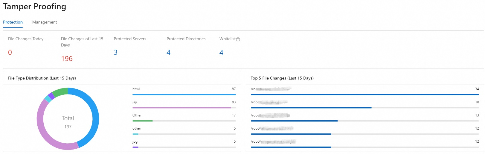

- Details of alerts triggered by web tamper proofing

  The alert list displays all alerts that are generated for abnormal file changes on your server regardless of whether the alerts are generated in **Interception Mode** or **Alert Mode**. You can view the details of an alert, including the severity level, alert name, affected assets, file path, process name, and protection status. The severity level is **Medium**.

  - List of **Handled** alerts

    By default, alerts that are generated in Interception Mode are displayed, and the **status** of the alerts is **Defended**. This indicates that the web tamper proofing feature detects abnormal file changes and then intercepts the processes that modify files.

    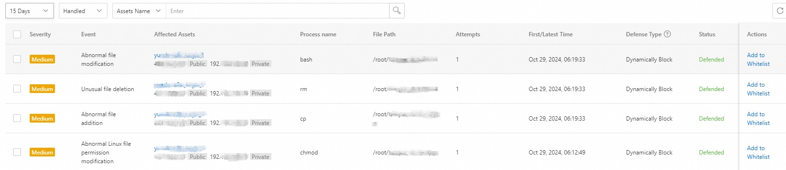

  - List of **Unhandled** alerts

    Alerts that are generated in **Alert Mode** are displayed, and the default **status** of the alerts is **Unhandled**. This indicates that the web tamper proofing feature generates alerts for suspicious processes and abnormal file changes.

  If an intercepted process that modifies files or the process that modifies files and then triggers an alert is required by your workloads, you can add the process to the whitelist to allow the process. After you add a process for which an alert is generated to the whitelist, the status of the alert changes to **Added to Whitelist**, and the alert is added to the **Handled** alert list. For more information, see ***Add a process to the whitelist***.

  > **Important**
  >
  > If an alert is reported more than 100 times, we recommend that you handle the alert at the earliest opportunity.

**Add a process to the whitelist**

If you confirm that the process that modifies the protected files on your server is normal and want the process to modify the files, you can add the process to the whitelist.

> **Important**
>
> - You can add a process to the process whitelist only if the operating system and kernel versions of your server are supported by the whitelist feature. For more information, see ***Supported versions of operating systems and kernels***.
>
> - Attackers may exploit the processes in the whitelist to compromise your server. We recommend that you add only trusted processes to the whitelist.

On the **Protection** tab of the **Tamper Proofing** page, add a normal process to the whitelist.

**Add a process for which an alert is generated to the whitelist**

1. In the **Unhandled** alert list, find a process that you want to add to the whitelist and click **Handle** in the **Actions** column.

2. In the dialog box that appears, set the **Process Method** parameter to **Add To Whitelist** and click **Process Now**.

   A process may run on multiple servers or run in multiple directories on the same server. If you want to add the process to the whitelist, select **Process servers with the same process at the same time**.

You can also find alerts generated for processes that modify files in the **Handled** alert list and add an alert whose status is **Defended** to the whitelist. You can view process paths to check whether a process is normal.

**Add multiple processes for which alerts are generated to the whitelist at the same time**

1. In the alert event list on the Protection tab, find and select the processes that you want to add to the whitelist.

2. Click **Add Process to Whitelist** below the list. In the message that appears, click **OK**.

**Specify processes in the process whitelist**

1. Click the number below **Whitelist** to go to the **Process Management** panel.

   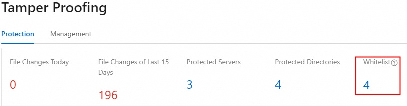

2. Click **Enter the Whitelist**. Then, configure the **Process Path** and **Server Name/IP** parameters to add a process to the process whitelist.

**View the processes in the whitelist or remove processes from the whitelist**

1. Click the number below **Whitelist** to go to the **Process Management** panel. In the Process Management panel, you can view the information about all suspicious processes that are added to the whitelist. The information includes the server on which the processes run, the paths to the processes, and the numbers of times that the processes modify files.

2. In the Process Management panel, find the suspicious process that you want to remove and click **Remove from Whitelist** in the **Actions** column. You can also select multiple suspicious processes and click **Remove from Whitelist** below the list to remove the processes from the whitelist at a time.

<a id="section-4-4-3"></a>

### 4.4.3. Application whitelist

The application whitelist feature prevents unauthorized programs from running on your servers and provides a trusted running environment for your servers. This topic describes how to use the application whitelist feature.

**Create an application whitelist policy**

1. Log on to the Apsara Uni-manager Management Console.

2. In the upper-right corner of the Apsara Uni-manager Management Console, choose **Security** > **Server Security > Server Guard**. On the **Server Guard** page, select a region from the **Region** drop-down list and click **Access with Authorized Role**.

   > **Note**
   >
   > - In multi-level organization mode, all data permissions are managed by using resource sets in organizations. You can select an organization or a resource set in the top navigation bar of the console to view or manage the assets of the organization or resource set.
   >
   > - The parent organization has the highest management permissions. Modifications to the parent organization take effect on all child organizations and resource sets that belong to the parent organization. Proceed with caution when you modify the configurations.

3. In the left-side navigation pane, choose **Defense** > **Application Whitelists**.

4. On the **Policies** tab of the **Application Whitelist** page, click **Create Policy**.

5. In the **Create Application Whitelist** panel, configure an application whitelist policy and click **Create**.

   | Parameter | Description |
   | --- | --- |
   | Policy Name | The name of the policy. |
   | Policy Mode | The mode of the policy. Valid values: <strong>Alert Mode</strong> and <strong>Observation Mode</strong>.<br>Note<br>In observation mode, no alerts are generated. After the observation ends, the observation mode is automatically changed to the alert mode. |
   | Observation End Time | If you set the <strong>Policy Mode</strong> parameter to <strong>Observation Mode</strong>, you must configure this parameter. |
   | Policy Content | The content of the policy. You can configure the following items:<br>• <strong>Process Collection Tasks</strong>: Click <strong>Settings</strong>. In the <strong>Select Process</strong> <strong>Collection Task</strong> panel, select tasks and click <strong>OK</strong>.<br>• <strong>Custom Process Group</strong>: Click <strong>Settings</strong>. In the <strong>Select Custom Process</strong> <strong>Group</strong> panel, select process groups and click <strong>OK</strong>.<br>• <strong>Process base white Library</strong>: the default item that refers to the basic whitelist of Apsara Stack system images and the basic whitelist of YUM repositories. |
   | Select an asset | The assets on which you want the policy to take effect. |

   In the application whitelist policy list, you can perform the following operations:

   - Modify a policy: Find the policy that you want to modify and click **Edit** in the **Actions** column.

   - Enable or disable a policy: Select the policy that you want to enable or disable and click **Enable all or Disable all** below the policy list.

   - Delete a policy: Select the policy that you want to delete and click **Delete** below the policy list.

**View the servers on which the application whitelist policy takes effect**

1. Log on to the Apsara Uni-manager Management Console.

2. In the upper-right corner of the Apsara Uni-manager Management Console, choose **Security** > **Server Security > Server Guard**. On the **Server Guard** page, select a region from the **Region** drop-down list and click **Access with Authorized Role**.

   > **Note**
   >
   > - In multi-level organization mode, all data permissions are managed by using resource sets in organizations. You can select an organization or a resource set in the top navigation bar of the console to view or manage the assets of the organization or resource set.
   >
   > - The parent organization has the highest management permissions. Modifications to the parent organization take effect on all child organizations and resource sets that belong to the parent organization. Proceed with caution when you modify the configurations.

3. In the left-side navigation pane, choose **Defense** > **Application Whitelists**.

4. On the **Application Whitelist** page, click the **Servers** tab and view the servers on which the policy takes effect.

   You can filter servers by policy status, policy mode, and asset status. You can also filter servers by server group and protection status.

   In the server list, you can perform the following operations:

   - View the policy details of a server: Find the server that you want to view and click **Details** in the **Actions** column.

   - Enable or disable the policy for a server: Select the server for which you want to enable or disable the policy and click **Enable Policy or Disable Policy** below the server list.

   - Remove the policy: Select the server from which you want to remove the policy and choose **More Operations** > **Detach Policy** below the server list.

**Create a collection task**

1. Log on to the Apsara Uni-manager Management Console.

2. In the upper-right corner of the Apsara Uni-manager Management Console, choose **Security** > **Server Security > Server Guard**. On the **Server Guard** page, select a region from the **Region** drop-down list and click **Access with Authorized Role**.

   > **Note**
   >
   > - In multi-level organization mode, all data permissions are managed by using resource sets in organizations. You can select an organization or a resource set in the top navigation bar of the console to view or manage the assets of the organization or resource set.
   >
   > - The parent organization has the highest management permissions. Modifications to the parent organization take effect on all child organizations and resource sets that belong to the parent organization. Proceed with caution when you modify the configurations.

3. In the left-side navigation pane, choose **Defense** > **Application Whitelists**.

4. On the **Application Whitelist** page, click the **Knowledge Bases** tab and then click the **Process Collection** tab.

5. On the **Process Collection** tab, click **Create Collection Task**.

6. In the **Create Process Collection Task** panel, configure Task Name, Observation End Time, and Scan Assets, and click **OK**.

   You can re-scan assets and view task details in the collection task list.

**Create a custom process group**

1. Log on to the Apsara Uni-manager Management Console.

2. In the upper-right corner of the Apsara Uni-manager Management Console, choose **Security** > **Server Security > Server Guard**. On the **Server Guard** page, select a region from the **Region** drop-down list and click **Access with Authorized Role**.

3. In the left-side navigation pane, choose **Defense** > **Application Whitelists**.

4. On the **Application Whitelist** page, click the **Knowledge Bases** tab and then click the **Custom Process Group** tab.

5. On the **Custom Process Group** tab, click **Create Custom Process Group**.

6. In the **Create Custom Process Group** dialog box, enter a process group name and click **Create**.

   After you create the custom process group, you can change the name of the process group, delete the process group, or add an MD5 hash value to the process group.

<a id="section-4-4-4"></a>

### 4.4.4. Attack analysis

This topic describes the statistics that are provided by the attack analysis feature. The statistics include the total number of attacks, distribution of attack types, top 5 attack sources, top 5 attacked assets, and the attack list.

**Background information**

After Server Guard detects basic attacks, Server Guard blocks the attacks. The attack statistics are displayed on the **Attack Analysis** page. You do not need to handle the attacks. If high-risk attacks are detected, you can use the attack analysis feature to identify the source addresses of the attacks and take preventive measures We recommend that you deploy firewalls and adopt business-specific security measures to develop a more refined and precise defense system.

On the **Attack Analysis** page, you can specify a time range to view attack details. You can view the attack analysis statistics of the current day, last 7 days, or last 15 days. You can also configure a custom **time range** to view the statistics.

You can view the following details of attacks on your assets:

- Attacks: the total number of attacks detected in your assets within the specified time range.

- Attack Type Distribution: the attack types and the number of attacks for each type.

- Top 5 Attack Sources: the top 5 IP addresses from which the most attacks are launched.

- Top 5 Attacked Assets: the top 5 assets that encountered the most attacks.

- Attack list: the details of all attacks, including the attack time, source IP address, attacked asset, attack type, and attack status.

**Attacks**

In the **Attacks** section, a graph displays the attack trend within the specified time range. You can view the peak and valley values in the graph. You can move the pointer over the graph to view the attack date, the attack time, and the number of attacks.

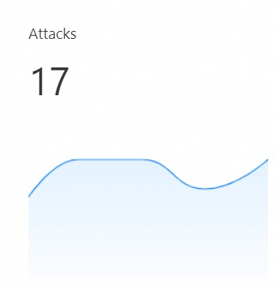

**Attack Type Distribution**

In the **Attack Type Distribution** section, you can view the attack types and the number of attacks for each type.

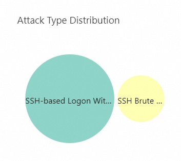

**Top 5 Attack Sources**

In the **Top 5 Attack Sources** section, you can view the top 5 IP addresses from which attacks are most launched and the number of attacks that are initiated from each IP address.

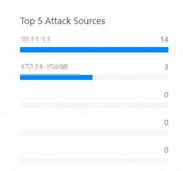

**Top 5 Attacked Assets**

In the **Top 5 Attacked Assets** section, you can view the public IP addresses of the top 5 assets that encountered the most attacks and the number of attacks on each asset.

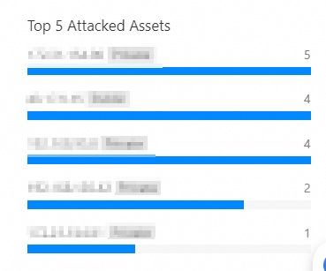

**Attack list**

In the attack list, you can view the details of each attack, including the attack time, source IP address, attacked asset, attack type, attack method, and attack status.

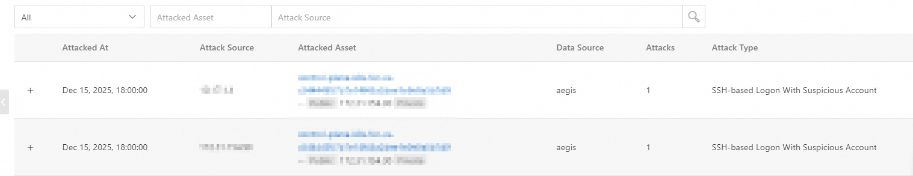

You can perform the following operations on attacks in the attack list:

- Search for an attack

  To search for an attack and view the details of the attack, specify search conditions above the attack list. Search conditions include the attack type, attacked asset, and source IP address.

- View the details of an attacked asset

  To view the details of an attacked asset, move the pointer over the name of the attacked asset in the **Attacked Asset** column.

- Export the attack list

  To export and save the attack list to your computer, click the

  

  icon in the upper-left corner of the attack list. The exported file is in the Excel format.

<a id="section-4-4-5"></a>

### 4.4.5. Security alert

<a id="section-4-4-5-1"></a>

#### 4.4.5.1. Overview

If Server Guard detects sensitive file tampering operations, suspicious processes, webshells, unusual logins, and malicious processes, Server Guard generates alerts. You can monitor the security status of your assets based on the alerts and handle potential threats at the earliest opportunity.

Server Guard provides statistics about alerts. This helps you understand the overall protection situation. You can view the statistics about alerts on the **Security Alerts** page of Server Guard.

**Alert types**

The following table describes the alert types.

| Alert type | Description |
| --- | --- |
| Unusual Logon | Server Guard detects unusual logins to your servers. You can configure approved login IP addresses, time ranges, and accounts. Logins from unapproved IP addresses, accounts, or time ranges trigger alerts. You can manually add approved login locations or configure the system to automatically update approved login locations. You can also specify the assets on which alerts are triggered when unusual login locations are detected.<br>Server Guard can detect the following suspicious activities:<br>• Logins to Elastic Compute Service (ECS) instances from unapproved IP addresses<br>• Logins to ECS instances from an unapproved login location<br>• Suspicious command sequence executed after logins to ECS instances over SSH<br>• ECS instances compromised due to brute-force attacks on SSH |
| Application Whitelist | You can create a whitelist policy for applications on servers that require reinforced protection. If the suspicious or malicious processes that are identified by the policy are not added to the whitelist, Server Guard generates alerts. |
| Webshell | Server Guard uses engines developed by Apsara Stack to scan common webshell files. Server Guard supports scheduled scan tasks, provides real-time protection, and quarantines webshell files.<br>• Server Guard scans an entire web directory early in the morning on a daily basis.If a file in the web directory changes, Server Guard immediately scans the file for webshells.<br>• You can specify the assets that Server Guard scans for webshells.<br>• You can quarantine, restore, or ignore the detected trojan files. |
| Unusual Network Connection | Server Guard detects unusual network connections and disconnections. |
| Precise Defense | Server Guard automatically blocks common Internet viruses, such as ransomware, DDoS trojans, mining and trojan programs, malicious programs, webshells, and computer worms. |
| Suspicious Account | Server Guard detects unapproved accounts that attempt to log in to your assets. |
| Persistence | Server Guard detects suspicious scheduled tasks on servers. If persistent threats against the servers are detected, Server Guard generates alerts. |
| Suspicious Process | Server Guard detects suspicious processes for assets. |
| Malicious Software | The threat detection model detects malware that is being executed on your server. |
| Sensitive File Tampering | Server Guard checks whether the sensitive files on your servers are tampered with.The sensitive files include pre-loaded configuration files in the shared libraries of Linux. |
| Application Intrusion Event | An intrusion alert can be generated after Server Guard detects common threats or advanced persistent threats (APTs) on your server. The detected threats may be attacks that are launched by using a malicious IP address or an intrusion into your server, such as malicious script execution on your server or access to malicious download sources. |
| Malicious Script | Server Guard checks whether the system services of your assets are attacked or modified by malicious scripts. If potential script attacks are detected, Server Guard generates alerts. Malicious scripts are classified into file-based scripts and fileless scripts. After an attacker gains control over a server, the attacker uses scripts for additional attacks. For example, the attacker may insert mining programs and webshells, and add administrator accounts to the system of the server. Malicious scripts can be written in programming languages such as Bash, Python, Perl, PowerShell, Batch, and VBScript. |
| Exploit | The threat detection model detects exploits on your server. An exploit takes advantage of known vulnerabilities in operating systems and applications to escalate privileges, implement escapes, and execute arbitrary code. |
| Command Line Audit | Server Guard checks whether high-risk commands are run on your assets. To view and configure a command audit rule, perform the following operations: Log in to the Apsara Uni-manager Operations Console. In the top navigation bar, choose Product Operation &gt; <strong>Cloud Shield Operations Center</strong>. In the left-side navigation pane, choose Cloud Services &gt; <strong>Server Guard O&amp;M</strong> &gt; <strong>Global Settings</strong>. On the <strong>Host Security Rule Settings</strong> tab of the Global Settings page, view and manage the rule in the <strong>Configure Cooldown Threshold for Audit of High-risk</strong> <strong>Command</strong> section. |

**Attack phases**

| Attack phase | Description |
| --- | --- |
| Initial Access | The attacker accesses the entry point of the target system for the first time. For example, the attacker logs in to your server by using a weak password via Remote Desktop Protocol (RDP). |
| Execution | The attacker runs malicious code on the target system. The attacker has obtained the execution permission and proceeds with the next operation. For example, the attacker can run the <code> whoami </code> command by using a webshell. |
| Persistence | The attacker ensures long-term control over the target system, even if the system restarts or the account changes. For example, this can be achieved by adding a malicious service that starts automatically upon system startup. |
| Privilege Escalation | The attacker elevates privileges from normal to high. |
| Defense Evasion | The attacker takes measures to circumvent security detection and protection mechanisms. |
| Credential Access | The attacker attempts to obtain your login credential. |
| Discovery | The attacker scouts the compromised server for system and network environment information. |
| Lateral Movement | The attacker moves from a compromised server to another server within the same network. |
| Collection | The attacker identifies and collects sensitive data from the target system. |
| Exfiltration | The collected data is transmitted to an attacker-controlled external server. |
| Command and Control | A connection is established with the attacker's command server to receive instructions. |
| Impact | The attacker causes direct damage or disruption to your system or business. |
| Resource Development | The attacker prepares infrastructure or resources before launching an attack. |
| Reconnaissance | The attacker gathers information about the target system before launching an attack. |

<a id="section-4-4-5-2"></a>

#### 4.4.5.2. View and handle alerts

This topic describes how to view and handle alerts that are generated by Server Guard.

**Background information**

After Apsara Stack Security generates an alert, the information about the alert is displayed. If the alert is not handled, the alert is displayed in the **Unhandled Alerts** list on the **Security Alerts** page. After the alert is handled, the status of the alert changes from **Unhandled Alerts** to **Handled**.

> **Note**
>
> Apsara Stack Security retains the records of **Unhandled Alerts** and **Handled** on the **Security Alerts** page. By default, the records of **Unhandled Alerts** are displayed.

**Platform**

1. Log on to the Apsara Uni-manager Management Console.

2. In the upper-right corner of the Apsara Uni-manager Management Console, choose **Security** > **Server Security > Server Guard**. On the **Server Guard** page, select a region from the **Region** drop-down list and click **Access with Authorized Role**.

   > **Note**
   >
   > - In multi-level organization mode, all data permissions are managed by using resource sets in organizations. You can select an organization or a resource set in the top navigation bar of the console to view or manage the assets of the organization or resource set.
   >
   > - The parent organization has the highest management permissions. Modifications to the parent organization take effect on all child organizations and resource sets that belong to the parent organization. Proceed with caution when you modify the configurations.

**View the details of an alert**

1. In the left-side navigation pane, choose **Defense** > **Security Alerts**.

2. On the Security Alerts page, view or search for all alerts and the details of the alerts.

**Handle alerts**

1. In the left-side navigation pane, choose **Defense** > **Security Alerts**.

2. On the **Security Alerts** page, find the alert that you want to handle and click **Handle** in the **Actions** column. In the dialog box that appears, configure Process Method and click **Process Now**.

   > **Note**
   >
   > If the alert is related to multiple exceptions, the details panel of the alert appears after you click **Handle**. You can separately handle the exceptions in the panel.

   - **Ignore**: If you ignore the alert, the status of the alert changes to **Handled**. Server Guard no longer generates this alert.

   - **Add To Whitelist**: If the alert is a false positive, you can add the alert to the whitelist. Then, the status of the alert changes to **Handled**. Server Guard no longer generates this alert. In the **Handled** alert list, you can click **Cancel whitelist** to remove the alert from the whitelist.

     > **Note**
     >
     > A false positive indicates that Server Guard generated an alert on a normal process. A common false positive includes alerts that are generated for a **suspicious process that sends TCP packets**. The false positive notifies you that suspicious scans on other devices are detected on your servers.

   - **Handled manually**: This alert reports a suspicious exception. We recommend that you troubleshoot the exception based on the handling suggestions. After you troubleshoot the exception, click Process Now. Then, the alert status changes to Handled.

   - **Batch unhandled**: This method allows you to handle multiple alerts at a time. Before you handle multiple alerts at a time, we recommend that you view the details of the alerts.

3. **Optional.** If you confirm that one or more alerts can be ignored or are false positives, select the alerts and click **Ignore Once** or **Whitelist** on the **Security Alerts** page.

**Export alerts**

1. In the left-side navigation pane, choose **Defense** > **Security Alerts**.

2. On the **Security Alerts** page, click the

   icon above the alert list to export alerts.

   

   After the alert list is exported, the **Done** message appears in the upper-right corner of the Security Alerts page.

3. In the **Done** notification of the **Alerts** page, click **Download**. The alert list is downloaded to your computer.

**Download archived data**

Server Guard automatically enables alert event archiving and saves archived data for 185 days. You can download archived data.

> **Important**
>
> In multi-level organization mode, only an account that has level-1 organization permissions or global organization permissions can download archived data.

1. In the left-side navigation pane, choose **Defense** > **Security Alerts**.

2. In the upper-right corner of the page, click **Archive data**.

3. In the dialog box that appears, find the data that you want to download and click **Download**.

<a id="section-4-4-5-3"></a>

#### 4.4.5.3. View exceptions related to an alert

Server Guard supports automatic analysis of exceptions related to an alert. You can click the name of an alert in the alert list to view and manage all exceptions that are related to the alert. You can also view the results of automatic attack tracing to analyze and handle the exceptions.

**Background information**

- Security Center automatically associates alerts with exceptions in real time to detect potential threats.

- Exceptions related to an alert are listed in chronological order. This allows you to analyze and handle the exceptions to improve the emergency response mechanism of your system.

- An automatically correlated alert is identified by the  icon.

**Procedure**

1. Log on to the Apsara Uni-manager Management Console.

2. In the upper-right corner of the Apsara Uni-manager Management Console, choose **Security** > **Server Security > Server Guard**. On the **Server Guard** page, select a region from the **Region** drop-down list and click **Access with Authorized Role**.

   > **Note**
   >
   > - In multi-level organization mode, all data permissions are managed by using resource sets in organizations. You can select an organization or a resource set in the top navigation bar of the console to view or manage the assets of the organization or resource set.
   >
   > - The parent organization has the highest management permissions. Modifications to the parent organization take effect on all child organizations and resource sets that belong to the parent organization. Proceed with caution when you modify the configurations.

3. In the left-side navigation pane, choose **Defense** > **Security Alerts**.

4. On the Security Alerts page, click the name of the required alert in the **Event** column. The alert details panel appears.

5. In the alert details panel, view the alert details and related exceptions of the alert. Then, handle the exceptions.

   - View the details about an alert

     View the assets that are affected by an alert, the first time and last time when the alert was triggered, and the details about the related exceptions.

   - View affected assets

     Move the pointer over the name of an **affected asset** to view the details about the asset.

   - View and manage **related exceptions**

     In the **Related Exceptions** section, view the details about all the exceptions that are related to the alert. You can also view suggestions on how to handle the exceptions.

     - Click **Note** to the right of an exception to add a note for the exception.

     - Click the  icon to the right of a note to delete the note.

<a id="section-4-4-5-4"></a>

#### 4.4.5.4. Quarantine

Sever Guard can quarantine malicious files. Quarantined files are listed in the Quarantine panel of the Security Alerts page. The system automatically deletes a quarantined file 30 days after the file is quarantined. You can restore a quarantined file with a few clicks before the file is deleted. This topic describes how to view and restore quarantined files.

**Procedure**

1. Log on to the Apsara Uni-manager Management Console.

2. In the upper-right corner of the Apsara Uni-manager Management Console, choose **Security** > **Server Security > Server Guard**. On the **Server Guard** page, select a region from the **Region** drop-down list and click **Access with Authorized Role**.

   > **Note**
   >
   > - In multi-level organization mode, all data permissions are managed by using resource sets in organizations. You can select an organization or a resource set in the top navigation bar of the console to view or manage the assets of the organization or resource set.
   >
   > - The parent organization has the highest management permissions. Modifications to the parent organization take effect on all child organizations and resource sets that belong to the parent organization. Proceed with caution when you modify the configurations.

3. In the left-side navigation pane, choose **Defense** > **Security Alerts**.

4. On the **Security Alerts** page, click **Quarantine** in the upper-right corner.

   In the **Quarantine** panel, you can perform the following operations:

   - View information about quarantined files. The information includes server IP addresses, paths that store the files, file status, and modification time.

   - Click **Restore** in the **Actions** column to remove a file. The file is displayed in the alert list again.

<a id="section-4-4-5-5"></a>

#### 4.4.5.5. Configure alerts

This topic describes how to configure alerts. You can specify approved logon locations and web directories to scan. You can also configure advanced logon settings.

**Background information**

Server Guard supports advanced logon settings. You can configure fine-grained logon detection rules. For example, you can specify approved logon IP addresses, approved logon time ranges, and approved logon accounts to block unauthorized access to your assets.

**Procedure**

1. Log on to the Apsara Uni-manager Management Console.

2. In the upper-right corner of the Apsara Uni-manager Management Console, choose **Security** > **Server Security > Server Guard**. On the **Server Guard** page, select a region from the **Region** drop-down list and click **Access with Authorized Role**.

   > **Note**
   >
   > - In multi-level organization mode, all data permissions are managed by using resource sets in organizations. You can select an organization or a resource set in the top navigation bar of the console to view or manage the assets of the organization or resource set.
   >
   > - The parent organization has the highest management permissions. Modifications to the parent organization take effect on all child organizations and resource sets that belong to the parent organization. Proceed with caution when you modify the configurations.

3. In the left-side navigation pane, choose **Defense** > **Security Alerts**.

4. In the upper-right corner of the page that appears, click **Settings**.

   If you have multiple organizations, select the required organization and resource set. Then, configure parameters on different tabs.

   - **Add an approved logon location**

     <ol type="a">

     <li>

     In the **Approved Logon Location** section, click **Manage** on the right side.

     </li>

     <li>

     Select the logon location that you want to add and select the servers for which you want to allow logons from the location.

     </li>

     </ol>

     <ol type="i" start="100">

     <li>

     Click **OK**.

     </li>

     </ol>

     Server Guard allows you to **modify** or **remove** approved logon locations.

     - To change the servers that allow logons from an approved logon location, find the location and click **Edit** in the Actions column.

     - To remove an approved logon location, find the location and click **Delete**.

   - **Configure advanced logon settings**

     > **Note**
     >
     > When you configure advanced logon settings, you can specify the IP addresses, accounts, and time ranges that are allowed for logons to your assets. After the advanced logon settings are configured, Server Guard sends you alerts if your assets receive logon requests that are outside the logon settings. The procedure to configure advanced logon settings is similar to the procedure to configure **approved logon locations**. You can follow the preceding procedure to **create**, **modify**, and **delete** advanced logon settings.

     - Turn on or turn off the switch to the right of **Unapproved IP Address Alert**. If you turn on the switch and your assets receive logon requests from unapproved IP addresses, alerts are triggered.

     - Turn on or turn off the switch to the right of **Unapproved Logon Time Alert**. If you turn on the switch and your assets receive logon requests in unapproved time ranges, alerts are triggered.

     - Turn on or turn off the switch to the right of **Unapproved Account Logon Alert**. If you turn on the switch and your assets receive logon requests from unapproved accounts, alerts are triggered.

   - **Add web directories to scan**

     Server Guard automatically scans web directories of data assets in your servers and runs dynamic and static scan tasks. You can also manually add custom web directories.

     <ol type="a">

     <li>

     In the **Add Scan Targets** section, click **Manage** on the right side.

     </li>

     <li>

     Specify a valid web directory and select the servers on which the web directory is scanned.

     > **Note**
     >
     > To ensure the scan performance and efficiency, we recommend that you do not specify a root directory.

     </li>

     </ol>

     <ol type="i" start="100">

     <li>

     Click **OK**.

     </li>

     </ol>

   - **Modify a whitelist rule**

     - **Organization-level Whitelist Rule**: You can modify or delete the whitelist rules of your assets.

       - Find an asset and click **Edit** in the **Actions** column to modify the whitelist rule of the asset.

       - Find an asset and click **Delete** in the **Actions** column to delete the whitelist rule of the asset.

     - **Global Whitelist Rule**: The whitelist rules are configured by Apsara Stack Security and cannot be modified.

<a id="section-4-4-6"></a>

### 4.4.6. Use SDK for malicious file detection

You can use SDK for malicious file detection to detect common viruses such as ransomware and mining programs in Object Storage Service (OSS) objects to prevent the spread and execution of malicious files. This topic describes how to use SDK for malicious file detection.

**Supported virus types**

The following table describes the types of viruses that can be detected.

| Virus type | Virus name |
| --- | --- |
| Backdoor | Reverse shell |
| DDoS | DDoS trojan |
| Downloader | Trojan downloader |
| Engtest | Engine test program |
| Hacktool | Attacker tool |
| Trojan | High-risk program |
| Malbaseware | Tainted basic software |
| MalScript | Malicious script |
| Malware | Malicious program |
| Miner | Mining program |
| Proxytool | Proxy |
| RansomWare | Ransomware |
| RiskWare | Riskware |
| Rootkit | Rootkit |
| Stealer | Tool that is used to steal information |
| Scanner | Scanner |
| Suspicious | Suspicious program |
| Virus | Infectious virus |
| WebShell | Webshell |
| Worm | Worm |

**OSS object detection**

1. Log in to the Apsara Uni-manager Management Console.

2. In the upper-right corner of the Apsara Uni-manager Management Console, choose **Security** > **Server Security > Server Guard**. On the **Server Guard** page, select a region from the **Region** drop-down list and click **Access with Authorized Role**.

   > **Note**
   >
   > - In multi-level organization mode, all data permissions are managed by using resource sets in organizations. You can select an organization or a resource set in the top navigation bar of the console to view or manage the assets of the organization or resource set.
   >
   > - The parent organization has the highest management permissions. Modifications to the parent organization take effect on all child organizations and resource sets that belong to the parent organization. Proceed with caution when you modify the configurations.

3. In the left-side navigation pane, choose **Defense** > **SDK for Malicious File Detection**.

4. Click the **OSS Object Check** tab, detect one or more buckets by using an appropriate detection method. The following table describes the supported detection methods.

   If your bucket is not displayed in the list on the **OSS Object Check** tab, you can click **Synchronize Buckets** to obtain the latest list of buckets.

   | Detection method | Description | Procedure |
   | --- | --- | --- |
   | Manual full detection | Check all objects in one or more buckets. | i. On the <strong>OSS Object Check</strong> tab, find the bucket that you want to manage and click <strong>Full</strong> <strong>Detection</strong> in the <strong>Actions</strong> column, or select multiple buckets and click <strong>Batch Check</strong> below the bucket list.<br>ii. In the <strong>Full Detection</strong> dialog box, configure the Object Check Type parameter and click <strong>OK</strong>. |
   | Manual incremental detection | Check only newly added objects in a bucket that has been checked. | i. On the <strong>OSS Object Check</strong> tab, find the bucket that you want to manage and click <strong>Incremental</strong> <strong>Check</strong> in the <strong>Actions</strong> column.<br>ii. In the <strong>Incremental Check</strong> dialog box, configure the Object Check Type parameter and click <strong>OK</strong>. |
   | Automatic detection | Enable periodic automatic detection for specified buckets based on configured scan policies.We recommend that you take note of the following items before you configure a scan policy:<br>• A bucket can be specified only in one policy.<br>• Automatic detection is enabled only for newly added objects in OSS. | i. On the <strong>OSS Object Check</strong> tab, click <strong>Configure</strong> <strong>Policy</strong>.<br>ii. In the <strong>Policy configuration</strong> panel, click <strong>Edit</strong> in the Actions column.<br>iii. In the Modify Policy panel, configure the <strong>Check</strong> <strong>Cycle</strong>, <strong>Object Check Time</strong>, and <strong>Object Check</strong> <strong>Type</strong> parameters, and click <strong>Determine</strong>. |

**View detection results**

- View the overall information about at-risk OSS objects

  On the **At-risk File Overview** tab, you can view the following information: the total number of OSS objects that are checked, the number of objects at each risk level, and the remaining check quota. The risk levels include high, medium, and low.

- View the details of at-risk objects

  In the list of at-risk objects of the At-risk File Overview tab, find the object whose details you want to view and click **Details** in the **Actions** column. In the details panel, view details of the object on the tabs, including Object Details and Event Description.

  > **Note**
  >
  > If risks are detected in an object, the object may be embedded with viruses such as malicious scripts and DDoS trojans. We recommend that you handle the object at the earliest opportunity based on the suggestions provided on the Event Description tab.

- View the statistics on OSS object detection

  On the **OSS Object Check** tab, you can view the following information: the number of buckets in which malicious objects are detected, the number of objects at each risk level, and the total number of buckets. The risk levels include high, medium, and low.

- View the detection results of a bucket In the bucket list of the **OSS Object Check** tab, find the bucket whose detection results you want to view and click **Details** in the **Actions** column. On the Object Check Details page, you can view the information about the bucket on the Basic Information and At-risk Object Details tabs.

<a id="section-4-4-7"></a>

### 4.4.7. Use the core file monitoring feature

The core file monitoring feature monitors access to core files on servers in real time. The feature can monitor file operations such as access, modify, delete, and rename operations in real time and generate alerts when suspicious operations are detected. You can use the feature to check whether your core files are stolen or tampered with. This topic describes how to use the core file monitoring feature to monitor access to core files on servers.

> **Important**
>
> In multi-level organization mode, pay attention to the following items:
>
> - Only an account that has level-1 organization permissions or global organization permissions can create, modify, or delete a rule.
>
> - You can view the status of hosts within the permission scope by resource set.

**Limits**

The servers must run a kernel Linux version that is supported by the AliWebGuard file. For more information, see Website tamper-proofing.

**Step 1: Create a rule**

**Rule validation logic**

Before the core file monitoring feature works, you must create rules to specify the monitoring scope of server files. We recommend that you understand the rule validation logic before you create a rule.

- During the monitoring of access to files on a server, Server Guard generates an alert or allows a request only if the request matches **all** the following items in the rule that you specify:

  - Process path

  - File path

  - File operation

- Server Guard preferentially matches requests against the rules in which the Handling Method parameter is set to Release. This type of rule is referred to as an allow rule. If a request does not match an allow rule, Server Guard matches the request against the rules in which the Handling Method parameter is set to Alert. This type of rule is referred to as an alert rule.

**Configuration suggestions and examples**

We recommend that you configure monitoring rules for core system files and important configuration files.

Before you create a rule, you must determine the files to monitor and the scope of processes that are allowed to access the files.

For core business files, you must configure an alert rule for all processes and multiple allow rules for allowed processes. This helps ensure that all access operations on the files are monitored and unnecessary alerts are not generated.

> **Important**
>
> - If you do not configure an alert rule for all processes, you cannot monitor the access operations performed by processes that are beyond the scope of the specified process path. All out-of-scope processes can bypass the monitoring of Server Guard.
>
> - When you configure an allow rule, we recommend that you do not use a wildcard character to specify a process path. If you use a wildcard character to specify a process path, attackers can exploit the allow rule to access your server files after bypassing the monitoring of Server Guard.

For example, the path of the core files that you want to monitor is /etc/sysctl.conf, and the allowed process is systemd. To monitor the file path /etc/sysctl.conf, you must configure two rules.

- Rule 1: Set the Handling Method parameter to Alert, set the Process Path parameter to an asterisk ( `*` ), set the File Path parameter to  `/etc/sysctl.conf` , and select all options for the File operation parameter. The asterisk (\*) specifies all processes.

- Rule 2: Set the Handling Method parameter to Release, set the Process Path parameter to  `/usr/lib/systemd/systemd` , set the File Path parameter to  `/etc/sysctl.conf` , and select all options for the File operation parameter.

If you want to monitor core files on multiple servers, you can specify the file paths on all servers in an alert rule and set the Process Path parameter to an asterisk (\*). Then, configure multiple allow rules for different process paths that you want to allow on different servers.

**Procedure**

1. Log on to the Apsara Uni-manager Management Console.

2. In the upper-right corner of the Apsara Uni-manager Management Console, choose **Security** > **Server Security > Server Guard**. On the **Server Guard** page, select a region from the **Region** drop-down list and click **Access with Authorized Role**.

   > **Note**
   >
   > - In multi-level organization mode, all data permissions are managed by using resource sets in organizations. You can select an organization or a resource set in the top navigation bar of the console to view or manage the assets of the organization or resource set.
   >
   > - The parent organization has the highest management permissions. Modifications to the parent organization take effect on all child organizations and resource sets that belong to the parent organization. Proceed with caution when you modify the configurations.

3. On the **Defense > Core File Monitoring** page, click the **Monitoring Rule** tab.

4. Click **New Rule**. In the New rule panel, configure the parameters and click **Determine**.

   | Parameter | Description |
   | --- | --- |
   | Rule Name | Enter a name for the scaling rule. |
   | Handling Method | Select an action for Server Guard to perform when the rule is hit. Valid values:<br>• <strong>Alert</strong>: Server Guard generates an alert and records an event.<br>• <strong>Release</strong>: Server Guard allows the request. Server Guard does not generate an alert or record an event. |
   | Alert Severity | Select the severity for the alert that is generated when the rule is hit. |
   | Rule status | Specify whether to enable the rule after the rule is created. You can enable a maximum of 100 rules. |
   | Process path | Enter the path of the processes to monitor.<br>• You can use a wildcard character to specify a process path. For example, if you want to monitor the process path /usr/conf, you can enter \*/conf.You can also use an asterisk (\*) to specify all processes.<br>• You can enter a process path that is 1 to 128 characters in length.<br>• You must separate multiple paths with line feeds. You can specify a maximum of 20 process paths in each rule. |
   | File Path | Enter the path of the files to monitor.<br>• You can use a wildcard character to specify a file path. For example, if you want to monitor the file path /etc/nginx/nginx.conf, you can enter/etc/nginx/\*. You can also use /\* to specify all file paths.<br>• You can enter a file path that is 1 to 128 characters in length.<br>• You must separate multiple paths with line feeds. You can specify a maximum of 20 file paths in each rule. |
   | File operation | Select the file operations that you want to monitor. |
   | Rule Scope | Select the servers to which you want to apply the rule.<br>In multi-level organization mode, you can filter servers by resource set when you select the <strong>By asset</strong> value. |

If you want to modify, delete, enable, or disable the rule after you create the rule, we recommend that you find the entry point in the Status or Actions column of the rule. The first time you enable a rule for a server, it requires up to 5 minutes for the rule to take effect. If you modify a rule, it requires up to 1 minute for the rule to take effect. After the rule takes effect, existing alerts and recorded events are not affected.

**Step 2: View and handle alerts**

1. On the **Core File Monitoring** page, click the **Alert Events** tab. Then, you can view the alerts that are generated by Server Guard on file access.

2. Find the alert that you want to view and click **Details** in the Actions column to view the details of file access.

   > **Note**
   >
   > - If a Python script is used to access a file, Server Guard cannot obtain detailed CLI information.
   >
   > - If a Shell built-in command is used to access a file, Server Guard cannot obtain detailed CLI information. For example, if the command is  `echo "new content" >> /etc/nginx/nginx.conf` ,  `["-bash"]`  is displayed as the collected CLI information on the alert details page. This is because the command is a Shell built-in command, which appends content to the nginx.conf file.
   >
   > - Server Guard collects CLI information after Shell parsing and displays the collected CLI information in JSON arrays on the alert details page. The command that is displayed may be different from the original user-specified command.
   >
   >   - Example 1: A user-specified command is  `mkdir "1 2"` , which is equivalent to the  `mkdir 1\ 2`  command. Both the commands create a directory named 1 2. After Shell parsing, the user-specified command becomes  `mkdir`  and  `1 2` , and the display result on the alert details page is  `["mkdir", "1 2"]` .
   >
   >   - Example 2: A user-specified command is  `rm -rf *` . After Shell parsing,  `*`  is replaced by all files and subdirectories in the specified directory. In this example, Server Guard collects and displays the following CLI information:  `rm` ,  `-rf` , and the list of all files and subdirectories in the current directory.

3. Check whether an abnormal event is recorded based on the details of file access.

   The follow-up solution varies based on your check results.

   - If an abnormal event is recorded, we recommend that you manually block the related processes and quarantine the related files after you confirm that your business is affected.

   - If the event records normal file access, you can add the alert to the whitelist to handle the alert.

   - If the event is considered not affecting your files and you do not need to add the alert to the whitelist, you can ignore the alert.

4. After you examine and handle the alert, find the alert and click **Handle** in the Actions column. Then, select a handling method and click **OK**.

   - Whitelist: After you add the alert to the whitelist, Server Guard automatically generates a whitelist rule that allows the behavior detected by the alert. If you select this option, you must configure the Whitelist Rule Name, Process Path, File Path, File operation, and Rule Scope parameters. Then, click **OK**.

   - Ignore: If you ignore the alert, the status of the alert changes to Ignored. If the same alert is detected later, Server Guard generates a new alert.

   - Handle manually: If you have handled the abnormal event, you can select this option.

**FAQ**

**What are the differences between web tamper proofing and core file monitoring?**

Web tamper proofing is a different feature that Server Guard provides to protect files. Web tamper proofing and core file monitoring differ in the following items.

| Item | Website tamper-proofing | Core file monitoring |
| --- | --- | --- |
| Scenario | You need to protect assets such as websites that are vulnerable to attacks and sensitive to file tampering. | • You need to monitor access operations on core files to prevent content theft.<br>• You need to monitor the changes on important files to avoid file tampering.The changes include modify, delete, and rename operations. |
| Protection scope | The feature can protect most Linux and Windows servers. | The feature can protect most Linux servers. |
| Capability | The feature supports identification of abnormal file changes. The feature can also block the related processes or generate alerts. | The feature supports monitoring of abnormal access to files, including read, modify, and delete operations. The feature can also generate alerts. |

For more information about web tamper proofing, see Use the feature of web tamper proofing.

**If I enable both web tamper proofing and core file monitoring, which feature preferentially takes effect?**

If web tamper proofing and core file monitoring are both enabled for a server, web tamper proofing preferentially takes effect. If Server Guard cannot match a request against the rules of web tamper proofing, Server Guard matches the request against the rules of core file monitoring. The process whitelist rules of web tamper proofing take effect only when the web tamper proofing feature works. The allow rules of core file monitoring take effect only when the core file monitoring feature works.

<a id="section-4-5"></a>

## 4.5. 日志检索

<a id="section-4-5-1"></a>

### 4.5.1. Log retrieval overview

Server Guard provides the log retrieval feature. You can use the feature to manage logs that are scattered in various systems of Apsara Stack in a centralized manner. This way, you can easily identify the causes of issues that occur on your servers.

The log retrieval feature allows you to store logs for 180 days and query logs that are generated within 30 days.

**Features**

The log retrieval feature provides the following benefits:

- **End-to-end log retrieval platform**: allows you to retrieve logs of various Apsara Stack services over a unified interface and trace issues in an efficient manner.

- **Log service-related software as a service (SaaS)**: allows you to query logs on all servers in Apsara Stack without the need to install or deploy specific software.

- TB-level data retrieval: allows you to obtain full-text search results within several seconds. You can also add up to 50 Boolean expressions in a search condition.

- Support for various log sources.

- Log delivery: allows you to deliver security logs to Simple Log Service for further analysis.

- Advanced search: allows you to query and analyze logs on a server. The advanced search feature can be used only after you activate Simple Log Service.

**Scenarios**

You can use the log retrieval feature to meet the following requirements:

- **Security event analysis**: When a security event is detected on a server, you can retrieve the logs to identify the cause of the issue and assess the extent of the damage and affected assets.

- **Operation audit**: You can audit the operation logs on a server to identify high-risk operations and critical issues in a precise manner.

**Retrievable log types**

Table 1 Log sources

| Log source | Description |
| --- | --- |
| Logon history | Logs of successful system logons |
| Process snapshots | Logs of processes on a server at a specific point in time |
| Port listening snapshots | Logs of listening ports on a server at a specific point in time |
| Account snapshots | Logs of account-based logons on a server at a specific point in time |
| Process startups | Logs of process startups on a server |
| Network connections | Logs of outbound connections that are initiated from hosts |

<a id="section-4-5-2"></a>

### 4.5.2. Query logs

This topic describes how to search for and view physical server logs.

**Quick search**

1. Log on to the Apsara Uni-manager Management Console.

2. In the upper-right corner of the Apsara Uni-manager Management Console, choose **Security** > **Server Security > Server Guard**. On the **Server Guard** page, select a region from the **Region** drop-down list and click **Access with Authorized Role**.

   > **Note**
   >
   > - In multi-level organization mode, all data permissions are managed by using resource sets in organizations. You can select an organization or a resource set in the top navigation bar of the console to view or manage the assets of the organization or resource set.
   >
   > - The parent organization has the highest management permissions. Modifications to the parent organization take effect on all child organizations and resource sets that belong to the parent organization. Proceed with caution when you modify the configurations.

3. In the left-side navigation pane, click **Log Retrieval**.

4. On the **Quick Search** tab, configure search conditions.

   | Search condition | Description |
   | --- | --- |
   | Select a log source | The log source that you want to query. For more information, see Supported log sources and fields. |
   | Select a field | The field that is recorded for the log source. For more information, see Supported log sources and fields. |
   | Keywords | The keyword of the field. |
   | Logical operator | Equal to or contained in the prefix. |
   | + | You can click the plus sign to add expressions for a log source. |
   | Time Range | The time range in which you want to query logs. |

5. Click **Search** and view the search result.

   - **Reset**: Click **Reset** to remove existing search conditions.

   - **Save Search**: Click **Save Search** to save a search condition, which can be used for subsequent log searches.

     > **Important**
     >
     > The Save Search button is displayed only when at least one result is returned based on the search conditions.

   - **Saved Search Conditions**: Click **Saved Search Conditions** to select and use a search condition that you saved.

**Advanced search**

> **Important**
>
> The advanced search feature can be used only after you activate Simple Log Service. To activate Simple Log Service, contact the administrator.

1. Log on to the Apsara Uni-manager Management Console.

2. In the upper-right corner of the Apsara Uni-manager Management Console, choose **Security** > **Server Security > Server Guard**. On the **Server Guard** page, select a region from the **Region** drop-down list and click **Access with Authorized Role**.

   > **Note**
   >
   > - In multi-level organization mode, all data permissions are managed by using resource sets in organizations. You can select an organization or a resource set in the top navigation bar of the console to view or manage the assets of the organization or resource set.
   >
   > - The parent organization has the highest management permissions. Modifications to the parent organization take effect on all child organizations and resource sets that belong to the parent organization. Proceed with caution when you modify the configurations.

3. In the left-side navigation pane, click **Log Retrieval**.

4. On the **Advanced Search** tab, follow the on-screen instructions to search for logs.

<a id="section-4-5-3"></a>

### 4.5.3. Supported log sources and fields

This topic describes the log sources and fields that are supported by the log retrieval feature.

The log retrieval feature allows you to query the following types of log sources. You can click a log source link to view the fields that are supported.

| Log source | Description |
| --- | --- |
| Logon history | Logs of successful system logons |
| Process snapshots | Logs of processes on a server at a specific point in time |
| Port listening snapshots | Logs of listening ports on a server at a specific point in time |
| Account snapshots | Logs of account-based logons on a server at a specific point in time |
| Process startups | Logs of process startups on a server |
| Network connection logs | Logs of active connections from a server to the Internet. |

**Logon history**

The following table describes the fields that are supported in the logon history.

| Field | Type | Description |
| --- | --- | --- |
| uuid | string | The ID of the client. |
| IP | string | The IP address. |
| warn_ip | string | The source IP address used for the logon. |
| warn_port | string | The port number of the logon. |
| warn_user | string | The username for the logon. |
| warn_type | string | The type of the logon. |
| warn_count | string | The number of logon attempts. |

**Process startups**

The following table describes the fields that are supported in process startup logs.

| Field | Type | Description |
| --- | --- | --- |
| uuid | string | The ID of the client. |
| IP | string | The IP address. |
| pid | string | The ID of the process. |
| groupname | string | The user group. |
| ppid | string | The ID of the parent process. |
| uid | string | The ID of the user. |
| username | string | The username. |
| filename | string | The name of the process file. |
| pfilename | string | The name of the parent process file. |
| cmdline | string | The command line. |
| filepath | string | The path of the process file. |
| pfilepath | string | The path of the parent process file. |

**Port listening snapshots**

The following table describes the fields that are supported in logs of listening port snapshots.

| Field | Type | Description |
| --- | --- | --- |
| uuid | string | The ID of the client. |
| IP | string | The IP address. |
| src_port | string | The listening port. |
| src_ip | string | The listening IP address. |
| proc_path | string | The path of the process file. |
| pid | string | The ID of the process. |
| proc_name | string | The name of the process. |
| proto | string | The protocol. |

**Account snapshots**

The following table describes the fields that are supported in account snapshot logs.

| Field | Type | Description |
| --- | --- | --- |
| uuid | string | The ID of the client. |
| IP | string | The IP address. |
| perm | string | Indicates whether the user has root permissions. |
| home_dir | string | The home directory. |
| warn_time | string | The time at which a password expiration notification is sent. |
| groups | string | The group to which the user belongs. |
| login_ip | string | The IP address of the last logon. |
| last_chg | string | The time at which the password was last changed. |
| shell | string | The Linux shell command. |
| domain | string | The domain in Windows. |
| tty | string | The terminal of the logon. |
| account_expire | string | The time at which the account expires. |
| passwd_expire | string | The time at which the password expires. |
| last_logon | string | The time of the last logon. |
| user | string | The username. |
| status | string | The account status. Valid values:<br>• 0: disabled<br>• 1: normal |

**Process snapshots**

The following table describes the fields that are supported in process snapshot logs.

| Field | Type | Description |
| --- | --- | --- |
| uuid | string | The ID of the client. |
| IP | string | The IP address. |
| path | string | The path of the process file. |
| start_time | string | The time at which the process was started. |
| uid | string | The ID of the user. |
| cmdline | string | The command line. |
| pname | string | The name of the parent process. |
| name | string | The name of the process. |
| pid | string | The ID of the process. |
| user | string | The username. |
| md5 | string | The MD5 hash value of the process file. If the size of the process file exceeds 1 MB, the system does not calculate the MD5 hash value of the process file. |

**Network connection logs**

The following table describes the fields that are supported in network connection logs.

| Field | Type | Description |
| --- | --- | --- |
| uuid | string | The ID of the client. |
| IP | string | The IP address. |
| src_ip | string | The source IP address. |
| src_port | string | The source port. |
| proc_path | string | The path of the process file. |
| dst_port | string | The destination port. |
| proc_name | string | The name of the process. |
| dst_ip | string | The destination IP address. |
| status | string | The status. |

<a id="section-4-5-4"></a>

### 4.5.4. 语法逻辑说明

日志检索支持多条件逻辑检索，您可以在一个搜索条件（一个日志源）下增加多个判断逻辑，也可以对多个搜索条件（不同的日志源）进行逻辑组合。本文介绍了日志检索支持的语法逻辑，也列举了部分用例，帮助您理解和使用。

日志检索支持下表中列举的语法逻辑。 表 1. 语法逻辑说明

<table>
  <tr>
    <th width="89">逻辑名称</th>
    <th>描述</th>
  </tr>
  <tr>
    <td>and</td>
    <td>双目运算符。形式为<code> query 1 and query 2 </code>，搜索结果展示<code> query 1 </code>和<code> query 2 </code>查询结果的交集。<br>如果多个单词间没有语法关键词，默认是and的关系。Note</td>
  </tr>
  <tr>
    <td>or</td>
    <td>双目运算符。形式为<code> query 1 or query 2 </code>，搜索结果展示<code> query 1 </code>和<code> query 2 </code>查询结果的并集。</td>
  </tr>
  <tr>
    <td>not</td>
    <td>双目运算符。形式为<code> query 1 not query 2 </code>，搜索结果展示符合<code> query 1 </code>并且不符合<code> query 2 </code>的结果，相当于<code> query 1 - query 2 </code>。<br>Note如果只有<code> not query 1 </code>，那么表示从全部日志中选取不包含<code> query 1 </code>的结果。</td>
  </tr>
</table>

<a id="section-4-6"></a>

## 4.6. Server settings

<a id="section-4-6-1"></a>

### 4.6.1. Install the Server Guard agent

If you want to monitor the security of assets in Server Guard, you must install the Security Center agent on your server. This topic describes how to install the Security Center agent by using Server Guard settings.

**Procedure**

1. Log on to the Apsara Uni-manager Management Console.

2. In the upper-right corner of the Apsara Uni-manager Management Console, choose **Security** > **Server Security > Server Guard**. On the **Server Guard** page, select a region from the **Region** drop-down list and click **Access with Authorized Role**.

   > **Note**
   >
   > - In multi-level organization mode, all data permissions are managed by using resource sets in organizations. You can select an organization or a resource set in the top navigation bar of the console to view or manage the assets of the organization or resource set.
   >
   > - The parent organization has the highest management permissions. Modifications to the parent organization take effect on all child organizations and resource sets that belong to the parent organization. Proceed with caution when you modify the configurations.

3. In the left-side navigation pane, choose **Setting** > **Settings**.

4. Click the **Agent** tab.

5. **Optional.** Click the **Client to be installed** tab to view the number of servers on which the agent is not installed and the information about the servers.

   You can specify the operating system type, server IP address, or server name to search for a server.

   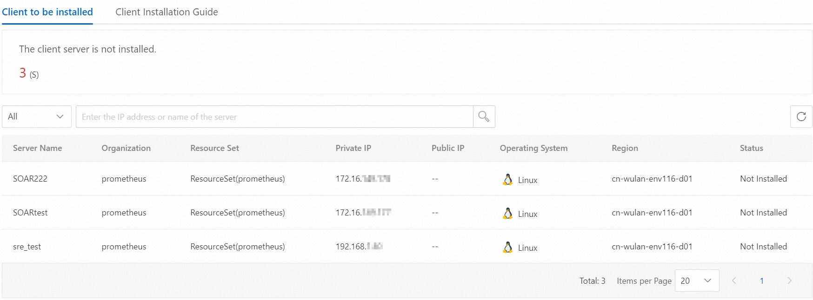

6. Click the **Client Installation Guide** tab to install the Security Center agent.

   - CLI Installation

     - **Deploy Hosts in Apsara Stack**

       <ol type="a">

       <li>

       On the **CLI Installation** tab, find the operating system of your server and click **Copy** on the right.

       > **Note**
       >
       > If you do not find the required installation command for the operating system of your server, click **Create Installation Command**, configure the **Organization**, **Resource Set**, and **Client Type** parameters, and then click OK. Then, click **Copy** on the right.

       </li>

       <li>

       Run the command on your server.

       </li>

       </ol>

       <ol type="i" start="100">

       <li>

       Click the **Installation Verification** tab to verify the command based on the operating system of the server.

       </li>

       </ol>

     - **Deploy Hosts Outside Apsara Stack**

       > **Important**
       >
       > Before you install the Server Guard agent, make sure that you have a sufficient quota, and the domain name of the server is resolved to Server Guard. You can click **View Domain Name Resolution** or **View Quota** to view the required information.

       <ol type="a">

       <li>

       Click **Manage Service Provider**. On the **Assets** page, click the **Server(s)** tab.

       </li>

       <li>

       On the tab that appears, click **Create Provider**, configure the **Provider Name** parameter, and then click **OK**.

       </li>

       </ol>

       <ol type="i" start="100">

       <li>

       Go to the **Agent Installation** page. On the **Agent Installation Guide** tab, click **CLI Installation**.

       </li>

       <li value="500">

       In the **Deploy Hosts Outside Apsara Stack** section, find the newly added service provider and click Create Installation Command. In the dialog box that appears, configure the **Client Type**, **Effective Duration**, **Region**, **Data Center**, and **Asset Group** parameters.

       In multi-organization mode, you must select the required **organization** and **resource set**.

       </li>

       </ol>

       <ol type="a" start="5">

       <li>

       After the configuration is complete, click **Copy** and run the command on your server.

       </li>

       <li>

       Click the **Installation Verification** tab to verify the command based on the operating system of the server.

       </li>

       </ol>

   - **Image Installation**

     > **Important**
     >
     > Before you install the Server Guard agent, make sure that your you have a sufficient quota, and the domain name of the server is resolved to Server Guard. You can click **View Domain Name Resolution** or **View Quota** to view the required information.

     <ol type="a">

     <li>

     On the **Image Installation** tab, install the agent as prompted.

     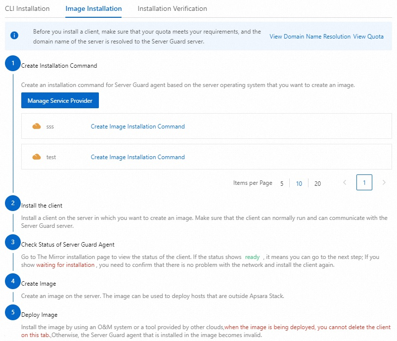

     </li>

     <li>

     Click the **Installation Verification** tab and copy the required command on this tab based on the operating system of the server to verify the installation result.

     </li>

     </ol>

<a id="section-4-6-2"></a>

### 4.6.2. Manage protection capabilities and protection modes

This topic describes how to manage protection features and protection modes for each server to improve the efficiency and security of servers.

**Procedure**

1. Log in to the Apsara Uni-manager Management Console.

2. In the upper-right corner of the Apsara Uni-manager Management Console, choose **Security** > **Server Security > Server Guard**. On the **Server Guard** page, select a region from the **Region** drop-down list and click **Access with Authorized Role**.

   > **Note**
   >
   > - In multi-level organization mode, all data permissions are managed by using resource sets in organizations. You can select an organization or a resource set in the top navigation bar of the console to view or manage the assets of the organization or resource set.
   >
   > - The parent organization has the highest management permissions. Modifications to the parent organization take effect on all child organizations and resource sets that belong to the parent organization. Proceed with caution when you modify the configurations.

3. In the left-side navigation pane, choose **Server Settings** > **Settings**.

4. On the **Protection Capability Settings** tab of the **Settings** tab, configure the following protection capabilities.

   In multi-level organization mode, servers can be filtered by resource set.

   | Protectio n capabilit y | Description | Operation |
   | --- | --- | --- |

   <table>
     <tr>
       <td>Proactive defense</td>
       <td>• <strong>Malicious Host Behavior Prevention</strong>: The proactive defense feature can identify threats to processes, intelligently determine risk levels, and block high-level risks such as viruses, trojans, ransomware, mining programs, and DDoS trojans in real time.<br>• <strong>Anti-ransomware (Bait Capture):</strong> The bait data is generated based on ransomware behavior. The bait data does not affect normal processes. If ransomware encounters the bait data, the anti-ransomware (bait capture) feature detects and blocks the ransomware in real time.<br>• <strong>Risk Monitoring on Data Restoration</strong>: In this section, Server Guard uses snapshots to restore cloud disk files that are encrypted by ransomware. If assets on which regular backup is not performed are attacked by ransomware, data restoration may be affected. If you want to modify the automatic snapshot policy, go to the Elastic Compute Service (ECS) console.<br>If you want to view vulnerable assets, click <strong>Details</strong> to the right of Risk assets.<br>• <strong>Malicious Behavior Prevention</strong>: This feature blocks known malicious network behavior to improve the security of your assets. The feature is supported only for container firewalls.</td>
       <td>• Enable protection capabilities: Find the protection capability that you want to enable and<br>click theicon next to the<br>capability.<br>• Configure the protection scope: Find the protection capability that you want to manage and click <strong>Manage</strong> next to the <strong>protection scope</strong>. In the dialog box that appears, select the asset group and assets and click <strong>OK</strong>.</td>
     </tr>
     <tr>
       <td>Webshell detection and removal</td>
       <td>Server Guard scans the web directories of your servers for webshells.</td>
       <td>Configure the protection scope: In the Webshell Detection section, click <strong>Manage</strong> next to the <strong>protection scope</strong>. In the dialog box that appears, select the asset group and assets and then click <strong>OK</strong>.</td>
     </tr>
   </table>

5. On the **Protection Mode Management** tab, manage protection modes.

   In multi-level organization mode, servers can be filtered by resource set.

   <table>
     <tr>
       <th>Protection mode</th>
       <th>Description</th>
       <th>Operation</th>
     </tr>
     <tr>
       <td rowspan="3">Prevention Mode Manageme nt</td>
       <td><strong>Basic Prevention Mode</strong>: This mode is suitable for scenarios in which basic protection is required. In this mode, the Server Guard agent consumes 50 MB of memory and less than 2% of one CPU core, and the agent automatically downgrades the security features that consume a large number of resources. However, threats may not be detected at the earliest opportunity.We recommend that you enable Advanced Prevention Mode.</td>
       <td>N/A</td>
     </tr>
     <tr>
       <td><strong>Advanced Prevention Mode</strong>: This mode is suitable for scenarios in which critical workloads need to be protected. In this mode, the Server Guard agent can identify more types of suspicious intrusions and potential threats by using the big data analytics engine, machine learning engine, and deep learning engine.</td>
       <td>Manage protected servers: In the <strong>Advanced Prevention</strong> <strong>Mode</strong> section, click <strong>Manage</strong>. In the <strong>Advanced Prevention</strong> <strong>Mode</strong> panel, select the servers that you want to protect and click <strong>OK</strong>.</td>
     </tr>
     <tr>
       <td><strong>Safeguard Mode For Major Activities</strong>: This mode is suitable for major event protection. In this mode, all protection rules and security engines are enabled to generate alerts for all suspicious intrusions and potential threats.</td>
       <td>• Manage protected servers: In the <strong>Safeguard Mode For</strong> <strong>Major Activities</strong> section, click <strong>Manage</strong>. In the Safeguard Mode For <strong>Major Activities</strong> panel, select the servers that you want to protect and click <strong>OK</strong>.<br>• Specify the maximum CPU utilization: In the <strong>Safeguard</strong> Mode For Major Activities section, select an option from the CPU Threshold drop-down list. Valid values: 5%, 10%, 20, 30%, 40%, 50%, and 60%.</td>
     </tr>
     <tr>
       <td>Self-protection Manageme nt</td>
       <td>After you enable the self-protection mode, the system automatically blocks activities that attempt to uninstall the Server Guard agent. This ensures the stability of the Server Guard agent.<br>Note<br>• We recommend that you run important services in an operating system that supports the self-protection mode. This helps prevent the Server Guard agent from being uninstalled. If the Server Guard agent is uninstalled, the server is not protected, which can cause security risks.<br>• It requires 30 minutes to disable the self-protection mode.</td>
       <td>• Manage protected servers: In the <strong>Self-protection</strong> <strong>Management</strong> section, click <strong>Manage</strong>. In the dialog box that appears, select the servers that you want to protect and click <strong>OK</strong>.<br>• Enable the self-protection<br>mode: Click theicon to<br>enable the self-protection mode.</td>
     </tr>
   </table>

<a id="section-4-6-3"></a>

### 4.6.3. Configure defense rules

The host-specific rule configuration feature allows you to manage defense and detection rules that are configured for your servers. You can create defense rules based on your business requirements to improve the security of your system.

**Scenarios**

Malicious behavior defense supports system defense rules and custom defense rules. The following table describes the scenarios for which the two types of rules are suitable.

| Rule type | Scenario |
| --- | --- |
| System defense rule | Common attacks are automatically blocked. You can disable a system defense rule or change the servers on which a system defense rule takes effect. |
| Custom defense rule | If you want to allow or block specific behavior, you can create <strong>custom defense</strong> <strong>rules</strong> based on your business scenarios. |

The high-risk command audit feature allows you to create custom audit rules.

**Malicious behavior defense**

**Manage system defense rules**

1. Log on to the Apsara Uni-manager Management Console.

2. In the upper-right corner of the Apsara Uni-manager Management Console, choose **Security** > **Server Security > Server Guard**. On the **Server Guard** page, select a region from the **Region** drop-down list and click **Access with Authorized Role**.

   > **Note**
   >
   > - In multi-level organization mode, all data permissions are managed by using resource sets in organizations. You can select an organization or a resource set in the top navigation bar of the console to view or manage the assets of the organization or resource set.
   >
   > - The parent organization has the highest management permissions. Modifications to the parent organization take effect on all child organizations and resource sets that belong to the parent organization. Proceed with caution when you modify the configurations.

3. In the left-side navigation pane, choose **Settings** > **Rule Settings**.

4. On the **Defense Rules** tab of the **Malicious Behavior Defense** tab, search for and manage a system defense rule.

   - Search for a system defense rule

     - Method 1: On the **Defense Rules** tab, enter the name of the system defense rule in the search box.

     - Method 2: On the **Defense Rules** tab, select a value in the **Attack Phase** section to filter system defense rules.

   - Manage a system defense rule

     - Enable or disable a system defense rule: If a system defense rule is not suitable for your business scenario and affects the security score of your assets, you can disable the rule.

       <ol type="a">

       <li>

       Select one or more system defense rules based on your business requirements.

       </li>

       <li>

       In the lower-left corner of the system defense rule list, click **Enable** or **Disabled**.

       </li>

       </ol>

     - Manage servers on which a system defense rule takes effect

       > **Note**
       >
       > After you remove a server from a system defense rule, Server Guard no longer detects or reports risks on the server based on the rule.

       <ol type="a">

       <li>

       Find a system defense rule and click **Management host** in the **Actions** column.

       </li>

       <li>

       In the **Management host** panel, add servers to the rule or remove servers from the rule. Then, click **OK**.

       </li>

       </ol>

**Manage custom defense rules**

1. Log on to the Apsara Uni-manager Management Console.

2. In the upper-right corner of the Apsara Uni-manager Management Console, choose **Security** > **Server Security > Server Guard**. On the **Server Guard** page, select a region from the **Region** drop-down list and click **Access with Authorized Role**.

   > **Note**
   >
   > - In multi-level organization mode, all data permissions are managed by using resource sets in organizations. You can select an organization or a resource set in the top navigation bar of the console to view or manage the assets of the organization or resource set.
   >
   > - The parent organization has the highest management permissions. Modifications to the parent organization take effect on all child organizations and resource sets that belong to the parent organization. Proceed with caution when you modify the configurations.

3. In the left-side navigation pane, choose **Settings** > **Rule Settings**.

4. On the **Custom Defense Rule** tab of the **Malicious Behavior Defense** tab, click **New rule**.

5. In the **New rule** panel, configure the **Rule Type** parameter, the required parameters, and the **Action** parameter based on your business requirements. Then, click **Next**.

   The required parameters vary based on the value of the Rule Type parameter. If you want to add specific behavior to the whitelist, make sure that the Rule Type parameter for the defense rule uses one of the following values:

   > **Note**
   >
   > You can add only the behavior of the Process hash type to the blacklist.

   - Process hash

   - Command Line

   - Process Network

   - File Read and Write

   - Operation on Registry

   - Dynamic-link Library Loading

   - File Renaming

6. In the server list of the **New rule** panel, select the servers on which you want the rule to take effect and click **Finish**.

   By default, a newly created custom defense rule is enabled. You can modify the rule and manage the servers on which the rule takes effect.

**Audit of high-risk commands**

**Create and enable a custom audit rule**

> **Important**
>
> In multi-level organization mode, only an account that has permissions on the level-1 organization can create, modify, and delete rules.

1. Log on to the Apsara Uni-manager Management Console.

2. In the upper-right corner of the Apsara Uni-manager Management Console, choose **Security** > **Server Security > Server Guard**. On the **Server Guard** page, select a region from the **Region** drop-down list and click **Access with Authorized Role**.

   > **Note**
   >
   > - In multi-level organization mode, all data permissions are managed by using resource sets in organizations. You can select an organization or a resource set in the top navigation bar of the console to view or manage the assets of the organization or resource set.
   >
   > - The parent organization has the highest management permissions. Modifications to the parent organization take effect on all child organizations and resource sets that belong to the parent organization. Proceed with caution when you modify the configurations.

3. In the left-side navigation pane, choose **Settings** > **Rule Settings**.

4. On the **Audit of High-risk Commands** tab, click **New rule**.

5. In the **New rule** panel, configure the parameters and click **Next**.

   | Paramet er | Description |
   | --- | --- |
   | Rule Name | The name of the rule. |
   | Rule descriptio n | The description of the rule. |
   | OS Type | The OS type. Valid values: <strong>Linux</strong> and <strong>Windows</strong>. |
   | Process Path | The path to the process to which you want to apply the rule.<br>The value of this parameter must be 5 to 100 characters in length. Wildcards are supported. If you use wildcards, the value must include the name of a specific process or subdirectory. Examples: <code> /usr/bin/bash </code>, <code> */bash </code>, <code> /root/abc </code>, <code> c://cmd.exe </code>, <code> /cmd.exe </code>, and <code> C:/Windows/System32/cmd.exe </code>. |
   | Command Line | The command line that you want to match by using the rule.<br>The value of this parameter must be 1 to 100 characters in length. We recommend that you use wildcards. If you use wildcards, the value must include characters.Examples: <code> *C:\Users\Administrator* </code>, <code> *id* </code>, and <code> *python* </code>. You can also use regular expressions to match high-risk commands.<br>Enter a command line and click <strong>Test</strong> on the right. In the dialog box that appears, the <strong>Matching Mode</strong> field displays the command line. Enter a command that you want to test against the specified command line and click <strong>Test</strong>. If the test is successful, the dialog box is automatically closed. |
   | Threat Level | The severity level of the command that hits the rule. Valid values: <strong>Critical</strong>, <strong>Warning</strong>, and <strong>Notice</strong>. |

6. Select the assets to which the rule applies and click **OK**.

   If you want to apply the rule to subsequently added servers, select **Apply to Newly Added Servers**.

7. After you create the rule, find the rule in the rule list and click the  icon in the **Switch**

   column to enable the rule.

   The rule can be in one of the following states:

   - Running: The rule is in effect.

   - Disabled: The rule does not take effect.

   - Silent Running: If the upper limit for the Triggers parameter within the specified period of time is exceeded, the rule enters the Silent Running state, and no alerts are generated. The rule does not take effect until the next cycle.

     To modify the Triggers parameter, log on to the Apsara Uni-manager Management Console and go to the Global Settings module of Server Guard.

**View audit alerts**

1. In the left-side navigation pane, choose **Defense** > **Security Alerts**.

2. In the upper part of the alert list, select **Command Line Audit** as the alert type to view the alerts named **Suspicious Command Lines** and the alert details.

**Defense against brute-force attacks**

**Create a defense rule**

You can create a defense rule against brute-force attacks and specify a trigger condition in the rule. You can also create multiple defense rules against brute-force attacks for servers based on different scenarios.

> **Important**
>
> If you want to add an IP address to the whitelist of defense against brute-force attacks, you can click the number below **Approved logon IP** and specify an IP address as an approved logon IP address. Defense rules against brute-force attacks do not block logon requests from approved logon IP addresses.

1. Log on to the Apsara Uni-manager Management Console.

2. In the upper-right corner of the Apsara Uni-manager Management Console, choose **Security** > **Server Security > Server Guard**. On the **Server Guard** page, select a region from the **Region** drop-down list and click **Access with Authorized Role**.

   > **Note**
   >
   > - In multi-level organization mode, all data permissions are managed by using resource sets in organizations. You can select an organization or a resource set in the top navigation bar of the console to view or manage the assets of the organization or resource set.
   >
   > - The parent organization has the highest management permissions. Modifications to the parent organization take effect on all child organizations and resource sets that belong to the parent organization. Proceed with caution when you modify the configurations.

3. In the left-side navigation pane, choose **Settings** > **Rule Settings**.

4. On the **Anti-brute Force Cracking** tab, click the **Defense Policy** tab and click **Create Policy**.

5. In the **New Policy** panel, create a defense rule against brute-force attacks.

   In the default settings of the defense rule, if the number of logon failures from an IP address to the same server reaches 80 within 10 minutes, the IP address is blocked for 6 hours. If you want to retain the default settings, you can directly specify servers. If you want to create a custom rule, you can configure the following parameters.

   | Parameter | Description |
   | --- | --- |
   | Policy Name | Enter a name for the defense rule. |
   | Defense Rule | Specify a trigger condition for the defense rule. If the number of logon failures from an IP address to a server to which the defense rule is applied exceeds the limit during the statistical period, the defense rule blocks the IP address for the disablement period. If the number of logon failures from an IP address exceeds 3 within 1 minute, the IP address is blocked for 30 minutes. |

   <table>
     <tr>
       <td>Set As Default Policy</td>
       <td>Determine whether to specify the defense rule as a default defense rule. If you select Set As Default Policy, servers that are not protected by defense rules use the defense rule.<br>Note<br><strong>If you set this rule as the default policy</strong>, assets that you do not select but meet the triggering conditions of the rule also trigger the system to generate a rule. However, if the malicious network behavior prevention plug-in for an asset is offline or not installed, the defense rule does not take effect.</td>
     </tr>
     <tr>
       <td>Select Server(s)</td>
       <td>Select the servers that you want the defense rule to protect. You can select servers from the server list or search for servers by using the server names or server IP addresses.</td>
     </tr>
   </table>

6. Click **OK**.

**Manage system rules**

A system rule refers to an IP address blocking policy that is automatically generated after a defense rule against brute-force attacks is triggered. You can perform the following operations to view, enable, and disable a system rule:

1. Log on to the Apsara Uni-manager Management Console.

2. In the upper-right corner of the Apsara Uni-manager Management Console, choose **Security** > **Server Security > Server Guard**. On the **Server Guard** page, select a region from the **Region** drop-down list and click **Access with Authorized Role**.

   > **Note**
   >
   > - In multi-level organization mode, all data permissions are managed by using resource sets in organizations. You can select an organization or a resource set in the top navigation bar of the console to view or manage the assets of the organization or resource set.
   >
   > - The parent organization has the highest management permissions. Modifications to the parent organization take effect on all child organizations and resource sets that belong to the parent organization. Proceed with caution when you modify the configurations.

3. In the left-side navigation pane, choose **Settings** > **Rule Settings**.

4. On the **Anti-brute Force Cracking** tab, click the **System Rule** tab and perform the following operations as needed.

   - View the information about a system rule

     You can view the following information: blocked IP address, port, effective servers, rule name, interception mode (Alinet), validity period, and status. An effective server refers to a server to which a rule is applied.

   - Enable a system rule

     If a system rule is disabled, you can turn on the switch in the **Status** column to enable the system rule. Then, Security Center continues to block logons from the IP address that is specified in the system rule.

   - Disable a system rule If a system rule is enabled and you confirm that the blocking of the IP address specified in the system rule is a false positive, you can disable the rule to allow logons from the IP address. To disable the rule, turn off the switch in the **Status** column.

   - Delete a rule

     To delete a rule, click **Delete** in the **Operate** column.

**Manage a custom rule**

You can create custom IP address blocking policies to block access from malicious IP addresses to your cloud assets. To manage a custom IP address blocking policy, perform the following operations:

1. Log on to the Apsara Uni-manager Management Console.

2. In the upper-right corner of the Apsara Uni-manager Management Console, choose **Security** > **Server Security > Server Guard**. On the **Server Guard** page, select a region from the **Region** drop-down list and click **Access with Authorized Role**.

   > **Note**
   >
   > - In multi-level organization mode, all data permissions are managed by using resource sets in organizations. You can select an organization or a resource set in the top navigation bar of the console to view or manage the assets of the organization or resource set.
   >
   > - The parent organization has the highest management permissions. Modifications to the parent organization take effect on all child organizations and resource sets that belong to the parent organization. Proceed with caution when you modify the configurations.

3. In the left-side navigation pane, choose **Settings** > **Rule Settings**.

4. On the **Anti-brute Force Cracking** tab, click the **Custom Defense Rules** tab and perform the following operations as needed.

   - Create a custom IP address blocking policy

     Click **Create Rule**. In the **Create IP Address Blocking Policy** panel, configure the parameters and click **OK**. The following table describes the parameters.

     | Parameter | Description |
     | --- | --- |
     | Intercepted object | The IP address that you want to block. |
     | Port | The port number. |
     | All Assets | The server on which you want the IP address blocking policy to take effect. You can select multiple servers. You can also enter a server name or server IP address in the search box to search for the server. |
     | Rule Direction | The direction of the traffic that you want to block. Valid values: <strong>Inbound</strong> and <strong>Outbound</strong>. |
     | Expiration time | The expiration time of the policy. After the policy expires, the status of the policy changes to <strong>Disabled</strong>. |

     By default, a new IP address blocking policy is in the **Disabled** state. You must manually enable the policy.

   - View custom IP address blocking policies and the details of a custom IP address blocking policy

     On the **Custom Defense Rules** tab, you can view the following information about each rule: blocked IP address, port, effective servers, expiration time, rule direction, and status. You can also click Details in the Operate column of a policy to go to the Effective Server(s) panel. In this panel, you can view the servers on which the policy takes effect. You can filter servers by status, such as Disabled, Enabled, Enabling, and Enable Rule.

   - Edit a custom IP address blocking policy

     Find the IP address blocking policy that you want to edit and click **Edit** in the **Operate** column. In the panel that appears, modify the All Assets and Expiration time parameters and click OK.

   - Enable or disable an IP address blocking policy

     You can configure an IP address blocking policy for an IP address that is likely used to launch brute-force attacks. If normal traffic is blocked by the policy, you can disable the policy. After you disable the policy, the system no longer blocks requests from the IP address. You can click the switch in the **Status** column to **enable** or **disable** a rule.

   - View details

     To view the details of effective servers, click **Details** in the Operate column. In the **Effective Server** panel, find a server that is in the Enable Rule state and click **Retry** in the **Operate** column to enable the policy.

   - Delete a custom IP address blocking policy

     You can delete an IP address blocking policy that is in the **Disabled** state. To delete a policy, click **Delete** in the Operate column. In the message that appears, click **OK**.

<a id="section-5"></a>

# 5.Apsara Stack Security configurations

<a id="section-5-1"></a>

## 5.1. Log on to the Apsara Uni-manager Management Console

This topic describes how to log on to the Apsara Uni-manager Management Console.

**Prerequisites**

- The URL of the console that is obtained from the deployment personnel.

- A web browser. We recommend that you use Google Chrome.

**Procedure**

1. Enter the URL of the Apsara Uni-manager Management Console in the address bar and press the Enter key.

2. Enter your username and password.

   You need to obtain the username and password from an operations administrator.

   > **Note**
   >
   > - **First logon**
   >
   >   The first time that you log on to the Apsara Uni-manager Management Console, you need to change the password of your account. The password must be 10 to 32 characters in length. It must contain all of the following character types: uppercase letters, lowercase letters, digits, and special characters. Supported special characters include: ! @ # $ %
   >
   > - **Forget password**
   >
   >   If you have forgotten your password, click Forgot Password. On the page that appears, enter the username of your account, the email address that was used to create the account, and the CAPTCHA code. Then, the system sends a link for resetting the password to the specified email address.

3. Click **Log On**.

4. If multi-factor authentication (MFA) is enabled for your account, perform the corresponding operations in the following scenarios:

   - You log on to the Apsara Uni-manager Management Console for the first time after MFA is enabled by the administrator.

     <ol type="a">

     <li>

     On the Bind Virtual MFA Device page, bind an MFA device.

     </li>

     <li>

     Enter the username and password again as in Step 2 and click **Log On**.

     </li>

     </ol>

     <ol type="i" start="100">

     <li>

     Enter a six-digit MFA verification code and click **Authenticate**.

     </li>

     </ol>

   - You have enabled MFA and bound an MFA device:

     Enter a six-digit MFA verification code and click **Authenticate**.

<a id="section-5-2"></a>

## 5.2. 规则运营

<a id="section-5-2-1"></a>

### 5.2.1. Create and manage IPS rules

Cloud Firewall provides built-in intrusion prevention system (IPS) rules. You can create custom IPS rules based on your business requirements and network environment to monitor the operations of Cloud Firewall. This topic describes how to create and manage custom IPS rules.

**Procedure**

1. Log in to the Apsara Uni-manager Management Console.

2. In the upper-right corner of the Apsara Uni-manager Management Console, choose **Security** > **Global Platform Security > System Configurations**. On the **System Configurations** page, select a region from the **Region** drop-down list and click **Access with Authorized Role**.

3. In the left-side navigation pane, click **Rule Operation**.

4. On the **Cloud Firewall IPS Rules** tab, click **Create Rule**. In the Create Rule panel, configure the parameters and click **OK**. The following table describes the parameters.

   | Parameter | Description |
   | --- | --- |
   | Rule Name | The name of the IPS rule. We recommend that you enter an informative name to facilitate management. |
   | Rules Engine | The rules engine that you want to use. Valid values: <strong>Basic Policies</strong> and <strong>Virtual</strong> <strong>Patches</strong>. |
   | Attack Type | The type of attacks that you want to detect by using the IPS rule |
   | Severity | The severity level. Valid values: <strong>Low</strong>, <strong>Medium</strong>, and <strong>High</strong>. |
   | CVE | The Common Vulnerabilities and Exposures (CVE) ID of the vulnerability that you want to list in the IPS rule.<br>Note<br>CVE provides a list of public security vulnerabilities. CVE IDs are allocated by a CVE Numbering Authority (CNA). |
   | Application | The name of the attacked application. |
   | Rule Mode | The mode of the IPS rule. Valid values: <strong>Packet</strong> and <strong>Traffic</strong>. |
   | Direction | The direction of traffic that you want to monitor by using the IPS rule. Valid values: <strong>Inbound and Outbound</strong>, <strong>Inbound</strong>, and <strong>Outbound</strong>. |
   | Rule Content | The content of the IPS rule. You must specify the content by using the Snort syntax.<br>Note<br>To prevent negative impact on your business, make sure that you enter valid content for the rule. |
   | Rule Description | The description of the IPS rule. We recommend that you enter information such as the purpose or impact of the rule. |
   | Remarks | The additional description of the IPS rule. We recommend that you enter information that can help you identify the IPS rule, such as the purpose or impact of the rule to facilitate management. |

   After you create custom IPS rules, you can perform the following operations on the rules:

   - View the details of a rule

     You can filter rules by specifying filter conditions above the rule list.

     Find the rule whose details you want to view and click **Details** in the **Actions** column to view the rule details.

   - Enable an IPS rule

     Find the rule that you want to enable and turn on the switch in the **Enable or not** column to change the state of the rule from **Disable** to **Enable**.

   - Disable an IPS rule

     If a rule does not meet your business requirements, you can disable the rule.

     Find the rule that you want to disable and turn off the switch in the **Enable or not** column to change the state of the rule from **Enable** to **Disable**.

<a id="section-5-2-2"></a>

### 5.2.2. Manage Anti-DDoS Service rules

On the Anti-DDoS Service Rules page, you can modify threshold settings for traffic scrubbing and redirection based on your business requirements. This topic describes how to modify threshold settings for traffic scrubbing and redirection.

**Procedure**

1. Log in to the Apsara Uni-manager Management Console.

2. In the upper-right corner of the Apsara Uni-manager Management Console, choose **Security** > **Global Platform Security > System Configurations**. On the **System Configurations** page, select a region from the **Region** drop-down list and click **Access with Authorized Role**.

3. In the left-side navigation pane, click **Rule Operation**.

4. On the **Anti-DDoS Service Rules** tab, click **Scrubbing Policy**. Then, specify a custom threshold for traffic scrubbing.

   <ol type="i">

   <li>

   Find the traffic scrubbing rule whose threshold you want to modify and click **Modify Threshold** in the **Solution** column.

   </li>

   <li>

   In the **Modify Threshold** dialog box, specify a threshold and click **OK**.

   </li>

   </ol>

5. On the **Anti-DDoS Service Rules** tab, click **Reroute Threshold**. Then, specify custom thresholds for traffic redirection.

   <ol type="i">

   <li>

   Find the rule whose thresholds you want to modify and click **Modify Threshold** in the **Solution** column.

   </li>

   <li>

   In the **Modify Threshold** dialog box, specify custom thresholds and click **OK**.

   </li>

   <li>

   **Optional.** Click **Automatic DDoS Traffic Redirection and Scrubbing**. In the **Enable Automatic Redirection** message, click **OK**.

   > **Note**
   >
   > By default, **Automatic DDoS Traffic Redirection and Scrubbing** is turned off.

   - If you turn on Automatic DDoS Traffic Redirection and Scrubbing, traffic scrubbing events are triggered based on the thresholds that you specify. The traffic of attacked IP addresses is automatically forwarded to an Anti-DDoS cluster for scrubbing.

   - If you turn off Automatic DDoS Traffic Redirection and Scrubbing, alert events are triggered based on the thresholds that you specify. You can start or end traffic scrubbing in the Anti-DDoS Service console based on your business requirements.

   </li>

   </ol>

<a id="section-5-2-3"></a>

### 5.2.3. Manage Server Guard rules

You can view vulnerabilities, baselines, and server exceptions on the Server Guard Rules tab. This topic describes how to view the information about Server Guard rules.

**Procedure**

1. Log in to the Apsara Uni-manager Management Console.

2. In the upper-right corner of the Apsara Uni-manager Management Console, choose **Security** > **Global Platform Security > System Configurations**. On the **System Configurations** page, select a region from the **Region** drop-down list and click **Access with Authorized Role**.

3. In the left-side navigation pane, click **Rule Operation**.

4. On the **Server Guard Rules** tab, view the operations of Server Guard rules.

   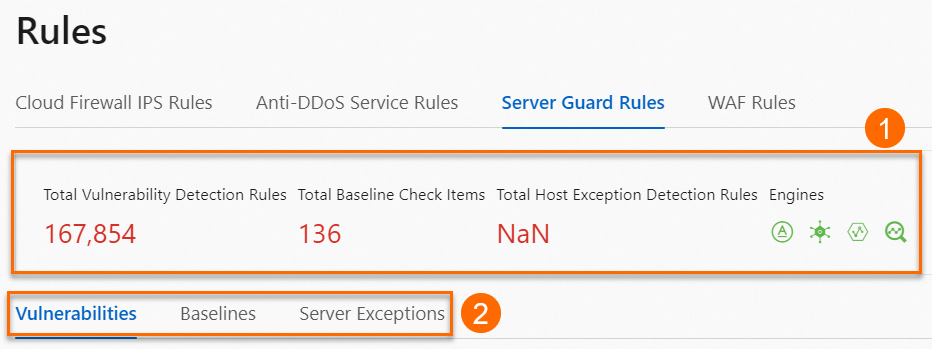

   | Section or tab | Description |
   | --- | --- |
   | Overview (marked with ① in the preceding figure) | In this section, you can view the following information: <strong>Total Vulnerability</strong> <strong>Detection Rules</strong>, <strong>Total Baseline Check Items</strong>, <strong>Total Host Exception</strong> <strong>Detection Rules</strong>, and <strong>Engines</strong>. |
   | Vulnerabilities (marked with ② in the preceding figure) | On the <strong>Vulnerabilities</strong> tab, you can view all detected vulnerabilities and the total number of detected vulnerabilities.<br>• To search for a vulnerability, you can select a vulnerability type from the Vulnerability Type drop-down list and enter a Common Vulnerabilities and Exposures (CVE) ID or an OS name in the search box.<br>• In the vulnerability list, you can view the information about a detected vulnerability in the following columns: <strong>Vulnerability Detection Rule</strong> <strong>Name</strong>, <strong>CVE ID</strong>, <strong>Operating System</strong>, <strong>Release Version</strong>, <strong>Updated At</strong>, <strong>Online At</strong>, and <strong>Status</strong>. |
   | Baselines (marked with ② in the preceding figure) | On the <strong>Baselines</strong> tab, you can view the baseline types and the check items that are used.<br>• To search for a baseline, you can select a baseline type from the Baseline Type drop-down list, select a severity from the Risk Level drop-down list, and then enter a check item category or name in the search box.<br>• In the baseline list, you can view the information about a baseline in the following columns: <strong>Baseline Type</strong>, <strong>Check Item Category</strong>, <strong>Check Item</strong> <strong>Name</strong>, <strong>Risk Level</strong>, <strong>Updated At</strong>, and <strong>Status</strong>. |
   | Server Exceptions (marked with ② in the preceding figure) | On the <strong>Server Exceptions</strong> tab, you can view the following information: <strong>Rule</strong> <strong>Alert Types</strong> and <strong>Webshell &amp; Malicious Processes</strong>.<br>• To search for an exception on a server, you can select a rule category from the Rule Category drop-down list, select a severity level from the Risk Level drop-down list, and then enter a rule subcategory name in the search box.<br>• In the server exception list, you can view the information about an exception in the following columns: <strong>Rule Subcategory</strong>, <strong>Rule Category</strong>, <strong>Risk Level</strong>, <strong>Updated At</strong>, <strong>Source</strong>, and <strong>Status</strong>. |

<a id="section-5-2-4"></a>

### 5.2.4. Create and manage WAF rules

You can create custom Web Application Firewall (WAF) rules based on your business requirements and network environment to monitor the operations of WAF. This topic describes how to create and manage WAF rules.

**Procedure**

> **Important**
>
> WAF rules are global custom rules that take effect on all tenants. Proceed with caution.

1. Log in to the Apsara Uni-manager Management Console.

2. In the upper-right corner of the Apsara Uni-manager Management Console, choose **Security** > **Global Platform Security > System Configurations**. On the **System Configurations** page, select a region from the **Region** drop-down list and click **Access with Authorized Role**.

3. In the left-side navigation pane, click **Rule Operation**.

4. On the **WAF Rules** tab, click **Create Rule**. In the Create Rule panel, configure the parameters and click **OK**. The following table describes the parameters.

   | Parameter | Description |
   | --- | --- |
   | Mode | The handling action and status of the rule.<br>• You can set the handling action to <strong>Block</strong>, <strong>Allow</strong>, <strong>Monitor</strong>, or <strong>Detection</strong> <strong>Module Control</strong>.<br>• You can set the status to <strong>Enable</strong> or <strong>Disable</strong>. |
   | Description | The description of the rule. |
   | Severity | The level of the severity. Valid values: <strong>No Threat</strong>, <strong>Low</strong>, <strong>Moderate</strong>, and <strong>Important</strong>. |
   | Match Condition | The match condition of the rule. Each match condition consists of a <strong>match field</strong>, a <strong>logical operator</strong>, and a <strong>match value.</strong> |
   | Logging | Specifies whether to record logs. Valid values:<br>• Perform Logging When Match Condition Is Met<br>• Do not Perform Logging When Match Condition Is Met |
   | Attack Type | The type of attacks that you want the rule to detect. You can select only one option. |
   | Blocking Status Code | The status code that is returned. You can select only one option. |
   | Expire At | The expiration time of the rule. If you do not specify an expiration time, the rule never expires. |

   After you create rules, you can perform the following operations on the rules:

   - Filter WAF rules by specifying filter conditions above the rule list.

   - Find the rule that you want to manage and click **Modify** in the **Actions** column to modify the rule.

<a id="section-5-3"></a>

## 5.3. Configure alert settings

On the Alert Settings page, you can configure alert contacts and alert rules. When monitoring data triggers alert rules, the system automatically sends alerts to specified alert contacts by using DingTalk messages or emails. This topic describes how to configure alert contacts and alert rules.

**Configure alert contacts**

1. Log in to the Apsara Uni-manager Management Console.

2. In the upper-right corner of the Apsara Uni-manager Management Console, choose **Security** > **Global Platform Security > System Configurations**. On the **System Configurations** page, select a region from the **Region** drop-down list and click **Access with Authorized Role**.

3. In the left-side navigation pane, click **Alert Settings**.

4. On the Alert Settings tab, click **Create Contact**. In the Create Contact dialog box, enter the contact name, DingTalk chatbot token, email address, and organization, and click **Determine**.

   You can view the added contact in the contact list. You can **modify** a contact or **delete** multiple contacts at a time.

**Configure alert rules**

1. Log in to the Apsara Uni-manager Management Console.

2. In the upper-right corner of the Apsara Uni-manager Management Console, choose **Security** > **Global Platform Security > System Configurations**. On the **System Configurations** page, select a region from the **Region** drop-down list and click **Access with Authorized Role**.

3. In the left-side navigation pane, click **Alert Settings**.

4. On the Alert Settings page, click the **AEGIS** tab. On the AEGIS tab, configure the alert rules that you want to use and click **Save**.

   **Notificati**

   **Alert**

   **Alert type**

   **Alert subtype**

   **on**

   **Frequency**

   **level**

   **method**

   - Linux software vulnerability

   - Windows system

     - Low

     vulnerability

   Vulnerability

   - Medium

   - Web-CMS vulnerability

     - High

   - Application vulnerability

   - Urgent vulnerability

   - High-risk exploit

     - Low

   - Classified protection compliance

   Baseline risk

   - Medium

   - Best security practices

     - High

   - Weak password

   - Vulnerability

   Asset exposure

   All levels

   - Non-vulnerability

     - 5 minutes

     - 10 minutes

   - Suspicious process

     - Email

       - 30 minutes

   - Webshell

     - DingTal

       - 1 hour

       k

   - Unusual login

     - 1 day

   - Anomalous activity

     - 1 week

   - Threat intelligence

   - Malicious process (cloud threat detection)

     - Low

   - Unusual network connection

   Intrusion alert

   - Medium

   - Abnormal account

     - High

   - Application intrusion event

   - Cloud threat detection

   - Precision defense

   - Malicious script

   - Persistent webshell

   - Application threat detection

   Application

   Unauthorized process

   All levels

   whitelist event

   start

   - Unusual file modification

   Tamper-

   All levels

   proofing event

   - Unusual file addition

   - Unusual file deletion

<a id="section-5-4"></a>

## 5.4. 全局设置

<a id="section-5-4-1"></a>

### 5.4.1. Configure the attack blocking feature

The attack blocking feature protects your servers from web attacks and brute-force attacks. This topic describes how to configure the attack blocking feature.

**Procedure**

1. Log in to the Apsara Uni-manager Management Console.

2. In the upper-right corner of the Apsara Uni-manager Management Console, choose **Security** > **Global Platform Security > System Configurations**. On the **System Configurations** page, select a region from the **Region** drop-down list and click **Access with Authorized Role**.

3. In the left-side navigation pane, click **Global Settings**.

4. On the **Global Settings** tab, turn on or off the switch in the Actions column to enable or disable the attack blocking feature.

   After you disable the attack blocking feature, Apsara Stack Security generates alerts for web attacks and brute-force attacks but does not block them.

<a id="section-5-5"></a>

## 5.5. 账号管理

<a id="section-5-5-1"></a>

### 5.5.1. Manage Apsara Stack tenant accounts

This topic describes how to view and modify the information about your Apsara Stack tenant account.

> **Important**
>
> All assets in Apsara Stack Security are bound to your Apsara Stack tenant account. Proceed with caution when you modify the account information.

**Procedure**

1. Log in to the Apsara Uni-manager Management Console.

2. In the upper-right corner of the Apsara Uni-manager Management Console, choose **Security** > **Global Platform Security > System Configurations**. On the **System Configurations** page, select a region from the **Region** drop-down list and click **Access with Authorized Role**.

3. In the left-side navigation pane, click **Accounts**.

4. On the **Apsara Stack Account** tab, modify the information about your Apsara Stack tenant account.

   <ol type="i">

   <li>

   Find the Apsara Stack tenant account that you want to modify and click **Revised** in the **Actions** column.

   </li>

   <li>

   In the **Change Account** dialog box, modify the Apsara Stack Account, Access Key, and

   </li>

   </ol>

   Access Secret parameters, and click **OK**.

   After the modification, you can click Details in the **Actions** column to view the details of the Apsara Stack tenant account.

<a id="section-5-5-2"></a>

### 5.5.2. Manage Alibaba Cloud accounts

After you add an Alibaba Cloud account to Apsara Stack Security, you can manage the Anti-DDoS Pro, Anti-DDoS Premium, and Web Application Firewall (WAF) instances that belong to the Alibaba Cloud account in Apsara Stack Security. This way, you can use features in a hybrid cloud. This topic describes how to add an Alibaba Cloud account to Apsara Stack Security.

**Procedure**

To use features in a hybrid cloud, you can add an Alibaba Cloud account to Apsara Stack Security.

1. Log in to the Apsara Uni-manager Management Console.

2. In the upper-right corner of the Apsara Uni-manager Management Console, choose **Security** > **Global Platform Security > System Configurations**. On the **System Configurations** page, select a region from the **Region** drop-down list and click **Access with Authorized Role**.

3. In the left-side navigation pane, click **Accounts**.

4. On the **Alibaba Cloud Account** tab, click **Add**.

   In the **Add Account** dialog box, configure the parameters and click **OK**. The following table describes the parameters.

   | Parameter | Description |
   | --- | --- |
   | Access Key | The AccessKey ID of the Alibaba Cloud account that you want to add. |
   | Access Secret | The AccessKey secret of the Alibaba Cloud account. |
   | Alibaba Cloud Service | The Alibaba Cloud services that you want to use. Valid values: <strong>Anti-</strong><strong>DDoS Pro and Anti-DDoS Premium IP</strong> and <strong>Web Application</strong> <strong>Protection</strong>. You can select one value or both. |

   After the Alibaba Cloud account is added, you can view the account in the account list. You can **modify** or **remove** the account.

<a id="section-5-6"></a>

## 5.6. Migration to Apsara Uni-manager Operations Console

<a id="section-5-6-1"></a>

### 5.6.1. Log on to Cloud Shield Operations Center

Cloud Shield Operations Center is an operations platform for Apsara Stack Security services. The platform monitors the status and workloads of Apsara Stack Security services in real time and sends alert notifications to users. This topic describes how to log on to Cloud Shield Operations Center.

**Prerequisites**

- The endpoint of the Apsara Uni-manager Operations Console and the username and password that are used to log in to the console are obtained from a deployment engineer or an administrator.

  The endpoint of the Apsara Uni-manager Operations Console is in the following format: *regi on-id*.ops.console.*intranet-domain-id*.

- A supported browser is used. We recommend that you use Google Chrome.

**Procedure**

1. Open a web browser.

2. In the address bar, enter the endpoint of the Apsara Uni-manager Operations Console. Press the ENTER key.

   

   > **Note**
   >
   > You can click the current language in the upper-right corner to switch to another language. Simplified Chinese, English, and traditional Chinese are supported.

3. Enter the correct username and password.

   > **Note**
   >
   > - Obtain the username and password that are used to log in to the Apsara Uni-manager Operations Console from a deployment engineer or an administrator.
   >
   > - If you enter an invalid password three consecutive times, the system enables the image verification login feature. If you enter an invalid password five consecutive times, the system locks your account. In this case, you can contact the administrator to unlock your account.
   >
   > - The first time that you log in to the Apsara Uni-manager Operations Console, change the password for your account as prompted.
   >
   >   To enhance security, make sure that your password meets the following requirements:
   >
   >   - The password contains uppercase and lowercase letters.
   >
   >   - The password contains digits.
   >
   >   - The password contains at least one of the following special characters: ! @ # $ %
   >
   >   - The password is 10 to 20 characters in length.

4. Click **Agree to Private Policy and Log On**.

5. In the top navigation bar, choose **Product Operation > Security O&M > Cloud Shield Operations Center**.

**View execution results**

You can view information on the pages of **Cloud Shield Operations Center**.

<a id="section-5-6-2"></a>

### 5.6.2. View system monitoring data

You can use the system monitoring feature to monitor integrated cloud services and identify exceptions in the cloud services at the earliest opportunity. This facilitates service O&M. This topic describes how to view the system monitoring data.

**Procedure**

1. Log in to Cloud Shield Operations Center.

2. In the left-side navigation pane, choose **Monitoring and Alerting** > **System Monitoring**.

3. On the System Monitoring page, view the monitoring overview and monitoring data of cloud services.

   - On the **Monitoring Overview** tab, view the following information:

     - Monitoring overview: You can view the total numbers of monitored services, abnormal services, metrics, and exceptions.

     - Monitoring data of cloud services: You can view the information about each monitored cloud service, such as the service name, number of metrics, number of exceptions, and service status.

   - You can view the monitoring data of each cloud service on the corresponding cloud service tab.

     Cloud services that can be integrated include: Server Guard, Security Operations Center (SOC), Network Traffic Detection and Response (NDR), Privileged Access Management (PAM), Tenant-side Bastionhost, Cloud Security Scanner, Container Security Service (CSS), and Key Management Service (KMS).

- Monitoring scope:

  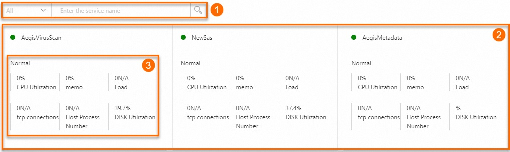

  - Click a cloud service tab to view all sub-services of the cloud service in the section marked with ② in the preceding figure.

  - On a cloud service tab, use the search box marked with ① in the preceding figure to search for the required sub-service by service status and name.

  - In a sub-service card marked with ③ in the preceding figure, view the information such as the CPU utilization, memory usage, workloads, number of TCP connections, and number of processes.

  - Click a sub-service card marked with ③ in the preceding figure. On the page that appears, view the monitoring details of the cloud service.

    | Tab | Description |
    | --- | --- |
    | Basic Monitorin g | • You can specify the monitoring time range and monitoring view to view the details of basic monitoring and middleware monitoring.<br>• Valid values for the time range: 3 Hours, 6 Hours, 12 Hours, 1 Day, 2 Days, and Custom.<br>You can click theicon to manually update the monitoring data. You can also<br>turn on Automatic Refresh to automatically update the monitoring data.<br>• The monitoring view supports Cluster View and Single-server View.<br>• You can view the following monitoring data: CPU utilization (%), memory usage (%), workloads, number of TCP connections, number of processes, and disk usage. |
    | Middlewar e | • You can specify the monitoring time range and monitoring view to view the details of basic monitoring and middleware monitoring.<br>• Valid values for the time range: 3 Hours, 6 Hours, 12 Hours, 1 Day, 2 Days, and Custom.<br>You can click theicon to manually update the monitoring data. You can also<br>turn on Automatic Refresh to automatically update the monitoring data.<br>• The monitoring view supports Cluster View and Single-server View.<br>• You can view the following monitoring data: the QPS of MetaQ, the number of garbage collections (GCs) in the JVM, the amount of time consumed to monitor GCs in the JVM, the amount of JVM memory, the number of loaded classes in the JVM, the numbers of JVM threads in different states, the number of JVM threads, the QPS of HSF, the response time of HSF and database usage. |
    | Health Check | You can check the health status of all hosts in an application based on check methods such as TCP- and HTTP-based health checks. |

<a id="section-5-6-3"></a>

### 5.6.3. Global settings

<a id="section-5-6-3-1"></a>

#### 5.6.3.1. Configure host security rules

1. Log in to the Cloud Shield Operations Center console.

2. In the left-side navigation pane, choose **Cloud Services > Server Guard O&M > Global Settings**.

3. On the **Host Security Rule Settings** tab, configure the global brute-force attack detection rule and silence threshold for high-risk command audit and click **Save and Apply**. The following table describes the parameters.

   > **Important**
   >
   > If you modify the global brute-force attack detection rule, the detection rules for brute-force attacks on all host assets, such as tenant-side hosts and platform-side physical servers, are affected. The attack analysis result of Server Guard is also affected. Proceed with caution.

   | Parameter | Description |
   | --- | --- |
   | Host Brute-force Attack | The time range within which you want to detect brute-force attacks and the maximum number of login failures that are allowed. If the number of login failures exceeds the specified upper limit within the specified time range, the system determines that a point-to-point brute-force attack is initiated from the source IP address. |
   | Batch Unusual Logon | The time range within which you want to detect unusual logins and the maximum number of servers that can be logged in to by using a fixed account.If the number of servers that can be logged in to by using a fixed account exceeds the specified upper limit within the specified time range, the system determines that batch unusual logins are initiated from the source IP address. |
   | Suspicious Account Logon | If a remote login account is included in the list of suspicious accounts, an alert is generated for logins that use the account.<br>Click <strong>Manage Suspicious Accounts</strong>. In the Suspicious Account Management panel, enter suspicious accounts or upload a list of suspicious accounts by using a template. Make sure that the file to be uploaded does not exceed 5 KB in size.To ensure compatibility with the Windows system mechanism, use lowercase letters when you enter Windows accounts. |
   | Audit of High-risk Commands | You can configure the silence threshold for high-risk command audit. After you configure the threshold, when the number of alerts generated by the rule reaches the threshold, the rule enters the silent mode and does not generate alerts until it resumes in the next cycle.<br>Default threshold: 100 alerts within 5 minutes.<br>For more information, see <strong>Configure host security rules</strong> in Apsara Stack Security User Guide for security administrators. |

<a id="section-5-6-3-2"></a>

#### 5.6.3.2. Configure whitelist settings

1. Log in to the Cloud Shield Operations Center console.

2. In the left-side navigation pane, choose **Cloud Services > Server Guard O&M > Global Settings**.

3. On the Global Settings page, click the **Whitelist Settings** tab. On the Whitelist Settings tab, click **Add**. In the **Create Whitelist** dialog box, configure the parameters and click **OK**. The following table describes the parameters.

   | Parameter | Description |
   | --- | --- |
   | Type | • <strong>Global Logon Whitelist</strong>: Server Guard does not generate alerts for unusual logins from the IP addresses that are included in this whitelist.<br>• <strong>Whitelist for Brute-force Attacks</strong>: Server Guard does not generate alerts for brute-force attacks from the IP addresses that are included in this whitelist. |
   | Source IP Address | The source IP address or CIDR block. |
   | Destination IP | The destination IP address or CIDR block. If you set the Type parameter to <strong>Whitelist for Brute-force Attacks</strong>, you must configure the Destination IP parameter. |

   You can **delete** a whitelist that is no longer required.

<a id="section-5-6-4"></a>

### 5.6.4. Upgrade center

<a id="section-5-6-4-1"></a>

#### 5.6.4.1. Upgrade center overview

The upgrade center allows you to manually or automatically update the feature library and the version of Apsara Stack Security to ensure up-to-date protection.

You can perform the following steps for an update:

1. Configure the import mode of your update package.

   The upgrade center supports **automatic import** and **manual import**.

   - If Apsara Stack can be accessed over the Internet, select **Online Automatic Import**.

   - If Apsara Stack cannot be accessed over the Internet, select **Offline Manual Import**. If you select this option, you must download the update package. For more information, see Download update packages.

2. Update the feature library and the version of Apsara Stack Security. For more information, see Update the feature library or the version of Apsara Stack Security.

<a id="section-5-6-4-2"></a>

#### 5.6.4.2. Feature library or version updates

The upgrade center supports automatic import and manual import of update packages. You can use the update packages to update the feature libraries or versions of Apsara Stack Security services. This topic describes how to update the feature libraries or versions of Apsara Stack Security services.

**Procedure**

1. Log in to Cloud Shield Operations Center.

2. In the left-side navigation pane, click **Upgrade Center**.

3. On the Upgrade Center page, click the **Upgrade configuration** tab. On the Upgrade configuration tab, configure the Upgrade Package Import parameter.

   - **Offline Manual Import**

     If your Apsara Stack environment is inaccessible over the Internet, you can manually import update packages to update the feature libraries or versions of Apsara Stack Security services.

     <ol type="a">

     <li>

     Set the Upgrade Package Import parameter to **Offline Manual Import** and click **Generate Upgrade Identifier**. Then, use the generated upgrade identifier to obtain and download update packages.

     </li>

     <li>

     Click Import Upgrade Package. In the Manually Import offline upgrade packages dialog box, drag the downloaded update packages to the dotted box. Alternatively, click the 

     icon to upload the update packages.

     > **Note**
     >
     > Before you upload the update packages, click the link in the **Manually Import offline upgrade packages** dialog box and trust the certificate.

     After you import the update packages, you can view the update packages on the Feature Library Upgrade and Version Upgrade tabs and perform updates.

     </li>

     </ol>

   - **Online Automatic Import**

     If the Apsara Stack environment can connect to the Internet, you can select the automatic import method to import update packages and update the feature libraries or versions of Apsara Stack Security services.

     > **Note**
     >
     > If you select online automatic import, take note of the following items:
     >
     > 1. Apsara Stack Security products and services must be able to access the Internet. 2.
     >
     > You must apply for an Alibaba Cloud account or use an existing account. The account is used as the identity to automatically obtain the update package online. We recommend that you do not use your personal account. 3. After you complete the configuration, the system automatically obtains and imports the latest update package of Apsara Stack Security and related rule libraries. After the update package is imported, you can view the update package on the Feature Library Upgrade and Version Upgrade tabs and perform the update.

     <ol type="a">

     <li>

     Set the Upgrade Package Import parameter to **Online Automatic Import** and configure the parameters. The following table describes the parameters.

     | Parameter | Description |
     | --- | --- |
     | Alibaba Cloud account ID | The ID of your Alibaba Cloud account. |
     | Access Key | The AccessKey ID of the account. |
     | Access Secret | The AccessKey secret of the account. |
     | Automatic upgrade time period | The period within which automatic updates are performed. Valid values:<br>• 0-6 when<br>• 0-8 when<br>• 0-24 when<br>• 22-6 when |
     | SLB IP | The IP address of the Server Load Balancer (SLB) instance that can connect to the Internet. |

     </li>

     <li>

     Click **Connectivity test**.

     </li>

     </ol>

     <ol type="i" start="100">

     <li>

     Turn on **Automatic update** if the connectivity test is successful.

     After **Automatic update** is turned on, the system automatically downloads update packages at a regular interval.

     </li>

     </ol>

4. Update the feature libraries or versions of Apsara Stack Security services.

   - **Update feature libraries**

     - Update feature libraries of all services: On the **Feature Library Upgrade** tab, click **One-click upgrade**.

     - Update feature libraries of a specific service: On the **Feature Library Upgrade** tab, find the service that you want to manage and click **Upgrade now** in the **Actions** column.

     After the update is complete, the state of the service changes to **Upgrade successful**. You can perform the following operations:

     - If the update fails, click **Upgrade Records** in the **Actions** column. In the Feature Library Upgrade Records panel, find the feature library version that failed to be updated and click **Retry** in the Actions column.

     - If the update is successful, you can perform the following operations:

       - On the **Feature Library Upgrade** tab, find the service that you want to manage and click **Version Details** in the **Actions** column. In the Feature Library Version Details panel, view the versions of the updated rule libraries. You can click **Restart Upgrade** to update a rule library in a feature library.

       - On the **Feature Library Upgrade** tab, find the service that you want to manage and click **Upgrade Records** in the **Actions** column. In the Feature Library Upgrade Records panel, view the versions of the updated feature libraries.

       - In the **Feature Library Upgrade Records** panel, find the feature library that you want to view and click **Details** in the **Actions** column. In the Feature Library Upgrade Package Details panel, view the details of the feature library update package. Find the rule library that you want to manage and click **Restart Upgrade** in the **Actions** column to update the rule library.

   - **Update versions**

     - Update versions of all services: On the **Version Upgrade** tab, click **One-click upgrade**.

     - Update the version of a specific service: Find the service that you want to update on the **Version Upgrade** tab and click **Upgrade now** in the **Actions** column.

     After the update is complete, the state of the service is **Upgrade successful**.

     - If the update fails, click **Upgrade Records** in the **Actions** column. In the panel that appears, find the feature library version that failed to be updated and click **Retry** in the Actions column.

     - If the update is successful, you can perform the following operations:

       Click **Upgrade Records** in the **Actions** column to view the versions of the updated feature libraries. You can also click **Restart Upgrade** or **Rollback**.
