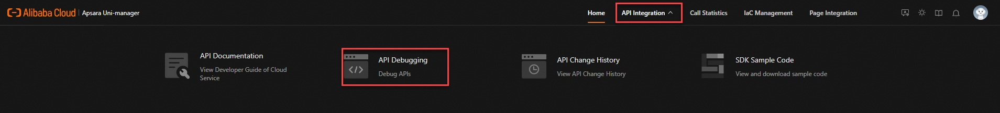

Alibaba Cloud  
Apsara Stack  
Alibaba Cloud Security-Web  
Application Firewall (WAF)  
Web Application Firewall-  
Instance Developer Guide  
Product Version: V3.18.6  
Document Version: 20260629

**Table of Contents**

- [1.Preparations](#section-1)
    - [1.1. Log on to the API Tool console](#section-1-1)
    - [1.2. Obtain API information and its endpoint](#section-1-2)
    - [1.3. Obtain AccessKey credentials](#section-1-3)
    - [1.4. Obtain an STS AccessKey pair](#section-1-4)
- [2.Call examples](#section-2)
    - [2.1. Call examples for SDK for Java](#section-2-1)
        - [2.1.1. Use SDK](#section-2-1-1)
            - [2.1.1.1. Install SDK for Java](#section-2-1-1-1)
            - [2.1.1.2. Use CommonRequest to call API operations](#section-2-1-1-2)
    - [2.2. Call examples for SDK for Python](#section-2-2)
        - [2.2.1. Use SDK](#section-2-2-1)
            - [2.2.1.1. Install SDK for Python](#section-2-2-1-1)
            - [2.2.1.2. Use CommonRequest to call API operations](#section-2-2-1-2)
    - [2.3. Call examples for SDK for Go](#section-2-3)
        - [2.3.1. Use SDK](#section-2-3-1)
            - [2.3.1.1. Install the core package of SDK for Go](#section-2-3-1-1)
            - [2.3.1.2. Use CommonRequest to call API operations](#section-2-3-1-2)
- [3.Common request parameters](#section-3)
- [4.WAF (instance)](#section-4)
    - [4.1. Instance Management](#section-4-1)
        - [4.1.1. CreateWAFInstance](#section-4-1-1)
        - [4.1.2. DeleteWAFInstance](#section-4-1-2)
        - [4.1.3. EditWAFInstance](#section-4-1-3)
        - [4.1.4. DescribeWAFInstance](#section-4-1-4)
        - [4.1.5. CreatePreScaleDownInstance](#section-4-1-5)
        - [4.1.6. CreateScaleDownInstance](#section-4-1-6)
        - [4.1.7. CreateScaleUpInstance](#section-4-1-7)
        - [4.1.8. CreateVPCManagement](#section-4-1-8)
        - [4.1.9. CreateSLRGrant](#section-4-1-9)
        - [4.1.10. DescribeSLRGrant](#section-4-1-10)
        - [4.1.11. DescribeWafQpsQuota](#section-4-1-11)
        - [4.1.12. DescribeWafSpecs](#section-4-1-12)
        - [4.1.13. DescribeVPCInfo](#section-4-1-13)
        - [4.1.14. DescribeVSwitchInfo](#section-4-1-14)
        - [4.1.15. DescribeWAFAZInfo](#section-4-1-15)
        - [4.1.16. DescribeWafENIInfo](#section-4-1-16)
    - [4.2. Virtual IP address management](#section-4-2)
        - [4.2.1. CreateVpcVip](#section-4-2-1)
        - [4.2.2. EditInternetVPCVip](#section-4-2-2)
        - [4.2.3. DeleteInternetVPCVip](#section-4-2-3)
        - [4.2.4. DescribeVpcVip](#section-4-2-4)
        - [4.2.5. DescribeAliyunVPCVIPAttribute](#section-4-2-5)
        - [4.2.6. DescribeVpc](#section-4-2-6)
        - [4.2.7. DescribeAliyunSite](#section-4-2-7)
        - [4.2.8. DescribeVSwitch](#section-4-2-8)
    - [4.3. Website protection](#section-4-3)
        - [4.3.1. CreateWebsite](#section-4-3-1)
        - [4.3.2. EditWebsite](#section-4-3-2)
        - [4.3.3. DeleteSoftwareReverseProxyWebsite](#section-4-3-3)
        - [4.3.4. EditEnableDisableWebsite](#section-4-3-4)
        - [4.3.5. CreateSSEConfig](#section-4-3-5)
        - [4.3.6. EditSSEConfig](#section-4-3-6)
        - [4.3.7. DeleteSSEConfig](#section-4-3-7)
        - [4.3.8. DescribeSSEConfig](#section-4-3-8)
        - [4.3.9. CreateExportWebsite](#section-4-3-9)
        - [4.3.10. DescribeTaskResult](#section-4-3-10)
        - [4.3.11. DescribeWebsite](#section-4-3-11)
    - [4.4. HTTP flood protection rules](#section-4-4)
        - [4.4.1. CreateACLRuleTemplate](#section-4-4-1)
        - [4.4.2. EditACLRuleTemplate](#section-4-4-2)
        - [4.4.3. DeleteACLRuleTemplate](#section-4-4-3)
        - [4.4.4. EditEnableDisableACLRuleTemplate](#section-4-4-4)
        - [4.4.5. CreateACLRule](#section-4-4-5)
        - [4.4.6. DescribeACLRule](#section-4-4-6)
        - [4.4.7. DeleteACLRuleTarget](#section-4-4-7)
        - [4.4.8. DeleteClearACLRule](#section-4-4-8)
        - [4.4.9. CreateACLWhiteList](#section-4-4-9)
        - [4.4.10. DeleteACLWhiteList](#section-4-4-10)
    - [4.5. Custom rules](#section-4-5)
        - [4.5.1. CreatePolicyRule](#section-4-5-1)
        - [4.5.2. EditPolicyRule](#section-4-5-2)
        - [4.5.3. DeletePolicyRule](#section-4-5-3)
        - [4.5.4. EditEnableDisablePolicyRule](#section-4-5-4)
        - [4.5.5. DescribeExportPolicyRule](#section-4-5-5)
    - [4.6. Protection policies](#section-4-6)
        - [4.6.1. CreatePolicyGroup](#section-4-6-1)
        - [4.6.2. EditPolicyGroup](#section-4-6-2)
        - [4.6.3. DeletePolicyGroup](#section-4-6-3)
        - [4.6.4. DescribePolicyGroup](#section-4-6-4)
    - [4.7. Certificate Management Service](#section-4-7)
        - [4.7.1. UploadSSLCert](#section-4-7-1)
        - [4.7.2. DeleteSSLCert](#section-4-7-2)
        - [4.7.3. DescribeSSLCert](#section-4-7-3)
        - [4.7.4. CreateUpdateSSLCert](#section-4-7-4)
        - [4.7.5. EditCert](#section-4-7-5)
    - [4.8. Vector Search](#section-4-8)
        - [4.8.1. DescribeFilterV2](#section-4-8-1)

<a id="section-1"></a>

# 1.Preparations

<a id="section-1-1"></a>

## 1.1. Log on to the API Tool console

You can log on to the API Tool console from the Apsara Uni-manager Management Console.

**Prerequisites**

- The URL of the Apsara Uni-manager Management Console is obtained from a deployment engineer.

- A browser is available. We recommend that you use Google Chrome.

**Procedure**

1. Enter the URL of the Apsara Uni-manager Management Console in the address bar of your browser and press the Enter key.

2. On the login page, enter your username and password.

   You need to obtain the username and password from an operations administrator.

   > **Note**
   >
   > The first time you log on to the Apsara Uni-manager Management Console, you must change the password of your account as prompted. For security purposes, your password must be 10 to 32 characters in length and must contain at least two of the following character types:
   >
   > - Uppercase or lowercase letters
   >
   > - Digits
   >
   > - Special characters, including exclamation points (!), at signs (@), number signs (#), dollar signs ($), and percent signs (%)

3. Click **Log In**.

4. If multi-factor authentication (MFA) is enabled for your account, perform the corresponding operations in the following scenarios:

   - Scenario 1: You log in to the Apsara Uni-manager Management Console for the first time after MFA is enabled by an administrator.

     <ol type="a">

     <li>

     On the Bind Virtual MFA Device page, bind an MFA device.

     </li>

     <li>

     Re-enter the username and password as described in Step 2 and click **Log In**.

     </li>

     </ol>

     <ol type="i" start="100">

     <li>

     Enter a six-digit MFA verification code and click **Authenticate**.

     </li>

     </ol>

   - Scenario 2: You log in to the Apsara Uni-manager Management Console after MFA is enabled and an MFA device is bound.

     Enter the 6-digit MFA verification code and click **Authenticate**.

     > **Note**
     >
     > For more information, see **Bind a virtual MFA device to enable MFA** in **Apsara Uni-manager Management Console User Guide**.

5. In the top navigation bar, choose **Products** > **Development Tools** > **OpenAPI Explorer**.

<a id="section-1-2"></a>

## 1.2. Obtain API information and its endpoint

To call an API operation of a cloud service, you must obtain information about the operation, including the service code, operation name, and API version.

**Background information**

The information on the API Directory page of the Apsara Uni-manager Management Console is for reference only. For more information about how to call API operations, see the developer guides of cloud services. If the information on the API Directory page differs from that in the developer guide of the corresponding cloud service, the information in the developer guide prevails.

**Procedure**

1. Log on to the Apsara Uni-manager Management Console.

2. In the top menu bar, choose **Products** > **Development Tools** > **API & SDK**> **OpenAPI Explorer**.

3. On the **OpenAPI Explorer** page, choose **API Integration** > **API Debugging**.

   

4. In the left-side navigation pane, select the cloud service that you want to manage.

5. From the **Version** drop-down list, select the API version.

6. In the API list, you can view all API operations of the current version.

7. Select the corresponding API operation and obtain the POP endpoint information of the cloud service under the parameter name.

   

<a id="section-1-3"></a>

## 1.3. Obtain AccessKey credentials

Access credentials are assigned by Resource Access Management (RAM) or Security Token Service (STS). You can use either type of access credential for authentication when you make an API request. This topic describes how to obtain access credentials that are assigned by RAM.

**Background information**

An AccessKey pair is used to verify the identity of a request sender. An AccessKey pair consists of an AccessKey ID and an AccessKey secret that are used to implement symmetric encryption. The AccessKey ID is used to identify a user. The AccessKey secret is used to encrypt the signature string.

You can use RAM or STS to assign access credentials for authentication.

- Use RAM to assign an AccessKey ID and an AccessKey secret to a third party.

- Use STS to assign an AccessKey ID, an AccessKey secret, and a security token to a third party. For more information, see Obtain an access credential assigned by STS.

The Apsara Uni-manager Management Console provides AccessKey pairs to personal accounts and organizations. Only the administrators of level-1 organizations and operations administrators can obtain the AccessKey pairs of organizations. We recommend that you use the AccessKey pairs of personal accounts to call the API operations of the Apsara Uni-manager Management Console and cloud services. If you use the AccessKey pair of a personal account, configure the header parameters that are described in the following table for access control. Otherwise, an error that indicates insufficient permissions may occur.

> **Warning**
>
> The AccessKey pair of a personal account is managed by the permission system of the Apsara Uni-manager Management Console and has limited permissions. The AccessKey pair of an organization has greater permissions. If you want to use such an AccessKey pair, make sure that your operation is allowed by an administrator to ensure security.

| Header | Description |
| --- | --- |
| x-acs-regionid | The region ID. Example: cn-hangzhou-\*. |
| x-acs-organizationid | The organization ID in the Apsara Uni-manager Management Console. For more information about how to obtain an organization ID, see <strong>GetOrganizationList</strong> in <strong>Apsara Uni-manager</strong> <strong>Management Console Developer Guide</strong>. |
| x-acs-resourcegroupid | The resource set ID in the Apsara Uni-manager Management Console. For more information about how to obtain a resource set ID, see <strong>ListResourceGroup</strong> in <strong>Apsara Uni-manager</strong> <strong>Management Console Developer Guide</strong>. |
| x-acs-instanceid | The ID of the instance that you want to manage.For example, you can use the ID of an Elastic Compute Service (ECS) instance obtained from the ECS instance list. |

**Obtain the AccessKey pair of a personal account**

To obtain the AccessKey pair of a personal account, perform the following steps:

1. Log in to the Apsara Uni-manager Management Console.

2. Click the profile picture in the upper-right corner of the page and click **User Information**.

3. In the **AccessKey Pair** section, view the AccessKey pair.

   

   > **Note**
   >
   > The AccessKey pair provides full permissions on cloud resources within your Alibaba Cloud account. You must keep the AccessKey pair strictly confidential.

**Obtain the AccessKey pair of an organization**

To obtain the AccessKey pair of an organization, perform the following steps:

1. Log on to the Apsara Uni-manager Management Console as an administrator.

2. In the top navigation bar, click **Enterprise**.

3. In the left-side navigation pane, choose **Resources > Organizations**.

4. In the organization list, click the name of the level-1 organization whose AccessKey pair you want to obtain.

5. On the right side of the page, click **Manage AccessKey Pairs**.

6. In the dialog box that appears, view the AccessKey pair of the organization.

<a id="section-1-4"></a>

## 1.4. Obtain an STS AccessKey pair

This topic describes how to use Security Token Service (STS) to call Apsara Stack API operations.

**Background information**

Apsara Stack STS allows you to manage temporary access credentials for your Apsara Stack resources. You can use STS to call Apsara Stack API operations.

Access credentials assigned by STS consist of an AccessKey ID, an AccessKey secret, and a security token. When you use STS to call API operations, these three elements are required.

**Procedure**

1. Obtain the Apsara Stack Resource Name (ARN) of your Resource Access Management (RAM) role.

   <ol type="i">

   <li>

   Log in to the Apsara Uni-manager Management Console.

   </li>

   <li>

   Click the profile picture in the upper-right corner of the page and click **User**

   </li>

   </ol>

   **Information**.

   <ol type="i" start="3">

   <li>

   Click **View Current Role Policy**.

   </li>

   </ol>

   In the **View Policies of Current Role** dialog box, view the ARN of your RAM role.

2. Obtain the access credentials assigned by STS.

   > **Note**
   >
   > You must replace the variables in the following code with actual values. Delete the angle brackets (<>) before you submit the code.
   >
   > The following section describes the variable parameters:
   >
   > - &lt;yourRegionID>: Replace this variable with the actual region ID.
   >
   > - &lt;yourAccessKeyID>: Replace this variable with your AccessKey ID.
   >
   > - &lt;yourAccessKeySecret>: Replace this variable with your AccessKey secret.
   >
   > - &lt;yourRoleSessionName>: Replace this variable with the actual session name.
   >
   >   This name is user-defined and is usually set to the identity of the user who calls the API, for example, username. In the operations performed by the same RAM role, the actual operator can be distinguished according to different  `RoleSessionName`  to implement user-level access audit. The name must be 2 to 64 characters in length, and can contain letters, digits, periods (.), at(@), hyphens (-), and underscores (_).
   >
   > - &lt;yourRoleArn>: Replace it with your actual RAM role.
   >
   > - "sts.aliyuns.com" : Replace it with the actual STS endpoint.

   ```xml
   public static void main(String[] args) {
       // Create and initialize a DefaultAcsClient instance. 
       // Replace the region ID, AccessKey ID, and AccessKey secret. 
       DefaultProfile profile = DefaultProfile.getProfile("<yourRegionID>", "
   <yourAccessKeyID>", "<yourAccessKeySecret>");
       HttpClientConfig clientConfig = HttpClientConfig.getDefault();
       clientConfig.setIgnoreSSLCerts(true);
       clientConfig.setProtocolType(ProtocolType.HTTPS);
       profile.setHttpClientConfig(clientConfig);
       IAcsClient client = new DefaultAcsClient(profile);
       String assumeRole = callAssumeRole(client);
       if (StringUtils.isEmpty(assumeRole)) return;
       JSONObject assumeRoleJson = JSONObject.parseObject(assumeRole);
       JSONObject credentials = assumeRoleJson.getJSONObject("Credentials");
       // Obtain the STS triplet. 
       String stsAK = credentials.getString("AccessKeyId");
       String stsSK = credentials.getString("AccessKeySecret");
       String stsToken = credentials.getString("SecurityToken");
   }

   private static String callAssumeRole(IAcsClient client) {
       CommonRequest request = new CommonRequest();
       // Replace "sts.aliyuns.com" with the actual STS endpoint. The general format is sts-vpc.${global:region}.${global:internet-domain}. 
       request.setSysDomain("sts.aliyuns.com");
       request.setSysProduct("Sts");
       request.setSysAction("AssumeRole");
       request.setSysVersion("2015-04-01");
       request.setSysMethod(MethodType.POST);
       request.setHttpContentType(FormatType.FORM);
       // The business parameter. Set the alias of the session. Replace "
   <yourRoleSessionName>" with the actual value. 
       request.putQueryParameter("RoleSessionName", "<yourRoleSessionName>");
       // The ARN of the role that you assume. Replace "<yourRoleArn>" with the actual Ram Role ARN obtained in the previous step. 
       request.putQueryParameter("RoleArn", "<yourRoleArn>");
       try {
           CommonResponse response = client.getCommonResponse(request);
           return response.getData();
       } catch (ServerException e) {
           System.out.println(e.getErrCode());
           System.out.println(e.getErrMsg());
       } catch (ClientException e) {
           System.out.println(e.getErrCode());
           System.out.println(e.getErrMsg());
       }
       return null;
   }
   ```

3. Use the access credentials assigned by STS to call an API operation of a service. The following sample code provides an example on how to call the  `DescribeZones`  operation of Elastic Compute Service (ECS):

   > **Note**
   >
   > Replace the variables in the following sample code with actual values. Delete the angle brackets (<>) from the final code.
   >
   > The following section describes the variable parameters:
   >
   > - &lt;yourRegionID>: Replace this variable with the actual region ID.
   >
   > - &lt;yourStsAccesskeyID>: Replace this variable with the AccessKey ID assigned by STS.
   >
   > - &lt;yourStsAccessKeySecret>: Replace this variable with the AccessKey secret assigned by STS.
   >
   > - &lt;yourStsToken>: Replace this variable with the security token assigned by STS.
   >
   > - &lt;yourResourceGroupID>: Replace this variable with the actual resource set ID.
   >
   > - &lt;yourOrganizationID>: Replace this variable with the actual organization ID.

   ```xml
   public static void main(String[] args) {
       // Replace <yourRegionID> with the actual region ID. 
       // Replace <yourStsAccessKeyID> and <yourStsAccessKeySecret> with the AccessKey I
   D and AccessKey secret assigned by STS, which are obtained in the previous step. 
       DefaultProfile profile = DefaultProfile.getProfile("<yourRegionID>", "
   <yourStsAccesskey>", "<yourStsAccessSecret>");
       HttpClientConfig clientConfig = HttpClientConfig.getDefault();
       clientConfig.setIgnoreSSLCerts(true);
       clientConfig.setProtocolType(ProtocolType.HTTPS);
       profile.setHttpClientConfig(clientConfig);
       IAcsClient client = new DefaultAcsClient(profile);
       CommonRequest request = new CommonRequest();
       request.setSysDomain("ecs.aliyuns.com");
       request.setSysProduct("Ecs");
       request.setSysAction("DescribeZones");
       request.setSysVersion("2014-05-26");
       request.setSysMethod(MethodType.POST);
       request.setHttpContentType(FormatType.FORM);
       // Replace "<yourRegionID>" with your actual region ID. 
       request.putHeadParameter("x-acs-regionid", "<yourRegionID>");
       // Replace "<yourStsToken>" with the security token in the STS triplet that you obtained in the previous step. 
       request.putQueryParameter("SecurityToken", "<yourStsToken>");
       // Optional. Replace it with your actual resource set ID. 
       // request.putHeadParameter("x-acs-resourcegroupid", "<yourResourceGroupID>");
       // Optional. Replace it with your actual organization ID. 
       request.putHeadParameter("x-acs-organizationid", "<yourOrganizationID>");
       try {
           CommonResponse response = client.getCommonResponse(request);
           System.out.println(response.getData());
       } catch (ServerException e) {
           System.out.println(e.getErrCode());
           System.out.println(e.getErrMsg());
       } catch (ClientException e) {
           System.out.println(e.getErrCode());
           System.out.println(e.getErrMsg());
       }
   }
   ```

<a id="section-2"></a>

# 2.Call examples

<a id="section-2-1"></a>

## 2.1. Call examples for SDK for Java

<a id="section-2-1-1"></a>

### 2.1.1. Use SDK

<a id="section-2-1-1-1"></a>

#### 2.1.1.1. Install SDK for Java

This topic describes how to install and use Apsara Stack Security SDK for Java.

Apsara Stack SDK for Java supports Java Development Kit (JDK) 1.8 or later. You can install Apsara Stack SDK for Java by adding Maven dependencies or downloading the SDK. For more information, visit Alibaba Cloud SDKs.

If you want to use Apsara Stack Security SDK for Java, you must install the core library of Apsara Stack SDK for Java. We recommend that you use V4.5.17 or later of the core library.

When you install the core library, you must add the following dependency to the pom.xml file. For more information about the specific SDK version, visit Alibaba Cloud SDKs.

```xml
<!-- Alibaba Cloud SDK for Java -->
<dependency>
    <groupId>com.aliyun</groupId>
    <artifactId>aliyun-java-sdk-core</artifactId>
    <version>4.5.17</version>
</dependency>
```

<a id="section-2-1-1-2"></a>

#### 2.1.1.2. Use CommonRequest to call API operations

> **Note**
>
> If you want to call the API operations of a service that does not provide SDKs, you can use CommonRequest. You can use CommonRequest to call API operations.

**Benefits**

CommonRequest provides the following benefits:

1. Lightweight: You need to only download the core package. You do not need to download and install SDKs of services.

2. Easy to use: You can call the newly released API operations of a service without the need to update the SDK for the service.

3. Fast iteration.

**Use CommonRequest to call an API operation**

Apsara Stack services provide RPC and RESTful APIs. The request method of CommonRequest varies based on the style of the API that you want to call.

In most cases, an API uses the RPC style if the API operations include the Action parameter. An API uses the RESTful style if the API operations include the PathPattern parameter. All API operations of a service use the same API style. The API of each service supports only one style. If you pass an invalid identifier, another API operation may be called, or the  `ApiNotFound`  error is returned.

If you want to send a CommonRequest request, you must obtain the values of the following parameters. For more information about the values of these parameters, see the API reference in DocumentationDocumentation. You can also visit OpenAPI Explorer to obtain the parameter values of API operations for some services.

- Endpoint: the endpoint of a service.

- Version: the version of the API. The version is in the YYYY-MM-DD format.

- Operation information: the name of the API operation that you want to call.

  - The APIs of most Apsara Stack services, such as Threat Detection Service, are RPC APIs. If you want to call an RPC API operation, you must obtain the value of the Action parameter, and then specify the value in the  `request.ApiName = "<Action>"`  format.

  - If you want to call a RESTful API operation of a service, such as Container Service for Kubernetes (ACK), you must obtain the value of the PathPattern parameter, and then specify the RESTful path in the  `request.PathPattern = "<PathPattern>"`  format.

**Example: Call an RPC API operation**

The following sample code shows how to use CommonRequest to call an API operation of Apsara Stack Security:

```java
import com.aliyuncs.CommonRequest;
import com.aliyuncs.CommonResponse;
import com.aliyuncs.DefaultAcsClient;
import com.aliyuncs.IAcsClient;
import com.aliyuncs.exceptions.ClientException;
import com.aliyuncs.exceptions.ServerException;
import com.aliyuncs.profile.DefaultProfile;
public class Sample {
    public static void main(String[] args) {
        // Create a DefaultAcsClient instance and initialize the instance.
        DefaultProfile profile = DefaultProfile.getProfile(
            "<your-region-id>",          // The ID of the region.
            "<your-access-key-id>",      // The AccessKey ID.
            "<your-access-key-secret>"); // The AccessKey secret.
        IAcsClient client = new DefaultAcsClient(profile);
        // Create an API request and specify parameters.
        CommonRequest request = new CommonRequest();
        request.setDomain("<your-endpoint>");// The endpoint of the service.
        request.setVersion("<API-version>");// The version of the API.
        request.setAction("<your-action>");// The name of the API operation.
        request.putQueryParameter("PageNumber", "1");
        request.putQueryParameter("PageSize", "30");
        try {
            CommonResponse response = client.getCommonResponse(request);
            System.out.println(response.getData());
        } catch (ServerException e) {
            // TODO Auto-generated catch block
            e.printStackTrace();
        } catch (ClientException e) {
            // TODO Auto-generated catch block
            e.printStackTrace();
        }
    }
}
```

<a id="section-2-2"></a>

## 2.2. Call examples for SDK for Python

<a id="section-2-2-1"></a>

### 2.2.1. Use SDK

<a id="section-2-2-1-1"></a>

#### 2.2.1.1. Install SDK for Python

This topic describes how to install and use SDK for Python.

Apsara Stack SDK for Python supports Python 2.6.x, Python 2.7.x, and Python 3.x or later. You can install Apsara Stack SDK for Python by using pip.

> **Note**
>
> To use the SDK of an Apsara Stack service, you must install the core library of
>
> Apsara Stack SDK for Python.

- If you use Python 2.x, run the following command to install the core library:

  ```bash
  pip install aliyun-python-sdk-core
  ```

- If you use Python 3.x, run the following command to install the core library:

  ```bash
  pip3 install aliyun-python-sdk-core-v3
  ```

<a id="section-2-2-1-2"></a>

#### 2.2.1.2. Use CommonRequest to call API operations

> **Note**
>
> If you want to call the API operations of an Apsara Stack service that does not provide SDKs, you can use CommonRequest. You can use CommonRequest to call API operations.

**Benefits**

CommonRequest provides the following benefits:

1. Lightweight: You need only to download the core package. You do not need to download and install SDKs of Apsara Stack services.

2. Easy to use: You can call the newly released API operations of an Apsara Stack service without the need to update the SDK for the service.

3. Fast iteration.

**Use CommonRequest to call an API operation**

Apsara Stack services provide RPC and RESTful APIs. The request method of CommonRequest varies based on the style of the API that you want to call.

In most cases, an API uses the RPC style if the API operations include the Action parameter. An API uses the RESTful style if the API operations include the PathPattern parameter. All API operations of a service use the same API style. The API of each service supports only one style. If you pass an invalid identifier, another API operation may be called, or the  `ApiNotFound`  error is returned.

If you want to send a CommonRequest request, you must obtain the values of the following parameters. For more information about the values of these parameters, see the API reference in DocumentationDocumentation. You can also visit OpenAPI Explorer to obtain the parameter values of API operations for some services.

- Endpoint: the endpoint of a service.

- Version: the version of the API. The version is in the YYYY-MM-DD format.

- Operation information: the name of the API operation that you want to call.

  - The APIs of most Apsara Stack services, such as Threat Detection Service, are RPC APIs. If you want to call an RPC API operation, you must obtain the value of the Action parameter, and then specify the value in the  `request.ApiName = "<Action>"`  format.

  - If you want to call a RESTful API operation of a service, such as Container Service for Kubernetes (ACK), you must obtain the value of the PathPattern parameter, and then specify the RESTful path in the  `request.PathPattern = "<PathPattern>"`  format.

**Example: Call an RPC API operation**

The following sample code shows how to use the CommonRequest method to call the API operation:

```python
from aliyunsdkcore.client import AcsClient
from aliyunsdkcore.request import CommonRequest
client = AcsClient('{your_access_key_id}', '{your_access_key_secret}', 
'{your_region_id}') 
request = CommonRequest()
request.set_domain('<your-endpoint>') //The endpoint of the service.
request.set_version('<API-version>') //The version of the API.
request.set_action_name('<your-action>')//The name of the API operation.
# or: 
# request = CommonRequest(domain='<your-endpoint>', version='<API-version>', 
action_name='your-action')
request.add_query_param('PageNumber', '1')
request.add_query_param('PageSize', '30')
response = client.do_action_with_exception(request)
```

<a id="section-2-3"></a>

## 2.3. Call examples for SDK for Go

<a id="section-2-3-1"></a>

### 2.3.1. Use SDK

<a id="section-2-3-1-1"></a>

#### 2.3.1.1. Install the core package of SDK for Go

This topic describes how to install the core package of SDK for Go.

Apsara Stack SDK for Go supports Go 1.10.x and later. You can run the following command to install the core package:

```text
go get -u github.com/aliyun/alibaba-cloud-sdk-go/sdk
```

<a id="section-2-3-1-2"></a>

#### 2.3.1.2. Use CommonRequest to call API operations

> **Note**
>
> If you want to call the API operations of an Apsara Stack service that does not provide SDKs, you can use CommonRequest. You can use CommonRequest to call API operations.

**Benefits**

CommonRequest provides the following benefits:

1. Lightweight: You need only to download the core package. You do not need to download and install SDKs of Apsara Stack services.

2. Easy to use: You can call the newly released API operations of an Apsara Stack service without the need to update the SDK for the service.

3. Fast iteration.

**Use CommonRequest to call an API operation**

Apsara Stack services provide RPC and RESTful APIs. The request method of CommonRequest varies based on the style of the API that you want to call.

In most cases, an API uses the RPC style if the API operations include the Action parameter. An API uses the RESTful style if the API operations include the PathPattern parameter. All API operations of a service use the same API style. The API of each service supports only one style. If you pass an invalid identifier, another API operation may be called, or the  `ApiNotFound`  error is returned.

If you want to send a CommonRequest request, you must obtain the values of the following parameters. For more information about the values of these parameters, see the API reference in DocumentationDocumentation. You can also visit OpenAPI Explorer to obtain the parameter values of API operations for some services.

- Endpoint: the endpoint of a service.

- Version: the version of the API. The version is in the YYYY-MM-DD format.

- Operation information: the name of the API operation that you want to call.

  - The APIs of most Apsara Stack services, such as Threat Detection Service, are RPC APIs. If you want to call an RPC API operation, you must obtain the value of the Action parameter, and then specify the value in the  `request.ApiName = "<Action>"`  format.

  - If you want to call a RESTful API operation of a service, such as Container Service for Kubernetes (ACK), you must obtain the value of the PathPattern parameter, and then specify the RESTful path in the  `request.PathPattern = "<PathPattern>"`  format.

**Example: Call an RPC API operation**

The following sample code shows how to use the CommonRequest method to call the API operation:

```go
package main
import (
    "github.com/aliyun/alibaba-cloud-sdk-go/sdk/requests"
    "github.com/aliyun/alibaba-cloud-sdk-go/sdk"
    "fmt"
)
func main() {
    client, err := sdk.NewClientWithAccessKey("cn-hangzhou", "{your_access_key_id}", "{
your_access_key_secret}")
    if err != nil {
        panic(err)
    }
    request := requests.NewCommonRequest()
    request.Domain = "<your-endpoint>"// The endpoint of the service.
    request.Version = "<API-version>"// The version of the API.
    request.ApiName = "<your-action>"// The name of the API operation.
    request.QueryParams["PageNumber"] = "1"
    request.QueryParams["PageSize"] = "30"
    response, err := client.ProcessCommonRequest(request)
    if err != nil {
        panic(err)
    }
    fmt.Print(response.GetHttpContentString())
}
```

<a id="section-3"></a>

# 3.Common request parameters

**Common request parameters**

Common request parameters are required for every API call.

Table 1. Common request parameters

| Parameter | Type | Requi red | Description |
| --- | --- | --- | --- |
| Format | Strin g | No | The type of the return value. Only JSON is supported. |
| Version | Strin g | Yes | The API version. Enter it in YYYY-MM-DD format. Valid values:<br>• Auditprivate: <strong>2018-01-16</strong><br>• yundunnextsoc: <strong>2019-07-23</strong><br>• Sas: <strong>2018-12-03</strong><br>• aegis: <strong>2016-11-11</strong><br>• yundun-css: <strong>2021-10-11</strong><br>• secspy: <strong>2019-08-05</strong><br>• Ddosprivate: <strong>2018-01-16</strong><br>• hsm-private: <strong>2018-06-30</strong><br>• Cloudfw: <strong>2017-12-07</strong><br>• Sddp: <strong>2019-01-03</strong><br>• semawaf: <strong>2020-07-01</strong><br>• soar: <strong>2018-12-03</strong><br>• Bastionhostprivate: <strong>2023-03-23</strong><br>• waf-onecs: <strong>2020-07-01</strong> |
| AccessKeyId | Strin g | Yes | The AccessKey ID used to access a service. |
| AccessKeySe cret | Strin g | Yes | The AccessKey secret used to access a service. |
| RegionId | Strin g | Yes | The region ID of the service. |
| Product | Strin g | Yes | The name of the product corresponding to the API. Valid values:<br>• <strong>Auditprivate</strong>: Apsara Stack Security basic component<br>• <strong>yundunnextsoc</strong>: Security Operations Center (SOC)<br>• <strong>Sas</strong>: Threat Detection Service<br>• <strong>aegis</strong>: Server Guard<br>• <strong>yundun-css</strong>: Container Security Service (CSS)<br>• <strong>secspy</strong>: Network Detection and Response (NDR)<br>• <strong>Ddosprivate</strong>: Anti-DDoS<br>• <strong>hsm-private</strong>: Cloud Hardware Security Module (HSM)<br>• <strong>Cloudfw</strong>: Cloud Firewall (CFW)<br>• <strong>Sddp</strong>: Sensitive Data Discovery and Protection (SDDP)<br>• <strong>semawaf</strong>: Web Application Firewall (WAF)<br>• <strong>soar</strong>: SOC-Orchestration<br>• <strong>Bastionhostprivate</strong>: Bastionhost<br>• <strong>waf-onecs:</strong> Web Application Firewall-Instance Edition |
| EndpointPre | Strin g | Yes | The domain name prefix corresponding to the API. Valid values:<br>• <strong>auditprivate</strong>: Apsara Stack Security basic component<br>• <strong>yundunnextsoc-pop</strong>: SOC<br>• <strong>tds</strong>: Threat Detection Service<br>• <strong>aegis</strong>: Server Guard<br>• <strong>yundun-css</strong>: CSS<br>• <strong>secspy-share</strong>: NDR<br>• <strong>ddosprivate</strong>: Anti-DDoS<br>• <strong>hsmprivate</strong>: HSM<br>• <strong>cloudfw</strong>: CFW<br>• <strong>sddp-api</strong>: SDDP<br>• <strong>semawaf</strong>: WAF<br>• <strong>soar</strong>: SOC-Orchestration<br>• <strong>bastionhostprivate</strong>: Bastionhost<br>• <strong>waf-onecs:</strong> Web Application Firewall-Instance Edition |

**Common response parameters**

The API returns results in a unified format. The system uses HTTP status codes to indicate the call status:

- A 2xx HTTP status code indicates success.

- A 4xx or 5xx HTTP status code indicates failure.

If the call succeeds, the system returns data in the JSON format. For each API call, whether the call succeeds or fails, the system returns a unique identifier RequestId.

<a id="section-4"></a>

# 4.WAF (instance)

<a id="section-4-1"></a>

## 4.1. Instance Management

<a id="section-4-1-1"></a>

### 4.1.1. CreateWAFInstance

Creates a Web Application Firewall (WAF) instance.

**Request headers**

This operation uses common request headers and does not have special request headers. For more information, see Common request parameters.

**Request parameters**

| Parameter | Type | Posit ion | Required | Example | Description |
| --- | --- | --- | --- | --- | --- |
| Departme nt | Strin g | Quer y | No | 5 | The organization ID. This parameter is required. |
| ResourceG roup | Strin g | Quer y | No | 4 | The resource set ID. This parameter is required. |
| UserVpcM ode | Strin g | Quer y | No | single | The virtual private cloud (VPC) protection mode.This parameter is required.<br>• single<br>• multiple |
| AvailableZ ones | Repe atLis t | Quer y | No | \[cn-wulan-env205-\*\*\*\*-a\] | The availability zone information. This parameter is required. |
| Name | Strin g | Quer y | No | waf-test-xx | The instance name. This parameter is required. |
| Arch | Strin g | Quer y | No | x86 | The architecture. Valid values: x86 and arm. This parameter is required. |
| VpcVswitc h | Repe atLis t | Quer y | No | \[{"vswitch_name":"waf_te st_1","vswitch":"vsw-r8ucqpjuv4e7\*\*\*\*jqz","cid r_block":"192.168.0.0/16","available_zone":"cn-wulan- env205-\*\*\*\*-a","vpc":"vpc-r8uriii23n0r\*\*\*\*22vhw","v pc_name":"waf_test_1"} \] | The VPCs and their associated vSwitches that this WAF instance protects. This parameter is required. |
| DetectorS pecs | Strin g | Quer y | No | exclusive | The specification of the detection engine. This parameter is required.<br>• share: shared<br>• exclusive: dedicated |
| DetectorV ersion | Strin g | Quer y | No | basic | The version of the detection engine. This parameter is required.<br>• basic: Basic Edition<br>• premium: Advanced Edition<br>• enterprise: Enterprise Edition |
| DetectorN odeNum | Long | Quer y | No | 2 | The number of detection engines in a single availability zone. This parameter is required. |
| EnableIpv6 | Bool ean | Quer y | No | false | Specifies whether to enable IPv6. Default value: false. |

**Response parameters**

| Parameter | Type | Example | Description |
| --- | --- | --- | --- |
| RequestId | String | 7CAF6B13-\*\*\*\*-DE8EDEF952C9 | The request ID. |
| Result | String | { "tenant_id": 3, "create_time": "177580\*\*\*\*", "user_vpc_mode": "single", "available_zones": \["cn-wulan-env\*\*-\*\*\*\*-a"\], "last_update_time": "177580\*\*\*\*", "instance_id": "waf-llk77L15DsS7\*\*\*\*R t", "ali_uid": "17478691\*\*\*\*", "instance_make_st atus": "wait", "enable_ipv6": false, "qps": 2000, "detector_node_nu m": 2, "vpc_vswitch_bindi ngs": \[10\], "organization_id": "5", "cpu_type": "mix", "oem_cluster_id": 0, "name": "waf-test-xx", "vpc_vswitch": \[ {"vswitch": "vsw-r8ucqpjuv4e7\*\*\*\*g ojqz", "vpc_name": "waf_test_1", "available_zone": "cn-wulan-env\*\*-\*\*\*\*-a", "vpc": "vpc-r8uriii23n0r\*\*\*\*22v hw", "cidr_block": "192.168.0.0/16", "vswitch_name": "waf_test_1" } \], "resource_id": "4", "detector_version": "basic", "detector_specs": "exclusive", "arch": "x86", "instance_status": "create" } | The WAF instance information.<br>instance_status: the action performed on the WAF instance.<br><code>scale_up   Scale up</code><br><code>scale_down Scale down</code><br><code>edit_vpc  Edit VPC</code><br><code>create  Create</code><br><code>release  Release</code><br><code>upgrade Upgrade</code><br>instance_make_status: the status after the operation on the WAF instance.<br><code>wait  Preparing</code><br><code>making  In progress</code><br><code>success  Succeeded</code><br><code>fail  Failed</code> |

**Examples**

Sample requests

```text
 https://[Endpoint]/?Action=CreateWAFInstance
  &Department=5
  &ResourceGroup=4
  &Name=waf-test-xx
  &DetectorSpecs=exclusive
  &DetectorVersion=basic
  &Arch=x86
  &DetectorNodeNum=2
  &EnableIpv6=False
  &UserVpcMode=single
  &Qps=2000
  &AvailableZones.1=cn-wulan-env205-****-a
  &VpcVswitch.1={"vswitch_name":"waf_test_1","vswitch":"vsw-
r8ucqpjuv4e7****jqz","cidr_block":"192.168.0.0/16","available_zone":"cn-wulan-
  env205-****-a","vpc":"vpc-r8uriii23n0r****22vhw","vpc_name":"waf_test_1"}
  &<Common request parameters>
```

Sample success responses

`JSON`  format

```text
HTTP/1.1 200 OK
Content-Type:application/json
{
 "RequestId":"7CAF6B13-****-DE8EDEF952C9",
 "Result":"{      \"tenant_id\": 3,      \"create_time\": \"177580****\",      \"user_vp
c_mode\": \"single\",      \"available_zones\": [\"cn-wulan-env**-****-a\"],      
\"last_update_time\": \"177580****\",      \"instance_id\": \"waf-llk77L15DsS7****Rt\",  
\"ali_uid\": \"17478691****\",      \"instance_make_status\": \"wait\",      
\"enable_ipv6\": false,      \"qps\": 2000,      \"detector_node_num\": 2,      \"vpc_vs
witch_bindings\": [10],      \"organization_id\": \"5\",      \"cpu_type\": \"mix\",    
\"oem_cluster_id\": 0,      \"name\": \"waf-test-xx\",      \"vpc_vswitch\": [        { 
\"vswitch\": \"vsw-r8ucqpjuv4e7****gojqz\",          \"vpc_name\": \"waf_test_1\",      
\"available_zone\": \"cn-wulan-env**-****-a\",          \"vpc\": \"vpc-
r8uriii23n0r****22vhw\",          \"cidr_block\": \"192.168.0.0/16\",          \"vswitch
_name\": \"waf_test_1\"        }      ],      \"resource_id\": \"4\",      
\"detector_version\": \"basic\",      \"detector_specs\": \"exclusive\",      \"arch\": 
\"x86\",      \"instance_status\": \"create\"    }"
}
```

<a id="section-4-1-2"></a>

### 4.1.2. DeleteWAFInstance

Deletes a specified Web Application Firewall (WAF) instance.

**Request headers**

This operation uses common request headers. For more information, see Common request parameters.

**Request parameters**

| Parameter | Type | Posit ion | Required | Example | Description |
| --- | --- | --- | --- | --- | --- |
| WafInstanc eId | Strin g | Quer y | No | waf-S2bmr7znfhe\*\*\*\*9ICR | The ID of the WAF instance. This parameter is required. |

**Response parameters**

| Parameter | Type | Example | Description |
| --- | --- | --- | --- |
| RequestId | String | 90493332-\*\*\*\*-\*\*\*\*-\*\*\*\*-3B90E28447CC | The ID of the request. |
| Result | String | { "tenant_id": 9, "create_time": "177486\*\*\*\*", "user_vpc_mode": "single", "available_zones": \["cn-wulan-\*\*\*\*-a"\], "last_update_time": "177604\*\*\*\*", "instance_id": "waf-S2bmr7znfhe\*\*\*\*9I CR", "ali_uid": "14639744\*\*\*\*", "instance_make_st atus": "wait", "qps": 2000, "detector_node_nu m": 2, "vpc_vswitch_bindi ngs": \[1\], "organization_id": "15", "cpu_type": "mix", "oem_cluster_id": 31, "name": "soctest", "vpc_vswitch": \[\], "resource_id": "14", "detector_version": "basic", "detector_specs": "share", "arch": "x86", "instance_status": "release" } | The returned instance information. |

**Examples**

Sample requests

```text
https://[Endpoint]/?Action=DeleteWAFInstance
&WafInstanceId=waf-S2bmr7znfhe****9ICR
&<Common request parameters>
```

Sample success responses

<a id="section-4-1-3"></a>

### 4.1.3. EditWAFInstance

Edits a Web Application Firewall (WAF) instance.

**Request headers**

This operation uses common request headers. For more information, see Common request parameters.

**Request parameters**

| Parameter | Type | Posit ion | Required | Example | Description |
| --- | --- | --- | --- | --- | --- |
| WafInstanc eId | Strin g | Quer y | No | waf-S2bm\*\*\*\*\*\*ICR | The ID of the WAF instance. This parameter is required. |
| Name | Strin g | Quer y | No | waf-test | The name of the WAF instance. This parameter is required. |

**Response parameters**

| Parameter | Type | Example | Description |
| --- | --- | --- | --- |
| RequestId | String | 5864CC54---\*\*\*\*-2372D5E8AE7F | The ID of the request. |
| Result | String | {} | The returned result. |

**Examples**

Sample requests

```text
https://[Endpoint]/?Action=EditWAFInstance
&Name=waf-test
&WafInstanceId=waf-llk*******HR
&<Common request parameters>
```

Sample success responses `JSON`  format

```json
{
    "eagleEyeTraceId": "0acd1573****2959d00ca",
    "asapiSuccess": true,
    "asapiRequestId": "5864CC54-****-****-****-2372D5E8AE7F",
    "RequestId": "5864CC54-****-****-****-2372D5E8AE7F"
  }
```

`XML`  format

```xml
<eagleEyeTraceId>0acd1573****2959d00ca</eagleEyeTraceId>
<asapiSuccess>true</asapiSuccess>
<asapiRequestId>5864CC54-****-****-****-2372D5E8AE7F</asapiRequestId>
<RequestId>5864CC54-****-****-****-2372D5E8AE7F</RequestId>
```

<a id="section-4-1-4"></a>

### 4.1.4. DescribeWAFInstance

Lists Web Application Firewall (WAF) instances.

**Request headers**

This operation uses common request headers. No special request headers are required. For more information, see Common request parameters.

**Request parameters**

| Parameter | Type | Posit ion | Required | Example | Description |
| --- | --- | --- | --- | --- | --- |
| Pagenumb er | Long | Quer y | No | 1 | The page number of the current page. |
| Pagesize | Long | Quer y | No | 100 | The maximum number of entries to return per page in a paged query. |

**Response parameters**

| Parameter | Type | Example | Description |
| --- | --- | --- | --- |
| RequestId | String | 8E0B9056-\*\*\*\*-FF19B023FFAD | The ID of the request. |
| Result | String | { "total": 2, "page_number": 1, "count": 100, "items": \[ {"tenant_id": 3, "create_time": "177512\*\*\*\*", "user_vpc_mode": "single", "available_zones": \["cn-wulan-\*\*\*\*"\], "last_update_time": "177579\*\*\*\*", "instance_id": "waf-0Pb8KMDV\*\*\*\*n04 SdH", "ali_uid": "17478691\*\*\*\*", "instance_make_st atus": "success", "enable_ipv6": false, "qps": 3000, "detector_node_nu m": 3, "vpc_vswitch_bindi ngs": \[6\], "organization_id": "5", "cpu_type": "mix", "oem_cluster_id": 78, "name": "arm-test-only", "vpc_vswitch": \[ {"vswitch": "vsw-r8u7yltsrw7k\*\*\*\*4v 7yi", "vpc_name": "waf_test_3", "available_zone": "cn-wulan-\*\*\*\*", "vpc": "vpc-r8ucuyo10lq1\*\*\*\*x 7ut53", "cidr_block": "192.168.0.0/16", "vswitch_name": "waf_ipv6_3" } \], "resource_id": "4", "detector_version": "basic", "detector_specs": "exclusive", "arch": "arm", "instance_status": "scale_up", "is_latest": true }, { "tenant_id": 3, "create_time": "177504\*\*\*\*", "user_vpc_mode": "single", "available_zones": \["cn-wulan-\*\*\*\*"\], "last_update_time": "177579\*\*\*\*", "instance_id": "waf-naybA6h1pW\*\*\*\*A hQJE", "ali_uid": "17478691\*\*\*\*", "instance_make_st atus": "success", "enable_ipv6": false, "qps": 2000, "detector_node_nu m": 2, "vpc_vswitch_bindi ngs": \[6\], "organization_id": "5", "cpu_type": "mix", "oem_cluster_id": 76, "name": "x86-test", "vpc_vswitch": \[ {"vswitch": "vsw-r8u7yltsrw7k\*\*\*\*4v 7yi", "vpc_name": "waf_test_3", "available_zone": "cn-wulan-\*\*\*\*", "vpc": "vpc-r8ucuyo10lq1\*\*\*\*x 7ut53", "cidr_block": "192.168.0.0/16", "vswitch_name": "waf_ipv6_3" } \], "resource_id": "4", "detector_version": "basic", "detector_specs": "exclusive", "arch": "x86", "instance_status": "create", "is_latest": true } \]} | The list of returned instances. |

**Examples**

Sample requests

```text
https://[Endpoint]/?Action=DescribeWAFInstance
&Pagenumber=1
&Pagesize=100
&<Common request parameters>
```

Sample success responses

`JSON`  format

```json
{
    "eagleEyeTraceId": "0acd1573****995d00ca",
    "asapiSuccess": true,
    "asapiRequestId": "8E0B9056-****-FF19B023FFAD",
    "RequestId": "8E0B9056-****-FF19B023FFAD",
    "Result": {
      "total": 4,
      "page_number": 1,
      "count": 100,
      "items": [
        {
          tenant_id: 3,
          "create_time": "177512****",
          "user_vpc_mode": "single",
          "available_zones": ["cn-wulan-****"],
          "last_update_time": "177579****",
          "instance_id": "waf-0Pb8KMDV****n04SdH",
          "ali_uid": "17478691****",
          "instance_make_status": "success",
          "enable_ipv6": false,
          "qps": 3000,
          "detector_node_num": 3,
          "vpc_vswitch_bindings": [6],
          "organization_id": "5",
          "cpu_type": "mix",
          "oem_cluster_id": 78,
          "name": "arm-test-only",
          "vpc_vswitch": [
            {
              "vswitch": "vsw-r8u7yltsrw7k****4v7yi",
              "vpc_name": "waf_test_3",
              "available_zone": "cn-wulan-****",
              "vpc": "vpc-r8ucuyo10lq1****x7ut53",
              "cidr_block": "192.168.0.0/16",
              "vswitch_name": "waf_ipv6_3"
            }
          ],
          "resource_id": "4",
          "detector_version": "basic",
          "detector_specs": "exclusive",
          "arch": "arm",
          "instance_status": "scale_up",
          "is_latest": true
        },
        {
          "tenant_id": 3,
          "create_time": "177504****",
          "user_vpc_mode": "single",
          "available_zones": ["cn-wulan-****"],
          "last_update_time": "177579****",
          "instance_id": "waf-naybA6h1pW****AhQJE",
          "ali_uid": "17478691****",
          "instance_make_status": "success",
          "enable_ipv6": false,
          "qps": 2000,
          "detector_node_num": 2,
          "vpc_vswitch_bindings": [6],
          "organization_id": "5",
          "cpu_type": "mix",
          "oem_cluster_id": 76,
          "name": "x86-test",
          "vpc_vswitch": [
            {
              "vswitch": "vsw-r8u7yltsrw7k****4v7yi",
              "vpc_name": "waf_test_3",
              "available_zone": "cn-wulan-****",
              "vpc": "vpc-r8ucuyo10lq1****x7ut53",
              "cidr_block": "192.168.0.0/16",
              "vswitch_name": "waf_ipv6_3"
            }
          ],
          "resource_id": "4",
          "detector_version": "basic",
          "detector_specs": "exclusive",
          "arch": "x86",
          "instance_status": "create",
          "is_latest": true
        },
        {
          "tenant_id": 3,
          "create_time": "177502****",
          "user_vpc_mode": "multiple",
          "available_zones": ["cn-wulan-****"],
          "last_update_time": "177579****",
          "instance_id": "waf-8z7dTJYkt530****t3ua",
          "ali_uid": "17478691****",
          "instance_make_status": "success",
          "enable_ipv6": false,
          "qps": 10000,
          "detector_node_num": 4,
          "vpc_vswitch_bindings": [6, 7],
          "organization_id": "5",
          "cpu_type": "mix",
          "oem_cluster_id": 75,
          "name": "arm-test",
          "vpc_vswitch": [
            {
              "vswitch": "vsw-r8uidyauu7ea3****1aozg",
              "vpc_name": "waf_test_2",
              "available_zone": "cn-wulan-****",
              "vpc": "vpc-r8u5k0tq36ee****x61h5",
              "cidr_block": "192.168.0.0/16",
              "vswitch_name": "waf_ipv6_2"
            },
            {
              "vswitch": "vsw-r8u7yltsrw7k****4v7yi",
              "vpc_name": "waf_test_3",
              "available_zone": "cn-wulan-****",
              "vpc": "vpc-r8ucuyo10lq1****x7ut53",
              "cidr_block": "192.168.0.0/16",
              "vswitch_name": "waf_ipv6_3"
            }
          ],
          "resource_id": "4",
          "detector_version": "premium",
          "detector_specs": "exclusive",
          "arch": "arm",
          "instance_status": "edit_vpc",
          "is_latest": true
        },
        {
          "tenant_id": 3,
          "create_time": "177305****",
          "user_vpc_mode": "single",
          "available_zones": ["cn-wulan-****"],
          "last_update_time": "177579****",
          "instance_id": "waf-9eNpDwbJ7CI9****oY",
          "ali_uid": "17478691****",
          "instance_make_status": "success",
          "enable_ipv6": false,
          "qps": 3000,
          "detector_node_num": 3,
          "vpc_vswitch_bindings": [1],
          "organization_id": "5",
          "cpu_type": "mix",
          "oem_cluster_id": 21,
          "name": "test2-",
          "vpc_vswitch": [
            {
              "vswitch": "vsw-r8ueszlykuyz****bznoi",
              "vpc_name": "yundune2e_aegis_1",
              "available_zone": "cn-wulan-****",
              "vpc": "vpc-r8ui86i1x1vm****91ndr",
              "cidr_block": "192.168.1.0/24",
              "vswitch_name": "yundune2e_aegis_1"
            }
          ],
          "resource_id": "4",
          "detector_version": "basic",
          "detector_specs": "share",
          "arch": "x86",
          "instance_status": "scale_up",
          "is_latest": true
        }
      ]
    }
  }
```

<a id="section-4-1-5"></a>

### 4.1.5. CreatePreScaleDownInstance

This is a pre-scale-in API. When a user initiates a scale-in operation, the system informs the user of the potential impact. The user must confirm before the system proceeds with the scale-in. Backend code that uses OpenAPI to perform scale-in operations can skip this step, depending on actual requirements.

**Request headers**

This operation uses common request headers only. For more information, see Common request parameters.

**Request parameters**

| Parameter | Type | Posit ion | Required | Example | Description |
| --- | --- | --- | --- | --- | --- |
| WafInstanc eId | Strin g | Quer y | No | waf-9Qj7S\*\*\*\*Fyj | Required. The ID of the Web Application Firewall (WAF) instance. |
| AvailableZ ones | Repe atLis t | Quer y | No | cn-wulan-\*\*\*\*\*-a | Required. The zone. |
| DetectorN odeNum | Long | Quer y | No | 2 | Required. The number of nodes in a single zone.During scale-in, this number must be less than the previous setting. |
| VpcVswitc h | Repe atLis t | Quer y | No | \['{"vswitch":"vsw-df5gm\*\*\*\*nfgr","vpc_nam e":"yundune2e_soc","avai lable_zone":"cn-wulan-env1-\*\*\*\*\*-a","vpc":"vpc-df55\*\*\*\*8pl","cidr_block": "192.\*.\*.\*/24","vswitch_na me":"yundune2e_soc"}'\] | Required. The information about the virtual private cloud (VPC) to be protetced. |

**Response parameters**

| Parameter | Type | Example | Description |
| --- | --- | --- | --- |
| RequestId | String | F0A8A039-930D-5EC1-97C8-\*\*\*\*\*\*\*\*\*\*\*\* | The ID of the request. |
| Result | String | {} | Returns information about Elastic Network Interfaces (ENIs) and Elastic Compute Service (ECS) instances that will be deleted during scale-in.<br>• eni_infos: information about ENIs that will be deleted during scale-in<br>• ecs_infos: information about ECS instances that will be removed during scale-in<br>• intranet_ip: the IP address of the ECS instance<br>• ecs_name: the name of the ECS instance.<br>• instance_id: the WAF instance to which the ECS instance belongs |

**Examples**

Sample requests

```text
http(s)://[Endpoint]/?Action=CreatePreScaleDownInstance
&WafInstanceId=waf-9Qj7S****Fyj
&AvailableZones=cn-wulan-*****-a
&DetectorNodeNum=2
&VpcVswitch.1={"vswitch":"vsw-
df5gm****nfgr","vpc_name":"yundune2e_soc","available_zone":"cn-wulan-env1-*****-a","vpc
":"vpc-df55****8pl","cidr_block":"192.*.*.*/24","vswitch_name":"yundune2e_soc"}
&Common request parameters
```

Sample success responses

`JSON`  format

```json
{
    "code": 200,
    "data": {
        "eagleEyeTraceId": "0ad208bd17576594477074739d008d",
        "asapiSuccess": true,
        "asapiRequestId": "22EFD81F-CFA1-43AB-B3C4-B45B15EDB2C6",
        "Result": {
            "eni_infos": [
                {
                    "zone_id": "cn-neimeng-env210-amtest210001-a",
                    "eni_id": "eni-t9v00kmht6bcdoi3f0ss",
                    "eni_name": "user_eni_waf-Sv196XcTOdgJ1ZH3Q5_3",
                    "vpc_id": "vpc-t9v9wbxubmvtkq341lodx",
                    "vswitch_id": "vsw-t9v9wbxtvdndlrpodjogk",
                    "ecs_status": "",
                    "eni_type": "normal",
                    "vgw_ip": "10.210.47.251",
                    "private_ip": "192.168.248.34",
                    "security_group_ids": [
                        "sg-t9v00kmht6atqi5huv5u"
                    ],
                    "status": "PRODUCE_SUCCESS"
                }
            ],
            "ecs_infos": [
                {
                    "zone_id": "cn-neimeng-env210-amtest210001-a",
                    "instance_id": "i-t9v00kmht6bcdoi4xgk4",
                    "ecs_status": "Running",
                    "intranet_ip": "10.0.1.227",
                    "ecs_name": "ecs_cn-neimeng-env210-amtest210001-a_3",
                    "vgw_ip": "10.210.47.251",
                    "owner_type": "ALIYUN",
                    "host_name": "waf-onecs-ecs-waf-Sv196XcTOdgJ1ZH3Q5-3",
                    "status": "PRODUCE_SUCCESS"
                }
            ],
            "add_infos": []
        }
    },
    "requestId": "22EFD81F-CFA1-43AB-B3C4-B45B15EDB2C6",
    "success": true
}
```

<a id="section-4-1-6"></a>

### 4.1.6. CreateScaleDownInstance

Scales in a Web Application Firewall (WAF) instance.

**Request headers**

This operation uses common request headers. For more information, see Common request parameters.

**Request parameters**

| Parameter | Type | Posit ion | Required | Example | Description |
| --- | --- | --- | --- | --- | --- |
| InstanceId | Strin g | Quer y | No | waf-PK3kNiAa\*\*\*\*\*\*\*\*hrR | The ID of the WAF instance. This parameter is required. |
| AvailableZ ones | Repe atLis t | Quer y | No | \[=cn-wulan-e\*\*\*e-\*\*\*\*-a\] | The information about the zone where the WAF instance is deployed. This parameter is required. |
| DetectorN odeNum | Long | Quer y | No | 3 | The number of detection engines in a single zone.This parameter is required. |
| VpcVswitc h | Repe atLis t | Quer y | No | \[{"vswitch_name":"waf-ipv6-2-2","vswitch":"vsw-zd6omnjy8loo\*\*\*\*38gtg", "cidr_block":"192.168.128.0/17","available_zone":"c n-wulan- e\*\*\*e-\*\*\*\*-a","vpc":"vpc-zd6tai5tr3zi\*\*\*\*t28rz","vp c_name":"waf-ipv6-2"}\] | The information about the virtual private cloud (VPC) and vSwitches that the WAF instance protects. This parameter is required. |
| WafInstanc eId | Strin g | Quer y | No | waf-PK3kNiAa\*\*\*\*\*\*\*\*hrR | The ID of the WAF instance. This parameter is required. |

**Response parameters**

| Parameter | Type | Example | Description |
| --- | --- | --- | --- |
| RequestId | String | 73275481-\*\*\*\*-\*\*\*\*-\*\*\*\*-91FDBA2DCC57 | The ID of the request. |
| Result | String | { "tenant_id": 9, "create_time": "177604\*\*\*\*", "user_vpc_mode": "single", "available_zones": \["cn-wulan-e\*\*\*\*e-\*\*\*\*-a"\], "last_update_time": "177607\*\*\*\*", "instance_id": "waf-PK3kNiAarms3\*\*\*\* hrR", "ali_uid": "14639744\*\*\*\*", "instance_make_st atus": "wait", "qps": 7500, "detector_node_nu m": 3, "vpc_vswitch_bindi ngs": \[6\], "organization_id": "15", "cpu_type": "mix", "oem_cluster_id": 41, "name": "waf-du-1vpc", "vpc_vswitch": \[ {"vswitch": "vsw-zd6omnjy8loo\*\*\*\*3 8gtg", "vpc_name": "waf-ipv6-2", "available_zone": "cn-wulan-env17e-\*\*\*\*-a", "vpc": "vpc-zd6tai5tr3zi\*\*\*\*t28 rz", "cidr_block": "192.168.128.0/17", "vswitch_name": "waf-ipv6-2-2" } \], "resource_id": "14", "detector_version": "premium", "detector_specs": "exclusive", "arch": "x86", "instance_status": "scale_down" } | The information about the WAF instance after scale-in. |

**Examples**

Sample requests

```text
https://[Endpoint]/?Action=CreateScaleDownInstance
&InstanceId=waf-PK3kNiAa********hrR
&InstanceIdFilter=waf-PK3kNiAa********hrR
&DetectorNodeNum=3
&WafInstanceId=waf-PK3kNiAa********hrR
&RegionId=cn-wulan-env17e-****
&AvailableZones.1=cn-wulan-env17e-****-a
&VpcVswitch.1={"vswitch_name":"waf-ipv6-2-2","vswitch":"vsw-
zd6omnjy8loo****38gtg","cidr_block":"192.168.128.0/17","available_zone":"cn-wulan-
env17e-****-a","vpc":"vpc-zd6tai5tr3zi****t28rz","vpc_name":"waf-ipv6-2"}
&<Common request parameters>
```

Sample success responses

`JSON`  format

```json
{
    "eagleEyeTraceId": "0a112878****4590d00d2",
    "asapiSuccess": true,
    "asapiRequestId": "73275481-****-****-****-91FDBA2DCC57",
    "RequestId": "73275481-****-****-****-91FDBA2DCC57",
    "Result": {
      "tenant_id": 9,
      "create_time": "177604****",
      "user_vpc_mode": "single",
      "available_zones": ["cn-wulan-e****e-****-a"],
      "last_update_time": "177607****",
      "instance_id": "waf-PK3kNiAarms3****hrR",
      "ali_uid": "14639744****",
      "instance_make_status": "wait",
      "qps": 7500,
      "detector_node_num": 3,
      "vpc_vswitch_bindings": [6],
      "organization_id": "15",
      "cpu_type": "mix",
      "oem_cluster_id": 41,
      "name": "waf-du-1vpc",
      "vpc_vswitch": [
        {
          "vswitch": "vsw-zd6omnjy8loo****38gtg",
          "vpc_name": "waf-ipv6-2",
          "available_zone": "cn-wulan-env17e-****-a",
          "vpc": "vpc-zd6tai5tr3zi****t28rz",
          "cidr_block": "192.168.128.0/17",
          "vswitch_name": "waf-ipv6-2-2"
        }
      ],
      "resource_id": "14",
      "detector_version": "premium",
      "detector_specs": "exclusive",
      "arch": "x86",
      "instance_status": "scale_down"
    }
  }
```

<a id="section-4-1-7"></a>

### 4.1.7. CreateScaleUpInstance

Scales out a Web Application Firewall (WAF) instance.

**Request headers**

This operation uses common request headers. For more information, see Common request parameters.

**Request parameters**

| Parameter | Type | Posit ion | Required | Example | Description |
| --- | --- | --- | --- | --- | --- |
| InstanceId | Strin g | Quer y | No | waf-PK3kNiAa\*\*\*\*\*\*\*\*hrR | The ID of the WAF instance. This parameter is required. |
| AvailableZ ones | Repe atLis t | Quer y | No | \[cn-wulan-env17e-\*\*\*\*-a\] | The information about the availability zone where the WAF instance resides.This parameter is required. |
| DetectorN odeNum | Long | Quer y | No | 3 | The number of detection engines in a single availability zone. This parameter is required. |
| VpcVswitc h | Repe atLis t | Quer y | No | \[{"vswitch_name":"waf-ipv6-2-2","vswitch":"vsw-zd6omnjy8loo\*\*\*\*38gtg", "cidr_block":"192.168.128.0/17","available_zone":"c n-wulan- env17e-\*\*\*\*-a","vpc":"vpc-zd6tai5tr3zi\*\*\*\*t28rz","vp c_name":"waf-ipv6-2"}\] | The information about the virtual private cloud (VPC) and its vSwitches that this WAF instance protects. This parameter is required. |
| WafInstanc eId | Strin g | Quer y | No | waf-PK3kNiAa\*\*\*\*\*\*\*\*hrR | The ID of the WAF instance. This parameter is required. |

**Response parameters**

| Parameter | Type | Example | Description |
| --- | --- | --- | --- |
| RequestId | String | 141A71D1-\*\*\*\*-\*\*\*\*-\*\*\*\*-262FB29766DF | The ID of the request. |
| Result | String | { "tenant_id": 9, "create_time": "177604\*\*\*\*", "user_vpc_mode": "single", "available_zones": \["cn-wulan-env17e-\*\*\*\*-a"\], "last_update_time": "177606\*\*\*\*", "instance_id": "waf-PK3kNiAarms3\*\*\*\* hrR", "ali_uid": "14639744\*\*\*\*", "instance_make_st atus": "wait", "enable_ipv6": false, "qps": 10000, "detector_node_nu m": 4, "vpc_vswitch_bindi ngs": \[6\], "organization_id": "15", "cpu_type": "mix", "oem_cluster_id": 41, "name": "waf-du-1vpc", "vpc_vswitch": \[ {"vswitch": "vsw-zd6omnjy8loo\*\*\*\*3 8gtg", "vpc_name": "waf-ipv6-2", "available_zone": "cn-wulan-e\*\*\*e-\*\*\*\*-a", "vpc": "vpc-zd6tai5tr3zi\*\*\*\*t28 rz", "cidr_block": "192.168.128.0/17", "vswitch_name": "waf-ipv6-2-2" } \], "resource_id": "14", "detector_version": "premium", "detector_specs": "exclusive", "arch": "x86", "instance_status": "scale_up" } | The information about the WAF instance after scale-out. |

**Examples**

Sample requests

```text
 https://[Endpoint]/?Action=CreateScaleUpInstance
&InstanceId=waf-PK3kNiAa********hrR
&DetectorNodeNum=4
&WafInstanceId=waf-PK3kNiAa********hrR
&AvailableZones.1=cn-wulan-env17e-****-a
&VpcVswitch.1={"vswitch_name":"waf-ipv6-2-2","vswitch":"vsw-
zd6omnjy8loo****38gtg","cidr_block":"192.168.128.0/17","available_zone":"cn-wulan-
env17e-****-a","vpc":"vpc-zd6tai5tr3zi****t28rz","vpc_name":"waf-ipv6-2"}
&<Common request parameters>
```

Sample success responses

`JSON`  format

```json
{
    "eagleEyeTraceId": "0a112077****2999d00ca",
    "asapiSuccess": true,
    "asapiRequestId": "141A71D1-****-****-****-262FB29766DF",
    "RequestId": "141A71D1-****-****-****-262FB29766DF",
    "Result": {
      "tenant_id": 9,
      "create_time": "177604****",
      "user_vpc_mode": "single",
      "available_zones": ["cn-wulan-env17e-****-a"],
      "last_update_time": "177606****",
      "instance_id": "waf-PK3kNiAarms3****hrR",
      "ali_uid": "14639744****",
      "instance_make_status": "wait",
      "enable_ipv6": false,
      "qps": 10000,
      "detector_node_num": 4,
      "vpc_vswitch_bindings": [6],
      "organization_id": "15",
      "cpu_type": "mix",
      "oem_cluster_id": 41,
      "name": "waf-du-1vpc",
      "vpc_vswitch": [
        {
          "vswitch": "vsw-zd6omnjy8loo****38gtg",
          "vpc_name": "waf-ipv6-2",
          "available_zone": "cn-wulan-e***e-****-a",
          "vpc": "vpc-zd6tai5tr3zi****t28rz",
          "cidr_block": "192.168.128.0/17",
          "vswitch_name": "waf-ipv6-2-2"
        }
      ],
      "resource_id": "14",
      "detector_version": "premium",
      "detector_specs": "exclusive",
      "arch": "x86",
      "instance_status": "scale_up"
    }
  }
```

<a id="section-4-1-8"></a>

### 4.1.8. CreateVPCManagement

Modifies the multi-VPC configuration of a Web Application Firewall (WAF) instance.

**Request headers**

This operation uses common request headers. For more information, see Common request parameters.

**Request parameters**

| Parameter | Type | Posit ion | Required | Example | Description |
| --- | --- | --- | --- | --- | --- |
| WafInstanc eId | Strin g | Quer y | No | waf-PK3kNiAa\*\*\*\*\*\*\*\*hrR | The ID of the WAF instance. This parameter is required. |
| VpcVswitc h | Repe atLis t | Quer y | No | \['{"vswitch":"vsw-t9vbwxuh\*\*\*\*gvne","vpc_name":"waf_lsl_2025_4_7 ","available_zone":"cn-neimeng-\*\*\*\*-a","vpc":"vpc-t9vlrxj\*\*\*\*7ov","cidr_bloc k":"192.\*.\*.\*/16","vswitch_name":"waf_lsl_2025_4_7 "}','{"vswitch":"vsw-t9vpndkb\*\*\*\*781an","vpc _name":"dxxtest_vpc_121 5","available_zone":"cn-neimeng-\*\*\*\*-a","vpc":"vpc-t9v8fb\*\*\*\*aqeto","cidr_bl ock":"192.\*.\*.\*/16","vswit ch_name":"dxxtest_vswitc h_1215"}',\] | The vSwitch ID, which identifies a virtual switch in the virtual private cloud (VPC). This parameter is required.<br><code>Reference format</code><br><code>{</code><br><code>"vswitch": "vsw-</code><br><code>t9vbwxu****gvne",</code><br><code>"vpc_name":</code><br><code>"waf_lsl_2025_4_7",</code><br><code>"available_zone":</code><br><code>"cn-neimeng-****-</code><br><code>a",</code><br><code>"vpc": "vpc-</code><br><code>t9vlrxj****w7ov",</code><br><code>"cidr_block":</code><br><code>"192.*.*.*/16",</code><br><code>"vswitch_name":</code><br><code>"waf_lsl_2025_4_7"</code><br><code>}</code> |

**Response parameters**

| Parameter | Type | Example | Description |
| --- | --- | --- | --- |
| RequestId | String | F0A8A039-930D-5EC1-97C8-\*\*\*\*\*\*\*\*\*\*\*\* | The ID of the request. |
| Result | String | {} | The returned result. |

**Examples**

Sample requests

```text
http(s)://[Endpoint]/?Action=CreateVPCManagement
&WafInstanceId=waf-PK3kNiAa********hrR
&VpcVswitch.1={"vswitch":"vsw-
t9vbwxuh****gvne","vpc_name":"waf_lsl_2025_4_7","available_zone":"cn-neimeng-****-a","vpc":"vpc-t9vlrxj****7ov","cidr_block":"192.*.*.*/16","vswitch_name":"waf_lsl_2025_4_7"}
&Common request parameters
```

Sample success responses

`JSON`  format

```text
HTTP/1.1 200 OK
Content-Type:application/json
{
    "code": 200,
    "data": {
        "eagleEyeTraceId": "0ad20cbc17568904220565319d0093",
        "asapiSuccess": true,
        "asapiRequestId": "31E62A5D-B2A4-4E7E-BF09-552982F9D877"
    },
    "requestId": "31E62A5D-B2A4-4E7E-BF09-552982F9D877",
    "success": true
}
```

<a id="section-4-1-9"></a>

### 4.1.9. CreateSLRGrant

WAF authorization.

**Request headers**

This operation uses common request headers. No special request headers exist. For more information, see Common request parameters.

**Syntax**

```text
https://[Endpoint]/?Action=CreateSLRGrant
&<Common request parameters>
```

**Response parameters**

| Parameter | Type | Example | Description |
| --- | --- | --- | --- |
| RequestId | String | 16B61C04-\*\*\*\*-\*\*\*\*-\*\*\*\*-03B42E3B2091 | The ID of the request. |
| Result | String | {"is_granted":true} | The returned result. |

**Examples**

Sample requests

```text
https://[Endpoint]/?Action=CreateSLRGrant
&<Common request parameters>
```

Sample success responses

`JSON`  format

```json
{
    "eagleEyeTraceId": "0a112077****8315d00cb",
    "asapiSuccess": true,
    "asapiRequestId": "16B61C04-****-****-****-03B42E3B2091",
    "RequestId": "16B61C04-****-****-****-03B42E3B2091",
    "Result": {
      "is_granted": true
    }
  }
```

<a id="section-4-1-10"></a>

### 4.1.10. DescribeSLRGrant

Queries authorization information.

**Request headers**

This operation uses common request headers. No special request headers are required. For more information, see Common request parameters.

**Response parameters**

| Parameter | Type | Example | Description |
| --- | --- | --- | --- |
| RequestId | String | 389777CA-\*\*\*\*-\*\*\*\*-\*\*\*\*-BBFB0C13EA64 | The ID of the request. |
| Result | String | {"is_granted":true} | The returned result. |

**Examples**

Sample requests

```text
https://[Endpoint]/?Action=DescribeSLRGrant
&<Common request parameters>
```

Sample success responses

`JSON`  format

```json
{
    "eagleEyeTraceId": "0a112878****4149d00cb",
    "asapiSuccess": true,
    "asapiRequestId": "389777CA-****-****-****-BBFB0C13EA64",
    "RequestId": "389777CA-****-****-****-BBFB0C13EA64",
    "Result": {
      "is_granted": true
    }
  }
```

<a id="section-4-1-11"></a>

### 4.1.11. DescribeWafQpsQuota

Queries the Web Application Firewall (WAF) QPS quota.

**Request headers**

This operation uses only common request headers. For more information, see Common request parameters.

**Request parameters**

| Parameter | Type | Posit ion | Required | Example | Description |
| --- | --- | --- | --- | --- | --- |
| Departme nt | Strin g | Quer y | No | 1 | The ID of the organization. This parameter is required. |
| ResourceG roup | Strin g | Quer y | No | 1 | The ID of the resource set. This parameter is required. |

**Response parameters**

| Parameter | Type | Example | Description |
| --- | --- | --- | --- |
| RequestId | String | F0A8A039-930D-5EC1-97C8-\*\*\*\*\*\*\*\*\*\*\*\* | The ID of the request. |
| Result | String | { "quotaKey": "Qps", "usable": 51500, "total": 80000, "available_zone": "", "allocate": -1, "available": 51500, "used": 28500 } | The returned result. |

**Examples**

Sample requests

```text
http(s)://[Endpoint]/?Action=DescribeWafQpsQuota
&Department=10
&ResourceGroup=10
&Common request parameters
```

Sample success responses

`JSON`  format

```json
{
    "code": 200,
    "data": {
        "eagleEyeTraceId": "0a74046817768395172972150d00d4",
        "asapiSuccess": true,
        "asapiRequestId": "A435B71A-ACA4-42AE-A1E9-C5FD214481DB",
        "Result": [
            {
                "quotaKey": "Qps",
                "usable": 51500,
                "total": 80000,
                "available_zone": "",
                "allocate": -1,
                "available": 51500,
                "used": 28500
            }
        ]
    },
    "requestId": "A435B71A-ACA4-42AE-A1E9-C5FD214481DB",
    "success": true
}
```

`XML`  format

```xml
<code>200</code>
<data>
 <eagleEyeTraceId>0a74046817768395172972150d00d4</eagleEyeTraceId>
 <asapiSuccess>true</asapiSuccess>
 <asapiRequestId>A435B71A-ACA4-42AE-A1E9-C5FD214481DB</asapiRequestId>
 <Result>
  <quotaKey>Qps</quotaKey>
  <usable>51500</usable>
  <total>80000</total>
  <available_zone  />
  <allocate>-1</allocate>
  <available>51500</available>
  <used>28500</used>
 </Result>
</data>
<requestId>A435B71A-ACA4-42AE-A1E9-C5FD214481DB</requestId>
<success>true</success>
```

<a id="section-4-1-12"></a>

### 4.1.12. DescribeWafSpecs

Queries resource configurations for Web Application Firewall (WAF) instances of different architectures and specifications.

**Request headers**

This operation uses common request headers. For more information, see Common request parameters.

**Response parameters**

| Parameter | Type | Example | Description |
| --- | --- | --- | --- |
| RequestId | String | F0A8A039-930D-5EC1-97C8-\*\*\*\*\*\*\*\*\*\*\*\* | The ID of the request. |
| Result | String | { "exclusive": {"x86_basic": {"qps_unit": 1000, "memory": 4.0, "cpu": 2, "arch": "x86" }, "arm_basic": {"qps_unit": 1000, "memory": 4.0, "cpu": 2, "arch": "arm" }, "x86_enterprise": {"qps_unit": 20000, "memory": 48.0, "cpu": 24, "arch": "x86" }, "x86_premium": {"qps_unit": 2500, "memory": 8.0, "cpu": 4, "arch": "x86" }, "arm_premium": {"qps_unit": 2500, "memory": 8.0, "cpu": 4, "arch": "arm" } }, "share": { "x86_basic": {"qps_unit": 1000, "memory": 16.0, "cpu": 8, "arch": "x86" }, "x86_premium": {"qps_unit": 4000, "memory": 32.0, "cpu": 16, "arch": "x86" } } } | The returned result. |

**Examples**

Sample requests

```text
http(s)://[Endpoint]/?Action=DescribeWafSpecs
&Common request parameters
```

Sample success responses

`JSON`  format

```json
{
    "code": 200,
    "data": {
        "eagleEyeTraceId": "0a01118017774296168115436d00d7",
        "asapiSuccess": true,
        "asapiRequestId": "570FF9BE-FE14-4FC6-ACFE-83D5F12AF17F",
        "Result": {
            "exclusive": {
                "x86_basic": {
                    "qps_unit": 1000,
                    "memory": 4.0,
                    "cpu": 2,
                    "arch": "x86"
                },
                "arm_basic": {
                    "qps_unit": 1000,
                    "memory": 4.0,
                    "cpu": 2,
                    "arch": "arm"
                },
                "x86_enterprise": {
                    "qps_unit": 20000,
                    "memory": 48.0,
                    "cpu": 24,
                    "arch": "x86"
                },
                "x86_premium": {
                    "qps_unit": 2500,
                    "memory": 8.0,
                    "cpu": 4,
                    "arch": "x86"
                },
                "arm_premium": {
                    "qps_unit": 2500,
                    "memory": 8.0,
                    "cpu": 4,
                    "arch": "arm"
                }
            },
            "share": {
                "x86_basic": {
                    "qps_unit": 1000,
                    "memory": 16.0,
                    "cpu": 8,
                    "arch": "x86"
                },
                "x86_premium": {
                    "qps_unit": 4000,
                    "memory": 32.0,
                    "cpu": 16,
                    "arch": "x86"
                }
            }
        }
    },
    "requestId": "570FF9BE-FE14-4FC6-ACFE-83D5F12AF17F",
    "success": true
}
```

<a id="section-4-1-13"></a>

### 4.1.13. DescribeVPCInfo

Lists the details of a virtual private cloud (VPC).

**Request headers**

This operation uses common request headers. For more information, see Common request parameters.

**Request parameters**

| Parameter | Type | Posit ion | Required | Example | Description |
| --- | --- | --- | --- | --- | --- |
| Departme nt | Strin g | Quer y | No | 5 | The ID of the organization. This parameter is required. |
| ResourceG roup | Strin g | Quer y | No | 4 | The ID of the resource set. This parameter is required. |
| PageNo | Long | Quer y | No | 1 | The page number. A value of -1 indicates no pagination. Default value: 1. |
| PageSize | Long | Quer y | No | 50 | The number of entries per page for a paged query. Default value: 50. |
| VpcId | Strin g | Quer y | No | vpc-zd\*\*\*\*\*\*\*\*\*\*xlk | The ID of the VPC. This parameter is required. |

**Response parameters**

| Parameter | Type | Example | Description |
| --- | --- | --- | --- |
| RequestId | String | FDC98D3A-\*\*\*\*-\*\*\*\*-\*\*\*\*-B27922D85F62 | The ID of the request. |
| Result | String | { "data": \[ {"name": "yundune2e_\*\*is_1 ", "description": "yundune2e_aegis_1", "cidr_block": "192.168.0.0/16", "id": "vpc-zd63ft4p\*\*\*\*sx711i qpy" }, { "name": "vpchub", "description": "", "cidr_block": "192.168.0.0/16", "id": "vpc-zd64g9jw\*\*\*\*naaxs 4xlk" } \], "total_count": 19, "page_no": 1, "page_size": 2 } | The list of VPCs. |

**Examples**

Sample requests

```text
https://[Endpoint]/?Action=DescribeVPCInfo
&Department=15
&ResourceGroup=14
&PageNo=1
&PageSize=50
&<Common request parameters>
```

Sample success responses

`JSON`  format

```json
{
    "eagleEyeTraceId": "0a112077****7228d00ca",
    "asapiSuccess": true,
    "asapiRequestId": "FDC98D3A-****-****-****-B27922D85F62",
    "RequestId": "FDC98D3A-****-****-****-B27922D85F62",
    "Result": {
      "data": [
        {
          "name": "yundune2e_***is_1",
          "description": "yundune2e_aegis_1",
          "cidr_block": "192.168.0.0/16",
          "id": "vpc-zd63ft4p****sx711iqpy"
        },
        {
          "name": "vpchub",
          "description": "",
          "cidr_block": "192.168.0.0/16",
          "id": "vpc-zd64g9jw****naaxs4xlk"
        }
      ],
      "total_count": 19,
      "page_no": 1,
      "page_size": 50
    }
  }
```

<a id="section-4-1-14"></a>

### 4.1.14. DescribeVSwitchInfo

Queries vSwitch information in a virtual private cloud (VPC).

**Request headers**

This operation uses common request headers. No special request headers exist. For more information, see the documentation on common request parameters.

**Request parameters**

| Parameter | Type | Posit ion | Required | Example | Description |
| --- | --- | --- | --- | --- | --- |
| Departme nt | Strin g | Quer y | No | 3 | The ID of the organization. This parameter is required. |
| ResourceG roup | Strin g | Quer y | No | 3 | The ID of the resource set. This parameter is required. |
| VpcId | Strin g | Quer y | No | vpc-zd\*\*\*\*\*\*\*\*\*\*xlk | The ID of the VPC. This parameter is required. |
| SiteId | Strin g | Quer y | No | cn-wulan-\*\*\*\*\*-a | The zone supported by Web Application Firewall (WAF). |

**Response parameters**

| Parameter | Type | Example | Description |
| --- | --- | --- | --- |
| RequestId | String | F0A8A039-930D-5EC1-97C8-\*\*\*\*\*\*\*\*\*\*\*\* | The ID of the request. |
| Result | String | { "data": \[ {"ipv6_cidr_block": "", "enabled_ipv6": false, "available_zone": "cn-wulan-env116-amtest116001-a", "ipv4_cidr_block": "192.168.0.0/16", "vpc_id": "vpc-ck611a8pmo1gt30 bo5e8b", "name": "waftestvsw", "description": "", "cidr_block": "192.168.0.0/16", "id": "vsw-ck6hshco9ztdnwolc byhr" } \], "total_count": 1, "page_no": 1, "page_size": 50 } | The returned result. |

**Examples**

Sample requests

```text
http(s)://[Endpoint]/?Action=DescribeVSwitchInfo
&Department=10
&ResourceGroup=10
&VpcId=vpc-zd**********xlk
&SiteId=cn-cn-wulan-*****-a
&<Common request parameters>
```

Sample success responses

`JSON`  format

```json
{
    "code": 200,
    "data": {
        "eagleEyeTraceId": "0a74046817768398489837047d00d4",
        "asapiSuccess": true,
        "asapiRequestId": "426C3D05-6409-4771-A656-1DB17DAC5CE6",
        "Result": {
            "data": [
                {
                    "ipv6_cidr_block": "",
                    "enabled_ipv6": false,
                    "available_zone": "cn-wulan-env116-amtest116001-a",
                    "ipv4_cidr_block": "192.168.0.0/16",
                    "vpc_id": "vpc-ck611a8pmo1gt30bo5e8b",
                    "name": "waftestvsw",
                    "description": "",
                    "cidr_block": "192.168.0.0/16",
                    "id": "vsw-ck6hshco9ztdnwolcbyhr"
                }
            ],
            "total_count": 1,
            "page_no": 1,
            "page_size": 50
        }
    },
    "requestId": "426C3D05-6409-4771-A656-1DB17DAC5CE6",
    "success": true
}
```

<a id="section-4-1-15"></a>

### 4.1.15. DescribeWAFAZInfo

Queries the zones supported by Web Application Firewall (WAF).

**Request headers**

This operation uses common request headers. For more information, see Common request parameters.

**Response parameters**

| Parameter | Type | Example | Description |
| --- | --- | --- | --- |
| RequestId | String | E6888BBF-\*\*\*\*-\*\*\*\*-\*\*\*\*-C5D6879673C6 | The ID of the request. |
| Result | String | \["cn-wulan-\*\*\*\*-a"\] | The zone information returned. |

**Examples**

Sample requests

```text
https://[Endpoint]/?Action=DescribeWAFAZInfo
&<Common request parameters>
```

Sample success responses

`JSON`  format

```json
{
    "eagleEyeTraceId": "0a112878****6216d00d2",
    "asapiSuccess": true,
    "asapiRequestId": "E6888BBF-****-****-****-C5D6879673C6",
    "RequestId": "E6888BBF-****-****-****-C5D6879673C6",
    "Result": ["cn-wulan-****-a"]
  }
```

<a id="section-4-1-16"></a>

### 4.1.16. DescribeWafENIInfo

Queries the Elastic Network Interface (ENI) information of a Web Applcaition Firewall (WAF) instance.

**Request headers**

This operation uses common request headers. For more information, see Common request parameters.

**Request parameters**

| Parameter | Type | Posit ion | Required | Example | Description |
| --- | --- | --- | --- | --- | --- |
| WafInstanc eId | Strin g | Quer y | No | waf-Zmn\*\*\*GZz2 | The ID of the WAF instance. This parameter is required. |

**Response parameters**

| Parameter | Type | Example | Description |
| --- | --- | --- | --- |
| RequestId | String | F0A8A039-930D-5EC1-97C8-\*\*\*\*\*\*\*\*\*\*\*\* | The ID of the request. |
| Result | String | "cn-neimeng-env210-amtest210001-a": \[ { "zone_id": "z_8a7b...1c2d", "eni_id": "eni_t9v00\*\*\*gifv", "eni_name": "member_eni_cn-neimeng-env210-amtest210001-a_1_vpc-t9v8\*\*\*qeto", "vpc_id": "vpc_t9v8\*\*\*qeto", "vswitch_id": "vsw_t9vp\*\*\*81an", "ecs_status": "member_eni_cn-neimeng-env210-amtest210001-a_1_vpc-t9v8\*\*\*qeto", "eni_type": "member", "vgw_ip": "10.210.\*\*.\*\*", "private_ip": "192.168.\*\*\*.\*\*", "security_group_ids ": \["sg_t9v00\*\*\*t65" \], "status": "PRODUCE_SUCCE SS" }, { "zone_id": "z_8a7b...1c2d", "eni_id": "eni_t9v00\*\*\*5q6", "eni_name": "member_eni_cn-neimeng-env210-amtest210001-a_1_vpc-t9vl\*\*\*w7ov", "vpc_id": "vpc_t9vl\*\*\*w7ov", "vswitch_id": "vsw_t9vb\*\*\*gvne", "ecs_status": "member_eni_cn-neimeng-env210-amtest210001-a_1_vpc-t9vl\*\*\*w7ov", "eni_type": "member", "vgw_ip": "10.210.\*\*.\*\*", "private_ip": "192.168.\*\*\*.\*\*", "security_group_ids ": \["sg_t9v00\*\*\*cw7"\], "status": "UPGRADE_SUCCE SS" } \] | The member ENI information of the WAF instance in the response example. |

**Examples**

Sample requests

```text
http(s)://[Endpoint]/?Action=DescribeWafENIInfo
&WafInstanceId=waf-Zmn***GZz2
&Common request parameters
```

Sample success responses

`JSON`  format

```json
{
    "code": 200,
    "data": {
        "eagleEyeTraceId": "0ad20cbc********93", 
        "asapiSuccess": true,
        "asapiRequestId": "DBD4****1619",
        "Result": {
            "cn-neimeng-env210-amtest210001-a": [
                {
                    "zone_id": "z_8a7b...1c2d", 
                    "eni_id": "eni_t9v00***gifv",
                    "eni_name": "member_eni_cn-neimeng-env210-amtest210001-a_1_vpc-t9v8*
**qeto",
                    "vpc_id": "vpc_t9v8***qeto",
                    "vswitch_id": "vsw_t9vp***81an",
                    "ecs_status": "member_eni_cn-neimeng-env210-amtest210001-a_1_vpc-t9v
8***qeto",
                    "eni_type": "member",
                    "vgw_ip": "10.210.**.**", 
                    "private_ip": "192.168.***.**", 
                    "security_group_ids": [
                        "sg_t9v00***t65"
                    ],
                    "status": "PRODUCE_SUCCESS"
                },
                {
                    "zone_id": "z_8a7b...1c2d",
                    "eni_id": "eni_t9v00***5q6",
                    "eni_name": "member_eni_cn-neimeng-env210-amtest210001-a_1_vpc-t9vl*
**w7ov",
                    "vpc_id": "vpc_t9vl***w7ov",
                    "vswitch_id": "vsw_t9vb***gvne",
                    "ecs_status": "member_eni_cn-neimeng-env210-amtest210001-a_1_vpc-t9v
l***w7ov",
                    "eni_type": "member",
                    "vgw_ip": "10.210.**.**",
                    "private_ip": "192.168.***.**",
                    "security_group_ids": [
                        "sg_t9v00***cw7"
                    ],
                    "status": "UPGRADE_SUCCESS"
                }
            ]
        }
    },
    "requestId": "DBD4****1619",
    "success": true
}
```

<a id="section-4-2"></a>

## 4.2. Virtual IP address management

<a id="section-4-2-1"></a>

### 4.2.1. CreateVpcVip

Creates a virtual IP address (VIP) in a virtual private cloud (VPC). You can create a VPC VIP in multiple ways. For recommended combinations, refer to the related operations on the UI.

**Request headers**

This operation uses common request headers and does not require special request headers. For more information, see the documentation for common request parameters.

**Request parameters**

| Parameter | Type | Posit ion | Required | Example | Description |
| --- | --- | --- | --- | --- | --- |
| IpAddress | Strin g | Quer y | No | 192.0.XX.XX | The IP address. If you specify a custom IP address when creating an IP address, you must pass this parameter. |
| SiteId | Strin g | Quer y | No | cn-wulan-\*\*\*\*\*-a | The ID of the data center to which the created VIP belongs. |
| VpcId | Strin g | Quer y | No | vpc-4uftp58q\*\*\*\*jtj | The ID of the VPC that the VIP belongs. |
| VSwitchId | Strin g | Quer y | No | vsw-bp1s5\*\*\*\*ws0 | The vSwitch ID. |
| Standalon e | Bool ean | Quer y | No | False | Specifies whether the created VIP is single-active or active-active.The default value false indicates multi-active. A multi-active VIP can be associated with all nodes of the WAF instance.Otherwise, it is single-active and can only be associated with WAF instance nodes in the selected availability zone. |
| Remark | Strin g | Quer y | No | IP remark | The remark for the IP address, used to describe its purpose. |
| LbType | Strin g | Quer y | No | alb | The type of the VIP to create:<br>• slb<br>• alb |
| AddressIp Version | Strin g | Quer y | No | DualStack | The protocol version, used when creating an Application Load Balancer (ALB).<br>• IPv4<br>• DualStack |
| AddressTy pe | Strin g | Quer y | No | internet | The network type of the Classic Load Balancer (CLB) instance, used when creating an ALB.<br>• internet: After you create an Internet-facing load balancer, the system assigns a public IP address that can forward public network requests.<br>• intranet: After you create an intranet-facing load balancer, the system assigns an internal IP address that can forward only internal network requests. |
| WafInstanc eId | Strin g | Quer y | No | waf-Zmn\*\*\*\*Zz2 | Required. The ID of the Web Application Firewall (WAF) instance. |

**Response parameters**

| Parameter | Type | Example | Description |
| --- | --- | --- | --- |
| RequestId | String | F0A8A039-930D-5EC1-97C8-\*\*\*\*\*\*\*\*\*\*\*\* | The ID of the request. |
| Result | String | { "instance_id": "lb-1vi70wy4fkwo\*\*\*\*v xkl", "ip": "192.168.0.63", "remark": "waf mark 001", "type": "intranet IP" } | The returned result.<br>• instance_id: the ID of the instance<br>• ip: the IP address returned after backend creation<br>• remark: the description of the VIP<br>• type: the VIP type. intranet IP indicates an intranet IP address, and Internet IP indicates a public IP address. |

**Examples**

Sample requests

```text
https://[Endpoint]/?Action=CreateVpcVip
  &WafInstanceId=waf-JJttJ42A********eVW
  &VpcId=vpc-1vixogz97u0k****x9dq
  &VSwitchId=vsw-1vig1zdh59z7****ypo01
  &SiteId=cn-wulan-env1-****-a
  &Standalone=False
  &Remark=waf mark 001
  &LbType=slb
  &AddressIpVersion=IPv4
  &AddressType=intranet
  &<Common request parameters>
```

Sample success responses

`JSON`  format

```json
{
    "eagleEyeTraceId": "0a010a75****93930d00d7",
    "asapiSuccess": true,
    "asapiRequestId": "98802AC3-****-****-****-4FDCB1F6BE58",
    "RequestId": "98802AC3-****-****-****-4FDCB1F6BE58",
    "Result": {
      "instance_id": "lb-1vi70wy4fkwo****vxkl",
      "ip": "192.168.0.63",
      "remark": "waf mark 001",
      "type": "intranet IP"
    }
  }
```

<a id="section-4-2-2"></a>

### 4.2.2. EditInternetVPCVip

Edits the description of a virtual private cloud (VPC) VIP.

**Request headers**

This operation uses common request headers. For more information, see Common request parameters.

**Request parameters**

| Parameter | Type | Posit ion | Required | Example | Description |
| --- | --- | --- | --- | --- | --- |
| VpcId | Strin g | Quer y | No | vpc-4uftp58q\*\*\*\*ajtj | The ID of the VPC. This parameter is required. |
| VipIp | Strin g | Quer y | No | 192.168.1.100 | The IP address. This parameter is required. |
| Remark | Strin g | Quer y | No | IP for Site 1 | The remark. This parameter is required. |
| WafInstanc eId | Strin g | Quer y | No | waf-9Qj7SN9\*\*\*Fyj | The ID of the Web Application Firewall (WAF) instance. This parameter is required. |

**Response parameters**

| Parameter | Type | Example | Description |
| --- | --- | --- | --- |
| RequestId | String | F0A8A039-930D-5EC1-97C8-\*\*\*\*\*\*\*\*\*\*\*\* | The ID of the request. |
| Result | String | SUCCESS | The result of the operation. |

**Examples**

Sample requests

```text
http(s)://[Endpoint]/?Action=EditInternetVPCVip
&VpcId=vpc-4uftp58q****ajtj
&VipIp=192.168.1.100
&Remark=IP for Site 1
&WafInstanceId=waf-9Qj7SN9***Fyj
&Common request parameters
```

Sample success responses

`JSON`  format

```text
HTTP/1.1 200 OK
Content-Type:application/json
{
    "code": 200,
    "data": {
        "eagleEyeTraceId": "0ad208bd17572983197705628d008d",
        "asapiSuccess": true,
        "asapiRequestId": "CAF74B71-1D14-4843-A4BA-0358AB9350A3"
    },
    "requestId": "CAF74B71-1D14-4843-A4BA-0358AB9350A3",
    "success": true
}
```

**Additional notes**

To edit a VPC VIP, you only need to provide the required parameters.

<a id="section-4-2-3"></a>

### 4.2.3. DeleteInternetVPCVip

Deletes a specified virtual IP address.

**Request headers**

This operation uses common request headers. No special request headers are required. For more information, see Common request parameters.

**Request parameters**

| Parameter | Type | Posit ion | Required | Example | Description |
| --- | --- | --- | --- | --- | --- |
| VpcId | Strin g | Quer y | No | vpc-df55o5k\*\*\*\*\*\*\*\*08p | The ID of the virtual private cloud (VPC). This parameter is required. |
| Vip | Strin g | Quer y | No | 192.168.1.113 | The virtual IP address to delete. This parameter is required. |
| WafInstanc eId | Strin g | Quer y | No | waf-PK3kNiAa\*\*\*\*\*\*\*\*hrR | The ID of the Web Application Firewall (WAF) instance. This parameter is required. |

**Response parameters**

| Parameter | Type | Example | Description |
| --- | --- | --- | --- |
| RequestId | String | F0A8A039-930D-5EC1-97C8-\*\*\*\*\*\*\*\*\*\*\*\* | The ID of the request. |
| Result | String | {} | The returned result. |

**Examples**

Sample requests

```text
http(s)://[Endpoint]/?Action=DeleteInternetVPCVip
&VpcId=vpc-df55o5k********08p
&Vip=192.168.1.113
&WafInstanceId=waf-PK3kNiAa********hrR
&Common request parameters
```

Sample success responses

`JSON`  format

```json
{
    "code": 200,
    "data": {
        "eagleEyeTraceId": "0a010d4f17773701031313545d00d7",
        "asapiSuccess": true,
        "asapiRequestId": "3114DE32-925F-4317-9ABA-39F7C9D819AB"
    },
    "requestId": "3114DE32-925F-4317-9ABA-39F7C9D819AB",
    "success": true
}
```

<a id="section-4-2-4"></a>

### 4.2.4. DescribeVpcVip

Views the virtual IP addresses (VIPs) in a virtual private cloud (VPC).

**Request headers**

This operation uses common request headers and does not have special request headers. For more information, see Common request parameters.

**Request parameters**

| Parameter | Type | Posit ion | Required | Example | Description |
| --- | --- | --- | --- | --- | --- |
| PageNo | Long | Quer y | No | 1 | The page number.Default value: 1. |
| PageSize | Long | Quer y | No | 50 | The number of entries to return on each page.<br>Default value: 50. |
| VpcId | Strin g | Quer y | No | vpc-4uftp\*\*\*\*jtj | Required. The ID of the VPC. |
| LbType | Strin g | Quer y | No | slb | The type of the VIP:<br>• slb<br>• alb |
| WafInstanc eId | Strin g | Quer y | No | waf-9Qj7SN9\*\*\*Fyj | Required. The ID of the Web Application Firewall (WAF) instance. |

**Response parameters**

| Parameter | Type | Example | Description |
| --- | --- | --- | --- |
| RequestId | String | F0A8A039-930D-5EC1-97C8-\*\*\*\*\*\*\*\*\*\*\*\* | The ID of the request. |
| Result | String | Refer to the following example. | The returned result. |

**Examples**

Sample requests

```text
http(s)://[Endpoint]/?Action=DescribeVpcVip
&PageNo=1
&PageSize=50
&VpcId=vpc-4uftp****jtj
&LbType=slb
&WafInstanceId=waf-9Qj7SN9***Fyj
&Common request parameters
```

Sample success responses

`JSON`  format

```json
{
    "code": 200,
    "data": {
        "eagleEyeTraceId": "0ad20cbc17570541444145087d0093",
        "asapiSuccess": true,
        "asapiRequestId": "A0459626-4065-4A0F-BD0E-9D47A0C07462",
        "Result": {
            "total": 11,
            "data": [
                {
                    "cloud_instance_id": "",
                    "website_count": 2,
                    "ip": "192.168.130.198",
                    "remark": "",
                    "lb_id": "lb-t9v1bd5zewbyzhbuld2ux",
                    "type": "vpc IP"
                },
                {
                    "cloud_instance_id": "",
                    "website_count": 1,
                    "ip": "192.168.130.199",
                    "remark": "",
                    "lb_id": "lb-t9vjud0ictpz6900znjnb",
                    "type": "vpc IP"
                },
                {
                    "cloud_instance_id": "",
                    "website_count": 1,
                    "ip": "192.168.130.202",
                    "remark": "",
                    "lb_id": "lb-t9vdc4pdttf1801aowyin",
                    "type": "vpc IP"
                },
                {
                    "cloud_instance_id": "",
                    "website_count": 2,
                    "ip": "192.168.130.206",
                    "remark": "",
                    "lb_id": "lb-t9vuybdfbnaze7s4denwp",
                    "type": "vpc IP"
                },
                {
                    "cloud_instance_id": "",
                    "website_count": 1,
                    "ip": "192.168.130.210",
                    "remark": "",
                    "lb_id": "lb-t9v8pss48ju62w723xtcd",
                    "type": "vpc IP"
                },
                {
                    "cloud_instance_id": "",
                    "website_count": 0,
                    "ip": "192.168.130.222",
                    "remark": "s",
                    "lb_id": "lb-t9vuofxbqyznz5if9y94a",
                    "type": "vpc IP"
                },
                {
                    "cloud_instance_id": "",
                    "website_count": 0,
                    "ip": "192.168.130.223",
                    "remark": "ss",
                    "lb_id": "lb-t9vglebt636sfufr272r8",
                    "type": "vpc IP"
                },
                {
                    "cloud_instance_id": "",
                    "website_count": 0,
                    "ip": "192.168.130.224",
                    "remark": "ss",
                    "lb_id": "lb-t9vqy0dcatdhlkwp4igzk",
                    "type": "vpc IP"
                },
                {
                    "cloud_instance_id": "",
                    "website_count": 0,
                    "ip": "192.168.130.225",
                    "remark": "",
                    "lb_id": "lb-t9voxjxkmv66ihocb8vwh",
                    "type": "vpc IP"
                },
                {
                    "cloud_instance_id": "",
                    "website_count": 0,
                    "ip": "192.168.130.226",
                    "remark": "s",
                    "lb_id": "lb-t9vf3mi7jb70frvkt9r42",
                    "type": "vpc IP"
                },
                {
                    "cloud_instance_id": "",
                    "website_count": 0,
                    "ip": "192.168.130.227",
                    "remark": "",
                    "lb_id": "lb-t9vbtljh8e8phkrzbi9jg",
                    "type": "vpc IP"
                }
            ]
        }
    },
    "requestId": "A0459626-4065-4A0F-BD0E-9D47A0C07462",
    "success": true
}
```

<a id="section-4-2-5"></a>

### 4.2.5. DescribeAliyunVPCVIPAttribute

Views the attributes of a virtual private cloud (VPC) virtual IP address (VIP).

**Request headers**

This operation uses common request headers. For more information, see Common request parameters.

**Request parameters**

| Parameter | Type | Posit ion | Required | Example | Description |
| --- | --- | --- | --- | --- | --- |
| IpAddress | Strin g | Quer y | No | 192.0.XX.XX | The IP address. This parameter is required. |
| VpcId | Strin g | Quer y | No | vpc-4uft\*\*\*\*jtj | The ID of the VPC. This parameter is required. |
| WafInstanc eId | Strin g | Quer y | No | waf-Zmn\*\*\*GZz2 | The ID of the Web Application Firewall (WAF) instance. This parameter is required. |

**Response parameters**

| Parameter | Type | Example | Description |
| --- | --- | --- | --- |
| RequestId | String | F0A8A039-930D-5EC1-97C8-\*\*\*\*\*\*\*\*\*\*\*\* | The ID of the request. |
| Result | String | \[ {"cloud_instance_id": "", "avaliable_zone": "cn-neimeng-\*\*\*\*-a", "vpc_id": "vpc-t9vlrxj\*\*\*\*7ov", "vswitch_id": "vsw-t9vbw\*\*\*\*pgvne", "standalone": true, "remark": "ss", "ip_address": "192.168.130.224", "lb_id": "lb-t9vqy0\*\*\*\*gzk", "network_type": "vpc", "lb_name": "waf-onecs-1756976416", "status": "active" }\] | An array. Each element represents the detailed attributes of a VPC VIP address.<br>• avaliable_zone: the availability zone to which the VPC VIP belongs<br>• vswitch_id: the ID of the vSwitch to which the VPC VIP belongs<br>• remark: the description of the VPC VIP, for example, the intended use of this IP address<br>• ip_address: the IP address<br>• lb_id: the ID of the Server Load Balancer (SLB) instance<br>• nework_type: The type of the VPC VIP<br>• lb_name: The name of the SLB instance<br>• status: Indicates whether the VPC VIP is available.<br>• standalone: Indicates whether the deployment is single-active or multi-active. The default value is false, which indicates multi-active. |

**Examples**

Sample requests

```text
http(s)://[Endpoint]/?Action=DescribeAliyunVPCVIPAttribute
&WafInstanceId=waf-Zmn***GZz2
&IpAddress=192.168.1.112
&VpcId=vpc-4uft****jtj
&Common request parameters
```

Sample success responses

`JSON`  format

```json
{
    "code": 200,
    "data": {
        "eagleEyeTraceId": "0ad208bd17572983033874630d008d",
        "asapiSuccess": true,
        "asapiRequestId": "2E305F82-2F50-4E95-B980-49452F50E497",
        "Result": [
            {
                "cloud_instance_id": "",
                "avaliable_zone": "cn-neimeng-****-a",
                "vpc_id": "vpc-t9vlrxj****7ov",
                "vswitch_id": "vsw-t9vbw****vne",
                "standalone": true,
                "remark": "ss",
                "ip_address": "192.168.130.224",
                "lb_id": "lb-t9vqy0d****gzk",
                "network_type": "vpc",
                "lb_name": "waf-onecs-1756976416",
                "status": "active"
            }
        ]
    },
    "requestId": "2E305F82-2F50-4E95-B980-49452F50E497",
    "success": true
}
```

<a id="section-4-2-6"></a>

### 4.2.6. DescribeVpc

Views information about the virtual private clouds (VPCs) that a Web Application Firewall (WAF) instance protects.

**Request headers**

This operation uses common request headers and does not require special request headers. For more information, see Common request parameters.

**Request parameters**

| Parameter | Type | Posit ion | Required | Example | Description |
| --- | --- | --- | --- | --- | --- |
| PageNo | Long | Quer y | No | 1 | The page number.Default value: 1. |
| PageSize | Long | Quer y | No | 50 | The number of entries to return on each page.Default value: 50. |
| WafInstanc eId | Strin g | Quer y | No | waf-JJttJ42A\*\*\*\*\*\*\*\*eVW | The ID of the WAF instance. This parameter is required. |

**Response parameters**

| Parameter | Type | Example | Description |
| --- | --- | --- | --- |
| RequestId | String | 8F4D9B33-\*\*\*\*-\*\*\*\*-\*\*\*\*-3D75C31FDEE3 | The ID of the request. |
| Result | String | { "total": 1, "data": \[ { "vpc_id": "vpc-1vixogz97u0k\*\*\*\*x 9dq", "name": "lm-test", "cidr": "192.168.0.0/24", "desc": "cn-wulan-env1-\*\*\*\*" } \] } | The returned result, which is an array of VPCs. Each element in the array contains the VPC ID, name, CIDR block, and description. |

**Examples**

Sample requests

```text
https://[Endpoint]/?Action=DescribeVpc
&PageNo=1
&PageSize=50
&WafInstanceId=waf-JJttJ42A********eVW
&<Common request parameters>
```

Sample success responses

`JSON`  format

```json
{
    "eagleEyeTraceId": "0a011255****6433d00d7",
    "asapiSuccess": true,
    "asapiRequestId": "8F4D9B33-****-****-****-3D75C31FDEE3",
    "RequestId": "8F4D9B33-****-****-****-3D75C31FDEE3",
    "Result": {
      "total": 1,
      "data": [
        {
          "vpc_id": "vpc-1vixogz97u0k****x9dq",
          "name": "lm-test",
          "cidr": "192.168.0.0/24",
          "desc": "cn-wulan-env1-****"
        }
      ]
    }
  }
```

**Additional notes**

For the UI, the gateway inserts organization and resource set into the request parameters. All instances above originate from the UI.

<a id="section-4-2-7"></a>

### 4.2.7. DescribeAliyunSite

Retrieves the availability zones supported by the Web Application Firewall (WAF) instance.

**Request headers**

This operation uses common request headers. No special request headers are required. For more information, see Common request parameters.

**Request parameters**

| Parameter | Type | Posit ion | Required | Example | Description |
| --- | --- | --- | --- | --- | --- |
| WafInstanc eId | Strin g | Quer y | No | waf-JJttJ42A\*\*\*\*\*\*\*\*eVW | The ID of the WAF instance. This parameter is required. |

**Response parameters**

| Parameter | Type | Example | Description |
| --- | --- | --- | --- |
| RequestId | String | 02BC5253-\*\*\*\*-\*\*\*\*-\*\*\*\*-6DC32CB9EDD5 | The ID of the request. |
| Result | String | \[ { "siteId": "cn-\*\*\*-e\*\*\*-\*\*\*\*", "siteName": "cn-\*\*-e\*\*-\*\*\*\*" } \] | The returned result. |

**Examples**

Sample requests

```text
https://[Endpoint]/?Action=DescribeAliyunSite
  &WafInstanceId=waf-JJttJ42A********eVW
  &<Common request parameters>
```

Sample success responses

`JSON`  format

```json
{
    "eagleEyeTraceId": "0a010a75****16294d00d7",
    "asapiSuccess": true,
    "asapiRequestId": "02BC5253-****-****-****-6DC32CB9EDD5",
    "RequestId": "02BC5253-****-****-****-6DC32CB9EDD5",
    "Result": [
      {
        "siteId": "cn-***-e***-****",
        "siteName": "cn-**-e**-****"
      }
    ]
  }
```

<a id="section-4-2-8"></a>

### 4.2.8. DescribeVSwitch

Queries information about vSwitches in a virtual private cloud (VPC).

**Request headers**

This operation uses common request headers. For more information, see Common request parameters.

**Request parameters**

| Parameter | Type | Posit ion | Required | Example | Description |
| --- | --- | --- | --- | --- | --- |
| PageNo | Long | Quer y | No | 1 | The page number.Default value: 1. |
| PageSize | Long | Quer y | No | 50 | The number of entries to return on each page. |
| VpcId | Strin g | Quer y | No | vpc-1vixogz97u0k\*\*\*\*x9dq | The ID of the VPC. This parameter is required. |
| EnabledIpv 6 | Bool ean | Quer y | No | false | Specifies whether IPv6 is enabled. Default value: false. |
| SiteId | Strin g | Quer y | No | cn-wulan-\*\*\*\*-a | The zone supported by Web Application Firewall (WAF). |

**Response parameters**

| Parameter | Type | Example | Description |
| --- | --- | --- | --- |
| RequestId | String | 9B8D7D9E-\*\*\*\*-\*\*\*\*-\*\*\*\*-CC1F062D9F26 | The ID of the request. |

<table>
  <tr>
    <td>Result</td>
    <td>String</td>
    <td>{ "data": [ {"ipv6_cidr_block": "", "enabled_ipv6": false, "available_zone": "cn-wulan-env1-****-a", "ipv4_cidr_block": "192.168.1.0/24", "vpc_id": "vpc-1vixogz97u0k****x 9dq", "name": "lm-test-2", "description": "", "cidr_block": "192.168.1.0/24", "id": "vsw-1violfgo9btq****yn yps" }, {"ipv6_cidr_block": "", "enabled_ipv6": false, "available_zone": "cn-wulan-env1-****-a", "ipv4_cidr_block": "192.168.0.0/24", "vpc_id": "vpc-1vixogz97u0k****x 9dq", "name": "lm-test", "description": "", "cidr_block": "192.168.0.0/24", "id": "vsw-1vig1zdh59z7****y po01" } ], "total_count": 2, "page_no": 1, "page_size": 50 }</td>
    <td>The returned result.</td>
  </tr>
</table>

**Examples**

Sample requests

```text
https://[Endpoint]/?Action=DescribeVSwitch
  &PageNo=1
  &PageSize=50
  &VpcId=vpc-1vixogz97u0k****x9dq
  &EnabledIpv6=False
  &SiteId=cn-wulan-env1-****-a
  &<Common request parameters>
```

Sample success responses

`JSON`  format

```json
{
    "eagleEyeTraceId": "0a011255****8484d00d7",
    "asapiSuccess": true,
    "asapiRequestId": "9B8D7D9E-****-****-****-CC1F062D9F26",
    "RequestId": "9B8D7D9E-****-****-****-CC1F062D9F26",
    "Result": {
      "data": [
        {
          "ipv6_cidr_block": "",
          "enabled_ipv6": false,
          "available_zone": "cn-wulan-env1-****-a",
          "ipv4_cidr_block": "192.168.1.0/24",
          "vpc_id": "vpc-1vixogz97u0k****x9dq",
          "name": "lm-test-2",
          "description": "",
          "cidr_block": "192.168.1.0/24",
          "id": "vsw-1violfgo9btq****ynyps"
        },
        {
          "ipv6_cidr_block": "",
          "enabled_ipv6": false,
          "available_zone": "cn-wulan-env1-****-a",
          "ipv4_cidr_block": "192.168.0.0/24",
          "vpc_id": "vpc-1vixogz97u0k****x9dq",
          "name": "lm-test",
          "description": "",
          "cidr_block": "192.168.0.0/24",
          "id": "vsw-1vig1zdh59z7****ypo01"
        }
      ],
      "total_count": 2,
      "page_no": 1,
      "page_size": 50
    }
  }
```

<a id="section-4-3"></a>

## 4.3. Website protection

<a id="section-4-3-1"></a>

### 4.3.1. CreateWebsite

Creates a website.

**Request headers**

This operation uses common request headers and does not have special request headers. For more information, see Common request parameters.

**Request parameters**

| Paramete r | Typ e | Posi tion | Required | Example | Description |
| --- | --- | --- | --- | --- | --- |
| Name | Strin g | Quer y | No | \*\*\*test | The name of the website.This parameter is required. |
| ServerNa meList | Repe atLis t | Quer y | No | \["www.\*\*\*.com"\] | The domain names of the website, in array format.This parameter is required. |
| PortList | Repe atLis t | Quer y | No | \['{"port":"8081","listen_po rt":80,"ssl":false,"http2":f alse,"is_alb_tls_offload":fa lse,"alb_cert":null,"alb_ca _cert":null,"ssl_verify_clie nt_enabled":false,"ssl_ver ify_client":"off","ssl_verify _depth":"","alb_certs": \[\],"alb_ca_certs":\[\]}', '{"port":"8082","listen_po rt":80,"ssl":false,"http2":f alse,"is_alb_tls_offload":fa lse,"alb_cert":null,"alb_ca _cert":null,"ssl_verify_clie nt_enabled":false,"ssl_ver ify_client":"off","ssl_verify _depth":"","alb_certs": \[\],"alb_ca_certs":\[\]}', \] | The list of website ports, represented as a string converted from a JSON array.<br>The JSON structure contains the following fields:<br><code>port: Integer &#124;</code><br><code>Required &#124; The</code><br><code>port number of the</code><br><code>website. Valid</code><br><code>values: 1 to 65535</code><br><code>ssl: Boolean &#124;</code><br><code>Required &#124;</code><br><code>Indicates whether</code><br><code>to enable an SSL</code><br><code>certificate.</code><br><code>http2: Boolean &#124;</code><br><code>Required &#124;</code><br><code>Indicates whether</code><br><code>to enable HTTP/2.</code> |
| SSLCertId | Long | Quer y | No | 3 | The ID of the Secure Sockets Layer (SSL) certificate. You must specify this parameter if the ssl field of any object in PortList is set to true.You can call the DescribeSSLCert operation to obtain the SSL certificate ID. |
| BackendC onfig | Json | Quer y | No | {"type":"proxy","servers": \[{"host":"192.168.0.111", "port":80,"protocol":"http ","attr":"slb","weight":1,"h ealth_check_status":"UNK NOWN"}\],"load_balance_policy":"Round Robin","x_forwarded_for_action":"append","vpcCac he":"","mask_sensitive_re sponse": \[\],"header_config":\[\]} | The website configuration, represented as a string converted from a JSON structure. The JSON structure contains the following fields: <code>type: String &#124;</code><br><code>Required &#124; The</code><br><code>response method.</code><br><code>Valid values:</code><br><code>proxy: forwards</code><br><code>requests to backend</code><br><code>servers.</code><br><code>rediect:</code><br><code>redirects</code><br><code>requests.</code><br><code>response:</code><br><code>responds with</code><br><code>specified content.</code><br>The information about backend servers, represented as a string converted from a JSON array. The JSON structure contains the following fields:<br><code>path: String &#124; The</code><br><code>redirection URL.</code><br><code>You must set this</code><br><code>field if the type</code><br><code>field in</code><br><code>BackendConfig is</code><br><code>set to rediect or</code><br><code>response.</code><br><code>status_code:</code><br><code>Integer &#124; The</code><br><code>response status</code><br><code>code. You must set</code><br><code>this field if the</code><br><code>type field in</code><br><code>BackendConfig is</code><br><code>set to rediect or</code><br><code>response.</code><br><code>host: String &#124;</code><br><code>Required &#124; The</code><br><code>address of the</code><br><code>backend server.</code><br><code>Specify the IP</code><br><code>address when you</code><br><code>create a site that</code><br><code>backhauls traffic</code><br><code>to ECS instances</code><br><code>or SLB/ALB</code><br><code>instances.</code><br><code>port: Integer &#124;</code><br><code>Required &#124; The</code><br><code>port number. Valid</code><br><code>values: 1 to 65535</code><br><code>protocol: String &#124;</code> <code>protocol: String &#124;</code><br><code>Required &#124; The</code><br><code>protocol. Valid</code><br><code>values: http and</code><br><code>https</code><br><code>attr: String &#124;</code><br><code>Required &#124; The</code><br><code>type of the</code><br><code>backend server.</code><br><code>Set the value to</code><br><code>normal for sites</code><br><code>that do not</code><br><code>backhaul traffic to</code><br><code>specified</code><br><code>instances. Set the</code><br><code>value to ecs</code><br><code>(Elastic Compute</code><br><code>Service) or slb</code><br><code>(Server Load</code><br><code>Balancer) for</code><br><code>sites that</code><br><code>backhaul traffic to</code><br><code>specified</code><br><code>instances.</code><br><code>weight: Integer &#124;</code><br><code>Required &#124; The</code><br><code>weight. The value</code><br><code>must be greater</code><br><code>than 0.</code><br><code>load_balance_policy</code><br><code>: String &#124;</code><br><code>Required &#124; The</code><br><code>load balancing</code><br><code>algorithm. Valid</code><br><code>values:</code><br><code>Round Robin:</code><br><code>weighted round-</code><br><code>robin scheduling</code><br><code>Least Connected:</code><br><code>least connections</code><br><code>scheduling</code><br><code>IP Hash: source IP</code><br><code>hash scheduling</code><br><code>x_forwarded_for_act</code><br><code>ion: String &#124;</code><br><code>Required &#124; The</code><br><code>HTTP request</code><br><code>header field used</code><br><code>to identify the</code><br><code>original IP address</code><br><code>of a client that</code><br><code>connects to a web</code><br><code>server through an</code><br><code>HTTP proxy or a</code><br><code>load balancer.</code><code>Valid values:</code><br><code>append: appends</code><br><code>the IP address of</code><br><code>the previous hop</code><br><code>to the end.</code><br><code>cover:</code><br><code>overwrites the</code><br><code>existing content</code><br><code>with the IP</code><br><code>address of the</code><br><code>previous hop.</code><br><code>no_action:</code><br><code>retains the</code><br><code>original content.</code><br><code>header_config: List</code><br><code>&#124; Required &#124; The</code><br><code>HTTP header</code><br><code>settings. If you</code><br><code>do not want to</code><br><code>configure HTTP</code><br><code>headers, set this</code><br><code>parameter to an</code><br><code>empty array. The</code><br><code>value is</code><br><code>represented as a</code><br><code>string converted</code><br><code>from a JSON array.</code><br><code>The JSON structure</code><br><code>contains the</code><br><code>following fields:</code><br><code>name: String &#124;</code><br><code>Required &#124; The</code><br><code>parameter name</code><br><code>context: String</code><br><code>&#124; Required &#124; The</code><br><code>HTTP header type.</code><br><code>Valid values:</code><br><code>request and</code><br><code>response</code><br><code>action: String</code><br><code>&#124; Required &#124; The</code><br><code>HTTP header</code><br><code>attribute. Valid</code><br><code>values: set (add)</code><br><code>and hide (hide)</code><br><code>value: String &#124;</code><br><code>Required &#124; The</code><br><code>parameter value</code> |
| PolicyGrou pId | Long | Quer y | No | 6 | The ID of the protection policy. You must specify this parameter if the type field in BackendConfig is set to proxy. You can call the DescribePolicyRule operation to obtain the protection policy ID. |
| SessionMe thod | Json | Quer y | No | {"param":"userId","type": "url_query"} | The user identification method, represented as a string converted from a JSON structure. The JSON structure contains the following fields:<br><code>param: the user ID</code><br><code>type: the user</code><br><code>identification</code><br><code>method. Type:</code><br><code>String. Required.</code><br><code>Valid values:</code><br><code>off: disables</code><br><code>user</code><br><code>identification.</code><br><code>custom:</code><br><code>extracts the user</code><br><code>ID from the</code><br><code>request.</code><br><code>cookie:</code><br><code>identifies users by</code><br><code>using cookies.</code><br><code>url_query:</code><br><code>identifies users by</code><br><code>using GET</code><br><code>parameters.</code><br><code>body_form:</code><br><code>identifies users by</code><br><code>using POST</code><br><code>parameters.</code><br><code>header:</code><br><code>identifies users by</code><br><code>using HTTP</code><br><code>headers.</code><br><code>internal_session:</code><br><code>identifies users by</code><br><code>using the user</code><br><code>system.</code> |
| Remark | Strin g | Quer y | No | Test site-1 | The remarks. |
| CaCert | Long | Quer y | No | \*\*\* | The CA certificate. |
| SslVerifyCl ient | Strin g | Quer y | No | \*\*\* | The SSL certificate. |
| SslVerifyD epth | Long | Quer y | No | \*\*\* | The certificate verification depth. This parameter applies to mutual TLS (mTLS) authentication scenarios.Default value: 1 Valid values: &lt;0, 2147483647&gt; |
| GmCert | Long | Quer y | No | \*\*\* | The SM-compliant certificate. |
| GmCaCert | Long | Quer y | No | \*\*\* | The typical subject Distinguished Name (DN) of a digital certificate issued by a GM Certification Authority (CA), used to identify root or intermediate certificate issuers compliant with Chinese commercial cryptography standards (GM/T series). |

<table>
  <tr>
    <td>AccessLog Config</td>
    <td>Json</td>
    <td>Quer y</td>
    <td>No</td>
    <td>{"is_enabled": true, "log_request_header": false, "log_response_header": false, "log_request_body": false, "log_payload": false, "log_dest_ip": true, "is_enable_full_access_log ": false, "log_src_port": true, "log_event_id": true, "log_proxy_name": true}</td>
    <td>The access log configuration, represented as a string converted from a JSON structure. The JSON structure contains the following fields:<br>• is_enabled: Boolean | Required | Indicates whether to record HTTP access logs.<br>• log_request_header: Boolean | Required | Indicates whether to record request headers.<br>• log_response_header: Boolean | Required | Indicates whether to record response headers.<br>• log_request_body: Boolean | Required | Indicates whether to record request bodies.The size of the request body is limited to 4 KB.<br>• log_payload: Boolean | Required | Indicates whether to record payloads.<br>• log_dest_ip: Boolean | Required | Indicates whether to record the destination IP address in HTTP access logs.<br>• is_enable_full_access_l og: Boolean | Required | Indicates whether to record full access logs.<br>• log_src_port: Boolean | Required | Indicates whether to record the source port.<br>• log_event_id: Boolean | Required | Indicates whether to record the event ID.<br>• log_proxy_name: Boolean | Required | Indicates whether to record the proxy name.</td>
  </tr>
  <tr>
    <td>IpSourceM ethod</td>
    <td>Repe atLis t</td>
    <td>Quer y</td>
    <td>No</td>
    <td>["Socket"]</td>
    <td>The method for obtaining the source IP address.Obtain the source IP address from the XYZ header of the HTTP request. Specify XYZ/X-Forwarded-For:-n to obtain the IP address of the nth-to-last proxy from the X-Forwarded-For header. The last item in the list must be Socket.</td>
  </tr>
  <tr>
    <td>VipList</td>
    <td>Repe atLis t</td>
    <td>Quer y</td>
    <td>No</td>
    <td>["192.168.XX.XX", "192.168.XX.XX"]</td>
    <td>The list of virtual IP addresses.<br><code>Call the</code><br><code>DescribeVpcVip</code><br><code>operation to</code><br><code>obtain the list of</code><br><code>virtual IP</code><br><code>addresses on the</code><br><code>VPC side.</code></td>
  </tr>
  <tr>
    <td>Vpc</td>
    <td>Strin g</td>
    <td>Quer y</td>
    <td>No</td>
    <td>vpc-RSABVqbNiS****</td>
    <td>The ID of the virtual private cloud (VPC).<br><code>You can call the</code><br><code>DescribeVpc</code><br><code>operation to</code><br><code>obtain the VPC ID.</code></td>
  </tr>
  <tr>
    <td>VpcName</td>
    <td>Strin g</td>
    <td>Quer y</td>
    <td>No</td>
    <td>csw</td>
    <td>The name of the VPC.<br><code>You can call the</code><br><code>DescribeVpc</code><br><code>operation to</code><br><code>obtain the name of</code><br><code>the VPC.</code></td>
  </tr>
  <tr>
    <td>IsVpcWebs ite</td>
    <td>Bool ean</td>
    <td>Quer y</td>
    <td>No</td>
    <td>true</td>
    <td>Indicates whether the website is a VPC website.This parameter is required and can only be set to true. Default value: false.</td>
  </tr>
  <tr>
    <td>EipAssocia tionId</td>
    <td>Long</td>
    <td>Quer y</td>
    <td>No</td>
    <td>5</td>
    <td>The ID of the associated Elastic IP (EIP).</td>
  </tr>
  <tr>
    <td>WafInstanc eId</td>
    <td>Strin g</td>
    <td>Quer y</td>
    <td>No</td>
    <td>waf-PK3kNiAa********hrR</td>
    <td>The ID of the Web Application Firewall (WAF) instance. This parameter is required.</td>
  </tr>
</table>

**Response parameters**

| Parameter | Type | Example | Description |
| --- | --- | --- | --- |
| RequestId | String | D486B207-\*\*\*\*-\*\*\*\*-\*\*\*\*-706B5C430708 | The ID of the request. |
| TaskStatus | Struct | { "TaskId": "6774f4a6-\*\*\*\*-4a22-\*\*\*\*-76d72786d12d", "TaskList": \[\], "SuccessCode": "2", "Time": "177633\*\*\*\*", "StatusMessage": "Changes have been written to the database. Wait for configuration generation." } | The status of the task. |
| -TaskId | String | 6774f4a6-\*\*\*\*-4a22-\*\*\*\*-76d72786d12d" | The ID of the task. |
| -Time | String | 177633\*\*\*\* | The point in time. |
| -TaskList | String | \[\] | The list of tasks. |
| -StatusMessag e | String | Changes have been written to the database. Wait for configuration generation. | The status message. |
| -SuccessCode | String | 2 | The custom success status code. |

**Examples**

Sample requests

```text
https://[Endpoint]/?Action=CreateWebsite
  &WafInstanceId=waf-PK3kNiAa********hrR
  &Name=dxxtest
  &PolicyGroupId=19
  &SessionMethod={"param":"","type":"off"}
  &BackendConfig={"type":"proxy","servers":
  
[{"host":"192.168.0.110","port":80,"protocol":"http","attr":"slb","weight":1,"health_chec
status":"UNKNOWN"}],"load_balance_policy":"Round
  Robin","x_forwarded_for_action":"append","vpcCache":"","mask_sensitive_response":[],"header_config":[]}
  &AccessLogConfig=
{"is_enabled":true,"log_request_header":false,"log_response_header":false,"log_option":0,
og_request_body":false,"rsp_body":false,
  "is_enable_full_access_log":false}
  &Remark=testo
  &IsVpcWebsite=true
  &Vpc=vpc-zd6tai5tr3zi****t28rz
  &VpcName=waf-ipv6-2
  &Vswitch=vsw-zd68cxb9ubb0****26psz
  &SslVerifyClient=off
  &SslVerifyDepth=1
  &SSLCertId=
  &GmCert=
  &GmCaCert=
  &CaCert=
  &AlbCert=
  &AlbCaCert=
  &PortList.1={"port":"7073","ssl":false,"http2":false}
  &PortList.2={"port":"7074","ssl":false,"http2":false}
  &ServerNameList.1=www.waftest01.com
  &VipList.1=192.168.60.72
  &<Common request parameters>
```

Sample success responses

`JSON`  format

```json
{
    "eagleEyeTraceId": "0a010a75****44565d00d7",
    "asapiSuccess": true,
    "asapiRequestId": "D486B207-****-****-****-706B5C430708",
    "RequestId": "D486B207-****-****-****-706B5C430708",
    "TaskStatus": {
      "TaskId": "6774f4a6-****-4a22-****-76d72786d12d",
      "TaskList": [],
      "SuccessCode": "2",
      "Time": "177633****",
      "StatusMessage": "Changes have been written to the database. Wait for 
configuration generation."
    }
  }
```

<a id="section-4-3-2"></a>

### 4.3.2. EditWebsite

Edits a site.

**Request headers**

This operation uses common request headers and does not require special request headers. For more information, see Common request parameters.

**Request parameters**

| Paramete r | Typ e | Posi tion | Required | Example | Description |
| --- | --- | --- | --- | --- | --- |
| Id | Long | Quer y | No | 1 | The ID of the site. This parameter is required. |
| Name | Strin g | Quer y | No | test | The name of the site.This parameter is required. |
| ServerNa meList | Repe atLis t | Quer y | No | \["www.\*\*\*.com"\] | The domain names of the site. This parameter is required. |
| PortList | Repe atLis t | Quer y | No | \['{"port":"8081","listen_po rt":80,"ssl":false,"http2":f alse,"is_alb_tls_offload":f alse,"alb_cert":null,"alb_c a_cert":null,"ssl_verify_cli ent_enabled":false,"ssl_v erify_client":"off","ssl_ver ify_depth":"","alb_certs": \[\],"alb_ca_certs":\[\]}', '{"port":"8082","listen_po rt":80,"ssl":false,"http2":f alse,"is_alb_tls_offload":f alse,"alb_cert":null,"alb_c a_cert":null,"ssl_verify_cli ent_enabled":false,"ssl_v erify_client":"off","ssl_ver ify_depth":"","alb_certs": \[\],"alb_ca_certs":\[\]}', \] | The list of site ports.Specify this parameter as a JSON array converted to a string. The JSON object contains the following fields:<br><code>port: Integer &#124;</code><br><code>Required &#124; The</code><br><code>port number of the</code><br><code>site. Valid</code><br><code>values: 1 to</code><br><code>65535.</code><br><code>ssl: Boolean &#124;</code><br><code>Required &#124;</code><br><code>Specifies whether</code><br><code>to enable the SSL</code><br><code>certificate.</code><br><code>http2: Boolean &#124;</code><br><code>Required &#124;</code><br><code>Specifies whether</code><br><code>to enable HTTP/2.</code> |
| SSLCertId | Long | Quer y | No | 1 | The ID of the Secure Sockets Layer (SSL) certificate. You must specify this parameter if the ssl field of any object in PortList is set to true.You can call the DescribeSSLCert operation to obtain the SSL certificate ID. |
| BackendC onfig | Json | Quer y | No | {"type":"proxy","servers": \[{"host":"192.168.0.111", "port":80,"protocol":"http ","attr":"slb","weight":1,"h ealth_check_status":"UNK NOWN"}\],"load_balance_policy":"Round Robin","x_forwarded_for_action":"append","vpcCac he":"","mask_sensitive_re sponse": \[\],"header_config":\[\]} | The site configuration.Specify this parameter as a JSON array converted to a string. The JSON object contains the following fields:<br><code>type: String &#124;</code><br><code>Required &#124; The</code><br><code>response method.</code><br><code>Valid values:</code><br><code>proxy:</code><br><code>forwards requests</code><br><code>to backend</code><br><code>servers.</code><br><code>rediect:</code><br><code>redirects</code><br><code>requests.</code><br><code>response:</code><br><code>responds with</code><br><code>specified content.</code><br>The information about backend servers. Specify this parameter as a JSON array converted to a string. The JSON object contains the following fields:<br><code>path: String &#124; The</code><br><code>redirection URL.</code><br><code>You must specify</code><br><code>this field if the</code><br><code>type field in</code><br><code>BackendConfig is</code><br><code>set to rediect or</code><br><code>response.</code><br><code>status_code:</code><br><code>Integer &#124; The HTTP</code><br><code>status code. You</code><br><code>must specify this</code><br><code>field if the type</code><br><code>field in</code><br><code>BackendConfig is</code><br><code>set to rediect or</code> <code>set to rediect or</code><br><code>response.</code><br><code>host: String &#124;</code><br><code>Required &#124; The</code><br><code>address of the</code><br><code>backend server.</code><br><code>Enter the IP</code><br><code>address when you</code><br><code>create a site that</code><br><code>backhauls traffic</code><br><code>to ECS, SLB, or</code><br><code>ALB instances.</code><br><code>port: Integer &#124;</code><br><code>Required &#124; The</code><br><code>port number. Valid</code><br><code>values: 1 to</code><br><code>65535.</code><br><code>protocol: String &#124;</code><br><code>Required &#124; The</code><br><code>protocol. Valid</code><br><code>values: http,</code><br><code>https.</code><br><code>attr: String &#124;</code><br><code>Required &#124; The</code><br><code>type of the</code><br><code>backend server.</code><br><code>Set this field to</code><br><code>normal for sites</code><br><code>that do not</code><br><code>backhaul traffic</code><br><code>to specific</code><br><code>instances. Set</code><br><code>this field to ecs</code><br><code>(Elastic Compute</code><br><code>Service) or slb</code><br><code>(Server Load</code><br><code>Balancer) for</code><br><code>sites that</code><br><code>backhaul traffic</code><br><code>to specific</code><br><code>instances.</code><br><code>weight: Integer &#124;</code><br><code>Required &#124; The</code><br><code>weight. The value</code><br><code>must be greater</code><br><code>than 0.</code><br><code>load_balance_policy</code><br><code>: String &#124;</code><br><code>Required &#124; The</code><br><code>load balancing</code><br><code>algorithm. Valid</code><br><code>values:</code><br><code>Round Robin:</code><br><code>weighted round-</code><br><code>robin.</code><code>robin.</code><br><code>Least Connected:</code><br><code>least connections.</code><br><code>IP Hash: source IP</code><br><code>hash.</code><br><code>x_forwarded_for_act</code><br><code>ion: String &#124;</code><br><code>Required &#124; The</code><br><code>HTTP request</code><br><code>header field that</code><br><code>identifies the</code><br><code>original IP</code><br><code>address of a</code><br><code>client connecting</code><br><code>to a web server</code><br><code>through an HTTP</code><br><code>proxy or a load</code><br><code>balancer. Valid</code><br><code>values:</code><br><code>append:</code><br><code>appends the IP</code><br><code>address of the</code><br><code>previous hop to</code><br><code>the end.</code><br><code>cover:</code><br><code>replaces the</code><br><code>existing content</code><br><code>with the IP</code><br><code>address of the</code><br><code>previous hop.</code><br><code>no_action:</code><br><code>keeps the content</code><br><code>unchanged.</code><br><code>header_config:</code><br><code>List &#124; Required &#124;</code><br><code>The HTTP header</code><br><code>settings. If you</code><br><code>do not need to</code><br><code>configure HTTP</code><br><code>headers, set this</code><br><code>field to an empty</code><br><code>array. Specify</code><br><code>this field as a</code><br><code>string converted</code><br><code>from a JSON array.</code><br><code>The JSON object</code><br><code>contains the</code><br><code>following fields:</code><br><code>name: String &#124;</code><br><code>Required &#124; The</code><br><code>parameter name.</code><br><code>context:</code><br><code>String &#124; Required</code><br><code>&#124; The HTTP header</code><br><code>type. Valid</code> <code>type. Valid</code><br><code>values: request,</code><br><code>response.</code><br><code>action: String</code><br><code>&#124; Required &#124; The</code><br><code>HTTP header</code><br><code>attribute. Valid</code><br><code>values: set (add),</code><br><code>hide (hide).</code><br><code>value: String</code><br><code>&#124; Required &#124; The</code><br><code>parameter value.</code> |
| PolicyGrou pId | Long | Quer y | No | 1 | The ID of the protection policy. You must specify this parameter if the type field in BackendConfig is set to proxy. You can call the DescribePolicyRule operation to obtain the protection policy ID. |

<table>
  <tr>
    <td>SessionMe thod</td>
    <td>Json</td>
    <td>Quer y</td>
    <td>No</td>
    <td>{"param":"userId","type": "url_query"}</td>
    <td>The user identification method. Specify this parameter as a JSON array converted to a string. The JSON object contains the following fields:<br><code>param: the user</code><br><code>ID.</code><br><code>type: the user</code><br><code>identification</code><br><code>method. Type:</code><br><code>String. Required.</code><br><code>Valid values:</code><br><code>off: disables</code><br><code>user</code><br><code>identification.</code><br><code>custom:</code><br><code>extracts the user</code><br><code>ID from requests.</code><br><code>cookie: uses</code><br><code>cookies.</code><br><code>url_query:</code><br><code>uses GET</code><br><code>parameters.</code><br><code>body_form:</code><br><code>uses POST</code><br><code>parameters.</code><br><code>header: uses</code><br><code>HTTP headers.</code><br><code>internal_session:</code><br><code>uses the user</code><br><code>system.</code></td>
  </tr>
  <tr>
    <td>Remark</td>
    <td>Strin g</td>
    <td>Quer y</td>
    <td>No</td>
    <td>Test site-1</td>
    <td>The remarks.</td>
  </tr>
  <tr>
    <td>CaCert</td>
    <td>Long</td>
    <td>Quer y</td>
    <td>No</td>
    <td>***</td>
    <td>The CA certificate.</td>
  </tr>
  <tr>
    <td>SslVerifyCl ient</td>
    <td>Strin g</td>
    <td>Quer y</td>
    <td>No</td>
    <td>***</td>
    <td>The SSL certificate.</td>
  </tr>
  <tr>
    <td>SslVerifyD epth</td>
    <td>Long</td>
    <td>Quer y</td>
    <td>No</td>
    <td>***</td>
    <td>The certificate verification depth. This parameter applies to HTTPS mutual TLS (mTLS) authentication scenarios.</td>
  </tr>
  <tr>
    <td>GmCert</td>
    <td>Long</td>
    <td>Quer y</td>
    <td>No</td>
    <td>***</td>
    <td>The SM-compliant certificate.</td>
  </tr>
  <tr>
    <td>GmCaCert</td>
    <td>Long</td>
    <td>Quer y</td>
    <td>No</td>
    <td>***</td>
    <td>The typical subject Distinguished Name (DN) of a digital certificate issued by a GM CA, used to identify root or intermediate CAs that comply with Chinese commercial cryptography standards (GM/T series).</td>
  </tr>
  <tr>
    <td>IpSourceM ethod</td>
    <td>Repe atLis t</td>
    <td>Quer y</td>
    <td>No</td>
    <td>["Socket"]</td>
    <td>The source IP extraction method. Extracted from an HTTP header.Specify XYZ/X-Forwarded-For:-n to get the nth-to-last proxy or socket from the X-Forwarded-For chain. The last item in the list must be a socket.</td>
  </tr>
</table>

<table>
  <tr>
    <td>AccessLog Config</td>
    <td>Json</td>
    <td>Quer y</td>
    <td>No</td>
    <td>{"is_enabled": true, "log_request_header": false, "log_response_header": false, "log_request_body": false, "log_payload": false, "log_dest_ip": true, "is_enable_full_access_lo g": false, "log_src_port": true, "log_event_id": true, "log_proxy_name": true}</td>
    <td>The access log configuration. Specify this parameter as a JSON array converted to a string. The JSON object contains the following fields:<br>• is_enabled: Boolean | Required | Specifies whether to record HTTP access logs.<br>• log_request_header: Boolean | Required | Specifies whether to record request headers.<br>• log_response_header: Boolean | Required | Specifies whether to record response headers.<br>• log_request_body: Boolean | Required | Specifies whether to record request bodies.The request body size is limited to 4 KB.<br>• log_payload: Boolean | Required | Specifies whether to record payloads.<br>• log_dest_ip: Boolean | Required | Specifies whether to record the destination IP address in HTTP access logs.<br>• is_enable_full_access_l og: Boolean | Required | Specifies whether to record full access logs.<br>• log_src_port: Boolean | Required | Specifies whether to record the source port.<br>• log_event_id: Boolean | Required | Specifies whether to record EventID.<br>• log_proxy_name: Boolean | Required | Specifies whether to record proxy_name.</td>
  </tr>
  <tr>
    <td>VipList</td>
    <td>Repe atLis t</td>
    <td>Quer y</td>
    <td>No</td>
    <td>["192.168.XX.XX", "192.168.XX.XX"]</td>
    <td>The list of virtual IP addresses.<br><code>Call the</code><br><code>DescribeVpcVip</code><br><code>operation to</code><br><code>obtain the list of</code><br><code>virtual IP</code><br><code>addresses on the</code><br><code>VPC side.</code></td>
  </tr>
  <tr>
    <td>Vpc</td>
    <td>Strin g</td>
    <td>Quer y</td>
    <td>No</td>
    <td>vpc-RSABVqbNiS****</td>
    <td>The ID of the wirtual private cloud (VPC).<br><code>You can call the</code><br><code>DescribeVpc</code><br><code>operation to</code><br><code>obtain the VPC ID.</code></td>
  </tr>
  <tr>
    <td>VpcName</td>
    <td>Strin g</td>
    <td>Quer y</td>
    <td>No</td>
    <td>vpc-RSABVqbNiS****</td>
    <td>The name of the VPC.<br><code>You can call the</code><br><code>DescribeVpc</code><br><code>operation to</code><br><code>obtain the name of</code><br><code>the VPC.</code></td>
  </tr>
  <tr>
    <td>IsVpcWebs ite</td>
    <td>Bool ean</td>
    <td>Quer y</td>
    <td>No</td>
    <td>true</td>
    <td>Specifies whether the site is a VPC site. This parameter is required and can only be set to true.</td>
  </tr>
  <tr>
    <td>WafInstan ceId</td>
    <td>Strin g</td>
    <td>Quer y</td>
    <td>No</td>
    <td>waf-PK3kNiAa********hrR</td>
    <td>The ID of the Web Application Firewall (WAF) instance. This parameter is required.</td>
  </tr>
</table>

**Response parameters**

| Parameter | Type | Example | Description |
| --- | --- | --- | --- |
| RequestId | String | F0A8A039-930D-5EC1-97C8-\*\*\*\*\*\*\*\*\*\*\*\* | The ID of the request. |
| TaskStatus | Struct | {} | The status of the task. |
| -TaskId | String | t-000000000001 | The ID of the task. |
| -Time | String | 1656950400 | The timestamp when the current status was completed. Unit: seconds. |
| -TaskList | String | \[\] | The list of task description information.Pay attention to this parameter for asynchronous tasks. |
| -StatusMessag e | String | "Changes have been written to the database. Wait for configuration generation." | The message that describes the task status. |
| -SuccessCode | String | 2 | The status of the task. Valid values:<br>• 0: The task failed.<br>• 1: The task succeeded.<br>• 2: The task has not started. |

**Examples**

Sample requests

```text
https://[Endpoint]/?Action=CreateWebsite
&Id=20
&WafInstanceId=waf-BI4uAse75as181j3EK
&Name=waftest
&PolicyGroupId=52
&SessionMethod={"param":"","type":"off"}
&BackendConfig={"health_check_config":{"is_enabled":false},"type":"proxy","servers":[{"host":"192.168.0.111","port":80,"protocol":"http","attr":"slb","weight":1,"health_check_s
tus":"UNKNOWN"}],"load_balance_policy":"Round 
Robin","x_forwarded_for_action":"append","vpcCache":"","mask_sensitive_response":[],"header_config":[]}
&AccessLogConfig=
{"is_enabled":true,"log_request_header":false,"log_response_header":false,"log_option":0,
og_request_body":false,"rsp_body":false,"is_enable_full_access_log":false}
&Remark=mark info
&IsVpcWebsite=true
&Vpc=vpc-ck611a8pmo1gt30bo5e8b
&VpcName=waftestvpc
&Vswitch=
&SslVerifyClient=off
&SslVerifyDepth=1
&SSLCertId=
&GmCert=
&GmCaCert=
&CaCert=
&AlbCert=
&AlbCaCert=
&PortList.1=
{"port":"9081","listen_port":80,"ssl":false,"http2":false,"is_alb_tls_offload":false,"alb
ert":null,"alb_ca_cert":null,"ssl_verify_client_enabled":false,"ssl_verify_client":"off",
sl_verify_depth":"","alb_certs":[],"alb_ca_certs":[]}
&PortList.2=
{"port":"9082","listen_port":80,"ssl":false,"http2":false,"is_alb_tls_offload":false,"alb
ert":null,"alb_ca_cert":null,"ssl_verify_client_enabled":false,"ssl_verify_client":"off",
sl_verify_depth":"","alb_certs":[],"alb_ca_certs":[]}
&ServerNameList.1=www.1212.com
&VipList.1=192.168.84.127
&IpSourceMethod.1=Socket
&<Common request parameters>
```

Sample success responses

`JSON`  format

```json
{
    "code": 200,
    "data": {
        "eagleEyeTraceId": "0a74082c17767667608325918d00cf",
        "asapiSuccess": true,
        "asapiRequestId": "277B07BB-8796-43EB-803E-5194404C38B6",
        "TaskStatus": {
            "TaskId": "4020dd35-9dfb-486e-99d9-daf8b7119f94",
            "TaskList": [],
            "SuccessCode": "2",
            "Time": "1776766760",
            "StatusMessage": "Changes have been written to the database. Wait for 
configuration generation."
        }
    },
    "requestId": "277B07BB-8796-43EB-803E-5194404C38B6",
    "success": true
}
```

`XML`  format

```xml
<code>200</code>
<data>
 <eagleEyeTraceId>0a74082c17767667608325918d00cf</eagleEyeTraceId>
 <asapiSuccess>true</asapiSuccess>
 <asapiRequestId>277B07BB-8796-43EB-803E-5194404C38B6</asapiRequestId>
 <TaskStatus>
  <TaskId>4020dd35-9dfb-486e-99d9-daf8b7119f94</TaskId>
  <TaskList  />
  <SuccessCode>2</SuccessCode>
  <Time>1776766760</Time>
  <StatusMessage>Changes have been written to the database. Wait for configuration generation.</StatusMessage>
 </TaskStatus>
</data>
<requestId>277B07BB-8796-43EB-803E-5194404C38B6</requestId>
<success>true</success>
```

<a id="section-4-3-3"></a>

### 4.3.3. DeleteSoftwareReverseProxyWebsite

Deletes a specified website.

**Request headers**

This operation uses common request headers. No special request headers are required. For more information, see Common request parameters.

**Request parameters**

| Parameter | Type | Posit ion | Required | Example | Description |
| --- | --- | --- | --- | --- | --- |
| IdList | Repe atLis t | Quer y | No | \[1\] | The list of website IDs to delete. This parameter is required. |
| IsVpcWebs ite | Bool ean | Quer y | No | true | Specifies whether the website is a virtual private cloud (VPC) website. This parameter is required and must be set to true. |
| WafInstanc eId | Strin g | Quer y | No | waf-PK3kNiAa\*\*\*\*\*\*\*\*hrR | The ID of the Web Application Firewall (WAF) instance. This parameter is required. |

**Response parameters**

| Parameter | Type | Example | Description |
| --- | --- | --- | --- |
| RequestId | String | F0A8A039-930D-5EC1-97C8-\*\*\*\*\*\*\*\*\*\*\*\* | The ID of the request. |
| Result | String | {} | The returned result. |

**Examples**

Sample requests

```text
http(s)://[Endpoint]/?Action=DeleteSoftwareReverseProxyWebsite
&IsVpcWebsite=true
&WafInstanceId=waf-PK3kNiAa********hrR
&IdList.1=1
&Common request parameters&
```

Sample success responses

`JSON`  format

```json
{
    "code": 200,
    "data": {
        "eagleEyeTraceId": "0a74082c17768302410562388d00cf",
        "asapiSuccess": true,
        "asapiRequestId": "B9F45080-7E98-4D62-864E-9B93DA5D7C0D"
    },
    "requestId": "B9F45080-7E98-4D62-864E-9B93DA5D7C0D",
    "success": true
}
```

<a id="section-4-3-4"></a>

### 4.3.4. EditEnableDisableWebsite

Enables or disables websites.

**Request headers**

This operation uses common request headers. No special request headers exist. For more information, see Common request parameters.

**Request parameters**

| Parameter | Type | Posit ion | Required | Example | Description |
| --- | --- | --- | --- | --- | --- |
| IdIn | Repe atLis t | Quer y | No | \[1\] | The list of websites to operate on. This parameter is required. |
| PolicyActio n | Strin g | Quer y | No | enable | Specifies whether to enable or disable the websites. This parameter is required.<br>• To enable: specify <code> enable </code>.<br>• To disable: specify <code> disable </code>. |
| IsVpcWebs ite | Bool ean | Quer y | No | true | Specifies whether the website is a virtual private cloud (VPC) website. This parameter is required and must be set to true. |
| WafInstanc eId | Strin g | Quer y | No | waf-PK3kNiAa\*\*\*\*\*\*\*\*hrR | The ID of the Web Application Firewall (WAF) instance. This parameter is required. |

**Response parameters**

| Parameter | Type | Example | Description |
| --- | --- | --- | --- |
| RequestId | String | F0A8A039-930D-5EC1-97C8-\*\*\*\*\*\*\*\*\*\*\*\* | The ID of the request. |
| Result | String | {} | The returned result. |

**Examples**

Sample requests

```text
http(s)://[Endpoint]/?Action=EditEnableDisableWebsite
&IdIn.1=1
&PolicyAction=enable
&IsVpcWebsite=true
&WafInstanceId=waf-PK3kNiAa********hrR
&Common request parameters
```

Sample success responses

`JSON`  format

```json
{
    "code": 200,
    "data": {
        "eagleEyeTraceId": "0a74046817767686712212650d00d4",
        "asapiSuccess": true,
        "asapiRequestId": "5591668A-16F7-4CF6-ABB6-B7A7FAA3C793"
    },
    "requestId": "5591668A-16F7-4CF6-ABB6-B7A7FAA3C793",
    "success": true
}
```

<a id="section-4-3-5"></a>

### 4.3.5. CreateSSEConfig

Adds Server-Sent Events (SSE) configuration for a website.

**Request headers**

This operation uses common request headers and does not require special request headers. For more information, see Common request parameters.

**Request parameters**

| Parameter | Type | Posit ion | Required | Example | Description |
| --- | --- | --- | --- | --- | --- |
| Url | Strin g | Quer y | No | / | The URL that supports SSE. This parameter is required. |
| Type | Strin g | Quer y | No | exact | The match type. You must specify exact match or prefix match.<br>• Exact match: exact<br>• Prefix match: prefix |
| WebsiteId | Long | Quer y | No | 1 | The ID of the website.This parameter is required. |
| WafInstanc eId | Strin g | Quer y | No | waf-PK3kNiAa\*\*\*\*\*\*\*\*hrR | The ID of the Web Application Firewall (WAF) instance. This parameter is required. |

**Response parameters**

| Parameter | Type | Example | Description |
| --- | --- | --- | --- |
| RequestId | String | F0A8A039-930D-5EC1-97C8-\*\*\*\*\*\*\*\*\*\*\*\* | The ID of the request. |
| Result | String | { "tenant_id": 2, "instance_id": "waf-ZmnE4\*\*\*\*Zz2", "id": 22, "type": "prefix", "url": "/test" } | The returned result. |

**Examples**

Sample requests

```text
http(s)://[Endpoint]/?Action=CreateSSEConfig
&Url=/
&Type=exact
&WebsiteId=1
&WafInstanceId=waf-PK3kNiAa********hrR
&Common request parameters
```

Sample success responses

`JSON`  format

```json
{
    "code": 200,
    "data": {
        "eagleEyeTraceId": "0ad20cbc17568899223092369d0093",
        "asapiSuccess": true,
        "asapiRequestId": "361C91EF-DAB4-4DAA-A6D2-0C36F309B810",
        "Result": {
            "tenant_id": 2,
            "instance_id": "waf-ZmnE441fDdQX1oGZz2",
            "id": 22,
            "type": "prefix",
            "url": "/test"
        }
    },
    "requestId": "361C91EF-DAB4-4DAA-A6D2-0C36F309B810",
    "success": true
}
```

<a id="section-4-3-6"></a>

### 4.3.6. EditSSEConfig

Edits the Server-Sent Events (SSE) configuration for a website.

**Request headers**

This operation uses common request headers and does not require special request headers. For more information, see Common request parameters.

**Request parameters**

| Parameter | Type | Posit ion | Required | Example | Description |
| --- | --- | --- | --- | --- | --- |
| Url | Strin g | Quer y | No | / | The URL that supports SSE. This parameter is required. |
| Type | Strin g | Quer y | No | exact | The matching method.You can use exact match or prefix match. This parameter is required.<br>• Exact match: exact<br>• Prefix match: prefix |
| SseId | Long | Quer y | No | 1 | The unique identifier for the user connection to the server-sent event.This parameter is required. |
| WafInstanc eId | Strin g | Quer y | No | waf-PK3kNiAa\*\*\*\*\*\*\*\*hrR | The ID of the Web Application Firewall (WAF) instance. This parameter is required. |

**Response parameters**

| Parameter | Type | Example | Description |
| --- | --- | --- | --- |
| RequestId | String | F0A8A039-930D-5EC1-97C8-\*\*\*\*\*\*\*\*\*\*\*\* | The ID of the request. |
| Result | String | { "tenant_id": 2, "instance_id": "waf-ZmnE\*\*\*\*Zz2", "id": 22, "type": "prefix", "url": "/tests" } | The returned result. |

**Examples**

Sample requests

```text
http(s)://[Endpoint]/?Action=EditSSEConfig
&Url=/
&Type=exact
&SseId=1
&WebsiteId=1
&WafInstanceId=waf-PK3kNiAa********hrR
&Common request parameters
```

Sample success responses

`JSON`  format

```text
HTTP/1.1 200 OK
Content-Type:application/json
{
    "code": 200,
    "data": {
        "eagleEyeTraceId": "0ad20cbc17568902022642276d0093",
        "asapiSuccess": true,
        "asapiRequestId": "CB99A8BB-2051-49E1-94C0-3FAC8CCC1994",
        "Result": {
            "tenant_id": 2,
            "instance_id": "waf-ZmnE441fDdQX1oGZz2",
            "id": 22,
            "type": "prefix",
            "url": "/tests"
        }
    },
    "requestId": "CB99A8BB-2051-49E1-94C0-3FAC8CCC1994",
    "success": true
}
```

<a id="section-4-3-7"></a>

### 4.3.7. DeleteSSEConfig

Deletes the Server-Sent Events (SSE) configuration.

**Request headers**

This operation uses only common request headers. For more information, see Common request parameters.

**Request parameters**

| Parameter | Type | Posit ion | Required | Example | Description |
| --- | --- | --- | --- | --- | --- |
| SseId | Long | Quer y | No | 21 | The ID of the SSE. This parameter is required. |
| WafInstanc eId | Strin g | Quer y | No | waf-PK3kNiAa\*\*\*\*\*\*\*\*hrR | The ID of the Web Application Firewall (WAF) instance. This parameter is required. |

**Response parameters**

| Parameter | Type | Example | Description |
| --- | --- | --- | --- |
| RequestId | String | F0A8A039-930D-5EC1-97C8-\*\*\*\*\*\*\*\*\*\*\*\* | The ID of the request. |
| Result | String | {} | The returned result. |

**Examples**

Sample requests

```text
http(s)://[Endpoint]/?Action=DeleteSSEConfig
&SseId=2
&WafInstanceId=waf-PK3kNiAa********hrR
&Common request parameters
```

Sample success responses

`JSON`  format

```text
HTTP/1.1 200 OK
Content-Type:application/json
{
    "code": 200,
    "data": {
        "eagleEyeTraceId": "0ad208bd17568902685483838d008d",
        "asapiSuccess": true,
        "asapiRequestId": "A0580281-C134-48DC-9034-43E95CFAD862"
    },
    "requestId": "A0580281-C134-48DC-9034-43E95CFAD862",
    "success": true
}
```

<a id="section-4-3-8"></a>

### 4.3.8. DescribeSSEConfig

Queries the Server-Sent Events (SSE) configuration of a website.

**Request headers**

This operation uses common request headers. For more information, see Common request parameters.

**Request parameters**

| Parameter | Type | Posit ion | Required | Example | Description |
| --- | --- | --- | --- | --- | --- |
| WebsiteId | Long | Quer y | No | 123 | The ID of the website.This parameter is required. |
| WafInstanc eId | Strin g | Quer y | No | waf-PK3kNiAa\*\*\*\*\*\*\*\*hrR | The ID of the Web Application Firewall (WAF) instance. This parameter is required. |

**Response parameters**

| Parameter | Type | Example | Description |
| --- | --- | --- | --- |
| RequestId | String | F0A8A039-930D-5EC1-97C8-\*\*\*\*\*\*\*\*\*\*\*\* | The ID of the request. |
| Result | String | \[ { "tenant_id": 2, "instance_id": "waf-ZmnE441fDd\*\*\*\*z2 ", "id": 22, "type": "prefix", "url": "/test" } \] | The returned result. |

**Examples**

Sample requests

```text
http(s)://[Endpoint]/?Action=DescribeSSEConfig
&WebsiteId=1
&WafInstanceId=waf-PK3kNiAa********hrR
&Common request parameters
```

Sample success responses

`JSON`  format

```text
HTTP/1.1 200 OK
Content-Type:application/json
{
    "code": 200,
    "data": {
        "eagleEyeTraceId": "0ad20cbc17568899226782374d0093",
        "asapiSuccess": true,
        "asapiRequestId": "3B272777-C368-44EA-89D9-A934488A6B4D",
        "Result": [
            {
                "tenant_id": 2,
                "instance_id": "waf-ZmnE441fDdQX1oGZz2",
                "id": 22,
                "type": "prefix",
                "url": "/test"
            }
        ]
    },
    "requestId": "3B272777-C368-44EA-89D9-A934488A6B4D",
    "success": true
}
```

<a id="section-4-3-9"></a>

### 4.3.9. CreateExportWebsite

Exports website information.

**Request headers**

This operation uses common request headers. No special request headers exist. For more information, see Common request parameters.

**Request parameters**

| Parameter | Type | Posit ion | Required | Example | Description |
| --- | --- | --- | --- | --- | --- |
| IdIn | Repe atLis t | Quer y | No | \[1\] | The list of website IDs to export. This parameter is required. |
| IsVpcWebs ite | Bool ean | Quer y | No | true | Indicates whether the website is a virtual private cloud (VPC) website. This parameter is required and can only be set to true. |
| WafInstanc eId | Strin g | Quer y | No | waf-PK3kNiAa\*\*\*\*\*\*\*\*hrR | The ID of the Web Application Firewall (WAF) instance. This parameter is required. |

**Response parameters**

| Parameter | Type | Example | Description |
| --- | --- | --- | --- |
| RequestId | String | F0A8A039-930D-5EC1-97C8-\*\*\*\*\*\*\*\*\*\*\*\* | The ID of the request. |
| Result | String | { "timeout": 60, "token": "default;export_we bsite;3da73f9c-\*\*\*\*" } | The returned result. |

**Examples**

Sample requests

```text
http(s)://[Endpoint]/?Action=CreateExportWebsite
&IdIn.1=1
&IsVpcWebsite=true
&WafInstanceId=waf-PK3kNiAa********hrR
&Common request parameters
```

Sample success responses

`JSON`  format

```json
{
    "code": 200,
    "data": {
        "eagleEyeTraceId": "0a74046817768260027421160d00d4",
        "asapiSuccess": true,
        "asapiRequestId": "471EDC3B-1A92-42C2-A9D8-B2A405559493",
        "Result": {
            "timeout": 60,
            "token": "default;export_website;3da73f9c-****"
        }
    },
    "requestId": "471EDC3B-1A92-42C2-A9D8-B2A405559493",
    "success": true
}
```

<a id="section-4-3-10"></a>

### 4.3.10. DescribeTaskResult

Queries the status of an asynchronous task.

**Request headers**

This operation uses common request headers. For more information, see Common request parameters.

**Request parameters**

| Parameter | Type | Posit ion | Required | Example | Description |
| --- | --- | --- | --- | --- | --- |
| Token | Strin g | Quer y | No | default;export_website;3d a73f9c-\*\*\*\* | The token returned by the asynchronous task.This parameter is required. |
| WafInstanc eId | Strin g | Quer y | No | waf-PK3kNiAa\*\*\*\*\*\*\*\*hrR | The ID of the Web Application Firewall (WAF) instance. This parameter is required. |

**Response parameters**

| Parameter | Type | Example | Description |
| --- | --- | --- | --- |
| RequestId | String | F0A8A039-930D-5EC1-97C8-\*\*\*\*\*\*\*\*\*\*\*\* | The ID of the request. |
| Result | String | { "url": "https://wafonecs-cn-wulan-env116-d01.oss-cn-wulan-env116-d01-a.intra.env116.shu guang.com/website _2026_04_22_10_5 2_51.zip?security-token=\*\*\*" } | The download URL. |

**Examples**

Sample requests

```text
http(s)://[Endpoint]/?Action=DescribeTaskResult
&Token=default;export_website;3da73f9c-****
&WafInstanceId=waf-PK3kNiAa********hrR
&Common request parameters
```

Sample success responses

`JSON`  format

```json
{
    "code": 200,
    "data": {
        "eagleEyeTraceId": "0a74082c17768263742332972d00cf",
        "asapiSuccess": true,
        "asapiRequestId": "16BF4450-6E6E-4447-9A2E-B6A17DA08ADE",
        "Result": {
            "url": "https://wafonecs-cn-wulan-env116-d01.oss-cn-wulan-env116-d01-
a.intra.env116.shuguang.com/website_2026_04_22_10_52_51.zip?security-token=***"
        }
    },
    "requestId": "16BF4450-6E6E-4447-9A2E-B6A17DA08ADE",
    "success": true
}
```

<a id="section-4-3-11"></a>

### 4.3.11. DescribeWebsite

Queries the details of a website.

**Request headers**

This operation uses common request headers and does not have specific request headers. For more information, see Common request parameters.

**Request parameters**

| Parameter | Type | Posit ion | Required | Example | Description |
| --- | --- | --- | --- | --- | --- |
| Id | Long | Quer y | No | 1 | The ID of the website.This parameter is required. |
| WafInstanc eId | Strin g | Quer y | No | waf-CN2Y\*\*\*\*7iu | The ID of the Web Application Firewall (WAF) instance. This parameter is required. |

**Response parameters**

| Parameter | Type | Example | Description |
| --- | --- | --- | --- |
| RequestId | String | F0A8A039-930D-5EC1-97C8-\*\*\*\*\*\*\*\*\*\*\*\* | The ID of the request. |
| Result | String | "items": \[ {"tenant_id": 2, "proxy_bind_config ": {"hash_select_ip_m ethod": "remote_addr_and_port", "enable": false }, "proxy_ip_list": \[\], "vpc_name": "waf_vpc01", "ssl_protocols": \[\], "policy_rules": \[\], "ssl_verify_client": "off", "non_sni_support": false, "remark": "", "anti_tamper_statu s": "not_enabled", "ports": \[ {"listen_port": 10011, "port": 80, "http2": false, "ssl": false } \], "interface": "virtual", "vip_bindings": \[ 41\], "is_enabled": true, "backend_config": { "servers": \[ {"protocol": "http", "port": 80, "health_check_stat us": "UNKNOWN", "host": "1.1.1.1", "weight": 1, "attr": "slb" } \], "mask_sensitive_re sponse": \[\], "health_check_conf ig": { "is_enabled": true, "path": "/", "fall": 5, "method": "GET", "check_http_expec t_alive": \["http_3xx", "http_2xx" \], "host": "", "check_type": "http", "interval": 30000, "rise": 2, "timeout": 1000 }, "proxy_ssl_ciphers": "", "load_balance_poli cy": "Round Robin", "header_config": \[\], "type": "proxy", "x_forwarded_for_a ction": "append", "proxy_ssl_protocol s": \[\] }, "ssl_verify_depth": 1, "anti_tamper_rules ": \[\], "access_log": { "is_enabled": true, "log_request_head er": false, "log_request_body": false, "is_enable_full_acc ess_log": false, "log_dest_ip": true, "log_response_hea der": false, "log_event_id": true, "log_proxy_name": true, "log_src_port": true}, "id": 38, "vip": \["172.30.0.217" \], "bot_configs": \[\], "policy_group": 133, "create_time": "1757041223", "ip": \[ "0.0.0.0" \], "vpc": "vpc-z0zhl65vg\*\*\*\*pbk", "operation_mode": "Software Reverse Proxy", "port_bindings": \[55 \], "ssl_ciphers": "", "proxy_ip_groups": \[\], "server_names": \[ "1" \], "last_update_time": "1757041534", "instance_id": "waf-CN2YqW\*\*\*\*P7iu", "session_method": { "type": "off" }, "health_check_stat us": "UNKNOWN", "name": "12", "detector_ip_sourc e": \[ "Socket" \], "is_vpc_website": true } \] | The returned result. |

**Examples**

Sample requests

```text
http(s)://[Endpoint]/?Action=DescribeWebsite
&Id=1
&WafInstanceId=waf-CN2Y****7iu
&Common request parameters
```

Sample success responses

`JSON`  format

```text
HTTP/1.1 200 OK
Content-Type:application/json
{
 {
    "code": 200,
    "data": {
        "eagleEyeTraceId": "0a520d7117570415345731284d008f",
        "asapiSuccess": true,
        "asapiRequestId": "C9A7FFA9-CA4B-4A60-AD92-0B28040715DB",
        "Result": {
            "items": [
                {
                    "tenant_id": 2,
                    "proxy_bind_config": {
                        "hash_select_ip_method": "remote_addr_and_port",
                        "enable": false
                    },
                    "proxy_ip_list": [],
                    "vpc_name": "waf_vpc01",
                    "ssl_protocols": [],
                    "policy_rules": [],
                    "ssl_verify_client": "off",
                    "non_sni_support": false,
                    "remark": "",
                    "anti_tamper_status": "not_enabled",
                    "ports": [
                        {
                            "listen_port": 10011,
                            "port": 80,
                            "http2": false,
                            "ssl": false
                        }
                    ],
                    "interface": "virtual",
                    "vip_bindings": [
                        41
                    ],
                    "is_enabled": true,
                    "backend_config": {
                        "servers": [
                            {
                                "protocol": "http",
                                "port": 80,
                                "health_check_status": "UNKNOWN",
                                "host": "1.1.1.1",
                                "weight": 1,
                                "attr": "slb"
                            }
                        ],
                        "mask_sensitive_response": [],
                        "health_check_config": {
                            "is_enabled": true,
                            "path": "/",
                            "fall": 5,
                            "method": "GET",
                            "check_http_expect_alive": [
                                "http_3xx",
                                "http_2xx"
                            ],
                            "host": "",
                            "check_type": "http",
                            "interval": 30000,
                            "rise": 2,
                            "timeout": 1000
                        },
                        "proxy_ssl_ciphers": "",
                        "load_balance_policy": "Round Robin",
                        "header_config": [],
                        "type": "proxy",
                        "x_forwarded_for_action": "append",
                        "proxy_ssl_protocols": []
                    },
                    "ssl_verify_depth": 1,
                    "anti_tamper_rules": [],
                    "access_log": {
                        "is_enabled": true,
                        "log_request_header": false,
                        "log_request_body": false,
                        "is_enable_full_access_log": false,
                        "log_dest_ip": true,
                        "log_response_header": false,
                        "log_event_id": true,
                        "log_proxy_name": true,
                        "log_src_port": true
                    },
                    "id": 38,
                    "vip": [
                        "172.30.0.217"
                    ],
                    "bot_configs": [],
                    "policy_group": 133,
                    "create_time": "1757041223",
                    "ip": [
                        "0.0.0.0"
                    ],
                    "vpc": "vpc-z0zhl65vgd7nardgkzpbk",
                    "operation_mode": "Software Reverse Proxy",
                    "port_bindings": [
                        55
                    ],
                    "ssl_ciphers": "",
                    "proxy_ip_groups": [],
                    "server_names": [
                        "1"
                    ],
                    "last_update_time": "1757041534",
                    "instance_id": "waf-CN2YqW2rtKUZ67P7iu",
                    "session_method": {
                        "type": "off"
                    },
                    "health_check_status": "UNKNOWN",
                    "name": "12",
                    "detector_ip_source": [
                        "Socket"
                    ],
                    "is_vpc_website": true
                }
            ]
        }
    },
    "requestId": "C9A7FFA9-CA4B-4A60-AD92-0B28040715DB",
    "success": true
}
}
```

<a id="section-4-4"></a>

## 4.4. HTTP flood protection rules

<a id="section-4-4-1"></a>

### 4.4.1. CreateACLRuleTemplate

Creates a Challenge Collapsar (CC) rule.

**Request headers**

This operation uses common request headers and does not have special request headers. For more information, see the Common request parameters topic.

**Request parameters**

| Parameter | Type | Posit ion | Required | Example | Description |
| --- | --- | --- | --- | --- | --- |
| Name | Strin g | Quer y | No | test | The name of the rule.This parameter is required. |
| MatchMeth od | Json | Quer y | No | { "scheme": "http", "scope": "URL Prefix", "target_type": "CIDR", "policy": "events.com" } | The trigger method for protection. This parameter is required.The value is a JSON array converted from a string.The JSON structure contains the following fields: scope: String \| Required \| The statistical scope of accesses. Valid values: URL Prefix (The statistical scope is URLs that start with a specified prefix.) \| URL (The statistical scope is a specific URL.) \| All (The statistical scope is all URLs.) limit: Integer \| The maximum number of accesses allowed within a specified period \| Required when RuleAction.action is set to Limit Rate. Value: greater than 0. period: Integer \| The specified period for rate limiting \| Required when RuleAction.action is set to Limit Rate. Value: greater than 0.target_type: String \| Required \| The type of target to be limited. Valid values: CIDR (IP address) \| Session (SESSION).policy: String \| The URL for access statistics \| Required when scope is set to URL Prefix or URL.scheme: String \| The protocol of the URL for access statistics \| Required when scope is set to URL Prefix or URL.Valid values: http \| https. |
| RuleAction | Json | Quer y | No | {"action":"forbid","limit_r ate_limit":1,"limit_rate_pe riod":5} | The action triggered by the rule. The value is a a JSON array converted from a string. The JSON structure contains the following fields: action: String \| Required \| The throttling method. Valid values: forbid (block requests) \| Limit Rate (limit request rate).limit_rate_limit: Integer \| The maximum number of accesses allowed within a specified period \| Required when action is set to Limit Rate. Value: greater than 0.limit_rate_period: Integer \| The specified period for rate limiting \| Required when action is set to Limit Rate. Value: greater than 0. |
| ExpirePeri od | Long | Quer y | No | 180 | The validity period after the rule is triggered. Unit: seconds. |
| Enable | Bool ean | Quer y | No | true | Specifies whether to enable the rule. Default value: true.<br>• true: Enable the CC protection rule.<br>• false: Disable the CC protection rule. Default value: true. |
| FuzzyCoun t | Bool ean | Quer y | No | false | The statistical scope of accesses. Default value: false.<br>• true: top access data.<br>• false: full access data.Default value: false. |
| RuleMode | Bool ean | Quer y | No | false | The mode of the rule.Default value: false.<br>• true: observation mode.<br>• false: blocking mode.Default value: false. |
| RuleList | Repe atLis t | Quer y | No | \[1.1.1.1\] | The list of IP addresses, CIDR blocks, or sessions.This parameter is required when TemplateType is set to manual and you want to restrict known users. |
| TemplateT ype | Strin g | Quer y | No | manual | The type of the rule. Valid values: manual: restricts specified IP addresses or sessions. auto: restricts users who meet specified conditions. |
| WafInstanc eId | Strin g | Quer y | No | waf-JJttJ42A\*\*\*\*\*\*\*\*eVW | The ID of the Web Application Firewall (WAF) instance. This parameter is required. |

**Response parameters**

| Parameter | Type | Example | Description |
| --- | --- | --- | --- |
| RequestId | String | F0A8A039-930D-5EC1-97C8-\*\*\*\*\*\*\*\*\*\*\*\* | The ID of the request. |
| Result | String | { "tenant_id": 2, "match_method": {"scheme": "http", "scope": "URL Prefix", "target_type": "CIDR", "policy": "events.com" }, "create_time": "1756972903", "execution_number ": 0, "version": 61, "is_inaccurate": false, "is_enabled": true, "instance_id": "waf-ZmnE441f\*\*\*\*Zz2", "name": "s", "action": {"action": "forbid" }, "template_type": "manual", "dry_run": false, "id": 40 } | The returned result. |

**Examples**

Sample requests

```text
http(s)://[Endpoint]/?Action=CreateACLRuleTemplate
&WafInstanceId=waf-JJttJ42A********eVW
&Name=test
&Enable=True
&TemplateType=manual
&RuleAction={"action":"forbid"}
&ExpirePeriod=360
&MatchMethod={"scope":"URL 
Prefix","limit":1,"period":5,"target_type":"CIDR","policy":"test.com","scheme":"http"}
&FuzzyCount=False
&RuleMode=False
&RuleList.1=1.1.1.1
&<Common request parameters>
```

Sample success responses

`JSON`  format

```text
HTTP/1.1 200 OK
Content-Type:application/json
{
    "code": 200,
    "data": {
        "eagleEyeTraceId": "0ad208bd17569730838022549d008d",
        "asapiSuccess": true,
        "asapiRequestId": "8FC02475-B0E4-4440-B6B3-2D414433B5E2",
        "Result": {
            "tenant_id": 2,
            "match_method": {
                "scheme": "http",
                "scope": "URL Prefix",
                "target_type": "CIDR",
                "policy": "events.com"
            },
            "create_time": "1756972903",
            "execution_number": 0,
            "version": 61,
            "is_inaccurate": false,
            "is_enabled": true,
            "instance_id": "waf-ZmnE441fDdQX1oGZz2",
            "name": "s",
            "action": {
                "action": "forbid"
            },
            "template_type": "manual",
            "dry_run": false,
            "id": 40
        }
    },
    "requestId": "8FC02475-B0E4-4440-B6B3-2D414433B5E2",
    "success": true
}
```

<a id="section-4-4-2"></a>

### 4.4.2. EditACLRuleTemplate

Edits a Challenge Collapsar (CC) rule.

**Request headers**

This operation uses common request headers and does not have specific request headers. For more information, see Common request parameters.

**Request parameters**

| Parameter | Type | Posit ion | Required | Example | Description |
| --- | --- | --- | --- | --- | --- |
| Id | Long | Quer y | No | 1 | The ID of the CC protection rule. This parameter is required. |
| Name | Strin g | Quer y | No | test | The name of the CC protection rule. This parameter is required. |

<table>
  <tr>
    <td>MatchMeth od</td>
    <td>Json</td>
    <td>Quer y</td>
    <td>No</td>
    <td>{"scope":"URL Prefix","limit":"10","perio d":5,"target_type":"CIDR", "policy":"www.aliyun.com ","scheme":"http"}</td>
    <td>The trigger method for protection. This parameter is required.The value is a JSON array converted from a string.The JSON structure contains the following fields: scope: String.Required. The statistical scope of accesses. Valid values: URL Prefix (The statistical scope is accesses to URLs with a specified prefix.), URL (The statistical scope is accesses to a specific URL.), and All (The statistical scope is accesses to all URLs.) limit: Integer. The maximum number of accesses allowed within a time period. Required when RuleAction.action is set to Limit Rate. Value: greater than 0. period: Integer. The duration of the rate limit. Required when RuleAction.action is set to Limit Rate. Value: greater than 0.target_type: String.Required. The type of the restricted target. Valid values: CIDR (IP address), Session (session). policy: String. The URL for which accesses are counted.Required when scope is set to URL Prefix or URL.scheme: String. The protocol of the URL for which accesses are counted. Required when scope is set to URL Prefix or URL. Valid values: http and https</td>
  </tr>
</table>

<table>
  <tr>
    <td>RuleAction</td>
    <td>Json</td>
    <td>Quer y</td>
    <td>No</td>
    <td>{"action":"forbid","limit_r ate_limit":1,"limit_rate_pe riod":5}</td>
    <td>The action triggered by the rule. The value is a JSON array converted from a string. The JSON structure contains the following fields: action: String. Required. The restriction method. Valid values: forbid (block) and Limit Rate (limit frequency)<br>limit_rate_limit: Integer.The maximum number of accesses allowed within a time period. Required when action is set to Limit Rate. Value: greater than 0. limit_rate_period: Integer. The duration of the rate limit. Required when action is set to Limit Rate. Value: greater than 0</td>
  </tr>
  <tr>
    <td>ExpirePeri od</td>
    <td>Long</td>
    <td>Quer y</td>
    <td>No</td>
    <td>180</td>
    <td>The validity period after the rule is triggered. Unit: seconds.</td>
  </tr>
  <tr>
    <td>Enable</td>
    <td>Bool ean</td>
    <td>Quer y</td>
    <td>No</td>
    <td>true</td>
    <td>Specifies whether to enable the rule. Default value: true.<br>• true: enables the CC protection rule.<br>• false: disables the CC protection rule. Default value: true</td>
  </tr>
  <tr>
    <td>FuzzyCoun t</td>
    <td>Bool ean</td>
    <td>Quer y</td>
    <td>No</td>
    <td>false</td>
    <td>The statistical scope of accesses. Default value: false.<br>• true: top access data<br>• false: full access data.Default value: false</td>
  </tr>
  <tr>
    <td>RuleMode</td>
    <td>Bool ean</td>
    <td>Quer y</td>
    <td>No</td>
    <td>false</td>
    <td>The mode of the rule.Default value: false.<br>• true: observation mode<br>• false: blocking mode.Default value: false</td>
  </tr>
  <tr>
    <td>WafInstanc eId</td>
    <td>Strin g</td>
    <td>Quer y</td>
    <td>No</td>
    <td>waf-JJttJ42A********eVW</td>
    <td>The ID of the Web Application Firewall (WAF) instance. This parameter is required.</td>
  </tr>
</table>

**Response parameters**

| Parameter | Type | Example | Description |
| --- | --- | --- | --- |
| RequestId | String | F0A8A039-930D-5EC1-97C8-\*\*\*\*\*\*\*\*\*\*\*\* | The ID of the request. |
| Result | String | { "tenant_id": 2, "match_method": {"scheme": "http", "scope": "URL Prefix", "target_type": "CIDR", "policy": "events.com" }, "create_time": "1756972903", "execution_number ": 0, "version": 63, "is_inaccurate": false, "is_enabled": true, "instance_id": "waf-Zmn\*\*\*\*Zz2", "name": "s", "action": {"action": "forbid" }, "template_type": "manual", "dry_run": false, "id": 40 } } | The returned result. |

**Examples**

Sample requests

```text
http(s)://[Endpoint]/?Action=EditACLRuleTemplate
&Id=1
&Name=test
&MatchMethod={"scope":"URL 
Prefix","limit":"10","period":5,"target_type":"CIDR","policy":"www.aliyun.com","scheme":"
tp"}
&RuleAction={"action":"forbid","limit_rate_limit":1,"limit_rate_period":5}
&ExpirePeriod=180
&Enable=true
&FuzzyCount=false
&RuleMode=false
&WafInstanceId=waf-JJttJ42A********eVW
&Common request parameters
```

Sample success responses

`JSON`  format

```text
HTTP/1.1 200 OK
Content-Type:application/json
{
    "code": 200,
    "data": {
        "eagleEyeTraceId": "0ad20cbc17573212180603067d0093",
        "asapiSuccess": true,
        "asapiRequestId": "34ED0C6E-E4BE-43CC-84F0-A923CFF57E7D",
        "Result": {
            "tenant_id": 2,
            "match_method": {
                "scheme": "http",
                "scope": "URL Prefix",
                "target_type": "CIDR",
                "policy": "events.com"
            },
            "create_time": "1756972903",
            "execution_number": 0,
            "version": 63,
            "is_inaccurate": false,
            "is_enabled": true,
            "instance_id": "waf-ZmnE441fDdQX1oGZz2",
            "name": "s",
            "action": {
                "action": "forbid"
            },
            "template_type": "manual",
            "dry_run": false,
            "id": 40
        }
    },
    "requestId": "34ED0C6E-E4BE-43CC-84F0-A923CFF57E7D",
    "success": true
}
```

<a id="section-4-4-3"></a>

### 4.4.3. DeleteACLRuleTemplate

Deletes a Challenge Collapsar (CC) rule.

**Request headers**

This operation uses common request headers. For more information, see Common request parameters.

**Request parameters**

| Parameter | Type | Posit ion | Required | Example | Description |
| --- | --- | --- | --- | --- | --- |
| IdList | Repe atLis t | Quer y | No | \[24,12\] | The ID list of CC protection rules. This parameter is required. |
| WafInstanc eId | Strin g | Quer y | No | waf-JJttJ42A\*\*\*\*\*\*\*\*eVW | The ID of the Web Application Firewall (WAF) instance. This parameter is required. |

**Response parameters**

| Parameter | Type | Example | Description |
| --- | --- | --- | --- |
| RequestId | String | F0A8A039-930D-5EC1-97C8-\*\*\*\*\*\*\*\*\*\*\*\* | The ID of the request. |
| Result | String | {} | The returned result. |

**Examples**

Sample requests

```text
http(s)://[Endpoint]/?Action=DeleteACLRuleTemplate
&IdList.1=1
&WafInstanceId=waf-JJttJ42A********eVW
&Common request parameters
```

Sample success responses

`JSON`  format

```text
HTTP/1.1 200 OK
Content-Type:application/json
{
    "code": 200,
    "data": {
        "eagleEyeTraceId": "0ad20cbc17573203881094531d0093",
        "asapiSuccess": true,
        "asapiRequestId": "95AC92FB-6C12-473D-BE21-5EE34B0C5CBE"
    },
    "requestId": "95AC92FB-6C12-473D-BE21-5EE34B0C5CBE",
    "success": true
}
```

<a id="section-4-4-4"></a>

### 4.4.4. EditEnableDisableACLRuleTemplate

Enables or disables Challenge Collapsar (CC) rules.

**Request headers**

This operation uses common request headers. For more information, see Common request parameters.

**Request parameters**

| Parameter | Type | Posit ion | Required | Example | Description |
| --- | --- | --- | --- | --- | --- |
| IdIn | Repe atLis t | Quer y | No | \[1, 2\] | The list of IDs for CC protection rules. This parameter is required. |
| PolicyActio n | Strin g | Quer y | No | enable | The protection status to set for the specified CC protection rules. This parameter is required.<br>• enable: Enable the CC protection rule.<br>• disable: Disable the CC protection rule. |
| WafInstanc eId | Strin g | Quer y | No | waf-JJttJ42A\*\*\*\*\*\*\*\*eVW | The ID of the Web Application Firewall (WAF) instance. This parameter is required. |

**Response parameters**

| Parameter | Type | Example | Description |
| --- | --- | --- | --- |
| RequestId | String | F0A8A039-930D-5EC1-97C8-\*\*\*\*\*\*\*\*\*\*\*\* | The ID of the request. |
| Result | String | {} | The returned result. |

**Examples**

Sample requests

```text
http(s)://[Endpoint]/?Action=EditEnableDisableACLRuleTemplate
&IdIn.1=1
&PolicyAction=enable
&WafInstanceId=waf-JJttJ42A********eVW
&Common request parameters
```

Sample success responses

`JSON`  format

```text
HTTP/1.1 200 OK
Content-Type:application/json
{
    "code": 200,
    "data": {
        "eagleEyeTraceId": "0ad208bd17573208950813996d008d",
        "asapiSuccess": true,
        "asapiRequestId": "E1A719E1-02BF-4FDB-BC33-0082EE26B1E2"
    },
    "requestId": "E1A719E1-02BF-4FDB-BC33-0082EE26B1E2",
    "success": true
}
```

<a id="section-4-4-5"></a>

### 4.4.5. CreateACLRule

Adds objects that match the Challenge Collapsar (CC) rule.

**Request headers**

This operation uses common request headers. For more information, see Common request parameters.

**Request parameters**

| Parameter | Type | Posit ion | Required | Example | Description |
| --- | --- | --- | --- | --- | --- |
| CCRuleTe mplateId | Long | Quer y | No | 1 | The ID of the rule. This parameter is required. |
| RuleList | Repe atLis t | Quer y | No | \[2.2.2.2,3.3.3.3\] | The objects to control.This parameter is required. |
| WafInstanc eId | Strin g | Quer y | No | waf-JJttJ42A\*\*\*\*\*\*\*\*eVW | The ID of the Web Application Firewall (WAF) instance. This parameter is required. |

**Response parameters**

| Parameter | Type | Example | Description |
| --- | --- | --- | --- |
| RequestId | String | F0A8A039-930D-5EC1-97C8-\*\*\*\*\*\*\*\*\*\*\*\* | The ID of the request. |
| TaskStatus | Struct | { "TaskId": "b10d9901-f4fc-4be0-a2c5-7e9f1b652d17", "TaskList": \[\], "SuccessCode": "2", "Time": "1756973329", "StatusMessage": "Changes have been written to the database. Wait for configuration generation." } | The status of the task. |
| -TaskId | String | t-000000000001 | The ID of the task. |
| -Time | String | 1538134750408 | The time when you queried the task. |
| -TaskList | String | \[\] | The list of tasks. |
| -StatusMessag e | String | "" | The message about the task status. |
| -SuccessCode | String | 1 | The custom success code. |

**Examples**

Sample requests

```text
http(s)://[Endpoint]/?Action=CreateACLRule
&CCRuleTemplateId=1
&RuleList.1=1.1.1.1
&WafInstanceId=waf-JJttJ42A********eVW
&Common request parameters
```

Sample success responses

`JSON`  format

```text
HTTP/1.1 200 OK
Content-Type:application/json
{
    "code": 200,
    "data": {
        "eagleEyeTraceId": "0ad208bd17573189408164915d008d",
        "asapiSuccess": true,
        "asapiRequestId": "BF157943-5652-4E0E-8701-B483638235DF",
        "TaskStatus": {
            "TaskId": "fa99ac85-8f16-438c-9f12-5aa98ba86505",
            "TaskList": [],
            "SuccessCode": "2",
            "Time": "1757318941",
            "StatusMessage": "Changes have been written to the database. Wait for 
configuration generation."
        }
    },
    "requestId": "BF157943-5652-4E0E-8701-B483638235DF",
    "success": true
}
```

<a id="section-4-4-6"></a>

### 4.4.6. DescribeACLRule

Retrieves the list of limits for Challenge Collapsar (CC) rules.

**Request headers**

This operation uses common request headers. No special request headers are required. For more information, see Common request parameters.

**Request parameters**

| Parameter | Type | Posit ion | Required | Example | Description |
| --- | --- | --- | --- | --- | --- |
| AclRuleTe mplateId | Long | Quer y | No | 11 | The ID of the CC rule. This parameter is required. |
| WafInstanc eId | Strin g | Quer y | No | waf-PK3kNiAa\*\*\*\*\*\*\*\*hrR | The ID of the Web Application Firewall (WAF) instance. This parameter is required. |

**Response parameters**

| Parameter | Type | Example | Description |
| --- | --- | --- | --- |
| RequestId | String | F0A8A039-930D-5EC1-97C8-\*\*\*\*\*\*\*\*\*\*\*\* | The ID of the request. |
| Result | String | \[ { "id": 6755399\*\*\*\*, "target": "1.1.1.1"} \] | The returned result. |

**Examples**

Sample requests

```text
http(s)://[Endpoint]/?Action=DescribeACLRule
&AclRuleTemplateId=1
&WafInstanceId=waf-PK3kNiAa********hrR
&Common request parameters
```

Sample success responses

`JSON`  format

```text
HTTP/1.1 200 OK
Content-Type:application/json
{
    "code": 200,
    "data": {
        "eagleEyeTraceId": "0ad20cbc17569716864332022d0093",
        "asapiSuccess": true,
        "asapiRequestId": "4B6F4F07-1164-41A2-B4EF-8FE4D7F9D03E",
        "Result": [
            {
                "id": 6755399****,
                "target": "1.1.1.1"
            }
        ]
    },
    "requestId": "4B6F4F07-1164-41A2-B4EF-8FE4D7F9D03E",
    "success": true
}
```

<a id="section-4-4-7"></a>

### 4.4.7. DeleteACLRuleTarget

Deletes the specified hit object in the CC rule.

**Request headers**

This operation uses common request headers. No special request headers are required. For more information, see Common request parameters.

**Request parameters**

| Parameter | Type | Posit ion | Required | Example | Description |
| --- | --- | --- | --- | --- | --- |
| Id | Long | Quer y | No | 1 | The ID of the object to delete. This parameter is required. |
| AddToWhit eList | Bool ean | Quer y | No | false | Specifies whether to add the object to the allowlist.Default value: true. |
| WafInstanc eId | Strin g | Quer y | No | waf-PK3kNiAa\*\*\*\*\*\*\*\*hrR | The ID of the Web Application Firewall (WAF) instance. This parameter is required. |

**Response parameters**

| Parameter | Type | Example | Description |
| --- | --- | --- | --- |
| RequestId | String | F0A8A039-930D-5EC1-97C8-\*\*\*\*\*\*\*\*\*\*\*\* | The ID of the request. |
| Result | String | {} | The returned result. |

**Examples**

Sample requests

```text
http(s)://[Endpoint]/?Action=DeleteACLRuleTarget
&Id=1
&AddToWhiteList=false
&WafInstanceId=waf-PK3kNiAa********hrR
&Common request parameters
```

Sample success responses

`JSON`  format

```json
{
    "code": 200,
    "data": {
        "eagleEyeTraceId": "0a010d4f17782281392666595d0091",
        "asapiSuccess": true,
        "asapiRequestId": "F4080C7B-4BED-4EE7-A0CE-33BEFD2ECDE3"
    },
    "requestId": "F4080C7B-4BED-4EE7-A0CE-33BEFD2ECDE3",
    "success": true
}
```

<a id="section-4-4-8"></a>

### 4.4.8. DeleteClearACLRule

Clears the objects hit by the Challenge Collapsar (CC) rule.

**Request headers**

This operation uses common request headers. For more information, see Common request parameters.

**Request parameters**

| Parameter | Type | Posit ion | Required | Example | Description |
| --- | --- | --- | --- | --- | --- |
| CCRuleTe mplateId | Long | Quer y | No | 1 | The ID of the target object. This parameter is required. |
| AddToWhit eList | Bool ean | Quer y | No | false | Indicates whether to add the object to the allowlist. |
| WafInstanc eId | Strin g | Quer y | No | waf-JJttJ42A\*\*\*\*\*\*\*\*eVW | The ID of the Web Application Firewall (WAF) instance. This parameter is required. |

**Response parameters**

| Parameter | Type | Example | Description |
| --- | --- | --- | --- |
| RequestId | String | F0A8A039-930D-5EC1-97C8-\*\*\*\*\*\*\*\*\*\*\*\* | The ID of the request. |
| Result | String | {} | The returned result. |

**Examples**

Sample requests

```text
http(s)://[Endpoint]/?Action=DeleteClearACLRule
&CCRuleTemplateId=1
&AddToWhiteList=false
&WafInstanceId=waf-JJttJ42A********eVW
&Common request parameters
```

Sample success responses

`JSON`  format

```text
HTTP/1.1 200 OK
Content-Type:application/json
{
    "code": 200,
    "data": {
        "eagleEyeTraceId": "0ad20cbc17569738254454919d0093",
        "asapiSuccess": true,
        "asapiRequestId": "E27391FD-050A-403D-B0CE-0BE35F4D2D33"
    },
    "requestId": "E27391FD-050A-403D-B0CE-0BE35F4D2D33",
    "success": true
}
```

<a id="section-4-4-9"></a>

### 4.4.9. CreateACLWhiteList

Adds entries to the allowlist for Challenge Collapsar (CC) protection.

**Request headers**

This operation uses only common request headers. For more information, see Common request parameters.

**Request parameters**

| Parameter | Type | Posit ion | Required | Example | Description |
| --- | --- | --- | --- | --- | --- |
| Comment | Strin g | Quer y | No | comment | The comment. |
| TargetTyp e | Strin g | Quer y | No | CIDR | The type. Valid values: Session or CIDR. This parameter is required. |
| TargetList | Repe atLis t | Quer y | No | \[1.1.1.1\] | The list of allowlisted targets. This parameter is required. |
| WafInstanc eId | Strin g | Quer y | No | waf-JJttJ42A\*\*\*\*\*\*\*\*eVW | The ID of the Web Application Firewall (WAF) instance. This parameter is required. |

**Response parameters**

| Parameter | Type | Example | Description |
| --- | --- | --- | --- |
| RequestId | String | F0A8A039-930D-5EC1-97C8-\*\*\*\*\*\*\*\*\*\*\*\* | The ID of the request. |
| Result | String | \[ { "tenant_id": 2, "instance_id": "waf-JJttJ42A\*\*\*\*\*\*\*\*eV W", "create_time": "1757318088", "target_type": "CIDR", "comment": "", "target": "1.1.1.1"} \] | The returned result. |

**Examples**

Sample requests

```text
http(s)://[Endpoint]/?Action=CreateACLWhiteList
&Comment=comment
&TargetType=CIDR
&TargetList.1=1.1.1.1
&WafInstanceId=waf-JJttJ42A********eVW
&Common request parameters
```

Sample success responses

`JSON`  format

```text
HTTP/1.1 200 OK
Content-Type:application/json
{
    "code": 200,
    "data": {
        "eagleEyeTraceId": "0ad20cbc17573180888743594d0093",
        "asapiSuccess": true,
        "asapiRequestId": "E79FA974-40CE-4C69-8A5B-B06CCB882552",
        "Result": [
            {
                "tenant_id": 2,
                "instance_id": "waf-ZmnE441fDdQX1oGZz2",
                "create_time": "1757318088",
                "target_type": "CIDR",
                "comment": "",
                "target": "1.1.1.1"
            }
        ]
    },
    "requestId": "E79FA974-40CE-4C69-8A5B-B06CCB882552",
    "success": true
}
```

<a id="section-4-4-10"></a>

### 4.4.10. DeleteACLWhiteList

Deletes the Challenge Collapsar (CC) allowlist.

**Request headers**

This operation uses common request headers. For more information, see Common request parameters.

**Request parameters**

| Parameter | Type | Posit ion | Required | Example | Description |
| --- | --- | --- | --- | --- | --- |
| IdList | Repe atLis t | Quer y | No | \[24,12\] | The list of IDs. This parameter is required. |
| WafInstanc eId | Strin g | Quer y | No | waf-JJttJ42A\*\*\*\*\*\*\*\*eVW | The ID of the Web Application Firewall (WAF) instance. This parameter is required. |

**Response parameters**

| Parameter | Type | Example | Description |
| --- | --- | --- | --- |
| RequestId | String | F0A8A039-930D-5EC1-97C8-\*\*\*\*\*\*\*\*\*\*\*\* | The ID of the request. |
| Result | String | {} | The returned result. |

**Examples**

Sample requests

```text
http(s)://[Endpoint]/?Action=DeleteACLWhiteList
&IdList.1=1
&WafInstanceId=waf-JJttJ42A********eVW
&Common request parameters
```

Sample success responses

`JSON`  format

```text
HTTP/1.1 200 OK
Content-Type:application/json
{
    "code": 200,
    "data": {
        "eagleEyeTraceId": "0ad208bd17573185136908473d008d",
        "asapiSuccess": true,
        "asapiRequestId": "9CA04101-D0CB-48FA-B661-3991BE4449ED"
    },
    "requestId": "9CA04101-D0CB-48FA-B661-3991BE4449ED",
    "success": true
}
```

<a id="section-4-5"></a>

## 4.5. Custom rules

<a id="section-4-5-1"></a>

### 4.5.1. CreatePolicyRule

Creates a custom rule.

**Request headers**

This operation uses common request headers and does not have specific request headers. For more information, see Common request parameters.

**Request parameters**

| Parameter | Type | Posit ion | Required | Example | Description |
| --- | --- | --- | --- | --- | --- |
| Pattern | Json | Quer y | No | {"$AND":\[{"$NOT": \[{"infix": {"urlpath":"admin"}}\]}\]} | The matching condition.This parameter is required. |
| PolicyActio n | Strin g | Quer y | No | deny | The action of the rule.This parameter is required. Valid values: deny (block) \| allow (allow) \| dry_run (observe) |
| Comment | Strin g | Quer y | No | policy-rule-1 | The comment. |
| ExpireTim e | Long | Quer y | No | 1594982409 | The expiration time, in seconds as a timestamp.If you do not specify this parameter or set it to 0, the rule never expires. |
| IsGlobal | Bool ean | Quer y | No | false | Indicates whether the custom rule is global.Default value: false. |
| WebsiteIdL ist | Repe atLis t | Quer y | No | \[1, 2\] | The list of IDs of associated websites. |
| AttackTyp e | Strin g | Quer y | No | -1 | The attack type. This parameter is required.Valid values: -1 (non-web attack) \| 0 (SQL injection) \| 1 (XSS) \| 2 (CSRF) \| 3 (SSRF) \| 4 (denial of service) \| 5 (backdoor) \| 6 (deserialization) \| 7 (code execution) \| 8 (code injection) \| 9 (command injection) \| 10 (file upload) \| 11 (file inclusion) \| 12 (redirection) \| 13 (improper permissions) \| 14 (information disclosure) \| 15 (unauthorized access) \| 16 (insecure configuration) \| 17 (XXE) \| 18 (Xpath injection) \| 19 (LDAP injection) \| 20 (directory traversal) \| 21 (scanner) \| 22 (horizontal privilege bypass) \| 23 (vertical privilege bypass) \| 24 (file modification) \| 25 (file reading) \| 26 (file deletion) \| 27 (logical error) \| 28 (CRLF injection) \| 29 (template injection) \| 30 (clickjacking) \| 31 (buffer overflow) \| 32 (integer overflow) \| 33 (format string) \| 34 (race condition) \| 61 (timeout) \| 62 (unknown) |
| LogOption | Strin g | Quer y | No | Persistence | The log recording option.Valid values: Persistence (record logs when matched) \| drop (do not record logs when matched) |
| RiskLevel | Strin g | Quer y | No | 3 | The threat level.<br>• 0: no threat<br>• 1: low risk<br>• 2: medium risk<br>• 3: high risk |
| Forbidden PageConfi g | Json | Quer y | No | {"status_code":405,"actio n":"response","path":""} | The blocking method configuration. Use a JSON structure converted to a string. The JSON structure contains the following fields:<br>• status_code: Integer \| Required \| The response status code.Valid values: 200, 301, 302, 307, 400, 403, 404, 501, and 502<br>• action: String \| Required \| The response method. Valid values: redirect (redirect), response (respond with specified content). When status_code is 30X, action must be redirect. In other cases, it must be response.<br>• path: String \| The redirection URL.Required when action is redirect. In other cases, leave it empty. |
| Enable | Bool ean | Quer y | No | true | Indicates whether to enable the custom rule.This parameter is required. Default value: true. |
| PunishTyp e | Strin g | Quer y | No | CIDR | The punishment type.<br>• CIDR<br>• Session |
| PunishTim e | Long | Quer y | No | 300 | The punishment duration. |
| WafInstanc eId | Strin g | Quer y | No | waf-JJttJ42A\*\*\*\*\*\*\*\*eVW | The ID of the WAF instance. This parameter is required. |

**Response parameters**

| Parameter | Type | Example | Description |
| --- | --- | --- | --- |
| RequestId | String | F0A8A039-930D-5EC1-97C8-\*\*\*\*\*\*\*\*\*\*\*\* | The ID of the request. |
| TaskStatus | Struct | {} | The status of the task. |
| -TaskId | String | t-bp10e8orkp8x\*\*\*\* | The ID of the task. |
| -Time | String | 1538134750408 | The timestamp when the current status was completed. Unit: seconds. |
| -TaskList | String | \[\] | The list of task description information.Pay attention to this parameter for asynchronous tasks. |
| -StatusMessag e | String | "The changes have been written to the database. Wait for configuration generation." | The message about the task status. |
| -SuccessCode | String | 2 | The status of the task. Valid values:<br>• 0: The task failed.<br>• 1: The task succeeded.<br>• 2: The task has not started. |

**Examples**

Sample requests

```text
http(s)://[Endpoint]/?Action=CreatePolicyRule
&Pattern={"$AND":[{"infix":{"decoded_path":"1"}}]}
&PolicyAction=deny
&Comment=1
&ExpireTime=0
&IsGlobal=false
&WebsiteIdList=[]
&AttackType=-1
&LogOption=drop
&RiskLevel=0
&ForbiddenPageConfig=null
&Enable=true
&WafInstanceId=waf-BI4****3EK
&Common request parameters
```

Sample success responses

`JSON`  format

```json
{
    "code": 200,
    "data": {
        "eagleEyeTraceId": "0a74082c17767566165954701d00cf",
        "asapiSuccess": true,
        "asapiRequestId": "8013D4E6-7F89-4AF8-A3D6-70B3FD4F169E",
        "TaskStatus": {
            "TaskId": "1d0b27ef-1215-47b0-989c-e5c395918537",
            "TaskList": [],
            "SuccessCode": "2",
            "Time": "1776756616",
            "StatusMessage": "The changes have been written to the database. Wait for configuration generation."
        }
    },
    "requestId": "8013D4E6-7F89-4AF8-A3D6-70B3FD4F169E",
    "success": true
}
```

<a id="section-4-5-2"></a>

### 4.5.2. EditPolicyRule

Edits a custom rule.

**Request headers**

This operation uses common request headers and does not require special request headers. For more information, see the documentation for common request parameters.

**Request parameters**

| Parameter | Type | Posit ion | Required | Example | Description |
| --- | --- | --- | --- | --- | --- |
| Pattern | Json | Quer y | No | {"$AND":\[{"$NOT": \[{"infix": {"urlpath":"admin"}}\]}\]} | The matching condition.This parameter is required. |
| PolicyActio n | Strin g | Quer y | No | deny | The action of the rule.Valid values: deny (block), allow (allow), dry_run (observe). |
| Comment | Strin g | Quer y | No | policy-rule-1 | The comment. |
| ExpireTim e | Long | Quer y | No | 1594982409 | The expiration time, in seconds as a timestamp.If you leave this parameter empty or set it to 0, the rule never expires. |
| IsGlobal | Bool ean | Quer y | No | false | Specifies whether the custom rule is global.Default value: false. |
| WebsiteIdL ist | Repe atLis t | Quer y | No | \[1,2\] | The list of bound website IDs. |

<table>
  <tr>
    <td>AttackTyp e</td>
    <td>Strin g</td>
    <td>Quer y</td>
    <td>No</td>
    <td>-1</td>
    <td>The attack type.<br>Valid values: -1 (non-web attack), 0 (SQL injection), 1 (XSS), 2 (CSRF), 3 (SSRF), 4 (denial of service), 5 (backdoor), 6 (deserialization), 7 (code execution), 8 (code injection), 9 (command injection), 10 (file upload), 11 (file inclusion), 12 (redirection), 13 (improper permissions), 14 (information disclosure), 15 (unauthorized access), 16 (insecure configuration), 17 (XXE), 18 (XPath injection), 19 (LDAP injection), 20 (directory traversal), 21 (scanner), 22 (horizontal privilege bypass), 23 (vertical privilege bypass), 24 (file modification), 25 (file reading), 26 (file deletion), 27 (logical error), 28 (CRLF injection), 29 (template injection), 30 (clickjacking), 31 (buffer overflow), 32 (integer overflow), 33 (format string), 34 (race condition), 61 (timeout), 62 (unknown).</td>
  </tr>
  <tr>
    <td>LogOption</td>
    <td>Strin g</td>
    <td>Quer y</td>
    <td>No</td>
    <td>Persistence</td>
    <td>The log recording option.Valid values: Persistence (record logs when matched) | drop (do not record logs when matched).</td>
  </tr>
  <tr>
    <td>RiskLevel</td>
    <td>Strin g</td>
    <td>Quer y</td>
    <td>No</td>
    <td>3</td>
    <td>The threat level.<br>• 0: no threat<br>• 1: low risk<br>• 2: medium risk<br>• 3: high risk</td>
  </tr>
  <tr>
    <td>Forbidden PageConfi g</td>
    <td>Json</td>
    <td>Quer y</td>
    <td>No</td>
    <td>{"status_code":405,"actio n":"response","path":""}</td>
    <td>The blocking method configuration. Use a JSON object converted to a string. The JSON object contains the following fields:<br>• status_code: Integer | Required | The response status code.Valid values: 200, 301, 302, 307, 400, 403, 404, 501, and 502<br>• action: String | Required | The response method. Valid values: redirect (redirect) | response (respond with specified content) When status_code is 30X, action must be redirect; otherwise, it must be response.<br>• path: String | The redirection URL.Required when action is redirect, and leave it empty in other cases.</td>
  </tr>
  <tr>
    <td>Enable</td>
    <td>Bool ean</td>
    <td>Quer y</td>
    <td>No</td>
    <td>true</td>
    <td>Specifies whether to enable the custom rule.This parameter is required. Default value: true.</td>
  </tr>
  <tr>
    <td>PunishTyp e</td>
    <td>Strin g</td>
    <td>Quer y</td>
    <td>No</td>
    <td>CIDR</td>
    <td>The punishment type.<br>• CIDR<br>• Session</td>
  </tr>
  <tr>
    <td>PunishTim e</td>
    <td>Long</td>
    <td>Quer y</td>
    <td>No</td>
    <td>300</td>
    <td>The punishment duration corresponding to the violation. Value range: &lt;1, 2147483647&gt;</td>
  </tr>
  <tr>
    <td>Id</td>
    <td>Long</td>
    <td>Quer y</td>
    <td>No</td>
    <td>1</td>
    <td>The ID of the custom rule to edit. This parameter is required.</td>
  </tr>
  <tr>
    <td>WafInstanc eId</td>
    <td>Strin g</td>
    <td>Quer y</td>
    <td>No</td>
    <td>waf-JJttJ42A********eVW</td>
    <td>The Web Application Firewall (WAF) instance ID. This parameter is required.</td>
  </tr>
</table>

**Response parameters**

| Parameter | Type | Example | Description |
| --- | --- | --- | --- |
| RequestId | String | F0A8A039-930D-5EC1-97C8-\*\*\*\*\*\*\*\*\*\*\*\* | The request ID. |
| TaskStatus | Struct | {} | The task status. |
| -TaskId | String | t-000000000001 | The task ID. |
| -Time | String | 1656950400 | The timestamp when the system completed the current status. Unit: seconds. |
| -TaskList | String | \[\] | The list of task description information.Pay attention to this parameter for asynchronous tasks. |
| -StatusMessag e | String | "Changes have been written to the database. Wait for configuration generation." | The task status message. |
| -SuccessCode | String | 2 | The task status. Valid values:<br>• 0: The task failed.<br>• 1: The task succeeded.<br>• 2: The task has not started. |

**Examples**

Sample requests

```text
http(s)://[Endpoint]/?Action=EditPolicyRule
&Pattern={"$AND":[{"infix":{"decoded_path":"1"}}]}
&PolicyAction=deny
&Comment=1
&ExpireTime=0
&IsGlobal=false
&WebsiteIdList=[]
&AttackType=-1
&LogOption=drop
&RiskLevel=0
&ForbiddenPageConfig=null
&Enable=true
&WafInstanceId=waf-BI4uAse75as181j3EK
&Id=1
&Common request parameters
```

Sample success responses

`JSON`  format

```json
{
    "code": 200,
    "data": {
        "eagleEyeTraceId": "0a74046817767624057374291d00d4",
        "asapiSuccess": true,
        "asapiRequestId": "99F50295-ACA2-474A-91CF-3A347974B7F5",
        "TaskStatus": {
            "TaskId": "29967552-a561-4c06-984d-5f7afd727d8a",
            "TaskList": [],
            "SuccessCode": "2",
            "Time": "1776762405",
            "StatusMessage": "Changes have been written to the database. Wait for 
configuration generation."
        }
    },
    "requestId": "99F50295-ACA2-474A-91CF-3A347974B7F5",
    "success": true
}
```

<a id="section-4-5-3"></a>

### 4.5.3. DeletePolicyRule

Deletes a custom rule.

**Request headers**

This operation uses common request headers. For more information, see Common request parameters.

**Request parameters**

| Parameter | Type | Posit ion | Required | Example | Description |
| --- | --- | --- | --- | --- | --- |
| IdList | Repe atLis t | Quer y | No | \[1,2\] | The ID of the rule to delete. This parameter is required. |
| WafInstanc eId | Strin g | Quer y | No | waf-JJttJ42A\*\*\*\*\*\*\*\*eVW | The ID of the Web Application Firewall (WAF) instance. This parameter is required. |

**Response parameters**

| Parameter | Type | Example | Description |
| --- | --- | --- | --- |
| RequestId | String | F0A8A039-930D-5EC1-97C8-\*\*\*\*\*\*\*\*\*\*\*\* | The ID of the request. |
| TaskStatus | Struct | {} | The status of the task. |
| -TaskId | String | t-000000000001 | The ID of the task. |
| -Time | String | 1656950400 | The timestamp indicating when the current status was completed. Unit: seconds. |
| -TaskList | String | \[\] | The list of task descriptions. Pay attention to this parameter for asynchronous tasks. |
| -StatusMessag e | String | "Changes saved to database.Generating configuration" | The message that describes the task status. |
| -SuccessCode | String | 2 | The status of the task. Valid values:<br>• 0: The task failed.<br>• 1: The task succeeded.<br>• 2: The task has not started. |

**Examples**

Sample requests

```text
http(s)://[Endpoint]/?Action=DeletePolicyRule
&IdList.1=1
&WafInstanceId=waf-JJttJ42A********eVW
&Common request parameters
```

Sample success responses

`JSON`  format

```json
{
    "code": 200,
    "data": {
        "eagleEyeTraceId": "0a74046817767646346322726d00d4",
        "asapiSuccess": true,
        "asapiRequestId": "10D49BF7-6A61-4B2F-AA1B-9FB6FE1BA467",
        "TaskStatus": {
            "TaskId": "5e49eca9-03ed-462a-88a6-eb915b3f4ae2",
            "TaskList": [],
            "SuccessCode": "2",
            "Time": "1776764634",
            "StatusMessage": "Changes saved to database. Generating configuration"
        }
    },
    "requestId": "10D49BF7-6A61-4B2F-AA1B-9FB6FE1BA467",
    "success": true
}
```

<a id="section-4-5-4"></a>

### 4.5.4. EditEnableDisablePolicyRule

Enables or disables a custom rule.

**Request headers**

This operation uses common request headers. No special request headers exist. For more information, see Common request parameters.

**Request parameters**

| Parameter | Type | Posit ion | Required | Example | Description |
| --- | --- | --- | --- | --- | --- |
| IdIn | Repe atLis t | Quer y | No | \[10\] | The list of rules to operate. This parameter is required. |
| PolicyActio n | Strin g | Quer y | No | enable | Specifies whether to enable or disable the rule.This parameter is required.<br>• enable<br>• disable |
| WafInstanc eId | Strin g | Quer y | No | waf-JJttJ42A\*\*\*\*\*\*\*\*eVW | The ID of the Web Application Firewall (WAF) instance. This parameter is required. |

**Response parameters**

| Parameter | Type | Example | Description |
| --- | --- | --- | --- |
| RequestId | String | F0A8A039-930D-5EC1-97C8-\*\*\*\*\*\*\*\*\*\*\*\* | The ID of the request. |
| Result | String | {} | The returned result. |

**Examples**

Sample requests

```text
http(s)://[Endpoint]/?Action=EditEnableDisablePolicyRule
&IdIn.1=1
&PolicyAction=disable
&WafInstanceId=waf-BI4uAse75as181j3EK
&Common request parameters
```

Sample success responses

`JSON`  format

```json
{
    "code": 200,
    "data": {
        "eagleEyeTraceId": "0a74082c17767630881296320d00cf",
        "asapiSuccess": true,
        "asapiRequestId": "C8FF4C7B-C32C-42A2-BF7E-C53DD5C9C890"
    },
    "requestId": "C8FF4C7B-C32C-42A2-BF7E-C53DD5C9C890",
    "success": true
}
```

<a id="section-4-5-5"></a>

### 4.5.5. DescribeExportPolicyRule

Exports custom rules.

**Request headers**

This operation uses common request headers. For more information, see Common request parameters.

**Request parameters**

| Parameter | Type | Posit ion | Required | Example | Description |
| --- | --- | --- | --- | --- | --- |
| IdIn | Repe atLis t | Quer y | No | \[1\] | The ID of the custom rule to export. This parameter is required. |
| WafInstanc eId | Strin g | Quer y | No | waf-JJttJ42A\*\*\*\*\*\*\*\*eVW | The ID of the Web Application Firewall (WAF) instance. This parameter is required. |

**Response parameters**

| Parameter | Type | Example | Description |
| --- | --- | --- | --- |
| RequestId | String | F0A8A039-930D-5EC1-97C8-\*\*\*\*\*\*\*\*\*\*\*\* | The ID of the request. |
| Result | String | { "url": "https://wafonecs-cn-\*\*\*\*" } | The returned result. |

**Examples**

Sample requests

```text
http(s)://[Endpoint]/?Action=DescribeExportPolicyRule
&IdIn.1=1
&WafInstanceId=waf-BI4uAse75as181j3EK
&Common request parameters
```

Sample success responses

`JSON`  format

```json
{
    "code": 200,
    "data": {
        "eagleEyeTraceId": "0a74082c17767637073683627d00cf",
        "asapiSuccess": true,
        "asapiRequestId": "2CE85674-FADA-46BF-BC19-0E1D224152EA",
        "Result": {
            "url": "https://wafonecs-cn-****"
        }
    },
    "requestId": "2CE85674-FADA-46BF-BC19-0E1D224152EA",
    "success": true
}
```

<a id="section-4-6"></a>

## 4.6. Protection policies

<a id="section-4-6-1"></a>

### 4.6.1. CreatePolicyGroup

Creates an attack protection policy.

**Request headers**

This operation uses common request headers and does not require special request headers. For more information, see Common request parameters.

**Request parameters**

| Parameter | Type | Posit ion | Required | Example | Description |
| --- | --- | --- | --- | --- | --- |
| PolicyGrou pName | Strin g | Quer y | No | test-policy | The name of the attack protection policy. This parameter is required. |
| WafInstanc eId | Strin g | Quer y | No | waf-5A3b\*\*\*\*\*\*\*\*\*\*\*RR07 | The ID of the Web Application Firewall (WAF) instance. This parameter is required. |

**Response parameters**

| Parameter | Type | Example | Description |
| --- | --- | --- | --- |
| RequestId | String | 473469C7-\*\*\*\*-\*\*\*\*-\*\*\*-A3DC0DE3C83E | The ID of the request. |
| Result | String | { "tenant_id": 1, "create_time": "1776666128", "misc_detection_co nfig": {"decode_config": {"decode_methods": \[ "url decode", "JSON", "base64", "hex", "eval", "XML", "PHP deserialize", "utf7",\] } }, "response_detectio n_state": true, "is_timeout_enable d": true, "is_default": false, "response_detectio n_generate_log": false, "forbidden_page_c onfig": { "path": "", "status_code": 403, "action": "response", }, "last_update_time": "1776666128", "response_detectio n_max_body_size": 1024, "max_file_size": 0, "instance_id": "waf-5A3b\*\*\*\*\*\*\*\*\*\*\*\*\*\* RR07", "request_detection _max_body_size": 1024, "name": "name-\*\*\*", "modules_state": true, "modules_detectio n_config": {"m_file_include": {"high_risk_enable_l og": 1, "detect_config": {"detect_suspiciou s_schema": true}, "low_risk_enable_lo g": 1, "medium_risk_ena ble_log": 1, "low_risk_action": "continue", "state": "enabled", "medium_risk_actio n": "continue", "high_risk_action": "deny", }, "m_cmd_injection": {"high_risk_enable_l og": 1, "low_risk_enable_lo g": 1, "medium_risk_ena ble_log": 1, "low_risk_action": "continue", "state": "enabled", "medium_risk_actio n": "continue", "high_risk_action": "deny", }, "m_php_code_injec tion": {"high_risk_enable_l og": 1, "detect_config": {"strict_syntax_par se": true}, "low_risk_enable_lo g": 1, "medium_risk_ena ble_log": 1, "low_risk_action": "continue", "state": "enabled", "medium_risk_actio n": "continue", "high_risk_action": "deny", }, "m_xss": {"high_risk_enable_l og": 1, "detect_config": {"detect_complete _html": true}, "low_risk_enable_lo g": 1, "medium_risk_ena ble_log": 1, "low_risk_action": "continue", "state": "enabled", "medium_risk_actio n": "continue", "high_risk_action": "deny", }, "m_file_upload": {"high_risk_enable_l og": 1, "detect_config": {"forbidden_suspicio us_filename": true, "detect_file_conten t": true, "detect_real_file_co ntent": false, "enable_module_in _detecting_file_con tent": \[ "java", "asp_code_injectio n", "php_code_injectio n", \], "forbidden_multipl e_filename": true, "forbidden_extra_t oken": false, }, "low_risk_enable_lo g": 1, "medium_risk_ena ble_log": 1, "low_risk_action": "continue", "state": "enabled", "medium_risk_actio n": "continue", "high_risk_action": "deny", }, "m_asp_code_injec tion": {"high_risk_enable_l og": 1, "low_risk_enable_lo g": 1, "medium_risk_ena ble_log": 1, "low_risk_action": "continue", "state": "enabled", "medium_risk_actio n": "continue", "high_risk_action": "deny", }, "m_http": {"high_risk_enable_l og": 1, "detect_config": {"warning_suspiciou s_http_method": false, "warning_http_pars e_failed": false, "warning_suspiciou s_http_version": false, }, "low_risk_enable_lo g": 1, "medium_risk_ena ble_log": 1, "low_risk_action": "continue", "state": "disabled", "medium_risk_actio n": "continue", "high_risk_action": "deny", }, "m_response": {"high_risk_enable_l og": 1, "detect_config": {"error_types": \["directory indexing", "SQL execution error", "server exception",\], "detection_configur e": \["detect_jsp_code_l eak", "detect_php_code_l eak", "detect_webshell",\], }, "low_risk_enable_lo g": 1, "medium_risk_ena ble_log": 1, "low_risk_action": "continue", "state": "disabled", "medium_risk_actio n": "continue", "high_risk_action": "deny", }, "m_scanner": {"high_risk_enable_l og": 1, "detect_config": {"spider_types": \[\], "language_types": \["python_scanner", "go_scanner"\], "other_types": \["normal_scanner"\], }, "low_risk_enable_lo g": 1, "medium_risk_ena ble_log": 1, "low_risk_action": "continue", "state": "disabled", "medium_risk_actio n": "continue", "high_risk_action": "deny", }, "m_ssrf": {"high_risk_enable_l og": 1, "low_risk_enable_lo g": 1, "medium_risk_ena ble_log": 1, "low_risk_action": "continue", "state": "enabled", "medium_risk_actio n": "continue", "high_risk_action": "deny", }, "m_ssti": {"high_risk_enable_l og": 1, "low_risk_enable_lo g": 1, "medium_risk_ena ble_log": 1, "low_risk_action": "continue", "state": "enabled", "medium_risk_actio n": "continue", "high_risk_action": "deny", }, "m_java": {"high_risk_enable_l og": 1, "detect_config": {"detect_shiro": false, "detect_lookup": false}, "low_risk_enable_lo g": 1, "medium_risk_ena ble_log": 1, "low_risk_action": "continue", "state": "enabled", "medium_risk_actio n": "continue", "high_risk_action": "deny", }, "m_php_unserialize ": {"high_risk_enable_l og": 1, "low_risk_enable_lo g": 1, "medium_risk_ena ble_log": 1, "low_risk_action": "continue", "state": "enabled", "medium_risk_actio n": "continue", "high_risk_action": "deny", }, "m_sqli": {"high_risk_enable_l og": 1, "detect_config": {"detect_non_injecti on_sql": true, "enable_sa3_modul e": false, }, "low_risk_enable_lo g": 1, "medium_risk_ena ble_log": 1, "low_risk_action": "continue", "state": "enabled", "medium_risk_actio n": "continue", "high_risk_action": "deny", }, "m_java_unserializ e": {"high_risk_enable_l og": 1, "low_risk_enable_lo g": 1, "medium_risk_ena ble_log": 1, "low_risk_action": "continue", "state": "enabled", "medium_risk_actio n": "continue", "high_risk_action": "deny", }, "m_rule": {"high_risk_enable_l og": 1, "detect_config": {"info_leak_types": \["test file", "backup file", "code repository", "server sensitive file", \], "detection_configur e": \["detect_phpinfo", "detect_admin_pag e", "detect_backdoor", "detect_php_vuln", "detect_nginx", "detect_dedecms", "detect_apache", "detect_xml", "detect_struts2", "detect_java_vuln", "detect_php168", "detect_wordpress", "detect_directory_t raversal", "detect_iis", "detect_gogs_gitea ", "detect_thinkphp", "detect_jenkins", "detect_ecshop", "detect_nexus", "detect_drupal", "detect_ghostscript ", "detect_atlassian", "detect_weblogic", "detect_coremail", "detect_phpcms", "detect_spring", "detect_southidc", "detect_fastjson", "detect_tbk_dvr", "detect_joomla", "detect_ecology_oa ", "detect_jackson", "detect_xstream", "detect_activemq", "detect_solr", "detect_csii", "detect_big_ip", "detect_apisix", "detect_druid", "detect_log4j", \], }, "low_risk_enable_lo g": 1, "medium_risk_ena ble_log": 1, "low_risk_action": "continue", "state": "enabled", "medium_risk_actio n": "continue", "high_risk_action": "deny", }, "m_csrf": {"high_risk_enable_l og": 1, "low_risk_enable_lo g": 1, "medium_risk_ena ble_log": 1, "low_risk_action": "continue", "state": "enabled", "medium_risk_actio n": "continue", "high_risk_action": "deny", }, }, "id": 64, "log_detection_tim eout_event": true, "detection_timeout _threshold": 1000,} | The result of the request. |

**Examples**

Sample request

```text
https://[Endpoint]/?Action=CreatePolicyGroup
&WafInstanceId=waf-5A3b***********RR07
&PolicyGroupName=name
&<Common request parameters>
```

Sample success response

`JSON`  format

```json
{
    "code": 200,
    "data": {
        "eagleEyeTraceId": "0a74*************************d4",
        "asapiSuccess": true,
        "asapiRequestId": "0A8B*************************B0",
        "Result": {
            "tenant_id": 1,
            "create_time": "1776666128",
            "misc_detection_config": {
                "decode_config": {
                    "decode_methods": [
                        "url decode",
                        "JSON",
                        "base64",
                        "hex",
                        "eval",
                        "XML",
                        "PHP deserialize",
                        "utf7",
                    ]
                }
            },
            "response_detection_state": true,
            "is_timeout_enabled": true,
            "is_default": false,
            "response_detection_generate_log": false,
            "forbidden_page_config": {
                "path": "",
                "status_code": 403,
                "action": "response",
            },
            "last_update_time": "1776666128",
            "response_detection_max_body_size": 1024,
            "max_file_size": 0,
            "instance_id": "waf-5A3b**************RR07",
            "request_detection_max_body_size": 1024,
            "name": "name-***",
            "modules_state": true,
            "modules_detection_config": {
                "m_file_include": {
                    "high_risk_enable_log": 1,
                    "detect_config": {"detect_suspicious_schema": true},
                    "low_risk_enable_log": 1,
                    "medium_risk_enable_log": 1,
                    "low_risk_action": "continue",
                    "state": "enabled",
                    "medium_risk_action": "continue",
                    "high_risk_action": "deny",
                },
                "m_cmd_injection": {
                    "high_risk_enable_log": 1,
                    "low_risk_enable_log": 1,
                    "medium_risk_enable_log": 1,
                    "low_risk_action": "continue",
                    "state": "enabled",
                    "medium_risk_action": "continue",
                    "high_risk_action": "deny",
                },
                "m_php_code_injection": {
                    "high_risk_enable_log": 1,
                    "detect_config": {"strict_syntax_parse": true},
                    "low_risk_enable_log": 1,
                    "medium_risk_enable_log": 1,
                    "low_risk_action": "continue",
                    "state": "enabled",
                    "medium_risk_action": "continue",
                    "high_risk_action": "deny",
                },
                "m_xss": {
                    "high_risk_enable_log": 1,
                    "detect_config": {"detect_complete_html": true},
                    "low_risk_enable_log": 1,
                    "medium_risk_enable_log": 1,
                    "low_risk_action": "continue",
                    "state": "enabled",
                    "medium_risk_action": "continue",
                    "high_risk_action": "deny",
                },
                "m_file_upload": {
                    "high_risk_enable_log": 1,
                    "detect_config": {
                        "forbidden_suspicious_filename": true,
                        "detect_file_content": true,
                        "detect_real_file_content": false,
                        "enable_module_in_detecting_file_content": [
                            "java",
                            "asp_code_injection",
                            "php_code_injection",
                        ],
                        "forbidden_multiple_filename": true,
                        "forbidden_extra_token": false,
                    },
                    "low_risk_enable_log": 1,
                    "medium_risk_enable_log": 1,
                    "low_risk_action": "continue",
                    "state": "enabled",
                    "medium_risk_action": "continue",
                    "high_risk_action": "deny",
                },
                "m_asp_code_injection": {
                    "high_risk_enable_log": 1,
                    "low_risk_enable_log": 1,
                    "medium_risk_enable_log": 1,
                    "low_risk_action": "continue",
                    "state": "enabled",
                    "medium_risk_action": "continue",
                    "high_risk_action": "deny",
                },
                "m_http": {
                    "high_risk_enable_log": 1,
                    "detect_config": {
                        "warning_suspicious_http_method": false,
                        "warning_http_parse_failed": false,
                        "warning_suspicious_http_version": false,
                    },
                    "low_risk_enable_log": 1,
                    "medium_risk_enable_log": 1,
                    "low_risk_action": "continue",
                    "state": "disabled",
                    "medium_risk_action": "continue",
                    "high_risk_action": "deny",
                },
                "m_response": {
                    "high_risk_enable_log": 1,
                    "detect_config": {
                        "error_types": [
                            "directory indexing",
                            "SQL execution error",
                            "server exception",
                        ],
                        "detection_configure": [
                            "detect_jsp_code_leak",
                            "detect_php_code_leak",
                            "detect_webshell",
                        ],
                    },
                    "low_risk_enable_log": 1,
                    "medium_risk_enable_log": 1,
                    "low_risk_action": "continue",
                    "state": "disabled",
                    "medium_risk_action": "continue",
                    "high_risk_action": "deny",
                },
                "m_scanner": {
                    "high_risk_enable_log": 1,
                    "detect_config": {
                        "spider_types": [],
                        "language_types": ["python_scanner", "go_scanner"],
                        "other_types": ["normal_scanner"],
                    },
                    "low_risk_enable_log": 1,
                    "medium_risk_enable_log": 1,
                    "low_risk_action": "continue",
                    "state": "disabled",
                    "medium_risk_action": "continue",
                    "high_risk_action": "deny",
                },
                "m_ssrf": {
                    "high_risk_enable_log": 1,
                    "low_risk_enable_log": 1,
                    "medium_risk_enable_log": 1,
                    "low_risk_action": "continue",
                    "state": "enabled",
                    "medium_risk_action": "continue",
                    "high_risk_action": "deny",
                },
                "m_ssti": {
                    "high_risk_enable_log": 1,
                    "low_risk_enable_log": 1,
                    "medium_risk_enable_log": 1,
                    "low_risk_action": "continue",
                    "state": "enabled",
                    "medium_risk_action": "continue",
                    "high_risk_action": "deny",
                },
                "m_java": {
                    "high_risk_enable_log": 1,
                    "detect_config": {"detect_shiro": false, "detect_lookup": false},
                    "low_risk_enable_log": 1,
                    "medium_risk_enable_log": 1,
                    "low_risk_action": "continue",
                    "state": "enabled",
                    "medium_risk_action": "continue",
                    "high_risk_action": "deny",
                },
                "m_php_unserialize": {
                    "high_risk_enable_log": 1,
                    "low_risk_enable_log": 1,
                    "medium_risk_enable_log": 1,
                    "low_risk_action": "continue",
                    "state": "enabled",
                    "medium_risk_action": "continue",
                    "high_risk_action": "deny",
                },
                "m_sqli": {
                    "high_risk_enable_log": 1,
                    "detect_config": {
                        "detect_non_injection_sql": true,
                        "enable_sa3_module": false,
                    },
                    "low_risk_enable_log": 1,
                    "medium_risk_enable_log": 1,
                    "low_risk_action": "continue",
                    "state": "enabled",
                    "medium_risk_action": "continue",
                    "high_risk_action": "deny",
                },
                "m_java_unserialize": {
                    "high_risk_enable_log": 1,
                    "low_risk_enable_log": 1,
                    "medium_risk_enable_log": 1,
                    "low_risk_action": "continue",
                    "state": "enabled",
                    "medium_risk_action": "continue",
                    "high_risk_action": "deny",
                },
                "m_rule": {
                    "high_risk_enable_log": 1,
                    "detect_config": {
                        "info_leak_types": [
                            "test file",
                            "backup file",
                            "code repository",
                            "server sensitive file",
                        ],
                        "detection_configure": [
                            "detect_phpinfo",
                            "detect_admin_page",
                            "detect_backdoor",
                            "detect_php_vuln",
                            "detect_nginx",
                            "detect_dedecms",
                            "detect_apache",
                            "detect_xml",
                            "detect_struts2",
                            "detect_java_vuln",
                            "detect_php168",
                            "detect_wordpress",
                            "detect_directory_traversal",
                            "detect_iis",
                            "detect_gogs_gitea",
                            "detect_thinkphp",
                            "detect_jenkins",
                            "detect_ecshop",
                            "detect_nexus",
                            "detect_drupal",
                            "detect_ghostscript",
                            "detect_atlassian",
                            "detect_weblogic",
                            "detect_coremail",
                            "detect_phpcms",
                            "detect_spring",
                            "detect_southidc",
                            "detect_fastjson",
                            "detect_tbk_dvr",
                            "detect_joomla",
                            "detect_ecology_oa",
                            "detect_jackson",
                            "detect_xstream",
                            "detect_activemq",
                            "detect_solr",
                            "detect_csii",
                            "detect_big_ip",
                            "detect_apisix",
                            "detect_druid",
                            "detect_log4j",
                        ],
                    },
                    "low_risk_enable_log": 1,
                    "medium_risk_enable_log": 1,
                    "low_risk_action": "continue",
                    "state": "enabled",
                    "medium_risk_action": "continue",
                    "high_risk_action": "deny",
                },
                "m_csrf": {
                    "high_risk_enable_log": 1,
                    "low_risk_enable_log": 1,
                    "medium_risk_enable_log": 1,
                    "low_risk_action": "continue",
                    "state": "enabled",
                    "medium_risk_action": "continue",
                    "high_risk_action": "deny",
                },
            },
            "id": 64,
            "log_detection_timeout_event": true,
            "detection_timeout_threshold": 1000,
        },
    },
    "requestId": "0A8B*************************B0",
    "success": true,
}
```

<a id="section-4-6-2"></a>

### 4.6.2. EditPolicyGroup

Edits an attack protection policy.

**Request headers**

This operation uses common request headers and does not have special request headers. For more information, see Common request parameters.

**Request parameters**

<table>
  <tr>
    <td>Id</td>
    <td>Long</td>
    <td>Quer y</td>
    <td>No</td>
    <td>1</td>
    <td>The ID of the attack protection policy.</td>
  </tr>
  <tr>
    <td>ModulesSt ate</td>
    <td>Bool ean</td>
    <td>Quer y</td>
    <td>No</td>
    <td>true</td>
    <td>The switch for modules.Default value: true</td>
  </tr>
  <tr>
    <td>Response Detection</td>
    <td>Bool ean</td>
    <td>Quer y</td>
    <td>No</td>
    <td>true</td>
    <td>The switch for response detection. Default value: true</td>
  </tr>
  <tr>
    <td>Response Detection MaxBody</td>
    <td>Long</td>
    <td>Quer y</td>
    <td>No</td>
    <td>1024</td>
    <td>The maximum size of the response body for detection, in KB. Value range: &lt;1, 2147483647&gt;</td>
  </tr>
  <tr>
    <td>Response DetectionL og</td>
    <td>Bool ean</td>
    <td>Quer y</td>
    <td>No</td>
    <td>false</td>
    <td>The switch for logging response content in attack monitoring logs.Default value: false</td>
  </tr>
  <tr>
    <td>RequestDe tectionMax Body</td>
    <td>Long</td>
    <td>Quer y</td>
    <td>No</td>
    <td>1024</td>
    <td>The maximum size of the request body for detection, in KB. Value range: &lt;1, 2147483647&gt;</td>
  </tr>
  <tr>
    <td>MaxFileSiz e</td>
    <td>Long</td>
    <td>Quer y</td>
    <td>No</td>
    <td>0</td>
    <td>The maximum file size limit. Files larger than n KB skip detection. Default value: 0 alue range: &lt;0, 10240&gt;</td>
  </tr>
  <tr>
    <td>DetectionT imeout</td>
    <td>Bool ean</td>
    <td>Quer y</td>
    <td>No</td>
    <td>true</td>
    <td>The switch for detection timeout. Default value: true</td>
  </tr>
  <tr>
    <td>DetectionT imeoutThr eshold</td>
    <td>Long</td>
    <td>Quer y</td>
    <td>No</td>
    <td>1000</td>
    <td>The detection timeout threshold, in ms.Required when DetectionTimeout is true.Value range: &lt;0, 2147483647&gt;</td>
  </tr>
  <tr>
    <td>DetectionT imeoutLog</td>
    <td>Bool ean</td>
    <td>Quer y</td>
    <td>No</td>
    <td>true</td>
    <td>Log to attack logs when detection times out.Invalid when DetectionTimeout is false. Default value: true</td>
  </tr>
  <tr>
    <td>Detection ModuleCon fig</td>
    <td>Json</td>
    <td>Quer y</td>
    <td>No</td>
    <td>{"m_cmd_injection": {"low_risk_enable_log": 1, "high_risk_enable_log": 1, "low_risk_action": "continue", "medium_risk_action": "continue", "state": "disabled", "medium_risk_enable_log ": 1, "high_risk_action": "deny"}, "m_scanner": {"low_risk_enable_log": 1, "high_risk_enable_log": 1, "detect_config": {"robot_types": ["scanner"]}, "low_risk_action": "continue", "medium_risk_action": "continue", "state": "disabled", "medium_risk_enable_log ": 1, "high_risk_action": "deny"}, "m_file_include": {"low_risk_enable_log": 1, "high_risk_enable_log": 1, "low_risk_action": "continue", "medium_risk_action": "continue", "state": "enabled", "medium_risk_enable_log ": 1, "high_risk_action": "deny"}, "m_php_code_injection": {"low_risk_enable_log": 1, "high_risk_enable_log": 1, "detect_config": {"detect_upload_file": true}, "low_risk_action": "continue", "medium_risk_action": "continue", "state": "enabled", "medium_risk_enable_log ": 1, "high_risk_action": "deny"}, "m_response": {"low_risk_enable_log": 1, "high_risk_enable_log": 1, "detect_config": {"error_types": ["directory indexing", "SQL execution error", "server exception"]}, "low_risk_action": "continue", "medium_risk_action": "continue", "state": "disabled", "medium_risk_enable_log ": 1, "high_risk_action": "deny"}, "m_java_unserialize": {"low_risk_enable_log": 1, "high_risk_enable_log": 1, "low_risk_action": "continue", "medium_risk_action": "continue", "state": "enabled", "medium_risk_enable_log ": 1, "high_risk_action": "deny"}, "m_sqli": {"low_risk_enable_log": 1, "high_risk_enable_log": 1, "detect_config": {"detect_non_injection_sq l": true}, "low_risk_action": "continue", "medium_risk_action": "continue", "state": "enabled", "medium_risk_enable_log ": 1, "high_risk_action": "deny"}, "m_csrf": {"low_risk_enable_log": 1, "high_risk_enable_log": 1, "low_risk_action": "continue", "medium_risk_action": "continue", "state": "enabled", "medium_risk_enable_log ": 1, "high_risk_action": "deny"}, "m_java": {"low_risk_enable_log": 1, "high_risk_enable_log": 1, "detect_config": {"detect_upload_file": true}, "low_risk_action": "continue", "medium_risk_action": "continue", "state": "enabled", "medium_risk_enable_log ": 1, "high_risk_action": "deny"}, "m_file_upload": {"low_risk_enable_log": 1, "high_risk_enable_log": 1, "low_risk_action": "continue", "medium_risk_action": "continue", "state": "enabled", "medium_risk_enable_log ": 1, "high_risk_action": "deny"}, "m_php_unserialize": {"low_risk_enable_log": 1, "high_risk_enable_log": 1, "low_risk_action": "continue", "medium_risk_action": "continue", "state": "enabled", "medium_risk_enable_log ": 1, "high_risk_action": "deny"}, "m_rule": {"low_risk_enable_log": 1, "high_risk_enable_log": 1, "detect_config": {"info_leak_types": ["test file", "backup file", "code repository", "server sensitive file"], "check_info_leak_by_rsp": false, "detection_configure": ["detect_phpinfo", "detect_admin_page", "detect_backdoor", "detect_php_vuln", "detect_nginx", "detect_dedecms", "detect_apache", "detect_xml", "detect_struts2", "detect_java_vuln", "detect_php168", "detect_wordpress", "detect_directory_travers al", "detect_iis", "detect_gogs_gitea", "detect_thinkphp", "detect_jenkins", "detect_ecshop", "detect_nexus", "detect_drupal", "detect_ghostscript", "detect_atlassian", "detect_weblogic", "detect_coremail", "detect_phpcms", "detect_spring", "detect_southidc", "detect_fastjson", "detect_tbk_dvr", "detect_joomla", "detect_ecology_oa", "detect_jackson", "detect_xstream", "detect_activemq", "detect_solr"]}, "low_risk_action": "continue", "medium_risk_action": "continue", "state": "enabled", "medium_risk_enable_log ": 1, "high_risk_action": "deny"}, "m_ssrf": {"low_risk_enable_log": 1, "high_risk_enable_log": 1, "low_risk_action": "continue", "medium_risk_action": "continue", "state": "enabled", "medium_risk_enable_log ": 1, "high_risk_action": "deny"}, "m_xss": {"low_risk_enable_log": 1, "high_risk_enable_log": 1, "detect_config": {"detect_complete_html": true}, "low_risk_action": "continue", "medium_risk_action": "continue", "state": "enabled", "medium_risk_enable_log ": 1, "high_risk_action": "deny"}, "m_asp_code_injection": {"state": "disabled", "high_risk_action": "deny", "high_risk_enable_log": 1, "medium_risk_action": "continue", "medium_risk_enable_log ": 1, "low_risk_action": "continue", "low_risk_enable_log": 1, "detect_config": {}}, "m_ssti": {"state": "disabled", "high_risk_action": "deny", "high_risk_enable_log": 1, "medium_risk_action": "continue", "medium_risk_enable_log ": 1, "low_risk_action": "continue", "low_risk_enable_log": 1, "detect_config": {}}}</td>
    <td>The configuration of the attack detection module.<br>You can obtain this configuration by calling the DescribePolicyGroup API. We do not recommend modifying this parameter.<br>This parameter uses a string format converted from a JSON structure.The JSON structure contains the following fields:<br>• detect_config: String | Required | The configuration of the detection module<br>• high_risk_action: String | Required | The blocking threshold for high-risk requests.Valid values: deny (block) | continue (do not block). If you set high_risk_action, medium_risk_action, and low_risk_action to deny, the system blocks all requests. If you set all these parameters to continue, the system does not block any requests.<br>• medium_risk_action: String | Required | The blocking threshold for medium-risk requests.Valid values: deny (block) | continue (do not block). If you set high_risk_action and medium_risk_action to deny and low_risk_action to continue, the system blocks medium-risk and high-risk requests.If you set all these parameters to continue, the system does not block any requests.<br>• low_risk_action: String | Required | The blocking threshold for low-risk requests. Valid values: deny (block) | continue (do not block). If you set high_risk_action to deny and medium_risk_action and low_risk_action to continue, the system blocks only high-risk requests. If you set all these parameters to continue, the system does not block any requests.<br>• high_risk_enable_log: Integer | Required | The logging threshold for high-risk requests.Valid values: 0 (do not log) | 1 (log). If you set high_risk_enable_log, medium_risk_enable_lo g, and low_risk_enable_log to 1, the system logs all requests. If you set all these parameters to 0, the system does not log any requests.<br>• medium_risk_enable_lo g: Integer | Required | The logging threshold for medium-risk requests. Valid values: 0 (do not log) | 1 (log).If you set high_risk_enable_log and medium_risk_enable_lo g to 1 and low_risk_enable_log to 0, the system logs medium-risk and high-risk requests. If you set all these parameters to 0, the system does not log any requests.<br>• low_risk_enable_log: Integer | Required | The logging threshold for low-risk requests. Valid values: 0 (do not log) | 1 (log). If you set high_risk_enable_log to 1 and medium_risk_enable_lo g and low_risk_enable_log to 0, the system logs only high-risk requests. If you set all these parameters to 0, the system does not log any requests.<br>• state: String | Required | Specifies whether to enable the attack detection module. Valid values: enabled (enable) | disabled (disable)</td>
  </tr>
  <tr>
    <td>MiscModul eConfig</td>
    <td>Json</td>
    <td>Quer y</td>
    <td>No</td>
    <td>{"decode_config": {"decode_methods":["url decode","JSON","base64", "hex","eval","XML","PHP deserialize","utf7"]}}</td>
    <td>The configuration of other modules. This parameter uses a string format converted from a JSON structure. The JSON structure contains the following field:<br>decode_methods: List | Required | Valid values: url decode (URL decoding) | JSON (JSON parsing) | base64 (Base64 decoding) | hex (hexadecimal conversion) | eval (backslash unescaping) | XML (XML parsing) | PHP deserialize (PHP serialized object parsing) | utf7 (UTF-7 decoding).</td>
  </tr>
</table>

<table>
  <tr>
    <td>Forbidden PageConfi g</td>
    <td>Json</td>
    <td>Quer y</td>
    <td>No</td>
    <td>{"status_code":405,"actio n":"response","path":""}</td>
    <td>The configuration of the blocking method. This parameter uses a string format converted from a JSON structure. The JSON structure contains the following fields:<br>• status_code: Integer | Required | The response status code.Valid values: 200, 301, 302, 307, 400, 403, 404, 501, and 502<br>• action: String | Required | The response method. Valid values: redirect (redirect) | response (respond with specified content). If status_code is 30X, action must be redirect. For other status codes, action must be response.<br>• path: String | The redirection URL. This field is required when action is redirect.Leave it empty in other cases.</td>
  </tr>
  <tr>
    <td>WafInstanc eId</td>
    <td>Strin g</td>
    <td>Quer y</td>
    <td>No</td>
    <td>waf-5A3b***********RR07</td>
    <td>The ID of the Web Application Firewall (WAF) instance. This parameter is required.</td>
  </tr>
</table>

**Response parameters**

| Parameter | Type | Example | Description |
| --- | --- | --- | --- |
| RequestId | String | AD29C005-\*\*\*\*-\*\*\*\*-\*\*\*-F8FC01A38704 | The request ID for this result. |
| TaskStatus | Struct | {} | The returned result of this request. |
| -TaskId | String | 7713b17b-\*\*\*\*-\*\*\*\*-\*\*\*-8a03e85e01ec | The task ID. |
| -Time | String | 1776679962 | The timestamp when the current status was completed. Unit: seconds. |
| -TaskList | String | \[\] | The list of task description information.Pay attention to this parameter for asynchronous tasks. |
| -StatusMessag e | String | The changes have been written to the database. Wait for configuration generation. | The task status message. |
| -SuccessCode | String | 2 | The task status.<br>Return value description:<br>0: The task failed.<br>1: The task succeeded.<br>2: The task has not started. |

**Examples**

Sample request

```text
https://[Endpoint]/?Action=EditPolicyGroup
&Id=1
&ModulesState=true
&ResponseDetection=true
&ResponseDetectionMaxBody=1024
&ResponseDetectionLog=true
&RequestDetectionMaxBody=1024
&MaxFileSize=0
&DetectionTimeout=true
&DetectionTimeoutThreshold=1000
&DetectionTimeoutLog=true
&DetectionModuleConfig={"m_cmd_injection": {"low_risk_enable_log": 1, 
"high_risk_enable_log": 1, "low_risk_action": "continue", "medium_risk_action": "continue", "state": "disabled", "medium_risk_enable_log": 1, "high_risk_action": "deny"}, "m_scanner": {"low_risk_enable_log": 1, "high_risk_enable_log": 1, "detect_config": {"robot_types": ["scanner"]}, "low_risk_action": "continue", "medium_risk_action": "continue", "state": "disabled", "medium_risk_enable_log": 1, "high_risk_action": "deny"}, "m_file_include": {"low_risk_enable_log": 1, "high_risk_enable_log": 1, "low_risk_action": "continue", "medium_risk_action": "continue", "state": "enabled", 
"medium_risk_enable_log": 1, "high_risk_action": "deny"}, "m_php_code_injection": {"low_risk_enable_log": 1, "high_risk_enable_log": 1, "detect_config": 
{"detect_upload_file": true}, "low_risk_action": "continue", "medium_risk_action": "continue", "state": "enabled", "medium_risk_enable_log": 1, "high_risk_action": "deny"}, "m_response": {"low_risk_enable_log": 1, "high_risk_enable_log": 1, "detect_config": {"error_types": ["directory indexing", "SQL execution error", "server exception"]}, "low_risk_action": "continue", "medium_risk_action": "continue", "state": "disabled", "medium_risk_enable_log": 1, "high_risk_action": "deny"}, "m_java_unserialize": 
{"low_risk_enable_log": 1, "high_risk_enable_log": 1, "low_risk_action": "continue", "medium_risk_action": "continue", "state": "enabled", "medium_risk_enable_log": 1, "high_risk_action": "deny"}, "m_sqli": {"low_risk_enable_log": 1, "high_risk_enable_log": 1, 
"detect_config": {"detect_non_injection_sql": true}, "low_risk_action": "continue", "medium_risk_action": "continue", "state": "enabled", "medium_risk_enable_log": 1, "high_risk_action": "deny"}, "m_csrf": {"low_risk_enable_log": 1, "high_risk_enable_log": 1, "low_risk_action": "continue", "medium_risk_action": "continue", "state": "enabled", "medium_risk_enable_log": 1, "high_risk_action": "deny"}, "m_java": 
{"low_risk_enable_log": 1, "high_risk_enable_log": 1, "detect_config": 
{"detect_upload_file": true}, "low_risk_action": "continue", "medium_risk_action": "continue", "state": "enabled", "medium_risk_enable_log": 1, "high_risk_action": "deny"}, "m_file_upload": {"low_risk_enable_log": 1, "high_risk_enable_log": 1, 
"low_risk_action": "continue", "medium_risk_action": "continue", "state": "enabled", "medium_risk_enable_log": 1, "high_risk_action": "deny"}, "m_php_unserialize": {"low_risk_enable_log": 1, "high_risk_enable_log": 1, "low_risk_action": "continue", 
"medium_risk_action": "continue", "state": "enabled", "medium_risk_enable_log": 1, "high_risk_action": "deny"}, "m_rule": {"low_risk_enable_log": 1, "high_risk_enable_log": 1, "detect_config": {"info_leak_types": ["test file", "backup file", "code repository", 
"server sensitive file"], "check_info_leak_by_rsp": false, "detection_configure": ["detect_phpinfo", "detect_admin_page", "detect_backdoor", "detect_php_vuln", 
"detect_nginx", "detect_dedecms", "detect_apache", "detect_xml", "detect_struts2", "detect_java_vuln", "detect_php168", "detect_wordpress", "detect_directory_traversal", "detect_iis", "detect_gogs_gitea", "detect_thinkphp", "detect_jenkins", "detect_ecshop", "detect_nexus", "detect_drupal", "detect_ghostscript", "detect_atlassian", 
"detect_weblogic", "detect_coremail", "detect_phpcms", "detect_spring", 
"detect_southidc", "detect_fastjson", "detect_tbk_dvr", "detect_joomla", 
"detect_ecology_oa", "detect_jackson", "detect_xstream", "detect_activemq", 
"detect_solr"]}, "low_risk_action": "continue", "medium_risk_action": "continue", "state": "enabled", "medium_risk_enable_log": 1, "high_risk_action": "deny"}, "m_ssrf": {"low_risk_enable_log": 1, "high_risk_enable_log": 1, "low_risk_action": "continue", "medium_risk_action": "continue", "state": "enabled", "medium_risk_enable_log": 1, "high_risk_action": "deny"}, "m_xss": {"low_risk_enable_log": 1, "high_risk_enable_log": 1, "detect_config": {"detect_complete_html": true}, "low_risk_action": "continue", 
"medium_risk_action": "continue", "state": "enabled", "medium_risk_enable_log": 1, "high_risk_action": "deny"}, "m_asp_code_injection": {"state": "disabled", 
"high_risk_action": "deny", "high_risk_enable_log": 1, "medium_risk_action": 
"continue", "medium_risk_enable_log": 1, "low_risk_action": "continue", 
"low_risk_enable_log": 1, "detect_config": {}}, "m_ssti": {"state": "disabled", "high_risk_action": "deny", "high_risk_enable_log": 1, "medium_risk_action": "continue", "medium_risk_enable_log": 1, "low_risk_action": "continue", "low_risk_enable_log": 1, "detect_config": {}}}
&MiscModuleConfig={"decode_config":{"decode_methods":["url 
decode","JSON","base64","hex","eval","XML","PHP deserialize","utf7"]}}
&ForbiddenPageConfig={"status_code":405,"action":"response","path":""}
&WafInstanceId=waf-BI4u*3EK
&<Commom request parameters>
```

Sample success response

`JSON`  format

```json
{
    "code": 200,
    "data": {
        "eagleEyeTraceId": "0a74082c17766799618227150d00cf",
        "asapiSuccess": true,
        "asapiRequestId": "AD29C005-1CA9-4EF8-B922-F8FC01A38704",
        "TaskStatus": {
            "TaskId": "7713b17b-2a07-4a0a-981a-8a03e85e01ec",
            "TaskList": [],
            "SuccessCode": "2",
            "Time": "1776679962",
            "StatusMessage": "The changes have been written to the database. Wait for configuration generation."
        }
    },
    "requestId": "AD29C005-1CA9-4EF8-B922-F8FC01A38704",
    "success": true
}
```

`XML`  format

```xml
<code>200</code>
<data>
 <eagleEyeTraceId>0a74082c17766799618227150d00cf</eagleEyeTraceId>
 <asapiSuccess>true</asapiSuccess>
 <asapiRequestId>AD29C005-1CA9-4EF8-B922-F8FC01A38704</asapiRequestId>
 <TaskStatus>
  <TaskId>7713b17b-2a07-4a0a-981a-8a03e85e01ec</TaskId>
  <TaskList  />
  <SuccessCode>2</SuccessCode>
  <Time>1776679962</Time>
  <StatusMessage>The changes have been written to the database. Wait for configuration generation.</StatusMessage>
 </TaskStatus>
</data>
<requestId>AD29C005-1CA9-4EF8-B922-F8FC01A38704</requestId>
<success>true</success>
```

<a id="section-4-6-3"></a>

### 4.6.3. DeletePolicyGroup

Deletes an attack protection policy.

**Request headers**

This operation uses common request headers. For more information, see Common request parameters.

**Request parameters**

| Parameter | Type | Posit ion | Required | Example | Description |
| --- | --- | --- | --- | --- | --- |
| IdList | Repe atLis t | Quer y | No | \[1,2\] | The ID list of attack protection policies. This parameter is required. |
| WafInstanc eId | Strin g | Quer y | No | waf-PK3kNiAa\*\*\*\*\*\*\*\*hrR | The ID of the Web Application Firewall (WAF) instance. This parameter is required. |

**Response parameters**

| Parameter | Type | Example | Description |
| --- | --- | --- | --- |
| RequestId | String | 73275481-\*\*\*\*-\*\*\*\*-\*\*\*\*-91FDBA2DCC57 | The ID of the request. |
| Result | String | {} | The returned result. |

**Examples**

Sample requests

```text
https://[Endpoint]/?Action=CreatePolicyGroup
&RegionId=cn-wulan-env116-d01
&WafInstanceId=waf-BI4u*********3EK
&IdList.1=65
&<Common request parameters>
```

Sample success responses

`JSON`  format

```json
{
    "code": 200,
    "data": {
        "eagleEyeTraceId": "0a74046817766780529171167d00d4",
        "asapiSuccess": true,
        "asapiRequestId": "BEB481EA-80DC-42C1-B022-D6777D39A51F"
    },
    "requestId": "BEB481EA-80DC-42C1-B022-D6777D39A51F",
    "success": true
}
```

<a id="section-4-6-4"></a>

### 4.6.4. DescribePolicyGroup

Views policy group information.

**Request headers**

This operation uses common request headers. For more information, see Common request parameters.

**Request parameters**

| Parameter | Type | Posit ion | Required | Example | Description |
| --- | --- | --- | --- | --- | --- |
| Id | Long | Quer y | No | 1 | The ID of the policy group. If you specify an ID, the system displays details of the policy group with that ID. If you do not specify an ID, the system lists brief information for all policy groups. |
| WafInstanc eId | Strin g | Quer y | No | waf-ZmnE441f\*\*\*\*z2 | The ID of the Web Application Firewall (WAF) instance. This parameter is required. |

**Response parameters**

| Parameter | Type | Example | Description |
| --- | --- | --- | --- |
| RequestId | String | F0A8A039-930D-5EC1-97C8-\*\*\*\*\*\*\*\*\*\*\*\* | The ID of the request. |

<table>
  <tr>
    <td>Result</td>
    <td>String</td>
    <td>{}</td>
    <td>The policy template information returned includes:<br>• name: the name of the policy template<br>• instance_id: the ID of the WAF instance<br>• create_time: the time when the policy was created<br>• forbidden_page_config: the blocking mode. For example, return a custom page with an error response code, or return a redirection response code with a target URL.<br>• request_detection_max_body_size: the maximum size of the HTTP request body to detect<br>• response_detection_state: the switch for HTTP response detection<br>• response_detection_max_body_size: the maximum size of the HTTP response body to detect<br>• max_file_size: Files exceeding this size will bypass WAF protection.<br>• is_timeout_enabled: Indicates whether timeout detection is enabled.<br>• detection_timeout_threshold: the timeout threshold for detection</td>
  </tr>
</table>

**Examples**

Sample requests

```text
http(s)://[Endpoint]/?Action=DescribePolicyGroup
&WafInstanceId=waf-ZmnE441f****z2
&Common request parameters
```

Sample success responses

<a id="section-4-7"></a>

## 4.7. Certificate Management Service

<a id="section-4-7-1"></a>

### 4.7.1. UploadSSLCert

Uploads an Secure Sockets Layer (SSL) certificate.

**Request headers**

This operation uses common request headers. For more information, see Common request parameters.

**Request parameters**

| Parameter | Type | Posit ion | Required | Example | Description |
| --- | --- | --- | --- | --- | --- |
| CertName | Strin g | Quer y | No | test | The name of the certificate. |
| CertFile | Json | Quer y | No | {"name":"","content":"bEt rYmdrVFVSb3plY1dMa01 BVmZrekhGdGxw\*\*\*\*"} | The Base64-encoded certificate. Use a string converted from a JSON structure. The JSON structure contains the following fields:<br>• name: Leave this field empty.<br>• content: the Base64-encoded certificate. |
| KeyFile | Json | Quer y | No | {"name":"","content":"eEl zcEZEaElzaXlqVFBGU1B0 ZG9qdm1iSEV1\*\*\*\*"} | The Base64-encoded private key. Use a string converted from a JSON structure. The JSON structure contains the following fields:<br>• name: Leave this field empty.<br>• content: the Base64-encoded private key. |
| CertPassw ord | Strin g | Quer y | No | jgXzOoigHGWCLxE | The password of the certificate. |
| WafInstanc eId | Strin g | Quer y | No | waf-JJttJ42A\*\*\*\*\*\*\*\*eVW | The ID of the Web Application Firewall (WAF) instance. |

**Response parameters**

| Parameter | Type | Example | Description |
| --- | --- | --- | --- |
| RequestId | String | F0A8A039-930D-5EC1-97C8-\*\*\*\*\*\*\*\*\*\*\*\* | The ID of the request. |
| Result | String | { "tenant_id": 1, "instance_id": "waf-BI4uAse75as181j3 EK", "create_time": "1776740720", "signature": "68defb02056ed46 db569910fa633ecd c", "not_valid_after": "2035-08-19", "name": "test.com, \*.test.com", "domains": " \['test.com', '\*.test.com'\]", "websites": \[\], "id": 4, "status": 0, "info": { "serial": "0x28be8ffe4fa431 2f95f1865d2c05ed 2fba2859a3", "not_valid_after": 2071094400, "not_valid_before": 1755734400, "domains": \["test.com", "\*.test.com" \], "issuer": "Root CA rsa" } } | The returned result. |

**Examples**

Sample requests

```text
https://[Endpoint]/?Action=UploadSSLCert
&CertName=cert_name 
&CertFile={"name":"","content":"bEtrYmdrVFVSb3plY1dMa01BVmZrekhGdGxweVpl"} 
&KeyFile={"name":"","content":"eElzcEZEaElzaXlqVFBGU1B0ZG9qdm1iSEV1YW16"} 
&Password=jgXzOoigHGWCLxE 
&WafInstanceId=waf-JJttJ42A****eVW
&Common request parameters
```

Sample success responses

`JSON`  format

```json
{
    "code": 200,
    "data": {
        "eagleEyeTraceId": "0a74082c17767407202916431d00cf",
        "asapiSuccess": true,
        "asapiRequestId": "F5C60063-C6B2-46AF-AB2C-E463CBF83C08",
        "Result": {
            "tenant_id": 1,
            "instance_id": "waf-BI4uAse75as181j3EK",
            "create_time": "1776740720",
            "signature": "68defb02056ed46db569910fa633ecdc",
            "not_valid_after": "2035-08-19",
            "name": "test.com, *.test.com",
            "domains": "['test.com', '*.test.com']",
            "websites": [],
            "id": 4,
            "status": 0,
            "info": {
                "serial": "0x28be8ffe4fa4312f95f1865d2c05ed2fba2859a3",
                "not_valid_after": 2071094400,
                "not_valid_before": 1755734400,
                "domains": [
                    "test.com",
                    "*.test.com"
                ],
                "issuer": "Root CA rsa"
            }
        }
    },
    "requestId": "F5C60063-C6B2-46AF-AB2C-E463CBF83C08",
    "success": true
}
```

<a id="section-4-7-2"></a>

### 4.7.2. DeleteSSLCert

Deletes a specified Secure Sockets Layer (SSL) certificate.

**Request headers**

This operation uses common request headers. For more information, see Common request parameters.

**Request parameters**

| Parameter | Type | Posit ion | Required | Example | Description |
| --- | --- | --- | --- | --- | --- |
| IdList | Repe atLis t | Quer y | No | \[24,12\] | The list of certificates to delete. This parameter is required. |
| WafInstanc eId | Strin g | Quer y | No | waf-JJttJ42A\*\*\*\*\*\*\*\*eVW | The ID of the Web Application Firewall (WAF) instance. This parameter is required. |

**Response parameters**

| Parameter | Type | Example | Description |
| --- | --- | --- | --- |
| RequestId | String | F0A8A039-930D-5EC1-97C8-\*\*\*\*\*\*\*\*\*\*\*\* | The ID of the request. |
| Result | String | {} | The returned result. |

**Examples**

Sample requests

```text
http(s)://[Endpoint]/?Action=DeleteSSLCert
&IdList.1=1
&WafInstanceId=waf-JJttJ42A********eVW
&Common request parameters
```

Sample success responses

`JSON`  format

```json
{
    "code": 200,
    "data": {
        "eagleEyeTraceId": "0a74046817767417342625405d00d4",
        "asapiSuccess": true,
        "asapiRequestId": "A3C24A34-55F4-4F1D-AC55-EB425D7C6685"
    },
    "requestId": "A3C24A34-55F4-4F1D-AC55-EB425D7C6685",
    "success": true
}
```

`XML`  format

```xml
<code>200</code>
<data>
 <eagleEyeTraceId>0a74046817767417342625405d00d4</eagleEyeTraceId>
 <asapiSuccess>true</asapiSuccess>
 <asapiRequestId>A3C24A34-55F4-4F1D-AC55-EB425D7C6685</asapiRequestId>
</data>
<requestId>A3C24A34-55F4-4F1D-AC55-EB425D7C6685</requestId>
<success>true</success>
```

<a id="section-4-7-3"></a>

### 4.7.3. DescribeSSLCert

Views details of an Secure Sockets Layer (SSL) certificate.

**Request headers**

This operation uses common request headers. For more information, see Common request parameters.

**Request parameters**

| Parameter | Type | Posit ion | Required | Example | Description |
| --- | --- | --- | --- | --- | --- |
| PageSize | Long | Quer y | No | 10 | The number of entries to return on each page.<br>Default value: 10. |
| PageNumb er | Long | Quer y | No | 1 | The page number. |
| Id | Long | Quer y | No | 1 | This API allows you to view brief information about multiple SSL certificates in a paginated manner, or view the information of a specific SSL certificate by specifying its ID. Do not pass both Id and PageSize + PageNumber at the same time to avoid ambiguity. |
| WafInstanc eId | Strin g | Quer y | No | waf-ZmnE4\*\*\*\*Zz2 | The ID of the Web Application Firewall (WAF) instance. This parameter is required. |

**Response parameters**

| Parameter | Type | Example | Description |
| --- | --- | --- | --- |
| RequestId | String | F0A8A039-930D-5EC1-97C8-\*\*\*\*\*\*\*\*\*\*\*\* | The ID of the request. |

<table>
  <tr>
    <td>Result</td>
    <td>String</td>
    <td>"items": [ {"tenant_id": 2, "instance_id": "waf-i1aIsdH****NEg", "create_time": "1777432730", "signature": "68defb02056ed46 db569910fa633ecd c", "not_valid_after": "2071094400", "name": "test.com, *.test.com", "domains": " ['test.com', '*.test.com']", "websites": [ {"create_time": "1777367483", "name": "a", "id": 1} ], "id": 1, "status": 0, "info": { "serial": "0x28be8ffe4fa431 2f95f1865d2c***", "not_valid_after": 2071094400, "not_valid_before": 1755734400, "domains": ["test.com", "*.test.com" ], "issuer": "Root CA rsa" } } ]</td>
    <td>The detailed content of the SSL certificate.<br>• create_time: the time when the certificate was created<br>• name: the name of the certificate<br>• domains: the domains protected by the certificate<br>• signature: the signature of the certificate<br>• not_valid_after: the expiration time of the certificate<br>• info: the description of the certificate</td>
  </tr>
</table>

**Examples**

Sample requests

```text
http(s)://[Endpoint]/?Action=DescribeSSLCert
&id=1
&WafInstanceId=ZmnE4****Zz2
&Common request parameters
```

Sample success responses

`JSON`  format

```json
{
    "code": 200,
    "data": {
        "eagleEyeTraceId": "0a01118017781220564074356d00d7",
        "asapiSuccess": true,
        "asapiRequestId": "92FCF82C-B6BA-4542-856D-07AFD06FAA0C",
        "Result": {
            "items": [
                {
                    "tenant_id": 2,
                    "instance_id": "waf-i1aIsdH****NEg",
                    "create_time": "1777432730",
                    "signature": "68defb02056ed46db569910fa633ecdc",
                    "not_valid_after": "2071094400",
                    "name": "test.com, *.test.com",
                    "domains": "['test.com', '*.test.com']",
                    "websites": [
                        {
                            "create_time": "1777367483",
                            "name": "a",
                            "id": 1
                        }
                    ],
                    "id": 1,
                    "status": 0,
                    "info": {
                        "serial": "0x28be8ffe4fa4312f95f1865d2****",
                        "not_valid_after": 2071094400,
                        "not_valid_before": 1755734400,
                        "domains": [
                            "test.com",
                            "*.test.com"
                        ],
                        "issuer": "Root CA rsa"
                    }
                }
            ]
        }
    },
    "requestId": "92FCF82C-B6BA-4542-856D-07AFD06FAA0C",
    "success": true
}
```

<a id="section-4-7-4"></a>

### 4.7.4. CreateUpdateSSLCert

Re-uploads the Secure Sockets Layer (SSL) certificate.

**Request headers**

This operation uses common request headers and does not require special request headers. For more information, see Common request parameters.

**Request parameters**

| Parameter | Type | Posit ion | Required | Example | Description |
| --- | --- | --- | --- | --- | --- |
| Id | Long | Quer y | No | 1 | The ID of the certificate.This parameter is required. |
| Name | Strin g | Quer y | No | cert_name | The name of the certificate. |
| CrtFile | Json | Quer y | No | {"name":"","content":"bEt rYmdrVFVSb3plY1dMa01 BVmZrekhGdGxw\*\*\*\*"} | The Base64-encoded certificate. This parameter is required.The value is a string converted from a JSON structure. The JSON structure contains the following fields:<br>• name: Leave this field empty.<br>• content: the Base64-encoded certificate |
| KeyFile | Json | Quer y | No | {"name":"","content":"eEl zcEZEaElzaXlqVFBGU1B0 ZG9qdm1iSEV1\*\*\*\*"} | The Base64-encoded private key. This parameter is required.The value is a string converted from a JSON structure. The JSON structure contains the following fields:<br>• name: Leave this field empty.<br>• content: the Base64-encoded private key |
| Password | Strin g | Quer y | No | jgX\*\*\*\* | The password of the certificate. |
| WafInstanc eId | Strin g | Quer y | No | waf-JJttJ42A\*\*\*\*\*\*\*\*eVW | The ID of the Web Application Firewall (WAF) instance. This parameter is required. |

**Response parameters**

| Parameter | Type | Example | Description |
| --- | --- | --- | --- |
| RequestId | String | F0A8A039-930D-5EC1-97C8-\*\*\*\*\*\*\*\*\*\*\*\* | The ID of the request. |
| Result | String | { "tenant_id": 1, "instance_id": "waf-BI4uAse75as181j3 EK", "create_time": "1776740720", "signature": "68defb02056ed46 db569910fa633ecd c", "not_valid_after": "2035-08-19", "name": "test.com, \*.test.com", "domains": " \['test.com', '\*.test.com'\]", "websites": \[\], "id": 4, "status": 0, "info": { "serial": "0x28be8ffe4fa431 2f95f1865d2c05ed 2fba2859a3", "not_valid_after": 2071094400, "not_valid_before": 1755734400, "domains": \["test.com", "\*.test.com" \], "issuer": "Root CA rsa" } } | The returned result. |

**Examples**

Sample requests

```text
https://[Endpoint]/?Action=UploadSSLCert
&Id=1
&Name=cert_name
&CertFile={"name":"","content":"bEtrYmdrVFVSb3plY1dMa01BVmZrekhGdGxweVpl***"}
&KeyFile={"name":"","content":"eElzcEZEaElzaXlqVFBGU1B0ZG9qdm1iSEV1YW16***"}
&Password=jgXzOoigHGWCLxE
&WafInstanceId=waf-JJttJ42A********eVW
&<Common request parameters>
```

Sample success responses

`JSON`  format

```json
{
    "code": 200,
    "data": {
        "eagleEyeTraceId": "0a74082c17767407202916431d00cf",
        "asapiSuccess": true,
        "asapiRequestId": "F5C60063-C6B2-46AF-AB2C-E463CBF83C08",
        "Result": {
            "tenant_id": 1,
            "instance_id": "waf-BI4uAse75as181j3EK",
            "create_time": "1776740720",
            "signature": "68defb02056ed46db569910fa633ecdc",
            "not_valid_after": "2035-08-19",
            "name": "test.com, *.test.com",
            "domains": "['test.com', '*.test.com']",
            "websites": [],
            "id": 4,
            "status": 0,
            "info": {
                "serial": "0x28be8ffe4fa4312f95f1865d2c05ed2fba2859a3",
                "not_valid_after": 2071094400,
                "not_valid_before": 1755734400,
                "domains": [
                    "test.com",
                    "*.test.com"
                ],
                "issuer": "Root CA rsa"
            }
        }
    },
    "requestId": "F5C60063-C6B2-46AF-AB2C-E463CBF83C08",
    "success": true
}
```

<a id="section-4-7-5"></a>

### 4.7.5. EditCert

Edits the certificate name.

**Request headers**

This operation uses common request headers. For more information, see Common request parameters.

**Request parameters**

| Parameter | Type | Posit ion | Required | Example | Description |
| --- | --- | --- | --- | --- | --- |
| Id | Long | Quer y | No | 1 | The ID of the certificate.This parameter is required. |
| CertName | Strin g | Quer y | No | cert_name | The name of the certificate. This parameter is required. |
| WafInstanc eId | Strin g | Quer y | No | waf-JJttJ42A\*\*\*\*\*\*\*\*eVW | The ID of the Web Application Firewall (WAF) instance. This parameter is required. |

**Response parameters**

| Parameter | Type | Example | Description |
| --- | --- | --- | --- |
| RequestId | String | F0A8A039-930D-5EC1-97C8-\*\*\*\*\*\*\*\*\*\*\*\* | The ID of the request. |

<table>
  <tr>
    <td>Result</td>
    <td>String</td>
    <td>{ "tenant_id": 1, "instance_id": "waf-BI4uAse75as181j3 EK", "create_time": "1776740720", "signature": "68defb02056ed46 db569910fa633ecd c", "not_valid_after": "2071094400", "name": "test.com, *.test.com1", "domains": " ['test.com', '*.test.com']", "websites": [], "id": 4, "status": 0, "info": { "serial": "0x28be8ffe4fa431 2f95f1865d2c05ed 2fba2859a3", "not_valid_after": 2071094400, "not_valid_before": 1755734400, "domains": ["test.com", "*.test.com" ], "issuer": "Root CA rsa" } }</td>
    <td>The returned result.</td>
  </tr>
</table>

**Examples**

Sample requests

```text
http(s)://[Endpoint]/?Action=EditCert
&Id=1
&CertName=cert_name
&WafInstanceId=waf-JJttJ42A********eVW
&Common request parameters
```

Sample success responses

`JSON`  format

```json
{
    "code": 200,
    "data": {
        "eagleEyeTraceId": "0a74082c17767415272502738d00cf",
        "asapiSuccess": true,
        "asapiRequestId": "291BECF9-8BDA-4815-9BE8-62B8D6FD7978",
        "Result": {
            "tenant_id": 1,
            "instance_id": "waf-BI4uAse75as181j3EK",
            "create_time": "1776740720",
            "signature": "68defb02056ed46db569910fa633ecdc",
            "not_valid_after": "2071094400",
            "name": "test.com, *.test.com1",
            "domains": "['test.com', '*.test.com']",
            "websites": [],
            "id": 4,
            "status": 0,
            "info": {
                "serial": "0x28be8ffe4fa4312f95f1865d2c05ed2fba2859a3",
                "not_valid_after": 2071094400,
                "not_valid_before": 1755734400,
                "domains": [
                    "test.com",
                    "*.test.com"
                ],
                "issuer": "Root CA rsa"
            }
        }
    },
    "requestId": "291BECF9-8BDA-4815-9BE8-62B8D6FD7978",
    "success": true
}
```

<a id="section-4-8"></a>

## 4.8. Vector Search

<a id="section-4-8-1"></a>

### 4.8.1. DescribeFilterV2

Retrieves data about Web Application Firewall (WAF) websites, logs, rules, and certificates. The system supports filtering.

**Request headers**

This operation uses common request headers and does not require special request headers. For more information, see Common request parameters.

**Request parameters**

| Parameter | Type | Posit ion | Required | Example | Description |
| --- | --- | --- | --- | --- | --- |
| Id | Long | Quer y | No | 1 | The ID. If you specify this parameter, the system returns details of the corresponding entry. |
| Count | Long | Quer y | No | 10 | The number of rows to query. |
| Offset | Long | Quer y | No | 0 | The starting row for the query. Default value: 0. |
| FilterConfi g | Json | Quer y | No | "{\\"name__iexact\\": \[\\"a\\"\],\\"server_names__a rray_of_url_icontains\\": \[\\"b\\"\],\\"policy_group__no t_in\\":\[\\"602\\"\]}" | The filter configuration.You can use attributes from the retrieved list along with logical values to perform filtering. |

<table>
  <tr>
    <td>Scope</td>
    <td>Strin g</td>
    <td>Quer y</td>
    <td>No</td>
    <td>"statistic:detect:site:vpc"</td>
    <td>The scope for retrieving the list. This parameter is required.<br>• statistic:detect:site:vpc: retrieves websites.<br>• statistic:detect:global_r ule: retrieves global custom rules.<br>• statistic:detect:custom _rule: retrieves custom rules.<br>• statistic:detect:anti_ta mper: retrieves tamper-proofing rules.<br>• statistic:detect:bot: retrieves bot rules.<br>• statistic:detect:rule_te mplate:template: retrieves CC rules.<br>• statistic:detect:cert: retrieves SSL certificates.<br>• statistic:detect:gm_cert: retrieves SM certificates.<br>• statistic:detect:ca_cert: retrieves CA certificates.<br>• statistic:detect:gm_ca_cert: retrieves SM-compliant CA certificates.<br>• statistic:log:detect: retrieves attack detection logs.<br>• statistic:log:bot:result: retrieves bot verification result logs.<br>• statistic:log:bot:record: retrieves bot verification record logs.<br>• statistic:log:access: retrieves access logs.<br>• statistic:log:audit: retrieves operation logs.<br>• statistic:log:fullaccess: retrieves full access logs.</td>
  </tr>
  <tr>
    <td>WafInstanc eId</td>
    <td>Strin g</td>
    <td>Quer y</td>
    <td>No</td>
    <td>waf-PK3kNiAa********hrR</td>
    <td>The WAF instance ID. This parameter is required.</td>
  </tr>
</table>

**Response parameters**

| Parameter | Type | Example | Description |
| --- | --- | --- | --- |
| RequestId | String | F0A8A039-930D-5EC1-97C8-\*\*\*\*\*\*\*\*\*\*\*\* | The ID of the request. |
| Result | String | { "total": "0", "item": \[\] } | The returned result. The result varies depending on the scope. You must observe the actual response for details. |

**Examples**

Sample requests

```text
http(s)://[Endpoint]/?Action=DescribeFilterV2
&Count=10
&Offset=0
&WafInstanceId=waf-PK3kNiAa********hrR
&Scope=statistic:detect:site:vpc
&Common request parameters
```

Sample success responses

`JSON`  format
