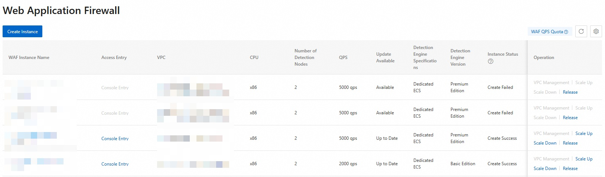
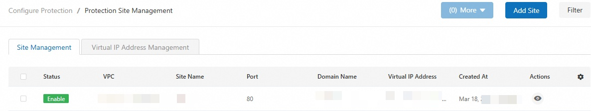
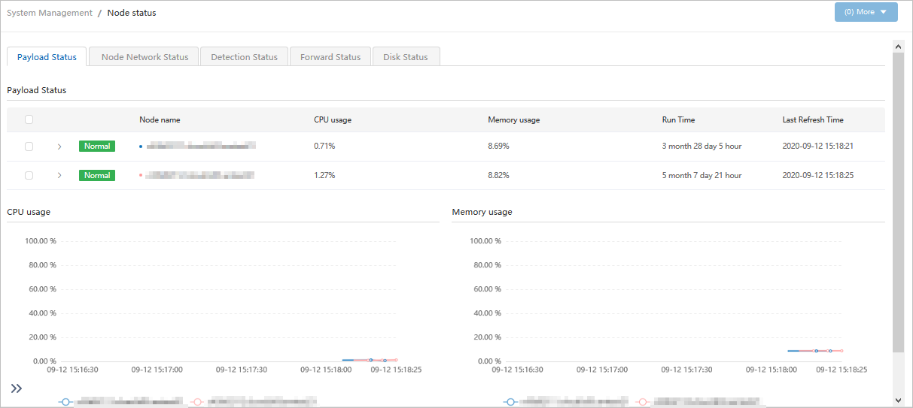
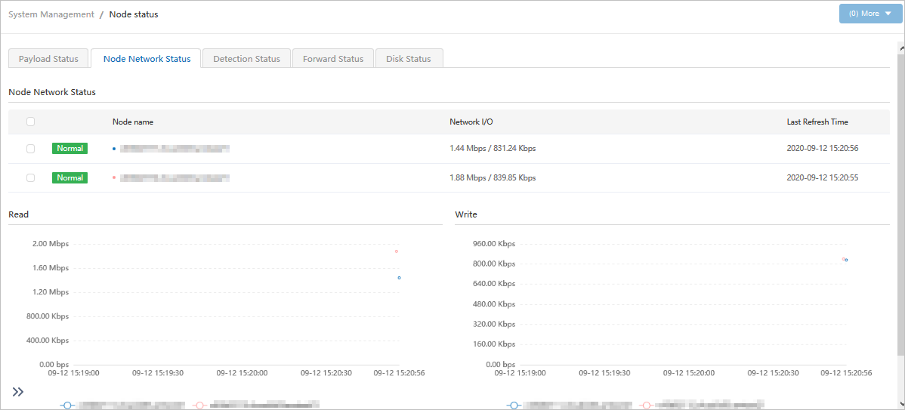
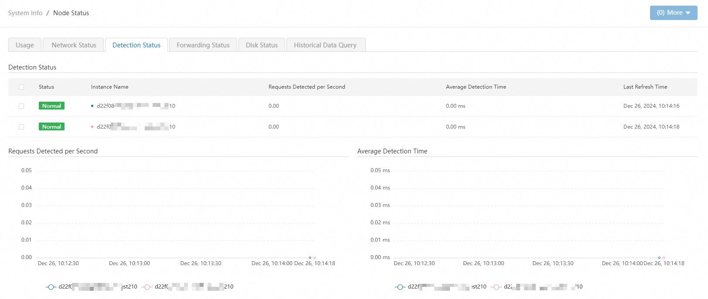
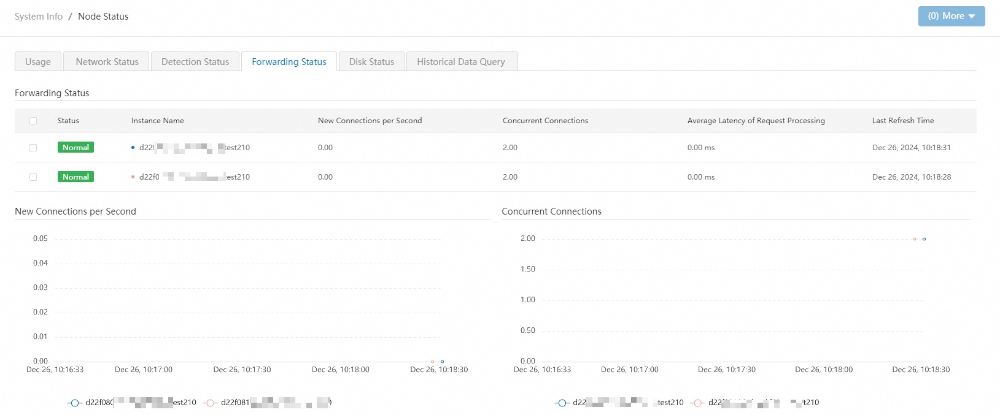
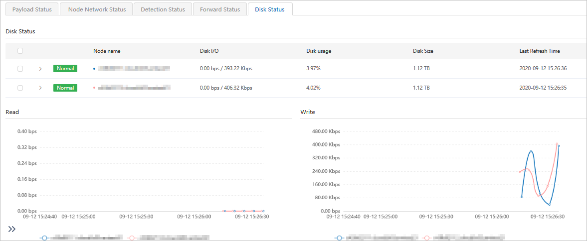

Alibaba Cloud  
Apsara Stack  
Alibaba Cloud Security-Web  
Application Firewall (WAF)  
Web Application Firewall-  
Instance User Guide  
Product Version: V3.18.6  
Document Version: 20260629

**Table of Contents**

- [1.Usage notes](#section-1)
- [2.Getting Started](#section-2)
    - [2.1. Log on to the Apsara Uni-manager Management Console](#section-2-1)
    - [2.2. User roles and permissions](#section-2-2)
    - [2.3. Log on to the Apsara Uni-manager Operations Console](#section-2-3)
    - [2.4. Getting started](#section-2-4)
- [3.Create an instance](#section-3)
- [4.Statistics information](#section-4)
    - [4.1. Protection overview](#section-4-1)
    - [4.2. Access status monitoring](#section-4-2)
    - [4.3. Export protection reports](#section-4-3)
    - [4.4. Attack statistics](#section-4-4)
    - [4.5. Traffic trends](#section-4-5)
- [5.Protection logs](#section-5)
    - [5.1. Attack detection logs](#section-5-1)
    - [5.2. HTTP flood protection logs](#section-5-2)
    - [5.3. System operation logs](#section-5-3)
    - [5.4. Access logs](#section-5-4)
    - [5.5. Log download management](#section-5-5)
    - [5.6. Query logs by IP address](#section-5-6)
- [6.Protection configurations](#section-6)
    - [6.1. Protected website management](#section-6-1)
        - [6.1.1. Manage websites](#section-6-1-1)
        - [6.1.2. Manage VIPs](#section-6-1-2)
    - [6.2. Protection policies](#section-6-2)
    - [6.3. Global custom rules](#section-6-3)
    - [6.4. Custom rules](#section-6-4)
    - [6.5. Tamper-proofing rules](#section-6-5)
    - [6.6. HTTP flood protection](#section-6-6)
        - [6.6.1. HTTP flood protection rules](#section-6-6-1)
        - [6.6.2. HTTP flood whitelist](#section-6-6-2)
    - [6.7. Threat intelligence](#section-6-7)
    - [6.8. Certificate management](#section-6-8)
    - [6.9. Data masking](#section-6-9)
- [7.System settings](#section-7)
    - [7.1. Online backup](#section-7-1)
    - [7.2. Instance system settings](#section-7-2)
- [8.System information](#section-8)
    - [8.1. Node status](#section-8-1)
        - [8.1.1. Loads](#section-8-1-1)
        - [8.1.2. Network information](#section-8-1-2)
        - [8.1.3. Detection status](#section-8-1-3)
        - [8.1.4. Forwarding status](#section-8-1-4)
        - [8.1.5. Disk status](#section-8-1-5)
        - [8.1.6. Historical data query](#section-8-1-6)
    - [8.2. System firmware information](#section-8-2)

# 1.Usage notes

Before you log on to Apsara Stack Security Center, make sure that your computer meets the configuration requirements.

For more information, see the **Configuration requirements** table of this topic.

Table 1. Configuration requirements

| Item | Requirement |
| --- | --- |
| Browser | • Internet Explorer: V11 or later • Google Chrome (recommended): V42.0.0 or later • Mozilla Firefox: V30 or later • Safari: V9.0.2 or later |
| Operating system | • Windows XP • Windows 7 or later • macOS |

# 2.Getting Started

## 2.1. Log on to the Apsara Uni-manager Management Console

This topic describes how to log on to the Apsara Uni-manager Management Console.

**Prerequisites**

- The URL of the Apsara Uni-manager Management Console is obtained from a deployment engineer.

- A web browser is available. We recommend that you use Google Chrome.

**Procedure**

1. Enter the URL of the Apsara Uni-manager Management Console in the address bar of your browser and press the Enter key.

2. Enter your username and password.

   You can obtain the username and password that are used to log on to the Apsara Uni-manager Management Console from the operations administrator.

   > **Note**
   >
   > The first time you log on to the Apsara Uni-manager Management Console, you must change the password of your account as prompted. The password must be 8 to 20 characters in length and contain at least two of the following character types:
   >
   > - Letters
   >
   > - Digits
   >
   > - Special characters such as exclamation points (!), at signs (@), number signs (#), dollar signs ($), and percent signs (%)

3. Click **Log On**.

4. If multi-factor authentication (MFA) is enabled for your account, perform the following operations based on your logon scenario:

   - Scenario 1: You log on to the Apsara Uni-manager Management Console for the first time after MFA is enabled by the administrator.

     <ol type="a">

     <li>

     On the Bind Virtual MFA Device page, bind an MFA device as prompted.

     </li>

     <li>

     Re-enter the username and password as described in Step 2 and click **Log On**.

     </li>

     </ol>

     <ol type="i" start="100">

     <li>

     Enter the six-digit MFA verification code and click **Authenticate**.

     </li>

     </ol>

   - Scenario 2: You log on to the Apsara Uni-manager Management Console after MFA is enabled and an MFA device is bound.

     Enter a six-digit MFA verification code and click **Authenticate**.

     > **Note**
     >
     > For more information about how to enable MFA and bind an MFA device, see the **Manage MFA** topic in **Apsara Uni-manager Management Console User Guide**.

## 2.2. User roles and permissions

The user roles provided by Web Application Firewall (WAF) have the permissions to use independent WAF. This topic describes the user roles.

All roles are default user roles. You cannot create custom roles. Before you log on to the WAF - Instance console, make sure that your account is assigned the required roles.

Default tenant-side user roles

| Role name | Description |
| --- | --- |
| Organization security administrator | Uses Security Operations Center (SOC) to manage the security of hosts, applications, and networks for an organization. This role also has the permissions to manage security services related to Elastic Compute Service (ECS). |
| Global organization security administrator | Uses SOC to conduct security management for Apsara Stack and all tenants, and manages security services related to ECS. |

If you do not have an account that assumes the required role, contact the administrator to create an account and assign the role to the account. For more information, see the **Create users** topic in **Apsara Uni-manager Management Console User Guide**.

## 2.3. Log on to the Apsara Uni-manager Operations Console

This topic describes how to log on to the Apsara Uni-manager Operations Console.

**Prerequisites**

- The endpoint of the Apsara Uni-manager Operations Console and the username and password that are used to log in to the console are obtained from a deployment engineer or an administrator.

  The endpoint of the Apsara Uni-manager Operations Console is in the following format: *regi on-id*.ops.console.*intranet-domain-id*.

- A supported browser is used. We recommend that you use Google Chrome.

**Procedure**

1. Open your browser.

2. In the address bar, enter the endpoint of the Apsara Uni-manager Operations Console. Press the ENTER key.

   

   > **Note**
   >
   > You can click the current language in the upper-right corner to switch to another language. Simplified Chinese and English are supported.

3. Enter your username and password.

   > **Note**
   >
   > - Obtain the username and password that are used to log on to the Apsara Uni-manager Operations Console from a deployment engineer or an administrator.
   >
   > - If you enter an invalid password for three consecutive times, the system enables the image verification logon feature. If you enter an invalid password for five consecutive times, the account is locked. Contact the administrator to unlock the account.
   >
   > - The first time that you log on to the Apsara Uni-manager Operations Console, change the password for your username as prompted.
   >
   >   To enhance security, your password must meet the following requirements:
   >
   >   - The password contains uppercase and lowercase letters.
   >
   >   - The password contains digits.
   >
   >   - The password contains at least one of the following special characters: ! @ # $ %
   >
   >   - The password is 10 to 20 characters in length.

4. Click **Agree to Private Policy and Log On**.

## 2.4. Getting started

This topic helps you get started with the features of Web Application Firewall (WAF) -Instance.

WAF uses intelligent semantic analysis algorithms to identify web attacks. WAF also uses a learning model to enhance its analysis capabilities and meet your daily security protection requirements without relying on traditional rule libraries.

The following content describes the procedure for using WAF:

1. Create a WAF instance. For more information, see Create an instance.

2. Create custom WAF protection rules.

   WAF provides default protection policies. You can also configure custom protection policies based on your business requirements.

   - For more information about how to configure protection policies, see Protection policies.

   - For more information about how to create custom rules, see Custom rules.

   - For more information about how to configure HTTP flood protection rules, see HTTP flood protection.

3. Add websites that you want WAF to protect.

   WAF can protect Internet websites and virtual private cloud (VPC) websites. For more information, see Manage websites.

4. View WAF protection results.

   - For more information about how to view the overall protection information, see Protection overview.

   - For more information about how to view web attack detection logs, see Attack detection logs.

   - For more information about how to view HTTP flood protection logs, see HTTP flood protection logs.

# 3.Create an instance

This topic describes how to create a Web Application Firewall (WAF) instance.

**Procedure**

1. Log in to the Apsara Uni-manager Management Console.

2. In the top navigation bar, click **Security**. Then, choose **Application Security > Web Application Firewall - Instance-Based**. On the **Web Application Firewall** page, select a **region** and click **Access with Authorized Role**.

3. On the Web Application Firewall page, click **Create Instance**. In the panel that appears, configure the parameters that are described in the following table and click **OK**.

   | Parameter | Description |
   | --- | --- |
   | Organization | The organization to which the instance belongs. |
   | Resource Set | The resource set to which the instance belongs. |
   | Available Zones | The zone of the instance. |
   | Instance Name | The instance name. |
   | Detection Engine Specifications | The specifications of the detection engine. Valid values: <strong>Shared ECS</strong> and <strong>Dedicated ECS</strong>. |
   | Detection Engine Version | • When <strong>Detection Engine Specifications</strong> is set to <strong>Shared ECS</strong>, you can select <strong>Basic Edition</strong> or <strong>Premium Edition</strong>. • When <strong>Detection Engine Specifications</strong> is set to <strong>Dedicated</strong> <strong>ECS</strong>, you can select <strong>Basic Edition</strong>, <strong>Premium Edition</strong>, or <strong>Enterprise Edition</strong>. |
   | CPU | • When <strong>Detection Engine Specifications</strong> is set to <strong>Shared ECS</strong>, this parameter is set to <strong>X86</strong> by default and cannot be changed. • When <strong>Detection Engine Specifications</strong> is set to <strong>Dedicated</strong> <strong>ECS</strong>, you can select <strong>X86</strong> or <strong>ARM</strong>. |

   <table>
     <tr>
       <td>Detection Engine Resources</td>
       <td>The detection engine resources. The value of this parameter varies based on the edition and specifications of the detection engine. • When <strong>Detection Engine Specifications</strong> is set to <strong>Shared ECS</strong>: • The basic edition provides 8 cores and 16 GB of memory. • The premium edition provides 16 cores and 32 GB of memory. • When <strong>Detection Engine Specifications</strong> is set to <strong>Dedicated</strong> <strong>ECS</strong>: • The basic edition provides 2 cores and 4 GB of memory. • The premium edition provides 4 cores and 8 GB of memory. • The enterprise edition provides 24 cores and 48 GB of memory.</td>
     </tr>
     <tr>
       <td>Estimated QPS</td>
       <td>This parameter indicates the maximum number of HTTP requests that can be processed by the instance per second. The value varies depending on the Detection Engine Specifications (Shared ECS or Dedicated ECS ), Detection Engine Version (Basic Edition, Premium Edition, or Enterprise Edition), and Available Zones parameters. You can increase the number of detection engines to improve the QPS. Formula: EstimatedQPS=Numberofzones×QPSofthecorrespondingenginespe cificationsandedition×Numberofenginesinasinglezone(thedefaultva lueis2) Example: When two zones, Shared ECS, and Basic Edition are specified and the number of detection engines in a single zone is 3, the estimated QPS is 6,000 (2 × 1,000 × 3). QPS values of different detection engine specifications and editions: • When <strong>Detection Engine Specifications</strong> is set to <strong>Shared ECS</strong>: • The basic edition provides 1,000 HTTP QPS. • The premium edition provides 4000 HTTP QPS. • When <strong>Detection Engine Specifications</strong> is set to <strong>Dedicated</strong> <strong>ECS</strong>: • The basic edition provides 1,000 HTTP QPS. Each instance can protect up to two virtual private clouds (VPCs). • The premium edition provides 2,500 HTTP QPS. Each instance can protect up to six VPCs. • The enterprise edition provides 20,000 HTTP QPS. Each instance can protect up to 46 VPCs.</td>
     </tr>
     <tr>
       <td>Number of Detection Engines</td>
       <td>The number of detection engines in a single zone. Valid values: 2 to 16.</td>
     </tr>
     <tr>
       <td>Protocol Version</td>
       <td>Specify the IP protocol stack supported by the Web Application Firewall (WAF) instance. • <strong>IPv4</strong>: Only IPv4 traffic is protected. You cannot upgrade an IPv4 WAF instance to a dual-stack WAF instance. • <strong>Dual Stack</strong>: Both IPv4 traffic and IPv6 traffic are protected. The IPv6 capability of a dual-stack WAF instance can only be used to connect to an Application Load Balancer (ALB) instance.</td>
     </tr>
     <tr>
       <td>VPC Protection Mode</td>
       <td>When <strong>Detection Engine Specifications</strong> is set to <strong>Dedicated ECS</strong>, you can select <strong>Single VPC Protection</strong> or <strong>Multiple VPC</strong> <strong>Protection</strong>. If you select <strong>Multiple VPC Protection</strong>, you can click <strong>Add a VPC</strong> below the parameter to add VPCs.</td>
     </tr>
     <tr>
       <td>VPC 1</td>
       <td>Select a VPC to be protected by WAF.</td>
     </tr>
     <tr>
       <td>vSwitch1-1</td>
       <td>Select a zone in the VPC.</td>
     </tr>
   </table>

**What to do next**

After you create an instance, you can perform the following operations in the instance list:

- View the information about the instance

  In the instance list on the Web Application Firewall page, you can view the information of the WAF instance that you created, including the instance name, access entry, VPC, number of detection nodes, QPS, and whether an update is available. You can view the WAF QPS quota in the upper-right corner of the page.

  

  > **Important**
  >
  > When the **Update Available** column of a WAF instance displays **Available**, and you directly perform the update, data errors may occur. We recommend that you upgrade the instance before you perform subsequent operations.
  >
  > To upgrade the WAF instance, log in to the Apsara Uni-manager Operations Console and choose **Cloud Services > WAF Instance Management > WAF Instance Management** in the **Cloud Shield Operations Center**. For more information, see **Web Application Firewall - Instance O&M Guide > Instance management**.

- Specify the columns that you want to view in the instance list In the upper-right corner of the Web Application Firewall page, click the  icon. In the

  dialog box that appears, select the columns that you want to display in the instance list.

- VPC management

  You can manage VPCs only when you set the **VPC Protection Mode** to **Multiple VPC Protection**. Click **VPC Management** in the **Operation** column of a WAF instance to add or remove VPCs.

- Scale out or scale in the instance

  On the Web Application Firewall page, find the instance that you want to manage and click **Scale Up** or **Scale Down** in the **Operation** column. In the panel that appears, modify the Number of Detection Engines parameter and click OK.

  > **Note**
  >
  > The Number of Detection Engines parameter specifies the number of detection engines in a single zone. Valid values of this parameter: 2 to 16.

- Release the instance

  On the Web Application Firewall page, find the instance that you want to release and click **Release** in the **Operation** column. In the dialog box that appears, enter **Confirm Release** and click **OK**.

  > **Warning**
  >
  > After the instance is released, it cannot be restored.
  >
  > Before you release the WAF instance, make sure that no services are protected by the WAF instance and that the corresponding instance data has been deleted.

- Go to the instance details page

  On the Web Application Firewall page, find the instance that you want to view and click its name in the **WAF Instance Name** column or **Console Entry** in the Access Entry column. On the page that appears, view information about the instance in the Statistics, Detection Logs, Configure Protection, System Settings, and System Info modules.

> **Note**
>
> In Apsara Stack versions earlier than v3.18.6 sp-2512, after you add a site, you must manually modify the Elastic Compute Service (ECS) security group of the WAF instance to allow detection node traffic. Otherwise, the back-to-origin request may fail.
>
> In Apsara Stack v3.18.6 sp-2512 and later, no manual configuration is required because the security group automatically allows detection node traffic.

# 4.Statistics information

## 4.1. Protection overview

The Overview page displays information including attack statistics, the geographical distribution of attackers, the total number of requests, and the number of blocked requests. You can also view information about the attacks. Then, you can configure protection rules to protect your web services. This topic describes how to view the Web Application Firewall (WAF) protection overview.

**Procedure**

1. Log on to the Apsara Uni-manager Management Console.

2. In the top navigation bar, choose **Security > Application Security > Web Application Firewall - Instance**. On the **Web Application Firewall** page, select a region from the **Region** drop-down list and click **Access with Authorized Role**. Find the instance that you want to manage and click its name in the **WAF Instance Name** column or **Console Entry** in the Access Entry column.

3. In the left-side navigation pane, choose **Statistics** > **Overview**.

4. On the **Overview** page, view data on the **Last 24 Hours** and **Last 30 Days** tabs.

   - Requests: displays the total number of requests.

   - Attacks: displays the total number of attacks.

   - Blocked Requests: displays the total number of blocked requests.

   - Geographical Distribution of Attack Sources: displays the distribution of attackers on the map of China or the map of the world.

   - Initiate AttacksIP appears most frequently: displays the top five IP addresses from which the highest number of attacks are initiated in a bar chart. The x-axis shows the number of requests. The y-axis shows the IP addresses.

   - Type-based Attack Distribution: displays the distribution of the top five attack types and the number of attacks of each type in a bar chart.

   - Most Attacked Sites: displays the top five websites that are most attacked and the number of attacks on each website.

## 4.2. Access status monitoring

Web Application Firewall (WAF) monitors access to web services. Security administrators can analyze the service access information to detect vulnerabilities and improve the security of the web services. This topic describes how to view access information of web services.

**Procedure**

1. Log in to the Apsara Uni-manager Management Console.

2. In the top navigation bar, click **Security**. Then, choose **Application Security > Web Application Firewall - Instance-Based**. On the **Web Application Firewall** page, select a region from the **Region** drop-down list and click **Access with Authorized Role**. Find the instance that you want to manage and click its name in the **WAF Instance Name** column or **Console Entry** in the Access Entry column.

3. In the left-side navigation pane, choose **Overview > Access Status Monitoring**.

4. On the **Access Status Monitoring** page, view the access information.

   You can specify the following filter conditions to view specific access information:

   - **IP** or **SESSION**

   - **All**, **Site**, or **URL**

   - **Requests Within 30 Seconds** or **Average Response Time**

   > **Note**
   >
   > Only real-time access monitoring information of the top 100 web services that are most frequently accessed is displayed.

## 4.3. Export protection reports

Web Application Firewall (WAF) can automatically export protection reports. You can also manually export protection reports. This topic describes how to export protection reports.

**Export a protection report**

1. Log in to the Apsara Uni-manager Management Console.

2. In the top navigation bar, click **Security**. Then, choose **Application Security > Web Application Firewall - Instance-Based**. On the **Web Application Firewall** page, select a region from the **Region** drop-down list and click **Access with Authorized Role**. Find the instance that you want to manage and click its name in the **WAF Instance Name** column or **Console Entry** in the Access Entry column.

3. In the left-side navigation pane, choose **Statistics > Export**.

4. On the Export page, export protection reports.

   > **Note**
   >
   > All protection reports are displayed on the **Protection Reports** tab regardless of whether the protection reports are manually exported or automatically exported.

   - Manually export a protection report

     On the **Protection Reports** tab, click **Generate Report**. Configure the parameters and click **OK**. The following table describes the parameters.

     | Parameter | Description |
     | --- | --- |
     | Report Name | The name of the protection report. |
     | Report Type | The type of the protection report to export. Valid values: <strong>Daily Report</strong> and <strong>Customize</strong>. |
     | Statistical Period | The time range within which statistics are collected for the protection report.Select a time range based on the value of the <strong>Report Type</strong> parameter. |
     | Statistical Scope | The scope of sites whose statistics are collected for the protection report. Valid values: <strong>All Sites</strong> and <strong>Specify Statistical Site</strong>. |
     | Root Path | Note This parameter is required only if you set the Statistical Scope parameter to <strong>Specify Statistical Site</strong>. Enter the root path of the sites. Valid values: • <strong>http://</strong>: The sites use only HTTP. • <strong>https://</strong>: The sites use only HTTPS. • <strong>http(s)://</strong>: The sites use both HTTP and HTTPS. |

   - Automatically export a protection report

     On the **Scheduled Reports** tab, click **Add Scheduled Report**. Configure the parameters and click **OK**. The following table describes the parameters.

     | Parameter | Description |
     | --- | --- |
     | Report Name | The name of the protection report. |
     | Report Type | The type of the protection report. Valid values: <strong>Daily Report</strong> and <strong>Weekly</strong> <strong>Report</strong>. |
     | Statistical Scope | The scope of sites whose statistics are collected for the protection report.Valid values: <strong>All Sites</strong> and <strong>Specify Statistical Site</strong>. |
     | Root Path | Note This parameter is required only if you set the Statistical Scope parameter to <strong>Specify Statistical Site</strong>. Enter the root path of the sites. Valid values: • <strong>http://</strong>: The sites use only HTTP. • <strong>https://</strong>: The sites use only HTTPS. • <strong>http(s)://</strong>: The sites use both HTTP and HTTPS. |

**Manage protection reports**

On the **Protection Reports** tab, you can view and manage protection reports.

- Filter protection reports

  Click **Filter**, specify filter conditions, and then click **Ok**.

  > **Note**
  >
  > The logical relationship among multiple filter conditions is AND. Only protection reports that match all filter conditions are displayed.

- View report details Find the protection report whose details you want to view and click the  icon in the

  **Actions** column.

- Download protection reports

  Select the protection reports that you want to download and choose **More > Download Selected Reports**.

- Delete protection reports

  Select the protection reports that you want to delete and choose **More > Delete Selected Reports**.

## 4.4. Attack statistics

You can view attack statistics to obtain information about attacks launched against your website and perform operations to handle the source IP addresses of the attacks. This topic describes how to enable and view attack statistics.

**Attack statistics**

1. Log in to the Apsara Uni-manager Management Console.

2. In the top navigation bar, click **Security**. Then, choose **Application Security > Web Application Firewall - Instance-Based**. On the **Web Application Firewall** page, select a region from the **Region** drop-down list and click **Access with Authorized Role**. Find the instance that you want to manage and click its name in the **WAF Instance Name** column or **Console Entry** in the Access Entry column.

3. In the left-side navigation pane, choose **Statistics** > **Attack Statistics**.

4. On the **Attack Statistics** page, click **Configure Statistics**.

5. In the **Configure Statistics** panel, click the  icon and click **Ok**.

   After you complete the preceding configuration, the attack statistics feature is enabled. If your website is attacked, you can view the top 100 source IP addresses that initiate attacks most frequently and the information of the targets on the **Attack Source Tracking** and **Attack Target Analysis** tabs. You can find the attack whose details you want to view and

   click the  icon in the **Actions** column. Then, you can perform operations on the attack on

   the **Attack Detection Logs** page. For more information, see View attack detection logs.

## 4.5. Traffic trends

The Traffic Trend Chart page displays the traffic trends of your website. You can specify the time range within which statistics are generated. This topic describes how to view the traffic trends of a website.

**View the traffic trend chart**

1. Log in to the Apsara Uni-manager Management Console.

2. In the top navigation bar, click **Security**. Then, choose **Application Security > Web Application Firewall - Instance-Based**. On the **Web Application Firewall** page, select a region from the **Region** drop-down list and click **Access with Authorized Role**. Find the instance that you want to manage and click its name in the **WAF Instance Name** column or **Console Entry** in the Access Entry column.

3. In the left-side navigation pane, choose **Statistics** > **Traffic Trend Chart**.

4. On the **Traffic Trend Chart** page, click the  icon to the right of **Information Overview**.

5. In the **Edit** panel, select the website whose traffic trends you want to view from the **Website** drop-down list, specify **Attack Time**, and then click **Query**.

   After you complete the preceding configurations, you can view the trends of your website traffic that is generated within the specified time range.

# 5.Protection logs

## 5.1. Attack detection logs

You can use attack detection logs to analyze attacks on your web services. You can update your protection policies and custom rules and fix web service vulnerabilities based on the analysis results. This helps enhance the security of your web services. This topic describes how to view attack detection logs.

**Procedure**

1. Log on to the Apsara Uni-manager Management Console.

2. In the top navigation bar, choose **Security > Application Security > Web Application Firewall - Instance**. On the **Web Application Firewall** page, select a region from the **Region** drop-down list and click **Access with Authorized Role**. Find the instance that you want to manage and click its name in the **WAF Instance Name** column or **Console Entry** in the Access Entry column.

3. In the left-side navigation pane, choose **Detection Logs > Attack Detection Logs**.

   On the Attack Detection Logs page, you can view attack detection logs.

   You can also perform the following operations based on your business requirements:

   - Filter logs

     Click **Filter**. In the panel that appears, specify filter conditions and click **Ok**.

     > **Note**
     >
     > Multiple filter conditions are evaluated by using the logical AND operator. The system returns logs only if all conditions are met.

   - Download logs

     <ol type="a">

     <li>

     Select one or more logs that you want to download, move the pointer over **More** in the upper-right corner of the page, and then select **Download Selected Logs(.json)** or **Download Selected Logs(.csv)**. In the Alert message, click **Ok**.

     </li>

     <li>

     In the left-side navigation pane, choose **Detection Logs > Log Download Management**. On the Log Download Management page, find the download task that

     you created and click the  icon in the **Actions** column.

     </li>

     </ol>

   - Switch between log display modes

     Move the pointer over the  icon and select **List** or **Detailed View** as the display mode

     of logs.

## 5.2. HTTP flood protection logs

You can use HTTP flood protection logs to analyze the HTTP flood attacks on your web services. You can update your HTTP flood protection rules and HTTP flood whitelist and fix web service vulnerabilities based on the analysis results. This helps enhance the security of your web services. This topic describes how to view HTTP flood protection logs.

**Procedure**

1. Log on to the Apsara Uni-manager Management Console.

2. In the top navigation bar, choose **Security > Application Security > Web Application Firewall - Instance**. On the **Web Application Firewall** page, select a region from the **Region** drop-down list and click **Access with Authorized Role**. Find the instance that you want to manage and click its name in the **WAF Instance Name** column or **Console Entry** in the Access Entry column.

3. In the left-side navigation pane, choose **Detection Logs > HTTP Flood Protection Logs**.

   On the HTTP Flood Protection Logs page, you can view HTTP flood protection logs.

   You can also perform the following operations based on your business requirements:

   - Filter logs

     Click **Filter**. In the panel that appears, specify filter conditions and click **Ok**.

     > **Note**
     >
     > Multiple filter conditions are evaluated by using the logical AND operator. The system returns logs only if all conditions are met.

   - Add an HTTP flood attack to the blacklist

     Find the HTTP flood attack that you want to add to the blacklist and click the  icon in

     the **Actions** column to create a blacklist rule. In the **Add to Blacklist** panel, enter a name for the blacklist rule and click **OK**.

## 5.3. System operation logs

This topic describes how to view system operation logs.

**Procedure**

1. Log on to the Apsara Uni-manager Management Console.

2. In the top navigation bar, choose **Security > Application Security > Web Application Firewall - Instance**. On the **Web Application Firewall** page, select a region from the **Region** drop-down list and click **Access with Authorized Role**. Find the instance that you want to manage and click its name in the **WAF Instance Name** column or **Console Entry** in the Access Entry column.

3. In the left-side navigation pane, choose **Detection Logs > System Operations Logs**.

   On the System Operations Logs page, you can view system operation logs.

   You can also perform the following operations based on your business requirements:

   - Filter logs

     Click **Filter**. In the panel that appears, specify filter conditions and click **Ok**.

     > **Note**
     >
     > Multiple filter conditions are evaluated by using the logical AND operator. The system returns logs only if all conditions are met.

   - Download logs

     <ol type="a">

     <li>

     Select one or more logs that you want to download, move the pointer over **More**, and then select **Download Selected Logs (.json)** or Download Selected Logs (.csv). In the Alert message, click **Ok**.

     </li>

     <li>

     In the left-side navigation pane, choose **Detection Logs > Log Download Management**. On the Log Download Management page, find the download task that

     you created and click the  icon in the **Actions** column.

     </li>

     </ol>

## 5.4. Access logs

This topic describes how to view access logs.

**Procedure**

1. Log on to the Apsara Uni-manager Management Console.

2. In the top navigation bar, choose **Security > Application Security > Web Application Firewall - Instance**. On the **Web Application Firewall** page, select a region from the **Region** drop-down list and click **Access with Authorized Role**. Find the instance that you want to manage and click its name in the **WAF Instance Name** column or **Console Entry** in the Access Entry column.

3. In the left-side navigation pane, choose **Detection Logs > Access Logs**.

   On the Access Logs page, you can view access logs.

   You can also perform the following operations based on your business requirements:

   - Filter logs

     Click **Filter**. In the panel that appears, specify filter conditions and click **Ok**.

     > **Note**
     >
     > Multiple filter conditions are evaluated by using the logical AND operator. The system returns logs only if all conditions are met.

   - Download logs

     <ol type="a">

     <li>

     Select one or more logs that you want to download, move the pointer over **More**, and then select **Download Selected Logs(.json)** or **Download Selected Logs(.csv)**. In the Alert message, click **Ok**.

     </li>

     <li>

     In the left-side navigation pane, choose **Detection Logs > Log Download Management**. On the Log Download Management page, find the download task that

     you created and click the  icon in the **Actions** column.

     </li>

     </ol>

## 5.5. Log download management

**Procedure**

1. Log on to the Apsara Uni-manager Management Console.

2. In the top navigation bar, choose **Security > Application Security > Web Application Firewall - Instance**. On the **Web Application Firewall** page, select a region from the **Region** drop-down list and click **Access with Authorized Role**. Find the instance that you want to manage and click its name in the **WAF Instance Name** column or **Console Entry** in the Access Entry column.

3. In the left-side navigation pane, choose **Detection Logs > Log Download Management**.

   On the Log Download Management page, you can perform the following operations:

   - Download logs

     

     Select one or more logs that you want to download and click the

     icon.

   - Delete logs

     Select one or more logs that you want to delete and choose **More > Delete Selected Tasks**.

## 5.6. Query logs by IP address

If you want to check whether an IP address hits a rule that you configure in your Web Application Firewall (WAF) instance, you must query data from multiple sources. This topic describes how to automatically identify rules that are hit by an IP address.

**Procedure**

1. Log on to the Apsara Uni-manager Management Console.

2. In the top navigation bar, choose **Security > Application Security > Web Application Firewall - Instance**. On the **Web Application Firewall** page, select a region from the **Region** drop-down list and click **Access with Authorized Role**. Find the instance that you want to manage and click its name in the **WAF Instance Name** column or **Console Entry** in the Access Entry column.

3. In the left-side navigation pane, choose **Detection Logs > Querying With IP**.

4. On the **Querying With IP** page, select a log type from the **Log Type** drop-down list and enter the IP address that you want to query in the IP search box.

5. Find the query result that you want to view and click the  icon in the **Actions** column to

   view the details.

# 6.Protection configurations

## 6.1. Protected website management

### 6.1.1. Manage websites

This topic describes how to add an Internet website to Web Application Firewall (WAF).

**Procedure**

1. Log in to the Apsara Uni-manager Management Console.

2. In the top navigation bar, click **Security**. Then, choose **Application Security > Web Application Firewall - Instance-Based**. On the **Web Application Firewall** page, select a region from the **Region** drop-down list and click **Access with Authorized Role**. Find the instance that you want to manage and click its name in the **WAF Instance Name** column or **Console Entry** in the Access Entry column.

3. In the left-side navigation pane, choose **Configure Protection > Protection Site Management**.

4. On the **Site Management** tab, click **Add Site**.

5. In the **Configure Listening Information** step of the **Add Protected Site** panel, configure the parameters that are described in the following table and click **Next**.

   Configure the Internet website that you want WAF to protect. WAF can protect HTTP and HTTPS websites.

   | Parameter | Description |
   | --- | --- |
   | Protected Site Name | The name of the website that you want WAF to protect. |
   | Domain Name | The domain name of the website. • You can use an asterisk (\*) as a wildcard. • If you specify multiple domain names, separate them with commas (,). • If you enter IPv6 addresses, you must use brackets (\[\]) to enclose each IPv6 address. |
   | Description | The description of the website. |
   | Port Settings | The port on which WAF listens. If the website can be accessed over multiple ports, click <strong>Add Group of Ports</strong> to add the ports. • If the website can be accessed only over HTTP, you can skip the certificate configuration and directly proceed to site management. • If the website can be accessed over HTTPS, you need to specify <strong>SSL</strong> <strong>Configuration Mode</strong> after you select <strong>Enable SSL</strong>. <strong>SSL Configuration Mode</strong>: Specify the SSL encryption and decryption mode. • <strong>Use WAF SSL configuration</strong>: WAF completes SSL decryption and processes HTTPS traffic. If you select this option, you need to upload an SSL certificate and bind the certificate file to WAF so that WAF can decrypt HTTPS traffic, process the traffic, and then encrypt the traffic. • <strong>Use ALB SSL configuration</strong>: Application Load Balancer (ALB) completes SSL decryption. WAF only processes the decrypted HTTP traffic. If you select this option, you need to first configure the certificate required by the current website. Then, select the <strong>ALB certificate</strong> to ensure that HTTPS traffic can be decrypted. Note When HTTPS is enabled and performance must be ensured, we recommend that you configure a certificate and enable TLS offloading on the ALB side. This enables WAF to focus on security detection, which balances security and performance. • If the website can be accessed over HTTP/2, select <strong>Enabled HTTP2</strong>.This option is available only when you select <strong>Enable SSL</strong>. |
   | Certificate Config | The certificate type of the website. By default, <strong>SSL Certificate</strong> is selected. |
   | Certificate Settings | The SSL certificate of the website. Valid values: Upload Certificate or Select Existing Certificate. • Upload Certificate: If the SSL certificate of the website is not uploaded to WAF, select this option. By default, the SSL certificate and the private key file are separately uploaded. If you select <strong>Include Private Key in Certificate File</strong>, upload only one file that contains the SSL certificate and the private key. • Select Existing Certificate: If the SSL certificate of the website is uploaded to WAF, select this option. Then, select the required SSL certificate from the drop-down list. You can enter a keyword to search for the certificate. |
   | Certificate Name | The name of the SSL certificate. |
   | SSL Cert File | The SSL certificate and private key file. By default, the SSL certificate and the private key file are separately uploaded. If you select <strong>Include Private Key in Certificate File</strong> to the right of <strong>Certificate Name</strong>, upload only one file that contains the SSL certificate and the private key. |
   | Certificate Password | The password of the SSL certificate. |
   | Mutual Authentication | Specifies whether to enable mutual authentication. If you click theicon to enable mutual authentication, configure the following parameters: • <strong>CA Certificate Settings</strong>: the certificate authority (CA) certificate. Valid values: <strong>Upload Certificate</strong> or <strong>Select Existing Certificate</strong>. • <strong>Upload Certificate</strong>: If the CA certificate of the website is not uploaded to WAF, select this option. Configure the <strong>CA Certificate Name</strong> and <strong>CA Certificate File</strong> parameters. • <strong>Select Existing Certificate</strong>: If the CA certificate of the website is uploaded to WAF, select this option. Then, select the required CA certificate from the drop-down list. You can enter a keyword to search for the certificate. • <strong>Detection Depth</strong>: the detection depth of mutual authentication. • <strong>Client Detection</strong>: the verification of the client certificate. Valid values: ON, OFF, OPTIONAL, and Optional (no_ca). • If the client certificate is provided, select <strong>OPTIONAL</strong>. • If the client certificate is issued by a non-trusted CA, select <strong>Optional</strong> <strong>(no_ca)</strong>. |

6. In the **Configure VPC** step of the **Add Protected Site** panel, configure the parameters that are described in the following table and click **Next**.

   | Parameter | Description |
   | --- | --- |
   | Protected VPC | The VPC to which the website that you want WAF to protect belongs. |
   | Access Method | The access mode. This parameter specifies the load balancing service to be used to distribute traffic. • <strong>SLB Access</strong>: A Classic Load Balancer (CLB) instance is used to distribute Layer 4 traffic to WAF. This option is suitable for most scenarios. • <strong>ALB Access</strong>: An ALB instance is used to distribute Layer 7 traffic to WAF. IPv6 traffic can be distributed from end to end. If you set <strong>SSL Configuration Mode</strong> to <strong>Use ALB SSL configuration</strong> in <strong>Configure Listening Information</strong>, only <strong>ALB Access</strong> is supported by default. |
   | VPC SLB Virtual <strong>IP</strong>/<strong>VPC ALB Virtual</strong> IP | Select an SLB or ALB virtual IP address (VIP) from the drop-down list. |

7. In the **Configure Response Method** step of the **Add Protected Site** panel, configure the parameters that are described in the following table and click **Next**.

   **Response mode**

   **Parameter**

   **Description**

   The algorithm that is used for load balancing. Valid

   **Load Balancing**

   values: **Weighted Round-robin**, **Source IP Address**

   **Algorithm**

   **Hash**, and **Least Connections**.

   The backend server to which traffic is forwarded after passing through WAF.

   To add more forwarding addresses, click **Add**

   **Backend Server**

   **Forwarding Address**.

   **Address**

   Back-to-origin routing over IPv6 supports only ALB instance IPv6 addresses. It does not support Elastic Compute Service (ECS) instance IPv6 addresses.

   **Forward to Backend Servers**

   The pass-through mode of the source IP address.

   The X-Forwarded-For (XFF) header is used to identify the actual source IP address of an HTTP client. The header is used for traffic forwarding services, such as the HTTP proxy and load balancing. Valid values:

   **X-Forwarded-For**

   - **Append IP Address of Previous Hop to the X-Forwarded-For Field**

   - **Overwrite Original Value of the X-Forwarded-For Field with IP Address of Previous Hop**

   - **Remain Unchanged**

   The HTTP status code that is returned when WAF redirects inbound traffic to a specific address.

   Valid values: **301**, **302**, **307**, and **308**.

   - **301**: The requested page is permanently redirected to another URL.

   - **302**: The requested page is temporarily redirected

   **Response Status**

   to another URL. The requester must continue to use

   **Code**

   the original URL for subsequent requests.

   **Redirect**

   - **307**: The requested page is temporarily redirected to another URL. The requester must continue to use the original URL for subsequent requests.

   - **308**: The requested page is permanently redirected to another URL.

   **Redirection**

   The destination URL to which requests are redirected.

   **Address**

   <table>
     <tr>
       <td rowspan="2">Specify Response Content</td>
       <td>Response Status Code</td>
       <td>The HTTP status code that is returned when WAF returns the specified content. Valid values: <strong>200</strong>, <strong>400</strong>, <strong>401</strong>, <strong>402</strong>, <strong>404</strong>, <strong>405</strong>, <strong>500</strong>, <strong>503</strong>, and <strong>504</strong>.</td>
     </tr>
     <tr>
       <td>Response</td>
       <td>The content that you want to be returned. For example, you can upload an image for the <strong>Response</strong> parameter. If a user visits the website, WAF returns the uploaded image.</td>
     </tr>
   </table>

8. In the **Protection Policy** step of the **Add Protected Site** panel, configure the parameters that are described in the following table and click **Next**. Then, go to the **OK** step.

   > **Important**
   >
   > You can configure a protection policy only if you set the **Configure Response Method** parameter to **Forward to Backend Servers**.

   | Parameter | Description |
   | --- | --- |
   | Protection Policy | The protection policy of WAF. By default, <strong>Default Policy Set</strong> is selected.Valid values: • Not Use Protection Policy • Default protection policies • Default Policy Set • Strict Protection • Observation Mode • Financial Institution • Internet Enterprise • Custom protection policies For more information about protection policies, see Protection policies. |
   | User Identification | The user identification mode. Note If you enable HTTP flood protection for the protected website and set the <strong>Target Type</strong> parameter to <strong>SESSION</strong> when you configure the HTTP flood protection rule, you must set the <strong>User Identification</strong> parameter to <strong>Identify by WAF</strong>. |

   After you add websites to WAF, you can perform the following operations in the protected website list:

   - View protected websites You can view the information about the protected websites that you added to WAF, such as the status, website name, port, domain name, and downstream node.

     

   - Specify the items that you want to view in the protected website list

     Click the  icon to the right of **Actions**, select the items that you want to display in the

     protected website list, and then click Ok.

   - Filter protected websites

     In the upper-right corner of the page, click **Filter**. In the panel that appears, filter protected websites by Name, Server Names, Policy Group, Anti Tamper Status, Create Time, or Last Update Time.

   - Enable, disable, export, or delete protected websites

     Select the protected websites that you want to manage and choose **More > Enable Selected Sites**, **Disable Selected Sites**, **Export Selected Sites(.csv)**, or **Delete Selected Sites**.

   - Modify the basic information about a protected website

     Find the protected website whose basic information you want to modify and click the 

     icon in the **Actions** column. On the **Basic Information** tab, click the  icon to the right

     of each parameter to modify the corresponding information. The parameters include **Site Name**, **Listening Port**, **Domain Name**, **Description**, and **Virtual IP Address**.

   - Modify the request processing mode of a protected website

     Find the protected website whose request processing mode you want to modify and click

     the  icon in the **Actions** column. On the **Request Processing Method** tab, click the 

     icon to the right of each parameter to modify the corresponding information. The parameters include **Configure Response Method**, **Scheduling Algorithm**, **X-Forwarded-For**, **Backend Server Health Check**, **Access Log Record**, **Backend Server Address**, **HTTP Header**, **Back-to-origin IP Address**, and **SSE Configuration**.

   - View and modify protection settings

     Find the protected website whose protection settings you want to modify and click the 

     icon in the **Actions** column. On the **Protection Mode** tab, view and modify the protection settings.

     - Protection Policies

       - View the details of the protection policies that you configured, such as Decoding Method, Attack Detection Module, Blocking Method, HTTP Response Processing, HTTP Request Body Detection, and Detection Timeout Period.

       - Click the  icon to the right of **Default Policy Set** and modify the protection policy

         settings. For more information about protection policies, see Protection policies.

     - Custom Rules: You can create custom rules. For more information, see Custom rules.

     - Rule Source: You can select **Use Existing Rule** or **Add Rule**.

     - Method Used to Obtain Source IP Addresses: You can specify the method used to obtain the IP addresses of origin servers. The IP addresses of origin servers can be obtained from sockets, the X-Forwarded-For header, or the HTTP header.

       - User Identification: Click the  icon. In the panel that appears, set the User

         Identification parameter to **Disable**, **Identify by WAF**, or **Obtain User ID from Requests**, and click Ok.

### 6.1.2. Manage VIPs

You can add a virtual IP address (VIP), a VIP in a virtual private cloud (VPC), or an elastic IP address (EIP) to instance-based Web Application Firewall (WAF). The VIP that you add to WAF can be used as the downstream node of a VPC-connected website that you add to WAF. This topic describes how to add a VIP in a VPC to WAF and how to manage the VIP.

**Procedure**

1. Log in to the Apsara Uni-manager Management Console.

2. In the top navigation bar, click **Security**. Then, choose **Application Security > Web Application Firewall - Instance-Based**. On the **Web Application Firewall** page, select a region from the **Region** drop-down list and click **Access with Authorized Role**. Find the instance that you want to manage and click its name in the **WAF Instance Name** column or **Console Entry** in the Access Entry column.

3. In the left-side navigation pane, choose **Configure Protection > Protection Site Management**.

4. On the **Virtual IP Address Management** tab, add a VIP, a VIP in a VPC, or an EIP to WAF.

   - Add a VIP in a VPC to WAF.

     <ol type="a">

     <li>

     On the **VPC SLB Virtual IP** or **VPC ALB Virtual IP** tab, click **Add Virtual IP Address** and configure parameters in the panel that appears.

     </li>

     <li>

     In the **Add Virtual IP Address** panel, configure the parameters and click **OK**.

     | Parameter | Description |
     | --- | --- |
     | Access Method | The load balancing service used to distribute traffic to WAF. • <strong>SLB Access</strong>: A Classic Load Balancer (CLB) instance is used to distribute Layer 4 traffic to WAF. This option is suitable for most scenarios. • <strong>ALB Access</strong>: An Application Load Balancer (ALB) instance is used to distribute Layer 7 traffic to WAF. The ALB instance can distribute IPv6 traffic from end to end. |
     | Network Type | The access mode of the VIP. This parameter is available only when <strong>ALB Access</strong> is selected. • <strong>Intranet</strong>: Traffic is transmitted only within a VPC. This access mode is suitable for internal system communication. • <strong>Internet</strong>: Requests from the Internet are received and transmitted.This access mode is suitable for external services. |
     | Virtual IP Address | Specify a traffic destination and how the VIP is created. • <strong>Add Virtual IP Address</strong>: The system automatically generates a VIP and the corresponding SLB instance. • <strong>Create Specified Virtual IP Address</strong>: The system generates a VIP as required and creates the corresponding SLB instance. |
     | Availability Zones | Select the zone to which the VIP belongs from the drop-down list. |
     | Protected VPC | Select a VPC to receive traffic and protect. |
     | Switch | Select the vSwitch to which the VIP belongs. |
     | Protocol Version | Select the IP protocol of the VIP to ensure compatibility with application traffic. This parameter is required only when <strong>ALB Access</strong> is selected. • <strong>IPv4</strong>: supports only IPv4 traffic. • <strong>Dual Stack</strong>: supports both IPv4 and IPv6 traffic. Important • Make sure that the WAF instance is of the dual-stack type. Otherwise, IPv6 traffic cannot be inspected. • You need to configure and view the IPv6 gateway in the ALB console. |
     | Description | Enter the purpose of the VIP or add a description for subsequent O&amp;M management or reference. |
     | VPC SLB Virtual <strong>IP</strong>/<strong>VPC ALB Virtual</strong> IP | Enter the VIP of the SLB instance to be created. This parameter is available only when <strong>Virtual IP Address</strong> is set to <strong>Create Specified</strong> <strong>Virtual IP Address</strong>. Make sure that the specified IP address is not occupied and is the same as the CIDR block of the destination VPC. |
     | Operational Mode | The mode in which the VIP runs. • <strong>Active-Active</strong>: Traffic is distributed from the VIP to multiple WAF detection engines in all data centers. Compared with the active-standby mode, the active-active mode improves the availability of WAF. • <strong>Active-Standby</strong>: Traffic is distributed from the VIP to multiple WAF detection engines in the specified data center. If the VIP and WAF detection engines reside in the same data center, using the active-standby mode can avoid data transmission across data centers and reduce the network latency. |

     </li>

     </ol>

   - Add an EIP.

     > **Important**
     >
     > After you enable EIPs in **System Settings > Instance System Settings**, you can manage EIPs.

     <ol type="a">

     <li>

     In the left-side navigation pane, click **EIP management**. On the page that appears, click **Add EIP**.

     </li>

     <li>

     In the **Add EIP** panel, configure the EIP and related information and click **OK**.

     | Parameter | Description |
     | --- | --- |
     | EIP ID | Enter the ID of the EIP and click <strong>Query</strong>. |
     | EIP | After you click <strong>Query</strong>, the EIP is displayed. |
     | Protected VPC | Select a VPC to protect from the drop-down list. Make sure that traffic destined for the EIP is routed to the destination VPC. |
     | VPC SLB Virtual IP | Select the VPC SLB VIP that you have created from the drop-down list to associate it with the EIP. After Internet traffic reaches the VIP, the traffic is distributed to the VIP and then load balanced by the SLB instance. |
     | Back-to-source SLB instance | Select an SLB instance from the drop-down list as the load balancer for origin routing. The SLB instance is used to distribute legitimate traffic from WAF to backend servers. |

     </li>

     </ol>

   After you complete the configuration, you can perform the following operations:

   - On the **VPC SLB Virtual IP** and **VPC ALB Virtual IP** pages:

     - **View**: Click the  icon to the left of a VPC to view VIPs. You can also click the  icon in

       the **Actions** column of a VIP to view the details of the VIP.

       We recommend that the **specifications** of the CLB or ALB instance be higher than the overall performance of the WAF instance. If not, find the CLB or ALB instance in the SLB console and modify the specifications.

     - **Delete**: Click the  icon to the left of a VPC to view VIPs. You can also click the  icon

       the **Actions** column of a VIP and click **Ok** in the message that appears to delete the VIP.

   - On the **EIP management** page:

     - **View**: You can view the configurations of an EIP or click the  icon in the **Actions**

       column to view the details of the EIP. Click the  icon next to the **Back-to-source SLB**

       **instance** to modify the SLB instance for origin routing.

     - **Enable bypass**: On the **EIP Details** page, click **Enable bypass** and enter an EIP to enable the bypass mode.

       > **Important**
       >
       > The bypass mode takes effect on the inbound and outbound traffic of all websites that are associated with the EIP. In bypass mode, the EIP is connected to the specified tenant SLB instance and traffic is not inspected by WAF.

## 6.2. Protection policies

Web Application Firewall (WAF) provides default protection policies. You can also configure custom protection policies based on your business requirements. This topic describes how to configure protection policies of WAF.

**Background information**

By default, you can configure five types of protection policies.

| Protection policy | Scenario | Description |
| --- | --- | --- |
| Default policy set | Scenarios that do not have high security requirements | Blocks high-risk attacks but does not detect server responses or bot requests. |
| Strict protection policy | Scenarios that have high security requirements | Blocks all attacks. |
| Policy for Internet enterprises | Internet website services | Blocks high-risk attacks but does not detect Active Server Pages (ASP) code injections or module injections. |
| Policy for financial institutions | Financial website services | Allows and records command injections, blocks high-risk attacks, but does not detect ASP code injections or module injections. |
| Policy in observation mode | Scenarios in which attacks only need to be recorded | Allows and records all requests. |

**Procedure**

You can perform the following steps to configure protection policies based on your business requirements:

1. Log on to the Apsara Uni-manager Management Console.

2. In the top navigation bar, choose **Security > Application Security > Web Application Firewall - Instance**. On the **Web Application Firewall** page, select a region from the **Region** drop-down list and click **Access with Authorized Role**. Find the instance that you want to manage and click its name in the **WAF Instance Name** column or **Console Entry** in the Access Entry column.

3. In the left-side navigation pane, choose **Configure Protection > Protection Policies**.

4. In the upper-right corner of the Protection Policies page, click **Add Protection Policy**. In the panel that appears, configure the **Name** parameter and click **OK**.

5. Find the new protection policy and click the

   icon in the **Actions** column to view the

   

   details of the policy. The following table describes the sections on the policy details page.

   | Section | Description |
   | --- | --- |
   | Decoding Method | The algorithms that you want to use to decode requests. |
   | Attack Detection Module | The types of attacks that you want to detect and the risk levels of the attacks that you want to block. |
   | Blocking Method | The HTTP status code and image that you want WAF to return when WAF blocks an attack. |
   | HTTP Response Processing | The HTTP response detection settings. Configure the <strong>HTTP</strong> <strong>Response Processing</strong> and <strong>Maximum Body Length</strong> parameters. |
   | HTTP Request Body Detection | The HTTP request body detection settings. Configure the <strong>HTTP Request Body Detection</strong> parameter. |
   | Detection Timeout Period | The timeout settings. Turn on or off <strong>Enable Timeout</strong> <strong>Detection</strong> and configure the <strong>Detection Timeout Period</strong> parameter. |
   | Request Body Size Check | The size of a file that is exempt from detection. |

   For example, perform the following steps to configure detection modules in the **Attack Detection Module** section:

   <ol type="i">

   <li>

   In the **Attack Detection Module** section, find the module that you want to configure and click the **Edit** icon. In this example, **SQL Injection Detection Module** is used.

   </li>

   <li>

   In the **SQL Injection Detection Module** panel, configure the parameters that are

   </li>

   </ol>

   described in the following table.

   | Parameter | Description |
   | --- | --- |
   | Enabled | Specifies whether to enable the detection module. |
   | Blocking Threshold | The attack blocking threshold. Valid values: <strong>NotBlock</strong>, <strong>Only BlockHigh</strong>, <strong>BlockModerate and High Risks</strong>, and <strong>BlockAll</strong>. |
   | Logging Threshold | The logging threshold. Valid values: <strong>NotLog</strong>, <strong>Only</strong> <strong>LogHigh</strong>, <strong>LogModerate and High Risks</strong>, and <strong>LogAll</strong>. |
   | Detect Non-Injected SQL | Specifies whether to detect non-injection SQL attacks. |

   <ol type="i" start="3">

   <li>

   Click **Ok**.

   </li>

   </ol>

6. **Optional.** Delete protection policies.

   Select the protection policies that you want to delete and choose **More** > **Delete Selected Protection Policies**. In the message that appears, click **Ok**.

   > **Note**
   >
   > The default protection policy cannot be deleted.

## 6.3. Global custom rules

Global custom rules take effect on all Web Application Firewall (WAF) instances. This topic describes how to view WAF rules.

**Create a global custom rule**

You can create global custom rules in Cloud Shield Operations Center. Log in to the Apsara Uni-manager Operations Console. In the top navigation bar, choose **Product Operation > Security O&M > Cloud Shield Operations Center**. In the left-side navigation pane, choose **Cloud Services > WAF Instance Management > Rules**. Then, you can add global custom rules on the page that appears. For more information, see **Web Application Firewall - Instance O&M Guide > Rule management**.

**View global custom rules**

1. Log in to the Apsara Uni-manager Management Console.

2. In the top navigation bar, click **Security**. Then, choose **Application Security > Web Application Firewall - Instance-Based**. On the **Web Application Firewall** page, select a region from the **Region** drop-down list and click **Access with Authorized Role**. Find the instance that you want to manage and click its name in the **WAF Instance Name** column or **Console Entry** in the Access Entry column.

3. In the left-side navigation pane, choose **Configure Protection** > **Global Custom Rules**.

4. On the Global Custom Rules page, view information about global custom rules.

   The list displays the **Status**, **Rule ID**, **Description**, **Expire At**, **Created At**, and **Last Modified At** fields of global custom rules.

   - View the details of a global custom rule

     Find the rule that you want to view and click the  icon in the **Actions** column to view

     the details of the global custom rule.

   - View logs

     Find the rule whose logs you want to view and click the  icon in the **Actions** column.

     The Attack Detection Logs page is displayed. On this page, you can view the logs.

   - Filter global custom rules

     In the upper-right corner of the Global Custom Rules page, click **Filter**. In the panel that appears, filter global custom rules by rule ID, description, last modification time, creation time, or expiration time. To add a filter condition, click **Add Filter Item**.

## 6.4. Custom rules

You can create custom rules to meet different requirements for intrusion protection and filter out specific requests. This topic describes how to create a custom rule for Web Application Firewall (WAF).

**Create a custom rule**

1. Log in to the Apsara Uni-manager Management Console.

2. In the top navigation bar, click **Security**. Then, choose **Application Security > Web Application Firewall - Instance-Based**. On the **Web Application Firewall** page, select a region from the **Region** drop-down list and click **Access with Authorized Role**. Find the instance that you want to manage and click its name in the **WAF Instance Name** column or **Console Entry** in the Access Entry column.

3. In the left-side navigation pane, choose **Configure Protection > Custom Rules**.

4. Click **Add Rule**. In the panel that appears, configure the parameters that are described in the following table and click **OK**.

   > **Important**
   >
   > We recommend that you use the Monitor mode for a newly created custom rule and monitor the results of the rule for a period of time. If no false positives are generated, use the Block mode for the rule.

   | Parameter | Description |
   | --- | --- |

   The action you want WAF to perform on requests that match the rule. Valid values: **Block**, **Allow**, **Monitor**, and **Control by Using Detection Module**.

   - **Block**: blocks requests that match the rule.

   - **Allow**: allows requests that match the rule.

   **Mode**

   - **Monitor**: records and allows requests that match the rule.

   - **Control by Using Detection Module**

   The description of the rule. We recommend that you specify

   **Description**

   the purpose of the rule.

   The risk level. Valid values: **No Threat**, **Low**, **Moderate**, and **High**.

   **Risk Level**

   > **Note**
   >
   > This parameter is required only if you set the **Mode** parameter to **Block**, **Allow**, or **Monitor**.

   The match conditions of the rule.

   Click **Add Match Condition** to specify more than one condition. The logical relationship among multiple conditions is **AND**. The rule takes effect only when all conditions are met.

   > **Note**
   >
   > If you want to match multiple user IP addresses at the

   **Match Condition**

   > same time, select regular expression match or equal to. If you select equal to, separate multiple IP addresses with commas (,).
   >
   > Examples:
   >
   > - [User IP] [equal to] [0.0.0.0,127.0.0.1]
   >
   > - [User IP] [regular expression match] [0.0.0.0|127.0.0.1]

   Specify the detection module to be enabled or disabled. The

   **Action**

   configuration is available only in **Control by Using Detection Module** mode.

   The websites on which the rule takes effect. You cannot enter

   **Scope of Usage**

   a website name that contains the wildcard character (\*).

   Specify whether to record logs when the rule is matched. The default value is Log When Match Condition Is Met. After you

   **Logging**

   set the Logging parameter to Log When Match Condition Is Met, all block events are recorded in the intrusion detection log.

   **Attack**

   The type of attack that you want to block.

   **Type**

   **Blocking**

   The status code that you want the website to return when a

   **Status**

   request is blocked.

   **Code**

   **Expire At**

   The expiration time of the rule.

   The **Punishment Mechanism** parameter is available only in **Block** mode.

   - **No Punishment**: Requests that match the rule are blocked. No other actions are performed.

   **Advanced**

   - **IP Block**: The source IP addresses of the requests that match the rule are added to the blacklist. Access from these

   **Punishme**

   IP addresses is denied within the punishment duration.

   **nt Mechanis**

   - **Session Block**: Session identifiers, such as session IDs in

   **m**

   cookies, are extracted from the requests that match the rule to block user sessions. All requests from the blocked sessions are denied within the **punishment duration**.

   After you complete the configuration, the system automatically creates an HTTP flood protection rule to block IP addresses or sessions. You cannot modify or delete the HTTP flood protection rule. You can only enable or disable the rule.

   In **Block** mode, you can specify the **Punishment Duration** parameter, which takes effect only when **IP Block** or **Session Block** is selected.

   **Punishme**

   This parameter takes effect only on IP addresses and sessions

   **nt**

   that are newly added to the blacklist. Existing entries in the

   **Duration**

   blacklist are not affected by punishment duration changes. For example, a session will be blocked for 1 hour. Even if you change the punishment duration to 5 minutes, the session will still be blocked for 1 hour based on the original setting.

   > **Important**
   >
   > After you configure the parameters, click **OK**. If the system determines that the rule may be used to  `deny all requests`  and the Mode parameter is not set to Monitor, the system displays a message to prompt you to set the **Mode** parameter to **Monitor** and create a custom rule again.

5. Optional. You can also create custom rules offline and click **Import Rules** to import the rules at a time.

   The logical relationship among multiple custom rules is **OR**. If two custom rules use the same match conditions but trigger different actions on requests that meet the match conditions, WAF performs the action that is specified in the rule whose **ID number** is smaller.

**Manage custom rules**

You can view and manage custom rules in the custom rule list.

- View custom rules

  In the custom rule list, view the custom rules that you created.

- Query logs

  Find the rule whose logs you want to view and click the  icon in the **Actions** column.

- Modify a custom rule

  Find the rule that you want to modify and click the  icon in the **Actions** column. In the

  panel that appears, modify the configurations of the rule.

- Filter custom rules

  In the upper-right corner of the Custom Rules page, click **Filter**. In the panel that appears, filter custom rules by ID, Comment, Last Update Time, Create Time, or Expire Time.

- What to do next

  Select the rules that you want to enable, disable, export, or delete, move the pointer over **More** in the upper-right corner of the page, and then select **Enable Selected Rules**, **Disable Selected Rules**, **Export Selected Rules**, or **Delete Selected Rules**.

## 6.5. Tamper-proofing rules

You can configure tamper-proofing rules to protect web page data from being tampered with. This topic describes how to configure a tamper-proofing rule.

**Create a tamper-proofing rule**

1. Log on to the Apsara Uni-manager Management Console.

2. In the top navigation bar, choose **Security > Application Security > Web Application Firewall - Instance**. On the **Web Application Firewall** page, select a region from the **Region** drop-down list and click **Access with Authorized Role**. Find the instance that you want to manage and click its name in the **WAF Instance Name** column or **Console Entry** in the Access Entry column.

3. In the left-side navigation pane, choose **System Settings > Instance System Settings**. On the Instance System Settings page, set the **Anti Tamper** parameter to **On** to enable the tamper-proofing feature.

   > **Note**
   >
   > By default, the tamper-proofing feature is disabled. After you set the **Anti Tamper** parameter to **On**, the Anti Tamper Rule module is displayed in the left-side navigation pane of the console.

4. In the left-side navigation pane, choose **Configure Protection > Anti Tamper Rule**.

5. On the Anti Tamper Rule page, click **Add Rule**. In the **Add Anti Tamper Rule** panel, configure the parameters that are described in the following table and click **OK**.

   | Parameter | Description |
   | --- | --- |
   | Status | The status of the tamper-proofing rule. Valid values: <strong>Enable</strong> and <strong>Disable</strong>. |
   | Description | The description of the rule. We recommend that you enter the protection purpose of the rule. |
   | Protocol | The protocol type. Valid values: <strong>http</strong> and <strong>https</strong>. |
   | Domain Name | The domain name for which the rule takes effect. If the server is bound to a domain name, you must enter the domain name. |
   | Match Condition | The match condition of the rule. • Valid values: <strong>File Path</strong> and <strong>Regular Expression</strong>. • The page path starts with a forward slash (/) and ends with html, shtml, txt, js, css, jpg, or png. The value can be up to 128 characters in length. |
   | Scope of Usage | The websites for which the rule takes effect. |

**Manage tamper-proofing rules**

You can view and manage tamper-proofing rules in the tamper-proofing rule list.

- View tamper-proofing rules

  In the tamper-proofing rule list, view the information about tamper-proofing rules.

- Modify a tamper-proofing rule

  Find the rule that you want to modify and click the  icon in the **Actions** column.

- Filter tamper-proofing rules

  In the upper-right corner of the Anti Tamper Rule page, click **Filter**. In the panel that appears, filter tamper-proofing rules by ID, Comment, Last Update Time, or Create Time.

- Enable, disable, or delete tamper-proofing rules

  Select the tamper-proofing rules that you want to manage, move the pointer over **More**, and then select **Enable Selected Rules**, **Disable Selected Rules**, or **Delete Selected Rules** to enable, disable, or delete the rules.

## 6.6. HTTP flood protection

### 6.6.1. HTTP flood protection rules

An HTTP flood attack is a type of DDoS attack that targets the application layer. Attackers use proxy servers or zombies to overwhelm targeted web servers by sending a large number of HTTP requests. You can configure HTTP flood protection rules to prevent HTTP flood attacks. This topic describes how to configure an HTTP flood protection rule.

**Create an HTTP flood protection rule**

1. Log in to the Apsara Uni-manager Management Console

2. In the top navigation bar, click **Security**. Then, choose **Application Security > Web Application Firewall - Instance-Based**. On the **Web Application Firewall** page, select a region from the **Region** drop-down list and click **Access with Authorized Role**. Find the instance that you want to manage and click its name in the **WAF Instance Name** column or **Console Entry** in the Access Entry column.

3. In the left-side navigation pane, choose **Configure Protection > HTTP Flood Protection**.

4. On the HTTP Flood Protection page, click **Add Rule**. In the **Add HTTP Flood Protection Rules** panel, configure the parameters that are described in the following table and click **OK**.

   | Parameter | Description |
   | --- | --- |
   | Rule Mode | The action you want WAF to perform on requests that trigger the HTTP flood protection rule. Valid values: • <strong>Blocking Mode</strong>: limits requests that match the rule. • <strong>Monitoring Mode</strong>: records but does not limit requests that match the rule. |
   | Rule Type | The type of the HTTP flood protection rule. Valid values: <strong>Restrict Users Based on Policy</strong> and <strong>Restrict Known</strong> <strong>Users</strong>. • <strong>Restrict Users Based on Policy</strong>: limits requests that meet all match conditions in the HTTP flood protection rule. You can specify the following match conditions: <strong>Trigger Condition</strong>, <strong>Statistical Objects</strong>, <strong>Action</strong>, <strong>Throttling Period</strong>, and <strong>Statistical Scope</strong>. The Statistical Scope parameter is in the Advanced section. • <strong>Restrict Known Users</strong>: limits requests that are initiated from specific IP addresses or in specific sessions based on the HTTP flood protection rule. To limit known users, you must configure an IP address or session list and a limit mode. After you configure the list, the HTTP flood protection rule limits requests based on the list. |
   | Rule Name | The name of the HTTP flood protection rule. |
   | Target Type | The type of source from which requests are limited. Valid values: <strong>IP</strong> and <strong>SESSION</strong>. Note If you set the <strong>Target Type</strong> parameter to <strong>SESSION</strong>, you can apply the HTTP flood protection rule only to a site for which the <strong>User Identification</strong> parameter is set to <strong>Identify by WAF</strong>. For more information, see Site management. |
   | Trigger Condition | The trigger condition of the HTTP flood protection rule. This parameter is required if you set the <strong>Rule Type</strong> parameter to <strong>Restrict Users Based on Policy</strong>. |
   | Statistical Objects | The URL addresses that are protected based on the HTTP flood protection rule. This parameter is required if you set the <strong>Rule Type</strong> parameter to <strong>Restrict Users Based on</strong> <strong>Policy</strong>. Valid values: • IP Addresses with Specified Prefix • Specified IP Address • All IP Addresses |
   | <strong>Restricted IP List</strong> or <strong>Restricted</strong> SESSION List | The list of limited IP addresses or sessions. If you set the <strong>Rule Type</strong> parameter to <strong>Restrict Known Users</strong>, you must enter the IP addresses or sessions from which you want to limit requests based on the value of the <strong>Target</strong> <strong>Type</strong> parameter. You can enter only one IP address or session in each line. |
   | Action | The mode in which the HTTP flood protection rule limits requests. Valid values: • <strong>Block</strong>: The rule blocks specific sources from accessing the specified URLs. • <strong>Throttle</strong>: The rule limits the frequency at which specific sources access the specified URLs. |
   | Restricted URL Address | The URLs that are protected based on the HTTP flood protection rule. This parameter is required if you set the <strong>Rule Type</strong> parameter to <strong>Restrict Known Users</strong>. Valid values: • IP Addresses with Specified Prefix • Specified IP Address • All IP Addresses |
   | Throttling Period | The period during which the specified action takes effect. |
   | Statistical Scope | The range of requests to limit. This parameter is available in the Advanced section and is required if you set the <strong>Rule</strong> <strong>Type</strong> parameter to <strong>Restrict Users Based on Policy</strong>. • <strong>All Access Data</strong>: If you select this option, all requests that are forwarded to WAF and match the access frequency condition are limited. This compromises system performance. • <strong>Top N Access Data</strong>: If you select this option, only top 100 requests that match the access frequency condition are limited. You can select this option to minimize the impact on system performance when there are more than 100 requests need to be limited. |

### 6.6.2. HTTP flood whitelist

If a request source is trusted, you can add this request source to the HTTP flood whitelist to allow all requests from this source. This topic describes how to configure the HTTP flood whitelist.

**Add a request source to the HTTP flood whitelist**

1. Log on to the Apsara Uni-manager Management Console.

2. In the top navigation bar, choose **Security > Application Security > Web Application Firewall - Instance**. On the **Web Application Firewall** page, select a region from the **Region** drop-down list and click **Access with Authorized Role**. Find the instance that you want to manage and click its name in the **WAF Instance Name** column or **Console Entry** in the Access Entry column.

3. In the left-side navigation pane, choose **Configure Protection > HTTP Flood Protection**.

4. On the **Whitelist** tab, click **Add User to Whitelist**. In the panel that appears, configure the parameters that are described in the following table and click **OK**.

   | Parameter | Description |
   | --- | --- |
   | Type | The type of the request source. Valid values: <strong>IP</strong> and <strong>SESSION</strong>. |
   | <strong>IP</strong> or <strong>SESSION</strong> | The IP addresses or sessions to be added to the whitelist based on the value of the <strong>Type</strong> parameter. You can enter multiple IP addresses or sessions at a time. Make sure you enter one IP address or session in each line. |
   | Description | The description of the whitelist. |

**Manage the HTTP flood whitelist**

- Search for a request source in the whitelist

  In the upper-right corner of the page, click **Filter**. In the Filter Item panel, specify a filter condition to search for a specific request source. You can click **Add Filter Item** to specify multiple filter conditions.

- Remove a request source from the whitelist

  On the Whitelist tab, select the request source that you want to delete and choose **More** > **Delete Selected Items**.

## 6.7. Threat intelligence

The threat intelligence module can receive threat intelligence feeds from the Internet. This helps enterprises observe suspicious requests from the Internet and develop protection policies to defend against attacks. This topic describes how to view the threat intelligence of assets.

**View threat intelligence**

1. Log in to the Apsara Uni-manager Management Console.

2. In the top navigation bar, click **Security**. Then, choose **Application Security > Web Application Firewall - Instance-Based**. On the **Web Application Firewall** page, select a region from the **Region** drop-down list and click **Access with Authorized Role**. Find the instance that you want to manage and click its name in the **WAF Instance Name** column or **Console Entry** in the Access Entry column.

3. In the left-side navigation pane, choose **Configure Protection > Threat Intelligence**.

4. On the **Threat Intelligence** page, if **Threat Intelligence** is disabled, you can enable it in **System SettingsInstance System Settings**.

5. You can view threat intelligence within different time periods based on **Intelligence Synchronization Status**.

## 6.8. Certificate management

After you upload a certificate on the Certificates page, you can select the certificate when you add a website to Web Application Firewall (WAF) on the Protection Site Management page. This topic describes how to upload a certificate.

> **Note**
>
> When you add an HTTPS website for protection on the **Protection Site Management** page, you must select the certificate to which the domain name of the HTTPS website is bound.

**Upload a certificate**

1. Log on to the Apsara Uni-manager Management Console.

2. In the top navigation bar, choose **Security > Application Security > Web Application Firewall - Instance**. On the **Web Application Firewall** page, select a region from the **Region** drop-down list and click **Access with Authorized Role**. Find the instance that you want to manage and click its name in the **WAF Instance Name** column or **Console Entry** in the Access Entry column.

3. In the left-side navigation pane, choose **Configure Protection > Certificates**.

4. On the **Certificates** page, upload a certificate.

   <ol type="i">

   <li>

   On the **SSL Certificate** tab, click Upload SSL Certificate. On the **CA Certificates** tab, click Upload Certificate.

   </li>

   <li>

   In the **Add File** panel, configure the parameters that are described in the following table

   </li>

   </ol>

   and click **OK**.

   | Parameter | Description |
   | --- | --- |
   | Certificate Name | The name of the certificate. Important If the certificate is an SSL certificate and the certificate and the private key are in the same file, select <strong>Include Private Key in</strong> <strong>Certificate File</strong>. |
   | File | The certificate and private key file. • SSL certificate a. Drag the certificate and its private key file to the fields. If you select <strong>Include Private Key in Certificate File</strong> when you configure the <strong>Certificate Name</strong> parameter, you do not need to upload the private key file. b. Configure the <strong>Certificate Password</strong> parameter. Important This parameter is required only if you do not select <strong>Include</strong> <strong>Private Key in Certificate File</strong>. • Certificate authority (CA) certificate Drag the certificate to the field. |
   | Certificate Password | The password of the SSL certificate. |

## 6.9. Data masking

Web Application Firewall (WAF) allows you to configure data masking policies to mask sensitive data before the sensitive data is displayed. The sensitive data includes ID card numbers, dates of birth, bank card numbers, and passwords.

**Procedure**

1. Log on to the Apsara Uni-manager Management Console.

2. In the top navigation bar, choose **Security > Application Security > Web Application Firewall - Instance**. On the **Web Application Firewall** page, select a region from the **Region** drop-down list and click **Access with Authorized Role**. Find the instance that you want to manage and click its name in the **WAF Instance Name** column or **Console Entry** in the Access Entry column.

3. In the left-side navigation pane, choose **Configure Protection > Data Privacy**.

4. In the **Log Data Privacy** section of the Data Privacy page, click the  icon to the right of

   **Disable**. In the panel that appears, turn on **Log Privacy**.

5. Configure the **Built-in** and **Customized** parameters based on your business requirements.

# 7.System settings

## 7.1. Online backup

This topic describes how to create an online backup.

**Create an online backup**

1. Log in to the Apsara Uni-manager Management Console.

2. In the top navigation bar, click **Security**. Then, choose **Application Security > Web Application Firewall - Instance-Based**. On the **Web Application Firewall** page, select a region from the **Region** drop-down list and click **Access with Authorized Role**. Find the instance that you want to manage and click its name in the **WAF Instance Name** column or **Console Entry** in the Access Entry column.

3. In the left-side navigation pane, choose **System Settings > Online Backup**.

4. On the Online Backup page, click **Create Backup**. In the **Add Backups** panel, configure the Description parameter and click OK.

   > **Note**
   >
   > You can back up information such as protected websites and related protection policies, online backup rules, and certificates.

**Manage online backups**

You can view and manage online backups in the online backup list.

Select the online backups that you want to manage, move the pointer over **More**, and then select **Download Selected Backups** or **Delete Selected Backups** to download or delete the backups.

## 7.2. Instance system settings

Instance-based Web Application Firewall (WAF) allows you to configure global system settings to enable or disable the global protection engine, specify an internal-facing Server Load Balancer (SLB) instance as the downstream service, and configure shared virtual IP addresses. This topic describes how to configure global system settings.

**Procedure**

1. Log in to the Apsara Uni-manager Management Console.

2. In the top navigation bar, click **Security**. Then, choose **Application Security > Web Application Firewall - Instance-Based**. On the **Web Application Firewall** page, select a region from the **Region** drop-down list and click **Access with Authorized Role**. Find the instance that you want to manage and click its name in the **WAF Instance Name** column or **Console Entry** in the Access Entry column.

3. In the left-side navigation pane, choose **System Settings > Instance System Settings**.

4. On the **Instance System Settings** page, configure the parameters that are described in the following table.

   | Parameter | Description | Operation |
   | --- | --- | --- |
   | Global WAF Protection Engine | Specifies whether to enable global protection engine. The engine determines the status of intrusion prevention configurations at the platform management side and the service group management side. If you disable the engine, WAF allows all traffic and does not perform intrusion detection or traffic processing. | Click theicon to the right of this parameter. In the panel that appears, turn on or off the switch and click <strong>Ok</strong>. |
   | Threat Intelligence | Specify whether to enable threat intelligence. | Click theicon to the right of this parameter. In the panel that appears, turn on or off the switch and click <strong>Ok</strong>. |
   | Expiration Reminder for SSL Certificate | The expiration reminder for SSL certificates. | Click theicon to the right of this parameter. In the panel that appears, change the time and click <strong>Ok</strong>. |
   | Maximum Number Of Journal Downloads | The maximum number of logs that can be downloaded. | Click theicon to the right of this parameter. In the panel that appears, specify the maximum number of logs that can be downloaded. Then, click <strong>Ok</strong>. |
   | Anti Tamper | Specifies whether web pages can be locked. When a locked page receives a request, a cached version of the page is returned.This helps prevent web page tampering. | Click theicon to the right of this parameter. In the panel that appears, turn on or off the switch and click <strong>Ok</strong>. |
   | EIP | Specify whether elastic IP addresses (EIPs) can be added to WAF. | Click theicon to the right of this parameter. In the panel that appears, turn on or off the switch and click <strong>Ok</strong>. |
   | Status code for domainless configuration | The status code returned when no domain name is matched. | Click theicon to the right of this parameter. In the panel that appears, specify the status code to return when no domain name is matched. |
   | Upper limit of listening ports | The maximum number of listener ports. | Click theicon to the right of this parameter. In the panel that appears, specify the maximum number of listening ports. |

# 8.System information

## 8.1. Node status

### 8.1.1. Loads

This topic describes how to view the loads on Web Application Firewall (WAF) nodes. The loads include CPU utilization and memory usage. You can identify faults based on the loads and check whether a scale-out is required.

**Procedure**

1. Log on to the Apsara Uni-manager Management Console.

2. In the top navigation bar, choose **Security > Application Security > Web Application Firewall - Instance**. On the **Web Application Firewall** page, select a region from the **Region** drop-down list and click **Access with Authorized Role**. Find the instance that you want to manage and click its name in the **WAF Instance Name** column or **Console Entry** in the Access Entry column.

3. In the left-side navigation pane, choose **System Info > Node Status**.

4. On the **Usage** tab, view the loads on WAF nodes.

   

   In the Usage section, you can view the CPU utilization and memory usage of WAF nodes. In the CPU Utilization and Memory Usage sections, you can view the changes in CPU utilization and memory usage over a specific period of time.

### 8.1.2. Network information

This topic describes how to view the network information about Web Application Firewall (WAF) nodes. The information includes the network I/O, traffic detection statistics, and traffic forwarding statistics.

**Node network information**

1. Log on to the Apsara Uni-manager Management Console.

2. In the top navigation bar, choose **Security > Application Security > Web Application Firewall - Instance**. On the **Web Application Firewall** page, select a region from the **Region** drop-down list and click **Access with Authorized Role**. Find the instance that you want to manage and click its name in the **WAF Instance Name** column or **Console Entry** in the Access Entry column.

3. In the left-side navigation pane, choose **System Info > Node Status**.

4. On the **Node Status** page, click the **Network Status** tab.

5. View the network I/O of WAF nodes.

   

### 8.1.3. Detection status

This topic describes how to view the number of requests detected by Web Application Firewall (WAF) nodes per second and the average detection time of the WAF nodes.

**Procedure**

1. Log on to the Apsara Uni-manager Management Console.

2. In the top navigation bar, choose **Security > Application Security > Web Application Firewall - Instance**. On the **Web Application Firewall** page, select a region from the **Region** drop-down list and click **Access with Authorized Role**. Find the instance that you want to manage and click its name in the **WAF Instance Name** column or **Console Entry** in the Access Entry column.

3. In the left-side navigation pane, choose **System Info > Node Status**.

4. On the **Detection Status** tab, view the detection status of WAF nodes.

   

   In the Detection Status section, you can view the number of requests detected by WAF nodes per second and the average detection time of the WAF nodes. In the Requests Detected per Second section and the Average Detection Time section, you can view the changes over a specific period of time.

### 8.1.4. Forwarding status

**Procedure**

1. Log on to the Apsara Uni-manager Management Console.

2. In the top navigation bar, choose **Security > Application Security > Web Application Firewall - Instance**. On the **Web Application Firewall** page, select a region from the **Region** drop-down list and click **Access with Authorized Role**. Find the instance that you want to manage and click its name in the **WAF Instance Name** column or **Console Entry** in the Access Entry column.

3. In the left-side navigation pane, choose **System Info > Node Status**.

4. On the **Forwarding Status** tab, view the forwarding status of Web Application Firewall (WAF) nodes.

   

   In the Forwarding Status section, you can view the number of new connections per second, the number of concurrent connections, and the average processing latency of WAF nodes. In the New Connections per Second, Concurrent Connections, and Average Latency of Request Processing sections, you can view the changes over a specific period of time.

### 8.1.5. Disk status

This topic describes how to view the disk information about Web Application Firewall (WAF) nodes. You can identify faults based on the disk information and check whether a scale-out is required.

**Procedure**

1. Log on to the Apsara Uni-manager Management Console.

2. In the top navigation bar, choose **Security > Application Security > Web Application Firewall - Instance**. On the **Web Application Firewall** page, select a region from the **Region** drop-down list and click **Access with Authorized Role**. Find the instance that you want to manage and click its name in the **WAF Instance Name** column or **Console Entry** in the Access Entry column.

3. In the left-side navigation pane, choose **System Info > Node Status**.

4. Click the **Disk Status** tab to view the disk information about WAF nodes.

   In the Disk Status section, you can view the disk I/O and disk usage of WAF nodes. In the **Disk Read I/O** and **Disk Write I/O** sections, you can view the changes in disk reads and writes over a specific period of time.

   

### 8.1.6. Historical data query

This topic describes how to query the historical data of Web Application Firewall (WAF) nodes.

**Procedure**

1. Log on to the Apsara Uni-manager Management Console.

2. In the top navigation bar, choose **Security > Application Security > Web Application Firewall - Instance**. On the **Web Application Firewall** page, select a region from the **Region** drop-down list and click **Access with Authorized Role**. Find the instance that you want to manage and click its name in the **WAF Instance Name** column or **Console Entry** in the Access Entry column.

3. In the left-side navigation pane, choose **System Info > Node Status**.

4. Click the **Historical Data Query** tab to view historical data of the target WAF node.

   Click the  icon to the right of **Information Overview**. In the **Edit** panel, configure the

   **Node** and **Attack Time** parameters and click **Query**.

5. In the **Historical System Performance Data** section, view the CPU utilization, memory usage, and disk usage of the node. In the **Historical Traffic Monitoring Data** section, view the following node information: the network read I/O, network write I/O, number of new connections per second, and number of requests detected per second.

## 8.2. System firmware information

This topic describes how to query the system firmware information of Web Application Firewall (WAF).

**Procedure**

1. Log on to the Apsara Uni-manager Management Console.

2. In the top navigation bar, choose **Security > Application Security > Web Application Firewall - Instance**. On the **Web Application Firewall** page, select a region from the **Region** drop-down list and click **Access with Authorized Role**. Find the instance that you want to manage and click its name in the **WAF Instance Name** column or **Console Entry** in the Access Entry column.

3. In the left-side navigation pane, choose **System Info > System Firmware Information**.

4. On the **System Firmware Information** page, view the information in the Current Firmware Version section, including **Instance Name** and **Attack Detection Engine**.
