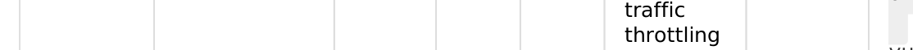
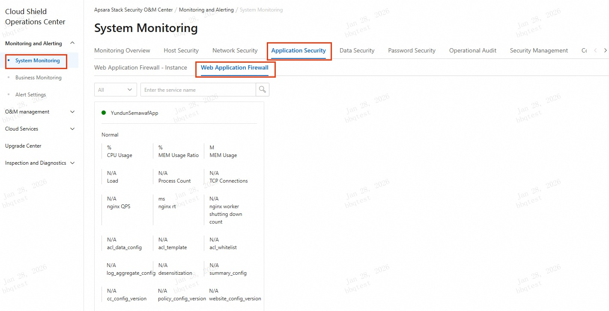
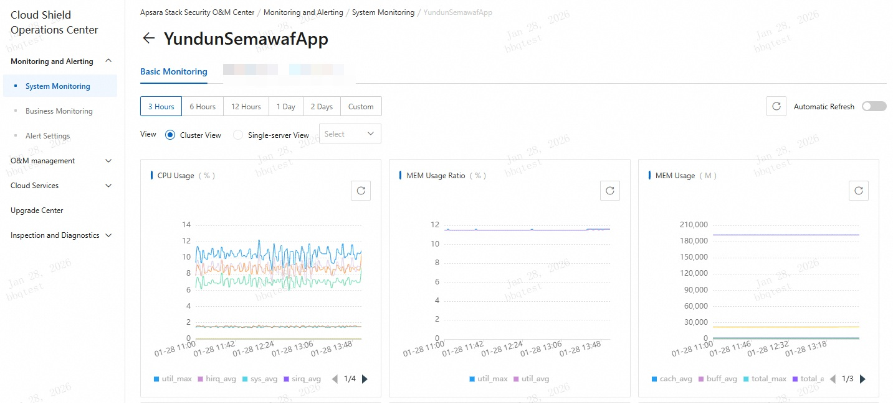

Alibaba Cloud  
Apsara Stack  
Alibaba Cloud Security-Web  
Application Firewall (WAF)  
Operations and Maintenance  
Guide  
Product Version: v3.18.6-2607  
Document Version: 20260828

**Table of Contents**

- [1.Physical machine-based WAF O&M in Apsara Infrastructure Management](#section-1)
    - [1.1. Log in to the Apsara Infrastructure Management console](#section-1-1)
    - [1.2. Check the service status](#section-1-2)
        - [1.2.1. Basic inspection](#section-1-2-1)
        - [1.2.2. Advanced inspection](#section-1-2-2)
- [2.Physical machine-based WAF O&M in Cloud Shield Operations Center](#section-2)
    - [2.1. Log on to Cloud Shield Operations Center](#section-2-1)
    - [2.2. Global system settings](#section-2-2)
    - [2.3. Configure global custom rules](#section-2-3)
    - [2.4. Metrics](#section-2-4)
        - [2.4.1. Introduction to WAF metrics](#section-2-4-1)
        - [2.4.2. View metrics](#section-2-4-2)

# 1.Physical machine-based WAF O&M in Apsara Infrastructure Management

## 1.1. Log in to the Apsara Infrastructure Management console

This topic describes how to log in to the Apsara Infrastructure Management console.

**Prerequisites**

- The endpoint of the Apsara Uni-manager Operations Console and the username and password that are used to log in to the console are obtained from a deployment engineer or an administrator.

  The endpoint of the Apsara Uni-manager Operations Console is in the following format: *regi on-id*.ops.console.*intranet-domain-id*.

- A supported browser is used. We recommend that you use Google Chrome.

**Procedure**

1. Open your browser.

2. In the address bar, enter the endpoint of the Apsara Uni-manager Operations Console. Press the ENTER key.

   

   > **Note**
   >
   > You can click the current language in the upper-right corner to switch to another language. Simplified Chinese and English are supported.

3. Enter the correct username and password.

   > **Note**
   >
   > - Obtain the username and password that are used to log in to the Apsara Uni-manager Operations Console from a deployment engineer or an administrator.
   >
   > - If you enter an invalid password three consecutive times, the system enables the image verification login feature. If you enter an invalid password five consecutive times, the system locks your account. In this case, you can contact the administrator to unlock your account.
   >
   > - The first time that you log in to the Apsara Uni-manager Operations Console, change the password for your account as prompted.
   >
   >   To enhance security, make sure that your password meets the following requirements:
   >
   >   - The password contains uppercase and lowercase letters.
   >
   >   - The password contains digits.
   >
   >   - The password contains at least one of the following special characters: ! @ # $ %
   >
   >   - The password is 10 to 20 characters in length.

4. Click **Agree to Private Policy and Log On**.

5. In the top navigation bar of the Apsara Uni-manager Operations Console, choose **Platform Operation > Apsara Infrastructure Management**.

## 1.2. Check the service status

### 1.2.1. Basic inspection

The basic inspection of Web Application Firewall (WAF) checks whether a service runs as expected.

**Procedure**

1. Log in to the Apsara Infrastructure Management console.

2. In the left-side navigation pane, choose **Resource Management > Product & Cluster O&M**.

3. In the **Product | Cluster** search box, enter **SemaWafCluster**.

4. Find the  `SemaWafCluster-A-xx`  cluster and click **Cluster Details** in the **Actions** column.

5. On the **Services** tab, enter **yundun-semawaf** in the **Service** search box to check whether the service status is normal.

### 1.2.2. Advanced inspection

The advanced inspection of Web Application Firewall (WAF) checks the system status and service status.

**Procedure**

1. Log on to the two physical machines of WAF.

   <ol type="i">

   <li>

   In the left-side navigation pane, choose **Resource Management > Product & Cluster O&M**.

   </li>

   <li>

   In the **Product | Cluster** search box, enter **SemaWafCluster**.

   </li>

   <li>

   Find the  `SemaWafCluster-A-xx`  cluster and click **Cluster Details** in the **Actions** column.

   </li>

   <li>

   On the **Services** tab, enter **yundun-semawaf** in the **Service** search box and click **Details** in the Actions column. The service details page appears.

   </li>

   <li>

   In the **Components** section, click **YundunSemawafApp#**.

   </li>

   <li>

   In the Information of Component YundunSemawafApp# section, click the **Instances** tab. On this tab, find the instance whose information you want to view and click **Terminal** in the **Actions** column to log in to the WAF physical machine.

   </li>

   <li>

   In the left-side navigation pane, click the node to which you want to log in or the  icon.

   </li>

   </ol>

   In the dialog box that appears, select **Account Type** and **Server Account**, and then click **OK**.

   For more information about account types and server accounts, see **Platform O&M > Apsara Infrastructure Management > Web clients > Web Client Logon > Server logon** in **Apsara Uni-manager Operations Console User Guide**.

2. Check the system status.

   <ol type="i">

   <li>

   View system logs.

   Run the  `dmesg -T |tail -30`  command to check for exception logs.

   </li>

   <li>

   Check the system loads.

   - Run the  `free -h`  command to check whether the memory usage is normal.

   - Run the  `df -h`  command to check whether the disk usage is normal.

   - Run the  `uptime`  command to check whether the average system load is normal.

   - Run the  `top`  command to check whether the CPU usage is normal.

   </li>

   </ol>

3. Check the service status.

   > **Note**
   >
   > In the WAF installation directory /home/safeline, perform the following operations.

   <ol type="i">

   <li>

   Run the  `cd /home/safeline`  command to open the installation directory.

   </li>

   <li>

   Check the minion service.

   <ol type="a">

   <li>

   Run the  `systemctl status minion`  command to check the execution time and the status of the minion service.

   </li>

   <li>

   Run the  `tail -100 logs/minion/minion.log`  command to check for exception logs.

   </li>

   </ol>

   </li>

   <li>

   Check the mgt-api service.

   </li>

   </ol>

   <ol type="a">

   <li>

   Run the  `docker logs --tail 50 mgt-api`  command to check for exception logs.

   </li>

   <li>

   Run the  `docker exec -it mgt-api supervisorctl status`  command to check whether the service runs as expected and whether **uptime** is normal.

   </li>

   </ol>

   <ol type="i" start="100">

   <li>

   Run the  `tail -50 logs/management/gunicorn.log`  command to check for exception logs.

   </li>

   <li value="500">

   Run the  `tail -50 logs/management/daphne.log`  command to check for exception logs.

   </li>

   </ol>

   <ol type="a" start="5">

   <li>

   Run the  `tail -50 logs/management/scheduler.log`  command to check for exception logs.

   </li>

   <li>

   Run the  `tail -50 logs/management/dramatiq.log`  command to check for exception logs.

   </li>

   </ol>

   <ol type="i" start="4">

   <li>

   Check the redis service.

   Run the  `docker logs --tail 50 mgt-redis`  command to check for exception logs.

   </li>

   <li>

   Check the detector service.

   <ol type="a">

   <li>

   Run the  `docker logs --tail 50 detector-srv`  command to check for exception logs.

   </li>

   <li>

   Run the  `tail -50 logs/detector/snserver.log`  command to check for exception logs.

   </li>

   </ol>

   <ol type="i" start="100">

   <li>

   Run the  `curl 127.0.0.1:8001/stat | grep num`  command to check whether the service responds and whether the status of the real-time request processing data is normal. For example, check whether the value of the **req_num_total** parameter is normal. The req_num_total parameter indicates the number of requests that are processed within the previous 5 seconds.

   </li>

   </ol>

   </li>

   <li>

   Check the tengine service.

   <ol type="a">

   <li>

   Run the  `docker logs --tail 50 tengine`  command to check for exception logs.

   </li>

   <li>

   Run the  `tail -50 logs/nginx/error.log`  command to check for exception logs.

   </li>

   </ol>

   </li>

   <li>

   Check the mario service.

   <ol type="a">

   <li>

   Run the  `docker logs --tail 50 mario`  command to check for exception logs.

   </li>

   <li>

   Run the  `tail -50 logs/mario/mario.log`  command to check for exception logs.

   </li>

   </ol>

   <ol type="i" start="100">

   <li>

   Run the  `curl 127.0.0.1:3335/api/v1/state`  command to check whether the service responds and whether the status of the real-time request processing data is normal. For example, check whether the **num_pending** parameter remains at a high value of nearly 10,000 or whether the value of the **num_processed_last_10s** parameter is normal. The num_processed_last_10s parameter indicates the number of requests that are processed within the previous 10 seconds.

   </li>

   </ol>

   </li>

   </ol>

# 2.Physical machine-based WAF O&M in Cloud Shield Operations Center

## 2.1. Log on to Cloud Shield Operations Center

Cloud Shield Operations Center is an operations platform for Apsara Stack Security services. The platform monitors the status and workloads of Apsara Stack Security services in real time and sends alert notifications to users. This topic describes how to log on to Cloud Shield Operations Center.

**Prerequisites**

- The endpoint of the Apsara Uni-manager Operations Console and the username and password that are used to log in to the console are obtained from a deployment engineer or an administrator.

  The endpoint of the Apsara Uni-manager Operations Console is in the following format: *regi on-id*.ops.console.*intranet-domain-id*.

- A supported browser is used. We recommend that you use Google Chrome.

**Procedure**

1. Open your browser.

2. In the address bar, enter the endpoint of the Apsara Uni-manager Operations Console. Press the ENTER key.

   

   > **Note**
   >
   > You can click the current language in the upper-right corner to switch to another language. Simplified Chinese and English are supported.

3. Enter your username and password.

   > **Note**
   >
   > - Obtain the username and password that are used to log on to the Apsara Uni-manager Operations Console from a deployment engineer or an administrator.
   >
   > - If you enter an invalid password for three consecutive times, the system enables the image verification logon feature. If you enter an invalid password for five consecutive times, the account is locked. Contact the administrator to unlock the account.
   >
   > - The first time that you log on to the Apsara Uni-manager Operations Console, change the password for your username as prompted.
   >
   >   To enhance security, your password must meet the following requirements:
   >
   >   - The password contains uppercase and lowercase letters.
   >
   >   - The password contains digits.
   >
   >   - The password contains at least one of the following special characters: ! @ # $ %
   >
   >   - The password is 10 to 20 characters in length.

4. Click **Agree to Private Policy and Log On**.

5. In the top navigation bar, choose **Product Operation > Security O&M > Cloud Shield Operations Center**.

**View execution results**

You can view information on the pages of **Cloud Shield Operations Center**.

## 2.2. Global system settings

You can configure global system settings to enable or disable the Web Application Firewall (WAF) global protection engine, specify an internal-facing Server Load Balancer (SLB) instance as the downstream service, and configure shared virtual IP addresses. This topic describes how to configure global system settings.

**Procedure**

1. Log in to the Cloud Shield Operations Center.

2. In the left-side navigation pane, choose **Cloud Services > WAF Management > Global Config**.

3. On the **Global system settings** page, configure the following parameters.

   | Parameter | Description | Supported operation |
   | --- | --- | --- |
   | WAF global protection engine | Specify whether to enable the global protection engine. The engine determines the status of intrusion prevention configurations on the platform management side and the service group management side. If you disable the engine, WAF allows all traffic and does not perform intrusion detection or traffic processing. | Turn on or off the switch. |
   | Intelligence Switch | After you turn off the switch, the existing WAF rules no longer take effect. | Turn on or off the switch. |
   | Private SLB as site downstream | Specify whether to associate an elastic IP address (EIP) with an SLB instance to add the EIP to WAF. | Turn on or off the switch. |
   | Shared IP | Specify whether to enable shared IP addresses. | Turn on or off the switch. |
   | Create external shared virtual IP | Create a shared public virtual IP address. | Click <strong>Click to create</strong> to the right of the parameter. Important If you click Click to create, five shared public virtual IP addresses are created.Proceed with caution. |
   | Nginx log delivery to OSS | Specify whether to deliver NGINX logs to Object Storage Service (OSS). | Click theicon to the right of the parameter. In the <strong>Edit nginx</strong> <strong>log delivery to OSS</strong> dialog box, turn on theswitch, specify <strong>Endpoint</strong>, <strong>AccessKeyId</strong>, <strong>AccessKeySecret</strong>, and <strong>Preset</strong> <strong>OSS path</strong>, and then click <strong>OK</strong>. |
   | Show Alibaba Cloud Logo when exporting reports | Specify whether to display the Alibaba Cloud logo in the security report. | Turn on or off the switch. |
   | Log download quota | Specify the maximum number of logs that can be downloaded. | Click theicon to the right of this parameter. Then, set the maximum number of logs that can be downloaded and click <strong>Confirm</strong>. |
   | Anti-tampering | Specify whether to enable web page protection. When a locked page receives a request, a cached version of the page is returned. This helps prevent web page tampering. | Turn on or off the switch. |
   | EIP | Specify whether EIPs can be added to WAF. | Turn on or off the switch. |
   | Specify response status code for unmatched domains | Specify the status code to return when no domain name is matched. | Click theicon to the right of this parameter to specify the HTTP status code to return. |
   | Maximum number of listening ports | Specify the maximum number of listening ports. | Click theicon to the right of this parameter to specify the maximum number of listening ports. |

## 2.3. Configure global custom rules

You can create global custom rules in Web Application Firewall (WAF) based on your business requirements and network environment to monitor the status of WAF. This topic describes how to create and manage global custom rules.

**Procedure**

> **Important**
>
> The global custom rules that you add take effect on all tenants. Proceed with caution.

1. Log in to the Cloud Shield Operations Center.

2. In the left-side navigation pane, choose **Cloud Services > WAF Management > Global Rules**.

3. On the **Rule management** page, click **Create Rule**, configure the following parameters, and then click **OK**.

   | Parameter | Description |
   | --- | --- |
   | Mode | The action and status of the rule. • You can set the action to <strong>Block</strong>, <strong>Allow</strong>, <strong>Monitor</strong>, or <strong>Detection Module</strong> <strong>Control</strong>. • You can set the status to <strong>Enable</strong> or <strong>Disable</strong>. |
   | Description | The description of the rule. |
   | Severity | The severity level of the rule. Valid values: <strong>No Threat</strong>, <strong>Low</strong>, <strong>Moderate</strong>, and <strong>Important</strong>. |
   | Match Condition | The match conditions of the rule. Each match condition consists of the <strong>field to be</strong> <strong>matched</strong>, <strong>logical operator</strong>, and <strong>value of the field.</strong> |
   | Logging | Specify whether to enable logging. Valid values: • Perform Logging When Match Condition Is Met • Do not Perform Logging When Match Condition Is Met |
   | Attack Type | The type of attacks that you want the rule to detect. You can select only one type. |
   | Blocking Status Code | The status code that is returned. You can select only one status code. |
   | Expire At | The expiration time of the rule. If you do not specify an expiration time, the rule never expires. |

   After the global custom rule is added, you can perform the following operations on the rule in the rule list.

   - Specify **Mode**, **Severity**, and **Status** above the list to filter global custom rules.

   - Find the rule that you want to manage and click **Edit** in the **Actions** column of the rule to modify the rule.

   - Select multiple rules, click **More operations** above the list, and then select Enable Rule, Disable Rule, or Delete Rule to enable, disable, or delete the rules at a time.

## 2.4. Metrics

### 2.4.1. Introduction to WAF metrics

This topic describes the common metrics for Web Application Firewall (WAF).

**Business metrics**

> **Note**
>
> The hyphen (-) in the following table indicates that the metric is unavailable in Cloud Shield Operations Center.

**Wh**

**Wh**

**eth**

**eth**

**er**

**er**

**ava**

**an**

**ilab**

**ale**

**Coll**

**le**

**rt**

**ecti**

**in**

**Metric**

**Data**

**is**

**on**

**Clo**

**definiti**

**dime**

**trig**

**inte**

**Metr**

**Data**

**Uni**

**ud**

**on**

**nsio**

**Script**

**Remarks**

**ger**

**rval**

**ic**

**type**

**t**

**Sec**

**n**

**ed**

**urit y Op era tio ns Cen ter**

The metric is used to

None. WAF

acl_temp

determine

(minion)

late:

whether the

writes the

access

metric value

Access

Real-

1

control list

to the log

control

Non

time

Host

min

(ACL)

Yes

Yes

file.

list (ACL)

e

data

ute

template

template

configuratio

configur

n used by

ation

mario is of

version

the latest version.

The metric is used to

acl_whit

determine

None. WAF

elist:

whether the

(minion)

Real-

1

ACL

ACL

Non

writes the

time

Host

min

whitelist

Yes

Yes

whitelist

e

metric value

data

ute

configuratio

configur

to the log

n used by

ation

file.

mario is of

version

the latest version.

The metric

acl_data

is used to

_config:

None. WAF

determine

ACL data

(minion)

whether the

Real-

1

configur

Non

writes the

ACL data

time

Host

min

Yes

Yes

ation

e

metric value

configuratio

data

ute

version

to the log

n used by

file.

mario is of the latest version.

tjmon _yun

The metric

dun-

is used to

sema

determine

waf-

whether the

summar

mario

None. WAF

summary

y_config:

_versi

(minion)

configuratio

Real-

1

on

summar

Non

writes the

n used by

time

Host

min

Yes

Yes

y

e

metric value

mario is of

data

ute

configur

to the log

the latest

ation

file.

version.

version

The metric is used to

log_aggr

determine

egate_co

None. WAF

whether the

nfig:

(minion)

Real-

1

log_aggrega

Non

writes the

log_aggr

time

Host

min

te

Yes

Yes

e

metric value

egate

data

ute

configuratio

to the log

configur

n used by

file.

ation

mario is of

version

the latest version.

The metric is used to

desensiti

determine

None. WAF

zation:

whether the

(minion)

Real-

1

data

Data

Non

writes the

time

Host

min

masking

Yes

Yes

masking

e

metric value

data

ute

configuratio

configur

to the log

n used by

ation

file.

mario is of

version

the latest version.

The metric

policy_co

is used to

nfig_vers

None. WAF

determine

ion:

(minion)

whether the

Real-

1

Non

writes the

custom rule

Custom

time

Host

min

Yes

Yes

e

metric value

configuratio

rule

data

ute

to the log

n used by

configur

file.

detector is

ation

of the latest

version

version.

tjmon _yun

cc_confi

The metric

dun-

g_versio

is used to

sema

n:

None. WAF

determine

waf-

HTTP

(minion)

whether the

detec

flood

Real-

1

writes the

HTTP flood

tor_v

Non

protectio

time

Host

min

metric value

protection

Yes

Yes

ersio

e

n

data

ute

to the log

configuratio

n

configur

file.

n used by

ation

detector is

version

of the latest version.

The metric

tjmon

is used to

website_

_yun

None. WAF

determine

config_v

dun-

(minion)

whether the

ersion:

Real-

1

sema

Non

writes the

site

time

Host

min

Yes

Yes

Site

waf-

e

metric value

configuratio

data

ute

configur

tengi

to the log

n generated

ation

ne_ve

file.

by minion is

version

rsion

of the latest version.

The metric

req_dete

None. WAF

is used to

ct_count

(minion)

Real-

1

verify the

_time:

writes the

-

time

ms

Host

min

efficiency of

No

Yes

Average

metric value

data

ute

the

detectio

to the log

detection

n time

file.

engine.

req_han

The metric

None. WAF

dler_tim

is used to

(minion)

e:

Real-

1

verify the

writes the

-

time

ms

Host

min

efficiency of

No

Yes

Average

metric value

data

ute

the

detectio

to the log

detection

n

file.

engine.

latency

detect_q ps:

None. WAF (minion)

Detectio

Real-

1

Non

writes the

n

-

time

Host

min

None

No

No

e

metric value

queries

data

ute

to the log

per

file.

second (QPS)

syn_recv

None. WAF

The metric

_count:

(minion)

Real-

1

is used to

Non

writes the

Stacked

-

time

Host

min

verify the

No

Yes

e

metric value

semi-

data

ute

efficiency of

to the log

connecti

WAF.

file.

ons

<table>
  <tr>
    <td>-</td>
    <td>tcp_retra n: TCP packet retransm ission</td>
    <td>Real-time data</td>
    <td>Non e</td>
    <td>Host</td>
    <td>1 min ute</td>
    <td>None. WAF (minion) writes the metric value to the log file.</td>
    <td>The metric is used to verify the efficiency of WAF.</td>
    <td>No</td>
    <td>No</td>
  </tr>
  <tr>
    <td>-</td>
    <td>tengine_i nfo: tengine status</td>
    <td>Real-time data</td>
    <td>Non e</td>
    <td>Host</td>
    <td>1 min ute</td>
    <td>None. WAF (minion) writes the metric value to the log file.</td>
    <td>The metric is used to verify the status of tengine.</td>
    <td>No</td>
    <td>No</td>
  </tr>
  <tr>
    <td>-</td>
    <td>tengine_status: Tengine synchron ization status</td>
    <td>Real-time data</td>
    <td>Non e</td>
    <td>Host</td>
    <td>1 min ute</td>
    <td>None. WAF (minion) writes the metric value to the log file.</td>
    <td>The metric is used to verify the status of tengine.</td>
    <td>No</td>
    <td>Yes</td>
  </tr>
  <tr>
    <td>-</td>
    <td>mgt-redis-stat: ApsaraD B for Redis master-replica status</td>
    <td>Real-time data</td>
    <td>Non e</td>
    <td>Host</td>
    <td>1 min ute</td>
    <td>None. WAF (minion) writes the metric value to the log file.</td>
    <td>This metric is used to determine whether the ApsaraDB for Redis instance does not have a master node.</td>
    <td>No</td>
    <td>Yes</td>
  </tr>
  <tr>
    <td>-</td>
    <td>redis-db-no-master: ApsaraD B for Redis split-brain</td>
    <td>Real-time data</td>
    <td>Non e</td>
    <td>Host</td>
    <td>1 min ute</td>
    <td>None. WAF (minion) writes the metric value to the log file.</td>
    <td>This metric is used to determine whether the ApsaraDB for Redis instance encounters a split-brain issue.</td>
    <td>No</td>
    <td>Yes</td>
  </tr>
</table>

<table>
  <tr>
    <td>yund unse maw afapp _ngin x_wor ker_s huttin g_do wn_c ount_mach ine_h ost</td>
    <td>ng_work er_count: Whether the number of NGINX workers is close to 1,024</td>
    <td>Real-time data</td>
    <td>Non e</td>
    <td>Host</td>
    <td>1 min ute</td>
    <td>check_ng_w orker_count</td>
    <td>This metric is used to verify the status of NGINX.</td>
    <td>Yes</td>
    <td>Yes</td>
  </tr>
</table>

**Business alerts**

After you log in to Apsara Uni-manager Operations Console, choose **Monitor&Alert > Alert Management > Alert List** in the top navigation bar. In the alert list, enter **yundun-semawaf** into the **Resource Owner** filter condition to view alerts triggered by WAF.

| Metric | Alert description | Alert thres hold | Nu mb er of tim es the thr esh old is con sec uti vel y exc eed ed to trig ger the aler t | Sev erit y lev el | Impact | Wheth er the faulty host can be locate d based on the alert | Action to perform after the alert is triggered |
| --- | --- | --- | --- | --- | --- | --- | --- |
| acl_temp late | The alert is triggered when the backend configuration differs from the frontend configuration. | $acl_t empl ate_st atus! =0 | 5 | P3 | Newly added HTTP flood protectio n rules do not take effect on the mario side. | Yes | The system automatically fixes the issue. If the issue persists after 30 minutes, contact the development team. |
| acl_whit elist | The alert is triggered when the backend configuration differs from the frontend configuration. | $acl_whitel ist_st atus! =0 | 5 | P3 | Newly added HTTP flood protectio n rules do not take effect on the mario side. | Yes | The system automatically fixes the issue. If the issue persists after 30 minutes, contact the development team. |
| acl_data _config | The alert is triggered when the backend configuration differs from the frontend configuration. | $acl_data_confi g_stat us!=0 | 5 | P3 | Newly added HTTP flood protectio n rules do not take effect on the mario side. | Yes | The system automatically fixes the issue. If the issue persists after 30 minutes, contact the development team. |
| summar y_config | The alert is triggered when the backend configuration differs from the frontend configuration. | $sum mary _confi g_stat us!=0 | 5 | P4 | Newly added custom rules do not take effect on the mario side. | Yes | The system automatically fixes the issue. If the issue persists after 30 minutes, contact the development team. |
| log_aggr egate_co nfig | The alert is triggered when the backend configuration differs from the frontend configuration. | $log_aggre gate_confi g_stat us!=0 | 5 | P4 | Newly added custom rules do not take effect on the mario side. | Yes | The system automatically fixes the issue. If the issue persists after 30 minutes, contact the development team. |
| desensiti zation | The alert is triggered when the backend configuration differs from the frontend configuration. | $dese nsitiz ation_status!=0 | 5 | P3 | Newly added data masking rules do not take effect on the mario side. | Yes | The system automatically fixes the issue. If the issue persists after 30 minutes, contact the development team. |
| policy_co nfig_vers ion | The alert is triggered when the backend configuration differs from the frontend configuration. | $polic y_con fig_ve rsion_status!=0 | 5 | P3 | Newly added custom rules do not take effect on the detector side. | Yes | The system automatically fixes the issue. If the issue persists after 30 minutes, contact the development team. |
| cc_confi g_versio n | The alert is triggered when the backend configuration differs from the frontend configuration. | $cc_c onfig_versio n_stat us!=0 | 5 | P3 | Newly added HTTP flood protectio n rules do not take effect on the detector side. | Yes | The system automatically fixes the issue. If the issue persists after 30 minutes, contact the development team. |

<table>
  <tr>
    <td>website_config_v ersion</td>
    <td>The alert is triggered when the backend configuration differs from the frontend configuration.</td>
    <td>$web site_c onfig_versio n_stat us!=0</td>
    <td>5</td>
    <td>P2</td>
    <td>Newly added HTTP flood protectio n rules do not take effect on the tengine side.</td>
    <td>Yes</td>
    <td>Common solutions: 1. Check the latest site configuration for any invalid HTTP header. 2. Check the latest site configuration for any invalid SSL protocol. 3. If the number of sites exceeds 3,000, run the <code>time docker</code> <code>exec -it nginx -</code><code>t </code> command to check whether the detection time exceeds 20 seconds. Contact the development team for an optimization plan. 4. The system automatically fixes the issue. If the issue persists after 30 minutes, contact the development team.</td>
  </tr>
</table>

<table>
  <tr>
    <td>req_dete ct_count _time</td>
    <td>The alert is triggered when the detection threshold is exceeded.</td>
    <td>&gt;10</td>
    <td>5</td>
    <td>P2</td>
    <td>This alert is triggered when the average detection time of the WAF detection engine is abnormal. When the alert is triggered, WAF needs more time to check certain requests.This issue may be caused by improper custom rules.</td>
    <td>Yes</td>
    <td>1. Capture packets received on port 8000 (<code> tcpdump -</code><code>i safeline -vnn</code> <code>-s0 port 8000 -w</code><code>/tmp/8000.pcap </code>), use Wireshark to locate RST packets, and use follow tcp stream to view the packets one after one. If packets with large bodies are identified, add a custom rule to allow all packets destined for the corresponding URL. 2. Run <code> select * </code> <code>from</code> <code>aliyun_policy_pol</code> <code>icyrule order by</code> <code>last_update_time</code> <code>desc limit 50;</code> to query the yunudunsemawaf database for improper regular expressions, such as a regular expression that matches the entire body of packets. If yes, disable the custom rule that uses the regular expression.</td>
  </tr>
  <tr>
    <td>req_han dler_tim e</td>
    <td>The alert is triggered when the request processing time is exceeded.</td>
    <td>&gt;50</td>
    <td>5</td>
    <td>P2</td>
    <td>Same as above.</td>
    <td>Yes</td>
    <td>Same as above.</td>
  </tr>
</table>

<table>
  <tr>
    <td>check_sy n_recv_c ount</td>
    <td>The alert is triggered when the detection threshold is exceeded.</td>
    <td>&gt;100 0</td>
    <td>10</td>
    <td>P3</td>
    <td>This alert indicates that the number of semi-connectio ns on a WAF physical machine exceeds the normal level.When this alert is triggered, you must pay close attention to the number of semi-connectio ns. This issue may occur when the Linux Virtual Server (LVS) traffic throttling threshold needs to be adjusted because there are excessive sites.</td>
    <td>Yes</td>
    <td>Check the distribution of peering IP addresses when semi-connections are stacked: <code>ss -nt state</code> <code>syn-recv &#124; awk</code> <code>{'print $4}' &#124; awk</code> <code>-F: '{print $1}' &#124;</code> <code>sort &#124; uniq -c &#124;</code> <code>sort -nr &#124; head -n</code> <code>30</code> If 90% of the IP addresses end with .0 or .128, the issue is caused by LVS health checks. In this case, run <code>select</code> <code>count(distinct</code> <code>port) from</code> <code>aliyun_website_vipp</code> <code>ortwafportbinding;</code> <code> </code> to query the yundunsemawaf database. If the number of ports exceeds 1,000, increase the LVS traffic throttling threshold. You can contact the technical support of Alibaba Cloud for a plan.</td>
  </tr>
</table>

<table>
  <tr>
    <td>tengine_version</td>
    <td>tengine version.</td>
    <td>0</td>
    <td>5</td>
    <td>P2</td>
    <td>This alert indicates that the latest WAF site configura tion does not take immediat ely due to a synchroni zation failure.</td>
    <td>Yes</td>
    <td>In most cases, the site encryption algorithm manually specified by the tenant is incorrect.For example, the algorithm contains additional space characters or line breaks.Consequently, the setting fails to pass the syntax check and the latest configuration is not applied. You need to collect the node minion log from the WAF physical machine for detailed information of the error and modify the configuration accordingly. <code>tail -n 100000</code> <code>/home/safeline/l</code> <code>ogs/minion/minio</code> <code>n.log &gt;</code> <code>minion_latest_1w</code> <code>.log</code> <code>tail -n 100000</code> <code>/home/safeline/l</code> <code>ogs/management/n</code> <code>ode.log &gt;</code> <code>node_latest_1w.l</code> <code>og</code></td>
  </tr>
  <tr>
    <td>detector _version</td>
    <td>Check whether the detector version is the same as that in the database.Valid values: 0: no 1: yes</td>
    <td>&gt;0</td>
    <td>5</td>
    <td>P2</td>
    <td>This alert indicates that the latest WAF rules do not take effect immediat ely due to a synchroni zation failure.</td>
    <td>Yes</td>
    <td>The detector configuration has multiple versions. In this case, check the details of the alert to confirm the inconsistent versions.Then, check how long does this issue last.Typically, the system will automatically synchronize detector to the latest configuration. If the issue persists, collect the MySQL load and minion logs to troubleshoot.</td>
  </tr>
</table>

<table>
  <tr>
    <td>mgt-redis_sta t</td>
    <td>ApsaraDB for Redis master-replica switchover</td>
    <td>&gt;1</td>
    <td>5</td>
    <td>P3</td>
    <td>This alert indicates that ApsaraDB for Redis triggers a master-replica switchov er. If the alert is triggered, MiniRDS resources may be insufficie nt or the loads may be heavy.You need to pay close attention.</td>
    <td>Yes</td>
    <td>1. Collect the minion log. Modify the log collection parameters to collect logs generated during the master-replica switchover. You can extend the time range of log collection. <code>tail -n 100000</code> <code>/home/safeline/l</code> <code>ogs/minion/minio</code> <code>n.log &gt;</code> <code>minion_latest_1w</code> <code>.log</code> <code>journalctl -u</code> <code>minion --no-</code> <code>pager --since</code> <code>'20 minutes</code> <code>ago'</code> 2. Check the disk usage, CPU and memory loads, and locks of MySQL. If MySQL is overloaded or runs out of disk space, ApsaraDB for Redis may trigger a master-replica switchover. 3. Record the environment version, run the inspection script, and collect node status information. 4. Observe the master-replica switchover frequency. Report the preceding information to the technical support.</td>
  </tr>
  <tr>
    <td>redis_db _no_mas ter</td>
    <td>ApsaraDB for Redis encounters split-brain issue.Consequentl y, no master node is elected.</td>
    <td>&gt;0</td>
    <td>3</td>
    <td>P2</td>
    <td>This alert indicates that ApsaraDB for Redis triggers a master-replica switchov er but fails to elect the master node. If this alert is triggered, MiniRDS resources may be insufficie nt or the loads may be heavy.You need to pay close attention.</td>
    <td>Yes</td>
    <td>Same as the master-replica switchover alert, you need to observe how long does the issue last.After you collect the relevant information, run the <code> systemctl </code> <code>restart minion</code> command on the WAF physical machine to restore the master and replica nodes.</td>
  </tr>
  <tr>
    <td></td>
    <td></td>
    <td>&gt;800</td>
    <td>1</td>
    <td>P1</td>
    <td></td>
    <td>Yes</td>
    <td>1. Log in to the physical machine of the yundun-semawaf.YundunS emawafApp# component. 2. Run the <code> nproc </code> command to view the number of vCPUs. 3. Run the <code> ps -aux </code> <code>I grep 'nginx:</code> <code>worker' &#124;grep</code> <code>'203'&#124; grep -v</code> <code>'shutting down'I</code> <code>grep -v 'grep'&#124;</code> <code>wc -l </code> command to view the number of workers in the normal state.</td>
  </tr>
  <tr>
    <td rowspan="2">ng_work er_count _alarm</td>
    <td rowspan="2">Determine whether the number of NGINX workers is close to 1,024.</td>
    <td></td>
    <td></td>
    <td></td>
    <td>This alert is triggered because sites are frequentl y created, modified, and deleted.As a result, an excessive number of workers of the WAF forwardin g engine remain in the shutting</td>
    <td></td>
    <td rowspan="2">• If the number of normal workers equals half of the number of vCPUs, no action is needed. Do not modify sites frequently within a short period of time in case this issue occurs again. • If the number of workers in the normal state is less than half of the number of cpu cores, the number of workers in the shutting down state is too large when starting a new worker. As a result, the new worker cannot be created. In this case, you need to perform subsequent operations. 4. Run the <code> ps -aux </code> <code>&#124; grep</code> <code>'nginx:worker'&#124;</code> <code>grep 'shutting</code> <code>down'&#124; wc -l</code> command to view the number of workers in the shutting down state. 5. If the number of workers exceeds 800, run the <code> sudo </code> <code>docker exec</code> <code>tengine kill-</code> <code>stale-worker</code> command to kill old workers.  Important This command will close existing client connections.</td>
  </tr>
  <tr>
    <td>&gt;cpu _core s * 4</td>
    <td>3</td>
    <td>P3</td>
    <td>down state.This causes traffic forwardin g error. If this alert is triggered, stop the operation s performe d on sites immediat ely and perform the correspo nding troublesh ooting action.</td>
    <td>Yes</td>
  </tr>
  <tr>
    <td></td>
    <td></td>
    <td></td>
    <td></td>
    <td></td>
    <td>This alert is triggered because sites are frequentl y created, modified, and deleted.As a result, an excessive number of workers of the WAF forwardin g engine remain in the shutting down state.This</td>
    <td></td>
    <td>6. Wait 1 minute and run the <code> sudo </code> <code>docker exec</code> <code>tengine nginx -s</code> <code>reload </code> and <code> ps </code> <code>-aux I grep</code> <code>'nginx: worker'</code> <code>&#124;grep '203'&#124;</code> <code>grep -v</code> <code>'shutting down'</code> <code>&#124; grep -v</code> <code>'grep'&#124; wc -l</code> commands to check the number of workers in the normal state. If the number of normal workers equals half of the number of vCPUs, the issue is fixed.</td>
  </tr>
</table>

causes traffic

### 2.4.2. View metrics

forwardin g error. To avoid

This topic describes how to view the metrics of Web Application Firewall (WAF).

this issue, do

**System metrics**

not modify

1. Log in to the Cloud Shield Operations Center.

   sites frequentl

2. In the left-side navigation pane, choose **Monitoring and Alerting > System Monitoring**.

   y within a short

   - Monitoring overview: On the **Monitoring Overview** tab, you can view the metrics of

     period of

     services provided by Apsara Stack Security, including the service name, description,

     time.

     number of metrics, number of abnormal metrics, and service status.

   - WAF system monitoring overview: On the **Application Security > Web Application Firewall** tab, you can view the system metrics, including the CPU utilization, memory usage, loads, number of TCP connections, and process data.

     

   - WAF instance system monitoring: Click the **YundunSemawafApp** card to go to the **Basic Monitoring** tab to view system monitoring details.

     On this tab, you can view changes in the CPU utilization, memory usage, loads, number of TCP connections, and process data in **Cluster View** or **Single-server View**.

     

     You can select or specify a time range, click the Refresh icon to manually update the monitoring data, or enable Automatic Refresh to allow the system to automatically update the monitoring data.
