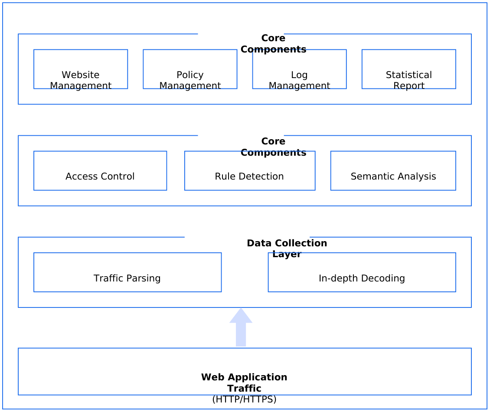
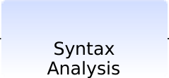
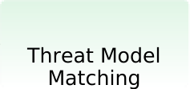

Alibaba Cloud  
Apsara Stack  
Alibaba Cloud Security-Web  
Application Firewall (WAF)  
Product Introduction  
Product Version: v3.18.6-2607  
Document Version: 20260831

**Table of Contents**

- [1.What is Web Application Firewall](#section-1)
- [2.Functions and features](#section-2)
- [3.Architecture](#section-3)
- [4.Use scenarios](#section-4)

# 1.What is Web Application Firewall

Web Application Firewall (WAF) defends against OWASP attacks such as SQL injection, Cross-Site Scripting (XSS), common web server plugin vulnerabilities, trojan uploads, and unauthorized access to core resources. It filters massive malicious access requests, prevents data leaks of website assets, and ensures website security and availability.

Apsara Stack WAF redefines the capabilities of WAF products through algorithm innovation. It innovatively uses intelligent semantic analysis to identify Web Attacks and integrates an intelligent brain into WAF. This brain independently identifies attack behaviors. It also combines learning models to continuously enhance and refine its analytical capabilities. Therefore, it meets daily security protection requirements without relying on traditional rule libraries. Its core features include:

- **Intelligent attack detection**

  It features an intelligent detection engine that covers OWASP security risks. Instead of relying on traditional rule matching models, the engine intelligently identifies HTTP and HTTPS traffic to discover and block security threats.

- **Web access control**

  It supports flexible access control mechanisms and includes a built-in access control engine. The engine tracks client access behaviors based on the Source IP and session. You can restrict access behaviors from specific sources by configuring access frequency limits for specific domains and URLs, and by applying IP blocklist and allowlist policies.

# 2.Functions and features

Web Application Firewall prevents malicious application attacks and secures access for Internet users on mobile devices and PCs.

**Level-1**

**Level-2**

**Level-3**

**Feature description**

**feature**

**feature**

**feature**

- Display the back-to-origin IP addresses of physical machines in the classic network configuration.

Back-to-origin IP information

- Display the back-to-origin IP addresses of SLB in the VPC network configuration.

System

Display the system firmware version and the attack

firmware

detection engine.

information

System

- Load status: Display the CPU utilization and

informatio

memory utilization of WAF nodes.

n

- Network status: Display the read and write network rates of WAF nodes.

- Detection status: Display the number of requests detected per second and the average detection

Node status

latency of WAF nodes.

- Forwarding status: Display the number of new connections per second and the average processing latency of WAF nodes.

- Disk status: Display the disk utilization and total disk capacity of WAF nodes.

System manageme

> **Note**

nt

> Visible only to global organization security administrators.

Global system settings

Modify global system settings, including enabling or disabling the protection engine, allowing tenant private SLB as a downstream site, setting the maximum number of log downloads, and toggling switches for tamper proofing and EIP.

Other system

System

Configure SSL certificates.

settings

settings

Send logs for site management, protection policy management, access frequency control

Alert

management, attack detection, site access, and

configuration

access frequency control rule execution through syslog. Configure alert thresholds for business and system metrics.

Back up protected sites and related protection

Online backup

policies, custom rules, and certificates.

Provide attack detection statistics, including the top

Attack detection

100 attack sources and statistics on targeted IPs

statistics

such as attack counts and attack times.

Traffic trend

Query QPS traffic trends by site.

chart

Display the top 100 request access records in real time. Show information across dimensions such as

Access status

IP, session, site address, URL, request count within

monitoring

30 seconds, and average response time. Refresh the access request information every 5 seconds.

Provide protection statistics for the last 24 hours and the last 30 days, including:

Monitoring

Statistics

- Geographic distribution map of attackers in China

and O&M

and worldwide.

- Total requests, total attacks, and total blocks by

Protection

the WAF proxy.

overview

- Top attacking IPs by request volume, attack volume, and block volume.

- Top 5 attack type distribution.

- Top 5 most attacked sites.

Export daily reports, weekly reports, and scheduled task reports for all sites or specific sites. Reports include access request volume trends, most

Protection

accessed sites, most accessed IPs, web attack

report export

volume trends, attack type distribution, domestic attacking IP distribution, worldwide attacking IP distribution, and block volume trends.

- Provide CC protection logs. The log list displays records that match CC rules, including the request URL, the matched CC rule name, and the

CC protection

match time.

logs

- Provide conditional query for CC protection logs. Filter logs by event generation time and CC rule name.

Provide attack detection logs.

- The attack detection log list displays the processing result, target address, attack type, attacker IP, and attack time.

- View detailed information for each attack log entry. The details include the attack risk level, decoding method, decoded attack payload, and HTTP request fields. If you identify a false

Protection

Attack detection

positive, click Eliminate False Positive to generate

logs

logs

an allowlist entry.

- Provide conditional query for attack detection logs. Filter logs by attack type, source IP, event generation time, and other conditions or condition combinations.

- Create local export tasks for selected logs in JSON or CSV format. Download the log files to your local device from the log download management page.

Log download

Manage asynchronous log download tasks for attack

management

detection logs.

System

Provide system operation logs, including usernames,

operation logs

specific operations, and IP addresses.

Query the rule match status for a specified IP

IP query

address, including the matched rule type (CC attack or attack detection log) and attack details.

Provide business access logs, including the request

Access logs

URL, destination IP, source IP, request method, and response code.

- Configure access frequency control rules for domains and URLs to control access from non-compliant IPs and sessions. Apply rate limiting or blocking to IPs and sessions that meet specified

CC protection

conditions or to known IPs and sessions.

- Support a CC allowlist. Users (IPs or sessions) in the CC allowlist bypass CC protection rules.

Global custom

View policies defined by the global administrator.

rules

Integrate threat intelligence from the Internet to

Threat

help enterprises monitor suspicious requests,

intelligence

develop targeted protection policies, and defend against attacks effectively.

- Support multiple decoding methods, including URL decoding, JSON parsing, Base64 decoding, hexadecimal conversion, backslash unescaping, XML parsing, PHP serialized object parsing, and UTF-7 decoding. Include detection modules for SQL injection, XSS, threat intelligence, CSRF, SSRF, PHP deserialization, Java deserialization, ASP code injection, file inclusion attacks, file upload attacks, PHP code injection, command injection, bot crawling, and server response. Provide five built-in protection templates: default

Attack

protection policy, observation mode, high-

protection

protection mode, financial customers, and

policies

Internet customers. You can customize the decoding algorithms in each template and independently enable or disable each attack detection module or adjust its detection granularity.

- Support custom block response status codes. Enable HTTP response detection and configure the response body inspection length. Configure the HTTP request body inspection length. Enable or disable the detection timeout limit.

Add, delete, enable, or disable custom rules.

Custom rules support four actions: allow, block, observe, and detection module control. The detection module control action configures fine-grained WAF protection modules for specific HTTP requests. Apply fine-grained HTTP access control to

Security

sites based on conditions and condition

protection

Custom rules

combinations, including URI, GET parameters, decoded path, Host header, full cookie, POST parameters, full body, HTTP status code, response content, and user IP. The user IP condition supports geo-based source matching rules. Configure custom block status codes and attack types, set the time-to-live for custom rules, and search rules by domain name.

Certificate

Manage SSL certificates, including uploading

management

certificate files and SSL private keys.

Protection configurati on

- Add, delete, modify, enable, or disable protected sites.

- Site onboarding: Protect sites that are open to the Internet and sites within a VPC internal network.

- Support EIP and SLB VIP onboarding. The EIP onboarding mode supports one-click bypass.

- Virtual IP management: The system allocates five shared VIPs by default. Tenants can create dedicated VIPs and custom VIPs.

- Forwarding proxy: Forward and protect HTTP and HTTPS traffic. Support domain-based and IP-based forwarding. Configure a dedicated VIP, custom VIP, or multiple VIPs for a single domain name. Support any non-standard port.

- Back-to-origin methods: Forward requests to backend servers, redirect requests, or return specified content.

- Three methods for forwarding to backend servers: weighted round-robin, least connections, and source address hashing.

- Three load balancing algorithms for origin server protection: Configure sites to send requests directly back to SLB and ECS instances within a

Protected site

VPC. Backend servers do not require public IP

management

addresses, which prevents attackers from obtaining the real IP addresses of backend servers and bypassing the WAF.

- Health check: Configure the health check path, response code, and response timeout for backend servers.

- Access logs: Enable access log recording for sites. Record request headers, request bodies, response headers, and payloads.

- Protection policies: Provide built-in templates, including the default protection template, observation template, high-protection template, and templates for the financial and Internet industries.

- Monitor the status of back-to-origin sites and display status alerts when a health check fails.

- Configure the value of the X-Forwarded-For header in HTTP requests.

- Insert custom header fields into HTTP request and response headers. Support canary release capabilities, which allow you to add domain sites one by one and then enable block or observation mode.

- Support web tamper proofing. Configure web tamper-proofing rules to protect specified site pages and prevent unauthorized or accidental modification of critical page content.

- Cache static web resources such as HTML,

Tamper-proofing

SHTML, TXT, JS, CSS, JPG, and PNG files. The WAF

rules

returns cached pages directly and performs periodic tamper detection. The system sends proactive alerts when it detects page tampering.

Support desensitization of sensitive data in HTTP

Data

request logs, including ID card numbers, birthdays,

desensitization

bank card numbers, passwords, and other user-defined sensitive data.

# 3.Architecture

Web Application Firewall (WAF) receives web access traffic and performs protocol parsing and in-depth decoding on the traffic. Then, WAF calls the semantic analysis, access control, and threat intelligence modules to analyze traffic and determines whether to allow or block traffic based on the predefined policies.

Traditionally, attacks are identified by matching rules that use regular expressions. However, the rules cannot cover all attack payloads that are based on programming languages. As a result, WAF cannot provide protection as expected. WAF adopts the intelligent semantic analysis algorithm to analyze web requests and responses to identify threats and attacks. The algorithm processes data through four stages: lexical analysis, syntax analysis, semantic analysis, and threat model matching.

Analysis

Analysis

Analysis

Matching

WAF provides built-in syntax compilers for common programming languages. WAF performs in-depth decoding on HTTP and HTTPS payloads, matches the required compiler based on the type of the identified programming language, and then matches the threat model to obtain a threat level. Next, WAF either allows or blocks the related access requests. Threat detection based on intelligent semantic analysis outperforms rule-based threat detection in terms of detection accuracy and false positive rates.

# 4.Use scenarios

Web Application Firewall (WAF) provides comprehensive web protection features for various types of websites, including public service, finance, insurance, e-commerce, Online to Offline (O2O), Internet Plus, and gaming websites.

- WAF can be used to prevent sensitive data leaks and improve data security. For example, you can prevent databases from data download or leaks caused by injection attacks and prevent unauthorized URL access and authorization bypass.

- For financial customers, WAF can be used to protect business systems in real time, such as portal websites, online business centers, and online customer service.

- For e-commerce customers, WAF can be used to identify web attacks and ensure website availability. The HTTP flood protection feature of WAF can be used to protect against abnormal access behavior during major events, such as promotion abuse.

- During critical periods, the Strict Protection policy in WAF can be used to enhance system security or create custom rules to proactively defend against zero-day vulnerabilities.
