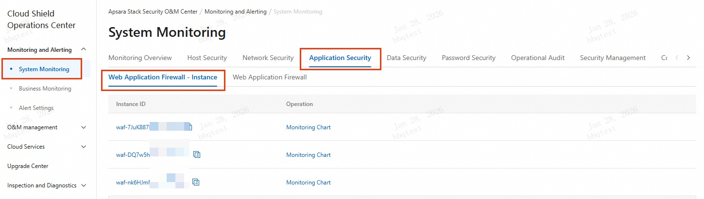
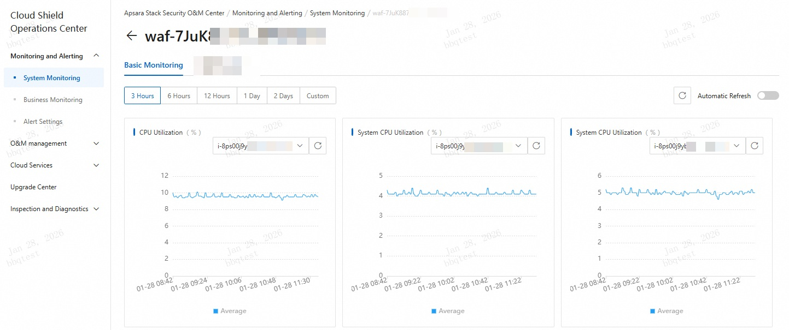

Alibaba Cloud  
Apsara Stack  
Alibaba Cloud Security-Web  
Application Firewall (WAF)  
Web Application Firewall-  
Instance Operations and  
Maintenance Guide  
Product Version: v3.18.6-2607  
Document Version: 20260828

**Table of Contents**

- [1.Log on to Cloud Shield Operations Center](#section-1)
- [2.Instance management](#section-2)
- [3.Rule management](#section-3)
- [4.Metrics](#section-4)

# 1.Log on to Cloud Shield Operations Center

Cloud Shield Operations Center is an operations platform for Apsara Stack Security services. The platform monitors the status and workloads of Apsara Stack Security services in real time and sends alert notifications to users. This topic describes how to log on to Cloud Shield Operations Center.

**Prerequisites**

- The endpoint of the Apsara Uni-manager Operations Console and the username and password that are used to log in to the console are obtained from a deployment engineer or an administrator.

  The endpoint of the Apsara Uni-manager Operations Console is in the following format: *regi on-id*.ops.console.*intranet-domain-id*.

- A supported browser is used. We recommend that you use Google Chrome.

**Procedure**

1. Open your browser.

2. In the address bar, enter the endpoint of the Apsara Uni-manager Operations Console. Press the ENTER key.

   

   > **Note**
   >
   > You can click the current language in the upper-right corner to switch to another language. Simplified Chinese and English are supported.

3. Enter your username and password.

   > **Note**
   >
   > - Obtain the username and password that are used to log on to the Apsara Uni-manager Operations Console from a deployment engineer or an administrator.
   >
   > - If you enter an invalid password for three consecutive times, the system enables the image verification logon feature. If you enter an invalid password for five consecutive times, the account is locked. Contact the administrator to unlock the account.
   >
   > - The first time that you log on to the Apsara Uni-manager Operations Console, change the password for your username as prompted.
   >
   >   To enhance security, your password must meet the following requirements:
   >
   >   - The password contains uppercase and lowercase letters.
   >
   >   - The password contains digits.
   >
   >   - The password contains at least one of the following special characters: ! @ # $ %
   >
   >   - The password is 10 to 20 characters in length.

4. Click **Agree to Private Policy and Log On**.

5. In the top navigation bar, choose **Product Operation > Security O&M > Cloud Shield Operations Center**.

**View execution results**

You can view information on the pages of **Cloud Shield Operations Center**.

# 2.Instance management

This topic describes how to upgrade a Web Application Firewall (WAF) instance and how to view the version and status of the WAF instance.

**View the version and status of a WAF instance**

1. Log in to the Cloud Shield Operations Center console.

2. In the left-side navigation pane, choose **Cloud Services > WAF Instance Management > WAF Instance Management**.

3. In the instance list, view the following information about an instance: **Current Version**, **Latest Version**, **Instance Status**, **Upgrade Time**, and **Last Operation Time**.

   The Instance Status column displays the status of a WAF instance after you create, release, scale out, scale in, or upgrade the WAF instance, and change the VPC.

**Upgrade a WAF instance**

You can perform an upgrade operation to upgrade a WAF instance to the latest version.

1. Log in to the Cloud Shield Operations Center console.

2. In the left-side navigation pane, choose **Cloud Services > WAF Instance Management > WAF Instance Management**.

3. In the instance list, find the WAF instance that you want to upgrade and click **Upgrade** in the **Operation** column.

4. In the message that appears, confirm the information and click **OK**.

   You can also select multiple WAF instances and click **Batch Upgrade** in the lower part of the page.

# 3.Rule management

You can create custom Web Application Firewall (WAF) rules based on your business requirements and network environment to monitor the operations of WAF. This topic describes how to create and manage WAF rules.

**Procedure**

> **Important**
>
> Global custom rules take effect on all instances. Proceed with caution.

1. Log in to the Cloud Shield Operations Center console.

2. In the left-side navigation pane, choose **Cloud Services > WAF Instance Management > Rules**.

3. On the **Rules** page, click **Create Rule**. In the panel that appears, configure the following parameters and click **OK**.

   | Parameter | Description |
   | --- | --- |
   | Effective Scope | Select the level-1 organization where the rule takes effect. You can select multiple or all organizations. |
   | Mode | The handling action and status of the rule. • You can set the handling action to <strong>Block</strong>, <strong>Allow</strong>, <strong>Monitor</strong>, or <strong>Detection</strong> <strong>Module Control</strong>. • You can set the status to <strong>Enable</strong> or <strong>Disable</strong>. |
   | Description | The description of the rule. |
   | Severity | The level of the severity. Valid values: <strong>No Threat</strong>, <strong>Low</strong>, <strong>Moderate</strong>, and <strong>Important</strong>. |
   | Match Condition | The match condition of the rule. Each match condition consists of a match field, a logical operator, and a match value. |
   | Logging | Specifies whether to record logs. Valid values: • Perform Logging When Match Condition Is Met • Do not Perform Logging When Match Condition Is Met |
   | Attack Type | The type of attacks that you want the rule to detect. You can select only one option. |
   | Blocking Status Code | The status code that is returned. You can select only one option. |
   | Expire At | The expiration time of the rule. If you do not specify an expiration time, the rule never expires. |

   After you create a custom rule, you can perform the following operations on the rule:

   - In the upper part of the page, specify **Mode**, **Severity**, and **Status** to filter custom rules.

   - Find the rule that you want to manage and click **Edit** in the **Actions** column to modify the information about the rule.

   - Select multiple rules, click **More operations** in the upper part of the page, and then select Enable Rule, Disable Rule, or Delete Rule to enable, disable, or delete the rules, respectively, at a time.

# 4.Metrics

This topic describes how to view the metrics of instance-based Web Application Firewall (WAF).

**System metrics**

1. Log in to the Cloud Shield Operations Center.

2. In the left-side navigation pane, choose **Monitoring and Alerting > System Monitoring**.

   - Monitoring Overview: The **Monitoring Overview** tab displays the information of services provided by Apsara Stack Security, including the service name, description, number of metrics, number of abnormal metrics, and service status.

   - **System Monitoring** of instance-based WAF: Go to the **Application Security > Web Application Firewall - Instance** tab, and click the ID of an instance or click **Monitoring Chart** in the **Operation** column.

     

   - **Basic Monitoring** of instance-based WAF: On this tab, you can view the trend of changes in CPU utilization, system mode CPU utilization, user mode CPU utilization, memory utilization, system loads, disk usage, inbound and outbound traffic, number of TCP connections, and process data.

     

     You can select or specify a time range. You can also click the Refresh icon to manually update the monitoring data or enable Automatic Refresh. In each chart, you can select the Elastic Compute Service (ECS) instance you want to view.

**References**

For more information about the metrics of instance-based WAF, go to the **Web Application Firewall** page in **Cloud MonitorCloud Resource Monitoring > Cloud Service Monitoring > Security**.
