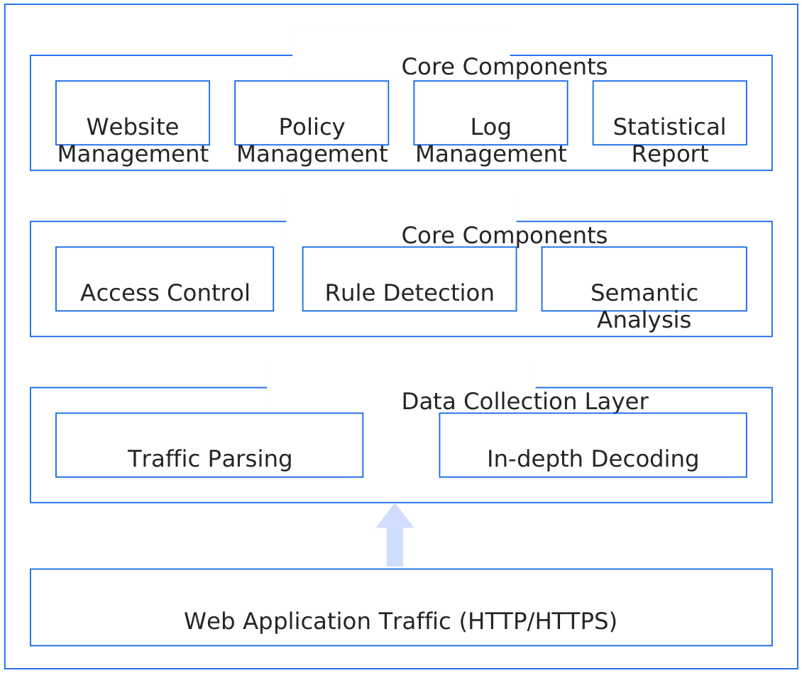

Alibaba Cloud  
Apsara Stack  
Alibaba Cloud Security-Web  
Application Firewall (WAF)  
Web Application Firewall-  
Instance Product Introduction  
Product Version: v3.18.6-2607  
Document Version: 20260831

**Table of Contents**

- [1.What is Web Application Firewall - Instance？](#section-1)
- [2.Functions and features](#section-2)
- [3.Service architecture](#section-3)
- [4.Common scenarios](#section-4)

# 1.What is Web Application Firewall - Instance？

Web Application Firewall (WAF) - Instance is a new WAF architecture derived from the original physical machine architecture. WAF - Instance is deployed with Elastic Compute Service (ECS) resources and can implement quick auto scaling based on the existing ECS resources to meet the requirements of different customers.

Both WAF - Instance and WAF defend against common attacks defined by Open Web Application Security Project (OWASP), including SQL injections, cross-site scripting (XSS) attacks, common web server plug-in vulnerabilities, trojan uploads, and unauthorized access to core resources. Both WAF - Instance and WAF filter out numerous malicious access attempts to prevent data leaks of website assets and ensure website security and availability.

Apsara Stack WAF reconstructs its capabilities based on algorithm innovation. It releases the intelligent semantic analysis engine to identify web attacks. This is equivalent to building an intelligent brain into WAF and allows WAF to independently identify attack behavior. WAF also uses learning models to continuously enhance the analysis capabilities of the brain. This way, WAF can meet the daily protection requirements of users without relying on traditional rule libraries. WAF - Instance provides the following core features:

- **Intelligent detection of attack behavior**

  WAF - Instance provides an intelligent detection engine to detect all OWASP attacks without relying on traditional rule libraries. The engine can intelligently identify and analyze HTTP and HTTPS traffic to detect and block security threats.

- **Web access control**

  WAF - Instance supports flexible access control through a built-in access control engine, which collects statistics on client access behavior by IP address and session. Users can configure throttling policies by domain name or URL, and IP address blocklist and allowlist policies to manage access from specific sources.

# 2.Functions and features

The Web Application Firewall defends against malicious application attacks and secures access for internet users on mobile devices and PCs.

**Level-1**

**Level-2**

**Feature description**

**feature**

**feature**

The system provides protection statistics for the last 24 hours and the last 30 days, including:

- A geographic distribution map of attackers by China and global dimensions

- The total number of requests proxied by WAF

- The total number of attacks

Protection overview

- The total number of blocked requests

- The IP addresses that launched the most attacks, with statistics across three dimensions: request volume, attack volume, and block volume

- The top 5 attack types by distribution

- The top 5 most attacked sites

The system displays the top 100 access requests in real time. It provides combined dimension information including IP address,

Access status

session, site address, URL, request count within 30 seconds, and

Statistics

monitoring

average response time, and refreshes the access request information every 5 seconds.

The system supports exporting daily reports, weekly reports, and scheduled job reports for all sites or specified sites. Report content

Protection

includes access request volume trends, most accessed sites, most

report export

accessed IP addresses, Web Attack volume trends, attack type distribution, domestic attack IP distribution, global attack IP distribution, and block volume trends.

Attack

The system provides attack detection statistics, including the top 100

detection

attack sources and statistics on attacked destination IP addresses such

statistics

as occurrence counts and attack times.

Traffic trend

Query QPS traffic trends by site.

chart

- The system provides HTTP Flood protection logs. The log list displays log records that match HTTP Flood rules, including the request URL,

HTTP Flood

the matched HTTP Flood rule name, and the match time.

protection

- The system provides a Conditional Query feature for HTTP Flood

logs

protection logs. You can filter logs by event generation time and HTTP Flood rule name.

The system provides attack detection logs. The attack detection log list displays the processing result, attacked address, attack type, attacker IP address, and attack time for each attack. For each attack log entry, you can view log details, including the attack risk level, decoding method, decoded attack payload, and HTTP request field information. If the system identifies a false positive, you can click the Eliminate

Attack

False Positive button to generate a Whitelist entry with one click. The

detection logs

system provides a Conditional Query feature for attack detection logs. You can filter logs by various conditions and condition combinations such as attack type, Source IP, and event generation time. You can also create local export tasks in JSON or CSV format for selected logs

Protectio

and download the log files to your local device from the log download

n logs

management page.

Log download

Manage asynchronous log download tasks for attack detection logs.

management

System

The system provides Operation Log entries, including username,

Operation Log

specific operation, and IP address.

After you specify an IP address, the system queries the rule match

IP query

status for that IP address, such as the matched rule type (HTTP Flood or attack detection log) and attack details.

The system provides Access Log entries for your business, including

Access Log

the request Endpoint, Destination IP, Source IP, request method, and Status Code.

- The system supports access frequency control rules for Domain Name and URL targets. These rules implement Access Control for violating IP addresses and sessions, and apply access frequency limits or blocks to IP addresses or sessions that meet specific

HTTP Flood

conditions or are already known.

protection

- The system supports an HTTP Flood Whitelist feature. Users (IP addresses or sessions) in the HTTP Flood Whitelist are exempt from HTTP Flood protection rules.

The system integrates Threat intelligence from the internet to help

Threat

enterprises better observe suspicious requests from the internet,

intelligence

develop more targeted protection policies, and effectively defend against attacks.

Global Custom

View policies defined by the global administrator.

Rule

- The system supports multiple decoding methods, including URL decoding, JSON parsing, Base64 decoding, hexadecimal conversion, backslash unescaping, XML parsing, PHP serialized object parsing, and UTF-7 decoding.

- The system supports the following detection modules: SQL injection detection, XSS detection, threat intelligence, CSRF detection, SSRF detection, PHP deserialization detection, Java deserialization detection, ASP code injection detection, file inclusion attack detection, file upload attack detection, PHP code injection detection, command injection detection, bot crawler detection, and server response detection.

- The system provides five built-in protection Template modes:

  - Default protection policy

  - Observation Mode

Attack protection

- Anti-DDoS mode

policies

- Financial customers

- Internet customers

You can customize the decoding algorithms in the templates, and enable or disable individual attack detection modules or set the detection granularity for each module.

- The system supports custom block response Status Code values.

- The system supports enabling HTTP response detection and setting the response body detection length.

- The system supports setting the HTTP Request Body detection length.

- The system supports enabling or disabling the detection timeout limit.

Protectio n

The system supports adding, deleting, enabling, and disabling Custom

Configura

Rule entries. Custom rules support four actions: allow, block, observe,

tion

and detection module control. The detection module control action enables fine-grained WAF protection module configuration for specific HTTP requests. You can implement fine-grained HTTP Access Control for sites based on conditions and condition combinations including URI,

Custom Rule

GET parameters, decoded path, HOST header, full cookie, POST parameters, full body, HTTP Status Code, response content, and user IP address. The user IP condition supports geographic origin matching rules. The system also supports custom block Status Code values and attack types, and allows you to set the time-to-live for Custom Rule entries.

Certificate

The system supports SSL Certificate management, including uploading

management

Certificate files and SSL Private Key files.

The system supports the Web Tamper Proofing feature. By configuring Web Tamper Proofing rules, you can protect specified site pages and prevent critical site page content from unauthorized or accidental

Tamper-

tampering. The system supports caching static web resources such as

proofing rules

HTML, SHTML, TXT, JS, CSS, JPG, and PNG files. WAF directly returns cached pages and periodically performs web page tampering detection. When the system detects tampering, it proactively generates an Alert.

- The system protects sites that face the internet and sites that face the VPC internal network.

- The system supports forwarding and protection for HTTP and HTTPS protocols, domain name-based and IP-based forwarding, and any non-standard port.

- Back-to-Origin methods: The system provides three options, including forwarding to business servers, Redirection, and returning specified content.

- Forwarding to business servers: The system supports Weighted Round-Robin, least connections, and source address hashing.

- Origin server protection with three load balancing algorithms: You can configure sites to route Back-to-Origin traffic directly to SLB and ECS Instance resources in a VPC. Business servers do not need to mount public IP addresses, which prevents attackers from obtaining the real IP addresses of business servers and bypassing WAF.

Protected site management

- Health Check: You can configure the Health Check path, response code, and response timeout for business servers.

- Access Log: You can enable Access Log recording for sites. The system supports recording Request Header, Request Body, Response Header, and payload data.

- Protection policies: The system provides built-in default protection templates, observation templates, Anti-DDoS templates, and protection templates for the financial and internet industries.

- The system monitors the status of Back-to-Origin sites and provides status alerts when a Health Check fails for a Back-to-Origin site.

- You can configure the value of the X-Forwarded-For header in HTTP requests.

- You can insert custom header fields into HTTP request and response headers.

The system supports Data Masking for sensitive data in logs, including

Data Masking

ID card numbers, birthdays, bank card numbers, passwords, and other user-defined sensitive data.

The system supports backing up protected sites and related protection

Online backup

policies, Custom Rule entries, Certificate files, and other information.

Instance

You can configure WAF parameters for the instance, including Engine

system

status, Tamper-Proofing switch, port listening, and log download

settings

settings.

System settings

<table>
  <tr>
    <td rowspan="2">System informati on</td>
    <td>Node status</td>
    <td>• Load status: The system displays the CPU Utilization and Memory Utilization of WAF nodes. • Network status: The system displays the read and write Network rates of WAF nodes. • Detection status: The system displays the requests per second and average detection latency of WAF nodes. • Forwarding status: The system displays the CPS and average processing latency of WAF nodes. • Disk status: The system displays the Disk Utilization and total Disk capacity of WAF nodes. • Historical data query: You can query historical system performance data for WAF Destination Node resources, including CPU Utilization, Memory Utilization, Disk Utilization, and Traffic monitoring data.</td>
  </tr>
  <tr>
    <td>System Firmware information</td>
    <td>The system displays the current WAF node name and attack detection Engine Version of the instance.</td>
  </tr>
</table>

# 3.Service architecture

Apsara Stack Web Application Firewall (WAF) receives web access traffic and performs protocol parsing and in-depth decoding on the traffic. Then, WAF calls the semantic analysis and access control engines to analyze traffic and determines whether to allow or block traffic based on the preset policies.

Traditionally, attacks are identified by matching rules that use regular expressions. However, the rules cannot cover all attack payloads that are based on programming languages. As a result, WAF cannot provide protection as expected. Apsara Stack WAF adopts the intelligent semantic analysis algorithm to analyze web requests and responses to identify threats and attacks. The algorithm processes data through four stages: lexical analysis, syntax analysis, semantic analysis, and threat model matching.

A

l

i

A

l

i

A

l

i

Mdl

WAF provides built-in syntax compilers for common programming languages. WAF performs in-depth decoding on HTTP and HTTPS payloads, matches the required compiler based on the type of the identified programming language, and then matches the threat model to obtain a threat level. Next, WAF either allows or blocks the related access requests. Threat detection based on intelligent semantic analysis outperforms rule-based threat detection in terms of detection accuracy and false positive rates.

# 4.Common scenarios

Web Application Firewall (WAF) provides comprehensive web protection for various types of websites, including government, finance, insurance, e-commerce, Online to Offline (O2O), Internet Plus, and gaming websites.

- WAF can be used to prevent sensitive data leaks and improve data security. For example, you can prevent databases from data download or leaks caused by injection attacks and prevent unauthorized URL access and unauthorized access.

- For financial customers, WAF can be used to protect business systems in real time, such as portal websites, online business centers, and online customer service.

- For e-commerce customers, WAF can be used to identify web attacks and ensure website availability. The HTTP flood protection feature of WAF can be used to protect against abnormal access behavior during major events, such as promotion abuse.

- During critical periods, the Strict Protection policy in WAF can be used to enhance system security or create custom rules to proactively defend against zero-day vulnerabilities.
