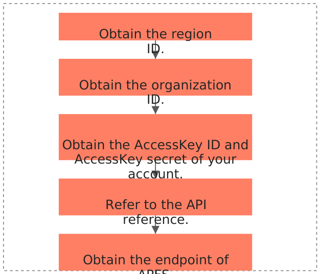
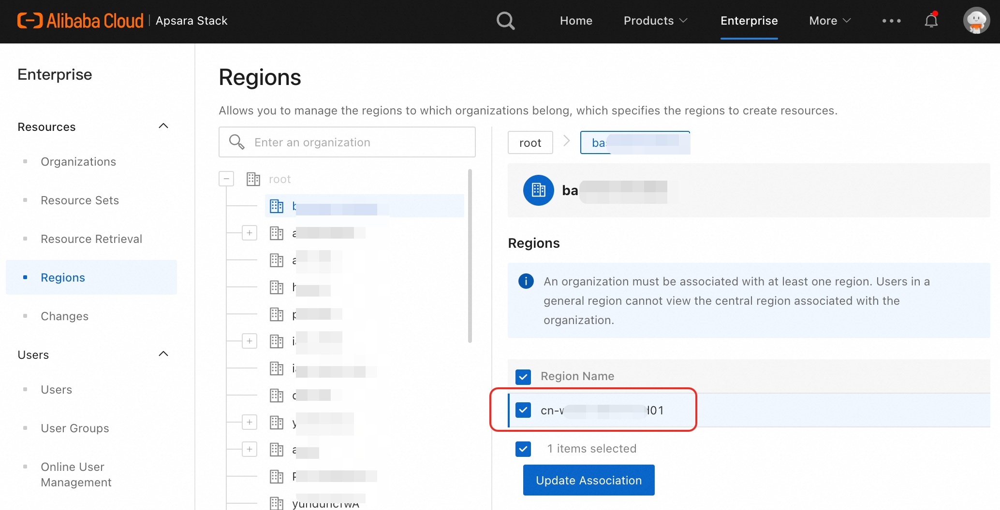
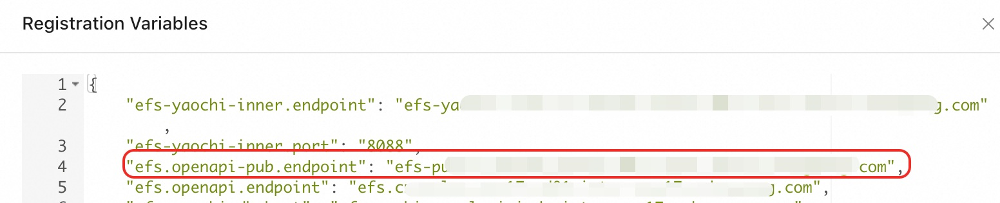

Alibaba Cloud  
Apsara Stack  
ApsaraStack Parallel File  
System Developer Guide  
Product Version: V3.18.6  
Document Version: 20260701

**Table of Contents**

- [1.Usage notes](#section-1)
- [2.Getting Started](#section-2)
    - [2.1. Call an API operation](#section-2-1)
- [3.Preparations](#section-3)
    - [3.1. Obtain an AccessKey pair](#section-3-1)
    - [3.2. Obtain access credentials assigned by STS](#section-3-2)
    - [3.3. Obtain the information about region ID and endpoint](#section-3-3)
    - [3.4. Use POP gateway to call Apsara Stack API operations](#section-3-4)
- [4.Use Apsara Stack SDK for Java](#section-4)
    - [4.1. Get started with Apsara Stack SDK for Java](#section-4-1)
    - [4.2. Use the SDK](#section-4-2)
        - [4.2.1. Install Apsara Stack SDK for Java](#section-4-2-1)
        - [4.2.2. Configure authentication credentials](#section-4-2-2)
        - [4.2.3. Configure connection requests](#section-4-2-3)
        - [4.2.4. Use CommonRequest to call API operations](#section-4-2-4)
        - [4.2.5. Handle errors](#section-4-2-5)
- [5.Use Apsara Stack SDK for Python](#section-5)
    - [5.1. Get started with Apsara Stack SDK for Python](#section-5-1)
    - [5.2. Use the SDK](#section-5-2)
        - [5.2.1. Install Apsara Stack SDK for Python](#section-5-2-1)
        - [5.2.2. Configure authentication credentials](#section-5-2-2)
        - [5.2.3. Configure HTTPS requests](#section-5-2-3)
        - [5.2.4. Use CommonRequest to call API operations](#section-5-2-4)
        - [5.2.5. Handle errors](#section-5-2-5)
- [6.Use Apsara Stack SDK for Go](#section-6)
    - [6.1. Get started with Apsara Stack SDK for Go](#section-6-1)
    - [6.2. Use the SDK](#section-6-2)
        - [6.2.1. Install the core package of Apsara Stack SDK for Go](#section-6-2-1)
        - [6.2.2. Configure authentication credentials](#section-6-2-2)
        - [6.2.3. Use CommonRequest to call API operations](#section-6-2-3)
        - [6.2.4. Handle errors](#section-6-2-4)
- [7.API Reference](#section-7)
    - [7.1. Call API operations](#section-7-1)
        - [7.1.1. Overview](#section-7-1-1)
        - [7.1.2. Request structure](#section-7-1-2)
        - [7.1.3. API authorization](#section-7-1-3)
        - [7.1.4. Responses](#section-7-1-4)
    - [7.2. RAM authentication](#section-7-2)
    - [7.3. Common parameters](#section-7-3)
    - [7.4. File system](#section-7-4)
        - [7.4.1. CreateFileSystem](#section-7-4-1)
        - [7.4.2. DeleteFileSystem](#section-7-4-2)
        - [7.4.3. DescribeFileSystems](#section-7-4-3)
        - [7.4.4. ModifyFileSystem](#section-7-4-4)
        - [7.4.5. DescribeZones](#section-7-4-5)
        - [7.4.6. DescribeImportJobs](#section-7-4-6)
        - [7.4.7. DeleteImportJob](#section-7-4-7)
        - [7.4.8. CreateImportJob](#section-7-4-8)
        - [7.4.9. CreateBackupPlan](#section-7-4-9)
        - [7.4.10. ControlReplicaTask](#section-7-4-10)
        - [7.4.11. ControlImportJob](#section-7-4-11)

<a id="section-1"></a>

# 1.Usage notes

If you call an API operation to use a feature of ApsaraStack Parallel File System (APFS), you must specify a service name and an API version. The service name and API version vary depending on the feature that you want to use.

To use a file system feature of APFS, call the corresponding API operation by using the Portable OpenAPI Proxy (POP) SDK. When you use the POP SDK to call the corresponding API operation, specify EFS as the service name and 2017-06-26 as the API version.

The following figure shows how to use the POP SDK to call an API operation.




Make pre

APFS.


Make API c

<a id="section-2"></a>

# 2.Getting Started

<a id="section-2-1"></a>

## 2.1. Call an API operation

You can use the Portable OpenAPI Proxy (POP) gateway or Apsara Stack API (ASAPI) gateway to call Apsara Stack API operations. As of Apsara Stack Enterprise V3.16.0, the POP gateway is used by default to ensure that user experience is the same as that in the Alibaba Cloud public cloud. This topic describes how to use the POP gateway to call Apsara Stack API operations.

> **Note**
>
> You can still call API operations using the ASAPI gateway if you are using an earlier version of Apsara Stack Enterprise.

**Flowchart**


Make pre

APFS.


Make API c

**Procedure**

1. Obtain the access credential.

   Obtain the AccessKey pair that is required to call an API operation. For more information, see Obtain access credentials assigned by RAM or Obtain access credentials assigned by STS.

   > **Note**
   >
   > We recommend that you use the AccessKey pair of a personal account assigned by Resource Access Management (RAM) or an access credential assigned by Security Token Service (STS) to call the API operations of the Apsara Uni-manager Management Console and Apsara Stack services.

2. Obtain the region ID.

   Obtain the required RegionID parameter. For more information, see Obtain RegionID and Endpoint information.

3. Obtain the organization ID and resource set ID.

   You must call an API operation to obtain an organization ID. For more information, see *GetO rganizationList* in *Apsara Uni-manager Management Console Developer Guide*.

   You must call an API operation to obtain a resource set ID. For more information, see *ListRe sourceGroup* in *Apsara Uni-manager Management Console Developer Guide*.

   > **Note**
   >
   > When you call an API operation, set the  `<x-acs-organizationid>`  header to the organization ID that you obtained, and set the  `<x-acs-resourcegroupid>`  header to the resource set ID that you obtained. This way, you can query resources in the specified organization and resource set.
   >
   > - If you do not specify the  `<x-acs-organizationid>`  header, the organization to which the current user belongs is used by default.
   >
   > - If you do not specify the  `<x-acs-resourcegroupid>`  header, this header is left empty by default. If you specify a resource set ID, you must also specify an organization ID.

4. You can refer to the API reference document.

   Obtain the developer guide of the Apsara Stack service that you want to use. You can learn the features of API operations and how to call the API operations.

5. Obtain the endpoint of the Apsara Stack service.

   For more information about how to obtain an Endpoint, see Obtain RegionID and Endpoint information.

6. Obtain the SDK of the Apsara Stack service and call an API operation.

<a id="section-3"></a>

# 3.Preparations

<a id="section-3-1"></a>

## 3.1. Obtain an AccessKey pair

Access credentials are assigned by Resource Access Management (RAM) or Security Token Service (STS). You can use one type of access credential for authentication when you call an API operation. This topic describes how to obtain an AccessKey pair that is assigned by RAM.

**Background information**

An AccessKey pair is used to verify the identity of a request sender. An AccessKey pair consists of an AccessKey ID and an AccessKey secret that are used to implement symmetric encryption. The AccessKey ID is used to identify a user. The AccessKey secret is a string that is used to encrypt a signature.

AccessKey credentials can be assigned by RAM or STS:

- RAM: assigns an AccessKey pair that consists of an AccessKey ID and an AccessKey secret.

- STS: assigns an access credential that consists of an AccessKey ID, an AccessKey secret, and a security token. For more information, see Obtain access credentials assigned by STS.

The Apsara Uni-manager Management Console provides AccessKey pairs for personal accounts and organizations. Only operations administrators and the administrators of level-1 organizations can obtain the AccessKey pairs of organizations. We recommend that you use the AccessKey pairs of a personal account to call the API operations provided by the Apsara Uni-manager Management Console and Apsara Stack services. If you use the AccessKey pair of a personal account, configure the header parameters that are described in the following table for access control. Otherwise, an error that indicates insufficient permissions may occur.

> **Warning**
>
> The AccessKey pair of a personal account is managed and controlled by the permission system of the Apsara Uni-manager Management Console. If you need to obtain the AccessKey pair of an organization, make sure that your operation is authorized by an administrator. This ensures security.

| Parameter | Description |
| --- | --- |
| x-acs-regionid | The region ID. Example: cn-hangzhou-\*. |
| x-acs-organizationid | The organization ID in the Apsara Uni-manager Management Console. For more information about how to obtain an organization ID, see <em>GetOrganizationList</em> in <em>Apsara Uni-manager</em> <em>Management Console Developer Guide</em>. |
| x-acs-resourcegroupid | The resource set ID in the Apsara Uni-manager Management Console. For information about how to obtain a resource set ID, see <em>ListResourceGroup</em> in <em>Apsara Uni-manager</em> <em>Management Console Developer Guide</em>. |
| x-acs-instanceid | The ID of the instance on which you want to perform the operation. For example, you can use the ID of an Elastic Compute Service (ECS) instance obtained from the ECS instance list. |

**Obtain the AccessKey pair of a personal account**

To obtain the AccessKey pair of a personal account, perform the following operations:

1. Log on to the Apsara Uni-manager Management Console.

2. In the upper-right corner of the homepage, click the profile picture, and then click **User Information**.

3. In the **AccessKey Pair** section, view the AccessKey pair of your account.

   > **Note**
   >
   > The AccessKey pair provides full permissions on cloud resources within your Apsara Stack tenant account. You must store the AccessKey pair in a secure location.

**Obtain the AccessKey pair of an organization**

To obtain the AccessKey pair of an organization, perform the following operations:

1. Log on to the Apsara Uni-manager Management Console as an administrator.

2. In the top navigation bar, click **Enterprise**.

3. In the left-side navigation pane, choose .

4. In the Organization Structure section, click the name of the level-1 organization whose AccessKey pair you want to obtain.

5. Click **Manage AccessKey Pairs** on the right side of the page.

6. You can view the AccessKey pair of the organization in the message that appears.

<a id="section-3-2"></a>

## 3.2. Obtain access credentials assigned by STS

This topic describes how to use Security Token Service (STS) to call API operations of ApsaraStack Parallel File System (APFS).

**Background information**

Apsara Stack STS allows you to manage temporary access credentials for your Apsara Stack resources. You can use STS to call Apsara Stack API operations.

When you use STS to call Apsara Stack API operations, you must specify an AccessKey ID, an AccessKey secret, and a security token, which form an access credential assigned by STS.

**Procedure**

1. Obtain the Apsara Stack Resource Name (ARN) of your  `Resource Access Management (RAM) role` .

   <ol type="i">

   <li>

   Log on to the Apsara Uni-manager Management Console.

   </li>

   <li>

   In the upper-right corner of the homepage, click the profile picture, and then click **User**

   </li>

   </ol>

   **Information**.

   <ol type="i" start="3">

   <li>

   On the page that appears, click **View Current Role Policy**.

   </li>

   </ol>

   In the **View Policies of Current Role** dialog box, view the ARN of your  `RAM Role` .

2. Obtain the access credential assigned by STS.

   > **Note**
   >
   > Replace the variables in the following sample code with actual values. Remove the angle brackets (<>) from the final code.
   >
   > The following section describes the variables:
   >
   > - &lt;yourRegionID>: Replace this variable with your region ID.
   >
   > - &lt;yourAccessKeyID>: Replace this variable with your AccessKey ID.
   >
   > - &lt;yourAccessKeySecret>: Replace this variable with your AccessKey secret.
   >
   > - &lt;yourRoleSessionName>: Replace this variable with the name of the current session.
   >
   > - &lt;yourRoleArn>: Replace this variable with the ARN of your RAM role.
   >
   > - &lt;sts.aliyuns.com>: Replace this variable with the STS endpoint.

   ```xml
   public static void main(String[] args) {
       // Create a DefaultAcsClient instance and initialize it. 
       // Replace <yourRegionID>, <yourAccessKeyID>, and <yourAccessKeySecret> with yourregion ID, AccessKey ID, and AccessKey secret. 
       DefaultProfile profile = DefaultProfile.getProfile("<yourRegionID>", "
   <yourAccessKeyID>", "<yourAccessKeySecret>");
       HttpClientConfig clientConfig = HttpClientConfig.getDefault();
       clientConfig.setIgnoreSSLCerts(true);
       clientConfig.setProtocolType(ProtocolType.HTTPS);
       profile.setHttpClientConfig(clientConfig);
       IAcsClient client = new DefaultAcsClient(profile);
       String assumeRole = callAssumeRole(client);
       if (StringUtils.isEmpty(assumeRole)) return;
       JSONObject assumeRoleJson = JSONObject.parseObject(assumeRole);
       JSONObject credentials = assumeRoleJson.getJSONObject("Credentials");
       // Obtain the access credential assigned by STS. 
       String stsAK = credentials.getString("AccessKeyId");
       String stsSK = credentials.getString("AccessKeySecret");
       String stsToken = credentials.getString("SecurityToken");
   }

   private static String callAssumeRole(IAcsClient client) {
       CommonRequest request = new CommonRequest();
       // Replace sts.aliyuns.com with the actual endpoint of STS. The endpoint of STS is in the sts-vpc.${global:region}.${global:internet-domain} format. 
       request.setSysDomain("sts.aliyuns.com");
       request.setSysProduct("Sts");
       request.setSysAction("AssumeRole");
       request.setSysVersion("2015-04-01");
       request.setSysMethod(MethodType.POST);
       request.setHttpContentType(FormatType.FORM);
       // Replace <yourRoleSessionName> with the name of the current session. 
       request.putQueryParameter("RoleSessionName", "<yourRoleSessionName>");
       // Replace <yourRoleArn> with the ARN of the RAM role that you obtained in the preceding step. 
       request.putQueryParameter("RoleArn", "<yourRoleArn>");
       try {
           CommonResponse response = client.getCommonResponse(request);
           return response.getData();
       } catch (ServerException e) {
           System.out.println(e.getErrCode());
           System.out.println(e.getErrMsg());
       } catch (ClientException e) {
           System.out.println(e.getErrCode());
           System.out.println(e.getErrMsg());
       }
       return null;
   }
   ```

3. Use the access credential assigned by STS to call an operation of a service.

   > **Note**
   >
   > Replace the variables in the following sample code with actual values. Remove the angle brackets (<>) from the final code.

<a id="section-3-3"></a>

## 3.3. Obtain the information about region ID and endpoint

This topic describes how to obtain the information about region ID and endpoint.

**Obtain the region ID**

1. Log on to the Apsara Uni-manager Management Console.

2. In the top navigation bar, click **Enterprise**.

3. In the left-side navigation pane, choose **Resources > Regions**.

4. On the Regions page, enter an organization name in the search box to search for the organization. Click the name of the organization to view its region ID.

   

**Obtain the endpoint**

1. Log on to the Apsara Uni-manager Operations Console.

2. In the top navigation bar, choose **Platform Operation > Apsara Infrastructure Management > O&M Tools**.

3. In the left-side navigation pane, select O&M Tools > Service Registration Variable Dashboard. On the **Service Registration Variable Dashboard** page, select **Service** and enter **efs-yaochi** in the search box.

4. Find the service that you want to manage, click the  icon in the **Service Registration**

   column.

5. In the **Registration Variables** message, the value of the **efs.openapi-pub.endpoint** parameter is the endpoint of the APFS file system.

   

<a id="section-3-4"></a>

## 3.4. Use POP gateway to call Apsara Stack API operations

Before you use the Portable OpenAPI Proxy (POP) gateway and Apsara Stack SDK for Java to call API operations to access the endpoint of ApsaraStack Parallel File System (APFS), you must familiarize yourself with the remote procedure call (RPC) or resource-oriented architecture (ROA) call style.

**Prerequisites**

Apsara Stack recommends that you use CommonRequest to make API calls. You can download V1.0 of the SDK from the SDK Center.

**Use CommonRequest to call API operations**

The following sample code shows how to call an RPC API operation. This example calls the DescribeFileSystems operation of EFS. The API version used is 2017-06-26.

Sample code:

```java
import com.aliyuncs.CommonRequest;
import com.aliyuncs.CommonResponse;
import com.aliyuncs.DefaultAcsClient;
import com.aliyuncs.IAcsClient;
import com.aliyuncs.exceptions.ClientException;
import com.aliyuncs.exceptions.ServerException;
import com.aliyuncs.http.HttpClientConfig;
import com.aliyuncs.http.ProtocolType;
import com.aliyuncs.profile.DefaultProfile;
public class Sample {
    public static void main(String[] args) {
        // Create and initialize a DefaultAcsClient instance.
        DefaultProfile profile = DefaultProfile.getProfile(
            "<yourRegionID>",          // Replace with your actual region ID.
            "<yourAccessKeyID>",      // Replace with your actual AccessKey ID.
            "<yourAccessKeySecret>"); // Replace with your actual AccessKey secret.
        // Set the endpoint for the current product. Replace the variable with your actual value. 
        profile.addEndpoint("<Endpoint>");
        HttpClientConfig clientConfig = HttpClientConfig.getDefault();        
        clientConfig.setProtocolType(ProtocolType.HTTP); 
        /** Optional: Set a proxy. Replace with the proxy IP address and port.
        clientConfig.setHttpProxy("<http://192.168.XX.XX:33XX>");
        or
        clientConfig.setHttpsProxy("<https://192.168.XX:33XX>");
        Replace with the actual proxy IP address and port.
        */
        profile.setHttpClientConfig(clientConfig);
        IAcsClient client = new DefaultAcsClient(profile);
        // Create an API request and set its parameters.
        CommonRequest request = new CommonRequest();
        // Replace with the actual product domain name.
        request.setDomain("<Endpoint>");
        request.setSysProduct("EFS");
        request.setVersion("2017-06-26");
        request.setAction("CreateFileSystem");
        request.putQueryParameter("PageNumber", "1");
        request.putQueryParameter("PageSize", "30");
        request.putHeadParameter("x-acs-resourcegroupid", "<yourResourceGroupID>");// Optional. Replace with your actual resource group ID.
        request.putHeadParameter("x-acs-organizationid", "<yourOrganizationID>");// Required. Replace with your actual organization ID.
        request.putHeadParameter("x-acs-caller-sdk-source","ApiTestDemo");// Required. 
A description of the call source.
        request.putHeadParameter("x-acs-regionid", "<yourRegionID>");// Optional. 
Required for Apsara Stack Enterprise V3.15.0 or earlier. Replace with your actual region ID.
        // request.putHeadParameter("x-acs-instanceid", "<yourInstanceID>");// 
Optional. Required to modify, delete, or query the details of a single instance. Replace with your actual instance ID.
        /** 
        If you use a Security Token Service (STS) AccessKey to call an API, you must add the SecurityToken field.
        Method:
        request.putQueryParameter("SecurityToken", "<yourSecurityToken>");
        Replace with your actual token.
        */
        try {
            CommonResponse response = client.getCommonResponse(request);
            System.out.println(response.getData());
        } catch (ServerException e) {
            // TODO Auto-generated catch block
            e.printStackTrace();
        } catch (ClientException e) {
            // TODO Auto-generated catch block
            e.printStackTrace();
        }
    }
}
```

> **Important**
>
> By default, if you send API requests over HTTPS, the SDK enables certificate verification to verify the validity of SSL/TLS certificates. If no certificate is configured in the development environment, an error that indicates the certificate verification fails is reported.
>
> To ensure communication security in the production environment, we recommend that you enable certificate verification. If certificate verification must be disabled in the test environment, you can configure the following setting:
>
> ```text
> HttpClientConfig clientConfig = HttpClientConfig.getDefault();
> // Disable server certificate verification.
> clientConfig.setIgnoreSSLCerts(true)
> ```

<a id="section-4"></a>

# 4.Use Apsara Stack SDK for Java

This topic describes how to obtain and use Apsara Stack SDK for Java to call API operations.

<a id="section-4-1"></a>

## 4.1. Get started with Apsara Stack SDK for Java

This topic describes how to obtain and use Apsara Stack SDK for Java to call API operations.

**Prerequisites**

- An Apsara Stack tenant account that has the required permissions and an AccessKey pair is obtained. An AccessKey pair consists of an AccessKey ID and an AccessKey secret. For more information, see Obtain an AccessKey pair.

- The endpoint of the corresponding service is obtained. The service varies based on the feature that you want to use. For more information, see Obtain the information and endpoint of an API operation.

- Java Development Kit (JDK) 1.8 or later is installed before you can use Apsara Stack SDK for Java.

**Install Apsara Stack SDK for Java**

If you use Apache Maven to manage a Java project, you need to only import the JAR file of Apsara Stack SDK for Java to the pom.xml file of the project.

To use an SDK of a service, you must install the SDK core library and the SDK. We recommend that you use V4.5.17 or later of the SDK core library. For more information, see Install Apsara Stack SDK for Java.

**Use Apsara Stack SDK for Java**

To use Apsara Stack SDK for Java, perform the following steps:

1. Create a DefaultAcsClient instance and initiate it.

2. Create an API request and specify the required parameters.

3. Initiate the API request and handle the response or exception.

<a id="section-4-2"></a>

## 4.2. Use the SDK

<a id="section-4-2-1"></a>

### 4.2.1. Install Apsara Stack SDK for Java

This topic describes how to install and use Apsara Stack SDK for Java.

Apsara Stack SDK for Java supports Java Development Kit (JDK) 1.8 and later. You can install Apsara Stack SDK for Java by adding Maven dependencies or downloading the SDK. For more information, visit Alibaba Cloud SDKs.

To use the features of ApsaraStack Parallel File System (APFS), you must install the core library of Apsara Stack SDK for Java. We recommend that you install the core library of version 4.5.17 or later.

```xml
<!-- Alibaba Cloud SDK for Java -->
<dependency>
    <groupId>com.aliyun</groupId>
    <artifactId>aliyun-java-sdk-core</artifactId>
    <version>4.5.17</version>
</dependency>
```

<a id="section-4-2-2"></a>

### 4.2.2. Configure authentication credentials

When you use an Apsara Stack SDK to access Apsara Stack services, you must provide an Apsara Stack tenant account for authentication. This topic describes how to configure authentication credentials.

Apsara Stack SDK for Java supports authentication by using AccessKey pairs. For more information about how to obtain an AccessKey pair, see Obtain access credentials assigned by RAM.

If you want to use your AccessKey pair to access ApsaraStack Parallel File System (APFS), you must specify the AccessKey pair when you initialize the client.

> **Note**
>
> Do not disclose the code that contains your AccessKey pair. For example, do not commit the code to publicly-accessible GitHub projects. Otherwise, your Apsara Stack tenant account may be compromised.

```text
DefaultProfile profile = DefaultProfile.getProfile(
    "<yourRegionID>",          // Replace this variable with your region ID.
    "<yourAccessKeyID>",      // Replace this variable with your AccessKey ID.
    "<yourAccessKeySecret>"); // Replace this variable with your AccessKey secret.
```

> **Note**
>
> Replace the variables in the preceding sample code with actual values. Remove the angle brackets (<>) from the final code.

<a id="section-4-2-3"></a>

### 4.2.3. Configure connection requests

This topic describes how to configure a connection request by using the HttpClientConfig object.

You can use the following code to configure the HttpClientConfig object. We recommend that you select and configure the following parameters based on your business requirements.

> **Note**
>
> Replace the variables in the following sample code with actual values. Remove the angle brackets (<>) from the final code.
>
> The following section describes the variables:
>
> - &lt;readTimeout>: Specify a read timeout period based on your business requirements. Unit: milliseconds.
>
> - &lt;connectionTimeout>: Specify a connection timeout period based on your business requirements. Unit: milliseconds.
>
> - &lt;maxRequestsPerHost>: Specify the maximum number of requests that are supported by each server based on your business requirements. The supported data type is INTEGER.
>
> - &lt;maxRequests>: Specify a maximum number of requests based on your business requirements. The supported data type is INTEGER.
>
> - &lt;http://192.168.XX.XX:33XX>: Replace this variable with the IP address and port number of the proxy that you use.

```text
// Obtain the HttpClientConfig object.
HttpClientConfig clientConfig = HttpClientConfig.getDefault();
// Specify whether to ignore certificates.
clientConfig.setIgnoreSSLCerts(true);
// Optional. Specify a read timeout period. Unit: milliseconds.
clientConfig.setReadTimeoutMillis(<readTimeout>);
// Optional. Specify a connection timeout period. Unit: milliseconds.
clientConfig.setConnectionTimeoutMillis(<connectionTimeout>);
// Optional. Specify the maximum number of requests that are supported by each server. 
The supported data type is INTEGER.
clientConfig.setMaxRequestsPerHost(<maxRequestsPerHost>);
// Optional. Specify the maximum number of requests. The supported data type is INTEGER.
clientConfig.setMaxRequests(<maxRequests>);
// Optional. Specify the protocol type.
clientConfig.setProtocolType(ProtocolType.HTTP);
/** Optional. Specify whether to configure a proxy based on your business requirements. 
Sample code:
clientConfig.setHttpProxy("<http://192.168.XX.XX:33XX>");
Or
clientConfig.setHttpsProxy("<https://192.168.XX.XX:33XX>");
Replace the variable with the IP address and port number of the proxy that you use.
*/
profile.setHttpClientConfig(clientConfig);
```

<a id="section-4-2-4"></a>

### 4.2.4. Use CommonRequest to call API operations

If you want to call an API operation without an SDK or if the request and response of an API operation that you call by using an SDK do not meet your business requirements, you can use CommonRequest to call the API operation. You can use CommonRequest to call all API operations.

**Benefits**

CommonRequest provides the following benefits:

- Lightweight: You only need to download the core package. You do not need to download and install SDKs of Apsara Stack services.

- Easy to use: You can call the newly released API operations of an Apsara Stack service without the need to update the SDK for the service.

- Fast iteration.

**Use CommonRequest to call API operations**

If you want to send a CommonRequest request, you must obtain the values of the following parameters. You can obtain the values of these parameters from Elastic Compute Service (ECS) API references.

- Domain: the endpoint of the service.

- Version: the version of the API in the YYYY-MM-DD format.

  You can obtain the API version from the sections about common parameters in the API references of a specific service.

- Action: the name of the API operation that you want to call.

  You must obtain the value of the  `Action`  parameter and specify the API operation in the  `request.setSysAction("<Action>")`  format.

  For example, if you want to use  `CommonRequest`  to call the  `RunInstances`  operation, you must specify the API operation in the  `request.setSysAction("RunInstances")`  format.

**Example: Call an RPC API operation**

The following sample code provides an example on how to call the DescribeFileSystems operation in ApsaraStack Parallel File System (APFS) to obtain the file system information.

> **Note**
>
> Replace the variables in the following sample code with actual values. Remove the angle brackets (<>) from the final code.
>
> The following section describes the variables:
>
> - &lt;yourRegionID>: Replace this variable with your region ID.
>
> - &lt;yourAccessKeyID>: Replace this variable with your AccessKey ID.
>
> - &lt;yourAccessKeySecret>: Replace this variable with your AccessKey secret.
>
> - &lt;Endpoint>: Replace this variable with the endpoint of the current service.
>
> - &lt;yourSecurityToken>: Replace this variable with your security token.
>
> - &lt;yourResourceGroupID>: Replace this variable with your resource set ID.
>
> - &lt;yourOrganizationID>: Replace this variable with your organization ID.
>
> - &lt;yourInstanceID>: Replace this variable with your instance ID.
>
> - &lt;http://192.168.XX.XX:33XX>: Replace this variable with the IP address and port number of the proxy that you use.

```java
import com.aliyuncs.CommonRequest;
import com.aliyuncs.CommonResponse;
import com.aliyuncs.DefaultAcsClient;
importcomaliyuncsIAcsClient;
import com.aliyuncs.exceptions.ClientException;
import com.aliyuncs.exceptions.ServerException;
import com.aliyuncs.http.HttpClientConfig;
import com.aliyuncs.http.ProtocolType;
import com.aliyuncs.profile.DefaultProfile;
public class Sample {
    public static void main(String[] args) {
        // Create a DefaultAcsClient instance and initialize it. 
        DefaultProfile profile = DefaultProfile.getProfile(
            "<yourRegionID>",          // Replace the variable with your region ID. 
            "<yourAccessKeyID>",      // Replace the variable with your AccessKey ID. 
            "<yourAccessKeySecret>"); // Replace the variable with your AccessKey 
secret. 
        // Specify the endpoint of the service. Replace the variable with the endpoint of the current service.  
        profile.addEndpoint("<Endpoint>");
        HttpClientConfig clientConfig = HttpClientConfig.getDefault();        
        clientConfig.setProtocolType(ProtocolType.HTTP); 
        /** Optional. Specify the IP address and port number of the proxy.
        clientConfig.setHttpProxy("<http://192.168.XX.XX:33XX>");
        Or
        clientConfig.setHttpsProxy("<https://192.168.XX:33XX>");
        Replace the variable with the IP address and port number of the proxy that you use. 
        */
        profile.setHttpClientConfig(clientConfig);
        IAcsClient client = new DefaultAcsClient(profile);
        // Create an API request and specify the required parameters. 
        CommonRequest request = new CommonRequest();
        // Replace the variable with the endpoint of the current service. 
        request.setDomain("<Endpoint>");
        request.setSysProduct("EFS");
        request.setVersion("2017-06-26");
        request.setAction("CreateFileSystem");
        request.putQueryParameter("PageNumber", "1");
        request.putQueryParameter("PageSize", "30");
        request.putHeadParameter("x-acs-resourcegroupid", "<yourResourceGroupID>");// Optional. Replace the variable with your resource set ID. 
        request.putHeadParameter("x-acs-organizationid", "<yourOrganizationID>");// Required. Replace the variable with your organization ID. 
        request.putHeadParameter("x-acs-caller-sdk-source","ApiTestDemo");// Required. 
Specify the source of the API call. 
        request.putHeadParameter("x-acs-regionid", "<yourRegionID>");// Optional. 
Specify the region ID. If you use Apsara Stack Enterprise V3.15.0 or earlier, you must replace <yourRegionID> with the actual region ID. 
        // request.putHeadParameter("x-acs-instanceid", "<yourInstanceID>");// 
Optional. Specify the instance ID. If you want to modify, delete, or view the details of a specific instance, you must replace <yourInstanceID> with the actual instance ID. 
        /** 
        If you use the access credentials assigned by Security Token Service (STS) to call a remote procedure call (RPC) API operation, you must specify the SecurityToken parameter in the request. 
        Specify your security token in the following format:
        request.putQueryParameter("SecurityToken", "<yourSecurityToken>");
        Replace the variable with your security token.
        */
        try {
            CommonResponse response = client.getCommonResponse(request);
            System.out.println(response.getData());
        } catch (ServerException e) {
            // TODO Auto-generated catch block
            e.printStackTrace();
        } catch (ClientException e) {
            // TODO Auto-generated catch block
            e.printStackTrace();
        }
    }
}
```

<a id="section-4-2-5"></a>

### 4.2.5. Handle errors

If an error occurs on the server or SDK when you use the Apsara Stack SDK for Java, an error response is returned. The error response contains an error code and an error message.

In most cases, you do not need to handle the errors returned by the Apsara Stack SDK for Java. You only need to handle the errors returned by the server based on the error messages.

- `ServerException`  indicates a server error.

- `ClientException`  indicates an SDK error.

The following error indicates that the AccessKey ID is invalid. You must specify a valid AccessKey ID.

```text
com.aliyuncs.exceptions.ClientException: InvalidAccessKeyId.NotFound : Specified accesskey is not found.
```

If you want to handle the SDK errors returned by Apsara Stack SDK for Java, refer to the following example to write your code:

```java
try {
    FooResponse response = client.getAcsResponse(request);
    // Handle the response.
    // ...
}catch (ServerException e){
    // Add your computing logic for handling errors.
    // For example, you can display the exception information.
    System.out.println("ErrorCode=" + e.getErrCode());
    System.out.println("ErrorMessage=" + e.getErrMsg());
    // If the error persists, submit a ticket that includes the request ID (RequestId) to request technical support.
    System.out.println("ResponseId=" + e.getRequestId());
}catch (ClientException e){
    // Add your computing logic for handling errors.
    // For example, you can display the exception information.
    System.out.println("ErrorCode=" + e.getErrCode());
    System.out.println("ErrorMessage=" + e.getErrMsg());
}
```

<a id="section-5"></a>

# 5.Use Apsara Stack SDK for Python

<a id="section-5-1"></a>

## 5.1. Get started with Apsara Stack SDK for Python

This topic describes how to obtain and use Apsara Stack SDK for Python to call API operations.

**Prerequisites**

- An Apsara Stack tenant account that has the required permissions and an AccessKey pair are obtained. An AccessKey pair consists of an AccessKey ID and an AccessKey secret. For more information, see Obtain an AccessKey pair.

- The endpoint of the corresponding service is obtained. The service varies based on the feature that you want to use. For more information, see Obtain the information about region ID and endpoint.

**Install the core library of Apsara Stack SDK for Python**

To use the features of ApsaraStack Parallel File System (APFS), you must install the core library of Apsara Stack SDK for Python.

To install Apsara Stack SDK for Python, perform the following steps:

- If you use Python 2.x, run the following command to install the core library of Apsara Stack SDK for Python:

  ```bash
  pip install aliyun-python-sdk-core
  ```

- If you use Python 3.x, run the following command to install the core library of Apsara Stack SDK for Python:

  ```bash
  pip3 install aliyun-python-sdk-core-v3
  ```

**Use Apsara Stack SDK for Python**

To use Apsara Stack SDK for Python, perform the following steps:

1. Create a client instance. When you create the client instance, you must obtain the region ID, AccessKey ID, and AccessKey secret.

2. Create an API request and configure required parameters.

3. Initiate the API request and handle the response or exception.

<a id="section-5-2"></a>

## 5.2. Use the SDK

<a id="section-5-2-1"></a>

### 5.2.1. Install Apsara Stack SDK for Python

This topic describes how to install and use Apsara Stack SDK for Python.

**Background information**

Alibaba Cloud Apsara Stack SDK for Python supports Python 2.6.x, 2.7.x, and 3.x and later. You can install the Apsara Stack SDK for Python by using pip.

> **Note**
>
> To use the SDK for Python of an Apsara Stack service, you must install the core library of Apsara Stack SDK for Python.

**Install the core library of Apsara Stack SDK for Python**

To use the features of ApsaraStack Parallel File System (APFS), you must install the core library of Apsara Stack SDK for Python.

To install Apsara Stack SDK for Python, perform the following steps:

- If you use Python 2.x, run the following command to install the core library of Apsara Stack SDK for Python:

  ```bash
  pip install aliyun-python-sdk-core
  ```

- If you use Python 3.x, run the following command to install the core library of Apsara Stack SDK for Python:

  ```bash
  pip3 install aliyun-python-sdk-core-v3
  ```

<a id="section-5-2-2"></a>

### 5.2.2. Configure authentication credentials

When you use an Apsara Stack SDK to access Apsara Stack services, you must provide an Apsara Stack tenant account for authentication. This topic describes how to configure authentication credentials.

Apsara Stack SDK for Python supports authentication by using AccessKey pairs. For more information about how to obtain an AccessKey pair, see Obtain access credentials assigned by RAM.

If you want to use your AccessKey pair to access ApsaraStack Parallel File System (APFS), you must specify the AccessKey pair when you initialize the client.

> **Note**
>
> Do not disclose the code that contains your AccessKey pair. For example, do not commit the code to publicly-accessible GitHub projects. Otherwise, your Apsara Stack tenant account may be compromised.

```python
from aliyunsdkcore import client
clt = client.AcsClient(access_key, acces_secret, region_id)
```

<a id="section-5-2-3"></a>

### 5.2.3. Configure HTTPS requests

Apsara Stack SDK for Python allows you to initiate API requests over HTTP and HTTPS.

You can specify the HTTP or HTTPS protocol for a specific request, or specify a global default protocol.

> **Note**
>
> The default HTTP or HTTPS protocol of a service takes precedence over the global default protocol.

**Add OpenSSL support**

OpenSSL support in Python is required for sending HTTPS requests by using Apsara Stack SDK for Python. To use Apsara Stack SDK for Python to send HTTPS requests, you must add OpenSSL support in Python. OpenSSL supports TLS 1.2 and later.

Run the  `python -c "import ssl"`  command to check whether your Python environment supports OpenSSL. If the error message

`ImportError: No module named ssl`  does not appear, OpenSSL is supported.

If OpenSSL is not supported, run the following command to install it:

```bash
pip install pyopenssl
```

**Set the protocol to HTTP or HTTPS for a single request**

The following sample code provides an example on how to set HTTPS as the protocol for a request:

```text
request = DescribeInstancesRequest()
request.set_protocol_type("https")
# Set the value to https or http.
```

**Specify a global default protocol**

The following sample code provides an example on how to specify a global default protocol:

```python
import aliyunsdkcore.request
aliyunsdkcore.request.set_default_protocol_type("https")
# Create a request and call client.do_action_with_exception() to send the request.
```

<a id="section-5-2-4"></a>

### 5.2.4. Use CommonRequest to call API operations

If you want to call an ApsaraStack Parallel File System (APFS) API operation without an SDK or if the request and response of an API operation that you call by using an SDK do not meet your business requirements, you can use CommonRequest to call the API operation. You can use CommonRequest to call all API operations.

**Benefits**

CommonRequest provides the following benefits:

- Lightweight: You only need to download the core package. You do not need to download and install SDKs of Apsara Stack services.

- Easy to use: You can call the newly released API operations of a service without the need to update the SDK of the service.

- Fast in iteration.

**Use CommonRequest to call API operations**

If you want to send a CommonRequest request, you must obtain the values of the following parameters. You can obtain the values of these parameters from the API references of a specific service.

- Domain: the endpoint of the service.

- Version: the version of the API in the YYYY-MM-DD format.

  You can obtain the API version from the sections about common parameters in the API references of a specific service.

- Action: the name of the API operation that you want to call.

  You must obtain the value of the  `Action`  parameter and specify the API operation in the  `request.set_action_name('Action')`  format.

  For example, if you want to use  `CommonRequest`  to call the  `RunInstances`  operation, you must specify the API operation in the  `request.set_action_name('RunInstances')`  format.

**Example: Call an RPC API operation**

The following sample code provides an example on how to call the DescribeFileSystems operation in APFS to obtain the file system information.

> **Note**
>
> Replace the variables in the following sample code with actual values. Remove the angle brackets (<>) from the final code.
>
> The following section describes the variables:
>
> - &lt;yourRegionID>: Replace this variable with your region ID.
>
> - &lt;yourAccessKeyID>: Replace this variable with your AccessKey ID.
>
> - &lt;yourAccessKeySecret>: Replace this variable with your AccessKey secret.
>
> - &lt;yourSecurityToken>: Replace this variable with your security token.
>
> - &lt;yourResourceGroupID>: Replace this variable with your resource set ID.
>
> - &lt;yourOrganizationID>: Replace this variable with your organization ID.
>
> - &lt;yourInstanceID>: Replace this variable with your instance ID.
>
> - &lt;Endpoint>: Replace this variable with the endpoint of the current service.

```python
#!/usr/bin/env python
# coding=utf-8
from aliyunsdkcore.client import AcsClient
from aliyunsdkcore.request import CommonRequest
# Replace the variables with your AccessKey ID, AccessKey secret, and region ID. 
client = AcsClient('{<yourAccessKeyID>}', '{<yourAccessKeySecret>}', 
'{<yourRegionID>}')
request = CommonRequest()
request.set_product('EFS')
request.set_action_name('DescribeFileSystems')
request.set_version('2017-06-26')
request.set_domain('<Endpoint>') # Specify the endpoint of the service. Replace the variable with the endpoint of the current service. 
# or:
# request = = CommonRequest(product='EFS', 
action_name='DescribeFileSystems',version='2017-06-26',domain='<Endpoint>')
######
# Specify the request protocol. Valid values: HTTPS and HTTP. Default value: HTTP. 
# You can specify HTTPS as the protocol in the following format:
# request.set_protocol_type('https') 
######
request.set_accept_format('json')
request.set_method('POST')
request.add_query_param('PageNumber', '1')
request.add_query_param('PageSize', '30')
######
# If you use the access credentials assigned by Security Token Service (STS) to call a remote procedure call (RPC) API operation, you must specify the SecurityToken parameterin the request. 
# Specify your security token in the following format:
# request.add_query_param("SecurityToken", "<yourSecurityToken>");
# Replace the variable with your security token. 
######
# Optional. Replace the variable with your resource set ID. 
request.add_header("x-acs-resourcegroupid", "<yourResourceGroupID>")
# Required. Replace the variable with your organization ID. 
request.add_header("x-acs-organizationid", "<yourOrganizationID>")
# Required. Specify the source of the API call. 
request.add_header("x-acs-caller-sdk-source","ApiTestDemo")
# Optional. Specify the region ID. If you use Apsara Stack Enterprise V3.15.0 or earlier, you must replace <yourRegionID> with the actual region ID. 
request.add_header("x-acs-regionid", "<yourRegionID>")
# Optional. Specify the instance ID. If you want to modify, delete, or view the detailsof a specific instance, you must replace <yourInstanceID> with the actual instance ID. 
# request.add_header("x-acs-instanceid", "<yourInstanceID>")

response = client.do_action_with_exception(request)
# python2:  print(response) 
print(str(response, encoding = 'utf-8'))
```

<a id="section-5-2-5"></a>

### 5.2.5. Handle errors

If an error occurs on the server or SDK when you use the Apsara Stack SDK for Python, an error response is returned. The error response contains an error code and an error message.

In most cases, you do not need to handle the errors returned by the Apsara Stack SDK for Python. You only need to handle the errors returned by the server based on the error messages.

- `ServerException`  indicates a server error.

- `ClientException`  indicates an SDK error.

The following error indicates that the AccessKey ID is invalid. You must specify a valid AccessKey ID.

```text
aliyunsdkcore.acs\_exception.exceptions.ServerException: HTTP Status: 404 
Error:InvalidAccessKeyId.NotFound Specified access key is not found.
```

If you want to handle the SDK errors returned by Apsara Stack SDK for Python, refer to the following example to write your code:

```text
try:
    response = client.do_action_with_exception(request)
except ServerException as e:
    // Add your computing logic for handling errors.
    // For example, you can display the exception information.
    print e.get_http_status()
    print e.get_error_code()
    print e.get_error_msg()
```

<a id="section-6"></a>

# 6.Use Apsara Stack SDK for Go

<a id="section-6-1"></a>

## 6.1. Get started with Apsara Stack SDK for Go

Apsara Stack SDK for Go allows you to access services without complex coding. This topic describes how to obtain and use Apsara Stack SDK for Go to call API operations.

**Prerequisites**

- An Apsara Stack tenant account that has the required permissions and an AccessKey pair are obtained. An AccessKey pair consists of an AccessKey ID and an AccessKey secret. For more information, see Obtain an AccessKey pair.

- The endpoint of the corresponding service is obtained. The service varies based on the feature that you want to use. For more information, see Obtain the information and endpoint of an API operation.

**Install the core package of Apsara Stack SDK for Go**

Apsara Stack SDK for Go supports Go 1.10.x and later. You can run the following command to install the core package:

```text
go get -u github.com/aliyun/alibaba-cloud-sdk-go/sdk
```

**Use Apsara Stack SDK for Go**

To use Apsara Stack SDK for Go, perform the following steps:

1. Initialize a client instance.

2. Create an API request and configure the required parameters.

3. Initiate the API request and handle the response or exception.

<a id="section-6-2"></a>

## 6.2. Use the SDK

<a id="section-6-2-1"></a>

### 6.2.1. Install the core package of Apsara Stack SDK for Go

This topic describes how to install the core package of Apsara Stack SDK for Go.

Apsara Stack SDK for Go supports Go 1.10.x and later. You can run the following command to install the core package:

```text
go get -u github.com/aliyun/alibaba-cloud-sdk-go/sdk
```

<a id="section-6-2-2"></a>

### 6.2.2. Configure authentication credentials

When you use an Apsara Stack SDK to access Apsara Stack services, you must provide an Apsara Stack tenant account for authentication. This topic describes how to configure authentication credentials.

Apsara Stack SDK for Go supports authentication by using AccessKey pairs. For more information about how to obtain an AccessKey pair, see Obtain an AccessKey pair.

If you want to use your AccessKey pair to access ApsaraStack Parallel File System (APFS), you must specify the AccessKey pair when you initialize the client.

> **Note**
>
> - Do not disclose the code that contains your AccessKey pair. For example, do not commit the code to publicly-accessible GitHub projects. Otherwise, your Apsara Stack tenant account may be compromised.
>
> - Replace the variables in the sample code with actual values. Remove the angle brackets (<>) from the final code.

**Initialize a client instance**

```text
   client, err := sdk.NewClientWithAccessKey(
        "<yourRegionID>",          // Replace the variable with your region ID. 
        "<yourAccessKeyID>",      // Replace the variable with your AccessKey ID. 
        "<yourAccessKeySecret>") // Replace the variable with your AccessKey secret.
```

<a id="section-6-2-3"></a>

### 6.2.3. Use CommonRequest to call API operations

If you want to call an API operation without an SDK or if the request and response of an API operation that you call by using an SDK do not meet your business requirements, you can use CommonRequest to call the API operation. You can use CommonRequest to call all API operations.

**Benefits**

CommonRequest provides the following benefits:

- Lightweight: You only need to download the core package. You do not need to download and install SDKs of Apsara Stack services.

- Easy to use: You can call the newly released API operations of a service without the need to update the SDK of the service.

- Fast in iteration.

**Use CommonRequest to call API operations**

If you want to send a CommonRequest request, you must obtain the values of the following parameters. You can obtain the values of these parameters from ECS API references.

- Domain: the endpoint of the service.

- Version: the version of the API in the YYYY-MM-DD format.

  You can obtain the API version from the common request parameters in the API references of cloud services.

- Operation information: the name of the API operation that you want to call.

  You must obtain the value of the  `Action`  parameter and specify the API operation in the  `request.setSysAction("<Action>")`  format.

  For example, if you want to use  `CommonRequest`  to call the  `RunInstances`  operation, you must specify the API operation in the  `request.setSysAction("RunInstances")`  format.

**Example: Call an RPC API operation**

The following sample code provides an example on how to call the DescribeDisks operation to query the information about cloud disks.

> **Note**
>
> Replace the variables in the following sample code with actual values. Remove the angle brackets (<>) from the final code.
>
> The following section describes the variables:
>
> - &lt;yourRegionID>: Replace this variable with your region ID.
>
> - &lt;yourAccessKeyID>: Replace this variable with your AccessKey ID.
>
> - &lt;yourAccessKeySecret>: Replace this variable with your AccessKey secret.
>
> - &lt;yourSecurityToken>: Replace this variable with your security token.
>
> - &lt;yourResourceGroupID>: Replace this variable with your resource set ID.
>
> - &lt;yourOrganizationID>: Replace this variable with your organization ID.
>
> - &lt;yourInstanceID>: Replace this variable with your instance ID.
>
> - &lt;Endpoint>: Replace this variable with the endpoint of the current service.

```go
package main
import (
    "github.com/aliyun/alibaba-cloud-sdk-go/sdk/requests"
    "github.com/aliyun/alibaba-cloud-sdk-go/sdk"
    "fmt"
)
func main() {
    client, err := sdk.NewClientWithAccessKey(
        "<yourRegionID>",        // Replace the variable with your region ID. 
        "<yourAccessKeyID>",     // Replace the variable with your AccessKey ID. 
        "<yourAccessKeySecret>") // Replace the variable with your AccessKey secret. 
    if err != nil {
        panic(err)
    }
    request := requests.NewCommonRequest()
    request.Method = "POST"
    request.Domain = "<endpoint>" // Specify the endpoint of the service. Replace the variable with the endpoint of the current service. 
    request.Product = "EFS"
    request.Version = "2017-06-26"
    // This is a remote procedure call (RPC) API operation. Therefore, the ApiName parameter must be set to specify the operation. 
    request.ApiName = "DescribeFileSystems"
    // Specify service-related parameters.
    request.QueryParams["PageNumber"] = "1"
    request.QueryParams["PageSize"] = "30"
    /* 
     If you use the access credentials assigned by Security Token Service (STS) to callan RPC API operation, you must specify the SecurityToken parameter in the request. 
     Specify your security token in the following format:
     request.QueryParams["SecurityToken"]="<yourSecurityToken>"
     Replace the variable with your security token. 
     */
    request.Headers["x-acs-caller-sdk-source"] = "ApiTestDemo" // Required. Specify thesource of the API call. 
    request.Headers["x-acs-regionid"] = "<yourRegionID>" // Optional. Specify the region ID. If you use Apsara Stack Enterprise V3.15.0 or earlier, you must replace <yourRegionID> with the actual region ID. 
    request.Headers["x-acs-resourcegroupid"] = "<yourResourceGroupID>" // Optional. Replace the variable with your resource set ID. 
    request.Headers["x-acs-organizationid"] = "<yourOrganizationID>" // Required. Replace the variable with your organization ID. 
    // request.Headers["x-acs-instanceid"] = "<yourInstanceID>" // Optional. Specify the instance ID. If you want to modify, delete, or view the details of a specific instance, you must replace <yourInstanceID> with the actual instance ID.
     response, err := client.ProcessCommonRequest(request)
    if err != nil {
        panic(err)
    }
    fmt.Print(response.GetHttpContentString())
}
```

<a id="section-6-2-4"></a>

### 6.2.4. Handle errors

When you use Apsara Stack SDK for Go, a  `ClientError`  or a  `ServerError`  is returned if an error occurs on the server side or on the SDK side. Both error types are included in  `sdk.errors` . The errors conform to the standard Go error interface and can be handled in a manner similar to standard Go errors.

**Error handling**

You can use the following code to handle errors:

```text
response,err  := ecsClient.DescribeDisks(request)
if err != nil {
    // Obtain the error information.
   err.Error()
}
```

**ClientError**

After you send a request, if an error occurs on the SDK side and cannot be automatically handled, the SDK returns a  `ClientError` .

The following sample code shows how to identify and obtain the error message in a  `ClientError`  returned by ECS SDK for Go.

> **Note**
>
> If you use a specific error struct, you must add the error package github.com/aliyun/alibaba-cloud-sdk-go/sdk/errors by using the following code:
>
> ```go
> package main
> import (
>     "github.com/aliyun/alibaba-cloud-sdk-go/services/ecs" // Replace ecs with the name of the actual service.
>     "github.com/aliyun/alibaba-cloud-sdk-go/sdk/requests"
>     // The error package that you want to add.
>     "github.com/aliyun/alibaba-cloud-sdk-go/sdk/errors"
>     "fmt"
> )
> ```

```text
response, err := ecsClient.DescribeDisks(request)
if clientError, ok := err.(*errors.ClientError); ok{
    // Obtain the error code. 
    clientError.ErrorCode()
    // Obtain the error message. 
    clientError.Message()
    // Obtain the original error. The return value may be nil. 
    clientError.OriginError()
}
```

**ServerError**

If the server returns an error response, the SDK wraps the response into a  `ServerError`  and returns it to the client. In this case, you can still obtain the original HTTP response from the error response.

The following sample code shows how to determine and obtain the error message in a  `ServerError`  and  `Response`  returned by ECS SDK for Go:

> **Note**
>
> If you use a specific error struct, you must add the error package  `github.com/aliyun/alibaba-cloud-sdk-go/sdk/errors`  by using the following code:
>
> ```text
> import (
>     "github.com/aliyun/alibaba-cloud-sdk-go/services/ecs" // Replace ecs with the name of the actual service. 
>     "github.com/aliyun/alibaba-cloud-sdk-go/sdk/requests"
>     // The error package that you want to add. 
>     "github.com/aliyun/alibaba-cloud-sdk-go/sdk/errors"
>     "fmt"
> )
> ```

```text
response, err := ecsClient.DescribeDisks(request)    
if serverError, ok := err.(*errors.ServerError); ok{
    // Obtain the error code. 
    serverError.ErrorCode()
    // Obtain the error message. 
    serverError.Message()
    // Obtain the original HTTP response. 
    response.GetOriginHttpResponse()
}
```

<a id="section-7"></a>

# 7.API Reference

<a id="section-7-1"></a>

## 7.1. Call API operations

<a id="section-7-1-1"></a>

### 7.1.1. Overview

To call an API operation, you can send an HTTP GET request to the endpoint of the ApsaraStack Parallel File System (APFS) server. You must specify the relevant request parameters in the request based on the operation description. Then, the system returns the processing result of the request. All requests and responses are UTF-8 encoded.

<a id="section-7-1-2"></a>

### 7.1.2. Request structure

**Endpoint**

For more information about how to obtain the endpoint of an Apsara Stack service, see Obtain the information and endpoint of an API operation.

**Request method**

You can call an API operation by sending an HTTP GET request. If you use this method, the request parameters must be included in the request URL.

**Communication protocol**

You can send API requests over HTTP or HTTPS. We recommend that you use HTTPS to improve communication security.

**Request parameters**

In each request, you must set the Action parameter to specify the operation that you want to perform, such as CreateFileSystem. You must also specify the common request parameters and the operation-specific request parameters.

**Encoding**

All requests and responses are UTF-8 encoded.

<a id="section-7-1-3"></a>

### 7.1.3. API authorization

To ensure the security of your Apsara Stack tenant account, we recommend that you use a Resource Access Management (RAM) user to call API operations.

In the RAM console, you can authorize a RAM user to call the following operations on an ApsaraStack Parallel File System (APFS) resource.

| Type | Action name |
| --- | --- |
| File system | • CreateFileSystem<br>• DeleteFileSystem<br>• DescribeFileSystems<br>• ModifyFileSystem<br>• DescribeZones |

<a id="section-7-1-4"></a>

### 7.1.4. Responses

API responses use the HTTP response format. A 2xx status code indicates a successful call, and a 4xx or 5xx status code indicates a failed call.

<a id="section-7-2"></a>

## 7.2. RAM authentication

When you call API operations to access resources within an Apsara Stack tenant account as a Resource Access Management (RAM) user, the system checks whether the RAM user is granted the required permissions.

**Background information**

You can use your Apsara Stack tenant account or a RAM user account to manage your ApsaraStack Parallel File System (APFS) resources by using the APFS console or by calling API operations. However, authorization is required in the following scenarios:

- A RAM user is newly created and does not have permissions to manage resources within the Apsara Stack tenant account.

- You want to access APFS resources from other Alibaba Cloud services or access other Alibaba Cloud services from APFS.

- You want to perform operations on APFS resources that require resource and API operation permissions to be granted by the resource owners.

When an Apsara Stack tenant account requests access to APFS resources within your Apsara Stack tenant account by calling APFS API operations, APFS instructs RAM to perform a permission check to ensure that the requester account is granted the required permissions. APFS determines which resources require a permission check based on the requested resources and API operation syntax.

**Rule details**

The permissions that APFS checks vary based on the resources that are requested by the API operation and the syntax of the API operation.

<a id="section-7-3"></a>

## 7.3. Common parameters

Common parameters include common request parameters, common request headers, and common response parameters.

**Common request parameters**

Common request parameters must be included in all ApsaraStack Parallel File System (APFS) API requests.

Table 1. Common request parameters

| Name | Type | Required | Description |
| --- | --- | --- | --- |
| Format | String | No | The type of the response. Valid value: JSON. |
| Version | String | Yes | The API version number. Enter the version number in the YYYY-MM-DD format. The value is <strong>2017-06-</strong><strong>26</strong>. |
| AccessKeyId | String | Yes | The AccessKey ID provided by Apsara Stack. |
| AccessKeySecret | String | Yes | The AccessKey secret provided by Apsara Stack. |
| RegionId | String | Yes | The ID of the region where the service is accessed. |
| Product | String | Yes | The name of the service to which the API operation belongs. Valid value: EFS. |

**Common request headers**

| Name | Description |
| --- | --- |
| x-acs-organizationid | The organization ID in the Apsara Uni-manager Management Console. For more information, see the Obtain an organization ID section of the Obtain the values of common request headers topic. |
| x-acs-resourcegroupid | The resource set ID in the Apsara Uni-manager Management Console. For more information, see the Obtain a resource set ID section of the Obtain the values of common request headers topic. |
| x-acs-instanceid | The ID of the instance on which you want to perform the operation.For more information, see the Obtain an instance ID section of the Obtain the values of common request headers topic. |

> **Note**
>
> When you call API operations of Apsara Stack services, you must include the values of the **x-acs-instanceid**, **x-acs-organizationid**, and **x-acs-resourcegroupid** parameters in the request header to specify the ID of the instance and the IDs of the organization and resource set to which the instance belongs. If you are creating an instance and querying the instance list, you do not need to specify the ID of the instance. By default, the root organization and root resource set are used if the values of the preceding parameters are not included in the request header when you call API operations.

**Common response parameters**

Responses are returned in the unified format for API requests. The following HTTP status codes indicate different request statuses:

- A 2xx HTTP status code indicates a successful call.

- A 4xx or 5xx HTTP status code indicates that the call failed.

Responses are returned in the JSON format. Each response returns a unique request ID regardless of whether the call is successful.

<a id="section-7-4"></a>

## 7.4. File system

<a id="section-7-4-1"></a>

### 7.4.1. CreateFileSystem

You can call the CreateFileSystem operation to create a file system in ApsaraStack Parallel File System (APFS).

**Request parameters**

| Parameter | Type | Requir ed | Example | Description |
| --- | --- | --- | --- | --- |
| Action | String | Yes | CreateFileSyste m | The operation that you want to perform. If you use a custom HTTP URL or HTTPS URL to make an API request, you must specify the <code> Action </code> parameter. Valid value: CreateFileSystem. |
| RegionId | String | Yes | cn-qingdao-env38-d01 | The ID of the region in which you want to create the file system. You can call the DescribeRegions operation to query the latest list of Alibaba Cloud regions. |
| ZoneId | String | No | cn-qingdao-env38-amtest11001-a | The ID of the zone in which you want to create the file system. This parameter is required. |
| FileSystemType | String | Yes | efs | The type of the file system. Only <code> efs </code> is supported. |
| Capacity | Long | Yes | 20480 | The capacity of the file system. Unit: GiB. The value of this parameter must be greater than 1024 and a multiple of 1024. |
| StorageType | String | Yes | parastor_advanc e_300 | The specification of the file system.The specification corresponds to fscd is fsSpec.<br>Only parastor_advance_300, which indicates a performance APFS file system, is supported. |
| ZoneId | String | Yes | cn-wulan-env38-amtest38001-a | The zone ID of the file system. |
| ClusterId | String | Yes | EfsStorageClust er-A-20250401-03ee | The ID of the Apsara Infrastructure Management cluster. You can call the DescribeZones operation to obtain the cluster ID. |
| ProtocolType | String | Yes | EFS | The file transfer protocol type. Only <code> EFS </code> is supported. |
| EncryptType | String | Yes | 0 | 0 indicates that the file system is unencrypted, while 1 indicates that the file system is encrypted.Encryption is not supported in Apsara Stack scenarios. |
| Description | String | No | - | The description information, which is a string. The following requirements must be met:<br>1. The description must be 2 to 128 characters in length.<br>2. The description must start with a letter and cannot start with http://or https://.<br>3. The description can contain letters, digits, colons (:), underscores (_), and hyphens (-). |

**Response parameters**

| Parameter | Type | Example | Description |
| --- | --- | --- | --- |
| RequestId | String | 473469C7-AA6F-4DC5-B3DB-A3DC0DE3C83E | The ID of the request. |

**Examples**

Sample success responses

```json
{"RequestId":"7EA4C27A-7EB5-47FD-89DE-EB274970CF87","FileSystemId":"efs-01b06fa3"}
```

<a id="section-7-4-2"></a>

### 7.4.2. DeleteFileSystem

You can call the DeleteFileSystem operation to delete a file system from ApsaraStack Parallel File System (APFS).

**Request parameters**

| Parameter | Type | Requir ed | Example | Description |
| --- | --- | --- | --- | --- |
| Action | String | Yes | DeleteFileSyste m | The operation that you want to perform. If you use a custom HTTP URL or HTTPS URL to make an API request, you must specify the <code> Action </code> parameter. Valid value: DeleteFileSystem. |
| RegionId | String | Yes | cn-qingdao-env38-d01 | The region ID of the file system. You can call the DescribeRegions operation to query the latest list of Alibaba Cloud regions. |
| ZoneId | String | No | cn-qingdao-env38-amtest11001-a | The zone ID of the file system. This parameter is required. |
| FileSystemId | String | Yes | efs-0156ec1d | The ID of the file system. |

**Response parameters**

| Parameter | Type | Example | Description |
| --- | --- | --- | --- |
| RequestId | String | 473469C7-AA6F-4DC5-B3DB-A3DC0DE3C83E | The ID of the request. |

**Examples**

Sample success responses

```json
{"RequestId":"7EA4C27A-7EB5-47FD-89DE-EB274970CF87","FileSystemId":"efs-01b06fa3"}
```

<a id="section-7-4-3"></a>

### 7.4.3. DescribeFileSystems

You can call the DescribeFileSystems operation to query a created file system in ApsaraStack Parallel File System (APFS).

**Request parameters**

| Parameter | Type | Requir ed | Example | Description |
| --- | --- | --- | --- | --- |
| Action | String | Yes | DescribeFileSyst ems | The operation that you want to perform. If you use a custom HTTP URL or HTTPS URL to make an API request, you must specify the <code> Action </code> parameter. Valid value: DescribeFileSystems. |
| RegionId | String | Yes | cn-qingdao-env38-d01 | The region ID of the file system. You can call the DescribeRegions operation to query the latest list of Alibaba Cloud regions. |
| ZoneId | String | No | cn-qingdao-env38-amtest11001-a | The zone ID of the file system. This parameter is required. |
| FileSystemId | String | No | efs-0156ec1d | The ID of the file system. |
| Description | String | No | - | The description of the file system. |
| FileSystemType | String | Yes | efs |  |
| PageSize | Integer | No | 10 (default) | The number of entries returned per page. |
| PageNumber | Integer | No | 1 (default) | The number of the page to return. |

**Response parameters**

| Parameter | Type | Example | Description |
| --- | --- | --- | --- |
| FileSystemId | String | efs-0156ec1d | The ID of the file system. |
| Status | String | Running | <strong>The status of the file system.</strong> An APFS file system can be in one of the following statuses:<br>• Pending: The file system is being initialized.<br>• Running: The file system is running.<br>• Deleting: The file system is being deleted.<br>• Extending: The file system is being scaled up.<br>• Shrinking: The file system is being scaled down.<br>• Starting: The file system is being started.<br>• Stopping: The file system is being stopped.<br>• Stopped: The file system is stopped. |
| MeteredSize | Integer | 1000 | The used capacity of the file system.Unit: GiB. |
| Capacity | Integer | 1000 | The total capacity of the file system.Unit: GiB. |
| MountTarget | String |  | The information about the mount target. |
| MountTargetDomain | String |  | The name of the mount target. |

**Examples**

Sample success responses

```json
{
    "FileSystems": {
        "FileSystem": [
            {
                "Status": "Running",
                "Description": "efs",
                "StorageType": "performance",
                "MountTargetCountLimit": 100,
                "ZoneId": "cn-wulan-env38-amtest38001-a",
                "CreateTime": "2024-03-26T19:22:47CST",
                "MeteredIASize": 0,
                "SupportedFeatures": {
                    "SupportedFeature": [

                    ]
                },
                "MountTargets": {
                    "MountTarget": [

                    ]
                },
                "MeteredSize": 0,
                "QuotaSize": 40960,
                "EncryptType": 0,
                "ProtocolType": "EFS",
                "Packages": {
                    "Package": [

                    ]
                },
                "FileSystemType": "efs",
                "FileSystemId": "efs-0156ec1d",
                "RegionId": "cn-wulan-env38-d01",
                "VolumeSize": 40960
            }
        ]
    },
    "TotalCount": 1,
    "RequestId": "4306B744-C87D-45C7-8083-64C4E153F46C",
    "PageSize": 10,
    "PageNumber": 1
}
```

<a id="section-7-4-4"></a>

### 7.4.4. ModifyFileSystem

You can call the ModifyFileSystem operation to modify a file system in ApsaraStack Parallel File System (APFS). Note that each time you call this operation, you can modify only the **Capacity** or **Description** parameter.

**Request parameters**

| Parameter | Type | Requir ed | Example | Description |
| --- | --- | --- | --- | --- |
| Action | String | Yes | ModifyFileSyste m | The operation that you want to perform. If you use a custom HTTP URL or HTTPS URL to make an API request, you must specify the <code> Action </code> parameter. Valid value: ModifyFileSystem. |
| RegionId | String | Yes | cn-qingdao-env38-d01 | The region ID of the file system. You can call the DescribeRegions operation to query the latest list of Alibaba Cloud regions. |
| ZoneId | String | No | cn-qingdao-env38-amtest11001-a | The zone ID of the file system. This parameter is required. |
| FileSystemId | String | Yes | efs-0156ec1d | The ID of the file system. |
| Description | String | No | - | The description of the file system. |
| Capacity | Long | No | 20480 | The capacity of the file system. Unit: GiB. The value of this parameter must be greater than 1024 and a multiple of 1024. Only scale-up of the file system is supported. |

**Response parameters**

| Parameter | Type | Example | Description |
| --- | --- | --- | --- |
| RequestId | String | 473469C7-AA6F-4DC5-B3DB-A3DC0DE3C83E | The ID of the request. |

**Examples**

Sample success responses

```json
{
    "RequestId": "7EA4C27A-7EB5-47FD-89DE-EB274970CF87",
    "FileSystemId": "efs-01b06fa3"
}
```

<a id="section-7-4-5"></a>

### 7.4.5. DescribeZones

You can call the DescribeZones operation to query the information about ApsaraStack Parallel File System (APFS) clusters in the current region.

**Request parameters**

| Parameter | Type | Requir ed | Example | Description |
| --- | --- | --- | --- | --- |
| Action | String | Yes | DescribeZones | The operation that you want to perform. If you use a custom HTTP URL or HTTPS URL to make an API request, you must specify the <code> Action </code> parameter. Valid value: DescribeZones. |
| FileSystemType | String | Yes | efs |  |

**Response parameters**

| Parameter | Type | Example | Description |
| --- | --- | --- | --- |
| RequestId | String | 3E966328-66F0-458D-B9C8-02ADB59D7E53 | The ID of the request. |
| ZoneId | String | cn-wulan-env38-amtest38001-a | The ID of the region. |
| ClusterId | String | EfsStorageCluster-A-20250401-03ee | The ID of the Apsara Infrastructure Management cluster. |
| StorageType | String | efs | The supported file system specification. |

**Examples**

Sample success responses

```json
{
    "RequestId": "2400D634-8E18-4E9E-B516-39081731B09A",
    "Zones": {
        "Zone": [
            {
                "ZoneId": "cn-wulan-env38-amtest38001-a",
                "Clusters": {
                    "Cluster": [
                        {
                            "ClusterId": "EfsStorageCluster-A-20250401-03ee",
                            "InstanceTypes": {
                                "InstanceType": [
                                    {
                                        "StorageType": "parastor_advance_300"
                                    }
                                ]
                            }
                        }
                    ]
                }
            }
        ]
    }
}
```

<a id="section-7-4-6"></a>

### 7.4.6. DescribeImportJobs

Retrieves a list of import jobs.

**Request headers**

This operation uses only common request headers. For more information, see common request parameters.

**Request parameters**

| Parame ter | Typ e | Positi on | Require d | Example | Description |
| --- | --- | --- | --- | --- | --- |
| JobId | Strin g | Query | No | job-123456 | The job ID. |
| FileSyste mId | Strin g | Query | No | fs-123456 | The file system ID. |
| Status | Strin g | Query | No | Running | The status of the job. |
| PageSize | Integ er | Query | No | 10 | The number of entries to return per page.Default value: 10 Valid values: 1 to 100 |
| PageNum ber | Integ er | Query | No | 1 | The page number.Default: 1. |

**Response parameters**

| Parameter | Type | Example | Description |
| --- | --- | --- | --- |
| ImportJobs | Array | \[{...},{...}\] | A list of import jobs. |
| -JobId | String | job-123456 | The job ID. |
| -JobName | String | ImportTask1 | The name of the job. |
| -UserId | String | 1234567890 | The user ID. |
| -RegionId | String | cn-hangzhou | The region ID. |
| -ZoneId | String | cn-hangzhou-a | The zone ID. |
| -Status | String | Running | The status of the job. |
| -Progress | Integer | 50 | The progress of the job. |
| -FileSystemId | String | fs-123456 | The file system ID. |
| -FileSystemPat h | String | /test/ | The destination path in the file system. |
| -OssBucketNa me | String | backup-1857XXXXX489 | The OSS bucket name. |
| -OssPath | String | /test/abc | The OSS path. |
| -StorageLocatio n | String | NULL | The storage location. This parameter is reserved. |
| -ReplicaSize | Long | 1024000 | The backup size, in bytes. |
| -FileCount | Long | 1600 | The number of files imported so far. |
| -TotalBytes | Long | 254166333 | The total file size, in bytes. |
| -TotalFileCount | Long | 34200073 | The total number of files. |
| -CreateTime | String | 2024-10-14 08:00:00 | The time the job was created. |
| -StartTime | String | 2024-10-14 12:00:00 | The time the job started. |
| -CompletedTim e | String | 2024-10-14 12:15:00 | The time the job was completed. |
| -Description | String | testDescription | The description of the job. |
| -Speed | String | 204800 | The average import speed, in bytes/s. |
| -ErrorMessage | String | Failed | The error message. |
| -UpdatedTime | String | 2021-03-08 15:34:49.0 | The time the job was last updated. |
| -BwLimit | String | 100M | The bandwidth limit for data transfer on each storage node. |
| -ExcludePaths | String | \*.log | The paths of files or directories to exclude. |
| -FileNamePatte rn | String | \*.log | The file name pattern for files to import. |
| RequestId | String | 1234567890ABCD EF | The request ID. |
| TotalCount | Integer | 100 | The total number of import jobs that match the filter criteria. |
| PageSize | Integer | 10 | The number of entries per page. |
| PageNumber | Integer | 1 | The current page number. |

**Examples**

Sample request

```text
http(s)://[Endpoint]/?Action=DescribeImportJobs
&<common request parameters>
```

Sample response

`JSON`  format

```text
HTTP/1.1 200 OK
Content-Type:application/json
{
 "ImportJobs":[
  {
   "FileSystemPath":"",
   "Description":"",
   "CompletedTime":"",
   "TotalFileCount":"",
   "JobName":"ImportTask1",
   "BwLimit":"",
   "TotalBytes":"",
   "FileSystemId":"fs-123456",
   "StorageLocation":"",
   "JobId":"job-123456",
   "Status":"Running",
   "Speed":"",
   "Progress":50,
   "FileCount":"",
   "ZoneId":"",
   "CreateTime":"",
   "StartTime":"",
   "FileNamePattern":"",
   "UserId":"1234567890",
   "ExcludePaths":"",
   "OssPath":"",
   "OssBucketName":"",
   "RegionId":"cn-hangzhou",
   "UpdatedTime":"",
   "ErrorMessage":"",
   "ReplicaSize":""
  }
 ],
 "TotalCount":100,
 "RequestId":"1234567890ABCDEF",
 "PageSize":10,
 "PageNumber":1
}
```

<a id="section-7-4-7"></a>

### 7.4.7. DeleteImportJob

Deletes an import job.

Before deleting an import job, ensure it is complete or no longer needed to prevent accidental data loss.

**Request headers**

This operation uses only common request headers. For more information, see common request parameters.

**Request parameters**

| Parame ter | Typ e | Locati on | Require d | Example | Description |
| --- | --- | --- | --- | --- | --- |
| JobId | Strin g | Query | Yes | job-1234567890abcdef | The import job ID. |
| DryRun | Boole an | Query | No | false | Specifies whether to perform a dry run. The default value is <code> false </code>. |

**Response parameters**

| Parameter | Type | Example | Description |
| --- | --- | --- | --- |
| RequestId | String | 12345678-1234-1234-1234-1234567890ab | The request ID. |

**Examples**

Request example

```text
http(s)://[Endpoint]/?Action=DeleteImportJob
&JobId=job-1234567890abcdef
&<CommonRequestParameters>
```

Response example

```text
 JSON 
```

```text
HTTP/1.1 200 OK
Content-Type:application/json
{
 "RequestId":"12345678-1234-1234-1234-1234567890ab"
}
```

<a id="section-7-4-8"></a>

### 7.4.8. CreateImportJob

Creates an import job to transfer files from OSS to a file system.

**Usage notes**

- Before calling this operation, ensure that you have activated the required services and obtained the necessary permissions.

- The  `FileSystemId` ,  `FileSystemPath` ,  `OssBucket` , and  `OssPath`  parameters are required.

- This operation supports both HTTP and HTTPS. We recommend using HTTPS for secure data transmission.

**Request headers**

This operation uses only common request headers. For more information, see Common Parameters.

**Request parameters**

| Parame ter | Typ e | Positi on | Require d | Example | Description |
| --- | --- | --- | --- | --- | --- |
| FileSyste mId | Strin g | Query | Yes | fs-xxxxxxxx | The unique ID of the file system. |
| FileSyste mPath | Strin g | Query | Yes | /mnt/data | The destination path in the file system. |
| OssBucket | Strin g | Query | Yes | my-bucket | The name of the source OSS bucket. |
| OssPath | Strin g | Query | Yes | /oss/path | The source path in the OSS bucket. |
| BwLimit | Strin g | Query | No | 100MB/s | The bandwidth limit for the import job, in MB/s. |
| ExcludePa ths | Strin g | Query | No | /tmp,/logs,/cache | A list of paths to exclude from the import job. The import job does not import files and subdirectories in these paths. |
| FileNameP attern | Strin g | Query | No | \*.log,\*.tmp,\*.bak | A pattern that specifies which files to import.The import job imports only files with names that match this pattern. |
| DryRun | Boole an | Query | No | false | Specifies whether to perform a dry run. If set to <code> true </code>, the system checks the request parameters but does not create the import job.Default value: <code> false </code>. |
| JobName | Strin g | Query | No | testjob | The name of the import job. |
| Descriptio n | Strin g | Query | No | TestDescription | The description of the import job. |

**Response parameters**

| Parameter | Type | Example | Description |
| --- | --- | --- | --- |
| RequestId | String | uniqueRequestId | The unique request ID. Use this ID to track the request. |
| JobId | String | job-xxxxxxxx | The unique ID of the created import job. |

**Examples**

Request example

```text
http(s)://[Endpoint]/?Action=CreateImportJob
&FileSystemId=fs-xxxxxxxx
&FileSystemPath=/mnt/data
&OssBucket=my-bucket
&OssPath=/oss/path
&
```

Response example

`JSON`  format

```text
HTTP/1.1 200 OK
Content-Type:application/json
{
 "RequestId":"uniqueRequestId",
 "JobId":"job-xxxxxxxx"
}
```

<a id="section-7-4-9"></a>

### 7.4.9. CreateBackupPlan

Creates a backup plan.

This operation creates a backup plan in APFS. Ensure that all required parameters are specified and meet the data type requirements.

**Request headers**

This operation uses only common request headers. For more information, see common request parameters.

**Request parameters**

| Parame ter | Typ e | Locati on | Require d | Example | Description |
| --- | --- | --- | --- | --- | --- |
| PlanName | Strin g | Query | Yes | MyBackupPlan | The name of the backup plan. |
| SourceFile SystemId | Strin g | Query | Yes | efs-12345678 | The ID of the source file system. |
| SourcePat h | Strin g | Query | Yes | /source/path | The source path. |
| ScheduleE xpression | Strin g | Query | Yes | 0 0 \* \* \* | Specifies when to run the backup task. The minimum interval is one day. |
| Migration Speed | Strin g | Query | No | LOW | The migration speed limit. Valid values:<br>• LOW<br>• MEDIUM<br>• HIGH |
| TargetSto rageLocati on | Strin g | Query | No | oss-bucket-name/oss-path | The target storage location. |
| ExcludePa ths | Strin g | Query | No | /tmp,/logs,/cache | A comma-separated list of paths to exclude from the backup. The backup process skips files and subdirectories within these paths. |
| FileNameP attern | Strin g | Query | No | \*.log,\*.tmp,\*.bak | A comma-separated list of file name patterns.Only files that match a pattern are backed up. |
| FileSizeTh reshold | Strin g | Query | No | 1G,100G | The file size threshold.<br>• Format: A number followed by a unit.You can specify a single value or a range of two values separated by a comma.<br>• Supported units (case-insensitive): B (bytes), K (KB), M (MB), G (GB), and T (TB).<br>• Single value: Backs up only files greater than or equal to the specified size. For example, <code> 1G </code> backs up files 1 GB or larger.<br>• Range: <code> min,max </code>.The minimum value must be strictly less than the maximum value. |
| FileOperat ionTimeTh reshold | Strin g | Query | No | 1h,1d | The file modification time threshold.<br>• Format: A number followed by a unit.You can specify a single value or a range of two values separated by a comma.<br>• Supported units: <code> ms </code> (milliseconds), <code> s </code> (seconds), <code> m </code> (minutes), <code> h </code> (hours), <code> d </code> (days), <code> w </code> (weeks), <code> M </code> (months, based on 30 days), and <code> y </code> (years, based on 365 days).<br>• Single value: Backs up only files last modified at least the specified duration ago. For example, <code> 3d </code> backs up files last modified three or more days ago (file age ≥ 3 days).<br>• Range: <code> min,max </code>.Backs up only files last modified within the specified duration range. For example, <code> 1d,5d </code> backs up files last modified between one and five days ago.<br>• Constraints:<br>• The <code> m </code> (minute) and <code> M </code> (month) units are case-sensitive.<br>• A range must consist of exactly two values.<br>• In a range, the minimum value must be less than the maximum value.<br>• The numeric part must be an integer.Decimals are not supported. |
|  |  |  |  |  |  |
| Parame | Typ | Locati | Require |  |  |
| ter | e | on | d | Example | Description<br>The maximum OSS |
| MaxCapac ityGB | Integ er | Query | No | 5120 | capacity in GiB for all copies created by the backup plan. Default value: 1024. |
| Descriptio n | Strin g | Query | No | TestDescription | The description of the backup plan. |
| DryRun | Boole an | Query | No | false | Specifies whether to perform a dry run. A dry run checks parameter validity and permissions without creating the backup plan. Default value: false. |

**Response parameters**

| Parameter | Type | Example | Description |
| --- | --- | --- | --- |
| RequestId | String | 1234567890abcdef | The request ID. |
| PlanId | String | bp-12345678 | The unique ID of the backup plan. |

**Examples**

Request example

```text
http(s)://[Endpoint]/?Action=CreateBackupPlan
&PlanName=MyBackupPlan
&SourceFileSystemId=fs-12345678
&SourcePath=/source/path
&ScheduleExpression=‘0 0 * * *’
&<common request parameters>
```

Successful response example

`JSON`  format

```text
HTTP/1.1 200 OK
Content-Type:application/json
{
 "RequestId":"1234567890abcdef",
 "PlanId":"bp-12345678"
}
```

<a id="section-7-4-10"></a>

### 7.4.10. ControlReplicaTask

Performs an operation on a replica task, such as canceling the task.

Use the  `ReplicaId`  and  `Operation`  parameters to perform a specific operation on a replica task.

**Request headers**

This operation uses only common request headers. For more information, see Common request parameters.

**Request parameters**

| Parame ter name | Typ e | Positi on | Require d | Example | Description |
| --- | --- | --- | --- | --- | --- |
| ReplicaId | Strin g | Query | Yes | replica-12345 | The ID of the replica to manage. |
| Operation | Strin g | Query | Yes | CANCEL | The operation to perform on the replica.Currently, only <code> CANCEL </code> is supported. |
| DryRun | Boole an | Query | No | false | Specifies whether to perform a dry run. The default value is <code> false </code>. |

**Response data**

| Parameter name | Type | Example | Description |
| --- | --- | --- | --- |
| RequestId | String | 1234567890abcdef | The unique ID of the request. |

**Examples**

Request example

```text
http(s)://[Endpoint]/?Action=ControlReplicaTask
&ReplicaId=replica-12345
&Operation=CANCEL
&<Common request parameters>
```

Response example

`JSON`  format

```text
HTTP/1.1 200 OK
Content-Type:application/json
{
 "RequestId":"1234567890abcdef"
}
```

<a id="section-7-4-11"></a>

### 7.4.11. ControlImportJob

Cancels an import job.

**Usage notes**

- To perform a cancel operation, set the  `Operation`  parameter to  `CANCEL` .

- The optional  `DryRun`  parameter lets you check if the API call can succeed without being executed.

**Request headers**

This operation uses only common request headers. For more information, refer to common request headers.

**Request parameters**

| Parame ter | Typ e | Locati on | Require d | Example | Description |
| --- | --- | --- | --- | --- | --- |
| JobId | Strin g | Query | Yes | JOB-1234567890 | The ID of the import job to cancel. |
| Operation | Strin g | Query | Yes | CANCEL | The type of operation to perform. Currently, only the cancel operation (<code> CANCEL </code>) is supported.<br><code>• CANCEL</code> |
| DryRun | Boole an | Query | No | false | Whether to perform a dry run. The default value is <code> false </code>. |

**Response data**

| Parameter | Type | Example | Description |
| --- | --- | --- | --- |
| RequestId | String | 1234567890ABCD EF | The unique request ID used to track the request. |

**Examples**

Request example

```text
http(s)://[Endpoint]/?Action=ControlImportJob
&JobId=JOB-1234567890
&Operation=CANCEL
&<common request parameters>
```

Successful response example

`JSON`  format

```text
HTTP/1.1 200 OK
Content-Type:application/json
{
 "RequestId":"1234567890ABCDEF"
}
```
