Alibaba Cloud  
Apsara Stack  
ApsaraStack Parallel File  
System Operations and  
Maintenance Guide  
Product Version: V3.18.6  
Document Version: 20260701

**Table of Contents**

- [1.Overview](#section-1)
- [2.Log on to the Apsara Uni-manager Operations Console](#section-2)
- [3.View cluster O&M information](#section-3)
- [4.View resource O&M information](#section-4)
- [5.View alert information](#section-5)

# 1.Overview

This topic describes the purpose of, requirements on, and usage notes for performing O&M operations on ApsaraStack Parallel File System (APFS). This topic also describes how to contact technical support.

**Purpose**

This guide helps O&M engineers perform preventive maintenance on APFS to ensure long-term system stability. O&M engineers can follow the instructions in this guide to handle the system issues that are identified during maintenance. For system issues that are not covered in this guide, O&M engineers can contact APFS engineers for technical support.

**Requirements**

- O&M engineers must possess IT skills, including the knowledge of computer networks, distributed storage operations, and troubleshooting.

- O&M engineers must pass the pre-job training and learn the knowledge of APFS. The required knowledge of APFS includes system principles, networking, features, and the usage of maintenance tools.

> **Important**
>
> During the maintenance, O&M engineers must comply with operation procedures to ensure personal safety and system security. User data must be kept strictly confidential and must not be copied or disseminated without written consent from users.

**Usage notes**

To ensure a stable system and prevent unexpected events, O&M engineers must comply with the following guidelines:

- Hierarchical permission management

  Permissions on networks, devices, systems, and data are granted based on the services and roles of O&M engineers. This prevents system faults that are caused by unauthorized operations.

- System security

  - Before O&M engineers perform operations on the system, they must be clearly aware of the impacts of the operations. This ensures that the system is not affected by high-risk operations.

  - O&M engineers must clearly record the details about the issues that are encountered during the operations. This helps O&M engineers troubleshoot the issues.

- Personal safety and data security

  - O&M engineers must take measures to ensure safety based on device manuals when they use electrical equipment.

  - O&M engineers must use secure devices to access the business network.

  - Unauthorized data replication and dissemination are prohibited.

**Technical support**

O&M engineers can contact APFS technical support for help during the maintenance.

# 2.Log on to the Apsara Uni-manager Operations Console

This topic describes how users such as O&M engineers log on to the Apsara Uni-manager Operations Console.

**Prerequisites**

- The endpoint of the Apsara Uni-manager Operations Console and the username and password that are used to log in to the console are obtained from a deployment engineer or an administrator.

  The endpoint of the Apsara Uni-manager Operations Console is in the following format: *regi on-id*.ops.console.*intranet-domain-id*.

- A supported browser is used. We recommend that you use Google Chrome.

**Procedure**

1. Open your browser.

2. In the address bar, enter the endpoint of the Apsara Uni-manager Operations Console. Press the ENTER key.

   

   > **Note**
   >
   > You can click the current language in the upper-right corner to switch to another language. Simplified Chinese and English are supported.

3. Enter your username and password.

   > **Note**
   >
   > - Obtain the username and password that are used to log on to the Apsara Uni-manager Operations Console from a deployment engineer or an administrator.
   >
   > - If you enter an invalid password for three consecutive times, the system enables the image verification logon feature. If you enter an invalid password for five consecutive times, the account is locked. Contact the administrator to unlock the account.
   >
   > - The first time that you log on to the Apsara Uni-manager Operations Console, change the password for your username as prompted.
   >
   >   To enhance security, your password must meet the following requirements:
   >
   >   - The password contains uppercase and lowercase letters.
   >
   >   - The password contains digits.
   >
   >   - The password contains at least one of the following special characters: ! @ # $ %
   >
   >   - The password is 10 to 20 characters in length.

4. Click **Agree to Private Policy and Log On**.

# 3.View cluster O&M information

The O&M information of an ApsaraStack Parallel File System (APFS) cluster refers to the information of the cluster itself and the information of the nodes in the cluster. Clusters are classified into storage clusters and client clusters. Cluster information is important O&M data and can provide valuable reference in O&M scenarios.

**Log on to the Bare Metal Computing Platform (BMCP) Operations Console**

1. Log in to the Apsara Uni-manager Operations Console.

2. In the top navigation bar, choose **Product Operation > Computing** > BMCP Operations Platform.

**View the information of a storage cluster**

1. In the left-side navigation pane, choose **Clusters**. On the page that appears, click the **Storage** tab.

2. Click the **Storage Cluster** tab. In the cluster list, view the information of the cluster whose file system type is **APFS**. The cluster information includes cluster ID/name, health status, disk type, file system type, capacity (used/total) (GiB), number of nodes (healthy/total), and number of file systems.

   > **Note**
   >
   > Click the  icon in the **Monitoring** column of a cluster to view the monitoring data of
   >
   > the cluster on the **Monitoring** tab.

3. Click the ID or name of the cluster that you want to view or click **Details** in the **Operation** column to go to the Storage Cluster Details page. This page consists of the Cluster Details, Cluster Node, Service, and Monitoring tabs.

   **View the details of a cluster**

   On the **Cluster Details** tab, you can view the basic cluster information, including the number of file systems, number of nodes (healthy/total), total capacity, used capacity, and the ratio of used capacity to total capacity.

   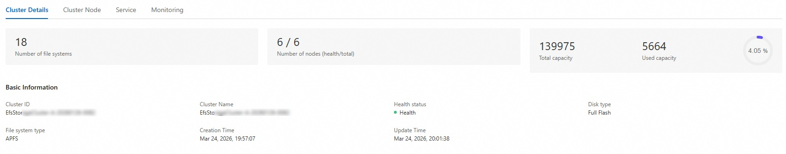

   **View the node information of a cluster**

   On the **Cluster Node** tab, you can view the information about the nodes in the cluster, including the node status, node role, model, and operating system.

   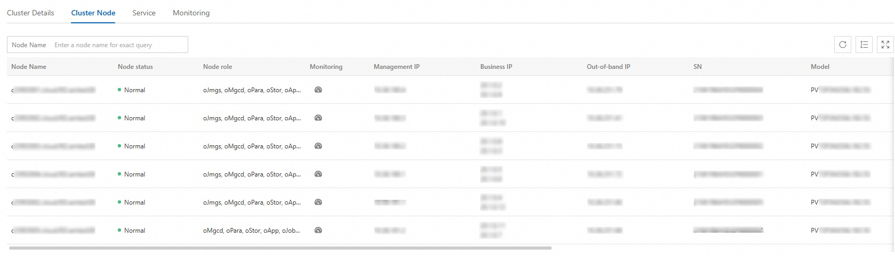

   You can perform operations on the nodes in the list based on your business requirements. You can search for a node by node name in exact match mode.

   - **View the details of a node**

     Click **Details** in the **Operation** column of the desired node. On the **Node details** tab of the **Node details** panel, you can view the basic information about the node, including the node name, node status, node role, management IP address, and business IP address.

     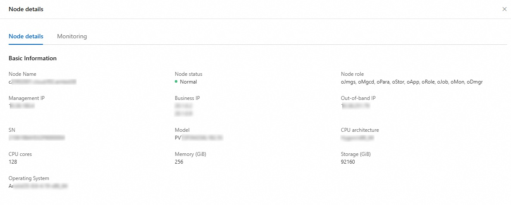

   - **View the monitoring data of a node**

     Click the  icon in the **Monitoring** column of the desired node. On the **Monitoring** tab

     of the **Node details** panel, select a time range to view the monitoring data within the specified time period, including the total capacity, remaining capacity, used capacity, read bandwidth, write bandwidth, read IOPS, and write IOPS.

     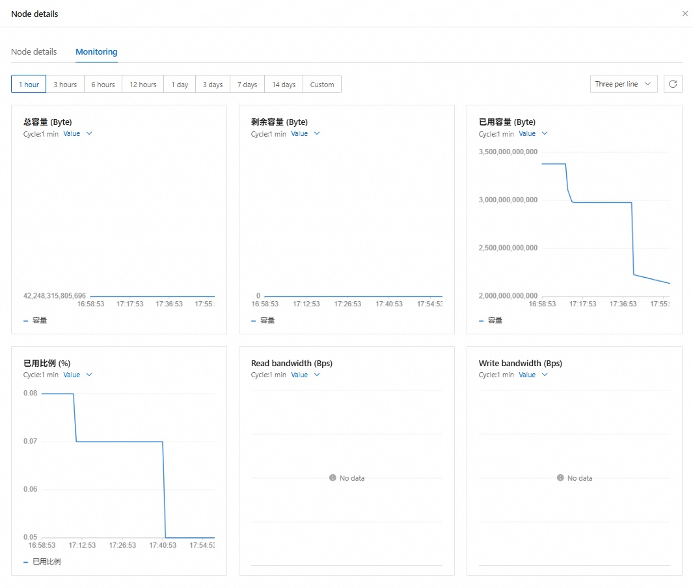

   **View the details of a service**

   On the **Service** tab, you can view the information about storage management services deployed in the cluster. You can search for a service by service name in fuzzy match mode.

   > **Note**
   >
   > Click **Tianji O & M** in the **Operation** column of the desired service to manage the service on Apsara Infrastructure Management.

   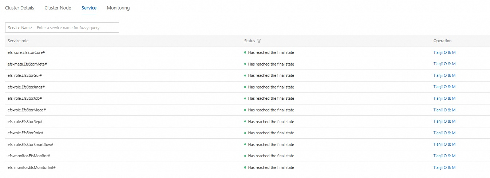

   **View monitoring data**

   On the **Monitoring** tab, you can select a time range to view the monitoring data of the cluster within the specified time period, including the read bandwidth, write bandwidth, read IOPS, write IOPS, and latency. You can adjust the number of metrics displayed in each row.

   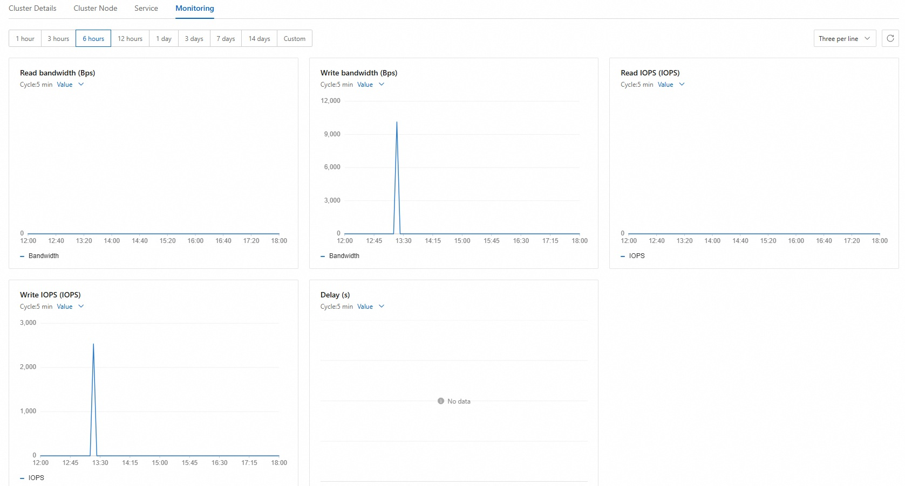

**View the information of a client cluster**

1. In the left-side navigation pane, choose **Clusters**. On the page that appears, click the **Storage** tab.

2. Click the **Client cluster** tab to view the information of client clusters in the cluster list, including the cluster name, cluster status, number of nodes (healthy/total), number of quorum nodes (healthy/total), mount a file system, and creation time.

3. Click the name of the cluster that you want to view or click **Details** in the **Operation** column to go to the Client cluster details page. This page consists of the Cluster Details and Cluster Node tabs.

   **View the details of a cluster**

   On the **Cluster Details** tab, you can view the basic information about client clusters in the list, including the cluster name, cluster status, cluster type, number of nodes (healthy/total), number of quorum nodes (healthy/total), and mounted file system.

   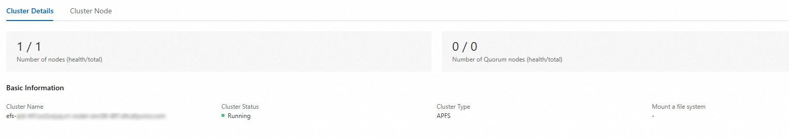

   **View the node information of a cluster**

   On the **Cluster Node** tab, you can view the information about the nodes in the cluster, including the node type and node status.

   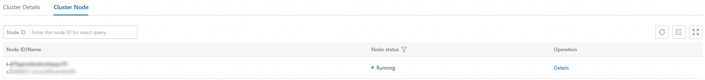

   Click **Details** in the **Operation** column of the desired node to go to the node details page. On this page, perform operations on the node based on your business requirements.

   - **View basic information**

     On the **Basic Information** tab, view the basic information and configuration of the node. The Basic Information section displays the node ID, node name, SN, region, zone, hostname, and access mode. The Configuration Information section displays the model, memory capacity, GPU, device model, data center, server room, rack, rack unit, and detailed information about the CPU, operating system, network, network interface controller (NIC), disk, and GPU.

     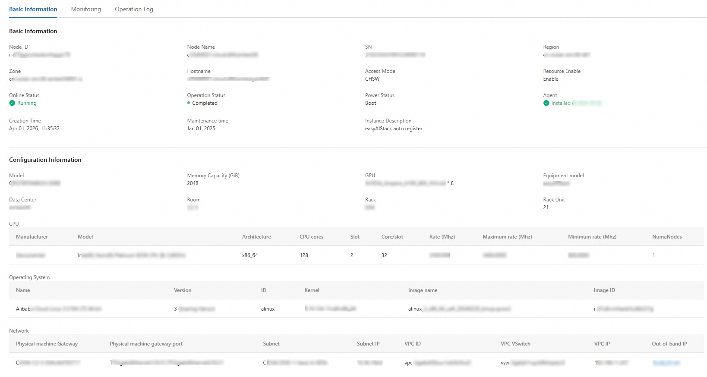

   - **View monitoring data**

     On the **Monitoring** tab, you can select a time range to view the monitoring data of the node within the specified time period, including the CPU utilization, memory utilization, loads, disk reads, disk writes, and number of connections. You can adjust the number of metrics displayed in each row.

     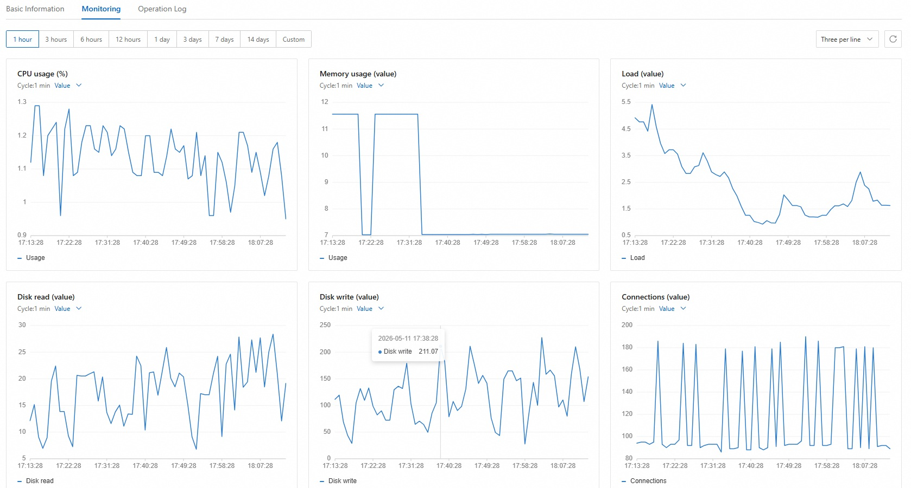

   - **View operation logs** On the **Operation Log** tab, select an operation type and a time range to view the operation logs of the node within the specified time period, including the operation type, target, operation status, and operation description.

     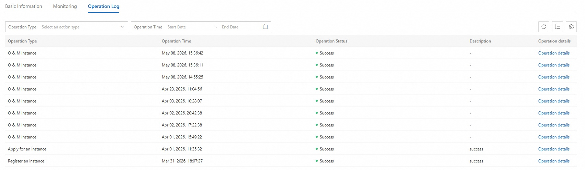

   - Click **Operation details** in the **Operation details** column of the desired log to open the operation details panel. In the panel, you can view the task type, sub-item, start time, and execution status of the operation.

     > **Note**
     >
     > The operation log details vary depending on the operation type. The actual information displayed in the console prevails.

# 4.View resource O&M information

The O&M information of ApsaraStack Parallel File System (APFS) resources includes the O&M information of file systems and servers.

**Log on to the Bare Metal Computing Platform (BMCP) Operations Console**

1. Log in to the Apsara Uni-manager Operations Console.

2. In the top navigation bar, choose **Product Operation > Computing** > BMCP Operations Platform.

**View the information of a file system**

1. In the left-side navigation pane, click **Resource management**. On the page that appears, click the **Storage** tab. Click the **File system** tab to view the information about an APFS file system. The information of the file system includes the file system ID/name, status, file system type, storage cluster, client cluster, used/configured capacity (GiB), specifications, and creation time.

   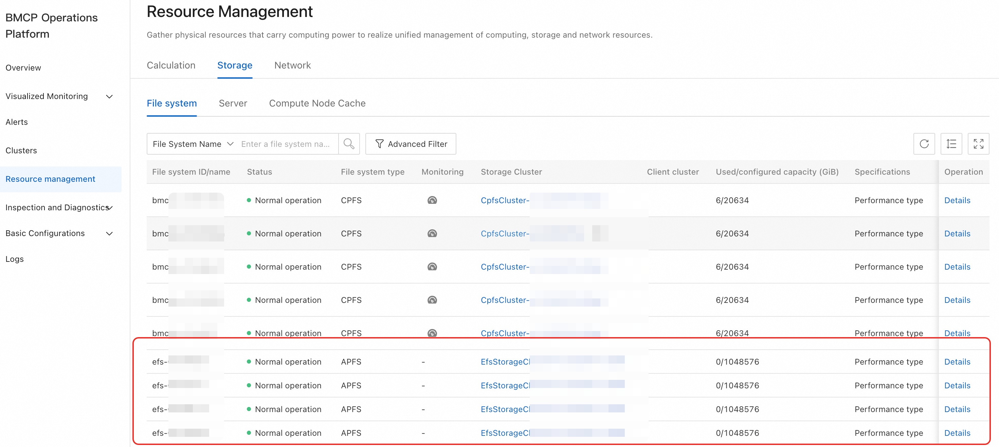

2. Click Details in the **Operation** column to view the details of a specific file system, including the file system ID, file system name, status, and type.

   > **Note**
   >
   > You cannot view the monitoring information of APFS.

3. Click the name of a cluster in the **Storage Cluster** column to view the information of the storage cluster. For more information, see the View the information of a storage cluster section of the View cluster O&M information topic.

4. Click the name of a cluster in the **Client cluster** column to view the information of the client cluster. For more information, see the View the information of a client cluster section of the View cluster O&M information topic.

**View the information of a server**

The server list displays the information of the servers that are deployed in the Apsara Infrastructure Management base.

1. In the left-side navigation pane, click **Resource management**. On the page that appears, click the **Storage** tab. Click the **Server** tab to view the information about a specific server that is displayed in the server list. The information of the server includes the SN, hostname, storage cluster ID, status, IP, model, CPU architecture, CPU cores, memory (GiB), storage (GiB), operating system, IDC, data center, and rack.

2. Click the name of a cluster in the **Storage cluster ID** column to view the information of the storage cluster. For more information, see the View the information of a storage cluster section of the View cluster O&M information topic.

# 5.View alert information

Several alert events are defined for ApsaraStack Parallel File System (APFS) file systems. These alert events cover the common exceptions of clusters, nodes, file systems, and disks. An alert event is triggered when a defined exception occurs in the environment. You can log on to the Apsara Uni-manager Operations Console to view the alert event in the Alert Management module.

**View the alert information of an APFS file system**

1. Log on to the Apsara Uni-manager Operations Console.

2. In the top navigation bar, choose **Monitor&Alert > Alert Management > Alert List**.

3. In the upper part of the Alert List page, enter efs in the **Resource Owner** field to search for and view the alert information about APFS file systems. Two types of alerts can be viewed: alerts defined for APFS and alerts defined for Apsara Infrastructure Management. For more information about specific alert items, see the Alert rules defined by APFS section of this topic.

   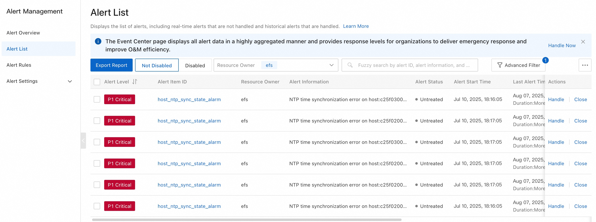

4. Click the name of an alert in the Alert Item ID column to view the alert details, including the alert level, alert item ID, resource owner, alert information, alert status, alert start time, last alert time/duration, alerts, extended attributes, alert object name/ID, object type, and alert source.

   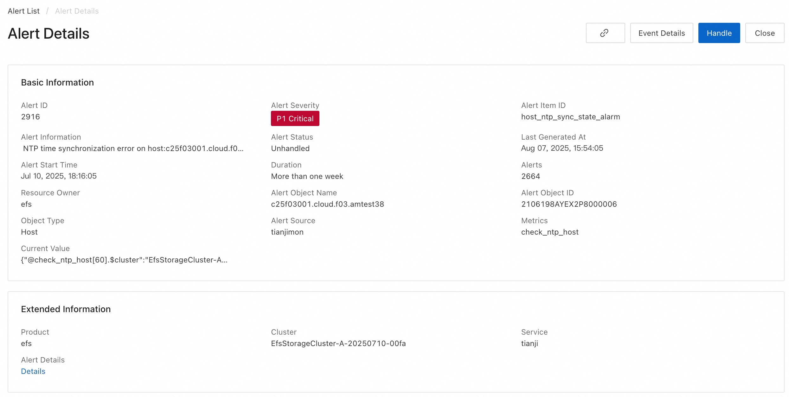

5. Click **Handle** in the upper-right corner to handle or close the alert event.

**Alert rules defined by APFS**

| Alert item | Ale rt lev el | Condition | Alert object (label) | Description |
| --- | --- | --- | --- | --- |
| efs_reachable_alarm The cluster is unavailable. | P1 | efs_reachable{product="efs"} == 0 Lasts for one minute | cluster | All nodes are down, and the cluster cannot provide services. |
| efs_cluster_health_stat e_alarm The cluster is unhealthy. | P1 | efs_cluster_hea lth_healthy_stat e{product="efs "} == 2 Lasts for one minute | cluster | The cluster is unhealthy and cannot provide services. |
| efs_cluster_health_stat e_warn_alarm The health status of the cluster is unknown. | P2 | efs_cluster_hea lth_healthy_stat e{product="efs "} == 3 Lasts for one minute | cluster | The health status of the cluster is unknown and risks exist. |
| efs_cluster_data_state _alarm The data status of the cluster is abnormal. | P1 | efs_cluster_hea lth_data_state{product="efs"} == 3 Lasts for one minute | cluster | The data status of the cluster is abnormal, and data loss may occur. |
| efs_cluster_data_state _warn_alarm The data status of the cluster is degraded. | P2 | efs_cluster_hea lth_data_state{product="efs"} == 2 Lasts for one minute | cluster | The health status of the cluster is degraded. If any node or disk fails, data loss may occur. |
| efs_node_health_state _alarm The node status is abnormal. | P1 | efs_node_healt h_state{produc t="efs"} != 1 Lasts for one minute | hostname | The node is in a state other than NORMAL. |
| efs_disk_health_state_alarm The disk status is abnormal. | P1 | efs_disk_health _state{product ="efs"} != 1 Lasts for one minute | hostname, dev_name | The health status of the disk is not HEALTHY. This indicates that the disk may be faulty or has a performance exception. |
| efs_fs_data_used_util_alarm The capacity usage of the file system is excessively high. | P1 | efs_filesystem_used_util{prod uct="efs"} &gt; 90 Lasts for one minute | fs_name | The capacity usage of the file system exceeds 90%. If the capacity is exhausted, an I/O exception occurs. |
| efs_filesystemio_quota _state_alarm The status of the file system quota is abnormal. | P2 | efs_filesystemi o_quota_state_alarm{product ="efs"} == 5 Lasts for one minute | fs_name, path | The status of the file system directory quota is incorrect, which may result in invalid configurations of related metrics. |
