Alibaba Cloud  
Apsara Stack  
Cloud Defined Storage  
ApsaraStack Parallel File  
System Operations and  
Maintenance Guide  
Product Version: v3.18.6-2607  
Document Version: 20260902

**Table of Contents**

- [1.Overview](#section-1)
- [2.Log on to the Apsara Uni-manager Operations Console](#section-2)
- [3.View cluster O&M information](#section-3)
- [4.View resource O&M information](#section-4)
- [5.View alarm information](#section-5)

# 1.Overview

This topic describes the purpose of, requirements on, and usage notes for performing O&M operations on ApsaraStack Parallel File System (APFS). This topic also describes how to contact technical support.

**Purpose**

This guide helps O&M engineers perform preventive maintenance on APFS to ensure long-term system stability. O&M engineers can follow the instructions in this guide to handle the system issues that are identified during maintenance. For system issues that are not covered in this guide, O&M engineers can contact APFS engineers for technical support.

**Requirements**

- O&M engineers must possess IT skills, including the knowledge of computer networks, distributed storage operations, and troubleshooting.

- O&M engineers must pass the pre-job training and learn the knowledge of APFS. The required knowledge of APFS includes system principles, networking, features, and the usage of maintenance tools.

> **Important**
>
> During the maintenance, O&M engineers must comply with operation procedures to ensure personal safety and system security. User data must be kept strictly confidential and must not be copied or disseminated without written consent from users.

**Usage notes**

To ensure a stable system and prevent unexpected events, O&M engineers must comply with the following guidelines:

- Hierarchical permission management

  Permissions on networks, devices, systems, and data are granted based on the services and roles of O&M engineers. This prevents system faults that are caused by unauthorized operations.

- System security

  - Before O&M engineers perform operations on the system, they must be clearly aware of the impacts of the operations. This ensures that the system is not affected by high-risk operations.

  - O&M engineers must clearly record the details about the issues that are encountered during the operations. This helps O&M engineers troubleshoot the issues.

- Personal safety and data security

  - O&M engineers must take measures to ensure safety based on device manuals when they use electrical equipment.

  - O&M engineers must use secure devices to access the business network.

  - Unauthorized data replication and dissemination are prohibited.

**Technical support**

O&M engineers can contact APFS technical support for help during the maintenance.

# 2.Log on to the Apsara Uni-manager Operations Console

This topic describes how users such as O&M engineers log in to the Apsara Uni-manager Operations Console.

**Prerequisites**

- The endpoint of the Apsara Uni-manager Operations Console and the username and password that are used to log in to the console are obtained from a deployment engineer or an administrator.

  The endpoint of the Apsara Uni-manager Operations Console is in the following format: *regi on-id*.ops.console.*intranet-domain-id*.

- A supported browser is used. We recommend that you use Google Chrome.

**Procedure**

1. Open a web browser.

2. In the address bar, enter the endpoint of the Apsara Uni-manager Operations Console. Press the ENTER key.

   

   > **Note**
   >
   > You can click the current language in the upper-right corner to switch to another language. Simplified Chinese, English, and traditional Chinese are supported.

3. Enter the correct username and password.

   > **Note**
   >
   > - Obtain the username and password that are used to log in to the Apsara Uni-manager Operations Console from a deployment engineer or an administrator.
   >
   > - If you enter an invalid password three consecutive times, the system enables the image verification login feature. If you enter an invalid password five consecutive times, the system locks your account. In this case, you can contact the administrator to unlock your account.
   >
   > - The first time that you log in to the Apsara Uni-manager Operations Console, change the password for your account as prompted.
   >
   >   To enhance security, make sure that your password meets the following requirements:
   >
   >   - The password contains uppercase and lowercase letters.
   >
   >   - The password contains digits.
   >
   >   - The password contains at least one of the following special characters: ! @ # $ %
   >
   >   - The password is 10 to 20 characters in length.

4. Click **Agree to Private Policy and Log On**.

# 3.View cluster O&M information

APFS cluster O&M information details a cluster and its nodes, which can be either storage clusters or client clusters. This information is vital for O&M scenarios.

**Log on to the BMCP O&M Console**

1. Log on to the Apsara Uni-manager O&M Console.

2. In the top navigation bar, choose **Product Operation > Computing > BMCP Operations Platform**.

**Storage cluster information**

1. In the left-side navigation pane, choose **Clusters** and click the **Storage** tab.

2. Click the **Storage Cluster**s tab. In the cluster list, view information about clusters with a file system type of **APFS**. The information includes Cluster ID/name, Health status, Disk type, File system type, Capacity (used/total) (GiB), Node count (healthy/total), and File system count.

   > **Note**
   >
   > Click the  icon in the **Monitoring** column for a cluster to view its monitoring data on
   >
   > the **Monitoring** tab.

3. Click a cluster ID/Name or click **Details** in the **Actions** column to open the cluster details page and view the cluster's details, nodes, services, and monitoring information.

   **Cluster details**

   On the **Cluster Details** tab, view the cluster's resource overview and basic information, including file system count, node count (healthy/total), total capacity, used capacity, used capacity percentage, cluster ID, cluster name, and health status.

   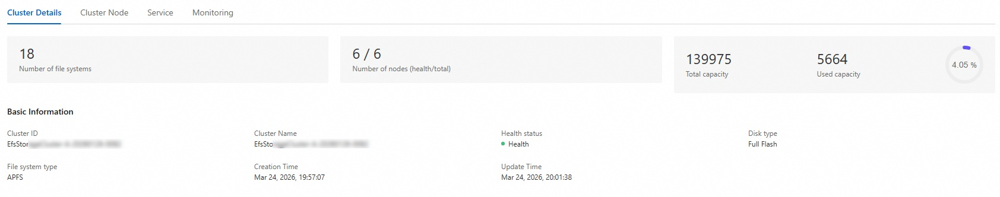

   **Cluster node information**

   On the **Cluster Nodes** tab, view information about the nodes in the cluster, including Node name, Node status, Node role, instance type, and Operating system.

   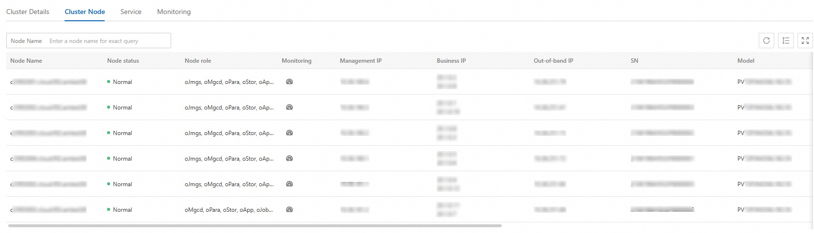

   In the cluster node list, you can search for a specific node by its exact name.

   - **Node details**

     Click **Details** in the **Actions** column for a node. In the **Node Details** panel, on the **Node Details** tab, view basic information about the node, such as node name, node status, node role, management IP, and service IP.

     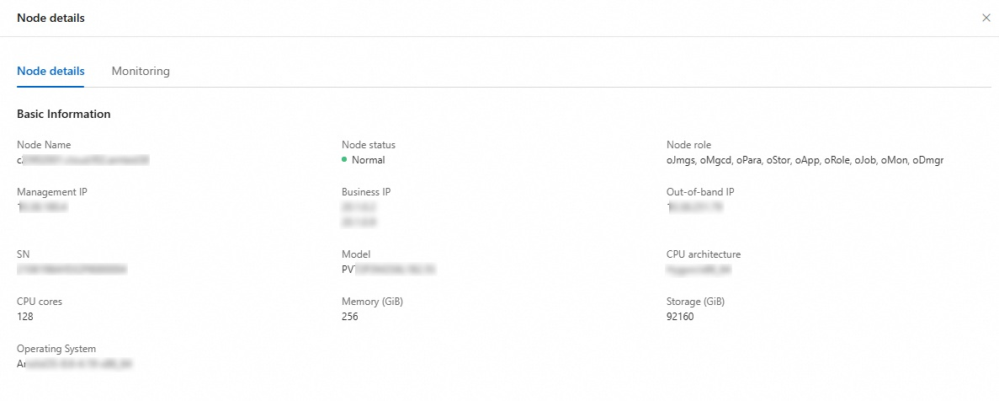

   - **Node monitoring data**

     Click the  icon in the **Monitoring** column for a node. In the **Node Details** panel, on the

     **Monitoring** tab, select a time range to view the node's monitoring data, including total capacity, remaining capacity, used capacity, used percentage, read bandwidth, write bandwidth, read IOPS, and write IOPS.

     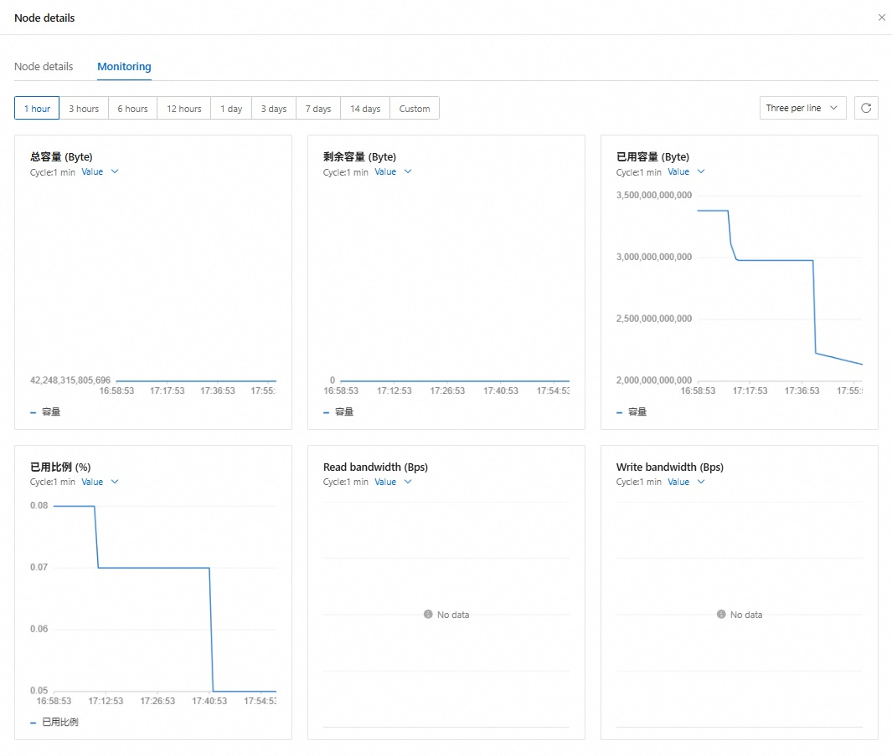

   **Service information**

   On the **Services** tab, view the storage management services deployed in the cluster. You can search for a service by entering a partial service name.

   > **Note**
   >
   > Click **Apsara Infrastructure Management O&M** in the **Actions** column for a service to manage it in the Apsara Infrastructure O&M Platform.

   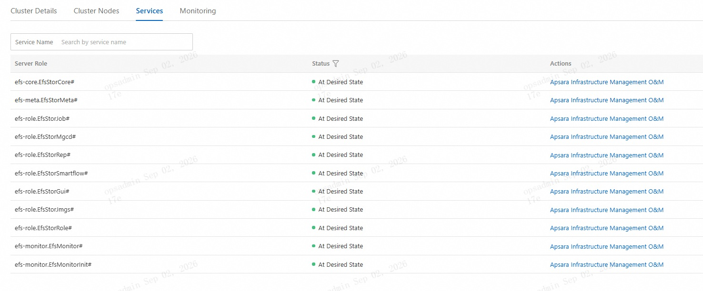

   **Monitoring data**

   On the **Monitoring** tab, select a time range to view monitoring data for the cluster, including read bandwidth, write bandwidth, read IOPS, write IOPS, and latency. You can adjust the number of metrics displayed per row.

   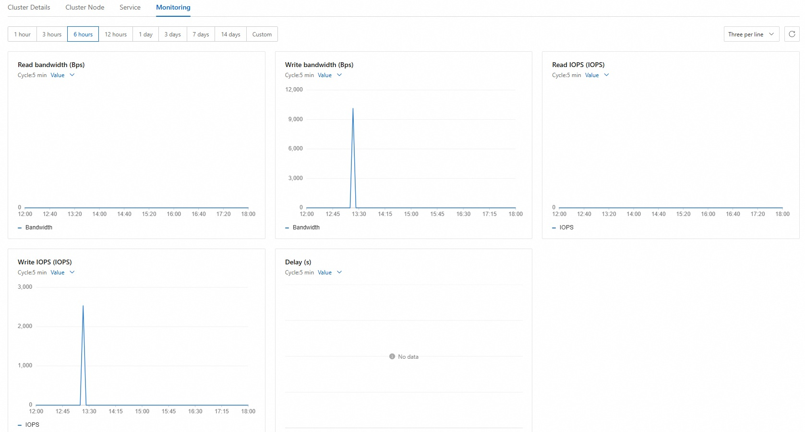

**Client cluster information**

1. In the left-side navigation pane, choose **Clusters** and click the **Storage** tab.

2. Click the **Client Clusters** tab. In the list, view information about client clusters, including Cluster name, Cluster status, Node count (healthy/total), Quorum node count (healthy/total), Mounted file systems, and Creation time.

3. Click a cluster name or click **Details** in the **Actions** column to open the cluster details page, where you can view cluster details and cluster node information.

   **Cluster details**

   On the **Cluster Details** tab, view the resource overview and basic information for the client cluster. This includes node count (healthy/total), quorum node count (healthy/total), cluster name, cluster status, cluster type, and mounted file systems.

   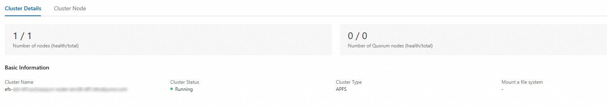

   **Cluster node information**

   On the **Cluster Nodes** tab, view information about the nodes in the cluster, including Node ID/name and Node status.

   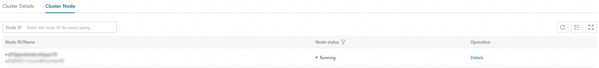

   Click **Details** in the **Actions** column for a node to open its details page.

   - **Basic information**

     On the **Basic Information** tab, view the node's basic and configuration information. Basic information includes node ID, node name, SN, region, availability zone, hostname, and access method. Configuration information includes instance type, memory capacity, GPU, device model, data center, room, cabinet, rack position, CPU details, operating system details, network details, NIC details, disk details, and GPU details.

     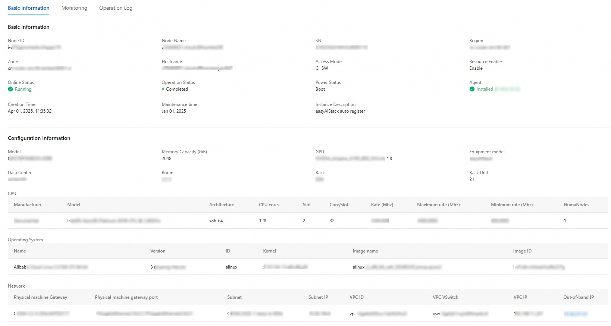

   - **Monitoring data**

     On the **Monitoring** tab, select a time range to view performance metrics for the node, including CPU utilization, memory utilization, load, disk reads, disk writes, and connection count. You can adjust the number of metrics displayed per row.

     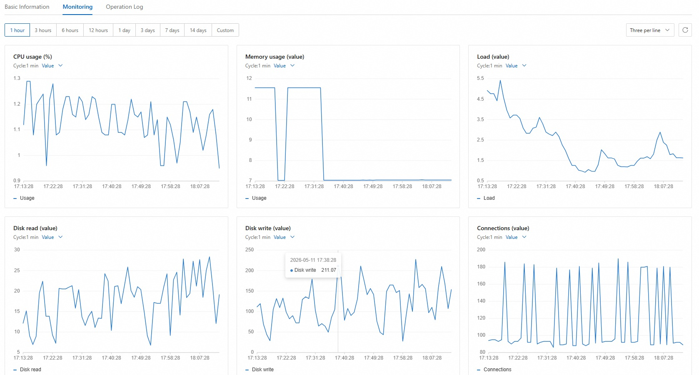

   - **Operation logs**

     On the **Operation Logs** tab, select an operation type and a time range to view the node's operation logs. The logs include Operation type, Target object, Operation status, and Description.

     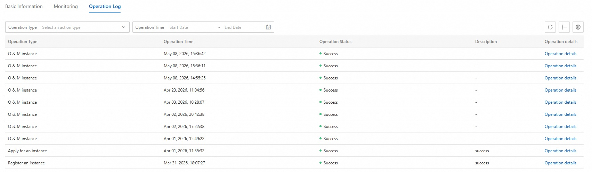

   - Click **Operation Details** in the **Operation Details** column for a log entry. In the Operation details panel, you can view information such as task type, subtasks, start time, and execution status.

     > **Note**
     >
     > The details shown for an operation log depend on the operation type.

# 4.View resource O&M information

The O&M information of ApsaraStack Parallel File System (APFS) resources includes the O&M information of file systems and servers.

**Log on to the BMCP O&M Console**

1. Log on to the Apsara Uni-manager O&M Console.

2. In the top navigation bar, choose **Product Operation > Computing > BMCP Operations Platform**.

**View the information of a file system**

1. In the left-side navigation pane, click **Resource management**. On the page that appears, click the **Storage** tab. Click the **File system** tab to view the information about an APFS file system. The information of the file system includes the file system ID/name, status, file system type, storage cluster, client cluster, used/configured capacity (GiB), specifications, and creation time.

   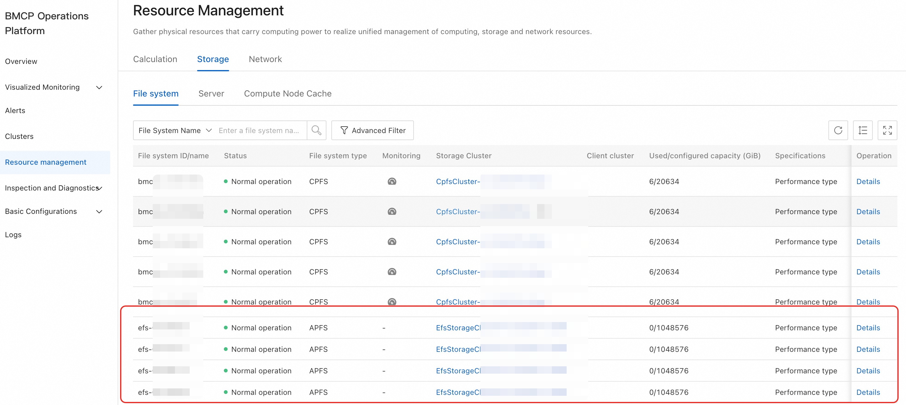

2. Click Details in the **Operation** column to view the details of a specific file system, including the file system ID, file system name, status, and type.

   > **Note**
   >
   > You cannot view the monitoring information of APFS.

3. Click the name of a cluster in the **Storage Cluster** column to view the information of the storage cluster. For more information, see the View the information of a storage cluster section of the View cluster O&M information topic.

4. Click the name of a cluster in the **Client cluster** column to view the information of the client cluster. For more information, see the View the information of a client cluster section of the View cluster O&M information topic.

**View the information of a server**

The server list displays the information of the servers that are deployed in the Apsara Infrastructure Management base.

1. In the left-side navigation pane, click **Resource management**. On the page that appears, click the **Storage** tab. Click the **Server** tab to view the information about a specific server that is displayed in the server list. The information of the server includes the SN, hostname, storage cluster ID, status, IP, model, CPU architecture, CPU cores, memory (GiB), storage (GiB), operating system, IDC, data center, and rack.

2. Click the name of a cluster in the **Storage cluster ID** column to view the information of the storage cluster. For more information, see the View the information of a storage cluster section of the View cluster O&M information topic.

# 5.View alarm information

The APFS file system defines alarm events for exceptions related to clusters, nodes, file systems, and disks. When an exception occurs, the system triggers an alarm event. You can view these events in alarm management on the Apsara Uni-manager Operations Console.

**View APFS alarm information**

1. Log in to the Apsara Uni-manager Operations Console.

2. In the top navigation bar, choose **Monitor&Alert > Alert Management > Alert List**.

3. In the **Resource Owner** search box above the alarm list, enter "efs" to find alarms for the APFS file system. Alarms are divided into two categories: those defined by the APFS product and those defined by Apsara. For details about specific alarm items, see APFS alarm rules.

   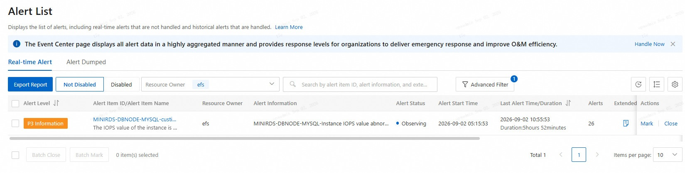

4. Click an alarm item ID to view the alarm details. The details include: alarm level, alarm item ID/name, Product, alarm information, alarm status, alarm start time, last alarm time/duration, alarm count, extended attributes, alarm object name/ID, object type, and alarm source information.

   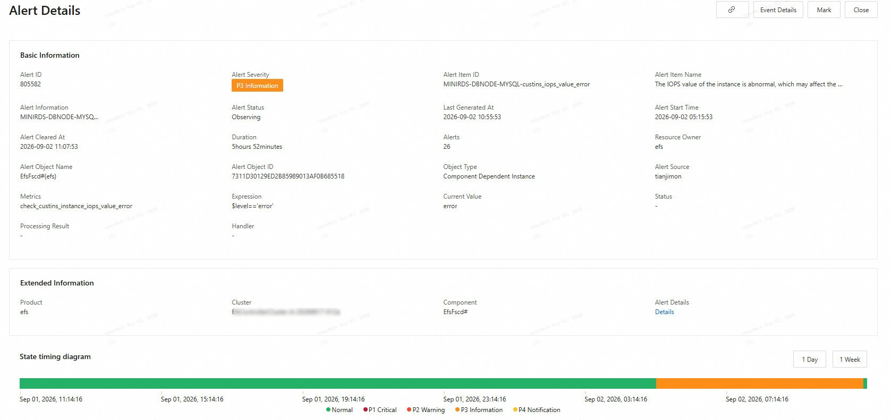

5. Click **Close** in the upper-right corner to close the alarm event.

**APFS alarm rules**

| Parameter | Le vel | Condition | Object | Description |
| --- | --- | --- | --- | --- |
| efs_reachable_alarm cluster unavailable | P1 | efs_reachable{product="efs"} == 0 For 1 minute | cluster | All nodes are down, and the cluster cannot provide services. |
| efs_cluster_health_stat e_alarm cluster health state is abnormal | P1 | efs_cluster_hea lth_healthy_stat e{product="efs "} == 2 For 1 minute | cluster | The cluster health state is abnormal, which prevents it from providing services. |
| efs_cluster_health_stat e_warn_alarm cluster health state is unknown | P2 | efs_cluster_hea lth_healthy_stat e{product="efs "} == 3 For 1 minute | cluster | The cluster health state is unknown, which indicates a potential risk. |
| efs_cluster_data_state _alarm cluster data state is abnormal | P1 | efs_cluster_hea lth_data_state{product="efs"} == 3 For 1 minute | cluster | The cluster data state is abnormal, which indicates a risk of data loss. |
| efs_cluster_data_state _warn_alarm cluster data state is degraded | P2 | efs_cluster_hea lth_data_state{product="efs"} == 2 For 1 minute | cluster | The cluster data state is degraded.The failure of another node or disk may cause data loss. |
| efs_node_health_state _alarm node state is abnormal | P1 | efs_node_healt h_state{produc t="efs"} != 1 For 1 minute | hostname | The node is not in the NORMAL state. |
| efs_disk_health_state_alarm disk state is abnormal | P1 | efs_disk_health _state{product ="efs"} != 1 For 1 minute | hostname, dev_name | The disk is not in the HEALTHY state, indicating a possible failure or performance issue. |
| efs_fs_data_used_util_alarm file system capacity usage is too high | P1 | efs_filesystem_used_util{prod uct="efs"} &gt; 90 For 1 minute | fs_name | File system usage has exceeded 90%. Running out of capacity will cause I/O errors. |
| efs_filesystemio_quota _state_alarm file system quota state is abnormal | P2 | efs_filesystemi o_quota_state_alarm{product ="efs"} == 5 For 1 minute | fs_name, path | The file system directory quota is in an error state, which invalidates related metric configurations. |
