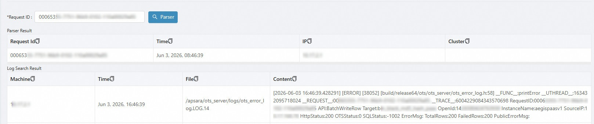
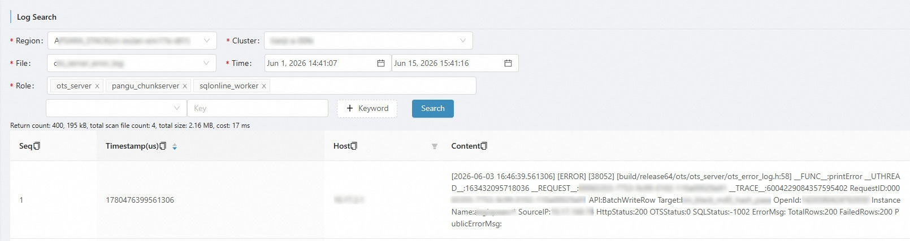
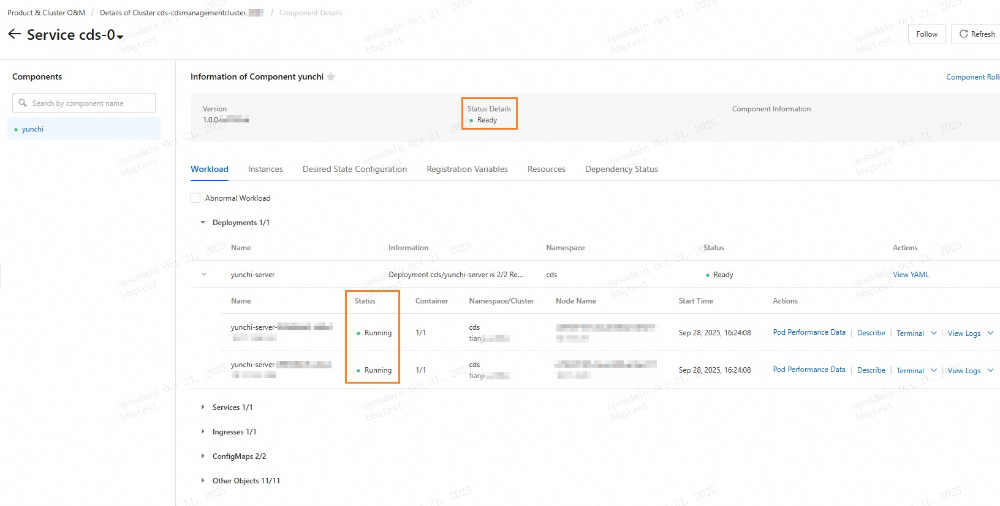

Alibaba Cloud  
Apsara Stack  
Cloud Defined Storage  
Operations and Maintenance  
Guide  
Product Version: v3.18.6-2607  
Document Version: 20260901

**Table of Contents**

- [1.Log in to the Apsara Uni-manager Operations Console](#section-1)
- [2.Feature overview](#section-2)
- [3.Permission configuration](#section-3)
    - [3.1. Manage permissions on CDS-OPS](#section-3-1)
    - [3.2. Manage permissions on HDR-OPS](#section-3-2)
- [4.Service overview](#section-4)
- [5.Storage management](#section-5)
    - [5.1. Before you begin](#section-5-1)
    - [5.2. Manage EBS clusters (CDS-EBS)](#section-5-2)
        - [5.2.1. Overview of EBS clusters](#section-5-2-1)
        - [5.2.2. Manage cluster details](#section-5-2-2)
            - [5.2.2.1. View cluster overview](#section-5-2-2-1)
            - [5.2.2.2. View capacity information](#section-5-2-2-2)
            - [5.2.2.3. Monitor clusters](#section-5-2-2-3)
                - [5.2.2.3.1. View cluster monitoring information](#section-5-2-2-3-1)
                - [5.2.2.3.2. View the monitoring information of BlockServer nodes](#section-5-2-2-3-2)
            - [5.2.2.4. Configure clusters](#section-5-2-2-4)
                - [5.2.2.4.1. Configure the EC mode](#section-5-2-2-4-1)
                - [5.2.2.4.2. Configure block rebalance](#section-5-2-2-4-2)
                - [5.2.2.4.3. Configure Apsara Distributed File System](#section-5-2-2-4-3)
            - [5.2.2.5. Manage services](#section-5-2-2-5)
                - [5.2.2.5.1. Manage BlockMaster nodes](#section-5-2-2-5-1)
                - [5.2.2.5.2. Manage BlockServer nodes](#section-5-2-2-5-2)
                - [5.2.2.5.3. Manage snapshot servers](#section-5-2-2-5-3)
                - [5.2.2.5.4. Manage Apsara Distributed File System](#section-5-2-2-5-4)
            - [5.2.2.6. Manage hosts](#section-5-2-2-6)
        - [5.2.3. View compute nodes](#section-5-2-3)
        - [5.2.4. Manage storage sets](#section-5-2-4)
        - [5.2.5. Manage cloud disks](#section-5-2-5)
        - [5.2.6. Exception dashboard](#section-5-2-6)
        - [5.2.7. Perform canary O&M](#section-5-2-7)
        - [5.2.8. EBS HaiTu console](#section-5-2-8)
            - [5.2.8.1. Log in to the HaiTu console](#section-5-2-8-1)
            - [5.2.8.2. Homepage](#section-5-2-8-2)
            - [5.2.8.3. Cluster management](#section-5-2-8-3)
                - [5.2.8.3.1. View machines](#section-5-2-8-3-1)
                - [5.2.8.3.2. View service status](#section-5-2-8-3-2)
                - [5.2.8.3.3. View service templates](#section-5-2-8-3-3)
                - [5.2.8.3.4. View performance data](#section-5-2-8-3-4)
                - [5.2.8.3.5. Specify an EC for a cluster](#section-5-2-8-3-5)
                - [5.2.8.3.6. Configure a cluster sales policy](#section-5-2-8-3-6)
            - [5.2.8.4. Machine management](#section-5-2-8-4)
            - [5.2.8.5. Disk management](#section-5-2-8-5)
                - [5.2.8.5.1. Manage the disk list](#section-5-2-8-5-1)
                - [5.2.8.5.2. View disk details](#section-5-2-8-5-2)
            - [5.2.8.6. Monitoring and alerting](#section-5-2-8-6)
                - [5.2.8.6.1. Manage monitoring and inspection](#section-5-2-8-6-1)
                    - [5.2.8.6.1.1. View metrics in a Distributed System Performance Monitor view](#section-5-2-8-6-1-1)
                    - [5.2.8.6.1.2. View metric inspections](#section-5-2-8-6-1-2)
                    - [5.2.8.6.1.3. Manage log inspections](#section-5-2-8-6-1-3)
                - [5.2.8.6.2. View I/O hangs](#section-5-2-8-6-2)
                - [5.2.8.6.3. View SLA metrics](#section-5-2-8-6-3)
            - [5.2.8.7. Emergency diagnostics](#section-5-2-8-7)
                - [5.2.8.7.1. Query logs](#section-5-2-8-7-1)
                - [5.2.8.7.2. View disk performance data](#section-5-2-8-7-2)
                - [5.2.8.7.3. Software O&M](#section-5-2-8-7-3)
                - [5.2.8.7.4. Event Center](#section-5-2-8-7-4)
            - [5.2.8.8. Basic O&M](#section-5-2-8-8)
                - [5.2.8.8.1. Manage storage sets](#section-5-2-8-8-1)
            - [5.2.8.9. Migration and replication O&M](#section-5-2-8-9)
                - [5.2.8.9.1. Automatic migration](#section-5-2-8-9-1)
                - [5.2.8.9.2. Auto decommissioning](#section-5-2-8-9-2)
                - [5.2.8.9.3. Migration management](#section-5-2-8-9-3)
                - [5.2.8.9.4. Asynchronous replication](#section-5-2-8-9-4)
                - [5.2.8.9.5. O&M background](#section-5-2-8-9-5)
                    - [5.2.8.9.5.1. Manage resource information](#section-5-2-8-9-5-1)
                    - [5.2.8.9.5.2. Configure cross-cloud replication](#section-5-2-8-9-5-2)
            - [5.2.8.10. Snapshot O&M](#section-5-2-8-10)
                - [5.2.8.10.1. Query snapshot information](#section-5-2-8-10-1)
                - [5.2.8.10.2. Manage snapshots](#section-5-2-8-10-2)
                - [5.2.8.10.3. Manage OSS usage of snapshots](#section-5-2-8-10-3)
    - [5.3. Manage EBS clusters (EBS-1.0)](#section-5-3)
        - [5.3.1. Overview of EBS clusters](#section-5-3-1)
        - [5.3.2. Manage cluster details](#section-5-3-2)
            - [5.3.2.1. View cluster overview](#section-5-3-2-1)
            - [5.3.2.2. View capacity information](#section-5-3-2-2)
            - [5.3.2.3. Monitor clusters](#section-5-3-2-3)
                - [5.3.2.3.1. View cluster monitoring information](#section-5-3-2-3-1)
                - [5.3.2.3.2. View the monitoring information of RiverServer nodes](#section-5-3-2-3-2)
            - [5.3.2.4. Manage services](#section-5-3-2-4)
                - [5.3.2.4.1. View the information about RiverCluster nodes](#section-5-3-2-4-1)
                - [5.3.2.4.2. View the information about RiverServer nodes](#section-5-3-2-4-2)
                - [5.3.2.4.3. Manage PANGU](#section-5-3-2-4-3)
            - [5.3.2.5. Manage hosts](#section-5-3-2-5)
    - [5.4. Manage OSS clusters](#section-5-4)
        - [5.4.1. Overview of OSS clusters](#section-5-4-1)
        - [5.4.2. Manage cluster details](#section-5-4-2)
            - [5.4.2.1. View cluster overview](#section-5-4-2-1)
            - [5.4.2.2. View capacity information](#section-5-4-2-2)
            - [5.4.2.3. Monitor clusters](#section-5-4-2-3)
                - [5.4.2.3.1. View cluster monitoring information](#section-5-4-2-3-1)
                - [5.4.2.3.2. Check the health status of a cluster](#section-5-4-2-3-2)
                - [5.4.2.3.3. Run background tasks](#section-5-4-2-3-3)
            - [5.4.2.4. Configure clusters](#section-5-4-2-4)
                - [5.4.2.4.1. Modify KV configurations](#section-5-4-2-4-1)
                - [5.4.2.4.2. Configure the EC mode](#section-5-4-2-4-2)
                - [5.4.2.4.3. Configure a scheduled time for background tasks](#section-5-4-2-4-3)
                - [5.4.2.4.4. Configure a global flag](#section-5-4-2-4-4)
                - [5.4.2.4.5. Configure Apsara Distributed File System](#section-5-4-2-4-5)
                - [5.4.2.4.6. Configure QoS settings](#section-5-4-2-4-6)
            - [5.4.2.5. Manage services](#section-5-4-2-5)
                - [5.4.2.5.1. Manage KV services](#section-5-4-2-5-1)
                - [5.4.2.5.2. Manage access-layer services](#section-5-4-2-5-2)
                - [5.4.2.5.3. Manage Apsara Distributed File System](#section-5-4-2-5-3)
            - [5.4.2.6. Manage hosts](#section-5-4-2-6)
        - [5.4.3. Manage buckets](#section-5-4-3)
            - [5.4.3.1. Manage bucket information](#section-5-4-3-1)
            - [5.4.3.2. Query bucket information](#section-5-4-3-2)
            - [5.4.3.3. Configure QoS information](#section-5-4-3-3)
        - [5.4.4. Manage synchronization configurations](#section-5-4-4)
            - [5.4.4.1. Manage synchronization processes](#section-5-4-4-1)
            - [5.4.4.2. Configure a cross-region synchronization process](#section-5-4-4-2)
            - [5.4.4.3. Configure a cross-cloud synchronization process](#section-5-4-4-3)
            - [5.4.4.4. View monitoring data of cluster synchronization](#section-5-4-4-4)
        - [5.4.5. O&M robots](#section-5-4-5)
            - [5.4.5.1. Manage O&M robots](#section-5-4-5-1)
            - [5.4.5.2. View historical O&M tasks](#section-5-4-5-2)
        - [5.4.6. OSS O&M console](#section-5-4-6)
            - [5.4.6.1. Log in to the OSS O&M console](#section-5-4-6-1)
            - [5.4.6.2. Cluster overview](#section-5-4-6-2)
            - [5.4.6.3. User and bucket O&M](#section-5-4-6-3)
                - [5.4.6.3.1. User data query](#section-5-4-6-3-1)
                    - [5.4.6.3.1.1. Basic bucket information](#section-5-4-6-3-1-1)
                    - [5.4.6.3.1.2. User data overview](#section-5-4-6-3-1-2)
                    - [5.4.6.3.1.3. Data monitoring](#section-5-4-6-3-1-3)
                - [5.4.6.3.2. Bucket management](#section-5-4-6-3-2)
                - [5.4.6.3.3. Disassociate a bucket from a VPC](#section-5-4-6-3-3)
                - [5.4.6.3.4. QoS configurations](#section-5-4-6-3-4)
            - [5.4.6.4. Cluster O&M](#section-5-4-6-4)
                - [5.4.6.4.1. Cluster monitoring](#section-5-4-6-4-1)
                    - [5.4.6.4.1.1. Cluster overview](#section-5-4-6-4-1-1)
                    - [5.4.6.4.1.2. Inventory monitoring](#section-5-4-6-4-1-2)
                    - [5.4.6.4.1.3. Data monitoring](#section-5-4-6-4-1-3)
                    - [5.4.6.4.1.4. Resource usage rankings](#section-5-4-6-4-1-4)
                    - [5.4.6.4.1.5. Bucket statistics](#section-5-4-6-4-1-5)
                    - [5.4.6.4.1.6. Object statistics](#section-5-4-6-4-1-6)
                - [5.4.6.4.2. Govern cluster usage](#section-5-4-6-4-2)
                - [5.4.6.4.3. View the information about servers](#section-5-4-6-4-3)
                - [5.4.6.4.4. Disk management](#section-5-4-6-4-4)
                - [5.4.6.4.5. Network management](#section-5-4-6-4-5)
                    - [5.4.6.4.5.1. Domain name management](#section-5-4-6-4-5-1)
                    - [5.4.6.4.5.2. Manage virtual IP addresses](#section-5-4-6-4-5-2)
                - [5.4.6.4.6. Cluster and bucket migration management](#section-5-4-6-4-6)
            - [5.4.6.5. Service O&M of OSS](#section-5-4-6-5)
                - [5.4.6.5.1. OCM list management](#section-5-4-6-5-1)
                - [5.4.6.5.2. Query applications and manage versions and upgrades](#section-5-4-6-5-2)
                - [5.4.6.5.3. Location query](#section-5-4-6-5-3)
                - [5.4.6.5.4. Manage OSS global flags](#section-5-4-6-5-4)
                - [5.4.6.5.5. Restart OSS services](#section-5-4-6-5-5)
                - [5.4.6.5.6. OSS backend task management](#section-5-4-6-5-6)
                    - [5.4.6.5.6.1. Backend task monitoring](#section-5-4-6-5-6-1)
                    - [5.4.6.5.6.2. Backend task configurations](#section-5-4-6-5-6-2)
                - [5.4.6.5.7. Synchronization management](#section-5-4-6-5-7)
                    - [5.4.6.5.7.1. Configure cross-cloud synchronization](#section-5-4-6-5-7-1)
                    - [5.4.6.5.7.2. Configure cross-region synchronization](#section-5-4-6-5-7-2)
                    - [5.4.6.5.7.3. Synchronization process management](#section-5-4-6-5-7-3)
                    - [5.4.6.5.7.4. DRS task distribution](#section-5-4-6-5-7-4)
                    - [5.4.6.5.7.5. Cluster synchronization monitoring](#section-5-4-6-5-7-5)
            - [5.4.6.6. KV management](#section-5-4-6-6)
                - [5.4.6.6.1. Manage KV CheckReady](#section-5-4-6-6-1)
                - [5.4.6.6.2. KV master management](#section-5-4-6-6-2)
                - [5.4.6.6.3. Manage KV servers](#section-5-4-6-6-3)
                - [5.4.6.6.4. Restart KV services](#section-5-4-6-6-4)
                - [5.4.6.6.5. Manage KV applications](#section-5-4-6-6-5)
                - [5.4.6.6.6. KV partition management](#section-5-4-6-6-6)
                - [5.4.6.6.7. Manage KM masters](#section-5-4-6-6-7)
                - [5.4.6.6.8. KV global flag configurations](#section-5-4-6-6-8)
                - [5.4.6.6.9. Manage EC](#section-5-4-6-6-9)
            - [5.4.6.7. Intelligent O&M](#section-5-4-6-7)
                - [5.4.6.7.1. Intelligent O&M history](#section-5-4-6-7-1)
                - [5.4.6.7.2. Intelligent O&M configuration](#section-5-4-6-7-2)
            - [5.4.6.8. Log monitoring](#section-5-4-6-8)
                - [5.4.6.8.1. Internal error (5XX) analysis](#section-5-4-6-8-1)
                - [5.4.6.8.2. Backend log query](#section-5-4-6-8-2)
                - [5.4.6.8.3. KV error code table](#section-5-4-6-8-3)
            - [5.4.6.9. Monitoring center](#section-5-4-6-9)
                - [5.4.6.9.1. Alert history](#section-5-4-6-9-1)
                - [5.4.6.9.2. Alert configuration](#section-5-4-6-9-2)
                - [5.4.6.9.3. Inspection configuration](#section-5-4-6-9-3)
                - [5.4.6.9.4. Inspection history](#section-5-4-6-9-4)
                - [5.4.6.9.5. One-click inspection](#section-5-4-6-9-5)
            - [5.4.6.10. Background management](#section-5-4-6-10)
                - [5.4.6.10.1. Workflows](#section-5-4-6-10-1)
                    - [5.4.6.10.1.1. Workflow overview](#section-5-4-6-10-1-1)
                    - [5.4.6.10.1.2. Workflow task](#section-5-4-6-10-1-2)
                    - [5.4.6.10.1.3. Batch workflow submission](#section-5-4-6-10-1-3)
                    - [5.4.6.10.1.4. Workflow instance](#section-5-4-6-10-1-4)
                    - [5.4.6.10.1.5. Workflow definition](#section-5-4-6-10-1-5)
                - [5.4.6.10.2. White-screen Commands](#section-5-4-6-10-2)
                - [5.4.6.10.3. DNA](#section-5-4-6-10-3)
                    - [5.4.6.10.3.1. Trigger management](#section-5-4-6-10-3-1)
                    - [5.4.6.10.3.2. Event center trigger history](#section-5-4-6-10-3-2)
                - [5.4.6.10.4. Chiji domain name management](#section-5-4-6-10-4)
                - [5.4.6.10.5. Audit logs](#section-5-4-6-10-5)
    - [5.5. Manage log storage clusters](#section-5-5)
        - [5.5.1. Overview of SLS clusters](#section-5-5-1)
        - [5.5.2. Manage cluster details](#section-5-5-2)
            - [5.5.2.1. View cluster overview](#section-5-5-2-1)
            - [5.5.2.2. View capacity information](#section-5-5-2-2)
            - [5.5.2.3. Configure clusters](#section-5-5-2-3)
                - [5.5.2.3.1. Configure the EC mode](#section-5-5-2-3-1)
                - [5.5.2.3.2. Configure Apsara Distributed File System](#section-5-5-2-3-2)
            - [5.5.2.4. Manage PANGU](#section-5-5-2-4)
            - [5.5.2.5. Manage hosts](#section-5-5-2-5)
    - [5.6. Manage Tablestore clusters](#section-5-6)
        - [5.6.1. Tablestore cluster overview](#section-5-6-1)
        - [5.6.2. OTS Chiji platform](#section-5-6-2)
            - [5.6.2.1. Log in to the OTS Chiji console](#section-5-6-2-1)
            - [5.6.2.2. User data](#section-5-6-2-2)
                - [5.6.2.2.1. Manage user information](#section-5-6-2-2-1)
                - [5.6.2.2.2. Manage instance information](#section-5-6-2-2-2)
            - [5.6.2.3. Cluster management](#section-5-6-2-3)
                - [5.6.2.3.1. Manage management clusters](#section-5-6-2-3-1)
                - [5.6.2.3.2. Manage OTS regions](#section-5-6-2-3-2)
                - [5.6.2.3.3. Manage OTS clusters](#section-5-6-2-3-3)
                - [5.6.2.3.4. Search clusters](#section-5-6-2-3-4)
                    - [5.6.2.3.4.1. Manage cluster information](#section-5-6-2-3-4-1)
                    - [5.6.2.3.4.2. Configure Search Region settings](#section-5-6-2-3-4-2)
                    - [5.6.2.3.4.3. Manage Search Reindex tasks](#section-5-6-2-3-4-3)
                - [5.6.2.3.5. View tunnel information](#section-5-6-2-3-5)
                - [5.6.2.3.6. View Replication information](#section-5-6-2-3-6)
            - [5.6.2.4. Load balancing](#section-5-6-2-4)
                - [5.6.2.4.1. View top information](#section-5-6-2-4-1)
                - [5.6.2.4.2. View action information](#section-5-6-2-4-2)
                - [5.6.2.4.3. Configure Checker](#section-5-6-2-4-3)
            - [5.6.2.5. Engine O&M](#section-5-6-2-5)
                - [5.6.2.5.1. Manually trigger a rebalance](#section-5-6-2-5-1)
            - [5.6.2.6. Inspection center](#section-5-6-2-6)
                - [5.6.2.6.1. View the capacity usage dashboard](#section-5-6-2-6-1)
                - [5.6.2.6.2. View abnormal capacity usage](#section-5-6-2-6-2)
                - [5.6.2.6.3. Manage flow control configurations](#section-5-6-2-6-3)
            - [5.6.2.7. Monitoring center](#section-5-6-2-7)
                - [5.6.2.7.1. View cluster monitoring information](#section-5-6-2-7-1)
                - [5.6.2.7.2. View instance monitoring information](#section-5-6-2-7-2)
                - [5.6.2.7.3. Top requests](#section-5-6-2-7-3)
                - [5.6.2.7.4. Search request logs](#section-5-6-2-7-4)
                - [5.6.2.7.5. Query log information](#section-5-6-2-7-5)
            - [5.6.2.8. System management](#section-5-6-2-8)
                - [5.6.2.8.1. Manage inspection tasks](#section-5-6-2-8-1)
                - [5.6.2.8.2. View inspection tasks](#section-5-6-2-8-2)
        - [5.6.3. Cluster environment](#section-5-6-3)
        - [5.6.4. System roles](#section-5-6-4)
        - [5.6.5. Pre-partition a table](#section-5-6-5)
            - [5.6.5.1. Pre-partitioning](#section-5-6-5-1)
            - [5.6.5.2. View partitions](#section-5-6-5-2)
- [6.Monitoring center](#section-6)
    - [6.1. View the custom dashboard](#section-6-1)
    - [6.2. View resource monitoring data](#section-6-2)
    - [6.3. View the monitoring data of storage metrics](#section-6-3)
    - [6.4. Query service monitoring data](#section-6-4)
- [7.Event Alerts](#section-7)
    - [7.1. Alert overview](#section-7-1)
    - [7.2. Handle alerts](#section-7-2)
    - [7.3. View historical alerts](#section-7-3)
- [8.Routine Inspection](#section-8)
    - [8.1. Inspection center](#section-8-1)
    - [8.2. SLA monitoring](#section-8-2)
- [9.Intelligent O&M](#section-9)
    - [9.1. Host O&M](#section-9-1)
        - [9.1.1. View all workflows](#section-9-1-1)
        - [9.1.2. Scale up a cluster](#section-9-1-2)
        - [9.1.3. Initiate a CDS Cluster Scale Down workflow](#section-9-1-3)
        - [9.1.4. Initiate a CDS Cluster Node Maintenance workflow](#section-9-1-4)
        - [9.1.5. Initiate a CDSOSSZRS Cluster Three-zone Change workflow](#section-9-1-5)
        - [9.1.6. Initiate a CDS Cluster Deployment Mode Switch workflow](#section-9-1-6)
    - [9.2. Maintain disks](#section-9-2)
        - [9.2.1. Maintain a faulty disk](#section-9-2-1)
        - [9.2.2. Proactive disk replacement](#section-9-2-2)
        - [9.2.3. View hard disk maintenance history](#section-9-2-3)
    - [9.3. Log Management](#section-9-3)
        - [9.3.1. Collect log data](#section-9-3-1)
        - [9.3.2. Query logs](#section-9-3-2)
- [10.System Management](#section-10)
    - [10.1. View plug-in information](#section-10-1)
    - [10.2. View tasks](#section-10-2)
    - [10.3. Query audit logs](#section-10-3)
    - [10.4. System Cleanup](#section-10-4)
        - [10.4.1. Manage cleanup configurations](#section-10-4-1)
        - [10.4.2. Run cleanup tasks](#section-10-4-2)
    - [10.5. Manage system configuration](#section-10-5)
- [11.Data Service](#section-11)
    - [11.1. Manage CSG instances](#section-11-1)
    - [11.2. Use HDR-OPS](#section-11-2)
        - [11.2.1. Before you begin](#section-11-2-1)
        - [11.2.2. View site pair information](#section-11-2-2)
        - [11.2.3. View alert information](#section-11-2-3)
        - [11.2.4. View inspection tasks](#section-11-2-4)
        - [11.2.5. Manage O&M tasks](#section-11-2-5)
        - [11.2.6. Manage O&M configurations](#section-11-2-6)
        - [11.2.7. Manage cloud sites](#section-11-2-7)
        - [11.2.8. View the capacity of protected resources](#section-11-2-8)

<a id="section-1"></a>

# 1.Log in to the Apsara Uni-manager Operations Console

This topic describes how users such as O&M engineers log in to the Apsara Uni-manager Operations Console.

**Prerequisites**

- The endpoint of the Apsara Uni-manager Operations Console and the username and password that are used to log in to the console are obtained from a deployment engineer or an administrator.

  The endpoint of the Apsara Uni-manager Operations Console is in the following format: *regi on-id*.ops.console.*intranet-domain-id*.

- A supported browser is used. We recommend that you use Google Chrome.

**Procedure**

1. Open a web browser.

2. In the address bar, enter the endpoint of the Apsara Uni-manager Operations Console. Press the ENTER key.

   

   > **Note**
   >
   > You can click the current language in the upper-right corner to switch to another language. Simplified Chinese, English, and traditional Chinese are supported.

3. Enter the correct username and password.

   > **Note**
   >
   > - Obtain the username and password that are used to log in to the Apsara Uni-manager Operations Console from a deployment engineer or an administrator.
   >
   > - If you enter an invalid password three consecutive times, the system enables the image verification login feature. If you enter an invalid password five consecutive times, the system locks your account. In this case, you can contact the administrator to unlock your account.
   >
   > - The first time that you log in to the Apsara Uni-manager Operations Console, change the password for your account as prompted.
   >
   >   To enhance security, make sure that your password meets the following requirements:
   >
   >   - The password contains uppercase and lowercase letters.
   >
   >   - The password contains digits.
   >
   >   - The password contains at least one of the following special characters: ! @ # $ %
   >
   >   - The password is 10 to 20 characters in length.

4. Click **Agree to Private Policy and Log On**.

<a id="section-2"></a>

# 2.Feature overview

CDS Ops is the unified O&M platform for CDS products. It supports daily O&M for storage clusters and their services, such as the object storage service, log storage service, and block storage service.

> **Note**
>
> If you encounter any issues, contact Alibaba Cloud technical support.

**Product overview**

The product overview page shows the capacity watermark, current alerts, distribution of used capacity by service, hardware resources, storage resources, and cluster status of CDS products. This comprehensive overview helps you address anomalies promptly. For more information, see Product overview.

**Storage management**

O&M personnel can manage the capacity watermark, clusters, and other information for services such as block storage, object storage, and log storage.

> **Note**
>
> The available features vary by cluster and the specific products deployed.

**Block storage cluster (CDS-EBS)**

CDS Ops supports the management of CDS-EBS clusters and managed EBS 1.0 clusters.

| Feature | Description |
| --- | --- |
| Block storage cluster overview | On the overview page, O&amp;M personnel can view the capacity, IOHANG, resource overview, current alerts, and cluster list for the block storage cluster. This helps them fully understand the cluster and handle exceptions promptly. |
| Manage cluster details | On the cluster details page, O&amp;M personnel can perform the following operations as needed:<br>• View cluster overview<br>• View capacity information<br>• Monitor clusters: View cluster monitoring information, View BlockServer monitoring information<br>• Configure cluster information: Configure Block Rebalance, Configure EC mode, Configure Pangu service information<br>• Manage services: Manage BlockMaster, Manage BlockServer, Manage snapshot servers, Manage Pangu services<br>• Manage hosts |
| View compute nodes | Compute nodes are nodes within a cluster that are used for computing tasks.Viewing the compute nodes in a cluster, the ECS instances on those nodes, and the disk devices associated with the ECS instances helps O&amp;M personnel understand the relationships among compute nodes, ECS instances, and cloud disks. It also allows them to quickly locate compute nodes with an abnormal TDC status. |
| Manage storage sets | O&amp;M personnel can search for an EBS storage set by cluster or storage set ID.From there, they can view details about the storage set, the cloud disks it contains, and the capacity usage of its partitions. They can also edit the clusters that are included in the partitions of the storage set. |
| Troubleshooting Dashboard | The Troubleshooting Dashboard provides a topology diagnosis view for compute clusters and storage clusters. This view allows O&amp;M personnel to quickly locate abnormal resources and resolve issues by using the IOHang and exception details of the affected cluster. |
| Manage cloud disks | The cloud disk list allows you to view details about all cloud disks across clusters, and their properties and monitoring data. For EBS-2.0 and CDS-EBS clusters, O&amp;M personnel can also modify the IOPS and throughput limits for cloud disks in the cluster. |
| Canary O&amp;M | O&amp;M personnel can run canary O&amp;M tasks to execute common O&amp;M commands in batches. This process simplifies O&amp;M, reduces the blast radius during failures, and allows for prompt termination if an issue is found (for example, when a command returns a non-zero exit code). You can also specify the canary release pace and observation period to ensure a reasonable rollout schedule for batch commands on machines. During the canary release, you can view the execution progress and results in real time. |

<table>
  <tr>
    <td>EBS Haitu platform</td>
    <td>The EBS Haitu platform is a one-stop O&amp;M platform for EBS clusters. It provides capabilities for cluster management, machine management, cloud disk management, monitoring and alerting, diagnostics and emergency response, basic O&amp;M, migration and replication O&amp;M, and snapshot O&amp;M. These features offer comprehensive O&amp;M capabilities that improve efficiency and system availability.<br>• Cluster management: View machine list, View service status, View service templates, View performance data, Configure cluster EC, Configure cluster sales policies<br>• Machine management<br>• Cloud disk management: Manage cloud disk list, View cloud disk details<br>• Monitoring and alerting: View Shennong view, View metric-based inspection, Manage log-based inspection, View IOHang events<br>• Diagnostics and emergency response: Query logs, View cloud disk performance data, Software O&amp;M, Event center<br>• Basic O&amp;M: Manage storage sets<br>• Migration and replication O&amp;M: Automatic migration, Automatic removal, Migration management, Asynchronous replication, O&amp;M console (including Manage resource information, Configure cross-cloud replication)<br>• Snapshot O&amp;M: Query snapshot information, Manage snapshot list, Manage OSS space usage of snapshots</td>
  </tr>
</table>

**Block storage cluster (EBS-1.0)**

CDS Ops supports the management of CDS-EBS clusters and managed EBS-1.0 clusters. For managed EBS-1.0 clusters, CDS Ops provides only basic viewing capabilities and simple O&M features.

| Feature | Description |
| --- | --- |
| Block storage cluster overview | On the overview page, O&amp;M personnel can view the capacity, IOHANG, resource overview, current alerts, and cluster list for the block storage cluster. This helps them fully understand the cluster and handle exceptions promptly. |
| Manage cluster details | On the cluster details page, O&amp;M personnel can perform the following operations as needed:<br>• View cluster overview<br>• View capacity information<br>• Monitor clusters: View cluster monitoring information, View RiverServer monitoring information<br>• Manage services: View RiverCluster information, View RiverServer information, Manage Pangu services |

**Object storage cluster**

CDS Ops supports the management of CDS-OSS clusters and managed OSS clusters, providing a consistent feature experience for both.

| Feature | Description |
| --- | --- |
| Object storage cluster overview | On the overview page, O&amp;M personnel can view the capacity, resource overview, current alerts, and cluster list for the object storage cluster. This helps them fully understand the cluster and handle exceptions promptly. |
| Manage cluster details | On the cluster details page, O&amp;M personnel can perform the following operations as needed:<br>• View cluster overview<br>• View capacity information<br>• Monitor clusters: View cluster monitoring information, Check cluster health status, Run background tasks<br>• Configure cluster information: Configure KV information, Configure EC type, Configure background task running time, Configure GlobalFlag, Configure Pangu service information<br>• Manage services: Manage KV services, Manage access layer services, Manage Pangu services<br>• Manage hosts |
| Manage buckets | After a bucket is created, O&amp;M personnel can manage bucket information, query bucket information, and configure QoS information for users or buckets. |
| Manage synchronization configurations | Manage cluster synchronization configurations based on the required data synchronization scenario.<br>• Before using cross-region replication, O&amp;M personnel must configure cross-region synchronization edges for the cluster.<br>• Before using cross-cloud replication, O&amp;M personnel must configure cross-cloud synchronization edges for the cluster.<br>After creating a synchronization edge for a cluster, O&amp;M personnel can manage synchronization edges and view cluster synchronization monitoring information as needed. |
| O&amp;M chatbot | The system provides an O&amp;M chatbot for automated O&amp;M. It simplifies manual operations and improves O&amp;M efficiency by performing tasks such as intelligent analysis and diagnosis of faulty machines and hotspot issues, automatic repair of KV Checkready failures, emergency handling of file corruption, automatic adjustment of the KV recycle bin, and automatic write-banning and recovery for OSS.<br>O&amp;M personnel can view the O&amp;M history to monitor the running status of tasks performed by the O&amp;M chatbot. |

<table>
  <tr>
    <td>OSS Chiji platform</td>
    <td>The OSS Chiji platform is a one-stop O&amp;M platform for OSS clusters. It provides capabilities for user and bucket O&amp;M, cluster O&amp;M, OSS service O&amp;M, KV service O&amp;M, intelligent O&amp;M, log monitoring, a monitoring center, and Chiji backend management. These features offer comprehensive O&amp;M capabilities that improve efficiency and system availability.<br>• User and bucket O&amp;M: User data query (including Basic bucket information, User data overview, Data monitoring), Bucket management, Bucket unbinding, QoS configuration<br>• Cluster O&amp;M: Cluster monitoring (including Cluster overview, Inventory monitoring, Data monitoring, Resource usage ranking, Bucket statistics, Object statistics), Cluster watermark governance, Machine management, Disk management, Network management (including Domain name management, VIP management), Cluster/Bucket migration management<br>• Service O&amp;M - OSS: OCM list management, Application configuration, version management, and upgrade, Location query, OSS GlobalFlag management, OSS service restart, OSS background task management (including Background task monitoring, Background task configuration), Synchronization management (including Cross-cloud replication configuration, Cross-region replication configuration, Synchronization edge management, DRS task distribution, Cluster synchronization monitoring)<br>• Service O&amp;M - KV: Manage KV CheckReady, KV master management, KV Server management, KV service restart, KV app management, KV partition management, KM management, KV GlobalFlag configuration, EC switch<br>• Intelligent O&amp;M: Intelligent O&amp;M history, Intelligent O&amp;M configuration<br>• Log monitoring: Internal error (5XX) analysis, Backend log query, KV error code table<br>• Monitoring center: Alert history, Alert configuration, Inspection configuration, Inspection history, One-click inspection<br>• Chiji backend management: Workflows (including Workflow summary, Workflow release tickets, Batch workflow submission, Workflow instances, Workflow definitions), Web UI commands, Chiji DNA (including Trigger management, Event center trigger history), Chiji domain name management, Audit logs</td>
  </tr>
</table>

**Log storage cluster**

CDS Ops supports the management of CDS-SLS clusters.

| Feature | Description |
| --- | --- |
| Log storage cluster overview | On the overview page, O&amp;M personnel can view the total capacity watermark, current alerts, and deployed cluster information for the log storage cluster. This helps them fully understand the cluster and handle exceptions promptly. |
| Manage cluster details | On the cluster details page, O&amp;M personnel can perform the following operations as needed:<br>• View cluster overview<br>• View capacity information<br>• Configure cluster information: Configure EC type, Configure Pangu service information<br>• Manage Pangu services<br>• Manage hosts |

**Table storage cluster**

CDS Ops supports the management of CDS-OTS clusters. Currently, it only supports viewing the capacity, current alerts, and cluster list information for both table and search clusters.

| Feature | Description |
| --- | --- |
| Table storage cluster overview | On the overview page, O&amp;M personnel can view the capacity, current alerts, and cluster list information for table storage clusters, including both table and search clusters. This helps them fully understand the clusters and handle exceptions promptly. |
| OTS Chiji platform | The OTS Chiji platform is a one-stop O&amp;M platform for table storage clusters. It provides capabilities for user management, cluster management, engine O&amp;M, load balancing, an inspection center, a monitoring center, and system management. These features offer comprehensive O&amp;M capabilities that help personnel quickly locate issues, provide visibility into the current service status for customers, and improve O&amp;M efficiency and system availability.<br>• User management: Manage user information, Manage instance information<br>• Cluster management: Manage control clusters, Manage OTS regions, Manage OTS clusters, Manage search clusters (including Manage cluster information, Configure search region information, Manage search reindex task information), View tunnel information, View replication information<br>• Load balancing: View top information, View action information, Manage checkers<br>• Engine O&amp;M: Manually perform Rebalance<br>• Inspection center: View watermark dashboard, View abnormal watermarks, Manage flow control configurations<br>• Monitoring center: View cluster monitoring information, View instance monitoring information, View top requests, Search request logs, Query log information<br>• System management: Manage inspection tasks, View inspection tasks |

**Monitoring center**

In the monitoring center, O&M personnel can view monitoring details for added resources in custom dashboards, view resource monitoring information, view storage metric monitoring information, and query service monitoring information.

**Events and alerts**

O&M personnel can perform routine management of cluster alerts.

| Feature | Description |
| --- | --- |
| Alert overview | On the alert overview page, O&amp;M personnel can view current alerts, alert statistics, and alert history. |
| Handle alerts | Alerts managed by CDS Ops originate from CDS clusters, managed clusters, and storage-related compute clusters. When an alert is triggered, O&amp;M personnel can view the list of current alerts and their details, including the alert item, associated module, cluster name, description, resource name, and alert time.After receiving an alert, they should handle it promptly, and then acknowledge or manually clear it as needed. |
| View historical alerts | Automatically resolved or manually cleared alerts appear in the historical alert list. O&amp;M personnel can view a list of alerts within a specified time range and their details, including the alert item, associated module, cluster name, description, resource name, alert time, auto-recovery status, and acknowledgement status. |

**Routine inspection**

O&M personnel can perform periodic inspections on clusters.

| Feature | Description |
| --- | --- |
| Inspection center | The system uses built-in items to regularly inspect clusters. In the inspection center, O&amp;M personnel can view the latest execution status of different inspection items and manually run inspection items. |
| SLA monitoring | Monitoring key Service Level Agreement (SLA) metrics for the block storage service system in real time helps ensure availability during operations such as software upgrades, configuration changes, and service O&amp;M. This monitoring allows for the prompt detection of system anomalies, reducing their impact. |

**Intelligent O&M**

Intelligent O&M allows O&M personnel to intelligently manage cluster hosts, disks, or logs. The following table describes the features in detail.

| Feature | Description |
| --- | --- |
| Host O&amp;M | Host O&amp;M allows O&amp;M personnel to initiate intelligent O&amp;M workflows for a cluster based on the O&amp;M scenario. These workflows help track the progress of cluster operations, which effectively reduces O&amp;M complexity and improves efficiency.<br>• To add physical hosts to a cluster for better resource allocation, O&amp;M personnel can initiate a cluster scale-out workflow.<br>• To remove physical hosts from a cluster for better resource allocation, O&amp;M personnel can initiate a cluster scale-in workflow.<br>• When a physical host in a cluster fails and requires maintenance, O&amp;M personnel can initiate a cluster node maintenance workflow.<br>• For a newly deployed CDS-OSS cluster, to improve its availability and fault tolerance, O&amp;M personnel can initiate a workflow to change the cluster deployment from a single data center to three data centers.<br>• If you scale out a 4- or 5-node Lite cluster to a standard cluster with 6 or more nodes, you must then initiate a deployment mode switch. For more information, see Initiate a CDS cluster deployment mode switch workflow.<br>After initiating an O&amp;M workflow for a cluster, O&amp;M personnel can view all workflows to track the progress and manage workflows as needed. |
| Maintain disks | You can perform hot maintenance operations on disks based on the O&amp;M scenario.<br>• When a data disk of the HDD or NVMe SSD type on a Chunk server fails, O&amp;M personnel can maintain the faulty disk after the data on the faulty disk has been backed up.<br>• When a functional disk needs to be replaced due to a capacity or performance upgrade, or for regular maintenance, O&amp;M personnel can initiate a proactive disk replacement process.<br>After disk hot maintenance is complete, O&amp;M personnel can view the disk maintenance history. |
| Log management | After identifying the abnormal service or module based on the observed symptoms, O&amp;M personnel can manually collect log data to quickly locate and resolve the issue.<br>The system centrally stores and indexes logs for critical services. O&amp;M personnel can query log information by dimensions such as service type, project, and storage service. |

**System management**

Manage system plug-ins and service logs. The following table describes the features in detail.

| Feature | Description |
| --- | --- |
| View plug-in information | The system automatically registers deployed data services, such as the Cloud Storage Gateway service, and Alibaba Cloud storage products, such as the log storage service. O&amp;M personnel can use the plug-in management feature to view information about registered services. |
| Manage the task list | Some long-running tasks in the system are executed asynchronously. O&amp;M personnel can view the execution results of asynchronous tasks in the task list and navigate to approve high-risk tasks. |
| Query audit logs | The system records user actions that modify the system in audit logs. During security maintenance, O&amp;M personnel can use keywords to quickly search audit logs across different dimensions. This helps locate and address issues to ensure system security. |
| System cleanup | Task logs are stored on the system disk. The automatic compression and cleanup features are disabled by default. To prevent the system disk from filling up with service logs, O&amp;M personnel can clean up logs in the following ways:<br>• Automatic cleanup: Manage cleanup configurations to manually enable the automatic trigger feature, and set the trigger threshold and specify the services whose logs to delete as needed.<br>After you enable the automatic trigger feature, the system automatically compresses or cleans up service logs when the log space usage reaches the specified threshold.<br>• Manual cleanup: Use cleanup tasks to manually compress or delete logs. |
| Manage system configurations | The system configuration feature allows O&amp;M personnel to adjust the display format of capacity units in the CDS Ops console to meet different viewing requirements. |

**Data services**

| Feature | Description |
| --- | --- |
| Manage Cloud Storage Gateway services | After creating and configuring a Cloud Storage Gateway, O&amp;M personnel can view gateway information. They can also collect and download logs for file shares (NFS or SMB) that access OSS and logs related to share operations. |
| HDR-OPS | HDR-OPS is a unified O&amp;M tool for Hybrid Cloud Disaster Recovery (HDR). In data disaster recovery scenarios, O&amp;M personnel can manage HDR sites, including viewing site pair information, viewing alert information, viewing inspection tasks, managing O&amp;M tasks, managing cloud sites, and viewing protected resource capacity. |

<a id="section-3"></a>

# 3.Permission configuration

<a id="section-3-1"></a>

## 3.1. Manage permissions on CDS-OPS

By default, a system administrator has the permissions to use all features of Cloud Defined Storage (CDS)-OPS. To meet the access control requirements for different users, the system supports the following roles for CDS-OPS: CDS administrator, CDS support, and CDS developer. These roles are granted different permissions on CDS-OPS.

**Roles for CDS-OPS**

A role is a collection of access permissions. You can assign different roles to different users to meet your requirements for system access control.

The following table describes the permissions of the three roles for CDS-OPS.

<table>
  <tr>
    <td>Role</td>
    <td></td>
    <td>Permission</td>
  </tr>
  <tr>
    <td>CDS administrator</td>
    <td></td>
    <td>Has the permissions to perform most read operations and the permissions to perform a few modify operations. In most cases, the CDS administrator role is assigned to O&amp;M staff to monitor the status of CDS.</td>
  </tr>
  <tr>
    <td>CDS support</td>
    <td></td>
    <td>Has all the permissions of the CDS administrator role and the permissions to perform some regular read and write operations.</td>
  </tr>
  <tr>
    <td>CDS developer</td>
    <td></td>
    <td>Has all the permissions of the CDS support role and the permissions to perform some high-risk O&amp;M operations. Exercise caution when you assign this role to a user.</td>
  </tr>
</table>

**Add a user**

You can add a user and assign a role for CDS-OPS to the user to control the permissions of the user on CDS-OPS.

1. Log in to the Apsara Uni-manager Operations Console.

2. In the top navigation bar, choose **More > User Authorities**.

3. In the left-side navigation pane, click **User Management**.

4. On the **Users** tab of the **Users** page, click **Add**.

5. In the **Add User** dialog box, configure the user information and click **OK**.

   | Parameter | Description |
   | --- | --- |
   | Username | The name of the user. The name can be up to 48 characters in length, and can contain digits, letters, underscores (_), hyphens (-), and periods (.). The email format is supported. Consecutive underscores are not supported. |
   | Password | The password of the user. The password must be 10 to 20 characters in length, and must contain lowercase letters, uppercase letters, digits, and special characters. |
   | Confirm Password | The same password that you enter to confirm the password. |
   | Display name | The display name of the user. |
   | Logon Policy | The logon policy of the user. |
   | Role | The role of the user, such as product DevOps administrator. |
   | Department | The department to which the user belongs. |
   | Mobile Phone | The mobile number of the user. |
   | Email Address | The email address of the user. |
   | Allowed to Create AccessKey ID | Specifies whether to allow the user to create AccessKey pairs. By default, users are not allowed to create AccessKey pairs. |

<a id="section-3-2"></a>

## 3.2. Manage permissions on HDR-OPS

Hybrid Disaster Recovery (HDR)-OPS is a centralized O&M management tool for HDR. Before you use HDR-OPS, you must create a role for HDR-OPS and assign the role to a user.

**Create a role**

A role for HDR-OPS is used to grant permissions on HDR-OPS to a user. To create a role for HDR-OPS, perform the following steps:

1. Log in to the Apsara Uni-manager Operations Console.

2. In the top navigation bar, click **User Authorities**.

3. In the left-side navigation pane, click **Role Management**.

4. On the **Roles** page, click **Create Role**.

5. On the **Create Role** page, configure the parameters.

   <ol type="i">

   <li>

   In the **Basic Information** step, set Role Name and Role Description and click **Next Step: Console Permissions**.

   </li>

   <li>

   In the **Console Permissions** step, configure console permissions. Then, click **Next**

   </li>

   </ol>

   **Step: Product Permissions**.

   <ol type="i" start="3">

   <li>

   In the **Product Permissions** step, select **Read-Only** for **Hybrid Cloud Disaster Recovery Operation and Maintenance** or select **Hybrid Cloud Disaster Recovery Operation and Maintenance_Read-Write** in the **Storage Operation and Maintenance** section. Then, click **Next Step: Menu Permissions**.

   </li>

   <li>

   In the **Menu Permissions** step, choose **ASO Menu > Product Operation > Storage**. Select **CDS-OPS** and click **Create**.

   </li>

   <li>

   In the **Created** message, click **OK**.

   </li>

   </ol>

**Add a user**

After you create a user and assign the role for HDR-OPS to the user, the user can log on to the Apsara Uni-manager Operations Console and use HDR-OPS.

1. Log in to the Apsara Uni-manager Operations Console.

2. In the top navigation bar, click **User Authorities**.

3. In the left-side navigation pane, click **User Management**.

4. On the **Users** tab of the **Users** page, click **Add**.

5. In the **Add User** dialog box, configure the user information and click **OK**.

   <ol type="i">

   <li>

   Configure the Username, Password, Confirm Password, Logon Policy, and Department parameters.

   To make it easy to identify the user, you can configure the Display name, Mobile phone, or Email address parameter based on your business requirements.

   </li>

   <li>

   Select the role that you created from the Role drop-down list.

   </li>

   </ol>

<a id="section-4"></a>

# 4.Service overview

On the CDS-Overview page, you can view the overall information of Cloud Defined Storage (CDS), such as the total capacity usage, current alerts, used capacity distribution in different storage services, hardware resources, storage resources, and cluster status. This way, you can understand the overall information about CDS and promptly handle exceptions.

1. Log on to the CDS-OPS console.

   <ol type="i">

   <li>

   Log in to the Apsara Uni-manager Operations Console.

   <ol type="i" start="2">

   <li>

   In the top navigation bar, choose **Product Operation > Storage > CDS - OPS**.

   </li>

   </ol>

   </li>

   </ol>

2. In the left-side navigation pane, click **CDS-Overview**.

3. On the **CDS-Overview** page, view the following information of CDS.

   - Overview information

     On the CDS-Overview page, you can view the overall information of CDS, such as the current alerts, physical capacity usage, hardware resources, and storage resources. The following table describes the metrics.

     | Metric | Description |
     | --- | --- |
     | Current Alerts | The number of alerts at each severity in all clusters and the most recent five alerts.<br>You can click <strong>More</strong> or an alert severity to go to the Current Alert page. On the <strong>Current Alert</strong> page, you can view and handle the alerts. For more information, see Handle current alerts. |
     | Physical Capacity Usage | The total physical capacity, used capacity, and percentage of used capacity of each service in all clusters. |
     | Hardware Resource | The total number of servers, the numbers of healthy and unhealthy servers, the total number of hard disks, and the numbers of healthy and unhealthy hard disks in all clusters. |
     | Storage Resource | The numbers of storage clusters, disks, and buckets in all clusters.<br>Note<br>The displayed resources vary based on the storage services deployed in a cluster. The actual resources displayed prevail. When Elastic Block Storage (EBS) is deployed, the number of disks is displayed. When Object Storage Service (OSS) is deployed, the number of buckets is displayed. |

   - Cluster status

     In the Cluster Status section, you can view the information about all clusters that are managed by CDS-OPS. The information includes the cluster name, cluster update time, cluster type such as CDS-EBS, CDS-EBS&CDS-OSS, OSS, CDS-OSS, or EBS-1.0, percentage of the used physical capacity, total physical capacity, and used physical capacity.

     Clusters can be sorted in ascending or descending order by cluster name, total capacity, or used capacity. By default, clusters are sorted in descending order by used capacity. You can sort clusters as required.

     You can perform the following operations to go to the Cluster O&M page on which you can manage and configure a storage cluster:

     - Find the EBS-1.0, OSS 1.0, CDS-EBS, CDS-OSS, or CDS-SLS cluster that you want to manage and click **O&M**.

     - Find the cluster in hybrid deployment of EBS and OSS that you want to manage, move the pointer over **O&M** and select **Elastic Block Storage** or **OSS**.

<a id="section-5"></a>

# 5.Storage management

<a id="section-5-1"></a>

## 5.1. Before you begin

Cluster management lets you view, monitor, configure, manage, and maintain clusters for various storage services. The supported features vary depending on the cluster type.

**Supported cluster types**

The following table lists the cluster types supported by CDS Ops.

> **Note**
>
> Deployed services vary by clusters. The available services are subject to your cluster's configuration.

| Cluster type | Description |
| --- | --- |
| Object storage cluster | Object Storage Service (OSS) is a secure, cost-effective, and highly reliable cloud storage service provided by Alibaba Cloud. With OSS, you can store and access any type of unstructured data, such as text, images, audio, and video files, over the internet.<br>CDS Ops allows you to manage both CDS-OSS clusters and managed OSS clusters with a consistent user experience. Go to <strong>CDS-OSS</strong> to view or manage object storage clusters and Pangu clusters. For more information, see Object storage cluster overview.<br>Note<br>For managed OSS clusters, CDS Ops provides only basic viewing and O&amp;M capabilities. |
| Log storage cluster | Simple Log Service (SLS) is a one-stop service for log data. It enables you to quickly collect, consume, query, and analyze log data without the need for custom coding, thereby improving O&amp;M efficiency and building massive log process capabilities.<br>CDS Ops allows you to manage CDS-SLS clusters. Navigate to <strong>CDS-SLS</strong> to manage log storage clusters and Pangu clusters. For more information, see Log storage cluster overview. |

<table>
  <tr>
    <td>Block storage cluster</td>
    <td>Elastic Block Storage (EBS) offers various product types, including distributed elastic block storage and local storage based on physical host disks.<br>CDS Ops allows you to manage CDS-EBS clusters and managed EBS 1.0 clusters with a consistent user experience. Navigate to <strong>CDS-EBS</strong> to view or manage block storage clusters and Pangu clusters. For more information, see Block storage cluster overview (CDS-EBS &amp; EBS 2.0) and Block storage cluster overview (EBS 1.0).<br>Note<br>For managed EBS 1.0 clusters, CDS Ops provides only basic viewing and O&amp;M capabilities.</td>
  </tr>
  <tr>
    <td>Tablestore cluster</td>
    <td>Tablestore (OTS) is a massive NoSQL data storage service indepentently developed by Alibaba Cloud. Tablestore runs on the Alibaba Cloud Apsara distributed system and provides storage and real-time access to massive amounts of structured data.<br>CDS Ops allows you to manage CDS-OTS clusters. Navigate to <strong>CDS-</strong><strong>Tablestore</strong> to view or manage Tablestore clusters and Pangu clusters. For more information, see Tablestore cluster overview.</td>
  </tr>
</table>

**Usage notes**

- Only CDS clusters support converged deployment of CDS-OSS and CDS-EBS services.

- For managed OSS clusters, you cannot use CDS Ops to manage their Pangu clusters.

- Modifying cluster configurations, restarting servers or services, and deleting files are high-risk operations. Exercise with caution. To perform such operations, contact Alibaba Cloud technical support first.

<a id="section-5-2"></a>

## 5.2. Manage EBS clusters (CDS-EBS)

<a id="section-5-2-1"></a>

### 5.2.1. Overview of EBS clusters

On the Cluster O&M page, you can view the capacity usage, I/O hangs, resource overview, and current alerts of Elastic Block Storage (EBS) clusters. You can also view a list of EBS clusters to understand the overall information about the clusters and handle exceptions at the earliest opportunity.

**Procedure**

1. Log in to the Cloud Defined Storage (CDS)-OPS console.

   <ol type="i">

   <li>

   Log in to the Apsara Uni-manager Operations Console.

   <ol type="i" start="2">

   <li>

   In the top navigation bar, choose **Product Operation > Storage > CDS - OPS**.

   </li>

   </ol>

   </li>

   </ol>

2. In the left-side navigation pane, choose **CDS-EBS > Cluster O&M**.

3. On the **Cluster O&M** page, view the overall information about EBS clusters and manage the EBS clusters.

   - View overall information about EBS clusters You can view the capacity usage, I/O hangs, resource overview, and current alerts of all EBS clusters. The following table describes the monitoring metrics.

     | Metric | Description |
     | --- | --- |
     | Capacity | The total physical capacity usage of all EBS clusters, including the used capacity, total capacity, and percentage of used capacity. |
     | IOHANG | The number of I/O hangs that exist in compute nodes, Elastic Compute Service (ECS) instances, cloud disks, and compute clusters. |
     | Resource Overview | The number of hosts, number of disks, number of existing cloud disks, and number of snapshots created for cloud disks in all EBS clusters. |
     | Current Alerts | The numbers of alerts at different levels in all EBS clusters and the latest five alert records.<br>You can click <strong>More</strong> or an alert level to view and handle the current alerts on the <strong>Current Alert</strong> page. For more information, see Handle current alerts. |

   - Manage clusters

     In the **Clusters** section, you can view the information about all the deployed EBS clusters that are managed by the CDS-OPS platform and perform operations based on your business requirements.

     | Operation | Description |
     | --- | --- |
     | View the information about a cluster | In the cluster list, view the information about a cluster, including the cluster name, storage medium, storage architecture, used capacity, total capacity, zone, number of abnormal physical hosts, and total number of physical hosts. |
     | Search for a cluster | Search for a cluster by cluster name or storage medium. |
     | Scale up a cluster | If you need to increase the number of physical hosts in a cluster to properly allocate computing and storage resources, you can initiate a cluster scale-up workflow.<br>Important<br>You cannot scale up or scale down EBS-1.0 clusters.<br>Find the cluster that you want to manage and click <strong>Cluster Scale-up</strong> in the <strong>Actions</strong> column to initiate a cluster scale-up workflow. For more information, see Initiate a CDS Cluster Scale Up workflow. |
     | Scale down a cluster | If you need to decrease the number of physical hosts in a cluster to properly allocate computing and storage resources, you can initiate a cluster scale-down workflow.<br>Important<br>You cannot scale up or scale down EBS-1.0 clusters.<br>Find the cluster that you want to manage and click <strong>Cluster Scale-down</strong> in the <strong>Actions</strong> column to initiate a cluster scale-down workflow. For more information, see Initiate a CDS Cluster Scale Down workflow. |
     | Rename a cluster | To rename a cluster, perform the following steps:<br>a. Find the cluster that you want to manage and click <strong>Edit Name</strong> in the <strong>Actions</strong> column.<br>b. In the <strong>Edit Name</strong> dialog box, specify a new name for the cluster.<br>c. Click <strong>OK</strong>. |

     <table>
       <tr>
         <td>Manage cluster details</td>
         <td>Find the cluster that you want to manage and click its name to go to the Cluster Details page. On the <strong>Cluster Details</strong> page, view the attributes, overall information, capacity information, monitoring data, and hosts of the cluster. You can also configure the cluster and manage services for the cluster based on your business requirements.<br>• View cluster attributes<br>View the attributes of the cluster, including the cluster name, storage medium, storage architecture, disaster recovery information, zone, total number of physical hosts, and total number of chunk servers.<br>• View cluster overview<br>View the physical capacity usage, BlockMaster nodes, BlockServer nodes, number of cloud disks, number of snapshots, recent inspection items, and monitoring data of the cluster. For more information, see View cluster overview.<br>• View cluster capacity information<br>View the physical capacity usage, distribution of used physical capacity, physical capacity usage trend, inventory capacity usage trend, and predicted physical capacity usage based on your business requirements.For more information, see View capacity information.<br>• View cluster monitoring data<br>View the real-time monitoring data and historical monitoring data of the cluster and BlockServer nodes, such as the average latency, IOPS, and throughput within a specific time range. For more information, see View cluster monitoring information and View the monitoring information of BlockServer nodes.<br>• Configure the cluster<br>Configure the erasure coding (EC) mode, block rebalance, and PANGU services for the cluster. For more information, see Configure the EC mode, Configure block rebalance, and Configure PANGU.<br>• Manage cluster services<br>Manage the BlockMaster nodes, BlockServer nodes, snapshot servers, and PANGU services for the cluster. For more information, see Manage BlockMaster nodes, Manage BlockServer nodes, Manage snapshot servers, and Manage PANGU.<br>• Manage cluster hosts<br>On the <strong>Host</strong> tab, view the information about all hosts in the cluster and perform operations based on your business requirements. For more information, see Manage hosts.</td>
       </tr>
     </table>

<a id="section-5-2-2"></a>

### 5.2.2. Manage cluster details

<a id="section-5-2-2-1"></a>

#### 5.2.2.1. View cluster overview

On the Overview tab of an Elastic Block Storage (EBS) cluster, you can view the information about the cluster, such as the physical capacity usage, number of disks, number of snapshots, and inspection items. This way, you can understand the overall information about the cluster and handle exceptions at the earliest opportunity.

**Procedure**

1. Log in to the Cloud Defined Storage (CDS)-OPS console.

   <ol type="i">

   <li>

   Log in to the Apsara Uni-manager Operations Console.

   <ol type="i" start="2">

   <li>

   In the top navigation bar, choose **Product Operation > Storage > CDS Operation**

   </li>

   </ol>

   **CDS-OPS**.

   </li>

   </ol>

2. In the left-side navigation pane, choose **CDS-EBS > Cluster O&M**.

3. In the **Clusters** section of the **Cluster O&M** page, click the cluster name.

   > **Note**
   >
   > You can also select a cluster from the drop-down list in the upper-right corner of the Cluster O&M page.

4. On the **Overview** tab, view the overall information about the cluster.

   - **Cluster overview**

     You can view the physical capacity usage, number and status of BlockMaster nodes, number and status of BlockServer nodes, number of disks, and number of snapshots. The following table describes the metrics.

     | Metric | Description |
     | --- | --- |
     | Physical Capacity Usage | The physical capacity usage of the cluster, including the percentage of used physical capacity, used physical capacity, and total physical capacity.<br>• Total Physical Capacity: the total physical capacity of the EBS cluster that is allocated by the PANGU layer.<br>• Used Physical Capacity: the physical capacity that is used by the EBS layer, including the capacity occupied by internal data and user data. |
     | BlockMaster Servers | The total number of BlockMaster nodes, the number of normal BlockMaster nodes, and the number of abnormal BlockMaster nodes. |
     | BlockServer Servers | The total number of BlockServer nodes, the number of normal BlockServer nodes, and the number of abnormal BlockServer nodes. |
     | Cloud Disks | The total number of disks in the cluster. |
     | Snapshots | The total number of snapshots that are created for disks in the cluster. |

   - **Inspection items**

     You can view the name, statistics, last execution time, and remarks of each inspection item.

     You can click the number in the **Statistics** column of an inspection item to view details of the last execution on the **Inspection Results** page. You can also click the time in the **Last Execution Time** column to view the time of the last execution on the **Inspection History** page.

   - **Monitoring data** You can specify a time range or click a time range to view the monitoring data within the specified time range, including the cloud disk and snapshot trend chart, cluster read/write latency, total cluster IOPS, and total cluster throughput of the EBS cluster.

     The following table describes the metrics.

     | Metric | Description |
     | --- | --- |
     | Cloud Disk And Snapshot | The usage of disks and snapshots in the cluster. You can query the disk and snapshot usage of the cluster only by day. The monitoring data of the current day is generated on the next day. You can view the following monitoring data in the trend chart:<br>• Cloud Disk: the total number of disks.<br>• Snapshot: the total number of snapshots. |
     | Cluster Latency | The average read and write latency of the cluster. You can view the following monitoring data in the latency trend chart:<br>• Read Latency: the average read latency.<br>• Write Latency: the average write latency. |
     | Cluster IOPS | The total numbers of read/write operations per second in the cluster. You can view the following monitoring data in the IOPS trend chart:<br>• Read IOPS: the total number of read operations per second in the cluster.<br>• Write IOPS: the total number of write operations per second in the cluster. |
     | Cluster Throughput | The total throughput of data reads and writes in the cluster. You can view the following monitoring data in the throughput trend chart:<br>• Read Throughput: the total throughput of data reads in the cluster.<br>• Write Throughput: the total throughput of data writes in the cluster. |

     You can click the name of a metric to show or hide the monitoring data in a chart. For example, you can click Cloud Disk in the disk and snapshot trend chart to show only the relevant monitoring data.

     Move the pointer over a trend chart to view the value at a specific point in time.

     In the **Actions** column of each metric, you can select **Download Data** to download the monitoring data to your computer, or select **Save as Image** to save the monitoring data as an image.

<a id="section-5-2-2-2"></a>

#### 5.2.2.2. View capacity information

On the Capacity tab of an Elastic Block Storage (EBS) cluster, you can view the physical capacity usage, distribution of used physical capacity, physical capacity usage trend, and inventory capacity trend of the EBS cluster.

**Procedure Procedure**

1. Log in to the Cloud Defined Storage (CDS)-OPS console.

   <ol type="i">

   <li>

   Log in to the Apsara Uni-manager Operations Console.

   <ol type="i" start="2">

   <li>

   In the top navigation bar, choose **Product Operation > Storage > CDS - OPS**.

   </li>

   </ol>

   </li>

   </ol>

2. In the left-side navigation pane, choose **CDS-EBS > Cluster O&M**.

3. In the **Clusters** section of the **Cluster O&M** page, click the cluster name.

   > **Note**
   >
   > You can also select a cluster from the drop-down list in the upper-right corner of the Cluster O&M page.

4. On the **Capacity** tab, view the capacity information about the cluster.

   | Section or tab | Description |
   | --- | --- |
   | Physical Capacity Usage | You can view the used physical capacity, total physical capacity, and percentage of used physical capacity.<br>• Total Physical Capacity: the maximum amount of data that can be written to the cluster.<br>• Used Physical Capacity: the used physical capacity reported by PANGU.<br>You can click <strong>More</strong> in the upper-right corner of the <strong>Physical Capacity Usage</strong> section to view the details of the bare disk capacity, total physical capacity, system reserved capacity, system security capacity, used physical capacity, and available physical capacity.<br>Note<br>• If the inventory capacity is sufficient and the physical capacity usage reaches 80%, no more cloud disks can be created. If the remaining inventory capacity is less than the capacity of a cloud disk to be created, the cloud disk cannot be created.<br>• If the physical capacity usage reaches 95%, you are not allowed to write data to the cluster.<br>• After you move the pointer over the icon on the right side of a<br><br>capacity metric, the system displays the description and calculation formula of the capacity metric in the tooltip. |
   | Used Physical Capacity | You can view the volume of data written to the cloud disks, recoverable capacity and system occupied capacity, used capacity, inventory capacity, and oversold ratio. |
   | Capacity Trend | On the <strong>Capacity Trend</strong> tab, you can select a time range to view the trend charts of physical capacity usage and inventory capacity.<br>• Physical Capacity Usage Trends: You can specify a time range to view the trend charts of Total Physical Capacity and Used Physical Capacity.<br>• Inventory Capacity Trend Chart: You can specify a time range to view the trend chart of used inventory capacity.<br>Note<br>You can click <strong>Actions</strong> in the upper-right corner of the trend chart and select <strong>Download Data</strong> to download the monitoring data to your local computer. You can also select <strong>Save as Image</strong> to save the monitoring data as an image. |
   | Capacity Prediction | After the system collects the daily capacity data of storage services deployed in the CDS cluster for a specific period, the system predicts the capacity usage of the CDS cluster for the next week once a day. You can perform operations such as cluster scale-up or scale-down based on the predicted capacity usage.This prevents cluster failures that may be caused by exhausted storage capacity and ensures the security and stability of the cluster.<br>Note<br>• The predicted capacity usage is for reference only. Perform operations based on the actual capacity usage.<br>• Capacity prediction depends on the accumulation of sufficient samples. If the capacity data in a cluster is insufficient, the system cannot predict the capacity usage. No prediction data is available for a newly deployed cluster.<br>You can click the <strong>Capacity Prediction</strong> tab to view the predicted physical capacity usage. |

<a id="section-5-2-2-3"></a>

#### 5.2.2.3. Monitor clusters

<a id="section-5-2-2-3-1"></a>

##### 5.2.2.3.1. View cluster monitoring information

You can view the real-time and historical monitoring data of an Elastic Block Storage (EBS) cluster to obtain the cluster resource usage. Historical monitoring data includes the read and write latency and total IOPS of the cluster in a specific time range.

**Procedure**

1. Log on to the Cloud Defined Storage (CDS)-OPS console.

   <ol type="i">

   <li>

   Log on to the Apsara Uni-manager Operations Console.

   <ol type="i" start="2">

   <li>

   In the top navigation bar, choose **Product Operation > Storage > CDS - OPS**.

   </li>

   </ol>

   </li>

   </ol>

2. In the left-side navigation pane, choose **CDS-EBS > Cluster O&M**.

3. In the **Clusters** section of the **Cluster O&M** page, click the cluster name.

   > **Note**
   >
   > You can also select a cluster from the drop-down list in the upper-right corner of the Cluster O&M page.

4. On the **Monitor** tab, click **Cluster**.

5. On the **Cluster** tab, view the real-time monitoring data. You can also specify a time range and view the historical monitoring data of the cluster.

   Real-time monitoring data includes the average read latency, average write latency, average read throughput, average write throughput, average read I/O size, average write I/O size, average read IOPS, average write IOPS, total read throughput, total write throughput, point in time, and the trend chart of historical average write latency in the last 10 minutes.

   > **Note**
   >
   > - The unit of real-time monitoring data displayed in the console shall prevail.
   >
   > - In the trend chart of historical average write latency in the last 10 minutes, the red area indicates that the values exceed the alert thresholds. Pay attention to the red area.

   Historical monitoring data includes the read and write latency, total IOPS, and total throughput of the cluster. The following table describes the metrics.

   | Metric | Description |
   | --- | --- |
   | Read/Write Latency for Cluster | The average read and write latency of the cluster. You can view the following monitoring data in the trend chart:<br>• Read Latency: the average read latency.<br>• Write Latency: the average write latency. |
   | Total Cluster IOPS | The total numbers of read and write operations per second in the cluster.You can view the following monitoring data in the trend chart:<br>• Read IOPS: the total number of read operations per second in the cluster.<br>• Write IOPS: the total number of write operations per second in the cluster. |
   | Total Cluster Throughput | The total throughput of data reads and writes in the cluster. You can view the following monitoring data in the trend chart:<br>• Read: the total throughput of data reads in the cluster.<br>• Write: the total throughput of data writes in the cluster. |

   Move the pointer over a trend chart to view the value at a specific point in time.

   In the **Actions** column of each metric, you can select **Download Data** to download the monitoring data to your computer, or select **Save as Image** to save the monitoring data as an image.

<a id="section-5-2-2-3-2"></a>

##### 5.2.2.3.2. View the monitoring information of BlockServer nodes

You can view the real-time monitoring data and historical monitoring data of a BlockServer node, such as the average latency within a specific time range and read/write IOPS. This allows you to know the resource usage of the BlockServer node promptly.

**Procedure**

1. Log on to the Cloud Defined Storage (CDS)-OPS console.

   <ol type="i">

   <li>

   Log in to the Apsara Uni-manager Operations Console.

   <ol type="i" start="2">

   <li>

   In the top navigation bar, choose **Product Operation > Storage > CDS - OPS**.

   </li>

   </ol>

   </li>

   </ol>

2. In the left-side navigation pane, choose **CDS-EBS > Cluster O&M**.

3. In the **Clusters** section of the **Cluster O&M** page, click the cluster name.

   > **Note**
   >
   > You can also select a cluster from the drop-down list in the upper-right corner of the Cluster O&M page.

4. On the **Monitor** tab, click **BlockServer**.

5. On the **BlockServer** tab, view the real-time monitoring data. You can also specify a NC and a time range to view the historical monitoring data of the BlockServer node.

   Real-time monitoring data includes the average read latency, average write latency, average read throughput, average write throughput, average read I/O size, average write I/O size, average read IOPS, average write IOPS, total read throughput, total write throughput, point in time, and the trend chart of historical average write latency in the last 10 minutes.

   > **Note**
   >
   > - The unit of real-time monitoring data displayed in the console shall prevail.
   >
   > - In the trend chart of historical average write latency in the last 10 minutes, the red area indicates that the values exceed the alert thresholds. Pay attention to the red area.

   Historical monitoring data includes the average latency, read/write IOPS, and data throughput. The following table describes the metrics.

   | Metric | Description |
   | --- | --- |
   | Average Latency | The average read/write latency of the BlockServer node. You can view the following monitoring data in the trend chart:<br>• Read Latency: the average read latency.<br>• Write Latency: the average write latency. |
   | Read/Write IOPS | The number of read/write operations per second in the BlockServer node.You can view the following monitoring data in the trend chart:<br>• Read IOPS: the number of read operations per second in the BlockServer node.<br>• Write IOPS: the number of write operations per second in the BlockServer node. |
   | Throughput | The total throughput of data reads and writes in the BlockServer node.You can view the following monitoring data in the trend chart:<br>• Read: the throughput of data reads in the BlockServer node.<br>• Write: the throughput of data writes in the BlockServer node. |

   Move the pointer over a trend chart to view the value at a specific point in time.

   In the **Actions** column of each metric, you can select **Download Data** to download the monitoring data to your computer, or select **Save as Image** to save the monitoring data as an image.

<a id="section-5-2-2-4"></a>

#### 5.2.2.4. Configure clusters

<a id="section-5-2-2-4-1"></a>

##### 5.2.2.4.1. Configure the EC mode

By default, clusters use erasure coding (EC) to ensure the reliability and consistency of user data. EC helps improve storage reliability. Compared with triplicate storage, EC can provide higher data reliability at lower data redundancy levels.

**Background information**

In non-folding scenarios, EC is used to divide a file into multiple fragments of the specified size. Every N data fragments are added to a group and then generate M parity fragments. In most cases, the N + M fragments are stored on different servers. Therefore, at least N + M servers are needed to store the fragments. The EC mode ensures that the original data can be restored even if M servers are faulty or M data fragments are damaged or lost.

**Usage notes**

- After you modify the EC configurations for a cluster, the configurations take effect on both existing and new disks.

- You cannot modify EC configurations when O&M operations are being performed on hosts in the cluster. Wait until the O&M operations are complete and try again.

- After the EC mode is enabled for a cluster, you cannot disable this mode for the cluster. This means that you cannot switch to the triplicate storage mode. Proceed with caution.

- You can modify the current EC configurations only by switching to a lower level of data redundancy. The system automatically calculates EC configurations with a lower level of data redundancy.

**Specify an EC type for a cluster**

1. Log on to the Cloud Defined Storage (CDS)-OPS console.

   <ol type="i">

   <li>

   Log on to the Apsara Uni-manager Operations Console.

   <ol type="i" start="2">

   <li>

   In the top navigation bar, choose **Product Operation > Storage > CDS - OPS**.

   </li>

   </ol>

   </li>

   </ol>

2. In the left-side navigation pane, choose **CDS-EBS > Cluster O&M**.

3. In the **Clusters** section of the **Cluster O&M** page, click the cluster name.

   > **Note**
   >
   > You can also select a cluster from the drop-down list in the upper-right corner of the Cluster O&M page.

4. On the **Configuration** tab, click **EC Configurations**.

5. In the EC Configuration section of the **EC Configurations** tab, modify the **Configuration Type** parameter to specify an EC type based on your business requirements.

   The EC types supported by the cluster are displayed in the drop-down list. After you select a configuration type, the value of the Replicas parameter is displayed, which is calculated based on the selected configuration type.

   > **Note**
   >
   > Some clusters do not support the Configuration Type parameter. The actual page prevails.

6. Click **Save**.

**View the distribution of EC configurations for the disks in a cluster**

The EC configurations of disks in a cluster are the same as the EC configurations of the cluster. In the **EC Configuration Distribution For Cloud Disks In A Cluster** section of the **EC Configurations** tab, view the distribution of EC configurations for the disks in the cluster.

After you modify the EC configurations of the cluster, the existing disks are automatically switched to the new EC mode. In the EC Configuration Distribution For Cloud Disks In A Cluster section, check whether all existing disks have switched to the new EC mode.

**View the number of folded chunks**

Typically, the number of folded chunks in a cluster is 0. If the number of available servers drops below N + M because some servers are faulty or enter the sub-healthy state, partial chunks in the cluster are folded. You can view the number of folded chunks within a specific time period to measure the volume of folded data.

> **Important**
>
> - Only lite clusters support data folding.
>
> - Data folding in a cluster may be caused by server-related hardware faults. We recommend that you check and handle the relevant alerts at the earliest opportunity. For more information, see Handle alerts.

1. On the **Configuration** tab, click **EC Configurations**.

2. In the **Number Of Folded Chunks** section of the **EC Configurations** tab, select a time range to view the number of folded chunks within the selected time range.

<a id="section-5-2-2-4-2"></a>

##### 5.2.2.4.2. Configure block rebalance

By default, the block rebalance feature is enabled. If data is unevenly distributed because BlockServer nodes are added or stopped, the corresponding cluster automatically balances the number of segments on BlockServer nodes. This way, the resources of the cluster can be properly used.

**Background information**

O&M engineers can determine whether the segments are evenly distributed by checking the average number of segments on each BlockServer node and the variance in the number of segments on all BlockServer nodes.

**Procedure**

1. Log on to the Cloud Defined Storage (CDS)-OPS console.

   <ol type="i">

   <li>

   Log on to the Apsara Uni-manager Operations Console.

   <ol type="i" start="2">

   <li>

   In the top navigation bar, choose **Product Operation > Storage > CDS - OPS**.

   </li>

   </ol>

   </li>

   </ol>

2. In the left-side navigation pane, choose **CDS-EBS > Cluster O&M**.

3. In the **Clusters** section of the **Cluster O&M** page, click the cluster name.

   > **Note**
   >
   > You can also select a cluster from the drop-down list in the upper-right corner of the Cluster O&M page.

4. On the **Configure** tab, click **Rebalance**.

5. On the **Rebalance** tab, view the basic information and configurations of the block rebalance feature.

   - Basic Information: This section displays the average number of segments on each BlockServer node and the variance in the number of segments on all BlockServer nodes.

   - Configurations of block rebalance: You can enable or disable the block rebalance feature in this section. By default, this feature is enabled.

<a id="section-5-2-2-4-3"></a>

##### 5.2.2.4.3. Configure Apsara Distributed File System

You can view and configure the replica traffic control, cluster recycle bin, and quotas based on your business requirements.

> **Important**
>
> If you modify cluster information, system exceptions may occur. Proceed with caution.

Configure replica traffic control

You can configure the maximum and minimum replication speeds based on your business requirements to control the rate of data replica traffic. If you need to quickly replicate data, you can increase the maximum and minimum replication speeds. If you do not want the replication to occupy a large amount of resources, you can decrease the maximum and minimum replication speeds.

1. Log in to the Cloud Defined Storage (CDS)-OPS console.

   <ol type="i">

   <li>

   Log in to the Apsara Uni-manager Operations Console.

   <ol type="i" start="2">

   <li>

   In the top navigation bar, choose **Product Operation > Storage > CDS Operation**

   </li>

   </ol>

   **CDS-OPS**.

   </li>

   </ol>

2. In the left-side navigation pane, choose **CDS-EBS > Cluster O&M**.

3. In the **Clusters** section of the **Cluster O&M** page, click the cluster name.

   > **Note**
   >
   > You can also select a cluster from the drop-down list in the upper-right corner of the Cluster O&M page.

4. On the **Configure** tab, click **Pangu Configuration**.

5. On the **Pangu Configuration** tab, click the **Replica Traffic Control** tab to view the traffic control information and modify the replication speed as required.

6. Modify the replication speeds based on your business requirements.

   <ol type="i">

   <li>

   Find a replica traffic control rule and click **Edit** in the **Actions** column.

   </li>

   <li>

   In the **Modify Configuration** dialog box, modify the maximum or minimum replication

   </li>

   </ol>

   speed. This way, you can set an upper or lower limit on the speed at which data is read from the source server or written to the destination server.

   The valid values of the maximum or minimum replication speed range from 1 to 100000, measured in MB/s.

   > **Important**
   >
   > - We recommend that you set the maximum or minimum read speed and the maximum or minimum write speed to the same value. Otherwise, data is replicated based on the smaller speed value that you set.
   >
   > - The read and write speed settings affect the performance of servers. Proceed with caution.

   <ol type="i" start="3">

   <li>

   Click **OK**.

   </li>

   </ol>

**Configure cluster recycle bin**

If the recycle bin feature is enabled, files that are deleted during various operations on a cluster are temporarily stored in the recycle bin. If the recycle bin feature is disabled, files deleted from a cluster are directly deleted and not stored in the recycle bin.

1. On the **Configure** tab, click **Pangu Configuration**.

2. On the **Pangu Configuration** tab, click the **Cluster Recycle Bin Settings** tab to view the recycle bin settings and modify the settings based on your business requirements.

   The following table describes the parameters.

   | Parameter | Description |
   | --- | --- |
   | Recycle Bin (TRUE or FALSE) | Specifies whether to enable the recycle bin feature. Valid values:<br>• TRUE (default): enables the recycle bin feature. If the recycle bin feature is enabled, files deleted from the cluster are temporarily stored in the recycle bin.<br>• FALSE: disables the recycle bin feature. If the recycle bin feature is disabled, files deleted from the cluster are directly deleted and not stored in the recycle bin. |
   | General Recycling Percentage | If the percentage of available disk space is smaller than the value specified by this parameter, junk data is deleted from the system at the general recycling speed. |
   | Emergency Recycling Percentage | If the percentage of available disk space is smaller than the value specified by this parameter, junk data is deleted from the system at the emergency recycling speed.<br>Note<br>The emergency recycling speed is faster than the general recycling speed. |
   | Recycle Bin Retention Period (Seconds) | In most cases, set this parameter to 86400. Valid values: 3600 to<br>8640000000. Unit: seconds. |

3. Modify the cluster recycle bin settings based on your business requirements.

   <ol type="i">

   <li>

   Find a parameter and click **Edit** in the **Actions** column.

   </li>

   <li>

   In the **Modify Configuration** dialog box, change the value of the parameter based on

   </li>

   </ol>

   your business requirements.

   You can configure multiple parameters to achieve the effect of operations that are described in the following table.

   | Operation | Description |
   | --- | --- |
   | Disable automatic recycling | Set the Recycle Bin (TRUE or FALSE) parameter to TRUE, and set both the <strong>General Recycling Percentage</strong> and <strong>Emergency Recycling</strong> <strong>Percentage</strong> parameters to 0. |
   | Freeze the recycle bin | Set the Recycle Bin (TRUE or FALSE) parameter to TRUE, set both the <strong>General Recycling Percentage</strong> and <strong>Emergency Recycling</strong> <strong>Percentage</strong> parameters to 0, and then set the <strong>Recycle Bin Retention</strong> <strong>Period (Seconds)</strong> parameter to 8640000000.<br>Note<br>After you freeze the recycle bin, files in the recycle bin are not deleted. This ensures data security. |
   | Clear the recycle bin | Set the Recycle Bin (TRUE or FALSE) parameter to TRUE, and set both the <strong>General Recycling Percentage</strong> and <strong>Emergency Recycling</strong> <strong>Percentage</strong> parameters to 100. |
   | Disable the recycle bin feature | Set the Recycle Bin (TRUE or FALSE) parameter to TRUE, and set both the <strong>General Recycling Percentage</strong> and <strong>Emergency Recycling</strong> <strong>Percentage</strong> parameters to 100. After all files in the recycle bin are deleted, set the Recycle Bin (TRUE or FALSE) parameter to FALSE. |

   <ol type="i" start="3">

   <li>

   Click **OK**.

   </li>

   </ol>

**View quotas and QoS**

1. On the **Configure** tab, click **Pangu Configuration**.

2. On the **Pangu Configuration** tab, click the **Quotas and QoS** tab to view the basic information, quotas, and quality of service (QoS) settings of the cluster.

   > **Note**
   >
   > The basic information and QoS settings are displayed only for hybrid clusters of CDS-OSS and CDS-EBS. If the cluster is a CDS-EBS cluster, only the quota of the Elastic Block Storage (EBS) service is displayed.

   - Basic Information: In this section, you can view the cluster type, QoS feature status, hard disk drive (HDD) VIOPS, SSD VIOPS, total storage usage, and total capacity of the SSD cache.

   - Quota: In this section, you can view the current used capacity, capacity quota for cluster storage, and status of different services.

   - QoS: In this section, you can view the proportions of different services on HDDs and SSDs.

<a id="section-5-2-2-5"></a>

#### 5.2.2.5. Manage services

<a id="section-5-2-2-5-1"></a>

##### 5.2.2.5.1. Manage BlockMaster nodes

BlockMaster is a type of management node that can be used to perform multiple operations. For example, you can manage the metadata of disks, and generate the information about a block device when you create the virtual block device. BlockMaster nodes can distribute segments to different BlockServer nodes and schedule garbage collection (GC) threads based on the invalid data and fragment data reported by BlockServer nodes. Cloud Defined Storage (CDS)-OPS allows you to view the information about a BlockMaster node, such as the IP address and service location, check the server status, and obtain version information.

**Procedure**

1. Log on to the CDS-OPS console.

   <ol type="i">

   <li>

   Log on to the Apsara Uni-manager Operations Console.

   <ol type="i" start="2">

   <li>

   In the top navigation bar, choose **Product Operation > Storage > CDS - OPS**.

   </li>

   </ol>

   </li>

   </ol>

2. In the left-side navigation pane, choose **CDS-EBS > Cluster O&M**.

3. In the **Clusters** section of the **Cluster O&M** page, click the cluster name.

   > **Note**
   >
   > You can also select a cluster from the drop-down list in the upper-right corner of the Cluster O&M page.

4. On the **Service** tab, click **Primary Server BlockMaster**.

5. On the **Primary Server BlockMaster** tab, view the details of BlockMaster nodes. You can also perform operations on the BlockMaster nodes based on your business requirements. The following table describes the operations that you can perform.

   | Operation | Description |
   | --- | --- |
   | Query version information | You can use one of the following methods to obtain the version information about the server:<br>• Method 1: Click <strong>Obtain Version Information</strong> in the <strong>Actions</strong> column of the server. In the <strong>Obtain Version Information</strong> dialog box, view the server version information.<br>• Method 2: Click <strong>Obtain Version Information</strong>. In the <strong>Obtain</strong> <strong>Version Information</strong> dialog box, view the server version information. |
   | Check server status | Check the status of a server.<br>Find the server that you want to view and click <strong>Check Status</strong> in the <strong>Actions</strong> column. |

<a id="section-5-2-2-5-2"></a>

##### 5.2.2.5.2. Manage BlockServer nodes

BlockServer nodes can call the FlatLogFile API to manage the data files of segments that are stored in PANGU. This topic describes how to view the information about BlockServer nodes, such as the IP address, service location, and hard disk partition. You can also obtain version information.

**Background information**

BlockServer nodes use the Index Map data structure to maintain the relationship between the logical block address (LBA) of data in segments and the offset address in the actual storage file. This way, read requests can quickly locate the actual data in the files of PANGU. In addition, BlockServer nodes use read-ahead cache to reduce the I/O of flies. This can optimize the read speed.

BlockServer nodes collect the percentage of garbage data and the fragmentation degree in segments and report them to BlockMaster nodes. Then, BlockMaster nodes schedule garbage collection (GC) workers to perform a GC or defragmentation task. After a GC task is complete, the system compacts block data to update the Index Map data structure and deletes invalid data files.

**Procedure**

1. Log on to the Cloud Defined Storage (CDS)-OPS console.

   <ol type="i">

   <li>

   Log in to the Apsara Uni-manager Operations Console.

   <ol type="i" start="2">

   <li>

   In the top navigation bar, choose **Product Operation > Storage > CDS - OPS**.

   </li>

   </ol>

   </li>

   </ol>

2. In the left-side navigation pane, choose **CDS-EBS > Cluster O&M**.

3. In the **Clusters** section of the **Cluster O&M** page, click the cluster name.

   > **Note**
   >
   > You can also select a cluster from the drop-down list in the upper-right corner of the Cluster O&M page.

4. On the **Service** tab, click **Storage Service BlockServer**.

5. On the **Storage Service BlockServer** tab, view the information about BlockServer nodes and obtain the server version information as required.

   You can use one of the following methods to obtain the server version information:

   - Method 1: Click **Obtain Version Information** in the **Actions** column of the server. In the **Obtain Version Information** dialog box, view the server version information.

   - Method 2: Click **Obtain Version Information**. In the **Obtain Version Information** dialog box, view the server version information.

<a id="section-5-2-2-5-3"></a>

##### 5.2.2.5.3. Manage snapshot servers

You can view the information about snapshot servers, such as the service address, task load, number of upload tasks, number of replication tasks, and number of download tasks. You can also obtain version information.

**Procedure**

1. Log on to the Cloud Defined Storage (CDS)-OPS console.

   <ol type="i">

   <li>

   Log in to the Apsara Uni-manager Operations Console.

   <ol type="i" start="2">

   <li>

   In the top navigation bar, choose **Product Operation > Storage > CDS - OPS**.

   </li>

   </ol>

   </li>

   </ol>

2. In the left-side navigation pane, choose **CDS-EBS > Cluster O&M**.

3. In the **Clusters** section of the **Cluster O&M** page, click the cluster name.

   > **Note**
   >
   > You can also select a cluster from the drop-down list in the upper-right corner of the Cluster O&M page.

4. On the **Service** tab, click **Snapshot Server**.

5. On the **Snapshot Server** tab, view the following information about the snapshot server: service address (Service Location), status, task load (Load), number of upload tasks (Upload), number of replication tasks (Copy), and number of download tasks (LazyLoad).

6. Click **Query Version Information** in the upper-left corner. In the **Query Version Information** dialog box, view the server version information.

<a id="section-5-2-2-5-4"></a>

##### 5.2.2.5.4. Manage Apsara Distributed File System

This topic describes how to manage meta servers, chunk servers, and file information based on your business requirements.

Manage meta servers

Meta servers are used to maintain cluster metadata and instruct upper-layer services how to read and write data. You can manage a meta server to view the meta server information, switch the secondary meta server to the primary meta server, generate checkpoints for the meta server, and obtain the build information of the meta server.

1. Log in to the Cloud Defined Storage (CDS)-OPS console.

   <ol type="i">

   <li>

   Log in to the Apsara Uni-manager Operations Console.

   <ol type="i" start="2">

   <li>

   In the top navigation bar, choose **Product Operation > Storage > CDS Operation**

   </li>

   </ol>

   **CDS-OPS**.

   </li>

   </ol>

2. In the left-side navigation pane, choose **CDS-EBS > Cluster O&M**.

3. In the **Clusters** section of the **Cluster O&M** page, click the cluster name.

   > **Note**
   >
   > You can also select a cluster from the drop-down list in the upper-right corner of the Cluster O&M page.

4. On the **Service** tab, click **Pangu**.

5. On the **Pangu** page, click the **Meta Server** tab to view the information about meta servers and perform operations on the meta servers based on your business requirements. The following table describes the operations that you can perform.

   | Operation | Description |
   | --- | --- |
   | Change the role of a secondary meta server to primary | In most cases, you do not need to manually change the role of a secondary meta server to primary. You need to manually change the role of a secondary meta server to primary only when the current primary meta server fails. This operation is typically completed within a few seconds.<br>Find the secondary meta server that you want to manage and click <strong>Switch to Primary Meta Server</strong> in the <strong>Actions</strong> column. |
   | Generate checkpoints | You can generate checkpoints to record the runtime data of a meta server. In most cases, the generated information is stored on the system disk of the meta server.<br>Find the meta server that you want to manage and click <strong>Generate CPT</strong> in the <strong>Actions</strong> column. |
   | Obtain build information | Obtain the build information about a meta server. The detailed version information can be used to help you locate issues.<br>To obtain the build information, perform the following operations: Find the meta server that you want to manage and click <strong>Build Information</strong> in the <strong>Actions</strong> column. |

Manage chunk servers

Chunk servers are used for read and write operations in clusters. You can view the information of a chunk server, set the state of the chunk server, add the chunk server to or remove the chunk server from the blacklist, obtain the build information about a chunk server, and view and manage hard disks of a chunk server.

1. On the **Service** tab, click **Pangu**.

2. On the **Pangu** page, click the **Chunk Server** tab to view the information about chunk servers and perform operations on the chunk servers based on your business requirements. The following table describes the operations that you can perform.

   | Operation | Description |
   | --- | --- |
   | Search for chunk servers | Enter an IP address to search for the required chunk server. |
   | Set the state of a chunk server | i. Click <strong>Set Status</strong> in the Actions column of a chunk server.<br>ii. In the <strong>Set Server status</strong> dialog box, select a state.<br>You can select one of the following states: Read-only, Normal, and Shut-down. If you set the status of the chunk server to Read-only, the chunk server becomes read-only. Before you set the state of the chunk server to Shut-down, make sure that the number of available chunk servers meets the requirement for the number of replicas.<br>Warning<br>Shutting down chunk servers compromises the service capability of the cluster and increases the overall resource usage of the cluster.Proceed with caution.<br>iii. Click <strong>OK</strong>.<br>After you change the state of the chunk server to Shut-down state, data replication is automatically triggered. Wait until the status of the chunk server changes from Backup to Done, you can safely shut down the chunk server. |

   <table>
     <tr>
       <td>Add a chunk server to or remove a chunk server from the blacklist</td>
       <td>If upper-layer services do not need to write data to a chunk server for the moment, you can add the chunk server to the blacklist.<br>After the chunk server is added to the blacklist, no chunks are assigned to the chunk server, and no data is written or replicated to the chunk server.<br>Warning<br>After you add a server to the blacklist, the server becomes unavailable and the service capabilities of the cluster are compromised. Proceed with caution.<br><br>Move the pointer over the icon in the <strong>Actions</strong> column of a chunk<br>server and click <strong>Add to Blacklist</strong>. The review workflow is automatically initiated. On the <strong>Tasks</strong> page, go to the review task page and wait until the task is completed. Then, the chunk server is added to the blacklist. For more information about how to go to the review task page, see View tasks.<br>Important<br>• You cannot add the chunk server to the blacklist when an abnchunk (unhealthy chunk) error exists in the Apsara Distributed File System cluster. You must handle the cluster error based on the alert suggestions before you can proceed.<br>• If the number of nodes in a cluster does not meet the current EC requirements after you add the chunk server to the blacklist, the system prohibits you from adding the chunk server to the blacklist.<br>• If the review task is rejected or overdue, the blacklist operation fails.<br>To remove the chunk server from the blacklist, move the pointer over the<br><br>icon in the <strong>Actions</strong> column of the chunk server and then click<br><strong>Delete Blacklist</strong>.</td>
     </tr>
     <tr>
       <td>Restart services</td>
       <td>You can restart the services on a chunk server.<br>Warning<br>Security risks may arise if you restart services. Proceed with caution.<br>Find the chunk server that you want to manage and click <strong>Restart Service</strong> in the <strong>Actions</strong> column.</td>
     </tr>
     <tr>
       <td>Obtain build information</td>
       <td>Obtain the build information about a meta server. The detailed version information can be used to help you locate issues.<br>To obtain the build information of a chunk server, perform the following steps: Find the chunk server that you want to manage, move the pointer<br><br>over the icon in the <strong>Actions</strong> column, and then click <strong>Build</strong><br><strong>Information</strong>.</td>
     </tr>
     <tr>
       <td>View and manage hard disks</td>
       <td>Click the plus icon next to a hostname to view the information about hard disks, such as the chunk disk ID, medium, device name, SN, number of non-temporary chunks, number of temporary chunks, and status of each hard disk.<br>The hard disk status is normal in most cases. To disable a hard disk because a hard disk error occurs or an idle hard disk is released, you can set the hard disk status to Shut-down. In this case, the system initiates data replication. After the backup is complete, the hard disk can be safely disabled. If the hard disk does not experience an exception but still needs to be replaced, you can set the hard disk status to Error. In this case, the system initiates data replication. After the backup is complete, you can perform hot maintenance on the hard disk.<br>Important<br>You cannot set the hard disk status when an abnchunk (unhealthy chunk) error exists in the Apsara Distributed File System cluster. You must handle the cluster error based on the alert suggestions before you can proceed.<br>i. Find the disk that you want to manage and click <strong>Set Status</strong> in the <strong>Actions</strong> column.<br>ii. In the <strong>Disk Status</strong> dialog box, select a disk state from the Disk Status drop-down list.<br>A value of <strong>Normal</strong> indicates that the disk is running as expected. A value of <strong>Shut-down</strong> indicates that the disk is offline. A value of <strong>Error</strong> indicates that the disk requires maintenance.<br>iii. Click <strong>OK</strong>.</td>
     </tr>
   </table>

**Manage files**

You can manage the files of an Apsara Distributed File System cluster. For example, you can manage the directories and files of a cluster and clear the recycle bin of the cluster.

1. On the **Service** tab, click **Pangu**.

2. On the **Pangu** tab, click **Files**. On this tab, view the information about system directories and perform operations based on your business requirements. The following table describes the operations that you can perform.

   | Operation | Description |
   | --- | --- |
   | View the quotas on the root directory | Click <strong>View Root Directory Quota</strong> to view the quotas on the following items: EntryNumber, FileNumber, FileLogicalLength, and FilePhysicalLength. The unit of the FileLogicalLength and FilePhysicalLength parameters is byte. The following list describes the quota items:<br>• EntryNumber: the total number of files and directories that can be saved under the root directory.<br>• FileNumber: the total number of files that can be stored in the root directory.<br>• FileLogicalLength: the maximum logical size of files in the root directory.<br>• FilePhysicalLength: the maximum physical size of files in the root directory. |
   | Search for files | Enter a file ID in the search box in the upper-right corner and click Search to search for a file. |
   | View and manage directories<br>Warning<br>A system exception may occur if you modify a directory or a file.Proceed with caution. | You can perform the following operations on a directory:<br>• View the quotas on a directory<br>Find the directory that you want to view and click <strong>View Quota</strong> in the <strong>Actions</strong> column. You can view the quotas on the EntryNumber, FileNumber, FileLogicalLength, and FilePhysicalLength items.<br>• Fix or unfix a directory<br>Find the directory that you want to manage and click <strong>Fix</strong> in the <strong>Actions</strong> column to fix the directory. After the directory is fixed, you cannot move or delete the directory.<br>Before you move or delete the directory, click <strong>Unfix</strong> in the <strong>Actions</strong> column to unfix the directory. |
   | View and manage files<br>Warning<br>A system exception may occur if you modify a directory or a file.Proceed with caution. | You can perform the following operations on a file:<br>• View the information about chunks<br>Find the file that you want to manage and click <strong>View Chunk</strong> <strong>Information</strong> in the <strong>Actions</strong> column. You can view the basic information and chunk information about the file. The basic information includes the file ID, file type, number of chunks, and application name. The chunk information includes the chunk ID, chunk status, and servers.<br>• Modify the number of replicas<br>Apsara Distributed File System stores multiple replicas of a file to improve the reliability of the file. You can configure the number of replicas for files. A file with more replicas improves data security but occupies larger storage space. We recommend that you set both the minimum number and maximum number of replicas to three.<br>Find the file that you want to configure and click <strong>Edition</strong> in the <strong>Actions</strong> column. Modify the Minimum Number of Replicas and Maximum Number of Replicas parameters to configure the number of replicas that are stored for the file in Apsara Distributed File System. If data is lost, copied, or migrated, the system copies or deletes the file based on the number of replicas. |
   | Clear the recycle bin<br>Warning<br>A system exception may occur if you modify a directory or a file.Proceed with caution. | Find the deleted/ directory and click <strong>Clear Recycle Bin</strong> in the <strong>Actions</strong> column to delete files from the recycle bin.<br>Note<br>The file recycling policy of the deleted/ directory is the same as the settings of the cluster recycle bin. |

<a id="section-5-2-2-6"></a>

#### 5.2.2.6. Manage hosts

On the Host tab of a cluster, you can view the information about the hosts in the cluster and the details of each host, such as the capacity information, disks, server roles, cluster, and monitoring data.

**View the host list**

1. Log in to the Cloud Defined Storage (CDS)-OPS console.

   <ol type="i">

   <li>

   Log in to the Apsara Uni-manager Operations Console.

   <ol type="i" start="2">

   <li>

   In the top navigation bar, choose **Product Operation > Storage > CDS - OPS**.

   </li>

   </ol>

   </li>

   </ol>

2. In the left-side navigation pane, choose **CDS-EBS > Cluster O&M**.

3. In the **Clusters** section of the **Cluster O&M** page, click the cluster name.

   > **Note**
   >
   > You can also select a cluster from the drop-down list in the upper-right corner of the Cluster O&M page.

4. On the **Host** tab, view information in the host list and perform operations on the hosts based on your business requirements. The following table describes the operations that you can perform on the hosts.

   | Operation | Description |
   | --- | --- |
   | View the information about a host | In the host list, view the name, IP address, number of CPU cores, memory, status, and type of a host. |
   | Search for a host | Search for a host by hostname, IP address, status, or number of CPU cores. |
   | View the information about a meta server | In the upper-right corner of the Host tab, click <strong>Meta Server</strong> to view the IP address, role, and checkpoint generation time of a meta server. |
   | View the information about a chunk server | In the upper-right corner of the Host tab, click <strong>Chunk Server</strong> to view the hostname, IP address, number of damaged hard disk drives (HDDs), total number of HDDs, and status of a chunk server.<br>You can also enter an IP address to search for the required chunk server. |
   | Manage host details | Find the host that you want to manage and click its name to go to the Host Details page. On the <strong>Host Details</strong> page, view the host attributes, capacity information, disks, server roles, cluster, monitoring data, and logical resources of the host. |

**Manage host details**

1. On the **Host** tab, find the host that you want to manage and click its name.

2. On the **Host Details** page, view the details of the host, including the attributes, capacity information, disks, server roles, cluster, monitoring data, and logical resources. The following table describes the operations that you can perform on the host.

   | Operation | Description |
   | --- | --- |
   | View host attributes | View the information about a host, such as the name, cluster, IP address, number of CPU cores, and memory of the host. |
   | View host capacity information | On the <strong>Capacity</strong> tab, view the capacity usage of the host and the capacity information of each disk in the host.<br>• Capacity Usage: includes the total physical capacity, used physical capacity, and percentage of used capacity of all disks of the host.<br>• Disk Capacity: includes the health status, mount target, percentage of used capacity, serial number (SN), and ID of each HDD, as well as the health status, percentage of used capacity, SN, and ID of each SSD on the host. |

   <table>
     <tr>
       <td>View and manage disks</td>
       <td>On the <strong>Disk</strong> tab, view all disks of the host and perform operations on the disks based on your business requirements.<br>• View the information about a disk<br>In the disk list, view the information about a disk, such as the device name, cluster, host, purpose, type, model, SN, and mount target.<br>• Search for a disk<br>Search for a disk by device name, purpose, or status.<br>• View the details of a disk<br>Find the disk that you want to manage and click its name. On the <strong>Disk Details</strong> page, view the disk attributes, host, monitoring data, and Self-Monitoring, Analysis, and Reporting Technology (SMART) information. For more information, see the View the details of a disk section of this topic.<br>• Set the status of a disk<br>Important<br>Only data disks and cache disks support this operation. System disks and log disks do not support this operation.<br>The disk status is normal in most cases. To disable a disk because a disk error occurs or you want to release an idle disk, you can set the disk status to Shut-down. In this case, the system initiates data replication. After the backup is complete, the disk can be safely disabled. To replace a normal disk, you can set the disk status to Error. In this case, the system initiates data replication. After the backup is complete, you can perform hot maintenance on the disk.<br>Important<br>You cannot set the hard disk status when an abnchunk (unhealthy chunk) error exists in the Apsara Distributed File System cluster. You must handle the cluster error based on the alert suggestions before you can proceed.<br>a. Find the disk that you want to manage and click <strong>Set Status</strong> in the <strong>Actions</strong> column.<br>b. In the <strong>Disk Status</strong> dialog box, select a disk state from the Disk Status drop-down list.<br>A value of <strong>Normal</strong> indicates that the disk is running as expected.A value of <strong>Shut-down</strong> indicates that the disk is disconnected. A value of <strong>Error</strong> indicates that the disk requires maintenance.<br>c. Click <strong>OK</strong>.<br>• Replace a disk<br>Important<br>Only data disks and cache disks support this operation. System disks and log disks do not support this operation.<br>If you need to replace a disk in the Error state, find the disk and click <strong>Replace Disk</strong> in the <strong>Actions</strong> column. For more information, see Maintain corrupted disks.</td>
     </tr>
     <tr>
       <td>View the information about server roles</td>
       <td>On the <strong>Server Role</strong> tab, view the information about the server roles of the host, such as the server role name, service name, and status.<br>You can search for the required server roles by role name, service, or status.</td>
     </tr>
     <tr>
       <td>View the information about the cluster to which the host belongs</td>
       <td>On the <strong>Cluster</strong> tab, view the information about the cluster to which the host belongs, such as the cluster name, storage medium, and storage architecture.<br>Click the cluster name. On the <strong>Cluster Details</strong> page, view the attributes, capacity information, and monitoring data of the cluster.You can also configure the cluster and manage services and hosts for the cluster based on your business requirements.</td>
     </tr>
     <tr>
       <td>View the monitoring data of the host</td>
       <td>On the <strong>Monitor</strong> tab, select a time range to view the monitoring data of the host, including the CPU, memory, load, IOPS, Network Time Protocol (NTP), and traffic.<br>In the <strong>Actions</strong> column of each metric, you can select <strong>Download Data</strong> to download the monitoring data to your computer, or select <strong>Save as</strong> <strong>Image</strong> to save the monitoring data as an image.</td>
     </tr>
     <tr>
       <td>View resource roles</td>
       <td>On the <strong>Logical Resources</strong> tab, view the resource roles of the host.</td>
     </tr>
   </table>

**View the details of a disk**

1. On the **Host** tab, find the host that you want to manage and click its name to go to the Host Details page.

2. On the **Disk** tab of the Host Details page, find the disk whose details you want to view and click its device name.

3. On the **Disk Details** page, view the disk attributes, host, monitoring data, and SMART information.

   - View disk attributes

     View the information about the disk such as the device name, purpose, medium, type, model, SN, and mount target.

   - View the information about the host to which the disk belongs

     On the **Host** tab, view the information about the host to which the disk belongs, such as the hostname, cluster, IP address, number of CPU cores, memory, status, and type.

     If a physical host in the cluster fails and needs to be repaired, you can click **Repair** in the **Actions** column of the host to initiate a cluster node maintenance workflow. For more information, see Initiate a CDS Cluster Node Maintenance workflow.

     Click the hostname. On the **Host Details** page, view the host attributes, capacity information, disks, server roles, cluster, monitoring data, and logical resources of the host.

   - View the monitoring data of the disk

     On the **Monitor** tab, select a time range to view the monitoring data of disk IOPS.

     In the **Actions** column of each metric, you can select **Download Data** to download the monitoring data to your computer, or select **Save as Image** to save the monitoring data as an image.

   - View SMART information SMART information is used to assess the health status of a disk and predict potential failures. On the **SMART Information** tab, you can view the SMART information of the disk. SMART information consists of basic information in the START OF INFORMATION SECTION section and detailed information in the START OF READ SMART DATA SECTION section. You can view the following information:

     - Basic information about the disk

       In the **START OF INFORMATION SECTION** section, view the basic information about the disk, such as the SN, whether the disk supports the SMART feature, and the status of the SMART feature.

     - Detailed SMART information

       In the START OF READ SMART DATA SECTION section, view the detailed SMART information in the Vendor Specific SMART Attributes with Thresholds section. The following table describes the common attributes of SMART information.

       <table>
         <tr>
           <th colspan="2">Attribute</th>
           <th>Description</th>
         </tr>
         <tr>
           <td>Spin_Up_Time</td>
           <td>Spin-up Time</td>
           <td>The average amount of time that the spindle of a disk requires before it reaches its rated operational speed after the disk is powered on.<br>This attribute is an important health metric of HDDs and reflects the reliability of the spindle motor and mechanical components. A longer spin-up time may indicate aging or failed mechanical components, such as motor wear or insufficient lubrication.</td>
         </tr>
         <tr>
           <td>Reallocated_S ector_Ct</td>
           <td>Reallocated Sectors Count</td>
           <td>The number of bad sectors from which a disk automatically relocates data to a spare area.<br>This attribute is a core health metric of disks and reflects the physical damages of the media or NAND flash memory.</td>
         </tr>
         <tr>
           <td>Seek_Error_R ate</td>
           <td>Seek Error Rate</td>
           <td>The frequency of errors when the heads of a disk are moving to the correct track on the disk.<br>This attribute is a key health metric of HDD mechanical components and reflects the reliability of head positioning.Frequent seek errors may indicate a head, motor, or disk failure.</td>
         </tr>
         <tr>
           <td>Power_On_Ho urs</td>
           <td>Power-on Hours</td>
           <td>The total amount of time that a disk has been powered on, in hours.<br>A longer power-on time may indicate a shorter remaining lifespan. For a disk with a longer power-on time, we recommend that you regularly back up data and pay attention to other key attributes.</td>
         </tr>
         <tr>
           <td>Power_Cycle_Count</td>
           <td>Power Cycle Count</td>
           <td>The total number of times that a disk has been fully powered on and off.<br>A higher power cycle count may accelerate the aging of mechanical components and has a significant impact on HDDs. For a disk with a higher power cycle count, we recommend that you regularly back up data and pay attention to other key attributes.</td>
         </tr>
         <tr>
           <td>End-to-End_Error</td>
           <td>End-to-End Error</td>
           <td>The number of errors detected during data transfer.</td>
         </tr>
         <tr>
           <td>Reported_Unc orrect</td>
           <td>Reported Uncorrectable Errors</td>
           <td>The number of data errors that are detected on a disk during read and write operations but cannot be fixed by using the error correction mechanism of the disk.</td>
         </tr>
         <tr>
           <td>Power-Off_Retract_C ount</td>
           <td>Power-off Retract Count</td>
           <td>The number of times that the heads of a disk have been retracted due to unexpected power outages or abnormal power failures.<br>Frequent unexpected power failures can severely damage disks, especially HDDs. We recommend that you use uninterruptible power supply (UPS) or stable power supply to reduce such risks and prevent data loss.</td>
         </tr>
         <tr>
           <td>Load_Cycle_C ount</td>
           <td>Load/Unload Cycle Count</td>
           <td>The number of times that the heads of a disk have been moved from the landing zone to the data zone or returned from the data zone to the landing zone.<br>This attribute is used to evaluate the wear of mechanical components of a disk, such as heads and arms. Frequent load and unload operations can increase the friction of mechanical components, which may reduce the lifespan of a disk in the long run.</td>
         </tr>
         <tr>
           <td>Temperature_Celsius</td>
           <td>Temperature</td>
           <td>The operating temperature of a disk. Unit: °C.</td>
         </tr>
         <tr>
           <td>Reallocated_E vent_Count</td>
           <td>Reallocation Event Count</td>
           <td>The total number of times that a disk has attempted to relocate data from an uncorrectable bad sector to a spare area.</td>
         </tr>
         <tr>
           <td>Offline_Uncorr ectable</td>
           <td>(Offline) Uncorrectable Sector Count</td>
           <td>The number of bad sectors or blocks that are detected on a disk during the offline scan but cannot be fixed by using the error correction mechanism of the disk.</td>
         </tr>
         <tr>
           <td>UDMA_CRC_Er ror_Count</td>
           <td>UDMA CRC Error Count</td>
           <td>The total number of cyclic redundancy check (CRC) errors detected by a disk during data transfer by using the Ultra Direct Memory Access (UDMA) interface.</td>
         </tr>
         <tr>
           <td>Total_LBAs_W ritten</td>
           <td>Total LBAs Written</td>
           <td>The total number of sectors written by logical block addresses (LBAs) after a disk is powered on. This attribute is used to estimate the lifespan of a disk.</td>
         </tr>
         <tr>
           <td>Total_LBAs_R ead</td>
           <td>Total LBAs Read</td>
           <td>The total number of sectors read by LBAs after a disk is powered on. This attribute is used to analyze the load pattern and read performance trends of a disk.</td>
         </tr>
       </table>

<a id="section-5-2-3"></a>

### 5.2.3. View compute nodes

Compute nodes are used to run computing tasks in a cluster. Cloud Defined Storage (CDS)-OPS allows you to view the information about compute nodes in clusters, Elastic Compute Service (ECS) instances on compute nodes, and disks associated with ECS instances. This way, you can understand the association among compute nodes, ECS instances, and disks, and quickly identify the compute nodes with abnormal TDC status.

**Background information**

An ECS instance is a virtual computing environment that you can configure and manage in ECS. Each ECS instance contains the most basic computing components, such as CPU and memory. Disks are block-level storage devices provided by Apsara Stack for ECS instances. ECS instances rely on the resources of compute nodes in a cluster to provide external services. Before you use an ECS instance, you must create disks to be used as the system disk and data disks of the ECS instance.

To help you understand the association among compute nodes, ECS instances, and disks in a cluster, CDS-OPS provides the compute node feature.

**Procedure**

1. Log on to the CDS-OPS console.

   <ol type="i">

   <li>

   Log in to the Apsara Uni-manager Operations Console.

   <ol type="i" start="2">

   <li>

   In the top navigation bar, choose **Product Operation > Storage > CDS - OPS**.

   </li>

   </ol>

   </li>

   </ol>

2. In the left-side navigation pane, choose **CDS-Elastic Block Storage > Compute Node**.

   By default, the system displays the compute nodes that are added to ECS clusters.

3. On the **Compute Node** page, view the information about compute nodes.

   The information about a compute node includes the compute node name, compute cluster name, IP address, zone, and TDC status.

   > **Note**
   >
   > TDC is responsible for bridging the backend storage and frontend components such as the virtual RAM block device (VRBD) and carrying block storage I/O. TDC also provides extensive CLI operations, such as creating and destructing disks, and creating and rolling back snapshots. If the TDC status of a compute node is abnormal, the use of disks and snapshots may be affected. To resolve the issue, contact Apsara Stack technical support.

4. View the information about ECS instances on compute nodes as needed.

   <ol type="i">

   <li>

   Find a compute node and click **View ECS** in the **Actions** column.

   </li>

   <li>

   On the **ECS Instances** page, view the information about ECS instances on the compute

   </li>

   </ol>

   node and disks associated with the ECS instances.

   | Operation | Description |
   | --- | --- |
   | View the information about ECS instances on a compute node | View the ID, compute cluster name, hostname, and IP address of each ECS instance. |
   | View the information about disks associated with an ECS instance | View the information about disks associated with an ECS instance and manage disks.<br>a. On the <strong>ECS Instances</strong> page, find an ECS instance and click <strong>Details</strong> in the <strong>Actions</strong> column.<br>b. In the <strong>Cloud Disks</strong> panel, view the information about disks associated with the ECS instance.<br>In the <strong>Cloud Disks</strong> panel, find a disk and click its device key in the Disk Device (deviceKey) column to view disk details and manage the disk. |

<a id="section-5-2-4"></a>

### 5.2.4. Manage storage sets

You can search for an Elastic Block Storage (EBS) storage set by cluster name or storage set ID, and then perform the following operations to manage the storage set: view the information about the storage set, view disks in the storage set, view capacity usage in each partition of the storage set, and modify the clusters in each partition of the storage set.

**Prerequisites**

Storage sets are created. For more information, see the "Create a storage set" topic of the EBS documentation in **CDS User Guide**.

**Procedure**

1. Log on to the Cloud Defined Storage (CDS)-OPS console.

   <ol type="i">

   <li>

   Log on to the Apsara Uni-manager Operations Console.

   <ol type="i" start="2">

   <li>

   In the top navigation bar, choose **Product Operation > Storage > CDS - OPS**.

   </li>

   </ol>

   </li>

   </ol>

2. In the left-side navigation pane, choose **CDS-Elastic Block Storage > Storage Set**.

3. On the **Storage Set** page, select a cluster or enter a storage set ID. Then, you can view the information in the storage set list and perform operations based on your business requirements.

   | Operation | Description |
   | --- | --- |
   | View the information about a storage set | In the storage set list, view the information about a storage set, such as the storage set ID, alert status, region, partitions, and clusters.<br>If <strong>Abnormal</strong> is displayed in the <strong>Alert Status</strong> column of a storage set, alerts are triggered by the storage set. You can perform the following operations to troubleshoot the issues and clear the alerts:<br>Note<br>The system can generate only capacity alerts for storage sets.<br>• If the storage set contains a partition that is not associated with a cluster, click <strong>Edit Cluster</strong> in the <strong>Actions</strong> column to associate the partition with a cluster.<br>After you associate the partition with a cluster, wait for a period of time. If the partition is associated with the cluster, <strong>Normal</strong> is displayed in the <strong>Alert Status</strong> column of the storage set. If the partition fails to be associated with the cluster or the disk capacity of the cluster is insufficient, <strong>Abnormal</strong> remains in the <strong>Alert Status</strong> column of the storage set.<br>• If all the partitions of the storage set are associated with clusters, but the percentage of used capacity of all the clusters in at least one partition reaches the alert threshold, scale up the clusters based on your business requirements. |
   | Modify the clusters in partitions | By default, the partitions of a storage set are not associated with clusters.You can perform the following operations to associate the partitions of a storage set with clusters:<br>Important<br>A cluster can be associated with the partitions of different storage sets.However, a cluster can be associated with only one partition within a storage set.<br>i. Find the storage set that you want to manage and click <strong>Edit Cluster</strong> in the <strong>Actions</strong> column.<br>ii. In the <strong>Edit Partition Cluster</strong> dialog box, add clusters to or remove clusters from the partitions, and click <strong>OK</strong>.<br>iii. In the <strong>Note</strong> message, click <strong>OK</strong>. |

   <table>
     <tr>
       <td>View the capacity monitoring data of partitions</td>
       <td>You can view the status, used physical capacity, total physical capacity, percentage of used physical capacity, and capacity alert threshold of partitions in a storage set.<br>Note<br>If the percentage of used capacity of all clusters associated with a partition reaches the alert threshold, the value in the <strong>Status</strong> column of the partition changes from <strong>Sufficient Capacity</strong> to <strong>Insufficient</strong> <strong>Capacity</strong>.<br>i. Find the storage set that you want to manage and click <strong>Capacity</strong> <strong>Monitoring</strong> in the <strong>Actions</strong> column.<br>ii. In the <strong>Partition Capacity Monitoring</strong> dialog box, view the capacity monitoring data of partitions.</td>
     </tr>
     <tr>
       <td>View the information about disks in a storage set</td>
       <td>If you specify a storage set when you create a disk or an Elastic Compute Service (ECS) instance, you can view the information about the disk and its relationship with the storage set.<br>Find the storage set that you want to manage and click <strong>Disk</strong> in the <strong>Actions</strong> column. On the <strong>Disk</strong> page, you can view the information about the disks in the storage set and manage the disks. For more information, see Manage disks.</td>
     </tr>
   </table>

<a id="section-5-2-5"></a>

### 5.2.5. Manage cloud disks

Use the cloud disk list to view properties and monitoring information for all cloud disks in your clusters.

**Prerequisites**

A cloud disk must have been created. For more information, see the "Create a cloud disk" section of the "block storage" documentation in the **CDS User Guide**.

**Manage cloud disk list**

1. Access the CDS O&M console.

   <ol type="i">

   <li>

   Log on to the Apsara Uni-manager O&M Console.

   <ol type="i" start="2">

   <li>

   In the top navigation bar, choose **Product Operation > Storage > CDS Operation ·**

   </li>

   </ol>

   **CDS-OPS**.

   </li>

   </ol>

2. In the left-side navigation pane, choose **CDS-EBS > Cloud Disks**.

3. On the **Cloud Disks** page, search for the desired cloud disk.

   - Search by cluster and storage set: Set **Search Type** to **Cluster and Storage Set**, and then select a cluster, storage set, or storage set partition.

   - Search by disk information: Set **Search Type** to **Disk**, and then enter a disk device, disk frontend ID, cloud disk ID, or cloud disk name.

     You can enter multiple values separated by commas (,). You can also enter values one by one. You can query a maximum of 10 cloud disks at a time.

   After you find the cloud disk, you can view its information and manage it from the list.

   > **Important**
   >
   > Most O&M actions are visible only to users with CDS support or CDS developer permissions.

   | Actions | Description |
   | --- | --- |
   | View cloud disk information | The cloud disk list displays information such as the disk device, cloud disk ID, volume ID, device size, disk type, replica, and EC configuration. |
   | View disk details | Click a disk device name to view that cloud disk's properties and monitoring information on the <strong>Disk Details</strong> page. |
   | Modify IOPS and throughput limits | Warning<br>This feature is for O&amp;M scenarios only. Proceed with caution.<br>Important<br>If you resize a cloud disk, perform online cloud disk resizing, or replace the operating system, the disk's QoS value reverts to the one automatically calculated by ECS, overwriting any previous modifications.<br>i. Click <strong>Modify IOPS and Throughput Limits</strong>.<br>ii. In the <strong>Modify IOPS and Throughput Limits</strong> dialog box, set the throughput and IOPS limits based on the maximum values supported by the device.<br>Throughput is measured in MB/s.<br>To restore the IOPS and throughput limits to their initial values, turn on the <strong>Reset</strong> switch.<br>iii. Click <strong>OK</strong>. |

**View disk details**

1. On the **Disks** page, click the target disk device name.

2. On the **Disk Details** page, view the disk's properties and monitoring information.

   - View cloud disk properties

     In the **Attributes** section, view the cloud disk's attributes, such as disk device (deviceKey), device ID, disk frontend ID, and cloud disk ID.

   - View second-level monitoring data

     > **Important**
     >
     > You can query second-level monitoring data for the past hour.

     On the **Near Real-time Monitoring** tab, select a time range to view monitoring data for the cloud disk's read/write latency, throughput, read/write IOPS, I/O queue depth (Qsize), and I/O block size (Bsize).

     Hover over a point on the data trend line to view the specific value for that time.

     In the **Actions** column of each metric, you can select **Download Data** to download the monitoring data to your computer, or select **Save as Image** to save the monitoring data as an image.

   - View minute-level monitoring data

     > **Important**
     >
     > You can query minute-level monitoring data for the past hour.

     On the **Minute-level Monitoring** tab, select a time range to view monitoring data for the cloud disk's minute-level read/write latency, throughput, and read/write IOPS.

     Hover over a point on the data trend line to view the specific value for that time.

     In the **Actions** column of each metric, you can select **Download Data** to download the monitoring data to your computer, or select **Save as Image** to save the monitoring data as an image.

   - View segmented latency data

     > **Important**
     >
     > You can query latency data for the past hour.

     To diagnose a cloud disk anomaly, use the staged latency feature to view the latency of different I/O operations across various modules to identify the module that is causing the anomaly.

     On the **Segmented Latency** tab, set the time range, request type, latency, and data source to list the I/O latency entries that match your selected criteria.

     > **Important**
     >
     > Because I/O data is sampled, not all requests are captured and some may not appear in query results. The system supports analysis of both abnormal I/O and sampled I/O.
     >
     > - Abnormal I/O: Requests with an end-to-end latency that exceeds a specified threshold.
     >
     > - Sampled I/O: Requests sampled at a fixed ratio.

     Click the plus icon (+) next to the duration to view the latency of that I/O operation across different modules. Hover over a module name to view more detailed information.

<a id="section-5-2-6"></a>

### 5.2.6. Exception dashboard

Based on the diagnostic topology views of compute clusters and storage clusters in the Elastic Block Storage (EBS) exception dashboard, O&M engineers can quickly identify unhealthy resources and promptly resolve issues by combining I/O hang details and exception details of the affected clusters.

**View the diagnostic topology**

The Cloud Defied Storage (CDS)-OPS system automatically analyzes the structures of EBS-related compute clusters and storage clusters, and displays resource distribution and connection topologies in visualized dashboards to help O&M engineers quickly identify and handle unhealthy resources.

1. Log in to the Cloud Defined Storage (CDS)-OPS console.

   <ol type="i">

   <li>

   Log in to the Apsara Uni-manager Operations Console.

   <ol type="i" start="2">

   <li>

   In the top navigation bar, choose **Product Operation > Storage > CDS Operation**

   </li>

   </ol>

   **CDS-OPS**.

   </li>

   </ol>

2. In the left-side navigation pane, choose **CDS-EBS > Exception Dashboard**.

3. On the **Exception Dashboard** page, select a time range.

4. On the **Topology Diagnosis** tab, view the resource overview and topology diagnostics.

   | Operation | Description |
   | --- | --- |
   | View the resource overview | View the total number of compute clusters, compute nodes, Elastic Compute Service (ECS) instances, disks, storage clusters, and exceptions. |
   | View topology diagnostics | In the <strong>Topology Diagnosis</strong> section, view the topological relationships between compute clusters and storage clusters and the exceptions of each cluster.<br>• For compute clusters, you can view the numbers of unhealthy nodes, unhealthy ECS instances, and unhealthy disks, and the specific unhealthy resources.<br>• For storage clusters, you can view the number of unhealthy disks and unhealthy ECS instances, and the physical capacity usage.<br>You can click the card for a compute cluster or storage cluster to view detailed cluster exception information and handle exceptions as needed.<br>In the upper-right corner of the topology chart, you can perform the<br>following operations: 1. Click theoricon to zoom in or out the<br>topology chart. 2. Click theicon to show or hide the thumbnail in the<br>lower-right corner. 3. Click theicon to restore the canvas to its original<br>state. 4. Click theicon to display the topology chart in full screen. |

**View I/O hang details**

Based on metrics such as the alert trend, quantity, occurrence time, and duration of I/O hangs in compute clusters, O&M engineers can quickly identify unhealthy resources.

1. On the **Exception Dashboard** page, select a time range.

2. On the **I/O Hang Details** tab, click different subtabs to view the corresponding I/O hang information.

   | Operation | Description |
   | --- | --- |
   | View I/O hang alert trends of clusters | By default, the <strong>Monitoring</strong> tab displays the trend of I/O hang alerts for all compute clusters. You can move the pointer over a point in time in the trend chart to view the number of I/O hang alerts for each compute cluster at a specific point in time.<br>You can also click the name of a specific cluster to view the I/O hang alert trend for this cluster. |
   | View the number of I/O hangs in a cluster | In the upper-right corner of the <strong>Statistics</strong> tab, click <strong>ECS</strong> or click <strong>Cloud Disk</strong> to view the number of I/O hangs on ECS instances or disks in the compute cluster. |
   | View I/O hang details | By default, the <strong>Details</strong> tab displays the I/O hang details of all resources by default, such as the first time when the I/O hang occurred, the last time when the I/O hang occurred, and the duration.<br>You can select a cluster, a host, an ECS instance, or a disk to filter and view the I/O hang details of the specified resource. |

**View exception details**

Based on the exception details of compute clusters and storage clusters, O&M engineers can quickly identify unhealthy nodes from the resource perspective and handle issues at the earliest opportunity to ensure stable system operations.

1. On the **Exception Dashboard** page, select a time range.

2. On the **Exception Details** tab, click different subtabs to view the cluster exception information.

   | Operation | Description |
   | --- | --- |
   | View exception details of compute clusters | On the <strong>Compute Cluster</strong> tab, the system displays the exceptions of all unhealthy compute clusters, such as the number of unhealthy nodes, the number of unhealthy ECS instances, and the number of unhealthy disks.Perform operations as needed.<br>• View the exception details of a specified resource<br>Select a compute cluster, a compute node, or a disk to filter and view the exception details of the specified resource.<br>• View resource exception details<br>Find the resource that you want to view and click <strong>View Details</strong> in the <strong>Actions</strong> column. In the <strong>View Details</strong> panel, you can view the instance name, system disk, data disk, and number of unhealthy disks of the virtual machine (VM). You can also view the type, name, and number of unhealthy disks of the storage cluster, the machine name and IP address, TDC status, and number of unhealthy disks of the NC.<br>Click the number in the <strong>Abnormal Disks</strong> column to view the I/O hang details of the unhealthy disk, such as the first time of the hang, the last time of the hang, and the duration. |

   <table>
     <tr>
       <td>View exception details of storage clusters</td>
       <td>On the <strong>Storage Cluster</strong> tab, the system displays the exceptions of all unhealthy storage clusters, such as the number of unhealthy disks, unhealthy ECS instances, and all ECS instances. Perform operations as needed.<br>• View the exception details of a specified resource<br>Select a storage cluster or a storage node to filter and view the exception details of the specified resource.<br>• View node details<br>Find the resource that you want to view and click <strong>Node Details</strong> in the <strong>Actions</strong> column. In the <strong>Node Details</strong> panel, you can view the IP address, server role, unhealthy disk, and unhealthy VM of the unhealthy node. If no unhealthy nodes are detected, no information is displayed.<br>• View the performance chart<br>Find the resource that you want to view and click <strong>Performance</strong> <strong>Monitoring</strong> in the <strong>Actions</strong> column. You can view the monitoring data on the <strong>Monitor</strong> tab of the cluster.</td>
     </tr>
   </table>

<a id="section-5-2-7"></a>

### 5.2.7. Perform canary O&M

You can initiate canary O&M tasks to run a common O&M command on multiple hosts at a time. This simplifies O&M operations and minimizes the impact in case of a failure. You can stop running a command immediately if the exit code of the command result is not 0. You can also specify a speed and observation period for a canary O&M task. This way, the canary O&M task can run an O&M command at an appropriate speed on the specified hosts. During a canary O&M task, you can view the progress and results in real time.

**Background information**

You can execute canary O&M tasks to run multiple common O&M commands at the same time, such as hostname and /apsara/deploy/pangu_blockadmin. Canary O&M provides the following features:

- You can configure canary policies to determine the duration of a canary O&M task, the interval between canary O&M tasks, and other O&M settings.

- You can configure a command whitelist. Only commands in the whitelist can be run on specific clusters.

- You can specify the cluster and the command status to filter O&M tasks.

**Procedure**

1. Log on to the Cloud Defined Storage (CDS)-OPS console.

   <ol type="i">

   <li>

   Log in to the Apsara Uni-manager Operations Console.

   <ol type="i" start="2">

   <li>

   In the top navigation bar, choose **Product Operation > Storage > CDS - OPS**.

   </li>

   </ol>

   </li>

   </ol>

2. In the left-side navigation pane, choose **CDS-Elastic Block Storage > Canary O&M**.

3. On the **Canary O&M** page, click **Initiate Execution**.

4. In the **Initiate Execution** dialog box, configure the parameters. The following table describes the parameters.

   | Parameter | Description |
   | --- | --- |
   | Storage Type | The value is fixed to <strong>EBS</strong>. You cannot modify this parameter. |
   | Cluster | The cluster on which the O&amp;M commands are run. The system supports all types of clusters, including rivermaster clusters, compute clusters, and storage clusters. |
   | Destination Machine | The machine on which the commands are run. You can select multiple machines. |
   | Command | The commands that you want to run. You can run only verified commands.<br>After you enter the commands, click <strong>Verify</strong> to check whether the commands are valid.<br>Note<br>After you select a cluster, move the pointer over the icon next to the Command parameter and view the commands that are supported by the specified cluster. |
   | Execution Reason | The reason why you want to run the commands. |
   | Execution Timed Out | Optional. The timeout period of the commands that you want to run. Unit: seconds. Default value: 259200 (3 days). If the commands are still running after the timeout period ends, the commands fail to run. |
   | Canary Speed | If you want to run multiple O&amp;M commands at the same time, you can run the commands on specified machines in batches. Valid values:<br>• Single Machine: The number of batches is equal to the total number of machines. Each batch contains one machine.<br>• Default: Machines are divided into several batches based on the sequence in which you specify the machines. The number of machines in a batch increases as the task proceeds. A batch contains up to 16 machines.<br>If the number of remaining machines is less than the required number of machines in the corresponding batch, the commands are run on all remaining machines in the last batch.<br>• Fastest: Machines are divided into several batches based on the sequence in which you specify the machines. A batch contains 16 machines. If the number of remaining machines is less than 16, the commands are run on all remaining machines in the last batch. The O&amp;M commands are concurrently run on machines in a batch. |
   | Observation Period | The interval between two consecutive batches. Set an interval based on the canary speed. The O&amp;M commands start to run in a batch only after the commands are run in the previous batch.<br>Important<br>The number of machines in the batches in the observation period cannot exceed the total number of machines. |

5. Click **OK**. In the message that appears, click **OK**.

   After a canary O&M task is executed, you can perform the following operations:

   - View execution records

     Click **Details** in the **Actions** column of the canary O&M task. In the **Execution Details** panel, you can view the execution details, command details, and progress of the canary O&M task.

     In the **Progress Details** section, click **View** in the **Execution Result Details** column to view the detailed execution result.

   - Re-execute the canary O&M task

     Click **Execute Again** in the **Actions** column. In the **Execute Again** dialog box, modify the parameters such as Destination Machine and Execution Reason and then click **OK** to re-execute the task.

   - Find the canary O&M tasks of a specific cluster

     After you specify a cluster and an execution state, the system displays the O&M tasks in the specified state of the cluster.

<a id="section-5-2-8"></a>

### 5.2.8. EBS HaiTu console

<a id="section-5-2-8-1"></a>

#### 5.2.8.1. Log in to the HaiTu console

This topic describes how to log in to the HaiTu console.

**Procedure**

1. Log in to the Cloud Defined Storage (CDS)-OPS console.

   <ol type="i">

   <li>

   Log in to the Apsara Uni-manager Operations Console.

   <ol type="i" start="2">

   <li>

   In the top navigation bar, choose **Product Operation > Storage > CDS Operation**

   </li>

   </ol>

   **CDS-OPS**.

   </li>

   </ol>

2. In the left-side navigation pane, choose **CDS-EBS > EBS-HaiTu** to go to the chart console.

<a id="section-5-2-8-2"></a>

#### 5.2.8.2. Homepage

On the homepage, O&M engineers can view all cluster information, NC information, disk information, storage cluster capacity usage, disk size trends, and physical capacity trends of Elastic Block Storage (EBS) resources.

**Procedure**

1. Log in to the HaiTu console.

2. In the left-side navigation pane, click **Homepage**.

3. On the **Homepage**, view the overview of clusters.

   - **Overall information about EBS clusters**

     View the cluster, NC, and disk information about all EBS clusters.

     | Metric | Description |
     | --- | --- |
     | Cluster | The number of computing clusters, storage clusters, and control clusters in all EBS clusters. |
     | NC | The number of computing nodes, storage nodes, and control nodes in all EBS clusters. |
     | Disk | The total number and total capacity of disks in all clusters. |

   - **Capacity usage of storage clusters**

     In the **Storage Cluster Capacity Usage** section, view the number of nodes, total physical capacity, used physical capacity, remaining physical capacity, and usage of each storage cluster.

     | Parameter | Description |
     | --- | --- |
     | Cluster Name | The name of the storage cluster. It is used to uniquely identify a storage cluster. |
     | Nodes | The total number of nodes in the cluster. |
     | Total Physical Capacity | The maximum space of the cluster for data writes. |
     | Used Physical Capacity | The used physical capacity that is reported by Apsara Distributed File System. |
     | Remaining Physical Capacity | The remaining space of the cluster for data writes. |
     | Usage | The percentage of the used physical capacity. |

   - **Disk size and physical capacity trends**

     In the **Statistics Overview** section, select a cluster to view the disk size trend and physical capacity trend.

     | Metric | Description |
     | --- | --- |
     | Disk Scale Trend | The number of disks and capacity trends of a specific cluster within the last 15 days.<br>• Disks: the total number of disks in the cluster.<br>• Disk Capacity: the total capacity of disks in the cluster. |
     | Physical Capacity Trend | The trends of total physical capacity and used physical capacity of a specific cluster within the last 15 days.<br>• Total Physical Capacity: the maximum amount of space in the cluster for data writes.<br>• Used Physical Capacity: the used physical capacity that is reported by Apsara Distributed File System. |

<a id="section-5-2-8-3"></a>

#### 5.2.8.3. Cluster management

On the Cluster Management page, O&M engineers can manage Elastic Block Storage (EBS) computing clusters, storage clusters, and control clusters. The features supported by a cluster vary based on the cluster type. The actual features that are available in the console shall prevail.

**Procedure**

1. Log in to the HaiTu console.

2. In the left-side navigation pane, click **Cluster Management**.

3. On the **Cluster Management** page, view the cluster information and details.

   | Operation | Description |
   | --- | --- |
   | View cluster information | In the cluster list, view the following cluster information: Cluster Name, Cluster Type, TianjiProject, Storage Architecture, and NCs.<br>Note<br>Computing clusters and control clusters do not use a storage architecture. The storage architecture of CDS-EBS clusters is 2.0, and that of EBS 1.0 clusters is 1.0. |
   | Search for clusters | Search for clusters by cluster name, cluster type, or zone. |

   <table>
     <tr>
       <td>View cluster details</td>
       <td>Find the cluster that you want to view and click <strong>View Details</strong> in the <strong>Operation</strong> column. On the details page of the cluster, you can view the cluster attributes, servers, service status, service template, and performance data, and configure ECs based on your business requirements.<br>• <strong>View cluster attributes</strong>: View the cluster attributes, such as the name, zone, cluster type, TianjiProject, and number of NCs.<br>For a storage cluster, you can also view the storage type, availability, number of replicas, and capacity information. The capacity information includes the number of disks, physical capacity usage, and logical capacity usage.<br>• View machines: View the hosts in the cluster and the details of the hosts.<br>• View service status: This feature is supported only by CDS-EBS clusters.View the status of the BlockMaster and BlockServer services in the cluster.<br>• View service templates: View the deployment template and template version of each service in the cluster.<br>• View performance data: This feature is supported only by CDS-EBS clusters. View the performance data of the cluster and NCs.<br>• Configure a cluster EC: This feature is supported only by CDS-EBS clusters. By default, clusters use erasure coding (EC) to ensure the reliability and consistency of user data. You can modify the configuration type of the cluster EC based on your business requirements.</td>
     </tr>
   </table>

<a id="section-5-2-8-3-1"></a>

##### 5.2.8.3.1. View machines

In the machine list, you can view hosts in a cluster and the host details. This helps O&M engineers fully understand the distribution of cluster resources and the status of the hosts, quickly identify issues, and efficiently perform maintenance operations.

**Procedure**

1. Log in to the HaiTu console.

2. In the left-side navigation pane, click **Cluster Management**.

3. On the **Cluster Management** page, find the cluster that you want to manage and click **Details** in the **Actions** column.

4. Click the **Machines** tab in the lower part of the page, and search for and view machines.

   > **Note**
   >
   > The information may vary based on the cluster type. The information displayed in the console shall prevail.

   | Operation | Description |
   | --- | --- |
   | Search for hosts | Search for hosts by hostname, IP address, data center, room, server rack, or serial number (SN). |
   | View host details | In the host list, view the name, IP address, Apsara Infrastructure Management project (TianjiProject), service role, status, and SN of a host. |
   | View the server role of a host | Find the host that you want to view and click <strong>detail</strong> in the <strong>Server Role</strong> column. In the ServerRole Status dialog box, view the roles and status of all services on the host. |
   | Filter hosts that have a specified server role | Click theicon in the <strong>Server Role</strong> column, select one or more service<br>roles, and then click <strong>OK</strong>. |
   | View physical disk information | Find the host that you want to view and click <strong>detail</strong> in the <strong>Physical Disk</strong> <strong>Information</strong> column. In the Disk Information dialog box, view the physical disks and disk information, including the disk ID, total capacity, used capacity, available capacity, and status.<br>Important<br>This feature is supported only by CDS-EBS storage clusters. |

<a id="section-5-2-8-3-2"></a>

##### 5.2.8.3.2. View service status

This feature is supported only by CDS-EBS clusters. O&M engineers can view the status of the BlockMaster and BlockServer services to check the health status of the storage control plane and data plane, and detect service exceptions at the earliest opportunity.

**Background information**

A CDS-EBS cluster is a distributed elastic block storage system based on Apsara Distributed File System 2.0. A CDS-ECS cluster contains two important components: BlockServer and BlockMaster. The following table describes the features and operations supported by BlockServer and BlockMaster.

| Service | Description | Service cluster |
| --- | --- | --- |
| BlockServer | The core service node of the CDS-EBS storage system that is used to manage segment data files stored in Apsara Distributed File System. | Storage cluster |
| BlockMaster | This service manages the metadata of disks and generates the ID and other information of the block device when you create a virtual block device. This service allocates segments to different block servers and schedules GC workers based on the reports of block servers on invalid and fragmented data. | Storage cluster |

**Procedure**

1. Log in to the HaiTu console.

2. In the left-side navigation pane, click **Cluster Management**.

3. On the **Cluster Management** page, find the cluster that you want to manage and click **Details** in the **Actions** column.

4. Click the **Service Status** tab in the lower part of the page to view the information about BlockMaster and BlockServer.

   - **View information about BlockMaster**

     In the **BlockMaster** section, view the IP address, service address, status, and service role of BlockMaster.

   - **View information about BlockServer**

     In the **BlockServer** section, view the location, number of segments, read IOPS, write IOPS, read rate (Mbit/s), write rate (Mbit/s), read latency, write latency, and status of BlockServer.

<a id="section-5-2-8-3-3"></a>

##### 5.2.8.3.3. View service templates

O&M engineers can view service templates to quickly learn about the deployment template and version of each service in a cluster. This feature helps engineers obtain accurate information for version upgrade, configuration comparison, and standardized O&M.

**Procedure**

1. Log in to the HaiTu console.

2. In the left-side navigation pane, click **Cluster Management**.

3. On the **Cluster Management** page, find the cluster that you want to manage and click **Details** in the **Actions** column.

4. Clear the **Service Templates** tab in the lower part of the page.

<a id="section-5-2-8-3-4"></a>

##### 5.2.8.3.4. View performance data

This feature is supported only by CDS-EBS clusters. O&M engineers can view the performance data of a cluster and NCs to learn about the resource usage of the cluster and BlockServer.

**Procedure**

1. Log in to the HaiTu console.

2. In the left-side navigation pane, click **Cluster Management**.

3. On the **Cluster Management** page, find the cluster that you want to manage and click **Details** in the **Actions** column.

4. Click the **Performance Dashboard** tab in the lower part of the page to view the performance data of the cluster or NCs as needed.

   > **Note**
   >
   > Move the pointer over a trend chart to view the value at a specific point in time. In the upper-right corner of the monitoring chart, click the
   >
   > or
   >
   > icon to zoom in or zoom out
   >
   > 
   >
   > 
   >
   > the chart. Click the
   >
   > icon to restore the chart to its default settings.
   >
   > 

   - **View cluster performance data**

     On the **Cluster Performance** tab, view the IOPS and throughput performance data of the cluster in the last seven days.

     | Metric | Description |
     | --- | --- |
     | IOPS | The total numbers of read and write operations per second in the cluster. You can view the following monitoring data:<br>• Read: the total number of I/O read operations per second in the cluster.<br>• Write: the total number of I/O write operations per second in the cluster. |
     | Throughput | The total throughput of data reads and writes in the cluster. You can view the following monitoring data:<br>• Read: the total throughput of data reads in the cluster.<br>• Write: the total throughput of data writes in the cluster. |

   - **View NC performance data**

     On the **NC Performance** tab, click an NC to view the IOPS, throughput, and latency of the NC in the last seven days. You can filter NCs by IP address.

     | Metric | Description |
     | --- | --- |
     | IOPS | The number of read/write operations per second on the BlockServer node. You can view the following monitoring data:<br>• Read: the number of I/O read operations per second.<br>• Write: the number of I/O write operations per second. |
     | Throughput | The total throughput of data reads and writes in the BlockServer node.You can view the following monitoring data:<br>• Read: the throughput data reads.<br>• Write: the throughput data writes. |
     | Latency | The average read/write latency of the BlockServer node. You can view the following monitoring data:<br>• Read: the average latency of data reads.<br>• Write: the average latency of data writes. |

<a id="section-5-2-8-3-5"></a>

##### 5.2.8.3.5. Specify an EC for a cluster

This feature is supported only by CDS-EBS clusters. By default, clusters use erasure coding (EC) to ensure the reliability and consistency of user data. EC helps improve storage reliability. Compared with triplicate storage, EC can provide higher data reliability at lower data redundancy levels.

**Usage notes**

- After you modify the EC configurations for a cluster, the configurations take effect on both existing and new disks. You can check the progress of the EC conversion task in the **EC Progress** field. For more information, see View disk details.

- After the EC mode is enabled for a cluster, you cannot disable this mode for the cluster. This means that you cannot switch to the triplicate storage mode. Proceed with caution.

- You can modify the current EC configurations only by switching to a lower level of data redundancy. The system automatically calculates EC configurations with a lower level of data redundancy.

**Procedure**

1. Log in to the HaiTu console.

2. In the left-side navigation pane, click **Cluster Management**.

3. On the **Cluster Management** page, find the cluster that you want to manage and click **Details** in the **Actions** column.

4. On the cluster details page, click the **Configuration** tab and select a configuration type in the **EC Configuration** section.

   All EC configurations supported by the cluster are displayed in the configuration type list. Select EC configurations based on your business requirements. After you select an EC type, the system obtains the number of data blocks and the number of parity blocks for this configuration.

   > **Note**
   >
   > Some clusters do not support the Configuration Type parameter. The actual page shall prevail.

5. Click **Save**.

<a id="section-5-2-8-3-6"></a>

##### 5.2.8.3.6. Configure a cluster sales policy

Set a suitable oversubscription ratio to maximize resource utilization and lower storage costs for your CDS-EBS cluster without compromising service quality.

**Background information**

To improve physical space utilization and reduce costs, block storage uses an oversubscription ratio. The oversubscription ratio is the ratio of sellable storage capacity to the total physical storage capacity.

In practice, you should dynamically adjust your sales policy based on business characteristics, user behavior, and physical resource planning. For example, in typical scenarios, you can set an oversubscription ratio of 2:1 or 3:1. This means that for every 1 TiB of physical storage, you can sell 2 TiB to 3 TiB of cloud disks. This mechanism is ideal for the following scenarios:

- General-purpose services: workloads with low I/O and slow data growth, such as development and testing environments or small and medium-sized applications.

- Bursty workloads: workloads that have low daily usage but experience high write peaks during specific periods.

- Sparse-write applications: Applications allocated large capacities that use only a portion of that space over the long term, such as virtual machine templates and image disks.

For business systems that require high reliability and performance, such as core databases or financial transaction systems, we recommend using a low oversubscription ratio (for example, 1.5:1) or no oversubscription (a 1:1 ratio). This ensures resource exclusivity and service quality.

**Precautions**

- This feature is available for CDS-EBS clusters. For an EBS 1.0 cluster, the default oversubscription ratio is 2.5 (250%). You can configure this ratio only during deployment, and it cannot be modified afterward. For a CDS-EBS cluster, the default oversubscription ratio is 2 (200%), and it can be configured during deployment and dynamically adjusted later.

- If the oversubscription ratio is too high and concurrent writes cause the used capacity to approach the physical storage limit, the system triggers storage capacity throttling. This can affect service performance or even block writes. If you face a shortage of physical space, we recommend that you immediately take measures such as temporarily lowering the oversubscription ratio or pausing the creation of cloud disks for non-critical services to prioritize core business operations. You should also urgently expand the cluster capacity to ensure system stability and business continuity.

- The oversubscription ratio takes effect only when cluster sales are enabled.

- The system automatically calculates the maximum oversubscription ratio based on the cluster's model specifications, such as model type, EC mode, and segment size, to prevent the ratio from exceeding the cluster's actual capacity. When you adjust the ratio, the value you set cannot exceed this system-calculated maximum.

**Adjust the oversubscription ratio**

The default oversubscription ratio for a CDS-EBS cluster is 200%, with sales enabled by default. You can dynamically adjust this ratio as needed.

1. Log on to the Haitu Console.

2. In the left-side navigation pane, click **Cluster Management**.

3. On the **Cluster Management** page, find the target cluster and click **Details** in the **Actions** column.

4. On the cluster details page, go to the **Configuration** tab. In the **Sales Configuration** section, enter a new value for **Oversold Ratio**.

   A value of 100% means no oversubscription (a 1:1 ratio), while 200% indicates a 2:1 oversubscription ratio. Select a ratio that is appropriate for your business type.

   > **Note**
   >
   > The system automatically validates the entered oversubscription ratio. The value cannot exceed the maximum calculated based on the model specifications. If you enter a value that exceeds the maximum, the system automatically reverts it to the maximum allowed value.

5. Click **Save**, and then click **OK** in the confirmation dialog box.

**Manage the cluster sales switch**

> **Important**
>
> After you disable sales for a cluster, it stops accepting new cloud disks. However, this change does not affect existing cloud disks. Before you disable this feature, carefully evaluate the potential impact on your business.

By default, the sales feature is enabled for CDS-EBS clusters. You can disable it in scenarios such as security vulnerability patching, resource contention management, or architecture upgrades to limit the scope of impact and ensure service stability.

1. On the cluster details page, go to the **Configuration** tab. In the **Sales Configuration** section, turn off the **Sales Switch**.

2. Click **Save**, and then click **OK** in the confirmation dialog box.

After completing maintenance, turn on the **Sales Switch** and confirm the change to resume cluster sales. The cluster will then automatically schedule new cloud disks.

<a id="section-5-2-8-4"></a>

#### 5.2.8.4. Machine management

On the Machine Management page, O&M engineers can view the host information and host details in a cluster. This information allows O&M engineers to quickly understand the physical location, service role status, and key attributes of hosts in a cluster, and facilitates resource locating and troubleshooting.

**Procedure**

1. Log in to the HaiTu console.

2. In the left-side navigation pane, click **Machine Management**.

3. On the **Machine Management** page, view the hosts.

   By default, hosts in all clusters are displayed.

   | Operation | Description |
   | --- | --- |
   | View host information | In the host list, view the following host information: Name, IP Address, IDC, Room, Rack, and SN. |
   | Search for hosts | Search for hosts by hostname, IP address, data center, room, server rack, or serial number (SN). |
   | View host details | Find the host that you want to view and click <strong>Details</strong> in the <strong>Actions</strong> column. On the details page of the host, view the basic information about the host and the status of the server role.<br>• <strong>View basic information about the host</strong>: In the <strong>Basic Information</strong> section, view the following host information: Name, IP Address, Cluster, TianjiProject, IDC, Machine Room, Rack, SN, and Status.<br>• <strong>View service role status</strong>: In the <strong>Service Role</strong> section, view the service roles and their states. |

<a id="section-5-2-8-5"></a>

#### 5.2.8.5. Disk management

<a id="section-5-2-8-5-1"></a>

##### 5.2.8.5.1. Manage the disk list

O&M engineers can manage disk information to obtain the key attributes, such as the disk ID, status, and capacity, and modify disk IOPS and BPS configurations to facilitate resource management and troubleshooting.

**Procedure**

1. Log in to the HaiTu console.

2. In the left-side navigation pane, choose **Cloud Disk Management > Cloud Disks**.

3. On the Cloud Disks page, manage the disk information in the disk list.

   | Operation | Description |
   | --- | --- |
   | View disk information | In the disk list, view the disk ID, cluster, I/O type, shrinking status, status, capacity, and creation time of each disk.<br>Important<br>By default, disk shrinking is enabled for CDS-EBS clusters to improve storage utilization and reduce storage costs. EBS 1.0 clusters do not support disk shrinking. |
   | Search for disks | Search for disks by storage set, cluster, or device ID. |
   | View disk details | Find the disk that you want to view and click <strong>Details</strong> in the <strong>Actions</strong> column. On the <strong>Block Device Information</strong> page, view sales, computing control, and storage control information about the disk, including the name, specification, ownership, and status of the disk. For more information, see View disk details. |
   | Configure a disk QoS policy | Important<br>• This feature is applicable only to O&amp;M scenarios of CDS-EBS clusters. Exercise caution when you perform this operation.<br>• When you scale up a disk, change the configurations of a disk without stopping services, or replace the operating system installed on a disk, all Quality of Service (QoS) values of the disk are restored to the values that are automatically calculated by Elastic Compute Service (ECS).<br>Modify the disk IOPS and BPS settings Procedure:<br>i. Find the disk that you want to manage and click <strong>Set Disk QoS</strong> in the <strong>Actions</strong> column.<br>ii. In the <strong>Set Disk QoS</strong> dialog box, configure the <strong>New IOPS Value</strong> and <strong>New BPS Value</strong> parameters based on the maximum IOPS and BPS values that can be set for the disk.<br>BPS indicates the number of bytes transferred per second. It represents the throughput, and the unit is MB/s. IOPS indicates the number of read and write operations processed per second. It represents the random access performance. Both values must be greater than 0.<br>iii. Click <strong>OK</strong>. |

<a id="section-5-2-8-5-2"></a>

##### 5.2.8.5.2. View disk details

O&M engineers can fully understand disk sales, computing control, and storage control details, including the name, specification, ownership, and status. This helps O&M engineers implement unified resource management and efficient O&M.

**Procedure**

1. Log in to the HaiTu console.

2. In the left-side navigation pane, choose **Disk Management > Disk Details**.

3. On the **Block Device Information** page, specify the query condition.

   | Query field | Value |
   | --- | --- |
   | device_id | The ID of the storage control device, such as <code> 11111-111111 </code>. |
   | device_name | The name of the disk on the sales side, such as <code> d-mb100o9ganne******** </code>. |
   | disk_id | The ID of the disk on the control side, such as <code> 1111-111111 </code>. |

4. Click **Query**.

   The system displays the sales, computing control, and storage control information about the disk.

   | Cat eg ory | Name | Specifications | Ownership | Status |
   | --- | --- | --- | --- | --- |
   | Sal es Inf or ma tio n | DiskNa <strong>me</strong>: the name of the disk. | • <strong>Sales Capacity</strong>: the capacity that Business Foundation System calculated for you.<br>• <strong>Disk Type</strong>: the purpose of the disk, such as a data disk.<br>• <strong>Storage Type</strong>: the storage type of the disk.Valid values: io16 (standard performance disk), io15 (high performance disk), io8 (ultra disk), and io7(SSD).<br>• <strong>Encryption</strong>: indicates whether the disk is encrypted. | • <strong>VM</strong>: the virtual machine (VM) to which the disk belongs. | • <strong>Sales Status</strong>: the disk status, such as In_use.<br>• <strong>Created At</strong>: the time when the disk was created.<br>• <strong>Updated At</strong>: the time when the data was updated.<br>• <strong>Attached At</strong>: the time when the disk is attached to the VM.<br>• <strong>Detached At</strong>: the time when the disk was detached from the VM. |
   | Co mp uti ng Co ntr ol Inf or ma tio n | • DiskId: the disk ID.<br>• Device <strong>ID</strong>: the device ID. | • <strong>Actual Capacity</strong>: the capacity that you purchased.<br>• <strong>Storage Type</strong>: the storage type of the disk.Valid values: io16 (standard performance disk), io15 (high performance disk), io8 (ultra disk), and io7(SSD). | • <strong>Zone</strong>: the zone in which the compute cluster is deployed.<br>• Compute <strong>Cluster</strong>: the compute cluster in which the VM of the disk is deployed.<br>• Compute <strong>Node</strong>: the node to which the VM of the disk is deployed. | • <strong>Disk Status</strong>: the status of the Server Controller disk.Valid values: new (ECS logic deployed but storage not deployed), old (created), deleted (in the ECS recycle bin), and physical_deleted (deleted from ECS).<br>• <strong>Created At</strong>: the time when the disk was created.<br>• <strong>Updated At</strong>: the time when the data was updated.<br>• <strong>Attached At</strong>: the time when the disk is attached to the VM.<br>• <strong>Detached At</strong>: the time when the disk was detached from the VM. |

   <table>
     <tr>
       <td>Sto rag e Co ntr ol Inf or ma tio n</td>
       <td>• Volum <strong>eID</strong>: The volume ID.<br>• pangu <strong>_path</strong>: the path of the volume in Apsara Distrib uted File System.</td>
       <td>• Storage Control <strong>Capacity</strong>: the capacity of records in the storage control system.<br>• <strong>Storage Type</strong>: the storage type of the disk.Valid values: io16 (standard performance disk), io15 (high performance disk), io8 (ultra disk), and io7(SSD).<br>• <strong>Shared Disk</strong>: Yes is displayed when the multi-attach feature is enabled for the disk.<br>• <strong>EC Progress</strong>: the erasure coding (EC) conversion progress of the disk. If you set the value to <strong>EC Desired</strong> <strong>State</strong>, the EC type of the disk is the same as that of the cluster. EC conversion is performed for existing disks only when the cluster EC type changes<br>• <strong>Overall Performance</strong>: includes the maximum IOPS and rate (in bit/s) of the disk.<br>• Baseline <strong>performance</strong>: includes the maximum read, write, and read/write IOPS and rate (in bit/s) of the disk.</td>
       <td>Storage <strong>Cluster</strong>: the storage cluster to which the disk belongs.</td>
       <td>• <strong>Disk Status</strong>: the status of the disk that is managed by RiverMaster. Valuable values: created (created), deleting (in the RiverMaster recycle bin), and deleted (deleted by RiverMaster).<br>• <strong>Created At</strong>: the time when the disk was created.<br>• <strong>Updated At</strong>: the time when the data was updated.</td>
     </tr>
   </table>

<a id="section-5-2-8-6"></a>

#### 5.2.8.6. Monitoring and alerting

<a id="section-5-2-8-6-1"></a>

##### 5.2.8.6.1. Manage monitoring and inspection

<a id="section-5-2-8-6-1-1"></a>

###### 5.2.8.6.1.1. View metrics in a Distributed System Performance Monitor view

Distributed System Performance Monitor visualizes service metrics. O&M engineers can view the trend of key cluster metrics in a Distributed System Performance Monitor view.

**Procedure**

1. Log in to the HaiTu console.

2. In the left-side navigation pane, choose **Alert Monitoring > Monitoring Inspection > Distributed System Performance Monitor View**.

3. On the **Distributed System Performance Monitor View** page, configure query conditions.

   | Parameter | Description |
   | --- | --- |
   | Cluster | Select a cluster. |
   | Group | Select a machine group. |
   | Time Range | Specify the start time and end time. |
   | Precision | Select the display precision. Valid values: auto, 15s, 1m, 5m, and 1h. |
   | Unit Conversion | Change the display mode of the units of the throughput or latency metrics. This feature is enabled by default, and the system will automatically convert units. |
   | View | Select a Distributed System Performance Monitor view. |
   | Metric | Select the metrics that you want to view.<br>Note<br>The available metrics vary depending on the Distributed System Performance Monitor view. The actual metrics available in the console prevail. |

4. Click the  icon to view the Distributed System Performance Monitor metrics of the

   selected cluster within the specified time period.

   Click the  icon in the upper-right corner of a Distributed System Performance Monitor

   metric to view the Distributed System Performance Monitor map of the metric and the metric details of each machine.

<a id="section-5-2-8-6-1-2"></a>

###### 5.2.8.6.1.2. View metric inspections

O&M engineers can quickly locate anomalies based on inspection results, and implement automated monitoring and intelligent anomaly detection based on inspection configurations.

**View inspection results**

1. Log in to the HaiTu console.

2. In the left-side navigation pane, choose **Alert Monitoring > Monitoring Inspection > Metric Inspection**.

3. On the **Inspection results** tab, specify a time range.

4. Click **Query** to view the inspection list of each cluster.

5. Click the plus icon (+) on the left side of a cluster to view the error details of the cluster inspection result.

   The error details include the number of inspection items for the exception metrics, the distribution of exception inspection items, the number of exceptions of each inspection item, and their percentage.

**View inspection configurations**

On the **Inspection Configuration** tab, view the list of inspection items, the details of inspection items, and the execution history.

| Operation | Description |
| --- | --- |
| View inspection items | In the list, view the inspection item name, metric name, tag, detection algorithm, the person who makes the modifications, and whether the inspection item is enabled.<br>You can filter inspection items by inspection item, metric name, detection algorithm, and tag. |
| View the details of inspection items | Click <strong>Details</strong> in the <strong>Operation</strong> column of an inspection item. On the <strong>Modify</strong> <strong>Indicator Collection Configuration</strong> page, view the details of the inspection item, such as the metric name, tag, detection algorithm, inspection item name, execution interval, inspection time interval, aggregation method, aggregation interval, and advanced settings. |
| View the history of an inspection item | Find the inspection item that you want to view and click <strong>History</strong> in the <strong>Operation</strong> column. In the <strong>Task Execution History</strong> dialog box, view the execution history of the inspection item, including the start time, end time, duration, status, and result. |

<a id="section-5-2-8-6-1-3"></a>

###### 5.2.8.6.1.3. Manage log inspections

By default, automatic inspections on I/O hang event logs are forcibly enabled. O&M engineers can view the inspection configurations and inspection history, and can manually start inspections. This helps you detect I/O hangs at the earliest opportunity.

**Procedure**

1. Log in to the HaiTu console.

2. In the left-side navigation pane, choose **Alert Monitoring > Monitoring Inspection > Log Inspection**.

3. On the Log Inspection page, view the inspection tasks and perform operations on the inspection tasks based on your business requirements.

   | Operation | Description |
   | --- | --- |
   | View inspection task information | In the task list, view the ID, name, description, service, frequency, last modification time, number of executions, and status of the log inspection tasks.<br>You can filter tasks by task ID, task name, service, status, creator, the person who makes the modifications, and tag. |
   | View the details of an inspection task | Find the inspection task that you want to view and click <strong>Details</strong> in the <strong>Actions</strong> column. On the <strong>Edit log inspection task</strong> page, view the details of the inspection task. |
   | View the execution history of an inspection task | Find the inspection task that you want to view and click <strong>History</strong> in the <strong>Actions</strong> column. In the <strong>Task Execution History</strong> dialog box, view the execution history of the inspection task, including the start time, end time, duration, status, and result.<br>If NoLogsFound is displayed in the result, no I/O hang event log entry is detected by the current inspection. If an I/O hang event log entry is recorded in the current inspection, information about the I/O hang event is displayed in the result. |
   | Manually start an inspection task | Find the inspection task that you want to start and click <strong>Trigger</strong> in the <strong>Actions</strong> column to manually start the task. |

**What to do next**

- View event information about log inspections in Event Center.

- View I/O hang events.

<a id="section-5-2-8-6-2"></a>

##### 5.2.8.6.2. View I/O hangs

O&M engineers can view the information about I/O hangs to quickly locate disks that contain I/O anomalies and perform troubleshooting.

**Background information**

An I/O hang indicates that an I/O operation on the system is blocked or not responded. When an I/O hang occurs, programs or system processes that rely on the operation are suspended. This may reduce the system response speed or even crash the system.

I/O hangs may be caused by disk failures, high network latency, system bottlenecks, and high-concurrency access. After you locate the disk that encounters an I/O hang, you can troubleshoot the issue by using the following methods:

- You can view disk performance data to check the monitoring data of disk at a granularity of seconds or minutes.

- You can query logs to collect and view the logs of the disk within the time period during which the I/O hang occurs.

**Procedure**

1. Log in to the HaiTu console.

2. In the left-side navigation pane, choose **Alert Monitoring > IOHang Events**.

3. On the IOHang Events page, select a time range to query I/O hangs.

   By default, I/O hangs within the last day are displayed. You can sort and filter I/O hangs by cluster name, host name, IP address, virtual machine (VM), disk ID, time of the first I/O hang, time of the last I/O hang, or duration of the I/O hang.

4. Click **Query**.

   Then, I/O hangs within the specified time range are displayed.

   Click **View** in the **Actions** column to view information about all I/O hangs on the disk within the specified time range.

<a id="section-5-2-8-6-3"></a>

##### 5.2.8.6.3. View SLA metrics

The system monitors the key service level agreement (SLA) metrics of Cloud Defined Storage (CDS) in real time. It provides availability monitoring support for scenarios such as software update, configuration change, and service O&M. This allows you to identify system exceptions at the earliest opportunity and minimizes the impact of exceptions.

**Usage notes**

The system collects SLA metrics every minute. Metrics may be displayed with a latency of one minute.

**View SLA metrics**

1. Log in to the HaiTu console.

2. In the left-side navigation pane, choose **Alert Monitoring > SLA Monitoring**.

3. On the SLA Monitoring page, you can view the heartbeat check results of SLA system links collected every minute. You can also view the details of real-time SLA exceptions.

   Typically, the heartbeat check results within the previous 5 minutes are displayed. The system automatically updates the heartbeat check results and the details of real-time SLA exceptions every minute. This allows O&M engineers to view the status of the SLA system links promptly during system updates.

   > **Important**
   >
   > - If the SLA system links encounter exceptions, the heartbeat check stops. In this case, the system displays the heartbeat check results of the SLA system links before the exceptions occur.
   >
   > - If no new heartbeat check result is displayed for more than 2 minutes, you must troubleshoot the issue. Make sure that the SLA metric collection link is healthy and the clock of the server on which the service is running is not lagging behind.

   If exceptions occur in the SLA system links, the exceptions that are identified during the current heartbeat check are displayed in the **Details of Real-time SLA Exceptions** section. The following table describes the parameters for SLA exceptions.

   > **Note**
   >
   > The Details of Real-time SLA Exceptions section displays the exceptions that are identified during the last heartbeat check. If no SLA exception is identified during the next heartbeat check, no exception information is displayed in the section. You can also view historical SLA exceptions.

   | Parameter | Description |
   | --- | --- |
   | Time | The point in time at which the exception was reported. This point in time is slightly later than the actual point in time at which the exception occurred. |
   | SLA Dimension | The dimension that is used for SLA monitoring. Only cluster-level SLA monitoring is supported. The SLA Dimension column displays only <strong>clustername</strong>. |
   | Latitude Value | The value of the SLA dimension. The value indicates the cluster name. |
   | Details | The detailed information about the exception. You can move the pointer over the value in this column to view the complete exception information, which helps you identify the cause. Such information includes the cause of the exception and the IP address of the machine on which the exception occurred. |

**View historical SLA exceptions**

1. On the SLA Monitoring page, click **View Historical Exceptions**.

2. In the **Historical Exceptions** panel, select a cluster and specify Time Range or Time Type.

   By default, historical SLA exceptions within the previous hour are displayed. You can also view historical SLA exceptions within at most the previous seven days.

<a id="section-5-2-8-7"></a>

#### 5.2.8.7. Emergency diagnostics

<a id="section-5-2-8-7-1"></a>

##### 5.2.8.7.1. Query logs

You can query logs of a specified time range based on the module, NC, and log path. You can quickly locate issues by analyzing the logs of a module where an exception occurs.

> **Warning**
>
> You must be granted the required permissions before you can collect and export user logs. You must follow the principle of least privilege (PoLP) and collect only the logs of the services that are related to specific issues.

**Procedure**

1. Log in to the HaiTu console.

2. In the left-side navigation pane, choose **Diagnostics Emergency > Log Query**.

3. On the Log Query page, specify the module, NC, log path, and time range, and then click **Query**.

   The system displays the log list.

4. Download or view logs.

   - To download logs to your on-premises machine, click **Download** in the **Actions** column.

   - To view log details, click **View** in the **Actions** column. On the log details page, you can filter logs by log category and time range.

<a id="section-5-2-8-7-2"></a>

##### 5.2.8.7.2. View disk performance data

You can view the basic information, second-level monitoring data, and minute-level monitoring data of disks to understand the status of disks and analyze disks with I/O exceptions.

**Procedure**

1. Log in to the HaiTu console.

2. In the left-side navigation pane, choose **Diagnostics Emergency > Disk Performance**.

3. On the Disk Performance page, set a query condition.

   | Query field | Value |
   | --- | --- |
   | device_id | The ID of the storage control device, such as <code> 11111-111111 </code>. |
   | device_name | The name of the disk on the sales side, such as <code> d-mb100o9ganne******** </code>. |
   | disk_id | The ID of the disk on the control side, such as <code> 1111-111111 </code>. |

4. Click **Query**.

   The system displays the basic information, second-level monitoring data, and minute-level monitoring data of the disk.

   | Operation | Description |
   | --- | --- |
   | View disk basic information | In the <strong>Disk Basic Information</strong> section, view the storage cluster, I/O type, disk capacity, and creation information of the disk. |
   | View second-level monitoring data | On the <strong>Second-level Monitoring</strong> tab, select a time range and click <strong>Query Monitoring Data</strong> to view the average AWAIT latency, throughput (bit/s), IOPS, queue size, and block size of the disk. |
   | View minute-level monitoring data | On the <strong>Minute-level Monitoring</strong> tab, select a time range and click <strong>Query Monitoring Data</strong> to view the minute-level read/write latency, throughput, and read/write IOPS of the disk.<br>Move the pointer over a trend chart to view the value at a specific point in time. |

<a id="section-5-2-8-7-3"></a>

##### 5.2.8.7.3. Software O&M

The system provides built-in common O&M workflows to support on-demand execution and flexible management that can help you improve O&M efficiency.

**Background information**

To facilitate routine O&M operations, the HaiTu console provides common software O&M workflows. The following table describes the common O&M tasks.

| Operation | Description |
| --- | --- |
| tdc hot upgrade | For a TDC hot upgrade, you must configure the TDC node IP address. |
| Block Master switch leader | To switch the master BlockMaster, you must configure the cluster name and the location of the new BlockMaster. |
| BlockServer restart | To restart the BlockServer, you must configure the BlockServer IP address. |

**Perform software O&M**

1. Log in to the HaiTu console.

2. In the left-side navigation pane, choose **Diagnostics Emergency > Software O&M**.

3. On the **Service Quality Software Operations List** page, select a software O&M method based on your business requirements.

   > **Note**
   >
   > The parameters vary with the workflow. The parameters in the console shall prevail.

   **Run a single workflow**

   <ol type="i">

   <li>

   Find the workflow that you want to run and click **Execute**, or choose  **> Execute the**

   **workflow** in the **Operation** column.

   </li>

   <li>

   In the Execute Workflow dialog box, enter the change ticket number and set the workflow

   </li>

   </ol>

   parameters.

   > **Important**
   >
   > In testing or emergency mode, you can select **Test/Emergency** to ignore the change ticket and proceed directly.

   <ol type="i" start="3">

   <li>

   Click **Start executing**.

   </li>

   </ol>

   **Run multiple workflows at the same time**

   <ol type="i">

   <li>

   Find the O&M task and choose  **> Batch Execution** in the **Operation** column.

   </li>

   <li>

   In the Batch Execution Workflow dialog box, configure the basic workflow information.

   </li>

   <li>

   Configure the objects that you want to execute.

   </li>

   </ol>

   - Manually add objects: On the **Manually Add** tab, click **Add Execution Object** and configure the execution object information and workflow parameters.

   - Import a file: On the **File Import** tab, click **Download Template**, enter information in the template, and then upload the file.

   <ol type="i" start="4">

   <li>

   Click **Start Batch Execution**.

   </li>

   </ol>

**View execution history**

If you execute a single O&M task at a time, you can view the execution history of a single task. If you execute multiple O&M tasks at a time, you can view the execution progress of the batch O&M task.

**View the execution history of a single task**

1. On the **Service Quality Software Operations List** page, click **Execution History** in the upper-right corner.

2. On the **Execution History** page, view the execution status of the O&M task.

   | Operation | Description |
   | --- | --- |
   | View execution history | View the execution ID, workflow name, module, status, execution parameters, and executor of the O&amp;M task in the list.<br>You can filter execution records by execution ID, workflow name, description or service quality, and time range. |
   | Manage execution details | Find the execution record that you want to manage and click <strong>View</strong> <strong>details</strong> in the <strong>Operation</strong> column. On the execution details page, view the execution information, execution parameters, output details, execution progress, and execution details. You can also click <strong>Re-execution</strong> to re-execute the workflow. For more information, see Execute a single workflow. |

**View the progress of a batch O&M workflow**

1. On the **Service Quality Software Operations List** page, click **Batch O&M Execution Progress**.

2. On the **Batch O&M Execution Progress** page, view the historical execution status of the batch operations.

   | Operation | Description |
   | --- | --- |
   | View execution history of batch operations | View the batch operation information in the list, such as the task ID, upgrade task name, description, status, number of clusters, and number of resources. |
   | View details of batch operations | Find that batch operation record that you want to view and click <strong>Details</strong> in the <strong>Operation</strong> column. On the <strong>Batch Task Running Details</strong> page, view the task name, task status, overall progress, and status of each resource in the resource list.<br>In the <strong>Resources</strong> section, you can query the execution status of resources by disk ID, volume ID, cluster, or task execution status. |
   | Manage pending batch operation tasks | You can start, pause, or resume tasks based on your business requirements.<br>• For a task in the Pending state, click <strong>Start</strong> in the <strong>Operation</strong> column to start the task.<br>• For a task in the Running state, click <strong>Suspend</strong> in the <strong>Operation</strong> column to suspend the task.<br>• For a task in the Suspended state, click <strong>Continue</strong> in the <strong>Operation</strong> column to resume the task. |

**What to do next**

Manage workflows of O&M operations based on your business requirements.

| Operation | Description |
| --- | --- |
| View workflow information | In the workflow list, view the name, module, description, status, and number of executions of an O&amp;M operation.<br>You can filter workflows by workflow name or description. |
| Manage workflow details | Find the O&amp;M operation that you want to manage and choose&gt; View<br><br><strong>details</strong> in the <strong>Operation</strong> column. On the workflow details page, view the workflow information, number of executions, success rate, last execution time, workflow design, and execution history, and perform operations as needed.<br>• <strong>View execution details</strong>: On the <strong>Execution History</strong> page, click the execution ID of an execution record or click <strong>View details</strong> in the <strong>Operation</strong> column. On the execution details page, view the execution information, execution parameters, output details, execution progress, and execution details.<br>• <strong>Execute a workflow</strong>: Click <strong>Execute</strong> to execute a workflow. For more information, see Execute a single workflow. |

<a id="section-5-2-8-7-4"></a>

##### 5.2.8.7.4. Event Center

The Event Center displays events from all EBS clusters, including EBS-1.0 and CDS-EBS.

**Procedure**

1. Log in to the Haitu Console.

2. In the left-side navigation pane, choose **Diagnostics & Emergency Response > Event Center**.

3. On the Event Center page, the system automatically displays events from the last 15 minutes for all clusters that contain EBS storage products. You can then act on these events.

   | Actions | Description |
   | --- | --- |
   | Search for events | Set conditions such as a time range, event type, region, availability zone,<br>and storage cluster, and then clickto find matching events. In the<br>event list, you can view the occurrence time, event level, event type, event name, and event content.<br>You can also filter the event list by criteria such as occurrence time, event level, event type, event name, and event content. |
   | View event details | Click <strong>Details</strong> in the <strong>Actions</strong> column for an event. The <strong>Event Details</strong> panel displays the event ID, event level, event type, submitter IP address, occurrence time, and detailed data. |

<a id="section-5-2-8-8"></a>

#### 5.2.8.8. Basic O&M

<a id="section-5-2-8-8-1"></a>

##### 5.2.8.8.1. Manage storage sets

On the Storage Set page, you can search for an Elastic Block Storage (EBS) storage set by cluster ID or name, and then perform the following operations to manage the storage set: view the information about the storage set, view disks in the storage set, view capacity usage in each partition of the storage set, and modify the clusters in each partition of the storage set.

**Background information**

You can classify EBS clusters based on dimensions such as the business type, and associate EBS clusters with different partitions in a storage set. This allows you to isolate EBS clusters of different business types.

If you need to create a disk in a specific EBS cluster, perform the following operations:

1. Create a storage set in the EBS console or Elastic Compute Service (ECS) console. For information about how to create a storage set, see the "Create a storage set" topic in the EBS document in **CDS User Guide**.

2. In the HaiTu console, associate the EBS cluster with the partition of the storage set. For more information, see the Modify partition clusters section of this topic.

   > **Note**
   >
   > You can also use the storage cluster features of CDS Ops to perform this operation.

3. Select the storage set and partition with which the EBS cluster is associated when you create a disk by using the storage set in the ECS console.

**View storage set information**

1. Log in to the HaiTu console.

2. In the left-side navigation pane, choose **Basic O&M > Storage Set**.

3. On the **Storage Set** page, select a cluster name or enter a storage set ID to view the ID, alert status, region, partition, and clusters of the storage set.

   If **Abnormal** is displayed in the **Alert Status** column of a storage set, alerts are triggered by the storage set. You can perform the following operations to troubleshoot the issues and clear the alerts:

   > **Important**
   >
   > The system can generate only capacity alerts for storage sets.

   - If the storage set contains a partition that is not associated with a cluster, click **Modify Cluster** in the **Actions** column to associate the partition with a cluster.

     After you associate the partition with a cluster, wait for a period of time. If the partition is associated with the cluster, **Normal** is displayed in the **Alert Status** column of the storage set. If the partition fails to be associated with the cluster or the disk capacity of the cluster is insufficient, **Abnormal** remains in the **Alert Status** column of the storage set.

   - If all the partitions of the storage set are associated with clusters, but the percentage of used capacity of all the clusters in at least one partition reaches the alert threshold, scale up the clusters based on your business requirements.

**Modify partitioned clusters**

By default, the partitions of a storage set are not associated with clusters. You can perform the following operations to associate the partitions of a storage set with clusters:

> **Important**
>
> A cluster can be associated with the partitions of different storage sets. However, a cluster can be associated with only one partition within a storage set.

1. On the **Storage Set** page, find the storage set that you want to manage and click **Modify Cluster** in the **Actions** column.

2. In the **Edit Partitioned Cluster** dialog box, add clusters to or remove clusters from the partitions, and click **OK**.

3. In the message that appears, click **OK**.

**View monitoring data of partition capacity**

You can view the status, used physical capacity, total physical capacity, percentage of used physical capacity, and capacity alert threshold of partitions in a storage set.

> **Note**
>
> If the percentage of used capacity of all clusters associated with a partition reaches the alert threshold, the value in the **Status** column of the partition changes from **Sufficient Capacity** to **Insufficient Capacity**.

1. On the **Storage Set** page, find the storage set that you want to manage and click **Capacity Monitoring** in the **Actions** column.

2. In the **Partition Capacity Monitoring** dialog box, view the capacity monitoring data of the partitions.

**View information about disks in a storage set**

If you specify a storage set when you create a disk or an ECS instance, O&M engineers can view information about the disk and its relationship with the storage set.

Find the storage set that you want to manage and click **Disk** in the **Actions** column. On the **Disks** page, view the information about the disks in the storage set and manage the disks based on your business requirements.

<a id="section-5-2-8-9"></a>

#### 5.2.8.9. Migration and replication O&M

<a id="section-5-2-8-9-1"></a>

##### 5.2.8.9.1. Automatic migration

The automatic migration feature allows O&M engineers to migrate one or more disks between Elastic Block Storage (EBS) 1.0 clusters, between CDS-EBS clusters, or between EBS 1.0 and CDS-EBS clusters. This feature eliminates downtime during the entire migration process, ensures business continuity, and improves resource scheduling flexibility and O&M efficiency.

**Usage notes**

- The disk I/O type and disk ID remain unchanged before and after the migration. We recommend that you create a snapshot for the disk before the migration.

  To change the disk I/O type, log in to the Elastic Compute Service (ECS) console in the Apsara Uni-manager Management Console and modify the disk configurations.

  > **Important**
  >
  > The format and capacity of a disk must remain unchanged before and after it is migrated. The source and destination clusters cannot be the same. Otherwise, the migration fails.

- Cross-zone migration is not supported.

- You cannot migrate multi-attach disks or disks for which instant access (IA) snapshots are created or that are added to replication pairs.

- If the snapshot is in the Creating state during the migration operation, the migration may fail.

- If the disk is created from a storage set, the new disk does not belong to the specified storage set.

- The source and destination clusters must belong to the same Object Storage Service (OSS) region.

- If this is your first time using the feature, select a few disks for canary release testing.

- When you perform hot migration of disk data between EBS 1.0 clusters, make sure that the disk is in the Mounting state.

- When the disk status in tdc lsi is RDCHANGE, data migration from an EBS 1.0 cluster to a CDS-EBS cluster is not supported. In this case, you need to update the disk status to Read/Write before you can perform the migration.

- You cannot migrate disks from a later version of CDS to an earlier version of CDS.

- The migration process has an I/O latency of less than 1 second. We recommend that you migrate disks during off-peak hours.

- The migration consumes network bandwidth. Therefore, you need to pay attention to the number of disks that are concurrently migrated. You can concurrently migrate up to 16 disks in a cluster.

- You can cancel a migration task before the task is completed. After a disk is migrated, if you want to migrate the disk back to the source cluster, create another migration task.

- The following table describes the impacts of different migration scenarios.

  | Scenario | Migration type | Impacts |
  | --- | --- | --- |
  | Data migration between EBS 1.0 clusters | 1 to 1 | • When the disk is in the lazy loading state, the migration can be performed. In this case, the system waits for the lazy loading of the disk to be completed.<br>• Snapshots can be created during migration, which does not affect the migration task. |
  | You can migrate data from EBS 1.0 clusters to CDS-EBS clusters through hot migration. | 1 to 2 | • If the virtual machine (VM) is switched on or off, the disk is reattached, the disk is resized, or the disk is in the lazy loading state, the migration fails.<br>• During the migration, snapshots can be created, which do not affect the migration task. However, snapshot rollback fails. |
  | Data migration between CDS-EBS clusters | 2 to 2 | • If the disk is resized or the disk is in the lazy loading state, the migration fails.<br>• If a snapshot is created during migration, the migration may fail. However, snapshot rollback is supported. |

- After the migration is complete, the data is completely replicated from the source cluster to the destination cluster. To ensure data accuracy, the data on the disk in the source cluster is retained for seven days before the disk is automatically released. If the disk space usage of the source cluster exceeds 80%, the retention period of the disk data in the source cluster may be shorter.

**Create an automatic migration task**

1. Log in to the HaiTu console.

2. In the left-side navigation pane, choose **Migration and Replication O&M > Auto Migration**.

3. In the upper-right corner of the page, click **Create Task**.

4. On the **Create Migration Task** panel, select a disk.

   <ol type="i">

   <li>

   Select **O&M Platform** from the **Data Source** drop-down list, configure the **Source Cluster** and **Migration Type** parameters, and then click **Query**.

   Select a migration type based on the type of the source cluster to which the disk to be migrated belongs and the type of the destination cluster to which you want to migrate the disk. **1 to 1** specifies that data is migrated from the source EBS 1.0 cluster to the destination EBS 1.0 cluster. **1 to 2** specifies that data is migrated from the source EBS 1.0 cluster to the destination CDS-EBS cluster. **2 to 2** specifies that data is migrated from the source CDS-EBS cluster to the destination CDS-EBS cluster.

   </li>

   <li>

   Select the disks of the same I/O type and click **Next**.

   </li>

   </ol>

5. Configure the basic information.

   > **Important**
   >
   > Make sure that the selected migration type is correct. To export the information about the disks to your on-premises machine, click **Export as CSV** next to **Disks**.

   <ol type="i">

   <li>

   Enter a task name and select the destination zone.

   The system automatically selects a cluster in the destination zone for disk migration.

   </li>

   <li>

   Configure the advanced options of automatic migration as needed.

   </li>

   </ol>

   | Parameter | Description |
   | --- | --- |
   | NcIP | Important<br>This parameter is applicable only to tasks whose migration type is <strong>1 to 1</strong>. In most cases, you do not need to specify this parameter. Contact Apsara Stack technical support for evaluation before you proceed.<br>Select disks on a specified machine. |
   | Specify Destination Cluster | Select an available destination cluster. You can select only a cluster that contains disks of the same I/O type as those to be migrated. |
   | Destination Cluster Alternatives | When specified, the system selects the optimal destination cluster from the list. Separate multiple clusters with spaces. |
   | Destination Cluster Exclusion List | After clusters are specified, the system excludes these clusters from the destination cluster. Separate multiple clusters with spaces. |
   | Specify Destination I/O Type | The I/O type must be the same as that of the disks to be migrated. |
   | Forced Mode | In most cases, you do not need to specify this parameter. Before you specify this parameter, contact Apsara Stack technical support for verification. |
   | Copy All | This feature can be enabled only after thorough evaluation by the development team. |

6. Click **Submit**. In the message that appears, click **OK**.

   Wait until all disk data is migrated. When the task status changes to Done and the number of failures is 0, all disk data in the tasks is migrated.

**Manage migration details**

Find the migration task that you want to manage and click the task ID or click **Batch Details** in the **Actions** column. On the task details page, view the basic information, execution information, and disk information about the migration task.

- **Manage basic information**: In the **Basic Information** section, perform operations based on your business requirements.

  | Operation | Description |
  | --- | --- |
  | View basic information | View the task ID, task name, source cluster, status, creator, and I/O type. |
  | Modify basic information | Click theicon next to <strong>DingTalk Notification</strong>, <strong>Associated</strong><br><strong>Project ID</strong>, or <strong>Description</strong>, set the parameter, and then click <strong>OK</strong>. |
  | View migration tasks in the region | Click the region name to view the migration tasks in the region on the Migration Management page. |

- **View execution information**: In the **Running Information** section, view the number of tasks in the Running, To Be Run, Complete, or Error state, the total number of migrated disks, the start time, and the progress.

- **Manage disks**: In the **Disks** section, perform operations based on your business requirements.

  | Operation | Description |
  | --- | --- |
  | Search for a disk migration task | Enter the device key, select a state, and then click <strong>Query</strong>. |
  | Adjust display columns | Click <strong>Select Column</strong> and select or clear the column names in the dialog box to show or hide the columns. |
  | Manage migration task details | Find the migration task that you want to manage and click the task ID.On the Migration Management page, view the basic information, performance chart, and advanced information about the migration task. You can also start, stop, modify, close, or refresh the task as needed. |
  | View disk details | Enter the disk device key to view the disk details. |
  | Start tasks | If a disk migration task is in the Failed or Stopped state, click <strong>Start</strong> in the <strong>Actions</strong> column to restart the task.<br>To start multiple tasks, select the tasks that you want to start, click <strong>Batch Start</strong>, and then click OK. |
  | Stop tasks | If a disk migration task is in the To Be Run or Running state, click <strong>Stop</strong> in the <strong>Actions</strong> column to stop the task.<br>To stop multiple tasks, select the tasks that you want to stop, click <strong>Batch Pause</strong>, and then click OK. |
  | Load tasks | If a disk migration task is in the To Be Run, Running, or Success state, click <strong>ContinueLoad</strong> and OK in the <strong>Actions</strong> column to load the task.<br>To load multiple tasks, select the tasks that you want to load, click <strong>Batch Continue to Load</strong>, and then click OK. |
  | Modify task information | i. Find the migration task that you want to modify and click <strong>Modify</strong> in the <strong>Actions</strong> column.<br>ii. In the <strong>Modify Task Information</strong> dialog box, modify the parameters, such as Destination Cluster, Original I/O Type, Destination I/O Type, Performance Level, Replication Mode, and Copy All.<br>iii. Click <strong>OK</strong>. |
  | Export migration tasks of a specific disk | Select the task that you want to export and click <strong>Export as CSV</strong>. |
  | Export all migration tasks | Click <strong>Export All Tasks</strong>. |

**What to do next**

After you create a migration task, you can perform the following operations based on your business requirements.

| Operation | Description |
| --- | --- |
| View the information about a migration task | In the task list, view the ID, task name, number of disks, migration volume, total disk capacity, status, number of failures, progress, and I/O type of the migration task. |
| Query migration tasks | Search for migration tasks by source cluster, migration status, or creator.<br>1. Select the source cluster or migration status, or enter the creator.<br>Available task states: Running, Stopped, and Done.<br>2. Click <strong>Query</strong>. |
| Adjust display columns | Click <strong>Select Column</strong> and select or clear the column names in the dialog box to show or hide the columns. |

<a id="section-5-2-8-9-2"></a>

##### 5.2.8.9.2. Auto decommissioning

This feature allows O&M engineers to decommission clusters that do not need to be retained. During the decommissioning process, O&M engineers can automatically migrate data from the source cluster to the destination cluster. This ensures smooth data migration, efficient resource recovery, and data continuity, and also improves O&M efficiency.

**Create a decommissioning task**

1. Log in to the HaiTu console.

2. In the left-side navigation pane, choose **Migration and Replication O&M > Auto Cancel**.

3. In the upper-right corner of the page, click **Create**.

4. In the **Create Cancellation Task** panel, configure the following parameters.

   | Parameter | Description |
   | --- | --- |
   | Cluster | Select the cluster that you want to decommission. All disk data in the cluster will be migrated. |
   | Destination Zone | Enter the zone to which you want to migrate the data. If you do not specify a destination zone, data is migrated within the current zone. |
   | Destination Cluster | Select the cluster to which you want to migrate the disk data. If you do not select a destination cluster, the system automatically selects an appropriate destination cluster.<br>Important<br>The destination cluster must support the disk I/O type of the source cluster. |
   | Description | Enter a description for the decommissioning task. |

5. Click **Create**. In the message that appears, click **OK**.

**Manage decommissioning task details**

Find the decommissioning task that you want to manage and click the task ID. On the task details page, manage the basic information about the task, view the progress of the task, manage the batch list, and manage the task.

- **Manage basic information**: In the **Basic Information** section, perform operations based on your business requirements.

  | Operation | Description |
  | --- | --- |
  | View basic information | View the cluster name, creator, I/O type, status, destination zone, and destination cluster. |
  | Modify basic information | Click theicon next to <strong>Description</strong>, enter a description, and<br>then click <strong>Submit</strong>. |
  | View migration tasks in the region | Click the region name to view the migration tasks in the region on the Migration Management page. |

- **Manage decommissioning tasks**: Resume, modify, pause, or refresh the task as needed.

  | Operation | Description |
  | --- | --- |
  | Resume a decommissioning task batch | If the decommissioning task is in the Paused or Failed state, you can click <strong>Recover</strong> to resume the task. |
  | Modify a decommissioning task | If the decommissioning task is in the Paused or Failed state, you can modify the task configurations.<br>i. Click <strong>Modify</strong>.<br>ii. In the <strong>Modify Information</strong> panel, modify the destination zone, destination cluster, and description of the task.<br>iii. Click <strong>Submit</strong>. |
  | Pause a decommissioning task batch | If the decommissioning task is in the Running state, you can click <strong>Pause</strong>. |
  | Refresh a decommissioning task batch | Click <strong>Refresh</strong> to refresh the progress and batch list of the task. |

- **View task progress**: On the **Cancellation Progress** tab, view the execution status of the decommissioning steps.

  If a step fails, fix the issues based on the error messages before you resume the decommissioning task.

- **Manage the batch list**: On the **Phases** tab, perform operations based on your business requirements.

  | Operation | Description |
  | --- | --- |
  | View the batch information about a decommissioning task | In the batch list, view the batch ID, batch name, I/O type, zone, and task type. |
  | Manage batch details of a decommissioning task | Click the ID of the batch that you want to perform. On the <strong>Batch</strong> <strong>Details</strong> page, view the basic information, execution information, and disk list of the task. You can also resume, pause, or refresh the task as needed. |

**Manage batch details of a decommissioning task**

Click the ID of the batch that you want to perform. On the **Batch Details** page, view the basic information, execution information, and disk list of the task. You can also resume, pause, or refresh the task as needed.

- **Manage basic information**: In the **Basic Information** section, perform operations as needed.

  | Operation | Description |
  | --- | --- |
  | View basic information | View the basic information about the task, including the task name, source cluster, status, creator, and I/O type. |
  | Modify basic information | Click theicon next to <strong>DingTalk Notification</strong> or <strong>Description</strong>,<br>set the parameters, and then click <strong>OK</strong>. |
  | View migration tasks in the region | Click the region name to view the migration tasks in the region on the Migration Management page. |

- **Manage the decommissioning task batch**: Resume or pause the task, or refresh the batch information.

  | Operation | Description |
  | --- | --- |
  | Resume a decommissioning task batch | If a task batch is in the Paused or Failed state, you can click <strong>Recover</strong> to resume the task batch. |
  | Pause a decommissioning task batch | If a task batch is in the Running state, you can click <strong>Pause</strong> to pause the task batch. |
  | Refresh a decommissioning task batch | Click <strong>Refresh</strong> to refresh the execution information and disk list of the task batch. |

- **View execution information**: In the **Runtime Information** section, view the information about the disks in the Running, To Be Run, Complete, or Error state, the total number of migrated disks, the submission time, and the task progress.

- **Manage disks**: In the **Disks** section, perform operations as needed.

  | Operation | Description |
  | --- | --- |
  | Search for a disk migration task | Enter the disk device key, select the status of the disk, and then click <strong>Query</strong>. |
  | Adjust display columns | Click <strong>Select Column</strong> and select or clear the column names in the dialog box to show or hide the columns. |
  | Manage migration task details | Find the disk migration task that you want to manage and click the task ID. On the Migration Management page, view the basic information, performance chart, and advanced information about the migration task, and start, stop, modify, disable, or refresh the task as needed. |
  | View disk details | Click theicon in the deviceKey column of the disk to view the disk<br>details. |
  | Start tasks | If a disk migration task is in the Failed or Stopped state, click <strong>Start</strong> in the <strong>Actions</strong> column to restart the task.<br>To start multiple tasks, select the tasks that you want to start, click <strong>Batch Start</strong>, and then click OK. |
  | Stop tasks | If a disk migration task is in the To Be Run or Running state, click <strong>Stop</strong> in the <strong>Actions</strong> column to stop the task.<br>To stop multiple tasks, select the tasks that you want to stop, click <strong>Batch Stop</strong>, and then click OK. |
  | Load tasks | If a disk migration task is in the To Be Run, Running, or Success state, click <strong>ContinueLoad</strong> and OK in the <strong>Actions</strong> column to load the task.<br>To load multiple tasks, select the tasks that you want to load, click <strong>Batch Load</strong>, and then click OK. |
  | Modify task information | i. Find the disk migration task that you want to modify and click <strong>Modify</strong> in the <strong>Actions</strong> column.<br>ii. In the <strong>Modify Task Information</strong> dialog box, modify the parameters, such as Destination Cluster, Original I/O Type, Destination I/O Type, Performance Level, Replication Mode, and Copy All.<br>iii. Click <strong>OK</strong>. |
  | Export a specified disk migration task | Select the task that you want to export and click <strong>Export as CSV</strong>. |
  | Export all migration tasks | Click <strong>Export All Tasks</strong>. |

<a id="section-5-2-8-9-3"></a>

##### 5.2.8.9.3. Migration management

O&M engineers can manage disk migration tasks during O&M, such as automatic migration, automatic decommissioning, and disk configuration change. This allows O&M engineers to track the real-time progress and execution status of each task in a visualized manner, and implements observation, tracking, and management during the migration process.

**Procedure**

1. Log in to the HaiTu console.

2. In the left-side navigation pane, choose **Migration and Replication O&M > Migration Management**.

3. On the Migration Management page, search for the migration task that you want to manage.

   

   - Select a device key, a task ID, or a geo task ID, and click the

     icon.

   - Select a region or a task state, enter a device key, and then click **Query**.

     Click **Show**. You can query tasks by source zone, destination zone, task source, source cluster, destination cluster, geo task ID, user, task type, or batch ID.

4. Perform task management operations as needed.

   | Operation | Description |
   | --- | --- |
   | View task information | In the task list, view the task ID, status, device key, task source, and task type. |
   | Adjust display columns | Click <strong>Select Column</strong> and select or clear the column names in the dialog box to show or hide the columns. |
   | Manage task details | Find the disk migration task that you want to manage and click the task ID. On the Migration Management page, view the basic information, performance chart, and advanced information about the migration task, and start, stop, modify, disable, or refresh the task as needed. |
   | View disk details | Click theicon in the deviceKey column of the disk to view the disk<br>details. |
   | View task sources | Find the task that you want to view and click the value in the <strong>Task</strong> <strong>Source</strong> column to view the batch details of the task.<br>Note<br>Only some task sources provide batch details. The batch details may vary based on the task type. The information displayed in the console shall prevail. |
   | Start tasks | If a disk migration task is in the Failed or Stopped state, click <strong>Start</strong> in the <strong>Actions</strong> column to restart the task.<br>To start multiple tasks, select the tasks that you want to start, click <strong>Batch Start</strong>, and then click OK. |
   | Stop tasks | If a disk migration task is in the To Be Run or Running state, click <strong>Stop</strong> in the <strong>Actions</strong> column to stop the task.<br>To stop multiple tasks, select the tasks that you want to stop, click <strong>Batch Stop</strong>, and then click OK. |
   | Fast forward tasks | Important<br>The fast-forward feature runs tasks beyond the concurrency limit.<br>If a disk migration task is in the Verifying, To Be Run, or Running state, click <strong>More</strong> in the <strong>Actions</strong> column and select <strong>Fast Forward</strong> and confirm the operation. This allows you to ignore the concurrency limit of the system and start the task in emergency scenarios.<br>To fast forward multiple tasks, select the tasks that you want to fast forward, click <strong>Batch Fast Forward</strong>, and then click OK. |
   | Load tasks | Important<br>This feature is applicable only to disk migration between Elastic Block Storage (EBS) 1.0 clusters.<br>If a disk is detached from a virtual machine (VM) during disk migration between EBS 1.0 clusters, the migration may be suspended. You can click ContinueLoad to resume the task.<br>If a disk migration task is in the To Be Run, Running, or Success state, click <strong>More</strong> in the <strong>Actions</strong> column and select <strong>ContinueLoad</strong> to load the task.<br>To load multiple tasks, select the tasks that you want to load, click <strong>Batch Load</strong>, and then click OK. |
   | Disable tasks | Find the task that you want to disable, click <strong>More</strong> in the <strong>Actions</strong> column, and then select <strong>Close</strong> to disable the task.<br>To disable multiple tasks, select the tasks that you want to disable, click <strong>Batch Disable</strong>, and then click OK. |

**Manage migration task details**

Find the disk migration task that you want to manage and click the task ID. On the Migration Management page, view the basic information, performance chart, and advanced information about the migration task, and start, stop, modify, disable, or refresh the task as needed.

- **Manage basic information**: In the **Basic Information** section, perform operations as needed.

  | Operation | Description |
  | --- | --- |
  | View basic information | View the basic information about the task, such as the device key, task source, status, task name, task type, and I/O type. |
  | Modify basic information | Click theicon next to the <strong>NC_IP</strong> or <strong>Maximum Bandwidth</strong><br>parameter, configure the parameter, and then click <strong>Submit</strong>. |
  | View disk details | Click theicon next to the <strong>deviceKey</strong> parameters to view the<br>disk details. |
  | View task sources | Click the <strong>evacuation</strong> next to <strong>Task Source</strong> to view the details of the batch to which the task belongs.<br>Note<br>Only some task sources provide batch details. The batch details may vary based on the task type. The information displayed in the console shall prevail. |
  | View operation records | In the Operation Record section, view the logs of the operations performed during the disk migration task, including the operation type, message, and operation time. |

- **Manage disk migration tasks**: Start, stop, modify, disable, or refresh disk migration tasks as needed.

  | Operation | Description |
  | --- | --- |
  | Start tasks | If a disk migration task is in the Failed or Stopped state, click <strong>Start</strong>to restart the task. |
  | Stop tasks | If a disk migration task is in the To Be Run or Running state, click <strong>Stop</strong>to stop the task. |
  | Modify task information | i. Click <strong>Modify</strong>.<br>ii. In the <strong>Modify Task Information</strong> dialog box, modify the parameters, such as Destination Cluster and Maximum Bandwidth.<br>iii. Click <strong>Submit</strong>. |
  | Refresh tasks | Click <strong>Refresh</strong> to refresh the basic information and performance chart of the disk migration task. |

- **View performance charts**: On the **Performance Chart** tab, view the bpsReplayTxnlogs, bpsVerify, mainTxns, and remainVerifySize metrics of the task.

  | Metric | Name | Description |
  | --- | --- | --- |
  | bpsReplayTxn logs | Transaction log playback rate (bytes per second) | The number of transaction log entries or change data blocks received by the destination from the source and applied per second. The value reflects the real-time throughput of data synchronization. A higher value indicates faster log playback.<br>If the value is low or 0, it may indicate high network latency, disk I/O bottlenecks, or no writes from the source. |
  | bpsVerify | Data verification rate (checked bytes per second) | The amount of data that is verified per second when the system compares data consistency between the source and destination disks before migration or switchover. This metric is used to verify whether the data is complete and consistent after migration. |
  | remainTxns | Number of transactions to be played back | This metric indicates the number of transaction log entries are being played back and applied at the destination. If the remainTxns value is ≈ 0, the destination status is the same as the latest status of the source. |
  | remainVerifyS ize | Total data to be verified | In the consistency check phase, the total size of the data blocks that have not been verified. The value gradually approaches 0, which indicates that the verification process is about to be completed. |

- **View advanced information**: On the **Advanced Information** tab, view the advanced information about the migration process, including the source device address (srcDeviceUri), destination device address (destDeviceUri), source cluster name (srcClusterName), completion time (finishTime), and migration type (taskType).

<a id="section-5-2-8-9-4"></a>

##### 5.2.8.9.4. Asynchronous replication

The asynchronous replication feature allows O&M engineers to monitor the data synchronization status and exceptions of disk asynchronous replication and replication pair-consistent groups. This allows O&M engineers to manage disk disaster recovery in a visualized manner.

**Background information**

To meet various business requirements, Elastic Block Storage (EBS) implements data high availability and disaster recovery of disks across zones within a cloud or across clouds based on asynchronous replication.

- **The asynchronous replication feature is suitable for disaster recovery of a single disk or a single disk set.** Asynchronous replication is a feature that asynchronously replicates data from one disk or one set of disks (primary disk) to another disk (secondary disk) in another zone in the same cloud or in another cloud.

- The replication pair-consistent group feature is suitable for **disaster recovery of multiple disk sets.** The replication pair-consistent group feature allows you to manage multiple disks at a time in disaster recovery scenarios where a business system involves multiple disks. You can restore the data of all the disks in a replication pair-consistent group to the same point in time to implement disaster recovery for the disks.

The HaiTu console is a GUI where you can centrally manage asynchronous replication and replication pair-consistent groups through visualized operations. The asynchronous replication feature helps O&M engineers track the replication status, synchronization latency, and recovery point objective (RPO) achievement.

**Prerequisites**

Asynchronous replication is enabled for your disk or a replication pair-consistent group is created.

**View disk asynchronous replication information**

1. Log in to the HaiTu console.

2. In the left-side navigation pane, choose **Migration and Replication O&M > Asynchronous Replication**.

3. On the Asynchronous Replication page, search for the replication pair.

   - Select deviceKey or pairId from the drop-down list, set the search condition, and then

     

     click the

     icon.

   - On the **Pairs** tab, set the Region, Primary Zone, or Secondary Zone parameter, and click **Query**.

     Click **Show**. You can query asynchronous replication pairs by primary region, secondary region, pair status, primary disk ID, secondary disk ID, owner, pair ID, or group ID.

4. On the **Pairs** tab, view the information about the disk asynchronous replication pair.

   | Operation | Description |
   | --- | --- |
   | View disk asynchronous replication information | In the pair list, view the following information about the replication pair: pairID, Owner, Production Site, Disaster Recovery Site, Copy Direction, Primary Disk, and Secondary Disk. |
   | View disk asynchronous replication details | Click the pair ID. On the pair details page, view the basic information and synchronization information.<br>• <strong>View the basic information</strong>: On the <strong>Basic Information</strong> tab, view the basic information and details of the primary and secondary asynchronous replication disks, and the local and peer logs.<br>• <strong>View the synchronization information</strong>: On the <strong>syncpoint</strong> tab, view the information and synchronization records of the producer and disaster recovery sites. |

   The following table describes the synchronization information of disk asynchronous replication.

   | Parameter | Description |
   | --- | --- |
   | ReplicationStep | Asynchronous replication. |
   | dclTaskCopiedSize | The size of the data that has been replicated by the replication task. |
   | dclTaskId | The name of the replication task. |
   | dclTaskProgress | The progress of the replication task in percentage. |
   | dclTaskStatus | The status of the replication task. |
   | groupSyncId | The ID of the group synchronization task. |
   | pairId | The ID of the device pair. |
   | parentPrimarySnapshotId | The ID of the snapshot of the parent primary node. |
   | parentStandbySnapshotId | The ID of the snapshot of the parent secondary node. |
   | primaryAzone | The name of the primary zone. |
   | primarySnapshotCreatedAt | The time when the snapshot of the primary node was created. |
   | primarySnapshotId | The ID of the snapshot on the primary node. |
   | role | The role. |
   | srcDeviceUri | The URI of the source device. |
   | srcVolumePath | The path of the source volume. |
   | standbySnapshotCreatedAt | The time when the snapshot of the secondary node was created. |
   | standbySnapshotId | The ID of the snapshot on the secondary node. |
   | syncCompleteAt | The time when the synchronization was completed. |
   | syncId | The name of the synchronization operation. |
   | syncMode | The synchronization mode. |
   | syncStartAt | The time when the synchronization started. |
   | syncStatus | The current status of the synchronization task. |
   | syncStep | The stage of the synchronization process. |

**View information about a replication pair-consistent group**

1. On the Asynchronous Replication page, search for the replication pair-consistent group.

   

   - Select groupId from the drop-down list, set the search condition, and then click the

     icon.

   - On the **Groups** tab, set Region, Primary Zone, or Secondary Zone, and click **Query**.

     Click **Show**. You can query replication pair-consistent groups by primary region, secondary region, group status, owner, or group ID.

2. On the **Groups** tab, view the information about the replication pair-consistent group.

   | Operation | Description |
   | --- | --- |
   | View information about a replication pair-consistent group | In the replication group list, view the following information about the replication group: GroupID, Owner, Production Site, Disaster Recovery Site, Copy Direction, Role, and RPO. |
   | View details of a replication pair-consistent group | Click the group ID. On the details page of the replication pair-consistent group, view the basic information and synchronization information.<br>• <strong>View the basic information</strong>: On the <strong>Basic Information</strong> tab, view the basic information and details of the primary and secondary replication pairs, and the local and peer logs of the replication pair-consistent group.<br>• <strong>View synchronization information</strong>: On the <strong>syncpoint</strong> tab, view the information and synchronization records of the producer and disaster recovery sites of the replication pair-consistent group. |

   The following table describes the synchronization information of a replication pair-consistent group.

   | Parameter | Description |
   | --- | --- |
   | groupSyncId | The synchronization ID of the group. |
   | parentGroupSyncId | The synchronization ID of the parent group. |
   | primaryAzone | The primary zone. |
   | primarySnapshotGroupCreatedAt | The timestamp when the primary snapshot-consistent group was created. |
   | role | The role. |
   | syncCompleteAt | The time when the synchronization was completed. |
   | syncStartAt | The time when the synchronization was started. |
   | syncStep | The stage of the synchronization process. |

<a id="section-5-2-8-9-5"></a>

##### 5.2.8.9.5. O&M background

<a id="section-5-2-8-9-5-1"></a>

###### 5.2.8.9.5.1. Manage resource information

O&M engineers can comprehensively manage and optimize the configuration of resources based on the resource information of clusters, zones, and regions.

**Manage cluster resources**

1. Log in to the HaiTu console.

2. In the left-side navigation pane, choose **Migration and Replication O&M > O&M Background > Information Query**.

3. On the Information Query page, query cluster resources.

   

   - Set search conditions and click the

     icon.

   - On the **Cluster** tab, set Region, Zone, Cluster, or I/O Type, and click **Query**.

4. On the **Cluster** tab, manage the cluster resources based on your business requirements.

   | Operation | Description |
   | --- | --- |
   | View cluster information | In the cluster list, view the following information: Cluster Name, zone, I/O Type, Mixed Deployment I/O Type, Version, and Nodes. |
   | Modify cluster information | i. You can use one of the following methods to update the cluster:<br>• Batch update: Select the clusters that you want to update and click <strong>Batch Update</strong>.<br>• Single-cluster update: Find the cluster that you want to update and click <strong>Modify</strong> in the <strong>Actions</strong> column.<br>ii. In the <strong>Modify Cluster</strong> dialog box, modify the Maximum Concurrency (GB), Maximum Concurrency, and Verify Maximum Concurrency parameters and the parameters in the Reserved Queue Settings section.<br>Important<br>Note: When concurrency is lower than 20, the feature that reserves concurrency for configuration changes is disabled.The reserved concurrency for retirement and Baichuan preheating does not take effect.<br>iii. Click <strong>OK</strong>. |
   | Manage cluster machines | Click theicon next to <strong>Apsara Infrastructure Management</strong> in<br>the <strong>Actions</strong> column to go to the <strong>Machine Operations</strong> page of the Apsara Infrastructure Management console. |

**Manage zones**

1. On the Information Query page, query the available zones.

   

   - Set the search condition and click the

     icon.

   - On the **Zone** tab, set the Region or Zone search condition and click **Query**.

2. On the **Zone** tab, manage the zones based on your business requirements.

   | Operation | Description |
   | --- | --- |
   | View zone information | In the zone list, view the following information: Zone, GeoMaster, RiverMaster, DRM, Concurrency, Cross-region Concurrency, and Status. |
   | View list-ga data | Find the zone that you want to view and click <strong>list-ga</strong> in the <strong>Actions</strong> column. In the <strong>View list-ga Data</strong> dialog box, view all GeoAgent nodes in the zone and the information about each node. |
   | View list-gm data | Find the zone that you want to view and click <strong>list-gm</strong> in the <strong>Actions</strong> column. In the <strong>View list-gm Data</strong> dialog box, view all GeoMaster nodes in the zone and the information about each node. |
   | Modify the maximum number of tasks in a zone | i. Find the zone that you want to manage and click <strong>Modify</strong> in the <strong>Actions</strong> column.<br>ii. In the <strong>Modify Zone</strong> dialog box, modify the maximum number of tasks.<br>iii. Click <strong>OK</strong>. |
   | View geo tasks | i. Find the zone that you want to view and click <strong>View geo Tasks</strong> in the <strong>Actions</strong> column.<br>ii. In the <strong>View geo Tasks</strong> dialog box, enter a geo task ID and click the<br><br>icon.<br>The system displays the details of the geo task. |

**Manage regions**


1. On the Query Information page, set the search condition and click the

   icon.

2. On the **Region** tab, manage regions based on your business requirements.

   | Operation | Description |
   | --- | --- |
   | Create a region | i. Click <strong>Create</strong>.<br>ii. In the <strong>Add Region</strong> dialog box, set the Region, Url, Token, and Proxy parameters.<br>iii. Click <strong>OK</strong>. |
   | View region information | In the region list, view the following information: Region, regionID, Created At, Update At, and URL. |
   | View region details | Click the name in the <strong>Region</strong> column. In the <strong>Region Details</strong> dialog box, view the region name, URL, and token. |
   | View nodes in a region | Find the region that you want to view and click <strong>Node</strong> in the <strong>Actions</strong> column.In the dialog box that appears, view the nodes in the region. |
   | Modify region information | i. Find the region that you want to modify and click <strong>Modify</strong> in the <strong>Actions</strong> column.<br>ii. In the <strong>Modify Region</strong> dialog box, modify the token or proxy of the region.<br>iii. Click <strong>OK</strong>. |
   | Modify region descriptions | i. Find the region that you want to modify and click theicon in the<br><strong>Remarks</strong> column.<br>ii. In the <strong>Modify Remarks</strong> dialog box, enter a description.<br>iii. Click <strong>OK</strong>. |

<a id="section-5-2-8-9-5-2"></a>

###### 5.2.8.9.5.2. Configure cross-cloud replication

Elastic Block Storage (EBS) supports cross-cloud data replication. The asynchronous replication technology is used to synchronize disk data from the primary cloud to other clouds. This feature implements disaster recovery and ensures business continuity in multi-cloud environments. This topic describes how to configure cross-cloud replication in the HaiTu console.

**Background information**

EBS supports cross-cloud replication by using Hybrid Cloud Storage (HDR) or the HaiTu console to enable disaster recovery in different deployment environments.

- If HDR is already deployed in your cluster, we recommend that you use HDR for cross-cloud replication. HDR provides unified asynchronous replication management and supports fine-grained control of disks and replication pair-consistent groups to ensure reliable data synchronization across multiple clouds. For more information, see "Create and start asynchronous replication for disks" or "Create and start a replication pair-consistent group" in the EBS chapter of CDS User Guide.

- If HDR is not deployed in your cluster, implement the cross-cloud replication in the HaiTu console.

**Prerequisites**

Network communication is established between the source and destination clouds.

**Before you begin**

**Create and authorize O&M accounts in the source and destination clouds**

Create users in the Apsara Uni-manager Management Console for the source and destination clouds, and grant the users permissions to access EBS and Elastic Compute Service (ECS). These are the prerequisites for configuring geo-disaster recovery.

1. Log in to the Apsara Uni-manager Management Console.

2. Create a Resource Access Management (RAM) role and grant permissions to the role.

   <ol type="i">

   <li>

   In the top navigation bar, click **Enterprise**. In the left-side navigation pane, choose **Permissions** > **Role Permissions**.

   </li>

   <li>

   On the **Role Permissions** page, click **Create Custom Role**.

   </li>

   <li>

   In the **Advanced Settings** section of the **Basic Configuration** step, click **Create RAM**

   </li>

   </ol>

   **Authorization**.

   <ol type="i" start="4">

   <li>

   In the **Basic Information** step, configure the Role Name and Description parameters, and click **Create and Configure RAM Authorization**.

   </li>

   <li>

   On the **Permissions** tab of the **Role authorized** step, click **Add Policy**.

   </li>

   <li>

   In the **Add Policy** dialog box, click **Create Policy**.

   </li>

   <li>

   In the **Create Policy** dialog box, configure the policy name, enter the following policy

   </li>

   </ol>

   content, and then click **OK**.

   ```json
   {
     "Version": "1",
     "Statement": [
       {
         "Effect": "Allow",
         "Action": [
             "ebs:*",
             "ecs:*"
         ],
         "Resource": "*"
       }
     ]
   }
   ```

   <ol type="i" start="8">

   <li>

   In the **Add Policy** dialog box, select the created policy and click **OK**.

   </li>

   </ol>

   In the message that appears, click **OK**.

   <ol type="i" start="9">

   <li>

   Click **OK**.

   In the **Create RAM Role** dialog box, click **Complete**.

   </li>

   </ol>

3. Create a user and a user group.

   <ol type="i">

   <li>

   In the left-side navigation pane, choose **Users** > **User Groups**.

   </li>

   <li>

   On the User Groups page, click **Create User Group**. In the Create User Group dialog

   </li>

   </ol>

   box, configure the User Group Name, Organization, and Role authorized parameters, and click **OK**.

   > **Note**
   >
   > Set the Role authorized parameter to the RAM role that you created in the preceding step.

   <ol type="i" start="3">

   <li>

   In the left-side navigation pane, choose **Users** > **Users**.

   </li>

   <li>

   On the System Users tab of the Users page, click **Create User**. In the Create User dialog box, configure the parameters, including the User Name, Display Name, Role, Organization, Logon Policy, Phone, and Email parameters, and click **OK**.

   > **Note**
   >
   > You cannot set the Role parameter to the RAM role that you created in the preceding step.

   </li>

   <li>

   In the **AccessKey Information** message, copy and save the AccessKey pair of the user, and then click **Close**.

   > **Important**
   >
   > Save or send the AccessKey pair information to the corresponding user as soon as possible.

   </li>

   </ol>

4. Record the UID.

   <ol type="i">

   <li>

   In the left-side navigation pane, choose **Resources** > **Organizations**.

   </li>

   <li>

   In the Organization Structure section, click the organization to which the created user

   </li>

   </ol>

   belongs, click the User tab, and then click the name of the created user. On the page that appears, save the UID of the user.

**Create and authorize O&M accounts in the source and destination clouds**

Create users in the Apsara Uni-manager Management Console for the source and destination clouds, and grant system administrator permissions to the users. The permissions are used to configure geo-disaster recovery.

1. Create an O&M account.

   <ol type="i">

   <li>

   Log in to the Apsara Uni-manager Operations Console.

   </li>

   <li>

   In the top navigation bar, choose **More** > **User Authorities**.

   </li>

   <li>

   On the **User Management** page, click the **Users** tab and then click **Add**.

   </li>

   <li>

   In the **Add User** dialog box, configure the Username, Password, Confirm Password, Logon Policy, Role, and Department parameters, and turn on **Allowed to Create AccessKey ID**.

   > **Note**
   >
   > Select System Admin as the role.

   </li>

   <li>

   Click **OK**.

   </li>

   </ol>

2. Create an AccessKey pair for the O&M account.

   <ol type="i">

   <li>

   Log in to the console with the O&M account.

   </li>

   <li>

   In the upper-right corner of the page, click the profile picture and click **User**

   </li>

   </ol>

   **Information**.

   <ol type="i" start="3">

   <li>

   In the **AccessKey** section, click **Create AccessKey**.

   </li>

   <li>

   In the **Create AccessKey** dialog box, copy and save the AccessKey pair and click **Close**.

   > **Important**
   >
   > Save or send the AccessKey pair information to the corresponding user as soon as possible.

   </li>

   </ol>

**Obtain the endpoints of the source and destination clouds**

1. Log in to the Apsara Uni-manager Operations Console.

2. In the top navigation bar, choose **Platform Operation** > **Apsara Infrastructure Management** > **O&M Tools**.

3. On the **Service Registration Variable Dashboard** page, obtain the endpoints.

   | Parameter | Description |
   | --- | --- |
   | drmEndpoint | i. Select <strong>Service</strong>, enter <strong>EBS</strong>, and then click the Search icon.<br>ii. Find the EbsGeoDRM service, click theicon in the <strong>Service</strong><br><strong>Registration</strong> column, and then click the information that appears.<br>iii. In the <strong>Registration Variables</strong> dialog box, record the value of the <strong>drm-port</strong> variable.<br>iv. concatenate the drmEndpoint string based on the following rule:<br>Endpoint format: <code> drm.${global:region}.${global:internet-</code><code>domain}:${global:drm-port} </code> format<strong>.</strong><br>Note<br><code> ${global:internet-domain} </code>, <code> ${global:region} </code> and <code> ${global:drm-port} </code> are variables and need to be replaced with the actual values that you obtained. Remove ${global:} from the final endpoint. |
   | ebsOpenEndpoint | i. Select <strong>Service</strong>, enter <strong>EBS</strong>, and then click the Search icon.<br>ii. Find the EbsTiangangApi service, click theicon in the <strong>Service</strong><br><strong>Registration</strong> column, and then click the information that appears.<br>iii. In the <strong>Registration Variables</strong> message, record the value of the <strong>ebstiangang.openapi.endpoint</strong> variable, which is the endpoint of EBS. |
   | ecsOpenEndpoint | i. Select <strong>Service</strong>, enter <strong>ECS</strong>, and then click the Search icon.<br>ii. Find the <code> ecs-yaochi </code> service, click theicon in the <strong>Service</strong><br><strong>Registration</strong> column, and then click the information that appears.<br>iii. In the <strong>Registration Variables</strong> dialog box, obtain the value of the <strong>ecs.openapi.endpoint</strong> variable. |
   | ramOpenEndpoint | i. Select <strong>Service</strong>, enter <strong>RAM</strong>, and then click the Search icon.<br>ii. Find the ram-ramService service, click theicon in the <strong>Service</strong><br><strong>Registration</strong> column, and then click the information that appears.<br>iii. In the <strong>Registration Variables</strong> dialog box, obtain the value of the <strong>ram-openapi.endpoint</strong> variable. |
   | destOpsEndpoint | i. Select <strong>Service</strong>, enter <strong>EBS</strong>, and then click the Search icon.<br>ii. Find the EbsHatitu service, click theicon in the <strong>Service</strong><br><strong>Registration</strong> column, and then click the information that appears.<br>iii. In the <strong>Registration Variables</strong> dialog box, obtain the value of the <strong>prehaitu.openapi.endpoint</strong> variable. |

**Add peer configurations in the source and destination clouds**

1. Log in to the HaiTu console.

2. In the left-side navigation pane, choose **Migration and Replication O&M > O&M Background > Cross-cloud Replication**.

3. On the Cross-cloud Replication page, click **Add Remote**.

4. In the **Create Remote** dialog box, configure the parameters and click **Submit**.

   **Parameter**

   **Description**

   uniqueID

   The ID of the destination cloud.

   Local Cloud User ID

   The ID of the resource cloud O&M user.

   Destination Cloud User

   The ID of the destination cloud O&M user.

   ID

   Destination Cloud Region

   The region of the destination cloud.

   Destination Cloud Zone

   The zone of the destination cloud.

   The DRM service endpoint of the destination cloud.

   drmEndpoint

   ebsOpenEndpoint

   The ebsOpen service endpoint of the destination cloud.

   ecsOpenEndpoint

   The ecsOpen service endpoint of the destination cloud.

   ramOpenEndpoint

   The RAM service endpoint of the destination cloud.

   destUserAk

   The AccessKey ID and AccessKey secret of the destination cloud O&M

   destUserSK

   user.

   <table>
     <tr>
       <td>destOpsEndpoint</td>
       <td>The Ops service endpoint of the destination cloud.</td>
     </tr>
     <tr>
       <td>destOpsAk</td>
       <td rowspan="2">The AccessKey ID and AccessKey secret of the destination cloud O&amp;M account.</td>
     </tr>
     <tr>
       <td>destOpsSk</td>
     </tr>
   </table>

**What to do next**

In the EBS console, create a disk asynchronous replication or replication pair-consistent group for cross-cloud replication. For more information, see relevant topics in the EBS chapter of CDS User Guide.

**Related operations**

After you configure the destination cloud, you can perform the following operations based on your business requirements.

| Operation | Description |
| --- | --- |
| Search for destination cloud configurations | Search for destination cloud configurations available in the source cloud by region and zone.<br>1. Select a region and a zone.<br><br>2. Click the icon. |
| View destination clouds | In the destination cloud list, view the following parameters: remoteID, Disk Instance ID, Region, and Zone<strong>.</strong> |
| View the configuration details of a destination cloud | Click the ID in the remoteID column. In the <strong>Remote Information</strong> dialog box, view the configuration details of the destination cloud, such as the unique ID, source cloud user ID, and destination cloud user ID. |
| Modify the configuration of a destination cloud | If the configurations of the destination cloud change, modify the corresponding configurations in the source cloud.<br>1. Find the destination cloud and click <strong>Modify</strong> in the <strong>Actions</strong> column.<br>2. In the <strong>Modify Remote</strong> dialog box, modify the configurations of the destination cloud.<br>3. Click <strong>Submit</strong>. |

<a id="section-5-2-8-10"></a>

#### 5.2.8.10. Snapshot O&M

<a id="section-5-2-8-10-1"></a>

##### 5.2.8.10.1. Query snapshot information

O&M engineers can view snapshot information to fully understand the key attributes of a specified snapshot, such as the creation time, status, size, and associated disks. This facilitates evaluation of the snapshot availability and helps O&M engineers to make informed decisions on snapshot use, retention, and deletion.

**Procedure**

1. Log in to the HaiTu console.

2. In the left-side navigation pane, choose **Snapshot O&M > Snapshot Information Query**.

3. On the Snapshot Information Query page, enter a snapshot ID or snapshot name, select a region, and then click **Search**.

4. On the **Basic Snapshot Information** tab, view the details of the snapshot.

   | Operation | Description |
   | --- | --- |
   | View basic snapshot information | In the <strong>Basic Information</strong> section, view the information about the snapshot and the information about the replication task.<br>• This Snapshot Information section displays the snapshot region, type, name, ID, creation time, and capacity.<br>• The Copy Task Information section displays the replication task type, replication task ID, source snapshot ID, and total volume of replicated data.<br>Note<br>The replication task information is displayed only when cross-region replication is enabled for the snapshot. |
   | View snapshot status | View the metadata, status, and attributes of a snapshot.<br>• The Metadata Information section displays the snapshot status, whether the snapshot is encrypted, snapshot format, and compression type.<br>• The Snapshot Status section displays the snapshot type, snapshot status, and snapshot progress.<br>• The Snapshot Properties section displays whether the snapshot is encrypted, whether cross-region replication is enabled, and the image of the snapshot source disk. |

   <table>
     <tr>
       <td>View disk information</td>
       <td>View the disk information, snapshot policy information, and snapshot chain information of the disk to which the snapshot belongs.<br>• The Disk Information section displays the disk creation time, device ID, disk ID, storage architecture, and disk format.<br>• The Snapshot Policy Information section displays the number of policies in the list.<br>Click <strong>View</strong> to the right of <strong>Policies</strong> to view the snapshot policy information.<br>• The Snapshot Chain Information section displays the number of snapshot chains in the list.<br>Click <strong>View</strong> to the right of <strong>Snapshot Chains</strong> to view the snapshot chain information.</td>
     </tr>
     <tr>
       <td>View disk ownership information</td>
       <td>View the storage cluster information and sales information of the disk.<br>• The Disk Storage Cluster Information section displays the region, zone, cluster name, and path to Apsara Distributed File System (pangu_path).<br>• The Mount Information section displays the Elastic Compute Service (ECS) VMs.</td>
     </tr>
     <tr>
       <td>View disks created from a snapshot</td>
       <td>Select a time range to query information about disks that are created from the specified snapshot within the selected time range.<br>To export the list of disks that are created from a specified snapshot, select the disks that you want to export and click <strong>Export</strong>.</td>
     </tr>
   </table>

<a id="section-5-2-8-10-2"></a>

##### 5.2.8.10.2. Manage snapshots

The snapshot list allows O&M engineers to view the snapshot creation status of each disk in the cluster, including the snapshot status and creation time. This helps O&M engineers quickly obtain available snapshots for disk data recovery in the event of data loss or anomalies.

**Procedure**

1. Log in to the HaiTu console.

2. In the left-side navigation pane, choose **Snapshot O&M > Snapshots**.

3. On the **Snapshots** page, manage snapshots.

   | Operation | Description |
   | --- | --- |
   | View snapshot information | In the snapshot list, view the snapshot creation time, modification time, snapshot ID, status, type, and progress. |
   | Adjust display columns | Click <strong>Select Columns</strong> and select the columns to be displayed. |
   | Search for snapshots | Search for snapshots by storage cluster, disk, snapshot group, or time range. You can specify the number of snapshots to be displayed and include or exclude deleted snapshots. |
   | Sort or filter snapshots | Filters or sorts snapshots by snapshot creation time, snapshot modification time, snapshot ID, snapshot status, snapshot type, and snapshot progress.<br>• <strong>Filter snapshots</strong>: Click theicon next to the column name,<br>enter a filter condition, and then click <strong>Search</strong>.<br>• <strong>Sort Snapshots</strong>: Click theicon next to a column name to sort<br>snapshots in ascending or descending order, or cancel sorting by the specified column value. |
   | View snapshot details | Click the snapshot ID. On the <strong>Basic Snapshot Information</strong> tab, you can view the basic information, status, disk, and ownership of the snapshot. For more information, see Query snapshot information. |

<a id="section-5-2-8-10-3"></a>

##### 5.2.8.10.3. Manage OSS usage of snapshots

O&M engineers can view the Object Storage Service (OSS) clusters and buckets used by snapshots to decide whether to delete snapshots in specific buckets. This helps O&M engineers reduce storage costs and improve resource utilization. By default, the zone-disaster recovery feature is enabled for snapshot buckets. You can modify the configurations as needed.

**Background information**

Elastic Compute Service (ECS) instances use Elastic Block Service (EBS) disks to persist block data. You can create snapshots based on disks to implement data backup and recovery. The actual data of these snapshots is persisted in OSS. The HaiTu console supports efficient management of snapshots from the dimension of storage resources. You can go to the OSS Bucket Occupation page to view the OSS cluster, bucket, and storage capacity, and make informed decisions on resource allocation and cost management.

**Procedure**

1. Log in to the HaiTu console.

2. In the left-side navigation pane, choose **Snapshot O&M > OSS Storage Usage**.

3. On the **OSS Storage Usage** page, view the OSS cluster and bucket in which the snapshots are stored, and configure zone-disaster recovery for the bucket.

   | Operation | Description |
   | --- | --- |
   | View OSS cluster snapshot data | View the total capacity of Apsara Distributed File System, logical snapshot usage, snapshot usage in Apsara Distributed File System, snapshot usage, and update time of the OSS cluster.<br>• The data displayed in the list is based on the dimension of the OSS cluster. For example, the snapshot data of both Storage Cluster 01 and Storage Cluster 02 may be stored in OSS Cluster 01.<br>• If the <strong>storage usage</strong> of the snapshots is high, determine whether to release the snapshots based on the disk usage.<br>• Snapshot usage in Apsara Distributed File System refers to the capacity occupied by disk snapshots in the OSS cluster. If this usage is high, the disk snapshots in the OSS cluster may occupy a large amount of space. You can delete the disk snapshots based on the number and size of snapshots in the <strong>Bucket Details</strong> section. |
   | View bucket details of snapshots | In the <strong>Bucket Details</strong> section, view information about the bucket to which the snapshot belongs, including the bucket name, cluster name, number of objects, and total object size.<br>You can search for snapshot buckets by bucket name. Separate multiple bucket names with commas (,).<br>Select a bucket name and click <strong>Update Bucket Size</strong> to immediately update the size of the selected bucket.<br>Note<br>Deletion of disk snapshots is an asynchronous task. Therefore, the number of snapshots may be inconsistent with that displayed in the console within a short period of time. The data is for reference only. |

   <table>
     <tr>
       <td>Configure zone-disaster recovery for a snapshot bucket</td>
       <td>Important<br>• In regions that do not support zone-disaster recovery for OSS, the zone-disaster recovery configurations do not take effect because OSS does not support zone-disaster recovery by default.<br>• After you modify the configuration of zone-disaster recovery, wait at least 2 minutes for the configuration to take effect.<br>In regions that support zone-disaster recovery for OSS, zone-disaster recovery is configured for snapshot buckets by default. The snapshot data is automatically synchronized between the primary and secondary OSS buckets. If you manually disable zone-disaster recovery, the snapshots generated from the newly created disks will no longer synchronize data between the primary and secondary disks. Exercise caution based on your business requirements for snapshot data reliability.<br>To disable zone-disaster recovery, perform the following steps:<br>i. In the <strong>Bucket Details</strong> section, click <strong>Disable Zone-Disaster</strong> <strong>Recovery</strong>.<br>ii. In the message that appears, click <strong>OK</strong>.<br>To enable this feature again, click <strong>Enable Zone-Disaster Recovery</strong> and confirm the operation.<br>Note<br>After you enable zone-disaster recovery again, this feature takes effect only on the snapshots that are generated from the newly created disks.</td>
     </tr>
   </table>

<a id="section-5-3"></a>

## 5.3. Manage EBS clusters (EBS-1.0)

<a id="section-5-3-1"></a>

### 5.3.1. Overview of EBS clusters

On the Cluster O&M page, you can view the capacity usage, I/O hangs, resource overview, and current alerts of Elastic Block Storage (EBS) clusters. You can also view a list of EBS clusters to understand the overall information about the clusters and handle exceptions promptly.

**Procedure**

1. Log on to the Cloud Defined Storage (CDS)-OPS console.

   <ol type="i">

   <li>

   Log in to the Apsara Uni-manager Operations Console.

   <ol type="i" start="2">

   <li>

   In the top navigation bar, choose **Product Operation > Storage > CDS - OPS**.

   </li>

   </ol>

   </li>

   </ol>

2. In the left-side navigation pane, choose **CDS-EBS > Cluster O&M**.

3. On the **Cluster O&M** page, view and manage the information about EBS clusters.

   - Overall information about EBS clusters

     You can view the capacity usage, I/O hangs, resource overview, and current alerts of all EBS clusters. The following table describes the metrics.

     | Metric | Description |
     | --- | --- |
     | Capacity | The total physical capacity usage of all EBS clusters and the logical capacity usage of 2.0 clusters, including the used capacity, total capacity, and percentage of used capacity. |
     | IOHANG | The number of I/O hangs that exist in compute nodes, Elastic Compute Service (ECS) instances, disks, and compute clusters. |
     | Resource Overview | The number of hosts, number of hard disks, number of disks created, and number of snapshots created for disks in all EBS clusters. |
     | Current Alerts | The number of alerts at different levels in all EBS clusters and the recent five alert records.<br>You can click <strong>More</strong> or an alert severity to go to the Current Alert page. On the <strong>Current Alert</strong> page, you can view and handle the alerts. For more information, see Handle current alerts. |

   - Cluster list

     In the **Clusters** section, you can view the information about all the deployed EBS clusters that are managed by the CDS-OPS platform and perform operations as required.

     | Operation | Description |
     | --- | --- |
     | View the information about a cluster | In the cluster list, view the information about a cluster, including the cluster name, storage medium, storage architecture, used capacity, total capacity, zone, number of abnormal physical hosts, and total number of physical hosts. |
     | Search for a cluster | Search for a cluster based on the cluster name or cluster type. |
     | Rename a cluster | To rename a cluster, perform the following steps:<br>a. Find the cluster that you want to manage and click <strong>Edit Name</strong> in the <strong>Actions</strong> column.<br>b. In the <strong>Edit Name</strong> dialog box, specify a new name for the cluster.<br>c. Click <strong>OK</strong>. |
     | Manage cluster details | Click the name of a cluster in the EBS 1.0 architecture. On the <strong>Cluster</strong> <strong>Details</strong> page, view the attributes, overall information, capacity, and monitoring data of the cluster. You can also manage services and hosts as needed.<br>• View cluster attributes<br>View the attributes of the cluster, such as the cluster name, cluster type, services deployed, capacity, zone, total number of physical hosts, total number of hard disks, and total number of chunk servers.<br>• View cluster overview<br>View the physical capacity usage, RiverCluster nodes, RiverServer nodes, number of disks, number of snapshots, recent inspection items, and monitoring data of the cluster. For more information, see View cluster overview.<br>• View cluster capacity<br>View the remaining capacity and physical capacity information about the cluster. For more information, see View capacity information.<br>• View cluster monitoring data<br>View the real-time monitoring data and historical monitoring data of the cluster and RiverServer nodes, such as the average latency within a specific time range, IOPS, and throughput. For more information, see View cluster monitoring information and View the monitoring information of RiverServer nodes.<br>• Manage cluster services<br>Manage the RiverCluster nodes, RiverServer nodes, and PANGU for the cluster. For more information, see View the information about RiverCluster nodes, View the information about RiverServer nodes, and Manage PANGU.<br>• Manage cluster hosts<br>On the <strong>Host</strong> tab, view the information about all hosts in the cluster and perform operations as required. For more information, see Manage hosts. |

<a id="section-5-3-2"></a>

### 5.3.2. Manage cluster details

<a id="section-5-3-2-1"></a>

#### 5.3.2.1. View cluster overview

On the Overview tab of an Elastic Block Storage (EBS) cluster, you can view the information about the cluster, such as the physical capacity usage, number of disks, number of snapshots, and inspection items. This way, you can understand the overall information about the cluster and handle exceptions at the earliest opportunity.

**Background information**

To manage existing clusters, Cloud Defined Storage (CDS)-OPS displays EBS clusters that are based on PANGU V1.0 and PANGU clusters. This allows you to view the cluster information and manage PANGU clusters. You can use CDS-OPS to perform O&M operations on PANGU clusters but not EBS clusters that are based on PANGU V1.0.

**Procedure**

1. Log on to the CDS-OPS console.

   <ol type="i">

   <li>

   Log on to the Apsara Uni-manager Operations Console.

   <ol type="i" start="2">

   <li>

   In the top navigation bar, choose **Product Operation > Storage > CDS - OPS**.

   </li>

   </ol>

   </li>

   </ol>

2. In the left-side navigation pane, choose **CDS-EBS > Cluster O&M**.

3. In the **Clusters** section of the **Cluster O&M** page, click the cluster name.

   > **Note**
   >
   > You can also select a cluster from the drop-down list in the upper-right corner of the Cluster O&M page.

4. On the **Overview** tab, view the overall information about the cluster.

   - **Cluster overview**

     You can view the physical capacity usage, used physical capacity, total physical capacity, number and status of primary servers, number and status of storage servers, number of disks, and number of snapshots. The following table describes the metrics.

     | Metric | Description |
     | --- | --- |
     | Total Physical Capacity | The total physical capacity of the EBS cluster that is allocated by the PANGU layer. |
     | Used Physical Capacity | The physical capacity that is used by the EBS cluster, including the capacity occupied by internal data and user data. |
     | Master Server RiverCluster | The total number of primary servers, the number of normal primary servers, and the number of abnormal primary servers. |
     | Storage Server RiverServer | The total number of storage servers, the number of normal storage servers, and the number of abnormal storage servers. |
     | Cloud Disks | The total number of disks in the cluster. |
     | Snapshots | The total number of snapshots that are created for disks in the cluster. |

   - **Inspection items**

     You can view the name, statistics, last inspection time, and remarks of each inspection item.

     You can find an inspection item and click the statistics in the **Statistics** column. On the **Inspection Results** page, view the details of the last inspection. You can also click the time in the **Last Executed At** column. On the **Inspection History** page, view the time of the last inspection.

   - **Monitoring data**

     You can specify a time range or click a time range to view the monitoring data of the EBS cluster within the specified time range in the disk and snapshot trend chart.

     You can query the monitoring data of the cluster only by day. The monitoring data of the current day is generated on the next day.

     You can click the name of a metric to show or hide the monitoring data in a chart. For example, you can click Disks in the disk and snapshot trend chart to hide the monitoring data of disks.

     Move the pointer over a trend chart to view the value at a specific point in time.

     In the **Actions** column of each metric, you can select **Download Data** to download the monitoring data to your computer, or select **Save as Image** to save the monitoring data as an image.

<a id="section-5-3-2-2"></a>

#### 5.3.2.2. View capacity information

On the Capacity tab of an Elastic Block Storage (EBS) cluster, you can view the inventory capacity usage and physical capacity usage of the cluster. Then, you can scale up or scale down the cluster based on the capacity usage of the cluster and business requirements.

**Procedure**

1. Log on to the Cloud Defined Storage (CDS)-OPS console.

   <ol type="i">

   <li>

   Log in to the Apsara Uni-manager Operations Console.

   <ol type="i" start="2">

   <li>

   In the top navigation bar, choose **Product Operation > Storage > CDS - OPS**.

   </li>

   </ol>

   </li>

   </ol>

2. In the left-side navigation pane, choose **CDS-EBS > Cluster O&M**.

3. In the **Clusters** section of the **Cluster O&M** page, click the cluster name.

   > **Note**
   >
   > You can also select a cluster from the drop-down list in the upper-right corner of the Cluster O&M page.

4. On the **Capacity** tab, view the inventory capacity usage and physical capacity usage of the cluster.

   | Capacity | Description |
   | --- | --- |
   | Inventory Capacity Usage | You can view the used inventory capacity, total inventory capacity, and percentage of used inventory capacity of the cluster.<br>• Total Inventory Capacity: the total capacity of disks that users can create.The total inventory capacity is not equal to the total volume of data that users can write.<br>• Used Inventory Capacity: the total capacity of disks that users have created. |

   <table>
     <tr>
       <td>Physical Capacity Usage</td>
       <td>You can view the used physical capacity, total physical capacity, and percentage of used physical capacity of the cluster.<br>• Total Physical Capacity: the maximum storage capacity of the cluster to which data can be written.<br>• Used Physical Capacity: the used physical capacity that is reported by PANGU.<br>Note<br>• If the inventory capacity is sufficient and the physical capacity usage reaches 80%, no more disks can be created. If the remaining inventory capacity is less than the capacity of a disk to be created, the disk cannot be created.<br>• If the physical capacity usage reaches 95%, data writing is not allowed.<br>• After you move the pointer over the icon on the right side of a<br><br>capacity metric, the system displays the description and calculation formulas of the capacity metric in the tooltip.</td>
     </tr>
   </table>

<a id="section-5-3-2-3"></a>

#### 5.3.2.3. Monitor clusters

<a id="section-5-3-2-3-1"></a>

##### 5.3.2.3.1. View cluster monitoring information

You can view the historical monitoring data of an Elastic Block Storage (EBS) cluster to obtain the cluster resource usage. Historical monitoring data includes the read and write latency and total IOPS of the cluster in a specific time range.

**Procedure**

1. Log on to the Cloud Defined Storage (CDS)-OPS console.

   <ol type="i">

   <li>

   Log on to the Apsara Uni-manager Operations Console.

   <ol type="i" start="2">

   <li>

   In the top navigation bar, choose **Product Operation > Storage > CDS - OPS**.

   </li>

   </ol>

   </li>

   </ol>

2. In the left-side navigation pane, choose **CDS-EBS > Cluster O&M**.

3. In the **Clusters** section of the **Cluster O&M** page, click the cluster name.

   > **Note**
   >
   > You can also select a cluster from the drop-down list in the upper-right corner of the Cluster O&M page.

4. On the **Monitor** tab, click **Cluster**.

5. On the **Cluster** tab, specify a time range and view the historical monitoring data of the cluster.

   Historical monitoring data includes the read and write latency, total IOPS, and total throughput of the cluster. The following table describes the metrics.

   | Metric | Description |
   | --- | --- |
   | Read/Write Latency for Cluster | The average read and write latency of the cluster. You can view the following monitoring data in the trend chart:<br>• Read Latency: the average read latency.<br>• Write Latency: the average write latency. |
   | Total Cluster IOPS | The total numbers of read and write operations per second in the cluster.You can view the following monitoring data in the trend chart:<br>• Read IOPS: the total number of read operations per second in the cluster.<br>• Write IOPS: the total number of write operations per second in the cluster. |
   | Total Cluster Throughput | The total throughput of data reads and writes in the cluster. You can view the following monitoring data in the trend chart:<br>• Read: the total throughput of data reads in the cluster.<br>• Write: the total throughput of data writes in the cluster. |

   Move the pointer over a trend chart to view the value at a specific point in time.

   In the **Actions** column of each metric, you can select **Download Data** to download the monitoring data to your computer, or select **Save as Image** to save the monitoring data as an image.

<a id="section-5-3-2-3-2"></a>

##### 5.3.2.3.2. View the monitoring information of RiverServer nodes

You can view the historical monitoring data of a RiverServer node, such as the average latency and read/write IOPS in a specific time range. This allows you to know the resource usage of the RiverServer node.

**Procedure**

1. Log on to the Cloud Defined Storage (CDS)-OPS console.

   <ol type="i">

   <li>

   Log in to the Apsara Uni-manager Operations Console.

   <ol type="i" start="2">

   <li>

   In the top navigation bar, choose **Product Operation > Storage > CDS - OPS**.

   </li>

   </ol>

   </li>

   </ol>

2. In the left-side navigation pane, choose **CDS-EBS > Cluster O&M**.

3. In the **Clusters** section of the **Cluster O&M** page, click the cluster name.

   > **Note**
   >
   > You can also select a cluster from the drop-down list in the upper-right corner of the Cluster O&M page.

4. On the **Monitor** tab, click **RiverServer**.

5. On the **RiverServer** tab, specify a node controller (NC) and a time range to view the historical monitoring data of the RiverServer node.

   Historical monitoring data includes the average latency, read/write IOPS, and data throughput. The following table describes the metrics.

   | Metric | Description |
   | --- | --- |
   | Average Latency | The average read and write latency of the RiverServer node. You can view the following monitoring data in the trend chart:<br>• Read Latency: the average read latency.<br>• Write Latency: the average write latency. |
   | Read/Write IOPS | The numbers of read and write operations per second on the RiverServer node. You can view the following monitoring data in the trend chart:<br>• Read IOPS: the number of read operations per second.<br>• Write IOPS: the number of write operations per second. |
   | Throughput | The total throughput of data reads and writes on the RiverServer node.You can view the following monitoring data in the trend chart:<br>• Read: the throughput of data reads.<br>• Write: the throughput of data writes. |

   Move the pointer over a trend chart to view the value at a specific point in time.

   In the **Actions** column of each metric, you can select **Download Data** to download the monitoring data to your computer, or select **Save as Image** to save the monitoring data as an image.

<a id="section-5-3-2-4"></a>

#### 5.3.2.4. Manage services

<a id="section-5-3-2-4-1"></a>

##### 5.3.2.4.1. View the information about RiverCluster nodes

A RiverCluster node is a management node of a storage service. This node manages the information about disks, such as metadata, and allocates RiverServer nodes to disks to achieve high availability. This topic describes how to view the information about a RiverCluster node, such as the IP address and service location.

**Procedure**

1. Log on to the Cloud Defined Storage (CDS)-OPS console.

   <ol type="i">

   <li>

   Log on to the Apsara Uni-manager Operations Console.

   <ol type="i" start="2">

   <li>

   In the top navigation bar, choose **Product Operation > Storage > CDS - OPS**.

   </li>

   </ol>

   </li>

   </ol>

2. In the left-side navigation pane, choose **CDS-EBS > Cluster O&M**.

3. In the **Clusters** section of the **Cluster O&M** page, click the cluster name.

   > **Note**
   >
   > You can also select a cluster from the drop-down list in the upper-right corner of the Cluster O&M page.

4. On the **Service** tab, click **Primary Server RiverCluster**.

5. On the **Primary Server RiverCluster** tab, view the information about RiverCluster nodes.

<a id="section-5-3-2-4-2"></a>

##### 5.3.2.4.2. View the information about RiverServer nodes

This topic describes how to view the information about a RiverServer node, such as the IP address and service location.

**Procedure**

1. Log on to the Cloud Defined Storage (CDS)-OPS console.

   <ol type="i">

   <li>

   Log on to the Apsara Uni-manager Operations Console.

   <ol type="i" start="2">

   <li>

   In the top navigation bar, choose **Product Operation > Storage > CDS - OPS**.

   </li>

   </ol>

   </li>

   </ol>

2. In the left-side navigation pane, choose **CDS-EBS > Cluster O&M**.

3. In the **Clusters** section of the **Cluster O&M** page, click the cluster name.

   > **Note**
   >
   > You can also select a cluster from the drop-down list in the upper-right corner of the Cluster O&M page.

4. On the **Service** tab, click **Storage Server RiverServer**.

5. On the **Storage Server RiverServer** tab, view the information about RiverServer nodes.

<a id="section-5-3-2-4-3"></a>

##### 5.3.2.4.3. Manage PANGU

Cloud Defined Storage (CDS)-OPS allows you to perform O&M operations on PANGU clusters of Elastic Block Storage (EBS) 1.0, such as managing meta servers, chunk servers, and files.

Manage meta servers

Meta servers are used to maintain cluster metadata and instruct upper-layer services how to read and write data. You can manage a meta server to view the meta server information, switch the secondary meta server to the primary meta server, generate checkpoints for the meta server, and obtain the build information of the meta server.

1. Log in to the CDS-OPS console.

   <ol type="i">

   <li>

   Log in to the Apsara Uni-manager Operations console.

   <ol type="i" start="2">

   <li>

   In the top navigation bar, choose **Product Operation > Storage > CDS Operation**

   </li>

   </ol>

   **CDS-OPS**.

   </li>

   </ol>

2. In the left-side navigation pane, choose **CDS-EBS > Cluster O&M**.

3. In the **Clusters** section of the **Cluster O&M** page, click the cluster name.

   > **Note**
   >
   > You can also select a cluster from the drop-down list in the upper-right corner of the Cluster O&M page.

4. On the **Service** tab, click **Pangu**.

5. On the **Pangu** tab, click **Meta Server**. On this tab, view the information about meta servers and perform operations on the meta servers based on your business requirements. The following table describes the operations that you can perform.

   Find the meta server that you want to manage and click **Build Information** in the **Actions** column to view the build information of the meta server. The version information can be used to help you locate issues.

Manage chunk servers

Chunk servers are used for read and write operations in clusters. You can view the information of a chunk server, set the state of the chunk server, add the chunk server to or remove the chunk server from the blacklist, obtain the build information of the chunk server, and view and manage the disks of the chunk server.

1. On the **Service** tab, click **Pangu**.

2. On the **Pangu** tab, click **Chunk Server**. On this tab, view the information about chunk servers and perform operations on the chunk servers based on your business requirements. The following table describes the operations that you can perform.

   | Operation | Description |
   | --- | --- |
   | Search for a chunk server | Enter an IP address to search for the required chunk server. |
   | Obtain build information | Obtain the build information of a chunk server. The version information can be used to help you locate issues.<br>To obtain the build information of a chunk server, perform the following steps: Find the chunk server that you want to manage, move the pointer<br><br>over the icon in the <strong>Actions</strong> column, and then click <strong>Build</strong><br><strong>Information</strong>. |

**Manage files**

You can manage the files of a PANGU cluster. For example, you can manage the directories and files of a cluster and clear the recycle bin of the cluster.

1. On the **Service** tab, click **Pangu**.

2. On the **Pangu** tab, click **Files**. On this tab, view the information about system directories and perform operations based on your business requirements. The following table describes the operations that you can perform.

   | Operation | Description |
   | --- | --- |
   | View the quotas on the root directory | Click <strong>View Root Directory Quota</strong> to view the quotas specified by the following parameters: EntryNumber, FileNumber, FileLogicalLength, and FilePhysicalLength. The units of the FileLogicalLength and FilePhysicalLength parameters are bytes. The following list describes the quota items:<br>• EntryNumber: the total number of files and directories that can be saved under the root directory.<br>• FileNumber: the total number of files that can be stored in the root directory.<br>• FileLogicalLength: the maximum logical size of files in the root directory.<br>• FilePhysicalLength: the maximum physical size of files in the root directory. |
   | Search for a file | Enter a file ID into the search box in the upper-right corner and click Search. |
   | View the quotas on a directory | Find a directory and click <strong>View Quota</strong> in the <strong>Actions</strong> column. You can view the quotas specified by the following parameters: EntryNumber, FileNumber, FileLogicalLength, and FilePhysicalLength. |
   | View file chunk information | Find the file that you want to manage and click <strong>View Chunk Information</strong> in the <strong>Actions</strong> column. You can view the basic information and chunk information of the file. The basic information includes the file ID, file type, number of chunks, and application name. The chunk information includes the chunk ID, chunk status, and servers. |

<a id="section-5-3-2-5"></a>

#### 5.3.2.5. Manage hosts

On the Host tab of a cluster, you can view the information about the hosts in the cluster and the details of each host, such as the capacity information, disks, server roles, cluster, and monitoring data.

**View the host list**

1. Log in to the Cloud Defined Storage (CDS)-OPS console.

   <ol type="i">

   <li>

   Log in to the Apsara Uni-manager Operations console.

   <ol type="i" start="2">

   <li>

   In the top navigation bar, choose **Product Operation > Storage > CDS Operation**

   </li>

   </ol>

   **CDS-OPS**.

   </li>

   </ol>

2. In the left-side navigation pane, choose **CDS-EBS > Cluster O&M**.

3. In the **Clusters** section of the **Cluster O&M** page, click the cluster name.

   > **Note**
   >
   > You can also select a cluster from the drop-down list in the upper-right corner of the Cluster O&M page.

4. On the **Host** tab, view information in the host list and perform operations on the hosts based on your business requirements. The following table describes the operations that you can perform on the hosts.

   | Operation | Description |
   | --- | --- |
   | View the information about a host | In the host list, view the name, IP address, number of CPU cores, memory, status, and type of a host. |
   | Search for a host | Search for a host by hostname, IP address, status, or number of CPU cores. |
   | View the information about a chunk server | In the upper-right corner of the Host tab, click <strong>Chunk Server</strong> to view the hostname, IP address, number of damaged hard disk drives (HDDs), total number of HDDs, and status of a chunk server.<br>You can also enter an IP address to search for the required chunk server. |
   | Manage host details | Click the name of a host. On the <strong>Host Details</strong> page, view the host attributes, capacity, server roles, cluster, monitoring data, and logical resources of the host. |

**Manage host details**

1. On the **Host** tab, find the host that you want to manage and click its name.

2. On the **Host Details** page, view the details of the host, including the attributes, capacity, server roles, cluster, monitoring data, and logical resources. The following table describes the operations that you can perform on the host.

   | Operation | Description |
   | --- | --- |
   | View host attributes | View the information about a host, such as the name, cluster, IP address, number of CPU cores, and memory of the host. |
   | View host capacity information | On the <strong>Capacity</strong> tab, view the capacity information of the host. The information includes the total physical capacity, used physical capacity, and percentage of used capacity of the host. |
   | View the information about server roles | On the <strong>Server Role</strong> tab, view the information about the server roles of the host, such as the server role name, service name, and status.<br>You can search for the required server roles by role name, service, or status. |
   | View the information about the cluster to which the host belongs | On the <strong>Cluster</strong> tab, view the information about the cluster to which the host belongs, such as the cluster name, storage medium, and storage architecture.<br>Click the cluster name. On the <strong>Cluster Details</strong> page, you can view the attributes, capacity, and monitoring data of the cluster. You can also manage services and hosts as needed. |
   | View the monitoring data of the host | On the <strong>Monitor</strong> tab, select a time range to view the monitoring data of the host, including the CPU, memory, load, IOPS, Network Time Protocol (NTP), and traffic.<br>In the <strong>Actions</strong> column of each metric, you can select <strong>Download Data</strong> to download the monitoring data to your computer, or select <strong>Save as</strong> <strong>Image</strong> to save the monitoring data as an image. |
   | View resource roles | On the <strong>Logical Resources</strong> tab, view the resource roles of the host. |

<a id="section-5-4"></a>

## 5.4. Manage OSS clusters

<a id="section-5-4-1"></a>

### 5.4.1. Overview of OSS clusters

On the Cluster O&M page, you can view the capacity usage, resource overview, and current alerts of Object Storage Service (OSS) clusters. You can also view a list of OSS clusters to understand the overall information about the clusters and handle exceptions at the earliest opportunity.

**Procedure**

1. Log in to the Cloud Defined Storage (CDS)-OPS console.

   <ol type="i">

   <li>

   Log in to the Apsara Uni-manager Operations Console.

   <ol type="i" start="2">

   <li>

   In the top navigation bar, choose **Product Operation > Storage > CDS - OPS**.

   </li>

   </ol>

   </li>

   </ol>

2. In the left-side navigation pane, choose **CDS-OSS > Cluster O&M**.

3. On the **Cluster O&M** page, view the overall information about OSS clusters and manage OSS clusters.

   - **View the overall information about OSS clusters**

     You can view the capacity information, resource overview, and current alerts of all OSS clusters. The following table describes the monitoring metrics.

     | Metric | Description |
     | --- | --- |
     | Capacity | The physical capacity usage of all OSS clusters and the logical capacity usage of OSS 2.0 clusters, including the total capacity, used capacity, and percentage of used capacity. |
     | Resource Overview | The number of hosts, number of disks, number of buckets, and number of objects of all OSS clusters. |
     | Current Alerts | The numbers of alerts at different levels in all OSS clusters and the latest five alert records.<br>You can click <strong>More</strong> or an alert level to view and handle the alerts on the <strong>Current Alert</strong> page. For more information, see Handle current alerts. |

   - **Manage OSS clusters**

     In the **Clusters** section, you can view the information about all the deployed OSS clusters that are managed by the CDS-OPS platform and perform operations based on your business requirements. The following table describes the operations that you can perform.

     | Operation | Description |
     | --- | --- |
     | View information about a cluster | In the cluster list, view the information about a cluster, including the cluster name, storage medium, storage architecture, used capacity, total capacity, zone, number of abnormal hosts, and total number of hosts. Specifically, CDS-OSS clusters use the CDS-OSS storage architecture, three-zone CDS-OSS clusters use the CDS-OSS_ZRS storage architecture, and OSS 1.0 clusters use the OSS storage architecture. |
     | Search for a cluster | Search for a cluster by cluster name or storage medium. |
     | Scale up a cluster | If you need to increase the number of physical hosts in a cluster to properly allocate computing and storage resources, you can initiate a cluster scale-up workflow.<br>Important<br>You can scale up or down only CDS-OSS and three-zone CDS-OSS clusters.<br>Find the cluster that you want to manage and click <strong>Cluster Scale-up</strong> in the <strong>Actions</strong> column to initiate a cluster scale-up workflow. For more information, see Initiate a CDS Cluster Scale Up workflow. |
     | Scale down a cluster | If you need to decrease the number of physical hosts in a cluster to properly allocate computing and storage resources, you can initiate a cluster scale-down workflow.<br>Important<br>You can scale up or down only CDS-OSS and three-zone CDS-OSS clusters.<br>Find the cluster that you want to manage and click <strong>Cluster Scale-down</strong> in the <strong>Actions</strong> column to initiate a cluster scale-down workflow. For more information, see Initiate a CDS Cluster Scale Down workflow. |
     | Rename a cluster | To rename a cluster, perform the following steps:<br>a. Find the cluster that you want to manage and click <strong>Edit Name</strong> in the <strong>Actions</strong> column.<br>b. In the <strong>Edit Name</strong> dialog box, specify a new name for the cluster.<br>c. Then, click <strong>OK</strong>. |
     | Manage cluster details | Find the cluster that you want to manage and click its name to go to the Cluster Details page. On the <strong>Cluster Details</strong> page, view the attributes, overview, capacity information, and monitoring data of the cluster. You can also configure the cluster and manage services and hosts for the cluster based on your business requirements.<br>• View cluster attributes<br>View the attributes of the cluster, such as the cluster name, storage medium, storage architecture, disaster recovery information, zone, total number of physical hosts, total number of chunk servers, and total number of meta servers.<br>• View cluster overview<br>View the overall information about the cluster and the top 10 buckets in different ranking lists. For more information, see View cluster overview.<br>• View cluster capacity information<br>View the logical capacity usage, physical capacity usage, distribution of used physical capacity, and physical capacity usage trend of the OSS cluster. For more information, see View capacity information.<br>• View cluster monitoring data<br>View the cluster and third-party monitoring data, check the cluster health status, and run background tasks based on your business requirements. For more information, see View cluster monitoring information, Check the health status of a cluster, and Run background tasks.<br>• Configure the cluster<br>Configure cluster settings, including the key-value (KV) configurations, erasure coding (EC) mode, background tasks, global flags, quality of service (QoS) policy, and PANGU services. For more information, see Modify KV configurations, Configure the EC mode, Configure a scheduled time for background tasks, Configure a global flag, Configure PANGU, and Configure QoS settings.<br>• Manage cluster services<br>Manage KV services, frontend services, and PANGU services for the cluster. For more information, see Manage KV services, Manage access-layer services, and Manage PANGU.<br>• Manage cluster hosts<br>On the <strong>Host</strong> tab, view the information about all hosts in the cluster and perform operations based on your business requirements. For more information, see Manage hosts. |

<a id="section-5-4-2"></a>

### 5.4.2. Manage cluster details

<a id="section-5-4-2-1"></a>

#### 5.4.2.1. View cluster overview

On the Overview tab of an Object Storage Service (OSS) cluster, you can view the information about the cluster and the top 10 buckets in different ranking lists.

**View the information about a cluster**

On the Overview tab, you can view the cluster information including the physical capacity usage, number of buckets, number of objects, cluster monitoring information on the current day, storage, queries per second (QPS), bandwidth statistics, and latency.

1. Log on to the Cloud Defined Storage (CDS)-OPS console.

   <ol type="i">

   <li>

   Log in to the Apsara Uni-manager Operations Console.

   <ol type="i" start="2">

   <li>

   In the top navigation bar, choose **Product Operation > Storage > CDS - OPS**.

   </li>

   </ol>

   </li>

   </ol>

2. In the left-side navigation pane, choose **CDS-OSS > Cluster O&M**.

3. In the **Clusters** section of the **Cluster O&M** page, click the cluster name.

   > **Note**
   >
   > You can also select a cluster from the drop-down list in the upper-right corner of the Cluster O&M page.

4. On the **Overview** tab, view the overall information about the cluster.

   > **Note**
   >
   > You can also choose **More O&M Capabilities** > **Object Storage Service O&M** in the upper-right corner of the Cluster O&M page to go to the OSS O&M console.

   - Cluster overview

     On the Overview tab, view the cluster information including the physical capacity usage, number of buckets, number of objects, and cluster monitoring information on the current day. The following table describes the metrics.

     | Metric | Description |
     | --- | --- |
     | Physical Capacity Usage | The percentage of used physical capacity, used physical capacity, and total physical capacity of the cluster. |
     | Buckets | The total number of buckets in the cluster and the number of buckets that are created on the current day. |
     | Objects | The total number of objects in the cluster and the number of objects that are uploaded on the current day. |
     | Cluster Monitoring Information Today | The inbound traffic and outbound traffic of the cluster on the current day, total number of requests, number of read requests, and number of write requests of the cluster. |

   - Monitoring data

     You can specify a time range or click a time range to view the monitoring data of the OSS cluster within the specified time range, including the storage, QPS, bandwidth statistics, and latency.

     - Storage: the storage size of buckets in the cluster.

     - QPS: the number of API requests.

     - Bandwidth Statistics: statistics on the amount of traffic generated by buckets in the cluster.

     - Latency: the latencies of API requests and the maximum value of the latencies.

     Move the pointer over a trend chart to view the value at a specific point in time.

     In the **Actions** column of each metric, you can select **Download Data** to download the monitoring data to your computer, or select **Save as Image** to save the monitoring data as an image.

**View ranking lists of buckets**

You can view the top 10 buckets within a specific time range in several dimensions, such as internal errors, requests, and inbound and outbound traffic over the internal network.

1. Log in to the Cloud Defined Storage (CDS)-OPS console.

   <ol type="i">

   <li>

   Log in to the Apsara Uni-manager Operations Console.

   <ol type="i" start="2">

   <li>

   In the top navigation bar, choose **Product Operation > Storage > CDS Operation**

   </li>

   </ol>

   **CDS OPS**.

   </li>

   </ol>

2. In the left-side navigation pane, choose **CDS-OSS > Cluster O&M**.

3. In the **Clusters** section of the **Cluster O&M** page, click the cluster name.

   > **Note**
   >
   > You can also select a cluster from the drop-down list in the upper-right corner of the Cluster O&M page.

4. Click the **Bucket Rankings** tab and specify a time range to view the ranking lists of buckets in the cluster.

   Click a bucket name in a ranking list. On the Bucket Details page, view the bucket information, such as the bucket attributes and monitoring data.

<a id="section-5-4-2-2"></a>

#### 5.4.2.2. View capacity information

You can view the logical capacity usage, physical capacity usage, distribution of used physical capacity, and physical capacity usage trend of an Object Storage Service (OSS) cluster as required.

**Procedure**

1. Log on to the Cloud Defined Storage (CDS)-OPS console.

   <ol type="i">

   <li>

   Log in to the Apsara Uni-manager Operations Console.

   <ol type="i" start="2">

   <li>

   In the top navigation bar, choose **Product Operation > Storage > CDS - OPS**.

   </li>

   </ol>

   </li>

   </ol>

2. In the left-side navigation pane, choose **CDS-OSS > Cluster O&M**.

3. In the **Clusters** section of the **Cluster O&M** page, click the cluster name.

   > **Note**
   >
   > You can also select a cluster from the drop-down list in the upper-right corner of the Cluster O&M page.

4. Click the **Capacity** tab to view the capacity information about the cluster.

   | Capacity information | Description |
   | --- | --- |
   | Logical Capacity Usage | You can view the used logical capacity, total logical capacity, and percentage of used logical capacity of the cluster.<br>• Total Logical Capacity: the maximum volume of data that can be written. It includes the storage space occupied by internal logic modules, such as the metadata, garbage collection (GC), and recycle bin.<br>• Used Logical Capacity: the volume of data that has been written by users and the capacity that is occupied by system services.<br>You can click <strong>More</strong> in the upper-right corner of the <strong>Logical Capacity Usage</strong> section to view the number of replicas in the cluster. |
   | Physical Capacity Usage | You can view the used physical capacity, total physical capacity, and percentage of used physical capacity.<br>• Total Physical Capacity: the maximum storage capacity of the cluster to which data can be written.<br>• Used Physical Capacity: the used physical capacity that is reported by PANGU.<br>You can click <strong>More</strong> in the upper-right corner of the <strong>Physical Capacity</strong> <strong>Usage</strong> section to view the details of the bare disk capacity, total physical capacity, system reserved capacity, system security capacity, used physical capacity, and available physical capacity. |
   | Distribution of Used Physical Storage Capacity | You can view information such as the capacity of user buckets, capacity of other service buckets, recoverable capacity, and system occupied capacity. |
   | Capacity Trend | You can click the <strong>Capacity Trend</strong> tab and specify a time range to view the total physical capacity and physical capacity usage trend.<br>Note<br>You can click <strong>Actions</strong> in the upper-right corner of a trend chart and select <strong>Download Data</strong> to download the monitoring data to your on-premises machine. You can also select <strong>Save as Image</strong> to save the monitoring data as an image. |

   <table>
     <tr>
       <td>Capacity Prediction</td>
       <td>After the system collects the daily capacity data of storage services deployed in the CDS cluster for a specific period, the system predicts the capacity usage of the CDS cluster for the next week once a day. O&amp;M staff can perform operations such as cluster scale-up or scale-down based on the predicted capacity usage. This prevents cluster failures that may be caused by exhausted storage capacity and ensures the security and stability of the cluster.<br>Note<br>• The predicted capacity usage is for reference only. Perform operations based on the actual capacity usage.<br>• Capacity prediction depends on the accumulation of sufficient samples. If the capacity data in a cluster is insufficient, the system cannot predict the capacity. No prediction data is available for a newly deployed cluster.<br>You can Click the <strong>Capacity Prediction</strong> tab to view the predicted physical capacity.</td>
     </tr>
   </table>

<a id="section-5-4-2-3"></a>

#### 5.4.2.3. Monitor clusters

<a id="section-5-4-2-3-1"></a>

##### 5.4.2.3.1. View cluster monitoring information

You can view the monitoring data of an Object Storage Service (OSS) cluster within a specific time range to obtain the cluster status. The monitoring data includes the service level agreement (SLA), status of HTTP requests, storage capacity, queries per second (QPS), bandwidth statistics, and latency.

**Procedure**

1. Log on to the Cloud Defined Storage (CDS)-OPS console.

   <ol type="i">

   <li>

   Log on to the Apsara Uni-manager Operations Console.

   <ol type="i" start="2">

   <li>

   In the top navigation bar, choose **Product Operation > Storage > CDS - OPS**.

   </li>

   </ol>

   </li>

   </ol>

2. In the left-side navigation pane, choose **CDS-OSS > Cluster O&M**.

3. In the **Clusters** section of the **Cluster O&M** page, click the cluster name.

   > **Note**
   >
   > You can also select a cluster from the drop-down list in the upper-right corner of the Cluster O&M page.

4. On the **Monitor** tab, click **Monitoring**.

5. On the **Monitoring** tab, specify a time range or select a time range to view the monitoring data of the cluster.

   You can view the following monitoring metrics:

   - SLA: the service level agreement that is provided by OSS. The SLA of OSS is calculated based on the following formula:  `Number of requests for which a non-5XX status code is returned per 10 seconds or 1 hour/Number of valid requests × 100%` .

     > **Important**
     >
     > Requests for which the HTTP 503 error is returned are not included in the calculation because HTTP 503 errors are commonly caused by invalid request parameters.

   - HTTP Status: the numbers of the returned 5XX, 403, 404, 499, 4XX_other, 2XX, and 3XX status codes and the percentage of the requests for which these codes are returned.

   - Storage: the storage statistics of OSS buckets in the cluster.

   - QPS: the numbers of different types of API requests.

   - Bandwidth Statistics: the traffic statistics of OSS buckets in the cluster.

   - Latency: the average latency and maximum latency of different types of API requests.

   Move the pointer over a trend chart to view the value at a specific point in time.

   In the **Actions** column of each metric, you can select **Download Data** to download the monitoring data to your computer, or select **Save as Image** to save the monitoring data as an image.

<a id="section-5-4-2-3-2"></a>

##### 5.4.2.3.2. Check the health status of a cluster

Key-value (KV) engine is a KV storage layer to store KV pairs. This helps you manage large amounts of index information. You can view the status of KV engines by checking the health status of a cluster.

**Procedure**

1. Log on to the Cloud Defined Storage (CDS)-OPS console.

   <ol type="i">

   <li>

   Log on to the Apsara Uni-manager Operations Console.

   <ol type="i" start="2">

   <li>

   In the top navigation bar, choose **Product Operation > Storage > CDS - OPS**.

   </li>

   </ol>

   </li>

   </ol>

2. In the left-side navigation pane, choose **CDS-OSS > Cluster O&M**.

3. In the **Clusters** section of the **Cluster O&M** page, click the cluster name.

   > **Note**
   >
   > You can also select a cluster from the drop-down list in the upper-right corner of the Cluster O&M page.

4. On the **Monitor** tab, click **Health Check**.

5. On the **Health Check** tab, click **Analysis**.

   After the health status of the cluster is checked, you can view the information about the check, such as check items, check components, check results, and failure causes.

<a id="section-5-4-2-3-3"></a>

##### 5.4.2.3.3. Run background tasks

You can run background tasks based on your business requirements. For example, you can run Object Storage Service (OSS) lifecycle tasks and garbage collection (GC) tasks.

**Background information**

Background tasks can be manually or automatically run. By default, the system automatically runs background tasks every day. You cannot disable automatic background tasks.

- Manually: You can manually run a background task.

- Automatically: You can specify a point in time to automatically run a background task. The system automatically runs the task at the specified point in time every day. For more information, see Configure a scheduled time for background tasks.

**Procedure**

1. Log on to the Cloud Defined Storage (CDS)-OPS console.

   <ol type="i">

   <li>

   Log in to the Apsara Uni-manager Operations Console.

   <ol type="i" start="2">

   <li>

   In the top navigation bar, choose **Product Operation > Storage > CDS - OPS**.

   </li>

   </ol>

   </li>

   </ol>

2. In the left-side navigation pane, choose **CDS-OSS > Cluster O&M**.

3. In the **Clusters** section of the **Cluster O&M** page, click the cluster name.

   > **Note**
   >
   > You can also select a cluster from the drop-down list in the upper-right corner of the Cluster O&M page.

4. On the **Monitor** tab, click **Background Tasks**.

5. On the **Background Tasks** tab, select a date.

   The system displays the background tasks that are run on the selected date. You can find a task and click **View Details** in the **Actions** column to view the details of the task.

6. Run tasks as needed.

   - Run a lifecycle task

     In the **Lifecycle** section, click **Run Now**. In the **Note** message, click **OK**.

   - Run a GC task

     In the **Garbage Collection** section, click **Run Now**. In the **Note** message, click **OK**.

   After a task is complete, you can view the information about the task, such as the status and duration.

<a id="section-5-4-2-4"></a>

#### 5.4.2.4. Configure clusters

<a id="section-5-4-2-4-1"></a>

##### 5.4.2.4.1. Modify KV configurations

You can modify the configurations of key-value (KV) Server nodes, such as monitoring data capacity. You can also enable or disable automatic partition splitting for key management (KM) Master nodes. In most cases, you can retain the default KV configurations. We recommend that you modify the KV configurations under the guidance of technical experts.

**Procedure**

1. Log on to the Cloud Defined Storage (CDS)-OPS console.

   <ol type="i">

   <li>

   Log on to the Apsara Uni-manager Operations Console.

   <ol type="i" start="2">

   <li>

   In the top navigation bar, choose **Product Operation > Storage > CDS - OPS**.

   </li>

   </ol>

   </li>

   </ol>

2. In the left-side navigation pane, choose **CDS-OSS > Cluster O&M**.

3. In the **Clusters** section of the **Cluster O&M** page, click the cluster name.

   > **Note**
   >
   > You can also select a cluster from the drop-down list in the upper-right corner of the Cluster O&M page.

4. On the **Configure** tab, click **KV Configurations**.

5. On the **KV Configurations** tab, click the KV Server or KM Master tab to modify the KV configurations.

   KV configurations are asynchronously modified with a specific latency. You can view the status of a configuration on the Tasks page.

   - Modify the configurations of KV Server nodes

     On the **KV Server** tab, find a configuration item and click **Edit** in the **Actions** column. The following configuration items are available: Capacity for KV Monitoring Data (byte), Memfile Cell Dump Threshold, KV Reclaimed Bandwidth (MB), and Maximum Capacity of Log Data per Recycle (MB).

   - Enable or disable automatic partition splitting for KM Master nodes

     On the **KM Master** tab, find the Automatic Partition Split configuration item and click **Edit** in the **Actions** column. By default, automatic partition splitting is enabled. We recommend that you retain the default setting.

<a id="section-5-4-2-4-2"></a>

##### 5.4.2.4.2. Configure the EC mode

By default, clusters use erasure coding (EC) to ensure the reliability and consistency of data. EC helps improve storage reliability. Compared with triplicate storage, EC can implement high data reliability with lower data redundancy. This way, when the ECFoldChunks alert is triggered, you can view the number of folded chunks to measure the volume of folded data.

**Background information**

In EC mode, the N+M configuration varies based on the minimum number of servers that are required to deploy a cluster for disaster recovery.

- In non-disaster recovery or zone-disaster recovery scenarios, N+2M servers are required to deploy a single cluster.

- In three-zone disaster recovery mode, only six data chunks and six parity chunks are supported for EC. In this case, the minimum number of servers in the three-zone cluster is 21, and a single zone contains at least 7 nodes.

The EC folding feature enables a single server to store multiple data fragments. Compared with the basic EC mode, the EC folding mode enables data storage with fewer servers but reduces data security. In EC folding mode, up to M folded chunks can be stored on one server. If this server fails, all M chunks may be lost. In this case, if more than one servers fail, data loss occurs. In non-disaster recovery or two-zone disaster recovery scenarios, at least N+M servers are required to store N+M chunks. If more than one servers fail after chunks are folded, data loss occurs. To improve data security, we recommend that you use N+2M servers.

> **Important**
>
> The EC folding feature is not supported for a cluster deployed across three zones.

**Usage notes**

- You cannot modify EC configurations when O&M operations are being performed on servers in a cluster. Wait until the O&M operations are complete and try again.

- After the EC mode is enabled for a cluster, you cannot disable this mode for the cluster, which means you cannot switch to the triplicate storage mode. Exercise caution when you perform this operation.

- You can modify the current EC configuration only to one with lower redundancy. The system automatically calculates EC configurations with lower redundancy for selection.

**Procedure**

1. Log in to the Cloud Defined Storage (CDS)-OPS console.

   <ol type="i">

   <li>

   Log in to the Apsara Uni-manager Operations Console.

   <ol type="i" start="2">

   <li>

   In the top navigation bar, choose **Product Operation > Storage > CDS - OPS**.

   </li>

   </ol>

   </li>

   </ol>

2. In the left-side navigation pane, choose **CDS-OSS > Cluster O&M**.

3. In the **Clusters** section of the **Cluster O&M** page, click the cluster name.

   > **Note**
   >
   > You can also select a cluster from the drop-down list in the upper-right corner of the Cluster O&M page.

4. On the **Configuration** tab, click **EC Configurations**.

5. On the **EC Configurations** tab, select an EC type based on the number of servers.

   The EC types supported by the cluster are displayed in the drop-down list. After you select an EC type, the value of the Replicas parameter is displayed, which is calculated based on the selected EC type.

6. Click **Save**.

**View the number of folded chunks**

In normal cases, the number of folded chunks in a cluster is 0. If the number of available servers is less than N+M because some servers fail or enter the sub-healthy state, partial chunks in the cluster are folded. You can view the number of folded chunks in a specific period of time to measure the volume of folded data.

> **Important**
>
> Data folding in a cluster may be caused by server-related hardware faults. We recommend that you check and handle the relevant alerts at the earliest opportunity. For more information, see Handle alerts.

1. On the **Configuration** tab, click **EC Configurations**.

2. In the **Number Of Folded Chunks** section on the **EC Configurations** tab, select a time range to view the number of folded chunks within the selected time range.

<a id="section-5-4-2-4-3"></a>

##### 5.4.2.4.3. Configure a scheduled time for background tasks

If you want to automatically run background tasks at a specific point in time, such as lifecycle tasks and garbage collection (GC) tasks, you can configure a scheduled time for the tasks.

**Procedure**

1. Log on to the Cloud Defined Storage (CDS)-OPS console.

   <ol type="i">

   <li>

   Log on to the Apsara Uni-manager Operations Console.

   <ol type="i" start="2">

   <li>

   In the top navigation bar, choose **Product Operation > Storage > CDS - OPS**.

   </li>

   </ol>

   </li>

   </ol>

2. In the left-side navigation pane, choose **CDS-OSS > Cluster O&M**.

3. In the **Clusters** section of the **Cluster O&M** page, click the cluster name.

   > **Note**
   >
   > You can also select a cluster from the drop-down list in the upper-right corner of the Cluster O&M page.

4. On the **Configure** tab, click **Task Configuration**.

5. On the **Task Configuration** tab, click the LifeCycle or GC tab to configure a scheduled time for lifecycle tasks or GC tasks.

   After you configure a scheduled time for background tasks, the system automatically runs a background task at the specified point in time. Background tasks are asynchronously configured with a specific latency. You can view the status of a configuration on the Tasks page.

   - Configure a scheduled time for lifecycle tasks

     On the **LifeCycle** tab, find LifeCycle and click **Edit** in the **Actions** column. In the Modify Lifecycle Configurations dialog box, specify a time to run lifecycle tasks on a daily basis.

     > **Important**
     >
     > The time is displayed in UTC. Take note of the differences between the UTC time and the standard time of your region.

   - Configure a scheduled time for GC tasks

     On the **GC** tab, find GC and click **Edit** in the **Actions** column. In the Modify GC Configurations dialog box, specify a time to run GC tasks on a daily basis.

     > **Important**
     >
     > The time is displayed based on the standard time of your region.

<a id="section-5-4-2-4-4"></a>

##### 5.4.2.4.4. Configure a global flag

You can configure the settings of each service in a cluster based on your business requirements. In most cases, you can use the default global flag configurations. If you need to configure a global flag, configure the settings under the guidance of technical experts.

**Procedure**

1. Log on to the Cloud Defined Storage (CDS)-OPS console.

   <ol type="i">

   <li>

   Log in to the Apsara Uni-manager Operations Console.

   <ol type="i" start="2">

   <li>

   In the top navigation bar, choose **Product Operation > Storage > CDS - OPS**.

   </li>

   </ol>

   </li>

   </ol>

2. In the left-side navigation pane, choose **CDS-OSS > Cluster O&M**.

3. In the **Clusters** section of the **Cluster O&M** page, click the cluster name.

   > **Note**
   >
   > You can also select a cluster from the drop-down list in the upper-right corner of the Cluster O&M page.

4. On the **Configure** tab, click **GlobalFlag Management**.

5. On the **GlobalFlag Management** tab, query or configure global flags by using one of the following methods:

   - On the **Lite Edition** tab, query or configure a global flag based on the global flag name.

     - Query a global flag based on the global flag name

       Select a global flag name from the Flag Name drop-down list. The configurations of the global flag on different servers are displayed in the right-side table, such as the service type, flag value, and server IP address.

     - Configure a global flag

       Select a global flag name from the Flag Name drop-down list and configure the Flag parameter. Then, click **Submit** to change the value of the global flag.

   - On the **Professional Edition** tab, configure the parameters that are described in the following table and click **Submit**.

     | Parameter | Description |
     | --- | --- |
     | Service Type | The type of the background service module. Valid values: <strong>oss_service</strong>, <strong>oss</strong>, and <strong>img</strong>. |
     | Roles | The role in the service. Valid values: all, master, and worker. This parameter is displayed only if you set the <strong>Service Type</strong> parameter to <strong>oss_service</strong>. |
     | Actions | The operation that you want to perform. Valid values:<br>• set: configures a global flag.<br>• get: queries a global flag. |
     | Flag Name | The name of the global flag. |
     | Flag | The value of the global flag. This parameter is displayed only if you set the <strong>Actions</strong> parameter to <strong>set</strong>. |
     | Remarks | The remarks of the global flag. This parameter is displayed only if you set the <strong>Actions</strong> parameter to <strong>set</strong>. |

<a id="section-5-4-2-4-5"></a>

##### 5.4.2.4.5. Configure Apsara Distributed File System

You can view and configure the replica traffic control, cluster recycle bin, and quotas based on your business requirements.

Configurereplicatrafficcontrol Configure replica traffic control

You can configure the maximum and minimum replication speeds based on your business requirements to control data replica traffic. If you need to quickly replicate data, you can increase the maximum and minimum replication speeds. If you do not want the replication to consume a large amount of resources, you can reduce the maximum and minimum replication speeds.

1. Log on to the Cloud Defined Storage (CDS)-OPS console.

   <ol type="i">

   <li>

   Log in to the Apsara Uni-manager Operations Console.

   <ol type="i" start="2">

   <li>

   In the top navigation bar, choose **Product Operation > Storage > CDS Operations**

   </li>

   </ol>

   **CDS-OPS**.

   </li>

   </ol>

2. In the left-side navigation pane, choose **CDS-OSS > Cluster O&M**.

3. In the **Clusters** section of the **Cluster O&M** page, click the cluster name.

   > **Note**
   >
   > You can also select a cluster from the drop-down list in the upper-right corner of the Cluster O&M page.

4. On the **Configuration** tab, click **Pangu Configuration**.

5. On the **Replica Traffic Control** tab of the **Pangu Configuration** tab, view the traffic control information and modify the replication speeds based on your business requirements.

6. Modify the replication speeds based on your business requirements.

   <ol type="i">

   <li>

   Find a replica traffic control rule and click **Edit** in the **Actions** column.

   </li>

   <li>

   In the **Modify Configuration** dialog box, modify the maximum or minimum replication

   </li>

   </ol>

   speed. This way, you can set an upper or lower limit on the speed at which data is read from the source server or written to the destination server.

   The valid values of the maximum or minimum replication speed range from 1 to 100000, measured in MB/s.

   > **Important**
   >
   > - We recommend that you set the maximum or minimum read speed and the maximum or minimum write speed to the same value. Otherwise, data is replicated based on the smaller speed value that you set.
   >
   > - The read and write speed settings affect the performance of servers. Proceed with caution.

   <ol type="i" start="3">

   <li>

   Click **OK**.

   </li>

   </ol>

**Configure cluster recycle bin settings**

1. On the **Configuration** tab, click **Pangu Configuration**.

2. On the **Pangu Configuration** tab, click the **Cluster Recycle Bin Settings** tab to view the recycle bin settings and modify the settings based on your business requirements.

   The following table describes the parameters.

   | Parameter | Description |
   | --- | --- |
   | Recycle Bin (TRUE or FALSE) | Specifies whether to enable the recycle bin feature. Valid values:<br>• TRUE (default): enables the recycle bin feature. If the recycle bin feature is enabled, files deleted from the cluster are temporarily stored in the recycle bin.<br>• FALSE: disables the recycle bin feature. If the recycle bin feature is disabled, files deleted from the cluster are directly deleted and not stored in the recycle bin. |
   | General Recycling Percentage | If the percentage of available disk space is smaller than the value specified by this parameter, junk data is deleted from the system at the general recycling speed. |
   | Emergency Recycling Percentage | If the percentage of available disk space is smaller than the value specified by this parameter, junk data is deleted from the system at the emergency recycling speed.<br>Note<br>The emergency recycling speed is faster than the general recycling speed. |
   | Recycle Bin Retention Period (Seconds) | In most cases, set this parameter to 86400. Valid values: 3600 to<br>8640000000. Unit: seconds. |

3. Modify the cluster recycle bin settings based on your business requirements.

   <ol type="i">

   <li>

   Find a parameter and click **Edit** in the **Actions** column.

   </li>

   <li>

   In the **Modify Configuration** dialog box, change the value of the parameter based on

   </li>

   </ol>

   your business requirements.

   You can configure multiple parameters to achieve the effect of operations that are described in the following table.

   | Operation | Description |
   | --- | --- |
   | Disable automatic recycling | Set the Recycle Bin (TRUE or FALSE) parameter to TRUE, and set both the <strong>General Recycling Percentage</strong> and <strong>Emergency Recycling</strong> <strong>Percentage</strong> parameters to 0. |
   | Freeze the recycle bin | Set the Recycle Bin (TRUE or FALSE) parameter to TRUE, set both the <strong>General Recycling Percentage</strong> and <strong>Emergency Recycling</strong> <strong>Percentage</strong> parameters to 0, and then set the <strong>Recycle Bin Retention</strong> <strong>Period (Seconds)</strong> parameter to 8640000000.<br>Note<br>After you freeze the recycle bin, files in the recycle bin are not deleted. This ensures data security. |
   | Clear the recycle bin | Set the Recycle Bin (TRUE or FALSE) parameter to TRUE, and set both the <strong>General Recycling Percentage</strong> and <strong>Emergency Recycling</strong> <strong>Percentage</strong> parameters to 100. |
   | Disable the recycle bin feature | Set the Recycle Bin (TRUE or FALSE) parameter to TRUE, and set both the <strong>General Recycling Percentage</strong> and <strong>Emergency Recycling</strong> <strong>Percentage</strong> parameters to 100. After all files in the recycle bin are deleted, set the Recycle Bin (TRUE or FALSE) parameter to FALSE. |

   <ol type="i" start="3">

   <li>

   Click **OK**.

   </li>

   </ol>

**View quotas and QoS**

1. On the **Configure** tab, click **Pangu Configuration**.

2. On the **Pangu Configuration** tab, click the **Quotas and QoS** tab to view the basic information, quotas, and QoS of the cluster.

   > **Note**
   >
   > The basic information and QoS are displayed only for CDS clusters with the hybrid deployment of Elastic Block Storage (EBS) and Object Storage Service (OSS). For CDS-OSS clusters, only the quota of the OSS service is displayed.

   - Basic Information: In this section, you can view the cluster type, QoS feature status, HDD VIOPS, SSD VIOPS, total storage usage, and total capacity of the SSD cache.

   - Quota: In this section, you can view the current used capacity, capacity quota for cluster storage, and status of different services.

   - QoS: In this section, you can view the VIOPS proportions of different services on HDDs and SSDs.

<a id="section-5-4-2-4-6"></a>

##### 5.4.2.4.6. Configure QoS settings

By default, the read/write bandwidth and quality of service (QoS) of an Object Storage Service (OSS) cluster are not limited. If resource usage needs to be controlled due to system overload or business priority adjustment, you can configure QoS settings to modify the maximum read/write bandwidth and QPS of a cluster to ensure stable operation of key business.

**Usage notes**

- You cannot configure QoS settings for hybrid clusters of Cloud Defined Storage-OSS (CDS-OSS) and CDS-Elastic Block Storage (CDS-EBS).

- Service exceptions may occur if you adjust the QoS settings of an OSS cluster. Proceed with caution.

- QoS settings are asynchronously configured with a specific delay. You can view the configuration task progress in the task list. For more information, see View tasks.

**Preparations**

Switch to **Pro** mode on the **GlobalFlag Management** tab, and perform the following steps. For more information, see Configure a global flag.

1. Check whether the switch for configuring QoS settings is turned on for the OSS cluster based on the value of the oss_QosGlobalEnable parameter of oss_service.

   <ol type="i">

   <li>

   If the value is true, the switch is turned on. In this case, you can view and modify QoS settings.

   </li>

   <li>

   If the value is false, the switch is turned off. In this case, perform the following step.

   </li>

   </ol>

2. Specify preset flag values for hosts and turn on the switch for configuring QoS settings.

   <ol type="i">

   <li>

   Specify flag values for the oss_QosGlobalMaxSendFlowTotal (write throughput), oss_QosGlobalMaxRecvFlowTotal (read throughput), and oss_QosGlobalMaxTotalQpsTotal (read/write QPS) parameters of oss_service.

   > **Important**
   >
   > Hosts of different models have different preset values for QoS settings. Contact Apsara Stack technical support to obtain the corresponding preset values.

   </li>

   <li>

   Set the oss_QosGlobalEnable parameter of oss_service to true.

   </li>

   </ol>

**Procedure**

1. Log in to the CDS-OPS console.

   <ol type="i">

   <li>

   Log in to the Apsara Uni-manager Operations Console.

   <ol type="i" start="2">

   <li>

   In the top navigation bar, choose **Product Operation > Storage > CDS Operation**

   </li>

   </ol>

   **CDS-OPS**.

   </li>

   </ol>

2. In the left-side navigation pane, choose **CDS-OSS > Cluster O&M**.

3. In the **Clusters** section of the **Cluster O&M** page, click the cluster name.

   > **Note**
   >
   > You can also select a cluster from the drop-down list in the upper-right corner of the Cluster O&M page.

4. On the **Configuration** tab, click **Single machine QoS configuration** in the left-side navigation pane.

5. On the **Single machine QoS configuration** tab, view the QoS settings, such as the write throughput and read throughput.

   | Parameter | Description |
   | --- | --- |
   | Read Throughput | The maximum speed at which the system can read data from a storage medium, such as a hard disk or an SSD. Unit: MB/s. |
   | Write Throughput | The maximum speed at which the system can write data to a storage medium.Unit: MB/s. |
   | Read and Write QPS | The number of read and write operations that the system can process per unit time. Unit: seconds. |

6. Modify QoS settings as needed.

   <ol type="i">

   <li>

   Find the parameter that you want to modify and click **Edit** in the **Actions** column.

   </li>

   <li>

   In the dialog box that appears, specify a value.

   </li>

   </ol>

   The difference between the specified value and the initial value of the read/write throughput cannot exceed 50 MB/s. The difference between the specified value and the initial value of the read/write QPS cannot exceed 500 queries/s. A value of -1 specifies no limit.

   > **Important**
   >
   > If the difference between the specified value and the initial value exceeds the aforesaid limit, you can initiate the configuration task by selecting the check box for forced execution.

   <ol type="i" start="3">

   <li>

   Click **OK**.

   </li>

   </ol>

<a id="section-5-4-2-5"></a>

#### 5.4.2.5. Manage services

<a id="section-5-4-2-5-1"></a>

##### 5.4.2.5.1. Manage KV services

In an index system, KV services have the following responsibilities: Key-value (KV) Master nodes can manage and schedule partitions. KV Server nodes can configure the indexes of partitions and store data. Key management (KM) Master nodes can schedule and distribute loads to balance the loads of each partition. KM Server nodes can run tasks. If you need to analyze an O&M issue, you can obtain the information about KV services such as KV Master and KV Server nodes or restart KV services for troubleshooting.

**Procedure**

1. Log in to the Cloud Defined Storage (CDS)-OPS console.

   <ol type="i">

   <li>

   Log in to the Apsara Uni-manager Operations Console.

   <ol type="i" start="2">

   <li>

   In the top navigation bar, choose **Product Operation > Storage > CDS Operation**

   </li>

   </ol>

   **CDS-OPS**.

   </li>

   </ol>

2. In the left-side navigation pane, choose **CDS-OSS > Cluster O&M**.

3. In the **Clusters** section of the **Cluster O&M** page, click the cluster name.

   > **Note**
   >
   > You can also select a cluster from the drop-down list in the upper-right corner of the Cluster O&M page.

4. On the **Service** tab, click **KV Service**.

5. On the **KV Service** tab, click the KVMaster, KVServer, KMMaster, or KMServer tab to manage KV services.

   - Manage KV Master nodes

     On the **KVMaster** tab, view the server information about KV Master nodes and perform operations based on your business requirements.

     | Operation | Description |
     | --- | --- |
     | Obtain build information | After you obtain the build information, you can provide the detailed version information to facilitate troubleshooting.<br>Find the KV Master node that you want to view and click <strong>Build Information</strong> in the <strong>Actions</strong> column. You can obtain the detailed build information about the KV Master node. |
     | Restart a service | Find the KV Master node that you want to manage and click <strong>Restart</strong> in the <strong>Actions</strong> column to restart the service on the KV Master node.<br>Warning<br>Security risks may arise if you restart services. Proceed with caution. |

   - Manage KV Server nodes

     On the **KVServer** tab, view the server information about KV Server nodes and perform operations based on your business requirements.

     | Operation | Description |
     | --- | --- |
     | Search for KV Server nodes | Enter an IP address to search for the KV Server node. |
     | Obtain build information | After you obtain the build information, you can provide the detailed version information to facilitate troubleshooting.<br>Find the KV Server node that you want to manage and click <strong>Build</strong> <strong>Information</strong> in the <strong>Actions</strong> column. You can obtain the detailed build information about the KV Server node. |
     | Restart a service | Find the KV Server node that you want to manage and click <strong>Restart</strong> in the <strong>Actions</strong> column to restart the service on the KV Server node.<br>Warning<br>Security risks may arise if you restart services. Proceed with caution. |
     | Add a server to or remove a server from the blacklist | Find the KV Server node that you want to manage and click <strong>Add to</strong> <strong>Blacklist</strong> in the <strong>Actions</strong> column to add the KV Server node to the blacklist.<br>Warning<br>After you add a server to the blacklist, the server becomes unavailable. Proceed with caution.<br>If you want to remove a server from the blacklist, click <strong>Delete Blacklist</strong> to remove the server from the blacklist. |

   - Manage KM Master nodes

     On the **KMMaster** tab, view the server information and scheduling information about KM Master nodes and perform operations based on your business requirements.

     | Operation | Description |
     | --- | --- |
     | View KM configurations | In the <strong>Host Management</strong> section, click <strong>View KM Configurations</strong> to view the configurations of KM Master nodes. |
     | Restart a service | In the <strong>Host Management</strong> section, find the KM Master node that you want to manage and click <strong>Restart</strong> in the <strong>Actions</strong> column to restart the service on the KM Master node.<br>Warning<br>Security risks may arise if you restart services. Proceed with caution. |
     | View scheduling information | In the <strong>Scheduling Information</strong> section, specify a time range to view the scheduling information within the specified time range. |

   - Manage KM Server nodes

     On the **KMServer** tab, view the server information about KM Server nodes and perform operations based on your business requirements.

     | Operation | Description |
     | --- | --- |
     | Search for KM Server nodes | Enter an IP address to search for the KM Server node. |
     | Restart a service | Find the KM Server node that you want to manage and click <strong>Restart</strong> in the <strong>Actions</strong> column to restart the service on the KM Server node.<br>Warning<br>Security risks may arise if you restart services. Proceed with caution. |

<a id="section-5-4-2-5-2"></a>

##### 5.4.2.5.2. Manage access-layer services

After you analyze an error and determine that the error occurs in an access-layer service, you can restart the access-layer service, such as a service of TEngine, OssServer, or OssImageServer, to troubleshoot the error.

> **Warning**
>
> Do not restart services on frontend servers. If you need help, contact Apsara Stack technical support.

**Procedure**

1. Log on to the Cloud Defined Storage (CDS)-OPS console.

   <ol type="i">

   <li>

   Log on to the Apsara Uni-manager Operations Console.

   <ol type="i" start="2">

   <li>

   In the top navigation bar, choose **Product Operation > Storage > CDS - OPS**.

   </li>

   </ol>

   </li>

   </ol>

2. In the left-side navigation pane, choose **CDS-OSS > Cluster O&M**.

3. In the **Clusters** section of the **Cluster O&M** page, click the cluster name.

   > **Note**
   >
   > You can also select a cluster from the drop-down list in the upper-right corner of the Cluster O&M page.

4. On the **Service** tab, click **Front-end Service**.

5. On the **Front-end Service** tab, click the TEngine, OssServer, or OssImageServer tab to manage the corresponding access-layer services.

   - Manage TEngine

     On the **TEngine** tab, you can view the servers of TEngine and restart a service based on your business requirements.

     Find a server and click **Restart** in the **Actions** column to restart a service of TEngine.

   - Manage OssServer

     On the **OssServer** tab, you can view the servers of OssServer and perform operations based on your business requirements.

     | Operation | Description |
     | --- | --- |
     | Obtain build information | After you obtain the build information, you can provide the detailed version information to facilitate troubleshooting.<br>Find a server and click <strong>Build Information</strong> in the <strong>Actions</strong> column. You can obtain the detailed build information about OssServer. |
     | Restart a service | Find a server and click <strong>Restart</strong> in the <strong>Actions</strong> column to restart a service of OssServer. |

   - Manage OssImageServer

     On the **OssImageServer** tab, you can view the servers of OssImageServer and restart a service based on your business requirements.

     Find a server and click **Restart** in the **Actions** column to restart a service of OssImageServer.

<a id="section-5-4-2-5-3"></a>

##### 5.4.2.5.3. Manage Apsara Distributed File System

You can manage meta servers, chunk servers, and file information based on your business requirements.

Manage meta servers

Meta servers are used to maintain cluster metadata and instruct upper-layer services how to read and write data. You can manage a meta server to view the meta server information, switch the secondary meta server to the primary meta server, generate checkpoints for the meta server, and obtain the build information of the meta server.

1. Log in to the Cloud Defined Storage (CDS)-OPS console.

   <ol type="i">

   <li>

   Log in to the Apsara Uni-manager Operations Console.

   <ol type="i" start="2">

   <li>

   In the top navigation bar, choose **Product Operation > Storage > CDS Operation**

   </li>

   </ol>

   **CDS-OPS**.

   </li>

   </ol>

2. In the left-side navigation pane, choose **CDS-OSS > Cluster O&M**.

3. In the **Clusters** section of the **Cluster O&M** page, click the cluster name.

   > **Note**
   >
   > You can also select a cluster from the drop-down list in the upper-right corner of the Cluster O&M page.

4. On the **Service** tab, click **Pangu**.

5. On the **Pangu** page, click the **Meta Server** tab to view the information about meta servers and perform operations on the meta servers based on your business requirements. The following table describes the operations that you can perform.

   | Operation | Description |
   | --- | --- |
   | Change the role of a secondary meta server to primary | In most cases, you do not need to manually change the role of a secondary meta server to primary. You need to manually change the role of a secondary meta server to primary only when the current primary meta server fails. This operation is typically completed within a few seconds.<br>Find the secondary meta server that you want to manage and click <strong>Switch to Primary Meta Server</strong> in the <strong>Actions</strong> column. |
   | Generate checkpoints | You can generate checkpoints to record the runtime data of a meta server. In most cases, the generated information is stored on the system disk of the meta server.<br>Find the meta server that you want to manage and click <strong>Generate CPT</strong> in the <strong>Actions</strong> column. |
   | Obtain the build information | Obtain the build information about a meta server. The detailed version information can be used to help you locate issues.<br>To obtain the build information, perform the following operations: Find the meta server that you want to manage and click <strong>Build Information</strong> in the <strong>Actions</strong> column. |

Manage chunk servers

Chunk servers are used for read and write operations in clusters. You can view the information of a chunk server, set the state of the chunk server, add the chunk server to or remove the chunk server from the blacklist, obtain the build information about a chunk server, and view and manage hard disks of a chunk server.

1. On the **Service** tab, click **Pangu**.

2. On the **Pangu** page, click the **Chunk Server** tab to view the information about chunk servers and perform operations on the chunk servers based on your business requirements. The following table describes the operations that you can perform.

   | Operation | Description |
   | --- | --- |
   | Search for chunk servers | Enter an IP address to search for the required chunk server. |

   <table>
     <tr>
       <td>Set the state of a chunk server</td>
       <td>i. Click <strong>Set Status</strong> in the Actions column of a chunk server.<br>ii. In the <strong>Set Server status</strong> dialog box, select a state.<br>You can select one of the following states: Read-only, Normal, and Shut-down. If you set the status of the chunk server to Read-only, the chunk server becomes read-only. Before you set the state of the chunk server to Shut-down, make sure that the number of available chunk servers meets the requirement for the number of replicas.<br>Warning<br>Shutting down chunk servers compromises the service capability of the cluster and increases the overall resource usage of the cluster.Proceed with caution.<br>iii. Click <strong>OK</strong>.<br>After you change the state of the chunk server to Shut-down state, data replication is automatically triggered. Wait until the status of the chunk server changes from Backup to Done, you can safely shut down the chunk server.</td>
     </tr>
   </table>

   <table>
     <tr>
       <td>Add a chunk server to or remove a chunk server from the blacklist</td>
       <td>If upper-layer services do not need to write data to a chunk server for the moment, you can add the chunk server to the blacklist.<br>After the chunk server is added to the blacklist, no chunks are assigned to the chunk server, and no data is written or replicated to the chunk server.<br>Warning<br>After you add a server to the blacklist, the server becomes unavailable and the service capabilities of the cluster are compromised. Proceed with caution.<br>Move the pointer over theicon in the <strong>Actions</strong> column of a chunk<br>server and click <strong>Add to Blacklist</strong>. The review workflow is automatically initiated. On the <strong>Tasks</strong> page, go to the review task page and wait until the task is completed. Then, the chunk server is added to the blacklist. For more information about how to go to the review task page, see View tasks.<br>Important<br>• You cannot add the chunk server to the blacklist when an abnchunk (unhealthy chunk) error exists in the Apsara Distributed File System cluster. You must handle the cluster error based on the alert suggestions before you can proceed.<br>• If the number of nodes in a cluster does not meet the current EC requirements after you add the chunk server to the blacklist, the system prohibits you from adding the chunk server to the blacklist.<br>• If the review task is rejected or overdue, the blacklist operation fails.<br>To remove the chunk server from the blacklist, move the pointer over the<br>icon in the <strong>Actions</strong> column of the chunk server and then click <strong>Delete</strong><br><strong>Blacklist</strong>.</td>
     </tr>
     <tr>
       <td>Restart services</td>
       <td>You can restart the services on a chunk server.<br>Warning<br>Security risks may arise if you restart services. Proceed with caution.<br>Find the chunk server that you want to manage and click <strong>Restart Service</strong> in the <strong>Actions</strong> column.</td>
     </tr>
     <tr>
       <td>Obtain the build information</td>
       <td>Obtain the build information about a meta server. The detailed version information can be used to help you locate issues.<br>To obtain the build information of a chunk server, perform the following steps: Find the chunk server that you want to manage, move the pointer<br><br>over the icon in the <strong>Actions</strong> column, and then click <strong>Build</strong><br><strong>Information</strong>.</td>
     </tr>
     <tr>
       <td>View and manage hard disks</td>
       <td>Important<br>Only CDS-OSS clusters support these operations. OSS-1.0 clusters do not support these operations.<br>Click the plus sign (+) next to a hostname to view the information about hard disks, such as the chunk disk ID, medium, device name, SN, number of non-temporary chunks, number of temporary chunks, and status of each hard disk.<br>The hard disk status is normal in most cases. To disable a hard disk because a hard disk error occurs or an idle hard disk is released, you can set the hard disk status to Shut-down. In this case, the system initiates data replication. After the backup is complete, the hard disk can be safely disabled. If the hard disk does not experience an exception but still needs to be replaced, you can set the hard disk status to Error. In this case, the system initiates data replication. After the backup is complete, you can perform hot maintenance on the hard disk.<br>Important<br>You cannot set the hard disk status when an abnchunk (unhealthy chunk) error exists in the Apsara Distributed File System cluster. You must handle the cluster error based on the alert suggestions before you can proceed.<br>i. Find the disk that you want to manage and click <strong>Set Status</strong> in the <strong>Actions</strong> column.<br>ii. In the <strong>Disk Status</strong> dialog box, select a disk state from the Disk Status drop-down list.<br>A value of <strong>Normal</strong> indicates that the disk is running as expected. A value of <strong>Shut-down</strong> indicates that the disk is offline. A value of <strong>Error</strong> indicates that the disk requires maintenance.<br>iii. Click <strong>OK</strong>.</td>
     </tr>
   </table>

**Manage files**

You can manage the files of an Apsara Distributed File System cluster. For example, you can manage the directories and files of a cluster and clear the recycle bin of the cluster.

1. On the **Service** tab, click **Pangu**.

2. On the **Pangu** tab, click **Files**. On this tab, view the information about system directories and perform operations based on your business requirements. The following table describes the operations that you can perform.

   | Operation | Description |
   | --- | --- |

   <table>
     <tr>
       <td>View the quotas on the root directory</td>
       <td>Click <strong>View Root Directory Quota</strong> to view the quotas on the following items: EntryNumber, FileNumber, FileLogicalLength, and FilePhysicalLength. The unit of the FileLogicalLength and FilePhysicalLength parameters is byte. The following list describes the quota items:<br>• EntryNumber: the total number of files and directories that can be saved under the root directory.<br>• FileNumber: the total number of files that can be stored in the root directory.<br>• FileLogicalLength: the maximum logical size of files in the root directory.<br>• FilePhysicalLength: the maximum physical size of files in the root directory.</td>
     </tr>
     <tr>
       <td>Search for files</td>
       <td>Enter a file ID in the search box in the upper-right corner and click Search to search for a file.</td>
     </tr>
     <tr>
       <td>View and manage directories<br>Warning<br>A system exception may occur if you modify a directory or a file.Proceed with caution.</td>
       <td>You can perform the following operations on a directory:<br>• View the quotas on a directory<br>Find a directory and click <strong>View Quota</strong> in the <strong>Actions</strong> column. You can view the quotas on the EntryNumber, FileNumber, FileLogicalLength, and FilePhysicalLength items.<br>• Fix or unfix a directory<br>Find a directory and click <strong>Fix</strong> in the <strong>Actions</strong> column to fix the directory.After the directory is fixed, you cannot move or delete the directory.<br>Before you move or delete the directory, click <strong>Unfix</strong> in the <strong>Actions</strong> column to unfix the directory.</td>
     </tr>
     <tr>
       <td>View and manage files<br>Warning<br>A system exception may occur if you modify a directory or a file.Proceed with caution.</td>
       <td>You can perform the following operations on a file:<br>• View the information about chunks<br>Find the file that you want to manage and click <strong>View Chunk</strong> <strong>Information</strong> in the <strong>Actions</strong> column. You can view the basic information and chunk information of the file. The basic information includes the file ID, file type, number of chunks, and application name. The chunk information includes the chunk ID, chunk status, and servers.<br>• Modify the number of replicas<br>Apsara Distributed File System stores multiple replicas of a file to improve the reliability of the file. You can configure the number of replicas for files. A file with more replicas improves data security but occupies larger storage space. We recommend that you set both the minimum number and maximum number of replicas to three.<br>Find the file that you want to configure and click <strong>Edition</strong> in the <strong>Actions</strong> column. Modify the Minimum Number of Replicas and Maximum Number of Replicas parameters to configure the number of replicas that are stored for the file in Apsara Distributed File System. If data is lost, copied, or migrated, the system copies or deletes the file based on the number of replicas.</td>
     </tr>
     <tr>
       <td>Clear the recycle bin<br>Warning<br>A system exception may occur if you modify a directory or a file.Proceed with caution.</td>
       <td>Find the deleted/ directory and click <strong>Clear Recycle Bin</strong> in the <strong>Actions</strong> column to delete files from the recycle bin.<br>Note<br>The file recycling policy of the deleted/ directory is the same as the settings of the cluster recycle bin.</td>
     </tr>
   </table>

<a id="section-5-4-2-6"></a>

#### 5.4.2.6. Manage hosts

On the Host tab of a cluster, you can view the information about hosts in the cluster and the details of each host, such as the capacity information, disks, server roles, cluster, and monitoring data.

**View the host list**

1. Log in to the Cloud Defined Storage (CDS)-OPS console.

   <ol type="i">

   <li>

   Log in to the Apsara Uni-manager Operations Console.

   <ol type="i" start="2">

   <li>

   In the top navigation bar, choose **Product Operation > Storage > CDS - OPS**.

   </li>

   </ol>

   </li>

   </ol>

2. In the left-side navigation pane, choose **CDS-OSS > Cluster O&M**.

3. In the **Clusters** section of the **Cluster O&M** page, click the cluster name.

   > **Note**
   >
   > You can also select a cluster from the drop-down list in the upper-right corner of the Cluster O&M page.

4. On the **Host** tab, view information in the host list and perform operations on the hosts based on your business requirements. The following table describes the operations that you can perform on the hosts.

   | Operation | Description |
   | --- | --- |
   | View the information about a host | In the host list, view the name, IP address, number of CPU cores, memory, status, and type of a host. |
   | Search for a host | Search for a host by hostname, status, or number of CPU cores. |
   | View the information about a meta server | In the upper-right corner of the Host tab, click <strong>Meta Server</strong> to view the IP address, role, and checkpoint generation time of a meta server. |
   | View the information about a chunk server | In the upper-right corner of the Host tab, click <strong>Chunk Server</strong> to view the hostname, IP address, number of damaged hard disk drives (HDDs), total number of HDDs, and status of a chunk server.<br>You can also enter an IP address to search for the required chunk server. |
   | Manage host details | Find the host that you want to manage and click its name to go to the Host Details page. On the <strong>Host Details</strong> page, view the host attributes, capacity information, disks, server roles, cluster, monitoring data, and logical resources of the host. |

**Manage host details**

1. On the **Host** tab, find the host that you want to manage and click its name.

2. On the **Host Details** page, view the details of the host, including the attributes, capacity information, disks, server roles, cluster, monitoring data, and logical resources. The following table describes the operations that you can perform on the host.

   | Operation | Description |
   | --- | --- |
   | View host attributes | View the information about a host, such as the name, cluster, IP address, number of CPU cores, and memory of the host. |
   | View host capacity information | On the <strong>Capacity</strong> tab, view the capacity usage of the host and the capacity information of each disk in the host.<br>• Capacity Usage: includes the total physical capacity, used physical capacity, and percentage of used capacity of all disks on the host.<br>• Hard Disk Capacity: includes the health status, mount path, percentage of used capacity, hard disk serial number (SN), and disk ID of each HDD in the host, as well as the health status, percentage of used capacity, hard disk SN, and disk ID of each SSD. |

   <table>
     <tr>
       <td>View the information about a hard disk</td>
       <td>On the <strong>Disk</strong> tab, view all disks of the host and perform operations based on your business requirements.<br>• View the information about a hard disk<br>In the hard disk list, view the information about a hard disk such as the device name, cluster, host, purpose, type, model, SN, and mount point.<br>• Search for a hard disk<br>Search for a hard disk based on the name, purpose, or status of the hard disk.<br>• View the details of a hard disk<br>Find the disk that you want to manage and click its device name. On the <strong>Disk Details</strong> page, view the disk attributes, host, monitoring data, and Self-Monitoring, Analysis, and Reporting Technology (SMART) information. For more information, see the View the details of a hard disk section of this topic.<br>• Set the state of a hard disk<br>The hard disk status is normal in most cases. To disable a hard disk because a hard disk error occurs or an idle hard disk is released, you can set the hard disk status to Shut-down. In this case, the system initiates data replication. After the backup is complete, the hard disk can be safely disabled. If the hard disk does not experience an exception but still needs to be replaced, you can set the hard disk status to Error. In this case, the system initiates data replication. After the backup is complete, you can perform hot maintenance on the hard disk.<br>Important<br>You cannot set the hard disk status when an abnchunk (unhealthy chunk) error exists in the Apsara Distributed File System cluster. You must handle the cluster error based on the alert suggestions before you can proceed.<br>a. Find the disk that you want to manage and click <strong>Set Status</strong> in the <strong>Actions</strong> column.<br>b. In the <strong>Disk Status</strong> dialog box, select a disk state from the Disk Status drop-down list.<br>A value of <strong>Normal</strong> indicates that the disk is running as expected.A value of <strong>Shut-down</strong> indicates that the disk is offline. A value of <strong>Error</strong> indicates that the disk requires maintenance.<br>c. Click <strong>OK</strong>.</td>
     </tr>
     <tr>
       <td>View server roles</td>
       <td>On the <strong>Server Role</strong> tab, view the information of the server roles of the host, such as the server role names, service names, and status.<br>You can search for the required server roles by role name, service, or status.</td>
     </tr>
     <tr>
       <td>View the information about the cluster to which the host belongs</td>
       <td>On the <strong>Cluster</strong> tab, view the information about the cluster to which the host belongs, such as the cluster name, storage medium, and storage architecture.<br>Click the cluster name. On the <strong>Cluster Details</strong> page, view the attributes, capacity information, and monitoring data of the cluster.You can also configure the cluster and manage services and hosts for the cluster based on your business requirements.</td>
     </tr>
     <tr>
       <td>View the monitoring data of the host</td>
       <td>On the <strong>Monitor</strong> tab, select a time range to view the monitoring data of the host, including the CPU, memory, load, IOPS, Network Time Protocol (NTP), and traffic.<br>In the <strong>Actions</strong> column of each metric, you can select <strong>Download Data</strong> to download the monitoring data to your computer, or select <strong>Save as</strong> <strong>Image</strong> to save the monitoring data as an image.</td>
     </tr>
     <tr>
       <td>View resource roles</td>
       <td>On the <strong>Logical Resources</strong> tab, view the resource roles of the host.</td>
     </tr>
   </table>

**View the details of a disk**

1. On the **Host** tab, find the host that you want to manage and click its name to go to the Host Details page.

2. Click the Disk tab. On the **Disk** tab, find the disk whose details you want to view and click its device name.

3. On the **Disk Details** page, view the attributes, host, monitoring data, and SMART information of the disk.

   - View disk attributes

     View the information about the disk, such as the device name, purpose, medium, type, model, SN, and mount target.

   - View the information about the host to which the disk belongs

     On the **Host** tab, view the information about the host to which the disk belongs, such as the hostname, cluster, IP address, number of CPU cores, memory, status, and type.

     If a physical host in the cluster fails and needs to be repaired, you can click **Repair** in the **Actions** column of the host to initiate a cluster node maintenance workflow. For more information, see Initiate a CDS Cluster Node Maintenance workflow.

     Click the hostname. On the **Host Details** page, view the attributes, capacity information, disks, server roles, cluster, monitoring data, and logical resources of the host.

   - View the monitoring data of the disk

     On the **Monitor** tab, select a time range to view the monitoring data of disk IOPS.

     In the **Actions** column of each metric, you can select **Download Data** to download the monitoring data to your computer, or select **Save as Image** to save the monitoring data as an image.

   - View SMART information

     SMART information is used to assess the health status of a disk and predict potential failures. On the **SMART Information** tab, you can view the SMART information of the disk. SMART information consists of basic information in the START OF INFORMATION SECTION section and detailed information in the START OF READ SMART DATA SECTION section. You can view the following information:

     - Basic information about the disk

       In the **START OF INFORMATION SECTION** section, view the basic information about the disk, such as the SN, whether the disk supports the SMART feature, and the status of the SMART feature.

     - Detailed SMART information

       In the START OF READ SMART DATA SECTION section, view the detailed SMART information in the Vendor Specific SMART Attributes with Thresholds section. The following table describes the common attributes of SMART information.

       <table>
         <tr>
           <th colspan="2">Attribute</th>
           <th>Description</th>
         </tr>
         <tr>
           <td>Spin_Up_Time</td>
           <td>Spin-up Time</td>
           <td>The average amount of time that the spindle of a disk requires before it reaches its rated operational speed after the disk is powered on.<br>This attribute is an important health metric of HDDs and reflects the reliability of the spindle motor and mechanical components. A longer spin-up time may indicate aging or failed mechanical components, such as motor wear or insufficient lubrication.</td>
         </tr>
         <tr>
           <td>Reallocated_S ector_Ct</td>
           <td>Reallocated Sectors Count</td>
           <td>The number of bad sectors from which a disk automatically relocates data to a spare area.<br>This attribute is a core health metric of disks and reflects the physical damages of the media or NAND flash memory.</td>
         </tr>
         <tr>
           <td>Seek_Error_R ate</td>
           <td>Seek Error Rate</td>
           <td>The frequency of errors when the heads of a disk are moving to the correct track on the disk.<br>This attribute is a key health metric of HDD mechanical components and reflects the reliability of head positioning.Frequent seek errors may indicate a head, motor, or disk failure.</td>
         </tr>
         <tr>
           <td>Power_On_Ho urs</td>
           <td>Power-on Hours</td>
           <td>The total amount of time that a disk has been powered on, in hours.<br>A longer power-on time may indicate a shorter remaining lifespan. For a disk with a longer power-on time, we recommend that you regularly back up data and pay attention to other key attributes.</td>
         </tr>
         <tr>
           <td>Power_Cycle_Count</td>
           <td>Power Cycle Count</td>
           <td>The total number of times that a disk has been fully powered on and off.<br>A higher power cycle count may accelerate the aging of mechanical components and has a significant impact on HDDs. For a disk with a higher power cycle count, we recommend that you regularly back up data and pay attention to other key attributes.</td>
         </tr>
         <tr>
           <td>End-to-End_Error</td>
           <td>End-to-End Error</td>
           <td>The number of errors detected during data transfer.</td>
         </tr>
         <tr>
           <td>Reported_Unc orrect</td>
           <td>Reported Uncorrectable Errors</td>
           <td>The number of data errors that are detected on a disk during read and write operations but cannot be fixed by using the error correction mechanism of the disk.</td>
         </tr>
         <tr>
           <td>Power-Off_Retract_C ount</td>
           <td>Power-off Retract Count</td>
           <td>The number of times that the heads of a disk have been retracted due to unexpected power outages or abnormal power failures.<br>Frequent unexpected power failures can severely damage disks, especially HDDs. We recommend that you use uninterruptible power supply (UPS) or stable power supply to reduce such risks and prevent data loss.</td>
         </tr>
         <tr>
           <td>Load_Cycle_C ount</td>
           <td>Load/Unload Cycle Count</td>
           <td>The number of times that the heads of a disk have been moved from the landing zone to the data zone or returned from the data zone to the landing zone.<br>This attribute is used to evaluate the wear of mechanical components of a disk, such as heads and arms. Frequent load and unload operations can increase the friction of mechanical components, which may reduce the lifespan of a disk in the long run.</td>
         </tr>
         <tr>
           <td>Temperature_Celsius</td>
           <td>Temperature</td>
           <td>The operating temperature of a disk. Unit: °C.</td>
         </tr>
         <tr>
           <td>Reallocated_E vent_Count</td>
           <td>Reallocation Event Count</td>
           <td>The total number of times that a disk has attempted to relocate data from an uncorrectable bad sector to a spare area.</td>
         </tr>
         <tr>
           <td>Offline_Uncorr ectable</td>
           <td>(Offline) Uncorrectable Sector Count</td>
           <td>The number of bad sectors or blocks that are detected on a disk during the offline scan but cannot be fixed by using the error correction mechanism of the disk.</td>
         </tr>
         <tr>
           <td>UDMA_CRC_Er ror_Count</td>
           <td>UDMA CRC Error Count</td>
           <td>The total number of cyclic redundancy check (CRC) errors detected by a disk during data transfer by using the Ultra Direct Memory Access (UDMA) interface.</td>
         </tr>
         <tr>
           <td>Total_LBAs_W ritten</td>
           <td>Total LBAs Written</td>
           <td>The total number of sectors written by logical block addresses (LBAs) after a disk is powered on. This attribute is used to estimate the lifespan of a disk.</td>
         </tr>
         <tr>
           <td>Total_LBAs_R ead</td>
           <td>Total LBAs Read</td>
           <td>The total number of sectors read by LBAs after a disk is powered on. This attribute is used to analyze the load pattern and read performance trends of a disk.</td>
         </tr>
       </table>

<a id="section-5-4-3"></a>

### 5.4.3. Manage buckets

<a id="section-5-4-3-1"></a>

#### 5.4.3.1. Manage bucket information

On the Buckets page, you can view the information about buckets in a cluster or a location, manage bucket attributes, and view the monitoring data of buckets.

**Prerequisites**

Object Storage Service (OSS) buckets are created. For more information, see the "Create a bucket" topic of the OSS documentation in **CDS User Guide**.

**View buckets**

1. Log on to the Cloud Defined Storage (CDS)-OPS console.

   <ol type="i">

   <li>

   Log in to the Apsara Uni-manager Operations Console.

   <ol type="i" start="2">

   <li>

   In the top navigation bar, choose **Product Operation > Storage > CDS - OPS**.

   </li>

   </ol>

   </li>

   </ol>

2. In the left-side navigation pane, choose **CDS-OSS > Bucket > Buckets**.

3. On the **Buckets** page, select a cluster or a location.

   You can view a list of buckets in the selected cluster or location and perform operations based on your business requirements. The following table describes the operations that you can perform.

   | Operation | Description |
   | --- | --- |
   | View bucket information | View the information about buckets, including the bucket name, user ID (UID), business ID (BID), storage type, and bucket version. |
   | Manage bucket details | Click the name of a bucket. On the <strong>Bucket Details</strong> page, manage bucket attributes and view the monitoring data of the bucket. For more information, see the Manage bucket details section of this topic. |

**Manage bucket details**

1. In the left-side navigation pane, choose **CDS-OSS > Bucket > Buckets**.

2. On the **Buckets** page, click the name of a bucket.

3. On the **Bucket Details** page, manage bucket attributes and view the monitoring data of the bucket.

   - Manage bucket attributes

     In the **Attributes** section, view the information about the bucket, such as the bucket name, bucket status, creation time, and storage type. You can also perform operations on the bucket attributes based on your business requirements. The following table describes the operations that you can perform.

     | Operation | Description |
     | --- | --- |
     | Set the state of the bucket | a. Click <strong>Settings</strong> next to <strong>Bucket Status</strong>.<br>b. In the <strong>Configure Bucket Status</strong> dialog box, select a state.<br>You can select one of the following states: Normal, Disable, The space is used up, and The liquidity quota is used up.<br>c. Click <strong>OK</strong>. |
     | Manage user information | You can manage the information about the bucket owner. You can view the user details, set the state of OSS usage, view the change history of the OSS usage status, view bucket names, and set a limit on the number of buckets. Perform the following steps:<br>a. Click <strong>Details</strong> next to <strong>UID</strong>.<br>b. In the <strong>User Details</strong> panel, view the username, UID, OSS usage status, change history, number of buckets, and limit on bucket quantity.<br>You can also perform the following operations based on your business requirements:<br>• Set the state of OSS usage<br>Click <strong>Configure</strong> next to <strong>OSS Usage Status</strong>. In the Configure OSS Usage Status dialog box, select a state, enter the cause of the status change, and then click <strong>OK</strong>.<br>You can select one of the following states: Normal, Disable, The space is used up, and The liquidity quota is used up.<br>• View the change history of the OSS usage status<br>After the OSS usage status of a bucket changes, you can view the details of the change history, including the destination state, cause, and operation time.<br>Click <strong>View</strong> next to <strong>Change History</strong>. In the OSS Usage Status Change History message, view the change history of the OSS usage status. Then, click <strong>Disable</strong>.<br>• View bucket names<br>Click <strong>View</strong> next to <strong>Buckets</strong>. In the User Buckets message, view the names of the buckets that the user owns. Then, click <strong>Disable</strong>.<br>• Set a limit on the number of buckets<br>Click <strong>Settings</strong> next to <strong>Limit on Bucket Quantity</strong>. In the Configure Limit on User Bucket Quantity dialog box, set the maximum number of buckets that can be created by the user and click <strong>OK</strong>.<br>If you set the <strong>Limit on Bucket Quantity</strong> parameter to <strong>-1</strong>, the maximum number of buckets that can be created by the user is not limited.<br>c. Click <strong>OK</strong>. |

   - View the monitoring data of the bucket

     On the **Monitor** tab, specify a time range to view the service level agreement (SLA), HTTP status codes, traffic, queries per second (QPS), latency, and storage capacity of the bucket within the specified time range.

     Move the pointer over a trend chart to view the data for a specific point in time. You can view the following monitoring metrics:

     - SLA: the SLA that is provided by OSS. The SLA of OSS is calculated based on the following formula:  `Number of requests for which a non-5XX status code is returned per 10 seconds or 1 hour/Number of valid requests × 100%` .

     - HTTP Status: the numbers of the returned 5XX, 403, 404, 499, 4XX_other, 2XX, and 3XX status codes and the percentage of the requests for which these codes are returned.

     - Traffic: the traffic that is generated by the bucket.

     - QPS: the numbers of different types of API requests.

     - Latency: the average latency and maximum latency of different types of API requests.

     - Storage Capacity: the storage capacity of the bucket.

     In the **Actions** column of each metric, you can select **Download Data** to download the monitoring data to your computer, or select **Save as Image** to save the monitoring data as an image.

   - View the source data of resource attributes

     Click the  icon in the upper-right corner to view the source data of resource

     attributes, such as name, owner, and bucketStatus.

<a id="section-5-4-3-2"></a>

#### 5.4.3.2. Query bucket information

You can query buckets by Apsara Stack tenant account, user ID (UID), or bucket name. After you query a bucket, you can view the bucket details, manage the bucket, and delete the bucket.

**Procedure**

1. Log on to the Cloud Defined Storage (CDS)-OPS console.

   <ol type="i">

   <li>

   Log in to the Apsara Uni-manager Operations Console.

   <ol type="i" start="2">

   <li>

   In the top navigation bar, choose **Product Operation > Storage > CDS - OPS**.

   </li>

   </ol>

   </li>

   </ol>

2. In the left-side navigation pane, choose **CDS-OSS > Bucket > Bucket Query**.

3. On the **Bucket Query** page, select a filter condition and enter a value.

   The following table describes the supported filter conditions.

   | Filter condition | Description |
   | --- | --- |
   | Apsara Stack Tenant Account | Enter the username of an Apsara Stack tenant account to query the buckets that belong to the account. |
   | UID | Enter the UID of a user to query the buckets that belong to the user. |
   | Bucket Name | Enter a bucket name to query a specific bucket. |

4. Click **View**.

   The system displays the basic information about the user and the buckets that belong to the user. You can perform operations as required.

   - Manage basic user information In the **User Basic Information** section, you can view the user information, modify the user status, modify the number of buckets that can be created, and view the change history of the user status.

     | Operation | Description |
     | --- | --- |
     | Modify user status | Important<br>Modifying the user status is a high-risk operation. We recommend that you do not modify the user status unless necessary.<br>User states include \[OK\] Normal State, \[DISABLE\] closed state, \[SPACE_FULL\] storage space is full, and \[FLOW_FULL\] Reach maximum traffic. You can modify the user status based on your business requirements.<br>a. Click <strong>Modify user status</strong> in the <strong>Actions</strong> column.<br>b. In the <strong>Modify user status</strong> dialog box, select a user status and specify the reason for changing the user status.<br>c. Click <strong>Confirm</strong>. |
     | Modify the number of buckets that can be created | Important<br>Modifying the number of buckets that can be created is a high-risk operation. Proceed with caution.<br>By default, a user can create a maximum of 100 buckets. You can adjust the maximum number of buckets that a user can create as required.<br>a. Click <strong>Modify the number of buckets that can be created</strong> in the <strong>Actions</strong> column.<br>b. In the <strong>Modify the number of buckets that can be created</strong> dialog box, specify the maximum number of buckets that can be created.<br>Valid values: 100 to 10000. Select a value as required.<br>c. Click <strong>Confirm</strong>. |
     | View the status change history of the user | View the change history of the user, such as the operator who modified the user status, the new status, and the reason.<br>To view the change history, click <strong>View user status change history</strong> in the <strong>Actions</strong> column. |

   - Manage buckets

     Buckets that meet the filter conditions are displayed in the bucket list. You can view bucket information and manage buckets as required.

     | Operation | Description |
     | --- | --- |
     | View bucket details | Find the bucket that you want to view and click <strong>View Details</strong> in the <strong>Actions</strong> column. On the <strong>Bucket Query</strong> page, view the bucket details on the Bucket Basic Information and Data Monitoring tabs.<br>• View the basic information<br>On the <strong>Bucket Basic Information</strong> tab, view the usage overview, basic information, and feature configurations of the bucket, and perform operations based on your business requirements.<br>• View usage information<br>In the <strong>Usage overview</strong> section, click the <strong>Table</strong> or <strong>Graphics</strong> tab to switch the desired information layout. Click <strong>See more capacity</strong> <strong>details</strong> to view usage details.<br>• Manage buckets<br>In the <strong>Basic information</strong> section, find the <strong>ViewBucket</strong> row in the table and click <strong>View in XML</strong> to view the bucket details in the XML format. Click <strong>Manage Bucket</strong> to go to the OSS O&amp;M console where you can manage the bucket. Click <strong>View Modification</strong> <strong>History</strong> to view the change history of the bucket. If you want to view the details of a specific change record, click <strong>View</strong> in the <strong>Actions</strong> column.<br>• View monitoring data<br>On the <strong>Data Monitoring</strong> tab, select a time range and a sampling interval, and click <strong>View</strong> to view the monitoring data that is collected at the specified interval within the specified time range.<br>The monitoring data includes the service level agreement (SLA), traffic, queries per second (QPS), latency, HTTP status codes, and storage capacity. |

     <table>
       <tr>
         <td>Manage buckets</td>
         <td>Find the bucket that you want to manage and click <strong>Manage</strong> in the <strong>Actions</strong> column.<br>• Change the bucket status<br>On the <strong>Modify status</strong> tab, select a bucket state and click <strong>Configure</strong>.<br>Bucket states include [OK] Normal State, [DISABLE] closed state, [SPACE_FULL] storage space is full, and [FLOW_FULL] Reach maximum traffic. The default status is [OK] Normal State.<br>• If you do not prohibit valid operations on the bucket, use the default settings.<br>• If you want to prohibit all operations on the bucket, set the bucket to the [DISABLE] closed state or [FLOW_FULL] Reach maximum traffic state.<br>• If you want to allow only the Get, List, and Delete operation on the bucket and prohibit the Put and Post operations on the bucket, set the bucket to the [SPACE_FULL] storage space is full state.<br>• Configure the bucket ACL<br>On the <strong>R&amp;W permissions (ACL) settings</strong> tab, select an access control list (ACL) for the bucket and click <strong>Configure</strong>.<br>You can set a bucket to Public reading, Public reading and writing, and Private.<br>• If you want to allow all users to read objects from and write objects to the bucket, set the bucket to Public reading and writing.<br>• If you want to allow only the bucket owner to write objects to the bucket and allow other users to only read objects from the bucket, set the bucket to Public reading.<br>• If you want to allow only the bucket owner to read objects from and write objects to the bucket and block access from all other users, set the bucket to Private.</td>
       </tr>
       <tr>
         <td>Delete buckets</td>
         <td>Important<br>If you delete a bucket, all objects in the bucket are also deleted.Buckets and objects cannot be recovered after they are deleted.Proceed with caution.<br>You can delete a bucket if you no longer use it.<br>Find the bucket that you want to delete and click <strong>Delete</strong> in the <strong>Actions</strong> column. In the <strong>Warning</strong> message, click <strong>Execute</strong>.</td>
       </tr>
     </table>

<a id="section-5-4-3-3"></a>

#### 5.4.3.3. Configure QoS information

This topic describes how to configure quality of service (QoS) information for users or buckets to limit the total upstream traffic, total downstream traffic, and total queries per second (QPS) of users or buckets. QoS configurations prevent a single user or bucket from occupying excessive network and system resources.

**Manage user QoS information**

You can configure QoS information for users to limit the total upstream traffic, total downstream traffic, and total QPS available to users.

1. Log on to the Cloud Defined Storage (CDS)-OPS console.

   <ol type="i">

   <li>

   Log on to the Apsara Uni-manager Operations Console.

   <ol type="i" start="2">

   <li>

   In the top navigation bar, choose **Product Operation > Storage > CDS - OPS**.

   </li>

   </ol>

   </li>

   </ol>

2. In the left-side navigation pane, choose **CDS-OSS > Bucket > QoS Configuration**.

3. On the **User QoS** tab, enter a user ID (UID), select a cluster, and then click **View**.

   The system displays the QoS rules that are configured for the specified user.

4. If no user QoS rule is configured, you can add one based on your business requirements.

   <ol type="i">

   <li>

   Click **Add Configuration**.

   </li>

   <li>

   In the **Add Configuration** dialog box, configure the UID, frontend server cluster, total

   </li>

   </ol>

   upstream traffic, total downstream traffic, and total QPS.

   To configure QoS information for more metrics, such as the upstream traffic over the Internet and downstream traffic over the internal network, click **More Settings**.

   To configure finer-grained QoS information for CPU utilization and specific operations, click the plus icon next to **More Configurations** and configure more QoS information, such as the maximum QPS.

   <ol type="i" start="3">

   <li>

   Click **Confirm**.

   </li>

   </ol>

**Manage bucket QoS information**

You can configure QoS information for buckets to limit the total upstream traffic, total downstream traffic, and total QPS of buckets.

1. On the **QoS Configuration** page, click the **Bucket QoS** tab.

2. On the **Bucket QoS** tab, enter the name of the bucket that you want to search for and click **View**.

   The system displays the QoS rules that are configured for the bucket.

3. If no QoS rule is configured for the bucket, you can add QoS configurations as required.

   <ol type="i">

   <li>

   Click **Add Configuration**.

   </li>

   <li>

   In the **Add Configuration** dialog box, configure the bucket name, total upstream traffic,

   </li>

   </ol>

   total downstream traffic, and total QPS.

   To configure QoS information for more metrics, such as the upstream traffic over the Internet and downstream traffic over the internal network, click **More Settings**.

   To protect the QoS configurations of a bucket from user throttling, turn on **Independent of User Flow Control**.

   To configure finer-grained QoS information for CPU utilization and specific operations, click the plus icon next to **More Configurations** and configure more QoS information, such as the maximum QPS.

   <ol type="i" start="3">

   <li>

   Click **Confirm**.

   </li>

   </ol>

   If the total upstream traffic or total downstream traffic is not limited, the system prompts you to confirm the QoS information. In the dialog box that appears, confirm the QoS information and click **OK**.

   <ol type="i" start="4">

   <li>

   In the **Modify Bucket QoS Rule** dialog box, confirm the QoS information and click **OK**.

   </li>

   </ol>

**What to do next**

After a QoS rule is configured, you can manage the QoS rule based on your business requirements.

| Operation | Description |
| --- | --- |
| View the details of a QoS rule | Click <strong>Detail</strong> in the <strong>Actions</strong> column of a QoS rule to view the details, such as the extended configurations. |
| Modify a QoS rule | If a QoS rule does not meet your requirements, you can click <strong>Modify</strong> in the <strong>Actions</strong> column of the QoS rule to modify it. You can quickly modify a QoS rule by increasing or decreasing the parameter values. |
| Enable or disable a QoS rule | After a QoS rule is enabled, you can click <strong>Cancel</strong> in the Actions column of the QoS rule to disable it.<br>After a QoS rule is disabled, you can click <strong>Enable</strong> in the <strong>Actions</strong> column of the QoS rule to enable it. |
| Quickly create a QoS rule | You can click <strong>Copy</strong> in the <strong>Actions</strong> column of a QoS rule to copy the information of the QoS rule and then quickly configure a QoS rule for other resources. |

<a id="section-5-4-4"></a>

### 5.4.4. Manage synchronization configurations

<a id="section-5-4-4-1"></a>

#### 5.4.4.1. Manage synchronization processes

This topic describes how to manage the cross-region or cross-cloud synchronization processes in a source cluster in a centralized manner. For example, you can view the synchronization status, configure the quality of service (QoS) settings, and configure the number of subqueues.

**Prerequisites**

- Cross-region or cross-cloud synchronization processes are configured. For more information, see Configure cross-region synchronization processes and Configure cross-cloud synchronization processes.

- Cross-region replication or cross-cloud replication is enabled for buckets in the Object Storage Service (OSS) console by using the Apsara Uni-manager Management Console. For more information, see the "Configure CRR rules" or "Configure cross-cloud replication" section of the Cloud Defined Storage User Guide.

**Procedure**

1. Log on to the Cloud Defined Storage (CDS)-OPS console.

   <ol type="i">

   <li>

   Log in to the Apsara Uni-manager Operations Console.

   <ol type="i" start="2">

   <li>

   In the top navigation bar, choose **Product Operation > Storage > CDS - OPS**.

   </li>

   </ol>

   </li>

   </ol>

2. In the left-side navigation pane, choose **CDS-OSS > Synchronization Management > Synchronization Process Management**.

3. On the **Synchronization Process Management** page, select a source cluster and click **Query**.

   The information about related synchronization processes in the cluster is displayed on the page. You can manage the synchronization processes based on your business requirements. The following table describes the operations that you can perform:

   | Operation | Description |
   | --- | --- |
   | View synchronization details | Click <strong>Detail</strong> in the <strong>Actions</strong> column of a synchronization process to view information about the process, such as the source bucket, source region, destination bucket, synchronization type, and synchronization status. |
   | View the status of a synchronization process | Click <strong>Status</strong> in the <strong>Actions</strong> column of a synchronization process to view the detailed status information. |
   | View the QoS settings of a synchronization process | Click <strong>View QOS</strong> in the <strong>Actions</strong> column of a synchronization process to view the QoS settings of the process, such as the bandwidth consumption and the queries per second (QPS) during incremental synchronization. |
   | Configure the QoS settings of a synchronization process | Click <strong>Set up QOS</strong> in the <strong>Actions</strong> column of a synchronization process to configure parameters such as Execution type and Timing execution. |
   | Configure the number of subqueues | Click <strong>Set the number of subqueues</strong> in the <strong>Actions</strong> column of a synchronization process to configure the number of subqueues in the process. |

<a id="section-5-4-4-2"></a>

#### 5.4.4.2. Configure a cross-region synchronization process

You must enable the cross-region synchronization process before you enable cross-region data replication between buckets. Then, log on to the Apsara Uni-manager Management Console and go to the Object Storage Service (OSS) console to configure cross-region replication for the buckets.

**Prerequisites**

The region ID of the destination region is obtained.

**Usage notes**

The source and destination regions must reside in the same cloud, and the network between the two regions is connected.

**Procedure**

1. Log on to the Cloud Defined Storage (CDS)-OPS console.

   <ol type="i">

   <li>

   Log in to the Apsara Uni-manager Operations Console.

   <ol type="i" start="2">

   <li>

   In the top navigation bar, choose **Product Operation > Storage > CDS - OPS**.

   </li>

   </ol>

   </li>

   </ol>

2. In the left-side navigation pane, choose **CDS-OSS > Synchronization Management > Cross-region Synchronization Process Configuration**.

3. On the **Cross-region Synchronization Process Configuration** page, click **Add**.

4. Select the source and destination regions and click **OK**.

   After you configure the cross-region synchronization process, you can view the synchronization information, such as the source region and creation time.

   To modify the destination region, click **Modify** in the **Actions** column of the synchronization process.

**What to do next**

In the Apsara Uni-manager Management Console, go to the OSS console to configure cross-region replication. For more information, see the "Configure cross-region replication" topic under "OSS > Bucket" in CDS User Guide.

**Related operations**

To manage a synchronization process, such as viewing the synchronization status and configuring quality of service (QoS) for the synchronization process, you can perform the operations on the **Synchronization Process Management** page. For more information, see Manage synchronization processes.

<a id="section-5-4-4-3"></a>

#### 5.4.4.3. Configure a cross-cloud synchronization process

To enable cross-cloud data replication between buckets, you must configure a proxy user and a bucket in the destination cloud, enable the cross-cloud synchronization process, and then configure a cross-cloud replication task for the source bucket in the Apsara Uni-manager Management Console.

**Usage notes**

Make sure that the network between the two clouds is connected.

**Before you begin**

Before you configure a cross-cloud synchronization process, you must create a proxy user and a bucket in the destination cloud and grant permissions on the bucket in the source cloud.

**Create a proxy user in the destination cloud and grant permissions to the user**

Create a proxy user in the Apsara Uni-manager Management Console of the destination cloud and grant the permissions to access Object Storage Service (OSS) to the proxy user.

1. Log on to the Apsara Uni-manager Management Console of the destination cloud.

2. Create a Resource Access Management (RAM) role and grant permissions to the role.

   <ol type="i">

   <li>

   In the top navigation bar, click **Enterprise**. In the left-side navigation pane, choose **Permissions** > **Role Permissions**.

   </li>

   <li>

   On the **Role Permissions** page, click **Create Custom Role**.

   </li>

   <li>

   In the **Advanced Settings** section of the **Basic Configuration** step, click **Create RAM**

   </li>

   </ol>

   **Authorization**.

   <ol type="i" start="4">

   <li>

   In the **Basic Information** step, configure the Role Name and Description parameters, and click **Create and Configure RAM Authorization**.

   </li>

   <li>

   On the **Permissions** tab of the **Role authorized** step, click **Add Policy**.

   </li>

   <li>

   In the **Add Policy** dialog box, click **Create Policy**.

   </li>

   <li>

   In the **Create Policy** dialog box, configure the policy name, enter the following policy

   </li>

   </ol>

   content, and then click **OK**.

   ```json
   {
     "Version": "1",
     "Statement": [
       {
         "Effect": "Allow",
         "Action": "oss:*",
         "Resource": [
           "acs:oss:*:*:*"
         ]
       }
     ]
   }
   ```

   <ol type="i" start="8">

   <li>

   In the **Add Policy** dialog box, select the created policy and click **OK**.

   </li>

   </ol>

   In the message that appears, click **OK**.

   <ol type="i" start="9">

   <li>

   Click **OK**.

   In the **Create RAM Role** dialog box, click **Complete**.

   </li>

   </ol>

3. Create a user and a user group.

   <ol type="i">

   <li>

   In the left-side navigation pane, choose **Users** > **User Groups**.

   </li>

   <li>

   On the User Groups page, click **Create User Group**. In the Create User Group dialog

   </li>

   </ol>

   box, configure the User Group Name, Organization, and Role authorized parameters, and click **OK**.

   > **Note**
   >
   > Set the Role authorized parameter to the RAM role that you created in the preceding step.

   <ol type="i" start="3">

   <li>

   In the left-side navigation pane, choose **Users** > **Users**.

   </li>

   <li>

   On the System Users tab of the Users page, click **Create User**. In the Create User dialog box, configure the parameters, including the User Name, Display Name, Role, Organization, Logon Policy, Phone, and Email parameters, and click **OK**.

   > **Note**
   >
   > You cannot set the Role parameter to the RAM role that you created in the preceding step.

   </li>

   <li>

   In the **AccessKey Information** message, copy and save the AccessKey pair of the user, and then click **Close**.

   > **Important**
   >
   > Save the AccessKey pair immediately or send it to the corresponding user. The information of the AccessKey pair cannot be obtained after the message is closed.

   </li>

   </ol>

4. Record the UID.

   <ol type="i">

   <li>

   In the left-side navigation pane, choose **Resources** > **Organizations**.

   </li>

   <li>

   In the Organization Structure section, click the organization to which the created user

   </li>

   </ol>

   belongs, click the User tab, and then click the name of the created user. On the page that appears, save the UID of the user.

**Add the proxy user to the OCM list in the destination cloud**

> **Important**
>
> All modifications on the OCM list take effect 30 minutes later.

In the Apsara Uni-manager Operations Console of the destination cloud, log on to the OSS O&M console and then add the proxy user to the OCM list.

1. Log on to the OSS O&M console.

   <ol type="i">

   <li>

   Log in to the Apsara Uni-manager Operations Console.

   <ol type="i" start="2">

   <li>

   In the top navigation bar, choose **Product Operation > Storage > CDS - OPS**.

   </li>

   <li>

   In the left-side navigation pane, choose **CDS-OSS > Cluster O&M**.

   </li>

   </ol>

   </li>

   <li value="4">

   In the **Clusters** section of the **Cluster O&M** page, click the cluster name.

   > **Note**
   >
   > You can also select a cluster from the drop-down list in the upper-right corner of the Cluster O&M page.

   </li>

   <li>

   In the upper-right corner of the **Cluster Details** page, choose **More O&M Capabilities > Object Storage Service O&M**.

   </li>

   </ol>

2. In the left-side navigation pane of the OSS O&M console, choose **Service O&M - OSS > OCM List Management**.

3. On the **Special User** tab of the **OCM List Management** page, click **Add**.

4. In the **Add to List** dialog box, set UID to the UID of the proxy user and set type to **as_sync_admin**.

5. Click **Add**.

**Create a bucket in the destination cloud**

Log on to the Apsara Uni-manager Management Console of the destination cloud and go to the OSS console to create a bucket. For more information, see the "Create buckets" topic under "OSS > Quick start" in Cloud Defined Storage (CDS) User Guide.

**Grant permissions to the source bucket by using bucket policies in the source cloud**

Log on to the Apsara Uni-manager Management Console of the source cloud, go to the OSS console, and configure bucket policies to grant the source bucket the permissions to write data to the destination bucket.

1. Log on to the OSS console.

   <ol type="i">

   <li>

   Log on to the Apsara Uni-manager Management Console.

   </li>

   <li>

   In the top navigation bar, choose **Products > Object Storage Service**.

   </li>

   </ol>

2. In the left-side navigation pane, click **Buckets**. On the Buckets page, click the name of the bucket.

3. On the page that appears, click the **Basic Settings** tab and find the **Bucket Policy** section.

4. Click **Settings**.

5. On the **Syntax** tab, click **Edit** and enter a policy.

   Sample policy:

   > **Note**
   >
   > Set Principal to the UID of the proxy user. Replace  `bucket-name`  with the actual bucket name.

   ```json
   {
     "Version": "1",
     "Statement": [
       {
         "Effect": "Allow",
         "Action": "oss:*",
         "Principal": [
           "266808895180*****"
         ],
         "Resource": [
           "acs:oss:*:*:bucket-name",
           "acs:oss:*:*:bucket-name/*"
         ]
       },
       {
         "Effect": "Deny",
         "Action": [
           "oss:PutBucket*",
           "oss:DeleteBucket*"
         ],
         "Principal": [
           "266808895180*****"
         ],
         "Resource": [
           "acs:oss:*:*:bucket-name",
           "acs:oss:*:*:bucket-name/*"
         ]
       }
     ]
   }
   ```

6. Click **Save**.

**Procedure**

Log on to the Apsara Uni-manager Operations Console of the source cloud and go to the CDS-OPS console to configure cross-cloud synchronization.

1. Log on to the CDS-OPS console.

   <ol type="i">

   <li>

   Log in to the Apsara Uni-manager Operations Console.

   <ol type="i" start="2">

   <li>

   In the top navigation bar, choose **Product Operation > Storage > CDS - OPS**.

   </li>

   </ol>

   </li>

   </ol>

2. In the left-side navigation pane, choose **CDS-OSS > Synchronization Management > Cross-cloud Synchronization Process Configuration**.

3. On the **Cross-cloud Synchronization Configuration** page, click **Create**.

4. In the **Create Cross-Cloud Synchronization Task** dialog box, set the Destination Cloud Name, Destination Cloud Region/Location, Destination Cloud Domain Name, Proxy Account AccessKey ID, and Proxy Account AccessKey parameters.

   > **Note**
   >
   > On the **Cross-cloud Synchronization Configuration** page of the destination cloud, you can click **View Parameters of the Current Cloud** to obtain the parameters of the cloud.

5. Click **Submit**.

   After you configure the cross-cloud synchronization process, you can view the synchronization process information, such as the destination cloud name and destination cloud region/location, and manage the cross-cloud synchronization process.

   | Operation | Description |
   | --- | --- |
   | View parameters of the current cloud | To use the current cloud as the destination cloud of another cloud, select a cluster and click <strong>View Parameters of the Current Cloud</strong>. In the <strong>Parameters of the Current Cloud</strong> dialog box, view and copy the required information. |
   | Update information about a destination cloud | To change the destination cloud or the information in the destination cloud, click <strong>Update</strong> in the <strong>Actions</strong> column of the destination cloud to modify the cross-cloud synchronization parameters. |
   | Delete a destination cloud | If you no longer need to synchronize data to a destination cloud, click <strong>Delete</strong> in the <strong>Actions</strong> column to delete the cloud. |

**What to do next**

In the Apsara Uni-manager Management Console, go to the OSS console to configure cross-cloud replication. For more information, see the "Configure cross-cloud replication" topic under "OSS > Buckets" in CDS User Guide.

**Related operations**

To manage a synchronization process, such as viewing the synchronization status and configuring quality of service (QoS) for the synchronization process, you can perform the operations on the **Synchronization Process Management** page. For more information, see Manage synchronization processes.

<a id="section-5-4-4-4"></a>

#### 5.4.4.4. View monitoring data of cluster synchronization

The monitoring data of cluster synchronization shows the synchronization status of clusters and helps you identify and manage issues in a timely manner.

**Background information**

By default, the synchronization monitoring data of all clusters in the current region is displayed. The monitoring data of a cluster, such as the number of synchronized files and fragments, is displayed only if a synchronization task and a data replication task are configured for the cluster. You can check whether a data replication task is configured for a cluster on the **Synchronization Process Management** page. For more information, see Manage synchronization processes.

If no synchronization task is configured for a cluster or a synchronization task is configured but no data replication task is configured, the values of the monitoring metrics are 0.

**Procedure**

1. Log on to the Cloud Defined Storage (CDS)-OPS console.

   <ol type="i">

   <li>

   Log in to the Apsara Uni-manager Operations Console.

   <ol type="i" start="2">

   <li>

   In the top navigation bar, choose **Product Operation > Storage > CDS - OPS**.

   </li>

   </ol>

   </li>

   </ol>

2. In the left-side navigation pane, choose **CDS-OSS > Synchronization Management > Cluster Synchronization Monitoring**.

3. On the **Cluster Synchronization Monitoring** page, select a time range and click **View**.

   The system displays the synchronization monitoring data of clusters in each region within the specified time range, including the number of errors of each type, the number of synchronized files, and the number of fragments.

<a id="section-5-4-5"></a>

### 5.4.5. O&M robots

<a id="section-5-4-5-1"></a>

#### 5.4.5.1. Manage O&M robots

You can use O&M robots to perform automatic O&M tasks, such as intelligent analysis and diagnostics on faulty machines, intelligent analysis and diagnostics on hot issues, automatic repair of key-value (KV) CheckReady failures, emergency solutions for file damages, automatic adjustment of the KV recycle bin, and automatic write prohibition and recovery of Object Storage Service (OSS). O&M robots simplify O&M operations and improve O&M efficiency.

**Procedure**

1. Log on to the Cloud Defined Storage (CDS)-OPS console.

   <ol type="i">

   <li>

   Log in to the Apsara Uni-manager Operations Console.

   <ol type="i" start="2">

   <li>

   In the top navigation bar, choose **Product Operation > Storage > CDS - OPS**.

   </li>

   </ol>

   </li>

   </ol>

2. In the left-side navigation pane, choose **CDS-OSS > O&M Robot**.

3. On the **O&M Robot** tab, perform operations based on your business requirements.

   By default, all O&M robots are enabled. If you need to disable an O&M robot, find the O&M robot and click **Disable** in the **Actions** column. After you disable an O&M robot, you can click **Enable** in the **Actions** column to enable the O&M robot again.

   <table>
     <tr>
       <th>O&amp;M robot</th>
       <th>Description</th>
     </tr>
     <tr>
       <td>Intelligent Analysis and Diagnosis of Faulty Physical Machines</td>
       <td>After this O&amp;M robot is enabled, if the system detects a faulty machine in the periodic inspection, the system automatically analyzes and diagnoses the failure, and then provides O&amp;M suggestions for troubleshooting the issue.</td>
     </tr>
     <tr>
       <td>Intelligent Analysis and Diagnosis of Hot Issues</td>
       <td>After this O&amp;M robot is enabled, if the system detects KV hot issues in the periodic inspection, the system automatically analyzes and diagnoses the causes of the KV hot issues, and then provides O&amp;M suggestions for troubleshooting the issues.</td>
     </tr>
     <tr>
       <td>Automatic Decrease of kvbakroot</td>
       <td rowspan="2">After these O&amp;M robots are enabled, the system automatically adjusts the retention period of redo logs and metadata in the kvbakroot directory.<br>You can find an O&amp;M robot and click <strong>Edit</strong> in the <strong>Actions</strong> column to modify the thresholds.</td>
     </tr>
     <tr>
       <td>Automatic Increase of kvbakroot</td>
     </tr>
     <tr>
       <td>Automatic Repair of KV CheckReady Failure</td>
       <td>After this O&amp;M robot is enabled, if the system detects that KV CheckReady fails in the periodic inspection, the system automatically fixes the issue that caused the KV CheckReady failure.</td>
     </tr>
     <tr>
       <td>Emergency Solution to Handle File Damages</td>
       <td>After this O&amp;M robot is enabled, if the system detects damaged files in the periodic inspection, the system automatically repairs the damaged files.</td>
     </tr>
     <tr>
       <td>Automatic Adjustment of KV Recycle Bin</td>
       <td>After this O&amp;M robot is enabled, if the trigger threshold for automatic reduction or the trigger threshold for automatic increase is reached, the system automatically adjusts the KV recycle bin.<br>You can find the O&amp;M robot and click <strong>Edit</strong> in the <strong>Actions</strong> column to modify the trigger thresholds.</td>
     </tr>
     <tr>
       <td>OSS Automatic Write Prohibition and Recovery</td>
       <td>After this O&amp;M robot is enabled, if the write prohibition threshold is reached, the system automatically prohibits write operations to OSS. If the write recovery threshold is reached, the system automatically resumes write operations to OSS.<br>You can find the O&amp;M robot and click <strong>Edit</strong> in the <strong>Actions</strong> column to modify the thresholds.</td>
     </tr>
     <tr>
       <td>Automatic Adjustment of GC Partition Quantity</td>
       <td>After this O&amp;M robot is enabled, the system automatically adjusts the number of OSS garbage collection (GC) partitions based on the cluster size.</td>
     </tr>
   </table>

<a id="section-5-4-5-2"></a>

#### 5.4.5.2. View historical O&M tasks

On the O&M History tab, you can view the history of different types of O&M tasks that are automatically executed by O&M robots.

**Procedure**

1. Log on to the Cloud Defined Storage (CDS) O&M platform console.

   <ol type="i">

   <li>

   Log on to the Apsara Uni-manager Operations Console.

   <ol type="i" start="2">

   <li>

   In the top navigation bar, choose **Products > Storage > CDS - OPS**.

   </li>

   </ol>

   </li>

   </ol>

2. In the left-side navigation pane, choose **CDS-OSS > O&M Robot**.

3. Click the **O&M History** tab, select an O&M task type and specify a time range. After you query an O&M task, you can view the name, batch sequence number, status, start time, and end time of the O&M task.

   > **Note**
   >
   > The values in the **Status** column indicate the status of the O&M task. Valid
   >
   > values: SCHEDULABLE, RUNNING, PAUSED, HUMAN_PROCESSING, COMPLETED, FAILED, TIMEOUT, and TERMINATED. SCHEDULABLE indicates the O&M task is not running. RUNNING indicates the O&M task is running. PAUSED indicates the O&M task is paused. HUMAN_PROCESSING indicates the O&M task is paused and waiting to be processed. COMPLETED indicates the O&M task is complete. FAILED indicates the O&M task is failed. TIMEOUT indicates the O&M task times out. TERMINATED indicates the O&M task is terminated.

   You can click the plus icon before an O&M task to view the running information about the O&M task, such as the workflow ID, O&M result, and trigger type.

<a id="section-5-4-6"></a>

### 5.4.6. OSS O&M console

<a id="section-5-4-6-1"></a>

#### 5.4.6.1. Log in to the OSS O&M console

After you log in to the Object Storage Service (OSS) O&M console, you can use, configure, and perform O&M operations on OSS. This topic describes how to log in to the OSS O&M console.

**Procedure**

1. Log in to the Cloud Defined Storage (CDS)-OPS console.

   <ol type="i">

   <li>

   Log in to the Apsara Uni-manager Operations Console.

   <ol type="i" start="2">

   <li>

   In the top navigation bar, choose **Product Operation > Storage > CDS Operation**

   </li>

   </ol>

   **CDS-OPS**.

   </li>

   </ol>

2. In the left-side navigation pane, choose **CDS-OSS > Cluster Operations and Maintenance**.

<a id="section-5-4-6-2"></a>

#### 5.4.6.2. Cluster overview

On the **Home** page, you can view metrics for all clusters, a specific cluster, or the top 10 buckets in the current region.

**Procedure**

1. Log on to the Data Cube console.

2. In the left-side navigation pane of the Data Cube console, click **Home**.

3. On the **Home** page, information for all clusters is displayed by default. You can select a specific cluster to view its metrics and the top 10 buckets ranked by various metrics.

   - Cluster metrics

     The following table describes the cluster metrics.

     | Metric | Description |
     | --- | --- |
     | Today's cluster health (SLA) | Shows the service level agreement (SLA) availability of the OSS service for the current day, including an SLA trend chart and the average SLA. Calculated as: <code> (Number of non-5xx requests </code> <code>per 10 seconds or per hour) ÷ (Total number of valid</code> <code>requests) × 100% </code>.<br>Note<br>Non-5xx requests include requests that return 2xx and 4xx status codes.<br>Click <strong>View Details</strong> to view the SLA information of the cluster on the <strong>Data Monitoring</strong> tab. For more information, see Data Monitoring. |
     | One-click Inspection | Shows the time of the last inspection, the number and success rate of inspected items, and their status distribution.<br>Click <strong>View Details</strong> to view inspection records on the <strong>One-click</strong> <strong>Inspection</strong> page. The records include the task name, trigger ID, start time, completion time, and duration. You can also click <strong>Trigger Inspection</strong> to manually start an inspection. |
     | Cluster load for today | Displays CPU load information for the cluster, including the average CPU load and a trend chart of CPU load across clusters.In the chart, different colors represent the trends for different clusters. |
     | Cluster request count | Shows API request counts for the cluster, including the total number of requests, a trend chart, and the counts of read and write requests.<br>Click <strong>View Details</strong> to view the cluster's queries per second (QPS) on the <strong>Data Monitoring</strong> tab. For more information, see Data Monitoring. |
     | Cluster inbound traffic | Shows the cluster's inbound traffic, including a trend chart and the total volume.<br>Click <strong>View Details</strong> to view the traffic information for the cluster on the <strong>Data Monitoring</strong> tab. For more information, see Data Monitoring. |
     | Cluster outbound traffic | Shows the cluster's outbound traffic, including a trend chart and the total volume.<br>Click <strong>View Details</strong> to view the traffic information for the cluster on the <strong>Data Monitoring</strong> tab. For more information, see Data Monitoring. |
     | Cluster status | Displays the status of the cluster. The information shown depends on the selected cluster.<br>• If you select <strong>All Clusters</strong>, the cluster status section lists clusters in the current region, including their region, availability zone, and cluster name.<br>• If you select a specific cluster, the cluster status section shows whether the cluster has reached a final state, its rolling update status, the number of physical machines and disks, and its region and availability zone. |
     | Cluster alerts (last 24 hours) | Shows the number of cluster alerts from the last 24 hours, broken down by severity level.<br>Click the number of alerts for a specific severity level to view details on the <strong>Alert History</strong> page. For more information, see Alert History. |
     | Capacity usage | Capacity usage is the ratio of used storage to total storage. This metric also tracks the week-over-week and day-over-day changes. The capacity usage statuses are as follows:<br>• If the capacity usage is below 60%, the cluster capacity is considered healthy.<br>• If the capacity usage is between 60% and 80%, the system issues an early warning. You must scale out the cluster.<br>• If the capacity usage is between 80% and 90%, the system prohibits the creation of new buckets and throttles new requests. You must scale out the cluster.<br>• If the capacity usage exceeds 90%, the system blocks all data writes. You must scale out the cluster immediately.<br>Click <strong>View Details</strong> to view the storage information for the cluster on the <strong>Inventory Monitoring</strong> tab. For more information, see Inventory Monitoring. |
     | User data | Shows statistics about user data, including the total number of buckets, the daily increase in the number of buckets, the total number of files, and the daily increase in the number of files. |

   - Top 10 buckets by metric

     The **Top 10 Leaderboard** section displays the top 10 buckets for each metric over the last 15 minutes by default. You can select a time range from the drop-down list, such as **15 Minutes**, **1 Hour**, **12 Hours**, **24 Hours**, **7 Days**, **30 Days**, **3 Months**, **6 Months**, or **1 Year**. You can also select a custom time range by using the date picker on the right.

     Metrics include **public inbound traffic**, **public outbound traffic**, **internal inbound traffic**, **internal outbound traffic**, **Total Requests**, **storage usage**, **Storage Increment**, and **Storage Decrement**. The columns in each leaderboard are described as follows:

     - The first column shows the bucket name. Click a bucket name to open the **User Data Query** page, where you can view detailed information about the bucket on the **Bucket Basic Information** tab. For more information, see Bucket Basic Information.

     - The second column shows the UID of the Alibaba Cloud account that owns the bucket. Click a UID to open the **User Data Query** page, where you can view the resource usage details for that user on the **User Data Overview** tab. For more information, see User Data Overview.

     - The third column shows the metric's value, such as traffic volume or number of requests.

<a id="section-5-4-6-3"></a>

#### 5.4.6.3. User and bucket O&M

<a id="section-5-4-6-3-1"></a>

##### 5.4.6.3.1. User data query

<a id="section-5-4-6-3-1-1"></a>

###### 5.4.6.3.1.1. Basic bucket information

This topic describes how to query basic information about a bucket, such as the cluster deployment location, configurations, current capacity, and the number of objects stored in the bucket.

**Procedure**

1. Log in to the Object Storage Service (OSS) O&M console.

2. In the left-side navigation pane, choose **User and Bucket O&M > User Data Query**.

3. On the page that appears, select **Apsara Stack Tenant Account**, **UID**, **Bucket Name** or **Bucket md5** from the drop-down list, and enter the Apsara Stack tenant account, UID, or the name of the bucket whose information you want to query. Then, click **Query**.

4. On the **Bucket Basic Information** tab, view the following information.

   <table>
     <tr>
       <td>Usage Overview</td>
       <td>You can select Table or Chart in the upper-left corner to view the number of objects in a bucket and the used capacity of the bucket in a table or a graph.You can click <strong>View More Capacity Rules</strong> to view more usage information collected by using the quota tool.</td>
     </tr>
     <tr>
       <td>Basic Information</td>
       <td>After you select a bucket, you can view the basic information such as the Apsara Stack tenant account to which the bucket belongs, the time when the bucket was created, whether the bucket deployment architecture is three-zone disaster recovery, and the permissions.<br>• Click <strong>View in XML</strong>. In the <strong>Bucket Details</strong> dialog box, view the code that contains the bucket information.<br>• Click <strong>Bucket Management</strong> to go to the Buckets page and manage the bucket. For more information, see Manage buckets.<br>• Click <strong>View Modification History</strong>. In the <strong>View Modification Records</strong> dialog box, you can specify a start time and an end time to view the time, content, and operation account of the bucket metadata modification operations within the specified time range.<br>• Select a record and click <strong>and Latest Bucket Metadata Diff</strong> to view the difference between the record and the latest bucket metadata.<br>• Select two records and click <strong>History Bucket Metadata Diff</strong> to view the differences in bucket metadata between the two records.<br>• Turn on Filter and enter an operation type, such as CREATE_BUCKET, PUT_BUCKET_TAG, PUT_USERQOS, and PUT_BUCKET_STATUS, to filter bucket modification operations of the selected type.</td>
     </tr>
     <tr>
       <td>Feature</td>
       <td>You can view the basic settings of the bucket, such as Simple Log Service, versioning, hotlink protection, and cross-origin resource sharing (CORS).</td>
     </tr>
   </table>

<a id="section-5-4-6-3-1-2"></a>

###### 5.4.6.3.1.2. User data overview

Object Storage Service (OSS) allows you to view the statistical data of a user, such as the resource usage and the attributes of resources. You can measure the total resource usage of all buckets owned by an Apsara Stack tenant account or UID on a specific day.

**Procedure**

1. Log in to the Object Storage Service (OSS) O&M console.

2. In the left-side navigation pane, choose **User and Bucket O&M > User Data Query**.

3. On the page that appears, select **Apsara Stack Tenant Account** or **UID** from the drop-down list, and then enter the Apsara Stack tenant account or UID whose data you want to query. Then, click **Query**.

4. Click **User Data Overview**. In the **Select Date** section, select a date and click **Query**.

   - View the resource usage, including the total storage capacity, total inbound and outbound traffic volume, and total charged requests.

   - On the **Storage Data** tab, view the bucket name, number of objects, total storage capacity, and storage class.

   - On the **Traffic Data** tab, view the bucket name, region, QPS, Internet outbound and inbound traffic, inbound and outbound traffic of the internal network, CDN outbound traffic, and CDN inbound traffic.

<a id="section-5-4-6-3-1-3"></a>

###### 5.4.6.3.1.3. Data monitoring

This topic describes how to monitor Object Storage Service (OSS) data in the OSS O&M console.

**Procedure**

1. Log in to the Object Storage Service (OSS) O&M console.

2. In the left-side navigation pane, choose **User and Bucket O&M > User Data Query**.

3. On the page that appears, select **Apsara Stack Tenant Account**, **UID**, **Bucket Name**, or **Bucket md5** from the drop-down list, and enter the Apsara Stack tenant account, UID, or the name of the bucket whose information you want to query. Then, click **Query**.

4. Click the **Data Monitoring** tab and configure the parameters. The following table describes the parameters.

   | Parameter | Description |
   | --- | --- |
   | Bucket | This parameter is available if you query data by <strong>Bucket Name</strong> or <strong>Bucket md5</strong>.<br>Select the bucket from the drop-down list. You can select multiple buckets to view the total resource usage of multiple buckets.<br>If you select this parameter, the <strong>View Number of Users</strong> parameter is not available. |
   | View Number of Users | This parameter is displayed if you query data by <strong>Apsara Stack</strong> <strong>Tenant Account</strong> or <strong>UID</strong>.<br>After you select this parameter, you can view the resource usage of all buckets except the total storage, incremental storage, standard storage, incremental standard storage, IA storage, archive storage, incremental archive storage, and image processing.<br>If you select this parameter, the <strong>Bucket</strong> parameter is not visible. |
   | Select Time Range | Select the time range that you want to query. |
   | Sampling Interval | Select the frequency of data sampling. |
   | Metric | Select one or more metrics that you want to query. Supported metrics:<br>• <strong>SLA</strong>: the service level agreement (SLA) provided by OSS. The SLA of OSS can be calculated based on the following formula: <code>Number of non-5XX requests per 10 seconds or 1 hour</code> <code>÷ Number of valid requests × 100% </code>.<br>• <strong>Traffic</strong>: the volume of traffic generated by the bucket.<br>• <strong>QPS</strong>: the number of API requests sent to the bucket.<br>• <strong>Latency</strong>: the latency of API requests and the maximum latency.<br>• <strong>Http Status</strong>: the numbers of the returned 5XX, 403, 404, 499, 4XX_other, 2XX, and 3XX HTTP status codes and the percentage of the requests to which these codes are returned.<br>• <strong>Storage Capacity</strong>: the storage capacity of the bucket.<br>• <strong>Bandwidth Statistics</strong>: the inbound and outbound bandwidth details. |

5. Click **Query**.

<a id="section-5-4-6-3-2"></a>

##### 5.4.6.3.2. Bucket management

You can use the bucket management feature to manage your users and buckets. For example, you can modify the status of users, status of buckets, and access control lists (ACLs) of buckets.

**Procedure**

1. 

2. In the top navigation bar, click **System Settings**.

3. 

4. In the left-side navigation pane of the Object Storage Service (OSS) Operations and Maintenance System, choose **User and Bucket O&M > Buckets**.

5. On the page that appears, select **Apsara Stack Tenant Account**, **UID**, or **Bucket Name** from the drop-down list, and then enter the Apsara Stack tenant account, UID, or bucket name whose data you want to monitor. Then, click **View**.

6. Manage your users or buckets.

   - **User Basic Information** In the **User Basic Information** section, you can modify the status of users and the maximum number of buckets that can be created. You can also view the change history of user status.

     - Click **Modify user status**. You can modify the status of the current user as prompted.

       > **Warning**
       >
       > Security risks may arise if you modify user status. We recommend
       >
       > that you do not modify user status if unnecessary.

     - Click **Modify the number of buckets that can be created**. You can modify the maximum number of buckets that the current user can create. Valid values: 0 to 10000.

     - Click **View user status change history**. You can view the change history of user status.

   - **Bucket list information** In the **Bucket list information** section, you can manage your buckets.

     - Click **View Details** in the Actions column that corresponds to the required bucket. You can view the basic information about the bucket

     - Click **Manage** in the Actions column that corresponds to the required bucket. You can modify the status and the ACL of the bucket.

     - Click **Delete** in the Actions column that corresponds to the required bucket. You can delete the bucket.

       > **Warning**
       >
       > If you delete a bucket, the bucket and all objects in the bucket are
       >
       > deleted. Deleted buckets and objects cannot be recovered. Exercise caution when you delete a bucket.

<a id="section-5-4-6-3-3"></a>

##### 5.4.6.3.3. Disassociate a bucket from a VPC

This topic describes how to disassociate an Object Storage Service (OSS) bucket from a virtual private cloud (VPC).

**Procedure**

1. Log in to the Object Storage Service (OSS) O&M console.

2. In the left-side navigation pane, choose **User and Bucket O&M > Remove Domain Name Mapping from Bucket**.

3. In the **SearchBucket** field, enter the name of the bucket that you want to disassociate and click **View**.

   - If the bucket is not associated with a VPC, the system prompts the corresponding message.

   - If the bucket is associated with a VPC, you can disassociate the bucket from the VPC on this page.

<a id="section-5-4-6-3-4"></a>

##### 5.4.6.3.4. QoS configurations

You can modify the quality of service (QoS) configurations for users and buckets in the Object Storage Service (OSS) Operations and Maintenance System.

**Configure QoS for users**

1. 

2. In the top navigation bar, click **System Settings**.

3. 

4. In the left-side navigation pane of the OSS Operations and Maintenance System, choose **User and Bucket O&M > QoS Configurations**.

5. Click the **User QoS** tab. Then, click **Add Configuration**.

6. In the **Add Configuration** dialog box, configure the QoS parameters. The following table describes the QoS parameters.

   | Parameter | Description |
   | --- | --- |
   | uid | Enter the UID of the specified user. An asterisk (\*) indicates all resources. |
   | cluster | Select the required cluster from the drop-down list. |
   | total_upload_flow(Gb/s) | Select the total upload bandwidth from the drop-down list. |
   | total_download_flow(Gb/s) | Select the total download bandwidth from the drop-down list. |
   | total_qps | Select the total queries per second (QPS) from the drop-down list. |
   | total_active_req | Select the total concurrent responses. |

7. Click **More Configuration**. You can configure other parameters.

   | Parameter | Description |
   | --- | --- |
   | extranet_upload_flow(Gb/s) | Select the bandwidth for uploads over the Internet from the drop-down list. |
   | intranet_upload_flow(Gb/s) | Select the bandwidth for uploads over the internal network from the drop-down list. |
   | extranet_download_flow(Gb/s) | Select the bandwidth for downloads over the Internet from the drop-down list. |
   | intranet_download_flow(Gb/s) | Select the bandwidth for downloads over the internal network from the drop-down list. |
   | extranet_qps | Select the QPS over the Internet from the drop-down list. |
   | intranet_qps | Select the QPS over the internal network from the drop-down list. |
   | Remark | Add the remarks. |

8. Click the + icon next to **More Configurations**. You can configure parameters related to CPU, Select, and Mirror.

9. Click **OK**.

**Configure QoS for buckets**

1. 

2. In the top navigation bar, click **System Settings**.

3. 

4. In the left-side navigation pane of the OSS Operations and Maintenance System, choose **User and Bucket O&M > QoS Configurations**.

5. Click the **Bucket QoS** tab. Then, click **Add Configuration**.

6. In the **Add Configuration** dialog box, configure QoS parameters.

   Set the **Bucket** parameter to the name of the destination bucket or an asterisk (\*). Configure other parameters in the same manner you configure QoS parameters for users.

7. Click **OK**.

<a id="section-5-4-6-4"></a>

#### 5.4.6.4. Cluster O&M

<a id="section-5-4-6-4-1"></a>

##### 5.4.6.4.1. Cluster monitoring

<a id="section-5-4-6-4-1-1"></a>

###### 5.4.6.4.1.1. Cluster overview

In the Object Storage Service (OSS) Operations and Maintenance System, you can view the running status of a cluster, such as data monitoring, bucket statistics, and object statistics.

**Procedure**

1. 

2. In the top navigation bar, click **System Settings**.

3. 

4. In the left-side navigation pane, choose **Cluster O&M > Cluster Monitoring > Cluster Overview**.

5. On the **Cluster Overview** page, view information about a cluster such as the storage class, service-level agreement (SLA) this year, total requests with 5xx today, total requests today, total Internet inbound traffic today, and total internal network outbound traffic today.

<a id="section-5-4-6-4-1-2"></a>

###### 5.4.6.4.1.2. Inventory monitoring

You can monitor the following metrics: total capacity, unused capacity, used capacity, backup ratio, and storage usage.

**Procedure**

1. 

2. In the top navigation bar, click **System Settings**.

3. 

4. In the left-side navigation pane of the Object Storage Service (OSS) Operations and Maintenance System, choose **Cluster O&M > Cluster Monitoring > Inventory Monitoring**.

5. View Inventory Monitoring. Inventory Monitoring includes **Storage Overview** and **Storage Inventory**.

   - Storage Overview **Storage Overview** provides the capacity and usage of Apsara Distributed File System, logical space used by KV data of the recycle bin, logical space used to synchronize data within OSS buckets, and physical space that is not cleared by garbage collection (GC) tasks after users delete OSS data. Click **Export** to export storage overview information as an Excel.

   - Storage Inventory **Storage Inventory** provides usage of clusters. Click **Export**. You can export storage inventory information as an Excel.

     > **Note**
     >
     > - Green indicates the Apsara Distributed File System usage of 70% to 85%. Yellow indicates the Apsara Distributed File System usage of 85% to 90%. Red indicates the Apsara Distributed File System usage of greater than 90%.
     >
     > - If the Apsara Distributed File System is available for less than 30 days or the physical space of the Apsara Distributed File System is twice greater than the logical space of OSS, the information is displayed in red.
     >
     > - The number of remaining days for peak increments is calculated based on the 90% storage of a cluster by using the following formula:  `(Remaining capacity`
     >
     > ```text
     > of the Apsara Distributed File System - 0.1× Total capacity of the Apsara 
     > ```
     >
     > `Distributed File System)/Average top 10 daily increments in a month)` .

     Aside from basic cluster information such as the cluster name and the region, you can also view the following statistics:

     - Apsara Distributed File System Data: includes the actual total capacity for storage (including the total capacity for multiple data backups), used capacity, remaining capacity (available), usage, and backup ratio.

     - Metric Data: includes the bucket storage used by users who use Elastic Compute Service (ECS) instances and other instances.

     - KV Data: includes the logical space of KV data in the recycle bin, physical space of KV data in the recycle bin, percentage of the recycle bin space, percentage of the recycle bin space in three days, redo logs, actual backup ratio, ratio of actual backups in three days, redundant backup, and data increment (by day, week, or month).

   Click **View Details** in the **Actions** column that corresponds to a region.

   On the **View storage capacity details** page, check **Storage that is not physically cleared by OSS GC tasks**, **Logical storage that is not merged by KV**, and **KV layer has been merged but GC quantity has not been completed**. You can check disk space issues.

<a id="section-5-4-6-4-1-3"></a>

###### 5.4.6.4.1.3. Data monitoring

This topic describes how to view the metrics used to monitor data by cluster.

**Procedure**

1. 

2. In the top navigation bar, click **System Settings**.

3. 

4. In the left-side navigation pane of the Object Storage Service (OSS) Operations and Maintenance System, choose **Cluster O&M > Cluster Monitoring > Data Monitoring**.

5. On the **Data Monitoring** page, set **Select Time Range** and **Metric**. Click **View**. You can choose to view the following monitoring metrics:

   - **SLA**:theservicelevelagreement(SLA)providedbyOSSTheSLAofOSScanbe

   - **SLA**: the service-level agreement (SLA) provided by OSS. The SLA of OSS can be calculated based on the following formula:  `Number of non-5xx requests per 10 seconds or per hour/Number of valid requests × 100%` .

   - **HTTP Status**: the number of the returned 5xx, 403, 404, 499, other 4xx, 2xx, and 3xx status codes and the percentage of the requests to which these codes are returned.

   - **Latency**: the latencies of API requests and the maximum value of the latencies.

   - **Storage Capacity**: the storage capacity of the bucket.

   - **Traffic**: the traffic generated by the bucket.

   - **QPS**: the number of API requests sent to the bucket.

<a id="section-5-4-6-4-1-4"></a>

###### 5.4.6.4.1.4. Resource usage rankings

Resource usage ranked by clusters helps O&M engineers monitor and identify high-usage users.

**Procedure**

1. Log in to the Object Storage Service (OSS) O&M console.

2. In the left-side navigation pane, choose **Cluster O&M > Cluster Monitoring > Resource Usage Ranking**.

   > **Note**
   >
   > By default, the information about all clusters is displayed. You can select a cluster and click **View** to view the information about the specified cluster.

3. On the **Resource Usage Ranking** tab, select **Report** or **Trend** from the **Display Method** drop-down list. Select a number from the **TOP** drop-down list. Select metrics from the **Metric** drop-down list and select a time range from the Time Range drop-down list.

   Data resource rankings include the following dimensions: Total Requests, 5XX Requests, 403 Requests, 499 Requests, Internet Inbound Traffic, Internet Outbound Traffic, Internal Network Inbound Traffic, Internal Network Outbound Traffic, CDN Upstream Traffic, CDN Downstream Traffic, Inbound VPC Traffic, Outbound VPC Traffic, Storage, Storage Increment, and Storage Decrement.

4. Click **Query** to view resource usage by report or trend.

   - If you set the **Display Method** parameter to **Report**, you can select a bucket name on the Resource Usage Ranking tab to view the basic bucket information. You can also click a UID to view the user data overview.

   - If you set the **Display Method** parameter to **Trend**, you can move the pointer over the trend line on the Resource Usage Ranking tab to view the value at the specified time.

<a id="section-5-4-6-4-1-5"></a>

###### 5.4.6.4.1.5. Bucket statistics

This topic describes how to measure the number of buckets created in each cluster.

**Procedure**

1. 

2. In the top navigation bar, click **System Settings**.

3. 

4. In the left-side navigation pane of the Object Storage Service (OSS) Operations and Maintenance System, choose **Cluster O&M > Cluster Monitoring > Bucket Statistics**.

5. On the **Bucket Statistics** tab, set **Display Method** to **Report Statistics**, **Current Overall Statistics**, or **Growth Trend**.

   - If you select **Report Statistics**, you must configure **Select Time Range**.

   - If you select **Current Overall Statistics**, the statistics that you query are generated based on the data in the last hour by default.

   - If you select **Growth Trend**, you can configure **Select Time Range** or select **7 Days**, **30 Days**, **3 Months**, **6 Months**, or **1 Year** from the **Recently** drop-down list.

6. Click **View**.

<a id="section-5-4-6-4-1-6"></a>

###### 5.4.6.4.1.6. Object statistics

This topic describes how to measure the number of objects stored in each cluster and the trend of the number.

**Procedure**

1. 

2. In the top navigation bar, click **System Settings**.

3. 

4. In the left-side navigation pane of the Object Storage Service (OSS) Operations and Maintenance System, choose **Cluster O&M > Cluster Monitoring > Object Statistics**.

5. On the **Object Statistics** tab, set **Display Method** to **Current Overall Statistics** or **Growth Trend**.

   - If you select **Current Overall Statistics**, the statistics that you query are generated based on the data in the last hour by default.

   - If you select **Growth Trend**, you can configure **Select Time Range** or select **7 Days**, **30 Days**, **3 Months**, **6 Months**, or **1 Year** from the **Recently** drop-down list.

6. Click **View**.

<a id="section-5-4-6-4-2"></a>

##### 5.4.6.4.2. Govern cluster usage

Based on the analysis reports of cluster usage, pending garbage collection (GC) data items, and historical data trends, O&M engineers can detect and handle abnormal usage at the earliest opportunity.

**Procedure**

1. Log in to the Object Storage Service (OSS) O&M console.

2. In the left-side navigation pane, choose **Cluster O&M > Cluster Usage Governance**.

3. On the **Cluster Usage Governance** page, select a cluster.

4. Click **Usage Analysis** to view the analysis results.

   | Module | Description |
   | --- | --- |
   | Analysis Report | Displays the cluster usage analysis summary and suggestions. |
   | GC-pending Item | Displays the current usage of the cluster, the percentage of pending GC data, and the logical size, physical size, and percentage of pending GC data items. |
   | Historical Data Display | Displays the historical curve of the amount of data to be GC, the historical curve of storage usage, and the OSS GC rate.<br>Note<br>Move the pointer over the curve of the historical data graph to view the data at the specific time. |

<a id="section-5-4-6-4-3"></a>

##### 5.4.6.4.3. View the information about servers

In the Object Storage Service (OSS) Operations and Maintenance System, you can view the information about servers in a cluster.

**Procedure**

1. 

2. In the top navigation bar, click **System Settings**.

3. 

4. In the left-side navigation pane of the OSS Operations and Maintenance System, choose **Cluster O&M > Server Management**.

5. Select the required cluster from the **Cluster** drop-down list. Then, click **Query**. In the list of servers, all servers in the cluster are listed. The hostnames, IP addresses, and status of servers appear. To view more information about servers, you can also click the following buttons:

   - **Monitoring alarm**

     Click **Monitoring and alarm** next to the required host. You can view information such as the system load, CPU utilization, and memory usage of the host.

   - **Details**

     - Click **Machine information**. You can view the basic information of the host, such as the hostname, IP address, and SN.

     - Click **Disk information**. The **Disk Management** page appears. You can view the status of the disk.

<a id="section-5-4-6-4-4"></a>

##### 5.4.6.4.4. Disk management

In the Object Storage Service (OSS) Operations and Maintenance System, you can view the disk usage of all servers in a cluster.

**Procedure**

1. 

2. In the top navigation bar, click **System Settings**.

3. 

4. In the left-side navigation pane of the OSS Operations and Maintenance System, choose **Cluster O&M > Disk Management**.

5. Select the required cluster from the **Specify a Cluster** drop-down list. Then, click Query. In the list of disks, the types, IDs, total capacity, and used storage space of the disks appear.

<a id="section-5-4-6-4-5"></a>

##### 5.4.6.4.5. Network management

<a id="section-5-4-6-4-5-1"></a>

###### 5.4.6.4.5.1. Domain name management

By default, the system assigns a domain name and a virtual IP address (VIP) to each cluster. O&M administrators can use the domain name management feature to view the domain name and VIP of each cluster. When access to a cluster fails, the O&M administrators can locate the cause based on the domain name resolution information.

> **Important**
>
> The VIP of an Object Storage Service (OSS) cluster dynamically changes and may compromise access security. Therefore, do not directly use the VIP to access OSS.

**Procedure**

1. Log in to the OSS O&M console.

2. In the left-side navigation pane, choose **Cluster O&M > Network Management > Domain Name Management**.

3. On the **Domain Name Management** page, you can perform the following operations.

   | Operation | Description |
   | --- | --- |
   | View domain name information | In the list, you can view the following information: Region, Cluster, Usage, Mapped Domain Names, Resource Name, Consistent with Resolution Result, and Bound VIP.<br>You can filter the domain name information by <strong>Region</strong>, <strong>Cluster</strong>, or <strong>Usage</strong>. You<br>can click theicon next to a column to specify filter conditions. |
   | Resolve a domain name | When access to a cluster fails, you can resolve the domain name of the cluster (equivalent to running the dig command on the cluster) to locate the cause.<br>Click <strong>Resolve Domain Name</strong> in the <strong>Actions</strong> column of the desired cluster. In the <strong>Resolve Domain Name</strong> message, view the domain name resolution result. |

<a id="section-5-4-6-4-5-2"></a>

###### 5.4.6.4.5.2. Manage virtual IP addresses

By default, the system assigns and bounds a virtual IP address (VIP) to the cluster. You can use the VIP management feature to view the details of built-in VIPs. You can also view the details of Classic Load Balancer (CLB) instances, view the details of AnyTunnel load balancers, and switch the forwarding mode of load balancers. This allows you to manage the bandwidth and forwarding mode of clusters and troubleshoot issues in a more efficient manner.

**Procedure**

1. Log in to the Object Storage Service (OSS) O&M console.

2. In the left-side navigation pane, choose **Cluster O&M > Network Management > VIP Management**.

3. On the **VIP Management** page, perform the required operations.

   | Feature | Description |
   | --- | --- |
   | View the VIP information of a cluster | View the region, cluster, usage, VIP, type, forwarding mode, and bound domain name.<br>You can filter domain names by <strong>Region</strong>, <strong>Cluster</strong>, <strong>Usage</strong>, <strong>VIP</strong>, and<br><strong>Forwarding Mode</strong>. Click theoricon in the corresponding column,<br>configure filter conditions in the filter panel, and then confirm to quickly filter domain names. |
   | View Classic LB details | View the basic information about the VIP whose loads are balanced over the classic network and the information about the mount servers.<br>Find the VIP that you want to view and click <strong>View Classic LB Details</strong> in the <strong>Actions</strong> column. In the <strong>View Details</strong> panel, view the details. |
   | View Any Tunnel LB Details | View the basic information about the VIP whose loads are balanced over a virtual private cloud (VPC) network and the information about the mount servers.<br>Find the VIP that you want to view and click <strong>View Any Tunnel LB</strong> <strong>Details</strong> in the <strong>Actions</strong> column. In the <strong>View Details</strong> panel, view the details. |
   | Switch LB forwarding mode | Important<br>The LB forwarding mode of all VIPs in a cluster must be consistent.This feature switches the forwarding mode of all VIPs in the cluster.<br>The forwarding mode of load balancers of clusters can be Full Network Address Translation (FNAT) or Next Generation Load Balancing (NGLB). By default, the forwarding mode is FNAT. If a large number of requests are sent to access OSS buckets over VPCs, switch the forwarding mode to NGLB based on your business requirements.<br>i. Click <strong>Switch VIP LB Forwarding Mode</strong> in the <strong>Actions</strong> column of the required VIP.<br>ii. In the <strong>Switch VIP LB Forwarding Mode</strong> dialog box, select a VIP LB forwarding mode.<br>iii. Click <strong>Switch</strong>. |

<a id="section-5-4-6-4-6"></a>

##### 5.4.6.4.6. Cluster and bucket migration management

The cluster and bucket migration management module allows O&M administrators to migrate bucket data from a cluster of Object Storage Service (OSS) 1.0 to a CDS-OSS cluster when you need to phase out the cluster of OSS 1.0.

> **Warning**
>
> Cluster and bucket migration is a high-risk operation. We recommend that you perform this operation under the guidance of the Alibaba Cloud technical support.

**Background information**

Compared with OSS 1.0, CDS-OSS uses a completely different data structure. Consequently, you cannot use hot upgrade to migrate bucket data from clusters of OSS 1.0 to the CDS-OSS architecture.

To help you seamlessly migrate from OSS 1.0 to CDS-OSS, the OSS O&M console provides the cluster and bucket migration management feature. You can use this feature to iterate the storage architecture and optimize resources in a secure, efficient, and controllable manner.

**Usage notes**

- You can migrate buckets only from a single cluster of OSS 1.0 or a single disaster recovery cluster to a single CDS-OSS cluster. You cannot migrate buckets that have cross-cloud replication or cross-region replication enabled.

- Make sure that Bring Your Own Key (BYOK) encryption, Write Once Read Many (WORM), and logging are not configured for the buckets to be migrated. Otherwise, an error will be thrown after the migration mode is enabled.

- The **oss-server.OssServer#** and **oss-chiji-agent.ChijiAgent#** of the source and destination clusters must use the same CPU architecture. Contact the Alibaba Cloud technical support to confirm the CPU architecture.

- Contact the Alibaba Cloud technical support to check the TLS version of the server for the source cluster. If the TLS version is earlier than 1.2, upgrade it.

- In disaster recovery scenarios, you can migrate buckets only from a single disaster recovery cluster to a single CDS-OSS cluster. Failovers are not allowed after the migration mode is enabled or during bucket migration. You also need to contact the Alibaba Cloud technical support to check the basic cluster information and delete disaster recovery synchronization configurations that do not meet the requirements.

- Before you start, we recommend that create lifecycle rules for the existing buckets and delete stale data to avoid resource waste.

- After the migration mode is enabled, we recommend that you do not create or delete buckets in case data migration is affected.

**Preparations**

Before you start, check the following items:

- **Requirements on the source cluster (OSS 1.0)**: The cluster is in the desired state, and the components such as pangu and kv are running as normal. The storage usage and data transfer of the virtual IP address (VIP) are normal.

- **Requirements on the destination cluster (CDS-OSS)**: The cluster is in the final state, the storage usage is normal, and the remaining storage space is sufficient to store the data migrated from the source cluster.

- **Make sure that the Message Service (MNS) component runs as normal**: Contact the Alibaba Cloud technical support for assistance.

**Procedure**

**Step 1: Enable the migration mode**

Only when the cluster of OSS 1.0 is the primary cluster, the clusters of OSS 1.0 and CDS-OSS reside in the same region, both clusters meet the requirements for bucket migration, and only one region is involved, you can enable the migration mode.

> **Important**
>
> You cannot enable the migration mode for heterogeneous clusters (one cluster uses the x86 architecture and the other cluster uses the ARM architecture), cross-region migration, or disaster recovery across three data centers in two regions.

1. Log in to the OSS O&M console.

2. In the left-side navigation pane, choose **Cluster O&M > Cluster/Bucket Migration Management**.

3. On the **Cluster/Bucket Migration Management** tab, click **Enable Migration Mode** in the **Actions** column.

4. In the **Migration Management Configurations** dialog box, specify the destination cluster, default cluster to create buckets, and ticket ID, and click **OK**.

   After you submit the workflows for enabling the migration mode, the Status column of the current cluster shows **Enabling**. Only after the workflow for enabling the migration mode is completed for both the source and destination clusters, the Status column of the current cluster shows **Enabled**.

   > **Note**
   >
   > Click **View Cluster Status** in the **Actions** column of the cluster to view the status of the workflow for enabling the migration mode.

**Step 2: Migrate data**

On the **Cluster/Bucket Migration Management** tab, migrate buckets or migrate a cluster based on your business requirements.

**Migrate buckets**

1. Click **Migrate Bucket** in the **Actions** column.

2. In the **Migrate Bucket** dialog box, select the buckets that you want to migrate and click **OK**.

   > **Note**
   >
   > - Fuzzy match is supported.
   >
   > - You cannot select buckets that are being migrated, failed to be migrated, or have been migrated. In the dialog box, the migration status of the buckets is displayed for your reference.

**Migrate a cluster**

> **Important**
>
> If you migrate a cluster, all buckets in the cluster are migrated to the destination cluster. Proceed with caution.

1. Click **Migrate Cluster** in the **Actions** column of the desired cluster.

2. In the **Migrate Cluster** dialog box, select the buckets that you want to exclude and click **OK**.

   > **Note**
   >
   > By default, when you migrate a cluster, all buckets in the cluster are migrated. You can specify the buckets that you do not want to migrate in the dialog box that appears.

**Step 3: Manage the migration progress**

1. On the **Cluster/Bucket Migration Management** tab, click **Migration Progress Management** in the **Actions** column.

2. On the **Migration Progress Management** tab, view the migration progress of each bucket and perform operations based on your business requirements.

   > **Note**
   >
   > You can filter data by batch ID, bucket name, and migration status.

   | Operation | Description |
   | --- | --- |
   | View the migration status statistics | You can view the statistics of bucket migration status in the pie chart. You can also select a batch from the Batch drop-down list to view the workflow progress of buckets in the batch.<br>The pie chart consists of three sections in different colors. The green section represents the number of buckets that are successfully migrated.The red section represents the number of buckets that failed to be migrated, including buckets in the Migration Failed, Cancellation Pending Scheduled, Canceling, Cancellation Failed, Post-check Failed, and Canceled states. The blue section represents the number of buckets that are being migrated, including buckets in the Migrating, Migration Pending Scheduled, and Post-checking states. |
   | View a workflow | You can click <strong>View Workflow</strong> in the <strong>Actions</strong> column of a bucket to view the workflow details. In the <strong>Workflow</strong> dialog box, you can view information such as the workflow ID, task type, task completion status, start time, execution status, and operator. |
   | View bucket details | You can click <strong>Bucket Details</strong> in the <strong>Actions</strong> column of a bucket to view the basic information about the bucket. |
   | Cancel migration | You can click <strong>Cancel Migration</strong> in the <strong>Actions</strong> column of a bucket in the Migration Failed, Migration Pending Scheduled, or Migrating state to cancel migration.<br>Note<br>If a bucket is at the "Switch the bucket location" stage or a stage after this stage, you cannot cancel migration for the bucket. |
   | Cancel migration for multiple buckets at a time | You can select multiple buckets in the Migrating or Migration Failed state and click <strong>Batch Cancel</strong> to cancel migration for the selected buckets at a time. |
   | Retry migration for multiple buckets at a time | You can select multiple buckets in the Migration Failed state and click <strong>Batch Reinitiate</strong> to retry migration for the select buckets at a time. |
   | Resume migration | You can click <strong>Migrate Again</strong> in the <strong>Actions</strong> column of a bucket for which migration has been cancelled to resume migration. |

**FAQ**

**Do I need to modify the configurations of the business application for cluster or bucket migration?**

You do not need to modify the configurations of the business application.

**Will the migration process cause business interruptions or access failures?**

All write and read requests are sent to and processed by the source cluster. The migration process is transparent to the business application. It will not cause business interruptions or access failures.

**Which cluster is used to store bucket data during cluster migration?**

The destination cluster (CDS-OSS) is used to store bucket data.

**Can I still use the endpoint of the cluster of OSS 1.0 to request resources after bucket migration is complete?**

The endpoint of the cluster of OSS 1.0 is retained. You can still use this endpoint to access the original data.

<a id="section-5-4-6-5"></a>

#### 5.4.6.5. Service O&M of OSS

<a id="section-5-4-6-5-1"></a>

##### 5.4.6.5.1. OCM list management

This topic describes how to add users to the OSS Control Manager (OCM) list and manage the OCM list.

**Usage notes**

All modifications on the OCM list take effect after 30 minutes.

**Procedure**

1. Log in to the Object Storage Service (OSS) O&M console.

2. In the left-side navigation pane, choose **Service O&M - OSS > OCM List Management**.

3. On the **Special User**tab, add users.

   <ol type="i">

   <li>

   Click **Add**.

   </li>

   <li>

   In the **Add to List** dialog box, enter an UID and specify the type parameter, and click

   </li>

   </ol>

   **Add**.

   | Parameter | Description |
   | --- | --- |
   | UID | The UID. |
   | type | The user type.<br>• <strong>as_sync_admin</strong>: The user has syncAdmin permissions. It is suitable for cross-cloud replication.<br>• <strong>datakey_bucket</strong>: Data in Locality format can be written to buckets belonging to this user. |

   <ol type="i" start="3">

   <li>

   In the **Workflow submission parameter confirmation** dialog box, set the execution

   </li>

   </ol>

   priority based on your emergency degree, confirm that the workflow parameters are correct, and then click **Yes**.

   The workflow is submitted. Click **OK**. On the **Published Tasks** tab, you can view the execution progress of the workflow. If the status in the **Task Completion Status** column changes to **Successful**, the operation is successful.

4. You can perform the following operations on the OCM list.

   | Operation | Description |
   | --- | --- |
   | Verify the OCM list | Verify that a user is added to the OCM list.<br>i. Click <strong>Verify</strong>.<br>ii. In the <strong>List Verification</strong> dialog box, enter a UID and click <strong>Check</strong>.<br>iii. In the <strong>List Verification</strong> dialog box, view the verification result and click <strong>Close</strong>. |
   | Remove a special user | i. Use one of the following methods to initiate a workflow to remove a special user:<br>• Click <strong>Delete</strong>. In the <strong>Delete from List</strong> dialog box, enter a UID and click <strong>Delete</strong>.<br>• Find the user that you want to remove and click <strong>Delete\\</strong> in the <strong>Actions</strong> column.<br>ii. In the <strong>Workflow submission parameter confirmation</strong> dialog box, set the execution priority based on your emergency degree, confirm that the workflow parameters are correct, and then click <strong>Yes</strong>.<br>The workflow is submitted. Click <strong>OK</strong>. On the <strong>Published Tasks</strong> tab, you can view the execution progress of the workflow. If the status in the <strong>Task Completion Status</strong> column changes to <strong>Successful</strong>, the operation is successful. |
   | Update the OCM list | Click <strong>Refresh</strong> to manually update the OCM list. |

<a id="section-5-4-6-5-2"></a>

##### 5.4.6.5.2. Query applications and manage versions and upgrades

This topic describes how to query application configurations by application or cluster to manage versions and upgrades.

**Query the application view**

1. Log in to the Object Storage Service (OSS) O&M console.

2. In the left-side navigation pane, choose **Service O&M - OSS > Application Configuration&Version Management and Update**.

3. On the **Application Configuration&Version Management and Update** page, click the **Application View** tab, select an application, and then click **View**.

   The system displays information about the application in the cluster in the region.

4. Perform operations as needed.

   | Operation | Description |
   | --- | --- |
   | View application information | In the list, view the information in the Region, Cluster, Version, TianTengID, RPM Version, BuildInfo, Inspection Result, and Inspected At columns.<br>• You can also select an option from the <strong>Region</strong>, <strong>Cluster</strong>, <strong>Version</strong>,<br>and <strong>Inspection Result</strong> drop-down lists, or click theicon in the<br><strong>RPM Version</strong> column to filter inspection results.<br>• Click <strong>Details</strong> in the <strong>BuildInfo</strong> column to view the build information. |
   | View application details | Find the application that you want to view and click <strong>Details</strong> in the <strong>Actions</strong> column. On the version details page, view the details of the application version. |
   | View the application set in a cluster | i. Find the cluster that you want to view and click <strong>Cluster</strong> <strong>Applications</strong> in the <strong>Actions</strong> column.<br>ii. In the <strong>Deployed Cluster Application Versions</strong> dialog box, view the details of the application version deployment set, including the region, application name, version, and TianTengID of the cluster.<br>Click <strong>Details</strong> in the <strong>BuildInfo</strong> column to view the build information about the application. |
   | Perform a recheck | Find the application that you want to recheck and click <strong>Recheck</strong> in the <strong>Actions</strong> column. After the recheck task is completed, you can query its inspection result on the current page. |

**Query the cluster view**

1. On the **Application Configuration&Version Management and Update** page, click the **Cluster View** tab.

2. On the **Cluster View** tab, select a cluster and click **View**.

   The system displays all applications in the cluster.

3. Perform operations as needed.

   | Operation | Description |
   | --- | --- |
   | View application information about a cluster | In the list, view the information in the Application, Version, TianTengID, RPM Version, BuildInfo, Inspection Result, and Inspected At columns.<br>Click <strong>Details</strong> in the BuildInfo column to view the build information about an application. |
   | View the application set in a cluster | Find the application that you want to view and click <strong>Cluster</strong> <strong>Applications</strong> in the <strong>Actions</strong> column.<br>In the <strong>Deployed Cluster Application Versions</strong> dialog box, view the details of the application version deployment set, including the region, application name, version, and TianTengID of the cluster.<br>Click <strong>Details</strong> in the <strong>BuildInfo</strong> column to view the build information about the application. |
   | Perform a recheck | Find the application that you want to recheck and click <strong>Recheck</strong> in the <strong>Actions</strong> column. After the recheck task is completed, you can query its inspection result on the current page. |

<a id="section-5-4-6-5-3"></a>

##### 5.4.6.5.3. Location query

In the Object Storage Service (OSS) Operations and Maintenance System, you can query the location information of OSS.

**Procedure**

1. 

2. In the top navigation bar, click **System Settings**.

3. In the left-side navigation pane, choose **Product Management > Products** to go to the Products page. Then, in the Storage Service section, click **OSS Operations and Maintenance System**.

4. In the left-side navigation pane of the OSS Operations and Maintenance System, choose **Service O&M - OSS > Location Query**.

5. In the **Search for Location** search bar, enter the name of the location. Click **Query**.

<a id="section-5-4-6-5-4"></a>

##### 5.4.6.5.4. Manage OSS global flags

You need to configure the parameters of each service in the Object Storage Service (OSS) cluster, such as the number of garbage collection (GC) partitions and GC threads. In most cases, you can use the default global flag configurations. If you need to configure a global flag, configure the settings under the guidance of technical experts.

**Procedure**

1. Log in to the Object Storage Service (OSS) O&M console.

2. In the left-side navigation pane, choose **Service O&M - OSS > OSS GlobalFlag Configuration**.

3. On the **GlobalFlag Management** tab, query or configure global flags by using one of the following methods:

   - Query or configure flags in **Lite** mode.

     - **Query flag information**: Configure the **Cluster** and **Configuration Type** parameters and click **Query**. The list on the right side displays the flag details of different servers.

     - **Modify flag information**: Set the parameters as described in the following table and click **Modify**. On the **Create Task** tab, configure the task information and click **Submit**. For more information about how to create a task, see Workflow release tickets.

       | Parameter | Description |
       | --- | --- |
       | Cluster | Select a cluster. |
       | Configuration Type | Select the configuration type of the cluster. Valid values:<br>• Lifecycle Scan Rate<br>• Lifecycle Scan Threads<br>• Lifecycle Partitions<br>• GC Partitions<br>• GC Threads<br>• Disable Health Check<br>• Incremental Task Threads<br>• Partitions for Synchronization<br>• Maximum Reads and Writes per Server<br>• Maximum Secure Reads and Writes per Server |
       | Flag Value | The value of the global flag. |

   - Query or configure flags in **Pro** mode.

     - **Query flag information**: Set **Action** to **get**, set other parameters as described in the following table, and then click **Submit**.

     - **Modify flag information**: Set **Action** to **set**, set other parameters as described in the following table, and then click **Submit**. On the **Batch Workflow Submission** page, modify the flag information and click **Generate Task Group**. For more information, see Submit a batch workflow.

     | Parameter | Description |
     | --- | --- |
     | Cluster | Select a cluster. |
     | Type | Select the backend service module type. Valid values:<br>• ocm<br>• oss_server only<br>• image_server only<br>• oss_service<br>• drs_scan<br>• drs_sync |
     | Role | Select the roles in the service. This parameter is available only when you set the <strong>Type</strong> parameter to oss_service, drs_scan, or drs_sync.<br>If the Type parameter is set to oss_service or drs_scan, valid values include master and worker. If the Type parameter is set to drs_sync, valid values include master, worker, and scheduler. |
     | Actions | Select the operation that you want to perform. Valid values:<br>• set: configures a global flag.<br>• get: queries a global flag.<br>To improve the cache efficiency and overall system performance when cold data is read. The oss_server and image-server types are added and support the <code> oss_file_DataCacheHotnessEnabled </code> flag. This flag prevents files from being written to the hot cache when they are read for the first time and prevents cold data from being written to the hot cache. |
     | Flag Name | Enter the name of the flag. |
     | Flag Value | Enter the value of the flag. This parameter is available only when you set the <strong>Action</strong> parameter to <strong>set</strong>. |
     | Remark | Enter the remarks of the flag. This parameter is available only when you set the <strong>Action</strong> parameter to <strong>set</strong>. |

<a id="section-5-4-6-5-5"></a>

##### 5.4.6.5.5. Restart OSS services

You can restart key services, such as TEngine, OssServer, and ImageServer on the Object Storage Service (OSS) server to ensure the stability and availability of OSS.

> **Warning**
>
> Security risks may arise if you restart OSS services. Proceed with caution.

**Procedure**

1. Log in to the OSS O&M console.

2. In the left-side navigation pane of the OSS O&M console, choose **Service O&M - OSS > OSS Service Restart**.

3. On the **Restart OSS Service** page, set the parameters. The following table describes the parameters.

   | Parameter | Description |
   | --- | --- |
   | Cluster | Select the cluster that you want to manage. |
   | Service Role | Select the role of the service that you want to restart. |
   | IP Address | Select the IP address of the server role. |

4. Click **Restart**. In the **Restart Workflow** message, click **OK**.

<a id="section-5-4-6-5-6"></a>

##### 5.4.6.5.6. OSS backend task management

<a id="section-5-4-6-5-6-1"></a>

###### 5.4.6.5.6.1. Backend task monitoring

In the Object Storage Service (OSS) O&M console, you can view the status and execution details of key backend tasks, including lifecycle management tasks and garbage collection (GC) tasks. This helps you identify anomalies at the earliest opportunity and optimize O&M policies.

**View the status of a lifecycle task**

1. Log on to the OSS O&M console.

2. In the left-side navigation pane, choose **Services-OSS > OSS Background Task > Task Monitoring > Lifecycle Management**.

3. On the **Lifecycle Monitoring** page, select a date.

4. Click **View**, and manage lifecycle tasks as needed.

   | Operation | Description |
   | --- | --- |
   | View execution information about lifecycle tasks | In the list, view the region, cluster, task start time, status, execution duration, number of errors, number of messages failed to be received, and number of deleted objects of the lifecycle task on the specified date. |
   | View details of lifecycle tasks | Find the lifecycle task that you want to view and click <strong>View</strong> <strong>Details</strong> in the <strong>Actions</strong> column. |
   | Configure a lifecycle task | Click <strong>Go to the Configuration Page</strong> to configure backend tasks.For more information, see Backend task configurations. |

**View the status of GC tasks**

1. Log on to the OSS O&M console.

2. In the left-side navigation pane, choose **Services-OSS > OSS Background Task > Task Monitoring > Garbage Collection**.

3. On the **Garbage Collection Monitoring** page, select a date.

4. Click **View**, and manage GC tasks as needed.

   | Operation | Description |
   | --- | --- |
   | View execution information about GC tasks | In the list, view the region, cluster, status, start time, end time, execution duration, number of KV errors, and number of objects to be deleted on the specified date. |
   | View GC rate monitoring information | In the <strong>GC Rate Monitoring</strong> section, select a cluster and a time range and click <strong>View</strong> to view the GC rate monitoring curve.<br>Note<br>Move the pointer over a trend chart to view the value at a specific point in time. |
   | Configure a GC task | Click <strong>Go to the Configuration Page</strong> to configure backend tasks.For more information, see Backend task configurations. |

<a id="section-5-4-6-5-6-2"></a>

###### 5.4.6.5.6.2. Backend task configurations

In the Object Storage Service (OSS) Operations and Maintenance System, you can configure lifecycle rules and the time when garbage collector (GC) tasks are run.

**Procedure**

1. 

2. In the top navigation bar, click **System Settings**.

3. In the left-side navigation pane, choose **Product Management > Products** to go to the Products page. Then, in the Storage Service section, click **OSS Operations and Maintenance System**.

4. In the left-side navigation pane of the OSS Operations and Maintenance System, choose **Service O&M - OSS > OSS Background Task > Task Configuration**.

5. On the **Task Configuration** page, select the required cluster. You can perform the following operations in OSS:

   - Click **Query** in the **Lifecycle Configurations** list. You can query the lifecycle configurations. Click Query in the **GC Configurations** list. You can query the GC task configurations.

   - Click **Modify** in the **Lifecycle Configurations** list. You can modify lifecyle rule configurations. Click Modify in the **GC Configurations** list. You can configure the period during which GC tasks are run.

   - Click **Run Lifecycle**. You can run lifecycle rules. Click **Run GC**. You can run GC tasks.

<a id="section-5-4-6-5-7"></a>

##### 5.4.6.5.7. Synchronization management

<a id="section-5-4-6-5-7-1"></a>

###### 5.4.6.5.7.1. Configure cross-cloud synchronization

To enable cross-cloud data replication between buckets, you need to configure a proxy user and a bucket in the destination cloud, enable the cross-cloud synchronization process, and then configure a cross-cloud replication task for the source bucket in the Apsara Uni-manager Management Console.

**Usage notes**

Ensure that the network between the two clouds is connected.

**Before you begin**

Before you configure a cross-cloud synchronization process, you need to create a proxy user and a bucket in the destination cloud and grant permissions on the bucket in the source cloud.

**Create a proxy user in the destination cloud and grant permissions to the user**

Create a proxy user in the Apsara Uni-manager Management Console of the destination cloud and grant the permissions to access Object Storage Service (OSS) to the proxy user.

1. Log on to the Apsara Uni-manager Management Console of the destination cloud.

2. Create a Resource Access Management (RAM) role and grant permissions to the role.

   <ol type="i">

   <li>

   In the top navigation bar, click **Enterprise**. In the left-side navigation pane, choose **Permissions** > **Role Permissions**.

   </li>

   <li>

   On the **Role Permissions** page, click **Create Custom Role**.

   </li>

   <li>

   In the **Advanced Settings** section of the **Basic Configuration** step, click **Create RAM**

   </li>

   </ol>

   **Authorization**.

   <ol type="i" start="4">

   <li>

   In the **Basic Information** step, configure the Role Name and Description parameters, and click **Create and Configure RAM Authorization**.

   </li>

   <li>

   On the **Permissions** tab of the **Role authorized** step, click **Add Policy**.

   </li>

   <li>

   In the **Add Policy** dialog box, click **Create Policy**.

   </li>

   <li>

   In the **Create Policy** dialog box, configure the policy name, enter the following policy

   </li>

   </ol>

   content, and then click **OK**.

   ```json
   {
     "Version": "1",
     "Statement": [
       {
         "Effect": "Allow",
         "Action": "oss:*",
         "Resource": [
           "acs:oss:*:*:*"
         ]
       }
     ]
   }
   ```

   <ol type="i" start="8">

   <li>

   In the **Add Policy** dialog box, select the created policy and click **OK**.

   </li>

   </ol>

   In the message that appears, click **OK**.

   <ol type="i" start="9">

   <li>

   Click **OK**.

   In the **Create RAM Role** dialog box, click **Complete**.

   </li>

   </ol>

3. Create a user and a user group.

   <ol type="i">

   <li>

   In the left-side navigation pane, choose **Users** > **User Groups**.

   </li>

   <li>

   On the User Groups page, click **Create User Group**. In the Create User Group dialog

   </li>

   </ol>

   box, configure the User Group Name, Organization, and Role authorized parameters, and click **OK**.

   > **Note**
   >
   > Set the Role authorized parameter to the RAM role that you created in the preceding step.

   <ol type="i" start="3">

   <li>

   In the left-side navigation pane, choose **Users** > **Users**.

   </li>

   <li>

   On the System Users tab of the Users page, click **Create User**. In the Create User dialog box, configure the parameters, including the User Name, Display Name, Role, Organization, Logon Policy, Phone, and Email parameters, and click **OK**.

   > **Note**
   >
   > You cannot set the Role parameter to the RAM role that you created in the preceding step.

   </li>

   <li>

   In the **AccessKey Information** message, copy and save the AccessKey pair of the user, and then click **Close**.

   > **Important**
   >
   > Save the AccessKey pair immediately or send it to the corresponding user. The information of the AccessKey pair cannot be obtained after the message is closed.

   </li>

   </ol>

4. Record the UID.

   <ol type="i">

   <li>

   In the left-side navigation pane, choose **Resources** > **Organizations**.

   </li>

   <li>

   In the Organization Structure section, click the organization to which the created user

   </li>

   </ol>

   belongs, click the User tab, and then click the name of the created user. On the page that appears, save the UID of the user.

**Add the proxy user to the OCM list in the destination cloud**

> **Important**
>
> All modifications on the OCM list take effect 30 minutes later.

In the Apsara Uni-manager Operations Console of the destination cloud, log in to the OSS O&M console and then add the proxy user to the OCM list.

1. Log in to the Object Storage Service (OSS) O&M console.

2. In the left-side navigation pane, choose **Service O&M - OSS > OCM List Management**.

3. On the **Special User** tab of the **OCM List Management** page, click **Add**.

4. In the **Add to List** dialog box, set UID to the UID of the proxy user and set type to **as_sync_admin**.

5. Click **Add**.

**Create a bucket in the destination cloud**

Log on to the Apsara Uni-manager Management Console of the destination cloud and go to the OSS console to create a bucket. For more information, see the "Create buckets" topic under "OSS > Quick start" in Cloud Defined Storage (CDS) User Guide.

**Grant permissions to the source bucket by using bucket policies in the source cloud**

Log on to the Apsara Uni-manager Management Console of the source cloud, go to the OSS console, and configure bucket policies to grant the source bucket the permissions to write data to the destination bucket.

1. Log on to the OSS console.

   <ol type="i">

   <li>

   Log on to the Apsara Uni-manager Management Console.

   </li>

   <li>

   In the top navigation bar, choose **Products > Object Storage Service**.

   </li>

   </ol>

2. In the left-side navigation pane, click **Buckets**. On the Buckets page, click the name of the bucket.

3. On the page that appears, click the **Basic Settings** tab and find the **Bucket Policy** section.

4. Click **Settings**.

5. On the **Syntax** tab, click **Edit** and enter a policy.

   Sample policy:

   > **Note**
   >
   > Set Principal to the UID of the proxy user. Replace  `bucket-name`  with the actual bucket name.

   ```json
   {
     "Version": "1",
     "Statement": [
       {
         "Effect": "Allow",
         "Action": "oss:*",
         "Principal": [
           "266808895180*****"
         ],
         "Resource": [
           "acs:oss:*:*:bucket-name",
           "acs:oss:*:*:bucket-name/*"
         ]
       },
       {
         "Effect": "Deny",
         "Action": [
           "oss:PutBucket*",
           "oss:DeleteBucket*"
         ],
         "Principal": [
           "266808895180*****"
         ],
         "Resource": [
           "acs:oss:*:*:bucket-name",
           "acs:oss:*:*:bucket-name/*"
         ]
       }
     ]
   }
   ```

6. Click **Save**.

**Configure cross-cloud replication**

Log in to the Apsara Uni-manager Operations Console of the source cloud and go to the OSS O&M console to configure cross-cloud synchronization.

1. Log in to the OSS O&M console.

2. In the left-side navigation pane, choose **Service O&M - OSS > Synchronization Management > Cross-Cloud Synchronization**.

3. On the **Cross-cloud Synchronization Management** page, click **Create**.

4. In the **Create Cross-cloud Synchronization Task** dialog box, specify the parameters for the destination cloud.

   > **Note**
   >
   > On the **Cross-cloud Synchronization Management** page of the destination cloud, you can click **View Parameters of the Current Cloud** to obtain the parameters of the cloud.

   | Parameter | Description |
   | --- | --- |
   | Destination Cloud Name | The name of the destination cloud. |
   | Destination Cloud Region/Location | The region or location in which the destination cloud resides. The region is the same as the region in which the destination bucket resides. |
   | Destination Cloud Domain Name | The domain name of the destination cloud. |
   | Proxy Account AccessKey ID | The AccessKey ID of the proxy user. |
   | Proxy Account AccessKey | The AccessKey secret of the proxy user. |

5. Click **Submit**.

   Wait a few minutes until the cross-synchronization configurations take effect.

   After you configure cross-cloud synchronization, you can view the synchronization information, including the name of the destination cloud and its region or location, as well as manage the synchronization process.

   | Procedure | Description |
   | --- | --- |
   | View parameters of the current cloud | To use the current cloud as the destination cloud of another cloud, select a cluster and click <strong>View Parameters of the Current Cloud</strong>. In the <strong>Parameters of the Current Cloud</strong> dialog box, view and copy the required information. |
   | Update the destination cloud information | To change the destination cloud or the information in the destination cloud, click <strong>Update</strong> in the <strong>Actions</strong> column of the destination cloud to modify the cross-cloud synchronization parameters. |
   | Delete the destination cloud information | If you no longer need to synchronize data to a destination cloud, click <strong>Delete</strong> in the <strong>Actions</strong> column to delete the cloud. |

**What to do next**

In the Apsara Uni-manager Management Console, go to the Object Storage Service console to configure cross-cloud replication. For more information, see CDS User Guide or the Configure cross-cloud replication topic in OSS > Bucket.

**Related operations**

To manage synchronization processes, you can view its status and perform operations on the **Source and Destination** page. For more information, see Manage synchronization processes.

<a id="section-5-4-6-5-7-2"></a>

###### 5.4.6.5.7.2. Configure cross-region synchronization

Before you enable cross-region data replication between buckets, you need to enable the cross-region synchronization feature. Then, log in to the Apsara Uni-manager Management Console and go to the Object Storage Service (OSS) console to configure cross-region replication for the buckets.

**Prerequisites**

The region ID of the destination region is obtained.

**Usage notes**

The source and destination regions must reside in the same cloud, and the network between the two regions is connected.

**Procedure**

1. Log in to the Object Storage Service (OSS) O&M console.

2. In the left-side navigation pane, choose **Service O&M-OSS > Synchronization Management > Cross-region Synchronization Configuration**.

3. Click **Add** in the upper-right corner of the page.

4. Configure the **Source Region** and **Destination Region** parameters and click **OK**.

   After cross-region synchronization is configured, you can view the source region, destination region, creation time, and update time. To modify the region to which data is synchronized, click **Update** in the **Actions** column.

**What to do next**

In the Apsara Uni-manager Management Console, go to the OSS console to configure cross-region replication. For more information, see CDS User Guide or the Configure cross-region replication topic in OSS > Bucket.

**Related operations**

To manage synchronization processes, you can view its status and perform operations on the **Source and Destination** page. For more information, see Manage synchronization processes.

<a id="section-5-4-6-5-7-3"></a>

###### 5.4.6.5.7.3. Synchronization process management

The source and destination module allows O&M administrators to centrally manage cross-region or cross-cloud synchronization processes in a source cluster. For example, they can view the synchronization status, configure quality of service (QoS) settings, and set the number of subqueues.

**Prerequisites**

- Cross-cloud synchronization or cross-region synchronization is configured. For more information, see Cross-cloud synchronization or Cross-region synchronization.

- Cross-region replication or cross-cloud replication is enabled for buckets in the Object Storage Service (OSS) console by using the Apsara Uni-manager Management Console. For more information, see the "Configure CRR rules" or "Configure cross-cloud replication" section of Cloud Defined Storage User Guide or OSS User Guide.

**Procedure**

1. Log in to the OSS O&M console.

2. In the left-side navigation pane, choose **Service O&M - OSS > Synchronization Management > Source and Destination**.

3. On the **Source and Destination** page, select a cluster and click **Query**.

   The information about related synchronization processes in the cluster is displayed on the page. You can manage the synchronization processes based on your business requirements. The following table describes the operations that you can perform.

   | Operation | Description |
   | --- | --- |
   | View synchronization details | Click <strong>Detail</strong> in the <strong>Actions</strong> column of a synchronization process. In the <strong>Details of Synchronized Bucket</strong> message, view information about the process, such as the source bucket, source region, destination bucket, synchronization type, and synchronization status. |
   | View the status of a synchronization process | Click <strong>Status</strong> in the <strong>Actions</strong> column of a synchronization process. In the <strong>Source Bucket Status</strong> message, view the details of the synchronization process. |
   | View the QoS settings of a synchronization process | Important<br>This feature applies only to CDS-OSS clusters.<br>Click <strong>View QoS</strong> in the <strong>Actions</strong> column of a synchronization process. In the <strong>QoS Configuration</strong> message, view the QoS settings of the process, such as the bandwidth consumption and the queries per second (QPS) during incremental synchronization. |
   | Configure QoS settings for a synchronization process | Important<br>This feature applies only to CDS-OSS clusters.<br>i. Click <strong>Configure QoS</strong> in the <strong>Actions</strong> column of a synchronization process.<br>ii. In the <strong>Configure QoS</strong> dialog box, configure the scheduleBandwidth and maxNewReplicateTaskQps parameters, specify whether to periodically execute the synchronization task and the execution type, and enter remarks.<br>iii. Click <strong>Submit</strong>.<br>iv. In the <strong>Workflow submission parameter confirmation</strong> dialog box, set the execution priority based on your emergency degree, confirm that the workflow parameters are correct, and then click <strong>Yes</strong>.<br>The workflow is submitted. Click <strong>OK</strong>. On the <strong>Published Tasks</strong> tab, you can view the execution progress of the workflow. If the status in the <strong>Task Completion Status</strong> column changes to <strong>Successful</strong>, the operation is successful. |
   | Set the number of subqueues | Control the number of concurrent subqueues.<br>i. Click <strong>Configure Subqueues</strong> in the <strong>Actions</strong> column of a synchronization process.<br>ii. In the <strong>Configure Subqueues</strong> dialog box, set the number of subqueues.<br>iii. Click <strong>OK</strong>. |

<a id="section-5-4-6-5-7-4"></a>

###### 5.4.6.5.7.4. DRS task distribution

On the DRS Task Distribution Monitoring page, O&M engineers can view the distribution of synchronization tasks.

**Prerequisites**

- Cross-cloud synchronization or cross-region synchronization is configured. For more information, see Cross-cloud synchronization or Cross-region synchronization.

- Cross-region replication or cross-cloud replication is enabled for buckets in the Object Storage Service (OSS) console by using the Apsara Uni-manager Management Console. For more information, see the "Configure CRR rules" or "Configure cross-cloud replication" section of Cloud Defined Storage User Guide or OSS User Guide.

**Procedure**

1. Log in to the OSS O&M console.

2. In the left-side navigation pane, choose **Service O&M - OSS > Synchronization Management > DRS Task Distribution**.

3. On the **DRS Task Distribution Monitoring** page, select the desired cluster to view the synchronization tasks in the cluster.

   In the synchronization task list, you can view workers, source location, destination location, number of historical synchronization tasks, and number of incremental synchronization tasks. The number of historical synchronization tasks refers to the number of historical synchronization tasks to be run when synchronization is enabled. The number of incremental synchronization tasks refers to the number of new synchronization tasks to be run after the historical synchronization tasks are completed.

<a id="section-5-4-6-5-7-5"></a>

###### 5.4.6.5.7.5. Cluster synchronization monitoring

O&M engineers can view the status of synchronization tasks between two clusters.

**Procedure**

1. Log in to the Object Storage Service (OSS) O&M console.

2. In the left-side navigation pane, choose **Service O&M - OSS > Synchronization Management > Cluster Synchronization**.

3. On the **Double-Cluster Synchronization(Sync) Monitoring** page, select a time range and click **View**.

   The list displays the number of errors of each synchronization task type, the number of synchronized files, and the number of fragments.

<a id="section-5-4-6-6"></a>

#### 5.4.6.6. KV management

<a id="section-5-4-6-6-1"></a>

##### 5.4.6.6.1. Manage KV CheckReady

You can manage CheckReady for KV resources in the Object Storage Service (OSS) O&M console to check whether the CheckReady status is ready.

1. Log in to the OSS O&M console.

2. In the left-side navigation pane, choose **Product Management > Products**. Then, in the **Storage Service** section, click **OSS Operations and Maintenance System**.

3. In the left-side navigation pane, choose **Service O&M - KV > KV CheckReady Management >** .

4. On the **KV CheckReady Management** page, select a region, a cluster, and an application and click **Execute CheckReady**, as shown in the following figure.

5. The platform performs the CheckReady operation. The following figure shows the expected result.

<a id="section-5-4-6-6-2"></a>

##### 5.4.6.6.2. KV master management

O&M administrators can centrally manage KV masters. They can view machine version information and forcefully trigger a master to push plans. For clusters of Object Storage Service (OSS) 1.0, they can also perform O&M operations such as replacing KV masters, creating machine snapshots, and manually changing the leader.

**Manage KV masters**

1. Log in to the OSS O&M console.

2. In the left-side navigation pane, choose **Service O&M - KV > KV Master Management**.

3. On the **KV Master Management** page, you can perform the following operations.

   | Operation | Description |
   | --- | --- |
   | Manage KM master machines | Select a cluster and click <strong>Confirm</strong>. You can view the version information and configurations of the displayed machines, and create snapshots for the machines. |
   | Force a master to push plans | i. Select a cluster and click <strong>Force master to Push Plan</strong>.<br>ii. In the <strong>Workflow submission parameter confirmation</strong> dialog box, set the execution priority based on your emergency degree, confirm that the workflow parameters are correct, and then click <strong>Yes</strong>.<br>The workflow is submitted. Click <strong>OK</strong>. On the <strong>Published Tasks</strong> tab, you can view the execution progress of the workflow. If the status in the <strong>Task</strong> <strong>Completion Status</strong> column changes to <strong>Successful</strong>, the operation is successful. |
   | Replace a KV master | Important<br>This operation applies only to clusters of OSS 1.0.<br>i. Select a cluster and click KV Master Replacement.<br>ii. On the <strong>Create Task</strong> tab, specify the cluster, IP address of the KV master to add, IP address of the KV master to remove, execution type, and remarks.<br>iii. Click <strong>Submit</strong>.<br>iv. In the <strong>Workflow submission parameter confirmation</strong> dialog box, set the execution priority based on your emergency degree, confirm that the workflow parameters are correct, and then click <strong>Yes</strong>.<br>The workflow is submitted. Click <strong>OK</strong>. On the <strong>Published Tasks</strong> tab, you can view the execution progress of the workflow. If the status in the <strong>Task</strong> <strong>Completion Status</strong> column changes to <strong>Successful</strong>, the operation is successful. |

**Manage KM master machines**

Select a cluster and click **Confirm**. Perform the following operations.

| Operation | Description |
| --- | --- |
| View machine information | In the list, view the IP addresses and state of each machine in the selected cluster. |
| View machine version information | Click <strong>buildinfo</strong> in the <strong>Version Information</strong> column of a machine. In the <strong>View build info</strong> message, view the env and kvengine information. |
| View machine configurations | Important<br>This operation applies only to clusters of OSS 1.0.<br>Click <strong>Configuration Details</strong> in the <strong>Actions</strong> column of a machine. In the <strong>View Configuration Details</strong> dialog box, view the configurations of the machine, such as config_state and address. |
| Create snapshots for a machine | Important<br>This operation applies only to clusters of OSS 1.0.<br>1. Click <strong>Create Snapshots</strong> in the <strong>Actions</strong> column of a machine.<br>2. In the <strong>Workflow submission parameter confirmation</strong> dialog box, set the execution priority based on your emergency degree, confirm that the workflow parameters are correct, and then click <strong>Yes</strong>.<br>The workflow is submitted. Click <strong>OK</strong>. On the <strong>Published Tasks</strong> tab, you can view the execution progress of the workflow. If the status in the <strong>Task</strong> <strong>Completion Status</strong> column changes to <strong>Successful</strong>, the operation is successful. |
| Switch to the leader role | Important<br>This operation applies only to clusters of OSS 1.0.<br>The <strong>state</strong> column displays the status of each machine in the master: Following or Leading. You can change a machine in the Following state to the Leading state.<br>1. To do this, click <strong>Switch to Leader</strong> in the <strong>Actions</strong> column of the machine.<br>2. In the <strong>Workflow submission parameter confirmation</strong> dialog box, set the execution priority based on your emergency degree, confirm that the workflow parameters are correct, and then click <strong>Yes</strong>.<br>The workflow is submitted. Click <strong>OK</strong>. On the <strong>Published Tasks</strong> tab, you can view the execution progress of the workflow. If the status in the <strong>Task</strong> <strong>Completion Status</strong> column changes to <strong>Successful</strong>, the operation is successful. |

<a id="section-5-4-6-6-3"></a>

##### 5.4.6.6.3. Manage KV servers

O&M engineers can perform fine-grained O&M operations on KV servers, including viewing the status of servers or clusters, adding servers to or removing servers from the blacklist, and viewing the version information. This ensures the stability and controllability of KV servers.

**Procedure**

1. Log in to the Object Storage Service (OSS) O&M console.

2. In the left-side navigation pane, choose **Service O&M - KV > KV Server Management**.

3. On the **KV Server Management** page, view KV server by configuring the **Specified a Server** or **Specify a Cluster** search condition.

   **View servers by Specify a Server**

   Select **Specify a Server** from the drop-down list, enter the IP address or hostname of the server that you want to view, and then click **View**.

   | Operation | Description |
   | --- | --- |
   | View KV server information | View the cluster to which the KV server belongs, the host name, the host IP address, and the KV status. |
   | Add KV servers to the blacklist | If the KV server is in an abnormal state or does not need to be written temporarily, you can add the KV server to the blacklist.<br>Warning<br>After you add a server to the blacklist, the server becomes unavailable. Proceed with caution.<br>i. Find the server that you want to manage and click <strong>Add to Blacklist</strong> in the <strong>Actions</strong> column.<br>ii. In the <strong>Add the server to the blacklist</strong> dialog box, select a reason and click <strong>OK</strong>.<br>iii. In the <strong>Workflow submission parameter confirmation</strong> dialog box, set the execution priority based on your emergency degree, confirm that the workflow parameters are correct, and then click <strong>Yes</strong>.<br>The workflow is submitted. Click <strong>OK</strong>. On the <strong>Published Tasks</strong> tab, you can view the execution progress of the workflow. If the status in the <strong>Task</strong> <strong>Completion Status</strong> column changes to <strong>Successful</strong>, the operation is successful. |
   | View KV server version information | Find the server that you want to view and click <strong>buildinfo</strong> in the <strong>Version</strong> <strong>Information</strong> column. In the <strong>buildInfo</strong> dialog box, view the information such as env and kvengine. |

   **View servers by Specify a Cluster**

   Select **Specify a Cluster** from the drop-down list, select a region and a cluster, and then click **View**.

   - On the **KV Server Online Services and Abnormal KV Servers** tabs, view the KV servers and perform operations as needed.

     | Operation | Description |
     | --- | --- |
     | View KV server information | On the <strong>KV Server Online Services</strong> or <strong>Abnormal KV Servers</strong> tab, view the information about the KV server, such as server ID, process startup time, and memory.<br>Note<br>If a KV server is in an unhealthy state, the process startup time and memory are displayed as <code> SERVER ERROR </code>. |
     | Add KV servers to the blacklists | If the KV server is in an abnormal state or does not need to be written temporarily, you can add the KV server to the blacklist.<br>Warning<br>After you add a server to the blacklist, the server becomes unavailable. Proceed with caution.<br>a. On the <strong>KV Server Online Services</strong> or <strong>Abnormal KV Servers</strong> tab, find the server that you want to manage and click <strong>Add to Blacklist</strong> in the <strong>Actions</strong> column.<br>To add multiple KV servers to the blacklist at the same time, select the servers and click <strong>Add to Blacklist</strong> in the upper-right corner.<br>b. In the <strong>Add the server to the blacklist</strong> dialog box, select a reason and click <strong>OK</strong>.<br>c. In the <strong>Workflow submission parameter confirmation</strong> dialog box, set the execution priority based on your emergency degree, confirm that the workflow parameters are correct, and then click <strong>Yes</strong>.<br>The workflow is submitted. Click <strong>OK</strong>. On the <strong>Published Tasks</strong> tab, you can view the execution progress of the workflow. If the status in the <strong>Task Completion Status</strong> column changes to <strong>Successful</strong>, the operation is successful. |
     | View KV server version information | On the <strong>KV Server Online Services</strong> tab, find the server that you want to view and click <strong>buildinfo</strong> in the <strong>Version Information</strong> column. In the <strong>buildInfo</strong> dialog box, view the information such as env and kvengine. |

   - **KV server blacklist**: After you add a KV server to the blacklist, you can perform the operations as needed.

     | Operation | Description |
     | --- | --- |
     | View KV server information | On the <strong>KV Server Blacklist</strong> tab, view the server ID, process startup time, memory, blacklist expiration time, and reason for adding the KV server to the blacklist.<br>Note<br>If a KV server is in an unhealthy state, the process startup time and memory are displayed as <code> SERVER ERROR </code>. |
     | Remove servers from the blacklist | a. On the <strong>KV Server Blacklist</strong> tab, find the server that you want to remove and click <strong>Remove from Blacklist</strong> in the <strong>Actions</strong> column.<br>To remove multiple servers from the blacklist at the same time, select the servers and click <strong>Remove from Blacklist</strong> in the upper-right corner.<br>b. In the <strong>Remove from Blacklist</strong> message, click <strong>OK</strong>.<br>iii. In the Workflow submission parameter confirmation dialog box, set the execution priority based on your emergency degree, confirm that the workflow parameters are correct, and then click Yes.<br>The workflow is submitted. Click OK. On the Published Tasks tab, you can view the execution progress of the workflow. If the status in the Task Completion Status column changes to Successful, the operation is successful. |
     | Add KV servers to the blacklist | a. On the <strong>KV Server Blacklist</strong> tab, find the server that you want to add to the blacklist and click <strong>Add to Blacklist</strong> in the <strong>Actions</strong> column.<br>To add multiple servers to the blacklist at the same time, select the servers and click <strong>Add to Blacklist</strong> in the upper-right corner.<br>b. In the <strong>Add the server to the blacklist</strong> dialog box, select a reason and click <strong>OK</strong>.<br>c. In the <strong>Workflow submission parameter confirmation</strong> dialog box, set the execution priority based on your emergency degree, confirm that the workflow parameters are correct, and then click <strong>Yes</strong>.<br>The workflow is submitted. Click <strong>OK</strong>. On the <strong>Published Tasks</strong> tab, you can view the execution progress of the workflow. If the status in the <strong>Task Completion Status</strong> column changes to <strong>Successful</strong>, the operation is successful. |

<a id="section-5-4-6-6-4"></a>

##### 5.4.6.6.4. Restart KV services

If an error occurs in the KV service or application configuration changes are required, you can restart the specified KV service to ensure service stability.

**Procedure**

1. Log in to the Object Storage Service (OSS) O&M console.

2. In the left-side navigation pane, choose **Service O&M - KV > KV Service Restart**.

3. On the **Restart KV Service** page, set the parameters and click **Restart**. The following table describes the parameters.

   | Parameter | Description |
   | --- | --- |
   | Cluster | Select the cluster in which the service resides. |
   | Service Role | Select the server role. Valid values:<br>• kvengine.KMMasterRole#: KM management role.<br>• kvengine.KMServerRole#: KM service role.<br>• kvengine.KVMasterRole#: KV management role.<br>• kvengine.KVServerRole#: KV service role. |
   | IP Address | Select the IP addresses of the server role. You can select one or more IP addresses. |

4. In the **Restart Workflow** dialog box, check the information and click **OK**.

   In the SubmitSuccessful message, click **OK**. You can view the workflow progress on the **Published Tasks** tab. If the status in the **Task Completion Status** column changes to **Successful**, the service is restarted.

<a id="section-5-4-6-6-5"></a>

##### 5.4.6.6.5. Manage KV applications

O&M engineers can manage KV applications in the Object Storage Service (OSS) O&M console. You can view application information, partition details, and parameters to implement centralized O&M on KV applications.

**Procedure**

1. Log in to the OSS O&M console.

2. In the left-side navigation pane, choose **Service O&M - KV > KV App Management**.

3. On the **KV App Management** page, select the cluster that you want to manage and click **Confirm**.

   Perform operations on the KV application list as needed.

   | Operation | Description |
   | --- | --- |
   | View KV application information | In the list, view the AppName, PartCount, and TotalSize of the KV application. |
   | View the partition details of a KV application | Find the KV application that you want to manage and click <strong>Partition</strong> <strong>Details</strong> in the <strong>Actions</strong> column. On the <strong>KV Partition Management</strong> page, you can view the total number and list of partitions. For more information, see Manage KV partitions. |
   | View KV application configurations | Find the KV application that you want to view and click <strong>View</strong> <strong>Configurations</strong> in the <strong>Actions</strong> column. In the <strong>appConfigure</strong> dialog box, view the details of the app, such as AppName and DistributorType. |

<a id="section-5-4-6-6-6"></a>

##### 5.4.6.6.6. KV partition management

In the Object Storage Service (OSS) Operations and Maintenance System, you can split and merge KV partitions.

**Procedure**

1. 

2. In the top navigation bar, click **System Settings**.

3. In the left-side navigation pane, choose **Product Management > Products** to go to the Products page. Then, in the Storage Service section, click **OSS Operations and Maintenance System**.

4. In the left-side navigation pane of the OSS Operations and Maintenance System, choose **Service O&M - KV > KV Partition Management**.

5. On the **KV Partition Management** page, configure the following parameters:

   - **Specify Cluster**: Select the required cluster from the drop-down list.

   - **Specify App**: Select the required app from the drop-down list.

   - **Specify Target**: Select the required item from the drop-down list.

     - If you select **Specify a partition**, **Specify a key**, or **Specify a server**, you must enter the corresponding value.

     - If you select **Information about All Partitions**, you can view the information about all partitions. If you select **View information about all Servers**, you can view the information about all servers.

6. In the list of partitions, split or merge the partition.

   - Split the partition

     <ol type="a">

     <li>

     Click **Split** in the Actions column that corresponds to the partition.

     </li>

     <li>

     In the **Configure Splitting Method** dialog box, configure the following parameters:

     - **Split By**: Select **Traffic** or **Size**.

     - **Split Into**: Set the number of split subpartitions.

     </li>

     </ol>

     <ol type="i" start="100">

     <li>

     Click **OK**.

     </li>

     <li value="500">

     In the **OK** dialog box, click **Yes**.

     </li>

     </ol>

   - Merge

     <ol type="a">

     <li>

     Click **Merge** in the Actions column that corresponds to the partition.

     </li>

     <li>

     In the **Merge KV Partitions** dialog box, configure the following parameters:

     - **Merge Direction**: You can select **Up** or **Down**.

     - **Number of Merges**: Set the number of partitions to merge.

     - **Partitions to Merge**: The partitions to merge appear.

     </li>

     </ol>

     <ol type="i" start="100">

     <li>

     Click **Confirm**.

     </li>

     <li value="500">

     In the **OK** dialog box, click **Yes**.

     </li>

     </ol>

<a id="section-5-4-6-6-7"></a>

##### 5.4.6.6.7. Manage KM masters

O&M engineers can manage the automatic partition splitting feature, parameters, and scheduling history of KM masters in the Object Storage Service (OSS) O&M console.

**Disable automatic partition splitting**

By default, automatic partition splitting is enabled. We recommend that you retain the default setting.

1. Log in to the OSS O&M console.

2. In the left-side navigation pane, choose **Service O&M - KV > KM Management**.

3. On the **Automatic Splitting** tab, select the cluster that you want to manage and click **Query**.

4. Find the master that you want to manage and turn off or turn on automatic splitting in the Actions column.

**Manage KM configurations**

View the configuration details of KM masters and update the KM configurations as needed.

1. On the **KM Configuration** tab, select the cluster that you want to manage and click **Query**.

   The system displays the KM configurations.

2. Modify the configuration file as needed.

   <ol type="i">

   <li>

   Modify the content of the KM configuration file.

   </li>

   <li>

   Click **Refresh** and to update the configurations.

   </li>

   </ol>

**View KM scheduling history**

View the scheduling history of KM masters within a specified period of time.

1. On the **KM Scheduling History** tab, select a cluster and a time range.

   > **Note**
   >
   > The time range is unlimited. The time range selected in the console shall prevail.

2. Click **Query**.

   In the list, you can view the start time, application, type, result, and reason of a single scheduling task.

<a id="section-5-4-6-6-8"></a>

##### 5.4.6.6.8. KV global flag configurations

In the Object Storage Service (OSS) Operations and Maintenance System, you can query or modify the global flag configurations of KV or KM.

**Query global flag configurations**

To query or modify global flag configurations, perform the following steps:

1. 

2. In the top navigation bar, click **System Settings**.

3. In the left-side navigation pane, choose **Product Management > Products** to go to the Products page. Then, in the Storage Service section, click **OSS Operations and Maintenance System**.

4. In the left-side navigation pane of the OSS Operations and Maintenance System, choose **Service O&M - KV > KV GlobalFlag Configurations**.

5. On the **Pro** tab, configure the following parameters:

   - **cluster**: Select the required cluster from the drop-down list.

   - **ServerRole**: Select the required server role from the drop-down list.

   - **GlobalFlag**: Select the required global flag from the drop-down list.

   - **server**: When you need to view the specified server, enter the address of the specified server.

6. Click **Query**. In the list, you can view all servers and corresponding global flag values.

**Modify global flag configurations**

1. 

2. In the top navigation bar, click **System Settings**.

3. In the left-side navigation pane, choose **Product Management > Products** to go to the Products page. Then, in the Storage Service section, click **OSS Operations and Maintenance System**.

4. In the left-side navigation pane of the OSS Operations and Maintenance System, choose **Service O&M - KV > KV GlobalFlag Configurations**.

5. On the **Pro** tab, configure the following parameters:

   - **cluster**: Select the required cluster from the drop-down list.

   - **ServerRole**: Select the required server role from the drop-down list.

   - **GlobalFlag**: Select the required global flag from the drop-down list.

   - **server**: When you need to view the specified server, enter the address of the server.

6. Click **Query**. In the list, you can view all servers and corresponding global flag values. To change the global flag value, you can enter a new global flag value in the **Modify** field and click **Modify**.

7. Change the global flag value.

   - Change the global flag values of all servers

     <ol type="a">

     <li>

     In the **Modify** field, enter a new global flag value and click **Modify**.

     </li>

     <li>

     In the **Submit a Workflow to Modify KV Global Flag** dialog box, configure the following parameters:

     - **comment**: Enter your remarks.

     - **Scheduled Execution**: Set the time when the task is scheduled to execute.

     </li>

     </ol>

     <ol type="i" start="100">

     <li>

     Click **Submit**.

     </li>

     </ol>

   - Change the global flag value of the specified server

     <ol type="a">

     <li>

     In the **server** field, enter the value of the required server.

     </li>

     <li>

     In the **Modify** field, enter the new global flag value. Then, click **Modify**.

     </li>

     </ol>

     <ol type="i" start="100">

     <li>

     In the **Confirm** message, click **OK**.

     </li>

     </ol>

<a id="section-5-4-6-6-9"></a>

##### 5.4.6.6.9. Manage EC

By default, clusters use erasure coding (EC) to ensure the reliability and consistency of user data. EC helps improve storage reliability. Compared with triplicate storage, EC can provide higher data reliability at lower data redundancy levels.

**Background information**

In EC mode, the N+M configuration varies based on the minimum number of servers that are required to deploy a cluster for disaster recovery.

- In non-disaster recovery or zone-disaster recovery scenarios, N+2M servers are required to deploy a single cluster.

- In three-zone disaster recovery mode, only six data chunks and six parity chunks are supported for EC. In this case, the minimum number of servers in the three-zone cluster is 21, and a single zone contains at least 7 nodes.

**Usage notes**

- Do not turn off the EC feature unless necessary. After the EC feature is disabled, the cluster data cannot be rotated as data with a lower backup ratio, which increases the cluster storage usage.

- You can modify the current EC configurations only by switching to a lower level of data redundancy. The system automatically calculates EC configurations with a lower level of data redundancy.

- After you modify the EC configurations of a cluster, the system automatically modifies the EC configurations for the data in the cluster. The new EC configurations immediately take effect for new data and asynchronously take effect for existing data.

**Configure the EC mode**

By default, the EC mode is enabled for clusters. You can adjust the EC configuration parameters based on your business requirements.

1. Log in to the Object Storage Service (OSS) O&M console.

2. In the left-side navigation pane, choose **Service O&M - KV > EC Management**.

3. On the **Disable/Enable EC** page, select the cluster that you want to manage.

   The system displays the current EC configurations of the selected cluster.

4. Select an EC mode from the **Stripe Width** drop-down list.

   The system automatically displays all available EC modes supported by the cluster.

5. Click **Configure**. In the **Submit a Workflow to Configure EC Stripe Width** dialog box, click **OK**.

   The workflow is submitted. Click **OK**. On the **Published Tasks** tab, you can view the execution progress of the workflow. If the status in the **Task Completion Status** column changes to **Successful**, the operation is successful.

<a id="section-5-4-6-7"></a>

#### 5.4.6.7. Intelligent O&M

<a id="section-5-4-6-7-1"></a>

##### 5.4.6.7.1. Intelligent O&M history

Engineers can manage the O&M history of robots to view causes, execution status, execution results, and detailed logs of each robot in a cluster. This improves the observability and efficiency of automated O&M.

**Procedure**

1. Log in to the Object Storage Service (OSS) O&M console.

2. In the left-side navigation pane, choose **Intelligent O&M > History**.

3. On the **History** page, view and manage the O&M history as needed.

   | Operation | Description |
   | --- | --- |
   | Search for the O&amp;M history of a robot | By default, the system displays the O&amp;M history of all robots within the last day. You can search for the O&amp;M history of a robot within a specified time range.<br>i. Select a robot and a time range.<br>ii. Click <strong>Submit</strong>. |
   | View O&amp;M task causes | Find the O&amp;M task that you want to view and click <strong>Alert History</strong> or <strong>Inspection Tasks</strong> in the <strong>Triggered By</strong> column to view the alert history or inspection history of the O&amp;M task. |
   | View O&amp;M task results | Find the O&amp;M task that you want to view and click <strong>View Results</strong> in the <strong>Results</strong> column. In the <strong>Results</strong> panel, view the details, such as prechecks and O&amp;M operations. |
   | View O&amp;M task logs | Find the O&amp;M task that you want to view and click <strong>View Logs</strong> in the <strong>Logs</strong> column to view the details of the workflow instance. |

<a id="section-5-4-6-7-2"></a>

##### 5.4.6.7.2. Intelligent O&M configuration

If the default O&M robot configuration does not meet your business needs, you can update it. This includes enabling or disabling robots, configuring robot information, customizing robot configurations for specific clusters, and viewing a robot's run history. These features simplify manual operations and improve O&M efficiency.

**Background information**

The following table describes the O&M robots supported by the system.

| Robot name | Description |
| --- | --- |
| KV recycle bin automatic adjustment | The system triggers this O&amp;M task to automatically adjust the KV recycle bin when system usage reaches the configured scale-down or scale-up threshold. |
| Intelligent Analysis and Diagnosis of Fault Machines | When a periodic check detects a machine failure, the system triggers this O&amp;M task to analyze and diagnose the issue and provide repair recommendations. |
| kvbakroot Automatic callback/kvbakroot automatically down | The kvbakroot directory stores redolog and meta-info files. In high-usage scenarios, its retention period is dynamically adjusted. |
| OSS automatic write ban and recovery | The system triggers this O&amp;M task to automatically prohibit or resume writes to OSS when system usage reaches the configured write prohibition or write recovery threshold. |
| Emergency Treatment Plan for Document Damage | When a periodic check detects file corruption, the system triggers this O&amp;M task to immediately repair the corrupted files. |
| Intelligent Analysis and Diagnosis of Hot Issues | When a periodic check detects a KV hotspot, the system triggers this O&amp;M task to analyze and diagnose the root cause and provide O&amp;M recommendations. |
| KV Checkready fails to repair automatically | When a periodic check detects a KV Checkready failure, the system triggers this O&amp;M task to automatically fix the failure. |
| The number of GC partitions is automatically adjusted. | Automatically adjusts the number of OSS GC partitions based on the cluster size. |

**Procedure**

1. Log on to the Data Cube console.

2. In the left-side navigation pane, choose **intelligent O&M > Configurations**.

3. On the **Settings** page, perform the required operation.

   | Feature | Description |
   | --- | --- |
   | Stop a robot | In the <strong>Actions</strong> column for the target robot, click <strong>Stopped</strong>. |
   | Start a robot | In the <strong>Actions</strong> column for the target robot, click <strong>Start</strong>. |
   | Modify the robot configuration for all clusters | You can manually modify the configuration for the following robots: Automatic kvbakroot scale-down, Automatic kvbakroot scale-up, Automatic KV recycle bin adjustment, and Automatic OSS write prohibition and recovery.<br>i. In the <strong>Actions</strong> column for the target robot, click <strong>Configure</strong>.<br>ii. In the <strong>Modify Configuration</strong> dialog box, modify the robot parameters.<br>iii. Click <strong>OK</strong>. |

   <table>
     <tr>
       <td>Customize the robot configuration for a cluster</td>
       <td>You can customize configurations for specific clusters for the following robots: Automatic kvbakroot scale-down, Automatic kvbakroot scale-up, Automatic KV recycle bin adjustment, and Automatic OSS write prohibition and recovery.<br>i. In the <strong>Actions</strong> column for the target robot, click <strong>Custom Cluster</strong> <strong>Configuration</strong>.<br>ii. In the <strong>Custom Cluster Configuration</strong> dialog box, manage cluster-specific configurations as needed.<br>• Add a cluster configuration: Click <strong>Add Configuration</strong>. In the dialog box that appears, select a cluster, modify the required robot parameters, and then click <strong>Save</strong>.<br>• Edit a cluster configuration: In the <strong>Actions</strong> column for the target cluster, click <strong>Modify</strong>. In the dialog box that appears, modify the required robot parameters, and then click <strong>Save</strong>.<br>• Remove a cluster configuration: In the <strong>Actions</strong> column for the target cluster, click <strong>Delete</strong> and confirm the deletion.<br>iii. Click <strong>Submit</strong> and confirm the submission.</td>
     </tr>
     <tr>
       <td>View run history</td>
       <td>In the <strong>Actions</strong> column for the target robot, click <strong>View History</strong>. The history of O&amp;M tasks is displayed on the <strong>History</strong> page. For more information, see Intelligent O&amp;M History.</td>
     </tr>
   </table>

**Robot parameters**

| Robot name | Parameters |
| --- | --- |
| KV recycle bin automatic adjustment | • <strong>Automatically lower trigger threshold</strong>: The threshold for scaling down the KV recycle bin. Valid values: 0–100.<br>• <strong>Automatic callback trigger threshold</strong>: The threshold for scaling up the KV recycle bin. Valid values: 0–100.<br>Important<br>The automatic scale-down trigger threshold must be greater than the scale-up trigger threshold. |
| OSS automatic write ban and recovery | • <strong>No write threshold</strong>: The threshold for prohibiting writes to OSS. Valid values: 0–100.<br>• <strong>No write recovery threshold</strong>: The threshold for resuming writes to OSS. Valid values: 0–100.<br>Important<br>• The write-protection threshold must be greater than the write-recovery threshold.<br>• If you set the write prohibition usage threshold too high, the remaining space might be insufficient for delete operations, which can cause the cluster to become unresponsive. You must acknowledge this risk before you confirm the change. |
| kvbakroot Automatic callback | This robot triggers a scale-up when the Pangu disk usage is less than the Pangu disk usage scale-up threshold, or when the kvbakroot usage ratio is less than the kvbakroot scale-up threshold.<br>• <strong>Pangu water level callback threshold</strong>: The Pangu disk usage threshold that triggers a scale-up. Valid values: 0–100.<br>• <strong>kvbakroot callback threshold</strong>: The kvbakroot usage ratio threshold that triggers a scale-up. Valid values: 0–100. |
| kvbakroot automatically down | This robot triggers a scale-down when the Pangu disk usage is greater than the Pangu disk usage scale-down threshold and the kvbakroot usage ratio is greater than or equal to the kvbakroot scale-down threshold.<br>• <strong>Pangu water level down threshold</strong>: The Pangu disk usage threshold that triggers a scale-down. Valid values: 0–100.<br>• <strong>kvbakroot down threshold</strong>: The kvbakroot usage ratio threshold that triggers a scale-down. Valid values: 0–100. |

<a id="section-5-4-6-8"></a>

#### 5.4.6.8. Log monitoring

<a id="section-5-4-6-8-1"></a>

##### 5.4.6.8.1. Internal error (5XX) analysis

By analyzing internal errors (5XX), O&M personnel can discover server exceptions in a timely manner, locate the cause of the failure, and improve system availability and response efficiency.

**View error statistics**

1. Log on to the Data Cube console.

2. In the left-side navigation pane, choose **Log Monitoring > 5XX Error Analysis**.

3. On the **Total** tab, select a time range.

   > **Note**
   >
   > You can query data by 5 minutes, 15 minutes, 30 minutes, 1 hour, today, this week, or a specified date.

4. View statistics.

   > **Important**
   >
   > Because the total number of 5XX may be large, OSS can only sample some requests for analysis.

   - 5XX Error Statistics: The system counts internal errors by region and by the final application in which the errors occurred.

   - Percentages of errors for each application: In the **Percentage of Errors in Each Application** section, you can view the total number of 5XX errors for each cluster in the region and the errors for different applications in the cluster.

     > **Note**
     >
     > After you select a time range on the **Request Flow Details** tab, you can view the error percentage of each application.

**Analyze application request errors**

1. On the **Total** or **Request Flow Details** tab, click the number of specified applications in the **Percentage of Errors in Each Application** list.

   > **Note**
   >
   > You can also select a feature in the **Actions** column.

2. On the **Error Analysis** page, set the search type, search conditions, and time range, and click **Search**.

   The search type can be frontend cluster, backend cluster, bucket, IP address, or UID.

3. Analyze application errors as needed.

   **View the total number of 5XX errors**

   In the upper part of the page, you can view the trend of the total number of 5XX errors and the number of clusters that have 5XX errors at different time points.

   **Analyze different application error log**

   > **Note**
   >
   > Different applications display different error log information or operation, please refer to the actual.

   On the corresponding application tab, you can view information such as application error log analysis, request error list, bucket error list, and vSwitch error list, and perform corresponding operations as needed.

   | Features | Description |
   | --- | --- |
   | View TSAR information | The tsar information records the performance statistics of the system run time, including the usage of resources such as CPU, memory, disk, and network.<br>Click <strong>tsar</strong> in the <strong>Actions</strong> column of the error log to view the performance statistics of the machine when the error occurs. |
   | View the Shennong view | Shennong view displays real-time and historical server performance monitoring data at the system level and application level.<br>Click <strong>Distributed System Performance Monitor</strong> in the <strong>Actions</strong> column of the error log to go to the basic O&amp;M platform and view the Shennong view. |
   | View Top Process Logs | The process top log entry the resource usage of each process in the system, which is convenient for analyzing performance bottlenecks, locating the causes of high loads, and monitoring abnormal process behaviors.<br>Choose <strong>More &gt; Top Processes</strong> in the <strong>Actions</strong> column of the error log to view the logs of the top processes on which the error occurred. |
   | View dmesg logs | dmesg log entry the hardware, driver, and system event information generated during the startup and running of the Linux kernel, which can be used to diagnose hardware faults, detect kernel exceptions, troubleshoot driver problems, or analyze system crashes.<br>Choose <strong>More &gt; dmesg</strong> in the <strong>Actions</strong> column of the error log to view the logs of the Linux kernel when the error occurs. |
   | View/var/log/messages | /var/log/messages log entry the running status, events, and warning information of various services and processes in the user space of the Linux system.<br>Choose <strong>More &gt; /var/log/messages</strong> in the <strong>Actions</strong> column of the error log to view the logs of the machine when the error occurs. |
   | Check SSH connectivity | Checking whether the machine can be SSH from the AG.<br>Choose <strong>More &gt; SSH Detection</strong> in the <strong>Actions</strong> column of the error log to view the SSH commands that are run and the returned results. |

   **Analyze request logs**

   On the **Request Log** tab, select an application to view information such as the request time, machine IP address, requested bucket, and request method.

   Click a request ID or a bucket name to view the log by request or bucket. For more information, see Query backend logs.

   **View error ranking**

   On the **Error Ranking**s tab, view the top information about buckets, operations, and IP addresses of frontend servers.

   In the **Bucket Error Top** section, click the name of a bucket or the total number of 5XX buckets to query backend logs. Click the UID to view user data overview.

<a id="section-5-4-6-8-2"></a>

##### 5.4.6.8.2. Backend log query

The system can query backend logs by request ID, cluster (5XX), bucket, UID, application (5XX), and AccessLog. This helps O&M personnel quickly locate the root cause of exceptions.

**Procedure**

1. Log on to the Data Cube console.

2. In the left-side navigation pane, choose **Log Monitoring > Backend Log Query**.

3. On the **Query Logs** page, select a query method as needed.

   > **Note**
   >
   > You can click **Parse Access Log** in the upper-right corner to parse the logs.

   **Query logs by request ID**

   <ol type="i">

   <li>

   Set the search condition to **Search by request ID** and enter a request ID.

   </li>

   <li>

   Click **View** to view the cluster, machine group, IP address of the front-end machine, and

   </li>

   </ol>

   request time. You can also perform operations as needed.

   You can also view service call sequence diagrams, cause analysis (including root causes and other auxiliary information), log forwarding paths, trace logs, and other logs.

   | Features | Description |
   | --- | --- |
   | View access log | Click the <strong>access_LOG</strong> in the <strong>Actions</strong> column of the cluster to which the request belongs to view the access log, Error Access Log, host, bucket_owner, operation, and method of the OSS server. |
   | View oss_server log | Click <strong>oss_server_LOG</strong> in the <strong>Actions</strong> column of the cluster to which the request belongs to view the logs of oss_server. |
   | View SLA log | Click <strong>sla_LOG</strong> in the <strong>Actions</strong> column of the cluster to which the request belongs to view SLA logs. |
   | View TSAR information | Click <strong>Tsar Information</strong> in the <strong>Actions</strong> column of the cluster to which the request belongs to view the performance statistics of the machine. |

   **Query logs by cluster**

   <ol type="i">

   <li>

   Select **Search By cluster (5xx only)** and select a region, cluster, and time range.

   > **Note**
   >
   > If you select All Regions, requests from all clusters in all regions are displayed. If you select Specified Region and All Clusters, requests from all clusters in the specified region are displayed.

   </li>

   <li>

   Click **View** to view the request logs of the cluster within the specified time range.

   </li>

   </ol>

   In the list, click a request ID to query backend logs. Click a bucket name to view the basic information of the bucket.

   **Query logs by bucket**

   <ol type="i">

   <li>

   Set the search condition to **Search by bucket** and select a log source.

   </li>

   <li>

   Set conditions based on the log source.

   - If you select **OSS Server (5XX only)**, specify the bucket name or time range.

   - If you select **access_log**, set Bucket Name, Request Method, Keyword, or Time Range.

   - If you select **Access Log (Deleted Bucket)**, specify the region, cluster, bucket name, request method, keyword, or time range.

   </li>

   </ol>

   The request method can be GET, POST, DELETE, or PUT.

   <ol type="i" start="3">

   <li>

   Click **View**.

   </li>

   </ol>

   - If you query data by **OSS Server (5XX only)**, you can view the request logs of a bucket within a specified period of time.

     In the list, click a request ID to query backend logs. Click a bucket name to view basic information of the bucket.

   - When you query by **access_log** or **Access Log (Deleted Bucket)**, you can view the request logs of different methods in a bucket.

     In the list, click **View** in the **log** column to view the access logs of the specified request.

   **Query logs by user**

   <ol type="i">

   <li>

   Select **Search by user** as the search condition and set UserID, Request Method, or Time Range.

   The request method can be GET, POST, DELETE, or PUT.

   </li>

   <li>

   Click **View** to view the request logs of the user within the specified time range.

   </li>

   </ol>

   In the list, click **View** in the **log** column to view the access logs of the specified request.

   **Query logs by application category**

   > **Important**
   >
   > You can view only the logs of 5XX errors.

   <ol type="i">

   <li>

   Select **Search by application category (5xx Only)** and set Region, Cluster, Application, or Time Range.

   </li>

   <li>

   Click **View** to view the request logs of the selected application within the specified time

   </li>

   </ol>

   range.

   In the list, click a request ID to query backend logs. Click a bucket name to view basic information of the bucket.

   **Custom query logs**

   <ol type="i">

   <li>

   Select **Custom** and set the search conditions as described in the following table.

   | Condition | Description |
   | --- | --- |
   | Region | The default value is All Regions. You can select a region as needed. |
   | Cluster | The default value is All Clusters. You can select this parameter as needed. |
   | Start and end time | The time range of log generation. You can only view logs within one hour. |
   | IP | The IP address of the machine. This value cannot be empty. |
   | Service Type | you must select one of the following service types: oss server, ocm server, tengine, kv server, and kv master. |
   | Log Type | Select the required logs based on the service type. |
   | Query String | The log string to search for on the machine. This parameter cannot be empty. |
   | After-context | If a log that matches the search result is found, the following log lines are returned. |
   | Before-context | If a log that matches the search result is found, the following log lines are returned. |

   </li>

   <li>

   Click **View** to view the logs that match the search string.

   </li>

   </ol>

   To download the matched logs to your computer, click **Download Logs**.

   **Query logs by AccessLog**

   <ol type="i">

   <li>

   Set the search condition to **Search by access log** and the request ID.

   </li>

   <li>

   Click **View** to view the access log of the specified request.

   </li>

   </ol>

<a id="section-5-4-6-8-3"></a>

##### 5.4.6.8.3. KV error code table

The KV Error Code Table maps status codes to error codes, helping O&M personnel quickly identify fault types, improve diagnostic efficiency, and reduce troubleshooting time.

**Procedure**

1. Log on to the Data Cube console.

2. In the left-side navigation, select **Log Monitoring > KV Error Code Table**.

3. On the **KV Error Code Table** page, view the mapping between status codes and error codes.

<a id="section-5-4-6-9"></a>

#### 5.4.6.9. Monitoring center

<a id="section-5-4-6-9-1"></a>

##### 5.4.6.9.1. Alert history

You can query the alert history of a task within a specific period of time in the Object Storage Service (OSS) O&M console. The aggregated alert information includes the alert object name, description, and severity level. This allows you to understand failure information and quickly handle exceptions.

1. Log on to the OSS O&M console.

2. In the left-side navigation pane, choose **Monitoring Center > Alert History**.

3. On the **Alert History** page, select a time range and a severity level and click **Query**. You can also enter the alert rule name.

   After you configure the query conditions, you can view the alert information, such as **alert rule**, **alert object**, **current value**, **description**, and **severity level**.

   You can also click **View Records** in the **O&M Records** column. In the **Intelligent O&M Records** panel, you can view the O&M records of the alert rule.

<a id="section-5-4-6-9-2"></a>

##### 5.4.6.9.2. Alert configuration

By default, the system has built-in alert rules. If the alert rules cannot meet your business requirements, O&M personnel can customize alert configurations, such as adjusting alert rules and editing notification information. This allows O&M personnel to flexibly adapt to business changes and improve monitoring accuracy and warning capabilities.

**Query alert rules**

1. Log on to the Data Cube console.

2. In the left-side navigation pane, choose **Monitoring Center > Alert Configurations**.

3. On the **Alerts** page, enter a group or keyword to search for an alert item.

4. Click **Search**.

   After the search is successful, you can view the group, alarm item name, and attribute details of the alarm task in the alarm rule list. and perform the corresponding operations as needed.

   | Operation | Description |
   | --- | --- |
   | Configure alert rules | You can manage a single alert item, including viewing the details of an alert item, editing an alert item, adding a silent rule, adding an alert rule, filtering a silent rule, viewing the details of an alert rule, copying an alert rule, and deleting an alert rule. |
   | Edit alert item information | Updates the information about an alert item, such as the group, category, attribute, description, and handling suggestions. |
   | Copy an alert item | Create a new alarm item based on the fast replication of existing alarm item configurations. |

**Configure alert rules**

1. On the **Alerts** page, find the alert item that you want to manage and click **Alert Rule** in the **Actions** column.

2. On the Alert Item Details page, view the details of an alert item and perform operations as needed.

   **Add alert rules**

   If the monitoring data meets the conditions of the specified alert rule, the system triggers an alert.

   <ol type="i">

   <li>

   On the **Alert Rules** tab, click **Add Alert Rule**.

   </li>

   <li>

   In the **Add Alert Rule** dialog box, configure the parameters.

   </li>

   </ol>

   | Parameters | Description |
   | --- | --- |
   | Rule Description | The description of the alert rule. |
   | Match By | The match type of the alert rule. Valid values:<br>• <strong>Default</strong>: The default matching rule is used.<br>• <strong>Exact Match</strong>: The alert rule is matched only when the monitoring data exactly matches the specified conditions. In this case, you must specify an exact match value.<br>• <strong>Prefix Match</strong>: The alert rule is matched only when the monitoring data initially matches the specified condition. In this case, you must specify a value for the starting match.<br>• <strong>Attribute Value Match</strong>: The alert rule is matched only when the attribute of the monitored data matches the specified value. In this case, you must add the property and its value.<br>• <strong>Attribute Values Match</strong>: The alert rule is matched only when the attributes of the monitored data match the specified set. In this case, you must add the attribute and its collection values. Separate multiple values with commas (,). |
   | Policy | The time when the alert rule took effect. Alert notifications are sent only when the alert rule is in effect. Valid values:<br>• <strong>Permanently Effective</strong>: The alert rule remains valid.<br>• <strong>Effective Within Valid Range</strong>: The instance takes effect within the specified validity period. In this case, you must specify a date range.<br>• <strong>Effective Within Daily Interval</strong>: You must specify a time range to take effect every day. |
   | Enable | The switch that is used to enable the alert rule. The default alert rule is enabled. |
   | Notification Policy | The silence policy of the alert rule. This policy specifies that alert notifications are not sent under specified conditions. Valid values:<br>• <strong>Silent Interval by Alert Frequency</strong>: Set the silence policy based on the number of alerts generated. In this case, you must specify the number and gap of alerts. When the number of alarms exceeds the specified number, the system does not send an alarm notification within the specified gap.<br>• <strong>Silent by Time Range</strong>: specifies the silence policy based on the date range when the alert is generated. In this case, you must specify a time range. When an alarm is generated within the specified date range, the system does not send an alarm notification.<br>If you configure multiple notification policies at the same time, the policies are in the OR relationship and take effect in sequence. A notification is triggered if any condition is met. |
   | Alert Level Upgrade Policy | The escalation policy of the alert rule. This parameter specifies that the system automatically escalates the alert if the number of alerts that occur within a specified period of time exceeds the specified value. You must specify the time, number of occurrences, and level to upgrade to. Valid values: 1 to 5. A smaller value indicates a higher severity. |
   | Alert Rule | Set alarm rules by different operation types. optional values of operation type include logical operations, expression operations, relational operators, and complex operations. Select the corresponding operations and set alarm conditions based on the actual conditions.<br>Important<br>• The operation types supported by the attributes in different alert items may vary. Take the actual operation as the standard.<br>• If you select a logical operation, you must add at least two subrules. Nested logical operations are supported in subrules.<br>• When selecting expression operations, use SpEL (Spring Expression Language) expressions. |

   <ol type="i" start="3">

   <li>

   Click **OK**.

   </li>

   </ol>

   **Add a silent rule**

   After you configure a silence rule, the system does not send alert notifications for alerts that meet the conditions within the silence time range.

   <ol type="i">

   <li>

   On the **Alert Rule** or **Silent Rule** tab, click **Add Silent Rule**.

   </li>

   <li>

   In the **Add Silent Rule** dialog box, configure the description, matching rule, and

   </li>

   </ol>

   effective policy of the silence rule.

   <ol type="i" start="3">

   <li>

   Click **OK**.

   </li>

   </ol>

   **Manage alert rules**

   After you add an alert rule, you can view the details of the alert rule on the **Alert Rules** tab. You can also use the alert rule to add or delete an alert rule.

   > **Note**
   >
   > By default, the system filters out silence rules. If you turn off **Filter Silent Rules**, the silence rules are displayed.

   | Operation | Description |
   | --- | --- |
   | View the details of an alert rule | View the rule details of an alert item, such as the description, matching rule, effective policy, enabled status, and notification policy.<br>i. On the <strong>Alert Rule</strong> tab, find the alert rule and click theicon in the<br><strong>Actions</strong> column.<br>ii. In the <strong>Alarm rule details</strong> dialog box, view the details of the alert rule. |
   | Add an alert rule | Creates a new alert rule based on the existing rule parameter configurations.<br>i. On the <strong>Alert Rule</strong> tab, find the alert rule and click theicon in the<br><strong>Actions</strong> column.<br>ii. In the <strong>Add Alert Rule</strong> dialog box, set the parameters.<br>iii. Click <strong>OK</strong>. |
   | Delete an alert rule | Important<br>You cannot restore an alert rule after it is deleted. Exercise caution when you perform this operation.<br>i. On the <strong>Alert Rule</strong> tab, find the alert rule and click theicon in the<br><strong>Actions</strong> column.<br>ii. In the dialog box that appears, click <strong>OK</strong>. |

   **Manage silent rules**

   After you add a silence rule, you can customize the interval start time, silence focus, or cancel silence on the **Silence Rules** tab.

   | Operation | Description |
   | --- | --- |
   | Customize Start Time | For daily interval rules, you can modify the start time and end time of the silence interval as needed.<br>i. Click <strong>Custom Start Time</strong> in the <strong>Actions</strong> column of the rule.<br>ii. In the dialog box that appears, enter the start and end time or reason.<br>iii. Click <strong>OK</strong>. |
   | Customize End Time of Silent Interval | For a valid interval type rule, you can modify the end time of silence as needed.<br>i. Click <strong>Customize End Time of Silent Interval</strong> in the <strong>Actions</strong> column of the rule.<br>ii. In the dialog box that appears, enter the end time or reason.<br>iii. Click <strong>OK</strong>. |
   | Cancel Silent Configuration | By default, a silent rule takes effect after it is added. You can manually disable its effective status as needed. After you disable the silence rule, the system detects and triggers the masked alerts again.<br>i. Click <strong>Cancel Silent Configuration</strong> in the <strong>Actions</strong> column of the rule.<br>ii. In the dialog box that appears, click <strong>OK</strong>. |

**Edit alert item information**

1. On the **Alerts** page, find the alert that you want to modify and click **Edit** in the **Actions** column.

   > **Note**
   >
   > You can also click **Alert Rule** in the **Actions** column of an alert item and click **Edit** on the details page of the alert item.

2. In the **Edit** panel, configure the parameters.

   | Parameters | Description |
   | --- | --- |
   | Group | The group to which the alert item belongs. |
   | Alert Item | The name of the alert item, which cannot be modified. |
   | Category | The category of the alert item. |
   | Attribute | The list of attributes of the alert item. Click theicon and enter the<br>name, description, and attribute type of the rule. Click theicon to<br>delete unnecessary attribute types. |
   | Remarks | The description of the alert item. |
   | Owner | The owner of the alert item. The default value is the creator of the alert item. |
   | Suggestions | Handling document links or alarm handling suggestions. |
   | Notification | Whether to send alert notifications. |
   | Mention Alert Members | Whether to send alert notifications to alert group members. |
   | Silent Interval for DingTalk | The silence policy of the alert rule, which specifies that no alert notification is sent within the specified time range. |
   | Source Description | The description of the alert source. |

3. Click **Refresh**.

**Copy an alert item**

> **Important**
>
> - You cannot delete an alert item that is created by copying the alert item. Exercise caution when you perform this operation.
>
> - By default, no alarm rules are configured for the copied alarm items. Configure alarm rules for alarm items as needed.

Quickly create an alarm item based on the existing alarm configuration.

1. On the **Alerts** page, find the alert item that you want to copy and click **Copy** in the **Actions** column.

2. In the **Copy alarm items** panel, set the name, attribute, description, owner, and suggestions as needed.

3. Click **Add**.

   After you add an alert item, you must configure an alert rule for the alert item to take effect and trigger an alert.

<a id="section-5-4-6-9-3"></a>

##### 5.4.6.9.3. Inspection configuration

By default, the system provides built-in inspection tasks. You can start and stop inspection tasks based on your business requirements, view details, modify configurations, and delete inspection tasks. Operations and maintenance personnel can detect potential risks in a timely manner based on automated inspection, effectively improving the stability and operational security of the system.

**Manage monitoring tasks**

1. Log on to the Data Cube console.

2. In the left-side navigation pane, choose **Monitoring Center > Inspection Configuration**.

3. On the inspection tasks page, select a search type, enter the content and task category, and then select the **Type** and **Status**.

4. Click **Search**.

   In the monitoring task list, you can view the monitoring task information and perform corresponding operations as needed.

   | Operation | Description |
   | --- | --- |
   | Switch Task Status | By default, the monitoring task is enabled. You can click the Status switch for the target task to switch the status of the monitoring task. |
   | View task details | Click <strong>View Details</strong> in the <strong>Actions</strong> column to view the details of the monitoring task, such as the ID, description, monitoring rule, and timeout period. |
   | Execute a task immediately | For a task that is in the Enabled state, click <strong>Run Once Immediately</strong> in the <strong>Actions</strong> column and click <strong>Yes</strong> to manually execute the task. |
   | Edit a task | If the monitoring task is disabled, click <strong>Edit</strong> in the <strong>Actions</strong> column to edit the monitoring task. |
   | Delete a task | To delete a monitoring task that is in the Disabled state, click <strong>Delete</strong> in the <strong>Actions</strong> column. |
   | View task results | Click the name of a task in the <strong>Task Name</strong> column to view the task result. |

**Edit a monitoring task**

> **Important**
>
> You can edit or delete only the tasks that are in the Disabled state.

1. On the inspection tasks page, find the inspection task and click **Edit** in the **Actions** column.

2. In the **Edit** dialog box, modify the task parameters.

   | Parameters | Description |
   | --- | --- |
   | Inspection Task ID | The ID of the task, which cannot be modified. |
   | Inspection Task Name | The name of the task, which cannot be modified. |
   | Task Description | The description of the task. |
   | Products | The product to which the monitoring task applies. |
   | Task Category | Task classification. |
   | Created By | The name of the user who created the task. The name cannot be modified. |
   | Task Type | The type of the inspection task. Valid values:<br>• Script (default): The task type is Script. In this case, you must configure parameters such as the script obtaining method, script name, and script working directory.<br>If you do not specify a task URL for a script-based monitoring task, you must upload the script to the specified bucket. If you specify a task URL, you must set the URL type to Script URL or Download Script URL.<br>Important<br>Currently, script monitoring only supports monitoring tasks of shell scripts and python scripts.<br>• Command Class: The task type is command class. In this case, you need to configure the execution command and task parameters. |
   | Obtain Script From | Gets the mode of the script. Valid values:<br>• <strong>Buckets Maintained by OSS Operations and Maintenance System</strong>: obtains the script from a bucket. In this case, you must upload the script to the specified bucket.<br>• <strong>Script URL</strong>: You can obtain the script by using the script URL. In this case, you must configure the URL of the script.<br>• <strong>Download Script URL</strong>: The script is downloaded from a specified path.In this case, you must configure the download parameters and download path of the script. |
   | Executable Script | The name of the monitoring task script, such as KVEngine_master_memory_check.py. |
   | Working Directory of Script | The working directory of the inspection script. If you do not specify this parameter, the default value is /home/admin/chiji_monitor/${taskName}/. |
   | Parameter to Run downloader | The parameters required to execute the downloader. If no corresponding parameters are specified, this parameter is not specified. This parameter is required only if you set <strong>Task Type</strong> to <strong>Script</strong> and set <strong>Obtain Script From</strong> to <strong>Download Script URL</strong>. |
   | HTTP | The access path or download path of the script. This parameter is required only when you set the <strong>Task Type</strong> parameter to <strong>Script</strong> or <strong>Remote Call</strong> <strong>Class of Operations and Maintenance System API</strong>. |
   | Run Command | The command executed by the inspection task. This parameter is required only if you set the <strong>Task Type</strong> parameter to <strong>Command</strong>. |
   | Task parameters | If the script needs to include parameters, enter the parameters here. |
   | Object Type | The type of the target that executes the task. Valid values:<br>• Cluster Selection: The monitoring task is executed on the selected cluster.<br>• IP list: The monitoring task is executed on the machines with the specified IP list.<br>• Filter clusters by Apsara Infrastructure Management Framework cluster tag: The monitoring task is executed on the Tianji cluster that matches the specified tag.<br>• Exclude clusters by Apsara Infrastructure Management Framework cluster tag: The monitoring task is executed on the Tianji clusters that do not match the specified tag. |
   | Server Role | The role of the monitored application. For example, role_ag indicates that the application is executed on the ag machine of the cluster.role_mq_server indicates that the application is executed on all mq_server servers of the cluster. This configuration is required only when Target Type is set to Cluster Selection. |
   | Objects | The list of targets on which you want to execute the monitoring task. Enter the corresponding list based on the target type, such as IP address list, cluster list, and Tianji cluster tag list. Separate multiple elements with commas (,). |
   | Monitoring Rule | The execution rule of the monitoring task. The parameter value must be in the cronexpression format. For example, <code> 2 3 4 * * ? </code> indicates that the monitoring task is executed at 04:03:02 every day. For more information about monitoring rules, see Monitoring rules.<br>Important<br>When you modify a monitoring task, specify a reasonable cronexpression time rule to avoid high pressure caused by using the whole time. |
   | Task Status | Whether the monitoring task is enabled. The default value is disabled. You can turn on the switch to enable the monitoring task. |
   | Alert Configurations | The alert configuration of the monitoring task. If the alarm configuration is not required, turn off the corresponding switch to disable the alarm configuration.<br>A default alert rule is generated when a monitoring task is created. After the task is created, you can modify the rule. |
   | Alert Contact Group | The group that receives the alarm. There must be subscribers in this group. |
   | Task Execution Result Type | The output type of the task result. Currently, three types of output types are supported: plain text, JSON, and Alimonitor. The JSON type must ensure that the output result is a JSON string, and the Alimonitor format must ensure that the output format is Alimonitor alarm format. |
   | Advanced configuration | You can specify whether the monitoring task is mutually exclusive, the execution timeout period, and the trigger-only mode. |
   | Mutex | Monitors whether the two executions of a task are mutually exclusive. The default value is mutually exclusive. You can turn on the switch as needed to make the monitoring task and the task mutually exclusive. |
   | Timeout Period (s) | The timeout period of the monitoring task. Unit: seconds. The default value is 3600. |
   | Trigger mode only | Indicates whether the monitoring task records the execution information and execution result. By default, the monitoring task is disabled, indicating that the corresponding information is recorded.<br>If you turn on this switch, the monitoring task is triggered only and does not record the execution information and results. |

3. Click **Submit**.

**View task results**

1. On the inspection tasks page, click the name of a task in the **Task Name** column.

2. On the **Task Results** tab, view all inspection records of the monitoring task within the last day.

   > **Note**
   >
   > To view only abnormal tasks, turn off **Show All Tasks** to turn on **Display Exception Task**.

   In the task result list, you can view the task execution information and perform corresponding operations as needed.

   | Operation | Description |
   | --- | --- |
   | View all task results | Find the task that you want to view and click <strong>View Details</strong> in the <strong>Actions</strong> column. You can view the results of all tasks, including the start and end time, task results, and alert information. |
   | View the results of abnormal tasks | Find the abnormal task that you want to view and click <strong>View</strong> <strong>Exceptions</strong> in the <strong>Actions</strong> column to view the result details of the abnormal task, including the task result and alert information. |
   | View task logs | i. Find the task that you want to manage and click <strong>View All</strong> or <strong>View</strong> <strong>Exceptions</strong> in the <strong>Actions</strong> column.<br>ii. In the dialog box that appears, click <strong>Log</strong> in the <strong>Log</strong> column of the target machine to view the log of the target task. |
   | Manage monitoring tasks | Click the task ID or task name to go to the Manage Monitoring Tasks tab of the <strong>Task List</strong> page. |

<a id="section-5-4-6-9-4"></a>

##### 5.4.6.9.4. Inspection history

View the inspection history for your tasks to monitor system health. This allows operators to quickly identify and address issues, prevent potential risks, and ensure service stability.

**Procedure**

1. Log on to the Data Cube console.

2. In the left navigation pane, choose **Monitoring Center > Inspection History**.

3. On the **Inspection Result List** page, select a search type, enter your search criteria, and specify a time range.

   By default, the system displays all tasks. You can turn off the **Show all tasks** switch to view only abnormal tasks. This is equivalent to enabling the **Show abnormal tasks** switch. You can also search for tasks by task name, product name, or task ID.

4. Click **Search**.

   In the search results, you can view the execution results for each inspection task and perform other actions.

   | Actions | Description |
   | --- | --- |
   | View all task results | In the <strong>Operation</strong> column for the target task, click <strong>View All</strong>. You can then view the complete details of the task results, including the time range and any alert information. |
   | View abnormal task results | In the <strong>Operation</strong> column for a task with an abnormal status, click <strong>View</strong> <strong>Abnormal</strong>. You can then view the result details for the abnormal task, including any alert information. |

   | View task logs | i. In the <strong>Operation</strong> column for the target task, click <strong>View All</strong> or <strong>View</strong> <strong>Abnormal</strong>.<br>ii. In the dialog box that appears, find the target instance and click <strong>Log</strong> in the <strong>Log</strong> column to view the log for the task. |
   | --- | --- |
   | Manage monitoring tasks | Click the task ID or task name to navigate to the <strong>Task List</strong> tab to manage your monitoring tasks. |

<a id="section-5-4-6-9-5"></a>

##### 5.4.6.9.5. One-click inspection

The one-click inspection feature helps O&M personnel run routine checks. You can periodically trigger an inspection to quickly assess your cluster's health, identify potential issues, and ensure system stability.

**Procedure**

1. Log on to the Data Cube console.

2. In the left-side navigation pane, click **Home**.

3. On the **Home** page, in the **One-click Inspection** section, click **View Details**.

4. On the **One-click Inspection** page, select an inspection task type.

   This feature offers two modes: **routine light-duty inspection** and **in-depth inspection**. Choose the one that best fits your business scenario.

5. Click **trigger inspection**.

   After you trigger the inspection, view the inspection records and perform any necessary actions in the **inspection record** section.

   > **Note**
   >
   > Click **refresh** to update the inspection records, or click **load more** to load additional records.

   | Actions | Description |
   | --- | --- |
   | View inspection record summary | Select an inspection record to view its summary in the <strong>inspection record</strong> <strong>summary</strong> panel on the right. The summary includes details such as task name, task description, duration, task parameters, and progress.<br>• To view the runtime log, click <strong>View</strong>.<br>• To view the task parameters in JSON format, click <strong>view JSON</strong>.<br>• To view the run results in JSON format, click <strong>view JSON</strong>.<br>• View the inspection result distribution chart, which shows the number of tasks in Failed, Succeeded, Running, and Pending states. |
   | View inspection task details | Select an inspection record to view its details in the <strong>inspection task details</strong> panel on the right. Details include status, group name, number of subtasks, number of tasks with alarms, start time, end time, and duration.<br>Note<br>• By default, the panel displays the execution status of all inspection tasks. To view only failed tasks, enable the <strong>Show</strong> <strong>Errors Only</strong> toggle.<br>• By default, all subtask cards are expanded. You can click <strong>Collapse All Rows</strong> or <strong>Expand All Rows</strong> to change the view.<br>Expand an inspection task to see the cards for each subtask. Click a card to view subtask details, such as the target machine, alarm information, and logs.To view the log for a target machine, click <strong>log</strong> in the <strong>Log</strong> column. |
   | Export inspection task summary and details | After you select an inspection record, click <strong>export</strong> on the right side of the page to save the inspection task summary and details to a local file. |

<a id="section-5-4-6-10"></a>

#### 5.4.6.10. Background management

<a id="section-5-4-6-10-1"></a>

##### 5.4.6.10.1. Workflows

<a id="section-5-4-6-10-1-1"></a>

###### 5.4.6.10.1.1. Workflow overview

The system has built-in common workflows. O&M personnel can query, view steps, or submit. This allows them to quickly understand the task flow logic and efficiently initiate process execution. This improves O&M response speed and operation efficiency.

**Procedure**

1. Log on to the Data Cube console.

2. In the left-side navigation pane, choose **Background Management > Workflow > Overview**.

3. Set keywords.

   You can turn on or off the **Show Multiple Workflows** switch and the **Contains Deleted** switch to filter workflows.

4. Click **Search**.

   After you search for a workflow, you can view the details of the existing workflow and perform the corresponding operations as needed.

   > **Important**
   >
   > The workflow cannot be deleted.

   | Operation | Description |
   | --- | --- |
   | Query workflows | Click the name of the workflow that you want to view. On the <strong>Published</strong> <strong>Tasks</strong> tab, you can view the status and type of the published tasks of the workflow. For more information, see Workflow release orders. |
   | View workflow steps | Click <strong>Step</strong> in the <strong>Actions</strong> column of the workflow to view the step information, including the step name, type, number of retries, and retry interval. |
   | Submit flow task | For a dynamic workflow, click <strong>Submit</strong> in the <strong>Actions</strong> column of the workflow to create a task for the workflow on the <strong>Create Task</strong> tab. For more information, see Workflow release orders. |

<a id="section-5-4-6-10-1-2"></a>

###### 5.4.6.10.1.2. Workflow task

By viewing the task details of all workflows, creating new tasks, and browsing task statistics, O&M personnel can understand the execution status, flow logic, and overall trend of tasks, further understand workflow, identify bottlenecks, and optimize task orchestration and scheduling policies to improve automation efficiency and O&M management.

**Procedure**

1. Log on to the Data Cube console.

2. In the left-side navigation pane, choose Bacj**Background Management > Workflow > Task**.

3. On the **Workflows** page, perform the required workflow operations.

   **Create flow task**

   <ol type="i">

   <li>

   On the **Create Task** tab, select a workflow name and configure the workflow parameters.

   > **Note**
   >
   > Different types of workflows have different parameters. Please refer to the actual interface.

   </li>

   <li>

   Configure the execution parameters as described in the following table

   </li>

   </ol>

   | Parameters | Description |
   | --- | --- |
   | Timing execution | The time interval of the batch workflow. Valid values:<br>• Do not set timing execution<br>• Execute after the specified time point: You must select a specific time point.<br>• Each day's specified interval of execution: You must select a time interval of each day.<br>• Specify interval execution: You must select the time interval for batch workflow execution. |
   | Execution priority | The priority of the batch workflow execution. |
   | Execution type | The execution type of the batch workflow. Valid values:<br>• Ordinary<br>• Docker<br>• ECS |
   | Remarks | The description of the batch workflow execution. |

   <ol type="i" start="3">

   <li>

   Click **Submit**.

   </li>

   <li>

   In the **Workflow submission parameter confirmation** dialog box, set the execution priority based on urgency, confirm that the workflow parameters are correct, and then click **Yes**.

   The workflow is submitted. Click **OK**. On the **Published Tasks** tab, you can view the execution status of the workflow. If the **Task Completion Status** of the pending workflow is **Successful**, the operation is successful.

   </li>

   </ol>

   On the **Create Task** tab, click **View workflow list** to view the list of workflows on the **Published Tasks** tab. Click **Generate submit link** to obtain the task link and paste it to the clipboard. Click **Maintain workflow definition** to create a workflow.

   > **Important**
   >
   > In general, we recommend that you do not manually create a workflow. If you have operation requirements, contact Alibaba Cloud technical support for evaluation and confirmation, and then a professional can perform relevant operations.

   **View my published tasks**

   On the **Published Tasks** tab, set query conditions based on the cluster or operator and click **Query**.

   > **Note**
   >
   > In the task list, click the icon  in the **Task Type** or **Task Completion Status** column
   >
   > to filter workflow instances.

   After you search for a task, you can view the information about all published tasks and perform the corresponding operations as needed.

   | Operation | Description |
   | --- | --- |
   | Query the details of a specified task | Click the task number to view the task details. |
   | View task parameters | Find the task that you want to view and click <strong>View Parameters</strong> in the <strong>Actions</strong> column. In the panel that appears, you can view the detailed parameters of the task. |
   | Restarting a task | For a task whose <strong>Task Completion Status</strong> is <strong>Failed</strong>, click <strong>Restart</strong> in the <strong>Actions</strong> column to restart the task. |
   | Cancel a scheduled task | To cancel a scheduled task that is not executed, click <strong>Cancel Scheduling</strong> in the <strong>Actions</strong> column. If the pre-check and approval are completed, the system immediately executes the workflow. |

   **View uncompleted tasks**

   On the **Not Completed Tasks** tab, you can view the uncompleted tasks based on the release order or instance.

   - View uncompleted release tasks

     On the **Release Order** tab, set query conditions based on the cluster or operator and click **Query**. After a release order is found, you can view the list of unfinished release tasks, view task parameters, and cancel scheduled task execution.

   - View incomplete workflow instances

     On the **Instance** tab, set query conditions based on the workflow instance ID or operator and click **Query**. After you search for a workflow instance, you can query its workflow details and perform operations such as stopping, restoring, refreshing, and repairing the instance. For more information, see Workflow instances.

   **View Completed Tasks**

   On the **Completed Tasks** tab, you can view the completed tasks based on the release order or instance.

   - View the release order of a completed task

     On the **Release Order** tab, set query conditions based on the cluster or operator and click **Query**. After the release order is found, you can view the list of completed release orders and view task parameters.

   - Viewing Workflow Instances for Completed Tasks On the **Instance** tab, set query conditions based on the workflow instance ID or operator and click **Query**. After you search for a workflow instance, you can query its workflow details. For more information, see Workflow instances.

   **View task details**

   On the **Task Details** tab, set conditions based on the release order number or target object, and click **Search**.

   - If you select **Release Schedule No.**, you can query the information about the task and perform operations as needed.

     | Operation | Description |
     | --- | --- |
     | Batch Rerun Failed and the Workflow Status Is Not Skipped | If a workflow fails and is not skipped, click <strong>Rerun Multiple Workflows</strong> to run the workflow of the current workflow. |
     | Rerun Failed and the Download Script Step of the Workflow in the Status is not Skipped | If a workflow fails and is not skipped, click <strong>Redownload</strong> and confirm to rerun the download script step of the workflow of the corresponding type in the current release. |
     | View release task parameters | Click <strong>View Parameters</strong> on the right side of <strong>Show Parameters</strong>. In the panel that appears, you can view the parameters of the task. |
     | <strong>view</strong> workflow instance <strong>details</strong> | Click <strong>Workflow</strong> in the <strong>Actions</strong> column of a release task. In the <strong>Workflow</strong> dialog box, you can view the details of the workflow instance. |
     | View workflow parameters | Click <strong>View Parameters</strong> in the <strong>Actions</strong> column. In the panel that appears, you can view the parameters of the workflow. |

   - If you select **Operated Object(IP Address)**, you can view the execution status and task type of all tasks under the target object and perform corresponding operations as needed.

     | Operation | Description |
     | --- | --- |
     | <strong>view</strong> workflow instance <strong>details</strong> | Click <strong>Workflow</strong> in the <strong>Actions</strong> column. In the <strong>Workflow</strong> dialog box, you can view the details of the workflow instance. |
     | View release task parameters | Click <strong>View Parameters</strong> in the <strong>Actions</strong> column of the release task. In the panel that appears, you can view the parameters of the release document. |

   **View task statistics**

   On the **Task Statistics** tab, you can view the number of pending and running tasks of different task types in each cluster, and the number of successful and failed tasks. You can also perform the following operations as needed:

   - Click the  icon in the **Running** column to view the task status and step name on the

     right side of the page.

   - Click the number in the **Number** column to view the details of the workflow instance.

<a id="section-5-4-6-10-1-3"></a>

###### 5.4.6.10.1.3. Batch workflow submission

With the batch workflow submission feature, O&M personnel can submit the same workflow for multiple clusters in batches to implement centralized and large-scale execution of O&M tasks, significantly reduce repeated operations, accelerate task delivery, and improve O&M efficiency and consistency.

**Procedure**

1. Log on to the Data Cube console.

2. In the left-side navigation pane, choose **Background Management > Workflow > Batch Workflow Submission**.

   > **Note**
   >
   > The new operation page is displayed by default. We recommend that you use the new version. If you want to use the previous version, turn on **Enable legacy**. There are some differences between the previous version and the new version. Please refer to the actual interface.

3. Configure workflow parameters.

   <ol type="i">

   <li>

   In the **Parameter entry** step of the **Batch Workflow Submission** page, specify the workflow name, cluster, and other parameters based on the workflow type.

   </li>

   <li>

   Click **Generate Task Group**.

   </li>

   </ol>

4. Configure advanced parameters.

   <ol type="i">

   <li>

   In the **Advanced settings** step, select **Split mode**.

   - **Automatic split** (default): All tasks except the first batch are evenly distributed based on the total number of batches or the maximum number of tasks in each batch.

   - **With serial group**: Tasks in the same serial group are mutually exclusive and must be executed in series. Only tasks in different serial groups can be executed in parallel.

   </li>

   <li>

   If you select **With serial group** as the **Split mode**, click **Add New Group** to add a

   </li>

   </ol>

   serial task group. Then, add tasks and modify the parameters as needed. The following table describes the operations.

   | Operation | Description |
   | --- | --- |
   | Add tasks to a task group | Click theicon in the <strong>Actions</strong> column of the target task group to<br>add a task. |
   | Edit task parameters | a. Click theicon in the <strong>Actions</strong> column of the target task.<br>b. In the <strong>Edit parameters</strong> dialog box, select a cluster and other parameters based on the workflow type.<br>c. Click <strong>Submit</strong>. |
   | Delete a task | If a task group contains at least two tasks, click theicon in the<br><strong>Actions</strong> column to delete the task. |
   | Adjust task execution sequence | Click theicon next to the task number to move the task to the first<br>in the group. Click theicon to increase the task execution order.<br>Click theicon to decrease the task execution order. Click the<br>icon to move the task to the last in the group. |
   | Adjust the task execution position. | a. Click the icon next to thetask number.<br>b. In the edit position hover box, set the specified order and move to group. |

   <ol type="i" start="3">

   <li>

   Configure the parameters according to the following table.

   </li>

   </ol>

   | Parameters | Description |
   | --- | --- |
   | Select batch control method | The batch control mode of the batch workflow. Valid values:<br>• Set the maximum number of tasks per batch<br>• Set batch total |
   | Set the maximum number of tasks per batch | The maximum number of tasks in each batch. This parameter is required if you set <strong>Select batch control method</strong> to <strong>Set the</strong> <strong>maximum number of tasks per batch</strong>. |
   | Set the total number of batches | The total number of bulk workflow batches. This parameter is required if you set <strong>Select batch control method</strong> to <strong>SSet batch</strong> <strong>total</strong>. |
   | Number of first batch tasks | The number of tasks in the first batch. Set to 0 to indicate that the first batch is treated equally with other batches. |
   | Suspend policy | The suspension policy of the batch workflow. Valid values:<br>• Do Not Suspend<br>• Suspend Only First Batch<br>• Suspend Each Batch |
   | Scheduled execution | The time interval of the batch workflow. Valid values:<br>• Do not set timing execution<br>• Execute after the specified time point: You must select a specific time point.<br>• each day's specified interval execution : You must select a time interval of each day.<br>• Specify interval execution: You must select the time interval for batch workflow execution. |
   | Execution priority | The priority of the batch workflow execution. |
   | Execution Type | The execution type of the batch workflow. Valid values:<br>• Ordinary<br>• Docker<br>• ECS |
   | Remarks | The description of the batch workflow execution. |

   <ol type="i" start="4">

   <li>

   Click **Submit preview**.

   </li>

   </ol>

5. In the **Confirmation** step, confirm the configurations and click **Submit**.

6. In the **Confirm submit workflow** dialog box, set the execution priority based on the urgency, confirm the workflow parameters, and then click **Confirm**.

   The system will initiate a batch workflow release order. The release form contains all the added subtasks and executes them according to the specified batch policy. The workflow is submitted. Click **OK**. On the **Published Tasks** tab, you can view the execution status of the workflow. If the status in the **Task Completion Status** column changes to **Successful**, the operation is successful.

<a id="section-5-4-6-10-1-4"></a>

###### 5.4.6.10.1.4. Workflow instance

By viewing the list of workflow instances, O&M personnel can manage workflow instances based on business requirements, such as repairing failed instances and removing abandoned instances, so as to properly allocate resources and improve the automation level of business.

**Procedure**

1. Log on to the Data Cube console.

2. In the left-side navigation pane, choose **Background Management > Workflow > Instances**.

3. Select **Workflow Instance ID** or **Operated By**, enter the search criteria, and then click **Query**.

   > **Note**
   >
   > In the workflow instance list, click the  icon in the **Task Type** or **Task Completion**
   >
   > **Status** column to further filter workflow instances.

   After the workflow instance is queried, you can view the workflow instance ID, task type, completion status, start time, and execution status in the workflow instance list.

   Click the ID of a workflow to view its workflow details and perform operations as needed.

   > **Note**
   >
   > Different types of workflows display different information and specific steps. Please refer to the actual interface.

   | Operation | Description |
   | --- | --- |
   | View all parameters | Click <strong>All Parameters</strong> to view all parameters of the workflow. |
   | View workflow operation records | <br>Click and select <strong>Operation record</strong>. |
   | View task details | <br>Click and select a release order number to view task details. |

   | View workflow step logs | Click <strong>Log</strong> on the right side of a step to view the log details of the step. |
   | --- | --- |
   | Re-execute a workflow from a specified step | Click <strong>Re-execute from here</strong> on the right of a step to execute the workflow again from the step. |
   | Discarded Workflow | Important<br>A workflow cannot be restored after it is abandoned. Exercise caution when you execute it.<br>For a workflow that is stopped and no longer in use, click <strong>Discard</strong> and confirm. |
   | Stop a workflow | Note<br>When a stop operation is performed, the system waits for the current step to end and stops without stopping the currently executing script. If you want to abort the current script, go to kill the relevant process in the cluster.<br>Click <strong>Stop</strong> and confirm. |
   | Restore a workflow | If the workflow needs manual intervention or manual stop due to execution failure, click <strong>Recover</strong> and confirm. After the task is restored, the next batch of tasks in the release order automatically triggers the workflow.<br>Note<br>If the retry logs are not updated, select <strong>Force to resend the</strong> <strong>starAgent task</strong>. Make sure that there is no relevant process on the machine when you resend the task. |
   | Refresh a workflow | Click <strong>Refresh</strong> to refresh the workflow information. |
   | Repair a workflow | Click <strong>Repair</strong> and confirm. |

<a id="section-5-4-6-10-1-5"></a>

###### 5.4.6.10.1.5. Workflow definition

A workflow definition outlines the activity steps and execution flow for various types of workflows. O&M personnel use these definitions to manage automated workflows.

**Procedure**

1. Log on to the Data Cube console.

2. In the left-side navigation pane, choose **Chi Ji Background Management > Workflow > Workflow Definition**.

3. On the **Workflow List [Definition]** page, view the activity steps for each workflow category.

   > **Note**
   >
   > For workflows with many steps, click **More** at the end of the list to view all steps.

<a id="section-5-4-6-10-2"></a>

##### 5.4.6.10.2. White-screen Commands

The custom command feature provides built-in command templates for common tasks. These templates let you quickly run remote commands without manual entry, improving your operational efficiency and accuracy.

**Procedure**

1. Log on to the Data Cube console.

2. In the left-side navigation pane, choose **Chiji Backend Management > White-screen Commands > Custom Command**.

3. On the **Custom Command** page, do one of the following:

   | Actions | Description |
   | --- | --- |
   | Use a command template to run a command | i. Click <strong>Select Template Command</strong>, and in the <strong>Select Template</strong> <strong>Command</strong> panel, select the command to execute.<br>Note<br>Previously run or favorited commands are available on the <strong>My</strong> <strong>Commands</strong> tab.<br>ii. On the command details page, configure the execution environment and the command template.<br>Note<br>Click the icon in the upper-right corner of the page to favorite the command. Favorited commands are available in the <strong>Favorite Commands</strong> section on the <strong>My Commands</strong> tab.<br>iii. Click <strong>Execute</strong>.<br>iv. In the confirmation dialog box, verify the information and click <strong>OK</strong>.<br>The command you just ran appears in the <strong>Recently Used</strong> <strong>Commands</strong> section on the <strong>My Commands</strong> tab. |
   | View execution history | i. On the <strong>Execution History</strong> tab, enter a keyword to search for commands and click <strong>Search</strong>, or select an execution status to filter commands.<br>ii. In the command execution history list, view details and perform actions.<br>To view the execution result, click <strong>Execution Result</strong> in the <strong>Actions</strong> column. To download the result, click <strong>Download Result</strong> in the <strong>Actions</strong> column. |

<a id="section-5-4-6-10-3"></a>

##### 5.4.6.10.3. DNA

<a id="section-5-4-6-10-3-1"></a>

###### 5.4.6.10.3.1. Trigger management

By default, the system has built-in and enabled common triggers. When an event is detected, the system automatically triggers the event and submits the relevant workflow for processing. The trigger management feature allows O&M personnel to flexibly control the start and stop status of triggers, view configuration information, and query event execution history. This feature allows O&M personnel to manage automated tasks in a fine-grained manner and improves O&M efficiency.

**Procedure**

1. Log on to the Data Cube console.

2. In the left-side navigation pane, choose **Background Management > DNA > Trigger Management**.

3. Enter a keyword and click **Search**.

   After you search for a trigger, you can view the trigger information and perform the corresponding operations as needed.

   | Operation | Description |
   | --- | --- |
   | View trigger history | Click the trigger name to view the trigger history in the Event Center.For more information, see Trigger history. |
   | View event records | You can click a category or a name in the <strong>Event Type</strong> or <strong>Event Name</strong> column of a trigger to view the event records on the <strong>Find events</strong> page. |
   | Disable or enable a trigger | By default, a trigger is enabled. To disable a trigger, click theicon in<br>the <strong>Actions</strong> column and click <strong>Yes</strong>.<br>After you disable a trigger, click theicon in the <strong>Actions</strong> column and<br>click <strong>Yes</strong> to enable the trigger. |

<a id="section-5-4-6-10-3-2"></a>

###### 5.4.6.10.3.2. Event center trigger history

Viewing the trigger history in the event center allows O&M personnel to track the processing of events initiated by triggers. This helps them quickly pinpoint issues, meet audit, traceability, and compliance requirements, and ensure that automated O&M is secure and controllable.

**Procedure**

1. Log on to the Shuju Mofang console.

2. In the left-side navigation pane, choose **CHIJI background management > CHIJI DNA > Event center trigger history**.

3. On the **Event center trigger history** page, select a **search type**, set the corresponding conditions, and filter by **Whether it has been completed**, **status**, or **time range**.

4. Click **Query**.

   The query results show information for each event, including the event name, processing target, processor, and status.

<a id="section-5-4-6-10-4"></a>

##### 5.4.6.10.4. Chiji domain name management

By managing the clusters bound to the domain name of the Red Kits, O&M personnel can precisely control the access targets of the front-end pages and interfaces of the Red Kits.

**Procedure**

1. Log on to the Data Cube console.

2. In the left-side navigation pane, choose **Background Management > Domain name switching**.

3. On the **Chiji domain name management** page, view the information about the clusters and VIPs that are bound to the domain name in the current region.

   To switch the cluster to which the domain name is bound, click **Switch domain binding** in the **operation** column, select the domain name and the VIP of the cluster, and then click **Confirm**.

<a id="section-5-4-6-10-5"></a>

##### 5.4.6.10.5. Audit logs

By querying audit logs, O&M personnel can track and control platform operations, accurately locate the source of operations, and detect abnormal activities in a timely manner, effectively improving security audit and risk response capabilities.

**Procedure**

1. Log on to the Data Cube console.

2. In the left-side navigation pane, choose **Background Management > Audit Logs**.

3. On the **Operation Logs** page, turn on or off the switch in the upper-right corner to switch between Red Logs and POP Logs.

   > **Note**
   >
   > POP logs are generated when other products or services use POP to call the operation. The logs are generated when the operation is performed in the console.

4. Select a time range. You can select the check box next to **Add filter criteria** and set filter conditions.

   The system supports filtering logs by operator, IP address, operation log, or operation name.

5. Click **Query**.

   After the logs are queried, you can view the audit log details in the log list, including the operation log file location, operation name, source IP address, operator, and operation time.

<a id="section-5-5"></a>

## 5.5. Manage log storage clusters

<a id="section-5-5-1"></a>

### 5.5.1. Overview of SLS clusters

On the Cluster O&M page, you can view the capacity usage, resource overview, and current alerts of Simple Log Service (SLS) clusters. You can also view a list of SLS clusters to understand the overall information about the clusters and handle exceptions at the earliest opportunity.

**Procedure**

1. Log in to the Cloud Defined Storage (CDS)-OPS console.

   <ol type="i">

   <li>

   Log in to the Apsara Uni-manager Operations console.

   <ol type="i" start="2">

   <li>

   In the top navigation bar, choose **Product Operation > Storage > CDS - OPS**.

   </li>

   </ol>

   </li>

   </ol>

2. In the left-side navigation pane, choose **CDS-SLS > Cluster O&M**.

3. On the **Cluster O&M** page, view the overall information about SLS clusters and manage SLS clusters.

   - View the overall information about SLS clusters

     You can view the capacity usage, resource overview, and current alerts of all SLS clusters. The following table describes the monitoring metrics.

     | Metric | Description |
     | --- | --- |
     | Capacity | The physical capacity usage of all SLS clusters and the logical capacity usage of SLS-2.0 clusters, including the total capacity, used capacity, and percentage of used capacity. |
     | Resource Overview | The numbers of hosts and disks in all SLS clusters. |
     | Current Alerts | The numbers of alerts at different levels and the latest five alert records in all SLS clusters.<br>You can click <strong>More</strong> or an alert level to view and handle the alerts on the <strong>Current Alert</strong> page. For more information, see Handle current alerts. |

   - Manage clusters

     In the **Clusters** section, you can view the information about all the deployed SLS clusters that are managed by CDS-OPS and perform operations based on your business requirements.

     | Operation | Description |
     | --- | --- |
     | View the information about a cluster | In the cluster list, view the information about a cluster, including the cluster name, storage medium, storage architecture, used capacity, total capacity, zone, number of abnormal physical hosts, and total number of physical hosts. |
     | Search for a cluster | Search for a cluster by cluster name or storage medium. |
     | Scale up a cluster | If you need to increase the number of physical hosts in a cluster to properly allocate computing and storage resources, you can initiate a cluster scale-up workflow.<br>Find the cluster that you want to manage and click <strong>Cluster Scale-up</strong> in the <strong>Actions</strong> column to initiate a cluster scale-up workflow. For more information, see Initiate a CDS Cluster Scale Up workflow. |
     | Scale down a cluster | If you need to decrease the number of physical hosts in a cluster to properly allocate computing and storage resources, you can initiate a cluster scale-down workflow.<br>Find the cluster that you want to manage and click <strong>Cluster Scale-down</strong> in the <strong>Actions</strong> column to initiate a cluster scale-down workflow. For more information, see Initiate a CDS Cluster Scale Down workflow. |
     | Rename a cluster | To rename a cluster, perform the following steps:<br>a. Find the cluster that you want to manage and click <strong>Edit Name</strong> in the <strong>Actions</strong> column.<br>b. In the <strong>Edit Name</strong> dialog box, specify a new name for the cluster.<br>c. Click <strong>OK</strong>. |

     <table>
       <tr>
         <td>Manage cluster details</td>
         <td>Find the cluster that you want to manage and click its name to go the Cluster Details page. On the <strong>Cluster Details</strong> page, view the attributes, overall information, capacity information, and hosts of the cluster. You can also configure the cluster and manage services for the cluster based on your business requirements.<br>• View cluster attributes<br>View the attributes of the cluster, such as the cluster name, storage medium, storage architecture, disaster recovery information, zone, total number of physical hosts, total number of chunk servers, and total number of meta servers.<br>• View cluster overview<br>On the Overview tab, view the top 10 logstores with the highest traffic in the cluster. For more information, see View cluster overview.<br>• View cluster capacity information<br>On the Capacity tab, view the logical capacity usage, physical capacity usage, and physical capacity usage trends of the cluster. For more information, see View capacity information.<br>• Configure the cluster<br>On the Configure tab, configure the erasure coding (EC) mode and PANGU services for the cluster. For more information, see Configure the EC mode and Configure PANGU.<br>• Manage cluster services<br>On the Service tab, manage PANGU services for the cluster. For more information, see Manage PANGU.<br>• Manage cluster hosts<br>On the <strong>Host</strong> tab, view the information about all hosts in the cluster and perform operations based on your business requirements. For more information, see Manage hosts.</td>
       </tr>
     </table>

<a id="section-5-5-2"></a>

### 5.5.2. Manage cluster details

<a id="section-5-5-2-1"></a>

#### 5.5.2.1. View cluster overview

On the Overview tab, you can view the top 10 Logstores with the highest traffic in a Simple Log Service (SLS) cluster.

**Procedure**

1. Log on to the Cloud Defined Storage (CDS)-OPS console.

   <ol type="i">

   <li>

   Log on to the Apsara Uni-manager Operations Console.

   <ol type="i" start="2">

   <li>

   In the top navigation bar, choose **Product Operation > Storage > CDS - OPS**.

   </li>

   </ol>

   </li>

   </ol>

2. In the left-side navigation pane, choose **CDS-SLS > Cluster O&M**.

3. In the **Clusters** section of the **Cluster O&M** page, click the cluster name.

   > **Note**
   >
   > You can also select a cluster from the drop-down list in the upper-right corner of the Cluster O&M page.

4. On the **Overview** tab, view the top 10 Logstores with the highest traffic in the cluster.

<a id="section-5-5-2-2"></a>

#### 5.5.2.2. View capacity information

On the Capacity tab, you can view the logical capacity usage, physical capacity usage, and physical capacity usage trend of a Simple Log Service (SLS) cluster.

**Procedure**

1. Log on to the Cloud Defined Storage (CDS)-OPS console.

   <ol type="i">

   <li>

   Log in to the Apsara Uni-manager Operations Console.

   <ol type="i" start="2">

   <li>

   In the top navigation bar, choose **Product Operation > Storage > CDS - OPS**.

   </li>

   </ol>

   </li>

   </ol>

2. In the left-side navigation pane, choose **CDS-Log Storage > Cluster O&M**.

3. In the **Clusters** section of the **Cluster O&M** page, click the cluster name.

   > **Note**
   >
   > You can also select a cluster from the drop-down list in the upper-right corner of the Cluster O&M page.

4. Click the **Capacity** tab to view the capacity information about the cluster.

   | Capacity information | Description |
   | --- | --- |
   | Logical Capacity Usage | You can view the used logical capacity, total logical capacity, and percentage of used logical capacity of the cluster.<br>• Total Logical Capacity: the maximum volume of data that can be written. It includes the storage space occupied by internal logic modules, such as the metadata, garbage collection (GC), and recycle bin.<br>• Used Logical Capacity: the volume of data that has been written by users.<br>You can click <strong>More</strong> in the upper-right corner of the <strong>Logical Capacity Usage</strong> section to view the number of replicas in the cluster. |

   <table>
     <tr>
       <td>Physical Capacity Usage</td>
       <td>You can view the used physical capacity, total physical capacity, and percentage of used physical capacity.<br>• Total Physical Capacity: the maximum storage capacity of the cluster to which data can be written.<br>• Used Physical Capacity: the used physical capacity reported by PANGU.<br>You can click <strong>More</strong> in the upper-right corner of the <strong>Physical Capacity Usage</strong> section to view the details of the bare disk capacity, total physical capacity, system reserved capacity, system security capacity, used physical capacity, and available physical capacity.<br>Note<br>After you move the pointer over the icon on the right side of a<br><br>capacity, the system displays the description and calculation formula of the capacity in the tooltip.</td>
     </tr>
     <tr>
       <td>Capacity Trend</td>
       <td>You can click the <strong>Capacity Trend</strong> tab and specify a time range to view the total physical capacity and physical capacity usage trend.<br>Note<br>You can click <strong>Actions</strong> in the upper-right corner of a trend chart and select <strong>Download Data</strong> to download the monitoring data to your on-premises machine. You can also select <strong>Save as Image</strong> to save the monitoring data as an image.</td>
     </tr>
     <tr>
       <td>Capacity Prediction</td>
       <td>After the system collects the daily capacity data of storage services deployed in the CDS cluster for a specific period, the system predicts the capacity usage of the CDS cluster for the next week once a day. O&amp;M staff can perform operations such as cluster scale-up or scale-down based on the predicted capacity usage. This prevents cluster failures that may be caused by exhausted storage capacity and ensures the security and stability of the cluster.<br>Note<br>• The predicted capacity usage is for reference only. Perform operations based on the actual capacity usage.<br>• Capacity prediction depends on the accumulation of sufficient samples. If the capacity data in a cluster is insufficient, the system cannot predict the capacity. No prediction data is available for a newly deployed cluster.<br>You can click the <strong>Capacity Prediction</strong> tab to view the predicted physical capacity.</td>
     </tr>
   </table>

<a id="section-5-5-2-3"></a>

#### 5.5.2.3. Configure clusters

<a id="section-5-5-2-3-1"></a>

##### 5.5.2.3.1. Configure the EC mode

By default, clusters use erasure coding (EC) to ensure the reliability and consistency of user data. EC helps improve storage reliability. Compared with triplicate storage, EC can implement high data reliability with lower data redundancy.

**Background information**

In non-folding scenarios, EC is a data protection method in which data is split, encoded, and then stored in a distributed manner. A piece of data is split into N original data chunks of the specified size, and M parity chunks are created during encoding. The total is N+M chunks. These chunks are stored on different servers, so at least N+M servers are required. The original data can be restored even if M servers fail, and M chunks are damaged or lost.

**Usage notes**

- You cannot modify EC configurations when O&M operations are performed on hosts in a cluster. Wait until the O&M operations are complete and try again.

- After the EC mode is enabled for a cluster, you cannot disable this mode for the cluster, which means you cannot switch to the triplicate storage mode. Proceed with caution.

- You can modify the current EC configurations only to EC configurations with lower data redundancy. The system automatically calculates EC configurations with lower data redundancy for selection.

**Procedure**

1. Log on to the Cloud Defined Storage (CDS)-OPS console.

   <ol type="i">

   <li>

   Log on to the Apsara Uni-manager Operations Console.

   <ol type="i" start="2">

   <li>

   In the top navigation bar, choose **Product Operation > Storage > CDS - OPS**.

   </li>

   </ol>

   </li>

   </ol>

2. In the left-side navigation pane, choose **CDS-SLS > Cluster O&M**.

3. In the **Clusters** section of the **Cluster O&M** page, click the cluster name.

   > **Note**
   >
   > You can also select a cluster from the drop-down list in the upper-right corner of the Cluster O&M page.

4. On the **Configure** tab, click **EC Configuration**.

5. On the **EC Configuration** tab, modify the **Configuration Type** parameter to specify an EC type based on your business requirements.

   The EC types supported by the cluster are all displayed in the drop-down list. After you select an EC type, the system automatically calculates the value of the Replicas parameter based on the selected EC type.

   > **Note**
   >
   > Some clusters do not support the Configuration Type parameter. The actual configurations prevail.

6. Click **Save**.

<a id="section-5-5-2-3-2"></a>

##### 5.5.2.3.2. Configure Apsara Distributed File System

You can view and configure the replica traffic control, cluster recycle bin, and quotas based on your business requirements.

> **Important**
>
> If you modify cluster information, system exceptions may occur. Proceed with caution.

View replica traffic control settings

You can configure the maximum and minimum replication speeds based on your business requirements to control the rate of data replica traffic. If you need to quickly replicate data, you can increase the maximum and minimum replication speeds. If you do not want the replication to occupy a large amount of resources, you can decrease the maximum and minimum replication speeds.

1. Log in to the Cloud Defined Storage (CDS)-OPS console.

   <ol type="i">

   <li>

   Log in to the Apsara Uni-manager Operations Console.

   <ol type="i" start="2">

   <li>

   In the top navigation bar, choose **Product Operation > Storage > CDS Operation**

   </li>

   </ol>

   **CDS-OPS**.

   </li>

   </ol>

2. In the left-side navigation pane, choose **CDS-SLS > Cluster O&M**.

3. In the **Clusters** section of the **Cluster O&M** page, click the cluster name.

   > **Note**
   >
   > You can also select a cluster from the drop-down list in the upper-right corner of the Cluster O&M page.

4. On the **Configure** tab, click **Pangu Configuration**.

5. On the **Replica Traffic Control** tab of the **Pangu Configuration** tab, view the traffic control information and modify the replication speeds based on your business requirements.

6. Modify the replication speeds based on your business requirements.

   <ol type="i">

   <li>

   Find a replica traffic control rule and click **Edit** in the **Actions** column.

   </li>

   <li>

   In the **Modify Configuration** dialog box, modify the maximum or minimum replication

   </li>

   </ol>

   speed. This way, you can set an upper or lower limit on the speed at which data is read from the source server or written to the destination server.

   The valid values of the maximum or minimum replication speed range from 1 to 100000, measured in MB/s.

   > **Important**
   >
   > - We recommend that you set the maximum or minimum read speed and the maximum or minimum write speed to the same value. Otherwise, data is replicated based on the smaller speed value that you set.
   >
   > - The read and write speed settings affect the performance of servers. Proceed with caution.

   <ol type="i" start="3">

   <li>

   Click **OK**.

   </li>

   </ol>

**View cluster recycle bin configurations**

If the recycle bin feature is enabled, files that are deleted during various operations on a cluster are temporarily stored in the recycle bin. If the recycle bin feature is disabled, files deleted from a cluster are directly deleted and not stored in the recycle bin.

1. On the **Configure** tab, click **Pangu Configuration**.

2. Click the **Cluster Recycle Bin Settings** tab to view the recycle bin configurations and modify the configurations based on your business requirements.

   The following table describes the parameters.

   | Parameter | Description |
   | --- | --- |
   | Recycle Bin (TRUE or FALSE) | Specifies whether to enable the recycle bin feature. Valid values:<br>• TRUE (default): enables the recycle bin feature. If the recycle bin feature is enabled, files deleted from the cluster are temporarily stored in the recycle bin.<br>• FALSE: disables the recycle bin feature. If the recycle bin feature is disabled, files deleted from the cluster are directly deleted and not stored in the recycle bin. |
   | General Recycling Percentage | If the percentage of available disk space is smaller than the value specified by this parameter, junk data is deleted from the system at the general recycling speed. |
   | Emergency Recycling Percentage | If the percentage of available disk space is smaller than the value specified by this parameter, junk data is deleted from the system at the emergency recycling speed.<br>Note<br>The emergency recycling speed is faster than the general recycling speed. |
   | Recycle Bin Retention Period (Seconds) | In most cases, set this parameter to 86400. Valid values: 3600 to<br>8640000000. Unit: seconds. |

3. Modify the cluster recycle bin configurations based on your business requirements.

   <ol type="i">

   <li>

   Find a parameter and click **Edit** in the **Actions** column.

   </li>

   <li>

   In the **Modify Configuration** dialog box, change the value of the parameter based on

   </li>

   </ol>

   your business requirements.

   You can configure multiple parameters to achieve the effect of operations that are described in the following table.

   | Operation | Description |
   | --- | --- |
   | Disable automatic recycling | Set the Recycle Bin (TRUE or FALSE) parameter to TRUE, and set both the <strong>General Recycling Percentage</strong> and <strong>Emergency Recycling</strong> <strong>Percentage</strong> parameters to 0. |
   | Freeze the recycle bin | Set the Recycle Bin (TRUE or FALSE) parameter to TRUE, set both the <strong>General Recycling Percentage</strong> and <strong>Emergency Recycling</strong> <strong>Percentage</strong> parameters to 0, and then set the <strong>Recycle Bin Retention</strong> <strong>Period (Seconds)</strong> parameter to 8640000000.<br>Note<br>After you freeze the recycle bin, files in the recycle bin are not deleted. This ensures data security. |
   | Clear the recycle bin | Set the Recycle Bin (TRUE or FALSE) parameter to TRUE, and set both the <strong>General Recycling Percentage</strong> and <strong>Emergency Recycling</strong> <strong>Percentage</strong> parameters to 100. |
   | Disable the recycle bin feature | Set the Recycle Bin (TRUE or FALSE) parameter to TRUE, and set both the <strong>General Recycling Percentage</strong> and <strong>Emergency Recycling</strong> <strong>Percentage</strong> parameters to 100. After all files in the recycle bin are deleted, set the Recycle Bin (TRUE or FALSE) parameter to FALSE. |

   <ol type="i" start="3">

   <li>

   Click **OK**.

   </li>

   </ol>

**View quotas**

1. On the **Configure** tab, click **Pangu Configuration**.

2. Click the **Quotas and QoS** tab to view the cluster quota information.

   The quota information includes the consumed capacity, capacity quota on cluster storage, and quota status.

<a id="section-5-5-2-4"></a>

#### 5.5.2.4. Manage PANGU

You can manage meta servers, chunk servers, and file information based on your business requirements.

Manage meta servers

Meta servers are used to maintain cluster metadata and instruct upper-layer services how to read and write data. You can view the information of a meta server, change the role of a secondary meta server to primary, generate checkpoints for the meta server, and obtain the build information of a meta server.

1. Log in to the Cloud Defined Storage (CDS)-OPS console.

   <ol type="i">

   <li>

   Log in to the Apsara Uni-manager Operations Console.

   <ol type="i" start="2">

   <li>

   In the top navigation bar, choose **Product Operation > Storage > CDS Operation**

   </li>

   </ol>

   **CDS-OPS**.

   </li>

   </ol>

2. In the left-side navigation pane, choose **CDS-SLS > Cluster O&M**.

3. In the **Clusters** section of the **Cluster O&M** page, click the cluster name.

   > **Note**
   >
   > You can also select a cluster from the drop-down list in the upper-right corner of the Cluster O&M page.

4. On the **Service** tab, click **Pangu**.

5. On the **Pangu** page, click the **Meta Server** tab to view the information about meta servers and perform operations on the meta servers based on your business requirements. The following table describes the operations that you can perform.

   | Operation | Description |
   | --- | --- |
   | Change the role of a secondary meta server to primary | In most cases, you do not need to manually change the role of a secondary meta server to primary. You need to manually change the role of a secondary meta server to primary only when the current primary meta server fails. This operation is typically completed within a few seconds.<br>Find the secondary meta server that you want to manage and click <strong>Switch to Primary Meta Server</strong> in the <strong>Actions</strong> column. |
   | Generate checkpoints | You can generate checkpoints to record the runtime data of a meta server. In most cases, the generated information is stored on the system disk of the meta server.<br>Find the meta server that you want to manage and click <strong>Generate CPT</strong> in the <strong>Actions</strong> column. |
   | Obtain the build information | Obtain the build information about a meta server. The detailed version information can be used to help you locate issues.<br>To obtain the build information, perform the following operations: Find the meta server that you want to manage and click <strong>Build Information</strong> in the <strong>Actions</strong> column. |

Manage chunk servers

Chunk servers are used for read and write operations in clusters. You can view the information of a chunk server, set the state of the chunk server, add the chunk server to or remove the chunk server from the blacklist, obtain the build information about a chunk server, and view and manage hard disks of a chunk server.

1. On the **Service** tab, click **Pangu**.

2. On the **Pangu** page, click the **Chunk Server** tab to view the information about chunk servers and perform operations on the chunk servers based on your business requirements. The following table describes the operations that you can perform.

   | Operation | Description |
   | --- | --- |
   | Search for chunk servers | Enter an IP address to search for the required chunk server. |
   | Set the state of a chunk server | i. Click <strong>Set Status</strong> in the Actions column of a chunk server.<br>ii. In the <strong>Set Server status</strong> dialog box, select a state.<br>You can select one of the following states: Read-only, Normal, and Shut-down. If you set the status of the chunk server to Read-only, the chunk server becomes read-only. Before you set the state of the chunk server to Shut-down, make sure that the number of available chunk servers meets the requirement for the number of replicas.<br>Warning<br>Shutting down chunk servers compromises the service capability of the cluster and increases the overall resource usage of the cluster.Proceed with caution.<br>iii. Click <strong>OK</strong>.<br>After you change the state of the chunk server to Shut-down state, data replication is automatically triggered. Wait until the status of the chunk server changes from Backup to Done, you can safely shut down the chunk server. |

   <table>
     <tr>
       <td>Add a chunk server to or remove a chunk server from the blacklist</td>
       <td>If upper-layer services do not need to write data to a chunk server for the moment, you can add the chunk server to the blacklist.<br>After the chunk server is added to the blacklist, no chunks are assigned to the chunk server, and no data is written or replicated to the chunk server.<br>Warning<br>After you add a server to the blacklist, the server becomes unavailable and the service capabilities of the cluster are compromised. Proceed with caution.<br><br>Move the pointer over the icon in the <strong>Actions</strong> column of a chunk<br>server and click <strong>Add to Blacklist</strong>. The review workflow is automatically initiated. On the <strong>Tasks</strong> page, go to the review task page and wait until the task is completed. Then, the chunk server is added to the blacklist. For more information about how to go to the review task page, see View tasks.<br>Important<br>• You cannot add the chunk server to the blacklist when an abnchunk (unhealthy chunk) error exists in the Apsara Distributed File System cluster. You must handle the cluster error based on the alert suggestions before you can proceed.<br>• If the number of nodes in a cluster does not meet the current EC requirements after you add the chunk server to the blacklist, the system prohibits you from adding the chunk server to the blacklist.<br>• If the review task is rejected or overdue, the blacklist operation fails.<br>To remove the chunk server from the blacklist, move the pointer over the<br><br>icon in the <strong>Actions</strong> column of the chunk server and then click<br><strong>Delete Blacklist</strong>.</td>
     </tr>
     <tr>
       <td>Restart services</td>
       <td>You can restart the services on a chunk server.<br>Warning<br>Security risks may arise if you restart services. Proceed with caution.<br>Find the chunk server that you want to manage and click <strong>Restart Service</strong> in the <strong>Actions</strong> column.</td>
     </tr>
     <tr>
       <td>Obtain the build information</td>
       <td>Obtain the build information about a meta server. The detailed version information can be used to help you locate issues.<br>To obtain the build information of a chunk server, perform the following steps: Find the chunk server that you want to manage, move the pointer<br><br>over the icon in the <strong>Actions</strong> column, and then click <strong>Build</strong><br><strong>Information</strong>.</td>
     </tr>
     <tr>
       <td>View and manage hard disks</td>
       <td>Click the plus icon next to a hostname to view the information about hard disks, such as the chunk disk ID, medium, device name, SN, number of non-temporary chunks, number of temporary chunks, and status of each hard disk.<br>The disk status is normal in most cases. To disable a disk because a disk error occurs or you want to release an idle disk, you can set the disk status to Shut-down. In this case, the system initiates data replication.After the backup is complete, the disk can be safely disabled. To replace a normal disk, you can set the disk status to Error. In this case, the system initiates data replication. After the backup is complete, you can perform hot maintenance on the disk.<br>Important<br>You cannot set the hard disk status when an abnchunk (unhealthy chunk) error exists in the Apsara Distributed File System cluster. You must handle the cluster error based on the alert suggestions before you can proceed.<br>i. Find the disk that you want to manage and click <strong>Set Status</strong> in the <strong>Actions</strong> column.<br>ii. In the <strong>Disk Status</strong> dialog box, select a disk state from the Disk Status drop-down list.<br>A value of <strong>Normal</strong> indicates that the disk is running as expected. A value of <strong>Shut-down</strong> indicates that the disk is offline. A value of <strong>Error</strong> indicates that the disk requires maintenance.<br>iii. Click <strong>OK</strong>.</td>
     </tr>
   </table>

**Manage files**

You can manage the files of a PANGU cluster. For example, you can manage the directories and files of a cluster and clear the recycle bin of the cluster.

1. On the **Service** tab, click **Pangu**.

2. On the **Pangu** tab, click **Files**. On this tab, view the information about system directories and perform operations based on your business requirements. The following table describes the operations that you can perform.

   | Operation | Description |
   | --- | --- |
   | View the quotas on the root directory | Click <strong>View Root Directory Quota</strong> to view the quotas on the following items: EntryNumber, FileNumber, FileLogicalLength, and FilePhysicalLength. The unit of the FileLogicalLength and FilePhysicalLength parameters is byte. The following list describes the quota items:<br>• EntryNumber: the total number of files and directories that can be saved under the root directory.<br>• FileNumber: the total number of files that can be stored in the root directory.<br>• FileLogicalLength: the maximum logical size of files in the root directory.<br>• FilePhysicalLength: the maximum physical size of files in the root directory. |
   | Search for files | Enter a file ID in the search box in the upper-right corner and click Search to search for a file. |
   | View and manage directories<br>Warning<br>A system exception may occur if you modify a directory or a file.Proceed with caution. | You can perform the following operations on a directory:<br>• View the quotas on a directory<br>Find a directory and click <strong>View Quota</strong> in the <strong>Actions</strong> column. You can view the quotas on the EntryNumber, FileNumber, FileLogicalLength, and FilePhysicalLength items.<br>• Fix or unfix a directory<br>Find a directory and click <strong>Fix</strong> in the <strong>Actions</strong> column to fix the directory.After the directory is fixed, you cannot move or delete the directory.<br>Before you move or delete the directory, click <strong>Unfix</strong> in the <strong>Actions</strong> column to unfix the directory. |
   | View and manage files<br>Warning<br>A system exception may occur if you modify a directory or a file.Proceed with caution. | You can perform the following operations on a file:<br>• View the information about chunks<br>Find the file that you want to manage and click <strong>View Chunk</strong> <strong>Information</strong> in the <strong>Actions</strong> column. You can view the basic information and chunk information about the file.<br>• Modify the number of replicas<br>PANGU stores multiple replicas of a file to improve the reliability of the file. You can configure the number of replicas for files. A file with more replicas improves data security but occupies larger storage space. We recommend that you set both the minimum number and maximum number of replicas to three.<br>Find the file that you want to configure and click <strong>Edition</strong> in the <strong>Actions</strong> column. Modify the Minimum Number of Replicas and Maximum Number of Replicas parameters to configure the number of replicas that are stored for the file in PANGU. If data is lost, copied, or migrated, the system copies or deletes the file based on the number of replicas. |
   | Clear the recycle bin<br>Warning<br>A system exception may occur if you modify a directory or a file.Proceed with caution. | Find the deleted/ directory and click <strong>Clear Recycle Bin</strong> in the <strong>Actions</strong> column to delete files from the recycle bin.<br>Note<br>The file recycling policy of the deleted/ directory is the same as the settings of the cluster recycle bin. |

<a id="section-5-5-2-5"></a>

#### 5.5.2.5. Manage hosts

On the Host tab of a cluster, you can view the information about the hosts in the cluster and the details of each host, such as the capacity information, disks, server roles, cluster, and monitoring data.

**View the host list**

1. Log in to the Cloud Defined Storage (CDS)-OPS console.

   <ol type="i">

   <li>

   Log in to the Apsara Uni-manager Operations Console.

   <ol type="i" start="2">

   <li>

   In the top navigation bar, choose **Product Operation > Storage > CDS - OPS**.

   </li>

   </ol>

   </li>

   </ol>

2. In the left-side navigation pane, choose **CDS-SLS > Cluster O&M**.

3. In the **Clusters** section of the **Cluster O&M** page, click the cluster name.

   > **Note**
   >
   > You can also select a cluster from the drop-down list in the upper-right corner of the Cluster O&M page.

4. On the **Host** tab, view information in the host list and perform operations on the hosts based on your business requirements. The following table describes the operations that you can perform on the hosts.

   | Operation | Description |
   | --- | --- |
   | View the information about a host | In the host list, view the name, IP address, number of CPU cores, memory, status, and type of a host. |
   | Search for a host | Search for a host by hostname, status, or number of CPU cores. |
   | View the information about a meta server | In the upper-right corner of the Host tab, click <strong>Meta Server</strong> to view the IP address, role, and checkpoint generation time of a meta server. |
   | View the information about a chunk server | In the upper-right corner of the Host tab, click <strong>Chunk Server</strong> to view the hostname, IP address, number of damaged hard disk drives (HDDs), total number of HDDs, and status of a chunk server.<br>You can also enter the IP address to search for the required chunk server. |
   | Manage host details | Find the host that you want to manage and click its name to go to the Host Details page. On the <strong>Host Details</strong> page, view the host attributes, capacity information, disks, server roles, cluster, monitoring data, and logical resources of the host. |

**Manage host details**

1. On the **Host** tab, find the host that you want to manage and click its name.

2. On the **Host Details** page, view the details of the host, including the attributes, capacity information, disks, server roles, cluster, monitoring data, and logical resources. The following table describes the operations that you can perform on the host.

   | Operation | Description |
   | --- | --- |
   | View host attributes | View the information about a host, such as the name, cluster, IP address, number of CPU cores, and memory of the host. |
   | View host capacity information | On the <strong>Capacity</strong> tab, view the capacity usage of the host and the capacity information of each disk in the host.<br>• Capacity Usage: includes the total physical capacity, used physical capacity, and percentage of used capacity of all disks on the host.<br>• Hard Disk Capacity: includes the health status, mount path, percentage of used capacity, hard disk serial number (SN), and disk ID of each HDD in the host, as well as the health status, percentage of used capacity, hard disk SN, and disk ID of each SSD. |

   <table>
     <tr>
       <td>Manage hard disks</td>
       <td>On the <strong>Disk</strong> tab, view all disks of the host and perform operations based on your business requirements.<br>• View the information about a hard disk<br>In the hard disk list, view the information about a hard disk such as the device name, cluster, host, purpose, type, model, SN, and mount point.<br>• Search for a hard disk<br>Search for a hard disk based on the name, purpose, or status of the hard disk.<br>• View the details of a hard disk<br>Find the disk that you want to manage and click its device name. On the <strong>Disk Details</strong> page, view the disk attributes, host, monitoring data, and Self-Monitoring, Analysis, and Reporting Technology (SMART) information. For more information, see the View the details of a hard disk section of this topic.<br>• Set hard disk status<br>The hard disk status is normal in most cases. To disable a hard disk because a hard disk error occurs or an idle hard disk is released, you can set the hard disk status to Shut-down. In this case, the system initiates data replication. After the backup is complete, the hard disk can be safely disabled. If the hard disk does not experience an exception but still needs to be replaced, you can set the hard disk status to Error. In this case, the system initiates data replication. After the backup is complete, you can perform hot maintenance on the hard disk.<br>Important<br>You cannot set the hard disk status when an abnchunk (unhealthy chunk) error exists in the Apsara Distributed File System cluster. You must handle the cluster error based on the alert suggestions before you can proceed.<br>a. Click <strong>Set Status</strong> in the <strong>Actions</strong> column of the hard disk.<br>b. In the <strong>Disk Status</strong> dialog box, select a disk state from the Disk Status drop-down list.<br>A value of <strong>Normal</strong> indicates that the disk is running as expected.A value of <strong>Shut-down</strong> indicates that the disk is offline. A value of <strong>Error</strong> indicates that the disk requires maintenance.<br>c. Click <strong>OK</strong>.</td>
     </tr>
     <tr>
       <td>View the details of server roles</td>
       <td>On the <strong>Server Role</strong> tab, view the information of the server roles of the host, such as the server role names, service names, and status.<br>You can search for the required server roles by role name, service, or status.</td>
     </tr>
     <tr>
       <td>View the information about the cluster to which the host belongs</td>
       <td>On the <strong>Cluster</strong> tab, view the information about the cluster to which the host belongs, such as the cluster name, storage medium, and storage architecture.<br>Click the cluster name. On the <strong>Cluster Details</strong> page, view the attributes, capacity information, and monitoring data of the cluster.You can also configure the cluster and manage services and hosts for the cluster based on your business requirements.</td>
     </tr>
     <tr>
       <td>View the monitoring data of the host</td>
       <td>On the <strong>Monitor</strong> tab, select a time range to view the monitoring data of the host, including the CPU, memory, load, IOPS, Network Time Protocol (NTP), and traffic.<br>In the <strong>Actions</strong> column of each metric, you can select <strong>Download Data</strong> to download the monitoring data to your computer, or select <strong>Save as</strong> <strong>Image</strong> to save the monitoring data as an image.</td>
     </tr>
     <tr>
       <td>View resource roles</td>
       <td>On the <strong>Logical Resources</strong> tab, view the resource roles of the host.</td>
     </tr>
   </table>

**View the details of a disk**

1. On the **Host** tab, find the host that you want to manage and click its name to go the Host Details page.

2. Click the Disk tab. On the **Disk** tab, find the disk whose details you want to view and click its device name.

3. On the **Disk Details** page, view the disk attributes, host, monitoring data, and SMART information.

   - View disk attributes

     View the information about the disk such as the device name, purpose, medium, type, model, SN, and mount target.

   - View the information about the host to which the disk belongs

     On the **Host** tab, view the information about the host to which the disk belongs, such as the hostname, cluster, IP address, number of CPU cores, memory, status, and host type.

     If a physical host in the cluster fails and needs to be repaired, you can click **Repair** in the **Actions** column of the host to initiate a cluster node maintenance workflow. For more information, see Initiate a CDS Cluster Node Maintenance workflow.

     Click the name of the host. On the **Host Details** page, view the host attributes, capacity information, disks, server roles, cluster, monitoring data, and logical resources of the host.

   - View the monitoring data of the disk

     On the **Monitor** tab, select a time range to view the monitoring data of disk IOPS.

     In the **Actions** column of each metric, you can select **Download Data** to download the monitoring data to your computer, or select **Save as Image** to save the monitoring data as an image.

   - View SMART information

     SMART information is used to assess the health status of a disk and predict potential failures. On the **SMART Information** tab, you can view the SMART information of the disk. SMART information consists of basic information in the START OF INFORMATION SECTION section and detailed information in the START OF READ SMART DATA SECTION section. You can view the following information:

     - Basic information about the disk

       In the **START OF INFORMATION SECTION** section, view the basic information about the disk, such as the SN, whether the disk supports the SMART feature, and the status of the SMART feature.

     - Detailed SMART information

       In the START OF READ SMART DATA SECTION section, view the detailed SMART information in the Vendor Specific SMART Attributes with Thresholds section. The following table describes the common attributes of SMART information.

       <table>
         <tr>
           <th colspan="2">Attribute</th>
           <th>Description</th>
         </tr>
         <tr>
           <td>Spin_Up_Time</td>
           <td>Spin-up Time</td>
           <td>The average amount of time that the spindle of a disk requires before it reaches its rated operational speed after the disk is powered on.<br>This attribute is an important health metric of HDDs and reflects the reliability of the spindle motor and mechanical components. A longer spin-up time may indicate aging or failed mechanical components, such as motor wear or insufficient lubrication.</td>
         </tr>
         <tr>
           <td>Reallocated_S ector_Ct</td>
           <td>Reallocated Sectors Count</td>
           <td>The number of bad sectors from which a disk automatically relocates data to a spare area.<br>This attribute is a core health metric of disks and reflects the physical damages of the media or NAND flash memory.</td>
         </tr>
         <tr>
           <td>Seek_Error_R ate</td>
           <td>Seek Error Rate</td>
           <td>The frequency of errors when the heads of a disk are moving to the correct track on the disk.<br>This attribute is a key health metric of HDD mechanical components and reflects the reliability of head positioning.Frequent seek errors may indicate a head, motor, or disk failure.</td>
         </tr>
         <tr>
           <td>Power_On_Ho urs</td>
           <td>Power-on Hours</td>
           <td>The total amount of time that a disk has been powered on, in hours.<br>A longer power-on time may indicate a shorter remaining lifespan. For a disk with a longer power-on time, we recommend that you regularly back up data and pay attention to other key attributes.</td>
         </tr>
         <tr>
           <td>Power_Cycle_Count</td>
           <td>Power Cycle Count</td>
           <td>The total number of times that a disk has been fully powered on and off.<br>A higher power cycle count may accelerate the aging of mechanical components and has a significant impact on HDDs. For a disk with a higher power cycle count, we recommend that you regularly back up data and pay attention to other key attributes.</td>
         </tr>
         <tr>
           <td>End-to-End_Error</td>
           <td>End-to-End Error</td>
           <td>The number of errors detected during data transfer.</td>
         </tr>
         <tr>
           <td>Reported_Unc orrect</td>
           <td>Reported Uncorrectable Errors</td>
           <td>The number of data errors that are detected on a disk during read and write operations but cannot be fixed by using the error correction mechanism of the disk.</td>
         </tr>
         <tr>
           <td>Power-Off_Retract_C ount</td>
           <td>Power-off Retract Count</td>
           <td>The number of times that the heads of a disk have been retracted due to unexpected power outages or abnormal power failures.<br>Frequent unexpected power failures can severely damage disks, especially HDDs. We recommend that you use uninterruptible power supply (UPS) or stable power supply to reduce such risks and prevent data loss.</td>
         </tr>
         <tr>
           <td>Load_Cycle_C ount</td>
           <td>Load/Unload Cycle Count</td>
           <td>The number of times that the heads of a disk have been moved from the landing zone to the data zone or returned from the data zone to the landing zone.<br>This attribute is used to evaluate the wear of mechanical components of a disk, such as heads and arms. Frequent load and unload operations can increase the friction of mechanical components, which may reduce the lifespan of a disk in the long run.</td>
         </tr>
         <tr>
           <td>Temperature_Celsius</td>
           <td>Temperature</td>
           <td>The operating temperature of a disk. Unit: °C.</td>
         </tr>
         <tr>
           <td>Reallocated_E vent_Count</td>
           <td>Reallocation Event Count</td>
           <td>The total number of times that a disk has attempted to relocate data from an uncorrectable bad sector to a spare area.</td>
         </tr>
         <tr>
           <td>Offline_Uncorr ectable</td>
           <td>(Offline) Uncorrectable Sector Count</td>
           <td>The number of bad sectors or blocks that are detected on a disk during the offline scan but cannot be fixed by using the error correction mechanism of the disk.</td>
         </tr>
         <tr>
           <td>UDMA_CRC_Er ror_Count</td>
           <td>UDMA CRC Error Count</td>
           <td>The total number of cyclic redundancy check (CRC) errors detected by a disk during data transfer by using the Ultra Direct Memory Access (UDMA) interface.</td>
         </tr>
         <tr>
           <td>Total_LBAs_W ritten</td>
           <td>Total LBAs Written</td>
           <td>The total number of sectors written by logical block addresses (LBAs) after a disk is powered on. This attribute is used to estimate the lifespan of a disk.</td>
         </tr>
         <tr>
           <td>Total_LBAs_R ead</td>
           <td>Total LBAs Read</td>
           <td>The total number of sectors read by LBAs after a disk is powered on. This attribute is used to analyze the load pattern and read performance trends of a disk.</td>
         </tr>
       </table>

<a id="section-5-6"></a>

## 5.6. Manage Tablestore clusters

<a id="section-5-6-1"></a>

### 5.6.1. Tablestore cluster overview

On the Overview page, you can view the capacity, current alarms, and a list of Tablestore clusters ( both table and search). This overview helps you monitor the overall cluster status and promptly address anomalies.

**Procedure**

1. Log in to the CDS Ops console.

   <ol type="i">

   <li>

   Log on to the Apsara Uni-manager O&M Console.

   <ol type="i" start="2">

   <li>

   In the top navigation bar, select **Product Operation > Storage > CDS**

   </li>

   </ol>

   **Operation·CDS-OPS**.

   </li>

   </ol>

2. In the left-side navigation pane, select **CDS-Tablestore** > **Cluster O&M**.

3. On the **Cluster O&M** page, view the Tablestore cluster overview and manage the cluster list.

   - **Tablestore cluster overview**

     This section shows the capacity and current alarms for all Tablestore clusters. The following table describes the monitoring metrics.

     | Monitoring metric | Description |
     | --- | --- |
     | Capacity | The physical capacity usage for all Tablestore CDS-OTS_TABLE clusters and the logical capacity usage for V2.0 clusters, including total capacity, used capacity, and usage percentage. |
     | Current alarms | The number of alarms by severity across all Tablestore clusters, plus the five most recent alarm records.<br>Click <strong>More</strong> or an alarm severity to view and handle current alarms on the <strong>Current Alarms</strong> page. For details, see Handle current alarms. |

   - **Cluster list**

     The **Cluster List** section lists all clusters managed by the CDS Ops platform with the Tablestore service deployed.You can perform corresponding operations as needed.

     | Operation | Description |
     | --- | --- |
     | View cluster information | In the cluster list, view details such as cluster name, storage media, storage architecture, used/total capacity, availability zone, and the number of abnormal versus total physical hosts.<br>The storage architecture is either CDS-OTS_TABLE (TABLE cluster) or CDS-OTS_SEARCH (Search cluster). You deploy a Search cluster to use the search index feature. |
     | Search for a cluster | Search for a specific cluster by its name or type. |
     | Edit a cluster name | Change a cluster's name as needed. To do this:<br>a. In the <strong>Actions</strong> column for the target cluster, click <strong>Edit Name</strong>.<br>b. In the <strong>Edit Name</strong> dialog box, enter a new name for the cluster.<br>c. Click <strong>OK</strong>. |

<a id="section-5-6-2"></a>

### 5.6.2. OTS Chiji platform

This topic describes the purpose, domain name convention, and components of the OTS Chiji (Tablestore Operations and Maintenance System) platform.

**Platform overview**

The OTS Chiji platform helps O&M personnel quickly diagnose issues and monitor the status of your services, significantly improving O&M efficiency.

- Domain name convention: domain: "chiji.ots.${global:intranet-domain}"

- Components: User Data, Cluster Management, Load Balance, Engine Operation and Maintenance, Inspect Center, Monitoring Center, and System Management

**Feature list**

**Mod**

**Actions**

Description

**ule**

Manage user

Search for and modify user information in a selected region based on

information

specified criteria.

User Data

Manage

Search for an instance by specifying search criteria, region, and cluster. You

instance

can view instance details and table information within the instance.

information

Manage

Each region has a management cluster to manage other clusters, users,

control

and instances. O&M personnel can modify cluster information, view the

cluster

node list, and configure flow control for the cluster.

The OTS Region feature shows detailed information about the current

Manage OTS

region and allows you to configure a peer region for disaster recovery. This

region

enables O&M personnel to flexibly manage disaster recovery relationships, ensuring high availability and disaster recovery deployment.

After synchronizing an OCM cluster, O&M personnel can retrieve the cluster

Manage OTS

list and view information such as capacity usage, monitoring data, top

cluster

resource metrics, and logs.

Clust er

- Manage cluster information: Each region has one Search cluster, and the

Mana

system automatically retrieves its information. O&M personnel can view

geme

Manage

the cluster list and manage the Search cluster.

nt

Search

- Configure Search region information: You can modify the MetaMaster and

cluster

Sync configurations for a region as needed, though this is rarely necessary.

- Manage Search reindex task information: After creating a Reindex task, O&M personnel can view its details and manage its execution.

The system automatically registers a Tunnel service in each region. O&M

View Tunnel

personnel can then view the Tunnel dashboard and list to centrally monitor

information

and manage the service.

View

In disaster recovery scenarios, Replication tasks perform data

Replication

synchronization. By viewing the Replication dashboard and list, O&M

information

personnel can track the synchronization status of these tasks.

Engin e Opera

By default, the system automatically performs a rebalance on partitions

Manually

tion

and workers in a cluster based on its operational status to prevent

execute

and

overload. O&M personnel can also manually execute a rebalance for

Rebalance

Maint

flexible scheduling and faster recovery.

enanc e

View top

O&M personnel can view top hardware and operational data for an OTS

information

cluster to understand hardware resource usage and operational status.

An OTS cluster performs operations such as partition merges and splits. When the cluster data matches the data metrics defined in a checker

View action

configuration, the system generates an action. Viewing action information

Load

information

allows O&M personnel to review all actions from checker inspections,

Balan

understand cluster status, and promptly handle anomalies.

ce

A checker inspects an OTS cluster, including its tables, partitions, and user operations, and generates an action to automatically optimize cluster

Manage

performance. If the default checker configurations do not meet your needs,

Checkers

O&M personnel can add, modify, or delete them for groups or tables within the cluster.

View water

The capacity usage dashboard provides O&M personnel with an at-a-glance

level

overview of storage capacity and overall cluster resource usage.

dashboard

View

The one-click inspection feature identifies abnormal clusters across all

abnormal

regions and highlights them in red, helping you quickly locate these clusters

Inspe

water levels

and identify the root cause of anomalies.

ct Cente r

Manage

After adding a flow control configuration, O&M personnel can query it by

traffic control

criteria such as instance name or table name and perform management

configuration

tasks, such as exporting or deleting the configuration.

s

View cluster

Cluster-level monitoring metrics help O&M personnel understand cluster

monitoring

service health and quickly resolve any anomalies.

information

View instance

Instance-level and table-operation-level monitoring metrics help O&M

monitoring

personnel determine whether a user's service is abnormal.

information

Viewing top request details helps O&M personnel understand the distribution of high-frequency requests across various monitoring levels.

Monit

The cluster supports four monitoring levels: instance, instance-operation,

Top requests

oring

instance-table, and instance-table-operation, and provides key metrics such

Cente

as total request count, total processed rows, and failed rows to help O&M

r

personnel pinpoint performance hotspots and abnormal requests.

Searching logs by request ID allows O&M personnel to retrieve information such as the request time, requested cluster, machine IP address, file, and

Search

request content for troubleshooting.

request logs

Query log

O&M personnel can search log information to help resolve issues.

information

Manage

The OTS Chiji platform includes a built-in inspection task to collect capacity

inspection

usage data, eliminating the need for manual addition by O&M personnel.

Syste

tasks

m Mana geme

View

nt

O&M personnel can view the execution of inspection tasks and investigate

inspection

any related anomalies.

tasks

<a id="section-5-6-2-1"></a>

#### 5.6.2.1. Log in to the OTS Chiji console

After logging in to the OTS Chiji console, O&M personnel can perform O&M operations on OTS clusters. This topic describes how to log in to OTS Chiji console.

**Procedure**

1. 

2. In the left navigation pane, select **CDS-Tablestore > Tablestore Operations and Management System** to go to the OTS Chiji console.

<a id="section-5-6-2-2"></a>

#### 5.6.2.2. User data

<a id="section-5-6-2-2-1"></a>

##### 5.6.2.2.1. Manage user information

User management allows O&M personnel to search for users in a selected region by specific criteria and modify their information.

**Query the user list**

1. Log in to the OTS Chiji console.

2. In the left-side navigation pane of Data Cube-OTS, select **User Data > User Management**.

3. On the **User Management** page, set search conditions or select a region.

   You can search by user ID or user name. If you select only a region, you can query all users in that cluster.

4. Click **Search** to view the user list for the current region.

   In the user list, you can view information such as the user's region, user ID, customer type, and number of instances.

**Modify a user's instance quota**

By default, each user can create up to 1,024 instances. You can adjust this quota as needed.

1. In the user list, find the target user and click **Modify** in the **Operation** column.

2. In the **Update User** dialog box, change the value for **Instance Quota**.

3. Click **OK**.

<a id="section-5-6-2-2-2"></a>

##### 5.6.2.2.2. Manage instance information

Through the instance management feature, O&M personnel can search for instances by specifying search criteria, region, and cluste, and can also view the details and tables of an instance.

**Query the instance list**

1. Log in to the OTS Chiji console.

2. In the left-side navigation pane of Data Cube-OTS, select **User Data > Instance Management**.

3. On the **Instance Management** page, specify the search criteria, region, and cluster.

   You can search for an instance by instance name, instance ID, user ID, or user name. If you select only a region, the query returns all instances in that region. If you select only a cluster, the query returns all instances in that cluster.

4. Click **Search**.

   The instance list displays information such as the region, cluster, user ID, instance ID, instance name, and last modification time.

   > **Note**
   >
   > In the instance list, click a cluster name to go to the cluster details page to manage an OTS cluster. You can also click a user ID to go to the user details page to manage user information.

**Add an instance**

Add an instance for a specified user in a cluster.

1. On the **Instance Management** page, click **Add Instance**.

2. In the **Add Instance** dialog box, configure the cluster, user ID, instance name, instance type, instance description, AllowSearchAPI, and AllowGlobalIndexAPI.

   The AllowSearchAPI parameter controls whether the search index feature is available. The AllowGlobalIndexAPI parameter controls whether the global secondary index feature is available.

3. Click **OK**.

**Manage instance details**

In the instance list, click the name of the target instance. On the instance details page, select a tab to perform the operations described below.

| Operation | Description |
| --- | --- |
| View instance overview | On the <strong>Detail</strong> tab, view the instance's details, such as basic information, access information, table information, and limitations.You can also perform other management operations as needed.<br>• View instance monitoring information: In the <strong>Basic Information</strong> section, click <strong>Monitor</strong> next to <strong>Instance Monitor</strong> to go to the <strong>Instance Monitor</strong> page and view monitoring data for the instance, such as QPS, error QPS, and web error distribution reports.<br>• Manage OTS clusters: In the <strong>Basic Information</strong> section, click the cluster name next to <strong>Belonging clusters</strong> to go to the cluster details page, where you can view the cluster information and manage the cluster.<br>• Manage user information: In the <strong>Basic Information</strong> section, click the user ID to go to the user details page, where you can view user information and manage the user.<br>• <strong>Modify limitations</strong>: In the <strong>Limitations</strong> section, click <strong>Edit</strong> to modify the instance's table limit, maximum number of table pre-partitions, and other settings. |

<table>
  <tr>
    <td>View tables in an instance</td>
    <td>On the instance's <strong>Table List</strong> tab, click a table name, and then select a tab to view the corresponding information.<br>Note<br>Features may vary by cluster. Please refer to the actual interface.<br>• <strong>View table details</strong>: On the table's <strong>Details</strong> tab, view detailed information such as basic information, table schema, and limitations. You can also view the table's monitoring data.<br>In the <strong>Basic Information</strong> section, click <strong>View</strong> next to <strong>Table</strong> <strong>Monitoring</strong> to view monitoring data for the specified table.<br>• <strong>View global secondary index information for a table</strong>: On the <strong>Secondary Index</strong> tab, view the list of global secondary indexes and their details, such as index name, index ID, index type, creation time, and primary key column.<br>• <strong>View the partition list for a table</strong>: On the <strong>Partition List</strong> tab, view basic information about partitions, such as partition ID and worker information. You can search for partitions by worker name (the value in the <strong>Worker</strong> column) or partition ID.<br>• <strong>View tunnel information for a table</strong>: On the <strong>Tunnel</strong> <strong>Information</strong> tab, view the list of tunnels and their details, such as tunnel name, tunnel ID, tunnel type, tunnel status, and their expiration status.<br>On the instance's <strong>Table List</strong> tab, click <strong>Tunnel Service</strong> in the <strong>Tunnel Service</strong> column for the target table. On the <strong>Tunnel List</strong> tab, view the list of tunnels for the table and their details. For more information, see View the tunnel list.</td>
  </tr>
</table>

**Modify instance information**

Modify instance configurations such as the table limit, maximum number of table pre-partitions, AllowSearchAPI, and read/write permissions.

1. Click **Modify** in the **Operation** column of the target instance.

2. In the **Update Instance** dialog box, modify the instance configurations as needed.

3. Click **OK**.

**View instance monitoring data**

Click the  icon in the **Instance Name** column for the target instance. On the **Monitor** tab,

you can view monitoring metrics such as the instance's QPS and error QPS.

<a id="section-5-6-2-3"></a>

#### 5.6.2.3. Cluster management

<a id="section-5-6-2-3-1"></a>

##### 5.6.2.3.1. Manage management clusters

Each region has a management cluster that manages cluster, user, and instance information. O&M personnel can manage a management cluster by modifying its information, viewing the node list, and configuring flow control.

> **Important**
>
> In a multi-cluster architecture with OTS 1.0 clusters, the primary cluster hosts critical management services. Do not take it offline.

**Modify management cluster information**

By default, the console displays the management cluster information for the current region. You can modify the region description, region alias, or cluster name as needed. Keep other parameters at their default values.

1. Log in to the OTS Chiji console.

2. 

3. On the **Region List** page, find the target cluster, and click **Modify** in the **Operation** column to modify the cluster information.

4. Click **OK**.

**View the node list**

View the list of nodes in the management cluster and their information, such as IP addresses, serial numbers (SNs), and host names.

1. 

2. On the **Flow Control** page, click the **Nodes** tab to view the list of nodes and their information, such as IP addresses, SNs, and host names.

**Configure flow control**

Configure flow control for an instance or a table to prevent a single instance from consuming excessive resources and affecting other workloads in the cluster.

1. 

2. On the **Flow Control** page, click the **Management Control Config** tab, and then click **Add**.

3. In the **Add flow control** dialog box, configure the flow control parameters as described in the following table.

   | Parameter | Description |
   | --- | --- |
   | Flow Control Mode | The flow control mode. Valid values:<br>• <strong>Sample Mode</strong> (Default): Applies flow control to resources for data read/write operations at the instance or table level.<br>• <strong>Senior Mode</strong>: Applies flow control to resources for table operations, data read/write operations, and other actions at the instance or table level. |
   | Region | This parameter is set to the current region ID and cannot be changed. |
   | Flow control level | The level at which flow control is applied. Valid values:<br>• <strong>Instance</strong>: Applies flow control to instances.<br>• <strong>Table</strong>: Applies flow control to tables within instances. |
   | User ID | The user ID that the flow control targets. You can apply flow control to all users or a specific user.<br>• If you set <strong>User ID</strong> to <strong>All User</strong>, it applies to all instances of all users.<br>• When you set <strong>User ID</strong> to a specific user ID, it applies to any instance or specific instances of that user. |
   | Instance Name | The name of the instance for flow control. You can apply flow control to all instances or a specific instance.<br>If you set <strong>User ID</strong> to <strong>All User</strong>, <strong>Instance Name</strong> is set to <strong>All Instance</strong> and cannot be modified. |
   | Table Name | The name of the table for flow control. You can apply flow control to any table or a specific table. This parameter is available only when <strong>Flow control level</strong> is set to <strong>Table</strong>.<br>If you set <strong>Table Name</strong> to <strong>All Table</strong>, flow control is applied to any table. |
   | Action | The action that triggers flow control. The available actions vary by the selected <strong>flow control mode</strong>. Select an action as needed. |
   | Secondary Index | The target secondary index for the flow control rule. This parameter is available only if you select a specific <strong>table name</strong>, the table has a secondary index, and you select an <strong>action</strong> supported by the secondary index, such as GetRange. |
   | Search Index | The target search index for the flow control rule. This parameter is available only if you select a specific <strong>table name</strong>, the table has a search index, and you select an <strong>action</strong> supported by the search index, such as Search. |
   | Resource | The resource to which flow control is applied. The available resources vary by the selected <strong>action</strong>. Select a resource as needed. |
   | Mode | The flow control strategy. Specifies how to handle requests when traffic exceeds the threshold. The available modes vary by the selected <strong>resource</strong>.Select a mode as needed. Valid values:<br>• <strong>REJECT</strong>: Rejects requests with an error message when traffic exceeds the threshold.<br>• <strong>SLOW_DOWN</strong>: Adds a delay to requests when traffic exceeds the threshold. |
   | Threshold | The value that triggers flow control. It must be a positive integer. The threshold configuration varies by the selected <strong>resource</strong>. |

4. Click **OK**.

5. In the **Will Submit Table** section, select the new flow control configuration and click **Submit**.

6. In the **Will Submit Table** section, click **OK**.

   After adding a flow control configuration, you can perform the following operations as needed.

   | Operation | Description |
   | --- | --- |
   | Query flow control information | View the flow control configurations for any or a specific table in the selected region and instance.<br>i. Select filter criteria such as region, instance, and table.<br>ii. Click <strong>Search</strong>. |
   | Modify a flow control configuration | Update the mode or threshold of a flow control configuration.<br>i. In the <strong>Operation</strong> column of the target flow control configuration, click <strong>Modify</strong>.<br>ii. In the <strong>Update flow control</strong> dialog box, modify the mode or threshold.<br>iii. Click <strong>OK</strong>. |
   | Delete a flow control configuration | Delete a flow control configuration.<br>i. In the <strong>Operation</strong> column of the target flow control configuration, click <strong>Delete</strong>.<br>Note<br>To undo the deletion, click <strong>Revoke</strong> in the <strong>Operation</strong> column of the rule, or select the configuration and click <strong>Batch Revoke</strong>.<br>ii. In the <strong>Will Submit Table</strong> section, select the configuration that you want to delete and click <strong>Submit</strong>.<br>iii. In the <strong>Will Submit Table</strong> dialog box, click <strong>OK</strong>. |
   | Manage user information | Click a user ID in the target flow control configuration to view and manage the user information. |
   | Manage instance information | Click an instance name in the target flow control configuration to view and manage the instance information. |
   | Manage table information | Click a table name in the target flow control configuration to manage the table information. |

<a id="section-5-6-2-3-2"></a>

##### 5.6.2.3.2. Manage OTS regions

The OTS region feature displays details about the current region and supports configuring a peer region for geo-disaster recovery. This allows O&M personnel to flexibly configure and manage geo-disaster recovery relationships, ensuring high data availability and resilience. Geo-disaster recovery covers both cross-cloud and cross-region scenarios with a similar configuration process. This topic uses a cross-cloud setup as an example.

**Background information**

To meet business demands for high security and availability, Tablestore provides instance-level geo-disaster recovery with a primary-secondary cluster architecture, ensuring critical data remains available during disasters.

O&M personnel can use either ASR-DR or the OTS Chiji console to configure the disaster recovery solution, offering flexibility for different deployment environments.

- If ASR-DR is deployed in your environment, we recommend using it for configuration. ASR-DR can automatically provision proxy user information through the global OTS configuration, which automates the setup process and improves O&M efficiency and accuracy. For detailed instructions, see the **Platform basic capability O&M** > **Disaster recovery interconnection management** section in *ASR-DR User Guide*.

- If ASR-DR is not deployed, use the OTS Chiji console to configure geo-disaster recovery.

After you configure a disaster recovery relationship, data insertion, update, and deletion operations on tables in the primary instance are asynchronously replicated to tables with the same names in the secondary instance. The data consistency latency between the primary and secondary clusters depends on the network conditions. In an ideal network environment, the latency is in the millisecond range.

**Prerequisites**

Ensure network connectivity between the source cloud and the target cloud.

**Initial configuration**

**Configure the target cloud's O&M key in the source cloud**

Obtain the O&M key from the Apsara Uni-manager Operations Console of the target cloud. Then, in the Apsara Uni-manager Operations Console of the source cloud, navigate to the OTS Chiji console to configure this key. This key is required to access the management and control link.

> **Important**
>
> Contact the target cloud administrator to obtain the O&M key for its Apsara Uni-manager Operations Console. For example, this could be the username and login password for the opsadmin user.

1. Log in to the OTS Chiji console.

2. In the left navigation pane of Data Cube-OTS, select **Cluster Management > OTS Region**.

3. On the **Region Info** page, click **Configure OCM Admin**.

4. In the **Configure OCM Admin** dialog box, set **admin AK ID** and **admin AK Secret** to the username and password of the target cloud O&M account.

5. Click **Submit**.

**Create and authorize proxy users in the source cloud and target cloud**

Create a proxy user in the Apsara Uni-manager Operations Console and grant it permissions to access Tablestore. This user account is used exclusively for configuring geo-disaster recovery.

> **Important**
>
> This account must be granted only Tablestore permissions and used for no other purpose.

1. Log in to the Apsara Uni-manager Management Console.

2. Create a RAM role and grant permissions.

   <ol type="i">

   <li>

   At the top of the page, click **Enterprise**, and then select **Permissions** > **Role Permissions**.

   </li>

   <li>

   On the **Role Permission** page, click **Create Custom Role**.

   </li>

   <li>

   In the **Advanced Settings** section of the **Basic Configurations** step, click **Create RAM**

   </li>

   </ol>

   **Authorization**.

   <ol type="i" start="4">

   <li>

   In the **Basic Information** step, enter a role name and description, and then click **Create and Configure RAM Authorization**.

   </li>

   <li>

   On the **Permission Management** tab of the **Role Authorization** step, click **Add Policy**.

   </li>

   <li>

   In the **Add Policy** dialog box, click **Create Policy**.

   </li>

   <li>

   In the **Create Policy** dialog box, set a policy name, use the following content for the

   </li>

   </ol>

   policy, and then click **OK**.

   ```json
   {
     "Version": "1",
     "Statement": [
       {
         "Effect": "Allow",
         "Action": "ots:*",
         "Resource": [
           "acs:ots:*:*:*"
         ]
       }
     ]
   }
   ```

   <ol type="i" start="8">

   <li>

   In the **Add Policy** dialog box, select the newly created permission policy and click **OK**.

   </li>

   </ol>

   In the pop-up confirmation dialog box, click **OK**.

   <ol type="i" start="9">

   <li>

   Click **OK**.

   In the **Create RAM role** dialog box, click **Complete**.

   </li>

   </ol>

3. Create a user group and a user.

   <ol type="i">

   <li>

   Select **Users** > **User Groups**.

   </li>

   <li>

   Click **Create User Group**, enter a user group name, select an organization, specify the

   </li>

   </ol>

   role authorization, and then click **OK**.

   > **Note**
   >
   > For the role, select the RAM role created in Step 2.

   <ol type="i" start="3">

   <li>

   Select **Users** > **Users**.

   </li>

   <li>

   Click **Create User**, enter the required information such as user name, display name, role, organization, login policy, phone number, and email address, and then click **OK**.

   > **Note**
   >
   > Do not select the RAM role created in Step 2 for this user.

   </li>

   <li>

   In the **AccessKey Information** dialog box, record the AccessKey details, and then click **Close**.

   > **Important**
   >
   > Save or send the AccessKey information to the corresponding user promptly. This information cannot be retrieved after the dialog box is closed.

   </li>

   </ol>

4. Add the user to the user group.

   <ol type="i">

   <li>

   On the **User Groups** page, find the target user group, and in the **Actions** column, click **Add User**.

   </li>

   <li>

   In the **Add User** dialog box, set **Adding Method** to **Manually Add**, move the newly

   </li>

   </ol>

   created user to the right panel, and then click **OK**.

5. Record the user UID.

   <ol type="i">

   <li>

   Select **Resources** > **Organizations**.

   </li>

   <li>

   On the user list tab for the corresponding organization, click the name of the newly

   </li>

   </ol>

   created user and record the UID.

**Grant super permissions to proxy users in the source cloud and target cloud**

In the Apsara Uni-manager Operations Console, navigate to the OTS Chiji console to grant super permissions to the proxy user.

1. Log in to the OTS Chiji console.

2. In the left navigation pane of Data Cube-OTS, select **Cluster Management > OTS Region**.

3. On the **Region Info** page, click **Grant Account Super Permission**.

4. In the **Grant Account Super Permission** dialog box, enter the UID of the proxy user.

5. Click **Submit**.

   > **Note**
   >
   > If the proxy user changes, you can revoke the super permissions from the previous user by clicking **Revoke Account Super Permission**.

**Add proxy users to the OCM allowlist in the source cloud and target cloud**

In the Apsara Uni-manager Operations Console, navigate to the OTS Chiji console to add the proxy user to the OCM allowlist.

1. Log in to the OTS Chiji console.

2. In the left navigation pane of Data Cube-OTS, select **Cluster Management > OTS Region**.

3. On the **Region Info** page, click **Configure OCM Admin**.

4. In the **Configure OCM Admin** dialog box, set **admin AK ID** and **admin AK Secret** to the AccessKey ID and AccessKey Secret of the proxy user.

5. Click **Submit**.

**Obtain target cloud configuration**

In the target cloud's Apsara Uni-manager Operations Console, navigate to the OTS Chiji console to view information such as the region name and OCM cross-cloud endpoint.

1. Log in to the OTS Chiji console.

2. In the left navigation pane of Data Cube-OTS, select **Cluster Management > OTS Region**.

3. In the **Local Region Info** section of the **Region Info** page, view the region name, OCM cross-cloud endpoint, and Sync Server IP of the target cloud.

**Create a Tablestore instance in the target cloud**

In the target cloud's Apsara Uni-manager Operations Console, navigate to the Tablestore console and create a Tablestore instance. For detailed instructions, see the **Tablestore** > **Getting started** > **Create a Tablestore instance** section in the ***Tablestore User Guide***.

> **Important**
>
> The number of instances and their specifications must be identical in the source cloud and the target cloud. You must create data tables in the source instance, but not in the target instance.

**Configure a disaster recovery relationship**

Configure a disaster recovery relationship between the source cloud and the target cloud.

1. Log in to the OTS Chiji console.

2. In the left navigation pane of Data Cube-OTS, select **Cluster Management > OTS Region**.

3. On the **Region Info** page, click **Configure Disaster Recovery Relation**.

4. In the **Configure Disaster Recovery Relation** dialog box, configure the peer and local information as described in the following table.

   **Category**

   **Parameter**

   **Description**

   The region name of the target cloud. This corresponds

   region name

   to the **Region Name** on the OTS Region page.

   The OCM ops endpoint for the target cloud. The format is  `http://<OCM cross-cloud endpoint>` , where

   OCM endpoint

   `<OCM cross-cloud endpoint>`  is the **OCM cross-cloud endpoint** on the OTS Region page.

   OCM admin AK

   The AccessKey ID of the proxy user in the target cloud.

   The AccessKey Secret of the proxy user in the target

   OCM admin SK

   cloud.

   Peer information

   The AccessKey ID of the proxy user with super

   Super AK

   permissions in the target cloud.

   The AccessKey Secret of the proxy user with super

   Super SK

   permissions in the target cloud.

   The IP addresses of all sync servers in the target cloud.

   Sync servers ip

   This corresponds to the **Sync Server IP** on the OTS Region page.

   The UID of the proxy user with super permissions in the

   Local

   Super User ID

   source cloud. This corresponds to the **Super Account**

   information

   **List** on the OTS Region page.

5. Click **Submit**.

**Next steps**

In the source cloud's Apsara Uni-manager Operations Console, navigate to the ASR-DR console to create a protection group and add Tablestore instances to protect.

<a id="section-5-6-2-3-3"></a>

##### 5.6.2.3.3. Manage OTS clusters

After syncing Open Cluster Management (OCM) clusters, O&M personnel can retrieve the cluster list and view details such as capacity usage, monitoring metrics, top statistics, and logs.

**Sync OCM clusters**

An OCM service is deployed in each Tablestore region and contains information about all clusters in that region. By syncing with OCM, you can retrieve a list of all OTS clusters from every region.

1. Log in to the OTS Chiji console.

2. 

3. On the **Cluster List** page, click **OCM Cluster Synchronization** and confirm the operation. This fetches the cluster lists from the OCM in each region.

   After the synchronization is complete, select a region to view its cluster list.

**Manage clusters**

Manage cluster dashboard, monitoring data, capacity usage, top statistics, logs, and groups.

> **Note**
>
> Available features may vary with clusters. Please refer to the actual interface.

**View the cluster dashboard**

View information such as the region description, region, cluster name, cluster type, gateway servers, and OCM endpoint.

1. 

2. On the **Cluster Dashboard** tab, view the cluster dashboard information.

3. Edit the cluster as needed.

   <ol type="i">

   <li>

   In the **Cluster Msg** section, click **Edit**.

   </li>

   <li>

   In the **EditCluster Msg** dialog box, modify the cluster alias or OpenType as needed.

   </li>

   </ol>

   The default OpenType of a cluster is private. In multi-cluster scenarios, if all clusters are private, the Apsara Uni-manager Management Console displays only the first cluster. To make other newly deployed clusters selectable on the instance creation page in the Apsara Uni-manager Management Console, set the OpenType of these clusters to public.

   <ol type="i" start="3">

   <li>

   Click **Submit**.

   </li>

   </ol>

**View cluster monitoring data**

Query monitoring metrics, latency distribution reports, web error distribution reports, and server error distribution reports (row level) for a specified time range by cluster, instance, or operation.

1. 

2. On the **Monitor** tab, select query conditions such as the instance, operation, table, and time range.

   After selecting an instance, click **Instance Detail** to view its detailed information. For more information, see Manage instance information.

3. Click **Search**.

   After the query is complete, you can view monitoring data, distribution reports, and other information for the selected resource.

   | Operation | Description |
   | --- | --- |
   | View monitoring data | Monitoring metrics vary by resource:<br>• Cluster-level metrics include total and effective PV, OTS error PV, capacity unit, effective/total QPS service quality ratio, RW error row count, and net flow.<br>• Instance- and table-level metrics include QPS, error QPS, capacity unit, RW error row count, TVCapacityUnit, and OfflineSize.<br>• Operation-level metrics include QPS, latency, error QPS, RW error row count, and latency Dis.<br>Note<br>• Hover over a data trend line to view the specific value at that point in time.<br>• Hover over the icon in a metric section and select <strong>Export</strong><br><br><strong>Excel</strong> to export the data to an Excel file, or select <strong>Export</strong> <strong>Picture</strong> to export the data as a picture. |
   | View the latency distribution report | For a specific operation, view the total PV and the distribution of operations, by count and percentage, across different latency ranges in the <strong>Latency</strong> <strong>Distribution Report</strong> section. |
   | View the web error distribution report | In the <strong>Web Error Distribution Report</strong> section, view the frequency and percentage for each frontend return code. |
   | View the server error distribution report (row level) | In the <strong>Server Error Distribution Report (Row Level)</strong> section, view error details, frequency, and percentage for each backend return code. |

**View capacity usage**

View storage resource usage information for a specified time.

> **Note**
>
> Capacity usage check results can be either success or failure. Please pay special attention to the cause of any failed checks.

1. 

2. On the **Water Lever** tab, select time.

3. Click **View**.

   The system automatically collects capacity usage data at regular intervals, making manual collection unnecessary in most cases. In special cases, you can click **Collect Data** to manually trigger a data collection task. Once the task is complete, refresh the page to view the latest data.

   After collecting capacity usage information, you can view details in the **Storage Resource Usage** section, such as total disk size, total file size, recycle bin size, table size, free space, disk usage ratio, and gap size.

**View top information**

View current top partitions and top tables in the cluster, and top request information matching specified criteria.

1. 

2. On the **Top** tab, select different sub-tabs to perform corresponding operations.

   | Operation | Description |
   | --- | --- |
   | View top data | On the <strong>Top Data</strong> tab, view the Pangu file size and Youchao file count for top partitions and top tables, and perform related operations as needed.<br>• Click an instance name to view instance details.<br>• Click a table name to view table details.<br>• Click a partition ID to view partition details.<br>• Click <strong>More</strong> to view top 10 data and other top statistics.<br>To specify the number of items to display, select a value for the cluster's Top N option and click <strong>View</strong>. Items can be ranked by metrics such as Pangu file size, user data size, or Youchao file count. |
   | View top requests | i. On the <strong>Top Request</strong> tab, select query conditions such as the start time, end time, time interval, and monitoring level.<br>The system supports filtering by monitoring level: <strong>Instance</strong>, <strong>Instance-</strong><strong>Operation</strong>, <strong>Instance-Table</strong>, and <strong>Instance-Table-Operation</strong>.<br>ii. Click <strong>Query</strong> to view top request information, such as total requests, total rows, and total failed rows.<br>After the top request information is retrieved, click <strong>Export</strong> to save the information as a local file. |

**View operation logs**

Query operation logs for specific roles and time range by log type. You can also filter the logs by keyword.

1. 

2. On the **Log Search** tab, select query conditions such as the file, time, and role.

   The system supports Include or Exclude keywords for precise log queries. You can specify multiple keywords.

3. Click **Search**.

**Manage groups**

The system provides default groups, such as **sys#default**. If they do not meet needs, you can create custom groups and populate them with the worker list, instance ID list, table list, or partition ID list. You can also query, merge, export, and delete groups.

1. 

2. On the **Group** tab, perform corresponding operations as needed.

   | Operation | Description |
   | --- | --- |
   | Query a group | Select a filter item: partition, instance name, instance ID, table name, or machine, and set the query conditions. Then click <strong>Search</strong> to find the group. |
   | Create a group | i. Click <strong>Build New</strong>.<br>ii. In the <strong>New Group</strong> dialog box, set the group name, worker, member type, member list, and isForce parameters.<br>Worker must be the hostname of a server in the cluster. Member types include table, partition, and instance.<br>iii. Click <strong>OK</strong>.<br>After creating the group, click the group name to add or remove items in the worker list, instance ID list, table list, or partition ID list. |
   | Add or delete the resource list in a group | i. Click a group name.<br>ii. On the group details page, in the <strong>Worker List</strong>, <strong>Instance ID List</strong>, <strong>Table</strong> <strong>List</strong>, or <strong>Partition ID List</strong> section, click <strong>Add</strong> or <strong>Delete</strong>.<br>iii. In the dialog box, enter the resource list you want to modify and click <strong>OK</strong>. |
   | Merge groups | This operation merges the content of a source group into a target group.<br>Important<br>A default cluster group can be used only as a target group, not as a source group.<br>i. Click <strong>Merge</strong>.<br>ii. In the <strong>Merge Group</strong> dialog box, select <strong>Origin Group</strong> and <strong>Target Group</strong>.<br>iii. Click <strong>OK</strong>.<br>After the merge, the source group no longer exists, and its resources are merged into the target group. |
   | Export a group | Click <strong>Export</strong> to save the group information as a local file. |
   | Delete a group | To delete a group that is no longer needed, click <strong>Delete</strong> for that group and confirm the operation.<br>Important<br>Default cluster groups cannot be deleted. |

**Modify cluster information**

Modify information such as the region description, cluster tag, and cluster description.

> **Important**
>
> In most cases, you do not need to modify other information such as the application name, gateway, or tmservice endpoint.

1. On the **Cluster List** page, find the target cluster and click **Modify** in the **Operation**column.

2. In the **Update Cluster** dialog box, modify the cluster information.

3. Click **Submit**.

**Delete a cluster**

You can delete clusters that are no longer needed, although this operation is rarely required.

> **Important**
>
> This operation only removes a cluster from the OTS cluster list, and does not delete the actual cluster resources.

1. On the **Cluster List** page, find the target cluster and click **Delete** in the **Operation** column.

2. In the **Delete** dialog box, confirm the cluster information, and then click **OK**.

**Export cluster information**

On the **Cluster List** page, click **Export** to export all cluster information to your local device.

**Create a cluster**

In most cases, simply syncing clusters from OCM is sufficient; manual creation is unnecessary. To add a cluster manually, ensure that you have already deployed it and have the correct cluster configuration.

1. On the **Cluster List** page, click **New Clusters**.

2. On the **New Clusters** page, configure the cluster's location, network environment, storage type, cluster status, region, cluster name, application name, cluster tag, and gateway.

3. Click **Submit**.

<a id="section-5-6-2-3-4"></a>

##### 5.6.2.3.4. Search clusters

<a id="section-5-6-2-3-4-1"></a>

###### 5.6.2.3.4.1. Manage cluster information

Each region has a Search cluster, and the system automatically retrieves its information. O&M personnel can view the cluster list and manage Search clusters.

**View the cluster list**

1. Log in to the OTS Chiji console.

2. In the left-side navigation pane of Data Cube-DTS, select **Cluster Management > Search Cluster > Cluster List**.

3. On the **Cluster List** page, select a region to view its Search clusters.

   | Operation | Description |
   | --- | --- |
   | View cluster information | In the cluster list, view information such as the region, cluster name, cluster storage type, status, and number of nodes. |
   | View cluster configuration | Click <strong>View</strong> in the <strong>Operation</strong> column of a cluster. In the <strong>Cluster</strong> dialog box, view cluster configuration information, such as the cluster storage type and AG endpoint.<br>In the <strong>Cluster</strong> dialog box, click <strong>Click to sync</strong> next to <strong>Sync SLS</strong> <strong>Config</strong> to sync the SLS configuration. |
   | Add a cluster | You do not typically need to add a cluster manually. If required, contact Alibaba Cloud technical support to confirm the configuration first.<br>i. Click <strong>Add</strong>.<br>ii. In the <strong>Cluster</strong> dialog box, configure parameters such as region, cluster name, cluster BU type, cluster type, and cluster storage type.<br>iii. Click <strong>OK</strong>. |

**Manage cluster details**

1. On the **Cluster List** page, select a region to view the Search clusters in that region.

2. Click a cluster name and select different tabs to manage the cluster.

   **Cluster dashboard**

   On the **Cluster Dashboard** tab, view cluster information.

   | Operation | Description |
   | --- | --- |
   | View cluster overview information | In the <strong>Cluster Brief</strong> section, view information such as cluster health, node information, index information, CPU, QPS, latency, and information about the shards, total doc count, and thread pool water level of data nodes. |
   | View top metrics | View top metrics for nodes and indices over a specified period.<br>• View top node metrics<br>In the <strong>Top Indicator</strong> section, go to the <strong>Node Top</strong> tab. Select a time<br>and click theicon to view top node metrics such as Index QPS,<br>Query QPS, Index Latency, and Query Latency.<br>In the metrics list, click a node ID to view node information.<br>• View top index metrics<br>In the <strong>Top Indicator</strong> section, go to the <strong>Index Top</strong> tab. Select a time<br>and click theicon to view top index metrics such as Primaries Docs<br>Count, Primaries Store Size, Primaries Index QPS, Primaries Index Latency, and Doc Write Create QPS. |
   | View Search thread pool information | In the <strong>Search Thread Pool</strong> section, view information such as instance name, user index name, system index name, thread pool isolation, table name, instance ID, and table ID. |
   | View bulk thread pool information | In the <strong>Bulk Thread Pool</strong> section, view information such as instance name, system index name, bulk thread pool, table name, instance ID, and table ID. |
   | View cluster configuration information | The <strong>Cluster Config</strong> section displays the detailed cluster configuration in script format. |

   **View cluster monitoring**

   On the **Cluster Monitor** tab, select a time range to view monitoring information for the cluster, transport nodes, and data nodes over a specified period.

   > **Note**
   >
   > The transport nodes in a cluster are proxy nodes used to forward requests and perform aggregation operations. The data nodes are used to read and write data.

   | Operation | Description |
   | --- | --- |
   | View overall cluster monitoring | On the <strong>Overview</strong> tab, view cluster monitoring information, such as Docs Count, Deleted Docs Count, Docs Store Size, Indices Count, and Active Shards. |
   | View transport node monitoring | On the <strong>Transport Node</strong> tab, select a time range to view monitoring information for write, query, and scroll operations as needed.<br>• On the <strong>Write</strong> tab, view monitoring information for write operations on the transport node, such as Bulk QPS, Bulk Latency, Bulk Current, and Bulk Operation Success QPS.<br>• On the <strong>Query</strong> tab, view monitoring information for query operations on the transport node, such as Search QPS, Search Failed QPS, and Search Latency.<br>• On the <strong>Scroll</strong> tab, view monitoring information for scroll operations on the transport node, such as Scroll QPS, Scroll Failed QPS, and Scroll Latency. |
   | View data node monitoring | On the <strong>Data Node</strong> tab, select a time range to view monitoring information for write and query operations as needed.<br>• On the <strong>Write</strong> tab, view monitoring information for write operations on data nodes, such as Index QPS, Index Latency, and Parse Source Latency.<br>• On the <strong>Query</strong> tab, view monitoring information for query operations on data nodes, such as Query Return Count/s, Query Total hits/s, and Fetch Doc Count/s. |

   **View node information**

   On the **Nodes** tab, view the node list and node monitoring information.

   - **View the node list**

     On the **Nodes** tab, view the list of nodes and their details, such as node ID, IP, host, role, machine status, and CPU.

     Click the node ID of a target node to view its detailed information and monitoring data.

     | Operation | Description |
     | --- | --- |

     <table>
       <tr>
         <td>View the node dashboard</td>
         <td>On the <strong>Node Dashboard</strong> tab, view the node's overall running status, system information, JVM details, file system, plugins, and shard assignment.<br>• In the <strong>Summary</strong> section, view information such as CPU usage, JVM heap usage, disk usage, number of shards, number of indices, index QPS, and index latency.<br>• In the <strong>System Information</strong> section, view system information such as host, name, address, role, and version.<br>Click <strong>More</strong> to expand the system information, or click <strong>Less</strong> to collapse it.<br>• In the <strong>JVM</strong> section, view JVM information such as JVM version, PID, and JVM heap usage.<br>Click <strong>More</strong> to expand the JVM information, or click <strong>Less</strong> to collapse it.<br>• In the <strong>File System</strong> section, view file system information such as available space, remaining space, and disk usage.<br>• In the <strong>Plugins</strong> section, view installed plugins.<br>• In the <strong>Shard Assignment</strong> section, view the shard assignment status for the indices.<br>Click a system index name to view its details.</td>
       </tr>
     </table>

     <table>
       <tr>
         <td>View node monitoring information</td>
         <td>On the <strong>Node Monitor</strong> tab, select a time range to view monitoring information for data nodes, transport nodes, system monitoring, JVM monitoring, shared storage, and data node thread monitoring as needed.<br>• On the <strong>Data Node</strong> tab, view monitoring information for overall, write, query, or TTL operations on the data node.<br>Click the <strong>Overview</strong> tab to view monitoring information for the data node, such as Docs Count, Docs Store Size, and Segment Store.<br>Click the <strong>Write</strong> tab to view monitoring information for write operations on the data node, such as Index QPS, Index Latency, Index Failed QPS, and Flush Latency.<br>Click the <strong>Query</strong> tab to view monitoring information for query operations on the data node, such as Query QPS, Query Latency, and Query Return Count/s.<br>Click the <strong>TTL</strong> tab to view monitoring information for TTL operations on the data node, such as TTL Task Current, TTL Task Total, TTL Task Failed, and TTL Task Latency.<br>• On the <strong>Transport Node</strong> tab, view monitoring information for write, query, or scroll operations on the transport node.<br>Click the <strong>Write</strong> tab to view monitoring information for write operations on the transport node, such as Bulk QPS, Bulk Latency, Bulk Current, and Bulk Operation Success QPS.<br>Click the <strong>Query</strong> tab to view monitoring information for query operations on the transport node, such as Search QPS, Search Failed QPS, and Search Latency.<br>Click the <strong>Scroll</strong> tab to view monitoring information for scroll operations on the transport node, such as Scroll QPS, Scroll Failed QPS, and Scroll Latency.<br>• On the <strong>System Monitor</strong> tab, view system monitoring information such as CPU, Load, and Network.<br>• On the <strong>JVM Monitor</strong> tab, view JVM monitoring information such as JVM Heap, GC Count, and GC Time.<br>• On the <strong>Shared Storage</strong> tab, view monitoring information for shared storage, such as Block Cache Size and Block Cache Evict Count/s.<br>• On the <strong>Data Node Thread Monitor</strong> tab, view monitoring information for data node threads, such as Search Thread Queue, Search Thread Active, and Bulk Active Thread.</td>
       </tr>
     </table>

   - **View node monitoring information**

     On the **Nodes Monitor** tab, select a metric to view its information for all nodes, data nodes, master nodes, or transport nodes.

     > **Note**
     >
     > - The available metrics vary by node type. Please refer to the actual interface.
     >
     > - You can sort by default, by average value, or by maximum value. The available sorting metrics vary by node type. Please refer to the actual interface.

     | Operation | Description |
     | --- | --- |
     | View monitoring information for all nodes | On the <strong>All Nodes</strong> tab, select a time range to view monitoring information for the selected metric across all nodes over a specified period. |
     | View monitoring information for data nodes | On the <strong>Data Nodes</strong> tab, select a time range to view monitoring information for the selected metric across all data nodes over a specified period. |
     | View monitoring information for master nodes | On the <strong>Master Nodes</strong> tab, select a time range to view monitoring information for the selected metric across all master nodes over a specified period. |
     | View monitoring information for transport nodes | On the <strong>Transport Nodes</strong> tab, select a time range to view monitoring information for the selected metric across all transport nodes over a specified period. |

   **View the index list**

   On the **Indices** tab, view the total number of indices and the index list.

   - **View the total number of indices**

     In the **Total** section, view information such as Primaries status, unassigned shards, docs count, segments count, and docs and segments counts for indices.

   - **View the index list**

     Query indices by specifying conditions such as status, system index name, user index name, instance ID, sync status, and table name.

     In the index list, you can view information such as the instance name, user index name, status, system index name, table name, and tag ID.

     > **Note**
     >
     > By default, the index list is in a compact view. Click **Show All** to see all details.

     Click an index's system or user index name, and then select a tab to manage it.

     | Operation | Description |
     | --- | --- |
     | View index details | On the <strong>Index Details</strong> tab, view basic index information and shard assignment status.<br>• View basic index information<br>Click the <strong>Basic Index Information</strong> tab to view overview information (such as index doc storage usage), instance information (such as user index name, table name, and instance name), index information (such as index creation time and initial index creation time), index mapping, index settings, and index schema.<br>In the <strong>Instance Information</strong> section, you can click the corresponding links for more details. For <strong>Table Name</strong>, you can view <strong>Tunnel</strong> <strong>Details</strong>, <strong>Table Details</strong>, <strong>Table Monitoring</strong>, or <strong>LB Information</strong> (top operations). For <strong>Instance Name</strong>, you can view <strong>Instance Details</strong> or <strong>Instance Monitoring</strong>. For <strong>User ID</strong>, you can view <strong>User Details</strong>. For <strong>TableStore Cluster</strong>, you can view <strong>Cluster Details</strong> (OTS cluster details) or <strong>Cluster Monitoring</strong>.<br>• View shard assignment for the index<br>Click the <strong>Shard Assignment</strong> tab to view the shard topology legend, and the shard assignment and shard assignment details in the node list.<br>In the <strong>Nodes</strong> section, hover over a shard assignment icon in the<br>legend (for example,) to view detailed shard information. Click a<br>node name to view node details.<br>In the <strong>Allocation Explain</strong> section, click the plus sign (+) next to a shard to expand and view its details. |

     <table>
       <tr>
         <td>View index monitoring information</td>
         <td>On the <strong>Index Monitor</strong> tab, select a time range to view monitoring information for data nodes, transport nodes, sync monitoring, and tunnel monitoring.<br>• View data node monitoring information<br>On the <strong>Data Node</strong> tab, view monitoring information for overall, write, and query operations as needed.<br>• Click the <strong>Overview</strong> tab to view monitoring information for the data node, such as Docs Count, Docs Store Size, and Segment Store.<br>• Click the <strong>Write</strong> tab to view monitoring information for write operations on the data node, such as Index QPS, Index Latency, and Refresh QPS.<br>• Click the <strong>Query</strong> tab to view monitoring information for query operations on the data node, such as Query QPS, Query Latency, Query Return Count/s, Query Total hits/s, and Fetch Doc Count/s.<br>• View transport node monitoring information<br>On the <strong>Transport Node</strong> tab, view monitoring information for write, query, and scroll operations as needed.<br>• Click the <strong>Write</strong> tab to view monitoring information for write operations on the transport node, such as Bulk QPS, Bulk Latency, Bulk Current, and Bulk Operation Success QPS.<br>• On the <strong>Query</strong> tab, view monitoring information for query operations on the transport node, such as Search QPS, Search Failed QPS, and Search Latency.<br>• On the <strong>Scroll</strong> tab, view monitoring information for scroll operations on the transport node, such as Scroll QPS, Scroll Failed QPS, and Scroll Latency.<br>• View shared storage monitoring information<br>On the <strong>Shared Storage</strong> tab, view monitoring information for shared storage, such as NRT Replication Operation Latency, NRT Replication Sync Latency, and NRT Replication Throughput.<br>• View sync monitoring information<br>On the <strong>Sync Monitoring</strong> tab, view monitoring information such as number of Sync request rows, number of Sync retries, and Sync latency.<br>• View tunnel monitoring information<br>On the <strong>Tunnel Monitoring</strong> tab, view monitoring information for sync latency and total sync count.</td>
       </tr>
       <tr>
         <td>View data node monitoring information</td>
         <td>On the <strong>Data Node Monitoring</strong> tab, select a metric, specify a sorting method and a time range to view the monitoring information for the selected metric across all data nodes.</td>
       </tr>
       <tr>
         <td>View recovery details</td>
         <td>On the <strong>Recovery Detail</strong> tab, view information about recovery operations, such as shard ID, duration, recovery type, recovery stage, and the percentage of files recovered.</td>
       </tr>
       <tr>
         <td>View reindex task information</td>
         <td>On the <strong>Reindex Task Information</strong> tab, you can create and view Reindex tasks.<br>Create a Reindex task to rebuild an index based on specified settings.<br>a. Click <strong>Create Reindex Task</strong>.<br>b. In the <strong>Create Reindex Task</strong> dialog box, configure the description, target cluster, and shards. You can also configure other parameters, such as routing field, whether to enable long2keyword optimization, whether to enable readFromSource optimization, and edit schema.<br>c. Click <strong>OK</strong>.<br>After creating a reindex task, you can manage it as needed. For more information, see Manage Search reindex task information.</td>
       </tr>
       <tr>
         <td>Use tools to manage indices</td>
         <td>On the <strong>Tools</strong> tab, use the read/write, allocation, and other tools to configure and manage the indices as needed.</td>
       </tr>
     </table>

   **View recovery details**

   Recovery is the process of automatically loading shard data from a replica or disk into memory to restore service.

   On the **Recovery Detail** tab, view information about recovery operations, such as shard ID, duration, recovery type, recovery stage, and the percentage of files recovered.

   **Query log information**

   <ol type="i">

   <li>

   On the **Log Search** tab, select a log type (for example, GC log), then specify a time range and keyword.

   You can view the main logs, GC logs, access logs, Search Proxy logs, TableSearch management logs, slow query logs, and slow index logs for the cluster.

   </li>

   <li>

   Click **Query**.

   </li>

   </ol>

   After the query is complete, you can view log statistics and details.

   Click a bar in the log statistics chart to view the log statistics and details for that time period.

   **Manage Search Brain**

   On the **Search Brain** tab, manage the task list, query logs, and configure Search Brain.

   - **Manage the task list**

     On the **Task List** tab, you can view the built-in system task list and manage them.

     | Operation | Description |
     | --- | --- |

     <table>
       <tr>
         <td>View task information</td>
         <td>View the name, status, and next and last execution time for the following built-in system tasks:<br>• Rpo Rise Task: Prints index sync latency alert logs.<br>• search_cluster.search_brain_findreindextask: Finds indices that require scaling.<br>• Reindex Auxiliary Task: Executes index scaling.<br>• search_cluster.search_brain_heartbeattask: Runs a heartbeat task.<br>• search_cluster.search_brain_indextagtask: Automatically adds tags to indices.</td>
       </tr>
       <tr>
         <td>Configure Reindex tasks</td>
         <td rowspan="2">Click <code> search_cluster.search_brain_findreindextask </code> or <code> shard </code> <code>scaling assistant task </code>. On the <strong>Reindex Task List</strong> tab, view and manage Reindex tasks.<br>In the <strong>Operation</strong> column of a target task, click <strong>Modify Parameters</strong> to modify Reindex task parameters, such as enabling auto-start, auto-weight settings, or auto-switch.<br>In the <strong>Operation</strong> column of a target task, click <strong>Compare</strong> <strong>Configurations</strong> to compare configuration differences before and after modification.</td>
       </tr>
       <tr>
         <td>Manage the Reindex auxiliary task</td>
       </tr>
       <tr>
         <td>Manage tasks</td>
         <td>Perform the following operations as needed:<br>• In the <strong>Operation</strong> column of a target task, click <strong>Stop Job</strong> to pause it.A paused task does not run automatically.<br>• In the <strong>Operation</strong> column of a target task, click <strong>Recover Job</strong> to recover a paused task.<br>• In the <strong>Operation</strong> column of a target task, click <strong>Run Once</strong> to execute it immediately.</td>
       </tr>
     </table>

   - **Query task logs**

     On the **Log** tab, select a task type and set a time range to view the execution logs for that task type over a specified period.

     > **Note**
     >
     > If you do not select a specific task type, the system displays logs for all tasks.

   - **Configure Search Brain**

     On the **Search Brain Setting** tab, modify Search Brain settings as needed, such as SearchBrain API, task switche, and action switch.

   **Use tools to manage clusters**

   On the **Tools** tab, use various tools to manage a cluster.

   | Operation | Description |
   | --- | --- |
   | Use SearchEngine Ops tools | On the <strong>SearchEngine Ops Tool</strong> tab, use cluster-level tools to configure the cluster, such as Set Log Level, Search Exclude, and Clear Invalid Index. |
   | Use SearchEngine raw API tools | On the <strong>Search Engine Raw API Tool</strong> tab, select an API, configure its parameters, and click <strong>Submit</strong>. The result is displayed on the right. |
   | View task details | On the <strong>Task Detail</strong> tab, Specify filter conditions such as action, IP or node to view system task details, including the action, task ID, parent task ID, and task type, to facilitate further troubleshooting. |

<a id="section-5-6-2-3-4-2"></a>

###### 5.6.2.3.4.2. Configure Search Region settings

Modify the MetaMaster and Sync configurations for a region as needed. In most cases, these settings do not require modification. If changes are necessary, proceed only under the guidance of technical support.

> **Important**
>
> Modifying the MetaMaster or Sync configuration may cause exceptions in the Search cluster. Proceed with caution.

**Procedure**

1. Log in to the OTS Chiji console.

2. In the left-side navigation pane of Data Cube-OTS, select **Cluster Management > Search Cluster > Search Region**.

3. On the **Search Region** page, perform the corresponding operations as needed.

   | Operation | Description |
   | --- | --- |
   | View region details | In the region list, view the region name, region description, Sync cluster, and MetaMaster cluster. |
   | Search for a region | By default, the system lists all regions. Select a region to view the specified region information. |
   | Edit Search Region settings | i. In the <strong>Operation</strong> column for the target region, click <strong>Edit</strong>.<br>ii. In the <strong>Edit</strong> dialog box, modify the Sync cluster, MetaMaster cluster, Sync Cloud Monitor project, or Tunnel Cloud Monitor project.<br>iii. Click <strong>OK</strong>. |
   | Use Region tools | i. Click the target region name.<br>ii. On the <strong>Region Tools</strong> tab, click <strong>MetaMaster Configuration</strong> <strong>Management</strong> or <strong>Sync Configuration Management</strong>.<br>iii. In the right <strong>Config</strong> area, modigy the configuration information, and then click <strong>Confirm</strong>.<br>iv. In the confirmation dialog box, click <strong>OK</strong>. |

<a id="section-5-6-2-3-4-3"></a>

###### 5.6.2.3.4.3. Manage Search Reindex tasks

After a Reindex task is created, O&M personnel can manage its lifecycle, which includes viewing details, controlling execution, and performing general management tasks.

**Procedure**

1. Log in to the OTS Chiji console.

2. In the left-side navigation pane of Data Cube-OTS, select **Cluster Management > Search Cluster > Search Reindex**.

3. On the **Reindex Task Info** page, select a Reindex step, source cluster, or target cluster to view the Search Reindex tasks that match your criteria.

   > **Note**
   >
   > Reindex steps include Created (Not Started), Started, Set Weight, Switch Index Done, and Done.

   Once you find the task, perform the corresponding operations as needed.

   **View Reindex task information**

   In the Reindex task list, you can view information for each Search Reindex task, including its description, source cluster, target cluster, source user index, target user index, and Reindex step.

   **Manage Reindex task execution process**

   Click a task's description to open its execution page, where you can view the task's current stage and perform necessary operations.

   | Executio n order | Task stage | Description |
   | --- | --- | --- |
   | 1 | Created (Not Started) | After a Search Reindex task is created, it enters this stage.<br>i. Click <strong>Configuration Differences</strong> to review the configuration differences.<br>ii. Confirm the configurations, and click <strong>Start Reindex Task</strong>.<br>iii. In the <strong>Start Reindex Task</strong> dialog box, click <strong>OK</strong>.<br>After the task starts, its status changes to <strong>Started</strong>. |
   | 2 | Started | After the task starts, validate the new schema by adjusting the index weights to distribute query traffic between the source user index and the target user index. Once all query traffic is shifted to the target user index, you can swap the indexes.<br>After the swap, the source user index name points to the new schema, directing all query traffic to it, while the target user index name points to the old schema.<br>i. Set the weight.<br>a. Drag the slider to adjust the weight for the source and target user indexes, and then click <strong>Set Query Weight</strong>.<br>b. In the <strong>Configuration Differences</strong> panel, review the weight data and schema comparison.<br>c. Confirm the details, and click <strong>Confirm</strong>.<br>d. In the <strong>Set Query Weight</strong> dialog box, click <strong>OK</strong>.<br>ii. After all query traffic is shifted to the target user index, swap the indexes.<br>a. Click <strong>Swap Index</strong>.<br>b. In the <strong>Configuration Differences</strong> panel, review the schema comparison for the source and target user indexes.<br>c. Confirm the details, and click <strong>Confirm</strong>.<br>d. In the <strong>Swap Index</strong> dialog box, click <strong>OK</strong>.<br>After the index is swapped, the task status changes to <strong>Switch</strong> <strong>Index Done</strong>. |
   | 3 | Switch Index Done | After swapping the indexes, select one of the following operations:<br>• If any issues occur after swapping the indexes, you can undo the swap at any time to revert to the schema of the source user index.<br>a. Click <strong>Undo Swap Index</strong>.<br>b. In the <strong>Configuration Differences</strong> panel, review the schema comparison for the source and target user indexes.<br>c. Confirm the details, and click <strong>Confirm</strong>.<br>d. In the <strong>Undo Swap Index</strong> dialog box, click <strong>OK</strong>.<br>After you undo the swap, the task status returns to <strong>Started</strong>.<br>• After swapping the indexes and verifying that they are working correctly, we recommend waiting for a period (for example, one day) before deleting the target index.<br>a. Click <strong>Delete Target Index</strong>.<br>b. In the <strong>Delete Target Index</strong> dialog box, click <strong>OK</strong>.<br>After the target index is deleted, the task status changes to <strong>Done</strong>. |
   | 4 | Done | The task enters this stage after deleting the target index, indicating that the Search Reindex task is complete. |

   **View a Reindex task's cluster information**

   Click a task's source or target cluster to view its cluster information. For more information, see View the cluster dashboard.

   **Manage Search Reindex tasks**

   From the task list, manage Search Reindex tasks as needed.

   | Operation | Description |
   | --- | --- |
   | Modify a Reindex task | Modify parameters such as auto-start, auto-set weight, and auto-switch for a Search Reindex task.<br>i. In the <strong>Operation</strong> column of the target task, click theicon.<br>ii. In the <strong>Modify Reindex Task</strong> dialog box, configure parameters such as auto-start, auto-set weight, and auto-switch as needed.<br>iii. Click <strong>OK</strong>. |
   | Modify Reindex task configuration information | Modify configuration information for a Search Reindex task, such as its description, shard, routing field, TTL, and schema.<br>i. In the <strong>Operation</strong> column of the target task, click theicon.<br>ii. In the <strong>Modify Reindex Task</strong> dialog box, configure the description, shard, routing field, TTL, and schema information for the task. The main parameters are described as follows:<br>• Description: The description of the Search Reindex task.<br>• Shard: The shard to which the search index belongs after it is rebuilt.<br>• Routing field: You can select primary key columns as routing fields when rebuilding a search index. During data indexing, the system uses the routing field values to distribute data. This process ensures that records with the same routing field value are indexed to the same data partition.<br>• TTL: The data retention period. When data exceeds its specified lifecycle, it is automatically cleared.<br>The minimum data lifecycle is 86,400 seconds (1 day) or -1 (retain data indefinitely).<br>• Edit Schema: Specifies whether to edit the search index schema. The default value is <strong>No</strong>.<br>To edit the search index schema, select <strong>Yes</strong>, and then add, modify, or delete columns in the search index.<br>iii. Click <strong>OK</strong>. |
   | Delete a Reindex task | Delete a Search Reindex task that is no longer needed.<br>Important<br>Deleted Search Reindex tasks cannot be recovered. Proceed with caution.<br>i. In the <strong>Operation</strong> column of the target task, click theicon.<br>ii. In the <strong>Delete</strong> dialog box, click <strong>OK</strong>. |

<a id="section-5-6-2-3-5"></a>

##### 5.6.2.3.5. View tunnel information

Each region has a tunnel service that is registered automatically. O&M personnel can use this feature to view the tunnel dashboard and list, enabling centralized monitoring and management.

**Tunnel dashboard**

1. Log in to the OTS Chiji console.

2. In the left navigation pane of Data Cube-OTS, select **Cluster Management > Tunnel Info > Tunnel Dashboard**.

3. On the **Tunnel Dashboard** page, view the tunnel overview and region-level tunnel information, such as the total number of tunnels, the number of active tunnels, and QPS.

**View the tunnel list**

1. In the left navigation pane of Data Cube-OTS, select **Cluster Management > Tunnel Info > Tunnel List**.

2. On the **Tunnel List** page, view tunnel service information, such as the region, total number of tunnels, and number of nodes.

   Click the name of a target region, and select a tab to perform desired operations as needed.

   **View tunnel overview**

   On the **Tunnel Dashboard** tab, view the corresponding tunnel information in different sections.

   | Operation | Description |
   | --- | --- |
   | View tunnel overview | In the <strong>Tunnel Brief</strong> section, view the number of tunnels, number of machines, and error rate. |
   | View channel status monitoring | In the <strong>Channel status monitor</strong> section, set a time range and click <strong>Query</strong> to view monitoring data for the selected period in the channel status monitor pie and the channel status time series monitor line. |
   | View top metrics | In the <strong>Top Indictor</strong> section, view tunnel top and synchronization link top information.<br>• In the <strong>Tunnel Top</strong> module, select a <strong>year-on-year time</strong> and click <strong>Query</strong> to view the top-N tunnels by total partition growth and the average QPS (ReadRecords) for the specified period.<br>Note<br>The year-on-year time setting applies only to the list of top-N tunnels by total partition growth.<br>In the <strong>QPS (ReadRecords)</strong> area, click a tunnel name to view its details.<br>• In the <strong>SYNC Link Top</strong> module, view the average total row count, average synchronization speed, index synchronization latency, and user channel synchronization latency within a specified period. |

   **View node information**

   On the **Tunnel Node** tab, view the node list for all clusters. You can also perform other operations.

   | Operation | Description |
   | --- | --- |
   | View node information | In the node list, view detailed information about nodes, such as cluster, host, IP address, and role. |
   | Search for a node | Search for a node by cluster or role. |
   | View system information for a host | Click the host name of a target node to view system information for the tunnel node, such as host, name, machine room, rack, role, and serial number. |

   **View the tunnel list**

   On the **Tunnel List** tab, view all tunnels. You can also perform other operations.

   - **View tunnel information:** In the tunnel list, view detailed information about tunnels, such as tunnel name, channel ID, instance name, table name, and tunnel type.

   - **Search for a tunnel:** Search for tunnels by criteria such as instance name, table name, tunnel name, and tunnel state.

   - **View tunnel details:** Click the name of a target tunnel to view its tunnel information, tunnel channel list, instance , table, and partition information.

     | Operation | Description |
     | --- | --- |
     | View tunnel information and the tunnel channel list | On the <strong>Tunnel Info</strong> tab, view the corresponding information in different sections.<br>• In the <strong>Tunnel Info</strong> area, view information such as tunnel ID, latest synchronization time, instance ID#tunnel ID, synchronization latency, channel name, and expiration status.<br>• In the <strong>Tunnel Channel List</strong> area, view information such as tunnel channel ID, client ID, type, and status.<br>Click a tunnel channel ID to view the tunnel monitoring information for that tunnel channel. |
     | View Instance, table, and partition information | On the <strong>Instance/Table/Partition Information</strong> tab, view the corresponding information in different sections.<br>• In the <strong>Instance and Table Info</strong> area, view information such as cluster name, table name, instance ID, instance name, and table size.<br>Click <strong>Details</strong> or <strong>Monitor</strong> next to the cluster name to view cluster dashboard information and view cluster monitoring information. Click <strong>Details</strong> or <strong>Monitor</strong> next to the instance name to view instance details and monitoring information. Click <strong>Details</strong> or <strong>Monitor</strong> next to the table name to view table details and monitoring information. For more information, see Manage instance details and View instance monitoring information.<br>• In the <strong>Partition Info</strong> area, set the top quantity, sort order, sort indicator, and time range, and then click <strong>Query</strong> to view the Top Modify and Top BatchModify information for the partition for the specified period, such as TotalRowCount/s, SuccessRowCount/s, and ErrorRate(%). |

   **View tunnel monitoring**

   On the **Monitor (SLS)** tab, click different sub-tabs to view the corresponding monitoring information.

   | Operation | Description |
   | --- | --- |
   | View tunnel monitoring information | View monitoring information for a tunnel over a period of time, including availability, QPS, row count, flow statistics, latency, error rate, and active channels.<br>i. On the <strong>Tunnel</strong> tab, set query conditions such as instance name, table name, operation, tunnel ID, channel ID, client ID, and time range.<br>ii. Click <strong>Query</strong>. |
   | View TunnelMaster monitoring information | View TunnelMaster monitoring information over a period of time, including availability, QPS, SyncShard QPS, StateMachine QPS, LoadBalance QPS, latency, and channel status time series monitor line.<br>i. On the <strong>TunnelMaster</strong> tab, set query conditions such as instance name, table name, operation, tunnel ID, client ID, and time range.<br>ii. Click <strong>Query</strong>. |
   | View synchronization link monitoring | View synchronization link monitoring information over a period of time, including synchronization latency, total synchronization count, ES request retry count, ES request result row count, ES latency statistics, data check, synchronization link control requests (QPS), synchronization link control requests (latency), synchronization tasks (QPS), and synchronization tasks (latency).<br>i. On the <strong>Synchronous links</strong> tab, set query conditions such as instance name, table name, index, and time range.<br>ii. Click <strong>Query</strong>. |
   | View synchronization link flow control | View synchronization link flow control information for a cluster over a period of time.<br>i. On the <strong>Sync Flow Control</strong> tab, set query conditions such as cluster name and time range.<br>ii. Click <strong>Query</strong>. |

   **View tunnel logs**

   If a service encounters an exception, you can view its logs to quickly identify and troubleshoot the issue.

   On the **Log Search** tab, click different sub-tabs to query the corresponding log information.

   | Operation | Description |
   | --- | --- |
   | Query tunnel logs | This operation queries the log statistics and detailed logs for the tunnel within a specified time range. Use it to troubleshoot exceptions from the <code> ots-tunnel.TunnelServer# </code> service.<br>i. On the <strong>Tunnel</strong> tab, set the log file, time range, and keywords to include.<br>Log files include operation logs and error logs for the tunnel and ropmonitor services. Select an appropriate log file.<br>ii. Click <strong>Query</strong>.<br>Click a bar in the log statistics chart to view the log statistics and detailed logs for that time period. |
   | Query TunnelMaster logs | This operation queries the log statistics and detailed logs for the TunnelMaster. Use it to troubleshoot exceptions from the <code> ots-tunnel-</code><code>master.TunnelMaster# </code> service.<br>i. On the <strong>Tunnel Master</strong> tab, set the log file, time range, and keywords to include.<br>Log files include scheduling logs and error logs for the tunnelmaster service. Select an appropriate log file.<br>ii. Click <strong>Query</strong>.<br>Click a bar in the log statistics chart to view the log statistics and detailed logs for that time period. |
   | Query SyncServer logs | This operation queries the log statistics and detailed logs for the SyncServer. Use it to troubleshoot exceptions from the <code> ots-</code><code>sync.SyncServer# </code> service.<br>i. On the <strong>Sync Server</strong> tab, set the log file, time range, and keywords to include.<br>Log files include operation logs, flow control logs, and error logs for the SyncServer service. Select an appropriate log file.<br>ii. Click <strong>Query</strong>.<br>Click a bar in the log statistics chart to view the log statistics and detailed logs for that time period. |
   | Query MetaMaster logs | This operation queries the log statistics and detailed logs for the MetaMaster. Use it to troubleshoot exceptions from the <code> ots-meta-</code><code>master.SearchMaster# </code> service.<br>i. On the <strong>Meta Master</strong> tab, set the log file, time range, and keywords to include.<br>Log files include operation logs and error logs for the SearchMaster service. Select the appropriate log file.<br>ii. Click <strong>Query</strong>.<br>Click a bar in the log statistics chart to view the log statistics and detailed logs for that time period. |

   **View TunnelMaster scheduling monitoring**

   This feature allows you to view the duration of the current scheduling round and identify scheduling anomalies. If anomalies are found, you can view details of the top N abnormal behaviors and locate the associated tunnels.

   On the **Tunnel master schedule log** tab, click different tabs to view the corresponding scheduling monitoring information.

   | Operation | Description |
   | --- | --- |
   | View background scheduling monitoring | The <strong>Background Scheduling</strong> feature aggregates scheduling latency data from all tunnels for a specified period.<br>i. On the <strong>Background Schedule</strong> tab, set the time.<br>ii. Click <strong>Search</strong> to view monitoring information for loadbalance, shardSyncer, and stateMachine in background scheduling, along with their corresponding top-N information.<br>Click a top-N module to view the top entries for the corresponding metric in the list. |
   | View tunnel scheduling monitoring | The <strong>Tunnel Scheduling</strong> feature provides statistics on the scheduling latency for each tunnel over a specified period.<br>i. On the <strong>Tunnel Schedule</strong> tab, set the instance name, table name, minimum total latency, and time.<br>ii. Click <strong>Search</strong> to view monitoring information for loadbalance, shardSyncer, and stateMachine in tunnel scheduling, along with their corresponding top-N information.<br>Click a top-N module to view the top entries for the corresponding metric in the list. |
   | View channel scheduling monitoring | The <strong>Channel Scheduling</strong> feature shows a time series chart for channel status changes, aggregated by tunnel. Use this chart to observe status change trends and their causes.<br>i. On the <strong>Channel Schedule</strong> tab, set the instance name, table name, tunnel ID, channel ID, and time.<br>ii. Click <strong>Search</strong> to view the channel status change time series chart, top-N list for total tunnel status changes, top-N list for reasons of channel status changes, and channel status change table for a specified period. |

<a id="section-5-6-2-3-6"></a>

##### 5.6.2.3.6. View Replication information

In geo-disaster recovery scenarios, replication tasks synchronize data. O&M personnel can monitor task status on the Replication DashBoard and its associated lists.

**View Replication dashboard**

1. Log in to the OTS Chiji console.

2. In the left-side navigation pane of Data Cube-OTS, select **Cluster Management > Replication Info > Replication DashBoard**.

3. On the **Replication DashBoard** page, view the replication overview and region-level replication information, such as the total number of replication tasks.

**View replication region list**

1. In the left-side navigation pane of Data Cube-OTS, select **Cluster Management > Replication Info > Replication Region List**.

2. On the **Replication Region List** page, select a region, an instance search type, or an instance name.

   View details for each replication region, such as the region name and the total number of replication tasks.

   Click a target region name and select a tab to perform corresponding operations.

   **View replication overview**

   On the **Replication DashBoard** tab, select a time range and click **Query** to view top metrics for replication tasks, such as synchronous delay (average) and synchronous delay (latest).

   In the list of top metrics, click a tunnel name to view the details of the corresponding tunnel.

   **View replication task list**

   On the **Replication Task List** tab, set query conditions such as source instance name, table name, and target instance name to find matching replication tasks.

   In the replication task list, you can view details of each replication task, such as the source user ID, source instance name, and table name.

   **View replication task monitoring**

   On the **Monitor (SLS)** tab, click a sub-tab to view its monitoring information.

   | Operation | Description |
   | --- | --- |
   | View replication link monitoring information | View metrics for a replication link over a specified period, such as synchronous delay and total sync.<br>i. On the <strong>Replication Synchronous Links</strong> sub-tab, set query conditions such as source instance name, table name, and time range.<br>ii. Click <strong>Query</strong>. |
   | View replication write data monitoring information | View traffic metrics for replication links in a cluster over a specified period.<br>i. On the <strong>Replication write data monitor</strong> sub-tab, set the cluster name and time range.<br>ii. Click <strong>Query</strong>. |

   **View replication logs**

   When a service encounters an exception, you can view its logs to quickly locate and troubleshoot the issue.

   On the **Log Search** tab, click a sub-tab to query its log information.

   | Operation | Description |
   | --- | --- |
   | Query SyncServer logs | When the <code> ots-sync.SyncServer# </code> service encounters an exception, query SyncServer log statistics and detailed logs for a specific period.<br>i. On the <strong>Sync Server</strong> tab, set the log file, time range, and keywords to include.<br>Log files include operation logs, flow control logs, and error logs for the SyncServer service. Select a log file as needed.<br>ii. Click <strong>Query</strong>.<br>Click a bar in the log statistics chart to view the log statistics and detailed logs for that time period. |

   <table>
     <tr>
       <td>Query MetaMaster logs</td>
       <td>When the <code> ots-meta-master.SearchMaster# </code> service encounters an exception, query MetaMaster log statistics and detailed logs for a specific period.<br>i. On the <strong>Meta Master</strong> tab, set the log file, time range, and keywords to include.<br>Log files include operation logs and error logs for the SearchMaster service. Select a log file as needed.<br>ii. Click <strong>Query</strong>.<br>Click a bar in the log statistics chart to view the log statistics and detailed logs for that time period.</td>
     </tr>
     <tr>
       <td>Query Tunnel logs</td>
       <td>When the <code> ots-tunnel.TunnelServer# </code> service encounters an exception, query Tunnel log statistics and detailed logs for a specific period.<br>i. On the <strong>Tunnel</strong> tab, set the log file, time range, and keywords to include.<br>Log files include operation logs and error logs for the Tunnel and ropmonitor services. Select a log file as needed.<br>ii. Click <strong>Query</strong>.<br>Click a bar in the log statistics chart to view the log statistics and detailed logs for that time period.</td>
     </tr>
     <tr>
       <td>Query TunnelMaster logs</td>
       <td>When the <code> ots-tunnel-master.TunnelMaster# </code> service encounters an exception, query TunnelMaster log statistics and detailed logs for a specific period.<br>i. On the <strong>Tunnel Master</strong> tab, set the log file, time range, and keywords to include.<br>Log files include scheduling logs and error logs for the TunnelMaster service. Select a log file as needed.<br>ii. Click <strong>Query</strong>.<br>Click a bar in the log statistics chart to view the log statistics and detailed logs for that time period.</td>
     </tr>
   </table>

   **Use flow control tools**

   On the **Tools** tab, use the process-level flow control tool to configure and query flow control settings for replication tasks. The following configurations are supported:

   - PriorityFlowRowsBurst: The maximum number of data rows a replication task can read or process during a short burst. This setting accommodates short-term traffic spikes to improve user experience and execution efficiency, preventing throttling due to transient peaks.

   - PriorityFlowRowsTotal: The maximum total number of data rows that a replication task can read or scan within a statistical period. This prevents long-running, high-load scans and protects overall system stability.

   | Operation | Description |
   | --- | --- |
   | Query a flow control configuration | i. Select a task type and dimension.<br>ii. Click <strong>Query</strong>.<br>iii. In the <strong>Confirm</strong> dialog box, verify the query information and click <strong>OK</strong>.<br>You can view the request and response information on the right side of the page. |
   | Set flow control parameters | i. Select a task type and dimension.<br>ii. Set the quantum, and click <strong>Set</strong>.<br>iii. In the <strong>Confirm</strong> dialog box, verify the configuration information and click <strong>OK</strong>.<br>You can view the request and response information on the right side of the page. |

<a id="section-5-6-2-4"></a>

#### 5.6.2.4. Load balancing

<a id="section-5-6-2-4-1"></a>

##### 5.6.2.4.1. View top information

By viewing the top metrics for hardware and operations in an OTS cluster, O&M personnel can understand hardware resource usage and operationa execution satus.

**View hardware information**

You can query TopN hardware data in an OTS cluster by specifiying grouping dimensions, sort metrics, and sort orders to help you understand the hardware resource usage.

1. Log in to the OTS Chiji console.

2. In the left navigation bar of Data Cube-OTS, select **Load Balance > Top Info**.

3. On the **Hardware Info** tab, set the query conditions as described in the following table:

   | Parameter | Description |
   | --- | --- |
   | Cluster | The name of the OTS cluster. |
   | Sorted Indicators | The sort metric. Valid values:<br>• <code> cpu_usage </code> (default): CPU usage<br>• <code> net_in_bytes </code>: Inbound network traffic in bytes<br>• <code> net_out_bytes </code>: Outbound network traffic in bytes |
   | GroupBy | The grouping dimension. Valid values:<br>• <code> worker </code> (default): Group by worker<br>• <code> group_name </code>: Group by group name |
   | Conditions | The filter condition. Valid values:<br>• <code> none </code> (default): No filter<br>• <code> worker </code>: Filter by worker<br>• <code> group_name </code>: Filter by group name |
   | Time | The time range for the query. |
   | Order | The sort order. Valid values:<br>• <code> desc </code> (default): Descending<br>• <code> asc </code>: Ascending |
   | TopN | The maximum number of results to return. |

4. Click **Query**.

   In the results list, view hardware information for the workers or groups, such as  `CpuUsage` and  `NetIn` .

**View operation information**

You can query TopN data for specific operations in an OTS cluster by specifying grouping dimensions, sort metrics, and sort orders to help you understand the operation execution status.

1. On the **Operation** tab, set the query conditions as described in the following table:

   | Parameter | Description |
   | --- | --- |
   | Cluster | The name of the OTS cluster. |
   | Operation | The operation to query. Valid values:<br>• <code> modify </code>: A modification operation<br>• <code> batch_modify </code>: A batch modification operation<br>• <code> get_row </code>: A single-row read operation<br>• <code> read_range </code>: A multi-row read operation |
   | GroupBy | The grouping dimension. Valid values:<br>• <code> worker </code> (default): Group by worker<br>• <code> group_name </code>: Group by group name<br>• <code> table_name </code>: Group by table name<br>• <code> part_id </code>: Group by partition ID |
   | Conditions | The filter condition. Valid values:<br>• <code> none </code> (default): No filter<br>• <code> part_id </code>: Filter by partition ID<br>• <code> worker </code>: Filter by worker<br>• <code> table_name </code>: Filter by table name<br>• <code> group_name </code>: Filter by group name<br>• <code> inst_id </code>: Filter by instance ID |
   | Order | The sort order. Valid values:<br>• <code> desc </code> (default): Descending<br>• <code> asc </code>: Ascending |
   | Sorted Indicators | The sort metric, such as <code> error_rate </code> (error rate), <code> total_req_cnt </code> (total request count), or <code> latency </code> (latency). |
   | TopN | The maximum number of results to return. |
   | Time | The time range for the query. |

2. Click **Query**.

   After listing the operations, you can perform operations as needed.

   | Operation | Description |
   | --- | --- |
   | View operation list information | In the operation list, view detailed information about each operation, such as <code> RowRate </code> and <code> BusyRowRate </code>. |

   <table>
     <tr>
       <td>Isolate a partition</td>
       <td>Important<br>This operation is available only when the data is grouped by <code> part_id </code>.<br>Manual intervention is typically unnecessary. This operation temporarily removes one or more data partitions from the standard read/write path. The isolated partitions stop serving client requests while retaining their data and metadata, allowing them to be reintegrated after resolving the underlying issue. It is primarily used for fault handling, resource protection, or maintenance.<br>i. In the <strong>Actions</strong> column for the target partition, click <strong>Isolate</strong>.<br>ii. In the pop-up dialog box, select a target group (<code> destGroup </code>).<br>If needed, click <strong>Add</strong> next to the <code> addWorkers </code> list to add workers.<br>iii. Click <strong>OK</strong>.</td>
     </tr>
     <tr>
       <td>Split a partition</td>
       <td>Important<br>This operation is available only when the data is grouped by <code> part_id </code>.<br>Manual intervention is typically unnecessary. This operation splits an oversized or high-load partition into multiple smaller partitions based on specified rules to improve system performance and scalability.<br>i. In the <strong>Actions</strong> column for the target partition, click <strong>Split</strong>.<br>ii. In the pop-up dialog box, configure <code> isGuardAndSplit </code>, <code> guardGroup </code> (protection group), and <code> splitPointBase64 </code> (split point information).<br>iii. Click <strong>OK</strong>.</td>
     </tr>
     <tr>
       <td>Compact a partition</td>
       <td>Important<br>This operation is available only when the data is grouped by <code> part_id </code>.<br>Manual intervention is typically unnecessary. This background optimization operation compacts multiple small files or data fragments within a partition into fewer, optimized files. This reduces storage fragmentation, cleans up expired data, and improves query performance.<br>i. In the <strong>Actions</strong> column for the target partition, click <strong>Compact</strong>.<br>ii. Confirm the information in the dialog box and click <strong>OK</strong>.</td>
     </tr>
   </table>

3. On the **Operation** tab, you can perform the following actions as needed:

   - Click **LB Action** to view all actions generated by checker inspections, helping you monitor the status of an OTS cluster and promptly handle any exceptions. For more information, see View exception information.

   - Click **LB Config** to view the detailed configuration of a checker. For more information, see Manage Checkers.

<a id="section-5-6-2-4-2"></a>

##### 5.6.2.4.2. View action information

An OTS cluster automatically performs operations such as partition merges and splits. The system generates an action when cluster data matches the metrics configured for a checker. Viewing these actions allows O&M engineers to monitor the OTS cluster's operational status, and address anomalies promptly.

**Procedure**

1. Log in to the OTS Chiji console.

2. In the left navigation pane of Data Cube-OTS, select **Load Balance > Abnormal Info**.

3. On the **Abnormal Info** page, configure the query filters as described in the following table.

   | Parameter | Description |
   | --- | --- |
   | Cluster | The name of the OTS cluster. |
   | Action | The operation to query, such as <code> partition_split </code> (partition split) and <code> partition_merge </code> (partition merge). |
   | Checker | The checker that triggered the action. Click <strong>LB Config</strong> to view the detailed configuration of the checker. For more information, see Configure a Checker. |
   | TableName | The name of the data table. |
   | Time | The time range for the query. |

4. Click **Query** to view detailed operation information.

<a id="section-5-6-2-4-3"></a>

##### 5.6.2.4.3. Configure Checker

A checker inspects an OTS cluster, including its tables, partitions, and user operations, and generates actions to automatically optimize cluster performance. If checker configurations do not meet your requirements, O&M personnel can add, modify, or delete configurations for groups or tables in the cluster.

**Query checker configurations**

Query built-in checker configurations to view their details, and modify or delete them as needed.

1. Log in to the OTS Chiji console.

2. In the left-side navigation pane of Data Cube-OTS, select **Load Balance > Checker Config Management**.

3. On the **Checker Config Management** page, select a cluster and click **Query**.

   After loading the checker configurations, you can view their details and perform the corresponding operations as needed.

   - Click **Update** for the desired checker configuration, modify its information, and then click **OK**.

   - Click **Delete** for the desired checker configuration and confirm the deletion.

**Add a checker configuration**

The system comes with built-in checkers and checker configurations, so manual addition is typically unnecessary. The system generates an action only when system data matches the metrics defined in a checker configuration.

1. On the **Checker Config Management** page, select a cluster and click **Add**.

2. In the **Add CheckerConfig** dialog box, confirm the selected cluster, and then configure the **category**, **categoryValue**, and **checkerName** parameters.

   After you set the **checkerName**, the **checkerConfig** column automatically displays the configuration details.

   To add multiple checker configurations, click **Add CheckerConfig** to add another

   configuration row. To remove a configuration row, click the

   icon in its **Operation**

   column.

3. Click **OK**.

<a id="section-5-6-2-5"></a>

#### 5.6.2.5. Engine O&M

<a id="section-5-6-2-5-1"></a>

##### 5.6.2.5.1. Manually trigger a rebalance

By default, the system automatically rebalances partitions and workers based on the cluster status to prevent partition overload. O&M personnel can also manually trigger a rebalance for flexible scheduling and rapid recovery.

**Procedure**

1. Log in to the OTS Chiji console.

2. In the left navigation pane of Data Cube-OTS, select **Engine operation and maintenance > White Screen Operations**.

3. On the **White Screen Operations** page, select a cluster and click **Rebalance**.

4. In the pop-up dialog box, review the number of partitions and workers to rebalance, then click **OK**.

   The rebalance starts. Once complete, the system generates the action information. Click **Execute Result** to view details on the **Abnormal Info** page. For more information, see View action information.

<a id="section-5-6-2-6"></a>

#### 5.6.2.6. Inspection center

<a id="section-5-6-2-6-1"></a>

##### 5.6.2.6.1. View the capacity usage dashboard

The capacity usage dashboard feature provides O&M personnel with an at-a-glance view of storage capacity usage and overall resource usage across clusters.

**Procedure**

View the overview and details of your storage capacity usage by applying filters such as network environment, capacity level, and data collection time.

1. Log in to the OTS Chiji Console.

2. In the left navigation pane of the Data Cube-OTS, select **Inspect Center > Water Level Dashboard**.

   By default, the system displays capacity information for all clusters in the current region.

   > **Note**
   >
   > To view the storage capacity usage for a specific cluster, select the cluster and click **Search**.

3. On the **Storage Resource Usage** tab, perform corresponding operations as needed.

   | Operation | Description |
   | --- | --- |
   | View the storage overview | In the <strong>Storage Overview</strong> section, view the total number of clusters and the following aggregated metrics for them: number of machines, total disk size, total file size, recycle bin size, table size, free space, gap, gap ratio, and disk usage ratio. |
   | View storage details | In the <strong>Storage Details</strong> section, view the details of each cluster, including the cluster name, number of machines, total disk size, total file size, recycle bin size, table size, free space, gap, gap ratio, and disk usage ratio.<br>Click a cluster name to view capacity information on the <strong>Water</strong> <strong>Level</strong> tab of the selected cluster. |
   | Search for storage capacity usage information | Select a network environment, capacity usage level, or data collection time, and then click <strong>Query</strong>. |
   | Export storage capacity usage | Click <strong>Export</strong> to download the storage capacity data locally. |

<a id="section-5-6-2-6-2"></a>

##### 5.6.2.6.2. View abnormal capacity usage

The one-click inspection feature finds abnormal clusters across all regions and highlights them in red, helping you locate these clusters and identify the root causes of their anomalies.

**Procedure**

1. Log in to the OTS Chiji console.

2. In the left-side navigation pane of Data Cube-OTS, select **Inspect Center > Abnormal Water Level**.

3. On the **OTS Abnormal** tab, view clusters with abnormal capacity usage.

   If no clusters have abnormal capacity usage, the system displays the **No abnormal clusters** message.

   Backend servers automatically trigger capacity usage collection at regular intervals, so manual triggering is typically unnecessary. In special cases, such as when a background task fails, you can manually trigger the collection by clicking **Collect Data**. This task runs asynchronously. After the collection is complete, refresh the page to view the latest capacity usage data.

<a id="section-5-6-2-6-3"></a>

##### 5.6.2.6.3. Manage flow control configurations

After adding a flow control configuration, O&M personnel can search for it by instance or table name, and perform operations such as exporting or deleting it.

**Manage flow control configurations**

You can search for flow control configurations by user ID, instance name, or table name to view their details, or to export, retain, or delete them.

1. Log in to the OTS Chiji console.

2. In the left-side navigation pane of Data Cube-OTS, select **Inspect Center > Flow Control > OTS Server Flow Control**.

3. On the **OTS Server Flow Control** page, click the **Config Dashboard** tab.

4. On the **Config Dashboard** tab, perform the corresponding operations as needed.

   | Operation | Description |
   | --- | --- |
   | View flow control configuration details | In the flow control configuration list, you can view their details such as type, region, user ID, instance name, table name, and action. |
   | Search for flow control configurations | Set query criteria such as region, user ID, instance name, table name, and action, and then click <strong>Search</strong>.<br>Click <strong>Clear</strong> to reset the query criteria. |
   | Export flow control configurations | Click <strong>Export</strong> to export the flow configurations to a local file. |
   | Retain a flow control configuration | Important<br>An expired flow control configuration still remains active.<br>30 days after creation, a flow control configuration is marked as expired, but it remains active. You can either retain the configuration or leave it as is. To retain a flow control configuration:<br>i. In the row of the target flow control configuration, click <strong>Reserve</strong>.<br>ii. In the <strong>Will Submit Table</strong> section, verify the configuration and then click <strong>Submit</strong>.<br>iii. In the <strong>Will Submit Table</strong> dialog box, click <strong>OK</strong>. |
   | Delete a flow control configuration | Important<br>Deletion is irreversible. Assess the impact before you proceed.<br>i. To delete a configuration, use one of the following methods:<br>• Single deletion: In the row of the target configuration, click <strong>Delete</strong>.<br>• Batch deletion: Select the target configurations and click <strong>Batch</strong> <strong>Delete</strong>.<br>ii. In the <strong>Will Submit Table</strong> area, verify the configurations and then click <strong>Submit</strong>.<br>iii. In the <strong>Will Submit Table</strong> dialog box, click <strong>OK</strong>. |

**Add a flow control configuration**

Configure flow control for an instance or a table to prevent a single instance from consuming excessive resources and affecting other workloads in the cluster.

1. On the **OTS Server Flow Control** page, click the **Config Management** tab.

2. On the **Config Management** tab, click **Add**.

3. In the **Add flow control** dialog box, configure the flow control parameters as described in the following table.

   | Parameter | Description |
   | --- | --- |
   | Flow Control Mode | The flow control mode. Valid values:<br>• <strong>Sample Mode</strong> (Default): Applies flow control to resources for data read/write operations at the instance or table level.<br>• <strong>Senior Mode</strong>: Applies flow control to resources for table operations, data read/write operations, and other actions at the instance or table level. |
   | Region | This parameter is set to the current region ID and cannot be changed. |
   | Flow control level | The level at which flow control is applied. Valid values:<br>• <strong>Instance</strong>: Applies flow control to instances.<br>• <strong>Table</strong>: Applies flow control to tables within instances. |
   | User ID | The user ID that the flow control targets. You can apply flow control to all users or a specific user.<br>• If you set <strong>User ID</strong> to <strong>All User</strong>, it applies to all instances of all users.<br>• When you set <strong>User ID</strong> to a specific user ID, it applies to any instance or specific instances of that user. |
   | Instance Name | The name of the instance for flow control. You can apply flow control to all instances or a specific instance.<br>If you set <strong>User ID</strong> to <strong>All User</strong>, <strong>Instance Name</strong> is set to <strong>All Instance</strong> and cannot be modified. |
   | Table Name | The name of the table for flow control. You can apply flow control to any table or a specific table. This parameter is available only when <strong>Flow control level</strong> is set to <strong>Table</strong>.<br>If you set <strong>Table Name</strong> to <strong>All Table</strong>, flow control is applied to any table. |
   | Action | The action that triggers flow control. The available actions vary by the selected <strong>flow control mode</strong>. Select an action as needed. |
   | Secondary Index | The target secondary index for the flow control rule. This parameter is available only if you select a specific <strong>table name</strong>, the table has a secondary index, and you select an <strong>action</strong> supported by the secondary index, such as GetRange. |
   | Search Index | The target search index for the flow control rule. This parameter is available only if you select a specific <strong>table name</strong>, the table has a search index, and you select an <strong>action</strong> supported by the search index, such as Search. |
   | Resource | The resource to which flow control is applied. The available resources vary by the selected <strong>action</strong>. Select a resource as needed. |
   | Mode | The flow control strategy. Specifies how to handle requests when traffic exceeds the threshold. The available modes vary by the selected <strong>resource</strong>.Select a mode as needed. Valid values:<br>• <strong>REJECT</strong>: Rejects requests with an error message when traffic exceeds the threshold.<br>• <strong>SLOW_DOWN</strong>: Adds a delay to requests when traffic exceeds the threshold. |
   | Threshold | The value that triggers flow control. It must be a positive integer. The threshold configuration varies by the selected <strong>resource</strong>. |

4. Click **OK**.

   After adding a flow control configuration, you can perform the following operations as needed.

   | Operation | Description |
   | --- | --- |
   | Query flow control information | View the flow control configurations for any or a specific table in the selected region and instance.<br>i. Select filter criteria such as region, instance, and table.<br>ii. Click <strong>Search</strong>. |
   | Modify a flow control configuration | Update the mode or threshold of a flow control configuration.<br>i. In the <strong>Operation</strong> column of the target flow control configuration, click <strong>Modify</strong>.<br>ii. In the <strong>Update flow control</strong> dialog box, modify the mode or threshold.<br>iii. Click <strong>OK</strong>. |
   | Delete a flow control configuration | Delete a flow control configuration.<br>i. In the <strong>Operation</strong> column of the target flow control configuration, click <strong>Delete</strong>.<br>Note<br>To undo the deletion, click <strong>Revoke</strong> in the <strong>Operation</strong> column of the rule, or select the configuration and click <strong>Batch Revoke</strong>.<br>ii. In the <strong>Will Submit Table</strong> section, select the configuration that you want to delete and click <strong>Submit</strong>.<br>iii. In the <strong>Will Submit Table</strong> dialog box, click <strong>OK</strong>. |
   | Manage user information | Click a user ID in the target flow control configuration to view and manage the user information. |
   | Manage instance information | Click an instance name in the target flow control configuration to view and manage the instance information. |
   | Manage table information | Click a table name in the target flow control configuration to manage the table information. |

<a id="section-5-6-2-7"></a>

#### 5.6.2.7. Monitoring center

<a id="section-5-6-2-7-1"></a>

##### 5.6.2.7.1. View cluster monitoring information

O&M personnel can view cluster-level monitoring metrics to understand the cluster's service health and quickly identify and troubleshoot issues.

**Procedure**

1. Log in to the OTS Chiji console.

2. In the left navigation pane of Data Cube-OTS, select **Monitoring Center > Cluster Monitor**.

3. On the **Cluster Monitor** page, select a region, a cluster, and a time range.

4. Click **Query**.

   After the monitoring data loads, you can view resource monitoring data, error distribution reports, and other information.

   | Operation | Description |
   | --- | --- |
   | View monitoring data | CCluster metrics include Total and Effective PV, OTS Error PV, Capacity Unit, Effective/Total QPS Server Mass Ratio, RW Error Row Count, Net Flow, Web Error Distribution Report, and Server Error Distribution Report (Row Level).<br>Note<br>• Hover over the trend line to view the exact value at a specific point in time.<br>• Hover over the icon in a metric chart and select <strong>Export</strong><br><br><strong>Excel</strong> to download the data as an Excel file, or select <strong>Export</strong> <strong>Picture</strong> to download the data as an image. |
   | View the frontend error distribution report | The <strong>Web Error Distribution Report</strong> section shows the frequency and proportion for each frontend return code. |
   | View the backend error distribution report (row level) | The <strong>Server Error Distribution Report (Row Level)</strong> section shows the frequency and proportion for each backend return code. |

<a id="section-5-6-2-7-2"></a>

##### 5.6.2.7.2. View instance monitoring information

By viewing metrics at the instance and table-operation levels, O&M personnel can determine ensure whether user services are abnormal.

**Procedure**

1. Log in to the OTS Chiji console.

2. In the left-side navigation pane of Data Cube-OTS, select **Monitoring Center > Instance Monitor**.

3. On the **Instance Monitor** page, select filter criteria such as region, instance, table, and operation.

   > **Note**
   >
   > An instance is required, while a table and an operation are optional.

4. Click **Search**.

   After the monitoring data is displayed, you can view the resource's monitoring data, distribution reports, and other information.

   | Operation | Description |
   | --- | --- |
   | View monitoring data | The available monitoring metrics vary by resource.<br>• For instances and tables, monitoring metrics include QPS, Error QPS, CapacityUnit, RW Error Row Count, TVCapacityUnit, OfflineSize, and more.<br>• For operations, monitoring metrics include QPS, Latency, Error QPS, RW Error Row Count, Latency Dis, and more.<br>Note<br>• Hover over the trend line to view the exact value at a specific point in time.<br>• Hover over the icon in a metric char and select <strong>Export</strong><br><br><strong>Excel</strong> or <strong>Export Picture</strong>. |
   | View the latency distribution report | For a specific operation, the <strong>Latency Distribution Report</strong> section displays the Total PV, and the count and percentage of operations in different latency ranges. |
   | View the frontend error distribution report | The <strong>Web Error Distribution Report</strong> section shows the frequency and proportion for each frontend return code. |
   | View the backend error distribution report (row level) | The <strong>Server Error Distribution Report (Row Level)</strong> section shows error details, frequency, and proportion for each backend return code. |

<a id="section-5-6-2-7-3"></a>

##### 5.6.2.7.3. Top requests

Viewing top requests helps O&M personnel understand the distribution of high-frequency requests in a cluster across different monitoring levels and dimensions. The cluster supports four monitoring levels: instance, instance-operation, instance-table, and instance-table-operation. It provides key metrics such as total requests, total processed rows, and failed rows, to help O&M personnel pinpoint performance hotspots and anomalous requests.

**Procedure**

1. Log in to the OTS Chiji console.

2. In the left-side navigation pane of Data Cube-OTS, select **Monitoring Center > top Request**.

3. On the **top Request** page, set query filters, such as region, cluster, start time, end time, time interval, monitoring level, SortBy, and TopN.

4. Click **Query**.

   After the top requests are displayed, click **Export** to save the data to a local file.

<a id="section-5-6-2-7-4"></a>

##### 5.6.2.7.4. Search request logs

O&M personnel can search for logs by request ID for troubleshooting. The search returns key details such as the request time, target cluster, machine IP address, file, and request content.

**Procedure**

1. Log in to the OTS Chiji console.

2. In the left-side navigation pane of Data Cube-OTS, select **Monitoring Center > Request Log Search**.

3. On the **Request Log Search** page, enter a request ID.

4. Click **Parse**.

   After the request is parsed, the **Parser Result** section displays information such as the request time and IP address. The **Log Search Result** section shows detailed logs, including the machine, time, file, and full content.

   

<a id="section-5-6-2-7-5"></a>

##### 5.6.2.7.5. Query log information

O&M personnel can search for logs to diagnose and resolve issues.

**Procedure**

1. Log in to the OTS Chiji console.

2. In the left-side navigation pane of Data Cube-OTS, select **Monitoring Center > Log Search**.

3. On the **Log Search** page, select a region, a cluster, a file, a time range, and roles, and enter keywords as needed.

   You may enter multiple keywords for a more specific search.

4. Click **Search**.

   View the timestamp, host, and detailed content of each log entry in the log list.

   

<a id="section-5-6-2-8"></a>

#### 5.6.2.8. System management

<a id="section-5-6-2-8-1"></a>

##### 5.6.2.8.1. Manage inspection tasks

After deploying Chiji, it comes with built-in inspection tasks for collecting resource usage data without manual setup. This topic explains how to manage inspection tasks.

**Background information**

The following table describes the default built-in inspection tasks.

| Inspection task | Description |
| --- | --- |
| collect_water_level | Collects cluster resource usage data. |
| sync_cluster_info_task | Synchronizes Open Cluster Managemen (OCM) clusters. |
| abnormal_water_level_process | Processes clusters with abnormal resource usage. |
| check_water_level_exception | Checks for abnormal resource usage. |
| collect_water_level_alarm | Collects resource usage alarms. |
| sync_tunnel_node | Periodically synchronizes tunnel nodes. |
| sync_search_node | Periodically synchronizes search nodes. |
| search_service_inspection | Performs inspections related to Search Index. |
| search_water_level | Collects resource usage data for search clusters. |
| sync_cluster_info_from_com | Synchronizes cluster information from OCM. |
| ots_cpls | Checks whether partitions are loaded correctly. |
| table_worker_crash | Checks whether worker machines have crashed. |
| clear_tables_task | Deletes expired log data, including monitoring and operation logs, generated by the Chiji system. |

**Procedure**

1. Log in to the OTS Chiji console.

2. In the left-side navigation pane of Data Cube-OTS, select **System Management > Task Management**.

3. On the **Inspection Tasks** page, view background tasks, and perform corresponding operations as needed.

   | Operation | Description |
   | --- | --- |
   | Search for an inspection task | i. Set search criteria such as task name, task ID, category, type, or status.<br>ii. Click <strong>Search</strong>. |
   | View an inspection task | Click a task name to view its results, including its parameters and execution time. |
   | View inspection task details | Click <strong>Details</strong> in the <strong>Actions</strong> column of the target inspection task to view its details. For example, the <strong>Monitoring Rule</strong> parameter on the <strong>Inspection Task Details</strong> page for the <code> collect_water_task </code> task indicates that the task collects the resource usage at 2:00 AM every day. |
   | Enable or disable an inspection task | In the <strong>Task Status</strong> column for a task, click the switch to enable or disable it.<br>Note<br>A disabled task no longer runs automatically. |
   | Run an inspection task immediately | In the <strong>Actions</strong> column for a task, click <strong>Run Once Immediately</strong> and confirm the operation in the prompt. |

<a id="section-5-6-2-8-2"></a>

##### 5.6.2.8.2. View inspection tasks

O&M personnel can view the execution status of inspection tasks and identify the root cause of any exceptions.

**Procedure**

1. Log on to the OTS Chiji console.

2. In the left-side navigation pane of Data Cube-OTS, select **System Management > View tasks**.

3. On the **Monitoring Result** page, view the inspection result list and perform operations as needed.

   > **Important**
   >
   > Currently, the system does not support viewing inspection results for command or script tasks.

   | Operation | Description |
   | --- | --- |
   | Search for inspection results | The system displays the inspection results for the current day by default.<br>i. Enter a product name, task name, or task ID, and select a time range.<br>ii. Click <strong>Search</strong> to view the corresponding inspection results.<br>Click <strong>Last 1 Hour</strong> to view inspection results from the past hour. |
   | View task details | The system displays the inspection results for all tasks by default. Click <strong>View Details</strong> in the <strong>Actions</strong> column of the target task to view its details, including command, host IP address, start time, end time, task details, and status. |
   | View abnormal tasks | The system displays the inspection results for all tasks by default. To show<br><br>only abnormal tasks, turn on the switch.<br>For an abnormal task, click <strong>View Details</strong> or <strong>View Exceptions</strong> in the <strong>Actions</strong> column to view the specific reason for the failure. |

<a id="section-5-6-3"></a>

### 5.6.3. Cluster environment

This topic describes the environments, services, and search indexes of Tablestore.

Tablestore typically operates in two distinct environments. One environment serves internal cloud products, such as MaxCompute, SLS, and StreamSQL. The other is for customer deployments.

Some cloud products use both the internal and external Tablestore environments. For example, StreamSQL stores its metadata in the internal environment, while its dimension table data (user data) is stored in the external environment.

The Tablestore services include TableStoreOCM, TableStoreInner/TableStore, TableStorePortal, Chiji, and TableStoreSqlInner/TableStoreSql.

- TableStoreOCM: Manages cluster, user, and instance metadata.

- TableStoreInner/TableStore: Data service nodes for Tablestore.

- TableStorePortal: Backend for the Tablestore O&M platform.

- Chiji: The Tablestore O&M platform, used extensively for troubleshooting.

- TableStoreSqlInner/TableStoreSql: Backend tools for Tablestore.

A search index cluster is an independent cluster that stores search index data separately from data tables. It includes the following services:

- TableSearch: Metadata and data service nodes for the search index.

- TableSearchManagement: Automated O&M service for the search index.

<a id="section-5-6-4"></a>

### 5.6.4. System roles

This document describes each system role.

- TableStoreOCM

  - OCMInit: Initializes OCM by creating tables and binding POP APIs.

  - OCM: The OCM service node.

  - ServiceTest: The OCM service test image.

- TableStoreInner/TableStore

  - InitCluster: Registers the current cluster with OCM, including its domain name and type, and provisions initial Tablestore account information.

  - LogSearchAgent: The Tablestore log collection service node.

  - MeteringServer: The Tablestore metering node (only present in Tablestore).

  - MonitorAgent: The data collection node for the Tablestore Monitor system.

  - MonitorAgg: The data aggregation node for the Tablestore Monitor system.

  - OTSAlertChecker: The Tablestore alerting service module.

  - OTSFrontServer: The frontend server for Tablestore, which includes Nginx, OTS Server, and Replication Server.

  - OTSServer: The OTS frontend service process.

  - OTSTEngine: The Nginx service for the OTS frontend server.

  - PortalAgServer: The backend service for the Tablestore management platform.

  - ServiceTest: A test service that runs smoke tests periodically.

  - SQLOnlineReplicationServer: The Tablestore disaster recovery service.

  - SQLOnlineWorker: An empty app used for alerting.

  - TableStoreAdmin: Administrative tools for Tablestore for operations such as splitting and merging.

- TableStorePortal

  - PortalApiServer: The backend service for the Tablestore management platform.

- TableStoreSqlInner/TableStoreSql

  - Tools: Backend tools for Tablestore, such as  `sqlonline_console` .

  - UpgradeSql: The Tablestore backend hot upgrade tool.

- TableSearch

  - ChijiInit: Creates logging-related Log Service (SLS) machine groups, projects, and logstores, and registers Search Index cluster metadata with Chiji.

  - DataNode: The Search Index data node for reading and writing data.

  - MachineInit: Checks machine type, validates machine clone templates, and initializes the machine environment.

  - MasterNode: The Search Index master node, which manages cluster, node, and index metadata.

  - PostAction: Runs smoke tests for the TableSearch service and registers cluster metadata with  `ots-meta-master.SearchMaster` .

  - TableStoreDecider: Approves machine launch, offline, restart, and maintenance operations.

  - TransportNode: A proxy node that forwards requests and performs some aggregation operations.

- TableSearchManagement

  - TableSearchManagement: Automated operations and maintenance for Search Index clusters.

  - TableSearchManagementTest: A smoke test for TableSearchManagement that checks the availability of its dependent services.

<a id="section-5-6-5"></a>

### 5.6.5. Pre-partition a table

<a id="section-5-6-5-1"></a>

#### 5.6.5.1. Pre-partitioning

This topic describes the rules and methods of pre-partitioning.

When you create a table, Tablestore automatically creates a partition for the table. This partition can be configured to automatically split based on the data size or data access load when your business develops. A table that has only one partition may be unable to provide sufficient service capabilities during a stress test or data import. In this scenario, you must pre-partition the table.

**Pre-partitioning rules**

You can estimate the required number of partitions based on the standard size of 10 GB per partition. However, other factors such as the number of hosts and concurrent write operations by developers must be considered. We recommend that the total number of partitions do not exceed 256. If data can be written into the table evenly, you can partition the table equally based on the number of partitions required.

> **Note**
>
> When data is written into the table, the system automatically splits the table
>
> to ensure sufficient partitions are available when the data increases.

**Pre-partitioning methods**

You can use split_merge.py to pre-partition a data table. You can obtain split_merge.py from /apsara/TableStoreAdmin/split on the host of TableStoreAdmin in TableStoreInner.

You can use any of the following methods to partition a data table:

> **Note**
>
> You can also use the following methods to partition a table that already has
>
> data.

- Specify a split point

  ```text
  python2.7 split_merge.py split_table -p point1 point2 ... table name
  ```

- Specify the number of partitions and the partition key format

  - The partition key is of the int type.

    ```text
    python2.7 split_merge.py split_table -n: number of partitions --key_digit: table name
    ```

  - The partition key starts with an MD5 hash in lowercase. The MD5 hash can contain digits and lowercase letters from a to f.

    ```text
    python2.7 split_merge.py split_table -n: number of partitions --key_hex_lower: table name
    ```

  - The partition key starts with an MD5 hash in uppercase. The MD5 hash can contain digits and uppercase letters from A to F.

    ```text
    python2.7 split_merge.py split_table -n: number of partitions --key_hex_upper: table name
    ```

  - The partition key is Base64-encoded, and can contain the plus sign (+), forward slash (/), digits and letters.

    ```text
    python2.7 split_merge.py split_table -n: number of partitions --key_base64: table name
    ```

  - -- only_plan: generates split points but does not split the table. -- force: directly splits the table without manual confirmation.

    ```text
    python2.7 split_merge.py split_table -n: number of partitions --key_digit --only_plan: table name
    ```

- Split a partition based on the existing data

  ```text
  python2.7 split_merge.py split_partition -n PART_COUNT (number of partitions) partition_id
  ```

<a id="section-5-6-5-2"></a>

#### 5.6.5.2. View partitions

You can view the partitions of a data table in Tablestore Operations and Maintenance System.

On the Tablestore Operations and Maintenance System, find a table in the specified instance. Click the table name to view details of the table. On the **Partitions** tab, you can view the information of all partitions in the table. The information contains the partition ID, range, worker, Apsara Distributed File System file size, and data size. The partition size displayed may not be the current partition size because the data is updated only after the system merges files. The Apsara Distributed File System file size is the compressed data size. The actual storage space is three times the file size because the data is stored in three copies.

<a id="section-6"></a>

# 6.Monitoring center

<a id="section-6-1"></a>

## 6.1. View the custom dashboard

After you add the monitoring data of frequently used resources to the custom dashboard, you can view the detailed metrics of the resources on the Custom Dashboard page.

**Prerequisites**

The monitoring data of resources is added to the custom dashboard. For more information, see View resource monitoring data and View the monitoring data of storage metrics.

**Procedure**

1. Log on to the Cloud Defined Storage (CDS)-OPS console.

   <ol type="i">

   <li>

   Log in to the Apsara Uni-manager Operations Console.

   <ol type="i" start="2">

   <li>

   In the top navigation bar, choose **Product Operation > Storage > CDS - OPS**.

   </li>

   </ol>

   </li>

   </ol>

2. In the left-side navigation pane, choose **CDS-Monitoring Center > Custom Dashboard**.

3. On the **Custom Dashboard** page, view or remove custom monitoring data.

   - View monitoring data

     You can specify a time range to view the detailed metrics of resources within the specified time range.

   - Remove monitoring data

     If you no longer need to view the monitoring charts of a resource, click **Remove** in the upper-right corner to remove the monitoring data of the resource from the custom dashboard.

<a id="section-6-2"></a>

## 6.2. View resource monitoring data

On the Resource Monitoring page, you can view the performance monitoring data of various resources, such as clusters, hosts, and hard disks. You can also add the monitoring data of resources to the custom dashboard. This way, you can view the detailed metrics of the resources on the Custom Dashboard page.

**Procedure**

1. Log in to the Cloud Defined Storage (CDS)-OPS console.

   <ol type="i">

   <li>

   Log in to the Apsara Uni-manager Operations Console.

   <ol type="i" start="2">

   <li>

   In the top navigation bar, choose **Product Operation > Storage > CDS Operation**

   </li>

   </ol>

   **CDS-OPS**.

   </li>

   </ol>

2. In the left-side navigation pane, choose **CDS-Monitoring Center > Resource Monitoring**.

3. On the **Resource Monitoring** page, view the monitoring data of clusters, hosts, and hard disks.

   - View the monitoring data of clusters

     On the **Cluster** tab, select one or more clusters and metrics, and click **Query**. You can view the metrics of the selected clusters, such as CPU, memory, load, and IOPS.

   - View the monitoring data of hosts

     On the **Host** tab, select one or more clusters, hosts, and metrics, and click **Query**. You can view the metrics of the selected hosts, such as CPU, memory, load, IOPS, Network Time Protocol (NTP), and traffic.

   - View the monitoring data of hard disks

     On the **Disk** tab, select one or more clusters, hosts, and hard disks, and click **Query**. You can view the IOPS of the selected hard disks.

     > **Important**
     >
     > The IOPS data of hard disks does not include the hard disk performance data mounted by using USSOS.

   Find a metric and click **Actions** in the upper-right corner of the trend chart. You can select **Download Data** to download the monitoring data to your computer. You can also select **Save as Image** to save the monitoring data as an image.

4. If you need to add the monitoring data of a resource to the custom dashboard, click **Add to Custom Dashboard** in the upper-right corner and select the metrics that you want to add.

   After the metrics of the resource are added to the custom dashboard, you can view the metrics on the Custom Dashboard page. For more information, see View the custom dashboard.

<a id="section-6-3"></a>

## 6.3. View the monitoring data of storage metrics

You can view the monitoring data of the storage metrics of Elastic Block Storage (EBS) and Object Storage Service (OSS) to check the resource usage and operation status of the storage services.

> **Note**
>
> The displayed tabs may vary with different clusters.

**View EBS storage metrics**

You can view the following storage metrics of an EBS cluster: inventory capacity trend chart, cloud disk and snapshot trend chart, physical capacity usage trend, cluster read/write latency, and total IOPS and throughput of the cluster.

1. Log on to the Cloud Defined Storage (CDS)-OPS console.

   <ol type="i">

   <li>

   Log in to the Apsara Uni-manager Operations Console.

   <ol type="i" start="2">

   <li>

   In the top navigation bar, choose **Product Operation > Storage > CDS - OPS**.

   </li>

   </ol>

   </li>

   </ol>

2. In the left-side navigation pane, choose **CDS-Monitoring Center > Storage Metrics**.

3. On the **Elastic Block Storage** tab, select a cluster and specify a time range to view the monitoring data of the cluster within the specified time range.

   The following table describes the metrics.

   | Metric | Description |
   | --- | --- |
   | Inventory Capacity Trend Chart | The inventory capacity usage of the cluster. You can query the inventory capacity usage of the cluster only by the day. The monitoring data of the current day is generated on the next day. |
   | Cloud Disk and Snapshot Trend Chart | The usage of disks and snapshots in the cluster. You can query the disk and snapshot usage of the cluster only by day. The monitoring data is generated on a daily basis. You can view the following monitoring data in the trend chart:<br>• Disks: the total number of disks.<br>• Snapshots: the total number of snapshots. |
   | Physical Capacity Usage Trend | The physical capacity usage of the cluster. You can view the following monitoring data in the trend chart:<br>• Total Physical Capacity: the maximum storage capacity of the cluster to which data can be written.<br>• Used Physical Capacity: the used physical capacity reported by PANGU. |
   | Read/Write Latency for Cluster | The average read/write latency of the cluster. You can view the following monitoring data in the trend chart:<br>• Read Latency: the average read latency.<br>• Write Latency: the average write latency. |
   | Total Cluster IOPS | The total numbers of read/write operations per second in the cluster. You can view the following monitoring data in the trend chart:<br>• Read IOPS: the total number of read operations per second in the cluster.<br>• Write IOPS: the total number of write operations per second in the cluster. |
   | Total Cluster Throughput | The total throughput of data reads and writes in the cluster. You can view the following monitoring data in the trend chart:<br>• Read: the total throughput of data reads in the cluster.<br>• Write: the total throughput of data writes in the cluster. |

**View OSS storage metrics**

You can view the following storage metrics of an OSS cluster or bucket: service level agreement (SLA), HTTP status, storage, requests per second (QPS), bandwidth, and latency.

1. Log in to the Cloud Defined Storage (CDS)-OPS console.

   <ol type="i">

   <li>

   Log in to the Apsara Uni-manager Operations Console.

   <ol type="i" start="2">

   <li>

   In the top navigation bar, choose **Product Operation > Storage > CDS Operation**

   </li>

   </ol>

   **CDS OPS**.

   </li>

   </ol>

2. In the left-side navigation pane, choose **CDS-Monitoring Center > Storage Metrics**.

3. On the Storage Metrics page, click the **OSS** tab. On the OSS tab, view the storage metrics of an OSS cluster or bucket.

   - View the storage metrics of an OSS cluster On the **Cluster Metrics** tab, select a cluster and specify a time range to view the monitoring data of the cluster within the specified time range.

   - View the storage metrics of an OSS bucket

     On the **Bucket Metrics** tab, enter a bucket name and specify a time range view the monitoring data of the bucket within the specified time range.

     > **Note**
     >
     > To obtain the bucket name, go to the **Buckets** page of CDS-OSS. For more information, see Manage bucket information.

4. To add a metric to your custom dashboard, click **Add to Custom Dashboard** in the upper-right corner and select a group or metric.

   After the metric is added, you can view it on your custom dashboard. For more information, see View the custom dashboard.

**Related operations**

- Move the pointer over a trend chart to view the value at a specific point in time.

- In the **Actions** column of each metric, you can select **Download Data** to download the monitoring data to your computer, or select **Save as Image** to save the monitoring data as an image.

<a id="section-6-4"></a>

## 6.4. Query service monitoring data

If an exception occurs in a module of a cluster, you can view the service metrics of the module to troubleshoot and identify issues.

> **Important**
>
> This feature is applicable only to Cloud Defined Storage-Object Storage Service (OSS) clusters and CDS-Elastic Block Storage (EBS) clusters.

**Procedure**

1. Log in to the CDS-OPS console.

   <ol type="i">

   <li>

   Log in to the Apsara Uni-manager Operations Console.

   <ol type="i" start="2">

   <li>

   In the top navigation bar, choose **Product Operation > Storage > CDS Operation**

   </li>

   </ol>

   **CDS-OPS**.

   </li>

   </ol>

2. In the left-side navigation pane, choose **CDS-Monitoring Center > Service Monitoring**.

3. View the monitoring data of different services.

   > **Note**
   >
   > The displayed tabs may vary based on the cluster type.

   - View the monitoring data of Apsara Distributed File System

     On the **Pangu** tab, select a cluster, hosts, a time range, and metrics, and click **Query**. You can view the service metrics of the selected resources within the specified time range. The available metrics include PG_MS_CPUUsage, which measures the CPU utilization of the master process, PG_CS_CPUUsage, which measures the CPU utilization of the chunkserver process, PG_CS_DiskCapacity, which measures the disk usage of the chunkserver process, and PG_CS_ReadWriteThroughput, which measures the throughput of read and write operations other than replication for the chunkserver process.

   - View the monitoring data of OSS

     On the **OSS** tab, select a cluster, hosts, a time range, and metrics, and click **Query**. You can view the service metrics of the selected resources within the specified time range. The available metrics include KV Add Latency, KV Query Latency, KV Read Amplication, and KV Write Amplication.

   - View the monitoring data of EBS

     On the **EBS** tab, select a cluster, hosts, a time range, and metrics, and click **Query**. You can view the service metrics of the selected resources within the specified time range. The available metrics include PG_BM_MigrationMediumUsage, which measures the cluster usage, PG_BS_IoLatency, which measures the latency of BlockServer during each task, PG_BS_Throughput, which measures the read and write traffic processed by BlockServer per second, and PG_BS_Iops, which measures the number of I/O operations processed by BlockServer per second.

   > **Note**
   >
   > You can find a chart and click **Actions** in the upper-right corner to download the data or save the data as an image.

<a id="section-7"></a>

# 7.Event Alerts

<a id="section-7-1"></a>

## 7.1. Alert overview

On the Alert Overview page, you can view the current alerts, alert statistics, and alert history.

1. Log on to the Cloud Defined Storage (CDS)-OPS console.

   <ol type="i">

   <li>

   Log in to the Apsara Uni-manager Operations Console.

   <ol type="i" start="2">

   <li>

   In the top navigation bar, choose **Product Operation > Storage > CDS - OPS**.

   </li>

   </ol>

   </li>

   </ol>

2. In the left-side navigation pane, choose **CDS-Event Alerts > Alert Overview**.

3. On the **Alert Overview** page, view the alert information.

   > **Important**
   >
   > The current alerts include alerts for disassembled cluster and maintenance of unpublished nodes. These alerts cannot be automatically cleared. If you encounter such alerts, confirm and clear them manually.

   | Section | Description |
   | --- | --- |
   | Current Alerts | In this section, you can view the number of alerts at each level in all clusters and the most recent five alert records.<br>You can click <strong>More</strong> in the upper-right corner of the section or an alert level to view and handle the alerts on the <strong>Current Alert</strong> page. |
   | Alert Statistics | • In this section, alert statistics are displayed in charts by cluster or by module.<br>• The statistics include the total number of alerts at the current alert level. You can view the information for different alert levels.<br>• The most frequently triggered five alerts at the current alert level are displayed, including the alert name and frequently. |
   | Alert History | In this section, the most recent five alert records are displayed, including the alert name, module, cluster name, and alert time.<br>You can click <strong>More</strong> in the upper-right corner of the section to view details of historical alerts on the <strong>Alert History</strong> page. |

<a id="section-7-2"></a>

## 7.2. Handle alerts

Cloud Defined Storage (CDS)-OPS manages alerts generated by CDS clusters, clusters managed by CDS-OPS, and storage-related compute clusters. After alerts are triggered in the system, you can view the list of alerts and the details of each alert, including the alert name, module, cluster name, description, resource name, and alert time. We recommend that you handle alerts at the earliest opportunity by confirming or clearing the alerts.

**Procedure**

1. Log in to the CDS-OPS console.

   <ol type="i">

   <li>

   Log in to the Apsara Uni-manager Operations Console.

   <ol type="i" start="2">

   <li>

   In the top navigation bar, choose **Product Operation > Storage > CDS Operation**

   </li>

   </ol>

   **CDS-OPS**.

   </li>

   </ol>

2. In the left-side navigation pane, choose **CDS-Event Alerts > Current Alert**.

   The system automatically obtains and displays the information about current alerts in all clusters.

3. On the **Current Alert** page, select an alert name, a module, a cluster name, an alert level, whether the alert is confirmed, and an alert time range, and click **Search**.

   The system displays the current alerts at the specified alert level generated for the selected cluster within the specified time range.

   To view the details of an alert, such as the alert ID and alert cause, find the alert and click **Details** in the **Actions** column. If the system generates an alert that indicates the disk status of a node is abnormal, you can click **Disk Maintenance** to fix the disk faults. For more information, see Maintain corrupted disks.

4. Confirm or clear the alerts based on your business requirements.

   | Option | Description |
   | --- | --- |
   | Confirm an alert | After you receive an alert, you can confirm the alert to indicate that the alert is received and is being handled.<br>Select the alert that you want to confirm and click <strong>Confirm Alert</strong> in the upper-left corner.<br>After you confirm the alert, the value in the <strong>Confirmed</strong> column changes to Yes. |
   | Clear an alert | After you resolve the issue of an alert or determine that an alert can be ignored, you can manually clear the alert to indicate that the alert is handled. After you manually clear an alert, the alert is moved to the Alert History page.<br>Select the alert that you want to clear and click <strong>Manually Clear</strong> in the upper-left corner. |

<a id="section-7-3"></a>

## 7.3. View historical alerts

Alerts that are automatically or manually cleared are displayed on the Alert History page. You can view the information about the alerts within the specified time range, including the alert name, module, cluster name, description, resource name, alert time, auto recovery status, and confirmation status.

**Procedure**

1. Log in to the Cloud Defined Storage (CDS)-OPS console.

   <ol type="i">

   <li>

   Log in to the Apsara Uni-manager Operations Console.

   <ol type="i" start="2">

   <li>

   In the top navigation bar, choose **Product Operation > Storage > CDS Operation**

   </li>

   </ol>

   **CDS-OPS**.

   </li>

   </ol>

2. In the left-side navigation pane, choose **CDS-Event Alerts > Alert History**.

   The system automatically obtains and displays the information about historical alerts in all clusters.

3. On the **Alert History** page, select a module, a cluster name, an alert level, and an alert time range.

   The system displays the historical alerts at the specified alert level generated for the selected cluster within the specified time range.

   The following table describes the parameters of an alert.

   | Parameter | Description |
   | --- | --- |
   | Alert Name | The name of the alert. The alert level is displayed to the left of the alert name.Valid values for the alert level: P1 Emergency, P2 Serious, P3 Warning, and P4 Reminder. |
   | Module | The module for which the alert is generated, such as cds-pangu. |
   | Cluster Name | The name of the cluster in which the alert is generated. |
   | Description | The description of the alert. |
   | Resource Name | The details of the resource that triggers the alert, such as the cluster in which the alert is generated. The information about the alert source varies based on the alert type. The actual alert source information prevails. |
   | Alert Time | The time when the alert is generated. |
   | Recovered At | The time when the system automatically recovers or recovers after the alert is handled. If the alert is ignored and manually cleared, the recovery time is the time when the alert is manually cleared. |
   | Auto Recovery | Indicates whether the system automatically recovers from the alert. Valid values:<br>• Yes: The alert is not confirmed but the system automatically recovers.<br>• No: The alert is manually handled and cleared. |
   | Confirmed | Indicates whether the alert is manually handled. Valid values:<br>• Yes: The alert is manually handled.<br>• No: The alert is not manually handled. |
   | Actions | The operations that you can perform on the alert.<br>To view the details of an alert, such as the alert ID, alert cause, and relevant information, find the alert and click <strong>Details</strong> in the <strong>Actions</strong> column.<br>If the system generates an alert that indicates the disk status of a node is abnormal, you can click <strong>Disk Maintenance</strong> to troubleshoot the faulty disk. |

<a id="section-8"></a>

# 8.Routine Inspection

<a id="section-8-1"></a>

## 8.1. Inspection center

By default, the system uses built-in inspection items to regularly inspect clusters. On the Inspection Center page, you can view the information about the latest inspection results of different inspection items and manually run inspection tasks.

**Usage notes**

Only Elastic Block Storage (EBS) supports inspection.

**Procedure**

1. Log on to the Cloud Defined Storage (CDS)-OPS console.

   <ol type="i">

   <li>

   Log in to the Apsara Uni-manager Operations Console.

   <ol type="i" start="2">

   <li>

   In the top navigation bar, choose **Product Operation > Storage > CDS - OPS**.

   </li>

   </ol>

   </li>

   </ol>

2. In the left-side navigation pane, choose **CDS-Routine Inspection > Inspection Center**.

   The latest inspection results of each inspection item are displayed.

3. On the **Inspection Center** page, you can perform the operations that are described in the following table.

   | Operation | Description |
   | --- | --- |
   | View the latest inspection results of a cluster | Select a cluster name to view the latest inspection results of the cluster.<br>The <strong>Statistics</strong> column displays the numbers of Critical, Warning, Error, and Normal inspection results in sequence. The <strong>Last Executed At</strong> column displays the time of the last inspection. |
   | Manually run an inspection task | Find the inspection item that you want to inspect and click <strong>Execute</strong> in the Actions column. In the <strong>Perform Inspection</strong> message, click <strong>OK</strong>. |
   | View and export inspection results | Find the inspection item that you want to view and click a number in the <strong>Statistics</strong> column. On the <strong>Inspection Results</strong> page, the results of the last inspection are displayed.<br>On the <strong>Inspection Results</strong> page, you can perform the following operations:<br>• View the details of the last inspection<br>View the information about the last inspection, including the cluster name, node IP address, and inspection status.<br>• Export the detailed results of the inspection item<br>On the <strong>Inspection Results</strong> page, click <strong>Export</strong> to export the inspection results to your computer.<br>• Filter inspection results by cluster name and inspection status<br>Select a cluster name and a state to filter inspection details. |
   | View the history of an inspection item | Find the inspection item that you want to view and click the time in the <strong>Last Executed At</strong> column. On the <strong>Inspection History</strong> page, the inspection history within the previous day is displayed.<br>You can perform the following operations on the <strong>Inspection History</strong> page:<br>• View inspection history<br>View the start time, completion time, statistics, status, and progress of the inspection item within the previous day.<br>Note<br>The number of times that different inspection items are inspected within a day varies based on the inspection schedules.<br>• Filter historical inspections<br>Select a time range to filter historical inspections within the specified time range.<br>• View and export inspection results<br>Click a number in the <strong>Statistics</strong> column. On the <strong>Inspection Results</strong> page, view and export the inspection results. |

<a id="section-8-2"></a>

## 8.2. SLA monitoring

The system monitors the key service level agreement (SLA) metrics of Cloud Defined Storage (CDS) in real time. This provides availability monitoring guarantee for scenarios such as software update, configuration change, and service O&M. This allows you to detect system exceptions at the earliest opportunity, and minimizes the impact when exceptions occur.

**Usage notes**

- Only Elastic Block Storage (EBS) supports SLA monitoring.

- The system collects SLA data every minute. The displayed data may have a latency of minutes.

**View the SLA monitoring information**

1. Log on to the CDS-OPS console.

   <ol type="i">

   <li>

   Log on to the Apsara Uni-manager Operations Console.

   <ol type="i" start="2">

   <li>

   In the top navigation bar, choose **Product Operation > Storage > CDS - OPS**.

   </li>

   </ol>

   </li>

   </ol>

2. In the left-side navigation pane, choose **CDS-Routine Inspection > SLA Monitoring**.

3. On the **SLA Monitoring** page, view the check results of SLA system links. The heartbeat check is performed every minute. You can also view the details of real-time SLA exceptions.

   In normal cases, the heartbeat check results in the previous 5 minutes are displayed. The system automatically refreshes the heartbeat status and the details of real-time SLA exceptions every minute. This allows you to obtain the status of SLA system links at the earliest opportunity during system updates.

   > **Important**
   >
   > - If exceptions occur in SLA system links, the heartbeat check stops. In this case, the system displays the check results of SLA system links before the exceptions occur.
   >
   > - If no new heartbeat check results are displayed for more than 2 minutes, you must troubleshoot the issue. Make sure that the SLA metric query link is normal and that the clock of the server on which the service is running is not lagging behind.

   If exceptions occur in SLA system links, the exceptions that are detected by the current check are displayed in the **Details of Real-time SLA Exceptions** section. The following table describes the parameters of SLA exceptions.

   > **Note**
   >
   > The Details of Real-time SLA Exceptions section displays the exceptions that are detected in the last check. If no SLA exceptions are detected in the next check, the Details of Real-time SLA Exceptions section refreshes, and no exceptions are displayed. You can also view historical SLA exceptions.

   | Parameter | Description |
   | --- | --- |
   | Time | The point in time at which the exception was reported. This point in time is slightly later than the actual point in time at which the exception occurred. |
   | SLA Dimension | The dimension that is used for SLA monitoring. Only cluster-level SLA monitoring is supported. The SLA Dimension column displays only <strong>Cluster Name</strong>. |
   | Dimension Value | The value of the SLA dimension. The value indicates the cluster name. |
   | Details | The details of the exception. You can move the pointer over the value in this column to view the complete exception information to help you identify the cause of the exception. Such information includes the cause of the exception and the IP address of the machine on which the exception occurred. |

**View historical SLA exceptions**

1. On the **SLA Monitoring** page, click **View Historical Exceptions**.

2. In the **Historical SLA Exceptions** panel, select a cluster name and specify a time range.

   By default, historical SLA exceptions in the previous hour are displayed. You can view historical SLA exceptions in the previous 30 days.

<a id="section-9"></a>

# 9.Intelligent O&M

<a id="section-9-1"></a>

## 9.1. Host O&M

<a id="section-9-1-1"></a>

### 9.1.1. View all workflows

You can log in to the Cloud Defined Storage (CDS)-OPS console, go to the Host O&M page, and click the All Workflows tab to view detailed information about scale-up activities, scale-down activities, node maintenance, and switchovers of the CDS cluster deployment mode. You can also manage workflows based on your business requirements.

**Background information**

You can choose the following types of workflows: CDS Cluster Scale Up, CDS Cluster Scale Down, CDS Cluster Node Maintenance, CDSOSSZRS Cluster Three-zone Change, and CDS Cluster Deployment Mode Switch.

- If you need to add physical hosts to or remove physical hosts from a cluster to properly allocate computing and storage resources, you can initiate a CDS Cluster Scale Up or CDS Cluster Scale Down workflow. For more information, see Initiate a CDS Cluster Scale Up workflow and Initiate a CDS Cluster Scale Down workflow.

- If a physical host in a cluster fails and needs to be repaired or replaced, you can initiate a CDS Cluster Node Maintenance workflow. For more information, see Initiate a CDS Cluster Node Maintenance workflow.

- If you need to improve the availability and fault tolerance of a newly deployed CDS-Object Storage Service (CDS-OSS) cluster, you can initiate a CDSOSSZRS Cluster Three-zone Change workflow to scale up the single-data center cluster to a three-data center cluster. For more information, see Initiate a CDSOSSZRS Cluster Three-zone Change workflow.

- To scale a lite cluster that contains four or five nodes to a standard cluster that contains six or more nodes, you need to initiate a CDS Cluster Deployment Mode Switch workflow after you add nodes. For more information, see Initiate a CDS Cluster Deployment Mode Switch workflow.

**Procedure**

1. Log on to the CDS-OPS console.

   <ol type="i">

   <li>

   Log in to the Apsara Uni-manager Operations Console.

   <ol type="i" start="2">

   <li>

   In the top navigation bar, choose **Product Operation > Storage > CDS - OPS**.

   </li>

   </ol>

   </li>

   </ol>

2. In the left-side navigation pane, choose **CDS-Intelligent O&M > Host O&M**.

3. On the **All Workflows** tab, view all workflows and perform operations based on your business requirements.

   | Operation | Description |
   | --- | --- |
   | Search workflows | You can search workflows by workflow name, type, status, and time range. To search workflows by conditions, perform the following steps:<br>i. Specify the Cluster Name, Workflow Type, and Workflow Status parameters.<br>The Workflow Status parameter indicates the state of workflows. Valid values:<br>• Schedulable: The workflow is created but not scheduled to a machine.<br>• Running: The workflow is running.<br>• Paused: The workflow is automatically paused or manually paused because manual operations are required. For example, a node maintenance workflow is paused because the node must be powered off for maintenance.<br>• Pending Manual Intervention: The execution of a specific step in the workflow encounters an exception. If the exception is manually fixed and the step can be successfully executed, the workflow is resumed.<br>• Complete: The workflow is complete. You can view the execution duration and end time of a workflow that is completed.<br>• Failed: The workflow is failed. If a workflow failed, contact Apsara Stack technical support.<br>• Timed Out: The workflow timed out.<br>• Unexpectedly Terminated: You can mark a workflow as discarded if the workflow is pending for manual intervention or the workflow is manually stopped.<br>ii. Specify a time range. |
   | Manage workflows | You can view the details of a workflow and stop, repair, resume, or discard the workflow.<br>Click <strong>Details</strong> in the <strong>Actions</strong> column of the workflow that you want to manage. In the <strong>Workflow Details</strong> panel, you can perform the following operations:<br>• <strong>View workflow information</strong>: View the basic information and steps of a workflow. The step information displays specific steps in the pre-check, O&amp;M operations such as maintenance and scale-up, specific steps in the post-check, and logs.<br>Note<br>The information and specific steps that are displayed vary based on workflow types.<br>Click <strong>Workflow Parameter</strong> to view the instance parameters and initialization parameters.<br>• <strong>Manage steps</strong>: Perform operations on steps in the workflow.<br>• Click <strong>Result</strong> in the Actions column of a step. In the <strong>Execution Result</strong> panel, view the number of executions and the execution details of the step.<br>• Click <strong>More</strong> in the Actions column of a step and click <strong>Execution Logs</strong>. In the <strong>Execution Logs</strong> panel, view the detailed logs of the step.<br>• Click <strong>More</strong> in the Actions column of a step and select <strong>Configuration</strong> <strong>Information</strong>. In the <strong>Configuration Information</strong> panel, view the configurations of the step.<br>• Click <strong>More</strong> in the Actions column of a step and select <strong>Skip</strong> to skip the step.<br>Warning<br>Skipping a step is a high-risk operation that may cause system exceptions. We recommend that you do not perform this operation. If an error occurs during the execution of a workflow, contact Apsara Stack technical support for troubleshooting.<br>• <strong>Refresh a workflow</strong>: Click <strong>Refresh</strong> to refresh the workflow information.<br>• <strong>Stop a workflow</strong>: Click <strong>Stop</strong> to stop the execution of subsequent steps of the current workflow.<br>Note<br>This operation stops the current step of the workflow and does not stop the process of the corresponding step in the cluster. The system re-executes the step after you resume the workflow.<br>• <strong>Resume a workflow</strong>: You may need to manually handle or stop a workflow due to exceptions. To resume a workflow, click <strong>Restore</strong>.<br>• <strong>Repair a workflow</strong>: Click theicon and click <strong>Repair</strong> to repair the<br>workflow that encounters exceptions.<br>• <strong>Discard a workflow</strong>: If a workflow is not complete and you no longer need to<br>execute the workflow, click theicon and click <strong>Discard</strong> to discard the<br>workflow.<br>Important<br>You cannot restore a discarded workflow. Proceed with caution. |

<a id="section-9-1-2"></a>

### 9.1.2. Scale up a cluster

To add physical hosts to a cluster for better resource allocation, initiate a cluster scale-up workflow. This workflow lets you track the scale-up progress, reducing O&M complexity and improving operational efficiency.

**Considerations**

- A single cluster supports only one host O&M operation at a time. Do not initiate other host O&M or disk maintenance workflows while an operation is in progress.

- A single scale-up operation supports adding machines to only one machine group. To add machines to different machine groups, initiate a separate scale-up workflow for each group.

  > **Note**
  >
  > Machine groups are fixed after a cluster is deployed. To add new machine groups, contact Alibaba Cloud technical support for assistance.

- Canary release mode does not apply when you scale up a single machine. If you enable canary release mode for a batch scale-up, the system enters a one-hour silent observation period after the first batch of machines is online. The scale-up process for the second batch does not start until this period is over. Allow sufficient time for the operation to complete.

- To scale up a CDS-OSS three-AZ cluster, you must add the same number of machines to each of the three data centers and update the cluster's EC configuration accordingly.

**Prerequisites**

Before you begin, ensure that the hosts for the scale-up exist in the buffer cluster.

Follow these steps to check for available hosts in the cluster.

1. Log on to the Apsara Uni-manager console.

2. In the top navigation bar, choose**Platform Operation > Apsara Infrastructure Management > Resource Management**.

3. On the **Product & Cluster O&M** page, set **Product | Cluster** to **buffer**.

4. In the **Actions** column, click **Cluster Details**, and then click the **Machines** tab to view the available hosts in the buffer cluster.

**Procedure**

1. Log on to the CDS-OPS console.

   <ol type="i">

   <li>

   Log on to the Apsara Uni-manager console.

   <ol type="i" start="2">

   <li>

   In the top navigation bar, choose **Product Operation > Storage > CDS**

   </li>

   </ol>

   **Operation·CDS-OPS**.

   </li>

   </ol>

2. In the left-side navigation pane, choose **CDS-Intelligent O&M > Host O&M**.

3. On the **Initiate Workflow** tab, in the row for CDS Cluster Scale Up, click **Initiate** in the **Actions** column.

4. In the **Initiating Workflow [Scale Up]** panel, select the machine group to scale up to, the target cluster, and the available hosts for the scale-up.

   - When you select hosts for scale-up, the system by default displays hosts of the same model as those in the selected machine group. The **Force Same Data Center** switch is also enabled by default to filter for hosts located in the target data center. You can select multiple hosts to scale up in a batch. We recommend selecting hosts from the same data center to ensure the overall performance and stability of the cluster.

   - By default, the **Enable Canary Release** switch is enabled to control the scale-up progress. When you scale up multiple machines in a batch, we recommend that you enable canary release mode. The system automatically manages the rollout of new nodes based on the canary policy.

     The current canary policy divides the scale-up task into two batches. In the first batch, one machine is randomly selected and added to the cluster. After this batch is complete, the system enters a one-hour silent observation period before automatically starting the scale-up task for the remaining machines. No observation period is required after the second batch is complete.

     For urgent scale-up requirements, if you have confirmed that the operation will not affect cluster stability, you can disable the **Enable Canary Release** switch to accelerate the process and bring the new nodes online faster.

5. Click **Confirm**.

   In the dialog box that appears, click **OK**. The system starts the workflow, which may take some time to complete.

**Next steps**

Monitor the progress and manage the workflow. For more information, see View all workflows.

<a id="section-9-1-3"></a>

### 9.1.3. Initiate a CDS Cluster Scale Down workflow

If you need to decrease the number of physical hosts in a cluster to properly allocate computing and storage resources, you can initiate a CDS Cluster Scale Down workflow. You can use the workflow to track the scale-down progress. This effectively simplifies O&M operations and improves O&M efficiency.

**Usage notes**

Before you initiate a CDS Cluster Scale Down workflow, take note of the following items:

- The cluster scale-down process reduces the capacity and service capabilities of the cluster. Proceed with caution.

- The amount of time that is required for the cluster scale-down process is positively correlated with the cluster usage.

- In a data center, a workflow can remove only one node at a time. After the node is removed, make sure that the cluster contains at least the required number of nodes.

  > **Important**
  >
  > The minimum number of nodes required varies based on the storage service. The value displayed on the GUI prevails.

- To scale down a Cloud Defined Storage-Object Storage Service (CDS-OSS) three-zone cluster, you must undeploy the same number of physical hosts from each of the three data centers in the cluster. Make sure that no less than seven physical hosts are maintained in each data center after the scale-down process is complete.

**Procedure**

1. Log on to the CDS-OPS console.

   <ol type="i">

   <li>

   Log in to the Apsara Uni-manager Operations Console.

   <ol type="i" start="2">

   <li>

   In the top navigation bar, choose **Product Operation > Storage > CDS - OPS**.

   </li>

   </ol>

   </li>

   </ol>

2. In the left-side navigation pane, choose **CDS-Intelligent O&M > Host O&M**.

3. On the Host O&M page, click the **Initiate Workflow** tab. On this tab, find the CDS Cluster Scale Down workflow and click **Initiate** in the **Actions** column.

4. In the **Initiating Workflow [Scale Down]** panel, configure the Target Cluster and Down-scalable Hosts parameters.

   If the host that you want to manage is down or disconnected, set **Host Already Been down or disconnected** to **Yes**. This way, the system accelerates the approval process in subsequent operations. Otherwise, set **Host Already Been down or disconnected** to **No**.

5. Click **OK**.

   The system starts to run the workflow. The process takes some time.

**Next steps**

Monitor the progress and manage the workflow. For more information, see View all workflows.

<a id="section-9-1-4"></a>

### 9.1.4. Initiate a CDS Cluster Node Maintenance workflow

If a physical host in a cluster fails and needs to be repaired, you can initiate a CDS Cluster Node Maintenance workflow. You can use the workflow to track the node maintenance process. This effectively simplifies O&M operations and improves O&M efficiency.

**Usage notes**

Before you initiate a CDS Cluster Node Maintenance workflow for a cluster, take note of the following items:

- The cluster maintenance process reduces the capacity and service capabilities of the cluster. Perform cluster maintenance during an appropriate period of time.

- The amount of time that is required for the cluster maintenance process is positively correlated with the cluster usage.

- You can repair only one node at a time by using a CDS Cluster Node Maintenance workflow.

- Each cluster supports only one type of host O&M operation at a time. During this period, you are not allowed to initiate other host O&M or hard disk maintenance workflows.

- Repairing a four-node cluster may result in **service interruptions and data loss**. You must **contact L2 technical support to confirm** whether you can proceed with the workflow and obtain technical support.

**Procedure**

1. Log in to the CDS-OPS console.

   <ol type="i">

   <li>

   Log in to the Apsara Uni-manager Operations console.

   <ol type="i" start="2">

   <li>

   In the top navigation bar, choose **Product Operation > Storage > CDS Operation**

   </li>

   </ol>

   **CDS-OPS**.

   </li>

   </ol>

2. In the left-side navigation pane, choose **CDS-Intelligent O&M > Host O&M**.

3. On the Host O&M page, click the **Initiate Workflow** tab. On this tab, find the CDS Cluster Node Maintenance workflow and click **Initiate** in the **Actions** column.

4. In the **Initiating Workflow [Node Maintenance]** panel, configure the Target Cluster, Target IDC, and Destination Host parameters, and specify whether to enable the reclone feature and whether the host is down or disconnected.

   - If you want to replace hardware such as the fan, power supply, and memory, you do not need to clone the host again. In this case, set the **Reclone** parameter to **No**. If you want to replace the system disk or repair the host, set the **Reclone** parameter to **Yes**.

   - If the host that you want to manage is down or disconnected, set **The host is down or disconnected** to **Yes**. This way, the system accelerates the approval process in subsequent operations. Otherwise, set **The host is down or disconnected** to **No**.

5. Click **Confirm**.

   In the message that appears, click **Confirm**. The system starts to run the workflow. The process takes a while.

**Next steps**

Monitor the progress and manage the workflow. For more information, see View all workflows.

<a id="section-9-1-5"></a>

### 9.1.5. Initiate a CDSOSSZRS Cluster Three-zone Change workflow

You can initiate a CDSOSSZRS Cluster Three-zone Change workflow only for a cluster that uses the CDSOSSZRS storage architecture. After a cluster that uses the CDSOSSZRS storage architecture is deployed in the first zone and reaches the desired state, the cluster works in single-zone mode. You must initiate a **CDSOSSZRS Cluster Three-zone Change** workflow to add the hosts in the second and third zones to the cluster and switch the working mode of the cluster to the three-zone mode. This ensures the high availability and fault tolerance of the cluster across zones.

**Background information**

A three-zone cluster distributes the system across three different zones. This ensures that, even if one zone becomes unavailable due to network disconnection, power outage, or a disaster, the other two zones can continue to provide services, thereby ensuring business continuity and data security.

When a single zone is down, Cloud Defined Storage (CDS) can still ensure strong consistency. This way, the failover process is transparent to users, and user data is not lost during the failover. This also helps meet the requirements of key business systems that require a recovery point objective (RPO) of zero and a recovery time objective (RTO) close to zero.

**Usage notes**

- You can initiate a CDSOSSZRS Cluster Three-zone Change workflow only for a newly deployed cluster that uses the CDS_OSS_ZRS storage architecture. After you deploy a CDS-OSS cluster across three zones, you must switch its working mode from single-zone to three-zone by initiating a CDSOSSZRS Cluster Three-zone Change workflow.

- Do not initiate a CDSOSSZRS Cluster Three-zone Change workflow for any Object Storage Service (OSS) cluster or CDS-OSS cluster that is running tasks.

- When you switch the working mode of a CDS-OSS cluster to three-zone, you must select two zones and hosts residing in these zones. In addition, the number of the selected hosts in a single zone must be equal to the number of hosts in the cluster. Otherwise, the switching fails.

**Prerequisites**

- The target cluster is deployed in the first zone and has reached the desired state. The cluster does not contain hosts in the second and third zones, and the cluster contains at least seven hosts.

  > **Important**
  >
  > If the number of hosts in the cluster does not meet the requirements for three-zone switching, initiate a CDS Cluster Scale Up workflow to increase the number of hosts before you proceed. For more information, see Initiate a CDS Cluster Scale Up workflow.

  You can perform the following steps to check the number of hosts in the cluster:

  <ol type="i">

  <li>

  Log in to the CDS-OPS console.

  </li>

  <li>

  In the left-side navigation pane, choose **CDS-OSS > Cluster O&M**.

  </li>

  <li>

  In the **Clusters** section of the **Cluster O&M** page, click the name of the desired cluster.

  </li>

  <li>

  On the **Host** tab, view the information about hosts and check the number of hosts.

  </li>

  </ol>

- The available hosts in the clusters of the buffer project reside across two zones, the number of available hosts in a single zone is equal to the number of hosts in the cluster whose working mode you want to switch, and the models of the available hosts are the same as those in the cluster whose working mode you want to switch.

  You can perform the following steps to check whether hosts are available in relevant clusters:

  <ol type="i">

  <li>

  Log in to the Apsara Uni-manager Operations Console.

  <ol type="i" start="2">

  <li>

  In the top navigation bar, choose **Platform Operation > Apsara Infrastructure**

  </li>

  </ol>

  **Management > Resource Management**.

  <ol type="i" start="3">

  <li>

  On the **Product & Cluster O&M** page, enter **buffer** in the **Product | Cluster** search

  </li>

  </ol>

  box.

  </li>

  <li value="4">

  Find the cluster that you want to manage and click **Cluster Details** in the **Actions** column. On the Cluster Details page, click the **Machines** tab. A list of available hosts in the buffer cluster is displayed.

  </li>

  </ol>

- Make sure that the yunchi service of the cluster is running as expected. If the service is not deployed or is in an abnormal state, contact Apsara Stack technical support.

  You can perform the following steps to view the status of the yunchi service in the cluster.

  <ol type="i">

  <li>

  Log in to the Apsara Uni-manager Operations Console.

  <ol type="i" start="2">

  <li>

  In the top navigation bar, choose **Platform Operation > Apsara Infrastructure**

  </li>

  </ol>

  **Management > Resource Management**.

  <ol type="i" start="3">

  <li>

  On the **Product & Cluster O&M** page, enter **cds** in the **Product | Cluster** search box.

  </li>

  </ol>

  </li>

  <li value="4">

  Find the cds-cdsmanagementcluster cluster and click **Cluster Details** in the **Actions** column.

  </li>

  <li>

  On the **Services** tab, find a service and click its name. In this example, the cds-0 service is used.

  </li>

  <li>

  On the service details page, view the status of the yunchi component and yunchi servers.

  If the yunchi component is in the **Ready** state and the yunchi servers are in the **Running** state on the **Workload** tab, the yunchi service is running as expected.

  

  </li>

  </ol>

**Procedure**

1. Log in to the CDS-OPS console.

   <ol type="i">

   <li>

   Log in to the Apsara Uni-manager Operations console.

   <ol type="i" start="2">

   <li>

   In the top navigation bar, choose **Product Operation > Storage > CDS Operation**

   </li>

   </ol>

   **CDS-OPS**.

   </li>

   </ol>

2. In the left-side navigation pane, choose **CDS-Intelligent O&M > Host O&M**.

3. On the Host O&M page, click the **Initiate Workflow** tab. On this tab, find the CDSOSSZRS Cluster Three-zone Change workflow and click **Initiate** in the **Actions** column.

4. In the **Initiating Workflow [CDSOSSZRS Cluster Three-zone Change]** panel, select the desired cluster. Then, select one destination zone and hosts in the zone, and select another destination zone and hosts in the zone.

   > **Important**
   >
   > Make sure that the number of hosts selected in the destination zones is equal to the number of hosts in the cluster.

   When you select up-scalable hosts, **Same Machine Model** is turned on by default to filter hosts. Only the hosts of the same model as the hosts in the selected cluster are displayed. We recommend that you select such hosts to ensure the overall performance and stability of the cluster.

5. Click **Confirm**.

   In the message that appears, click **Confirm**. The system then starts to run the workflow.

   > **Important**
   >
   > It takes a long period of time to run the workflow. If an issue occurs during the process, contact Apsara Stack technical support to troubleshoot the issue.

**What to do next**

- View workflow progress and manage workflows. For more information, see View all workflows.

- After you switch the working mode of the cluster from one-zone to three-zone, you can scale or maintain the three-zone cluster based on your business requirements. For more information, see Initiate a CDS Cluster Scale Up workflow, Initiate a cluster scale-in workflow, and Initiate a CDS Cluster Node Maintenance workflow.

<a id="section-9-1-6"></a>

### 9.1.6. Initiate a CDS Cluster Deployment Mode Switch workflow

To scale a lite cluster to a standard cluster that contains six or more nodes, you need to initiate a CDS Cluster Deployment Mode Switch workflow after you add nodes. This operation switches the deployment mode of the cluster to CdsEbsSsd to use the extended cluster capabilities.

**Background information**

In most cases, the smallest Elastic Block Storage (EBS) cluster contains six nodes. To meet requirements for small-scale cluster deployment, EBS provides lite clusters that use all-flash storage media. A lite cluster contains only four or five nodes.

**Usage notes**

Each cluster supports only one type of host O&M operation at a time. During this period, you are not allowed to initiate other host O&M or hard disk maintenance workflows.

**Prerequisites**

- A lite cluster is scaled up. For more information, see Initiate a CDS Cluster Scale Up workflow.

- The number of hosts is greater than or equal to 6.

**Procedure**

1. Log on to the Cloud Defined Storage (CDS)-OPS console.

   <ol type="i">

   <li>

   Log in to the Apsara Uni-manager Operations Console.

   <ol type="i" start="2">

   <li>

   In the top navigation bar, choose **Product Operation > Storage > CDS - OPS**.

   </li>

   </ol>

   </li>

   </ol>

2. In the left-side navigation pane, choose **CDS-Intelligent O&M > Host O&M**.

3. Click the **Initiate Workflow** tab. In the Actions column of the **CDS Cluster Deployment Mode Switch** workflow, click **Initiate**.

4. In the **Initiating The Workflow [Deployment Mode Switch]** pane, select the destination cluster and deployment mode.

   | Parameter | Description |
   | --- | --- |
   | Clusters | Select the lite cluster whose deployment mode you want to switch. |
   | Destination Deployment Mode | Select CdsEbsSsd. |

5. Click **Confirm**.

   In the dialog box that appears, click **OK**. The system starts the workflow, which may take some time to complete.

**What to do next**

- After the workflow is complete, check whether the deployment mode of the cluster is switched.

- View workflow progress and manage workflows. For more information, see View all workflows.

<a id="section-9-2"></a>

## 9.2. Maintain disks

<a id="section-9-2-1"></a>

### 9.2.1. Maintain a faulty disk

When an HDD or NVMe SSD data disk on a ChunkServer fails, you can view information about the faulty disk in real time. After the faulty disk's data is backed up, you can start a replacement process to perform hot disk maintenance. After the maintenance is complete, you can view the disk's maintenance history.

> **Note**
>
> This feature is not available for Tablestore clusters, EBS 1.0 clusters, or OSS 1.0 clusters.

**Usage notes**

- To ensure data security, you can replace only one disk in a cluster at a time. Do not start new disk or host maintenance processes during the replacement.

- After a successful replacement, a one-hour cooldown period begins. During this period, you cannot replace another disk in the same cluster. Wait for the cooldown period to end before you start a new replacement process.

- Disks can be mounted with the EXT4 or USSOS method. The replacement procedure varies depending on the mount method. Follow the procedure that applies to your scenario.

- The hot disk maintenance process includes the following high-risk operations. If the process fails, contact Alibaba Cloud technical support.

  - Unmounting the faulty disk removes it from the file system, making it unreadable and unwritable.

  - For data disks mounted with EXT4, the replacement may change the drive letter. For data disks mounted with USSOS, the replacement requires hot swapping a PCI device. This action might cause the host to crash, which increases the cluster water level and service load. Proceed with caution.

  - For data disks mounted with USSOS, binding the new disk to user space makes it invisible and unusable in kernel space.

  - Initializing the new disk formats its partitions and permanently erases all data. This action is irreversible.

- When you replace an NVMe SSD disk, the system checks if the disk supports hot swapping and automatically monitors the host status at each step. If the disk does not support hot swapping or if the host is abnormal, the system aborts the replacement process. If this occurs, start a cluster node repair workflow.

- To complete the replacement, the new disk must have the same specifications as the old disk. The replacement process fails if the new disk has a smaller capacity or an incompatible file system.

**Procedure**

**Replace an EXT4 data disk**

1. Log on to the CDS O&M Platform console.

   <ol type="i">

   <li>

   Log on to the Apsara Uni-manager O&M console.

   <ol type="i" start="2">

   <li>

   In the top navigation bar, choose **Product Operation > Storage > CDS**

   </li>

   </ol>

   **Operation·CDS-OPS**.

   </li>

   </ol>

2. In the left-side navigation pane, choose **CDS-Intelligent O&M > Disk Maintenance**.

3. On the **Conrrupted Disks** tab, view and maintain faulty disks.

   You can view information such as the cluster, ChunkServer, disk ID, disk type, device name, status, backup status, and process status of a faulty disk.

   When a disk fails, the cluster automatically backs up the data on the faulty disk. When the **Backup Status** changes to **Backup Completed**, the data backup is complete.

   > **Warning**
   >
   > Before you start the replacement, ensure that the data on the faulty disk is backed up. Otherwise, data loss may occur.

   <ol type="i">

   <li>

   (Optional) Turn the disk indicator on or off to help the on-site maintenance staff locate the physical disk.

   <ol type="a">

   <li>

   In the **Actions** column of the faulty disk, click **Replace Disk**.

   > **Note**
   >
   > You can also click **Locate Disk** in the **Actions** column of the faulty disk.

   </li>

   <li>

   In the **Start the [Replace Disk] Process** dialog box, click **Turn On** next to **Disk Indicator Status**.

   After you turn on the disk indicator, you can click **Turn Off** to turn it off.

   > **Note**
   >
   > If the system fails to turn on the indicator or if the device does not support this feature, locate the faulty disk manually. For manual location instructions, refer to the "Method for locating the physical slot of a faulty disk" section on the user interface.

   </li>

   </ol>

   <ol type="i" start="100">

   <li>

   After you locate the disk, select the **I have confirmed the physical location of the faulty disk and understand the risks of replacement** checkbox, and then click **Start Process**.

   </li>

   </ol>

   </li>

   <li>

   The system automatically performs pre-checks and unmounts the faulty disk.

   </li>

   <li>

   Manually replace the disk. Locate the faulty disk based on its position, replace it with a

   </li>

   </ol>

   new one, and then click **Detect New Disk**.

   > **Important**
   >
   > - If the new disk is not detected, the system displays a warning, but you can still proceed.
   >
   > - If the new disk has the same SN as the old one, you must obtain task approval to continue the replacement process. The approval task is valid for 30 minutes. If the request is rejected or times out, the replacement task fails. To retry the operation, you can submit a new approval request.

   If the disk is in a RAID array, the system provides its location information. Use the disk indicator to locate the faulty disk. If the disk does not have a RAID card, follow the instructions in the faulty disk location workflow. The system provides the SN to help you confirm that you are replacing the correct disk.

   <ol type="i" start="4">

   <li>

   Manually initialize the new disk. Confirm that the device name of the new disk is correct and then click **Initialize**.

   By default, the system assigns the previous drive letter to the new disk. This letter is automatically filled in even if the new disk is not detected. You need to enter the drive letter manually only if the system cannot retrieve the original drive letter before the replacement starts.

   Click **View Disk Partition Information** to help locate the new disk based on the partition information of the block device. The disk without displayed partition mount information is the new disk.

   > **Important**
   >
   > If you encounter issues that you cannot resolve, such as being unable to retrieve partition information or identify the new disk's device name, contact Alibaba Cloud technical support.

   </li>

   <li>

   The system automatically mounts the new disk, brings it online, and verifies the replacement.

   After the process is complete, you can view the maintenance history of the disk on the **Disk Maintenance History** tab.

   </li>

   </ol>

**Replace a USSOS data disk**

1. Log in to the Cloud Defined Storage (CDS)-OPS console.

   <ol type="i">

   <li>

   Log in to the Apsara Uni-manager Operations Console.

   <ol type="i" start="2">

   <li>

   In the top navigation bar, choose **Product Operation > Storage > CDS Operation**

   </li>

   </ol>

   **CDS OPS**.

   </li>

   </ol>

2. In the left-side navigation pane, choose **CDS-Intelligent O&M > Disk Maintenance**.

3. On the **Corrupted Disks** tab, view and maintain faulty disks.

   You can view information such as the ChunkServer, ChunkService IP address, disk ID, disk type, status, backup status, and process status of a faulty disk.

   When a disk fails, the cluster automatically backs up the data on the faulty disk. When the **Backup Status** changes to **Backup Completed**, the data backup is complete.

   > **Warning**
   >
   > Before you start the replacement, ensure that the data on the faulty disk is backed up. Otherwise, data loss may occur.

   <ol type="i">

   <li>

   Start the disk replacement process.

   <ol type="a">

   <li>

   In the **Actions** column of the faulty disk, click **Replace Disk**.

   </li>

   <li>

   In the **Start the [Replace Disk] Process** dialog box, select the **I have confirmed the physical location of the faulty disk and understand the risks of replacement** checkbox, and then click **Start Process**.

   > **Note**
   >
   > Data disks mounted with USSOS do not support location using the disk indicator. Locate the disk based on the displayed location information or by checking if its power indicator is off.

   </li>

   </ol>

   </li>

   <li>

   The system automatically performs environment checks, backup checks, and unmounts

   </li>

   </ol>

   the faulty disk.

   <ol type="i" start="3">

   <li>

   Manually replace the disk. Locate the faulty disk based on the displayed location

   </li>

   </ol>

   information or by checking if its power indicator is off, replace it with a new one, and then click **Verify**.

   > **Important**
   >
   > - Confirm that the faulty disk information matches the disk whose indicator is off.
   >
   > - If the new disk has the same SN as the old one, you must obtain task approval to continue the replacement process. The approval task is valid for 30 minutes. If the request is rejected or times out, the replacement task fails. To retry the operation, you can submit a new approval request.

   If the disk is in a RAID array, the system provides its location information. Use the disk indicator to locate the faulty disk. If the disk does not have a RAID card, follow the instructions in the faulty disk location workflow. The system provides the SN to help you confirm that you are replacing the correct disk.

   <ol type="i" start="4">

   <li>

   The system automatically binds the new disk to user space, initializes it, brings it online, and verifies the replacement.

   After the process is complete, you can view the maintenance history of the disk on the **Disk Maintenance History** tab.

   </li>

   </ol>

**Related operations**

On the **Corrupted Disks** tab, you can perform the following operations as needed.

| Actions | Description |
| --- | --- |
| Search for a faulty disk | Search for a maintenance record or locate a specific disk by cluster, ChunkServer, ChunkServer IP address, disk ID, disk type, or backup status. |
| View details of a disk status change task | For proactive replacements, you must change the status of a healthy disk to <strong>Error</strong>.<br>To view the details of a disk status change task, click <strong>Disk Status</strong> <strong>Change Task Details</strong>. The information is displayed on the <strong>Tasks</strong> page. |

**Next steps**

After you replace a disk, you can view its maintenance history on the **disk maintenance history** tab. For more information, see View hard disk maintenance history.

<a id="section-9-2-2"></a>

### 9.2.2. Proactive disk replacement

You can proactively replace a functional disk for reasons such as capacity upgrades, performance improvements, or scheduled maintenance. To do this, first change the disk's status to **Error** and then follow the Maintain a Faulty Disk workflow.

> **Note**
>
> This feature is not supported for Table Store clusters, EBS1.0 clusters, or OSS1.0 clusters.

**Usage notes**

- If the target disk is healthy, the system automatically changes its status to **Error** before starting the replacement process.

- Do not manually restart the ChunkServer service during the replacement process.

- To ensure data security, the system allows only one hard disk replacement per cluster at any given time. Do not start a new hard disk maintenance or host O&M workflow during this period.

- After a successful disk replacement, the system enforces a default quiescent period of one hour. Do not initiate consecutive disk replacements on the same cluster during this period. Wait until the quiescent period ends before starting a new replacement workflow.

- Hard disks support two mount methods: EXT4 and USSOS. The replacement procedure varies depending on the mount method. Follow the actual procedure for your setup.

- The hot maintenance process for hard disks involves the following high-risk items. If the workflow does not complete successfully, contact Alibaba Cloud technical support for assistance.

  - The unmount operation for a damaged disk removes the disk from the file system, making it unreadable and unwritable.

  - For data disks mounted via the EXT4 method, replacing the disk may change the disk letter. For data disks mounted via the USSOS method, replacing the disk requires physically plugging and unplugging the PCI device. This action may cause machine downtime, increase cluster water levels, and raise service load. Proceed with caution.

  - For data disks mounted via the USSOS method, the user mode takeover operation for the new disk binds the disk from kernel mode to user mode. This binding makes the disk invisible in kernel mode and prevents further use in kernel mode.

  - The initialize new disk operation formats the partition and permanently erases all data on the disk. Recovery is impossible.

- When you replace an NVMe SSD disk, the system checks if the disk supports hot swapping and automatically monitors the host status at each step. If the disk does not support hot swapping or if the host is abnormal, the system aborts the replacement process. If this occurs, start a cluster node repair workflow.

- When replacing a hard disk, the new disk must match the specification of the old disk to complete the replacement. The replacement workflow fails if the new disk has a smaller capacity than the old disk or uses an incompatible file system.

**Procedure**

1. Log on to the CDS O&M Platform console.

   <ol type="i">

   <li>

   Log on to the Apsara Uni-manager O&M Console.

   <ol type="i" start="2">

   <li>

   In the top navigation bar, choose **Product Operation > Storage > CDS**

   </li>

   </ol>

   **Operation·CDS-OPS**.

   </li>

   </ol>

2. In the left-side navigation pane, choose **CDS-Intelligent O&M > Disk Maintenance**.

3. On the **Disk Maintenance** page, click the **Actively Replace Disk** tab.

4. Submit the proactive disk replacement request.

   <ol type="i">

   <li>

   On the **Actively Replace Disk** tab, select a Cluster Name, a Chunk Server, and a Disk.

   To view the chunk servers in the selected cluster, click **View Chunk Servers of Cluster**.

   </li>

   <li>

   Click **Submit**.

   </li>

   <li>

   In the **OK** dialog box, click **OK**.

   </li>

   </ol>

   The system automatically changes the disk status.

5. Locate the faulty disk and initiate the workflow.

   <ol type="i">

   <li>

   In the **Initiating [Replace Disk] workflow** dialog box, locate the faulty disk by using its indicator light, and then select the **I have confirmed the specific location of the faulty disk and am aware of the disk replacement risks** checkbox.

   </li>

   <li>

   Click **Initiate Process**.

   </li>

   </ol>

6. On the **Disk Hot Maintenance Details** page, the maintenance workflow begins. For detailed steps, see Maintain a Faulty Disk.

**What to do next**

After the disk is replaced, you can view its maintenance records on the **Disk Maintenance History** tab. For more information, see View Disk Maintenance History.

<a id="section-9-2-3"></a>

### 9.2.3. View hard disk maintenance history

After you replace a hard disk, you can view the detailed hard disk maintenance history, including the cluster, chunk server, hard disk ID, hard disk mount type, and execution status.

**Procedure**

1. Log in to the Cloud Defined Storage (CDS)-OPS console.

   <ol type="i">

   <li>

   Log in to the Apsara Uni-manager Operations Console.

   <ol type="i" start="2">

   <li>

   In the top navigation bar, choose **Product Operation > Storage > CDS Operation**

   </li>

   </ol>

   **CDS OPS**.

   </li>

   </ol>

2. In the left-side navigation pane, choose **CDS-Intelligent O&M > Disk Maintenance**.

3. On the **Disk Maintenance** page, click the **Disk Maintenance History** tab.

4. On the **Disk Maintenance History** tab, view the hard disk maintenance history and perform operations as required.

   - Search for hard disk maintenance records

     Search for the required hard disk maintenance records based on the cluster name, hostname, host IP address, hard disk ID, hard disk mount type, or execution status.

   - View the details of a maintenance record

     Find the maintenance record that you want to view and click **View Details** in the **Actions** column. On the **Disk Hot Maintenance Details** page, view the detailed maintenance history and continue executing or stopping in-progress maintenance tasks as needed.

     The information displayed on the page of each step in the maintenance details is the snapshot information recorded during hard disk hot maintenance.

<a id="section-9-3"></a>

## 9.3. Log Management

<a id="section-9-3-1"></a>

### 9.3.1. Collect log data

After you identify abnormal services or modules based on an issue, you can manually collect their run logs to quickly identify and handle the issue.

**Usage notes**

> **Warning**
>
> The operations on user logs must be authorized by a user, such as collecting or exporting log data. You must follow the principle of least privilege and collect only the logs of the services that are related to the issue to be handled.

- Logs are asynchronously collected with a specific latency. You can view the progress of a log collection task on the Tasks page. For more information, see View tasks.

- Newly collected logs overwrite previously collected logs.

**Procedure**

1. Log on to the Cloud Defined Storage (CDS)-OPS console.

   <ol type="i">

   <li>

   Log on to the Apsara Uni-manager Operations Console.

   <ol type="i" start="2">

   <li>

   In the top navigation bar, choose **Product Operation > Storage > CDS - OPS**.

   </li>

   </ol>

   </li>

   </ol>

2. In the left-side navigation pane, choose **CDS-Intelligent O&M > Log Collection**.

3. On the **Log Collection** page, click **Data Collection**.

4. In the **Data Collection** dialog box, configure the Type, Service Name, Cluster Name, Host Name, and Time Range parameters, and click **Initiate Collection**.

   > **Note**
   >
   > The **Service Name** parameter is displayed only if you set the **Type** parameter to **Service Logs**. You can select multiple values for the Type, Service Name, and Host Name parameters.

   After the log collection task is complete, you can view the logs that are generated in the specified time range.

   To save the logs to your computer, you can find the log collection record and click **Download** in the **Result File** column. A message indicating that the certificate is not secure may appear. Click Trust to download the logs. The downloaded log file is in the tar.gz format. Decompress the file and view the logs.

<a id="section-9-3-2"></a>

### 9.3.2. Query logs

The system centrally stores and indexes logs of key services. You can query logs within a time range by service type, project, and storage service.

**Background information**

Logs are not permanently stored. The system automatically clears logs on a regular basis. The log retention period varies based on service. The log retention period is determined by the size and the importance of logs, but cannot exceed 30 days.

**Procedure**

1. Log on to the Cloud Defined Storage (CDS) O&M platform console.

   <ol type="i">

   <li>

   Log on to the Apsara Uni-manager Operations Console.

   <ol type="i" start="2">

   <li>

   In the top navigation bar, choose **Products > Storage > CDS - OPS**.

   </li>

   </ol>

   </li>

   </ol>

2. In the left-side navigation pane, choose **CDS-Intelligent O&M > Log Search**.

3. On the **Log Search** page, configure the Type, Project, Storage, and Select Date parameters. You can also specify a search condition. Valid values of the Type parameter are MANAGEMENT, OSS, SLS, and CHIJI.

   > **Note**
   >
   > The actual logs that can be queried prevail.

   A search condition consists of a search statement and an analytic statement in the  `Search statement|Analytic statement`  format. Example:  `* | SELECT status, count(*) AS PV GROUP BY status` . The search statement and the analytic statement are separated by a vertical bar (|). The search statement uses the proprietary syntax of Simple Log Service.

   A search statement can be executed alone. However, an analytic statement must be executed together with a search statement. You can use the log analysis feature to analyze the data in search results. You can also use the feature to analyze all data in a Logstore. For more information, see the "Simple Log Service > Query and analysis" topic in the **CDS User Guide**.

   | Statement | Description |
   | --- | --- |
   | Search statement | A search statement specifies one or more search conditions and returns the logs that meet the specified conditions. A search statement can be a keyword, a numeric value, a numeric value range, a space, or an asterisk (\*). If you specify a space or an asterisk (\*) as the search statement, no conditions are specified and all logs are returned. |
   | Analytic statement | An analytic statement is used to aggregate or analyze all log data or the log data that meets the specified search conditions in a Logstore. |

4. Click **Query**.

   The system displays the log data that meets the conditions.

   > **Note**
   >
   > Different types of logs have different formats. The actual log formats prevail.

<a id="section-10"></a>

# 10.System Management

<a id="section-10-1"></a>

## 10.1. View plug-in information

By default, the system automatically registers the deployed Apsara Stack data services, such as Cloud Storage Gateway (CSG), and Apsara Stack storage services, such as Simple Log Service (SLS). You can use the plug-in management feature to manage the registered Apsara Stack services.

**Usage notes**

Cloud Defined Storage (CDS) automatically registers plug-ins, including cds-plugin-sgw, HDR-OPS, and sls-storage-service. The plug-ins used by different storage clusters may be different.

- The cds-plugin-sgw plug-in can be installed only in CDS-OSS clusters and hybrid clusters of CDS-OSS and CDS-EBS.

- The HDR-OPS can be installed only in CDS-OSS clusters and hybrid clusters of Elastic Compute Service (ECS), CDS-OSS, and CDS-EBS.

- Only CDS-SLS clusters support the sls-storage-service plug-in.

**Procedure**

1. Log on to the CDS-OPS console.

   <ol type="i">

   <li>

   Log on to the Apsara Uni-manager Operations Console.

   <ol type="i" start="2">

   <li>

   In the top navigation bar, choose **Product Operation > Storage > CDS - OPS**.

   </li>

   </ol>

   </li>

   </ol>

2. In the left-side navigation pane, choose **CDS-System Management > Plug-ins**.

3. On the **Plug-ins** page, view the information about the registered data services.

   The following plug-ins may be registered: cds-plugin-sgw, HDR-OPS, and sls-storage-service. The cds-plugin-sgw plug-in is used by CSG, the HDR-OPS plug-in is used by the HDR-OPS service, and the sls-storage-service plug-in is used by SLS.

   To view the registration details of a plug-in, click the Plus icon on the left side of the plug-in name.

**What to do next**

You can manage and maintain registered data services. For more information, see Data Service and Manage log storage clusters.

<a id="section-10-2"></a>

## 10.2. View tasks

The system runs time-consuming tasks in an asynchronous manner. You can view the status of asynchronous tasks on the Tasks page.

**Procedure**

1. Log on to the Cloud Defined Storage (CDS)-OPS console.

   <ol type="i">

   <li>

   Log on to the Apsara Uni-manager Operations Console.

   <ol type="i" start="2">

   <li>

   In the top navigation bar, choose **Product Operation > Storage > CDS - OPS**.

   </li>

   </ol>

   </li>

   </ol>

2. In the left-side navigation pane, choose **CDS-System Management > Tasks**.

   The system automatically obtains and displays the tasks of the previous day.

3. On the **Tasks** page, select a time range to view the information about the tasks within the specified time range and perform operations based on your business requirements.

   - View task information

     In the task list, you can view the information about tasks, including the name, description, status, update time, and creation time of each task.

     > **Note**
     >
     > The value in the **Status** column of a task indicates the state of the task. Valid values:
     >
     > - PROCESSING: The task is running.
     >
     > - COMPLETED: The task is complete.
     >
     > - FAILED: The task failed.
     >
     > - CLEANING: The task failed and is being cleaned up.
     >
     > - FAILED_CLEANUP_FAIL: The task failed and the cleanup also failed. Contact O&M engineers to handle the issue.

   - Go to the page on which a task is triggered

     Find the task that you want to manage and click **Redirect** in the **Execution Location** column to go to the page on which the asynchronous task is triggered.

   - View run logs

     If a task has exceptions, you can find the task and click **Execution Logs** in the **Actions** column to view the run logs that can help you identify the cause.

   - View details

     Find the task that you want to manage and click **Details** in the **Actions** column to view the details of the task.

<a id="section-10-3"></a>

## 10.3. Query audit logs

The audit logs record the modifications made by users to the system. During security maintenance, you can filter the audit logs by using different keywords to quickly locate and handle security issues in a timely manner.

**Procedure**

1. Log on to the Cloud Defined Storage (CDS)-OPS console.

   <ol type="i">

   <li>

   Log on to the Apsara Uni-manager Operations Console.

   <ol type="i" start="2">

   <li>

   In the top navigation bar, choose **Product Operation > Storage > CDS - OPS**.

   </li>

   </ol>

   </li>

   </ol>

2. In the left-side navigation pane, choose **CDS-System Management > ActionTrail**.

   Each time you go to the **ActionTrail** page, the system automatically queries your operations in the audit logs.

3. On the **ActionTrail** page, select a time range and specify filter conditions.

   > **Note**
   >
   > You can filter the logs by user, operation, object, and object attributes.

   After you find a log record, you can view the user, operation, object, and object attributes of the log record.

   Click the plus icon in front of a log record to view the detailed request and response information about the log record.

<a id="section-10-4"></a>

## 10.4. System Cleanup

<a id="section-10-4-1"></a>

### 10.4.1. Manage cleanup configurations

By default, the feature of automatically triggering compression tasks and cleanup tasks is disabled. You can manually enable the feature based on your business requirements. After you enable the auto trigger feature, the system automatically compresses service logs or clears tasks when the storage space reaches the specified threshold. You can also modify the automatic cleanup configurations such as enabling or disabling the auto trigger feature, modifying the thresholds, or deleting log cleanup configurations.

**Procedure**

1. Log on to the Cloud Defined Storage (CDS)-OPS console.

   <ol type="i">

   <li>

   Log in to the Apsara Uni-manager Operations Console.

   <ol type="i" start="2">

   <li>

   In the top navigation bar, choose **Product Operation > Storage > CDS - OPS**.

   </li>

   </ol>

   </li>

   </ol>

2. In the left-side navigation pane, choose **CDS-System Management > System Cleanup**.

3. On the **System Cleanup** page, click **Automatic Cleaning Configuration** in the upper-right corner.

4. On the **Clean up Configurations** page, view the quota and auto trigger threshold of each service, and perform operations as required.

   - Enable or disable the auto trigger feature

     By default, the auto trigger feature is disabled. You can turn on the  switch in the

     **Auto Trigger** column to enable the auto trigger feature.

     After you enable the auto trigger feature, you can turn off the  switch in the **Auto**

     **Trigger** column to disable the auto trigger feature.

   - Modify service quotas and auto trigger thresholds

     Find the service that you want to manage and click **Modify** in the **Actions** column. In the dialog box that appears, configure the parameters and click **OK**. The following table describes the parameters.

     | Parameter | Description |
     | --- | --- |
     | Service Quota | The maximum storage space that the service can use. |
     | Safe Usage Level | The safe storage usage for the service logs. If the auto trigger feature is enabled and the storage space occupied by logs is lower than the safe storage usage, the service logs are not compressed or cleaned up. |
     | Usage Level for Compression | The log compression threshold. If the auto trigger feature is enabled and the storage space occupied by service logs exceeds the log compression threshold but is lower than the log cleanup threshold, the system compresses the services logs until the storage space occupied by service logs drops below the specified usage level for compression. The logs are compressed in chronological order from the earliest data to the latest data.<br>You need to manually compress the logs generated before a specific date.For more information, see Run cleanup tasks. |
     | Usage Level for Cleanup | The log cleanup threshold. If the auto trigger feature is enabled and the storage space occupied by logs exceeds the log cleanup threshold, the system clears the logs until the storage space occupied by logs drops below the log cleanup threshold. The logs are cleared in chronological order from the earliest data to the latest data.<br>You need to manually clear the logs generated before a specified date. For more information, see Run cleanup tasks. |
     | Auto Trigger | Specifies whether to enable the auto trigger feature. By default, this feature is disabled.<br>After the auto trigger feature is enabled, the system automatically executes log compression and cleanup tasks based on the thresholds that you specify. |

   - Delete the log cleanup configurations

     > **Important**
     >
     > You can delete the log cleanup configurations of a service only after the service is stopped.

     Find the service that you want to delete and click **Delete** in the **Actions** column. In the **Confirm Deletion** message, click **OK**.

     If the log cleanup configurations of a service are deleted but the service is still running, the log cleanup configurations are displayed again when the service generates logs. If the service is stopped and does not generate logs, the log cleanup configurations are no longer displayed.

<a id="section-10-4-2"></a>

### 10.4.2. Run cleanup tasks

Task logs are stored on system disks. You can view the information about the task logs, such as the size, space usage, and compression status, based on the following aggregation dimensions: cluster, cluster and host, service, and service and component. You can compress or delete the logs based on your requirements to save storage on the system disks and improve the stability of system services.

**Usage notes**

Logs are asynchronously compressed or deleted with a specific latency. You can view the progress of a log compression or deletion task on the Tasks page. For more information, see View tasks.

**Procedure**

1. Log on to the Cloud Defined Storage (CDS)-OPS console.

   <ol type="i">

   <li>

   Log on to the Apsara Uni-manager Operations Console.

   <ol type="i" start="2">

   <li>

   In the top navigation bar, choose **Product Operation > Storage > CDS - OPS**.

   </li>

   </ol>

   </li>

   </ol>

2. In the left-side navigation pane, choose **CDS-System Management > System Cleanup**.

3. On the **System Cleanup** page, select an aggregation dimension, a cluster, a host, a service, or a component to query logs.

   You can view the information about the logs, such as the size, space usage, and compression status.

4. Find the cluster that you want to manage and click **Clear** in the **Actions** column.

5. In the **Clear Logs** dialog box, adjust the slider to select a date. The system checks the logs that are generated before the selected date, and calculates the number of files that can be compressed and deleted, and the space that can be released.

   - To compress the logs, click **Start Compression**. In the message that appears, click **Confirm** to start the compression task.

   - To delete the logs, click **Start Cleanup**. In the message that appears, click **Confirm** to start the deletion task.

<a id="section-10-5"></a>

## 10.5. Manage system configuration

The system configuration feature lets you adjust how capacity units are displayed in the CDS O&M Platform console for different O&M scenarios.

**Notes**

- This setting only affects how capacity is displayed in the CDS O&M Platform console. Standalone tools such as OSS-Chiji, EBS-Haitu, and OTS-Chiji are unaffected and retain their own unit formats.

- This configuration applies only to the current browser session and does not affect the capacity unit display settings for other users or in other browsers.

- The capacity unit setting is temporary. If you clear your browser cache, the setting reverts to the system default.

**Procedure**

1. Log on to the CDS O&M Platform console.

   <ol type="i">

   <li>

   Log on to the Apsara Uni-manager O&M Console.

   <ol type="i" start="2">

   <li>

   In the top menu bar, choose **product O&M > storage O&M > CDS O&M · CDS-OPS**.

   </li>

   </ol>

   </li>

   </ol>

2. In the navigation pane, choose **CDS System Management > System Configuration**.

3. On the **System Configuration** page, the **capacity unit switch** is off by default. Capacity is displayed in units such as TiB, GiB, and MiB.

4. To display capacity in units such as TB, GB, and MB, turn on the **capacity unit switch**. The system automatically performs the unit conversion and updates the display.

   To restore the default capacity units, turn off the switch or clear your browser cache.

<a id="section-11"></a>

# 11.Data Service

<a id="section-11-1"></a>

## 11.1. Manage CSG instances

After you create and configure a Cloud Storage Gateway (CSG) instance, you can view the gateway information and collect and download the gateway logs.

**Prerequisites**

A CSG instance is created and configured. For more information, see the "Quick start" topic in the OSS > CSG chapter of **Cloud Defined Storage (CDS) User Guide**.

**Procedure**

1. Log on to the CDS-OPS console.

   <ol type="i">

   <li>

   Log in to the Apsara Uni-manager Operations Console.

   <ol type="i" start="2">

   <li>

   In the top navigation bar, choose **Product Operation > Storage > CDS - OPS**.

   </li>

   </ol>

   </li>

   </ol>

2. In the left-side navigation pane, choose **CDS-Data Service > Storage Gateway Service**.

3. On the **Storage Gateway Service** page, click the **Overview** tab. You can perform the following operations:

   - View the gateway information

     You can view the information about all gateways in the current system, such as the ID, name, version, service IP address, Elastic Compute Service (ECS) instance ID, type, and status.

   - Collect and download the gateway logs

     > **Note**
     >
     > You can collect the logs of gateways only in the **Running** state.

     Click **Collect the logs** in the **Operation** column of the gateway whose logs you want to collect. You can collect the Object Storage Service (OSS) access logs that are generated by a Network File System (NFS) share or a Server Message Block (SMB) share, and the logs that are generated by sharing operations.

     After the logs are collected, wait for a period of time and click **Refresh** to refresh the gateway information. Click **Download log** in the **Operation** column to download the logs.

<a id="section-11-2"></a>

## 11.2. Use HDR-OPS

<a id="section-11-2-1"></a>

### 11.2.1. Before you begin

HDR-OPS is a centralized O&M management tool for Hybrid Disaster Recovery (HDR). Before you use HDR-OPS, read the following information to understand the features of HDR and the related terms.

**Background information**

Hybrid Disaster Recovery (HDR) is a service that provides cloud-based disaster recovery for enterprise-class applications in data centers. HDR provides enterprises with a minute-level recovery point objective (RPO) and a minute-level recovery time objective (RTO) to ensure the data security and continuity of key businesses deployed on Alibaba Cloud.

HDR also provides cross-cloud, cross-region, and cross-zone disaster recovery capabilities based on the asynchronous replication feature to meet various business requirements. If a fault occurs in the primary system, the business is switched to the disaster recovery system. This efficiently prevents system failures caused by regional disasters, ensures business availability, and meets the RPO and RTO requirements.

**Features**

| Feature | Description | References |
| --- | --- | --- |
| View site information | HDR-OPS automatically obtains the disaster recovery site pairs created in the HDR console.You can view the site pairs that you created and the details about the site pairs in the site pair list.The details include the information about protection groups, infrastructure, and historical tasks. | View site pair information |
| View alert information | The alerts that are managed by HDR-OPS are triggered by the resources of HDR. When an alert is triggered, you can view the current alert information in the alert list. The alerts that are triggered by time series data are displayed in the alert history after they are automatically cleared.Event-triggered alerts are displayed in the alert history after they are manually handled. You can query historical alerts within the specified time range. | View alert information |
| View inspection tasks | Inspection tasks are created to check the virtual private cloud (VPC) availability, network availability, security group availability, and security group policy consistency of site pairs. In the inspection task list, you can view the brief information about historical inspection tasks and the details of each inspection task. The system periodically runs inspection tasks. The system generates alerts if it detects changes in computing, network, and storage information at the production site and the disaster recovery site. | View inspection tasks |
| Manage O&amp;M tasks | If operations cannot be performed on a protection group at the production site or the disaster recovery site due to data loss or corruption, you can use the Clear Protection Group feature to forcibly delete the protection group. When you clear a protection group, a corresponding O&amp;M task is created and displayed in the O&amp;M center.To avoid accidental protection group deletion, the system runs the O&amp;M task only after the task is confirmed by an O&amp;M engineer. After a task is executed, the task execution status is displayed. | Manage O&amp;M tasks |
| Configure O&amp;M settings | You can adjust the inspection interval and cross-cloud configuration switch status. You can view O&amp;M configurations, modify common configuration items, and add or remove configuration items. | Manage O&amp;M configurations |
| View cloud sites | By default, the system displays the HDR information of the current cloud. Before you establish a disaster recovery relationship between two clouds, you must configure the HDR information for the clouds, add the HDR information of the destination cloud to the cloud site list of the current cloud, and view and manage the HDR information. | Manage cloud sites |
| Manage the capacity of protected resources | O&amp;M engineers can view the capacity usage of protected resources to determine the actual resource needs and then scale out resources or clear unneeded resources. This ensures that the system has sufficient capacity for adding protected instances. | View the capacity of protected resources |

<a id="section-11-2-2"></a>

### 11.2.2. View site pair information

Hybrid Disaster Recovery (HDR)-OPS automatically obtains the disaster recovery site pairs created in the HDR console. You can view the site pairs that you create and the details about the site pairs in the site pair list. The details include the information about protection groups, infrastructure, and historical tasks.

**Prerequisites**

A disaster recovery site pair is created in the HDR console. For more information, see "Disaster Recovery in the Cloud" under "HDR" of **CDS User Guide**.

**View site pairs**

1. Log on to the Cloud Defined Storage (CDS)-OPS console.

   <ol type="i">

   <li>

   Log on to the Apsara Uni-manager Operations Console.

   <ol type="i" start="2">

   <li>

   In the top navigation bar, choose **Product Operation > Storage > CDS - OPS**.

   </li>

   </ol>

   </li>

   </ol>

2. In the left-side navigation pane, choose **CDS-Data Service > HDR OPS**.

3. On the HDR OPS page, click the **Site List** tab. On the Site List tab, view the site pairs and perform operations based on your business requirements.

   | Operation | Description |
   | --- | --- |
   | View site pair information | View the information about a site pair such as the site pair name, site pair ID, Alibaba Cloud account ID, creation time, and replication technology. |
   | Search for site pairs | Search for site pairs by site pair ID, Alibaba Cloud account ID, and replication technology.<br>Note<br>Fuzzy search is not supported. |
   | View the details of a site pair | Find the site pair that you want to manage and click <strong>View details</strong> in the <strong>Operation</strong> column. On the page that appears, view the details about the site pair, including the information about protection groups, infrastructure, and historical tasks. For more information, see View the details of a site pair. |

**View the details of a site pair**

1. On the **Site List** tab, find the site pair that you want to manage and click **View details** in the **Operation** column.

2. On the page that appears, view the details about the site pair, including the overall information about the site pair and the information about protection groups, infrastructure, and historical tasks.

   | Operation | Description |
   | --- | --- |
   | View site pair information | On the <strong>Site pair information</strong> tab, view the basic information, protection group status, alert statistics, and inspection results of the site pair.<br>Click <strong>View more</strong> in the <strong>Inspection results</strong> section. On the <strong>Inspection</strong> <strong>list</strong> tab, view the information about inspection tasks. For more information, see View inspection tasks. |

   <table>
     <tr>
       <td>View protection group information</td>
       <td>On the <strong>Protection Group</strong> tab, view the information about a protection group, including the name, ID, number of protected instances, production region, production zone, disaster recovery direction, expected recovery point objective (RPO), and actual RPO.<br>Click the plus icon in front of the protection group to view the details of the protected instances, such as the protected instance ID, instance ID and name at the production site, instance ID and name at the disaster recovery site, and status.<br>Find the protected instance that you want to manage and click <strong>Details</strong> in the <strong>Operation</strong> column. In the <strong>Protection instance details</strong> panel, view the computing information, network information, and storage information about the instance.<br>• Computing information: the resource information and resource configuration of the source and destination instances, such as the instance ID, instance name, instance type, and operating system.<br>• Network information: the network interface controller (NIC) information and NIC configuration of the instance, such as the NIC type, ID, mapping, security group mapping, and IP address.<br>• Storage information: the disk information and disk configuration of the instance, such as the disk usage, type, size, protection status, mount target, and name.</td>
     </tr>
     <tr>
       <td>View infrastructure information</td>
       <td>Infrastructure information includes the network mapping information and security group mapping information.<br>• On the <strong>Network mapping</strong> page of the <strong>Infrastructure</strong> tab, view the network mapping information, such as the networks of the production site and the disaster recovery site and the mapping status.<br>• On the <strong>Security group mapping</strong> page of the <strong>Infrastructure</strong> tab, view the mapping information of security groups, such as the security groups at the production site and the disaster recovery sites and the mapping status.</td>
     </tr>
     <tr>
       <td>View historical task information</td>
       <td>The system automatically generates historical tasks when you perform the following operations on the production group of the site pair: add or remove protected instances, start or stop replication, perform failover and failback, confirm failover and failback, and create or remove drill groups.<br>On the <strong>Historical Tasks</strong> tab, view the details of all tasks that are run for the site pair, such as the parent task ID, task name, object name, and status.<br>Click the plus icon in front of a task to view the information about the subtasks, such as the subtask ID, subtask name, object name, and status.</td>
     </tr>
   </table>

<a id="section-11-2-3"></a>

### 11.2.3. View alert information

The alerts that are managed by Hybrid Disaster Recovery (HDR)-OPS are triggered by the resources of HDR. When an alert is triggered, you can view the current alert information in the alert list. The alerts that are triggered by time series data are displayed in the alert history after they are automatically cleared. Event-triggered alerts are displayed in the alert history after they are manually handled. You can query historical alerts in a specified time range.

**Background information**

System alerts can be triggered by time series data and events.

- Alerts triggered by time series data: Alerts are triggered based on metric thresholds. Alerts are cleared when the related metrics no longer meet the trigger conditions. The system continuously monitors metrics of site pairs, such as the recovery point objective (RPO). If a metric exceeds the specified threshold, the system generates an alert.

- Event-triggered alerts: Alerts are triggered based on events. In most cases, you must manually handle event-triggered alerts because event-triggered alerts cannot be automatically cleared. The system automatically checks the virtual private cloud (VPC) availability, network availability, security group availability, and security group policy consistency of site pairs. The system generates alerts if the system detects changes in computing, network, and storage information at the production site and the disaster recovery site.

**Procedure**

1. Log on to the Cloud Defined Storage (CDS)-OPS console.

   <ol type="i">

   <li>

   Log on to the Apsara Uni-manager Operations console.

   <ol type="i" start="2">

   <li>

   In the top navigation bar, choose **Product Operation > Storage > CDS - OPS**.

   </li>

   </ol>

   </li>

   </ol>

2. In the left-side navigation pane, choose **CDS-Data Service > HDR OPS**.

3. On the **Alert List** tab, view the current alerts or historical alerts.

   - **View current alerts**

     On the **Current alert** page, set the alert type, Alibaba Cloud account ID, and fault instance ID. The system displays the information about the current alerts that meet the specified conditions, such as the alert level, trigger reason, and occurrence time.

     > **Note**
     >
     > After you receive a system alert, handle the alert based on the description of the trigger reason in a timely manner.

   - **View historical alerts**

     On the **Alarm history** page, set the time type and time range, fault instance ID, Alibaba Cloud account ID, and alert type. The system displays the information about the historical alerts that meet the specified conditions, such as the alert level, trigger reason, occurrence time, and recovery time.

<a id="section-11-2-4"></a>

### 11.2.4. View inspection tasks

Inspection tasks are created to check the virtual private cloud (VPC) availability, network availability, security group availability, and security group policy consistency of site pairs. In the inspection task list, you can view the overall information about historical inspection tasks and view the details of an inspection task. The system periodically runs inspection tasks. The system generates alerts if the system detects changes in computing, network, and storage information at the production site and the disaster recovery site.

**Procedure**

1. Log on to the Cloud Defined Storage (CDS)-OPS console.

   <ol type="i">

   <li>

   Log on to the Apsara Uni-manager Operations console.

   <ol type="i" start="2">

   <li>

   In the top navigation bar, choose **Product Operation > Storage > CDS - OPS**.

   </li>

   </ol>

   </li>

   </ol>

2. In the left-side navigation pane, choose **CDS-Data Service > HDR OPS**.

3. On the **Inspection list** tab, specify the site pair ID, Alibaba Cloud account ID, and time range to search for inspection tasks that meet the specified conditions.

   Click the name of the desired inspection task. On the **Inspection details** page, view the execution details of the inspection task, such as the basic information and the inspection results of each inspection item.

   > **Note**
   >
   > If the status of an inspection item is abnormal, handle the exception based on the fixing suggestions.

<a id="section-11-2-5"></a>

### 11.2.5. Manage O&M tasks

If operations cannot be performed on a protection group at the production site or the disaster recovery site due to data loss or corruption, you can use the Clear Protection Group feature to forcibly delete the protection group. If you want to perform an operation such as clearing a protection group, an O&M task of the operation is created and displayed in the O&M center. To prevent accidental operations, the system runs an O&M task only after the O&M task is confirmed by an O&M engineer. After an O&M task is run, the task execution status is displayed and the backup information about the O&M task is generated.

**Procedure**

1. Log on to the Cloud Defined Storage (CDS)-OPS console.

   <ol type="i">

   <li>

   Log on to the Apsara Uni-manager Operations Console.

   <ol type="i" start="2">

   <li>

   In the top navigation bar, choose **Product Operation > Storage > CDS - OPS**.

   </li>

   </ol>

   </li>

   </ol>

2. In the left-side navigation pane, choose **CDS-Data Service > HDR OPS**.

3. On the HDR OPS page, click the **O & M Center** tab. On the O & M Center tab, specify the site pair ID, resource ID, ticket status, and time range to search for O&M tasks that meet the specified conditions.

   After the O&M tasks that meet the specified conditions are displayed, you can perform the following operations.

   | Operation | Description |
   | --- | --- |
   | View the information about an O&amp;M task | In the task list, view the information about an O&amp;M task, such as the Apsara Stack tenant account ID, task ID, resource ID, site pair ID, and task type. |
   | Confirm an O&amp;M task | Important<br>You can confirm an O&amp;M task only if the ticket is in the <strong>Initialization</strong> state. After you confirm an O&amp;M task that is run to clear a protection group, the resources of the protection group are cleared. Proceed with caution.<br>If you confirm that an O&amp;M task can be run to clear a protection group, click <strong>OK</strong> in the <strong>Operation</strong> column. In the <strong>Clear Protection Group</strong> message, click <strong>OK</strong>. The system starts to clear the resources of the protection group, and the ticket is in the <strong>In progressing</strong> state.<br>Note<br>If the protection group fails to be cleared due to network issues or the internal issues of dependent services, the system automatically retries the O&amp;M task. In this case, the ticket is in the <strong>Retry</strong> state. If the O&amp;M task fails after multiple retries, the ticket is in the <strong>Failure</strong> state. Contact O&amp;M engineers to troubleshoot the issue and then restart the O&amp;M task.<br>If a ticket is in the Initialization, In progressing, or Retry state and has been created for more than one week, the ticket becomes invalid. In this case, the ticket is in the <strong>Failure</strong> state. |
   | View the details of a site pair | Click the site pair ID of an O&amp;M task. On the site pair details page, view the information about the site pair, including the information about the site pair, protection groups, infrastructure, and historical tasks. For more information, see View the details of a site pair. |

<a id="section-11-2-6"></a>

### 11.2.6. Manage O&M configurations

You can adjust the inspection interval and cross-cloud configuration switch status. You can view O&M configurations, modify common configuration items, and add or delete configuration items.

**Background information**

The following table describes the common O&M configuration items.

| Configuration item | Description |
| --- | --- |
| multiCloudDrConfig | Enables or disables cross-cloud configuration. The default value is true, which indicates that cross-cloud configuration is enabled. In this case, Hybrid Disaster Recovery (HDR) can perform cross-cloud configuration and cross-cloud disaster recovery.<br>If you no longer require cross-cloud disaster recovery, set this configuration item to false. |
| protectionInstanceScanInt erval | The automatic inspection interval. Default value: 600. Unit: seconds. |

**Procedure**

1. Log on to the Cloud Defined Storage (CDS)-OPS console.

   <ol type="i">

   <li>

   Log on to the Apsara Uni-manager Operations console.

   <ol type="i" start="2">

   <li>

   In the top navigation bar, choose **Product Operation > Storage > CDS - OPS**.

   </li>

   </ol>

   </li>

   </ol>

2. In the left-side navigation pane, choose **CDS-Data Service > HDR OPS**.

3. On the **O&M configuration** tab, manage O&M configurations.

   | Operation | Description |
   | --- | --- |
   | View O&amp;M configuration items | In the O&amp;M configuration list, view the name, value, and other information of each configuration item. |
   | Add a configuration item | If an existing configuration item does not meet your requirements, you can manually add a configuration item. To add a configuration item, perform the following steps.<br>Note<br>In most cases, you do not need to manually add or delete configuration items.<br>i. Click <strong>Add configuration</strong>.<br>ii. In the <strong>Add configuration items</strong> dialog box, configure the Name, Type, Value, and Description parameters.<br>iii. Click <strong>OK</strong>. |
   | Modify a configuration item | After a configuration item is created, you can modify the value or description of the configuration item. To modify a configuration item, perform the following steps:<br>i. Click <strong>Edit</strong> in the <strong>Operation</strong> column.<br>ii. Set the Value and Description parameters.<br>iii. Click <strong>OK</strong>. |
   | Delete a configuration item | Note<br>In most cases, you do not need to manually add or delete configuration items.<br>You can delete a configuration item that is no longer required. To delete a configuration item, perform the following steps.<br>i. Click <strong>Delete</strong> in the <strong>Operation</strong> column.<br>ii. In the message that appears, click <strong>OK</strong>. |

<a id="section-11-2-7"></a>

### 11.2.7. Manage cloud sites

By default, the system displays the Hybrid Disaster Recovery (HDR) information of the current cloud. Before you establish a disaster recovery relationships between two clouds, you need to configure the HDR information for the clouds, and add the HDR information of the destination cloud to the cloud site list of the current cloud, and then view and manage the HDR information.

**Background information**

Cross-cloud disaster recovery indicates disaster recovery for Elastic Compute Service (ECS) instances between the production site and the disaster recovery site that are deployed on different clouds. The production site and disaster recovery site are deployed on two clouds. After the cloud organization mapping is configured and a protection group is created, a channel is established between the production site and the disaster recovery site. The channel is used to replicate data from the production site to the disaster recovery site in real time.

If the production site fails, services at the production site are failed over to the ECS instances at the disaster recovery site. After the production site is recovered, the services are failed back to the ECS instances at the production site. This ensures business continuity.

Procedure:

1. Configure the cloud sites on the HDR OPS page of the Cloud Defined Storage (CDS)-OPS console.

2. Create cloud configurations in the HDR console and create a mapping for the clouds of the production site and the disaster recovery site.

3. Perform disaster recovery in the HDR console.

**Prerequisites**

- The following services are accessible across clouds and the network configurations are correct:

  - Apsara Uni-manager Operations Console: CDS-Elastic Block Storage (EBS) in CDS-OPS

  - Apsara Uni-manager Management Console: HDR, EBS, ECS, Virtual Private Cloud (VPC), and Apsara Name Service and Distributed Lock Synchronization System

- The HDR API address, AccessKey pair (including the AccessKey ID and AccessKey secret) of the HDR user, the AccessKey pair for Ops O&M, and cloud regions of the current region and the destination region are obtained.

  > **Important**
  >
  > To ensure security, create an account for an HDR user in the Apsara Uni-manager Management Console and an account for an O&M engineer in the Apsara Uni-manager Operations Console. Then, create an AccessKey pair for each account.

- The cross-cloud configuration switch is enabled for the cloud sites. (The value of multiCloudDrConfig is set to true.) For more information, see Manage O&M configurations.

**Procedure**

1. Log on to the CDS-OPS console.

   <ol type="i">

   <li>

   Log on to the Apsara Uni-manager Operations Console.

   <ol type="i" start="2">

   <li>

   In the top navigation bar, choose **Products > Storage > CDS - OPS**.

   </li>

   </ol>

   </li>

   </ol>

2. In the left-side navigation pane, choose **CDS-Data Service > HDR OPS**.

3. Click the **List of Cloud Sites** tab. On the List of Cloud Sites tab, edit cloud sites.

   Before you establish a disaster recovery relationship between clouds, you must configure HDR information on the cloud where the production site is located and the cloud where the disaster recovery site is located, such as the cloud name, HDR API address, AccessKey pair of the HDR user, and AccessKey pair for Ops O&M.

   <ol type="i">

   <li>

   Find the desired could site and click **Edit** in the **Operation** column.

   </li>

   <li>

   In the **Edit a cloud site** dialog box, modify the cloud site information.

   </li>

   </ol>

   > **Note**
   >
   > To ensure security, the AccessKey pairs are not displayed when you modify a cloud site. To change an AccessKey pair, you must enter the complete AccessKey ID and AccessKey secret.

   <ol type="i" start="3">

   <li>

   Click **OK**.

   </li>

   </ol>

   If **Link status** of the cloud site is **Connected**, the configuration is correct.

4. Add a cloud site.

   After the HDR information of the current cloud and the destination cloud is configured, you need to add the HDR information of the other side to the current cloud or the destination cloud.

   <ol type="i">

   <li>

   Click **Create a cloud site**.

   </li>

   <li>

   In the **Create a cloud site** dialog box, configure the following parameters: Cloud ID,

   </li>

   </ol>

   Cloud name, HDR API address, HDR User AccessKey ID, HDR User AccessKey Secret, Ops O & M AccessKey ID, Ops O & M AccessKey Secret, Cloud Region list, and Http proxy.

   <ol type="i" start="3">

   <li>

   Click **OK**.

   </li>

   </ol>

   If **Link Status** of the new cloud site is **Connected**, the configuration is correct.

   If cross-cloud disaster recovery is no longer required, you can delete the HDR configuration of other clouds. Click **Delete** in the **Operation** column of the cloud site.

**What to do next**

Add a cross-cloud disaster recovery site pair in the HDR console. For more information, see "Cross-cloud Disaster Recovery" in "Disaster Recovery in the Cloud" under "HDR" of **CDS User Guide**.

<a id="section-11-2-8"></a>

### 11.2.8. View the capacity of protected resources

O&M engineers can view the capacity usage of Hybrid Disaster Recovery (HDR) protected resources to determine the actual resource needs and then scale out resources or clear unneeded resources. This ensures that the system has sufficient capacity for adding protected instances.

**Usage notes**

To increase the capacity of protected resources, contact Apsara Stack technical support.

**Procedure**

1. Log in to the CDS-OPS console.

   <ol type="i">

   <li>

   Log in to the Apsara Uni-manager Operations console.

   <ol type="i" start="2">

   <li>

   In the top navigation bar, choose **Product Operation > Storage > CDS Operation**

   </li>

   </ol>

   **CDS-OPS**.

   </li>

   </ol>

2. In the left-side navigation pane, choose **CDS-Data Service > HDR OPS**.

3. On the **Capacity Management** tab, view the capacity of HDR protected resources.

   - In the left-side section of the page, you can view Authorization Specifications and Usage Alert Threshold.

   - In the right-side section of the page, you can view Total, Used, Remaining Quantity, and the current usage displayed in a progress bar.

     When the usage exceeds the alert threshold, the progress bar turns red.
