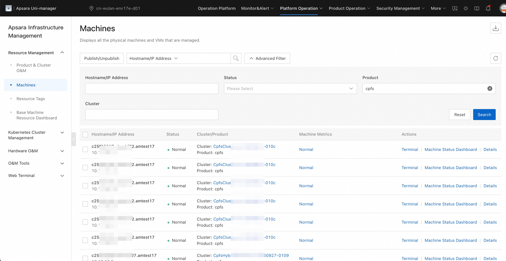
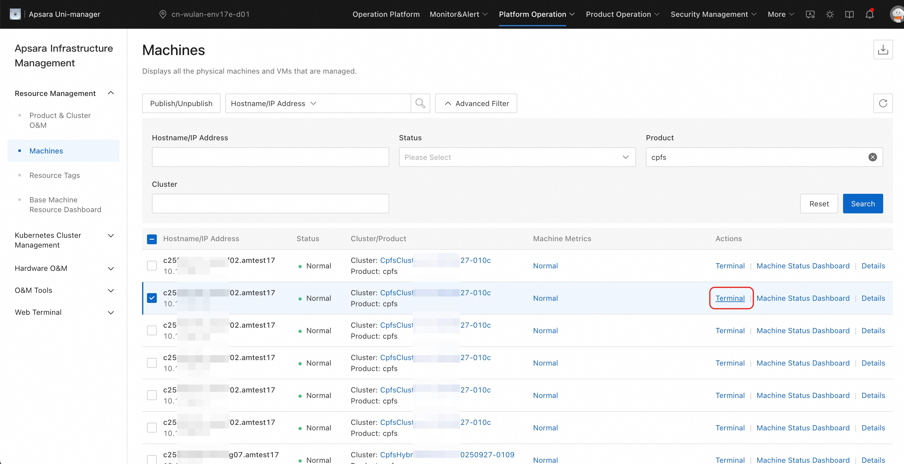
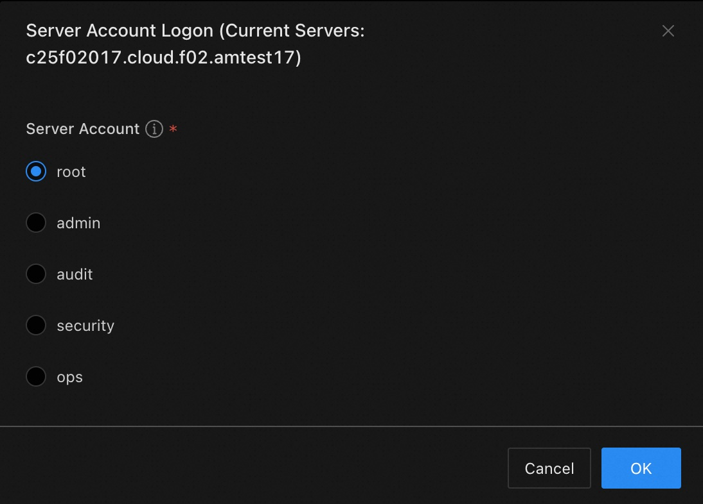
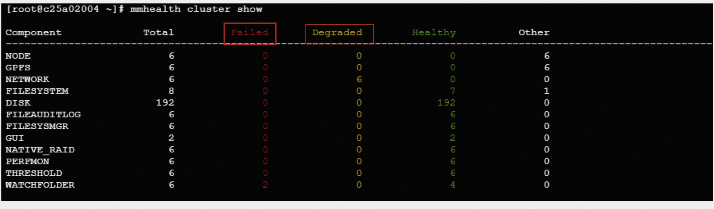
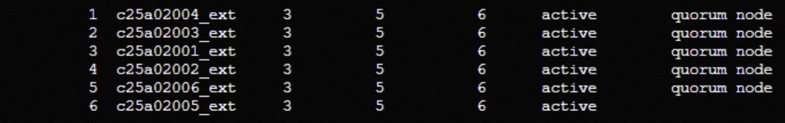
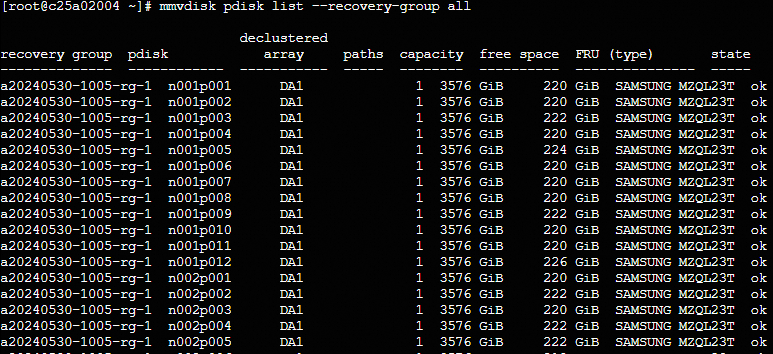

Alibaba Cloud  
Apsara Stack  
Cloud Parallel File Storage  
Operations and Maintenance  
Guide  
Product Version: V3.18.6  
Document Version: 20260701

**Table of Contents**

- [1.Overview](#section-1)
- [2.Log in to the Apsara Uni-manager Operations Console](#section-2)
- [3.Query CPFS O&M metrics](#section-3)
    - [3.1. Query the metrics about the CPFS overall status](#section-3-1)
    - [3.2. Overall performance metrics of CPFS](#section-3-2)
    - [3.3. CPFS pdisk metrics](#section-3-3)
- [4.FAQ about CPFS](#section-4)
    - [4.1. Downtime maintenance process](#section-4-1)

# 1.Overview

This topic describes the purpose of, requirements on, and usage notes for performing O&M operations on Cloud Parallel File Storage (CPFS). This topic also describes how to contact technical support.

**Purpose**

This guide helps O&M engineers perform preventive maintenance on CPFS to ensure long-term system stability. O&M engineers can follow the instructions in this guide to handle system issues that are identified during maintenance. For system issues that are not covered in this guide, the O&M personnel can contact Apsara Stack CPFS engineers for technical support.

**Requirements**

- O&M engineers must possess IT skills, including the knowledge of computer networks, distributed storage operations, and troubleshooting.

- O&M engineers must pass the pre-job training and learn the knowledge of CPFS. The required knowledge of CPFS includes system principles, networking, features, and the use of maintenance tools.

> **Important**
>
> During the maintenance, O&M engineers must follow operation procedures to ensure personal safety and system security. User data must be kept strictly confidential and must not be copied or disseminated without written consent from users.

**Usage notes**

To ensure a stable system and prevent unexpected events, O&M engineers must comply with the following guidelines:

- Hierarchical permission management

  Permissions on networks, devices, systems, and data are granted based on the services and roles of O&M engineers. This prevents system faults that are caused by unauthorized operations.

- System security

  - Before O&M engineers perform operations on the system, they must be aware of the impacts of the operations. This ensures that the system is not affected by high-risk operations.

  - O&M engineers must record the details about the issues that are encountered during the operations. This helps O&M engineers troubleshoot the issues.

- Personal safety and data security

  - O&M engineers must take measures to ensure safety based on device manuals when they use electrical equipment.

  - O&M engineers must use secure devices to access the business network.

  - Unauthorized data replication and dissemination are prohibited.

**Technical support**

O&M engineers can contact CPFS technical support for help during the maintenance.

# 2.Log in to the Apsara Uni-manager Operations Console

This topic describes how users such as O&M engineers log on to the Apsara Uni-manager Operations Console.

**Prerequisites**

- The endpoint of the Apsara Uni-manager Operations Console and the username and password that are used to log in to the console are obtained from a deployment engineer or an administrator.

  The endpoint of the Apsara Uni-manager Operations Console is in the following format: *regi on-id*.ops.console.*intranet-domain-id*.

- A supported browser is used. We recommend that you use Google Chrome.

**Procedure**

1. Open your browser.

2. In the address bar, enter the endpoint of the Apsara Uni-manager Operations Console. Press the ENTER key.

   

   > **Note**
   >
   > You can click the current language in the upper-right corner to switch to another language. Simplified Chinese and English are supported.

3. Enter your username and password.

   > **Note**
   >
   > - Obtain the username and password that are used to log on to the Apsara Uni-manager Operations Console from a deployment engineer or an administrator.
   >
   > - If you enter an invalid password for three consecutive times, the system enables the image verification logon feature. If you enter an invalid password for five consecutive times, the account is locked. Contact the administrator to unlock the account.
   >
   > - The first time that you log on to the Apsara Uni-manager Operations Console, change the password for your username as prompted.
   >
   >   To enhance security, your password must meet the following requirements:
   >
   >   - The password contains uppercase and lowercase letters.
   >
   >   - The password contains digits.
   >
   >   - The password contains at least one of the following special characters: ! @ # $ %
   >
   >   - The password is 10 to 20 characters in length.

4. Click **Agree to Private Policy and Log On**.

# 3.Query CPFS O&M metrics

This topic describes the core O&M metrics of Cloud Parallel File Storage (CPFS), including the system status metrics, performance metrics, and pdisk metrics.

## 3.1. Query the metrics about the CPFS overall status

This topic describes how to query the metrics about the Cloud Parallel File Storage (CPFS) overall status.

**Procedure**

1. Log in to the Apsara Uni-manager Operations Console.

2. In the top navigation bar, choose **Platform Operation > Apsara Infrastructure Management > Resource Management**.

3. In the left-side navigation pane of the **Apsara Infrastructure Management** console, choose **Resource Management > Machines**.

   

4. Find the host that you want to manage and click **Terminal** in the Actions column.

   

5. Select a login username and click **OK** to log in to the operating system of the CPFS storage host.

   

6. Run the  `mmhealth cluster show`  command in the operating system to check the overall status of the cluster.

   > **Note**
   >
   > If the value 0 is displayed in the Failed and Degraded columns, the status is normal.

   

7. Run the  `mmgetstate -Lsa`  command to check the CPFS status.

   

   > **Note**
   >
   > CPFS status description:
   >
   > - UNKNOWN: The operating system where CPFS resides is being restarted or is shut down, or the operating system network is abnormal.
   >
   > - ACTIVE: The CPFS service is in the normal state.
   >
   > - ARBITRATING: CPFS is being started or undergoing fault diagnostics. Check whether an error or warning occurs based on the results of the  `tail -f /var/mmfs/gen/mmfslog`  command. If the issue persists, contact Alibaba Cloud technical support.
   >
   > - DOWN: CPFS is shut down.

## 3.2. Overall performance metrics of CPFS

This topic describes how to check the performance status of Cloud Parallel File Storage (CPFS) and check whether long waiters exist.

**Background information**

Waiters is an important metric for analyzing the overall performance of CPFS. Given that CPFS relies on Remote Direct Memory Access (RDMA) for communication, Waiters holds exceptional significance for the end-to-end performance of the entire CPFS Erasure Coding Engine (ECE). You can use the mmdiag --waiters command to monitor the performance of operations performed in the current fileset. You can run the  `mmlsnode -N waiters -L` command to view the performance of all CPFS nodes. All values are reported in seconds.

**Procedure**

1. Log in to the Apsara Uni-manager Operations Console.

2. In the top navigation bar, choose **Platform Operation > Apsara Infrastructure Management > Resource Management**.

3. In the left-side navigation pane of the **Apsara Infrastructure Management** console, choose **Resource Management > Machines**.

   

4. Find the host that you want to manage and click **Terminal** in the Actions column.

   

5. Select a login username and click **OK** to log in to the operating system of the CPFS storage host.

   

6. Run the  `mmlsnode -N waiters -L`  command to check the return value.

   <ol type="i">

   <li>

   Success code:

   c25a02005_ext.cloud.a02.amtest38: Waiting 0.0034 sec since

   2024-06-26_11:43:09, monitored, thread 329701 ReadmitWorkThread: onThCond

   0x7FAD24025A98 (IOBundleNSPDCondvar), reason 'wait for NSPD I/O'

   c25a02005_ext.cloud.a02.amtest38: Waiting 0.0021 sec since

   2024-06-26_11:43:09, monitored, thread 276130 ReadmitWorkThread: onThCond

   0x7FAD24027D78 (IOBundleNSPDCondvar), reason 'wait for NSPD I/O'

   c25a02005_ext.cloud.a02.amtest38: Waiting 0.0019 sec since

   2024-06-26_11:43:09, monitored, thread 2275926 ReadmitWorkThread: on ThCond

   0x7FAD24026C50 (IOBundleNSPDCondvar), reason 'wait for NSPD I/O'

   </li>

   <li>

   Error codes for moderate-severity latency:

   Waiting 95.0805 sec since 2024-06-26_11:43:01, monitored,

   thread 3932937 ReadmitWorkThread: on ThCond 0x557F293C9130

   (PdiskAvailabilityCondvar), reason 'Until disk availability stabilizes'

   Waiting

   95.0777 sec since 2024-06-26_11:43:01, monitored, thread 2711607

   ReadmitWorkThread: on ThCond 0x7F24041146A8 (VLogIOCondvar), reason 'wait for

   another thread to do log write'

   Waiting

   95.0777 sec since 2024-06-26_11:43:01, monitored, thread 3782474

   ReadmitWorkThread: on ThCond 0x7F2404114628 (VLogIOCondvar), reason 'wait for

   another thread to do log write'

   </li>

   </ol>

   > **Note**
   >
   > - Under idle conditions, return values of 0.00XX sec are normal. Sporadic latency spikes below 2 seconds constitute low-severity latency. Irregular intervals of sub-2-second latencies can be ignored for I/O-insensitive services. Sustained waiters latencies between 2 seconds and 10 seconds cause file system responsiveness degradation (such as slow ls command execution), while CPFS remains operational under redundancy mechanisms if not persistent. Sustained I/O latencies that exceed 15 seconds trigger persistent system stuttering for CPFS file systems. For general business systems, system stuttering can be solved by restarting CPFS. For key business nodes where disk/node loss tolerance is paramount, real-time dump analysis can be performed to troubleshoot the issue. In deadlock scenarios, CPFS automatically captures diagnostic dumps and traces during exception windows.
   >
   > - In emergency situations, you can reboot the node where long waiters are located to solve the issue.

## 3.3. CPFS pdisk metrics

This topic describes how to monitor hard disk status.

**Procedure**

1. Log in to the Apsara Uni-manager Operations Console.

2. In the top navigation bar, choose **Platform Operation > Apsara Infrastructure Management > Resource Management**.

3. In the left-side navigation pane of the **Apsara Infrastructure Management** console, choose **Resource Management > Machines**.

   

4. Find the host that you want to manage and click **Terminal** in the Actions column.

   

5. Select a login username and click **OK** to log in to the operating system of the Cloud Parallel File Storage (CPFS) storage host.

   

6. Run the  `mmvdisk pdisk list --recovery-group all`  command to query the pdisk metrics of CPFS. The following figure shows the return value (State).

   

   | pdisk status | Status description | Solution |
   | --- | --- | --- |
   | OK | Normal pdisk status | None |
   | Readonly | pdisk read-only mode | Replace the pdisk with a new one. |
   | slow | Slow pdisk | The pdisk enters a sub-healthy state. We recommend that you replace the pdisk with a new one. |
   | Missing | pdisk loss | Replace the pdisk with a new one. |
   | PTOW | pdisk I/O timeout | Replace the pdisk with a new one. |

# 4.FAQ about CPFS

This topic describes how to handle Cloud Parallel File Storage (CPFS) downtime maintenance issues.

## 4.1. Downtime maintenance process

This topic describes how to perform Cloud Parallel File Storage (CPFS) downtime maintenance.

> **Important**
>
> - The following steps are general and subject to actual scenarios.
>
> - Before downtime maintenance, you must stop the upper-layer business and stop the read and write operations on the shared file storage.
>
> - In the following descriptions, ${fs_id} is the file system ID displayed on the frontend, and the bmcpfs prefix, such as 019bebd3, is removed from the ID.

**Procedure for downtime maintenance of a CPFS cluster**

<table>
  <tr>
    <th>S N</th>
    <th>Step</th>
    <th>Node where the operation is performed</th>
    <th>Command to be executed</th>
    <th>Expected result</th>
  </tr>
  <tr>
    <td colspan="5">Unmount the file system from the client node (BMCP instance) and stop the CPFS client service</td>
  </tr>
  <tr>
    <td>1</td>
    <td>Unmount the file system on the compute node side</td>
    <td>Bare Metal Computing Platform (BMCP) instance (CPFS client)</td>
    <td>Run the following command on any BMCP node: <em>mmumount ${fs_id} -a</em></td>
    <td>df-h |grep ${fs_id}</td>
  </tr>
  <tr>
    <td>2</td>
    <td>Check whether the file system is unmounted</td>
    <td>BMCP instance (CPFS client)</td>
    <td>Run the following command on any BMCP node: <em>mmlsmount ${fs_id} -L</em></td>
    <td>Expected output: File system ${fs_id} is mounted on 0 nodes</td>
  </tr>
  <tr>
    <td>3</td>
    <td>Disable the automatic startup feature of the CPFS client service</td>
    <td>BMCP instance (CPFS client)</td>
    <td>Run the following command on any client node: <em>mmlsconfig | grep autoload</em></td>
    <td>If the return value is not no, Run the following command: mmchconfig autoload=no</td>
  </tr>
  <tr>
    <td>4</td>
    <td>Disable the CPFS client service</td>
    <td>BMCP instance (CPFS client)</td>
    <td>Run the following command on any client node: <em>mmshutdown -a</em></td>
    <td>If the return value is down, the CPFS client service is disabled.</td>
  </tr>
  <tr>
    <td>5</td>
    <td>Check whether the CPFS client service is disabled</td>
    <td>BMCP instance (CPFS client)</td>
    <td>Run the following command on any client node: <em>mmgetstate -Lsa</em></td>
    <td>If the CPFS state is down, the CPFS client service is disabled.</td>
  </tr>
  <tr>
    <td colspan="5">Unmount the file system from a CPFS storage node and stop the CPFS storage service</td>
  </tr>
  <tr>
    <td>1</td>
    <td>Unmount the file system on the storage node side</td>
    <td>CPFS storage node</td>
    <td>Log in to each CPFS storage node in turn to run the following command: <em>mmumount ${fs_id} -a</em></td>
    <td>df -h |grep ${fs_id}</td>
  </tr>
  <tr>
    <td>2</td>
    <td>Check whether the file system is unmounted</td>
    <td>CPFS storage node</td>
    <td>Log in to each CPFS storage node in turn to run the following command: <em>mmlsmount ${fs_id} -L</em></td>
    <td>Expected output: File system ${fs_id} is mounted on 0 nodes</td>
  </tr>
  <tr>
    <td>3</td>
    <td>Disable the automatic startup feature of the CPFS service</td>
    <td>CPFS storage node</td>
    <td>Log in to any CPFS storage node to run the following command: <em>mmlsconfig | grep autoload</em></td>
    <td>If the return value is not no, Run the following command: mmchconfig autoload=no</td>
  </tr>
  <tr>
    <td>4</td>
    <td>Disable the CPFS storage service</td>
    <td>CPFS storage node</td>
    <td>Run the following command on any client node: <em>mmshutdown -a</em></td>
    <td>If the return value is down, the CPFS storage service is disabled.</td>
  </tr>
  <tr>
    <td>5</td>
    <td>Check whether the CPFS client service is disabled</td>
    <td>CPFS storage node</td>
    <td>Run the following command on any client node: <em>mmgetstate -Lsa</em></td>
    <td>If the CPFS state is down, the CPFS client service is disabled.</td>
  </tr>
  <tr>
    <td colspan="5"></td>
  </tr>
</table>

**Cluster launch process**

<table>
  <tr>
    <th>S N</th>
    <th>Step</th>
    <th>Node where the operation is performed</th>
    <th>Command to be executed</th>
    <th>Expected result</th>
  </tr>
  <tr>
    <td colspan="5">Start the CPFS service on a CPFS storage node and mount the file system</td>
  </tr>
  <tr>
    <td>1</td>
    <td>Enable automatic CPFS service startup in system settings</td>
    <td>CPFS storage node</td>
    <td>Run the following command on any storage node: <em>mmchconfig</em> <em>autoload=yes</em></td>
    <td>The return result of the mmchconfig | grep autoload command is yes.</td>
  </tr>
  <tr>
    <td>1</td>
    <td>Start the CPFS storage service</td>
    <td>CPFS storage node</td>
    <td>Run the following command on any storage node: <em>mmstartup -a</em></td>
    <td>If the return value is active, the CPFS storage service is started.</td>
  </tr>
  <tr>
    <td>2</td>
    <td>Check whether the file system is mounted</td>
    <td>CPFS storage node</td>
    <td>Run the following command on any storage node: <em>mmlsmount ${fs_id} -L</em></td>
    <td>Expected output: File system ${fs_id} is mounted on 6 nodes Note The number of nodes on which the CPFS file system is mounted is subject to the actual number.</td>
  </tr>
  <tr>
    <td colspan="5">Start the CPFS storage service on the client node (BMCP instance) and mount the CPFS file system</td>
  </tr>
  <tr>
    <td>1</td>
    <td>Enable automatic service startup in system settings</td>
    <td>BMCP instance (CPFS client)</td>
    <td>Run the following command on any client node: <em>mmchconfig</em> <em>autoload=yes</em></td>
    <td>The return result of the mmchconfig | grep autoload command is yes.</td>
  </tr>
  <tr>
    <td>1</td>
    <td>Start the storage service on the CPFS client node</td>
    <td>BMCP instance (CPFS client)</td>
    <td>Run the following command on any client node: <em>mmstartup -a</em></td>
    <td>If the return value is active, the CPFS storage service is started.</td>
  </tr>
  <tr>
    <td>2</td>
    <td>Mount a file system</td>
    <td>BMCP instance (CPFS client)</td>
    <td>Run the following command on any BMCP instance: <em>mmmount ${fs_id} -a</em> You need to log in to each BMCP instance in turn to run the following command: <em>mount --bind</em><em>/cpfs/${fs_id}/${cluster_i</em> <em>d}/${src_dir} /${tgt_dir}</em> Note This command is for your reference only. The actual command should prevail.</td>
    <td>The mount is successful.</td>
  </tr>
  <tr>
    <td>3</td>
    <td>Check whether the file system is mounted</td>
    <td>BMCP instance (CPFS client)</td>
    <td>Log in to each CPFS client in turn to run the following command: <em>mmlsmount ${fs_id} -L</em></td>
    <td>Expected output: File system ${fs_id} is mounted on 9 nodes Note The number of nodes to be mounted is subject to the actual number.</td>
  </tr>
  <tr>
    <td colspan="5"></td>
  </tr>
</table>

**Check the health status of the cluster (optional)**

<table>
  <tr>
    <th>S N</th>
    <th>Step</th>
    <th>Node where the operation is performed</th>
    <th>Command to be executed</th>
    <th>Expected result</th>
  </tr>
  <tr>
    <td colspan="5">Start the CPFS service on a CPFS storage node and mount the file system</td>
  </tr>
  <tr>
    <td>3</td>
    <td>Check the network connectivity</td>
    <td>CPFS storage node</td>
    <td>Log in to each CPFS storage node in turn to run the following command: <em>sudo mmnetverify all</em></td>
    <td>If the return value is Success, the network connection is normal.</td>
  </tr>
  <tr>
    <td>4</td>
    <td>Check the disk status</td>
    <td>CPFS storage node</td>
    <td>Log in to each CPFS storage node in turn to run the following command: <em>mmvdisk pdisk list --rg all</em> <em>--not-ok</em></td>
    <td>If the return value is All pdisks are ok, the disk status is normal.</td>
  </tr>
  <tr>
    <td>5</td>
    <td>Check the latencies</td>
    <td>CPFS storage node</td>
    <td>Run the following command on any storage node: <em>mmlsnode -N waiters -L</em></td>
    <td>If the return value does not contain any latency that lasts for more than 10s, the latencies are normal. Note This data is for your reference only. The actual data should prevail.</td>
  </tr>
  <tr>
    <td>6</td>
    <td>Check basic logs</td>
    <td>CPFS storage node</td>
    <td>Run the following command on any storage node: <em>tail -f</em><em>/var/mmfs/gen/mmfslog</em></td>
    <td>If no error is returned, the CPFS service is running properly.</td>
  </tr>
  <tr>
    <td>7</td>
    <td>Check node status</td>
    <td>CPFS storage node</td>
    <td>Run the following command on any storage node: <em>mmhealth cluster show</em></td>
    <td>If the returned values of Failed and Degraded are 0, the node status is normal.</td>
  </tr>
  <tr>
    <td colspan="5">Start the CPFS service on the client node (BMCP instance) and mount the file system</td>
  </tr>
  <tr>
    <td>1</td>
    <td>Check the network connectivity</td>
    <td>BMCP instance (CPFS client)</td>
    <td>Log in to each CPFS client in turn to run the following command: <em>mmnetverify all</em></td>
    <td>If the return value is Success, the network connection is normal.</td>
  </tr>
  <tr>
    <td>2</td>
    <td>Check the file system disk status</td>
    <td>BMCP instance (CPFS client)</td>
    <td>Run the following command on any client node: <em>mmlsdisk /dev/fsname -m</em></td>
    <td>If the return value of Availability is up, the disk status is normal.</td>
  </tr>
  <tr>
    <td>3</td>
    <td>Check the latencies</td>
    <td>BMCP instance (CPFS client)</td>
    <td>Run the following command on any client node: <em>mmlsnode -N waiters -L</em></td>
    <td>If the return value does not contain any latency that lasts for more than 10s, the latencies are normal.</td>
  </tr>
  <tr>
    <td>4</td>
    <td>Check basic logs</td>
    <td>BMCP instance (CPFS client)</td>
    <td>Run the following command on any client node: <em>tail -f</em><em>/var/mmfs/gen/mmfslog</em></td>
    <td>If no error is returned, the CPFS service is running properly on the client node.</td>
  </tr>
  <tr>
    <td>5</td>
    <td>Check node status</td>
    <td>BMCP instance (CPFS client)</td>
    <td>Run the following command on any client node: <em>mmhealth cluster show</em></td>
    <td>If the returned values of Failed and Degraded are 0, the node status is normal.</td>
  </tr>
  <tr>
    <td colspan="5"></td>
  </tr>
</table>
