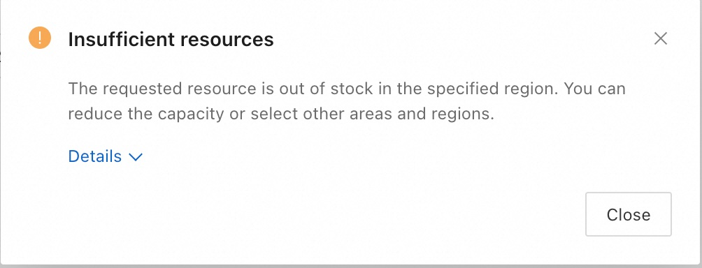

Alibaba Cloud  
Apsara Stack  
Cloud Parallel File Storage  
User Guide  
Product Version: V3.18.6  
Document Version: 20260701

**Table of Contents**

- [1.What is APFS?](#section-1)
- [2.Getting Started](#section-2)
    - [2.1. Log on to the APFS console](#section-2-1)
    - [2.2. Create an APFS file system](#section-2-2)
    - [2.3. Limits](#section-2-3)
- [3.APFS list](#section-3)
    - [3.1. Manage APFS file systems](#section-3-1)
    - [3.2. Scale up an APFS file system](#section-3-2)
    - [3.3. Resource monitoring](#section-3-3)
    - [3.4. Data flow](#section-3-4)
        - [3.4.1. Backup plans](#section-3-4-1)
        - [3.4.2. Replica management](#section-3-4-2)
        - [3.4.3. Import jobs](#section-3-4-3)
- [4.FAQ](#section-4)
    - [4.1. No inventory for sales](#section-4-1)

# 1.What is APFS?

**Overview**

ApsaraStack Parallel File System (APFS) is a cloud-defined, distributed parallel file system service. APFS delivers high performance that is required for large-scale parallel training in intelligent computing scenarios and offers features such as intelligent data management, reliable data security, flexible deployment, and elastic scaling of resources. AFPS applies to scenarios where Hygon DCUs, Ascend GPUs, and Hygon storage cluster are used.

# 2.Getting Started

## 2.1. Log on to the APFS console

**Prerequisites**

- The URL of the console that is obtained from the deployment personnel.

- A supported browser is used. We recommend that you use Google Chrome.

**Procedure**

1. Enter the URL of the Apsara Uni-manager Management Console in the address bar and press the Enter key.

2. On the login page, enter your username and password.

   You can obtain the username and password that are used to log in to the Apsara Uni-manager Management Console from the operations administrator.

   > **Note**
   >
   > - **First login**
   >
   >   The first time that you log on to the Apsara Uni-manager Management Console, you need to change the password of your account. The password must be 10 to 32 characters in length. It must contain all of the following character types: uppercase letters, lowercase letters, digits, and special characters. Supported special characters include: ! @ # $ %
   >
   > - **Forgotten password**
   >
   >   If you have forgotten your password, click Forgot Password. On the page that appears, enter the username of your account, the email address that was used to create the account, and the CAPTCHA code. Then, the system sends a link for resetting the password to the specified email address.

3. Click **Log In**.

4. If multi-factor authentication (MFA) is enabled for your account, perform the following operations based on your login scenario:

   - You log on to the Apsara Uni-manager Management Console for the first time after MFA is enabled by the administrator.

     <ol type="a">

     <li>

     On the Bind Virtual MFA Device page, follow the on-screen instructions to bind an MFA device.

     </li>

     <li>

     Enter the username and password again as in Step 2 and click **Log On**.

     </li>

     </ol>

     <ol type="i" start="100">

     <li>

     Enter the six-digit MFA code and click **Authentication**.

     </li>

     </ol>

   - You have enabled and bound MFA:

     Enter the six-digit MFA code and click **Authentication**.

     > **Note**
     >
     > For more information about how to bind and enable MFA, see **Security Center** > **MFA** > **Manage MFA** in Apsara Uni-manager Operations Console User Guide.

5. In the top navigation bar, choose **Products > Storage > APFS** to go to the ApsaraStack Parallel File System (APFS) console.

## 2.2. Create an APFS file system

This topic describes how to create a file system in the ApsaraStack Parallel File System (APFS) console.

**Procedure**

1. Log in to the APFS console.

2. On the **APFS File Systems** page, click **Create File System**.

3. On the **Create a file system** page, configure parameters.

   After you complete the configuration, the configuration information is displayed in the right-side section.

   The following table describes the parameters.

   <table>
     <tr>
       <th colspan="2">Parameter</th>
       <th>Description</th>
     </tr>
     <tr>
       <td rowspan="5">Basic information</td>
       <td>Organization/R esource Set</td>
       <td>The organization and resource set to which the file system belongs.</td>
     </tr>
     <tr>
       <td>Region/Availab ility Zone</td>
       <td>The region and zone to which the file system belongs.</td>
     </tr>
     <tr>
       <td>File System Type</td>
       <td>The type of the file system. The default value is BMEFS.</td>
     </tr>
     <tr>
       <td>Cluster</td>
       <td>The cluster to which the file system belongs.</td>
     </tr>
     <tr>
       <td>Specifications</td>
       <td>Only performance-oriented APFS file systems are supported.</td>
     </tr>
     <tr>
       <td rowspan="2">Detailed information</td>
       <td>Capacity (TiB)</td>
       <td>The capacity of the file system. The lower limit is 1 TiB and the upper limit equals the actual maximum capacity available.</td>
     </tr>
     <tr>
       <td>Description</td>
       <td>The description of the file system. The description must be 2 to 128 characters in length, and can contain letters, digits, underscores (_), hyphens (-), and colons (:). It must start with a letter. It cannot start with <code> http:// </code> or <code> https:// </code>.</td>
     </tr>
   </table>

4. Optional. If you want to set quotas for the resources of a service, click **Quota Management** on the right side of the page to go to the **Quotas** page. For more information, see the **Quota management** topic in *User Guide - Apsara Uni-manager Mana gement Console*.

5. Click **Confirm Order**.

6. After a file system is created, you can view the status, specifications, and capacity of the file system in the APFS list. To mount a file system, log on to the Bare Metal Computing Platform (BMCP) console. For more information, see the **Clusters and nodes** topic in **BMCP User Guide**.

## 2.3. Limits

This topic describes the limits of ApsaraStack Parallel File System (APFS).

- Only performance APFS file systems are supported. The maximum total capacity of a Performance APFS file system is 25 PiB.

- You can only mount an APFS file system to a Bare Metal Computing Platform (BMCP) cluster in the BMCP console.

- By default, mount targets are automatically created. You cannot create additional mount targets.

- You must scale up APFS file systems when data is not read or written.

- Cluster scale-down is not supported.

# 3.APFS list

## 3.1. Manage APFS file systems

**View an APFS file system**

**Prerequisites**

An ApsaraStack Parallel File System (APFS) file system is created. For more information, see Create an APFS file system.

**Procedure**

1. Log on to the APFS console.

2. On the APFS page, you can search for a file system by **File System ID** or **File System Name**.

3. On the APFS page, find the file system that you want to view, and click the  icon in the

   **Monitoring** column to view monitoring metrics such as capacity, bandwidth, and read/write IOPS of the file system.

4. On the APFS page, click a file system ID or click **Details** in the **Actions** column to view the basic information about the file system.

5. On the **Basic Information** tab, you can view the ID, status, specifications, and capacity of the file system.

**Delete an APFS file system**

**Prerequisites**

- Before you delete an APFS file system, the file system is unmounted from the mount target.

- Deleted APFS file systems cannot be restored. Make sure that you back up the data stored in an APFS file system before you delete it.

- After you delete an APFS file system, resources of the file system are not immediately released. The disk space occupied by the file system is released seven days later.

**Procedure**

1. Log on to the APFS console.

2. On the APFS page, find the file system that you want to delete and click **Delete** in the **Actions** column.

3. In the dialog box that appears, click **OK**.

**Modify the description of an APFS file system**

1. On the APFS page, find the file system for which you want to modify the description, move

   the pointer over the **File System ID/Name** column, and click the  icon.

2. In the dialog box that appears, enter a new description.

3. Then, click **OK**.

> **Note**
>
> The description of the file system must be 2 to 128 characters in length and can contain letters, digits, underscores (_), hyphens (-), and colons (:). It must start with a letter. It cannot start with  `http://`  or  `https://` .

## 3.2. Scale up an APFS file system

**Prerequisites**

1. An ApsaraStack Parallel File System (APFS) file system is created. For more information, see Create an APFS file system.

2. No data is being read from or written to the APFS file system.

**Procedure**

1. Log in to the APFS console.

2. On the APFS page, find the file system that you want to scale up and click **Scale Up** in the Actions column.

3. On the File system expansion page, specify a value for the **New Total Capacity (TiB)** parameter.

   > **Note**
   >
   > The new total capacity cannot be less than the current total capacity and cannot exceed the maximum total capacity of the cluster.

4. Click **Confirm Order** to complete the scale-up.

## 3.3. Resource monitoring

This topic describes how to view monitoring metrics and create alert rules for ApsaraStack Parallel File System (APFS) resources.

**Prerequisites**

An APFS file system is created. For more information, see Create an APFS file system.

**Procedure**

1. Log on to the APFS console.

2. Click **APFS**, and then click the ID or name of a file system or click **Details** in the Actions column to go to the File System Details page.

3. On the File System Details page, click the **Monitoring** tab in the upper-left corner to view monitoring metrics such as capacity, bandwidth, and read/write IOPS of the file system.

4. You can also click the  icon in the upper-right corner of the chart to create an alert rule.

   For more information, see the **Create an alert rule** topic in **CloudMonitor User Guide**.

5. After an alert rule is created, you can choose **Products > Migration and O&M Management > CloudMonitor** in the top navigation bar and click **Alert Service** in the left-side navigation pane to view and manage the alert rule.

## 3.4. Data flow

You can efficiently migrate data between ApsaraStack Parallel File System (APFS) and Object Storage Service (OSS). APFS also provides the data backup and import features to help you manage the lifecycle of data assets, optimize costs, and quickly import data in high-performance computing scenarios.

- Data backup: You can create backup plans to automatically back up data from APFS file systems to OSS at the scheduled time. This feature is applicable to the following scenarios:

  - Data backup and disaster recovery: You can synchronize data replicas from APFS to OSS by creating a cross-storage medium backup policy, which improves data security.

  - Storage cost optimization: APFS can identify and migrate infrequently accessed data to OSS in order to reduce the storage costs and conduct tiered data management.

- Data import: You can create import jobs to quickly import data from OSS to APFS. This feature is applicable to the following scenarios:

  - Data migration from on-premises environments to the cloud: OSS supports multiple data importing methods. You can use OSS to quickly import data from on-premises environments or other systems to APFS.

  - Acceleration of training based on AI and big data: The historical data stored in OSS may consistently grow over time. You can batch import the volumetric data from OSS to high-performance APFS file systems. This way, the data can be accessed with a low latency and a high throughput in scenarios demanding an extremely high I/O throughput, such as AI model training and high-performance computing.

### 3.4.1. Backup plans

You can create backup plans in the ApsaraStack Parallel File System (APFS) console to replicate data from APFS to Object Storage Service (OSS).

**Create a backup plan**

**Limits**

- For the same user and region, you can create only one backup plan for each file system.

- The names of backup plans for the same user and region must be unique.

- The minimum backup interval is 24 hours.

- If the source file system is in the Deleting, Deleted, Stopping, or Stopped state, the backup plan is automatically suspended.

**Prerequisites**

- An APFS file system is created and is in the Available state. For more information, see Create an APFS file system.

- An OSS bucket is created.

**Procedure**

1. Log in to the APFS console.

2. In the left-side navigation pane, click **Data Flow**.

3. On the **Backup Plan** tab, click **Create Backup Plan** and configure the following parameters.

   **Description**

   **Section**

   **Parameter**

   Schedule Name

   Enter a name for the backup plan.

   Basic Informatio n

   Description

   Enter the description of the backup plan.

   Select the APFS file system for which you want to create a

   Source File System

   backup plan.

   Enter the path of the files that you want to back up.

   Source Path

   Example: /source/path.

   Data Source Configura tion

   Select the OSS bucket to which data is backed up from the

   OSS Bucket

   drop-down list.

   Destination Storage

   Enter the path to which data is backed up in the OSS

   Location

   bucket. Example: oss-bucket-name/oss-path.

   Enter a cron expression to specify the time when the backup plan is triggered. For example, 0 0 12 \* \* ? indicates that the backup plan is triggered at 12:00 every day.

   Cron Expression

   > **Important**

   Schedulin

   > The backup interval must be at least one day.

   g Configura tion

   - Express: The migration speed is unlimited.

   - Standard: The maximum migration speed is 200 MB/s.

   Migration Speed

   - Basic: The migration bandwidth occupied by an APFS node does not exceed 50% of the total bandwidth.

   Enter the paths of files that you do not want to back up in the source file system. All files in the specified paths are

   Excluded Paths

   not replicated to the OSS bucket. Separate multiple paths with commas (,). Example: /tmp,/logs,/cache.

   Enter the extensions of files that you want to back up. Only

   Filename Matching

   matching files are backed up. Separate multiple file

   Pattern

   extensions with commas (,). Example: \*.log,\*.tmp,\*.bak.

   Specify the file size threshold.

   - Format: integer + unit. You can enter a single value or a value range. If you specify a range, separate the two values with a comma (,).

   - Supported units: B (bytes), K (KiB), M (MiB), G (GiB), and T (TiB). The units are not case-sensitive.

   File Size Threshold

   - If you enter a single value, only files whose sizes equal or exceed the threshold are backed up. For example, if you specify 1G, only files whose sizes are 1 GiB or larger are backed up.

   - If you enter a value range, the minimum value must be smaller than the maximum value. For example, if you specify 1G,2G, only files whose sizes range from 1 GiB to 2 GiB are backed up.

   Specify the file modification time threshold.

   - Format: integer + unit. You can enter a single value or a value range. If you specify a range, separate the two values with a comma (,).

   - Supported units: ms (milliseconds), s (seconds), m (minutes), h (hours), d (days), w (weeks), M (months,

   Advanced

   which are counted based on 30 days), and y (years,

   Configura

   which are counted based on 365 days). Take note that m

   tion

   (lowercase) stands for minutes and M (uppercase) stands for months.

   - If you enter a single value, only files with a time gap longer than the specified value are backed up. The time gap refers to the time span between the time when the file was last modified (such as mtime) and the current system time. For example, if you specify 3d, only files that were modified three days ago or earlier are backed

   File Operation Time

   up.

   Threshold

   - If you enter a value range, the minimum value must be smaller than the maximum value. For example, if you specify 1d,5d, only files with a time gap ranging from one day to five days are backed up.

   > **Important**
   >
   > - Take note that m (lowercase) stands for minutes and M (uppercase) stands for months.
   >
   > - A value range consists of only the minimum value and the maximum value.
   >
   > - The minimum value of a value range must be smaller than the maximum value.
   >
   > - Decimals are not supported.

   The total OSS storage used to store the replicas created by the backup plan. Unit: GiB. Default value: 1024.

   Maximum Capacity

   > **Note**

   Limit (GiB)

   > When the specified OSS storage is exhausted, the backup plan is suspended.

4. Click **Submit**.

**View a backup plan**

**Prerequisites**

A backup plan is created.

**Procedure**

1. Log in to the APFS console.

2. In the left-side navigation pane, click **Data Flow**.

3. On the **Backup Plan** tab, you can view the details of each backup plan in the list. Click the ID of a backup plan in the **Plan ID/Name** column to view the details of the backup plan.

   - Basic Information: displays the plan ID, plan name, source file system, source path, cron expression, migration speed, and status.

   - Execution Details: displays the most recent time when the backup plan was successfully executed, the number of consecutive failures, and the time when the most recent failure occurred.

   - Storage Information: displays the total storage capacity, source path, and destination path of the backup plan.

**Modify a backup plan**

**Prerequisites**

A backup plan is created.

**Procedure**

1. Log in to the APFS console.

2. In the left-side navigation pane, click **Data Flow**.

3. On the **Backup Plan** tab, click **Modify** in the Actions column of the desired backup plan.

4. On the **Edit Backup Plan** page, you can modify the plan name, status (enabled or disabled), cron expression, and migration speed.

5. Click **Submit**.

**Delete a backup plan**

**Procedure**

1. Log in to the APFS console.

2. In the left-side navigation pane, click **Data Flow**.

3. On the **Backup Plan** tab, click **Delete** in the Actions column of the desired backup plan.

4. In the message that appears, confirm the information and click **OK**.

### 3.4.2. Replica management

The replica management feature of ApsaraStack Parallel File System (APFS) allows you to manually create replica tasks, cancel replica tasks, and delete replicas.

**Limits**

- Each user can run at most two replica tasks concurrently.

- At most five replica tasks can be run concurrently on a global scale.

- Within the same backup plan, only one replica can be synchronized at a time.

- The storage capacity of a backup plan is limited. The default is 1024 GiB. The total size of all healthy replicas must not exceed the storage capacity.

- You can cancel only replica tasks in the Synchronizing state.

- You can create replicas only when the corresponding backup plan is enabled.

- If a backup plan fails for a certain number of times, the backup plan enters the SUSPENDED state. In this case, manual intervention is needed.

**Manage replicas**

1. Log in to the APFS console.

2. In the left-side navigation pane, click **Data Flow**.

3. Click the **Replica Management** tab to manage replica tasks.

   | Operation | Description |
   | --- | --- |
   | View replica tasks | Click the ID of a replica task in the <strong>Replica ID/Name</strong> column to view its details. • Basic Information: displays the replica task ID, backup plan ID, source file system ID, status, creation time, and end time. • Progress Information: displays the synchronization progress (%), transfer speed, number of transferred files, and size (bytes). • Storage Information: displays the source path, destination path, and total size (bytes). |
   | Cancel replica tasks | You can cancel a replica task in the Synchronizing state. Click <strong>Cancel Task</strong> in the Actions column of the desired task. In the message that appears, confirm the information and click <strong>OK</strong>. |
   | Delete replica tasks | You can delete replica tasks that are no longer needed. Note Files that have already been replicated to the destination Object Storage Service (OSS) bucket are not deleted. Click <strong>Delete Replica</strong> in the Actions column of the desired task. In the message that appears, confirm the information and click <strong>OK</strong>. |

**Manually create a replica task**

**Prerequisites**

A backup plan is created. For more information, see Create a backup plan.

**Procedure**

1. Log in to the APFS console.

2. In the left-side navigation pane, click **Data Flow**.

3. Click the **Replica Management** tab, click **Create Replica**, and configure the following parameters.

   | Parameter | Description |
   | --- | --- |
   | Backup Plan | Select a backup plan from the drop-down list. Data is backed up based on the configuration of the selected backup plan. |
   | Replica Name | Enter a name for the replica task. |
   | Description | Enter the description of the replica task. |

4. Click **Submit**.

5. After you submit the replica task, you can view the task status (Synchronizing, Healthy, Failed, Canceled, Canceling, or Waiting), synchronization progress, and creation time in the task list.

### 3.4.3. Import jobs

You can create import jobs to import data from Object Storage Service (OSS) to ApsaraStack Parallel File System (APFS).

**Limits**

- A user can run only one import job at a time.

- At most three import jobs can be run concurrently on a global scale.

- The corresponding file system must be in the Available state.

**Create an import job**

**Prerequisites**

- An APFS file system is created and is in the Available state. For more information, see Create an APFS file system.

- An OSS bucket is created.

**Procedure**

1. Log in to the APFS console.

2. In the left-side navigation pane, click **Data Flow**.

3. Click the **Import Job** tab.

4. Click **Create Import Job** and configure the following parameters.

   <table>
     <tr>
       <th>Section</th>
       <th>Parameter</th>
       <th>Description</th>
     </tr>
     <tr>
       <td rowspan="6">Basic Information</td>
       <td>Import Name</td>
       <td>Enter a name for the import job.</td>
     </tr>
     <tr>
       <td>Description</td>
       <td>Enter the description of the import job.</td>
     </tr>
     <tr>
       <td>Target File System</td>
       <td>Select the destination APFS file system from the drop-down list.</td>
     </tr>
     <tr>
       <td>OSS Bucket</td>
       <td>Select the OSS bucket where the source data is stored from the drop-down list.</td>
     </tr>
     <tr>
       <td>File System Path</td>
       <td>Enter a path in the APFS file system. Example: /target/path.</td>
     </tr>
     <tr>
       <td>OSS Object Path</td>
       <td>Enter the OSS path of the source data. Example: oss-bucket-name/oss-path.</td>
     </tr>
     <tr>
       <td rowspan="3">Advanced Configuratio n</td>
       <td>Bandwidth Limit</td>
       <td>Specify the maximum bandwidth used for file transfer. • Format: number + unit. Supported units: <code> K </code> (KB/s), <code> M </code> (MB/s), and <code> G </code> (GB/s). Example: <code> 50M </code> indicates that the upper limit is 50 MB/s. • If you do not want to limit the bandwidth usage, enter <code> off </code>. • If you leave this parameter empty, the default value <code> 200M </code> is used, which indicates that the upper limit is 200 MB/s.</td>
     </tr>
     <tr>
       <td>Excluded Paths</td>
       <td>The paths of files that you do not want to import in the OSS bucket. All files in the specified paths are not imported to APFS.Separate multiple paths with commas (,). Example:/tmp,/logs,/cache.</td>
     </tr>
     <tr>
       <td>Filename Matching Pattern</td>
       <td>Enter the extensions of files that you want to import. Only matching files are imported. Separate multiple file extensions with commas (,). Example: *.log,*.tmp,*.bak.</td>
     </tr>
   </table>

**Manage import jobs**

1. Log in to the APFS console.

2. In the left-side navigation pane, click **Data Flow**.

3. Click the **Import Job** tab to manage import jobs.

   | Operation | Description |
   | --- | --- |
   | View import jobs | Click the name of an import job in the <strong>Job Name</strong> column to view its details. • Basic Information: displays the job ID, job name, file system ID, progress (%), replica size, and number of files. • Progress Information: displays the synchronization progress (%), transfer speed, number of transferred files, and size (bytes). • Storage Information: displays the file system path, OSS bucket, OSS path, and total size (bytes). |
   | Cancel import jobs | You can cancel import jobs that are in the Synchronizing state. Click <strong>Cancel Task</strong> in the Actions column of the desired job. In the message that appears, confirm the information and click <strong>OK</strong>. |
   | Delete import jobs | You can delete import jobs that are no longer needed. Note Files that have already been imported into APFS are not deleted. Click <strong>Delete Job</strong> in the Actions column of the desired job. In the message that appears, confirm the information and click <strong>OK</strong>. |

# 4.FAQ

This topic provides answers to frequently asked questions (FAQ) about ApsaraStack Parallel File System (APFS).

## 4.1. No inventory for sales

This topic describes solutions for the failure to create an ApsaraStack Parallel File System (APFS) file system due to insufficient inventory.

**Symptom**

When you create or scale up an APFS file system, the following exception message may appear.

**Solutions**

Solution 1: Decrease the capacity of the file system.

Scenario 2: Modify the zone of the file system.

Solution 3: Delete any redundant file system, contact the on-site O&M engineer to release disk space, and then create or scale up the file system again.
