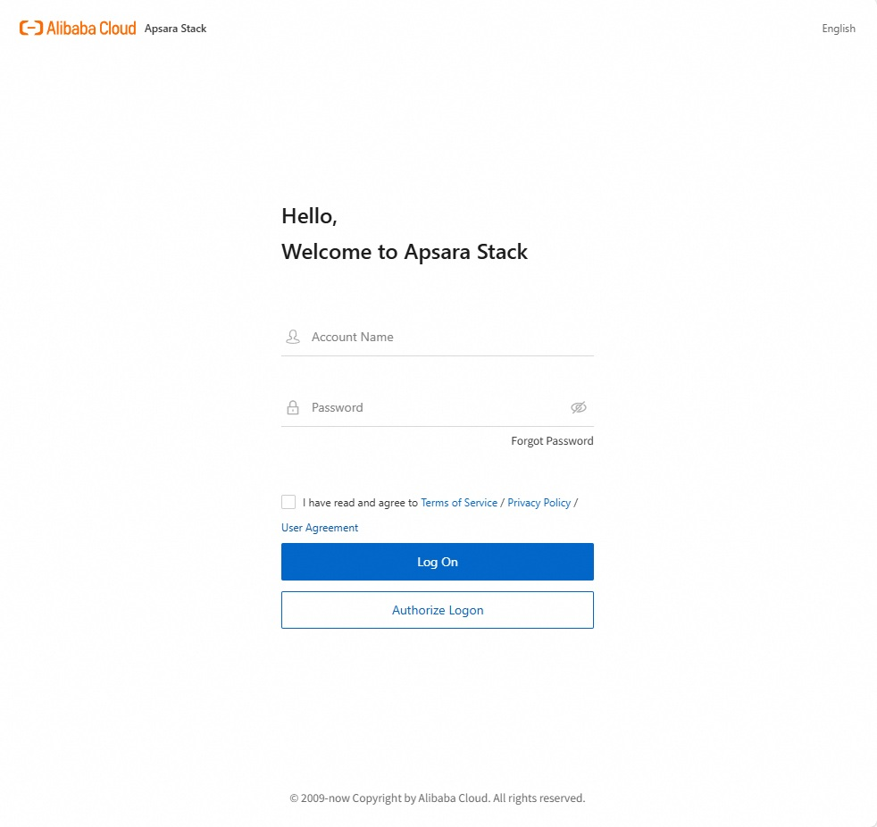
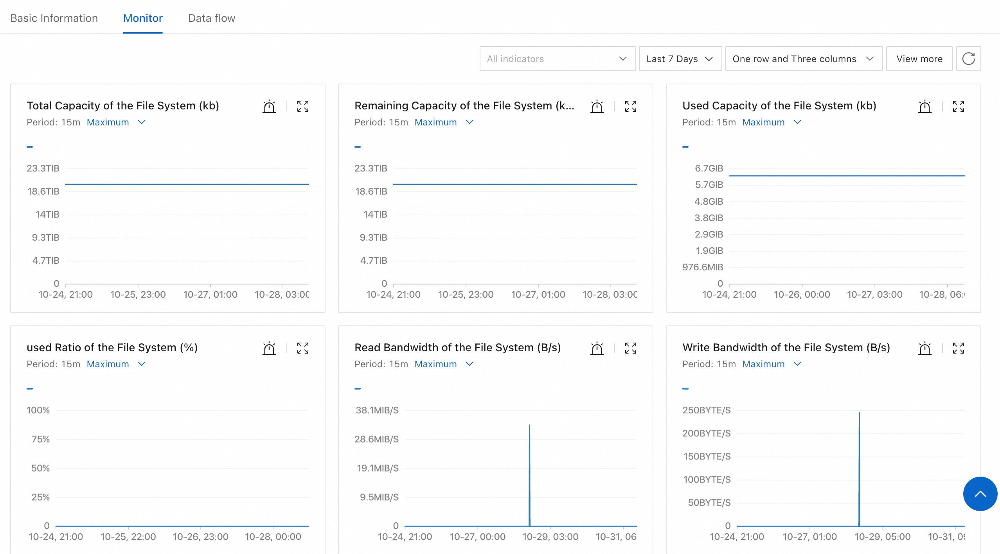
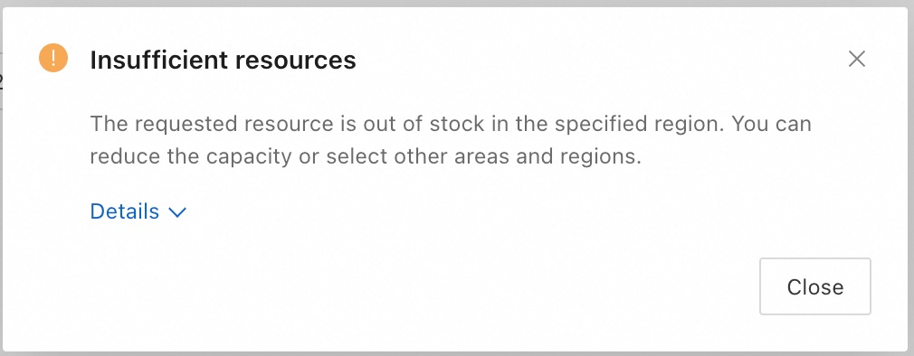

Alibaba Cloud  
Apsara Stack  
Cloud Defined Storage  
Cloud Parallel File Storage  
User Guide  
Product Version: v3.18.6-2607  
Document Version: 20260827

**Table of Contents**

- [1.CPFS](#section-1)
- [2.Getting started](#section-2)
    - [2.1. Log in to the CPFS console](#section-2-1)
    - [2.2. Create a CPFS file system](#section-2-2)
    - [2.3. Usage limits](#section-2-3)
- [3.CPFS file systems](#section-3)
    - [3.1. Manage CPFS file systems](#section-3-1)
    - [3.2. Scale up a CPFS file system](#section-3-2)
    - [3.3. Resource monitoring](#section-3-3)
    - [3.4. Data flow](#section-3-4)
- [4.FAQ](#section-4)
    - [4.1. No inventory for sales](#section-4-1)

# 1.CPFS

Cloud Parallel File Storage (CPFS) is a high-performance parallel file system of Apsara Stack.

**Product overview**

CPFS is a high-performance parallel file system of Apsara Stack, which meets the requirements of various high-performance computing scenarios. CPFS provides a unified namespace and supports shared access to file systems among multiple compute nodes over the Portable Operating System Interface (POSIX) protocol. It allows data access with sub-millisecond latency and reads or writes data with tens of GB/s of throughput.

CPFS file systems can be used in I/O-intensive businesses that require high throughput and high IOPS, and involve a large number of files, such as AI training, autonomous driving, genomics computing, film rendering, oil exploration, weather forecast, and electronic design automation (EDA) simulation.

# 2.Getting started

## 2.1. Log in to the CPFS console

**Prerequisites**

- You have obtained the service domain name for the Apsara Uni-manager Management Console from the deployment personnel.

- Use the Google Chrome browser.

**Procedure**

1. In the address bar of your browser, enter the service domain name for the Apsara Uni-manager Management Console and press Enter.

   

   > **Note**
   >
   > - You can click the current language in the upper-right corner to switch to another language.

2. Enter your username and password.

   > **Note**
   >
   > - You can obtain the username and logon password from an operations administrator.
   >
   > - If this is your first time logging on to the Apsara Uni-manager Management Console, you must change your password. For security, the password must be 10 to 32 characters long and contain uppercase letters, lowercase letters, digits, and special characters. The supported special characters are: !, @, #, $, and %.

3. Select **I Have Read And Agree To The Product Service Agreement, Privacy Agreement, And User Agreement**.

   > **Note**
   >
   > - The link text on the logon page is the title of the agreement document. You can click the link to view the details of the agreement.
   >
   > - The **Product Service Agreement**, **Privacy Agreement**, and **User Agreement** are displayed only if they have been published. If none of these agreements are published, you can skip this step.

4. Click **Account Logon** or **Authorized Logon**.

   > **Note**
   >
   > The Authorized Logon button is displayed only if the global IdP setting for third-party authentication is enabled. This display name can be customized. The default name is "Authorized Logon".

5. If multi-factor authentication (MFA) is enabled for your account, follow the steps for one of the following scenarios:

   > **Note**
   >
   > When you log on from the Internet, multi-factor authentication (MFA) is mandatory by default.

   - **First logon after MFA is enabled**

     <ol type="a">

     <li>

     After you log on with your username and password, the Bind Virtual MFA Device page appears.

     </li>

     <li>

     On the Bind Virtual MFA Device page, follow the on-screen instructions to bind a virtual MFA device.

     </li>

     </ol>

     <ol type="i" start="100">

     <li>

     You have logged in to the console.

     </li>

     </ol>

   - **MFA is already enabled and a device is bound**

     Enter the six-digit MFA code and click **Authenticate**.

6. In the top navigation bar, choose **Products > Storage > CPFS** to go to the Cloud Parallel File Storage (CPFS) console.

## 2.2. Create a CPFS file system

This topic describes how to create a Cloud Parallel File Storage (CPFS) file system.

**Procedure**

1. Log in to the CPFS console.

2. On the CPFS File Systems page, click **Create a file system** in the upper-left corner.

3. On the **Create a file system** page, configure the parameters.

   After you configure the parameters, you can view the configuration overview in the right-side section of the page.

   The following table describes the parameters.

   <table>
     <tr>
       <th colspan="2">Parameter</th>
       <th>Description</th>
     </tr>
     <tr>
       <td rowspan="4">Basic Information</td>
       <td>Organization/R esource Set</td>
       <td>Select the organization and resource set to which the file system belongs.</td>
     </tr>
     <tr>
       <td>Region/Zone</td>
       <td>Select the region and zone to which the file system belongs.</td>
     </tr>
     <tr>
       <td>Cluster</td>
       <td>Select the cluster to which the file system belongs.</td>
     </tr>
     <tr>
       <td>Specification</td>
       <td>Only <strong>Performance</strong> is supported.</td>
     </tr>
     <tr>
       <td rowspan="2">Details</td>
       <td>Capacity (TiB)</td>
       <td>Set the capacity of the file system. The minimum value is 20 TiB. The maximum value is the actual available maximum capacity.</td>
     </tr>
     <tr>
       <td>Description</td>
       <td>Enter a description for the file system. The description must be 2 to 128 characters in length, start with a letter, and can contain digits and special characters such as underscores (_), hyphens (-), and colons (:). Chinese characters are not allowed. The description cannot start with http:// or https://.</td>
     </tr>
   </table>

4. Optional. If you want to set quotas for the resources of a service, click **Quota Management** on the right side of the page to go to the **Quotas** page. For more information, see the **Quota management** topic in *User Guide - Apsara Uni-manager Mana gement Console*.

5. Click **Submit**.

6. After the file system is created, view its status, specifications, and capacity in the CPFS file system list. To manage a client cluster or mount a file system, log in to the Bare Metal Computing Platform (BMCP) console. For more information, see the "Clusters and nodes" section in *Bare Metal Computing Platform User Guide*.

## 2.3. Usage limits

This topic describes the usage limits of Cloud Parallel File Storage (CPFS).

- Only Performance-oriented CPFS file systems can be created. The maximum capacity of a file system is 1.7 PiB.

- You can mount a CPFS file system only to a Bare Metal Computing Platform (BMCP) cluster in the BMCP console.

- By default, mount targets are automatically created. You cannot create additional mount targets.

- You must scale up CPFS file systems when data is not read or written.

- Cluster scale-down is not supported.

# 3.CPFS file systems

## 3.1. Manage CPFS file systems

This topic describes how to view and delete a Cloud Parallel File Storage (CPFS) file system and modify the description of a CPFS file system.

**Prerequisites**

A CPFS file system is created. For more information, see Create a CPFS file system.

**View a file system**

1. On the CPFS File Systems page, click the  icon in the search box or click **Advanced**

   **Filter** to filter file systems by **File System ID**, **File System Name**, or **Tag**.

2. On the CPFS File Systems page, find the file system that you want to manage and click the file system ID or click **Details** in the Operations column.

3. On the File System Details page, you can view the basic information and **mount information** of the file system.

> **Note**
>
> By default, mount targets are automatically created. You cannot create additional mount targets.

5. On the CPFS File Systems page, find the file system that you want to view, and click the 

   icon in the **Monitor** column to view metric data such as capacity, bandwidth, and read/write IOPS of the file system.

**Delete a file system**

**Prerequisites**

- Before you delete a CPFS file system, the file system is unmounted from the mount target.

- Deleted CPFS file systems cannot be restored. Make sure that you back up the data stored in a CPFS file system before you delete it.

- After you delete a CPFS file system, resources of the file system are not immediately released. The disk space occupied by the file system is released seven days later.

**Procedure**

1. On the CPFS File Systems page, find the file system that you want to delete and click **Delete** in the Operations column.

2. In the message that appears, click **OK**.

> **Note**
>
> After you unmount a file system, your business may be affected. We recommend that you exercise caution when you unmount a file system.

**Modify the description of a CPFS file system**

1. On the CPFS File Systems page, find the file system for which you want to modify the description, move the pointer over the **File System ID/Name** column, and then click the

    icon.

2. In the dialog box that appears, enter a new description.

3. Click **OK**.

> **Note**
>
> The description of the file system must be 2 to 128 characters in length and can contain letters, digits, underscores (_), hyphens (-), and colons (:). It must start with a letter. It cannot start with  `http://`  or  `https://` .

**Add a tag to a file system**

1. On the CPFS File Systems page, find the file system to which you want to add a tag, move

   the pointer over the **Tag** column, and then click the  icon.

2. In the **Edit Tags** dialog box, configure the Tag Key and Tag Value parameters.

3. Click **OK**.

## 3.2. Scale up a CPFS file system

This topic describes how to scale up a Cloud Parallel File Storage (CPFS) file system.

**Prerequisites**

Data is not read from or written to the CPFS file system.

**Procedure**

1. Log in to the CPFS console.

2. On the CPFS File Systems page, find the file system that you want to scale up and click **Expand** in the Operations column.

3. On the File system expansion page, specify a value for the **New Total Capacity (TiB)** parameter.

> **Note**
>
> The new total capacity cannot be lower than the current total capacity and cannot exceed the maximum total capacity. The maximum total capacity of a Performance-oriented CPFS file system is 1 PiB, and the scale-up granularity is 10 TiB.

5. Click **Confirm Order** to complete the scale-up.

## 3.3. Resource monitoring

This topic describes how to view metrics and create alert rules for Cloud Parallel File Storage (CPFS) resources.

**Prerequisites**

A CPFS file system is created. For more information, see Create a CPFS file system.

**Procedure**

1. Log in to the CPFS console.

2. In the left-side navigation pane, click **CPFS File Systems**. On the CPFS File Systems page, click the ID or name of a file system or click **Details** in the Operations column to go to the File System Details page.

3. On the File System Details page, click the **Monitor** tab in the upper-left corner to view metrics such as capacity, bandwidth, and read/write IOPS of the file system.

4. You can click the  icon in the upper-right corner of a chart to create an alert rule. For

   more information, see the **Create an alert rule** topic in **User Guide - Cloud Monitor**.

5. After an alert rule is created, you can choose **Products > Migration and O&M Management > CloudMonitor** in the top navigation bar and click **Alert Service** in the left-side navigation pane to view and manage the alert rule.

## 3.4. Data flow

This topic describes how to configure data replication between Cloud Parallel File Storage (CPFS) and Object Storage Service (OSS).

**Application scenarios**

- Replicate the data in a CPFS file system to an OSS bucket:

  - The data stored in a CPFS file system is replicated to an OSS bucket for data backup.

  - Data that is infrequently accessed can be transferred to and stored in an OSS bucket to reduce storage costs.

- Replicate the data in an OSS bucket to a CPFS file system:

  - OSS supports multiple data importing methods. You can use this feature to import data from on-premises databases or other systems into an OSS bucket, and then replicate the data from the OSS bucket to a CPFS file system. This data replication method improves data transmission efficiency.

  - You can replicate large amounts of data that was accumulated and stored in an OSS bucket to a CPFS file system for AI training and other purposes.

**Prerequisites**

The Resource Access Management (RAM) role AliyunOSSPrivateCloudDrsSyncRole is granted to your organization. For more information, see the **Service-linked role** topic of **Configurations** in **Apsara Uni-manager Management Console User Guide**.

**Procedure**

1. Log in to the CPFS console.

2. On the CPFS File Systems page, click the ID or name of the file system for data replication or click **Details** in the **Operations** column to go to the File System Details page. On the page that appears, click the **Data flow** tab to go to the data flow task page.

   > **Note**
   >
   > If the system detects that the current organization is not granted the RAM role AliyunOSSPrivateCloudDrsSyncRole, the **Authorize Access to Cloud Resources** dialog box appears when you go to the data flow task page. In this case, you can select an organization in the dialog box to complete the authorization.

3. Click **Create a data flow task**. In the Create a data flow task dialog box, configure the following parameters.

   | Parameter | Description |
   | --- | --- |
   | Task type | • <strong>CPFS &gt; OSS</strong>: Data is replicated from CPFS to OSS. • <strong>OSS &gt; CPFS</strong>: Data is replicated from OSS to CPFS. |

   <table>
     <tr>
       <td>Data source</td>
       <td rowspan="2">If an OSS bucket is the data source or destination path, perform the following steps: • Select the bucket where the data is stored from the drop-down list. • Specify the specific path of files that are stored in the bucket. Example:/source_file/file01.txt If a CPFS file system is the data source or destination path, perform the following step: You need to specify the relative path of the destination file or directory under the default mount target. Note The default mount target of a CPFS file system is /cpfs/xxxx. For example, the default mount point of the file system bmcpfs-0168c998 is /cpfs/0168c998. Path filling rules: • File path: • If the full path of the destination file is /cpfs/xxxx/a.jpg, you need to enter a.jpg or /a.jpg. • You need to enter only the part of the path that starts from the default mount target, with or without a forward slash (/). • Directory path: • If the full path of the destination directory is /cpfs/xxxx/bigdir/dir1, you need to enter bigdir/dir1 or /bigdir/dir1. • Similarly, you can choose whether to add a forward slash (/). Examples: • For the destination file /cpfs/xxxx/images/photo.png, you can enter images/photo.png or /images/photo.png. • For the destination directory /cpfs/xxxx/data/files, you can enter data/files or/data/files. Important • Make sure that the path you enter is a path relative to the default mount point, not a full absolute path. • If the path contains special characters, such as spaces and Chinese characters, escape them properly or enclose the path in quotation marks.</td>
     </tr>
     <tr>
       <td>Destinatio n path</td>
     </tr>
     <tr>
       <td>Descriptio n</td>
       <td>Enter the description of the data replication task.</td>
     </tr>
   </table>

   > **Note**
   >
   > The amount of data for a single data flow task cannot exceed 100 TiB.

4. Click **OK** to submit the data replication task.

5. After a replication task is created, you can view relevant information of the replication task, such as task status, task type, task result, data source, destination path, description, and creation time, in the data flow task list.

# 4.FAQ

This topic provides answers to frequently asked questions (FAQ) about Cloud Parallel File Storage (CPFS).

## 4.1. No inventory for sales

This topic describes solutions for the failure to create a Cloud Parallel File Storage (CPFS) file system due to insufficient inventory.

**Symptom**

When you create or scale up a CPFS file system, the following exception message may appear.

**Solutions**

Solution 1: Decrease the capacity of the file system.

Scenario 2: Modify the zone of the file system.

Solution 3: Delete any redundant file system, contact the onsite O&M engineer to release disk space, and then create or scale up the file system again.
