Alibaba Cloud  
Apsara Stack  
File Storage NAS  
Operations and Maintenance  
Guide  
Product Version: V3.18.6  
Document Version: 20260701

**Table of Contents**

- [1.Service architecture](#section-1)
- [2.Routine maintenance](#section-2)
    - [2.1. View the status of a KV service](#section-2-1)
    - [2.2. Query the information about file systems and users](#section-2-2)
    - [2.3. Query the information about a cluster recycle job](#section-2-3)
    - [2.4. View the module service logs of a NAS cluster](#section-2-4)
    - [2.5. Set the disk usage limit](#section-2-5)

<a id="section-1"></a>

# 1.Service architecture

File Storage NAS (NAS) is a cloud service that provides file storage for compute nodes such as Elastic Compute Service (ECS) instances and Container Service for Kubernetes (ACK) clusters. NAS supports standard file access protocols.

NAS file systems are based on Apsara Distributed File System. NAS maintains three copies for each data file across multiple storage nodes. Frontend nodes receive and cache connection requests from Network File System (NFS) clients. Frontend nodes are highly available because they are stateless and distributed. In a cluster of six nodes, less than 30 minutes is required to restore one TB of data. The larger the cluster size, the faster the restoration speed. For more information, see **NAS Technical Whitepaper**.

<a id="section-2"></a>

# 2.Routine maintenance

<a id="section-2-1"></a>

## 2.1. View the status of a KV service

This topic describes how to check whether the KV service of a File Storage NAS (NAS) cluster is normal.

**Procedure**

1. Find the RecycleJob role in the nas-recycle service of the cluster and log on to the target machine.

2. Use the kuadmin tool to view the NAS app service added to the KV service.

   - Command

     ```text
     /apsara/deploy/kuadmin
     listapp
                         
     ```

   - Sample response

     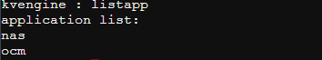

     If an error occurs in the output of the listapp command, the kvmaster service is abnormal.

3. Use the ku tool to check whether the KV service is normal.

   - Command

     ```text
     /apsara/deploy/ku
     checkready nas
     checkready ocm
                         
     ```

   - Sample response

     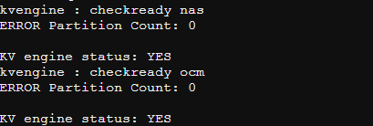

   If no output is returned for the checkready command or the status is NO, the KV service is abnormal.

4. Use the mcu tool to view the status and information of the kvmaster service.

   <ol type="i">

   <li>

   Query the kvmaster service, which is typically 3master.

   - Command

     ```text
     /apsara/deploy/mcu gas
     ```

   - Sample response

     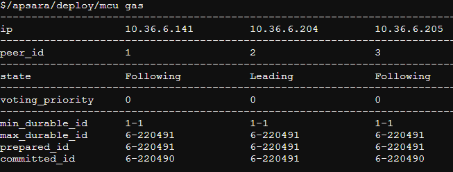

   </li>

   <li>

   Query kvmaster config.

   - Command

     ```text
     /apsara/deploy/mcu gac
     ```

   - Sample response

     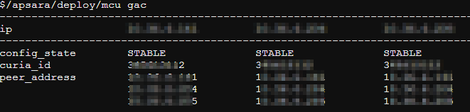

   </li>

   </ol>

<a id="section-2-2"></a>

## 2.2. Query the information about file systems and users

**Procedure**

1. Find the RecycleJob role in the nas-recycle service of your cluster and log on to the target machine.

2. Use the ocm_cmd and ku tools to query the file system ID (fsid) and the corresponding partition.

   <ol type="i">

   <li>

   Query the volume and fsid by specifying the username.

   - Command

     ```text
     /apsara/deploy/ocm_cmd list_volume -u <user>
     ```

   - Sample response

     

   </li>

   <li>

   Query the partition corresponding to the file system by specifying the fsid parameter.

   - Command

     ```text
     /apsara/deploy/ku
     querypart nas <fsid>
                                 
     ```

   - Sample response

     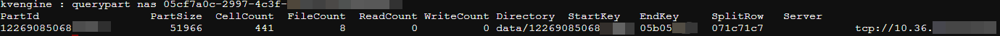

   </li>

   </ol>

3. In the RecycleJob role, use the ocm_cmd tool to query the information about the NAS cluster and permission group.

   Query the volume and fsid by specifying the username.

   - Command

     ```text
     /apsara/deploy/ocm_cmd list_volume -u <user>
     ```

   - Sample response

     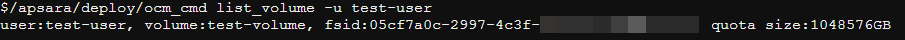

4. Query the information about deleted volumes.

   - Command

     ```text
     /apsara/deploy/ocm_cmd list_deleted_volume
     ```

   - Sample response

     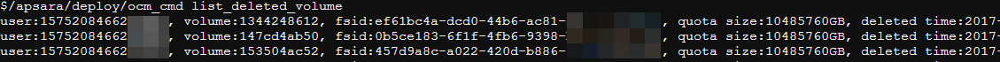

5. Query the mount information by user and volume.

   - Command

     ```text
     /apsara/deploy/ocm_cmd get_volume_mount_info -u <user> -v <volume>
     ```

   - Sample response

     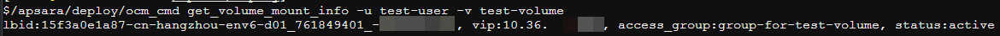

6. Query the protocol type of the file system by user and volume.

   - Command

     ```text
     /apsara/deploy/ocm_cmd get_volume_protocoltype -u <user> -v <volume>
     ```

   - Sample response

     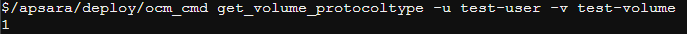

     1 indicates the Network File System (NFS) protocol. 2 indicates the Server Message Block (SMB) protocol. 3 indicates the combination of NFS and SMB.

7. Query the permission group by user.

   - Command

     ```text
     /apsara/deploy/ocm_cmd list_access_group -u <user>
     ```

   - Sample response

     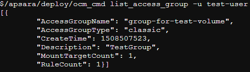

8. Query the permission policy by user and permission group.

   - Command

     ```text
     /apsara/deploy/ocm_cmd list_access_rule -u <user> -g <group>
     ```

   - Sample response

     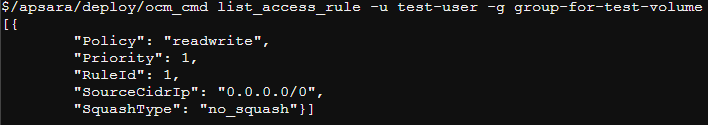

9. Modify the protocol type of the file system by user and volume.

   ```text
   /apsara/deploy/ocm_cmd update_volume_protocoltype -u <user> -v <volume> --protocolType <1/2/3>
   ```

0. Query the partition and distance information.

   <ol type="i">

   <li>

   Query the kvserver information of the cluster.

   - Command

     ```text
     /apsara/deploy/ku --interactive=false --command=getallserver --appname=nas |grep 
     10280|grep tcp|awk '{print $2}'
     ```

   - Sample response

     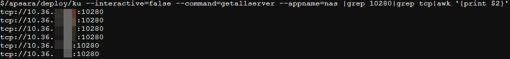

   </li>

   <li>

   Query the partition and distance information based on the kvserver information.

   - Command

     ```text
     /apsara/deploy/ofsu --interactive=false --command=getpartdist --param1=<kvserver>--param2=nas | grep -v PID
     ```

   - Sample response

     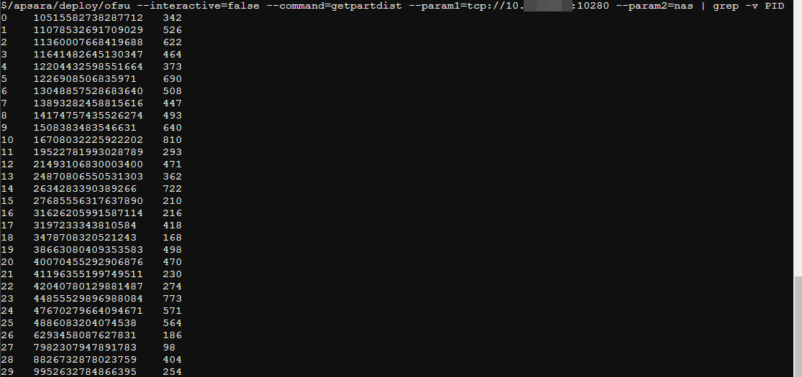

   </li>

   </ol>

1. Query the detailed information of the file system.

   <ol type="i">

   <li>

   Query all partitions.

   - Command

     ```text
     /apsara/deploy/ku --interactive=false --command=getallpart --param1=nas | grep tcp | awk '{print $3}'
     ```

   - Sample response

     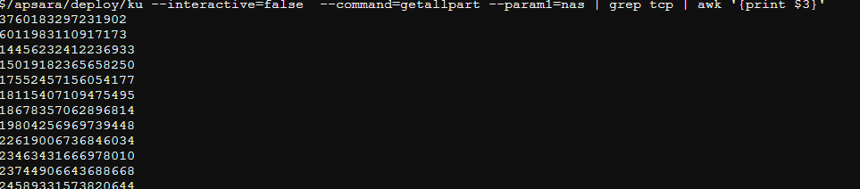

   </li>

   <li>

   Query the file system by specifying the partition.

   - Command

     ```text
     /apsara/deploy/ofsu --interactive=false --command=getfilesystem --appname=nas --param1=<partition>
     ```

   - Sample response

     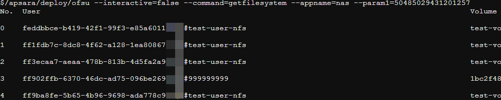

   </li>

   <li>

   Query file system details by user and volume.

   </li>

   </ol>

   - Command

     ```text
     /apsara/deploy/ofsu --interactive=false --command=getfsinfo --appname=nas --param1=<user> --param2=<volume>
     ```

   - Sample response

     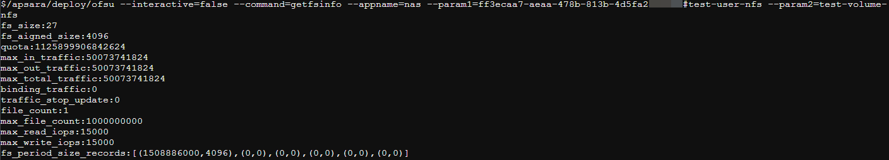

2. Query the azone and location information of the NAS cluster.

   <ol type="i">

   <li>

   Obtain the ocm tool. The access_id and access_key is required.

   ```text
   vim /cloud/app/nas-
   nfs/NFSSupervisor#/nfs_supervisor/current/conf.merge/ocm_cmd.json
   ```

   </li>

   <li>

   Record the ocm_host, access_id, and access_key information and use the ocm tool to

   </li>

   </ol>

   query the location information.

   - Command

     ```text
     /apsara/deploy/ocm_tool lli --ocm_host=<ocm_host> --access_id=<access_id> --access_key=<access_key>
     ```

   - Sample response

     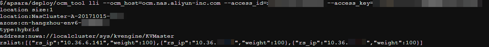

<a id="section-2-3"></a>

## 2.3. Query the information about a cluster recycle job

**Procedure**

1. Find the RecycleJob role in the nas-recycle service of the cluster and use the nas_ju tool to query the current recycle job of the cluster.

   - Command

     ```text
     /apsara/deploy/nas_ju list
     ```

   - Sample response

     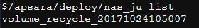

2. Query the details of the recycle job by specifying the job name.

   - Command

     ```text
     /apsara/deploy/nas_ju info <job_name>
     ```

     Example

     ```text
     /apsara/deploy/nas_ju info volume_recycle_20171024105007
     ```

   - Sample response

     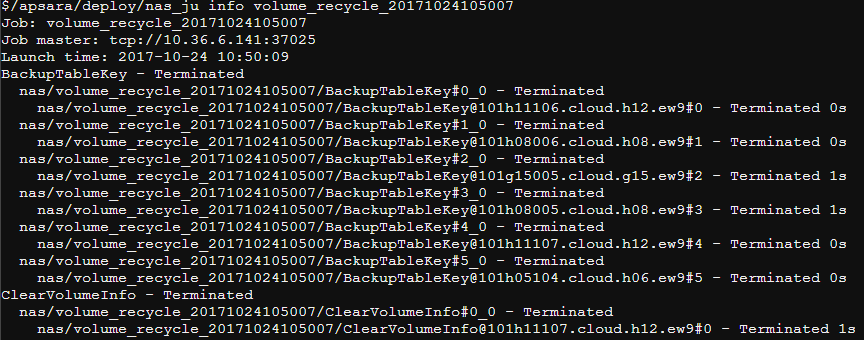

<a id="section-2-4"></a>

## 2.4. View the module service logs of a NAS cluster

**Procedure**

1. Find the RecycleJob role in the nas-recycle service of the cluster and view the logs of the KV service.

   After you use the ku and kuadmin tools to determine whether the KV service is abnormal, you can view the corresponding ku.LOG and kuadmin.LOG in the /apsara/deploy/log directory to obtain the error message.

2. Log on to the OcmServer machine to view the ocm logs.

   Generally, three ocm machines are deployed for load balancing. To find specific request logs, you may need to check the three machines.

   ```text
   vim /cloud/log/nas-ocm/OcmServer#/ocm_server/ocm_server.LOG
   ```

3. Log on to the Tengine machine under the nas-ocm service to view the NGINX logs.

   ```text
   cd/cloud/log/nasocm/Tengine#/tengine
   ```

   The tengine_starter.log file stores the startup logs. The latest access_log file stores the success logs and the error_log file stores the error logs.

4. Log on to the NFSServer machine to view the ganesha logs.

   ```text
   vim /cloud/log/nas-kvengine/KVServer#/kv_server/ganesha.LOG
   ```

<a id="section-2-5"></a>

## 2.5. Set the disk usage limit

By setting the disk usage limit, you can control the total amount of data written to disks. When the data write volume reaches the limit, the system denies data writing. When the data write volume drops below the limit, the system resumes data writing.

**Procedure**

To set the disk usage limit, perform the following steps:

1. Log in to the Apsara Uni-manager Operations Console

2. In the top navigation bar, choose **Platform Operation > Apsara Infrastructure Management > Resources**.

3. In the left-side navigation pane, click **Product & Cluster O&M**. Enter **nas** in the **Product | Cluster** search box.

4. Find your cluster and click **Cluster Details** in the Actions column.

5. On the **Desired State Configuration** tab, choose **services > nas-nfs > user > nfs_supervisor** in the file list, and configure the nfs_supervisor.json file.

   ```json
   {
       "nas_disk_usage_limit":90
   }
   ```

   The value of the **nas_disk_usage_limit** parameter is a percentage. Data writing stops when the data write volume reaches the specified value. We recommend that you set the value to **90**.

   If the nfs_supervisor.json file is not created for your cluster, perform the following operations:

   <ol type="i">

   <li>

   On the right side of the **services > nas-nfs > user** folder, choose  **> Create File**.

   Create a folder named nfs_supervisor.

   </li>

   <li>

   In the **Create File** dialog box, set **Creation Type** to **Folder** and **File/Folder Name** to

   </li>

   </ol>

   nfs_supervisor.json, and then click **OK**.

   <ol type="i" start="3">

   <li>

   On the right side of the nfs_supervisor folder, choose  **> Create File**. Create a file

   </li>

   </ol>

   named nfs_supervisor.json.

   <ol type="i" start="4">

   <li>

   In the **Create File** dialog box, set **Creation Type** to **File** and **File/Folder Name** to nfs_supervisor.json.

   </li>

   <li>

   Configure the nfs_supervisor.json file.

   ```json
   {
       "nas_disk_usage_limit":90
   }
   ```

   The value of the **nas_disk_usage_limit** parameter is a percentage. Data writing stops when the data write volume reaches the specified value. We recommend that you set the value to **90**.

   </li>

   </ol>

6. After the configuration is changed, the cluster is rolled again and the configuration takes effect.

> **Note**
>
> After data writing is disabled, you can use one of the following methods to resume data writing:
>
> - Delete the file system or file content and perform write operations seven days later. The system recycles deleted data within seven days.
>
> - Change the value of the nas_disk_usage_limit parameter.

**Verify the configuration**

To verify the configuration, perform the following steps:

1. Create a file system and mount it.

2. Write data to the file system and make sure that the data volume reaches the limit. Verify that data writing is disabled. The use of other commands, such as ACL commands, is not affected.

   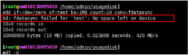

3. View logs.

   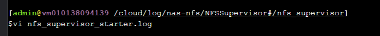

   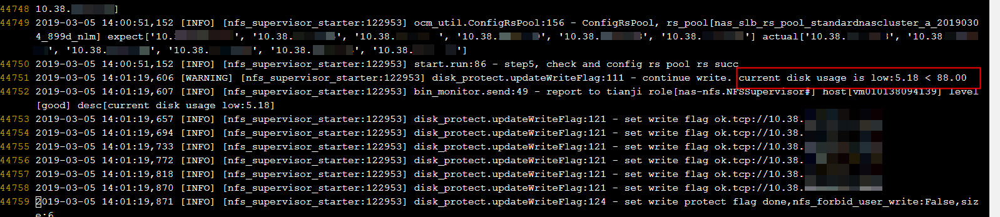
