Alibaba Cloud  
Apsara Stack  
Log Service  
Developer Guide  
Product Version: V3.18.3  
Document Version: 20241029

**Table of Contents**

- [1.Preparations](#section-1)
    - [1.1. Obtain an AccessKey pair](#section-1-1)
    - [1.2. Obtain the endpoint of Simple Log Service](#section-1-2)
    - [1.3. Obtain Simple Log Service SDK](#section-1-3)
- [2.SDK Reference](#section-2)
    - [2.1. Introduction](#section-2-1)
        - [2.1.1. Overview](#section-2-1-1)
        - [2.1.2. Basic configurations](#section-2-1-2)
        - [2.1.3. Error handling](#section-2-1-3)
        - [2.1.4. API specifications](#section-2-1-4)
    - [2.2. Java SDK](#section-2-2)
    - [2.3. Use Simple Log Service SDK for Java to manage an alert rule of the old version](#section-2-3)
    - [2.4. .NET SDK](#section-2-4)
    - [2.5. .NET Core SDK](#section-2-5)
    - [2.6. PHP SDK](#section-2-6)
    - [2.7. Python SDK](#section-2-7)
    - [2.8. Use Simple Log Service SDK for Python to manage an alert rule of the old version](#section-2-8)
    - [2.9. SDK for Android](#section-2-9)
    - [2.10. SDK for C](#section-2-10)
    - [2.11. SDK for Go](#section-2-11)
    - [2.12. iOS SDK](#section-2-12)
    - [2.13. SDK for C ++](#section-2-13)
    - [2.14. Node.js SDK](#section-2-14)
- [3.API Reference](#section-3)
    - [3.1. Overview](#section-3-1)
    - [3.2. Common request headers](#section-3-2)
    - [3.3. Common response headers](#section-3-3)
    - [3.4. Request signatures](#section-3-4)
    - [3.5. Common data structures](#section-3-5)
    - [3.6. Common error codes](#section-3-6)
    - [3.7. Project API](#section-3-7)
        - [3.7.1. CreateProject](#section-3-7-1)
        - [3.7.2. DeleteProject](#section-3-7-2)
        - [3.7.3. UpdateProject](#section-3-7-3)
        - [3.7.4. GetProject](#section-3-7-4)
        - [3.7.5. ListProject](#section-3-7-5)
        - [3.7.6. GetProjectLogs](#section-3-7-6)
    - [3.8. Logstore operations](#section-3-8)
        - [3.8.1. CreateLogstore](#section-3-8-1)
        - [3.8.2. DeleteLogstore](#section-3-8-2)
        - [3.8.3. UpdateLogstore](#section-3-8-3)
        - [3.8.4. GetLogstore](#section-3-8-4)
        - [3.8.5. ListLogstore](#section-3-8-5)
        - [3.8.6. ListShards](#section-3-8-6)
        - [3.8.7. SplitShard](#section-3-8-7)
        - [3.8.8. MergeShards](#section-3-8-8)
        - [3.8.9. GetCursor](#section-3-8-9)
        - [3.8.10. GetCursorTime](#section-3-8-10)
        - [3.8.11. PullLogs](#section-3-8-11)
        - [3.8.12. PostLog](#section-3-8-12)
        - [3.8.13. GetShipperStatus](#section-3-8-13)
        - [3.8.14. RetryShipperTask](#section-3-8-14)
        - [3.8.15. GetLogs](#section-3-8-15)
        - [3.8.16. GetHistograms](#section-3-8-16)
        - [3.8.17. UpdateIndex](#section-3-8-17)
        - [3.8.18. CreateIndex](#section-3-8-18)
        - [3.8.19. DeleteIndex](#section-3-8-19)
        - [3.8.20. GetIndex](#section-3-8-20)
        - [3.8.21. PutWebtracking](#section-3-8-21)
    - [3.9. Logtail machine group operations](#section-3-9)
        - [3.9.1. CreateMachineGroup](#section-3-9-1)
        - [3.9.2. DeleteMachineGroup](#section-3-9-2)
        - [3.9.3. UpdateMachineGroup](#section-3-9-3)
        - [3.9.4. ListMachineGroup](#section-3-9-4)
        - [3.9.5. GetMachineGroup](#section-3-9-5)
        - [3.9.6. ApplyConfigToMachineGroup](#section-3-9-6)
        - [3.9.7. RemoveConfigFromMachineGroup](#section-3-9-7)
        - [3.9.8. ListMachines](#section-3-9-8)
        - [3.9.9. GetAppliedConfigs](#section-3-9-9)
    - [3.10. Logtail configuration operations](#section-3-10)
        - [3.10.1. CreateConfig](#section-3-10-1)
        - [3.10.2. ListConfig](#section-3-10-2)
        - [3.10.3. GetAppliedMachineGroups](#section-3-10-3)
        - [3.10.4. GetConfig](#section-3-10-4)
        - [3.10.5. DeleteConfig](#section-3-10-5)
        - [3.10.6. UpdateConfig](#section-3-10-6)
    - [3.11. Consumer group operations](#section-3-11)
        - [3.11.1. CreateConsumerGroup](#section-3-11-1)
        - [3.11.2. DeleteConsumerGroup](#section-3-11-2)
        - [3.11.3. GetCheckPoint](#section-3-11-3)
        - [3.11.4. HeartBeat](#section-3-11-4)
        - [3.11.5. ListConsumerGroup](#section-3-11-5)
        - [3.11.6. UpdateCheckPoint](#section-3-11-6)
        - [3.11.7. UpdateConsumerGroup](#section-3-11-7)
    - [3.12. External store](#section-3-12)
        - [3.12.1. Overview](#section-3-12-1)
        - [3.12.2. CreateExternalStore](#section-3-12-2)
        - [3.12.3. DeleteExternalStore](#section-3-12-3)
        - [3.12.4. GetExternalStore](#section-3-12-4)
        - [3.12.5. ListExternalStore](#section-3-12-5)
        - [3.12.6. UpdateExternalStore](#section-3-12-6)
    - [3.13. Saved search-related API operations](#section-3-13)
        - [3.13.1. CreateSavedSearch](#section-3-13-1)
        - [3.13.2. DeleteSavedSearch](#section-3-13-2)
        - [3.13.3. GetSavedSearch](#section-3-13-3)
        - [3.13.4. ListSavedSearch](#section-3-13-4)
        - [3.13.5. UpdateSavedSearch](#section-3-13-5)
    - [3.14. RAM or STS](#section-3-14)
        - [3.14.1. Overview](#section-3-14-1)
        - [3.14.2. Resource list](#section-3-14-2)
        - [3.14.3. Action list](#section-3-14-3)
        - [3.14.4. Authentication rules](#section-3-14-4)
    - [3.15. Description of common resources](#section-3-15)
        - [3.15.1. Encrypt data](#section-3-15-1)
        - [3.15.2. Data model](#section-3-15-2)
        - [3.15.3. Data encoding](#section-3-15-3)
        - [3.15.4. Logstores](#section-3-15-4)
        - [3.15.5. Shards](#section-3-15-5)
        - [3.15.6. Logtail configurations](#section-3-15-6)
        - [3.15.7. Logtail machine group](#section-3-15-7)
- [4.CLI references](#section-4)
    - [4.1. Overview of Log Service CLI](#section-4-1)
    - [4.2. Install Log Service CLI](#section-4-2)
    - [4.3. Configure Log Service CLI](#section-4-3)
    - [4.4. Request syntax](#section-4-4)
    - [4.5. Global parameters](#section-4-5)
    - [4.6. Use Log Service CLI](#section-4-6)
        - [4.6.1. Project management](#section-4-6-1)
            - [4.6.1.1. copy_project](#section-4-6-1-1)
            - [4.6.1.2. create_project](#section-4-6-1-2)
            - [4.6.1.3. delete_project](#section-4-6-1-3)
            - [4.6.1.4. get_project](#section-4-6-1-4)
            - [4.6.1.5. list_project](#section-4-6-1-5)
        - [4.6.2. Logstore management](#section-4-6-2)
            - [4.6.2.1. copy_logstore](#section-4-6-2-1)
            - [4.6.2.2. create_logstore](#section-4-6-2-2)
            - [4.6.2.3. delete_logstore](#section-4-6-2-3)
            - [4.6.2.4. get_logstore](#section-4-6-2-4)
            - [4.6.2.5. list_logstore](#section-4-6-2-5)
            - [4.6.2.6. update_logstore](#section-4-6-2-6)
        - [4.6.3. Shard management](#section-4-6-3)
            - [4.6.3.1. list_shards](#section-4-6-3-1)
            - [4.6.3.2. merge_shard](#section-4-6-3-2)
            - [4.6.3.3. split_shard](#section-4-6-3-3)
        - [4.6.4. Machine group management](#section-4-6-4)
            - [4.6.4.1. create_machine_group](#section-4-6-4-1)
            - [4.6.4.2. delete_machine_group](#section-4-6-4-2)
            - [4.6.4.3. get_machine_group](#section-4-6-4-3)
            - [4.6.4.4. list_machine_group](#section-4-6-4-4)
            - [4.6.4.5. list_machines](#section-4-6-4-5)
            - [4.6.4.6. update_machine_group](#section-4-6-4-6)
        - [4.6.5. Logtail configuration management](#section-4-6-5)
            - [4.6.5.1. create_logtail_config](#section-4-6-5-1)
            - [4.6.5.2. delete_logtail_config](#section-4-6-5-2)
            - [4.6.5.3. get_logtail_config](#section-4-6-5-3)
            - [4.6.5.4. list_logtail_config](#section-4-6-5-4)
            - [4.6.5.5. update_logtail_config](#section-4-6-5-5)
        - [4.6.6. Mappings between machine groups and Logtail configurations](#section-4-6-6)
            - [4.6.6.1. apply_config_to_machine_group](#section-4-6-6-1)
            - [4.6.6.2. get_config_applied_machine_groups](#section-4-6-6-2)
            - [4.6.6.3. get_machine_group_applied_configs](#section-4-6-6-3)
            - [4.6.6.4. remove_config_to_machine_group](#section-4-6-6-4)
        - [4.6.7. Index management](#section-4-6-7)
            - [4.6.7.1. create_index](#section-4-6-7-1)
            - [4.6.7.2. delete_index](#section-4-6-7-2)
            - [4.6.7.3. get_index_config](#section-4-6-7-3)
            - [4.6.7.4. update_index](#section-4-6-7-4)
        - [4.6.8. Cursor management](#section-4-6-8)
            - [4.6.8.1. get_begin_cursor](#section-4-6-8-1)
            - [4.6.8.2. get_cursor](#section-4-6-8-2)
            - [4.6.8.3. get_cursor_time](#section-4-6-8-3)
            - [4.6.8.4. get_end_cursor](#section-4-6-8-4)
            - [4.6.8.5. get_previous_cursor_time](#section-4-6-8-5)
        - [4.6.9. Log management](#section-4-6-9)
            - [4.6.9.1. get_histograms](#section-4-6-9-1)
            - [4.6.9.2. get_logs](#section-4-6-9-2)
            - [4.6.9.3. get_log](#section-4-6-9-3)
            - [4.6.9.4. get_log_all](#section-4-6-9-4)
            - [4.6.9.5. pull_log](#section-4-6-9-5)
            - [4.6.9.6. pull_logs](#section-4-6-9-6)
            - [4.6.9.7. pull_log_dump](#section-4-6-9-7)
        - [4.6.10. Consumer group management](#section-4-6-10)
            - [4.6.10.1. create_consumer_group](#section-4-6-10-1)
            - [4.6.10.2. delete_consumer_group](#section-4-6-10-2)
            - [4.6.10.3. get_check_point](#section-4-6-10-3)
            - [4.6.10.4. list_consumer_group](#section-4-6-10-4)
            - [4.6.10.5. update_check_point](#section-4-6-10-5)
            - [4.6.10.6. update_consumer_group](#section-4-6-10-6)
        - [4.6.11. Association with external data sources](#section-4-6-11)
            - [4.6.11.1. create_external_store](#section-4-6-11-1)
            - [4.6.11.2. delete_external_store](#section-4-6-11-2)
            - [4.6.11.3. get_external_store](#section-4-6-11-3)
            - [4.6.11.4. list_external_store](#section-4-6-11-4)
            - [4.6.11.5. update_external_store](#section-4-6-11-5)
    - [4.7. Best practices](#section-4-7)
    - [4.8. FAQ](#section-4-8)

<a id="section-1"></a>

# 1.Preparations

<a id="section-1-1"></a>

## 1.1. Obtain an AccessKey pair

AccessKey pairs can be assigned by Resource Access Management (RAM). You must use the type of AccessKey pairs for authentication when you call API operations. This topic describes how to obtain an AccessKey pair that is assigned by RAM.

**Background information**

An AccessKey pair is used to verify the identity of a request sender based on symmetric encryption. An AccessKey pair consists of an AccessKey ID and an AccessKey secret. The AccessKey ID is used to identify a user. The AccessKey secret is used to encrypt the signature string.

You can use RAM to assign an AccessKey pair that consists of an AccessKey ID and an AccessKey secret to a third party for authentication.

> **Warning**
>
> The AccessKey pair of a personal account is managed and limited by the
>
> permission system of the Apsara Uni-manager Management Console. If you need to obtain the AccessKey pair of an organization, make sure that your operation is allowed by an administrator. This ensures security.

**Obtain the AccessKey pair of a personal account**

To obtain the AccessKey pair of a personal account, perform the following operations:

1. Log on to the Apsara Uni-manager Management Console.

2. In the upper-right corner of the page that appears, click the profile picture, and then click **User Information**.

3. In the **AccessKey Pair** section, view the AccessKey pair of your account.

   > **Note**
   >
   > An AccessKey pair consists of an AccessKey ID and an AccessKey secret.
   >
   > These credentials provide full permissions on cloud resources within your account. You must keep the AccessKey pair confidential.

**Obtain the AccessKey pair of an organization**

To obtain the AccessKey pair of an organization, perform the following operations:

1. Log on to the Apsara Uni-manager Management Console as an administrator.

2. In the top navigation bar, click **Enterprise**.

3. In the left-side navigation pane, choose **Resources > Organizations**.

4. In the organization list, click the name of the level-1 organization whose AccessKey pair you want to obtain.

5. Click **Management Accesskey**.

6. In the dialog box that appears, view the AccessKey pair of the organization.

<a id="section-1-2"></a>

## 1.2. Obtain the endpoint of Simple Log Service

This topic describes how to obtain the endpoint of Simple Log Service.

**Background information**

When you call Apsara Stack operations, endpoints are used. You can obtain an endpoint from onsite Alibaba Cloud O&M engineers. You can also perform the following operations to obtain an endpoint.

**Method 1: Obtain the endpoint in the Apsara Uni-manager Operations console**

1. Log on to the Apsara Uni-manager Operations Console.

2. In the top navigation bar, choose **Platform Operation > Apsara Infrastructure Management > O&M Tools**.

3. In the left-side navigation pane, choose **O&M ToolsService Registration Variable Dashboard**.

4. On the **Service Registration Variable Dashboard** page, enter sls in the search box.

5. In the search results, find sls-backend-server and click the value in the Service Registration column.

6. In the **Registration Variables** dialog box, obtain the endpoint.

   View the value of the **sls_data.endpoint** variable. The value indicates the  `endpoint`  of Simple Log Service. In most cases, the endpoint of Simple Log Service is in the  `data.${global:region}.sls-pub.${global:internet-domain}`  format.

   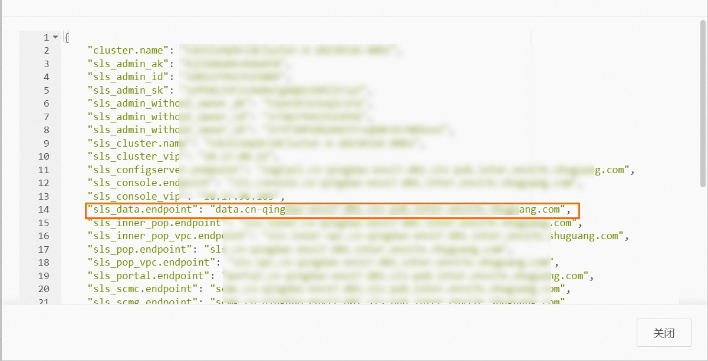

**Method 2: Obtain the endpoint in the Simple Log Service console**

After you create a project, you can view the endpoint of the project on the Project Overview page.

1. Log on to the Simple Log Service console.

2. In the Projects section, click the project that you want to manage.

3. On the **Project Overview** page, view the endpoint of the project.

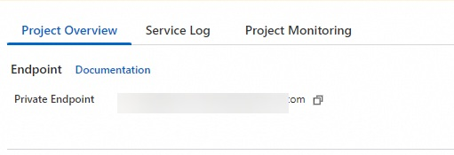

View the value of the Private Endpoint parameter. The endpoint of Simple Log Service is in the  `data.${global:region}.sls-pub.${global:internet-domain}`  format.

<a id="section-1-3"></a>

## 1.3. Obtain Simple Log Service SDK

When you call Apsara Stack operations, you must use the SDK of your cloud service. This topic describes how to obtain Alibaba Cloud SDKs.

An SDK includes code and examples. You can create cloud applications by using an SDK for the programming language that you require.

SDKs for Java, Python, and Go are provided. You can obtain an SDK from Alibaba Cloud SDKs based on your business requirements.

> **Note**
>
> We recommend that you use an SDK for Java, Python, or Go. If you use SDKs for other programming languages, the SDKs may be incompatible with your system.

We recommend that you use the SDK core library that is provided on the Alibaba Cloud official website. The SDK core library is shared by all cloud services and is compatible with Apsara Stack.

The following table provides GitHub links to the source code of Simple Log Service SDK for common programming languages.

| SDK programming language | GitHub link |
| --- | --- |
| Java | Log Service Java SDK |
| Python | Log Service Python SDK |
| Go | Log Service Go SDK |
| PHP | Log Service PHP SDK |

<a id="section-2"></a>

# 2.SDK Reference

<a id="section-2-1"></a>

## 2.1. Introduction

<a id="section-2-1-1"></a>

### 2.1.1. Overview

Log Service provide software development kits (SDKs) for multiple languages, such as Java,.NET, Python, PHP, and C. You can select an SDK based on your business requirements.

Log Service SDKs are implemented based on Log Service APIs. Log Service SDKs provide the same capabilities as Log Service APIs. For more information about Log Service APIs, see API Reference.

Before you can use a Log Service SDK, you must have an active Alibaba Cloud AccessKey pair (AccessKey ID and AccessKey secret).

In addition, you must specify the endpoint of Log Service in the SDK. For more information, see Basic configurations.

Log Service SDKs can be regarded as Log Service APIs that are encapsulated in different languages to provide the following features:

- Uniform encapsulation. Log Service APIs are uniformly encapsulated. You do not need to create API requests and parse API responses. For more information, see API specifications. The APIs in different languages are similar. This simplifies the switchover between different languages.

- Automatic digital signatures. You do not need to specify the digital signature logic of Log Service APIs. This simplifies the use of Log Service APIs.

- Protocol Buffer-formatted encapsulation. The logs collected by Log Service are encapsulated in the Protocol Buffer format. You do not need to specify the format.

- Automatic compression. Logs are compressed by using the method defined in Log Service APIs. You do not need to manually compress logs. SDKs in some languages allow you to specify whether to write logs in the compression mode. The compression mode is used by default.

- Centralized error handling methods. You can use SDKs to handle errors based on the relevant language. For more information, see Error handling.

- Synchronous requests. SDKs in all languages support only synchronous requests.

The following table describes the download address and user guide of Log Service SDKs in different languages.

| SDK language | Documentation | Source code |
| --- | --- | --- |
| Java | Java SDK and Log Service SDK for Java 0.6.0 API | GitHub |
| .NET | .NET SDK and Aliyun.Api.SLS Namespace | GitHub |
| PHP | PHP SDK and SLS_PHP_SDK | GitHub |
| Node.js | Node.js SDK | GitHub |
| Python | Python SDK and Python documentation | GitHub |
| C | SDK for C | GitHub |
| GO | SDK for Go | GitHub |
| iOS | iOS SDK | GitHub |
| Android | SDK for Android | GitHub |
| C++ | SDK for C ++ | GitHub |

<a id="section-2-1-2"></a>

### 2.1.2. Basic configurations

Before you can use SDKs to interact with Log Service, you must configure the basic settings. This topic describes the basic SDK configurations.

Basic configurations:

- Endpoint: You must specify the endpoint that is used by the client to access Log Service.

- AccessKey pair (AccessKey ID and AccessKey secret): You must specify the AccessKey pair that is used by the client to access Log Service.

The following sections describe how to use endpoints and AccessKey pairs.

**Endpoint**

Before you use an SDK, you must determine the access method and endpoint.

1. When you select an endpoint for a client instance, make sure that the region of your project is the same as the region of your endpoint. Otherwise, you cannot use the SDK to access your project.

2. All API endpoints support only the HTTP protocol.

**AccessKey pairs**

All interaction requests that are sent to Log Service must be authenticated. An AccessKey pair that consists of an AccessKey ID and AccessKey secret is the critical factor for the authentication. When you create a client instance, you must specify an AccessKey ID and AccessKey secret. You must obtain an AccessKey pair in the Apsara Uni-manager Management Console.

> **Note**
>
> - An Apsara Stack tenant account can have multiple AccessKey pairs. You must specify the AccessKey ID and AccessKey secret of the same AccessKey pair when you create a client instance. Otherwise, authentication fails.
>
> - The specified AccessKey must be in the Enabled state. Otherwise, the requests are denied by Log Service. To view the status of the AccessKey pair, you can log on to the Apsara Uni-manager Management Console.

**Examples**

Assume that you want to access a project and you have an AccessKey pair that is in the Enabled state. The following AccessKey pair is used:

```text
AccessKeyId = "<yourAccessKeyId>"
AccessKeySecret = "<yourAccessKeySecret>"
```

You can use the following snippets to create a client instance based on the language:

- Java

  ```text
  String endpoint = "regionid.example.com"; // Specify the endpoint based on your region and access method.
  String accessKeyId = "<youraccessKeyId>"; // Specify your AccessKey ID.
  String accessKeySecret = "<youraccessKeySecret>"; // Specify your AccessKey secret.
  Client client = new Client(endpoint, accessKeyId, acccessKeySecret);
  //use client to operate log service project......
  ```

- .NET(C#)

  ```text
  String endpoint = "regionid.example.com"; // Specify the endpoint based on your region and access method.
  String accessKeyId = "<youraccessKeyId>"; // Specify your AccessKey ID.
  String accessKeySecret = "<youraccessKeySecret>"; // Specify your AccessKey secret.
  SLSClient client = new SLSClient(endpoint, accessKeyId, accessKeySecret);
  //use client to operate sls project......
  ```

- PHP

  ```text
  $endpoint = 'regionid.example.com'; // The endpoint of the China (Hangzhou) region isused as an example. Replace it with the actual endpoint based on your region and access method.
  $accessKeyId = '<youraccessKeyId>'; // Specify your AccessKey ID.
  $accessKey = '<youraccessKey>'; // Specify your AccessKey secret.
  $client = new Aliyun_Sls_Client($endpoint, $accessKeyId, $accessKey);
  //use client to operate sls project......
  ```

- Python

  ```text
  # // Specify the endpoint based on your region and access method.
  endpoint = 'regionid.example.com'
  # Specify your AccessKey ID.
  accessKeyId = '<youraccessKeyId>'
  # Specify your AccessKey secret.
  accessKey = '<youraccessKey>'  
  client = LogClient(endpoint, accessKeyId, accessKey)
  #use client to operate log project......
  ```

<a id="section-2-1-3"></a>

### 2.1.3. Error handling

SDK errors are divided into the following types:

- Errors returned by Log Service. Errors of this type are handled by SDKs. For more information about this error type, see the common error codes of the Log Service API operations.

- Network errors that occur when you send requests to the server by using SDKs. This type of errors include network disconnection and server response timeout.

- Errors that are generated by SDKs and related to platforms or languages, for example, memory overflows.

All SDKs provided by Alibaba Cloud handle errors by throwing exceptions based on the following principles:

- The first and second types of errors are encapsulated as the LogException class and sent to users by SDKs.

- The third type of errors are not handled by SDKs, but are sent to users as the platform-specific and language-specific NativeException class.

**LogException**

The LogException class is defined by SDKs to handle the logical errors of Log Service. This class inherits the base class for all exceptions from each language, and provides the following exception information:

- Error code: indicates the error type. For an error returned by Log Service when you use an SDK, the error code is the same as that returned by the relevant API operation. The error code of SDK network request errors is RequestError. For more information, see API Reference.

- Error message: indicates the message that is returned together with an error. For an error returned by Log Service when you use an SDK, the error message is the same as that returned by the relevant API operation. The error message of network errors is "request is failed". For more information, see the relevant API reference.

- Request ID: indicates the ID of the request for which the current error is returned. The request ID is generated by Log Service. This ID is returned only when an error message is returned by Log Service. Otherwise, an empty string is returned. If you receives a request error, you can provide the relevant request ID to the Log Service team for troubleshooting.

**Request failures and retries**

When you use an SDK to access Log Service, the access request may fail due to temporary network disconnection, transmission delay, and slow server response. These errors are sent as exceptions. Log Service does not implement retry logic. When you use the SDK, you must customize the handling logic, for example, retry the request or report an error.

**Examples**

For example, you want to access a project named big-game and retry the access request for a specified number of times in the case of network exceptions. You can use the following snippets based on the language:

- Java

  ```java
  // Other code...
  String accessId = "<youraccessId>";   // Specify your AccessKey ID.
  String accessKey = "<youraccessKey>"; // Specify your AccessKey secret.
  String project = "big-game";
  String endpoint = "regionid.example.com";
  int max_retries = 3;
  /*
   * Create a client.
   */
  Client client = new Client(accessId, accessKey, endpoint);
  ListLogStoresRequest lsRequest = new ListLogStoresRequest(project);
  for (int i = 0; i < max_retries; i++)
  {
      try
      {
          ListLogStoresResponse res = client.ListLogStores(lsRequest)
          // Process the returned data...
          break;
      }
      catch(LogException ex)
      {
          if (e.GetErrorCode() == "RequestError")
          {
              if ( i == max_retries - 1)
              {
                  System.out.println("request is still failed after all retries.");
                  break;
              }
              else
                  System.out.println("request error happens, retry it!") ;
          }
          else
          {
              System.out.println("error code :" + e.GetErrorCode());
              System.out.println("error message :" + e.GetErrorMessage());
              System.out.println("error requestId :" + e.GetRequestId());
              break;
          }
      }
      catch(...)
      {
          System.out.println("unrecoverable exception when listing logstores.");
          break;
      }
  }
  // Other code...
  ```

- .NET(C#):

  ```csharp
  // Other code...
  String accessId = "<youraccessId>";     // Specify your AccessKey ID.
  String accessKey = "<youraccessKey>";    // Specify your AccessKey secret.
  String project = "big-game";
  String endpoint = "regionid.example.com";
  int max_retries = 3;
  // Create a client.
  SLSClient client = new SLSClient(endpoint, accessId, accessKey);
  ListLogstoresRequest request = new ListLogstoresRequest();
  request.Project = project;
  for (int i = 0; i < max_retries; i++)
  {
      try
      {
          ListLogstoresResponse response = client.ListLogstores(request);
          // Process the returned data...
          break;
      }
      catch(LogException ex)
      {
          if (e.errorCode == "SLSRequestError")
          {
              if ( i == max_retries - 1)
              {
                  Console.Writeline(“request is still failed after all retries.”);
                  break;
              }
              else
              {
                  Console.Writeline("request error happens, retry it!") ;
              }
          }
          else
          {
              Console.Writeline("error code :" + e.errorCode;
              Console.Writeline("error message :" + e.Message;
              Console.Writeline("error requestId :" + e.RequestId;
              break;
          }
      }
      catch(...)
      {
          Console.Writeline("unrecoverable exception when listing logstores.");
          break;
      }
  }
  // Other code...
  ```

- PHP

  ```text
  <? php
  // Other code...
  $endpoint = 'regionid.example.com';
  $accessId = '<youraccessId>'; // Specify your AccessKey ID.
  $accessKey = '<youraccessKey>'; // Specify your AccessKey secret.
  $maxRetries = 3;
  // Create a Log Service client.
  $client = new Aliyun_Sls_Client($endpoint, $accessId, $accessKey);
  $project = 'big-game';
  $request = new Aliyun_Sls_Models_ListLogstoresRequest($project);
  for($i = 0; $i < $maxRetries; ++$i)
  {
      try
      {
          $response = $client->ListLogstores($request);
          // Process the returned data...
          break;
      }
      catch (Aliyun_Sls_Exception $e)
      {
          if ($e->getErrorCode()=='RequestError')
          {
              if ($i+1 == $maxRetries)
              {
                  echo "error code :" . $e->getErrorCode() . PHP_EOL;
                  echo "error message :" . $e->getErrorMessage() . PHP_EOL;
                  break;
              }
              echo 'request error happens, retry it!' . PHP_EOL;
          }
          else
          {
              echo "error code :" . $e->getErrorCode() . PHP_EOL;
              echo "error message :" . $e->getErrorMessage() . PHP_EOL;
              echo "error requestId :" . $e->getRequestId() . PHP_EOL;
              break;
          }
      }
      catch (Exception $ex)
      {
          echo 'unrecoverable exception when listing logstores.' . PHP_EOL;
          var_dump($ex);
          break;
      }
  }
  // Other code...
  ```

- Python

  ```text
  // Other code...
  endpoint = 'regionid.example.com'
  accessId = '<youraccessId>' # Specify your AccessKey ID.
  accessKey = '<youraccessKey>' # Specify your AccessKey secret.
  maxRetries = 3
  # Create a client.
  client = Client(endpoint, accessId, accessKey)
  project = 'big-game'
  lsRequest = ListLogstoresRequest(project)
  for i in xrange(maxRetries):
      try:
          res = client.ListLogstores(lsRequest)
          # Process the returned data...
          break
      except LogException as e:
          if e.getErrorCode() == "RequestError":
              if i+1 == maxRetries:
                  print "error code :" + e.getErrorCode()
                  print "error message :" + e.getErrorMessage()
                  break
              else:
                  print "request error happens, retry it!"
          else:
              print "error code :" + e.getErrorCode()
              print "error message :" + e.getErrorMessage()
              print "error requestId :" + e.getRequestId()
              break
      except Exception as e:
          print 'unrecoverable exception when listing logstores.'
          break
  // Other code...
  ```

<a id="section-2-1-4"></a>

### 2.1.4. API specifications

SDKs in different languages are implemented in different methods. However, all relevant API operations comply with the request-response principle. These API operations are called by using the following procedure:

1. Create a request instance by using request parameters.

2. Call the corresponding API operation in the SDK and pass the API information to the request instance.

3. Encapsulate the results returned by the SDK interface into a response instance and then return the response instance to the user.

The following snippets show how to obtain the names of all Logstores in a project based on the preceding steps.

**Java**

```text
// Other code...
String accessId = "<youraccessId>";     // Specify your AccessKey ID.
String accessKey = "<youraccessKey>";   // Specify your AccessKey secret.
String project = "your_project";        // Specify your project name.
String endpoint = "region_endpoint";// The China (Hangzhou) region is used as an example. Specify the endpoint based on your region and access method.
// Create a client instance.
Client client = new Client(endpoint, accessId, accessKey);
// Specify the project request parameter to initialize the ListLogstores request class.
ListLogStoresRequest lsRequest = new ListLogStoresRequest(project);
// Use the request instance to call the ListLogstores API operation. The returned parameter is the corresponding response instance.
ListLogStoresResponse res = client.ListLogStores(lsRequest);
// Access the response instance to retrieve the request results.
ArrayList<String> names = res.GetLogStores();
// Other code...
```

**.NET(C#)**

```text
// Other code...
String accessId = "<youraccessId>";     // Specify your AccessKey ID.
String accessKey = "<youraccessKey>";   // Specify your AccessKey secret.
String project = "your_project";        // Specify your project name.
String endpoint = "region_endpoint";// The China (Hangzhou) region is used as an example. Specify the endpoint based on your region and access method.
// Create a client instance.
SLSClient client = new SLSClient(endpoint, accessId, accessKey);
// Specify the project request parameter to initialize the ListLogstores request class.
ListLogStoresRequest lsRequest = new ListLogStoresRequest();
lsRequest.Project = project;
// Use the request instance to call the ListLogstores API operation. The returned parameter is the corresponding response instance.
ListLogStoresResponse res = client.ListLogStores(lsRequest);
// Access the response instance to retrieve the request results.
List<String> names = res.Logstores;
// Other code...
```

**PHP**

```text
// Other code...
$accessId = "<youraccessId>";     // Specify your AccessKey ID.
$accessKey = "<youraccessKey>";   // Specify your AccessKey secret.
$project = "your_project";        // Specify your project name.
$endpoint = "region_endpoint";// The China (Hangzhou) region is used as an example. Specify the endpoint based on your region and access method.
//Create a Log Service client instance.
$client = new Aliyun_Sls_Client($endpoint, $accessId, $accessKey);
// Specify the project request parameter to initialize the ListLogstores request class.
$request = new Aliyun_Sls_Models_ListLogstoresRequest($project);
// Use the request instance to call the ListLogstores API operation. The returned parameter is the corresponding response instance.
$response = $client->listLogstores($request);
// Access the response instance to retrieve the request results.
$names = $response->getLogstores();
// Other code...
```

**Python**

```text
// Other code...
accessId = '<youraccessId>';     // Specify your AccessKey ID.
accessKey = '<youraccessKey>';   // Specify your AccessKey secret.
project = 'your_project';        // Specify your project name.
endpoint = 'region_endpoint';// The China (Hangzhou) region is used as an example. Specify the endpoint based on your region and access method.
# Create a client instance.
client = LogClient(endpoint, accessId, accessKey)
# Specify the project request parameter to initialize the ListLogstores request class.
lsRequest = ListLogstoresRequest(project)
# Use the request instance to call the ListLogstores API operation. The returned parameter is the corresponding response instance.
res = client.list_logstores(lsRequest)
# Access the response instance to retrieve the request results.
names = res.get_logstores();
// Other code...
```

The Log Service SDKs implement multiple API operations such as ListLogStores, and define the corresponding request and response classes. The Log Service SDKs of different languages also provide secondary APIs encapsulated with these basic request-response APIs. You do not need to create request instances or parse the content of the response. For more information about the secondary interfaces, see the API reference of each SDK.

<a id="section-2-2"></a>

## 2.2. Java SDK

Log Service SDK for Java allows Java developers to perform operations in Log Service by using Java programs. You can use Maven dependencies to add the SDK. You can also download the SDK package to an on-premises server.

**Download URL**

- Log Service SDK for Java supports J2SE V6.0 and later.

- Download the latest Java SDK for Log Service

**Step 1: Create an Apsara Stack tenant account**

To access Log Service, you must create an account in the Apsara Uni-manager Management Console.

**Step 2: Obtain an Apsara Stack AccessKey pair**

To use Log Service SDK for Java, you must obtain an AccessKey pair.

Log on to the Apsara Uni-manager Management Console. Select an AccessKey pair for the SDK.

The AccessKey pair will be used in the following steps and must be kept confidential. For information about how to use an AccessKey pair in Log Service SDK for Java, see Basic configurations.

**Step 3: Create a project and a Logstore in the Log Service console**

Use Log Service SDK for Java to create a project and a Logstore.

> **Note**
>
> - The account that you use to create the project and the Logstore must be the same as the account that you used to obtain the AccessKey pair.
>
> - The project name must be unique in Log Service. The Logstore name must be unique in the project.
>
> - After you create the project, you cannot modify its region or migrate the project across regions.

**Step 4: Install a Java development environment**

Log Service SDK for Java supports Java development environment J2SE V6.0 and later. You can visit the Java official website to download and install the Java development environment.

**Step 5: Install Log Service SDK for Java**

After you install the Java development environment, you must install Log Service SDK for Java. To install Log Service SDK for Java, use one of the following methods:

Download the latest SDK for Java package from Apache Maven. Add the following configurations to your Maven project:

```xml
<dependency>
         <groupId>com.google.protobuf</groupId>
         <artifactId>protobuf-java</artifactId>
         <version>2.5.0</version>
</dependency>
<dependency>
<groupId>com.aliyun.openservices</groupId>
<artifactId>aliyun-log</artifactId>
<version>0.6.7</version>
<exclusions>
        <exclusion>
            <groupId>com.google.protobuf</groupId>
            <artifactId>protobuf-java</artifactId>
       </exclusion>
</exclusions>
</dependency>
```

Download Log Service SDK for Java package, and then reference the local package in your Java project.

1. Download Log Service SDK for Java package. Log Service SDK for Java is periodically updated. You can use Maven to obtain the latest version.

2. Decompress the downloaded package to a specified directory. Log Service SDK for Java does not require installation.

3. Add all JAR packages (including third-party dependent packages) in the SDK package to your Java project. For more information, see the relevant documents about integrated development environment (IDE).

**Step 6: Start a new Java project**

The following sample code shows how to use Log Service SDK for Java. To interact with Log Service and obtain the relevant output, run the following sample code in a text editor or Java IDE:

```java
package sdksample;
import java.util.ArrayList;
import java.util.List;
import java.util.Vector;
import java.util.Date;
import com.aliyun.openservices.log.Client;
import com.aliyun.openservices.log.common.*;
import com.aliyun.openservices.log.exception.*;
import com.aliyun.openservices.log.request.*;
import com.aliyun.openservices.log.response.*;
import com.aliyun.openservices.log.common.LogGroupData;
import com.aliyun.openservices.log.common.LogItem;
import com.aliyun.openservices.log.common.Logs.Log;
import com.aliyun.openservices.log.common.Logs.Log.Content;
import com.aliyun.openservices.log.common.Logs.LogGroup;
import com.aliyun.openservices.log.common.Consts.CursorMode;
public class sdksample {
    public static void main(String args[]) throws LogException, InterruptedException {
        String endpoint = "<log_service_endpoint>"; // Select the endpoint that matches 
the region of the project created in the preceding steps.
        // Endpoint
        String accessKeyId = "<youraccessKeyId>"; // Use your AccessKey ID.
        String accessKeySecret = "<youraccessKeySecret>"; // Use your AccessKey secret.
        // AccessKeySecret
        String project = "<project_name>"; // The name of the project created in the preceding steps.
        String logstore = "<logstore_name>"; // The name of the Logstore created in thepreceding steps.
        // Create a client instance.
        Client client = new Client(endpoint, accessKeyId, accessKeySecret);
        // List all Logstores in the current project.
        int offset = 0;
        int size = 100;
        String logStoreSubName = "";
        ListLogStoresRequest req1 = new ListLogStoresRequest(project, offset, size, 
logStoreSubName);
        ArrayList<String> logStores = client.ListLogStores(req1).GetLogStores();
        System.out.println("ListLogs:" + logStores.toString() + "\n");
        // Write logs.
        String topic = "";
        String source = "";
        // Send 10 packets. Each packet contains 10 log entries.
        for (int i = 0; i < 10; i++) {
            Vector<LogItem> logGroup = new Vector<LogItem>();
            for (int j = 0; j < 10; j++) {
                LogItem logItem = new LogItem((int) (new Date().getTime() / 1000));
                logItem.PushBack("index"+String.valueOf(j), String.valueOf(i * 10 + j));
                logGroup.add(logItem);
            }
            PutLogsRequest req2 = new PutLogsRequest(project, logstore, topic, source, logGroup);
            client.PutLogs(req2);
            /*
             * You can specify a shard to which data is sent.
             * After you set a hash key, data is written to the shard whose MD5 value ra
nge includes the hash key. For more information, see the API operation PutLogsResponse.
             * PutLogs( String project, String logStore, String topic,
             * List<LogItem> logItems, String source, String shardHash //
             * Write data to the shard based on the hash key, which can be MD5(ip) or MD
5(id).
             */
        }
        // Read the data that was written to shard 0 in the last minute.
        int shard_id = 0;
        long curTimeInSec = System.currentTimeMillis() / 1000;
        GetCursorResponse cursorRes = client.GetCursor(project, logstore, shard_id, 
curTimeInSec - 60);
        String beginCursor = cursorRes.GetCursor();
        cursorRes = client.GetCursor(project, logstore, shard_id, CursorMode.END);
        String endCursor = cursorRes.GetCursor();
        String curCursor = beginCursor;
        while (curCursor.equals(endCursor) == false) {
            int loggroup_count = 2; // Read two log groups at a time.
            BatchGetLogResponse logDataRes = client.BatchGetLog(project, logstore, shard
_id, loggroup_count, curCursor,
                    endCursor);
            // Read the log group list.
            List<LogGroupData> logGroups = logDataRes.GetLogGroups();
            for(LogGroupData logGroup: logGroups){
                FastLogGroup flg = logGroup.GetFastLogGroup();
                
System.out.println(String.format("\tcategory\t:\t%s\n\tsource\t:\t%s\n\ttopic\t:\t%s\n\tm
hineUUID\t:\t%s",
                        flg.getCategory(), flg.getSource(), flg.getTopic(), 
flg.getMachineUUID()));
                System.out.println("Tags");
                for (int tagIdx = 0; tagIdx < flg.getLogTagsCount(); ++tagIdx) {
                    FastLogTag logtag = flg.getLogTags(tagIdx);
                    System.out.println(String.format("\t%s\t:\t%s", logtag.getKey(), log
tag.getValue()));
                }
                for (int lIdx = 0; lIdx < flg.getLogsCount(); ++lIdx) {
                    FastLog log = flg.getLogs(lIdx);
                    System.out.println("--------\nLog: " + lIdx + ", time: " + 
log.getTime() + ", GetContentCount: " + log.getContentsCount());
                    for (int cIdx = 0; cIdx < log.getContentsCount(); ++cIdx) {
                        FastLogContent content = log.getContents(cIdx);
                        System.out.println(content.getKey() + "\t:\t" + 
content.getValue());
                    }
                }
            }
            String next_cursor = logDataRes.GetNextCursor();
            System.out.println("The Next cursor:" + next_cursor);
            curCursor = next_cursor;
        }
        // Note: You can call the following API operation only after you enable the indexing feature.
        // Before you query logs, wait for 1 minute.
        try {
            Thread.sleep(60 * 1000);
        } catch (InterruptedException e) {
            e.printStackTrace();
        }
        // Query the distribution of logs.
        String query = "<Specify the query keyword. To query all contents, use an empty 
string.>";
        int from = (int) (new Date().getTime() / 1000 - 300);
        int to = (int) (new Date().getTime() / 1000);
        GetHistogramsResponse res3 = null;
        while (true) {
            GetHistogramsRequest req3 = new GetHistogramsRequest(project, logstore, 
topic, query, from, to);
            res3 = client.GetHistograms(req3);
            if (res3 ! = null && res3.IsCompleted()) // IsCompleted()
            // If "true" is returned, the query result is accurate.
            // If "false" is returned, the query is repeated.
            {
                break;
            }
            Thread.sleep(200);
        }
        System.out.println("Total count of logs is " + res3.GetTotalCount());
        for (Histogram ht : res3.GetHistograms()) {
            System.out.printf("from %d, to %d, count %d.\n", ht.GetFrom(), ht.GetTo(), h
t.GetCount());
        }
        // Query log data.
        long total_log_lines = res3.GetTotalCount();
        int log_offset = 0;
        int log_line = 10;
        while (log_offset <= total_log_lines) {
            GetLogsResponse res4 = null;
            // For each log offset, 10 lines are read at a time. If a read operation 
fails, a maximum of three retries are allowed.
            for (int retry_time = 0; retry_time < 3; retry_time++) {
                GetLogsRequest req4 = new GetLogsRequest(project, logstore, from, to, to
pic, query, log_offset,
                        log_line, false);
                res4 = client.GetLogs(req4);
                if (res4 ! = null && res4.IsCompleted()) {
                    break;
                }
                Thread.sleep(200);
            }
            System.out.println("Read log count:" + String.valueOf(res4.GetCount()));
            log_offset += log_line;
        }
        // Enable the analytics feature. You can use SQL statements only after you enable the analytics feature. You can log on to the Log Service console or use the SDK to enable the analytics feature.
        IndexKeys indexKeys = new IndexKeys();
        ArrayList<String> tokens = new ArrayList<String>();
        tokens.add(",");
        tokens.add(".");
        tokens.add("#");
        IndexKey keyContent = new IndexKey(tokens,false,"text");
        indexKeys.AddKey("index0",keyContent);
        keyContent = new IndexKey(new ArrayList<String>(),false,"long");
        indexKeys.AddKey("index1",keyContent);
        keyContent = new IndexKey(new ArrayList<String>(),false,"double");
        indexKeys.AddKey("index2",keyContent);
        IndexLine indexLine = new IndexLine(new ArrayList<String>(),false);
        Index index = new Index(7,indexKeys,indexLine);
        CreateIndexRequest createIndexRequest = new 
CreateIndexRequest(project,logstore,index);
        client.CreateIndex(createIndexRequest);
        // Use the analytics feature.
        GetLogsRequest req4 = new GetLogsRequest(project, logstore, from, to, "", " index0:value | select avg(index1) as v1,sum(index2) as v2, index0 group by index0");
        GetLogsResponse res4 = client.GetLogs(req4);
        if(res4 ! = null && res4.IsCompleted()){
            for (QueriedLog log : res4.GetLogs()){
                LogItem item = log.GetLogItem();
                for(LogContent content : item.GetLogContents()){
                    System.out.print(content.GetKey()+":"+content.GetValue());
                }
                System.out.println();
            }
        }
    }
}
```

**Usage notes**

- To improve the I/O efficiency of your system, we recommend that you do not use SDKs to write data to Log Service. For information about the recommended data writing methods, see the "Producer Library" section in **User Guide**. **Producer Library**

- To call API operations for data consumption in Log Service, we recommend that you do not use SDKs. Log Service provides an advanced consumer library. The consumer library consumes data in a manner that is transparent to the user, and provides advanced features such as load balancing and sequential consumption. For more information, see Consumer Library in **User Guide**. **Consumer Library**

<a id="section-2-3"></a>

## 2.3. Use Simple Log Service SDK for Java to manage an alert rule of the old version

This topic describes how to use Simple Log Service SDK for Java to manage n alert rule of the old version.

**Prerequisites**

- Simple Log Service SDK for Java V0.6.71 or later is installed. For more information, see Step 5: Install Simple Log Service SDK for Java.

- An AccessKey pair and a Simple Log Service endpoint are obtained. For more information, see Obtain an AccessKey pair and Obtain the endpoint of Simple Log Service.

**Manage an alert rule**

The following sample code provides an example on how to manage an alert rule. For more information, see *Configure alert rules* in *Simple Log Service User Guide*.

```java
import com.alibaba.fastjson.JSON;
import com.aliyun.openservices.log.Client;
import com.aliyun.openservices.log.common.*;
import com.aliyun.openservices.log.exception.LogException;
import com.aliyun.openservices.log.http.client.HttpMethod;
import com.aliyun.openservices.log.request.*;
import com.aliyun.openservices.log.response.*;

import java.util.*;

public class App {
    private static final String ENDPOINT = "data.*.com";
    private static final String ACCESS_KEY_ID = "**********";
    private static final String ACCESS_KEY_SECRET = "**********";
    private static final Client client = new Client(ENDPOINT, ACCESS_KEY_ID, 
ACCESS_KEY_SECRET);
    private static final String PROJECT = "my-project";
    private static final String ALERT_ID = "nginx-status-error";

    /**
     * You must associate an alert rule of the old version with a dashboard. In this case, you can create a dashboard. 
     * This operation is required only once. You can associate the dashboard with subsequent alert rules. 
     **/
    private static void createDashboard() throws LogException {
        Chart chart = new Chart();
        chart.setTitle("chart-sample");
        chart.setDisplayName("Sample chart");

        ArrayList<Chart> chartList = new ArrayList<>();
        chartList.add(chart);

        Dashboard dashboard = new Dashboard();
        dashboard.setDashboardName("dashboard-sample");
        dashboard.setDisplayName("Sample dashboard");
        dashboard.setChartList(chartList);

        CreateDashboardRequest request = new CreateDashboardRequest(PROJECT, 
dashboard);
        CreateDashboardResponse response = client.createDashboard(request);
        System.out.println("CreateDashboard: " + JSON.toJSONString(response));
    }

    private static void createAlert() throws LogException {
        JobSchedule schedule = new JobSchedule();
        schedule.setType(JobScheduleType.FIXED_RATE);
        schedule.setInterval("5m");
        schedule.setRunImmediately(true);

        // The query statement and query time range of the alert rule. 
        Query query = new Query();
        query.setLogStore("alert");
        query.setStart("-300s");
        query.setEnd("now");
        query.setTimeSpanType(TimeSpanType.RELATIVE);
        query.setChartTitle("chart-sample");
        query.setQuery("status >= 400 | select count(*) as cnt");

        // The notification methods of the alert rule. You can configure the following notification methods: voice call, text message, email, DingTalk chatbot, and custom webhook. 
        VoiceNotification voice = new VoiceNotification();
        voice.setType(NotificationType.VOICE);
        voice.setMobileList(Collections.singletonList("18800000000"));

        SmsNotification sms = new SmsNotification();
        sms.setType(NotificationType.SMS);
        sms.setMobileList(Collections.singletonList("18800000000"));

        EmailNotification email = new EmailNotification();
        email.setType(NotificationType.EMAIL);
        email.setEmailList(Collections.singletonList("xxx@example.com"));
        email.setSubject("Simple Log Service alert");

        DingTalkNotification dingtalk = new DingTalkNotification();
        dingtalk.setType(NotificationType.DING_TALK);
        dingtalk.setServiceUri("https://oapi.dingtalk.com/robot/send?
access_token=******");
        dingtalk.setAtMobiles(Collections.singletonList("18800000000"));
        dingtalk.setAtAll(false);
        dingtalk.setTitle("Simple Log Service alert");
        dingtalk.setContent("- [Uid] ${aliuid}\n" +
                "- [Project] [${project}]
(sls.console.aliyun.com/#/project/${project}/categoryList)\n" +
                "- [Trigger] ${AlertDisplayName}\n" +
                "- [Condition] ${condition}\n" +
                "- [Message] Alert message\n" +
                "- [Context] ${Results[0].RawResultsAsKv}\n" +
                "@18800000000");

        WebhookNotification webhook = new WebhookNotification();
        webhook.setType(NotificationType.WEBHOOK);
        webhook.setServiceUri("https://example.com/xxx");
        webhook.setMethod(HttpMethod.POST);
        webhook.setHeaders(Collections.singletonMap("Content-Type", 
"application/json"));
        webhook.setContent("{\n" +
                "    \"uid\": \"${aliuid}\",\n" +
                "    \"project\": \"${project}\",\n" +
                "    \"trigger\": \"${AlertDisplayName}\",\n" +
                "    \"condition\": \"${condition}\",\n" +
                "    \"context\": \"${Results[0].RawResultsAsKv}\"\n" +
                "  }");

        List<Notification> notificationList = new ArrayList<>();
        notificationList.add(voice);
        notificationList.add(sms);
        notificationList.add(email);
        notificationList.add(dingtalk);
        notificationList.add(webhook);

        AlertConfiguration configuration = new AlertConfiguration();
        configuration.setQueryList(Collections.singletonList(query));
        configuration.setDashboard("dashboard-sample");
        configuration.setCondition("cnt > 0");
        configuration.setNotificationList(notificationList);
        configuration.setNotifyThreshold(1); // The advanced setting to specify a 
notification threshold. 
        configuration.setThrottling("15m");  // The advanced setting to specify a 
notification interval. 

        Alert alert = new Alert();
        alert.setName(ALERT_ID);
        alert.setDisplayName("Nginx Status Error");
        alert.setState(JobState.ENABLED);
        alert.setSchedule(schedule);
        alert.setConfiguration(configuration);

        CreateAlertRequest request = new CreateAlertRequest(PROJECT, alert);
        CreateAlertResponse response = client.createAlert(request);
        System.out.println("CreateAlert: " + JSON.toJSONString(response));
    }

    public static void getAndUpdateAlert() throws LogException {
        GetAlertRequest getAlertRequest = new GetAlertRequest(PROJECT, ALERT_ID);
        GetAlertResponse getAlertResponse = client.getAlert(getAlertRequest);
        System.out.println("[get alert] " + JSON.toJSONString(getAlertResponse));

        Alert alert = getAlertResponse.getAlert();
        alert.getConfiguration().getQueryList().get(0).setQuery("status >= 500 | select 
count(*) as cnt");

        UpdateAlertRequest updateAlertRequest = new UpdateAlertRequest(PROJECT, alert);
        UpdateAlertResponse updateAlertResponse = 
client.updateAlert(updateAlertRequest);
        System.out.println("[update alert] " + JSON.toJSONString(updateAlertResponse));
    }

    public static void disableAndEnableAlert() throws LogException {
        DisableAlertRequest disableAlertRequest = new DisableAlertRequest(PROJECT, 
ALERT_ID);
        DisableAlertResponse disableAlertResponse = 
client.disableAlert(disableAlertRequest);
        System.out.println("[disable alert] " + 
JSON.toJSONString(disableAlertResponse));

        EnableAlertRequest enableAlertRequest = new EnableAlertRequest(PROJECT, 
ALERT_ID);
        EnableAlertResponse enableAlertResponse = 
client.enableAlert(enableAlertRequest);
        System.out.println("[enable alert] " + JSON.toJSONString(enableAlertResponse));
    }

    public static void listAlerts() throws LogException {
        ListAlertRequest request = new ListAlertRequest(PROJECT);
        request.setOffset(0);
        request.setSize(100);
        ListAlertResponse response = client.listAlert(request);
        System.out.println("[list alerts] " + JSON.toJSONString(response));
    }

    public static void deleteAlert() throws LogException {
        DeleteAlertRequest request = new DeleteAlertRequest(PROJECT, ALERT_ID);
        DeleteAlertResponse response = client.deleteAlert(request);
        System.out.println("[delete alert] " + JSON.toJSONString(response));
    }


    public static void main(String[] args) throws LogException {
        createDashboard();
        createAlert();
        getAndUpdateAlert();
        disableAndEnableAlert();
        listAlerts();
        deleteAlert();
    }
}
```

**References**

- If the response that is returned by Simple Log Service contains error information after you call an API operation, the call fails. You can handle errors based on the error codes that are returned when API calls fail. For more information, see Common error codes.

- Simple Log Service provides a command-line interface (CLI) to meet the requirements for automated configurations. For more information, see Log Service CLI.

- For more information about sample code, see Alibaba Cloud Simple Log Service SDK for Java on GitHub.

<a id="section-2-4"></a>

## 2.4. .NET SDK

Log Service provides developers with Log Service SDK for .NET to simplify the use of Log Service.

**Download URL**

Log Service SDK for .NET allows developers on Windows to use Log Service on the .NET platform. Log Service SDK for .NET supports .NET Framework 3.5, .NET Framework 4.0, and.NET Framework 4.5. Even though different SDK files are used for different .NET Framework versions, the APIs and features of these versions are the same.

The download URL of Log Service SDK for .NET is GitHub.

**Step 1: Create an Apsara Stack tenant account**

To access Log Service, you must create an account in the Apsara Uni-manager Management Console.

**Step 2: Obtain an AccessKey pair**

To use Log Service SDK for .NET, you must obtain an AccessKey pair.

Log on to the Apsara Uni-manager Management Console and select an AccessKey pair for the SDK.

The AccessKey pair will be used in the following steps and must be kept confidential. For information about how to use an AccessKey pair in Log Service SDK for .NET, see Basic configurations.

**Step 3: Create a project and a Logstore in the Log Service console**

Use Log Service SDK for .NET to create a project and a Logstore.

> **Note**
>
> - The account that you use to create the project and the Logstore must be the same as the account that you used to obtain the AccessKey pair.
>
> - The project name must be unique in Log Service. The Logstore name must be unique in the project.
>
> - After you create the project, you cannot modify its region or migrate the project across regions.

**Step 4: Install a .NET development environment**

Log Service SDK for .NET supports the .NET Framework 3.5, .NET Framework 4.0, and .NET Framework 4.5 development environments. We recommend that you install one of the following .NET development environments:

- Microsoft .NET Framework 3.5, Microsoft .NET Framework 4.0, or Microsoft .NET Framework 4.5 (based on your environment)

- Visual Studio 2010 or later

**Step 5: Download and install Log Service SDK for .NET**

After you build a .NET development environment, you must install Log Service SDK for .NET. To install Log Service SDK for .NET, perform the following steps:

1. Download Log Service SDK for .NET.

   - Download the latest Log Service SDK for .NET from Github.

   - Dwnload the old version of Log Service SDK for .NET package.

2. Decompress the downloaded package to a specified directory. Log Service SDK for .NET does not require installation. The following step describes how to use the SDK in your Visual Studio project.

**Step 6: Create a Log Service .NET project**

After you install the .NET development environment and Log Service SDK for .NET, you can create a Log Service .NET project. For more information, see the LOG SDK Sample project in the SLS SDK 40 solution.

<a id="section-2-5"></a>

## 2.5. .NET Core SDK

Log Service provides developers with Log Service SDK for .NET Core to simplify the use of Log Service.

**Background information**

Log Service SDK for .NET Core allows developers to use Log Service by using the .NET Core framework.

The download URL of Log Service SDK for .NET Core, seeGitHub.

**Procedure**

1. Create an Apsara Stack tenant account. To access Log Service, you must create an account in the Apsara Uni-manager Management Console.

2. Obtain an Apsara Stack AccessKey pair.

   To use Log Service SDK for .NET Core, you must obtain an Apsara Stack AccessKey pair.

   Log on to the Apsara Uni-manager Management Console and select an AccessKey pair for the SDK.

   The AccessKey pair will be used in the following steps and must be kept confidential. For information about how to use the AccessKey pair in Log Service SDK for .NET Core, see Basic configurations.

3. Create a project and a Logstore.

Before you can use the SDK, you must create a project and a Logstore in the Log Service console.

1. Log on to the Log Service console.

2. In the Projects section, click **Create Project**.

3. Enter a **Project Name**, select a **Region**, and then click **OK**.

4. In the **Projects** section, click the name of the project. On the page that appears, click the plus sign (**+**) in the left-side navigation pane.

   You can also click **Create** to create a Logstore as prompted after you create a project.

5. In the dialog box that appears, set the required parameters, and then click **OK**.

   You must specify the Logstore name, data retention period, and number of shards. Set the number of shards based on your business requirements. In this example, four shards are created.

> **Note**
>
> - The account that you use to create the project and the Logstore must be the same as the account that you used to obtain the AccessKey pair.
>
> - The project name must be unique in Log Service. The Logstore name must be unique in the project.
>
> - After you create the project, you cannot modify its region or migrate the project across regions.

4. Install the .NET Core development environment. Log Service SDK for .NET Core supports the following versions:

   - .NET Core 2.0

   - .NET Framework (with .NET Core 1.x SDK) 4.6.2

   - .NET Framework (with .NET Core 2.0 SDK) 4.6.1

   For more information about all supported versions, visit GitHub.

5. Download and install Log Service SDK for .NET Core. After you build the .NET Core development environment, you must install Log Service SDK for .NET Core.

   <ol type="i">

   <li>

   Download Log Service SDK for .NET Core.

   <ol type="i" start="2">

   <li>

   Decompress the downloaded package to a specified directory.

   </li>

   </ol>

   Log Service SDK for .NET Core does not require installation. You can use Log Service SDK for .NET Core for your Visual Studio project.

   </li>

   </ol>

6. Create a Log Service .NET Core project. After you install the .NET Core development environment and Log Service SDK for .NET Core, you can create a .NET Core project. For more information, see GitHub Wiki.

<a id="section-2-6"></a>

## 2.6. PHP SDK

Log Service provides developers with Log Service SDK for PHP to simplify the use of Log Service.

**Download URL**

You can download Log Service SDK for PHP from GitHub:

**Step 1: Create an Apsara Stack tenant account**

To access Log Service, you must create an account in the Apsara Uni-manager Management Console.

**Step 2: Obtain an Apsara Stack AccessKey pair**

To use Log Service SDK for PHP, you must obtain an AccessKey pair.

Log on to the Apsara Uni-manager Management Console. Select an AccessKey pair for the SDK. The AccessKey pair consists of an AccessKey ID and an AccessKey secret.

The AccessKey pair will be used in the following steps and must be kept confidential. For information about how to use an AccessKey pair in Log Service SDK for PHP, see Basic configurations.

**Step 3: Create a project and a Logstore in the Log Service console**

Use Log Service SDK for PHP to create a project and a Logstore.

> **Note**
>
> - The account that you use to create the project and the Logstore must be the same as the account that you used to obtain the AccessKey pair.
>
> - The project name must be unique in Log Service. The Logstore name must be unique in the project.
>
> - After you create the project, you cannot modify its region or migrate the project across regions.

**Step 4: Install a PHP development environment**

Log Service SDK for PHP supports PHP V5.2.1 and later. You can install a supported PHP on an on-premises server and build a PHP development environment.

**Step 5: Download and install Log Service SDK for PHP**

After you build a PHP development environment, you must install Log Service SDK for PHP. To install Log Service SDK for PHP, perform the following steps:

1. Download the latest SDK for PHP package from GitHub.

2. Decompress the downloaded package to a specified directory. Log Service SDK for PHP does not require installation. Log Service SDK for PHP includes the SDK code, third-party dependent packages, and an autoloader to simplify the use of the SDK. The following step describes how to use the SDK in your PHP project.

**Step 6: Create a PHP project**

To interact with Log Service and obtain the output, you can run the following sample code in a text editor or the PHP integrated development environment (IDE):

```text
<? php
/* Use the autoloader to load all required PHP modules. Specify the path of the file that contains the autoloader. */
require_once realpath(dirname(__FILE__) . '/.. /Log_Autoload.php');
$endpoint = 'regionid.example.com'; // The endpoint of the China (Hangzhou) region is used as an example. Replace it with the actual endpoint based on your region and access method.
$accessKeyId = '<youraccessKeyId>'; // Specify your AccessKey ID.
$accessKey = '<youraccessKey>'; // Specify your AccessKey secret.
$project = 'your_project'; // The name of the project created in the preceding steps.
$logstore = 'your_logstore'; // The name of the Logstore created in the preceding steps.
$client = new Aliyun_Log_Client($endpoint, $accessKeyId, $accessKey);
# List all Logstores in the current project.
$req1 = new Aliyun_Log_Models_ListLogstoresRequest($project);
$res1 = $client->listLogstores($req1);
var_dump($res1);
# Create a Logstore.
$req2 = new Aliyun_Log_Models_CreateLogstoreRequest($project,$logstore,3,2);
$res2 = $client -> createLogstore($req2);
# Wait until the Logstore takes effect.
sleep(60);
# Write logs.
$topic = "";
$source = "";
$logitems = array();
for($i=0;$i<5;$i++)
{
    $contents = array('index1'=> strval($i));
    $logItem = new Aliyun_Log_Models_LogItem();
    $logItem->setTime(time());
    $logItem->setContents($contents);
    array_push($logitems, $logItem);
}
$req2 = new Aliyun_Log_Models_PutLogsRequest($project, $logstore, $topic, $source, $logitems);
$res2 = $client->putLogs($req2);
var_dump($res2);
# Pull the data.
# List the shard IDs in the Logstore.
$listShardRequest = new Aliyun_Log_Models_ListShardsRequest($project,$logstore);
$listShardResponse = $client -> listShards($listShardRequest);
foreach($listShardResponse-> getShardIds()  as $shardId)
{
    # Obtain the cursor that corresponds to each shard ID.
    $getCursorRequest = new 
Aliyun_Log_Models_GetCursorRequest($project,$logstore,$shardId,null, time() - 60);
    $response = $client -> getCursor($getCursorRequest);
    $cursor = $response-> getCursor();
    $count = 100;
    while(true)
    {
        # Start to read data from a cursor.
        $batchGetDataRequest = new 
Aliyun_Log_Models_BatchGetLogsRequest($project,$logstore,$shardId,$count,$cursor);
        var_dump($batchGetDataRequest);
        $response = $client -> batchGetLogs($batchGetDataRequest);
        if($cursor == $response -> getNextCursor())
        {
            break;
        }
        $logGroupList = $response -> getLogGroupList();
        foreach($logGroupList as $logGroup)
        {
            print ($logGroup->getCategory());
            foreach($logGroup -> getLogsArray() as $log)
            {
                foreach($log -> getContentsArray() as $content)
                {
                    print($content-> getKey().":".$content->getValue()."\t");
                }
                print("\n");
            }
        }
        $cursor = $response -> getNextCursor();
    }
}
# Before you query logs, wait for 1 minute.
sleep(60);
# Query the distribution of logs. Before you query logs, you must ensure that indexes are created. Log Service SDK for PHP does not provide the API operation that you can 
call to create indexes. You must create indexes in the Log Service console.
$topic = "";
$query='';
$from = time()-3600;
$to = time();
$res3 = NULL;
while (is_null($res3) || (! $res3->isCompleted()))
{
    $req3 = new Aliyun_Log_Models_GetHistogramsRequest($project, $logstore, $from, $to,
$topic, $query);
    $res3 = $client->getHistograms($req3);
}
var_dump($res3);
# Query log data.
$res4 = NULL;
while (is_null($res4) || (! $res4->isCompleted()))
{
    $req4 = new Aliyun_Log_Models_GetLogsRequest($project, $logstore, $from, $to, $topic, $query, 5, 0, False);
    $res4 = $client->getLogs($req4);
}
var_dump($res4);
```

<a id="section-2-7"></a>

## 2.7. Python SDK

Log Service provides developers with Log Service SDK for Python to simplify the use of Log Service.

**Download URLs**

Download Log Service SDK for Python to .

You can also download Log Service SDK for Python from GitHub:

https://github.com/aliyun/aliyun-log-python-sdk

**Step 1: Create an Apsara Stack tenant account**

To access Log Service, you must create an account in the Apsara Uni-manager Management Console.

**Step 2: Obtain an Apsara Stack AccessKey pair**

To use Log Service SDK for Python, you must obtain an AccessKey pair.

Log on to the Apsara Uni-manager Management Console. Select an AccessKey pair for the SDK. The AccessKey pair consists of an AccessKey ID and an AccessKey secret.

The AccessKey pair will be used in the following steps and must be kept confidential. For information about how to use an AccessKey pair in Log Service SDK for Python, see Basic configurations.

**Step 3: Create a project and a Logstore in the Log Service console**

Before you can use the SDK, you must create a project and a Logstore in the Log Service console.

1. Log on to the Log Service console.

2. In the Projects section, click **Create Project**.

3. Set the **Project Name** and the **Region** parameters, and then click **OK**.

4. In the **Projects** section, click the name of the project. On the page that appears, click the plus sign (**+**) in the left-side navigation pane.

   You can also click **Create** to create a Logstore as prompted after you create a project.

5. In the dialog box that appears, set the required parameters, and then click **OK**.

   You must specify the Logstore name, data retention period, and number of shards. Set the number of shards based on your business requirements. In this example, four shards are created.

> **Note**
>
> - The account that you use to create the project and the Logstore must be the same as the account that you used to obtain the AccessKey pair.
>
> - The project name must be unique in Log Service. The Logstore name must be unique in the project.
>
> - After you create the project, you cannot modify its region or migrate the project across regions.

**Step 4: Install the Python development environment**

Log Service SDK for Python is a pure Python library that supports all operating systems on which Python runs, such as Linux, Mac OS X, and Windows. To install the Python development environment, perform the following steps:

1. Download and install the latest Python installation package. For more informaton, see Python installation package.

   > **Note**
   >
   > - Log Service SDK for Python supports Python 2.6, 2.7, 3.3, 3.4, 3.5, and 3.6. You can run the  `python -V`  command to check the current version of Python.
   >
   > - Python no longer supports Python 2.6 or Python 3.3. We recommend that you use Python 2.7, Python 3.4, or a later version.

2. Download and install the Python package management tool pip. For more informaton, see pip.

   After you install pip, run the  `pip -V`  command to check whether the installation is successful and view the pip version.

**Step 5: Install Log Service SDK for Python**

Run the following command as an administrator in Shell to install Log Service SDK for Python.

```bash
pip install -U aliyun-log-python-sdk
```

**Step 6: Start a Python program**

The following sample code shows how to use Log Service SDK for Python. To interact with Log Service and obtain the relevant output, run the following sample code in a text editor or Python IDE:

For more informaton, see GitHub.

```python
# encoding: utf-8
import time
from aliyun.log.logitem import LogItem
from aliyun.log.logclient import LogClient
from aliyun.log.getlogsrequest import GetLogsRequest
from aliyun.log.putlogsrequest import PutLogsRequest
from aliyun.log.listlogstoresrequest import ListLogstoresRequest
from aliyun.log.gethistogramsrequest import GetHistogramsRequest
def main():
    endpoint = '' # Select the endpoint that matches the region of the project created in the preceding steps.
    accessKeyId = '' # Use your AccessKey ID.
    accessKey = '' # Use your AccessKey secret.
    project = '' # The name of the project created in the preceding steps.
    logstore = '' # The name of the Logstore created in the preceding steps.
    # Note: Configure four shards for the created Logstore.
    # Create a client instance.
    client = LogClient(endpoint, accessKeyId, accessKey)
    # List all Logstores.
    req1 = ListLogstoresRequest(project)
    res1 = client.list_logstores(req1)
    res1.log_print()
    topic = ""
    source = ""
    # Send 10 packets. Each packet contains 10 log entries.
    for i in range(10):
        logitemList = []  # LogItem list
        for j in range(10):
            contents = [('index', str(i * 10 + j))]
            logItem = LogItem()
            logItem.set_time(int(time.time()))
            logItem.set_contents(contents)
            logitemList.append(logItem)
        req2 = PutLogsRequest(project, logstore, topic, source, logitemList)
        res2 = client.put_logs(req2)
        res2.log_print()
    # List all shards and read the data written within the last minute.
    listShardRes = client.list_shards(project, logstore)
    for shard in listShardRes.get_shards_info():
        shard_id = shard["shardID"]
        start_time = int(time.time() - 60)
        end_time = start_time + 60
        res = client.get_cursor(project, logstore, shard_id, start_time)
        res.log_print()
        start_cursor = res.get_cursor()
        res = client.get_cursor(project, logstore, shard_id, end_time)
        end_cursor = res.get_cursor()
        while True:
            loggroup_count = 100  # Read 100 packets each time.
            res = client.pull_logs(project, logstore, shard_id, start_cursor, loggroup_c
ount, end_cursor)
            res.log_print()
            next_cursor = res.get_next_cursor()
            if next_cursor == start_cursor:
                break
            start_cursor = next_cursor
    # Note: You can call the following API operation to query data only after you enable the indexing feature.
    time.sleep(60)
    topic = ""
    query = "index"
    From = int(time.time()) - 600
    To = int(time.time())
    res3 = None
    # Query the number of log entries generated within the last 10 minutes based on thequery conditions. Retry the query if not all execution results are correct.
    while (res3 is None) or (not res3.is_completed()):
        req3 = GetHistogramsRequest(project, logstore, From, To, topic, query)
        res3 = client.get_histograms(req3)
    res3.log_print()
    # Obtain the number of log entries that match the query conditions.
    total_log_count = res3.get_total_count()
    log_line = 10
    # Read 10 log entries each time until all log data is queried. Retry the query three times if not all query results are correct during each query.
    for offset in range(0, total_log_count, log_line):
        res4 = None
        for retry_time in range(0, 3):
            req4 = GetLogsRequest(project, logstore, From, To, topic, query, log_line, offset, False)
            res4 = client.get_logs(req4)
            if res4 is not None and res4.is_completed():
                break
            time.sleep(1)
        if res4 is not None:
            res4.log_print()
    listShardRes = client.list_shards(project, logstore)
    shard = listShardRes.get_shards_info()[0]
    # Split a shard.
    if shard["status"] == "readwrite":
        shard_id = shard["shardID"]
        inclusiveBeginKey = shard["inclusiveBeginKey"]
        midKey = inclusiveBeginKey[:-1] + str((int(inclusiveBeginKey[-1:])) + 1)
        client.split_shard(project, logstore, shard_id, midKey)
    # Merge shards.
    shard = listShardRes.get_shards_info()[1]
    if shard["status"] == "readwrite":
        shard_id = shard["shardID"]
        client.merge_shard(project, logstore, shard_id)
    # Delete a shard.
    shard = listShardRes.get_shards_info()[-1]
    if shard["status"] == "readonly":
        shard_id = shard["shardID"]
        client.delete_shard(project, logstore, shard_id)
 # Create an external data source. def sample_external_store(client,project): res = client.create_external_store(project,ExternalStoreConfig("rds_store","cn-qingdao","rds-vpc
","vpc-m5eq4irc1pucpk85frr5j","i-
m5eeo2whsnfg4kzq54ah","47.104.78.128","3306","root","sfdsfldsfksflsdfs","meta","join_meta
); res.log_print() res = 
client.update_external_store(project,ExternalStoreConfig("rds_store","cn-qingdao","rds-vpc","vpc-m5eq4irc1pucpk85frr5j","i-
m5eeo2whsnfg4kzq54ah","47.104.78.128","3306","root","sfdsfldsfksflsdfs","meta","join_meta
); res.log_print() res = client.get_external_store(project,"rds_store"); 
res.log_print() res = client.list_external_store(project,""); res.log_print(); res = client.delete_external_store(project,"rds_store") res.log_print(); # Use Log Service SDK for Python to query data. req4 = GetLogsRequest(project, logstore, From, To, topic, "* 
| select count(1)", 10,0, False) res4 = client.get_logs(req4) # Use Log Service SDK for
Python to query data in ApsaraDB RDS for MySQL through the JOIN syntax. req4 = GetLogsRequest(project, logstore, From, To, topic, "* | select count(1) from "+logstore +" l join rds_store r on l.ikey =r.ekey", 10,0, False) res4 = client.get_logs(req4) # Use Log 
Service SDK for Python to write the query result to RDS. req4 = GetLogsRequest(project, 
logstore, From, To, topic, "* | insert into rds_store select count(1) ", 10,0, False) res4 = client.get_logs(req4)
if __name__ == '__main__':
    main()
```

<a id="section-2-8"></a>

## 2.8. Use Simple Log Service SDK for Python to manage an alert rule of the old version

This topic describes how to use Simple Log Service SDK for Python to manage an alert rule of the old version.

**Prerequisites**

- Simple Log Service SDK for Python V0.7.9 or later is installed. For more information, see Step 5: Install Simple Log Service SDK for Python.

- An AccessKey pair and a Simple Log Service endpoint are obtained. For more information, see Obtain an AccessKey pair and Obtain the endpoint of Simple Log Service.

**Manage an alert rule**

The following sample code provides an example on how to manage an alert rule. For more information, see *Configure alert rules* in *Simple Log Service User Guide*.

```python
from aliyun.log import LogClient
# The Simple Log Service endpoint. For more information, see Endpoints. 
endpoint = 'data.*.com'
# The AccessKey pair that is used to access Simple Log Service. For more information, see AccessKey pair. The AccessKey pair of an Alibaba Cloud account has permissions on all API operations. Using these credentials to perform operations in Simple Log Service is a high-risk operation. We recommend that you use a RAM user to call API operations orperform routine O&M. To create a RAM user, log on to the RAM console. 
accesskey_id = '**********'
accesskey_secret = '**********'
# Create a Simple Log Service client. 
client = LogClient(endpoint, accesskey_id, accesskey_secret)

project = 'my-project'
alert_id = 'nginx-status-error'

# You must associate an alert rule of the old version with a dashboard. In this case, you can create a dashboard. 
# This operation is required only once. You can associate the dashboard with subsequentalert rules. 
def create_dashboard():
    dasboard = {
        "dashboardName": "dashboard-sample",
        "displayName": "Sample dashboard",
        "charts": [
            {
                "title": "chart-sample",
                "type": "",
                "search": {
                    "logstore": "",
                    "topic": "",
                    "query": "",
                    "start": "",
                    "end": ""
                },
                "display": {
                    "displayName": "Sample chart",
                    "xPos": 0,
                    "yPos": 0,
                    "width": 0,
                    "height": 0
                }
            }
        ]
    }
    res = client.create_dashboard(project, dasboard)
    res.log_print()

def create_alert():
    alert = {
        "name": alert_id,
        "displayName": "Nginx Status Error",
        "description": "",
        "type": "Alert",
        "state": "Enabled",
        "schedule": {
            "type": "FixedRate",
            "interval": "5m",
            "runImmediately": True
        },
        "configuration": {
        "condition": "cnt > 0",
        "dashboard": "dashboard-sample",
        "queryList": [
            {
                "logStore": "alert",
                "start": "-300s",
                "end": "now",
                "timeSpanType": "Relative",
                "chartTitle": "chart-sample",
                "query": "status >= 400 | select count(*) as cnt",
            }
        ],
        "notificationList": [
            {
                "type": "Voice",
                "mobileList": ["18800000000"],
            },
            {
                "type": "SMS",
                "mobileList": ["18800000000"],
            },
            {
                "type": "Email",
                "emailList": ["xxx@example.com"],
                "subject": "Simple Log Service alert",
            },
            {
                "type": "DingTalk",
                "atMobiles": ["18800000000"],
                "serviceUri": "https://oapi.dingtalk.com/robot/send?
access_token=******",
                "content": "- [Uid] ${aliuid}\n" +
                "- [Project] [${project}]
(sls.console.aliyun.com/#/project/${project}/categoryList)\n" +
                "- [Trigger] ${AlertDisplayName}\n" +
                "- [Condition] ${condition}\n" +
                "- [Message] Alert message\n" +
                "- [Context] ${Results[0].RawResultsAsKv}\n" +
                "@18800000000",
            },
            {
                "type": "Webhook",
                "serviceUri": "https://example.com/xxx",
                "method": "POST",
                "headers": {
                    "Content-Type": "application/json"
                },
                "content": "{\n" +
                "    \"uid\": \"${aliuid}\",\n" +
                "    \"project\": \"${project}\",\n" +
                "    \"trigger\": \"${AlertDisplayName}\",\n" +
                "    \"condition\": \"${condition}\",\n" +
                "    \"context\": \"${Results[0].RawResultsAsKv}\"\n" +
                "  }",
            },
        ],
        "notifyThreshold": 1,
        "throttling": "15m",
    }
    }    
    res = client.create_alert(project, alert)
    res.log_print()


def get_and_update_alert():
    res = client.get_alert(project, alert_id)
    res.log_print()

    alert = res.get_body()
    alert['configuration']['queryList'][0]['query'] = 'status >= 500 | select count(*) as cnt'
    res = client.update_alert(project, alert)
    res.log_print()


def enable_and_disable_alert():
    res = client.disable_alert(project, alert_id)
    res.log_print()

    res = client.enable_alert(project, alert_id)
    res.log_print()


def list_alerts():
    res = client.list_alert(project, offset=0, size=100)
    res.log_print()


def delete_alert():
    res = client.delete_alert(project, alert_id)
    res.log_print()


if __name__ == '__main__':
    create_dashboard()
    create_alert()
    get_and_update_alert()
    enable_and_disable_alert()
    list_alerts()
    delete_alert()
```

**References**

- If the response that is returned by Simple Log Service contains error information after you call an API operation, the call fails. You can handle errors based on the error codes that are returned when API calls fail. For more information, see Common error codes.

- Simple Log Service provides a command-line interface (CLI) to meet the requirements for automated configurations. For more information, see Simple Log Service CLI.

- For more information about sample code, see Alibaba Cloud Log Service SDK for Python on GitHub.

<a id="section-2-9"></a>

## 2.9. SDK for Android

The Log Service SDK for Android is used to collect user data from Android platforms and write the data to Log Service.

**Download URL at GitHub**

https://github.com/aliyun/aliyun-log-android-sdk

<a id="section-2-10"></a>

## 2.10. SDK for C

The Log Service SDK for C is used to access logs in Log Service from multiple platforms, such as the MIPS and OpenWrt systems.

The SDK for C uses libcurl as a network library. The apr/apr-util library resolves issues about memory management and cross-platform operations. You can use the SDK for C after you compile a small part of the source code.

In addition, the C Producer Library and C Producer Lite Library provide you with a one-stop log collection solution across different platforms. This solution features simple deployment, high performance, and low resource consumption.

For more information, visit the following GitHub URLs:

- C Producer Library (recommended for servers)

- C Producer Lite Library (recommended for IoT and smart devices)

<a id="section-2-11"></a>

## 2.11. SDK for Go

Log Service provides developers with the SDK for Go to simplify the use of Log Service.

The Log Service SDK for Go allows developers to perform the following operations:

- Write and consume data in batches.

- Use keywords to query indexes.

- Manage Logtail configurations and machine groups.

You can download the SDK for Go from the following GitHub URL: https://github.com/aliyun/aliyun-log-go-sdk.

For information about the usage instructions and sample code, see README.

<a id="section-2-12"></a>

## 2.12. iOS SDK

Log Service SDK for iOS is implemented based on Log Service APIs. The SDK allows you to write logs to Log Service.

You can download Log Service SDK for iOS from GitHub based on your programming language.

- Swift: https://github.com/aliyun/aliyun-log-ios-sdk.

- Object-C: https://github.com/lujiajing1126/AliyunLogObjc. AliyunLogObjc is a third-party tested SDK. You can raise issues to the author and receive a quick response.

**Swift-based sample code of Log Service SDK for iOS**

```javascript
/*
    Use an endpoint, AccessKey ID, and AccessKey secret to create a Log Service client.
    @endPoint: The endpoint. For more information, visit 
https://help.aliyun.com/document_detail/29008.html.
 */
let myClient = try! LOGClient(endPoint: "",
                              accessKeyID: "",
                              accessKeySecret: "",
                              projectName:"")
/* Create a log group. */
let logGroup = try! LogGroup(topic: "mTopic",source: "mSource")
   /* Write a log entry to the log group. */
    let log1 = Log()
          try! log1.PutContent("K11", value: "V11")
         try! log1.PutContent("K12", value: "V12")
         try! log1.PutContent("K13", value: "V13")
    logGroup.PutLog(log1)
   /* Write a log entry to the log group. */
    let log2 = Log()
          try! log2.PutContent("K21", value: "V21")
         try! log2.PutContent("K22", value: "V22")
         try! log2.PutContent("K23", value: "V23")
    logGroup.PutLog(log2)
 /* Send the log entry. */
 myClient.PostLog(logGroup,logStoreName: ""){ response, error in
        // handle response however you want
        if error?.domain == NSURLErrorDomain && error?.code == NSURLErrorTimedOut {
            print("timed out") // note, `response` is likely `nil` if it timed out
        }
    }
```

**Objective-C**

For information about how to use Log Service SDK for iOS based on Objective-C, visit Objective-C at GitHub.

<a id="section-2-13"></a>

## 2.13. SDK for C ++

The Log Service SDK for C ++ allows you call Log Service API operations in C++ programs. This SDK applies only to Linux platforms.

The Log Service SDK for C ++ supports all Log Service APIs and provides multiple features, such as resource creation and data read/write.

You can download the SDK for C ++ from the following GitHub URL: https://github.com/aliyun/aliyun-log-cpp-sdk.

<a id="section-2-14"></a>

## 2.14. Node.js SDK

Log Service SDK for Node.js allows developers to use Log Service by using Node.js programs. This topic describes how to use Log Service SDK for Node.js to write log data to Log Service.

**Procedure**

1. Create an Apsara Stack tenant account.

2. Obtain an Apsara Stack AccessKey pair.

   The AccessKey pair will be used in the following steps and must be kept confidential. For information about how to use the AccessKey pair in Log Service SDK for Node.js, see Basic configurations.

3. Create a project.

   <ol type="i">

   <li>

   Use the Node.js web framework Express to create a project. For more information, see installing.

   </li>

   <li>

   Install morgan.

   </li>

   <li>

   Create an app.js file in the project.

   </li>

   </ol>

   The app.js file contains the following code:

   ```javascript
   var express = require('express')
   var morgan = require('morgan')
   var app = express()
   const logger = morgan(function (tokens, req, res) {
     return [
       tokens.method(req, res),
       tokens.url(req, res),
       tokens.status(req, res),
       tokens.res(req, res, 'content-length'), '-',
       tokens['response-time'](req, res), 'ms'
     ].join(' ')
   })
   app.use(logger)
   app.get('/', (req, res) => res.send('Hello World!'))
   app.listen(3000, () => console.log('Example app listening on port 3000!'))
   ```

   <ol type="i" start="4">

   <li>

   Run the **node app.js** command to start the project.

   </li>

   </ol>

   Visit  `http://localhost:3000` . Then, access logs are generated.

   

4. Write logs to Log Service.

   <ol type="i">

   <li>

   Install aliyun-sdk. Download aliyun-sdk package. Run the **npm install aliyun-sdk** command to install aliyun-sdk.

   </li>

   <li>

   Create a project and a Logstore in the Log Service console.

   </li>

   <li>

   Call Log Service SDK for Node.js in the project.

   </li>

   </ol>

   The following sample code is used:

   ```javascript
   var express = require('express')
   var morgan = require('morgan')
   var ALY = require('aliyun-sdk') // Call aliyun-sdk.
   var app = express()
   const logger = morgan(function (tokens, req, res) {
     // Obtain log data.
     const log = [
       tokens.method(req, res),
       tokens.url(req, res),
       tokens.status(req, res),
       tokens.res(req, res, 'content-length'), '-',
       tokens['response-time'](req, res), 'ms'
     ]

     var sls = new ALY.SLS({
       "accessKeyId": "LTA******G9", // The AccessKey ID that is obtained in Step 2
       "secretAccessKey": "MMfX******lo1", // The AccessKey secret that is obtained in
   Step 2
       endpoint: 'http://cn-hangzhou.sls.aliyuncs.com',
       apiVersion: '2015-06-01'
     })
     var logGroup = {
       logs: [
         {
           time:  Math.floor(new Date().getTime()/1000), // Unit: seconds
           contents: [ // Key-value pairs
             {
               key: 'method',
               value: log[0]
             },
             {
               key: 'url',
               value: log[1]
             },
             {
               key: 'status',
               value: log[2]
             },
             {
               key: 'time',
               value: log[5]
             }
           ]
       }],
       topic: 'topicName', //optional
       source: '127.0.0.1' //optional
     };
     var opt = {
       projectName: 'wangdan-test',
       logStoreName: 'test',
       logGroup
     }
     sls.putLogs(opt,function(error, data) {
       console.log(error, data)
     })

     return [
       tokens.method(req, res),
       tokens.url(req, res),
       tokens.status(req, res),
       tokens.res(req, res, 'content-length'), '-',
       tokens['response-time'](req, res), 'ms'
     ].join(' ')
   })
   app.use(logger)
   app.get('/', (req, res) => res.send('Hello World!'))
   app.listen(3000, () => console.log('Example app listening on port 3000!'))
   ```

5. View collected log data. In the Log Service console, find the Logstore in the project. Click the Logstore name, enter a query statement in the search box on the **Search & Analysis** page, and then click Search & Analyze to view log data. The following figure indicates that most page views (PVs) occurred between 18:30 and 19:00 on September 12 during the specified time range. You can record and display the PV statistics as a chart on your dashboard.

   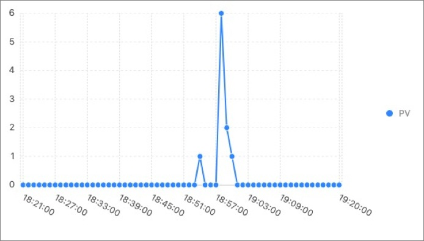

<a id="section-3"></a>

# 3.API Reference

<a id="section-3-1"></a>

## 3.1. Overview

Log Service allows you to collect and manage logs by using the Apsara Uni-manager Management Console. In addition, Log Service allows you to use the Log Service API to collect logs, query logs, and manage your projects and Logstores.

<table>
  <tr>
    <th>Object</th>
    <th>Operation</th>
  </tr>
  <tr>
    <td>Log</td>
    <td>Basic terms such as log and log group</td>
  </tr>
  <tr>
    <td rowspan="2">Project</td>
    <td>ListProject, CreateProject, DeleteProject, GetProject, and UpdateProject</td>
  </tr>
  <tr>
    <td>GetProjectLogs (Queries all logs in a project)</td>
  </tr>
  <tr>
    <td rowspan="2">Config</td>
    <td>ListConfig, CreateConfig, DeleteConfig, GetConfig, and UpdateConfig</td>
  </tr>
  <tr>
    <td>GetAppliedMachineGroups (Queries the machine groups to which a Logtail configuration file is applied)</td>
  </tr>
  <tr>
    <td rowspan="3">MachineGroup</td>
    <td>ListMachineGroup, CreateMachineGroup, DeleteMachineGroup, GetMachineGroup, and UpdateMachineGroup</td>
  </tr>
  <tr>
    <td>ApplyConfigToMachineGroup and RemoveConfigFromMachineGroup (Deletes a Logtail configuration file)</td>
  </tr>
  <tr>
    <td>GetAppliedConfigs (Queries the applied Logtail configuration files)</td>
  </tr>
  <tr>
    <td rowspan="2">Logstore</td>
    <td>ListLogstore, CreateLogstore, DeleteLogstore, GetLogstore, and UpdateLogstore</td>
  </tr>
  <tr>
    <td>GetLogs (Queries logs) and GetHistograms (Queries the distribution of logs)</td>
  </tr>
  <tr>
    <td>Index</td>
    <td>GetIndex, CreateIndex, DeleteIndex, and UpdateIndex</td>
  </tr>
  <tr>
    <td rowspan="4">Shard</td>
    <td>ListShards, SplitShard, and MergeShards</td>
  </tr>
  <tr>
    <td>PostLog (Writes logs)</td>
  </tr>
  <tr>
    <td>GetCursor (Locates logs)</td>
  </tr>
  <tr>
    <td>PullLogs (Consumes logs)</td>
  </tr>
  <tr>
    <td rowspan="2">Consumer group</td>
    <td>CreateConsumerGroup, DeleteConsumerGroup, ListConsumerGroup, and UpdateConsumerGroup</td>
  </tr>
  <tr>
    <td>HeartBeat (Sends heartbeat packets), GetCheckPoint, and UpdateCheckPoint</td>
  </tr>
</table>

You can call the API to perform the following operations:

- Collect logs based on Logtail configurations and Logtail machine group.

- Create Logstores and write logs to or read logs from the Logstores.

> **Note**
>
> - The Log Service API is a RESTful API based on the HTTP protocol.
>
> - Security verification is required for all API requests. For information about the API request signature method and process, see Request signatures.

<a id="section-3-2"></a>

## 3.2. Common request headers

The Log Service API is a RESTful API based on the HTTP protocol. The Log Service API supports a set of common request headers that can be used in all API requests. Each Log Service API request must provide a common request header. The following table describes the fields of the common request headers.

| Header field | Typ e | Description |
| --- | --- | --- |
| Accept | Strin g | The type of the response that the client expects Log Service to return. Two response types are supported: application/json and application/x-protobuf. This field is optional and valid for only GET requests. The specific value is subject to the definition of each API. |
| Accept-Encoding | Strin g | The compression algorithm that the client expects Log Service to return. LZ4 and DEFLATE are supported. The value can also be an empty string, indicating that no compression is performed. This field is optional and valid only for GET requests. The specific value is subject to the definition of each API. |
| Authorizatio n | Strin g | The signature content. For more information, see Request signatures. |
| Content-Length | Num eric valu e | The length of the HTTP request body defined in RFC 2616. If the request does not have a body, this field is not required. |
| Content-MD5 | Strin g | The uppercase string that is generated after the request body is calculated based on the MD5 algorithm. If the request does not have a body, this field is not required. |
| Content-Type | Strin g | The type of the HTTP request body defined in RFC 2616. Log Service API requests support only two types: application and x-protobuf. If the request does not have a body, this field is not required. The specific value is subject to the definition of each API. |
| Date | Strin g | The time when the request is sent. Only the RFC 822 format is supported. The GMT standard time is used. The formatted string is %a, %d %b %Y %H:%M:%S GMT, for example, Mon, 3 Jan 2010 08:33:47 GMT. |
| Host | Strin g | The complete hostname of the HTTP request. The value does not include protocol headers such as <code> http:// </code>. Example: <code> big-</code><code>game.regionid.example.com </code>. |
| x-log-apiversion | Strin g | The API version. The current version is 0.6.0. |
| x-log-bodyrawsiz e | Num eric valu e | The initial size of the request body. If the request does not have a body, the value is 0. If the request body is compressed, the value is the size of the initial data before the compression. Valid values: 0 to 3 × 1024 × 1024. This field is optional and only required when the request body is compressed. |
| x-log-compressty pe | Strin g | The compression type of the API request body. LZ4 and DEFLATE that are defined in RFC 1951 are supported. If you want to use the ZLIB compression type, see RFC 1950. If the request body is not compressed, this field is not required. |
| x-log-date | Strin g | The time when the request is sent. The time format is the same as that of the Date field. This field is optional. If a request contains this field, the value of this field replaces the value of the Date field for the request verification performed by Log Service. The Date field must be provided regardless of whether a request has an x-log-date field. |
| x-log-signaturem ethod | Strin g | The signature calculation method. Set the value to <code> hmac-sha1 </code>. |

> **Note**
>
> - The maximum difference between the time represented by the Date field of a request and the time when Log Service receives the request is 15 minutes. If the difference exceeds 15 minutes, Log Service rejects the request. If an x-log-date field is specified in the request, the time difference is calculated based on the value of the x-log-date field.
>
> - If the compression algorithm is specified in x-log-compresstype of a request, the raw data must be compressed and then placed into the HTTP request body. The values of Content-Length and Content-MD5 fields are calculated based on the compressed HTTP body.
>
> - The value of the Date field cannot be specified for the HTTP requests sent by some platforms. As a result, no correct value of the Date field is available to calculate the request signature. In this case, you must specify an x-log-date field and use the value of this field to calculate the request signature. After Log Service receives an API request, it checks whether the request contains an x-log-date field. If yes, Log Service uses the value of the x-log-date field for signature verification. If no, Log Service uses the value of the standard HTTP field Date for signature verification.

<a id="section-3-3"></a>

## 3.3. Common response headers

The Log Service API is a RESTful API based on the HTTP protocol. Each Log Service API response provides a common response header. The following table describes the fields in the common response headers.

| Header field | Typ e | Description |
| --- | --- | --- |
| Content-Length | Nu mer ic valu e | The length of the HTTP response defined in RFC 2616. |
| Content-MD5 | Stri ng | The MD5 value of the HTTP response defined in RFC 2616. This value is an uppercase string after the request body is calculated based on the MD5 algorithm. |
| Content-Type | Stri ng | The type of the HTTP response defined in RFC 2616. Log Service supports two response types: application/json and application/x-protobuf. |
| Date | Stri ng | The time when the request is returned. Only the RFC 822 format is supported.The GMT standard time is used. The formatted string is %a, %d %b %Y %H:%M:%S GMT, for example, Mon, 3 Jan 2010 08:33:47 GMT. |
| x-log-requestid | Stri ng | The unique ID that marks the request. The ID is generated by Log Service. This response header field is irrelevant to applications. It is used to troubleshoot problems. To troubleshoot failed API requests, you can provide this ID to the technical support team of Log Service. |

<a id="section-3-4"></a>

## 3.4. Request signatures

Each HTTP request of a Log Service API operation must pass security verification to ensure log data security. The security verification is performed by using the symmetric encryption algorithm. You can use an AccessKey pair for security verification.

The security verification process of an API request is as follows:

1. The requester generates a signature string based on the API request content, including the HTTP header and body.

2. The requester uses an AccessKey pair that consists of an AccessKey ID and AccessKey secret to sign the signature string. A digital signature is generated for this API request.

3. The requester sends both the API request content and digital signature to Log Service.

4. Log Service receives the request, and then repeats steps 1 and 2.

   > **Note**
   >
   > Log Service retrieves the AccessKey pair from the backend to calculate the
   >
   > signature string and generate the expected digital signature for this request.

5. The server compares the expected digital signature with the digital signature sent from the requester. If both signatures are the same, the request passes the security verification. Otherwise, the request is rejected.

The following figure shows the security verification process.

Figure 1. Security verification process

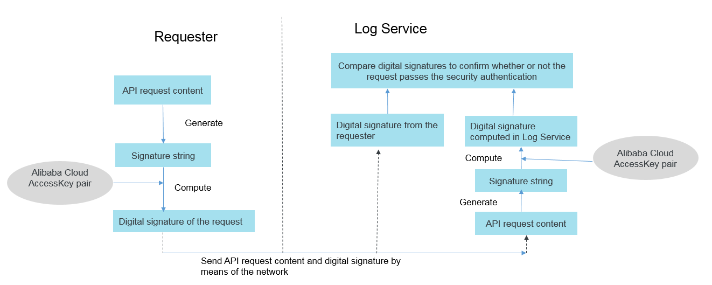

The security verification process can also be used for the following purposes:

- Identify the user that sends the API request. A user must specify the AccessKey pair that is used to generate the digital signature before the user sends the API request. Then, Log Service can use the AccessKey pair to identify the user and implement access control.

- Check whether the API request is intercepted and tampered with during transmission. Log Service recalculates the signature string based on the received API request. If the API request is intercepted and tampered with during transmission, the API request cannot pass the security verification.

**Sign an API request**

To pass the security verification for an API request, you must sign the API request on the requester to generate a digital signature. You must also use the Authorization field to transmit the digital signature of the API request over the network. The format of the Authorization field is as follows:

```text
Authorization:LOG <AccessKeyId>:<Signature>
```

In the preceding format, the value of the Authorization field contains the AccessKey ID. The AccessKey secret is used to construct the signature. To construct the signature, follow these steps:

1. Prepare an AccessKey pair.

   To generate a digital signature for an API request, you must use an AccessKey pair. The AccessKey pair consists of an AccessKey ID and an AccessKey secret.

2. Generate a signature string for the API request. The signature string of a Log Service API operation is generated based on the method, header, and body of the HTTP request. The signature string is generated by using the following formula:

   ```text
   SignString = VERB + "\n"
                + CONTENT-MD5 + "\n"
                + CONTENT-TYPE + "\n"
                + DATE + "\n"
                + CanonicalizedLOGHeaders + "\n"
                + CanonicalizedResource
   ```

   In the preceding formula,  `\n`  indicates the newline escape character and the plus sign ( `+` ) indicates the string concatenation operator. The following table describes the other elements.

   Table 1. Signature string elements

   | Element | Description | Example |
   | --- | --- | --- |
   | VERB | The method name of the HTTP request. | PUT, GET, and POST |
   | CONTENT-MD5 | The MD5 value of the HTTP request body, which must be an uppercase string. | 875264590688CA6171F6228AF5BBB3 D2 |
   | CONTENT-TYPE | The type of the HTTP request body. | application/x-protobuf |
   | DATE | The standard timestamp field of the HTTP request. This field complies with the RFC 1123 time format and uses the GMT standard time. | Mon, 3 Jan 2010 08:33:47 GMT |
   | CanonicalizedLOGH eaders | The string constructed by the custom fields in the HTTP request.The custom fields are prefixed with <code> x-log </code> and <code> x-acs </code>. | x-log-apiversion:0.6.0\\nx-log-bodyrawsize:50\\nx-log-signaturemethod:hmac-sha1 |
   | CanonicalizedResou rce | The string constructed by using the HTTP request resources. | /logstores/app_log |

   If an HTTP request does not have a body, the CONTENT-MD5 and CONTENT-TYPE fields are empty strings. In this case, the signature string is generated by using the following formula:

   ```text
   SignString = VERB + "\n"
                + "\n"
                + "\n"
                + DATE + "\n"
                + CanonicalizedLOGHeaders + "\n"
                + CanonicalizedResource
   ```

   The  `x-log-date`  custom request field is used in Log Service API operations. For more information, see Common request headers. If you specify this field in a request, the field value replaces the value of the HTTP standard request field Date during signature generation.

   The CanonicalizedLOGHeaders string is constructed as follows:

   <ol type="i">

   <li>

   Convert the names of all HTTP request fields prefixed with  `x-log`  and  `x-acs`  into lowercase letters.

   </li>

   <li>

   Sort all Log Service custom request fields obtained in the previous step in lexicographical

   </li>

   </ol>

   order.

   <ol type="i" start="3">

   <li>

   Delete all spaces on either side of a delimiter between the request header and content.

   </li>

   <li>

   Separate all headers and contents with the  `\n`  delimiter to obtain the CanonicalizedLOGHeader string.

   </li>

   </ol>

   The CanonicalizedResource string is constructed as follows:

   <ol type="i">

   <li>

   Set the CanonicalizedResource string to an empty string ("").

   </li>

   <li>

   Enter the Log Service resources that you want to access, for example,

   </li>

   </ol>

   /logstores/logstorename. If  `logstorename`  does not exist, this string is left blank.

   <ol type="i" start="3">

   <li>

   If the request contains a query string ( `QUERY_STRING` ), add a question mark ( `?` ) and

   </li>

   </ol>

   the query string at the end of the CanonicalizedResource string.

   In the request,  `QUERY_STRING`  is the lexicographically sorted string of the request parameters included in the URL. Equal signs ( `=` ) are used between the names and values of parameters to form a string. The name-value pairs are then sorted in lexicographical order and connected with ampersands ( `&` ) to form a string. The formula is described as follows:

   ```text
   QUERY_STRING = "KEY1=VALUE1" + "&" + "KEY2=VALUE2"
   ```

3. Generate a digital signature for the request. Log Service API operations support only the  `hmac-sha1`  digital signature algorithm, which is also the default signature algorithm. The signature formula is as follows:

   ```text
   Signature = base64(hmac-sha1(UTF8-Encoding-Of(SignString), AccessKeySecret))
   ```

   The HMAC-SHA1 method defined in RFC 2104 is used as the signature method. The AccessKey secret used in the preceding formula must match the AccessKey ID in the final Authorization field. Otherwise, the request cannot be verified by Log Service.

   After the digital signature is generated, use the signature to construct a complete security verification header for the API request. Then, enter the security verification header in the HTTP request and send the request.

**Examples**

The following two examples demonstrate how to sign an API request. In the examples, the AccessKey pair you use to sign the API request is as follows:

```text
AccessKeyId = "<yourAccessKeyId>"
AccessKeySecret = "<yourAccessKeySecret>"
```

- Example 1: you want to send the following GET request to list all Logstores in the ali-test-project project:

  ```text
  GET /logstores HTTP 1.1
  Mon, 09 Nov 2015 06:11:16 GMT
  Host: ali-test-project.regionid.example.com
  x-log-apiversion: 0.6.0
  x-log-signaturemethod: hmac-sha1
  ```

  The following signature string is generated for the API request:

  ```text
  GET\n\n\nMon, 09 Nov 2015 06:11:16 GMT\nx-log-apiversion:0.6.0\nx-log-
  signaturemethod:hmac-sha1\n/logstores? logstoreName=&offset=0&size=1000
  ```

  The CONTENT-TYPE and CONTENT-MD5 fields are empty because the GET request does not have an HTTP body. If the AccessKey secret is used to generate a signature, the signature is as follows:

  ```text
  jEYOTCJs2e88o+y5F4/S5IsnBJQ=
  ```

  The digitally signed HTTP request is as follows:

  ```text
  GET /logstores HTTP 1.1
  Mon, 09 Nov 2015 06:11:16 GMT
  Host: ali-test-project.regionid.example.com
  x-log-apiversion: 0.6.0
  x-log-signaturemethod: hmac-sha1
  Authorization: LOG <yourAccessKeyId>:<yourSignature>
  ```

- Example 2: You want to write the following log to the Logstore named test-logstore in the ali-test-project project:

  ```text
  topic=""
  time=1447048976
  source="10.10.10.1"
  "TestKey": "TestContent"
  ```

  The following HTTP request must be constructed based on the Log Service API definition:

  ```xml
  POST /logstores/test-logstore HTTP/1.1
  Date: Mon, 09 Nov 2015 06:03:03 GMT
  Host: test-project.regionid.example.com
  x-log-apiversion: 0.6.0
  x-log-signaturemethod: hmac-sha1
  Content-MD5: 1DD45FA4A70A9300CC9FE7305AF2C494
  Content-Length: 52
  x-log-apiversion:0.6.0
  x-log-bodyrawsize:50
  x-log-compresstype:lz4
  x-log-signaturemethod:hmac-sha1
  <The log is serialized to byte streams in the ProtoBuffer format.>
  ```

  In this HTTP request, the log is first serialized to byte streams in the ProtoBuffer format and then used as the request body. For more information, see Data encoding. The value of the Content-Type header field value in this request is application/x-protobuf. The value of the Content-MD5 header field is the MD5 value that corresponds to the request body. The signature string of this request is as follows:

  ```text
  POST\n1DD45FA4A70A9300CC9FE7305AF2C494\napplication/x-protobuf\nMon, 09 Nov 2015 06:03:03 GMT\nx-log-apiversion:0.6.0\nx-log-bodyrawsize:50\nx-log-compresstype:lz4\nx-log-signaturemethod:hmac-sha1\n/logstores/test-logstore
  ```

  If the AccessKey secret is used to generate a signature, the signature is as follows:

  ```text
  XWLGYHGg2F2hcfxWxMLiNkGki6g=
  ```

  The digitally signed HTTP request is as follows:

  ```xml
  POST /logstores/test-logstore HTTP/1.1
  Date: Mon, 09 Nov 2015 06:03:03 GMT
  Host: test-project.regionid.example.com
  x-log-apiversion: 0.6.0
  x-log-signaturemethod: hmac-sha1
  Content-MD5: 1DD45FA4A70A9300CC9FE7305AF2C494
  Content-Length: 52
  x-log-apiversion:0.6.0
  x-log-bodyrawsize:50
  x-log-compresstype:lz4
  x-log-signaturemethod:hmac-sha1
  Authorization: LOG <yourAccessKeyId>:<yourSignature>
  <The log is serialized to byte streams in the ProtoBuffer format.>
  ```

<a id="section-3-5"></a>

## 3.5. Common data structures

**ConsumerGroup**

The following table describes the data structure of a consumer group.

| Parameter | Type | Example | Description |
| --- | --- | --- | --- |
| name | String | test-consumer-group | The name of the consumer group. |
| timeout | Integer | 300 | The timeout period. If Log Service does not receive heartbeats from a consumer within the timeout period, Log Service deletes the consumer. Unit: seconds. |
| order | Boolean | false | Specifies whether to consume data in sequence.Valid values:<br>• true: consumes data in shards in sequence. If a shard is split, the data in the original shard is consumed first. Then, the data in the new shards is consumed at the same time. If shards are merged, the data in the original shards is consumed first. Then, the data in the new shard is consumed.<br>• false: does not consume data in shards in sequence. The data in all shards is consumed at the same time. If a new shard is generated after a shard is split or shards are merged, the data in the new shard is immediately consumed. |

**EncryptConf**

The following table describes the data structure of an encryption configuration.

| Parameter | Type | Example | Description |
| --- | --- | --- | --- |
| enable | Boolean | true | Specifies whether to enable data encryption. Valid values:<br>• true: enables data encryption.<br>• false: does not enable data encryption. |
| encrypt_type | String | default | The encryption algorithm.Valid values: default and sm4. This parameter must be specified when enable is set to true. |
| user_cmk_info | EncryptUserCmk Conf | { "cmk_key_id" : "f5136b95-2420-ab31-xxxxxxxxx" "arn" : "acs:ram::13234: role/logsource" "region_id" : "cn-hangzhou" } | Optional. If you specify this parameter, the bring-your-own-key (BYOK) key is used. If you do not specify this parameter, the service key of Log Service is used. |

**EncryptUserCmkConf**

The following table describes the data structure of a user-defined encryption configuration.

| Parameter | Type | Example | Description |
| --- | --- | --- | --- |
| cmk_key_id | String | f5136b95-2420-ab31-xxxxxxxxx | The ID of the customer master key (CMK) that uses the BYOK. |
| arn | String | acs:ram::13234:r ole/logsource | The Alibaba Cloud Resource Name (ARN) of the RAM role. |
| region_id | String | cn-hangzhou | The ID of the region where the CMK resides. |

**Histogram**

The following table describes the data structure of log distribution.

| Parameter | Type | Example | Description |
| --- | --- | --- | --- |
| from | Integer | 1409529600 | The start time of the subinterval. The value is a timestamp that follows the UNIX time format. It is the number of seconds that have elapsed since 00:00:00 UTC, Thursday, January 1, 1970. |
| to | Integer | 1409569200 | The end time of the subinterval. The value is a timestamp that follows the UNIX time format. It is the number of seconds that have elapsed since 00:00:00 UTC, Thursday, January 1, 1970. |
| count | Long | 2 | The number of logs in the subinterval. |
| progress | String | Complete | Indicates whether the query result in the subinterval is complete. Valid values:<br>• Complete: The query succeeded and complete query results are returned.<br>• Incomplete: The query is successful, but the query result is incomplete. To obtain the complete result, you must call the operation again. |

**LogtailConfig**

The following table describes the data structure of a Logtail configuration.

| Parameter | Type | Example | Description |
| --- | --- | --- | --- |
| configName | String | test-config | The name of the Logtail configuration. The name must meet the following requirements:<br>• The name must be unique in a project.<br>• The name can contain letters, digits, underscores (_), and hyphens (-).<br>• The name must be <code> 2 to </code> <code>64 </code> characters in length.<br>• The name must start and end with a letter or a digit. |
| logSample | String | 2022-06-14 11:13:29.796 \| DEBUG \| __main__: &lt;module&gt;:1 -hello world | A sample of the logs that Logtail needs to collect. |
| inputType | String | file | The type of the data source from which Logtail collects logs. |
| inputDetail | Map |  | The configurations of the data source. |
| outputType | String | LogService | The type of the destination to which the collected logs are stored. Set the value to LogService. |
| outputDetail | Object |  | The configurations of the destination. |
| endpoint | String | cn-hangzhou-intranet.log.aliyu ncs.com | The endpoint of the project. |
| logstoreName | String | test-logstore | The name of the Logstore to which the collected logs are saved. |
| region | String | cn-hangzhou | The region. |
| createTime | Long | 1655176807 | The time at which the Logtail configuration was created. The value is a UNIX timestamp. |
| lastModifyTime | Long | 1655176807 | The time at which the Logtail configuration was last modified. The value is a UNIX timestamp. |

**SavedSearch**

The following table describes the data structure of a saved search.

| Parameter | Type | Example | Description |
| --- | --- | --- | --- |
| savedsearchName | String | savedsearch-name | The name of the saved search. |
| searchQuery | String | status: 401 \| SELECT remote_addr,CO UNT(\*) as pv GROUP by remote_addr ORDER by pv desc limit 5 | The search statement or analytic statement. |
| logstore | String | aliyun-test-logstore | The name of the Logstore. |
| topic | String | topic | The topic of the logs.Default value: empty string (""). |
| displayName | String | Method statistics | The display name of the saved search. |

**chart**

The following table describes the data structure of a chart.

| Parameter | Type | Example | Description |
| --- | --- | --- | --- |
| title | String | my-chart | The title of the chart. |
| type | String | linepro | The type of the chart. |
| search | Map | (\*)\| SELECT date_format(__ti me__ - __time__% 60, '%H:%i:%s') as time, count(1) as count GROUP BY time ORDER BY time | The query configuration. |
| display | Map |  | The display configuration of the chart. |
| action | Map |  | action |

**dashboard**

The following table describes the data structure of a dashboard.

| Parameter | Type | Example | Description |
| --- | --- | --- | --- |
| dashboardName | String | dashboard-1609294922657-434834 | The internal display name of the dashboard, which is not displayed on the dashboard page. |
| displayName | String | test-alert | The display name of the dashboard. |
| description | String | This is a dashboard. | The description of the dashboard. |
| attribute | Map |  | The attribute values of the dashboard. |
| charts | Array of chart |  | The charts on the dashboard. |

**etlJob**

The following table describes the data structure of a data transformation job.

| Parameter | Type | Example | Description |
| --- | --- | --- | --- |
| etlJobName | String | etl-name | The name of the data transformation job. |
| sourceConfig | Object |  | The configurations of the data source. |
| logstoreName | String | my-logstore | The name of the Logstore. |
| triggerConfig | Object |  | The trigger configuration of the data transformation job. |
| roleArn | String | acs:ram::13791\*\* \*\*\*\*44:role/aliyun logetlrole | The ARN of the role that is used for authorization.Example: <code>acs:ram::13791******44:</code> <code>role/aliyunlogetlrole </code>. |
| triggerInterval | Integer | 5 | The interval at which the data transformation job is triggered. |
| maxRetryTime | Integer | 10 | The maximum number of retries. |
| startingPosition | String | at-unixtime | The position at which the data transformation job starts to run. |
| startingUnixtime | Long | 1655176807 | The time at which the data transformation job starts to run. This parameter takes effect when startingPosition is set to at-unixtime. |
| functionConfig | Object |  | The configuration of the functions that are used. |
| functionProvider | String | FunctionCompute | The function provider. |
| endpoint | String | cn-hangzhou.log.aliy uncs.com | The Log Service endpoint. |
| accountId | String | 13791\*\*\*\*\*\*44 | The ID of the Apsara Stack tenant account. |
| regionName | String | cn-hangzhou | The region. |
| serviceName | String | my-service | The name of the service. |
| functionName | String | hello-world | The name of the function. |
| roleArn | String | acs:ram::13791\*\* \*\*\*\*44:role/aliyun logetlrole | The ARN of the role that is used for authorization.Example: <code>acs:ram::13791******44:</code> <code>role/aliyunlogetlrole </code>. |
| functionParameter | Map |  | The parameters. |
| enable | Boolean | true | Specifies whether to enable the data transformation job. |
| logConfig | Object |  | The logging configuration. |
| endpoint | String | cn-hangzhou.log.aliy uncs.com | The Log Service endpoint. |
| projectName | String | ali-test-project | The name of the project. |
| logstoreName | String | ali-test-logstore | The name of the Logstore. |

**etlMeta**

The following table describes the data structure of etlMeta.

| Parameter | Type | Example | Description |
| --- | --- | --- | --- |
| etlMetaName | String | MetaName | MetaName |
| etlMetaKey | String | MetaKey | MetaKey |
| etlMetaTag | String | MetaTag | MetaTag |
| enable | Boolean | true | Enable |
| etlMetaValue | String | MetaValue | MetaValue |

**externalStore**

The following table describes the data structure of an external store.

| Parameter | Type | Example | Description |
| --- | --- | --- | --- |
| externalStoreName | String | rds_store | The name of the external store. The name must be unique in a project and must be different from Logstore names. |
| storeType | String | rds-vpc | The storage type. Set the value to rds-vpc, which indicates an ApsaraDB RDS for MySQL database in a virtual private cloud (VPC). |

<table>
  <tr>
    <td>parameter</td>
    <td>Map</td>
    <td>{ "vpc-id": "vpc-bp1aevy8sofi8m h1q****", "instance-id": "i-bp1b6c719dfa08 exf****", "host": "192.168.XX.XX", "port": "3306", "username": "root", "password": "sfdsfldsfksfls**** ", "db": "meta", "table": "join_meta", "region": "cn-qingdao" }</td>
    <td>The parameters that are configured for the external store.</td>
  </tr>
</table>

**index**

The following table describes the data structure of an index configuration.

| Parameter | Type | Example | Description |
| --- | --- | --- | --- |
| ttl | Integer | 30 | The log retention period.Unit: days. |
| max_text_len | Integer | 2048 | The maximum length of a field value that can be retained. Unit: bytes.Default value: 2048. The default value is equal to 2 KB. You can change the value of the max_text_len parameter. Valid values: 64 to 16384. Unit: bytes. |
| log_reduce_white_list | Array of String | name | The fields in the whitelist. |
| log_reduce_black_list | Array of String | time | The fields in the blacklist. |
| line | Object |  | The configuration of full-text indexing. You must configure at least one of the following parameters: line and keys. For more information, see Example. |
| chn | Boolean | false | Specifies whether to include Chinese characters. Valid values:<br>• true<br>• false (default) |
| caseSensitive | Boolean | true | Specifies whether to enable case sensitivity. Valid values:<br>• true<br>• false (default) |
| token | Array of String | , | The delimiters. Examples: ",", ".", "\\r", and "\\n". |
| include_keys | Array of String | includeField | The included fields. |
| exclude_keys | Array of String | excludeField | The excluded fields. |
| keys | Map |  | The configuration of field indexes. A field index is a key-value pair in which the key specifies the name of the field and the value specifies the index configuration of the field.You must configure at least one of the following parameters: line and keys.For more information, see Example. |
| log_reduce | Boolean | true | Specifies whether to enable the LogReduce feature.After you enable the LogReduce feature, either the whitelist or blacklist takes effect. Valid values:<br>• true<br>• false (default) |
| lastModifyTime | Long | 1622186280 | The time at which the index configuration was last modified. The value is a timestamp that follows the UNIX time format. It is the number of seconds that have elapsed since 00:00:00 UTC, Thursday, January 1, 1970. |

**logging**

The following table describes the data structure of the service log feature for a project.

| Parameter | Type | Example | Description |
| --- | --- | --- | --- |
| loggingProject | String | my-project | The name of the project to which service logs are saved. |
| loggingDetails | Array |  | The configuration of service logs. |

<table>
  <tr>
    <td>type</td>
    <td>String</td>
    <td>consumergroup_l og</td>
    <td>The type of service logs.Valid values:<br>• consumergroup_log: the consumption delay logs of consumer groups.<br>• logtail_alarm: the alert logs of Logtail.<br>• operation_log: the operation logs. You are charged for operation logs.<br>• logtail_profile: the collection logs of Logtail.<br>• metering: the metering logs.<br>• logtail_status: the status logs of Logtail.<br>• scheduledsqlalert: the operational logs of Scheduled SQL jobs.<br>• etl_alert: the operational logs of data transformation jobs.</td>
  </tr>
  <tr>
    <td>logstore</td>
    <td>String</td>
    <td>my-logstore</td>
    <td>The name of the Logstore.</td>
  </tr>
</table>

**logstore**

The following table describes the data structure of a Logstore.

| Parameter | Type | Example | Description |
| --- | --- | --- | --- |
| logstoreName | String | my-logstore | The name of the Logstore. |
| ttl | Integer | 1 | The data retention period.Unit: days. Valid values: 1 to<br>3650. If you set the value to 3650, data is permanently stored. |
| shardCount | Integer | 2 | The number of shards. |
| enable_tracking | Boolean | false | Specifies whether to enable the WebTracking feature.Default value: false. Valid values:<br>• true<br>• false |
| autoSplit | Boolean | true | Specifies whether to enable automatic sharding. Valid values:<br>• true<br>• false |
| maxSplitShard | Integer | 6 | The maximum number of readwrite shards that are obtained after shards are automatically split . Valid values: 1 to 64. |
| appendMeta | Boolean | false | Specifies whether to record public IP addresses. Default value: false. Valid values:<br>• true<br>• false |
| telemetryType | String | Metrics | The type of the data that you want to query. Default value: false. Valid values:<br>• Metrics: metric data<br>• None: non-metric data |
| createTime | Integer | 1453949705 | The time at which the Logstore was created. The value is a timestamp that follows the UNIX time format. It is the number of seconds that have elapsed since 00:00:00 UTC, Thursday, January 1, 1970. |
| lastModifyTime | Integer | 1524155379 | The time at which the Logstore was last modified.The value is a timestamp that follows the UNIX time format. It is the number of seconds that have elapsed since 00:00:00 UTC, Thursday, January 1, 1970. |
| encrypt_conf | EncryptConf |  | The configuration of data encryption. |
| hot_ttl | Integer | 60 | The period of time during which you want to store logs in the hot storage tier of the Logstore. Minimum value: 30. Unit: days. |
| mode | String | standard | The type of the Logstore.Log Service provides the following types of Logstores: Standard Logstores and Query Logstores. Valid values:<br>• <strong>standard</strong>: Standard Logstore. This type of Logstore supports the log analysis feature and is suitable for scenarios such as real-time monitoring and interactive analysis. You can also use this type of Logstore to build a comprehensive observability system.<br>• <strong>query</strong>: Query Logstore.This type of Logstore supports high-performance queries. The index traffic fee of a Query Logstore is approximately half that of a Standard Logstore.Query Logstores do not support SQL analysis.Query Logstores are suitable for scenarios in which the volume of data is large, the log retention period is long, or log analysis is not required.Log retention periods of weeks or months are considered long. |
| productType | String | aliyun | The type of the service to which the logs belong. |

**machine**

The following table describes the data structure of a machine.

| Parameter | Type | Example | Description |
| --- | --- | --- | --- |
| ip | String | 192.168.xx.x | The IP address of the machine. |
| machine-uniqueid | String | 3B70F4F1-80F7-46C4-A6C1-100\*\*\*CEE647 | The unique identifier of the machine. |
| lastHeartbeatTime | Long | 1447182247 | The last heartbeat time. The value is a timestamp that follows the UNIX time format. It is the number of seconds that have elapsed since 00:00:00 UTC, Thursday, January 1, 1970. |
| userdefined-id | String | None | The custom identifier of the machine. This parameter takes effect when the machine belongs to a custom identifier-based machine group. |

**machineGroup**

The following table describes the data structure of a machine group.

| Parameter | Type | Example | Description |
| --- | --- | --- | --- |
| groupName | String | machineGroup-1 | The name of the machine group. |
| groupType | String | "" | The type of the machine group. Set the value to an empty string. |
| machineIdentifyType | String | ip | The type of the machine group identifier. Valid values:<br>• ip: The machine group uses IP addresses as identifiers.<br>• userdefined: The machine group uses custom identifiers. |
| groupAttribute | Object |  | The attribute of the machine group. |
| groupTopic | String | testtopic | The topic of the machine group. |
| externalName | String | testgroup | The identifier of the external management system on which the machine group depends. |
| machineList | Array of String | 47.100.XX.XX | The IP address or custom identifier of the machine group. |

**project**

The following table describes the data structure of a Log Service project.

| Parameter | Type | Example | Description |
| --- | --- | --- | --- |
| createTime | String | 2021-07-07 14:08:09 | The time at which the project was created. |
| lastModifyTime | String | 2022-04-18 13:30:19 | The time at which the project was last modified. |
| projectDesc | String | Description of my-project-test | The description of the project. |
| projectOwner | String | "" | The Apsara Stack tenant account to which the project belongs. |
| projectName | String | ali-test-project | The name of the project.The name is included in the value of the Host header.The name must be unique in a region. You cannot change the name after you create the project. |
| region | String | cn-hangzhou | The ID of the region where the project resides. |
| projectStatus | String | Noraml | The status of the project.Valid values:<br>• Normal: The status of the project is normal.<br>• Disable: The status of the project is disabled. |
| resourceGroupId | String | rg-acf\*\*\*\*\*\*sq | The ID of the resource group to which the project belongs. |

**shard**

The following table describes the data structure of a shard.

| Parameter | Type | Example | Description |
| --- | --- | --- | --- |
| shardID | Integer | 0 | shard id |
| status | String | readwrite | The status of the shard.After you create a shard, the shard enters the readwrite state. If you split a shard or merge shards, the status of the original shard changes to readonly.The newly generated shards are in the readwrite state.The status of a shard does not affect the read capacity of the shard. Data can be written to the shards that are in the readwrite state, but cannot be written to the shards that are in the readonly state. Valid values:<br>• readwrite<br>• readonly |
| inclusiveBeginKey | String | 0000000000000 0000000000000 000000 | The start of the MD5 hash range. The value is included in the MD5 hash range of the shard. |
| exclusiveEndKey | String | 8000000000000 0000000000000 00000 | The end of the MD5 hash range. |
| createTime | Integer | 1524222931 | The time at which the shard was created. The value is a timestamp that follows the UNIX time format. It is the number of seconds that have elapsed since 00:00:00 UTC, Thursday, January 1, 1970. |

<a id="section-3-6"></a>

## 3.6. Common error codes

When an API request error occurs, Log Service returns an error message, including the HTTP status code and the specific error details in the response body. The error details in the response body are formatted as follows:

```json
{
"errorCode" : <ErrorCode>,
"errorMessage" : <ErrorMessage>
}
```

Some of the error messages that may be returned by Log Service apply to most APIs and are defined as common error codes. The other error messages apply only to some APIs and are defined as special error codes. The unique error codes of an API are described in the relevant API reference.

Table 1. Common error codes

| HTTP status code | Error code | Error message | Description |
| --- | --- | --- | --- |
| 411 | MissingContentLen gth | Content-Length does not exist in http header when it is necessary. | The error message returned because the required Content-Length field does not exist in the request header. |
| 415 | InvalidContentType | Content-Type {type} is unsupported. | The error message returned because the specified Content-Type is not supported. |
| 400 | MissingContentTyp e | Content-Type does not exist in http header when body is not empty. | The error message returned because the Content-Type header field is not specified when the HTTP request body is not empty. |
| 400 | MissingBodyRawSiz e | x-log-bodyrawsize does not exist in header when it is necessary. | The error message returned because the required x-log-bodyrawsize field does not exist in the request header in the compression scenario. |
| 400 | InvalidBodyRawSiz e | x-log-bodyrawsize is invalid. | The error message returned because the x-log-bodyrawsize value is invalid. |
| 400 | InvalidCompressTy pe | x-log-compresstype {type} is unsupported. | The error message returned because the compression type specified in the x-log-compresstype parameter is not supported. |
| 400 | MissingHost | Host does not exist in http header. | The error message returned because the Host field does not exist in the HTTP request header. |
| 400 | MissingDate | Date does not exist in http header. | The error message returned because the Data field does not exist in the HTTP request header. |
| 400 | InvalidDateFormat | Date {date} must follow RFC822. | The error message returned because the value of the Date field in the request header does not comply with the RFC 822 standard. |
| 400 | MissingAPIVersion | x-log-apiversion does not exist in http header. | The error message returned because the x-log-apiversion field does not exist in the HTTP request header. |
| 400 | InvalidAPIVersion | x-log-apiversion {version} is unsupported. | The error message returned because the value of the x-log-apiversion field in the HTTP request header is not supported. |
| 400 | MissAccessKeyId | x-log-accesskeyid does not exist in header. | The error message returned because no AccessKey ID exists in the Authorization header field. |
| 401 | Unauthorized | The AccessKeyId is unauthorized. | The error message returned because the specified AccessKey ID is unauthorized. |
| 400 | MissingSignatureM ethod | x-log-signaturemethod does not exist in http header. | The error message returned because the x-log-signaturemethod field does not exist in the HTTP request header. |
| 400 | InvalidSignatureMe thod | signature method {method} is unsupported. | The error message returned because the signature method specified in the x-log-signaturemethod header field is not supported. |
| 400 | RequestTimeTooSk ewed | Request time exceeds server time more than 15 minutes. | The error message returned because the request sending time is more than 15 minutes before or after the current server time. |
| 404 | ProjectNotExist | Project {name} does not exist. | The error message returned because the specified project does not exist. |
| 401 | SignatureNotMatch | Signature {signature} is not matched. | The error message returned because the digital signature of the request does not match the signature computed in Log Service. |
| 403 | WriteQuotaExceed | Write quota is exceeded. | The error message returned because the log write quota is exceeded. |
| 403 | ReadQuotaExceed | Read quota is exceeded. | The error message returned because the log read quota is exceeded. |
| 500 | InternalServerError | Internal server error message. | The error message returned because an internal server error occurred. |
| 503 | ServerBusy | The server is busy, please try again later. | The error message returned because the server is busy. Try again later. |

The {…} in the error message indicates the specific error information. For example, {name} in the ProjectNotExist error message is replaced by a specific project name.

<a id="section-3-7"></a>

## 3.7. Project API

<a id="section-3-7-1"></a>

### 3.7.1. CreateProject

Creates a project.

**Request syntax**

```http
POST / HTTP/1.1
Authorization: <AuthorizationString> 
x-log-bodyrawsize: 0
User-Agent: <UserAgent>
x-log-apiversion: 0.6.0
Host: <Project Endpoint>
x-log-signaturemethod: hmac-sha1
Date: <GMT Date>
Content-Type: application/json
Content-MD5: <Content-MD5>
Content-Length: <ContentLength>
Connection: Keep-Alive
{
  "projectName": <ProjectName>,
  "description": <Description>
}
```

**Request elements**

- Request headers The CreateProject API operation does not have special request headers. For information about common request headers of Log Service API operations, see Common request headers.

- Request parameters

  | Parameter | Type | Required | Description |
  | --- | --- | --- | --- |
  | projectName | String | Yes | The name of the project. |
  | description | String | Yes | The description of the project. |

**Response elements**

- Response headers

  The CreateProject API operation does not have special response headers. For information about common response headers of Log Service API operations, see Common response headers.

- Response parameters

  The HTTP status code 200 is returned.

**Error codes**

In addition to Common error codes, the API operation may also return the following special error codes.

| HTTP status code | Error code | Error message |
| --- | --- | --- |
| 400 | ProjectAlreadyExist | Project {project} already exist |
| 400 | ParameterInvalid | The body is not valid json string |
| 500 | InternalServerError | Specified Server Error Message |

**Examples**

- Sample requests

  ```http
  POST / HTTP/1.1
  Authorization: LOG <yourAccessKeyId>:<yourSignature>
  x-log-bodyrawsize: 0
  User-Agent: sls-java-sdk-v-0.6.1
  x-log-apiversion: 0.6.0
  Host: my-project-test.cn-shanghai.log.aliyuncs.com
  x-log-signaturemethod: hmac-sha1
  Date: Sun, 27 May 2018 07:43:26 GMT
  Content-Type: application/json
  Content-MD5: A7967D81EFF5E3CD447FB6D8DF294E20
  Content-Length: 80
  Connection: Keep-Alive
  {
    "projectName": "my-project-test",
    "description": "Description of my-project-test"
  }
  ```

- Sample responses

  ```text
  HTTP/1.1 200
  Server: nginx
  Content-Length: 0
  Connection: close
  Access-Control-Allow-Origin: *
  Date: Sun, 27 May 2018 07:43:27 GMT
  x-log-requestid: 5B0A619F205DC3F30EDA9322
  ```

<a id="section-3-7-2"></a>

### 3.7.2. DeleteProject

Deletes a project.

**Request syntax**

```http
DELETE / HTTP/1.1
Authorization: <AuthorizationString>
x-log-bodyrawsize: 0
User-Agent: <UserAgent>
x-log-apiversion: 0.6.0
Host: <Project Endpoint>
x-log-signaturemethod: hmac-sha1
Date: <GMT Date>
Content-Type: application/x-protobuf
Connection: Keep-Alive
```

**Request elements**

- Request headers

  The DeleteProject API operation does not have special request headers. For information about common request headers of Log Service API operations, see Common request headers.

- Request parameters

  | Parameter | Type | Required | Description |
  | --- | --- | --- | --- |
  | projectName | String | Yes | The name of the project. The name is a part of the Host parameter in the header. |

**Response elements**

- Response headers

  The DeleteProject API operation does not have special response headers. For information about common response headers of Log Service API operations, see Common response headers.

- Response parameters

  The HTTP status code 200 is returned.

**Error codes**

In addition to Common error codes, the API operation may also return the following special error codes.

| HTTP status code | Error code | Error message |
| --- | --- | --- |
| 404 | ProjectNotExist | The project does not exist: {project} |
| 500 | InternalServerError | Specified Server Error Message |

**Examples**

- Sample requests

  ```http
  DELETE / HTTP/1.1
  Authorization: LOG <yourAccessKeyId>:<yourSignature>
  x-log-bodyrawsize: 0
  User-Agent: sls-java-sdk-v-0.6.1
  x-log-apiversion: 0.6.0
  Host: my-project-test.cn-shanghai.log.aliyuncs.com
  x-log-signaturemethod: hmac-sha1
  Date: Sun, 27 May 2018 08:25:04 GMT
  Content-Type: application/x-protobuf
  Connection: Keep-Alive
  ```

- Sample responses

  ```text
  HTTP/1.1 200
  Server: nginx
  Content-Length: 0
  Connection: close
  Access-Control-Allow-Origin: *
  Date: Sun, 27 May 2018 08:25:04 GMT
  x-log-requestid: 5B0A6B60BB6EE39764D458B5
  ```

<a id="section-3-7-3"></a>

### 3.7.3. UpdateProject

Modifies a project.

**Request syntax**

```http
PUT / HTTP/1.1 
Authorization:  <AuthorizationString>
x-log-bodyrawsize: 0 
User-Agent:  <UserAgent>
x-log-apiversion: 0.6.0 
Host:  <Project Endpoint>
x-log-signaturemethod: hmac-sha1 
Date:  <GMT Date>
Content-Type: application/json 
Content-MD5:  <Content-MD5>
Content-Length:  <ContentLength>
Connection: Keep-Alive
```

**Request elements**

- Request headers

  The UpdateProject API operation does not have special request headers. For information about common request headers of Log Service API operations, see Common request headers.

- Request parameters

  | Parameter | Type | Required | Description |
  | --- | --- | --- | --- |
  | projectName | String | Yes | The name of the project. The name is a part of the Host parameter in the header. |
  | description | String | Yes | The description of the project. The value is an empty string by default. |

**Response elements**

- Response headers

  The UpdateProject API operation does not have special response headers. For information about common response headers of Log Service API operations, see Common response headers.

- Response parameters

  The HTTP status code 200 is returned.

**Error codes**

In addition to Common error codes, the API operation may also return the following special error codes.

| HTTP status code | Error code | Error message |
| --- | --- | --- |
| 404 | ProjectNotExist | The project does not exist: &lt;Project&gt; |
| 400 | ParameterInvalid | The body is not valid json string |
| 500 | InternalServerError | Specified Server Error Message |

**Examples**

- Sample requests

  ```http
  PUT / HTTP/1.1 
  Authorization: LOG <yourAccessKeyId>:<yourSignature> 
  x-log-bodyrawsize: 0 
  User-Agent: sls-java-sdk-v-0.6.1 
  x-log-apiversion: 0.6.0 
  Host: my-project-test.cn-shanghai.log.aliyuncs.com 
  x-log-signaturemethod: hmac-sha1 
  Date: Sun, 27 May 2018 07:43:26 GMT 
  Content-Type: application/json 
  Content-MD5: A7967D81EFF5E3CD447FB6D8DF294E20 
  Content-Length: 40 
  Connection: Keep-Alive 
  { 
    "description": "Description of my-project-test" 
  }
  ```

- Sample responses

  ```text
  HTTP/1.1 200 
  Server: nginx 
  Content-Length: 0 
  Connection: close 
  Access-Control-Allow-Origin: * 
  Date: Sun, 27 May 2018 07:43:27 GMT 
  x-log-requestid: 5B0A619F205DC3F30EDA9322
  ```

<a id="section-3-7-4"></a>

### 3.7.4. GetProject

Queries a project based on the project name.

**Request syntax**

```http
GET / HTTP/1.1
Authorization: <AuthorizationString>
x-log-bodyrawsize: 0
User-Agent: <UserAgent>
x-log-apiversion: 0.6.0
Host: <Project Endpoint>
x-log-signaturemethod: hmac-sha1
Date: <GMT Date>
Content-Type: application/x-protobuf
Connection: Keep-Alive
```

**Request elements**

- Request headers

  The GetProject API operation does not have special request headers. For information about common request headers of Log Service API operations, see Common request headers.

- Request parameters

  | Parameter | Type | Required | Description |
  | --- | --- | --- | --- |
  | projectName | String | Yes | The name of the project. The name is a part of the Host parameter in the header. |

**Response elements**

- Response headers

  The GetProject API operation does not have special response headers. For information about common response headers of Log Service API operations, see Common response headers.

- Response parameters

  After the request succeeds, the response body contains the details of the project. The following table describes the response parameters.

  | Parameter | Type | Description |
  | --- | --- | --- |
  | createTime | String | The time when the project was created. |
  | description | String | The description of the project. |
  | lastModifyTime | String | The time when the project was last modified. |
  | owner | String | The ID of the account that was used to create the project. |
  | projectName | String | The name of the project. |
  | status | String | The status of the project. |
  | region | String | The region to which the project belongs. |

**Error codes**

In addition to Common error codes, the API operation may also return the following special error codes.

| HTTP status code | Error code | Error message |
| --- | --- | --- |
| 404 | ProjectNotExist | The project does not exist: {project} |
| 500 | InternalServerError | Specified Server Error Message |

**Examples**

- Sample requests

  ```http
  GET / HTTP/1.1
  Authorization: LOG <yourAccessKeyId>:<yourSignature>
  x-log-bodyrawsize: 0
  User-Agent: sls-java-sdk-v-0.6.1
  x-log-apiversion: 0.6.0
  Host: my-project-test.cn-shanghai.log.aliyuncs.com
  x-log-signaturemethod: hmac-sha1
  Date: Sun, 27 May 2018 08:25:04 GMT
  Content-Type: application/x-protobuf
  Connection: Keep-Alive
  ```

- Sample responses

  ```text
  HTTP/1.1 200
  Server: nginx
  Content-Length: 0
  Connection: close
  Access-Control-Allow-Origin: *
  Date: Sun, 27 May 2018 08:25:04 GMT
  x-log-requestid: 5B0A6B60BB6EE39764D458B5
  ```

<a id="section-3-7-5"></a>

### 3.7.5. ListProject

Lists all projects.

**Request syntax**

```text
GET /? offset={offset}&size={size} HTTP/1.1
Authorization: <AuthorizationString>
x-log-bodyrawsize: 0
User-Agent: <UserAgent>
x-log-apiversion: 0.6.0
Host: <Endpoint>
x-log-signaturemethod: hmac-sha1
Date: <GMT Date>
Content-Type: application/x-protobuf
Connection: Keep-Alive
```

**Request elements**

- Request headers

  The ListProject API operation does not have special request headers. For information about common request headers of Log Service API operations, see Common request headers.

- Request parameters

  | Parameter | Type | Required | Description |
  | --- | --- | --- | --- |
  | offset | Integer | No | The start position of the records to return.Default value: 0. |
  | size | Integer | No | The maximum number of entries to return on each page.Default and maximum value: 500. |

**Response elements**

- Response headers

  The ListProject API operation does not have special response headers. For information about common response headers of Log Service API operations, see Common response headers.

- Response parameters

  After the request succeeds, the response body contains the project list. The following table describes the response parameters.

  | Parameter | Type | Description |
  | --- | --- | --- |
  | count | Integer | The number of returned projects on each page. |
  | total | Integer | The total number of ruturned projects. |
  | projects | Array | The list of projects. |

  The following table describes the elements of the projects parameter.

  | Element | Type | Description |
  | --- | --- | --- |
  | createTime | String | The time when the project was created. |
  | description | String | The description of the project. |
  | lastModifyTime | String | The time when the project was last modified. |
  | owner | String | The ID of the account that was used to create the project. |
  | projectName | String | The name of the project. |
  | status | String | The status of the project. |
  | region | String | The region to which the project belongs. |

**Error codes**

In addition to Common error codes, the API operation may also return the following special error codes.

| HTTP status code | Error code | Error message |
| --- | --- | --- |
| 500 | InternalServerError | Specified Server Error Message |

**Examples**

- Sample requests

  ```text
  GET /? offset=0&size=2&projectName= HTTP/1.1
  Authorization: LOG <yourAccessKeyId>:<yourSignature>
  x-log-bodyrawsize: 0
  User-Agent: sls-java-sdk-v-0.6.1
  x-log-apiversion: 0.6.0
  Host: cn-shanghai.log.aliyuncs.com
  x-log-signaturemethod: hmac-sha1
  Date: Sun, 27 May 2018 09:03:33 GMT
  Content-Type: application/x-protobuf
  Connection: Keep-Alive
  ```

- Sample responses

  ```text
  HTTP/1.1 200
  Server: nginx
  Content-Type: application/json
  Content-Length: 345
  Connection: close
  Access-Control-Allow-Origin: *
  Date: Sun, 27 May 2018 09:03:33 GMT
  x-log-requestid: 5B0A7465AAEA20CA70DE3064
  {
    "count": 2,
    "total": 11,
    "projects": [
      {
        "projectName": "project1",
        "status": "Normal",
        "owner": "",
        "description": "",
        "region": "cn-shanghai",
        "createTime": "1524222931",
        "lastModifyTime": "1524539357"
      },
      {
        "projectName": "project123456",
        "status": "Normal",
        "owner": "",
        "description": "",
        "region": "cn-shanghai",
        "createTime": "1471963876",
        "lastModifyTime": "1524539357"
      }
    ]
  }
  ```

<a id="section-3-7-6"></a>

### 3.7.6. GetProjectLogs

Queries logs in a project by using an SQL statement.

**Request syntax Request syntax**

The following example shows the request syntax of the GetProjectLogs operation:

```text
GET /logs query=SELECT avg(latency) as avg_latency FROM  where __date__ >'2017-09-01 00:00:00' and __date__ < '2017-09-02 00:00:00'
Authorization: <AuthorizationString>
Date: Wed, 3 Sept. 2014 08:33:46 GMT
Host: big-game.cn-hangzhou.log.aliyuncs.com
x-log-bodyrawsize: 0
x-log-apiversion: 0.6.0
x-log-signaturemethod: hmac-sha1
```

**Request elements**

- Request headers

  The GetProjectLogs operation does not have operation-specific request headers. For information about the common request headers of Log Service API operations, see Common request headers.

- Request parameters

  | Parameter | Type | Required | Description |
  | --- | --- | --- | --- |
  | query | string | Yes | The SQL statement that is used for the query. |

**Response elements**

- Response headers

  For information about the common response headers of Log Service API operations, see Common response headers. The following table describes the response headers that are specific to this operation.

  | Parameter | Type | Description |
  | --- | --- | --- |
  | x-log-progress | String | The status of the query results. Valid values: Incomplete and Complete. |
  | x-log-count | Integer | The total number of logs in the query results. |
  | x-log-processed-rows | Integer | The number of rows that were processed in the query. |
  | x-log-elapsed-millisecond | Integer | The number of milliseconds that were consumed by the query. |

- Response parameters The response body of the GetProjectLogs operation is an array. Each element in the array is a log. The following table describes the response parameters.

  | Parameter | Type | Description |
  | --- | --- | --- |
  | __time__ | Integer | The log timestamp. The timestamp follows the UNIX time format. It is the number of seconds that have elapsed since 00:00:00 Thursday, January 1, 1970. |
  | __source__ | String | The log source that was specified when logs were written. |
  | \[content\] | Key-value pair | The original content of logs. |

**Additional considerations**

- The query statement that is used in this API operation is a standard SQL statement.

- You must specify a project in the domain name of the request.

- You must specify a Logstore in the FROM clause of the query statement. A Logstore can be regarded as an SQL table.

- You must specify a time range in the SQL statement by using the __date__ parameter (timestamp) or __time__ parameter (UNIX timestamp).

- If the number of logs in a Logstore significantly changes, Log Service cannot predict the number of times you must call this API operation to obtain complete results. In this case, you must check the value of the x-log-progress parameter in the returned results of each request. You can also call this API operation again to obtain the complete results based on the value of this parameter.

  > **Note**
  >
  > Each time you call this operation, the same number of charge units (CUs)
  >
  > are consumed.

**Error codes**

In addition to Common error codes, the API operation may also return the following operation-specific error codes.

| HTTP status code | Error code | Error message | Description |
| --- | --- | --- | --- |
| 400 | ParameterInvalid | parameter is invalid | The error message returned because the specified parameter in the request is invalid. |

**Example**

In this example, the logs whose topic is groupA are queried in a Logstore named app_log. The Logstore belongs to a project named big-game in the China (Hangzhou) region. The time range is from 00:00:00 UTC, September 1, 2014 to 22:00:00 UTC, September 1, 2014, and the keyword is "error". The query starts from the start of the time range. A maximum of 20 logs can be returned.

- Sample requests

  ```text
  GET /logs/?query=SELECT * FROM <logStoreName> where __line__ = 'abc' and __date__ >'2017-09-01 00:00:00' and __date__ < '2017-09-02 00:00:00'&line=20&offset=0 HTTP/1.1
  Authorization: <AuthorizationString>
  Date: Wed, 3 Sept. 2014 08:33:46 GMT
  Host: big-game.cn-hangzhou.log.aliyuncs.com
  x-log-bodyrawsize: 0
  x-log-apiversion: 0.4.0
  x-log-signaturemethod: hmac-sha1
  ```

- Sample responses

  ```text
  HTTP/1.1 200 OK
  Content-MD5: 36F9F7F0339BEAF571581AF1B0AAAFB5
  Content-Type: application/json
  Content-Length: 269
  Date: Wed, 3 Sept. 2014 08:33:47 GMT
  x-log-requestid: efag01234-12341-15432f
  x-log-progress : Complete
  x-log-count : 10000
  x-log-processed-rows: 10000
  x-log-elapsed-millisecond:5
  {
      "progress": "Complete",
      "count": 2,
      "logs": [
          {
              "__time__": 1409529660,
              "__source__": "10.237.0.17",
              "Key1": "error",
              "Key2": "Value2"
          },
          {
              "__time__": 1409529680,
              "__source__": "10.237.0.18",
              "Key3": "error",
              "Key4": "Value4"
          }
      ]
  }
  ```

  In the sample response, the value of the x-log-progress parameter is Complete. This value indicates that all logs are queried and the returned results are complete. Two logs meet the specified query conditions. The logs are displayed as the value of the logs parameter. If the value of the x-log-progress parameter in the response is Incomplete, you must repeat the request to obtain complete query results.

<a id="section-3-8"></a>

## 3.8. Logstore operations

<a id="section-3-8-1"></a>

### 3.8.1. CreateLogstore

Creates a Logstore.

**Request syntax**

The request syntax of the CreateLogstore API operation is as follows:

```http
POST /logstores HTTP/1.1
Authorization: <AuthorizationString> 
Date: <GMT Date>
Host: <Project Endpoint>
x-log-apiversion: 0.6.0
x-log-signaturemethod: hmac-sha1
{
    "logstoreName" : <logStoreName>,
    "ttl": <ttl>,
    "shardCount": <shardCount>,
    "autoSplit": <autoSplit>,
    "maxSplitShard": <maxSplitShard>
}
```

**Request elements**

- Request headers

  The CreateLogstore API operation does not have special request headers. For information about common request headers of Log Service API operations, see Common request headers.

- Request parameters

  | Parameter | Type | Required | Description |
  | --- | --- | --- | --- |
  | logstoreName | String | Yes | The name of the Logstore. The name must be unique in a project. |
  | ttl | Integer | Yes | The time to live (TTL) of log data.Unit: days. Valid values: 1 to 3600. |
  | shardCount | Integer | Yes | The number of shards. Valid values: 1 to 100. |
  | enable_tracking | Boolean | No | Specifies whether to enable the WebTracking feature. Default value: false. |
  | autoSplit | Boolean | No | Specifies whether to enable automatic sharding. Default value: false. |
  | maxSplitShard | Integer | No | The maximum number of shards for automatic sharding. Valid values: 1 to 64. Default value: 64. This parameter must be specified if the autoSplit parameter is set to true. |

**Response elements**

- Response headers

  The CreateLogstore API operation does not have special response headers. For information about common response headers of Log Service API operations, see Common request headers.

- Response parameters

  The HTTP status code 200 is returned.

**Error codes**

In addition to Common error codes, the API operation may also return the following special error codes.

| HTTP status code | Error code | Error message |
| --- | --- | --- |
| 400 | LogstoreAlreadyExist | logstore {logstoreName} already exists |
| 500 | InternalServerError | Specified Server Error Message |
| 400 | LogstoreInfoInvalid | logstore info is invalid |
| 400 | ProjectQuotaExceed | Project Quota Exceed |

**Examples**

- Sample requests

  ```http
  POST /logstores HTTP/1.1
  Header :
  {
  x-log-apiversion=0.6.0, 
  Authorization=LOG <yourAccessKeyId>:<yourSignature>, 
  Host=ali-test-project.cn-hangzhou-devcommon-intranet.sls.aliyuncs.com, 
  Date=Wed, 11 Nov 2015 07:35:00 GMT, 
  Content-Length=55,
  x-log-signaturemethod=hmac-sha1, 
  Content-MD5=7EF43D0B8F4A807B95E775048C911C72, 
  User-Agent=sls-java-sdk-v-0.6.0, 
  Content-Type=application/json
  }
  Body : 
  {
      "logstoreName": "test-logstore",
      "ttl": 1,
      "shardCount": 2,
      "autoSplit": true,
      "maxSplitShard": 64
  }
  ```

- Sample responses

  ```text
  HTTP/1.1 200 OK
  Header:
  {
  Date=Wed, 11 Nov 2015 07:35:00 GMT, 
  Content-Length=0, 
  x-log-requestid=5642EFA499248C827B012B39, 
  Connection=close, 
  Server=nginx/1.6.1
  }
  ```

<a id="section-3-8-2"></a>

### 3.8.2. DeleteLogstore

Deletes a Logstore, including all shards and indexes of the Logstore.

**Request syntax**

```http
DELETE /logstores/{logstoreName} HTTP/1.1
Authorization: <AuthorizationString> 
Date: <GMT Date>
Host: <Project Endpoint>
x-log-apiversion: 0.6.0
x-log-signaturemethod: hmac-sha1
```

**Request parameters**

- Request headers

  The DeleteLogstore API operation does not have special request headers. For information about common request headers of Log Service API operations, see Common request headers.

- Request parameters

  | Parameter | Type | Required | Description |
  | --- | --- | --- | --- |
  | logstoreName | String | Yes | The name of the Logstore. The name must be unique in a project. |

**Response parameters**

- Response headers

  The DeleteLogstore API operation does not have special response headers. For information about common response headers of Log Service API operations, see Common response headers.

- Response parameters

  The HTTP status code 200 is returned.

**Error codes**

In addition to Common error codes, the API operation may also return the following special error codes.

| HTTP status code | Error code | Error message |
| --- | --- | --- |
| 404 | LogStoreNotExist | logstore {logstoreName} does not exist |
| 500 | InternalServerError | Specified Server Error Message |

**Examples**

- Sample requests

  ```http
  DELETE /logstores/test_logstore HTTP/1.1
  Header :
  {
  x-log-apiversion=0.6.0, 
  Authorization=LOG <yourAccessKeyId>:<yourSignature>, 
  Host=ali-test-project.cn-hangzhou-devcommon-intranet.sls.aliyuncs.com, 
  Date=Wed, 11 Nov 2015 08:09:38 GMT, 
  Content-Length=0, 
  x-log-signaturemethod=hmac-sha1, 
  User-Agent=sls-java-sdk-v-0.6.0, 
  Content-Type=application/json
  }
  ```

- Sample responses

  ```text
  HTTP/1.1 200 OK
  Header:
  {
  Date=Wed, 11 Nov 2015 08:09:39 GMT, 
  Content-Length=0, 
  x-log-requestid=5642F7C399248C817B013A07, 
  Connection=close, 
  Server=nginx/1.6.1
  }
  ```

<a id="section-3-8-3"></a>

### 3.8.3. UpdateLogstore

Updates the attributes of a Logstore. Only the time to live (TTL) and shard attributes can be updated.

**Request syntax**

```http
PUT /logstores/{logstoreName} HTTP/1.1
Authorization: <AuthorizationString> 
Date: <GMT Date>
Host: <Project Endpoint>
x-log-apiversion: 0.6.0
x-log-signaturemethod: hmac-sha1
{
    "logstoreName": <logstoreName>,
    "ttl": <ttl>,
    "shardCount": <shardCount>,
    "autoSplit": <autoSplit>,
    "maxSplitShard": <maxSplitShard>
}
```

**Request elements**

- Request headers

  The UpdateLogstore API operation does not have special request headers. For information about common request headers of Log Service API operations, see Common request headers.

- Request parameters

  | Parameter | Type | Required | Description |
  | --- | --- | --- | --- |
  | logstoreName | String | Yes | The name of the Logstore. The name must be unique in a project. |
  | ttl | Integer | Yes | The time to live (TTL) of log data. Unit: days. Valid values: 1 to 3600. |
  | shardCount | Integer | Yes | The number of shards. After the attributes of a Logstore are updated, the number of shards is unchanged. You can only call the SplitShard or MergeShards operation to change the number of shards. |
  | enable_tracking | Boolean | No | Specifies whether to enable the WebTracking feature. |
  | autoSplit | Boolean | No | Specifies whether to enable automatic sharding. |
  | maxSplitShard | Integer | No | The maximum number of shards for automatic sharding.Valid values: 1 to 64.This parameter must be specified if the autoSplit parameter is set to true. |

**Response elements**

- Response headers

  The UpdateLogstore API operation does not have special response headers. For information about common response headers of Log Service API operations, see Common response headers.

- Response parameters

  The HTTP status code 200 is returned.

**Error codes**

In addition to Common error codes, the API operation may also return the following special error codes.

| HTTP status code | Error code | Error message |
| --- | --- | --- |
| 404 | ProjectNotExist | Project {ProjectName} does not exist |
| 404 | LogStoreNotExist | logstore {logstoreName} does not exist |
| 400 | LogStoreAlreadyExist | logstore {logstoreName} already exists |
| 500 | InternalServerError | Specified Server Error Message |
| 400 | ParameterInvalid | invalid shard count,you can only modify shardCount by split&amp; merge shard |

**Additional considerations**

You can modify the number of shards be only calling the SplitShard or MergeShards API operation.

**Examples**

- Sample requests

  ```http
  PUT /logstores/test-logstore HTTP/1.1
  Header:
  {
  x-log-apiversion=0.6.0, 
  Authorization=LOG <yourAccessKeyId>:<yourSignature>, 
  Host=ali-test-project.cn-hangzhou-devcommon-intranet.sls.aliyuncs.com, 
  Date=Wed, 11 Nov 2015 08:28:19 GMT, 
  Content-Length=55, 
  x-log-signaturemethod=hmac-sha1, 
  Content-MD5=757C60FC41CC7D3F60B88E0D916D051E, 
  User-Agent=sls-java-sdk-v-0.6.0, 
  Content-Type=application/json
  }
  Body : 
  {
      "logstoreName": "test-logstore",
      "ttl": 1,
      "shardCount": 2,
      "autoSplit": true,
      "maxSplitShard": 64
  }
  ```

- Sample responses

  ```text
  HTTP/1.1 200 OK
  Header:
  {
  Date=Wed, 11 Nov 2015 08:28:20 GMT, 
  Content-Length=0, 
  x-log-requestid=5642FC2399248C8F7B0145FD, 
  Connection=close, 
  Server=nginx/1.6.1
  }
  ```

<a id="section-3-8-4"></a>

### 3.8.4. GetLogstore

Queries the attributes of a Logstore.

**Request syntax**

```http
GET /logstores/{logstoreName} HTTP/1.1
Authorization: <AuthorizationString> 
Date: <GMT Date>
Host: <Project Endpoint>
x-log-apiversion: 0.6.0
x-log-signaturemethod: hmac-sha1
```

**Request elements**

- Request headers

  The GetLogstore API operation does not have special request headers. For information about common request headers of Log Service API operations, see Common request headers.

- Request parameters

  | Parameter | Type | Required | Description |
  | --- | --- | --- | --- |
  | logstoreName | String | Yes | The name of the Logstore. The name must be unique in a project. |

**Response elements**

- Response headers

  The GetLogstore API operation does not have special response headers. For information about common response headers of Log Service API operations, see Common response headers.

- Response parameters The HTTP status code 200 is returned.

  ```json
  {
      "logstoreName" : <logstoreName>,
      "ttl": <ttl>,
      "shardCount": <shardCount>,
      "createTime": <createTime>,
      "lastModifyTime": <lastModifyTime>
  }
  ```

**Error codes**

In addition to Common error codes, the API operation may also return the following special error codes.

| HTTP status code | Error code | Error message |
| --- | --- | --- |
| 404 | ProjectNotExist | Project {ProjectName} does not exist |
| 404 | LogstoreNotExist | logstore {logstoreName} does not exist |
| 500 | InternalServerError | Specified Server Error Message |

**Examples**

- Sample requests

  ```http
  GET /logstores/test-logstore HTTP/1.1
  Header :
  {
  x-log-apiversion=0.6.0,
  Authorization=LOG <yourAccessKeyId>:<yourSignature>,
  Host=ali-test-project.cn-hangzhou-devcommon-intranet.sls.aliyuncs.com,
  Date=Wed, 11 Nov 2015 07:53:29 GMT,
  Content-Length=0,
  x-log-signaturemethod=hmac-sha1,
  User-Agent=sls-java-sdk-v-0.6.0,
  Content-Type=application/json
  }
  ```

- Sample responses

  ```text
  HTTP/1.1 200 OK
  Header :
  {
  Date=Wed, 11 Nov 2015 07:53:30 GMT,
  Content-Length=107,
  x-log-requestid=5642F3FA99248C817B01352D,
  Connection=close,
  Content-Type=application/json,
  Server=nginx/1.6.1
  }
  Body :
  {
      "logstoreName": test-logstore,
      "ttl": 1,
      "shardCount": 2,
      "createTime": 1447833064,
      "lastModifyTime": 1447833064
  }
  ```

<a id="section-3-8-5"></a>

### 3.8.5. ListLogstore

Lists all Logstores in a specified project.

**Request syntax**

```http
GET /logstores HTTP/1.1
Authorization: <AuthorizationString> 
Date: <GMT Date>
Host: <Project Endpoint>
x-log-apiversion: 0.6.0
x-log-signaturemethod: hmac-sha1
```

**Request elements**

- Request headers

  The ListLogstore API operation does not have special request headers. For information about common request headers of Log Service API operations, see Common request headers.

- Request parameters

  | Parameter | Type | Required | Description |
  | --- | --- | --- | --- |
  | offset | Integer | No | The start position of the records to return.Default value: 0. |
  | size | Integer | No | The maximum number of entries to return on each page.Default and maximum value: 500. |
  | logstoreName | String | Yes | The Logstore name that is used as a filtering condition.Fuzzy match is used. |

**Response elements**

- Response headers

  The ListLogstore API operation does not have special response headers. For information about common response headers of Log Service API operations, see Common response headers.

- Response parameters

  After a ListLogstore request succeeds, the response body contains a list of all Logstores in the specified project. The following table describes the response parameters.

  | Parameter | Type | Description |
  | --- | --- | --- |
  | count | Integer | The number of returned Logstores. |
  | total | Integer | The total number of Logstores. |
  | logstores | String array | The name list of returned Logstores. |

**Error codes**

In addition to Common error codes, the API operation may also return the following special error codes.

| HTTP status code | Error code | Error message |
| --- | --- | --- |
| 404 | ProjectNotExist | Project {ProjectName} does not exist |
| 500 | InternalServerError | Specified Server Error Message |
| 400 | ParameterInvalid | Invalid parameter size, (0.6.0\] |
| 400 | InvalidLogStoreQuery | logstore Query is invalid |

**Examples**

- Sample requests

  ```http
  GET /logstores HTTP/1.1
  Header: 
  {
  x-log-apiversion=0.6.0, 
  Authorization=LOG <yourAccessKeyId>:<yourSignature>, 
  Host=ali-test-project.cn-hangzhou-devcommon-intranet.sls.aliyuncs.com, 
  Date=Wed, 11 Nov 2015 08:09:39 GMT, 
  Content-Length=0, 
  x-log-signaturemethod=hmac-sha1, 
  User-Agent=sls-java-sdk-v-0.6.0, 
  Content-Type=application/json
  }
  ```

- Sample responses

  ```text
  HTTP/1.1 200 OK
  Header: 
  {
  Date=Wed, 11 Nov 2015 08:09:39 GMT, 
  Content-Length=52, 
  x-log-requestid=5642F7C399248C8D7B01342F, 
  Connection=close, 
  Content-Type=application/json, 
  Server=nginx/1.6.1
  }
  Body:
  {
  "count":1,
  "logstores":["test-logstore"],
  "total":1
  }
  ```

<a id="section-3-8-6"></a>

### 3.8.6. ListShards

Lists all available shards in a Logstore.

**Request syntax**

```http
GET /logstores/<logstorename>/shards HTTP/1.1
Authorization: <AuthorizationString>
Date: <GMT Date>
Host: <Project Endpoint>
x-log-apiversion: 0.6.0
x-log-signaturemethod: hmac-sha1
```

**Request elements**

- Request headers

  The ListShards API operation does not have special request headers. For information about common request headers of Log Service API operations, see Common request headers.

- Request parameters

  | Parameter | Type | Required | Description |
  | --- | --- | --- | --- |
  | logstoreName | String | Yes | The name of the Logstore. |

**Response elements**

- Response headers

  The ListShards API operation does not have special response headers. For information about common response headers of Log Service API operations, see Common response headers.

- Response elements The response is an array that consists of shards.

  ```json
  [
      {
          "shardID": 0,
          "status": "readwrite",
          "inclusiveBeginKey": "00000000000000000000000000000000",
          "exclusiveEndKey": "8000000000000000000000000000000",
          "createTime": 1453949705
      },
      {
          ...
      },
      {
          ...
      }
  ]
  ```

**Error codes**

In addition to Common error codes, the API operation may also return the following special error codes.

| HTTP status code | Error code | Error message |
| --- | --- | --- |
| 404 | LogStoreNotExist | logstore {logstoreName} does not exist |
| 500 | InternalServerError | Specified Server Error Message |
| 400 | LogStoreWithoutShard | logstore has no shard |

> **Note**
>
> The {logstoreName} variable in the preceding error message is replaced
>
> with a specific Logstore name.

**Examples**

- Sample requests

  ```text
  GET /logstores/sls-test-logstore/shards
  Header :
  {
      "Content-Length": 0, 
      "x-log-signaturemethod": "hmac-sha1", 
      "x-log-bodyrawsize": 0, 
      "User-Agent": "log-python-sdk-v-0.6.0", 
      "Host": "ali-test-project.cn-hangzhou-devcommon-intranet.sls.aliyuncs.com", 
      "Date": "Thu, 12 Nov 2015 03:40:31 GMT", 
      "x-log-apiversion": "0.6.0", 
      "Authorization": "LOG <yourAccessKeyId>:<yourSignature>"
  }
  ```

- Sample responses

  ```text
  Header:
  {
      "content-length": "57", 
      "server": "nginx/1.6.1", 
      "connection": "close", 
      "date": "Thu, 12 Nov 2015 03:40:31 GMT", 
      "content-type": "application/json", 
      "x-log-requestid": "56440A2F99248C050600C74C"
  }
  Body :
  [
      {
          "shardID": 1,
          "status": "readwrite",
          "inclusiveBeginKey": "00000000000000000000000000000000",
          "exclusiveEndKey": "8000000000000000000000000000000",
          "createTime": 1453949705
      },
      {
          "shardID": 2,
          "status": "readwrite",
          "inclusiveBeginKey": "80000000000000000000000000000000",
          "exclusiveEndKey": "ffffffffffffffffffffffffffffffff",
          "createTime": 1453949705
      },
      {
          "shardID": 0,
          "status": "readonly",
          "inclusiveBeginKey": "00000000000000000000000000000000",
          "exclusiveEndKey": "ffffffffffffffffffffffffffffffff",
          "createTime": 1453949705
      }
  ]
  ```

<a id="section-3-8-7"></a>

### 3.8.7. SplitShard

Splits a specified shard in the read/write state.

**Request syntax**

```text
POST /logstores/<logstorename>/shards/<shardid>? action=split&key=<splitkey> HTTP/1.1
Authorization: <AuthorizationString>
Date: <GMT Date>
Host: <Project Endpoint>
x-log-apiversion: 0.6.0
x-log-signaturemethod: hmac-sha1
```

**Request elements**

- Request headers

  The SplitShard API operation does not have special request headers. For information about common request headers of Log Service API operations, see Common request headers.

- Request parameters

  | Parameter | Type | Required | Description |
  | --- | --- | --- | --- |
  | logstoreName | String | Yes | The name of the Logstore. |
  | shardid | Integer | Yes | The ID of the shard. |
  | splitkey | String | Yes | The location where the shard is split. |

**Response elements**

- Response headers

  Content-Type: application/json

  The SplitShard API operation does not have special response headers. For information about common response headers of Log Service API operations, see Common response headers.

- Response parameters The response is an array that consists of three shards. The first shard is the original shard. The second and third shards are the new shards that are created by splitting the original shard.

  ```json
  [
      {
          "shardID": 33,
          "status": "readonly",
          "inclusiveBeginKey": "ee000000000000000000000000000000",
          "exclusiveEndKey": "ffffffffffffffffffffffffffffffff",
          "createTime": 1453949705
      },
      {
          "shardID": 163,
          "status": "readwrite",
          "inclusiveBeginKey": "ee000000000000000000000000000000",
          "exclusiveEndKey": "ef000000000000000000000000000000",
          "createTime": 1453949705
      },
      {
          "shardID": 164,
          "status": "readwrite",
          "inclusiveBeginKey": "ef000000000000000000000000000000",
          "exclusiveEndKey": "ffffffffffffffffffffffffffffffff",
          "createTime": 1453949705
      }
  ]
  ```

**Error codes**

In addition to Common error codes, the API operation may also return the following special error codes.

| HTTP status code | Error code | Error message |
| --- | --- | --- |
| 404 | LogStoreNotExist | logstore {logstoreName} does not exist |
| 400 | ParameterInvalid | invalid shard id |
| 400 | ParameterInvalid | invalid mid hash |
| 500 | InternalServerError | Specified Server Error Message |
| 400 | LogStoreWithoutShard | logstore has no shard |

> **Note**
>
> The {logstoreName} variable in the preceding error message is replaced
>
> with a specific Logstore name.

**Examples**

- Sample requests

  ```text
  POST /logstores/logstorename/shards/33? 
  action=split&key=ef000000000000000000000000000000
  Header :
  {
      "Content-Length": 0, 
      "x-log-signaturemethod": "hmac-sha1", 
      "x-log-bodyrawsize": 0, 
      "User-Agent": "log-python-sdk-v-0.6.0", 
      "Host": "ali-test-project.cn-hangzhou.sls.aliyuncs.com", 
      "Date": "Thu, 12 Nov 2015 03:40:31 GMT", 
      "x-log-apiversion": "0.6.0", 
      "Authorization": "LOG <yourAccessKeyId>:<yourSignature>"
  }
  ```

- Sample responses

  ```text
  Header:
  {
      "content-length": "57", 
      "server": "nginx/1.6.1", 
      "connection": "close", 
      "date": "Thu, 12 Nov 2015 03:40:31 GMT", 
      "content-type": "application/json", 
      "x-log-requestid": "56440A2F99248C050600C74C"
  }
  Body :
  [
      {
          "shardID": 33,
          "status": "readonly",
          "inclusiveBeginKey": "ee000000000000000000000000000000",
          "exclusiveEndKey": "ffffffffffffffffffffffffffffffff",
          "createTime": 1453949705
      },
      {
          "shardID": 163,
          "status": "readwrite",
          "inclusiveBeginKey": "ee000000000000000000000000000000",
          "exclusiveEndKey": "ef000000000000000000000000000000",
          "createTime": 1453949705
      },
      {
          "shardID": 164,
          "status": "readwrite",
          "inclusiveBeginKey": "ef000000000000000000000000000000",
          "exclusiveEndKey": "ffffffffffffffffffffffffffffffff",
          "createTime": 1453949705
      }
  ]
  ```

<a id="section-3-8-8"></a>

### 3.8.8. MergeShards

Merges two adjacent shards that are in the read/write state. If you specify the ID of a shard in the request, Log Service automatically finds the adjacent shard.

**Request syntax**

```text
POST /logstores/<logstorename>/shards/<shardid>? action=merge HTTP/1.1
Authorization: <AuthorizationString>
Date: <GMT Date>
Host: <Project Endpoint>
x-log-apiversion: 0.6.0
x-log-signaturemethod: hmac-sha1
```

**Request elements**

- Request headers The MergeShards API operation does not have special request headers. For information about common request headers of Log Service API operations, see Common request headers.

- Request parameters

  | Parameter | Type | Required | Description |
  | --- | --- | --- | --- |
  | logstoreName | String | Yes | The name of the Logstore. |
  | shardid | Integer | Yes | The ID of the shard. |

**Response elements**

- Response headers

  Content-Type: application/json

  The MergeShards API operation does not have special response headers. For information about common response headers of Log Service API operations, see Common response headers.

- Response parameters

  An array that consists of three shards is returned. The first shard is the merged shard. The other two shards are the original shards.

  ```text
  [
      {
          'shardID': 167, 
          'status': 'readwrite', 
          'inclusiveBeginKey': 'e0000000000000000000000000000000',
          'createTime': 1453953105,
          'exclusiveEndKey': 'ffffffffffffffffffffffffffffffff'
      }, 
      {
          'shardID': 30, 
          'status': 'readonly', 
          'inclusiveBeginKey': 'e0000000000000000000000000000000', 
          'createTime': 0, 
          'exclusiveEndKey': 
          'e7000000000000000000000000000000'
      },
      {
          'shardID': 166, 
          'status': 'readonly', 
          'inclusiveBeginKey': 'e7000000000000000000000000000000', 
          'createTime': 1453953073, 
          'exclusiveEndKey': 'ffffffffffffffffffffffffffffffff'
      }
  ]
  ```

**Error codes**

In addition to Common error codes, the API operation may also return the following special error codes.

| HTTP status code | Error code | Error message |
| --- | --- | --- |
| 404 | LogStoreNotExist | logstore {logstoreName} does not exist |
| 400 | ParameterInvalid | invalid shard id |
| 400 | ParameterInvalid | can not merge the last shard |
| 500 | InternalServerError | Specified Server Error Message |
| 400 | LogStoreWithoutShard | logstore has no shard |

> **Note**
>
> The {Name} variable in the preceding error message is replaced with a
>
> specific Logstore name.

**Examples**

- Sample requests

  ```text
  POST /logstores/logstorename/shards/30? action=merge
  Header :
  {
      "Content-Length": 0, 
      "x-log-signaturemethod": "hmac-sha1", 
      "x-log-bodyrawsize": 0, 
      "User-Agent": "log-python-sdk-v-0.6.0", 
      "Host": "ali-test-project.cn-hangzhou.sls.aliyuncs.com", 
      "Date": "Thu, 12 Nov 2015 03:40:31 GMT", 
      "x-log-apiversion": "0.6.0", 
      "Authorization": "LOG <yourAccessKeyId>:<yourSignature>"
  }
  ```

- Sample responses

  ```text
  Header:
  {
      "content-length": "57", 
      "server": "nginx/1.6.1", 
      "connection": "close", 
      "date": "Thu, 12 Nov 2015 03:40:31 GMT", 
      "content-type": "application/json", 
      "x-log-requestid": "56440A2F99248C050600C74C"
  }
  Body :
  [
      {
          'shardID': 167, 
          'status': 'readwrite', 
          'inclusiveBeginKey': 'e0000000000000000000000000000000',
          'createTime': 1453953105,
          'exclusiveEndKey': 'ffffffffffffffffffffffffffffffff'
      }, 
      {
          'shardID': 30, 
          'status': 'readonly', 
          'inclusiveBeginKey': 'e0000000000000000000000000000000', 
          'createTime': 0, 
          'exclusiveEndKey': 
          'e7000000000000000000000000000000'
      },
      {
          'shardID': 166, 
          'status': 'readonly', 
          'inclusiveBeginKey': 'e7000000000000000000000000000000', 
          'createTime': 1453953073, 
          'exclusiveEndKey': 'ffffffffffffffffffffffffffffffff'
      }
  ]
  ```

<a id="section-3-8-9"></a>

### 3.8.9. GetCursor

Queries a cursor based on a point in time.

You can use a cursor to obtain the location of a specific log. The following figure shows the relationships among a cursor, project, Logstore, and shard.

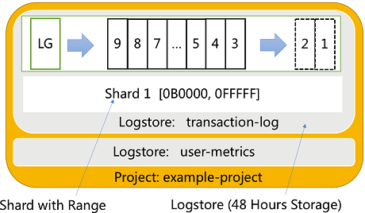

- Each project has multiple Logstores.

- Each Logstore has multiple shards.

- You can use a cursor to obtain the location of a specific log.

**Request syntax**

The request syntax of the GetCursor API operation is as follows:

```text
GET /logstores/ay42/shards/2? type=cursor&from=1402341900 HTTP/1.1
Authorization: <AuthorizationString>
Date: <GMT Date>
Host: <Project Endpoint>
x-log-apiversion: 0.6.0
```

**Request elements**

- Request headers

  The GetCursor API operation does not have special request headers. For information about common request headers of Log Service API operations, see Common request headers.

- Request parameters

  | Parameter | Type | Required | Description |
  | --- | --- | --- | --- |
  | shard | String | Yes | The name of the shard. |
  | type | String | Yes | This parameter must be set to cursor. |
  | from | String | Yes | The time that is used to query a cursor. Set the value to a Unix timestamp or a string such as <code> begin </code> or <code> end </code>. |

  You can use the from parameter to locate the logs within the lifecycle of a shard in a Logstore. If the lifecycle of the Logstore is  `[begin_time, end_time)`  and the from parameter is set to from_time, the response is returned as follows:

  - `from_time ≤ begin_time or from_time = "begin"` : A cursor is returned. The cursor corresponds to the log whose timestamp is begin_time.

  - `from_time ≥ end_time or from_time = "end"` : A cursor is returned. The cursor corresponds to the next log to be written at the current time (No data exists in the current cursor location).

  - `from_time > begin_time and from_time < end_time` : A cursor is returned. The cursor corresponds to the first packet that Log Service receives later than or at from_time.

  > **Note**
  >
  > The lifecycle of a Logstore is specified by the ttl parameter of the Logstore.
  >
  > For example, the current time is 2018-11-11 09:00:00 and the ttl parameter is set to 5. The time interval of consumable data in each shard is  `[2018-11-05 09:00:00, 2018-11-11 09:00:00)` . The server time is used.

**Response elements**

- Response headers

  The GetCursor API operation does not have special response headers. For information about common response headers of Log Service API operations, see Common response headers.

- Response parameters

  ```json
  {
      "cursor": "MTQ0NzI5OTYwNjg5NjYzMjM1Ng=="
  }
  ```

**Error codes**

In addition to Common error codes, the API operation may also return the following special error codes.

| HTTP status code | Error code | Error message |
| --- | --- | --- |
| 404 | LogStoreNotExist | Logstore {Name} does not exist |
| 400 | ParameterInvalid | Parameter From is not valid |
| 400 | ShardNotExist | Shard {ShardID} does not exist |
| 500 | InternalServerError | Specified Server Error Message |
| 400 | LogStoreWithoutShard | the logstore has no shard |

**Examples**

- Sample requests

  ```text
  GET /logstores/sls-test-logstore/shards/0? type=cursor&from=begin
  Header:
  {
      "Content-Length": 0, 
      "x-log-signaturemethod": "hmac-sha1", 
      "x-log-bodyrawsize": 0, 
      "User-Agent": "log-python-sdk-v-0.6.0", 
      "Host": "ali-test-project.cn-hangzhou-devcommon-intranet.sls.aliyuncs.com", 
      "Date": "Thu, 12 Nov 2015 03:56:57 GMT", 
      "x-log-apiversion": "0.6.0", 
      "Content-Type": "application/json", 
      "Authorization": "LOG <yourAccessKeyId>:<yourSignature>"
  }
  ```

- Sample responses

  ```text
  Header:
  {
      "content-length": "41", 
      "server": "nginx/1.6.1", 
      "connection": "close", 
      "date": "Thu, 12 Nov 2015 03:56:57 GMT", 
      "content-type": "application/json", 
      "x-log-requestid": "56440E0999248C070600C6AA"
  }
  Body:
  {
      "cursor": "MTQ0NzI5OTYwNjg5NjYzMjM1Ng=="
  }
  ```

<a id="section-3-8-10"></a>

### 3.8.10. GetCursorTime

Queries the server time based on the cursor.

**Request syntax**

```text
GET /logstores/{logstoreName}/shards/{shard}? cursor={cursor}&type=cursor_time HTTP/1.1  

Authorization: <AuthorizationString>
Date: <GMT Date> 
Host: <Project Endpoint> 
x-log-apiversion: 0.6.0 
x-log-signaturemethod: hmac-sha1
```

**Request elements**

- Request headers

  The GetCursorTime API operation does not have special request headers. For information about common request headers of Log Service API operations, see Common request headers.

- Request parameters

  | Parameter | Type | Required | Description |
  | --- | --- | --- | --- |
  | logstoreName | String | Yes | The name of the Logstore. |
  | shard | Integer | Yes | The ID of the shard. |
  | cursor | String | Yes | The cursor that is used to obtain the corresponding timestamp. |
  | type | String | Yes | Set the value to cursor_time. |

**Response elements**

- Response headers

  The GetCursorTime API does not have special response headers. For information about common response headers of Log Service API operations, see Common response headers.

- Response parameters

  ```json
  { 
     "cursor_time": 1554260243 
  }
  ```

**Error codes**

In addition to Common error codes, the API operation may also return the following special error codes.

| HTTP status code | Error code | Error message |
| --- | --- | --- |
| 404 | LogStoreNotExist | Logstore {Name} does not exist |
| 400 | ParameterInvalid | Parameter From is not valid |
| 400 | ShardNotExist | Shard {ShardID} does not exist |
| 500 | InternalServerError | Specified Server Error Message |
| 400 | LogStoreWithoutShard | the logstore has no shard |

**Examples**

- Sample requests

  ```text
  GET /logstores/internal-operation_log/shards/0? 
  cursor=MTU0NzQ3MDY4MjM3NjUxMzQ0Ng%3D%3D&type=cursor_time HTTP/1.1 

  Authorization: LOG <yourAccessKeyId>:<yourSignature> 
  x-log-bodyrawsize: 0 
  User-Agent: sls-java-sdk-v-0.6.1 
  x-log-apiversion: 0.6.0 
  Host: my-project.cn-hangzhou.sls.aliyuncs.com 
  x-log-signaturemethod: hmac-sha1 
  Date: Wed, 03 Apr 2019 02:57:23 GMT 
  Content-Type: application/x-protobuf 
  Connection: Keep-Alive
  ```

- Sample responses

  ```text
  HTTP/1.1 200 
  Server: nginx 
  Content-Type: application/json 
  Content-Length: 26 
  Connection: close 
  Access-Control-Allow-Origin: * 
  Date: Wed, 03 Apr 2019 02:57:23 GMT 
  x-log-requestid: 5CA42113D2F00378A74B9051 
  { 
    "cursor_time": 1554260243 
  }
  ```

<a id="section-3-8-11"></a>

### 3.8.11. PullLogs

Pulls logs from a Logstore. You must specify a shard when you call this API operation.

Only Protocol Buffer log data can be pulled from a Logstore. For more information, see Protocol Buffer format.

In scenarios that involve the Storm architecture, election and collaborative consumption can be performed through LoghubClientLib.

**Request syntax**

```text
GET /logstores/ay42/shards/0? type=logs&cursor=MTQ0NzMyOTQwMTEwMjEzMDkwNA==&count=100 H
TTP/1.1
Accept: application/x-protobuf
Accept-Encoding: lz4
Authorization: <AuthorizationString>
Date: <GMT Date>
Host: <Project Endpoint>
x-log-apiversion: 0.6.0
x-log-signaturemethod: hmac-sha1
```

**Request parameters**

- Request header fields

  - Accept: application/x-protobuf

  - Accept-Encoding: lz4, deflate, or “”

  - For information about common request headers of Log Service API operations, see Common request headers.

- Request parameters

  | Parameter | Type | Required | Description |
  | --- | --- | --- | --- |
  | type | String | Yes | Set the value to logs. |
  | cursor | String | Yes | The cursor that identifies where data reading starts. This indicates the start point. |
  | count | Integer | Yes | The number of returned log groups.Valid values: 1 to 1000. |

**Response parameters**

- Response header fields

  - x-log-cursor: The next cursor of the currently read data.

  - x-log-count: The number of currently returned logs.

  - For information about common response headers of Log Service API operations, see Common response headers.

- Response elements

  Serialized data is returned in the Protocol Buffer format. The data may be compressed.

**Error codes**

In addition to Common error codes, the API operation may also return the following special error codes.

| HTTP status code | Error code | Error message |
| --- | --- | --- |
| 404 | LogStoreNotExist | Logstore {Name} does not exist |
| 400 | ParameterInvalid | Parameter Cursor is not valid |
| 400 | ParameterInvalid | ParameterCount should be in \[0-1000\] |
| 400 | ShardNotExist | Shard {ShardID} does not exist |
| 400 | InvalidCursor | this cursor is invalid |
| 500 | InternalServerError | Specified Server Error Message |

**Examples**

- Sample requests

  ```text
  Read data from shard 0.
  GET /logstores/sls-test-logstore/shards/0? 
  cursor=MTQ0NzMyOTQwMTEwMjEzMDkwNA==&count=1000&type=log  
  Header:
  {
      "Authorization"="LOG <yourAccessKeyId>:<yourSignature>", 
      "x-log-bodyrawsize"=0, 
      "User-Agent" : "sls-java-sdk-v-0.6.0", 
      "x-log-apiversion" : "0.6.0", 
      "Host" : "ali-test-project.cn-hangzhou-failover-intranet.sls.aliyuncs.com", 
      "x-log-signaturemethod" : "hmac-sha1", 
      "Accept-Encoding" : "lz4", 
      "Content-Length": 0,
      "Date" : "Thu, 12 Nov 2015 12:03:17 GMT",
      "Content-Type" : "application/x-protobuf", 
      "accept" : "application/x-protobuf"
  }
  ```

- Sample responses

  ```text
  Header:
  {
      "x-log-count" : "1000", 
      "x-log-requestid" : "56447FB20351626D7C000874", 
      "Server" : "nginx/1.6.1", 
      "x-log-bodyrawsize" : "34121", 
      "Connection" : "close", 
      "Content-Length" : "4231", 
      "x-log-cursor" : "MTQ0NzMyOTQwMTEwMjEzMDkwNA==", 
      "Date" : "Thu, 12 Nov 2015 12:01:54 GMT", 
      "x-log-compresstype" : "lz4", 
      "Content-Type" : "application/x-protobuf"
  }
  Body:
  The <log group list in the Protocol Buffer format> after the compression.
  ```

- Page flip

  To flip the page (get the next token) without returning data, you can send HTTP HEAD requests.

<a id="section-3-8-12"></a>

### 3.8.12. PostLog

Writes log data to a Logstore.

Only Protocol Buffer log data can be written to a Logstore. For more information, see Protocol Buffer format.

> **Note**
>
> Log data is written in the form of log groups.

Log data can be written to a Logstore in either of the following modes:

- LoadBalance: In this mode, Log Service automatically writes logs to all writable shards in a Logstore. This mode provides high availability (SLA: 99.95%) in data writes. It applies to scenarios where data writes and reads are irrelevant to shards, for example, where ordering is not considered.

- KeyHash: The key field is added to the URL parameter. This determines which shard to store the log data. This field is optional. If you do not specify this field, Log Service automatically writes log data in the LoadBalance mode. For example, Log Service can hash an instance as a producer to a fixed shard based on the name of the instance. This ensures that data is written and consumed by using a strict order in the shard. The key is included only in the MD5 value range of a shard at a time even when the shard is merged or split. For more information, see Shards.

**Protocol Buffer log data**

The following table describes the fields of Protocol Buffer log data. For more information, see Data model and Data encoding.

- Log

  | Field | Type | Required | Description |
  | --- | --- | --- | --- |
  | Time | Integer | Yes | The time when the log was generated. |
  | Contents | List | Yes, this field must contain at least one element. | The list of log fields.For information about the field elements, see the Content field table. |

- Content

  | Field | Type | Required | Description |
  | --- | --- | --- | --- |
  | Key | String | Yes | The name of the custom key. |
  | Value | String | Yes | The value of the custom key. |

- LogTag

  | Field | Type | Required | Description |
  | --- | --- | --- | --- |
  | Key | String | Yes | The name of the custom key. |
  | Value | String | Yes | The value of the custom key. |

- LogGroup

  | Field | Type | Required | Description |
  | --- | --- | --- | --- |
  | Logs | List | Yes | A list of logs. For information about the field elements, see the Log field table. |
  | Topic | String | Yes | A user-defined field in a log. This field identifies a group of logs. |
  | Source | String | Yes | The source of the log, for example, the IP address of the machine where the log is generated. |
  | LogTags | List | Yes | The list of log tags.For information about the field elements, see the LogTags field table. |

**Request syntax**

- LoadBalance mode

  ```xml
  POST /logstores/<logstorename>/shards/lb HTTP/1.1
  Authorization: <AuthorizationString>
  Content-Type: application/x-protobuf
  Content-Length: <Content Length>
  Content-MD5: <Content MD5>
  Date: <GMT Date>
  Host: <Project Endpoint>
  x-log-apiversion: 0.6.0
  x-log-bodyrawsize: <BodyRawSize>
  x-log-compresstype: lz4
  x-log-signaturemethod: hmac-sha1
  <Compressed log data in the Protocol Buffer format>
  ```

- KeyHash mode

  ```xml
  POST /logstores/<logstorename>/shards/route? key=14d2f850ad6ea48e46e4547edbbb27e0
  Authorization: <AuthorizationString>
  Content-Type: application/x-protobuf
  Content-Length: <Content Length>
  Content-MD5: <Content MD5>
  Date: <GMT Date>
  Host: <Project Endpoint>
  x-log-apiversion: 0.6.0
  x-log-bodyrawsize: <BodyRawSize>
  x-log-compresstype: lz4
  x-log-signaturemethod: hmac-sha1
  <Compressed log data in the Protocol Buffer format>
  ```

**Request elements**

- Request headers

  For information about common request headers of Log Service API operations, see Common request headers.

- Request parameters

  | Parameter | Type | Required | Description |
  | --- | --- | --- | --- |
  | logstorename | String | Yes | The name of the Logstore to which logs are written. |

**Response elements**

- Response headers

  The PutLogs API operation does not have special response headers. For information about common response headers of Log Service API operations, see Common response headers.

- Response parameters

  No response element is returned after the request succeeds.

**Additional considerations**

- You can call the PutLogs API operation to write a maximum of 3 MB log group data or 4,096 logs each time. The size of values in each log cannot be greater than 1 MB. If these limits are exceeded, the request will fail and no log data will be written.

- Log Service checks the format of log data written by the PutLogs API operation. If a log does not meet the format requirements, the request will fail and no log data will be written.

**Error codes**

In addition to Common error codes, the API operation may also return the following special error codes.

| HTTP status code | Error code | Error message | Description |
| --- | --- | --- | --- |
| 400 | PostBodyInvalid | Protobuffer content cannot be parsed. | The error message returned because the logs in the Protocol Buffer format cannot be parsed. |
| 400 | InvalidTimestamp | Invalid timestamps are in logs. | The error message returned because the logs contain invalid timestamps. |
| 400 | InvalidEncoding | Non-UTF8 characters are in logs. | The error message returned because the logs contain non-UTF-8 characters. |
| 400 | InvalidKey | Invalid keys are in logs. | The error message returned because the logs contain invalid keys. |
| 400 | PostBodyTooLarge | Logs must be less than or equal to 3 MB and 4096 entries. | The error message returned because the size of logs is greater than 3 MB or the number of logs exceeds 4,096. |
| 400 | PostBodyUncompressE rror | Failed to decompress logs. | The error message returned because the logs fail to be decompressed. |
| 499 | PostBodyInvalid | The post data time is out of range | The error message returned because the log timestamp is not within the valid range: \[-7 × 24 hours, + 15 minutes\]. |
| 404 | LogStoreNotExist | logstore {Name} does not exist. | The error message returned because the specified Logstore does not exist. |

> **Note**
>
> The {Name} variable in the preceding error message is replaced with a
>
> specific Logstore name.

**Examples**

- Sample requests

  ```xml
  POST /logstores/sls-test-logstore
  {
      "Content-Length": 118,
      "Content-Type":"application/x-protobuf",
      "x-log-bodyrawsize":1356,
      "Host": "ali-test-project.cn-hangzhou-devcommon-intranet.sls.aliyuncs.com",
      "Content-MD5":"6554BD042149C844761C2C094A8FECCE",
      "Date":"Thu, 12 Nov 2015 06:54:26 GMT",
      "x-log-apiversion": "0.6.0",
      "x-log-compresstype":"lz4"
      "x-log-signaturemethod": "hmac-sha1",
      "Authorization":"LOG <yourAccessKeyId>:<yourSignature>"
  }
  <Binary data obtained after logs in the Protocol Buffer format are compressed with the LZ4 algorithm>
  ```

- Sample responses

  ```text
  Header
  {   
      "date": "Thu, 12 Nov 2015 06:53:03 GMT",
      "connection": "close",
      "x-log-requestid": "5644160399248C060600D216",
      "content-length": "0",
      "server": "nginx/1.6.1"
  }
  ```

<a id="section-3-8-13"></a>

### 3.8.13. GetShipperStatus

You can call this operation to query the LogShipper task status.

**Request syntax**

```text
GET /logstores/{logstoreName}/shipper/{shipperName}/tasks? 
from=1448748198&to=1448948198&status=success&offset=0&size=100 HTTP/1.1
Authorization: <AuthorizationString> 
Date: <GMT Date>
Host: <Project Endpoint>
x-log-apiversion: 0.6.0
x-log-signaturemethod: hmac-sha1
```

**Request parameters**

The request parameters are described in GetShipperStatus request parameters. Table 1. GetShipperStatus request parameters

| Parameter | Type | Required | Description |
| --- | --- | --- | --- |
| logstoreName | String | Yes | The Logstore name, which must be unique in the same project. |
| shipperName | String | Yes | The name of the log shipping rule, which is unique in the same Logstore. |
| from | Integer | Yes | The creation time range of a LogShipper task. |
| to | Integer | Yes | The creation time range of a LogShipper task. |
| status | String | No | The default value is null, indicating that tasks in any states will be returned.Currently, tasks in the successful, running, or failed state are returned. |
| offset | Integer | No | The starting number of LogShipper tasks within a specified time range. The default value is 0. |
| size | Integer | No | The number of LogShipper tasks within a specified time range. The default value is<br>100. The maximum value is 500. |

**Request header**

The GetShipperStatus API does not have any special request headers. For more information about the common request headers of Log Service APIs, see Common request headers.

**Response header**

The GetShipperStatus API does not have any special response headers. For more information about the common response headers of Log Service APIs, see Common response headers.

**Response elements**

When a request is successful, the response body contains the list of specified LogShipper tasks.

```json
{
    "count" : 10,
    "total" : 20,
    "statistics" : {
        "running" : 0,
        "success" : 20,
        "fail" : 0 
    }
    "tasks" : [
        {
            "id" : "abcdefghijk",
            "taskStatus" : "success",
            "taskMessage" : "",
            "taskCreateTime" : 1448925013,
            "taskLastDataReceiveTime" : 1448915013,
            "taskFinishTime" : 1448926013
        }
    ]
}
```

The GetShipperStatus response elements are described in GetShipperStatus response elements. Table 2. GetShipperStatus response elements

| Name | Type | Description |
| --- | --- | --- |
| count | Integer | The number of returned tasks. |
| total | Integer | The total number of tasks within a specified range. |
| statistics | JSON | The statistics of task status within a specified range. For more information, see the following table. |
| tasks | Array | The details of a LogShipper task within a specified range. For more information, see the following table. |

**For more information about the statistics, see Statistic parameter.**

Table 3. Statistic parameter

| Name | Type | Description |
| --- | --- | --- |
| running | Integer | The number of running tasks within a specified range. |
| successful | Integer | The number of successful tasks within a specific range. |
| failed | Integer | The number of failed tasks within a specific range. |

**For more information about the tasks, see Tasks parameters.**

Table 4. Tasks parameters

| Name | Type | Description |
| --- | --- | --- |
| id | String | The unique ID of a LogShipper task. |
| taskStatus | String | The LogShipper task status, which can be running, successful, or failed. |
| taskMessage | String | The error message returned when a LogShipper task fails. |
| taskCreateTime | Integer | The creation time of a LogShipper task. |
| taskLastDataReceiveTime | Integer | The latest log data time in a LogShipper task. |
| taskFinishTime | Integer | The end time of a LogShipper task. |

**Error codes**

As described in Error codes specific to GetShipperStatus, in addition to the Common error codes of Log Service APIs, the API may also return the following special error codes.

Table 5. Error codes specific to GetShipperStatus

| HTTP status code | Error code | Error message |
| --- | --- | --- |
| 404 | ProjectNotExist | Project {ProjectName} does not exist |
| 404 | LogStoreNotExist | logstore {logstoreName} does not exist |
| 400 | ShipperNotExist | shipper {logstoreName} does not exist |
| 500 | InternalServerError | internal server error |
| 400 | ParameterInvalid | start time must be earlier than end time |
| 400 | ParameterInvalid | only support query last 48 hours task status |
| 400 | ParameterInvalid | status only contains success/running/fail |

**Detailed description**

You can only query LogShipper task status within the last 24 hours.

**Examples**

**Sample requests:**

```text
GET /logstores/test-logstore/shipper/test-shipper/tasks? 
from=1448748198&to=1448948198&status=success&offset=0&size=100 HTTP/1.1
Header:
{
x-log-apiversion=0.6.0, 
Authorization=LOG 94to3z418yupi6ikawqqd370:wFcl3ohVJupCi0ZFxRD0x4IA68A=, 
Host=ali-test-project.regionid.example.com, 
Date=Wed, 11 Nov 2015 08:28:19 GMT, 
Content-Length=55, 
x-log-signaturemethod=hmac-sha1, 
Content-MD5=757C60FC41CC7D3F60B88E0D916D051E, 
User-Agent=sls-java-sdk-v-0.6.0, 
Content-Type=application/json
}
```

**Sample responses:**

```text
HTTP/1.1 200 OK
Header:
{
Date=Wed, 11 Nov 2015 08:28:20 GMT, 
Content-Length=0, 
x-log-requestid=5642FC2399248C8F7B0145FD, 
Connection=close, 
Server=nginx/1.6.1
}
Body:
{
    "count" : 10,
    "total" : 20,
    "statistics" : {
        "running" : 0,
        "success" : 20,
        "fail" : 0 
    }
    "tasks" : [
        {
            "id" : "abcdefghijk",
            "taskStatus" : "success",
            "taskMessage" : "",
            "taskCreateTime" : 1448925013,
            "taskLastDataReceiveTime" : 1448915013,
            "taskFinishTime" : 1448926013
        }
    ]
}
```

<a id="section-3-8-14"></a>

### 3.8.14. RetryShipperTask

You can call this operation to rerun the failed LogShipper tasks.

**Request syntax**

```http
PUT /logstores/{logstoreName}/shipper/{shipperName}/tasks HTTP/1.1
Authorization: <AuthorizationString> 
Date: <GMT Date>
Host: <Project Endpoint>
x-log-apiversion: 0.6.0
x-log-signaturemethod: hmac-sha1
["task-id-1", "task-id-2", "task-id-2"]
```

**Request parameters**

The request parameters are described in RetryShipperTask request parameters.Table 1. RetryShipperTask request parameters

| Parameter | Type | Required | Description |
| --- | --- | --- | --- |
| logstoreName | String | Yes | The Logstore name, which must be unique in the same project. |
| shipperName | String | Yes | The name of the log shipping rule, which is unique in the same Logstore. |

**Request header**

The RetryShipperTask API does not have any special request headers. For more information about the common request headers of Log Service APIs, see Common request headers.

**Response header**

The RetryShipperTask API does not have any special response headers. For more information about the common response headers of Log Service APIs, see Common response headers.

**Response elements**

The returned HTTP status code is 200.

**Error codes**

As described in Error codes specific to RetryShipperTask, in addition to the Common error codes of Log Service APIs, the API may also return the following special error codes.

Table 2. Error codes specific to RetryShipperTask

| HTTP status code | Error code | Error message |
| --- | --- | --- |
| 404 | ProjectNotExist | Project {ProjectName} does not exist |
| 404 | LogStoreNotExist | logstore {logstoreName} does not exist |
| 400 | ShipperNotExist | shipper {logstoreName} does not exist |
| 500 | InternalServerError | Specified Server Error Message |
| 400 | ParameterInvalid | only allow retry 10 tasks every time |

**Detailed description**

A maximum of 10 failed posting tasks can be re-executed at a time.

**Examples**

**Sample requests:**

```http
PUT /logstores/test-logstore/shipper/test-shipper/tasks HTTP/1.1
Header:
{
x-log-apiversion=0.6.0, 
Authorization=LOG 94to3z418yupi6ikawqqd370:wFcl3ohVJupCi0ZFxRD0x4IA68A=, 
Host=ali-test-project.regionid.example.com, 
Date=Wed, 11 Nov 2015 08:28:19 GMT, 
Content-Length=55, 
x-log-signaturemethod=hmac-sha1, 
Content-MD5=757C60FC41CC7D3F60B88E0D916D051E, 
User-Agent=sls-java-sdk-v-0.6.0, 
Content-Type=application/json
}
Body : 
["task-id-1", "task-id-2", "task-id-2"]
```

**Sample responses:**

```text
HTTP/1.1 200 OK
Header:
{
Date=Wed, 11 Nov 2015 08:28:20 GMT, 
Content-Length=0, 
x-log-requestid=5642FC2399248C8F7B0145FD, 
Connection=close, 
Server=nginx/1.6.1
}
```

<a id="section-3-8-15"></a>

### 3.8.15. GetLogs

Queries logs in a Logstore of a specified project, or queries the logs that meet the specified conditions.

After a log is written to a Logstore, you can call the GetHistograms and GetLogs API operations to query the log. However, the query has a latency, which varies with the type of the log. Based on the log timestamp, Log Service classifies logs into the following two types:

- Real-time data: For this type, the difference between the time in a log and the current time on the server is (-180 seconds, 900 seconds]. For example, if the log time is UTC 2014-09-25 12:03:00 and the server receives the log at UTC 2014-09-25 12:05:00, the log is regarded as real-time data.

- Historical data: For this type, the difference between the time in a log and the current time on the server is [-7 × 86,400 seconds, -180 seconds). For example, if the log time is UTC 2014-09-25 12:00:00 and the server receives the log at UTC 2014-09-25 12:05:00, the log is regarded as historical data.

Real-time data can be queried with a maximum latency of three seconds after being written to a Logstore. In most cases, 99.9% of real-time data can be queried in one second.

**Request syntax**

The request syntax of the GetLogs API operation is as follows:

```xml
GET /logstores/<logstorename>? type=log&topic=<logtopic>&from=<starttime>&to=
<endtime>&query=<querystring>&line=<linenum>&offset=<startindex>&reverse=<ture|false> H
TTP/1.1
Authorization: <AuthorizationString>
Date: <GMT Date>
Host: <Project Endpoint>
x-log-bodyrawsize: 0
x-log-apiversion: 0.6.0
x-log-signaturemethod: hmac-sha1
```

**Request elements**

- Request headers

  The GetLogs API operation does not have special request headers. For information about common request headers of Log Service API operations, see Common request headers.

- Request parameters

  | Parameter | Type | Required | Description |
  | --- | --- | --- | --- |
  | logstorename | String | Yes | The name of the Logstore whose logs you want to query. |
  | type | String | Yes | The type of data in the Logstore. The value of this parameter must be log. |
  | from | Integer | Yes | The start time of the time range during which the logs to be queried are generated. This parameter indicates the number of seconds that have elapsed since the Unix epoch 00:00:00 UTC on January 1, 1970. |
  | to | Integer | Yes | The end time of the time range during which the logs to be queried are generated. This parameter indicates the number of seconds that have elapsed since the Unix epoch 00:00:00 UTC on January 1, 1970. |
  | topic | String | No | The topic of the logs to be queried. |
  | query | String | No | The query statement. see <strong>User</strong> <strong>Guide.</strong> The path is <strong>Query and</strong> analysis &gt; Query syntax and <strong>functions &gt; Query syntax</strong>. |
  | line | Integer | No | The maximum number of logs to return for the request. Value range: 0 to 100. Default value: 100. |
  | offset | Integer | No | The start point of the returned log for the request. Valid values: 0 and positive integers. Default value: 0. |
  | reverse | Boolean | No | Specifies whether to return logs in reverse order based on the log timestamp, accurate to seconds. If the value is true, logs are returned in reverse order. If the value is false, logs are returned in regular order.Default value: false. |

**Response elements**

- Response headers

  The GetLogs API operation does not have special response headers. For information about common response headers of Log Service API operations, see Common response headers.

  The response header contains a special element that indicates whether the returned results of the request are complete. The following table describes the response parameters.

  | Parameter | Type | Description |
  | --- | --- | --- |
  | x-log-progress | String | The status of the query results. Valid values: Incomplete and Complete. |
  | x-log-count | Integer | The total number of logs in the current query results. |

- Response parameters After a GetLogs request succeeds, the response body contains log data hits in the query. If a large number of logs (measured in TBs) are queried, the response of the GetLogs operation may be incomplete. The response body of the GetLogs operation is an array. Each element in the array is a log. The following table describes the elements in the array.

  | Element | Type | Description |
  | --- | --- | --- |
  | __time__ | Integer | The log timestamp. This parameter indicates the number of seconds that have elapsed since the Unix epoch 00:00:00 UTC on January 1, 1970. |
  | __Source __ | String | The log source, which is specified when logs are written. |
  | \[content\] | Key-value pair | The original content of logs. |

**Additional considerations**

- The time range defined by the from and to request parameters is left closed and right open. This means that the time range includes the start time, but does not include the end time. If the from and to parameters for a time range have the same value, the time range is invalid and the function will return an error.

- If the number of logs in the Logstore significantly changes, Log Service cannot predict how many times this API operation needs to be called to obtain the complete results. In this case, you must check the value of the x-log-progress parameter in the returned results of each request. Based on the value, you can decide whether to repeatedly call this API operation to obtain the complete results.

  > **Note**
  >
  > The same number of query compute units (CUs) is consumed each time
  >
  > you call this API operation.

**Error codes**

In addition to Common error codes, the API operation may also return the following special error codes.

| HTTP status code | Error code | Error message | Description |
| --- | --- | --- | --- |
| 404 | LogStoreNotExist | logstore {Name} does not exist | The error message returned because the specified Logstore does not exist. |
| 400 | InvalidTimeRange | request time range is invalid | The error message returned because the specified time interval of the request is invalid. |
| 400 | InvalidQueryString | query string is invalid | The error message returned because the specified query string of the request is invalid. |
| 400 | InvalidOffset | offset is invalid | The error message returned because the specified offset parameter of the request is invalid. |
| 400 | InvalidLine | line is invalid | The error message returned because the specified line parameter of the request is invalid. |
| 400 | InvalidReverse | Reverse value is invalid | The error message returned because the specified reverse parameter is invalid. |
| 400 | IndexConfigNotExist | logstore without index config | The error message returned because the index feature has not been enabled for the Logstore. |

> **Note**
>
> The {name} variable in the preceding error message is replaced with a
>
> specific Logstore name.

**Example**

In this example, the logs with the groupA topic are queried in a Logstore named app_log. The Logstore belongs to a project named big-game in the China (Hangzhou) region. The time range is from 2014-09-01 00:00:00 to 2014-09-01 22:00:00 and the keyword is "error". The query starts from the beginning of the time range. A maximum of 20 logs can be returned.

- Sample requests

  ```text
  GET /logstores/app_log？ 
  type=log&topic=groupA&from=1409529600&to=1409608800&query=error&line=20&offset=0 HTTP/1.1
  Authorization: <AuthorizationString>
  Date: Wed, 3 Sept. 2014 08:33:46 GMT
  Host: big-game.cn-hangzhou.log.aliyuncs.com
  x-log-bodyrawsize: 0
  x-log-apiversion: 0.4.0
  x-log-signaturemethod: hmac-sha1
  ```

- Sample responses

  ```text
  HTTP/1.1 200 OK
  Content-MD5: 36F9F7F0339BEAF571581AF1B0AAAFB5
  Content-Type: application/json
  Content-Length: 269
  Date: Wed, 3 Sept. 2014 08:33:47 GMT
  x-log-requestid: efag01234-12341-15432f
  x-log-progress : Complete
  x-log-count : 10000
  x-log-processed-rows: 10000
  x-log-elapsed-millisecond:5
  {
      "progress": "Complete",
      "count": 2,
      "logs": [
          {
              "__time__": 1409529660,
              "__source__": "10.237.0.17",
              "Key1": "error",
              "Key2": "Value2"
          },
          {
              "__time__": 1409529680,
              "__source__": "10.237.0.18",
              "Key3": "error",
              "Key4": "Value4"
          }
      ]
  }
  ```

In the sample response, the x-log-progress value is Complete. This indicates that the log query is completed and the returned results are complete. Two logs meet the specified query conditions and are displayed as the value of the logs parameter. If the x-log-progress value is Incomplete, you must repeat the request to obtain the complete results.

<a id="section-3-8-16"></a>

### 3.8.16. GetHistograms

Queries the distribution of logs in a Logstore within a specified project, or queries the distribution of logs that meet the specified conditions.

After a log is written to a Logstore, you can call the GetHistograms and GetLogs API operations to query the log. However, the query has a latency, which varies with the type of the log. Based on the log timestamp, Log Service classifies logs into the following two types:

- Real-time data: For this type, the difference between the time in a log and the current time on the server is within the interval (-180 seconds, 900 seconds]. For example, if the log time is UTC 2014-09-25 12:03:00 and the server receives the log at UTC 2014-09-25 12:05:00, the log is regarded as real-time data. The latency for real-time data is three seconds, from the time when the data is written to the Logstore to the time when the data can be queried.

- Historical data: For this type, the difference between the time in a log and the current time on the server is [-7 × 86,400 seconds, -180 seconds). For example, if the log time is UTC 2014-09-25 12:00:00 and the server receives the log at UTC 2014-09-25 12:05:00, the log is regarded as historical data.

**Request syntax**

The request syntax of the GetHistograms API operation is as follows:

```text
GET /logstores/<logstorename>? type=histogram&topic=<logtopic>&from=<starttime>&to=<endtime>&query=<querystring> HTTP/1.1
Authorization: <AuthorizationString>
Date: <GMT Date>
Host: <Project Endpoint>
x-log-bodyrawsize: 0
x-log-apiversion: 0.6.0
x-log-signaturemethod: hmac-sha1
```

**Request elements**

- Request headers

  The GetHistograms API operation does not have special request headers. For information about common request headers of Log Service API operations, see Common request headers.

- Request parameters

  | Parameter | Type | Required | Description |
  | --- | --- | --- | --- |
  | logstorename | String | Yes | The name of the Logstore whose logs you want to query. |
  | type | String | Yes | The type of data in the Logstore. The value of this parameter must be histogram. |
  | from | Integer | Yes | The start time of the time range during which the logs to be queried are generated. This parameter indicates the number of seconds that have elapsed since the Unix epoch 00:00:00 UTC on January 1, 1970. |
  | to | Integer | Yes | The end time of the time range during which the logs to be queried are generated. This parameter indicates the number of seconds that have elapsed since the Unix epoch 00:00:00 UTC on January 1, 1970. |
  | topic | String | No | The topic of the logs to be queried. |
  | query | String | No | The query statement. For more information about the query syntax, see <strong>User Guide.</strong> The path is <strong>Query</strong> and analysis &gt; Query syntax and <strong>functions &gt; Query syntax</strong>. |

**Response elements**

- Response headers

  The GetHistograms API does not have special response headers. For information about common response headers of Log Service API operations, see Common response headers.

- Response parameters After a GetHistograms request succeeds, the response body contains the distribution of the log hits returned by the query along the timeline. The response results evenly divide the time range into several subintervals and returns the number of log hits for each subinterval. The following table describes the response parameters.

  | Parameter | Type | Description |
  | --- | --- | --- |
  | progress | String | The status of the query results. Valid values: Incomplete and Complete. |
  | count | Integer | The total number of logs in the current query results. |
  | histograms | Array | The distribution of the current query results in the subintervals. For information about the parameters of each element in the histograms array, see the following table. |

  This table describes the elements in the histograms parameter.

  | Element | Type | Description |
  | --- | --- | --- |
  | from | Integer | The start time of the subinterval. This parameter indicates the number of seconds that have elapsed since the Unix epoch 00:00:00 UTC on January 1, 1970. |
  | to | Integer | The end time of the subinterval. This parameter indicates the number of seconds that have elapsed since the Unix epoch 00:00:00 UTC on January 1, 1970. |
  | count | Integer | The number of logs that meet the query conditions for this subinterval in the current query results. |
  | progress | String | Indicates whether the current query results in the subinterval are complete. Valid values: Incomplete and Complete. |

**Additional considerations**

- The preceding time ranges or subintervals are left closed and right open. This means that each time range or subinterval includes the start time, but does not include the end time. If the from and to parameters for a time range have the same value, the time range is invalid and the function will return an error.

- The time range is consistently divided into subintervals in the response. If the time range is unchanged, the subintervals divided in the response is also unchanged.

- If the number of logs in the Logstore significantly changes, Log Service cannot predict how many times this API operation needs to be called to obtain the complete results. In this case, you must check the value of the progress parameter in the returned results of each request. Based on the value, you can decide whether to repeatedly call this API operation to obtain the complete results.

  > **Note**
  >
  > The same number of query compute units (CUs) is consumed each time
  >
  > you call this API operation.

**Error codes**

In addition to Common error codes, the API operation may also return the following special error codes.

| HTTP status code | Error code | Error message | Description |
| --- | --- | --- | --- |
| 404 | LogStoreNotExist | logstore {Name} does not exist | The error message returned because the specified Logstore does not exist. |
| 400 | InvalidTimeRange | request time range is invalid | The error message returned because the specified time interval of the request is invalid. |
| 400 | InvalidQueryString | query string is invalid | The message returned when the query string of the request is invalid. |

> **Note**
>
> The {name} variable in the preceding error message is replaced with a
>
> specific Logstore name.

**Example**

In this example, the distribution of logs with the groupA topic is queried in a Logstore named app_log. The Logstore belongs to a project named big-game in the China (Hangzhou) region. The time range is from 2014-09-01 00:00:00 to 2014-09-01 22:00:00 and the keyword is "error".

- Sample requests

  ```text
  GET /logstores/app_log? 
  type=histogram&topic=groupA&from=1409529600&to=1409608800&query=error HTTP/1.1
  Authorization: LOG <yourAccessKeyId>:<yourSignature>
  Date: Wed, 3 Sept. 2014 08:33:46 GMT
  Host: big-game.cn-hangzhou.log.aliyuncs.com
  x-log-bodyrawsize: 0
  x-log-apiversion: 0.6.0
  x-log-signaturemethod: hmac-sha1
  ```

- Sample responses

  ```text
  HTTP/1.1 200 OK
  Content-Type: application/json
  Content-MD5: E6AD9C21204868C2DE84EE3808AAA8C8
  Content-Type: application/json
  Date: Wed, 3 Sept. 2014 08:33:47 GMT
  Content-Length: 232
  x-log-requestid: efag01234-12341-15432f
  [
          {
              "from": 1409529600,
              "to": 1409569200,
              "count": 2,
              "progress": "Complete"
          },
          {
              "from": 1409569200,
              "to": 1409608800,
              "count": 1,
              "progress": "Incomplete"
          }
  ]
  ```

In this sample response, the server divides the entire histogram into two equal time ranges: [2014-09-01 00:00:00, 2014-09-01 11:00:00) and [2014-09-01 11:00:00, 2014-09-01 22:00:00). The first query returns incomplete data because the amount of data exceeds the limit. The sample response indicates three hits. The results for the time range [2014-09-01 00:00:00 2014-09-01 11:00:00) are complete, including two hits. The results for the other time range are incomplete, including one hit. To obtain the complete results, you must repeatedly call the preceding sample request until the progress value in the response changes to Complete. The sample response is as follows:

```text
HTTP/1.1 200 OK
Content-Type: application/json
Content-MD5: E6AD9C21204868C2DE84EE3808AAA8C8
Content-Type: application/json
Date: Wed, 3 Sept. 2014 08:33:48 GMT
Content-Length: 232
x-log-requestid: afag01322-1e241-25432e
[
        {
            "from": 1409529600,
            "to": 1409569200,
            "count": 2,
            "progress": "Complete"
        },
        {
            "from": 1409569200,
            "to": 1409608800,
            "count": 2,
            "progress": "complete"
        }
]
```

<a id="section-3-8-17"></a>

### 3.8.17. UpdateIndex

Updates the indexes of a Logstore.

**Request syntax**

```http
PUT /logstores/<logstoreName>/index HTTP/1.1
Authorization: <AuthorizationString>
x-log-bodyrawsize: 0
User-Agent: <UserAgent>
x-log-apiversion: 0.6.0
Host: <Project Endpoint>
x-log-signaturemethod: hmac-sha1
Date: <GMT Date>
Content-Type: application/json
Content-MD5: <Content-MD5>
Content-Length: <ContentLength>
{
  "line": <full text index>,
  "keys": <key-value index>,
  "ttl": <ttl>
}
```

**Request elements**

- Request headers

  The UpdateIndex API operation does not have special request headers. For information about common request headers of Log Service API operations, see Common request headers.

- Request parameters

  | Parameter | Type | Required | Description |
  | --- | --- | --- | --- |
  | logstoreName | String | Yes | The name of the Logstore. |
  | TTL | Integer | No | The time to live (TTL) of the indexes. Valid values: 7, 30, and 90.Default value: 0. |
  | keys | Object | No | The key-value index, where the key refers to the field name and the value refers to the field value. |
  | line | Object | No | The full-text index. |

  You must specify the keys parameter or the line parameter, or both. The following table describes the full-text index attributes.

  | Attribute | Type | Required | Description |
  | --- | --- | --- | --- |
  | token | Array | Yes | The list of delimiters. |
  | caseSensitive | Boolean | No | Specifies whether the fields are case-sensitive. |
  | chn | Boolean | No | Specifies whether the fields contain Chinese characters. |
  | include_keys | Array | No | The list of included fields. This parameter and the exclude_keys parameter cannot be specified at the same time. |
  | exclude_keys | Array | No | The list of the excluded fields. This parameter and the include_keys parameter cannot be specified at the same time. |

  The following table describes the key-value index attributes.

  | Attribute | Type | Required | Description |
  | --- | --- | --- | --- |
  | type | String | Yes | The type of the fields. |
  | alias | String | No | The alias of the field. |
  | chn | Boolean | No | Specifies whether the fields contain Chinese characters. This parameter takes effect only when the type parameter is set to text. |
  | token | Array | Required only when the type parameter is set to text | The list of delimiters.This parameter takes effect only when the type parameter is set to text. |
  | caseSensitive | Boolean | No | Specifies whether the fields are case-sensitive. This parameter takes effect only when the type parameter is set to text. |
  | doc_value | Boolean | No | Specifies whether to enable analytics for the field. |

**Response elements**

- Response headers The UpdateIndex API operation does not have special response headers. For information about common response headers of Log Service API operations, see Common response headers.

- Response parameters

  The HTTP status code 200 is returned.

**Error codes**

In addition to Common error codes, the API operation may also return the following special error codes.

| HTTP status code | Error code | Error message |
| --- | --- | --- |
| 400 | ParameterInvalid | log store index is not created |
| 400 | ParameterInvalid | key config must has type |
| 400 | IndexInfoInvalid | required field token is lacking or of error format |
| 400 | IndexInfoInvalid | required fields line/keys are lacking or of error format |
| 404 | ProjectNotExist | The Project does not exist : {Project} |
| 404 | LogStoreNotExist | logstore {logstoreName} does not exist |
| 500 | InternalServerError | Specified Server Error Message |

**Examples**

- Sample requests

  ```http
  PUT /logstores/logstore-4/index HTTP/1.1
  Header:
  Authorization: LOG <yourAccessKeyId>:<yourSignature>
  x-log-bodyrawsize: 0
  User-Agent: sls-java-sdk-v-0.6.1
  x-log-apiversion: 0.6.0
  Host: my-project.cn-shanghai.log.aliyuncs.com
  x-log-signaturemethod: hmac-sha1
  Date: Mon, 07 May 2018 09:47:20 GMT
  Content-Type: application/json
  Content-MD5: 1860B805A6AA5288B97B32CF3B519112
  Content-Length: 316
  Connection: Keep-Alive
  Body:
  {
    "line": {
      "token": [
        ",",
        " ",
        "'",
        "\"",
        ";",
        "=",
        "(",
        ")",
        "[",
        "]",
        "{",
        "}",
        "?",
        "@",
        "&",
        "<",
        ">",
        "/",
        ":",
        "\n",
        "\t",
        "\r"
      ]
    },
    "keys": {
      "agent": {
        "doc_value": true,
        "caseSensitive": true,
        "alias": "agent_alias",
        "type": "text",
        "token": [
          ",",
          " ",
          "'",
          "\"",
          ";",
          "=",
          "(",
          ")",
          "[",
          "]",
          "{",
          "}",
          "?",
          "@",
          "&",
          "<",
          ">",
          "/",
          ":",
          "\n",
          "\t",
          "\r"
        ]
      }
    },
    "ttl": 90
  }
  ```

- Sample responses

  ```text
  HTTP/1.1 200
  Server: nginx/1.12.1
  Content-Length: 0
  Connection: close
  Access-Control-Allow-Origin: *
  Date: Mon, 07 May 2018 09:47:21 GMT
  x-log-requestid: 5AF020A98CBAA2EF52AB66C9
  ```

<a id="section-3-8-18"></a>

### 3.8.18. CreateIndex

Creates indexes for a specified Logstore.

**Request syntax**

```http
POST /logstores/<logstoreName>/index HTTP/1.1
Authorization: <AuthorizationString>
x-log-bodyrawsize: <x-log-bodyrawsize>
User-Agent: <User-Agent>
x-log-apiversion: <APIVersion>
Host: <Project Endpoint>
x-log-signaturemethod: hmac-sha1
Date: <GMT Date>
Content-Type: application/json
Content-MD5: <Content-MD5>
Content-Length: <Content-Length>
{
  "line": <full text index>,
  "keys": <key-value index>
}
```

**Request elements**

- Request headers

  The CreateIndex API operation does not have special request headers. For information about common request headers of Log Service API operations, see Common request headers.

  | Parameter | Type | Required | Description |
  | --- | --- | --- | --- |
  | logstoreName | String | Yes | The name of the Logstore. |
  | keys | Object | No | The key-value index, where the key refers to the field name and the value refers to the field value. |
  | line | Object | No | The full-text index. |

  You must specify the keys parameter or the line parameter, or both. The following table describes the full-text index attributes.

  | Attribute | Type | Required | Description |
  | --- | --- | --- | --- |
  | caseSensitive | Boolean | No | Specifies whether the fields are case-sensitive. |
  | chn | Boolean | No | Specifies whether the fields contain Chinese characters. |
  | token | Array | Yes | The list of delimiters. |
  | include_keys | Array | No | The list of included fields. This parameter and the exclude_keys parameter cannot be specified at the same time. |
  | exclude_keys | Array | No | The list of excluded fields. This parameter and the include_keys parameter cannot be specified at the same time. |

  The following table describes the key-value index attributes.

  | Attribute | Type | Required | Description |
  | --- | --- | --- | --- |
  | type | String | Yes | The type of the field. |
  | alias | String | No | The alias of the field. |
  | chn | Boolean | No | Specifies whether the fields contain Chinese characters. This parameter takes effect only when the type parameter is set to text. |
  | token | Array | Required only when the type parameter is set to text | The list of delimiters.This parameter takes effect only when the type parameter is set to text. |
  | caseSensitive | Boolean | No | Specifies whether the fields are case-sensitive. This parameter takes effect only when the type parameter is set to text. |
  | doc_value | Boolean | No | Specifies whether to enable analytics for the field. |

**Response elements**

- Response headers

  The CreateIndex API operation does not have special response headers. For information about common response headers of Log Service API operations, see Common response headers.

- Response parameters

  The HTTP status code 200 is returned.

**Error codes**

In addition to Common error codes, the API operation may also return the following special error codes.

| HTTP status code | Error code | Error message |
| --- | --- | --- |
| 400 | IndexInfoInvalid | required field token is lacking or of error format |
| 400 | IndexAlreadyExist | log store index is already created |
| 404 | ProjectNotExist | The Project does not exist : {Project} |
| 404 | LogStoreNotExist | logstore {logstoreName} does not exist |
| 500 | InternalServerError | Specified Server Error Message |

> **Note**
>
> The {Project} and {logstoreName} variables in the preceding error
>
> messages are replaced with a specific project name and Logstore name.

**Examples**

Sample requests

```http
POST /logstores/my-logstore/index HTTP/1.1
Authorization: LOG <yourAccessKeyId>:<yourSignature>
x-log-bodyrawsize: 0
User-Agent: sls-java-sdk-v-0.6.1
x-log-apiversion: 0.6.0
Host: my-project.cn-shanghai.log.aliyuncs.com
x-log-signaturemethod: hmac-sha1
Date: Mon, 07 May 2018 09:43:16 GMT
Content-Type: application/json
Content-MD5: 22876515FC311F857AD6C7902F6A0148
Content-Length: 316
Connection: Keep-Alive
{
  "line": {
    "token": [
      ",",
      " ",
      "'",
      "\"",
      ";",
      "=",
      "(",
      ")",
      "[",
      "]",
      "{",
      "}",
      "?",
      "@",
      "&",
      "<",
      ">",
      "/",
      ":",
      "\n",
      "\t",
      "\r"
    ]
  },
  "keys": {
    "agent": {
      "doc_value": true,
      "caseSensitive": true,
      "alias": "agent_alias",
      "type": "text",
      "token": [
        ",",
        " ",
        "'",
        "\"",
        ";",
        "=",
        "(",
        ")",
        "[",
        "]",
        "{",
        "}",
        "?",
        "@",
        "&",
        "<",
        ">",
        "/",
        ":",
        "\n",
        "\t",
        "\r"
      ]
    }
  }
}
```

<a id="section-3-8-19"></a>

### 3.8.19. DeleteIndex

Deletes the indexes of a Logstore.

**Request syntax**

```http
DELETE /logstores/<logstoreName>/index HTTP/1.1

Authorization: <AuthorizationString>
x-log-bodyrawsize: 0
User-Agent: <UserAgent>
x-log-apiversion: 0.6.0
Host: <Project Endpoint>
x-log-signaturemethod: hmac-sha1
Date: <GMT Date>
Content-Type: application/x-protobuf
Connection: Keep-Alive
```

**Request parameters**

- Request headers

  The DeleteIndex API operation does not have special request headers. For information about common request headers of Log Service API operations, see Common request headers.

- Request parameters

  | Parameter | Type | Required | Description |
  | --- | --- | --- | --- |
  | logstoreName | String | Yes | The name of the Logstore. |

**Response elements**

- Response headers

  The DeleteIndex API operation does not have special response headers. For information about common response headers of Log Service API operations, see Common response headers.

- Response parameters

  The HTTP status code 200 is returned.

**Error codes**

In addition to Common error codes, the API operation may also return the following special error codes.

| HTTP status code | Error code | Error message |
| --- | --- | --- |
| 400 | ParameterInvalid | log store index not created |
| 404 | ProjectNotExist | The Project does not exist : {Project} |
| 404 | LogStoreNotExist | logstore {logstoreName} does not exist |
| 500 | InternalServerError | Specified Server Error Message |

**Examples**

- Sample requests

  ```http
  DELETE /logstores/my-logstore/index HTTP/1.1

  Authorization: LOG <yourAccessKeyId>:<yourSignature>
  x-log-bodyrawsize: 0
  User-Agent: sls-java-sdk-v-0.6.1
  x-log-apiversion: 0.6.0
  Host: my-project.cn-shanghai.log.aliyuncs.com
  x-log-signaturemethod: hmac-sha1
  Date: Sun, 06 May 2018 13:22:57 GMT
  Content-Type: application/x-protobuf
  Connection: Keep-Alive
  ```

- Sample responses

  ```text
  HTTP/1.1 200

  Server: nginx/1.12.1
  Content-Length: 0
  Connection: close
  Access-Control-Allow-Origin: *
  Date: Sun, 06 May 2018 13:22:57 GMT
  x-log-requestid: 5AEF01B1A458E41C2F8326A8
  ```

<a id="section-3-8-20"></a>

### 3.8.20. GetIndex

Queries the indexes of a Logstore.

**Request syntax**

The request syntax of the GetIndex API operation is as follows:

```http
GET /logstores/<logstoreName>/index HTTP/1.1
Authorization: <AuthorizationString>
x-log-bodyrawsize: 0
User-Agent: <UserAgent>
x-log-apiversion: 0.6.0
Host: <Project Endpoint>
x-log-signaturemethod: hmac-sha1
Date: <GMT Date>
Content-Type: application/x-protobuf
Connection: Keep-Alive
```

**Request elements**

- Request headers

  The GetIndex API operation does not have special request headers. For information about common request headers of Log Service API operations, see Common response headers.

- Request parameters

  | Parameter | Type | Required | Description |
  | --- | --- | --- | --- |
  | logstoreName | String | Yes | The name of the Logstore. |

**Response elements**

- Response headers

  The GetIndex API operation does not have special response headers. For information about common response headers of Log Service API operations, see Common response headers.

- Response parameters When the GetIndex API operation succeeds, the response body contains the indexes of the specified project and Logstore. The following table describes the response body parameters.

  | Parameter | Type | Description |
  | --- | --- | --- |
  | index_mode | String | The type of the indexes. |
  | keys | Dictionary | The key-value index, where the key refers to the field name and the value refers to the field value. |
  | line | object | The full-text index. |
  | storage | String | The storage type. The default value is pg, which refers to PostgreSQL. |
  | ttl | Integer | The time to live (TTL) of the index file. Valid values: 7, 30, and 90. Unit: days. |
  | lastModifyTime | Integer | The time when the indexes were last modified. The value is a Unix timestamp. |

  - Full-text index attributes

    | Parameter | Type | Description |
    | --- | --- | --- |
    | caseSensitive | Boolean | Indicates whether the indexes are case sensitive. |
    | chn | Boolean | Indicates whether the fields contain Chinese characters. |
    | token | Array | The list of delimiters. |
    | include_keys | Array | The list of included fields. |
    | exclude_keys | Array | The list of excluded fields. |

  - Key-value index attributes

    | Parameter | Type | Description |
    | --- | --- | --- |
    | type | String | Indicates the type of the field. |
    | alias | String | The alias of the field. |
    | chn | Boolean | Indicates whether the fields contain Chinese characters.This parameter takes effect only when the type parameter is set to text. |
    | token | Array | The list of delimiters. This parameter takes effect only when the type parameter is set to text. |
    | caseSensitive | Boolean | Indicates whether the fields are case-sensitive. This parameter takes effect only when the type parameter is set to text. |
    | doc_value | Boolean | Indicates whether to enable analytics for the index. |

**Error codes**

In addition to Common error codes, the API operation may also return the following special error codes.

| HTTP status code | Error code | Error message | Description&amp;nbsp; |
| --- | --- | --- | --- |
| 400 | IndexConfigNotExist | index config doesn’t exist | The error message returned because the specified index does not exist. |
| 404 | ProjectNotExist | The Project does not exist : {Project} | The error message returned because the specified project does not exist. |
| 404 | LogStoreNotExist | logstore {logstoreName} does not exist | The error message returned because the specified Logstore does not exist. |
| 500 | InternalServerError | Specified Server Error Message | The error message returned because an error occurs on the specified server. |

**Examples**

- Sample requests

  ```http
  GET /logstores/logstore-4/index HTTP/1.1
  Authorization: LOG <yourAccessKeyId>:<yourSignature>
  x-log-bodyrawsize: 0
  User-Agent: sls-java-sdk-v-0.6.1
  x-log-apiversion: 0.6.0
  Host: my-project.cn-shanghai.log.aliyuncs.com
  x-log-signaturemethod: hmac-sha1
  Date: Sun, 06 May 2018 13:08:42 GMT
  Content-Type: application/x-protobuf
  Connection: Keep-Alive
  ```

- Sample responses

  ```text
  HTTP/1.1 200
  Server: nginx/1.12.1
  Content-Type: application/json
  Content-Length: 712
  Connection: close
  Access-Control-Allow-Origin: *
  Date: Sun, 06 May 2018 13:08:42 GMT
  x-log-requestid: 5AEEFE5A8B8AEB5E6C82B395
  {
    "index_mode": "v2",
    "keys": {
      "agent": {
        "alias": "",
        "caseSensitive": false,
        "chn": false,
        "doc_value": true,
        "token": [
          ",",
          " ",
          "'",
          "\"",
          ";",
          "=",
          "(",
          ")",
          "[",
          "]",
          "{",
          "}",
          "?",
          "@",
          "&",
          "<",
          ">",
          "/",
          ":",
          "\n",
          "\t",
          "\r"
        ],
        "type": "text"
      },
      "bytes": {
        "alias": "",
        "doc_value": true,
        "type": "long"
      },
      "remote_ip": {
        "alias": "",
        "caseSensitive": false,
        "chn": false,
        "doc_value": true,
        "token": [
          ",",
          " ",
          "'",
          "\"",
          ";",
          "=",
          "(",
          ")",
          "[",
          "]",
          "{",
          "}",
          "?",
          "@",
          "&",
          "<",
          ">",
          "/",
          ":",
          "\n",
          "\t",
          "\r"
        ],
        "type": "text"
      },
      "response": {
        "alias": "",
        "doc_value": true,
        "type": "long"
      }
    },
    "line": {
      "caseSensitive": false,
      "chn": false,
      "token": [
        ",",
        " ",
        "'",
        "\"",
        ";",
        "=",
        "(",
        ")",
        "[",
        "]",
        "{",
        "}",
        "?",
        "@",
        "&",
        "<",
        ">",
        "/",
        ":",
        "\n",
        "\t",
        "\r"
      ]
    },
    "storage": "pg",
    "ttl": 30,
    "lastModifyTime": 1524155379
  }
  ```

<a id="section-3-8-21"></a>

### 3.8.21. PutWebtracking

Merges multiple logs into one log during a single collection request. In the WebTracking mode, only one log can be written to each request. This API operation applies to scenarios where you need to collect a large amount of logs. Before you can call the PutWebtracking API operation, you must turn on the WebTracking switch for the corresponding Logstore. We recommend that you call this API operation to collect logs from web pages or clients.

**Request syntax**

```http
POST {project}.{endpoint}/logstores/{logstoreName}/track HTTP/1.1

x-log-apiversion: 0.6.0
x-log-bodyrawsize: 1234
x-log-compresstype: gzip

{
  "__topic__": "topic",
  "__source__": "source",
  "__logs__": [
    {
      "key1": "value1",
      "key2": "value2"
    },
    {
      "key1": "value1",
      "key2": "value2"
    }
  ],
  "__tags__": {
    "tag1": "value1",
    "tag2": "value2"
  }
}
```

**Request elements**

- Request headers Only the following three fields are required in the request header:

  - x-log-apiversion: 0.6.0

  - x-log-bodyrawsize: 1234

  - x-log-compresstype: gzip

  The first two fields are required, and the third one is optional. For more information, see Common request headers.

- Request parameters

  - URL parameters

    | Parameter | Type | Required | Description |
    | --- | --- | --- | --- |
    | logstoreName | String | Yes | The name of the Logstore. |
    | endpoint | String | Yes | The endpoint of Log Service. For more information, see Obtain an endpoint. |
    | project | String | Yes | The name of the project. |

  - Request body parameters

    | Parameter | Type | Required | Description |
    | --- | --- | --- | --- |
    | __topic__ | String | No | The topic of the log. |
    | __source__ | String | No | The source of the log. |
    | __logs__ | list | Yes | The content of the log. Each element is a JSON object that indicates a log.<br>Note The time in a log collected by using the WebTracking feature is the time when the log arrives at Log Service. You do not need to specify the __time__ field for each log. If this field is specified, it is overwritten by the time when the log arrives at Log Service. |
    | __tags__ | object | No | The tag of the log. |

**Response elements**

- Response headers

  The PutWebtracking API operation does not have special response headers. For information about common response headers of Log Service API operations, see Common response headers.

- Response parameters

  No response parameter is returned after the request succeeds.

**Examples**

- Sample requests

  ```http
  POST my-project.cn-hangzhou.log.aliyuncs.com/logstores/logstore-test/track HTTP/1.1

  x-log-apiversion: 0.6.0
  x-log-bodyrawsize: 1234
  x-log-compresstype: gzip

  {
    "__topic__": "topic",
    "__source__": "source",
    "__logs__": [
      {
        "foo": "bar",
        "foo1": "bar1"
      },
      {
        "bar": "foo",
        "bar1": "foo1"
      }
    ],
    "__tags__": {
      "tag1": "value1",
      "tag2": "value2"
    }
  }
  ```

- Sample responses

  ```text
  HTTP/1.1 200 OK
  Header:
  {
  Date=Wed, 20 May 2019 07:35:00 GMT, 
  Content-Length=0, 
  x-log-requestid=5642EFA499248C827B012B39, 
  Connection=close, 
  Server=nginx/1.6.1
  }
  ```

<a id="section-3-9"></a>

## 3.9. Logtail machine group operations

<a id="section-3-9-1"></a>

### 3.9.1. CreateMachineGroup

Creates a machine group to which the Logtail configuration is distributed and applied.

**Request syntax**

```http
POST /machinegroups HTTP/1.1
Authorization: <AuthorizationString> 
Content-Type:application/json
Content-Length:<Content Length>
Content-MD5<:<Content MD5>
Date: <GMT Date>
Host: <Project Endpoint>
x-log-apiversion: 0.6.0
x-log-signaturemethod: hmac-sha1
{
    "groupName" : "testgroup",
    "groupType" : "",
    "groupAttribute" : {
        "externalName" : "testgroup",
        "groupTopic": "testgrouptopic"
    },
    "machineIdentifyType" : "ip",
    "machineList" : [
        "test-ip1",
        "test-ip2"
    ]
}
```

**Request elements**

- Request headers

  The CreateMachineGroup API does not have special request headers. For information about common request headers of Log Service API operations, see Common request headers.

- Request parameters Request body parameters

  | Parameter | Type | Required | Description |
  | --- | --- | --- | --- |
  | groupName | String | Yes | The name of the machine group. The name must be unique in a project. |
  | groupType | String | No | The type of the machine group.Default value: null. |
  | machineIdentifyType | String | Yes | The type of the machine identifier.Valid values: ip and userdefined-id. |
  | groupAttribute | object | Yes | The attribute of the machine group.Default value: null. |
  | machineList | Array | Yes | The specific machine identifier, which can be an IP address or user-defined identifier. |

  The following table describes the attributes that are specified by the groupAttribute parameter.

  | Attribute | Type | Required | Description |
  | --- | --- | --- | --- |
  | groupTopic | String | No | The topic of the machine group.Default value: null. |
  | externalName | String | No | The external identifier on which the machine group depends.Default value: null. |

**Response elements**

- Response headers

  The CreateMachineGroup API operation does not have special response headers. For information about common response headers of Log Service API operations, see Common response headers.

- Response parameters

  The HTTP status code 200 is returned.

**Error codes**

In addition to Common error codes, the API operation may also return the following special error codes.

| HTTP status code | Error code | Error message |
| --- | --- | --- |
| 400 | MachineGroupAlreadyExist | group {GroupName} already exists |
| 400 | InvalidParameter | invalid group resource json |
| 500 | InternalServerError | Internal server error |

**Examples**

- Sample requests

  ```http
  POST /machinegroups HTTP/1.1
  Header :
  {
      "x-log-apiversion": "0.6.0",
      "Authorization": "LOG <yourAccessKeyId>:<yourSignature>",
      "Host": "ali-test-project.cn-hangzhou-devcommon-intranet.sls.aliyuncs.com",
      "Date": "Tue, 10 Nov 2015 17:57:33 GMT",
      "Content-Length": "187",
      "x-log-signaturemethod": "hmac-sha1",
      "Content-MD5": "82033D507DEAAD72067BB58DFDCB590D",
      "User-Agent": "sls-java-sdk-v-0.6.0",
      "Content-Type": "application/json",
      "x-log-bodyrawsize": "0"
  }
  Body :
  {
      "groupName": "test-machine-group",
      "groupType": "",
      "machineIdentifyType": "ip",
      "groupAttribute":     {
          "groupTopic": "testtopic",
          "externalName": "testgroup"
      },
      "machineList":     [
          "127.0.0.1",
          "127.0.0.2"
      ]
  }
  ```

- Sample responses

  ```text
  HTTP/1.1 200 OK
  Header :
  {
      "Date": "Tue, 10 Nov 2015 17:57:33 GMT",
      "Content-Length": "0",
      "x-log-requestid": "5642300D99248CB76D005D36",
      "Connection": "close",
      "Server": "nginx/1.6.1"
  }
  ```

<a id="section-3-9-2"></a>

### 3.9.2. DeleteMachineGroup

Deletes a machine group. After you delete a machine group, the Logtail configuration applied to the machine group is also deleted.

**Request syntax**

```http
DELETE /machinegroups/{groupName} HTTP/1.1
Authorization: <AuthorizationString> 
Date: <GMT Date>
Host: <Project Endpoint>
x-log-apiversion: 0.6.0
x-log-signaturemethod: hmac-sha1
```

**Request elements**

- Request headers

  The DeleteMachineGroup API operation does not have special request headers. For information about common request headers of Log Service API operations, see Common request headers.

- Request parameters

  | Parameter | Type | Required | Description |
  | --- | --- | --- | --- |
  | groupName | String | Yes | The name of the machine group. |

**Response elements**

- Response headers

  The DeleteMachineGroup API operation does not have special response headers. For information about common response headers of Log Service API operations, see Common response headers.

- Response parameters

  The HTTP status code 200 is returned.

**Error codes**

In addition to Common error codes, the API operation may also return the following special error codes.

| HTTP status code | Error code | Error message |
| --- | --- | --- |
| 404 | GroupNotExist | group {GroupName} does not exist |
| 500 | InternalServerError | internal server error |

**Examples**

- Sample requests

  ```http
  DELETE /machinegroups/test-machine-group-4 HTTP/1.1
  Header :
  {
      "x-log-apiversion": "0.6.0",
      "Authorization": "LOG <yourAccessKeyId>:<yourSignature>",
      "Host": "ali-test-project.cn-hangzhou-devcommon-intranet.sls.aliyuncs.com",
      "Date": "Tue, 10 Nov 2015 19:13:28 GMT",
      "Content-Length": "0",
      "x-log-signaturemethod": "hmac-sha1",
      "User-Agent": "sls-java-sdk-v-0.6.0",
      "Content-Type": "application/x-protobuf",
      "x-log-bodyrawsize": "0"
  }
  ```

- Sample responses

  ```text
  HTTP/1.1 200 OK
  Header :
  {
      "Date": "Tue, 10 Nov 2015 19:13:28 GMT",
      "Content-Length": "0",
      "x-log-requestid": "564241D899248C827B000CFE",
      "Connection": "close",
      "Server": "nginx/1.6.1"
  }
  ```

<a id="section-3-9-3"></a>

### 3.9.3. UpdateMachineGroup

Updates the information of a machine group. If the Logtail configurations are applied to a machine group, the configurations are automatically applied to or removed from a machine when the machine is added to or removed from the machine group.

**Request syntax**

```http
PUT /machinegroups/{groupName} HTTP/1.1
Authorization: <AuthorizationString> 
Content-Type:application/json
Content-Length:<Content Length>
Content-MD5<:<Content MD5>
Date: <GMT Date>
Host: <Project Endpoint>
x-log-apiversion: 0.6.0
x-log-signaturemethod: hmac-sha1
{
    "groupName": "test-machine-group",
    "groupType" : "",
    "groupAttribute" : {
        "externalName" : "testgroup",
        "groupTopic": "testgrouptopic"
    },
    "machineIdentifyType" : "ip",
    "machineList" : [
        "test-ip1",
        "test-ip2"
    ]
}
```

**Request elements**

- Request headers

  The UpdateMachineGroup API does not have special request headers. For information about common request headers of Log Service API operations, see Common request headers.

- Request parameters

  - URL parameters

    | Parameter | Type | Required | Description |
    | --- | --- | --- | --- |
    | groupName | String | Yes | The name of the machine group. |

    | Parameter | Type | Required | Description |
    | --- | --- | --- | --- |
    | groupName | String | Yes | The name of the machine group. The name must be unique in a project. |
    | groupType | String | No | The type of the machine group.Default value: null. |
    | machineIdentifyType | String | Yes | The type of the machine identifier.Valid values: ip and userdefined-id. |
    | groupAttribute | Object | Yes | The attribute of the machine group.Default value: null. |
    | machineList | Array | Yes | The list of machine identifiers, which can be IP addresses or user-defined identifiers. |

    The groupAttribute parameter consists of the following parameters.

    | Parameter | Type | Required | Description |
    | --- | --- | --- | --- |
    | groupTopic | String | No | The topic of the machine group.Default value: null. |
    | externalName | String | No | The identifier of the external management system on which the machine group depends. Default value: null. |

**Response elements**

- Response headers

  The UpdateMachineGroup API operation does not have special response headers. For information about common response headers of Log Service API operations, see Common response headers.

- Response parameters

  The HTTP status code 200 is returned.

**Error codes**

In addition to Common error codes, the API operation may also return the following special error codes.

| HTTP status code | Error code | Error message |
| --- | --- | --- |
| 404 | GroupNotExist | group {GroupName} does not exist |
| 400 | InvalidParameter | invalid group resource json |
| 500 | InternalServerError | internal server error |

**Examples**

- Sample requests

  ```http
  PUT /machinegroups/test-machine-group HTTP/1.1
  Header :
  {
      "x-log-apiversion": "0.6.0",
      "Authorization": "LOG <yourAccessKeyId>:<yourSignature>",
      "Host": "ali-test-project.cn-hangzhou-devcommon-intranet.sls.aliyuncs.com",
      "Date": "Tue, 10 Nov 2015 18:41:43 GMT",
      "Content-Length": "194",
      "x-log-signaturemethod": "hmac-sha1",
      "Content-MD5": "2CEBAEBE53C078891527CB70A855BAF4",
      "User-Agent": "sls-java-sdk-v-0.6.0",
      "Content-Type": "application/json",
      "x-log-bodyrawsize": "0"
  }
  Body :
  {
      "groupName": "test-machine-group",
      "groupType": "",
      "machineIdentifyType": "userdefined",
      "groupAttribute":     {
          "groupTopic": "testtopic2",
          "externalName": "testgroup2"
      },
      "machineList":     [
          "uu_id_1",
          "uu_id_2"
      ]
  }
  ```

- Sample responses

  ```text
  HTTP/1.1 200 OK
  Header :
  {
      "Date": "Tue, 10 Nov 2015 18:41:43 GMT",
      "Content-Length": "0",
      "x-log-requestid": "56423A6799248CA57B00035C",
      "Connection": "close",
      "Server": "nginx/1.6.1"
  }
  ```

<a id="section-3-9-4"></a>

### 3.9.4. ListMachineGroup

Lists machine groups.

**Request syntax**

```text
GET /machinegroups? offset=1&size=100 HTTP/1.1
Authorization: <AuthorizationString> 
Date: <GMT Date>
Host: <Project Endpoint>
x-log-apiversion: 0.6.0
x-log-signaturemethod: hmac-sha1
```

**Request elements**

- Request headers

  The ListMachineGroup API operation does not have special request headers. For information about common request headers of Log Service API operations, see Common request headers.

- Request parameters

  | Parameter | Type | Required | Description |
  | --- | --- | --- | --- |
  | offset | Integer | No | The start position of the records to return.Default value: 0. |
  | size | Integer | No | The maximum number of entries to return on each page.Default and maximum value: 500. |
  | groupName | String | No | The group machine name that is used as a filtering condition.Fuzzy match is supported. |

**Response elements**

- Response headers

  The ListMachineGroup API operation does not have special response headers. For information about common response headers of Log Service API operations, see Common response headers.

- Response parameters

  After the request succeeds, the response body contains a list of all machine groups in the specified project. The following table describes the response parameters.

  | Parameter | Type | Description |
  | --- | --- | --- |
  | count | Integer | The number of returned machine groups on each page. |
  | total | Integer | The total number of returned machine groups. |
  | machinegroups | JSON array | The list of returned machine groups. |

  ```json
  {
      "machinegroups":     [
          "test-machine-group",
          "test-machine-group-2"
      ],
      "count": 2,
      "total": 2
  }
  ```

**Error codes**

In addition to Common error codes, the API operation may also return the following special error codes.

| HTTP status code | Error code | Error message |
| --- | --- | --- |
| 500 | InternalServerError | internal server error |

**Examples**

- Sample requests

  ```text
  GET /machinegroups? groupName=test-machine-group&offset=0&size=3 HTTP/1.1
  Header :
  {
      "x-log-apiversion": "0.6.0",
      "Authorization": "LOG <yourAccessKeyId>:<yourSignature>",
      "Host": "ali-test-project.cn-hangzhou-devcommon-intranet.sls.aliyuncs.com",
      "Date": "Tue, 10 Nov 2015 18:34:44 GMT",
      "Content-Length": "0",
      "x-log-signaturemethod": "hmac-sha1",
      "User-Agent": "sls-java-sdk-v-0.6.0",
      "Content-Type": "application/x-protobuf",
      "x-log-bodyrawsize": "0"
  }
  ```

- Sample responses

  ```text
  HTTP/1.1 200 OK
  Header :
  {
      "Date": "Tue, 10 Nov 2015 18:34:44 GMT",
      "Content-Length": "83",
      "x-log-requestid": "564238C499248C8F7B0001DE",
      "Connection": "close",
      "Content-Type": "application/json",
      "Server": "nginx/1.6.1"
  }
  Body :
  {
      "machinegroups":     [
          "test-machine-group",
          "test-machine-group-2"
      ],
      "count": 2,
      "total": 2
  }
  ```

<a id="section-3-9-5"></a>

### 3.9.5. GetMachineGroup

Queries the details of a machine group.

**Request syntax**

```http
GET /machinegroups/{groupName} HTTP/1.1
Authorization: <AuthorizationString> 
Date: <GMT Date>
Host: <Project Endpoint>
x-log-apiversion: 0.6.0
x-log-signaturemethod: hmac-sha1
```

**Request elements**

- Request headers

  The GetMachineGroup API operation does not have special request headers. For information about common request headers of Log Service API operations, see Common request headers.

- Request parameters

  | Parameter | Type | Required | Description |
  | --- | --- | --- | --- |
  | groupName | String | Yes | The name of the machine group. |

**Response elements**

- Response headers

  The GetMachineGroup API operation does not have special response headers. For information about common response headers of Log Service API operations, see Common response headers.

- Response parameters

  | Parameter | Type | Description |
  | --- | --- | --- |
  | groupName | String | The name of the machine group. The name must be unique in a project. |
  | groupType | String | The type of the machine group. Valid values: null and Armory. Default value: null. |
  | machineIdentifyType | String | The type of the machine identifier. Valid values: ip and userdefined-id. |
  | groupAttribute | JSON object | The attribute of the machine group. Default value: null. |
  | machineList | JSON array | The list of machine identifiers, which can be IP addresses or user-defined identifiers. |
  | createTime | Integer | The time when the machine group was created. |
  | lastModifyTime | Integer | The time when the machine group was last updated. |

  The groupAttribute parameter consists of the following parameters.

  | Name | Type | Required | Description |
  | --- | --- | --- | --- |
  | groupTopic | String | No | The topic of the machine group. |
  | externalName | String | No | The identifier of the external management system (Armory) on which the machine group depends. |

  ```json
  {
      "groupName": "test-machine-group",
      "groupType": "",
      "groupAttribute":     {
          "externalName": "testgroup",
          "groupTopic": "testtopic"
      },
      "machineIdentifyType": "ip",
      "machineList":     [
          "127.0.0.1",
          "127.0.0.2"
      ],
      "createTime": 1447178253,
      "lastModifyTime": 1447178253
  }
  ```

**Error codes**

In addition to Common error codes, the API operation may also return the following special error codes.

| HTTP status code | Error code | Error message |
| --- | --- | --- |
| 404 | MachineGroupNotExist | group {GroupName} does not exist |
| 500 | InternalServerError | internal server error |

**Examples**

- Sample requests

  ```http
  GET /machinegroups/test-machine-group HTTP/1.1
  Header :
  {
      "x-log-apiversion": "0.6.0",
      "Authorization": "LOG <yourAccessKeyId>:<yourSignature>",
      "Host": "ali-test-project.cn-hangzhou-devcommon-intranet.sls.aliyuncs.com",
      "Date": "Tue, 10 Nov 2015 18:15:24 GMT",
      "Content-Length": "0",
      "x-log-signaturemethod": "hmac-sha1",
      "User-Agent": "sls-java-sdk-v-0.6.0",
      "Content-Type": "application/x-protobuf",
      "x-log-bodyrawsize": "0"
  }
  ```

- Sample responses

  ```text
  HTTP/1.1 200 OK
  Header :
  {
      "Date": "Tue, 10 Nov 2015 18:15:23 GMT",
      "Content-Length": "239",
      "x-log-requestid": "5642343B99248CB36D0060B8",
      "Connection": "close",
      "Content-Type": "application/json",
      "Server": "nginx/1.6.1"
  }
  Body :
  {
      "groupName": "test-machine-group",
      "groupType": "",
      "groupAttribute":     {
          "externalName": "testgroup",
          "groupTopic": "testtopic"
      },
      "machineIdentifyType": "ip",
      "machineList":     [
          "127.0.0.1",
          "127.0.0.2"
      ],
      "createTime": 1447178253,
      "lastModifyTime": 1447178253
  }
  ```

<a id="section-3-9-6"></a>

### 3.9.6. ApplyConfigToMachineGroup

Applies a Logtail configuration to a machine group.

**Request syntax**

```http
GET /machinegroups/{groupName} HTTP/1.1
Authorization: <AuthorizationString> 
Date: <GMT Date>
Host: <Project Endpoint>
x-log-apiversion: 0.6.0
x-log-signaturemethod: hmac-sha1
```

**Request elements**

- Request headers

  The ApplyConfigToMachineGroup API operation does not have special request headers. For information about common request headers of Log Service API operations, see Common request headers.

- Request parameters

  | Parameter | Type | Required | Description |
  | --- | --- | --- | --- |
  | GroupName | String | Yes | The name of the machine group. |
  | ConfigName | String | Yes | The name of the Logtail configuration. |

**Response elements**

- Response headers

  The ApplyConfigToMachineGroup API operation does not have special response headers. For information about common response headers of Log Service API operations, see Common response headers.

- Response parameters

  The HTTP status code 200 is returned.

**Error codes**

In addition to Common error codes, the API operation may also return the following special error codes.

| HTTP status code | Error code | Error message |
| --- | --- | --- |
| 404 | GroupNotExist | group {GroupName} does not exist |
| 404 | ConfigNotExist | config {ConfigName} does not exist |
| 500 | InternalServerError | internal server error |

**Examples**

- Sample requests

  ```text
  PUT /machinegroups/sample-group/configs/logtail-config-sample
  Header :
  {
      "Content-Length": 0, 
      "x-log-signaturemethod": "hmac-sha1", 
      "x-log-bodyrawsize": 0, 
      "User-Agent": "log-python-sdk-v-0.6.0", 
      "Host": "ali-test-project.cn-hangzhou-devcommon-intranet.sls.aliyuncs.com", 
      "Date": "Mon, 09 Nov 2015 09:44:43 GMT", 
      "x-log-apiversion": "0.6.0", 
      "Authorization": "LOG <yourAccessKeyId>:<yourSignature>"
  }
  ```

- Sample responses

  ```json
  {
      "date": "Mon, 09 Nov 2015 09:44:43 GMT", 
      "connection": "close", 
      "x-log-requestid": "56406B0B99248CAA230BA094", 
      "content-length": "0", 
      "server": "nginx/1.6.1"
  }
  ```

<a id="section-3-9-7"></a>

### 3.9.7. RemoveConfigFromMachineGroup

Deletes a Logtail configuration from a machine group.

**Request syntax**

```http
GET /machinegroups/{groupName} HTTP/1.1
Authorization: <AuthorizationString> 
Date: <GMT Date>
Host: <Project Endpoint>
x-log-apiversion: 0.6.0
x-log-signaturemethod: hmac-sha1
```

**Request elements**

- Request headers

  The RemoveConfigFromMachineGroup API operation does not have special request headers. For information about common request headers of Log Service API operations, see Common request headers.

- Request parameters

  | Parameter | Type | Required | Description |
  | --- | --- | --- | --- |
  | GroupName | String | Yes | The name of the machine group. |
  | ConfigName | String | Yes | The name of the Logtail configuration. |

**Response elements**

- Response headers

  The RemoveConfigFromMachineGroup API operation does not have special response headers. For information about common response headers of Log Service API operations, see Common response headers.

- Response parameters

  The HTTP status code 200 is returned.

**Error codes**

In addition to Common error codes, the API operation may also return the following special error codes.

| HTTP status code | Error code | Error message |
| --- | --- | --- |
| 404 | GroupNotExist | group {GroupName} does not exist |
| 404 | ConfigNotExist | config {ConfigName} does not exist |
| 500 | InternalServerError | internal server error |

**Examples**

- Sample requests

  ```text
  DELETE /machinegroups/sample-group/configs/logtail-config-sample
  {
      "Content-Length": 0, 
      "x-log-signaturemethod": "hmac-sha1", 
      "x-log-bodyrawsize": 0, 
      "User-Agent": "log-python-sdk-v-0.6.0", 
      "Host": "ali-test-project.cn-hangzhou-devcommon-intranet.sls.aliyuncs.com", 
      "Date": "Mon, 09 Nov 2015 09:48:48 GMT", 
      "x-log-apiversion": "0.6.0", 
      "Authorization": "LOG <yourAccessKeyId>:<yourSignature>"
  }
  ```

- Sample responses

  ```json
  {
      "date": "Mon, 09 Nov 2015 09:48:48 GMT", 
      "connection": "close", 
      "x-log-requestid": "56406C0099248CAA230BE135", 
      "content-length": "0", 
      "server": "nginx/1.6.1"
  }
  ```

<a id="section-3-9-8"></a>

### 3.9.8. ListMachines

Lists your machines in a machine group that is connected with Log Service.

**Request syntax**

```http
GET /machinegroups/{groupName}/machines HTTP/1.1
Authorization: <AuthorizationString> 
Date: <GMT Date>
Host: <Project Endpoint>
x-log-apiversion: 0.6.0
x-log-signaturemethod: hmac-sha1
```

**Request elements**

- Request headers

  The ListMachines API operation does not have special request headers. For information about common request headers of Log Service API operations, see Common request headers.

- Request parameters

  | Parameter | Type | Required | Description |
  | --- | --- | --- | --- |
  | groupName | String | Yes | The name of the machine group. |
  | offset | Integer | No | The start position of the returned records.Default value: 0. |
  | size | Integer | No | The maximum number of entries to return on each page.Default and maximum value: 500. |

**Response elements**

- Response headers

  The ListMachines API operation does not have special response headers. For information about common response headers of Log Service API operations, see Common response headers.

- Response parameters

  | Parameter | Type | Description |
  | --- | --- | --- |
  | count | Integer | The number of returned machines on each page. |
  | total | Integer | The total number of machines. |
  | machines | JSON array | The list of returned machines. |

  The machines parameter consists of the following attributes.

  | Attribute | Type | Description |
  | --- | --- | --- |
  | ip | String | The IP address of the machine. |
  | machine-uniqueid | String | The universally unique identifier (UUID) of the machine. |
  | userdefined-id | String | The user-defined identifier of the machine. |

**Error codes**

In addition to Common error codes, the API operation may also return the following special error codes.

| HTTP status code | Error code | Error message |
| --- | --- | --- |
| 404 | GroupNotExist | group {GroupName} does not exist |
| 500 | InternalServerError | internal server error |

**Additional considerations**

The API operation lists only the machines that are normally connected with Log Service.

**Examples**

- Sample requests

  ```text
  GET /machinegroups/test-machine-group-5/machines? offset=0&size=3 HTTP/1.1
  Header :
  {
      "x-log-apiversion": "0.6.0",
      "Authorization": "LOG <yourAccessKeyId>:<yourSignature>",
      "Host": "ali-test-project.cn-hangzhou-devcommon-intranet.sls.aliyuncs.com",
      "Date": "Tue, 10 Nov 2015 19:04:57 GMT",
      "Content-Length": "0",
      "x-log-signaturemethod": "hmac-sha1",
      "User-Agent": "sls-java-sdk-v-0.6.0",
      "Content-Type": "application/x-protobuf",
      "x-log-bodyrawsize": "0"
  }
  ```

- Sample responses

  ```text
  HTTP/1.1 200 OK
  Header :
  {
      "Date": "Tue, 10 Nov 2015 19:04:58 GMT",
      "Content-Length": "324",
      "x-log-requestid": "56423FD999248C827B000A57",
      "Connection": "close",
      "Content-Type": "application/json",
      "Server": "nginx/1.6.1"
  }
  Body :
  {
      "machines":     [
          {
              "ip": "10.101.166.116",
              "machine-uniqueid": "",
              "userdefined-id": "",
              "lastHeartbeatTime": 1447182247
          },
          {
              "ip": "10.101.165.193",
              "machine-uniqueid": "",
              "userdefined-id": "",
              "lastHeartbeatTime": 1447182246
          },
          {
              "ip": "10.101.166.91",
              "machine-uniqueid": "",
              "userdefined-id": "",
              "lastHeartbeatTime": 1447182248
          }
      ],
      "count": 3,
      "total": 8
  }
  ```

<a id="section-3-9-9"></a>

### 3.9.9. GetAppliedConfigs

Queries the Logtail configurations that are applied to a machine group.

**Request syntax**

```http
GET /machinegroups/{groupName}/configs HTTP/1.1
Authorization: <AuthorizationString> 
Date: <GMT Date>
Host: <Project Endpoint>
x-log-apiversion: 0.6.0
x-log-signaturemethod: hmac-sha1
```

**Request elements**

- Request headers

  The GetAppliedConfigs API operation does not have special request headers. For information about common request headers of Log Service API operations, see Common request headers.

- Request parameters

  | Parameter | Type | Required | Description |
  | --- | --- | --- | --- |
  | groupName | String | Yes | The name of the machine group. |

**Response elements**

- Response headers

  The GetAppliedConfigs API operation does not have special response headers. For information about common response headers of Log Service API operations, see Common response headers.

- Response parameters

  After a GetAppliedConfigs request succeeds, the response body contains a list of all machines in the specified machine group. The following table describes the response parameters.

  | Parameter | Type | Description |
  | --- | --- | --- |
  | count | Integer | The number of returned configurations on each page. |
  | configs | String array | The list of returned configurations. |

**Error codes**

In addition to the Common error codes of Log Service API operations, the API operation may also return the following special error codes.

| HTTP status code | Error code | Error message |
| --- | --- | --- |
| 404 | GroupNotExist | group {GroupName} does not exist |
| 500 | InternalServerError | internal server error |

**Examples**

- Sample requests

  ```http
  GET /machinegroups/test-machine-group/configs HTTP/1.1
  Header :
  {
      "x-log-apiversion": "0.6.0",
      "Authorization": "LOG <yourAccessKeyId>:<yourSignature>",
      "Host": "ali-test-project.cn-hangzhou-devcommon-intranet.sls.aliyuncs.com",
      "Date": "Tue, 10 Nov 2015 19:45:48 GMT",
      "Content-Length": "0",
      "x-log-signaturemethod": "hmac-sha1",
      "User-Agent": "sls-java-sdk-v-0.6.0",
      "Content-Type": "application/x-protobuf",
      "x-log-bodyrawsize": "0"
  }
  ```

- Sample responses

  ```text
  HTTP/1.1 200 OK
  Header :
  {
      "Date": "Tue, 10 Nov 2015 19:45:48 GMT",
      "Content-Length": "53",
      "x-log-requestid": "5642496C99248C8C7B00173F",
      "Connection": "close",
      "Content-Type": "application/json",
      "Server": "nginx/1.6.1"
  }
  Body :
  {
      "configs":     [
          "two",
          "three",
          "test_logstore"
      ],
      "count": 3
  }
  ```

<a id="section-3-10"></a>

## 3.10. Logtail configuration operations

<a id="section-3-10-1"></a>

### 3.10.1. CreateConfig

Creates a Logtail configuration.

**Request syntax**

```http
POST /configs HTTP/1.1
Authorization: <AuthorizationString> 
Content-Type:application/json
Content-Length:<Content Length>
Content-MD5<:<Content MD5>
Date: <GMT Date>
Host: <Project Endpoint>
x-log-apiversion: 0.6.0
x-log-signaturemethod: hmac-sha1
{
    "configName": "testcategory1",
    "inputType": "file",
    "inputDetail": {
        "logType": "common_reg_log",
        "logPath": "/var/log/httpd/",
        "filePattern": "access*.log",
        "localStorage": true,
        "timeFormat": "%Y/%m/%d %H:%M:%S",
        "logBeginRegex": ".*",
        "regex": "(\w+)(\s+)",
        "key" :["key1", "key2"],
        "filterKey":["key1"],
        "filterRegex":["regex1"],
        "fileEncoding":"utf8",
        "topicFormat": "none"
    },
    "outputType": "LogService",
    "outputDetail": 
    {
        "logstoreName": "perfcounter"
    }
}
```

**Request elements**

- Request headers

  The CreateConfig API operation does not have special request headers. For information about common request headers of Log Service API operations, see Common request headers.

- Request parameters

  For information about the request parameters and Logtail configuration examples, see Logtail configurations.

**Response elements**

- Response headers

  The CreateConfig API operation does not have special response headers. For information about common response headers of Log Service API operations, see Common response headers.

- Response elements

  The HTTP status code 200 is returned.

**Error codes**

In addition to Common error codes, the API operation may also return the following special error codes.

| HTTP status code | Error code | Error message |
| --- | --- | --- |
| 400 | ConfigAlreadyExist | config {Configname} already exists |
| 400 | InvalidParameter | invalid config resource json |
| 500 | InternalServerError | internal server error |

The configuration fails to be created if an error occurs, for example, the configuration already exists, the format is incorrect, the required parameters are missing, or the quota is exceeded.

**Examples**

- Sample requests

  ```http
  POST /configs HTTP/1.1
  Header :
  {
      'Content-Length': 737, 
      'Host': 'ali-test-project.cn-hangzhou-devcommon-intranet.sls.aliyuncs.com', 
      'x-log-bodyrawsize': 737, 
      'Content-MD5': 'FBA01ECF7255BE143379BC70C56BBF68', 
      'x-log-signaturemethod': 'hmac-sha1', 
      'Date': 'Mon, 09 Nov 2015 07:45:30 GMT', 
      'x-log-apiversion': '0.6.0', 
      'User-Agent': 'log-python-sdk-v-0.6.0', 
      'Content-Type': 'application/json', 
      'Authorization': 'LOG <yourAccessKeyId>:<yourSignature>'
  }
  Body:
  {
      "configName": "sample-logtail-config",
      "inputType": "file",
      "inputDetail": {
          "logType": "common_reg_log", 
          "logPath": "/var/log/httpd/",
          "filePattern": "access*.log",
          "localStorage": true, 
          "timeFormat": "%d/%b/%Y:%H:%M:%S", 
          "logBeginRegex": "\\d+\\.\\d+\\.\\d+\\.\\d+ - .*", 
          "regex": "([\\d\\.] +) \\S+ \\S+ \\[(\\S+) \\S+\\] \"(\\w+) ([^\"]*)\" 
  ([\\d\\.]+) (\\d+) (\\d+) (\\d+|-) \"([^\"]*)\" \"([^\"]*)\".*", 
          "key": ["ip", "time", "method", "url", "request_time", "request_length", 
  "status", "length", "ref_url", "browser"], 
          "filterKey": [], 
          "filterRegex": [],
          "topicFormat": "none", 
          "fileEncoding": "utf8"
      }, 
      "outputType": "LogService", 
      "outputDetail": 
      {
          "logstoreName": "sls-test-logstore"
      }
  }
  ```

- Sample responses

  ```text
  HTTP/1.1 200 OK
  Header
  {
      'date': 'Mon, 09 Nov 2015 07:45:30 GMT',
      'connection': 'close',
      'x-log-requestid': '56404F1A99248CA26C002180',
      'content-length': '0',
      'server': 'nginx/1.6.1'
  }
  ```

<a id="section-3-10-2"></a>

### 3.10.2. ListConfig

Lists all configurations of a project. You can set the relevant parameters in the syntax to list the configurations on multiple pages.

**Request syntax**

```text
GET /configs? offset=0&size=100 HTTP/1.1
Authorization: <AuthorizationString> 
Date: <GMT Date>
Host: <Project Endpoint>
x-log-apiversion: 0.6.0
x-log-signaturemethod: hmac-sha1
```

**Request elements**

- Request headers

  The ListConfig API operation does not have special request headers. For information about common request headers of Log Service API operations, see Common request headers.

- Request parameters

  | Parameter | Type | Required | Description |
  | --- | --- | --- | --- |
  | offset | Integer | No | The start position of entries to return.Default value: 0. |
  | size | Integer | No | The maximum number of entries to return on each page.Default value: 500. |

**Response elements**

- Response headers

  The ListConfig API operation does not have special response headers. For information about common response headers of Log Service API operations, see Common response headers.

- Response parameters The response body of the ListConfig API operation contains a list of all configurations in the project. The following table describes the response parameters.

  | Parameter | Type | Description |
  | --- | --- | --- |
  | count | Integer | The number of returned configurations on each page. |
  | total | Integer | The total number of returned configurations. |
  | configs | String array | The list of returned configurations. |

**Error codes**

In addition to Common error codes, the API operation may also return the following special error codes.

| HTTP status code | Error code | Error message |
| --- | --- | --- |
| 404 | ConfigNotExist | config {Configname} does not exist |
| 500 | InternalServerError | internal server error |

**Examples**

- Sample requests

  ```text
  GET /configs? offset=0&size=10 HTTP/1.1
  Header :
  {
      "Content-Length": 0, 
      "x-log-signaturemethod": "hmac-sha1", 
      "x-log-bodyrawsize": 0, 
      "User-Agent": "log-python-sdk-v-0.6.0", 
      "Host": "ali-test-project.cn-hangzhou-devcommon-intranet.sls.aliyuncs.com", 
      "Date": "Mon, 09 Nov 2015 09:19:13 GMT", 
      "x-log-apiversion": "0.6.0", 
      "Authorization": "LOG <yourAccessKeyId>:<yourSignature>"
  }
  ```

- Sample responses

  ```text
  Header :
  {
      "content-length": "103", 
      "server": "nginx/1.6.1", 
      "connection": "close", 
      "date": "Mon, 09 Nov 2015 09:19:13 GMT", 
      "content-type": "application/json", 
      "x-log-requestid": "5640651199248CAA2300C2BA"
  }
  Body:
  {
      "count": 3, 
      "configs": 
      [
          "logtail-config-sample", 
          "logtail-config-sample-2", 
          "logtail-config-sample-3"
      ], 
      "total": 3
  }
  ```

<a id="section-3-10-3"></a>

### 3.10.3. GetAppliedMachineGroups

Lists the machines that apply a Logtail configuration.

**Request syntax**

```http
GET /configs/{configName}/machinegroups HTTP/1.1
Authorization: <AuthorizationString> 
Date: <GMT Date>
Host: <Project Endpoint>
x-log-apiversion: 0.6.0
x-log-signaturemethod: hmac-sha1
```

**Request elements**

- Request headers

  The GetAppliedMachineGroups API operation does not have special request headers. For information about common request headers of Log Service API operations, see Logtail configurations.

- Request parameters

  | Parameter | Type | Required | Description |
  | --- | --- | --- | --- |
  | ConfigName | String | Yes | The name of the Logtail configuration. |

**Response elements**

- Response headers

  The GetAppliedMachineGroups API operation does not have special response headers. For information about common response headers of Log Service API operations, see Common response headers.

- Response parameters After the request succeeds, the response body contains a list of all machines in the specified machine group. The following table describes the response parameters.

  | Parameter | Type | Description |
  | --- | --- | --- |
  | count | Integer | The number of returned machine groups. |
  | machinegroups | String array | The list of returned machine groups. |

**Error codes**

In addition to Common error codes, the API operation may also return the following special error codes.

| HTTP status code | Error code | Error message |
| --- | --- | --- |
| 404 | GroupNotExist | group {GroupName} does not exist |
| 500 | InternalServerError | internal server error |

**Examples**

- Sample requests

  ```text
  GET /configs/logtail-config-sample/machinegroups
  Header:
  {
      "Content-Length": 0, 
      "x-log-signaturemethod": "hmac-sha1", 
      "x-log-bodyrawsize": 0, 
      "User-Agent": "log-python-sdk-v-0.6.0", 
      "Host": "ali-test-project.cn-hangzhou-devcommon-intranet.sls.aliyuncs.com", 
      "Date": "Mon, 09 Nov 2015 09:51:38 GMT", 
      "x-log-apiversion": "0.6.0", 
      "Authorization": "LOG <yourAccessKeyId>:<yourSignature>"
  }
  ```

- Sample responses

  ```text
  Header : 
  {
      "content-length": "44", 
      "server": "nginx/1.6.1", 
      "connection": "close", 
      "date": "Mon, 09 Nov 2015 09:51:38 GMT", 
      "content-type": "application/json", 
      "x-log-requestid": "56406CAA99248CAA230BE828"
  }
  Body:
  {
      "count": 1, 
      "machinegroups": 
      [
          "sample-group"
      ]
  }
  ```

<a id="section-3-10-4"></a>

### 3.10.4. GetConfig

Queries the details of a Logtail configuration.

**Request syntax**

```http
GET /configs/<configName> HTTP/1.1
Authorization: <AuthorizationString> 
Date: <GMT Date>
Host: <Project Endpoint>
x-log-apiversion: 0.6.0
x-log-signaturemethod: hmac-sha1
```

**Request elements**

- Request headers

  The GetConfig API operation does not have special request headers. For information about common request headers of Log Service API operations, see Common request headers.

- Request parameters

  | Parameter | Type | Required | Description |
  | --- | --- | --- | --- |
  | ConfigName | String | Yes | The name of the Logtail configuration. |

**Response elements**

- Response headers

  The GetConfig API operation does not have special response headers. For information about common response headers of Log Service API operations, see Common request headers.

- Response parameters

  For information about the response parameters and Logtail configuration examples, see Logtail configurations.

**Error codes**

In addition to Common error codes, the API operation may also return the following special error codes.

| HTTP status code | Error code | Error message |
| --- | --- | --- |
| 404 | ConfigNotExist | Config {Configname} does not exist |
| 500 | InternalServerError | Specified Server Error Message |

**Examples**

- Sample requests

  ```text
  GET /configs/logtail-config-sample 
  Header :
  {
      "Content-Length": 0,
      "x-log-signaturemethod": "hmac-sha1",
      "x-log-bodyrawsize": 0,
      "User-Agent": "log-python-sdk-v-0.6.0",
      "Host": "ali-test-project.cn-hangzhou-devcommon-intranet.sls.aliyuncs.com",
      "Date": "Mon, 09 Nov 2015 08:29:15 GMT",
      "x-log-apiversion": "0.6.0",
      "Authorization": "LOG <yourAccessKeyId>:<yourSignature>"
  }
  ```

- Sample responses

  ```text
  Header :
  {   
      "content-length": "730",
      "server": "nginx/1.6.1",
      "connection": "close",
      "date": "Mon, 09 Nov 2015 08:29:15 GMT",
      "content-type": "application/json",
      "x-log-requestid": "5640595B99248CAA23004A59"
  }
  Body :
  {   
      "configName": "logtail-config-sample",
      "outputDetail": {
          "endpoint": "http://cn-hangzhou-devcommon-intranet.sls.aliyuncs.com",
          "logstoreName": "sls-test-logstore"
      },
      "outputType": "LogService",
      "inputType": "file",
      "inputDetail": {
          "regex": "([\\d\\.] +) \\S+ \\S+ \\[(\\S+) \\S+\\] \"(\\w+) ([^\"]*)\" 
  ([\\d\\.]+) (\\d+) (\\d+) (\\d+|-) \"([^\"]*)\" \"([^\"]*)\".*",
          "filterKey": [],
          "logPath": "/var/log/httpd/",
          "logBeginRegex": "\\d+\\.\\d+\\.\\d+\\.\\d+ - .*",
          "logType": "common_reg_log",
          "topicFormat": "none",
          "localStorage": true,
          "key": [
              "ip",
              "time",
              "method",
              "url",
              "request_time",
              "request_length",
              "status",
              "length",
              "ref_url",
              "browser"
          ],
          "filePattern": "access*.log",
          "timeFormat": "%d/%b/%Y:%H:%M:%S",
          "filterRegex": []
      },
      "createTime": 1447040456,
      "lastModifyTime": 1447050456
  }
  ```

<a id="section-3-10-5"></a>

### 3.10.5. DeleteConfig

Deletes a Logtail configuration. When you call this API operation, the Logtail configuration is deleted even if it is applied to the Machine Group.

**Request syntax**

```http
DELETE /configs/<configName> HTTP/1.1
Authorization: <AuthorizationString> 
Date: <GMT Date>
Host: <Project Endpoint>
x-log-apiversion: 0.6.0
x-log-signaturemethod: hmac-sha1
```

**Request elements**

- Request headers

  The DeleteConfig API operation does not have special request headers. For information about common request headers of Log Service API operations, see Common request headers.

- Request parameters

  | Parameter | Type | Required | Description |
  | --- | --- | --- | --- |
  | ConfigName | String | Yes | The name of the logtail configuration. |

**Response elements**

- Response headers

  The DeleteConfig API operation does not have special response headers. For information about common response headers of Log Service API operations, see Common response headers.

- Response parameters

  The HTTP status code 200 is returned.

**Error codes**

In addition to Common error codes, the API operation may also return the following special error codes.

| HTTP status code | Error code | Error message |
| --- | --- | --- |
| 404 | ConfigNotExist | config {Configname} does not exist |
| 400 | InvalidParameter | invalid config resource json |
| 500 | InternalServerError | internal server error |

**Examples**

- Sample requests

  ```text
  DELETE /configs/logtail-config-sample
  Header :
  {
      "Content-Length": 0, 
      "x-log-signaturemethod": "hmac-sha1", 
      "x-log-bodyrawsize": 0, 
      "User-Agent": "log-python-sdk-v-0.6.0", 
      "Host": "ali-test-project.cn-hangzhou-devcommon-intranet.sls.aliyuncs.com", 
      "Date": "Mon, 09 Nov 2015 09:28:21 GMT", 
      "x-log-apiversion": "0.6.0", 
      "Authorization": "LOG <yourAccessKeyId>:<yourSignature>"
  }
  ```

- Sample responses

  ```text
  Header : 
  {
      "date": "Mon, 09 Nov 2015 09:28:21 GMT", 
      "connection": "close", 
      "x-log-requestid": "5640673599248CAA230836C6", 
      "content-length": "0", 
      "server": "nginx/1.6.1"
  }
  ```

<a id="section-3-10-6"></a>

### 3.10.6. UpdateConfig

Updates Logtail configurations. If the Logtail configurations are applied to a machine group, the configurations of the machine group are also updated.

**Request syntax**

```http
PUT /configs/<configName> HTTP/1.1
Authorization: <AuthorizationString> 
Content-Type:application/json
Content-Length:<Content Length>
Content-MD5<:<Content MD5>
Date: <GMT Date>
Host: <Project Endpoint>
x-log-apiversion: 0.6.0
x-log-signaturemethod: hmac-sha1
{
    "configName": "testcategory1",
    "inputType": "file",
    "inputDetail": {
        "logType": "common_reg_log",
        "logPath": "/var/log/httpd/",
        "filePattern": "access.log",
        "localStorage": true,
        "timeFormat": "%Y/%m/%d %H:%M:%S",
        "logBeginRegex": ".*",
        "regex": "(\w+)(\s+)",
        "key" :["key1", "key2"],
        "filterKey":["key1"],
        "filterRegex":["regex1"],
        "topicFormat": "none"
    },
    "outputType": "LogService",
    "outputDetail": 
    {
        "logstoreName": "perfcounter"
    }
}
```

**Request elements**

- Request headers

  The UpdateConfig API operation does not have special request headers. For information about common request headers of Log Service API operations, see Common request headers.

- Request parameters

  For information about the request parameters and Logtail configuration examples, see Logtail configurations.

**Response elements**

- Response headers

  The UpdateConfig API operation does not have special response headers. For information about common response headers of Log Service API operations, see Common response headers.

- Response parameters

  After the request succeeds, the HTTP status code 200 is returned.

**Error codes**

In addition to Common error codes, the API operation may also return the following special error codes.

| HTTP status code | Error code | Error message |
| --- | --- | --- |
| 404 | ConfigNotExist | config {Configname} does not exist |
| 400 | InvalidParameter | invalid config resource json |
| 400 | BadRequest | config resource configname does not match with request |
| 500 | InternalServerError | internal server error |

The configuration fails to be created if an error occurs, for example, the format is incorrect, the required parameters are missing, or the quota is exceeded.

**Examples**

- Sample requests

  ```text
  PUT /configs/logtail-config-sample
  Header : 
  {
      "Content-Length": 737,
      "Host": "ali-test-project.cn-hangzhou-devcommon-intranet.sls.aliyuncs.com",
      "x-log-bodyrawsize": 737,
      "Content-MD5": "431263EB105D584A5555762A81E869C0",
      "x-log-signaturemethod": "hmac-sha1",
      "Date": "Mon, 09 Nov 2015 09:14:32 GMT",
      "x-log-apiversion": "0.6.0",
      "User-Agent": "log-python-sdk-v-0.6.0",
      "Content-Type": "application/json", 
      "Authorization": "LOG <yourAccessKeyId>:<yourSignature>"
  }
  Body :
  {
      "outputDetail": {
          "logstoreName": "sls-test-logstore"
      }, 
      "inputType": "file", 
      "inputDetail": {
          "regex": "([\\d\\.] +) \\S+ \\S+ \\[(\\S+) \\S+\\] \"(\\w+) ([^\"]*)\" 
  ([\\d\\.]+) (\\d+) (\\d+) (\\d+|-) \"([^\"]*)\" \"([^\"]*)\".*", 
          "filterKey": [], 
          "logPath": "/var/log/nginx/", 
          "logBeginRegex": "\\d+\\.\\d+\\.\\d+\\.\\d+ - .*", 
          "logType": "common_reg_log", 
          "topicFormat": "none", 
          "localStorage": true, 
          "key": [
              "ip", 
              "time", 
              "method", 
              "url", 
              "request_time", 
              "request_length", 
              "status", 
              "length", 
              "ref_url", 
              "browser"
          ], 
          "filePattern": "access*.log", 
          "timeFormat": "%d/%b/%Y:%H:%M:%S",
          "filterRegex": []
      },
      "outputType": "LogService",
      "configName": "logtail-config-sample"
  }
  ```

- Sample responses

  ```json
  {
      "date": "Mon, 09 Nov 2015 09:14:32 GMT",
      "connection": "close",
      "x-log-requestid": "564063F899248CAA2300B778",
      "content-length": "0",
      "server": "nginx/1.6.1"
  }
  ```

<a id="section-3-11"></a>

## 3.11. Consumer group operations

<a id="section-3-11-1"></a>

### 3.11.1. CreateConsumerGroup

Creates a consumer group in a Logstore.

**Request syntax**

```http
POST /logstores/<logstoreName>/consumergroups HTTP/1.1
Authorization: <AuthorizationString>
x-log-bodyrawsize: 0
User-Agent: <UserAgent>
x-log-apiversion: 0.6.0
Host: <Project Endpoint>
x-log-signaturemethod: hmac-sha1
Date: <GMT Date>
Content-Type: application/json
Content-MD5: F58544E4D022CC28A93D0B7CC208A5AA
Content-Length: <ContentLength>
{
  "consumerGroup": <consumerGroup>,
  "timeout": <timeout>,
  "order": <order>
}
```

**Request elements**

- Request headers

  The CreateConsumerGroup API operation does not have special request headers. For information about common request headers of Log Service API operations, see Common request headers.

- Request parameters

  | Parameter | Type | Required | Description |
  | --- | --- | --- | --- |
  | logstoreName | String | Yes | The name of the Logstore. |
  | consumerGroup | String | Yes | The name of the consumer group. The name must be unique in a project. |
  | timeout | Integer | Yes | The timeout period. If Log Service does not receive a heartbeat message from a consumer within the timeout period, the consumer is deleted. |
  | order | Boolean | Yes | Specifies whether to consume data in sequence from a single shard. Valid values:<br>• true: The data in a single shard is consumed in sequence. The data in the original shard is first consumed after the shard is split. Then, the data in the new shards is consumed at the same time.<br>• false: The data in a single shard is randomly consumed. |

**Response elements**

- Response headers

  The CreateConsumerGroup API operation does not have special response headers. For information about common response headers of Log Service API operations, see Common response headers.

- Response parameters

  The HTTP status code 200 is returned.

**Error codes**

In addition to Common error codes, the API operation may also return the following special error codes.

| HTTP status code | Error code | Error message |
| --- | --- | --- |
| 400 | ConsumerGroupAlreadyExist | consumer group already exist |
| 400 | JsonInfoInvalid | consumerGroup or timeout is of error format |
| 404 | ProjectNotExist | The Project does not exist : {Project} |
| 404 | LogStoreNotExist | logstore {logstoreName} does not exist |
| 500 | InternalServerError | Specified Server Error Message |

**Examples**

- Sample requests

  ```http
  POST /logstores/my-logstore/consumergroups HTTP/1.1
  Header:
  Authorization: LOG <yourAccessKeyId>:<yourSignature>
  x-log-bodyrawsize: 0
  User-Agent: sls-java-sdk-v-0.6.1
  x-log-apiversion: 0.6.0
  Host: my-project.cn-shanghai.log.aliyuncs.com
  x-log-signaturemethod: hmac-sha1
  Date: Fri, 04 May 2018 08:02:22 GMT
  Content-Type: application/json
  Content-MD5: F58544E4D022CC28A93D0B7CC208A5AA
  Content-Length: 65
  Connection: Keep-Alive
  Body:
  {
    "consumerGroup": "consumer-group-1",
    "timeout": 300,
    "order": true
  }
  ```

- Sample responses

  ```text
  HTTP/1.1 200
  Server: nginx/1.12.1
  Content-Length: 0
  Connection: close
  Access-Control-Allow-Origin: *
  Date: Fri, 04 May 2018 08:15:11 GMT
  x-log-requestid: 5AEC168FA796F4195BF404CB
  ```

<a id="section-3-11-2"></a>

### 3.11.2. DeleteConsumerGroup

Deletes a consumer group.

**Request syntax**

```http
DELETE /logstores/<logstoreName>/consumergroups/<consumerGroupName> HTTP/1.1
Authorization: <AuthorizationString>
x-log-bodyrawsize: 0
User-Agent: <UserAgent>
x-log-apiversion: 0.6.0
Host: <Project Endpoint>
x-log-signaturemethod: hmac-sha1
Date: <GMT Date>
Content-Type:  application/x-protobuf
Content-MD5: F58544E4D022CC28A93D0B7CC208A5AA
```

**Request elements**

- Request headers

  The DeleteConsumerGroup API operation does not have special request headers. For information about common request headers of Log Service API operations, see Common request headers.

- Request parameters

  | Parameter | Type | Required | Description |
  | --- | --- | --- | --- |
  | logstoreName | String | Yes | The name of the Logstore to which the consumer group belongs. |
  | consumerGroup | String | Yes | The consumer group to be deleted. |

**Response elements**

- Response headers

  The DeleteConsumerGroup API operation does not have special response headers. For information about common response headers of Log Service API operations, see Common response headers.

- Response parameters

  The HTTP status code 200 is returned.

**Error codes**

In addition to Common error codes, the API operation may also return the following special error codes.

| HTTP status code | Error code | Error message |
| --- | --- | --- |
| 404 | ProjectNotExist | The Project does not exist : {Project} |
| 404 | LogStoreNotExist | logstore {logstoreName} does not exist |
| 500 | InternalServerError | Specified Server Error Message |

**Additional considerations**

If you attempt to delete a consumer group that does not exist, the system will return a success message.

**Examples**

- Sample requests

  ```http
  DELETE /logstores/logstore-test/consumergroups/consumer-group-1 HTTP/1.1
  Header:
  Authorization: LOG <yourAccessKeyId>:<yourSignature>
  x-log-bodyrawsize: 0
  User-Agent: sls-java-sdk-v-0.6.1
  x-log-apiversion: 0.6.0
  Host: my-project.cn-shanghai.log.aliyuncs.com
  x-log-signaturemethod: hmac-sha1
  Date: Fri, 04 May 2018 08:02:22 GMT
  Content-Type: application/json
  Content-MD5: F58544E4D022CC28A93D0B7CC208A5AA
  Content-Length: 65
  Connection: Keep-Alive
  ```

- Sample responses

  ```text
  HTTP/1.1 200
  Server: nginx/1.12.1
  Content-Length: 0
  Connection: close
  Access-Control-Allow-Origin: *
  Date: Fri, 04 May 2018 08:15:11 GMT
  x-log-requestid: 5AEC168FA796F4195BF404CB
  ```

<a id="section-3-11-3"></a>

### 3.11.3. GetCheckPoint

Queries the checkpoints of one or all shards from which data is consumed by a consumer group.

**Request syntax**

```text
GET /logstores/<logstoreName>/consumergroups/<consumerGroup>? shard=<shardId> HTTP/1.1
Authorization: <AuthorizationString> 
x-log-bodyrawsize: 0
User-Agent: <UserAgent>
x-log-apiversion: 0.6.0
Host: <Project Endpoint>
x-log-signaturemethod: hmac-sha1
Date: <GMT Date>
Content-Type: application/json
Connection: Keep-Alive
```

**Request elements**

- Request headers

  The GetCheckPoint API operation does not have special request headers. For information about common request headers of Log Service API operations, see Common request headers.

- Request parameters

  | Parameter | Type | Required | Description |
  | --- | --- | --- | --- |
  | logstoreName | String | Yes | The name of the Logstore to which the consumer group belongs. |
  | consumerGroup | String | Yes | The name of the consumer group. |
  | shardId | Integer | No | The ID of the shard.<br>• If the specified shard does not exist, an empty list is returned.<br>• If the shard ID is not specified, the checkpoints of all shards are returned. |

**Response elements**

- Response headers

  The GetCheckPoint API operation does not have special response headers. For information about common response headers of Log Service API operations, see Common response headers.

- Response parameters After the request succeeds, the response body contains the checkpoint of the shard from which data is consumed by the specified consumer group. The following table describes the response parameters.

  | Parameter | Type | Description |
  | --- | --- | --- |
  | shard | Integer | The ID of the shard. |
  | checkpoint | String | The value of the checkpoint. |
  | updateTime | Integer | The time when the checkpoint was last updated. |
  | consumer | String | The consumer that consumes data from the shard. |

**Error codes**

In addition to Common error codes, the API operation may also return the following special error codes.

| HTTP status code | Error code | Error message |
| --- | --- | --- |
| 404 | ProjectNotExist | The Project does not exist : {Project} |
| 404 | LogStoreNotExist | logstore {logstoreName} does not exist |
| 404 | ConsumerGroupNotExi st | consumer group not exist |
| 500 | InternalServerError | Specified Server Error Message |

**Examples**

- Sample requests

  ```text
  GET /logstores/my-logstore/consumergroups/consumer_group_test? shard=0
  Authorization: LOG <yourAccessKeyId>:<yourSignature>
  x-log-bodyrawsize: 0
  User-Agent: sls-java-sdk-v-0.6.1
  x-log-apiversion: 0.6.0
  Host: my-project.cn-shanghai.log.aliyuncs.com
  x-log-signaturemethod: hmac-sha1
  Date: Fri, 04 May 2018 09:26:53 GMT
  Content-Type: application/x-protobuf
  Connection: Keep-Alive
  ```

- Sample responses

  ```text
  HTTP/1.1 200
  Server: nginx/1.12.1
  Content-Type: application/json
  Content-Length: 111
  Connection: close
  Access-Control-Allow-Origin: *
  Date: Fri, 04 May 2018 09:26:53 GMT
  x-log-requestid: 5AEC275D1FFC036AB254B20C
  [
    {
      "shard": 0,
      "checkpoint": "MTUyNDE1NTM3OTM3MzkwODQ5Ng==",
      "updateTime": 1524224984800922,
      "consumer": "consumer_1"
    }
  ]
  ```

<a id="section-3-11-4"></a>

### 3.11.4. HeartBeat

Sends a heartbeat packet to Log Service for a consumer.

**Request syntax**

```xml
POST /logstores/<logstoreName>/consumergroups/<consumerGroup>? type=heartbeat&consumer=
<consumer> HTTP/1.1
Authorization: <AuthorizationString>
x-log-bodyrawsize: 0
User-Agent: <UserAgent>
x-log-apiversion: 0.6.0
Host: <Project Endpoint>
x-log-signaturemethod: hmac-sha1
Date: <GMT Date>
Content-Type: application/json
Content-MD5: F58544E4D022CC28A93D0B7CC208A5AA
Content-Length: <ContentLength>
<shard ID list>
```

**Request elements**

- Request headers The HeartBeat API operation does not have special request headers. For information about common request headers of Log Service API operations, see Common request headers.

- Request parameters

  | Parameter | Type | Required | Description |
  | --- | --- | --- | --- |
  | logstoreName | String | Yes | The name of the Logstore. The name must be unique in a project. |
  | consumerGroup | String | Yes | The name of the consumer group. The name must be unique in a project. |
  | consumer | String | Yes | The consumer. |
  | {Shard ID List} | Array | Yes | The ID list of shards from which data is consumed. |

**Response elements**

- Response headers

  The HeartBeat API operation does not have special response headers. For information about common response headers of Log Service API operations, see Common response headers.

- Response parameters

  After the request succeeds, the HTTP status code 200 is returned. An ID list is also returned, containing all shards from which data are consumed by the consumer.

**Error codes**

In addition to Common error codes, the API operation may also return the following special error codes.

| HTTP status code | Error code | Error message |
| --- | --- | --- |
| 400 | NotExistConsumerWithBody | non-exist consumer with non-empty body of heartbeat message |
| 404 | ProjectNotExist | The Project does not exist : {Project} |
| 404 | LogStoreNotExist | logstore {logstoreName} does not exist |
| 404 | ConsumerGroupNotExist | consumer group not exist |
| 500 | InternalServerError | Specified Server Error Message |

**Additional considerations**

The heartbeat packet can be sent only when the connection between the consumer and Log Service is established.

**Examples**

- Sample requests

  ```text
  POST /logstores/my-logstore/consumergroups/consumer_group_test? 
  type=heartbeat&consumer=consumer_1 HTTP/1.1
  Authorization: LOG <yourAccessKeyId>:<yourSignature>
  x-log-bodyrawsize: 0
  User-Agent: sls-java-sdk-v-0.6.1
  x-log-apiversion: 0.6.0
  Host: my-project.cn-shanghai.log.aliyuncs.com
  x-log-signaturemethod: hmac-sha1
  Date: Sun, 06 May 2018 09:44:10 GMT
  Content-Type: application/json
  Content-MD5: 8D5162CA104FA7E79FE80FD92BB657FB
  Content-Length: 3
  Connection: Keep-Alive
  [0]
  ```

- Sample responses

  ```text
  HTTP/1.1 200
  Server: nginx/1.12.1
  Content-Type: application/json
  Content-Length: 5
  Connection: close
  Access-Control-Allow-Origin: *
  Date: Sun, 06 May 2018 09:44:11 GMT
  x-log-requestid: 5AEECE6B1FFC0366B2553FB5
  [0,1]
  ```

<a id="section-3-11-5"></a>

### 3.11.5. ListConsumerGroup

Lists all consumer groups of a Logstore.

**Request syntax**

```http
GET /logstores/<logstoreName>/consumergroups HTTP/1.1
Authorization: <AuthorizationString>
x-log-bodyrawsize: 0
User-Agent: <UserAgent>
x-log-apiversion: 0.6.0
Host: <Project Endpoint>
x-log-signaturemethod: hmac-sha1
Date: <GMT Date>
Content-Type: application/x-protobuf
Connection: Keep-Alive
```

**Request elements**

- Request headers

  The ListConsumerGroup API operation does not have special request headers. For information about common request headers of Log Service API operations, see Common request headers.

- Request parameters

  | Parameter | Type | Required | Description |
  | --- | --- | --- | --- |
  | logstoreName | String | Yes | The name of the Logstore. |

**Response elements**

- Response headers

  The ListConsumerGroup API operation does not have special response headers. For information about common response headers of Log Service API operations, see Common response headers.

- Response parameters

  After the ListConsumerGroup request succeeds, the response body contains a list of all consumer groups that read log data from the specified Logstore. The following table describes the response parameters.

  | Parameter | Type | Description |
  | --- | --- | --- |
  | consumerGroup | String | The name of the consumer group. |
  | timeout | Integer | The timeout period. If the specified Logstore does not receive a heartbeat packet from the consumer group during the timeout period, the consumer group is deleted. |
  | order | Boolean | Indicates whether log data was consumed in sequence. |

**Error codes**

In addition to Common error codes, the API operation may also return the following special error codes.

| HTTP status code | Error code | Error message |
| --- | --- | --- |
| 404 | ProjectNotExist | The Project does not exist : {Project} |
| 404 | LogStoreNotExist | logstore {logstoreName} does not exist |
| 500 | InternalServerError | Specified Server Error Message |

**Examples**

- Sample requests

  ```http
  GET /logstores/my-logstore/consumergroups HTTP/1.1
  Authorization: LOG <yourAccessKeyId>:<yourSignature>
  x-log-bodyrawsize: 0
  User-Agent: sls-java-sdk-v-0.6.1
  x-log-apiversion: 0.6.0
  Host: my-project.cn-shanghai.log.aliyuncs.com
  x-log-signaturemethod: hmac-sha1
  Date: Fri, 04 May 2018 08:47:30 GMT
  Content-Type: application/x-protobuf
  Connection: Keep-Alive
  ```

- Sample responses

  ```text
  HTTP/1.1 200
  Server: nginx/1.12.1
  Content-Type: application/json
  Connection: close
  Access-Control-Allow-Origin: *
  Date: Fri, 04 May 2018 08:47:31 GMT
  x-log-requestid: 5AEC1E23048191954B42EAB9
  [
    {
      "name": "test-consumer-group",
      "timeout": 30,
      "order": true
    }
  ]
  ```

<a id="section-3-11-6"></a>

### 3.11.6. UpdateCheckPoint

Updates the checkpoint of a shard in a Logstore of a project for a consumer group.

**Request syntax**

```text
POST /logstores/<logstoreName>/consumergroups/<consumerGroupName>? forceSuccess=<forceSuccess>&type=checkpoint&consumer=<consumer> HTTP/1.1
Authorization: <AuthorizationString>
x-log-bodyrawsize: 0
User-Agent: <UserAgent>
x-log-apiversion: 0.6.0
Host: <Project Endpoint>
x-log-signaturemethod: hmac-sha1
Date: <GMT Date>
Content-Type: application/json
Content-Length: <ContentLength>
Connection: Keep-Alive
{
  "shard": <shardID>,
  "checkpoint": <checkpoint>
}
```

**Request elements**

- Request headers

  The UpdateCheckPoint API operation does not have special request headers. For information about common request headers of Log Service API operations, see Common request headers.

- Request parameters

  | Parameter | Type | Required | Description |
  | --- | --- | --- | --- |
  | logstoreName | String | Yes | The name of the Logstore to which the consumer group belongs. |
  | consumerGroup | String | Yes | The name of the consumer group. |
  | forceSuccess | Boolean | No | Specifies whether to forcibly update the consumer group. |
  | consumer | String | No | The consumer. |
  | shard | Integer | Yes | The ID of the shard. |
  | checkpoint | String | Yes | The value of the checkpoint. |

**Response elements**

- Response headers

  The UpdateCheckPoint API operation does not have special response headers. For information about common response headers of Log Service API operations, see Common response headers.

- Response parameters

  The HTTP status code 200 is returned.

**Error codes**

In addition to Common error codes, the API operation may also return the following special error codes.

| HTTP status code | Error code | Error message |
| --- | --- | --- |
| 400 | InvalidShardCheckPoint | shard checkpoint not encoded by base64 |
| 404 | ProjectNotExist | The Project does not exist : {Project} |
| 404 | LogStoreNotExist | logstore {logstoreName} does not exist |
| 404 | ConsumerGroupNotExist | consumer group not exist |
| 404 | ShardNotExist | shard not exist |
| 500 | InternalServerError | Specified Server Error Message |

**Additional considerations**

If the consumer is not specified, the checkpoint can be updated only when the forceSuccess parameter is set to true.

**Examples**

- Sample requests

  ```text
  POST /logstores/logstore-4/consumergroups/consumer_group_test? 
  forceSuccess=false&type=checkpoint&consumer=consumer_1 HTTP/1.1
  Authorization: LOG <yourAccessKeyId>:<yourSignature>
  x-log-bodyrawsize: 0
  User-Agent: sls-java-sdk-v-0.6.1
  x-log-apiversion: 0.6.0
  Host: my-project.cn-shanghai.log.aliyuncs.com
  x-log-signaturemethod: hmac-sha1
  Date: Sun, 06 May 2018 09:14:53 GMT
  Content-Type: application/json
  Content-MD5: 59457BAFB3F85A5117BDE243947583B0
  Content-Length: 55
  Connection: Keep-Alive
  {
    "shard": 0,
    "checkpoint": "MTUyNDE1NTM3OTM3MzkwODQ5Ng=="
  }
  ```

- Sample responses

  ```text
  HTTP/1.1 200
  Server: nginx/1.12.1
  Content-Length: 0
  Connection: close
  Access-Control-Allow-Origin: *
  Date: Sun, 06 May 2018 09:14:54 GMT
  x-log-requestid: 5AEEC78E1FFC0366B24F1C63
  ```

<a id="section-3-11-7"></a>

### 3.11.7. UpdateConsumerGroup

Updates the attributes of a consumer group.

**Request syntax**

```http
PUT /logstores/<logstoreName>/consumergroups/<consumerGroupName> HTTP/1.1
Authorization: <AuthorizationString> 
x-log-bodyrawsize: 0
User-Agent: <UserAgent>
x-log-apiversion: 0.6.0
Host: <Project Endpoint>
x-log-signaturemethod: hmac-sha1
Date: <GMT Date>
Content-Type: application/json
Content-MD5: F58544E4D022CC28A93D0B7CC208A5AA
Content-Length: <ContentLength>
{
  "timeout": <timeout>,
  "order": <order>
}
```

**Request elements**

- Request headers

  The UpdateConsumerGroup API operation does not have special request headers. For information about common request headers of Log Service API operations, see Common request headers.

- Request parameters

  | Parameter | Type | Required | Description |
  | --- | --- | --- | --- |
  | logstoreName | String | Yes | The name of the Logstore to which the consumer group belongs. |
  | consumerGroup | String | Yes | The name of the consumer group. |
  | timeout | Integer | No | The timeout period. If Log Service does not receive a heartbeat packet during the timeout period, the consumer group is deleted. |
  | order | Boolean | No | Specifies whether to consume data in sequence from a single shard. Valid values:<br>• true: The data in a single shard is consumed in sequence. The data in the original shard is first consumed after the shard is split. Then, the data in the new shards is consumed at the same time.<br>• false: The data in a single shard is randomly consumed. |

  > **Note**
  >
  > You must specify the  `timeout`  or  `order`  parameter, or specify both
  >
  > parameters.

**Response elements**

- Response headers The UpdateConsumerGroup API operation does not have special response headers. For information about common response headers of Log Service API operations, see Common response headers.

- Response parameters

  The HTTP status code 200 is returned.

**Error codes**

In addition to Common response headers, the API operation may also return the following special error codes.

| HTTP status code | Error code | Error message |
| --- | --- | --- |
| 400 | JsonInfoInvalid | timeout is of error value type |
| 404 | ProjectNotExist | The Project does not exist : {Project} |
| 404 | ConsumerGroupNotExist | consumer group not exist |
| 404 | LogStoreNotExist | logstore {logstoreName} does not exist |
| 500 | InternalServerError | Specified Server Error Message |

**Examples**

- Sample requests

  ```http
  PUT /logstores/logstore-test/consumergroups/consumer-group-1 HTTP/1.1
  Header:
  Authorization: LOG <yourAccessKeyId>:<yourSignature>
  x-log-bodyrawsize: 0
  User-Agent: sls-java-sdk-v-0.6.1
  x-log-apiversion: 0.6.0
  Host: my-project.cn-shanghai.log.aliyuncs.com
  x-log-signaturemethod: hmac-sha1
  Date: Fri, 04 May 2018 08:02:22 GMT
  Content-Type: application/json
  Content-MD5: F58544E4D022CC28A93D0B7CC208A5AA
  Content-Length: 65
  Connection: Keep-Alive
  Body:
  {
    "order": false,
    "timeout": 100
  }
  ```

- Sample responses

  ```text
  HTTP/1.1 200
  Server: nginx/1.12.1
  Content-Length: 0
  Connection: close
  Access-Control-Allow-Origin: *
  Date: Fri, 04 May 2018 08:15:11 GMT
  x-log-requestid: 5AEC168FA796F4195BF404CB
  ```

<a id="section-3-12"></a>

## 3.12. External store

<a id="section-3-12-1"></a>

### 3.12.1. Overview

When you query and analyze logs, you can associate Log Service with an external store to obtain more comprehensive results.

**External store**

- Differences between an external store and a Logstore

  | Item | External store | Logstore |
  | --- | --- | --- |
  | Data storage | Logs are stored in the external store. The metadata associated with the logs is static. | Logs are stored in the Logstore. The data is continuously updated. |

- Scenarios

  - Use SQL JOIN statements to query Logstores and external stores.

  - Writes the query result from a Logstore to an external store.

- Storage type

  The available external stores include Object Storage Service (OSS) objects, local files, and ApsaraDB RDS for MySQL databases in a virtual private cloud (VPC). For more information, see **Associate Log Service with external data sources** in **Log Service User Guide**.

<a id="section-3-12-2"></a>

### 3.12.2. CreateExternalStore

Creates an external store.

**Usage notes**

The available external stores include Object Storage Service (OSS) objects, local files, and ApsaraDB RDS for MySQL databases in a virtual private cloud (VPC). This topic describes how to modify the parameters of an ApsaraDB RDS for MySQL instance. For information about how to configure other external data sources, see **Associate Log Service with external data sources** in **Log Service User Guide**.

**Request syntax**

```http
POST /externalstores HTTP/1.1
x-log-bodyrawsize: 0
Content-Type: application/json 
x-log-apiversion: 0.6.0
x-log-signaturemethod: hmac-sha1 
Host: ProjectName.Endpoint 
Date: GMT Date
Authorization: LOG yourAccessKeyId:yourSignature 
{
    "externalStoreName": "externalStoreName",
    "storeType": "rds-vpc",
    "parameter": {
        "vpc-id": "vpc-id",
        "instance-id": "instance-id",
        "host": "host",
        "port": "port",
        "username": "username",
        "password": "password",
        "db": "db",
        "table": "table",
        "region": "region"
    }
}
```

**Host** consists of a project name and a Log Service endpoint. You must specify a project in **Host**.

**Request parameters**

- Request headers

  The CreateExternalStore operation does not have operation-specific request headers. For information about the common request headers of Log Service API operations, see Common request headers.

- Parameters

  | Parameter | Type | Required | Example | Description |
  | --- | --- | --- | --- | --- |
  | projectName | String | Yes | ali-test-project | The name of the project. |
  | externalStore Name | String | Yes | rds_store | The name of the external store. The name must be unique in a project and must be different from Logstore names. |
  | storeType | String | Yes | rds-vpc | The storage type. Set the value to rds-vpc, which indicates an ApsaraDB RDS for MySQL database in a VPC. |
  | vpc-id | String | No | vpc-bp1aevy8sofi 8mh1q\*\*\*\* | The ID of the VPC to which the ApsaraDB RDS for MySQL instance belongs. |
  | instance-id | String | No | i-bp1b6c719df a08exf\*\*\*\* | The ID of the ApsaraDB RDS for MySQL instance. |
  | host | String | No | 192.168.XX.X X | The internal or public endpoint of the ApsaraDB RDS for MySQL instance. |
  | port | String | Yes | 3306 | The internal or public port of the ApsaraDB RDS for MySQL instance. |
  | username | String | Yes | user | The username that is used to log on to the ApsaraDB RDS for MySQL instance. |
  | password | String | Yes | sfdsfldsfksfls\* \*\*\* | The password that is used to log on to the ApsaraDB RDS for MySQL instance. |
  | db | String | Yes | meta | The name of the database in the ApsaraDB RDS for MySQL instance. |
  | table | String | Yes | join_meta | The name of the database table in the ApsaraDB RDS for MySQL instance. |
  | region | String | Yes | cn-qingdao | The region where the ApsaraDB RDS for MySQL instance resides. Valid values: cn-qingdao, cn-beijing, and cn-hangzhou. |

**Response parameters**

- Response headers

  The CreateExternalStore operation does not have operation-specific response headers. For information about the common response headers of Log Service API operations, see Common response headers.

- Response elements

  If the HTTP status code 200 is returned, the request is successful. If the request is successful, no response elements are returned.

**Examples**

- Sample requests

  ```http
  POST /externalstores HTTP/1.1
  Header:
  {
  x-log-bodyrawsize: 0
  Content-Type: application/json
  Content-Length: 307
  Content-MD5: 7C1D14659C0BBBA7C7BFF9E5A1A46705
  x-log-apiversion: 0.6.0
  x-log-signaturemethod: hmac-sha1
  Host: ali-test-project.cn-chengdu.log.aliyuncs.com
  Date: Thu, 19 Apr 2018 02:15:41 GMT
  Authorization: LOG yourAccessKeyId:yourSignature
  }
  Body:
  {
      "externalStoreName": "rds_store",
      "storeType": "rds-vpc",
      "parameter": {
          "vpc-id": "vpc-bp1aevy8sofi8mh1q****",
          "instance-id": "i-bp1b6c719dfa08exf****",
          "host": "192.168.XX.XX",
          "port": "3306",
          "username": "user",
          "password": "sfdsfldsfksfls****",
          "db": "meta",
          "table": "join_meta",
          "region": "cn-qingdao"
      }
  }
  ```

- Sample success responses

  ```text
  HTTP/1.1 200 OK
  Header
  {
  date: Mon, 09 Nov 2015 07:45:30 GMT
  connection: close
  x-log-requestid: 56404F1A99248CA26C002180
  content-length: 0
  server: nginx/1.6.1
  }
  ```

**Error codes**

| HTTP status code | Error code | Error message | Description |
| --- | --- | --- | --- |
| 404 | ProjectNotExist | The Project does not exist : <em>projectName</em> | The specified project does not exist. |
| 400 | ParameterInvalid | The body is not valid json string. | A parameter value is invalid in the configurations of the external store. |
| 500 | InternalServerError | Specified Server Error Message. | An internal server error has occurred. |

For a list of error codes, see Common error codes.

<a id="section-3-12-3"></a>

### 3.12.3. DeleteExternalStore

Deletes an external store.

**Request syntax**

```text
DELETE /externalstores/externalStoreName
Content-Length: 0
x-log-bodyrawsize: 0
x-log-apiversion: 0.6.0
x-log-signaturemethod: hmac-sha1
Host: ProjectName.Endpoint 
Date: GMT Date 
Authorization: LOG yourAccessKeyId:yourSignature
```

**Host** consists of a project name and a Log Service endpoint. You must specify a project in **Host**.

**Request parameters**

- Request headers

  The DeleteExternalStore operation does not have operation-specific request headers. For information about the common request headers of Log Service API operations, see Common request headers.

- Parameters

  | Parameter | Type | Required | Example | Description |
  | --- | --- | --- | --- | --- |
  | projectName | String | Yes | ali-test-project | The name of the project. |
  | externalStoreNa me | String | Yes | rds_store | The name of the external store. |

**Response parameters**

- Response headers

  The DeleteExternalStore API operation does not have operation-specific response headers. For information about the common response headers of Log Service API operations, see Common response headers.

- Response elements

  If the HTTP status code 200 is returned, the request is successful. If the request is successful, no response elements are returned.

**Examples**

- Sample requests

  ```text
  DELETE /externalstores/rds_store
  Header :
  {
  Content-Length: 0
  x-log-bodyrawsize: 0
  x-log-apiversion: 0.6.0
  x-log-signaturemethod: hmac-sha1
  Host: ali-test-project.cn-chengdu.log.aliyuncs.com 
  Date: Thu, 19 Apr 2018 03:32:49 GMT
  Authorization: LOG yourAccessKeyId:yourSignature
  }
  ```

- Sample success responses

  ```text
  HTTP/1.1 200 OK
  Header
  {
      date: Mon, 09 Nov 2015 07:45:30 GMT
      connection: close
      x-log-requestid: 56404F1A99248CA26C002180
      content-length: 0
      server: nginx/1.6.1
  }
  ```

**Error codes**

| HTTP status code | Error code | Error message | Description |
| --- | --- | --- | --- |
| 404 | ProjectNotExist | The Project does not exist : <em>projectName</em> | The specified project does not exist. |
| 400 | ParameterInvalid | External store does not exist | The specified external store does not exist. |
| 500 | InternalServerError | Specified Server Error Message. | An internal server error has occurred. |

For a list of error codes, see Common error codes.

<a id="section-3-12-4"></a>

### 3.12.4. GetExternalStore

Queries the information about an external store.

**Request syntax**

```text
GET /externalstores/externalStoreName 
Content-Length: 0 
x-log-bodyrawsize: 0 
x-log-apiversion: 0.6.0 
x-log-signaturemethod: hmac-sha1
Host: ProjectName.Endpoint
Date: GMT Date
Authorization: LOG yourAccessKeyId:yourSignature
```

**Host** consists of a project name and a Log Service endpoint. You must specify a project in **Host**.

**Request parameters**

- Request headers

  The GetExternalStore operation does not have operation-specific request headers. For information about the common request headers of Log Service API operations, see Common request headers.

- Parameters

  | Parameter | Type | Required | Example | Description |
  | --- | --- | --- | --- | --- |
  | projectName | String | Yes | ali-test-project | The name of the project. |
  | externalStoreNa me | String | Yes | rds_store | The name of the external store. |

**Response parameters**

- Response headers

  The GetExternalStore operation does not have operation-specific response headers. For information about the common response headers of Log Service API operations, see Common response headers.

- Response elements If the HTTP status code 200 is returned, the request is successful. The response body contains the detailed information of the specified external store in the project. The following table describes the parameters of the response body.

  | Parameter | Type | Example | Description |
  | --- | --- | --- | --- |
  | storeType | String | rds-vpc | The storage type. Valid value: rds-vpc. This value indicates an ApsaraDB RDS for MySQL database in a virtual private cloud (VPC). |
  | vpc-id | String | vpc-bp1aevy8sofi8m h1q\*\*\*\* | The ID of the VPC to which the ApsaraDB RDS for MySQL instance belongs. |
  | instance-id | String | i-bp1b6c719dfa08 exf\*\*\*\* | The ID of the ApsaraDB RDS for MySQL instance. |
  | host | String | 192.\*\*\*.\*\*\*.\*\*\* | The internal or public endpoint of the ApsaraDB RDS for MySQL instance. |
  | port | String | 3306 | The internal or public port of the ApsaraDB RDS for MySQL instance. |
  | username | String | user | The username that is used to log on to the ApsaraDB RDS for MySQL instance. |
  | db | String | meta | The name of the database in the ApsaraDB RDS for MySQL instance. |
  | table | String | join_meta | The name of the database table in the ApsaraDB RDS for MySQL instance. |
  | region | String | cn-qingdao | The region where the ApsaraDB RDS for MySQL instance resides. Valid values: cn-qingdao, cn-beijing, and cn-hangzhou. |

**Examples**

- Sample requests

  ```text
  GET /externalstores/rds_store
  Header :
  {
  Content-Length: 0 
  x-log-bodyrawsize: 0
  x-log-apiversion: 0.6.0
  x-log-signaturemethod: hmac-sha1
  Host: ali-test-project.cn-chengdu.log.aliyuncs.com 
  Date: Thu, 19 Apr 2018 03:26:49 GMT
  Authorization: LOG yourAccessKeyId:yourSignature
  }
  ```

- Sample success responses

  ```text
  HTTP/1.1 200 OK
  Header :
  {   
  content-length: 730
  server: nginx/1.6.1
  connection: close
  date: Mon, 09 Nov 2015 08:29:15 GMT
  content-type: application/json
  x-log-requestid: 5640595B99248CAA23004A59
  }
  Body :
  {
    'storeType': 'rds-vpc', 
    'parameter': {
                 'region': 'cn-qingdao', 
                 'vpc-id': 'vpc-p1aevy8sofi8mh1q****', 
                 'instance-id': 'i-bp1b6c719dfa08exf****', 
                 'host': '192.168.XX.XX', 
                 'port': '3306', 
                 'username': 'user', 
                 'db': 'meta', 
                 'table': 'join_meta'
                 }
  }
  ```

**Error codes**

| HTTP status code | Error code | Error message | Description |
| --- | --- | --- | --- |
| 404 | ProjectNotExist | The Project does not exist : <em>projectName</em> | The specified project does not exist. |
| 404 | LogStoreNotExist | Logstore <em>externalStoreName</em> does not exist | The specified external store does not exist. |
| 500 | InternalServerError | Specified Server Error Message. | An internal server error has occurred. |

For a list of error codes, see Common error codes.

<a id="section-3-12-5"></a>

### 3.12.5. ListExternalStore

Queries the external stores in a specified project. You can call this operation to query all external stores or a specified external store in the project.

**Request syntax**

```text
GET /externalstores?externalStoreName=externalStoreName&offset=offset&sizes=sizes
Content-Length: 0 
x-log-bodyrawsize: 0 
x-log-apiversion: 0.6.0
x-log-signaturemethod: hmac-sha1
Host: ProjectName.Endpoint
Date: GMT Date
Authorization: LOG yourAccessKeyId:yourSignature
```

**Host** consists of a project name and a Log Service endpoint. You must specify a project in **Host**.

**Request parameters**

- Request headers

  The ListExternalStore operation does not have operation-specific request headers. For information about the common request headers of Log Service API operations, see Common request headers.

- Parameters

  | Parameter | Type | Required | Example | Description |
  | --- | --- | --- | --- | --- |
  | projectName | String | Yes | ali-test-project | The name of the project. |
  | externalStoreNa me | String | No | store | The name of the external store.You can query external stores that contain a specified string. |
  | offset | Integer | No | 0 | The line from which the query starts. Default value: 0. |
  | sizes | Integer | No | 10 | The number of entries per page.Maximum value: 500. |

**Response parameters**

- Response headers

  The ListExternalStore operation does not have operation-specific response headers. For information about the common response headers of Log Service API operations, see Common response headers.

- Response elements If the HTTP status code 200 is returned, the request is successful. The response body contains the information of the specified external store. The following table describes the parameters of the response body.

  | Parameter | Type | Example | Description |
  | --- | --- | --- | --- |
  | count | Integer | 3 | The number of returned external stores on the current page. |
  | total | Integer | 3 | The number of external stores that meet the query conditions. |
  | externalstores | Array | \["ecs_store", "rds_store", "ecs_store1"\] | The returned external stores. |

**Examples**

- Sample requests

  ```text
  GET http://ali-test-project.cn-chengdu.log.aliyuncs.com:80/externalstores?
  externalStoreName=store&offset=0&sizes=10
  Header:
  {
  Content-Length: 0 
  x-log-bodyrawsize: 0 
  x-log-apiversion: 0.6.0 
  x-log-signaturemethod':hmac-sha1
  Host: ali-test-project.cn-chengdu.log.aliyuncs.com
  Date: Thu, 19 Apr 2018 03:03:16 GMT 
  Authorization: LOG yourAccessKeyId:yourSignature
  }
  ```

- Sample success responses

  ```text
  HTTP/1.1 200 OK
  Header :
  {
  content-length: 103 
  server: nginx/1.6.1
  connection: close
  date: Mon, 09 Nov 2015 09:19:13 GMT
  content-type: application/json
  x-log-requestid: 5640651199248CAA2300C2BA
  }
  Body:
  {
      "count": 3, 
      "total": 3,
      "externalstores": 
      [
          "ecs_store", 
          "rds_store", 
          "ecs_store1"
      ]

  }
  ```

**Error codes**

| HTTP status code | Error code | Error message | Description |
| --- | --- | --- | --- |
| 404 | ProjectNotExist | The Project does not exist : <em>projectName</em> | The specified project does not exist. |
| 500 | InternalServerError | Specified Server Error Message. | An internal server error has occurred. |

For a list of error codes, see Common error codes.

<a id="section-3-12-6"></a>

### 3.12.6. UpdateExternalStore

Modifies the parameters of an external store.

**Usage notes**

The available external stores include Object Storage Service (OSS) objects, local files, and ApsaraDB RDS for MySQL databases in a virtual private cloud (VPC). This topic describes how to modify the parameters of an ApsaraDB RDS for MySQL instance. For information about how to configure other external data sources, see **Associate Log Service with external data sources** in **Log Service User Guide**.

**Request syntax**

```http
PUT /externalstores/externalStoreName HTTP/1.1
x-log-bodyrawsize: 0
Content-Type: application/json
x-log-apiversion: 0.6.0
x-log-signaturemethod: hmac-sha1
Host: ProjectName.Endpoint
Date: GMT Date 
Authorization: LOG yourAccessKeyId:yourSignature 
{"externalStoreName": "externalStoreName",
  "storeType": "rds-vpc", 
  "parameter": {
               "vpc-id": "vpc-id", 
               "instance-id": "instance-id", 
               "host": "host", 
               "port": "port", 
               "username": "username", 
               "password": "password", 
               "db": "db", 
               "table": "table", 
               "region": "region"
               }
}
```

**Host** consists of a project name and a Log Service endpoint. You must specify a project in **Host**.

**Request parameters**

- Request headers

  The UpdateExternalStore operation does not have operation-specific request headers. For information about the common request headers of Log Service API operations, see Common request headers.

- Request parameters

  | Parameter | Type | Required | Example | Description |
  | --- | --- | --- | --- | --- |
  | projectName | String | Yes | ali-test-project | The name of the project. |
  | externalStore Name | String | Yes | rds_store | The name of the external store. |
  | storeType | String | Yes | rds-vpc | The storage type. Set the value to rds-vpc, which indicates an ApsaraDB RDS for MySQL database in a virtual private cloud (VPC). |
  | vpc-id | String | No | vpc-bp1aevy8sofi 8mh1q\*\*\*\* | The ID of the VPC to which the ApsaraDB RDS for MySQL instance belongs. |
  | intance-id | String | No | i-bp1b6c719df a08exf\*\*\*\* | The ID of the ApsaraDB RDS for MySQL instance. |
  | host | String | No | 192.168.XX.X X | The internal or public endpoint of the ApsaraDB RDS for MySQL instance. |
  | port | String | Yes | 3306 | The internal or public port of the ApsaraDB RDS for MySQL instance. |
  | username | String | Yes | user | The username that is used to log on to the ApsaraDB RDS for MySQL instance. |
  | password | String | Yes | sfdsfldsfksfl\*\* \*\* | The password that is used to log on to the ApsaraDB RDS for MySQL instance. |
  | db | String | Yes | meta | The name of the database in the ApsaraDB RDS for MySQL instance. |
  | table | String | Yes | join_meta | The name of the database table in the ApsaraDB RDS for MySQL instance. |
  | region | String | Yes | cn-qingdao | The region where the ApsaraDB RDS for MySQL instance resides. Valid values: cn-qingdao, cn-beijing, and cn-hangzhou. |

**Response parameters**

- Response headers

  The UpdateExternalStore operation does not have operation-specific response headers. For information about the common response headers of Log Service API operations, see Common response headers.

- Response elements

  If the HTTP status code 200 is returned, the request is successful. If the request is successful, no response elements are returned.

**Examples**

- Sample requests

  ```text
  PUT /externalstores/rds_store  HTTP/1.1
  Header :
  {
  x-log-bodyrawsize: 0
  Content-Type: application/json 
  Content-Length: 307 
  Content-MD5: 7C1D14659C0BBBA7C7BFF9E5A1A46705 
  x-log-apiversion: 0.6.0
  x-log-signaturemethod: hmac-sha1 
  Host: ali-test-project.cn-chengdu.log.aliyuncs.com 
  Date: Thu, 19 Apr 2018 02:15:41 GMT
  Authorization: LOG yourAccessKeyId:yourSignature
  }
  Body :
  {"externalStoreName": "rds_store", 
    "storeType": "rds-vpc", 
    "parameter": {
                 "vpc-id": "vpc-p1aevy8sofi8mh1q****", 
                 "instance-id": "i-bp1b6c719dfa08exf****", 
                 "host": "192.168.XX.XX", 
                 "port": "3306", 
                 "username": "user", 
                 "password": "sfdsfldsfksfl****", 
                 "db": "meta", 
                 "table": "join_meta", 
                 "region": "cn-qingdao"
                 }
  }
  ```

- Sample success responses

  ```text
  HTTP/1.1 200 OK
  Header
  {
  date: Mon, 09 Nov 2015 07:45:30 GMT
  connection: close
  x-log-requestid: 56404F1A99248CA26C002180
  content-length: 0
  server: nginx/1.6.1
  }
  ```

**Error codes**

| HTTP status code | Error code | Error message | Description |
| --- | --- | --- | --- |
| 404 | ProjectNotExist | The Project does not exist : <em>projectName</em> | The specified project does not exist. |
| 400 | ParameterInvalid | The body is not valid json string. | A parameter value is invalid in the configurations of the external store. |
| 500 | InternalServerError | Specified Server Error Message. | An internal server error has occurred. |

For a list of error codes, see Common error codes.

<a id="section-3-13"></a>

## 3.13. Saved search-related API operations

<a id="section-3-13-1"></a>

### 3.13.1. CreateSavedSearch

Creates a saved search.

**Usage notes**

Host consists of a project name and a Log Service endpoint. You must specify a project in Host.

**Request headers**

This operation does not have operation-specific request headers and uses only common request headers. For more information, see Common request parameters.

**Request syntax**

```http
POST /savedsearches HTTP/1.1
```

**Request parameters**

| Parameter | Type | Posit ion | Requir ed | Example | Description |
| --- | --- | --- | --- | --- | --- |
|  | Object | Body | No |  | The details of the saved search. |
| savedsearchN ame | String | Body | Yes | pv in minutes | The name of the saved search.The name must be 3 to 63 characters in length. |
| searchQuery | String | Body | Yes | \*\|select date_format(__time__-__time__%60, '%H:%i:%s') as time, COUNT(\*) as pv group by time | The query statement of the saved search. A query statement consists of a search statement and an analytic statement in the <code>Search statement&#124;Analytic</code> <code>statement </code> format. |
| logstore | String | Body | Yes | aliyun-test-logstore | The name of the Logstore to which the saved search belongs. |
| topic | String | Body | No | theme | The topic of the logs. |
| displayName | String | Body | Yes | displayname | The display name. |

**Response parameters**

| Parameter | Type | Example | Description |
| --- | --- | --- | --- |
| Server | String | nginx | The name of the server. |
| Content-Length | String | 0 | The length of the response body. |
| Connection | String | close | Indicates whether the connection is persistent. Valid values:<br>• close: The connection is non-persistent.A new TCP connection is established for each HTTP request.<br>• keep-alive: The connection is persistent.After a TCP connection is established, the connection remains open, and no more time or bandwidth is consumed to establish new connections. |
| Date | String | Sun, 27 May 2018 08:25:04 GMT | The time when the response was returned. |
| x-log-requestid | String | 5B0A6B60BB6EE39 764D458B5 | The request ID. |

**Examples**

Sample requests

```http
POST /savedsearches HTTP/1.1
Host:<project_name>.<endpoint>
Content-Type:application/json

{
  "savedsearchName" : "pv in minutes",
  "searchQuery" : "*|select date_format(__time__-__time__%60, '%H:%i:%s') as time, COUN
T(*) as pv group by time",
  "logstore" : "aliyun-test-logstore",
  "topic" : "theme",
  "displayName" : "displayname"
}
```

Sample success responses

`JSON`  format

```text
HTTP/1.1 200 OK
```

<a id="section-3-13-2"></a>

### 3.13.2. DeleteSavedSearch

Deletes a saved search.

**Usage notes**

Host consists of a project name and a Log Service endpoint. You must specify a project in Host.

**Request headers**

This operation does not have operation-specific request headers and uses only common request headers. For more information, see Common request parameters.

**Request syntax**

```http
DELETE /savedsearches/{savedsearchName} HTTP/1.1
```

**Request parameters**

| Parameter | Type | Posit ion | Requir ed | Example | Description |
| --- | --- | --- | --- | --- | --- |
| project | String | Host | Yes | ali-test-project | The name of the project. |
| savedsearchN ame | String | Path | Yes | test-savedsearch-name | The name of the saved search. |

**Response parameters**

| Parameter | Type | Example | Description |
| --- | --- | --- | --- |
| Server | String | nginx | The name of the server. |
| Content-Type | String | application/json | The format of the response body. |
| Content-Length | String | 0 | The length of the response body. |
| Connection | String | close | Indicates whether the connection is persistent. Valid values:<br>• close: The connection is non-persistent.A new TCP connection is established for each HTTP request.<br>• keep-alive: The connection is persistent.After a TCP connection is established, the connection remains open, and no more time or bandwidth is consumed to establish new connections. |
| Date | String | Sun, 27 May 2018 08:25:04 GMT | The time when the response was returned. |
| x-log-requestid | String | 5B0A6B60BB6EE39 764D458B5 | The request ID. |

**Examples**

Sample requests

```http
DELETE /savedsearches/name HTTP/1.1
Host:<project_name>.<Endpoint>
Content-Type:application/json
```

Sample success responses

`JSON`  format

```text
HTTP/1.1 200 OK
```

<a id="section-3-13-3"></a>

### 3.13.3. GetSavedSearch

Queries a saved search.

**Usage notes**

Host consists of a project name and a Log Service endpoint. You must specify a project in Host.

**Request headers**

This operation does not have operation-specific request headers and uses only common request headers. For more information, see Common request parameters.

**Request syntax**

```http
GET /savedsearches/{savedsearchName} HTTP/1.1
```

**Request parameters**

| Parameter | Type | Posit ion | Requir ed | Example | Description |
| --- | --- | --- | --- | --- | --- |
| project | String | Host | Yes | aliyun-test-project | The name of the project. |
| savedsearchN ame | String | Path | Yes | savedsearch-name | The name of the saved search. |

**Response parameters**

| Parameter | Type | Example | Description |
| --- | --- | --- | --- |
| Server | String | nginx | The name of the server. |
| Content-Length | String | 0 | The length of the response body. |
| Connection | String | close | Indicates whether the connection is persistent. Valid values:<br>• close: The connection is non-persistent.A new TCP connection is established for each HTTP request.<br>• keep-alive: The connection is persistent.After a TCP connection is established, the connection remains open, and no more time or bandwidth is consumed to establish new connections. |
| Date | String | Sun, 27 May 2018 08:25:04 GMT | The time when the response was returned. |
| x-log-requestid | String | 5B0A6B60BB6EE39 764D458B5 | The request ID. |
|  | SavedSearch |  | The details of the saved search. |

**Examples**

Sample requests

```http
GET /savedsearches/savedsearch-name HTTP/1.1
Host:<project_name>.<Endpoint>
Content-Type:application/json
```

Sample success responses

`JSON`  format

```text
HTTP/1.1 200 OK
Content-Type:application/json

{
  "displayName" : "savedsearchtest0",
  "logstore" : "logstore-1",
  "savedsearchName" : "savedsearchtest0",
  "searchQuery" : "*",
  "topic" : ""
}
```

<a id="section-3-13-4"></a>

### 3.13.4. ListSavedSearch

Queries a list of saved searches.

**Usage notes**

Host consists of a project name and a Log Service endpoint. You must specify a project in Host.

**Request headers**

This operation does not have operation-specific request headers and uses only common request headers. For more information, see Common request parameters.

**Request syntax**

```http
GET /savedsearches HTTP/1.1
```

**Request parameters**

| Parameter | Type | Posit ion | Requir ed | Example | Description |
| --- | --- | --- | --- | --- | --- |
| project | String | Host | Yes | aliyun-test-project | The name of the project. |
| offset | Integer | Quer y | No | 0 | The line from which the query starts. Default value: 0. |
| size | Integer | Quer y | No | 10 | The number of entries per page.Maximum value: 500. |

**Response parameters**

| Parameter | Type | Example | Description |
| --- | --- | --- | --- |
| Server | String | nginx | The name of the server. |
| Content-Length | String | 0 | The length of the response body. |
| Connection | String | close | Indicates whether the connection is persistent. Valid values:<br>• close: The connection is non-persistent.A new TCP connection is established for each HTTP request.<br>• keep-alive: The connection is persistent.After a TCP connection is established, the connection remains open, and no more time or bandwidth is consumed to establish new connections. |
| Date | String | Sun, 27 May 2018 08:25:04 GMT | The time when the response was returned. |
| x-log-requestid | String | 5B0A6B60BB6EE39 764D458B5 | The request ID. |
| total | Integer | 4 | The total number of saved searches that meet the query conditions. |
| count | Integer | 4 | The number of saved searches returned on the current page. |
| savedsearchIt ems | Array of SavedSearch |  | The saved searches. |

**Examples**

Sample requests

```http
GET /savedsearches?offset=0&size=10 HTTP/1.1
Host:<project_name>.<Endpoint>
Content-Type:application/json
```

Sample success responses

`JSON`  format

```text
HTTP/1.1 200 OK
Content-Type:application/json

{
  "total" : 4,
  "count" : 4,
  "savedsearchItems" : [ {
    "savedsearchName" : "savedsearchtest9",
    "displayName" : "savedsearchtest9"
  }, {
    "savedsearchName" : "savedsearchtest10",
    "displayName" : "savedsearchtest10"
  }, {
    "savedsearchName" : "savedsearchtest11",
    "displayName" : "savedsearchtest11"
  }, {
    "savedsearchName" : "savedsearchtest12",
    "displayName" : "savedsearchtest12"
  } ]
}
```

<a id="section-3-13-5"></a>

### 3.13.5. UpdateSavedSearch

Updates a saved search.

**Request headers**

This operation does not have operation-specific request headers and uses only common request headers. For more information, see Common request parameters.

**Request syntax**

```http
PUT /savedsearches/{savedsearchName} HTTP/1.1
```

**Request parameters**

| Parameter | Type | Posit ion | Requir ed | Example | Description |
| --- | --- | --- | --- | --- | --- |
| project | String | Host | Yes | my-project | The name of the project. |
| savedsearchN ame | String | Path | Yes | savedsearch-name | The name of the saved search that you want to update. |
|  | Object | Body | No |  | The details of the saved search. |
| savedsearchN ame | String | Body | Yes | savedsearch-name | The name of the saved search.The name must be 3 to 63 characters in length. |
| searchQuery | String | Body | Yes | \*\|select date_format(__time__-__time__%60, '%H:%i:%s') as time, COUNT(\*) as pv group by time | The query statement of the saved search. A query statement consists of a search statement and an analytic statement in the Search statement\|Analytic statement format.<br>For more information about search statements and analytic statements, see the "Log search overview" and "Log analysis overview" topics. |
| logstore | String | Body | Yes | aliyun-test-logstore | The name of the Logstore to which the saved search belongs. |
| topic | String | Body | No | theme | The topic of logs. |
| displayName | String | Body | Yes | displayname | The display name. |

**Response parameters**

| Parameter | Type | Example | Description |
| --- | --- | --- | --- |
| Server | String | nginx | The name of the server. |
| Content-Type | String | application/json | The format of the response body. |
| Content-Length | String | 0 | The length of the response body. |
| Connection | String | close | Indicates whether the connection is persistent. Valid values: close and keep-alive. close: The connection is non-persistent. A new TCP connection is established for each HTTP request. keep-alive: The connection is persistent. After a TCP connection is established, the connection remains open, and no more time or bandwidth is consumed to establish new connections. |
| Date | String | Sun, 27 May 2018 08:25:04 GMT | The time when the response was returned. |
| x-log-requestid | String | 5B0A6B60BB6EE39 764D458B5 | The request ID. |

**Examples**

Sample requests

```http
PUT /savedsearches/savedsearch-name HTTP/1.1
Host:<project_name>.<Endpoint>
Content-Type:application/json

{
  "savedsearchName" : "savedsearch-name",
  "searchQuery" : "*|select date_format(__time__-__time__%60, '%H:%i:%s') as time, COUN
T(*) as pv group by time",
  "logstore" : "aliyun-test-logstore",
  "topic" : "theme",
  "displayName" : "displayname"
}
```

Sample success responses

`JSON`  format

```text
HTTP/1.1 200 OK
```

<a id="section-3-14"></a>

## 3.14. RAM or STS

<a id="section-3-14-1"></a>

### 3.14.1. Overview

This topic describes how to access Log Service resources of an Apsara Stack tenant account as a Resource Access Management (RAM) user. You can access these resources only after you grant the RAM user the required permissions by using RAM.

**Background information**

You can create projects, Logstores, Logtail configurations, and machine groups in Log Service. By default, you have full permissions on these resources. You can manage the resources by calling the related API operations.

However, if you use your Apsara Stack tenant account to create a RAM user, the RAM user has no permissions to manage your resources. To allow the RAM user to manage your resources, you must grant the required permissions to the RAM user.

> **Note**
>
> For more information about how to grant a RAM user the permissions to
>
> access Log Service resources, see **Apsara Uni-manager Management Console User Guide > Enterprise > Permissions > Role Permissions**.

If you do not need to grant other users the permissions to access Log Service resources of your Apsara Stack tenant account, you can skip this section. If you skip this section, your understanding of other sections is unaffected.

**RAM policies**

You can attach the following policies to a RAM user. Then, the RAM user has the corresponding permissions on your Log Service resources.

- AliyunLogFullAccess If you attach this policy to a RAM user, the RAM user has full permissions to access Log Service resources of your Apsara Stack tenant account. The following example shows the policy:

  ```json
    {
      "Version": "1",
      "Statement": [
        {
          "Action": "log:*",
          "Resource": "*",
          "Effect": "Allow"
        }
      ]
    }
  ```

- AliyunLogReadOnlyAccess If you attach this policy to a RAM user, the RAM user has the read-only permissions to access Log Service resources of your Apsara Stack tenant account. The following example shows the policy:

  ```json
   {
      "Version": "1",
      "Statement": [
        {
          "Action": [
            "log:Get*",
            "log:List*"
          ],
          "Resource": "*",
          "Effect": "Allow"
        }
      ]
    }
  ```

- Upload data to a specified Logstore

  If you attach this policy to a RAM user, the RAM user has the permissions to upload data to a specified Logstore by calling API operations or using SDKs. The following example shows the policy:

  ```json
    {
      "Version": "1",
      "Statement": [
        {
          "Action": [
            "log:Post*",
            "log:BatchPost*"
          ],
          "Resource": ["acs:log:*:*:project/<Project name>/logstore/<Logstore name>"],
          "Effect": "Allow"
        }
      ]
    }
  ```

- Query data of a specified Logstore in the console If you attach this policy to a RAM user, the RAM user has the read-only permissions to query the data of a specified Logstore in the console. The permissions allow the RAM user to query logs, pull logs, and view the Logstore list. The following example shows the policy:

  ```json
    {
      "Version": "1",
      "Statement": [
        {
          "Action": ["log:List*"],
          "Resource": ["acs:log:*:*:project/<Project name>/*"],
          "Effect": "Allow"
        },
        {
          "Action": ["log:Get*"],
          "Resource": ["acs:log:*:*:project/<Project name>/logstore/<Logstore name>"],
          "Effect": "Allow"
        }
      ]
    }
  ```

For more information, see the following topics:

- Resource list

- Action list

- Authentication rules

<a id="section-3-14-2"></a>

### 3.14.2. Resource list

You can use an Apsara Stack tenant account to grant a RAM user the permissions to manage Log Service resources. This topic describes the resources whose permissions you can grant to a RAM user.

The following table describes the resources and related expressions.

<table>
  <tr>
    <th>Resource type</th>
    <th>Resource expressions in a permission policy</th>
  </tr>
  <tr>
    <td>Project and Logstore</td>
    <td><code>acs:log:${regionName}:${projectOwnerAliUid}:project/${proj</code><br><code>ectName}/logstore/${logstoreName}</code></td>
  </tr>
  <tr>
    <td rowspan="2">Project, Logstore, and log shipping job</td>
    <td><code>acs:log:${regionName}:${projectOwnerAliUid}:project/${proj</code><br><code>ectName}/logstore/${logstoreName}/shipper/${shipperName}</code></td>
  </tr>
  <tr>
    <td><code>acs:log:${regionName}:${projectOwnerAliUid}:project/${proj</code><br><code>ectName}/logstore/*</code></td>
  </tr>
  <tr>
    <td rowspan="2">Project and Logtail configuration</td>
    <td><code>acs:log:${regionName}:${projectOwnerAliUid}:project/${proj</code><br><code>ectName}/logtailconfig/${logtailConfigName}</code></td>
  </tr>
  <tr>
    <td><code>acs:log:${regionName}:${projectOwnerAliUid}:project/${proj</code><br><code>ectName}/logtailconfig/*</code></td>
  </tr>
  <tr>
    <td rowspan="2">Project and machine group</td>
    <td><code>acs:log:${regionName}:${projectOwnerAliUid}:project/${proj</code><br><code>ectName}/machinegroup/${machineGroupName}</code></td>
  </tr>
  <tr>
    <td><code>acs:log:${regionName}:${projectOwnerAliUid}:project/${proj</code><br><code>ectName}/machinegroup/*</code></td>
  </tr>
  <tr>
    <td rowspan="2">Project and consumer group</td>
    <td><code>acs:log:${regionName}:${projectOwnerAliUid}:project/${proj</code><br><code>ectName}/logstore/${logstoreName}/consumergroup/${consumerG</code><br><code>roupName}</code></td>
  </tr>
  <tr>
    <td><code>acs:log:${regionName}:${projectOwnerAliUid}:project/${proj</code><br><code>ectName}/logstore/${logstoreName}/consumergroup/*</code></td>
  </tr>
  <tr>
    <td rowspan="2">Project and saved search</td>
    <td><code>acs:log:${regionName}:${projectOwnerAliUid}:project/${proj</code><br><code>ectName}/savedsearch/${savedSearchName}</code></td>
  </tr>
  <tr>
    <td><code>acs:log:${regionName}:${projectOwnerAliUid}:project/${proj</code><br><code>ectName}/savedsearch/*</code></td>
  </tr>
  <tr>
    <td rowspan="2">Project and dashboard</td>
    <td><code>acs:log:${regionName}:${projectOwnerAliUid}:project/${proj</code><br><code>ectName}/dashboard/${dashboardName}</code></td>
  </tr>
  <tr>
    <td><code>acs:log:${regionName}:${projectOwnerAliUid}:project/${proj</code><br><code>ectName}/dashboard/*</code></td>
  </tr>
  <tr>
    <td rowspan="2">Project and alert rule</td>
    <td><code>acs:log:${regionName}:${projectOwnerAliUid}:project/${proj</code><br><code>ectName}/alert/${alarmName}</code></td>
  </tr>
  <tr>
    <td><code>acs:log:${regionName}:${projectOwnerAliUid}:project/${proj</code><br><code>ectName}/alert/*</code></td>
  </tr>
  <tr>
    <td rowspan="2">All types of resources</td>
    <td><code>acs:log:${regionName}:${projectOwnerAliUid}:*</code></td>
  </tr>
  <tr>
    <td><code>acs:log:*:${projectOwnerAliUid}:*</code></td>
  </tr>
</table>

> **Note**
>
> The resources in Log Service are organized into a hierarchy. Projects are root
>
> resources. Logstores, Logtail configurations, and machine groups are parallel sub-resources of projects. Log shipping jobs and consumer groups are sub-resources of Logstores.

The following table describes the parameters that are used in policies.

| Parameter | Description |
| --- | --- |
| <code>${regionName}</code> | The name of a region. |
| <code>${projectOwnerAliUid}</code> | The ID of an Apsara Stack tenant account. |
| <code>${projectName}</code> | The name of a project. |
| <code>${logstoreName}</code> | The name of a Logstore. |
| <code>${logtailconfig}</code> | The name of a Logtail configuration. |
| <code>${machineGroupName}</code> | The name of a machine group. |
| <code>${shipperName}</code> | The name of a log shipping job. |
| <code>${consumerGroupName}</code> | The name of a consumer group. |
| <code>${savedSearchName}</code> | The name of a saved search. |
| <code>${dashboardName}</code> | The name of a dashboard. |
| <code>${alarmName}</code> | The name of an alert rule. |

<a id="section-3-14-3"></a>

### 3.14.3. Action list

This topic describes the actions that a RAM user can perform on Log Service resources.

**Actions that a RAM user can perform on Log Service resources**

In RAM, you can authorize the RAM user to perform the following operations on Log Service resources. The operations are classified into the following types: read, write, and list.

- Read operations: You can read data from Log Service resources.

- Write operations: You can write data to Log Service resources.

- List operations: You can view Log Service resources.

  **Resource type**

  **Action**

  **Description**

  log:CreateProject

  Creates a project.

  log:DeleteProject

  Deletes a project.

  log:GetProject

  Queries the attributes of a project.

  Project

  Queries the projects that meet

  log:ListProject

  specified conditions.

  log:UpdateProject

  Updates a project.

  log:CreateLogStore

  Creates a Logstore in a project.

  log:GetLogStore

  Queries the attributes of a Logstore.

  Queries the contextual logs of a

  log:GetLogStoreContextLogs

  specified log.

  Queries the distribution of logs in a

  log:GetLogStoreHistogram

  Logstore of a project.

  Queries logs in a Logstore of a

  log:GetLogStoreLogs

  specified project.

  log:ClearLogStoreStorage

  Clears the data in a Logstore.

  Deletes a Logstore, including all

  log:DeleteLogStore

  shards and indexes of the Logstore.

  log:PostLogStoreLogs

  Writes logs to a Logstore.

  log:UpdateLogStore

  Updates the attributes of a Logstore.

  log:ListLogStores

  Queries all Logstores in a project.

  Logstore

  Queries a cursor based on the server

  log:GetCursorOrData (GetCursor,

  time, queries logs in a specified shard

  PullLogs, and GetCursorTime)

  based on a cursor, and queries the server time based on a cursor.

  log:MergeShard

  Merges shards.

  log:SplitShard

  Splits a shard.

  Queries all available shards in a

  log:ListShards

  Logstore.

  Queries the status of a log shipping

  log:GetShipperStatus

  job.

  log:RetryShipperTask

  Re-runs a failed log shipping job.

  log:CreateIndex

  Creates indexes for a Logstore.

  log:DeleteIndex

  Removes indexes from a Logstore.

  log:GetIndex

  Queries the indexes of a Logstore.

  log:UpdateIndex

  Updates the indexes of a Logstore.

  Creates a Logtail configuration in a

  log:CreateConfig

  project.

  log:UpdateConfig

  Updates a Logtail configuration.

  log:DeleteConfig

  Deletes a Logtail configuration.

  Queries the details of a Logtail

  Config

  log:GetConfig

  configuration.

  Queries all Logtail configurations in a project. You can configure related

  log:ListConfig

  parameters to specify the number of entries to display on each page.

  Creates a machine group to specify

  log:CreateMachineGroup

  the servers from which logs are collected.

  log:UpdateMachineGroup

  Updates a machine group.

  log:DeleteMachineGroup

  Deletes a machine group.

  Queries the details of a machine

  log:GetMachineGroup

  group.

  log:ListMachineGroup

  Queries machine groups.

  Queries the machines that are

  MachineGroup

  log:ListMachines

  connected to Log Service in a machine group.

  Applies a Logtail configuration to a

  log:ApplyConfigToGroup

  machine group.

  Removes a Logtail configuration from

  log:RemoveConfigFromGroup

  a machine group.

  Queries the machines to which a

  log:GetAppliedMachineGroups

  Logtail configuration is applied.

  Queries the Logtail configurations that

  log:GetAppliedConfigs

  are applied to a machine group.

  Creates a consumer group for a

  log:CreateConsumerGroup

  specified Logstore.

  Modifies the attributes of a specified

  log:UpdateConsumerGroup

  consumer group.

  log:DeleteConsumerGroup

  Deletes a consumer group.

  Queries all consumer groups of a

  log:ListConsumerGroup

  ConsumerGroup

  specified Logstore.

  Updates the checkpoint of a shard in a

  log:UpdateCheckPoint

  specified consumer group.

  Sends a heartbeat packet to Log

  log:ConsumerGroupHeartBeat

  Service for a consumer.

  Retrieves the checkpoints of one or all

  log:GetConsumerGroupCheckPoint

  shards in a specified consumer group.

  log:CreateSavedSearch

  Creates a saved search.

  log:UpdateSavedSearch

  Updates a saved search.

  log:GetSavedSearch

  Queries a saved search.

  SavedSearch

  log:DeleteSavedSearch

  Deletes a saved search.

  log:ListSavedSearch

  Queries saved searches.

<table>
  <tr>
    <td rowspan="3">Tag</td>
    <td>log:TagResources</td>
    <td>Creates and binds tags to a specified resource.</td>
  </tr>
  <tr>
    <td>log:UntagResources</td>
    <td>Unbinds tags from a specified resource.</td>
  </tr>
  <tr>
    <td>log:ListTagResource</td>
    <td>Queries the tags of resources.</td>
  </tr>
  <tr>
    <td rowspan="5">Dashboard</td>
    <td>log:CreateDashboard</td>
    <td>Creates a dashboard.</td>
  </tr>
  <tr>
    <td>log:UpdateDashboard</td>
    <td>Updates a dashboard.</td>
  </tr>
  <tr>
    <td>log:GetDashboard</td>
    <td>Queries a dashboard.</td>
  </tr>
  <tr>
    <td>log:DeleteDashboard</td>
    <td>Deletes a dashboard.</td>
  </tr>
  <tr>
    <td>log:ListDashboard</td>
    <td>Queries dashboards.</td>
  </tr>
  <tr>
    <td rowspan="4">Job</td>
    <td>log:CreateJob</td>
    <td>Creates a job, for example, an alert or a subscription.</td>
  </tr>
  <tr>
    <td>log:UpdateJob</td>
    <td>Updates a job.</td>
  </tr>
  <tr>
    <td>log:ListJobs</td>
    <td>Queries jobs.</td>
  </tr>
  <tr>
    <td>log:DeleteJob</td>
    <td>Deletes a job.</td>
  </tr>
  <tr>
    <td rowspan="4">Chart</td>
    <td>log:CreateChart</td>
    <td>Creates a chart.</td>
  </tr>
  <tr>
    <td>log:UpdateChart</td>
    <td>Updates a chart.</td>
  </tr>
  <tr>
    <td>log:DeleteChart</td>
    <td>Deletes a chart.</td>
  </tr>
  <tr>
    <td>log:GetChart</td>
    <td>Queries a chart.</td>
  </tr>
</table>

<a id="section-3-14-4"></a>

### 3.14.4. Authentication rules

When a RAM user calls Log Service API operations to access the resources of an Alibaba Cloud account, Log Service authenticate the RAM user. This ensures that the resource owner has granted the RAM user the relevant permissions on the resources. This topic describes the authentication rules that apply when a RAM user calls Log Service APIs to access the resources of an Alibaba Cloud account.

**Logstore authentication rules**

Each Log Service API operation determines which permissions to check based on the relevant resources and the API syntax. The following table describes the Logstore authentication rules for the relevant API operations.

| Operation | Resource |
| --- | --- |
| log:GetLogStore | acs:log:<strong>${regionName}</strong>:<strong>${projectOwnerAliUi</strong> <strong>d}</strong>:project/<strong>${projectName}</strong>/logstore/<strong>${logstor</strong> eName} |
| log:ListLogStores | acs:log:<strong>${regionName}</strong>:<strong>${projectOwnerAliUi</strong> <strong>d}</strong>:project/<strong>${projectName}</strong>/logstore/\* |
| log:CreateLogStore | acs:log:<strong>${regionName}</strong>:<strong>${projectOwnerAliUi</strong> <strong>d}</strong>:project/<strong>${projectName}</strong>/logstore/\* |
| log:DeleteLogStore | <code>acs:log:${regionName}:${projectOwnerAliUid</code><br><code>}:project/${projectName}/logstore/${logstor</code><br><code>eName}</code> |
| log:UpdateLogStore | <code>acs:log:${regionName}:${projectOwnerAliUid</code><br><code>}:project/${projectName}/logstore/${logstor</code><br><code>eName}</code> |

**LogHub authentication rules**

The following table describes the LogHub authentication rules of the relevant data write and consumption API operations. The GetCursor and GetLogs API operations are included in the log:GetCursorOrData API operation.

| Operation | Resource |
| --- | --- |
| log:GetCursorOrData | acs:log:<strong>${regionName}</strong>:<strong>${projectOwnerAliUi</strong> <strong>d}</strong>:project/<strong>${projectName}</strong>/logstore/<strong>${logstor</strong> eName} |
| log:ListShards | <code>acs:log:${regionName}:${projectOwnerAliUid</code><br><code>}:project/${projectName}/logstore/${logstor</code><br><code>eName}</code> |
| log:PostLogStoreLogs | <code>acs:log:${regionName}:${projectOwnerAliUid</code><br><code>}:project/${projectName}/logstore/${logstor</code><br><code>eName}</code> |

**Configuration authentication rules**

| Operation | Resource |
| --- | --- |
| log:CreateConfig | <code>acs:log:${regionName}:${projectOwnerAliUid</code><br><code>}:project/${projectName}/logtailconfig/*</code> |
| log:UpdateConfig | <code>acs:log:${regionName}:${projectOwnerAliUid</code><br><code>}:project/${projectName}/logtailconfig/${lo</code><br><code>gtailConfigName}</code> |
| log:DeleteConfig | <code>acs:log:${regionName}:${projectOwnerAliUid</code><br><code>}:project/${projectName}/logtailconfig/${lo</code><br><code>gtailConfigName}</code> |
| log:GetConfig | <code>acs:log:${regionName}:${projectOwnerAliUid</code><br><code>}:project/${projectName}/logtailconfig/${lo</code><br><code>gtailConfigName}</code> |
| log:ListConfig | <code>acs:log:${regionName}:${projectOwnerAliUid</code><br><code>}:project/${projectName}/logtailconfig/*</code> |

**Machine group authentication rules**

| Operation | Resource |
| --- | --- |
| log:CreateMachineGroup | <code>acs:log:${regionName}:${projectOwnerAliUid</code><br><code>}:project/${projectName}/machinegroup/*</code> |
| log:UpdateMachineGroup | <code>acs:log:${regionName}:${projectOwnerAliUid</code><br><code>}:project/${projectName}/machinegroup/${mac</code><br><code>hineGroupName}</code> |
| log:DeleteMachineGroup | acs:log:<strong>${regionName}</strong>:<strong>${projectOwnerAliUi</strong> <strong>d}</strong>:project/<strong>${projectName}</strong>/machinegroup/<strong>${</strong>machineGroupName} |
| log:GetMachineGroup | <code>acs:log:${regionName}:${projectOwnerAliUid</code><br><code>}:project/${projectName}/machinegroup/${mac</code><br><code>hineGroupName}</code> |
| log:ListMachineGroup | <code>acs:log:${regionName}:${projectOwnerAliUid</code><br><code>}:project/${projectName}/machinegroup/*</code> |
| log:ListMachines | acs:log:<strong>${regionName}</strong>:<strong>${projectOwnerAliUi</strong> <strong>d}</strong>:project/<strong>${projectName}</strong>/machinegroup/<strong>${</strong>machineGroupName} |

**Interactive API operations for configurations and machine groups**

| Operation | Resource |
| --- | --- |
| log:ApplyConfigToGroup | <code>acs:log:${regionName}:${projectOwnerAliUid</code><br><code>}:project/${projectName}/logtailconfig/${lo</code><br><code>gtailConfigName}</code><br><code>acs:log:${regionName}:${projectOwnerAliUid}</code><br><code>:project/${projectName}/machinegroup/${mach</code><br><code>ineGroupName}</code> |
| log:RemoveConfigFromGroup | <code>acs:log:${regionName}:${projectOwnerAliUid</code><br><code>}:project/${projectName}/logtailconfig/${lo</code><br><code>gtailConfigName}</code><br><code>acs:log:${regionName}:${projectOwnerAliUid}</code><br><code>:project/${projectName}/machinegroup/${mach</code><br><code>ineGroupName}</code> |
| log:GetAppliedMachineGroups | <code>acs:log:${regionName}:${projectOwnerAliUid</code><br><code>}:project/${projectName}/logtailconfig/${lo</code><br><code>gtailConfigName}</code> |
| log:GetAppliedConfigs | <code>acs:log:${regionName}:${projectOwnerAliUid</code><br><code>}:project/${projectName}/machinegroup/${mac</code><br><code>hineGroupName}</code> |

<a id="section-3-15"></a>

## 3.15. Description of common resources

<a id="section-3-15-1"></a>

### 3.15.1. Encrypt data

Log Service allows you to use Key Management Service (KMS) to encrypt data for secure storage. This topic describes the data encryption mechanism of Log Service and how to encrypt data by using KMS.

**Data encryption mechanism**

Log Service encrypts data by using KMS. The data encryption mechanism has the following characteristics:

- Log Service supports the Advanced Encryption Standard (AES) encryption algorithm.和国密算法SM4

- You can create and manage a customer master key (CMK) in the KMS console to ensure the security of the CMK.

- Log Service supports the following encryption types:

  - Service key-based encryption: Log service generates an independent service key for each Logstore. The service key never expires.

  - Bring Your Own Key (BYOK) encryption: You can create a CMK in the KMS console and grant the relevant permissions to Log Service. When Log Service calls a KMS API operation, this CMK is used to create a key for data encryption. If the CMK is deleted or disabled, the BYOK key becomes invalid.

> **Important**
>
> - You can configure data encryption for a Logstore only when you call the CreateProject operation to create the Logstore. The algorithm or type of data encryption cannot be changed after the Logstore is created.
>
> - If the CMK created in the KMS console becomes invalid, all read and write requests on the Logstore fail.
>
> - The CMK generated by the service key of Log Service does not rotate.

**Service key-based encryption**

When you call the CreateProject operation to create a Logstore, add the **encrypt_conf** node to encrypt data by using the following sample code:

```text
encrypt_conf = {
    "enable" : True, # If you set the value to True, data encryption is enabled.
    "encrypt_type": "aes_gcm", # The encryption algorithm. You can set the value tosm4_gcm or aes_gcm.
}
```

**Bring Your Own Key (BYOK) encryption**

1. In the KMS console, create a BYOK.

   For more information, see the **Key Management Service (KMS) > Create a CMK** topic in **User Guide**.

2. Create a level -1 organization.

   <ol type="i">

   <li>

   Log on to the Apsara Uni-manager Management Console. For more information, see the **User Guide > Log on to the Apsara Uni-manager Management Console** topic.

   </li>

   <li>

   Creates an organization. For more information, see the **User Guide > Enterprise >**

   </li>

   </ol>

   **Organizations > Create an organization** topic in **User Guide**.

3. Create a RAM role for a level -1 organization.

   <ol type="i">

   <li>

   In the top navigation bar of the Apsara Uni-manager Management Console, click **Configurations**.

   </li>

   <li>

   On the **RAM Service Linked Role** tab, click **Create RAM Role**.

   </li>

   <li>

   In the **Organization Name** drop-down list, select the created organization. In the

   </li>

   </ol>

   **Service Name** drop-down list, select **Log Service**, and click **OK**.

   <ol type="i" start="4">

   <li>

   On the **RAM Service Linked Role** page, find the AliyunLogAccessingKMSRole service role, and click **Details** to obtain the ARN of the RAM role.

   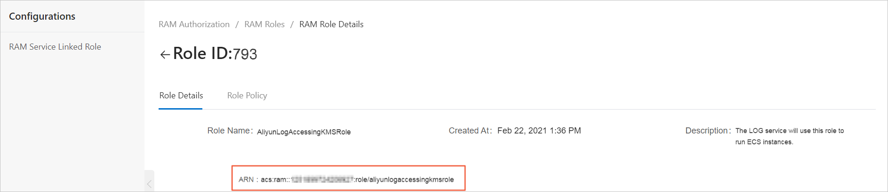

   </li>

   </ol>

4. When you call the CreateProject operation to create a Logstore, add the **encrypt_conf** node to encrypt data by using the following sample code:

   ```text
   encrypt_conf = {
       "enable" : True, # If you set the value to True, data encryption is enabled.
       "encrypt_type": "aes_gcm", # The encryption algorithm. You can set the value tosm4_gcm or aes_gcm.
       "user_cmk_info":
           {
               "cmk_key_id": "", # The ID of the CMK that you created in Step 1.
               "arn": "", # The ARN of the RAM role that is obtained in Step 3.
               "region_id" : ""# The ID of the region where the CMK resides.
           }
   }
   ```

<a id="section-3-15-2"></a>

### 3.15.2. Data model

This topic describes the data model of Log Service.

**Project**

A project is a basic management unit in Log Service and is used to isolate and control resources. You can use a project to manage all logs and log sources of an application.

**Logstore**

A Logstore is a unit that collects, stores, and consumes logs in Log Service. Each Logstore belongs to a single project. Each project can have multiple Logstores. You can create multiple Logstores for a project based on your business requirements. We recommend that you create an independent Logstore for each type of logs in an application. For example, you have a game application named big-game. The server stores three types of logs: operation_log, application_log, and access_log. You can create a project named big-game and then create three Logstores in the project to collect, store, and query the three types of logs.

**Log**

A log is the minimum data unit that is processed in Log Service. Log Service uses a semi-structured data model to define a log. The data model is as follows:

- Topic: a user-defined field that marks multiple logs. For example, access logs can be marked based on the sites. This field is an empty string by default. An empty string is also a valid topic.

- Time: a reserved field in a log, used to indicate the time when the log is generated. This value is a Unix timestamp representing the number of seconds that have elapsed since the epoch time January 1, 1970, 00:00:00 UTC.

- Content: a field that records the content of a log. The content consists of one or more content items. Each content item is a key-value pair.

- Source: a field that indicates the source of a log, for example, the IP address of the machine where the log is generated. This field is empty by default.

The following table describes the requirements for the values of these fields. Table 1. Log fields

| Field | Requirement |
| --- | --- |
| time | An integer in the Unix timestamp format. Unit: seconds. |
| topic | A UTF-8 encoded string of up to 128 characters. |
| source | A UTF-8 encoded string of up to 128 characters. |
| content | One or more key-value pairs. A key is a UTF-8 encoded string of up to 128 characters. It can contain only letters, underscores (_), and digits. It cannot start with a digit. A value is a UTF-8 encoded string of up to 1,048,576 (1024 × 1024) bytes. |

> **Note**
>
> The key in the content field cannot be any of the following keywords:
>
> 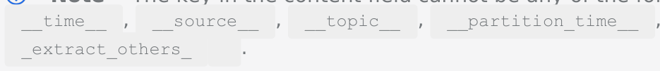
>
> `__time__` ,  `__source__` ,  `__topic__` ,  `__partition_time__` , and

**Topic**

Logs in a Logstore can be grouped by topics. Topics can be specified when you write logs to a Logstore. For example, you can use your user ID as the topic of a log when you write the log to a Logstore. If you do not need to group logs in a Logstore, you can specify the same topic for all logs.

> **Note**
>
> An empty string is a valid topic. The topic of a log is an empty string by
>
> default.

Logs are used in various formats in actual scenarios. The following example shows how to map a raw NGINX access log to the log data model of Log Service. In this example, the IP address of your NGINX server is 10.10.10.1. A raw log on this server is as follows:

```text
10.1.1.1 - - [01/Mar/2012:16:12:07 +0800] "GET /Send? AccessKeyId=<yourAccessKeyId> HTT
P/1.1" 200 5 "-" "Mozilla/5.0 (X11; Linux i686 on x86_64; rv:10.0.2) Gecko/20100101 Firefox/10.0.2"
```

The following table describes how to map the raw log to the log data model of Log Service. Table 2. Log data model of Log Service

| Field | Field value | Description |
| --- | --- | --- |
| topic | “” | The default value (empty string) is used. |
| time | 1330589527 | The time when the log was generated. The time is converted from the timestamp of the raw log.Unit: seconds. |
| source | “10.10.10.1” | The IP address of the server is used as the log source. |
| content | Key-value pair | The content of the log. |

You can decide how to extract the raw log content and combine the extracted content into key-value pairs. The following table describes custom key-value pairs. Table 3. Custom key-value pairs

| Key | Value |
| --- | --- |
| ip | “10.1.1.1” |
| method | “GET” |
| status | “200” |
| length | “5” |
| ref_url | “-“ |
| browser | “Mozilla/5.0 (X11; Linux i686 on x86_64; rv:10.0.2) Gecko/20100101 Firef |

**LogGroup**

A group of logs.

**Logs**

A collection of multiple logs.

**LogGroupList**

A collection of log groups that are used to return results.

**Encoding method**

The following table describes the content encoding method that is supported by Log Service. The RESTful API layer is indicated by Content-Type. Table 4. Supported encoding method

| Encoding method | Content-Type | Description |
| --- | --- | --- |
| ProtoBuf | The data model is encoded by Protocol Buffer. | application/x-protobuf |

The following sample code shows how to use Protocol Buffer to define the objects in the data model:

```text
message Log
{
    required uint32 Time = 1;// Unix time format
    message Content
    {
        required string Key = 1;
        required string Value = 2;
    }  
    repeated Content Contents= 2;
}
message LogGroup
{
    repeated Log Logs= 1;
    optional string Reserved = 2; // Reserved fields
    optional string Topic = 3;
    optional string Source = 4;
}
message LogGroupList
{
    repeated LogGroup logGroupList = 1;
}
```

> **Note**
>
> When you use the Protocol Buffer format, key-value pairs must be unique.
>
> Otherwise, an undefined behavior occurs.

<a id="section-3-15-3"></a>

### 3.15.3. Data encoding

Log Service uses Protocol Buffer as the standard log format. You can write logs to Log Service in the Protocol Buffer format.

Protocol Buffer is used as a format to interchange structured data. Before you write logs to Log Service by calling relevant API operations, you must serialize raw log data to Protocol Buffer data streams as follows:

```text
message Log
{
    required uint32 time = 1; // UNIX Time Format
    message Content
    {
        required string key = 1;
        required string value = 2;
    }
    repeated Content contents= 2;
}
message LogGroup
{
    repeated Log logs= 1;
    optional string reserved =2; // An internal field. You do not need to specify this field.
    optional string topic = 3;
    optional string source = 4;
}
message LogGroupList
{
    repeated LogGroup logGroupList = 1;
}
```

> **Note**
>
> - When you use the Protocol Buffer format, key-value pairs must be unique. Otherwise, an undefined behavior occurs.
>
> - For more information about the Protocol Buffer format, visit GitHub.
>
> - For more information about the API operations that write logs to Log Service, see PostLog.

<a id="section-3-15-4"></a>

### 3.15.4. Logstores

A Logstore is a data storage unit. You can create up to 10 Logstores for each project by default. The name of a Logstore must be unique in the project to which the Logstore belongs. A Logstore is the portal for all log data. You can read data from or write data to the Logstore.

The naming rules for Logstores are as follows:

- The name can only contain lowercase letters, digits, hyphens (-), and underscores (_).

- The name must start and end with a lowercase letter or a digit.

- The name must be 2 to 63 characters in length.

Example

```text
{
    “logstoreName" : "access_log",
    "ttl": 1,
    "shardCount": 2,
    "createTime":1439538649,
    "lastModifyTime":1439538649
}
```

The following table describes the Logstore parameters. Table 1. Logstore parameters

| Parameter | Type | Required | Description |
| --- | --- | --- | --- |
| logstoreName | String | Yes | The name of the Logstore. The name must be unique in the project to which the Logstore belongs. |
| ttl | Integer | Yes | The time to live (TTL) of log data.Unit: days. Minimum value: 1. |
| shardCount | Integer | Yes | The number of shards in the Logstore. |
| createTime | Integer | No | The time when the Logstore was created in Log Service. This parameter is displayed only in the output result. |
| lastModifyTime | Integer | No | The time when the Logstore is updated in Log Service. This parameter is displayed only in the output result. |

<a id="section-3-15-5"></a>

### 3.15.5. Shards

A shard is a basic read/write unit in each Logstore. You can specify the number of shards in each Logstore.

To read data from a shard, you must specify the shard. To write data to a shard, you do not need to specify the shard. Instead, you can use the load balancing mode. In this mode, data is written to multiple shards based on automatic balancing. This ensures high availability of the write operation.

The following table describes the parameters of a shard.

Table 1. Shard parameters

| Parameter | Type | Required | Description |
| --- | --- | --- | --- |
| shardID | Integer | Yes | The unique ID of a shard in the Logstore. The shard ID is automatically generated by the system. |

<a id="section-3-15-6"></a>

### 3.15.6. Logtail configurations

You can create up to 100 Logtail configurations for a project. The name of a Logtail configuration must be unique in a project.

You can use a Logtail configuration to specify the location, method, and parameters for log collection.

The naming rules for Logtail configurations are as follows:

- The name can only contain lowercase letters, digits, hyphens (-), and underscores (_).

- The name must start and end with a lowercase letter or a digit.

- The name must be 2 to 128 characters in length.

Example

```json
{
    "configName": "testcategory1",
    "inputType": "file",
    "inputDetail": {
        "logType": "common_reg_log",
        "logPath": "/var/log/httpd/",
        "filePattern": "access.log",
        "localStorage": true,
        "timeFormat": "%Y/%m/%d %H:%M:%S",
        "logBeginRegex": ".*",
        "regex": "(\w+)(\s+)",
        "key" :[“key1", “key2"],
        "filterKey":["key1"],
        "filterRegex":[“regex1"],
        "topicFormat": “none"
    },
    "outputType": "sls",
    "outputDetail": 
    {
        "logstoreName": "perfcounter"
    },
    "createTime": 1400123456,
    "lastModifyTime": 1400123456
}
```

The following table describes the configuration parameters. Table 1. Configuration parameters

| Parameter | Type | Required | Description |
| --- | --- | --- | --- |
| configName | String | Yes | The name of the Logtail configuration. The name must be unique in a project. |
| inputType | String | Yes | The input type. Default value: file. |
| inputDetail | json | Yes | See the following table. |
| outputType | String | Yes | The output type. Only LogService is supported. |
| outputDetail | String | Yes | See the following table. |
| createTime | Integer | No | The time when the Logtail configuration was created. |
| lastModifyTime | Integer | No | The time when the Logtail configuration was last updated on Log Service. |

The following table describes the elements of the inputDetail parameter. Table 2. inputDetail elements

| Element | Type | Required | Description |
| --- | --- | --- | --- |
| logType | String | Yes | The log type. Valid value: common_reg_log. |
| logPath | String | Yes | The parent directory where the log resides, for example,<code> /var/logs/ </code>. |
| filePattern | String | Yes | The pattern of the log file, for example, <code> access*.log </code>. |
| localStorage | Boolean | Yes | Specifies whether to enable the local cache. Logs up to 1 GB can be locally cached when the link to Log Service is disconnected. |
| timeFormat | String | Yes | The format of the log time, for example, <code> %Y/%m/%d </code> <code>%H:%M:%S </code>. |
| logBeginRegex | String | Yes | The regular expression that specifies the pattern of the first line of a log. This parameter is applicable to multiline logs. |
| regex | String | Yes | The regular expression that is used to extract logs. |
| key | Array | Yes | The key that is generated after logs are extracted. |
| filterKey | Array | Yes | The key that is used to filter logs. A log meets the requirements only when the key value matches the regular expression specified in the corresponding filterRegex column. |
| filterRegex | Array | Yes | The regular expression that is specified for each filterKey.The length of filterRegex must be the same as that of filterKey. |
| topicFormat | String | No | Specifies part of the log file path as the topic, for example, <code> /var/log/(. </code><code>*).log </code>. The default value is none, indicating that the topic is null. |
| preserve | Boolean | No | Valid values: true and false.The value true indicates that the directory monitoring never times out. The value false indicates that the timeout period for directory monitoring is 30 minutes.Default value: true. |
| preserveDepth | Integer | No | Specifies the depth of the monitored directories if the preserve parameter is set to false. Maximum value: 3. |

The following table describes the elements of the outputDetail parameter. Table 3. outputDetail elements

| Element | Type | Required | Description |
| --- | --- | --- | --- |
| logstoreName | String | Yes | The name of the Logstore. |

<a id="section-3-15-7"></a>

### 3.15.7. Logtail machine group

After a machine with Logtail is started, the machine is automatically associated with the user specified in the Logtail configurations. The machine can be identified by using the following three methods:

- IP address: the IP address corresponding to the hostname. This is the simplest method, but the IP address may be duplicated in environments such as Virtual Private Cloud (VPC).

- Universally unique identifier (UUID): the UUID of the desktop management interface (DMI) device. For more information, visit RFC 4122.

- User-defined ID: the user-defined machine identifier in the Logtail directory.

The attributes of each machine are as follows:

```json
{
    "ip" : "testip1",
    "machine-uniqueid" : "testuuid1",
    "userdefined-id" : "testuserdefinedid1",
    "lastHeartbeatTime”:1397781420
 }
```

The following table describes the machine attribute parameters. Table 1. Parameters

| Parameter | Type | Description |
| --- | --- | --- |
| ip | String | The IP address corresponding to the machine hostname. |
| machine-uniqueid | String | The unique primary key marked by the machine. The primary key is uploaded by Logtail. |
| userdefined-id | String | The user-defined machine identifier that is uploaded by Logtail. |
| lastHeartbeatTime(output-only) | Integer | The last heartbeat time of the machine. The value is a Unix timestamp representing the number of seconds that have elapsed since the epoch time. |

**machinegroup**

The machinegroup parameter indicates the machine group that belongs to the current user in the project. The machine group can be identified by an IP address or user-defined ID. IP addresses are more easily identified than user-defined IDs. However, user-defined IDs can identify machine groups in VPC even when repeated IP addresses exist. You can select either of the two machine identification methods based on your business requirements.

The naming rules of machine groups are as follows:

- The name can contain only lowercase letters, digits, hyphens (-), and underscores (_).

- The name must start and end with a lowercase letter or digit.

- The name must be 2 to 128 characters in length.

**Example**

```json
{
    "groupName" : "testgroup",
    "groupType" : "",
    "groupAttribute" : {
        "externalName" : "testgroup",
        “groupTopic”: “testgrouptopic”
    },
    “machineIdentifyType”: "ip",
    "machineList" : [
        "ip1",
        "ip2"
        ...
    ],
    “createTime”: 1431705075,
    "lastModifyTime" : 1431705075
}
```

The following table lists the parameters of a machine group. Table 2. Machine group parameters

| Parameter | Type | Required | Description |
| --- | --- | --- | --- |
| groupName | String | Yes | The name of the machine group. The name must be unique in a project. |
| groupType | String | No | The type of the machine group. Default value: null. |
| machineIdentifyTyp e | String | Yes | The machine identification type. Valid values: ip or userdefined-id. |
| groupAttribute | object | Yes | The attribute of the machine group. Default value: null. |
| machineList | Array | Yes | The list of machine identifiers. Valid values: IP addresses or user-defined identifiers. |
| createTime(output-only) | Integer | No | The time when the machine group was created. |
| lastModifyTime(out put-only) | Integer | No | The time when the machine group was last updated on Log Service. |

The following table describes the parameters of groupAttribute. Table 3. groupAttribute parameters

| Parameter | Type | Required | Description |
| --- | --- | --- | --- |
| groupTopic | String | No | The topic of the machine group. Default value: null. |
| externalName | String | No | The external management identifier on which the machine group depends.Default value: null. |

<a id="section-4"></a>

# 4.CLI references

<a id="section-4-1"></a>

## 4.1. Overview of Log Service CLI

Log Service provides the command-line interface (CLI) to meet the requirements for automated configurations in Log Service.

**Features**

Log Service CLI provides the following features:

- Supports most RESTful API operations of Log Service. For example, you can use the CLI to manage projects, Logstores, machine groups, consumer groups, and Logtail configurations.

- Allows you to manage logs across multiple accounts and regions.

- Allows you to query and pull logs.

- Allows you to migrate data from Elasticsearch to Log Service.

- Supports flexible time configurations.

- Allows you to replicate logs across regions at a high speed, reindex historical logs, and ship logs to data warehouses.

**Commands**

Log Service CLI supports most features of Log Service API. The following table describes the commonly used commands that are supported by Log Service CLI.

**Category**

**Command**

**Description**

create_project

Creates a project.

delete_project

Deletes a project.

get_project

Queries a specified project.

Project management

list_project

Queries all projects.

Replicates all Logstores, Logtail configurations, machine groups, and

copy_project

index configurations from a source project to a destination project.

create_logstore

Create a Logstore.

delete_logstore

Deletes a Logstore.

Logstore

get_logstore

Queries a specified Logstore.

management

list_logstore

Queries all Logstores.

update_logstore

Updates a Logstore.

list_shards

Queries shards.

split_shard

Splits shards.

Shard management

merge_shard

Merges shards.

create_machine_group

Creates a machine group.

delete_machine_group

Deletes a machine group.

update_machine_group

Updates a machine group.

Machine group management

get_machine_group

Queries a specified machine group.

list_machine_group

Queries all machine groups.

Queries the machines in a specified

list_machines

machine group.

create_logtail_config

Creates a Logtail configuration.

update_logtail_config

Updates a Logtail configuration.

Logtail

delete_logtail_config

Deletes a Logtail configuration.

configuration management

Queries a specified Logtail

get_logtail_config

configuration.

list_logtail_config

Queries all Logtail configurations.

Applies a Logtail configuration to a

apply_config_to_machine_group

machine group.

Removes a Logtail configuration from

remove_config_to_machine_group

Mappings

a machine group.

between machine groups and

Queries the Logtail configurations that

Logtail

get_machine_group_applied_configs

are applied to a specified machine

configurations

group.

Queries the machine groups to which a

get_config_applied_machine_groups

Logtail configuration is applied.

Creates indexes for a specified

create_index

Logstore.

Deletes indexes from a specified

delete_index

Index

Logstore.

management

update_index

Updates the indexes of a Logstore.

get_index_config

Queries the indexes of a Logstore.

Queries a cursor based on a specified

get_cursor

point in time.

Queries the server-side time based on

get_cursor_time

a cursor

Cursor

Queries the server-side time based on

management

get_previous_cursor_time

the previous cursor of a specified cursor.

get_begin_cursor

Queries a start cursor.

get_end_cursor

Queries an end cursor.

<table>
  <tr>
    <td rowspan="7">Log management</td>
    <td>get_logs</td>
    <td>Queries logs. You can configure a query request by using a JSON file.This command is suitable for exact match scenarios.</td>
  </tr>
  <tr>
    <td>get_log</td>
    <td>Queries a specified number of logs.</td>
  </tr>
  <tr>
    <td>get_log_all</td>
    <td>Queries a large number of logs.</td>
  </tr>
  <tr>
    <td>get_histograms</td>
    <td>Queries the distribution of logs.</td>
  </tr>
  <tr>
    <td>pull_log</td>
    <td>Pulls logs.</td>
  </tr>
  <tr>
    <td>pull_logs</td>
    <td>Pulls a large number of logs.</td>
  </tr>
  <tr>
    <td>pull_log_dump</td>
    <td>Downloads a large number of logs to local files in a concurrent manner.</td>
  </tr>
  <tr>
    <td rowspan="6">Consumer group management</td>
    <td>create_consumer_group</td>
    <td>Creates a consumer group in a specified Logstore.</td>
  </tr>
  <tr>
    <td>delete_consumer_group</td>
    <td>Deletes a consumer group.</td>
  </tr>
  <tr>
    <td>update_consumer_group</td>
    <td>Updates a specified consumer group.</td>
  </tr>
  <tr>
    <td>list_consumer_group</td>
    <td>Queries all consumer groups in a specified Logstore.</td>
  </tr>
  <tr>
    <td>update_check_point</td>
    <td>Updates the checkpoint of a shard from which a specified consumer group consumes data.</td>
  </tr>
  <tr>
    <td>get_check_point</td>
    <td>Queries the checkpoints of shards from which a specified consumer group consumes data.</td>
  </tr>
  <tr>
    <td rowspan="5">Association with external data sources</td>
    <td>create_external_store</td>
    <td>Associates Log Service with external data sources. The following data sources are supported: ApsaraDB RDS for MySQL, Object Storage Service (OSS), and local CSV files.</td>
  </tr>
  <tr>
    <td>delete_external_store</td>
    <td>Disassociates Log Service from an external data source.</td>
  </tr>
  <tr>
    <td>get_external_store</td>
    <td>Queries the detailed configuration of an external data source.</td>
  </tr>
  <tr>
    <td>list_external_store</td>
    <td>Queries a list of external data sources that are associated with Log Service.</td>
  </tr>
  <tr>
    <td>update_external_store</td>
    <td>Modifies the configuration of an external data source that is associated with Log Service.</td>
  </tr>
</table>

**References**

For more information, see Log Service CLI.

<a id="section-4-2"></a>

## 4.2. Install Log Service CLI

You can use Log Service CLI to perform various operations in Log Service. For example, you can manage projects, manage Logstores, query logs, enable automatic pagination, and replicate data across multiple regions and accounts. This topic describes how to install Log Service CLI.

**Read before installation**

Log Service CLI is developed based on Python. You must install Python before you can use Log Service CLI. For more information, visit the official Python website.

| Item | Description |
| --- | --- |
| Current CLI version | 0.2.5<br>Note You can run the installation command to upgrade the CLI. We recommend that you upgrade the CLI to the latest version. |
| Source code | Aliyun Log CLI |
| Supported Python versions | Python 2.6, 2.7, 3.3, 3.4, 3.5, 3.6, 3.7, 3.8, and 3.9 |
| Supported operating systems | Windows, Linux, and macOS |
| Dependent components | After Python is installed, we recommend that you run the <code> pip </code> <code>install package_name </code> command to install the following dependent components. If an installation error occurs, we recommend that you rerun the <code> pip install package_name </code> command.<br>• docopt<br>• aliyun-log-python-sdk<br>• jmespath<br>• aliyun-python-sdk-core<br>• aliyun-python-sdk-sts<br>• requests |

**Install Log Service CLI in Linux**

1. Log on to your Linux server.

2. Run the following command to install Log Service CLI:

   ```bash
   pip3 install aliyun-log-python-sdk aliyun-log-cli -U --no-cache
   ```

3. Verify the installation result. Run the following command:

   ```text
   aliyunlog --version
   ```

   If information similar to the following output is returned, Log Service CLI is installed:

   ```text
   Successfully installed aliyun-log-cli-0.2.5 aliyun-log-python-sdk-0.8.6 backports.zoneinfo-0.2.1 ...
   ```

**Install Log Service CLI in Windows**

1. Log on to your Windows server.

2. Open Command Prompt.

   If you configured Python environment variables, you can skip this step and directly run the installation command. If the pip3 installation command cannot be identified, the required Python environment variables are not configured. You can run the **cd** command to navigate to the Python installation path and then run the installation command.

3. Run the following command to install Log Service CLI:

   ```bash
   pip3 install aliyun-log-python-sdk aliyun-log-cli -U --no-cache
   ```

4. Verify the installation result. Run the following command:

   ```text
   aliyunlog --version
   ```

   If information similar to the following output is returned, Log Service CLI is installed:

   ```text
   log-cli-v-0.2.5, log-python-sdk-v-0.8.6, sys.version_info(major=3, minor=7, micro=0, releaselevel='final', serial=0), win32
   ```

**Install Log Service CLI in macOS**

We recommend that you use the pip3 installation command to install Log Service CLI. Example:

```bash
brew install python3
pip3 install -U aliyun-log-cli --no-cache
```

The other steps that you must perform to install Log Service CLI in macOS are similar to the steps to install Log Service CLI in Linux. For more information, see Install Log Service CLI in Linux.

**Upgrade Log Service CLI**

You can run the installation command to upgrade the CLI. We recommend that you upgrade the CLI to the latest version.

**Uninstall Log Service CLI**

If you no longer require Log Service CLI, you can uninstall Log Service CLI. You can run the following command to uninstall Log Service CLI:

```bash
pip3 uninstall aliyun-log-cli
```

If information similar to the following output is returned, Log Service CLI is uninstalled:

```text
Successfully uninstalled aliyun-log-cli
```

**What to do next**

Configure Log Service CLI

<a id="section-4-3"></a>

## 4.3. Configure Log Service CLI

After you configure Log Service CLI, you do not need to configure global parameters each time you run a command. The global parameters include the AccessKey pair, endpoint, and output format. This topic describes how to configure CLI accounts and global parameters.

**Prerequisites**

Log Service CLI is installed. For more information, see Install Simple Log Service CLI.

**Use the credentials of Alibaba Cloud CLI**

Log Service CLI can use the credentials that are configured for Alibaba Cloud CLI to verify accounts. If you have installed Alibaba Cloud CLI, you do not need to configure accounts. For more information, see Configure Alibaba Cloud CLI.

Log Service CLI reads credentials from the following sources in descending order of priority: subcommands of Log Service CLI, configuration file of Log Service CLI, configuration file of Alibaba Cloud CLI, and environment variables.

| Credential source in descending order of priority | Description |
| --- | --- |
| The global parameters that are passed to the subcommands of Log Service CLI, such as an AccessKey pair and a region | When a subcommand is run, Log Service CLI preferentially reads credentials from the parameters in the subcommand for verification. This type of source has the highest priority. |
| The <em>profile</em> parameter that is configured for Log Service CLI | When a subcommand is run, Log Service CLI reads credentials based on the following setting: <code> --profile=Name of a </code> <code>credential configuration in the config.json file of</code> <code>Alibaba Cloud CLI </code>. For more information about the --profile parameter, see Global parameters. |
| The ALIYUN_LOG_CLI environment variable that is configured for Log Service CLI | Log Service CLI reads credentials from the ALIYUN_LOG_CLI environment variable that is configured in the system. |
| The configuration file of Log Service CLI | The file is named in the .aliyunlogcli format. For more information, see Configure an endpoint and an AccessKey pair for the default account and Configure endpoints and AccessKey pairs for multiple accounts. |
| The ALIBABACLOUD environment variable that is configured for Alibaba Cloud CLI | Log Service CLI reads credentials from the ALIBABACLOUD environment variable that is configured in the system. |
| The ALICLOUD environment variable that is configured for Alibaba Cloud CLI | Log Service CLI reads credentials from the ALICLOUD environment variable that is configured in the system. |
| The configuration file of Alibaba Cloud CLI | Log Service CLI reads credentials from the configuration file of Alibaba Cloud CLI.<br>Note The path to the configuration file varies based on the operating system that is in use.<br>• Linux: ~/.aliyun/config.json<br>• Windows: C:\\Users\\<em>UserName</em>\\.aliyun\\config.json |

**Configure an endpoint and an AccessKey pair for the default account**

By default, Log Service CLI uses the **main** account to perform all operations. Before you can use Log Service CLI, you must configure an AccessKey pair and an endpoint for the **main** account and grant the main account the required permissions to manage projects.

1. Log on to the server on which Log Service CLI is installed.

2. Configure an endpoint and an AccessKey pair for the default account. Run the following command:

   ```text
   aliyunlog configure "AccessKey ID" "AccessKey Secret" Endpoint
   ```

   - Replace *AccessKey ID* with the AccessKey ID of an account that has permissions on Log Service. Replace *AccessKey Secret* with the AccessKey secret of the account. For more information, see AccessKey pair and Create a RAM user and authorize the RAM user to access Simple Log Service.

   - Replace *Endpoint* with the endpoint of a project. We recommend that you use a public endpoint. For more information, see Endpoints.

3. Verify the configuration result. Modify the .aliyunlogcli configuration file. If the file contains information similar to the following example, the default account is configured.

   ```text
   [main]
   access-id = LTAI******pLMZ
   access-key = XjAsP******eRqax
   region-endpoint = cn-hangzhou.log.aliyuncs.com
   sts-token =
   ```

   > **Note**
   >
   > The path to the .aliyunlogcli configuration file varies based on the operating
   >
   > system that is in use.
   >
   > - Linux: ~/.aliyunlogcli
   >
   > - Windows: C:\\Users\\*UserName*\\.aliyunlogcli

   If the default account fails to be configured, you can fix the error based on the error code that is returned.

**Configure endpoints and AccessKey pairs for multiple accounts**

If you want to manage log data across accounts, you must configure AccessKey pairs and endpoints for the accounts.

1. Log on to the server on which Log Service CLI is installed.

2. Configure AccessKey pairs and endpoints for multiple accounts. Run the following command:

   ```text
   aliyunlog configure "AccessKey ID" "AccessKey Secret" Endpoint testName
   ```

   - Replace *AccessKey ID* with the AccessKey ID of an account that has permissions on Log Service. Replace *AccessKey Secret* with the AccessKey secret of the account. For more information, see AccessKey pair and Create a RAM user and authorize the RAM user to access Simple Log Service.

   - Replace *Endpoint* with the endpoint of a project. We recommend that you use a public endpoint. For more information, see Endpoints.

   - Replace *testName* with the name of an account that you configure.

3. Verify the configuration result. Modify the ~/.aliyunlogcli configuration file. If the file contains information similar to the following example, the accounts are configured.

   ```text
   [main]
   access-id = LTAI******pLMZ
   access-key = XjAsP******eRqax
   region-endpoint = cn-hangzhou.log.aliyuncs.com
   sts-token =

   [test]
   access-id = As******sPzvb
   access-key = FtagJeR******bQqax
   region-endpoint = cn-shanghai.log.aliyuncs.com
   sts-token =
   ```

   > **Note**
   >
   > The path to the .aliyunlogcli configuration file varies based on the operating
   >
   > system that is in use.
   >
   > - Linux: ~/.aliyunlogcli
   >
   > - Windows: C:\\Users\\*UserName*\\.aliyunlogcli

   If the accounts fail to be configured, you can fix the error based on the error code that is returned.

   If you use Log Service CLI to run a command, you can use  `--client-name=testName`  to specify the account that you want to use. For example, if you run the  `aliyunlog log create_project ..... --client-name=test`  command, the test account is used to create the project.

**Specify the output format**

Log Service CLI can format output and escape characters in the output. If you want to format output and escape characters, you can use the following methods:

- Format JSON output By default, the output of Log Service CLI is in the JSON format and is displayed in one line. In this case, the output is difficult to read. To improve readability, you can use one of the following methods to format the JSON output:

  - Format the output of a specified command

    For example, you can use the  `aliyunlog log get_log .... --format-output=json` command to format the JSON output of the get_log command.

  - Format the output of all commands

    You can use the  `aliyunlog configure --format-output=json`  command to format the JSON output of all commands.

- Escape characters

  By default, the non-English characters in the output of Log Service CLI are escaped characters. If you want Log Service CLI to return the original characters, such as Chinese strings, you can specify  `no_escape`  for  `--format-output` .

  If you run the  `aliyunlog configure --format-output=no_escape`  command, Log Service CLI does not escape characters in the output of commands. The original characters are returned.

**Escape special characters**

If you run a command in Log Service CLI and the query statement contains dollar signs ($), grave accents (\`), backslashes (\\), or exclamation points (!), an error occurs during the execution, or the query result is inaccurate.

In this case, you must use backslashes (\\) to escape the special characters or use single quotation marks (') to reference the special characters. Examples:

- If you want to escape the special characters in the query parameter by using backslashes (\\), run the following command:

  ```text
   aliyunlog log get_log_all --project="my-project" --logstore="my-logstore" --
  ```

```text
query="event_name:\$_enter" --from_time="2021-06-24 15:00:00+08:00" --to_time="2021-06-
```

```text
24 16:00:00+08:00" 
```

- If you want to reference the special characters in the query parameter by using single quotation marks ('), run the following command:

  ```text
   aliyunlog log get_log_all --project="my-project" --logstore="my-logstore" --
  ```

```text
query='event_name:$_enter' --from_time="2021-06-24 15:00:00+08:00" --to_time="2021-06-24 
```

```text
16:00:00+08:00" 
```

For more information, see Quoting.

<a id="section-4-4"></a>

## 4.4. Request syntax

Log Service CLI allows you to run subcommands, configure basic settings, and obtain help information. This topic describes the syntax supported by Log Service CLI.

**Subcommands**

You can run subcommands to perform various operations. For example, you can create a project or a Logstore.

- Syntax

  ```text
  aliyunlog log <subcommand> [parameters | global options]
  ```

  - subcommand: the supported subcommand. For more information, see Commands.

  - parameters: the supported parameters. For more information about the parameters that are supported for each subcommand, see the description of each subcommand.

  - global options: the supported global parameters. For more information, see Global parameters.

- Example Run the following command to create a project:

  ```text
  aliyunlog log create_project --project_name="project-a" --project_des="project created from cli"
  ```

**configure command**

You can run the configure command to configure basic settings such as AccessKey pairs, endpoints, and accounts.

- Syntax

  ```text
  aliyunlog configure <access_id> <access-key> <endpoint> [<client-name>]
  ```

  In actual use, replace  `<access_id>`  and  `<access-key>`  with the AccessKey ID and AccessKey secret of an account that has the management permissions on Log Service. Replace  `<endpoint>`  with the endpoint for the region where the project resides. Replace  `<client-name>`  with the username of the account that you use to run the command. For more information, see Obtain an AccessKey pair and Obtain the endpoint of Log Service.

- Example Run the following command to create an account named test:

  ```text
  aliyunlog configure LTAI4G24******dYKSpLMZ XjAsPzvbK******tagJeRqax cn-
  hangzhou.log.aliyuncs.com test
  ```

**Help information and version information**

You can run the command to obtain help information and version information.

- Syntax

  ```text
  aliyunlog [--help | --version]
  ```

- Example Run the following command to obtain the version of Log Service CLI:

  ```text
  aliyunlog --version
  ```

<a id="section-4-5"></a>

## 4.5. Global parameters

You do not need to configure global parameters each time you run a command in Log Service

<ol type="I" start="151">

<li>

By default, Log Service CLI uses global parameters to process requests. This topic

</li>

</ol>

describes the global parameters of Log Service CLI.

| Parameter | Type | Required | Example | Description |
| --- | --- | --- | --- | --- |
| --access-id | String | No | LTAI4G243ui\*\*\*\*\* \*pLMZ | The AccessKey ID. Set the value to the AccessKey ID of your account. For more information about how to obtain an AccessKey ID, see Obtain an AccessKey pair. |
| --access-key | String | No | XjAsPzvbK\*\*\*\*\*\* QFRqax | The AccessKey secret. Set the value to the AccessKey secret of your account.For more information about how to obtain an AccessKey secret, see Obtain an AccessKey pair. |
| --sts-token | String | No | None | The Security Token Service (STS) token. |
| --region-endpoint | String | No | cn-hangzhou.log.aliy uncs.com | The Log Service endpoint. For more information, see Obtain the endpoint of Log Service. |
| --client-name | String | No | test | The name of the client that sends requests. Set the value to the account that is used to send requests. |
| --format-output | String | No | json | The format of the output. Valid values:<br>• json: The output is in the JSON format.<br>• no_escape: The original characters are returned, and non-English characters are not escaped in the output.<br>For example, if you specify <code> --</code><code>format-</code><br><code>output=json,no_</code><code>escape </code>, the original characters are returned, and non-English characters are not escaped in the output. The output is in the JSON format. |
| --jmes-filter | String | No | <code>--jmes-</code><br><code>filter="join('\</code><br><code>n',</code><br><code>map(&amp;to_string(</code><br><code>@), @))"</code> | The JMES expression that is used to filter log data in the output. For more information, see JMES syntax. |

<table>
  <tr>
    <td>--decode-output</td>
    <td>String</td>
    <td>No</td>
    <td>utf8</td>
    <td>The method that is used to parse log data. This parameter is available only if the log data is in binary representation.Valid values:<br>• utf8: UTF-8 is used to parse log data. This is the default value.<br>• lartin1: Latin1 is used to parse log data.<br>• gbk: GBK is used to parse log data.</td>
  </tr>
  <tr>
    <td>--profile</td>
    <td>String</td>
    <td>No</td>
    <td>akProfile</td>
    <td>The credentials that are used to verify accounts.The credentials are included in the.aliyun/config.jso n configuration file of Alibaba Cloud CLI.</td>
  </tr>
</table>

For more information about how to configure global parameters, see Configure Log Service CLI.

<a id="section-4-6"></a>

## 4.6. Use Log Service CLI

<a id="section-4-6-1"></a>

### 4.6.1. Project management

<a id="section-4-6-1-1"></a>

#### 4.6.1.1. copy_project

Replicates resources from a source project to a destination project.

You can run the copy_project command to replicate the following Log Service resources from one project to another project:

- Logstores

- Index configurations

- Logtail configurations

- Machine groups

- Mappings between machine groups and Logtail configurations

For more information, see Command examples.

**Command syntax**

```text
aliyunlog log copy_project --from_project=<value> --to_project=<value> [--to_client=<value>] [--copy_machine_group=<value>] [--access-id=<value>] [--access-key=<value>] [--sts-token=<value>] [--region-endpoint=<value>] [--client-name=<value>] [--jmes-filter=<value>] [--format-output=<value>] [--decode-output=<value>]
```

**Command parameters**

The following table describes the required parameters of this command and the parameters that are specific to this command.

| Parameter | Type | Required | Example | Description |
| --- | --- | --- | --- | --- |
| --from_project | String | Yes | project-a | The name of the source project. |
| --to_project | String | Yes | project-b | The name of the destination project. |
| --to_client | String | No | test | The account that has the management permissions on the projects. For more information about how to configure the account, see Configure Log Service CLI. |
| --copy_machine_group | Boolean | No | false | Specifies whether to replicate the resources that are related to machine groups.Valid values:<br>• true<br>• false (default) |

For more information about the global parameters of this command, see Global parameters.

**Command examples**

- Commands

  - Use the default account to replicate resources from a project named project-a to a project named project-b. The two projects reside in the same region.

    ```text
    aliyunlog log copy_project --from_project="project-a" --to_project="project-b"
    ```

  - Replicate resources from a project named project-a to a project named project-b. project-a belongs to the default account, and project-b belongs to an account named test. The two projects reside in different regions.

    ```text
    aliyunlog log copy_project --from_project="project-a" --to_project="project-b" --client-name="test"
    ```

  - Replicate resources from a project named project-a to a project named project-b. project-a belongs to the default account, and project-b belongs to an account named test. The Logtail configurations and machine groups in project-a are also replicated to project-b. The two projects reside in different regions.

    ```text
    aliyunlog log copy_project --from_project="project-a" --to_project="project-b" --copy_machine_group=true --client-name="test"
    ```

- Output

  If the command is successfully run, no responses are returned.

<a id="section-4-6-1-2"></a>

#### 4.6.1.2. create_project

Creates a project.

**Usage notes**

Before you run this command in Log Service CLI, you must install and configure Log Service

<ol type="I" start="151">

<li>

For more information, see Install Log Service CLI and Configure Log Service CLI.

</li>

</ol>

**Command syntax**

```xml
aliyunlog log create_project --project_name=<value> --project_des=<value> [--access-id=
<value>] [--access-key=<value>] [--sts-token=<value>] [--region-endpoint=<value>] [--client-name=<value>] [--jmes-filter=<value>] [--format-output=<value>] [--decode-output=<value>]
```

**Command parameters**

The following table describes the required parameters of this command and the parameters that are specific to this command.

| Parameter | Type | Required | Example | Description |
| --- | --- | --- | --- | --- |

<table>
  <tr>
    <td>--project_name</td>
    <td>String</td>
    <td>Yes</td>
    <td>project-a</td>
    <td>The name of the project. The name must meet the following requirements:<br>• The name must be globally unique.<br>• The name can contain only lowercase letters, digits, and hyphens (-).<br>• The name must start and end with a lowercase letter or a digit.<br>• The name must be 3 to 63 characters in length.</td>
  </tr>
  <tr>
    <td>--project_des</td>
    <td>String</td>
    <td>Yes</td>
    <td>project created from cli</td>
    <td>The description of the project.</td>
  </tr>
</table>

For more information about the global parameters of this command, see Global parameters.

**Command examples**

- Use the default account to create a project named project-a.

  - Command

    ```text
    aliyunlog log create_project --project_name="project-a" --project_des="project created from cli"
    ```

  - Output

    If the command is successfully run, no responses are returned. You can run the

    ```text
     aliyunlog log get_project --project_name="project-a" --format-output=json 
    ```

    command to query the details of the project.

- Use the AccessKey pair of a specified account to create a project named project-b.

  - Command

    ```text
    aliyunlog log create_project --project_name="project-b" --project_des="project created from cli" --access-id="your_accesskey_id" --access-key="your_accesskey_secret"
    ```

  - Output

    If the command is successfully run, no responses are returned. You can run the

    ```text
     aliyunlog log get_project --project_name="project-b" --access-id="your_accesskey_id" 
    ```

    `--access-key="your_accesskey_secret" --format-output=json`  command to query the details of the project.

- Use the AccessKey pair of a specified account to create a project named project-c in the China (Shanghai) region.

  - Command

    ```text
    aliyunlog log create_project --project_name="project-c" --project_des="project created from cli" --access-id="your_accesskey_id" --access-key="your_accesskey_secret" 
    --region-endpoint="cn-shanghai.log.aliyuncs.com"
    ```

  - Output

    If the command is successfully run, no responses are returned. You can run the

    ```text
     aliyunlog log get_project --project_name="project-c" --access-id="your_accesskey_id" 
    ```

```text
--access-key="your_accesskey_secret" --region-endpoint="cn-shanghai.log.aliyuncs.com" 
```

`--format-output=json`  command to query the details of the project.

**References**

- If the response that is returned by Log Service contains error information after you call an API operation, the call fails. You can handle errors based on the error codes that are returned when API calls fail. For more information, see Common error codes.

- For more information about the API operation that corresponds to this command, see CreateProject.

<a id="section-4-6-1-3"></a>

#### 4.6.1.3. delete_project

Deletes a project.

**Command syntax**

> **Warning**
>
> After you delete a project, all log data that is stored in the project and the
>
> configurations of the project are deleted and cannot be restored. Proceed with caution.

```text
aliyunlog log delete_project --project_name=<value> [--access-id=<value>] [--access-key=<value>] [--sts-token=<value>] [--region-endpoint=<value>] [--client-name=<value>] [--jmes-filter=<value>] [--format-output=<value>] [--decode-output=<value>]
```

**Command parameters**

The following table describes the required parameters of this command and the parameters that are specific to this command.

| Parameter | Type | Required | Example | Description |
| --- | --- | --- | --- | --- |
| --project_name | String | Yes | project-a | The name of the project. |

For more information about the global parameters of this command, see Global parameters.

**Command examples**

- Command Use the default account to delete a project named project-a.

  ```text
  aliyunlog log delete_project --project_name="project-a"
  ```

- Output

  If the command is successfully run, no responses are returned.

**Error codes**

If an error message is returned, fix the error based on the error code description of the related API operation. For more information, see Error codes.

**API references**

DeleteProject

<a id="section-4-6-1-4"></a>

#### 4.6.1.4. get_project

Queries a project.

**Command syntax**

```text
aliyunlog log get_project --project_name=<value> [--access-id=<value>] [--access-key=<value>] [--sts-token=<value>] [--region-endpoint=<value>] [--client-name=<value>] [--jmes-filter=<value>] [--format-output=<value>] [--decode-output=<value>]
```

**Command parameters**

The following table describes the required parameters of this command and the parameters that are specific to this command.

| Parameter | Type | Required | Example | Description |
| --- | --- | --- | --- | --- |
| --project_name | String | Yes | project-a | The name of the project. |

For more information about the global parameters of this command, see Global parameters.

**Command examples**

- Command Use the default account to query a project named project-a.

  ```text
  aliyunlog log get_project --project_name="project-a"
  ```

- Output

  ```json
  {
    "createTime": "2022-11-01 16:26:52",
    "description": "This is the new project description",
    "lastModifyTime": "2022-11-07 15:12:46",
    "owner": "******",
    "projectName": "ali-test-project",
    "quota": {
      "ETL": 100,
      "alert": 100,
      "chart": 200,
      "config": 200,
      "dashboard": 100,
      "export": 100,
      "ingestion": 100,
      "logstore": 200,
      "machineGroup": 200,
      "readQpsPerMin": 600000,
      "report": 100,
      "savedsearch": 100,
      "scheduledSQL": 100,
      "shard": 400,
      "writeQpsPerMin": 600000,
      "writeSizePerMin": 30000000000
    },
    "region": "cn-hangzhou",
    "status": "Normal"
  }
  ```

**Error codes**

If an error message is returned, fix the error based on the error code description of the related API operation. For more information, see GetProject.

**API references**

GetProject

<a id="section-4-6-1-5"></a>

#### 4.6.1.5. list_project

Queries all projects.

**Command syntax**

```text
aliyunlog log list_project [--offset=<value>] [--size=<value>] [--access-id=<value>] [--access-key=<value>] [--sts-token=<value>] [--region-endpoint=<value>] [--client-name=<value>] [--jmes-filter=<value>] [--format-output=<value>] [--decode-output=<value>]
```

**Command parameters**

This command does not have command-specific parameters. For more information about the global parameters of this command, see Global parameters.

**Command examples**

- Command Query all the projects in the region to which the default account belongs.

  ```text
  aliyunlog log list_project
  ```

- Output

  ```json
  {
    "count": 2,
    "projects": [
      {
        "createTime": "1614075057",
        "description": "",
        "lastModifyTime": "1614075057",
        "owner": "",
        "projectName": "datalab-174649******745-cn-hangzhou",
        "region": "cn-hangzhou",
        "status": "Disable"
      },
      {
        "createTime": "1621930740",
        "description": "create project from cli",
        "lastModifyTime": "1621930740",
        "owner": "",
        "projectName": "project-ba",
        "region": "cn-hangzhou",
        "status": "Disable"
      }
    ],
    "total": 2
  }
  ```

**Error codes**

If an error message is returned, fix the error based on the error code description of the related API operation. For more information, see Error codes of ListProject.

**API references**

ListProject

<a id="section-4-6-2"></a>

### 4.6.2. Logstore management

<a id="section-4-6-2-1"></a>

#### 4.6.2.1. copy_logstore

Replicates a source Logstore and related configurations to a destination Logstore.

You can run the copy_logstore command to replicate the following Log Service resources from one Logstore to another Logstore:

- Logstores

- Index configurations

- Logtail configurations

**Command syntax**

```xml
aliyunlog log copy_logstore --from_project=<value> --from_logstore=<value> --
to_logstore=<value> [--to_project=<value>] [--to_client=<value>] [--to_region_endpoint=
<value>] [--access-id=<value>] [--access-key=<value>] [--sts-token=<value>] [--region-endpoint=<value>] [--client-name=<value>] [--jmes-filter=<value>] [--format-output=<value>] [--decode-output=<value>]
```

**Command parameters**

The following table describes the required parameters of this command and the parameters that are specific to this command.

| Parameter | Type | Required | Example | Description |
| --- | --- | --- | --- | --- |
| --from_project | String | Yes | project-a | The name of the source project. |
| --from_logstore | String | Yes | logstore-a | The name of the source Logstore. |
| --to_logstore | String | Yes | logstore-b | The name of the destination Logstore. |
| --to_project | String | Yes | project-b | The name of the destination project. |
| --to_client | String | No | test | The account to which the destination project belongs.For more information about how to configure an account, see Configure Log Service CLI. |

For more information about the global parameters of this command, see Global parameters.

**Command examples**

- Command Replicate the logstore-a Logstore that belongs to the default account to the logstore-b Logstore that belongs to the test account.

  ```text
  aliyunlog log copy_logstore --from_project="project-a" --from_logstore="logstore-a" --to_logstore="logstore-b" --to_project="project-b " --to_client="test"
  ```

- Output

  If the command is successfully run, no responses are returned.

<a id="section-4-6-2-2"></a>

#### 4.6.2.2. create_logstore

Creates a Logstore.

**Usage notes**

Before you run this command in Log Service CLI, you must make sure that the following conditions are met:

- Log Service CLI is installed and configured. For more information, see Install Log Service CLI and Configure Log Service CLI.

- A project is created in Log Service. For more information, see create_project.

**Command syntax**

```text
aliyunlog log create_logstore --project_name=<value> --logstore_name=<value> [--ttl=<value>] [--shard_count=<value>] [--enable_tracking=<value>] [--append_meta=<value>] [--auto_split=<value>] [--max_split_shard=<value>] [--preserve_storage=<value>] [--
encrypt_conf=<value>] [--telemetry_type=<value>] [--hot_ttl=<value>] [--mode=<value>] [--access-id=<value>] [--access-key=<value>] [--sts-token=<value>] [--region-endpoint=<value>] [--client-name=<value>] [--jmes-filter=<value>] [--format-output=<value>] [--decode-output=<value>] [--profile=<value>]
```

**Command parameters**

The following table describes the required parameters of this command and the parameters that are specific to this command.

| Parameter | Type | Required | Example | Description |
| --- | --- | --- | --- | --- |
| --project_name | String | Yes | aliyun-test-project | The name of the project. |
| --logstore_name | String | Yes | logstore-a | The name of the Logstore. The name must meet the following requirements:<br>• The name must be unique in a project.<br>• The name can contain only lowercase letters, digits, hyphens (-), and underscores (_).<br>• The name must start and end with a lowercase letter or a digit.<br>• The name must be 3 to 63 characters in length. |
| --ttl | Integer | No | 30 | The retention period of data.Unit: days. Valid values: 1 to<br>3650. If you set this parameter to 3650, data is permanently stored. |
| --shard_count | Integer | No | 2 | The number of shards. Valid values: 1 to 10. |
| --enable_tracking | Boolean | No | true | Specifies whether to enable the web tracking feature.Default value: false. Valid values:<br>• true<br>• false |
| --append_meta | Boolean | No | false | Specifies whether to record public IP addresses.Default value: false. Valid values:<br>• true<br>• false |
| --auto_split | Boolean | No | true | Specifies whether to enable automatic sharding. Default value: false. Valid values:<br>• true<br>• false |
| --max_split_shar d | Integer | No | 64 | The maximum number of shards into which existing shards can be automatically split. Valid values: 1 to 64. If you set <strong>--</strong><strong>autoSplit</strong> to true, you must specify this parameter. |
| --encrypt_conf | String | No | None | The data structure of the encryption configuration.<br>For more information, see EncryptConf. |
| --telemetry_type | String | No | None | The type of the observable data.Valid values:<br>• None (default): logs<br>• Metrics: metrics |
| --hot_ttl | Integer | No | 60 | The retention period of data in the hot storage tier of the Logstore. Unit: days. You can specify a value that ranges from 30 to the value of the ttl parameter.<br>Hot data that is stored for longer than the period specified by hot_ttl is converted to cold data. For more information, see Enable intelligent tiered storage. |
| --mode | String | No | standard | The type of the Logstore. Log Service provides two types of Logstores: Standard Logstores and Query Logstores.Valid values:<br>• standard: Standard Logstore. This type of Logstore supports the log analysis feature and is suitable for scenarios such as real-time monitoring and interactive analysis. You can also use this type of Logstore to build a comprehensive observability system.<br>• query: Query Logstore. This type of Logstore supports high-performance queries. The index traffic fee of a Query Logstore is approximately half that of a Standard Logstore.Query Logstores do not support SQL analysis.Query Logstores are suitable for scenarios in which the amount of data is large, the log retention period is long, or log analysis is not required.If logs are stored for weeks or months, the log retention period is considered long. |

For more information about the global parameters of this command, see Global parameters.

**Command examples**

- Use the default account to create a Logstore named logstore-a.

  - Command

    ```text
    aliyunlog log create_logstore --project_name="aliyun-test-project" --
    logstore_name="logstore-a"
    ```

  - Output If the command is successfully run, no responses are returned. You can run the following command to query the details of the Logstore:

    ```text
    aliyunlog log get_logstore --project_name="aliyun-test-project" --
    logstore_name="logstore-a" --format-output=json
    ```

- Use the AccessKey pair of a specified account to create a Logstore named logstore-b.

  - Command

    ```text
    aliyunlog log create_logstore --project_name="aliyun-test-project" --
    logstore_name="logstore-b" --access-id="your_accesskey_id" --access-
    key="your_accesskey_secret"
    ```

  - Output If the command is successfully run, no responses are returned. You can run the following command to query the details of the Logstore:

    ```text
    aliyunlog log get_logstore --project_name="aliyun-test-project" --
    logstore_name="logstore-b" --access-id="your_accesskey_id" --access-
    key="your_accesskey_secret" --format-output=json
    ```

**References**

- If the response that is returned by Log Service contains error information after you call an API operation, the call fails. You can handle errors based on the error codes that are returned when API calls fail. For more information, see Error codes.

- For more information about the API operation that corresponds to this command, see CreateLogstore.

<a id="section-4-6-2-3"></a>

#### 4.6.2.3. delete_logstore

Deletes a Logstore.

**Command syntax**

```text
aliyunlog log delete_logstore --project_name=<value> --logstore_name=<value> [--access-id=<value>] [--access-key=<value>] [--sts-token=<value>] [--region-endpoint=<value>] [--client-name=<value>] [--jmes-filter=<value>] [--format-output=<value>] [--decode-output=<value>]
```

**Command parameters**

The following table describes the required parameters of this command and the parameters that are specific to this command.

| Parameter | Type | Required | Example | Description |
| --- | --- | --- | --- | --- |
| --project_name | String | Yes | aliyun-test-project | The name of the project. |
| --logstore_name | String | Yes | logstore-a | The name of the Logstore. |

For more information about the global parameters of this command, see Global parameters.

**Command examples**

- Command Use the default account to delete a Logstore named logstore-a.

  ```text
  aliyunlog log delete_logstore --project_name="aliyun-test-project" --
  logstore_name="logstore-a"
  ```

- Output

  If the command is successfully run, no responses are returned.

**Error codes**

If an error message is returned, fix the error based on the error code description of the related API operation. For more information, see Error codes of DeleteLogstore.

**API references**

DeleteLogstore

<a id="section-4-6-2-4"></a>

#### 4.6.2.4. get_logstore

Queries a specified Logstore.

**Command syntax**

```xml
aliyunlog log get_logstore --project_name=<value> --logstore_name=<value> [--access-id=
<value>] [--access-key=<value>] [--sts-token=<value>] [--region-endpoint=<value>] [--client-name=<value>] [--jmes-filter=<value>] [--format-output=<value>] [--decode-output=<value>]
```

**Command parameters**

The following table describes the required parameters of this command and the parameters that are specific to this command.

| Parameter | Type | Required | Example | Description |
| --- | --- | --- | --- | --- |
| --project_name | String | Yes | aliyun-test-project | The name of the project. |
| --logstore_name | String | Yes | moni-nginx | The name of the Logstore. |

For more information about the global parameters of this command, see Global parameters.

**Command examples**

- Command Query the Logstore named moni-nginx that belongs to the default account.

  ```text
  aliyunlog log get_logstore --project_name="aliyun-test-project" --
  logstore_name="moni-nginx"
  ```

- Output

  ```json
  {
    "appendMeta": true,
    "archiveSeconds": 0,
    "autoSplit": true,
    "createTime": 1619493098,
    "enable_tracking": false,
    "lastModifyTime": 1620814389,
    "logstoreName": "moni-nginx",
    "maxSplitShard": 64,
    "resourceQuota": {
      "storage": {
        "preserved": -1,
        "used": 0
      }
    },
    "shardCount": 2,
    "telemetryType": "",
    "ttl": 30
  }
  ```

**Error codes**

If an error message is returned, fix the error based on the error code description of the related API operation. For more information, see Error codes of GetLogstore.

**API references**

GetLogstore

<a id="section-4-6-2-5"></a>

#### 4.6.2.5. list_logstore

Queries all Logstores in a specified project.

**Command syntax**

```text
aliyunlog log list_logstore --project_name=<value> [--logstore_name_pattern=<value>] [--offset=<value>] [--size=<value>] [--access-id=<value>] [--access-key=<value>] [--sts-token=<value>] [--region-endpoint=<value>] [--client-name=<value>] [--jmes-filter=<value
>] [--format-output=<value>] [--decode-output=<value>]
```

**Command parameters**

The following table describes the required parameters of this command and the parameters that are specific to this command.

| Parameter | Type | Required | Example | Description |
| --- | --- | --- | --- | --- |
| --project_name | String | Yes | aliyun-test-project | The name of the project. |
| --logstore_name_pattern | String | No | ali-test-logstore | The name of the Logstore. Fuzzy match is supported. For example, if you enter logstore, all Logstores whose names contain logstore are returned. |
| --offset | Integer | No | 0 | The row from which the query starts. Default value: 0. |
| --size | Integer | No | 10 | The number of entries to return on each page.Maximum value: 500. |

For more information about the global parameters of this command, see Global parameters.

**Command examples**

- Command Query all Logstores in a specified project that belongs to the default account.

  ```text
  aliyunlog log list_logstore --project_name="aliyun-test-project"
  ```

- Output

  ```json
  {
    "count": 8,
    "logstores": [
      "internal-alert-history",
      "internal-etl-log",
      "logstore-a",
      "metricstore-dsw",
      "metricstore-dsw2",
      "metricstore-dsw3",
      "moni-nginx",
      "python-api-logstore2"
    ],
    "total": 8
  }
  ```

**Error codes**

If an error message is returned, fix the error based on the error code description of the related API operation. For more information, see Error codes of ListLogstore.

**API references**

ListLogstore

<a id="section-4-6-2-6"></a>

#### 4.6.2.6. update_logstore

Updates the basic information about a Logstore.

**Command syntax**

```text
aliyunlog log update_logstore --project_name=<value> --logstore_name=<value> [--ttl=<value>] [--enable_tracking=<value>] [--shard_count=<value>] [--append_meta=<value>] [--auto_split=<value>] [--max_split_shard=<value>] [--access-id=<value>] [--access-key=<value>] [--sts-token=<value>] [--region-endpoint=<value>] [--client-name=<value>] [--jmes-filter=<value>] [--format-output=<value>] [--decode-output=<value>]
```

**Command parameters**

The following table describes the required parameters of this command and the parameters that are specific to this command.

| Parameter | Type | Required | Example | Description |
| --- | --- | --- | --- | --- |
| --project_name | String | Yes | aliyun-test-project | The name of the project. |
| --logstore_name | String | Yes | logstore-a | The name of the Logstore. |
| --ttl | Integer | No | 30 | The data retention period.Unit: days. Valid values: 1 to<br>3650. If you set this parameter to 3650, data is permanently stored. |
| --shard_count | Integer | No | 2 | The number of shards.<br><br>Important You cannot change the number of shards by running the update_logst ore command.To change the number of shards, you can call the SplitShard and MergeShards operations. |
| --enable_tracking | Boolean | No | true | Specifies whether to enable the web tracking feature.Valid values:<br>• true<br>• false |
| --append_meta | Boolean | No | false | Specifies whether to record public IP addresses. Valid values:<br>• true<br>• false |
| --auto_split | Boolean | No | true | Specifies whether to enable automatic sharding. Valid values:<br>• true<br>• false |
| --max_split_shar d | Integer | No | 64 | The maximum number of shards into which existing shards can be automatically split. Valid values: 1 to 64. If you set <strong>--</strong><strong>autoSplit</strong> to true, you must specify this parameter. |

For more information about the global parameters of this command, see Global parameters.

**Command examples**

- Command Use the default account to update the Logstore named logstore-a.

  ```text
  aliyunlog log update_logstore --project_name="aliyun-test-project" --
  logstore_name="logstore-a" --ttl=30 --enable_tracking=true 
  ```

- Output

  If the command is successfully run, no responses are returned.

**Error codes**

If an error message is returned, fix the error based on the error code description of the related API operation. For more information, see Error codes of UpdateLogstore.

**API references**

UpdateLogstore

<a id="section-4-6-3"></a>

### 4.6.3. Shard management

<a id="section-4-6-3-1"></a>

#### 4.6.3.1. list_shards

Queries the shards of a specified Logstore.

**Command syntax**

```text
aliyunlog log list_shards --project_name=<value> --logstore_name=<value> [--access-id=<value>] [--access-key=<value>] [--sts-token=<value>] [--region-endpoint=<value>] [--client-name=<value>] [--jmes-filter=<value>] [--format-output=<value>] [--decode-output=<value>]
```

**Command parameters**

The following table describes the required parameters of this command and the parameters that are specific to this command.

| Parameter | Type | Required | Example | Description |
| --- | --- | --- | --- | --- |
| --project_name | String | Yes | project-a | The name of the project. |
| --logstore_name | String | Yes | logstore-a | The name of the Logstore. |

For more information about the global parameters of this command, see Global parameters.

**Command examples**

- Command Query the shards of the Logstore named logstore-b that belongs to the default account.

  ```text
  aliyunlog log list_shards --project_name="project-a" --logstore_name="logstore-a"
  ```

- Output

  ```json
  [
    {
      "createTime": 1619493098,
      "exclusiveEndKey": "80000000000000000000000000000000",
      "inclusiveBeginKey": "00000000000000000000000000000000",
      "shardID": 0,
      "status": "readwrite"
    },
    {
      "createTime": 1619493098,
      "exclusiveEndKey": "ffffffffffffffffffffffffffffffff",
      "inclusiveBeginKey": "80000000000000000000000000000000",
      "shardID": 1,
      "status": "readwrite"
    }
  ]
  ```

**Error codes**

If an error message is returned, fix the error based on the error code description of the related API operation. For more information, see Error codes of ListShards.

**API references**

ListShards

<a id="section-4-6-3-2"></a>

#### 4.6.3.2. merge_shard

Merges two adjacent shards that are in the readwrite state.

**Command syntax**

```text
aliyunlog log merge_shard --project_name=<value> --logstore_name=<value> --shardId=<value> [--access-id=<value>] [--access-key=<value>] [--sts-token=<value>] [--region-
endpoint=<value>] [--client-name=<value>] [--jmes-filter=<value>] [--format-output=<value>] [--decode-output=<value>]
```

**Command parameters**

The following table describes the required parameters of this command and the parameters that are specific to this command.

| Parameter | Type | Required | Example | Description |
| --- | --- | --- | --- | --- |
| --project_name | String | Yes | aliyun-test-project | The name of the project. |
| --logstore_name | String | Yes | logstore-a | The name of the Logstore. |
| --shardId | Integer | Yes | 2 | The ID of the shard. |

For more information about the global parameters of this command, see Global parameters.

**Command examples**

- Command Merge the shards of the Logstore named logstore-a that belongs to the default account.

  ```text
  aliyunlog log merge_shard --project_name="aliyun-test-project" --
  logstore_name="logstore-a" --shardId=2
  ```

- Output

  ```json
  [{
      "createTime": 1622095017,
      "exclusiveEndKey": "80000000000000000000000000000000",
      "inclusiveBeginKey": "00000000000000000000000000000000",
      "shardID": 4,
      "status": "readwrite"
  }, {
      "createTime": 1622087815,
      "exclusiveEndKey": "40000000000000000000000000000000",
      "inclusiveBeginKey": "00000000000000000000000000000000",
      "shardID": 2,
      "status": "readonly"
  }, {
      "createTime": 1622087815,
      "exclusiveEndKey": "80000000000000000000000000000000",
      "inclusiveBeginKey": "40000000000000000000000000000000",
      "shardID": 3,
      "status": "readonly"
  }]
  ```

**Error codes**

If an error message is returned, fix the error based on the error code description of the related API operation. For more information, see Error codes of MergeShards.

**API references**

MergeShards

<a id="section-4-6-3-3"></a>

#### 4.6.3.3. split_shard

Splits a shard of a specified Logstore.

**Command syntax**

```text
aliyunlog log split_shard --project_name=<value> --logstore_name=<value> --shardId=<value> --split_hash=<value> [--access-id=<value>] [--access-key=<value>] [--sts-token=<value>] [--region-endpoint=<value>] [--client-name=<value>] [--jmes-filter=<value>] [--format-output=<value>] [--decode-output=<value>]
```

**Command parameters**

The following table describes the required parameters of this command and the parameters that are specific to this command.

| Parameter | Type | Required | Example | Description |
| --- | --- | --- | --- | --- |
| --project_name | String | Yes | aliyun-test-project | The name of the project. |
| --logstore_name | String | Yes | logstore-b | The name of the Logstore. |
| --shardId | Integer | Yes | 0 | The ID of the shard. |
| --split_hash | String | Yes | 4000000000000 0000000000000 000000 | The position where the shard is split. |

For more information about the global parameters of this command, see Global parameters.

**Command examples**

- Command Split a shard of the Logstore named logstore-b that belongs to the default account.

  ```text
  aliyunlog log split_shard --project_name="aliyun-test-project" --
  logstore_name="logstore-b" --shardId=0 --split_hash=40000000000000000000000000000000
  ```

- Output

  ```json
  [{
      "createTime": 1614750027,
      "exclusiveEndKey": "80000000000000000000000000000000",
      "inclusiveBeginKey": "00000000000000000000000000000000",
      "shardID": 0,
      "status": "readonly"
  }, {
      "createTime": 1622087815,
      "exclusiveEndKey": "40000000000000000000000000000000",
      "inclusiveBeginKey": "00000000000000000000000000000000",
      "shardID": 2,
      "status": "readwrite"
  }, {
      "createTime": 1622087815,
      "exclusiveEndKey": "80000000000000000000000000000000",
      "inclusiveBeginKey": "40000000000000000000000000000000",
      "shardID": 3,
      "status": "readwrite"
  }]
  ```

**Error codes**

If an error message is returned, fix the error based on the error code description of the related API operation. For more information, see Error codes of SplitShard.

**API references**

SplitShard

<a id="section-4-6-4"></a>

### 4.6.4. Machine group management

<a id="section-4-6-4-1"></a>

#### 4.6.4.1. create_machine_group

Creates a machine group.

**Command syntax**

```text
aliyunlog log create_machine_group --project_name=<value> --group_detail=<value> [--access-id=<value>] [--access-key=<value>] [--sts-token=<value>] [--region-endpoint=<value>
] [--client-name=<value>] [--jmes-filter=<value>] [--format-output=<value>] [--decode-output=<value>]
```

**Command parameters**

The following table describes the required parameters of this command and the parameters that are specific to this command.

| Parameter | Type | Required | Example | Description |
| --- | --- | --- | --- | --- |
| --project_name | String | Yes | aliyun-test-project | The name of the project. |
| --group_detail | JSON Object | Yes | file://./machinegr oup.json | The path to the configuration file of the machine group. |

For more information about the global parameters of this command, see Global parameters.

**Command examples**

1. Create a file named machinegroup.json and set the name of the machine group to group_name2. Example:

   ```json
   {
     "machine_list": [
       "machine1",
       "machine2"
     ],
     "machine_type": "userdefined",
     "group_name": "group_name2",
     "group_type": "",
     "group_attribute": {
       "groupTopic": "topic x"
     }
   }
   ```

   The following table describes the parameters.

   | Parameter | Description |
   | --- | --- |
   | machine_list | The identifiers of the machines in the machine group.<br>• If you set <strong>machine_type</strong> to <strong>ip</strong>, enter the IP addresses of the machines in the machine group.<br>• If you set <strong>machine_type</strong> to <strong>userdefined</strong>, enter custom identifiers. |
   | machine_type | The type of the machine group identifier. Valid values:<br>• ip: The machine group uses IP addresses as identifiers.<br>• userdefined: The machine group uses custom identifiers. |
   | group_name | The name of the machine group. The name must meet the following requirements:<br>• The name must be unique in a project.<br>• The name can contain only lowercase letters, digits, hyphens (-), and underscores (_).<br>• The name must start and end with a lowercase letter or a digit.<br>• The name must be 3 to 128 characters in length. |
   | group_type | The type of the machine group. The value is an empty string. |
   | group_attribute | The attribute of the machine group. For more information about group_attribute, see the following table. |

   The following table describes the parameters in group_attribute.

   | Parameter | Description |
   | --- | --- |
   | groupTopic | The topic of the machine group. |

2. Use the default account to create a machine group named group_name2.

   ```text
   aliyunlog log create_machine_group --project_name="aliyun-test-project" --
   group_detail="file://./machinegroup.json"
   ```

   If the command is successfully run, no responses are returned.

3. Query the machine group that you created. Command:

   ```text
   aliyunlog log get_machine_group --project_name="aliyun-test-project" --
   group_name="group_name2"
   ```

   Output:

   ```json
   {
     "createTime": 1622104319,
     "groupAttribute": {
       "groupTopic": "topic x"
     },
     "groupName": "group_name2",
     "groupType": "",
     "lastModifyTime": 1622104319,
     "machineIdentifyType": "userdefined",
     "machineList": [
       "machine1",
       "machine2"
     ]
   }
   ```

**Error codes**

If an error message is returned, fix the error based on the error code description of the related API operation. For more information, see Error codes of CreateMachineGroup.

**API references**

CreateMachineGroup

<a id="section-4-6-4-2"></a>

#### 4.6.4.2. delete_machine_group

Deletes a machine group.

**Command syntax**

```text
aliyunlog log delete_machine_group --project_name=<value> --group_name=<value> [--access-id=<value>] [--access-key=<value>] [--sts-token=<value>] [--region-endpoint=<value>] 
[--client-name=<value>] [--jmes-filter=<value>] [--format-output=<value>] [--decode-output=<value>]
```

**Command parameters**

The following table describes the required parameters of this command and the parameters that are specific to this command.

| Parameter | Type | Required | Example | Description |
| --- | --- | --- | --- | --- |
| --project_name | String | Yes | aliyun-test-project | The name of the project. |
| --group_name | String | Yes | group_name2 | The name of the machine group. |

For more information about the global parameters of this command, see Global parameters.

**Command examples**

- Command Delete the machine group named group_name2 that belongs to the default account.

  ```text
  aliyunlog log delete_machine_group --project_name="aliyun-test-project" --
  group_name="group_name2"
  ```

- Output

  If the command is successfully run, no responses are returned.

**Error codes**

If an error message is returned, fix the error based on the error code description of the related API operation. For more information, see Error codes of DeleteMachineGroup.

**API references**

DeleteMachineGroup

<a id="section-4-6-4-3"></a>

#### 4.6.4.3. get_machine_group

Queries a specified machine group.

**Command syntax**

```text
aliyunlog log get_machine_group --project_name=<value> --group_name=<value> [--access-id=<value>] [--access-key=<value>] [--sts-token=<value>] [--region-endpoint=<value>] [--client-name=<value>] [--jmes-filter=<value>] [--format-output=<value>] [--decode-output=<value>]
```

**Command parameters**

The following table describes the required parameters of this command and the parameters that are specific to this command.

| Parameter | Type | Required | Example | Description |
| --- | --- | --- | --- | --- |
| --project_name | String | Yes | aliyun-test-project | The name of the project. |
| --group_name | String | Yes | group_name | The name of the machine group. |

For more information about the global parameters of this command, see Global parameters.

**Command examples**

- Command Use the default account to query the machine group named group_name.

  ```text
  aliyunlog log get_machine_group --project_name="aliyun-test-project" --
  group_name="group_name"
  ```

- Output

  ```json
  {
    "createTime": 1622105480,
    "groupAttribute": {
      "externalName": "ex name",
      "groupTopic": "topic x"
    },
    "groupName": "group_name",
    "groupType": "",
    "lastModifyTime": 1622105480,
    "machineIdentifyType": "userdefined",
    "machineList": [
      "machine1",
      "machine2"
    ]
  }
  ```

**Error codes**

If an error message is returned, fix the error based on the error code description of the related API operation. For more information, see Error codes of GetMachineGroup.

**API references**

GetMachineGroup

<a id="section-4-6-4-4"></a>

#### 4.6.4.4. list_machine_group

Queries all machine groups.

**Command syntax**

```text
aliyunlog log list_machine_group --project_name=<value> [--offset=<value>] [--size=<value>] [--access-id=<value>] [--access-key=<value>] [--sts-token=<value>] [--region-endpoint=<value>] [--client-name=<value>] [--jmes-filter=<value>] [--format-output=<value>] 
[--decode-output=<value>]
```

**Command parameters**

The following table describes the required parameters of this command and the parameters that are specific to this command.

| Parameter | Type | Required | Example | Description |
| --- | --- | --- | --- | --- |
| --project_name | String | Yes | aliyun-test-project | The name of the project. |
| --offset | Integer | No | 0 | The row from which the query starts. Default value: 0. |
| --size | Integer | No | 3 | The number of entries to return on each page.Maximum value: 500. |

For more information about the global parameters of this command, see Global parameters.

**Command examples**

- Command Query the first three machine groups that belongs to the default account.

  ```text
  aliyunlog log list_machine_group --project_name="aliyun-test-project" --offset=0 --size=3
  ```

- Output

  ```json
  {
    "count": 3,
    "machinegroups": [
      "2021042-doctestecs",
      "apache-log",
      "doctest"
    ],
    "total": 10
  }
  ```

**Error codes**

If an error message is returned, fix the error based on the error code description of the related API operation. For more information, see Error codes of ListMachineGroup.

**API references**

ListMachineGroup

<a id="section-4-6-4-5"></a>

#### 4.6.4.5. list_machines

Queries the machines in a specified machine group.

**Command syntax**

```text
aliyunlog log list_machines --project_name=<value> --group_name=<value> [--offset=<value>] [--size=<value>] [--access-id=<value>] [--access-key=<value>] [--sts-token=<value>] 
[--region-endpoint=<value>] [--client-name=<value>] [--jmes-filter=<value>] [--format-output=<value>] [--decode-output=<value>]
```

**Command parameters**

The following table describes the required parameters of this command and the parameters that are specific to this command.

| Parameter | Type | Required | Example | Description |
| --- | --- | --- | --- | --- |
| --project_name | String | Yes | aliyun-test-project | The name of the project. |
| --group_name | String | Yes | test-group | The name of the machine group. |
| --offset | Integer | No | 0 | The row from which the query starts. Default value: 0. |
| --size | Integer | No | 5 | The number of entries to return on each page.Maximum value: 500. |

For more information about the global parameters of this command, see Global parameters.

**Command examples**

- Command Query the machines in the machine group named test-group that belongs to the default account.

  ```text
  aliyunlog log list_machines --project_name="aliyun-test-project" --group_name="test-group" --offset=0 --size=5
  ```

- Output

  ```json
  {
    "count": 1,
    "machines": [
      {
        "ip": "203.0.113.10",
        "lastHeartbeatTime": 1622106889,
        "machine-uniqueid": "26964724-6767-443c-a5fc-5d7b8e4fd06c",
        "userdefined-id": ""
      }
    ],
    "total": 1
  }
  ```

**Error codes**

If an error message is returned, fix the error based on the error code description of the related API operation. For more information, see Error codes of ListMachines.

**API references**

ListMachines

<a id="section-4-6-4-6"></a>

#### 4.6.4.6. update_machine_group

Updates a machine group.

**Command syntax**

```text
aliyunlog log update_machine_group --project_name=<value> --group_detail=<value> [--access-id=<value>] [--access-key=<value>] [--sts-token=<value>] [--region-endpoint=<value>
] [--client-name=<value>] [--jmes-filter=<value>] [--format-output=<value>] [--decode-output=<value>]
```

**Command parameters**

The following table describes the required parameters of this command and the parameters that are specific to this command.

| Parameter | Type | Required | Example | Description |
| --- | --- | --- | --- | --- |
| --project_name | String | Yes | aliyun-test-project | The name of the project. |
| --group_detail | JSON Object | Yes | file://./machinegr oup.json | The new configuration file of the machine group. |

For more information about the global parameters of this command, see Global parameters.

**Command examples**

1. Modify the configuration file named machinegroup.json in which the name of the machine group is group_name2. Example:

   ```json
   {
     "machine_list": [
       "machine1",
       "machine2"
     ],
     "machine_type": "userdefined",
     "group_name": "group_name2",
     "group_type": "",
     "group_attribute": {
       "groupTopic": "topic x"
     }
   }
   ```

   The following table describes the parameters.

   | Parameter | Description |
   | --- | --- |
   | machine_list | The identifiers of the machines in the machine group.<br>• If you set <strong>machine_type</strong> to <strong>ip</strong>, enter the IP addresses of the machines in the machine group.<br>• If you set <strong>machine_type</strong> to <strong>userdefined</strong>, enter custom identifiers. |
   | machine_type | The type of the machine group identifier. Valid values:<br>• ip: The machine group uses IP addresses as identifiers.<br>• userdefined: The machine group uses custom identifiers. |
   | group_name | The name of the machine group. The name must meet the following requirements:<br>• The name must be unique in a project.<br>• The name can contain only lowercase letters, digits, hyphens (-), and underscores (_).<br>• The name must start and end with a lowercase letter or a digit.<br>• The name must be 3 to 128 characters in length. |
   | group_type | The type of the machine group. The value is an empty string. |
   | group_attribute | The attribute of the machine group. For more information about group_attribute, see the following table. |

   The following table describes the parameters in group_attribute.

   | Parameter | Description |
   | --- | --- |
   | groupTopic | The topic of the machine group. |

2. Use the default account to modify the machine group named group_name2.

   ```text
   aliyunlog log update_machine_group --project_name="aliyun-test-project" --
   group_detail="file://./machinegroup.json"
   ```

3. Query the information about the machine group after modification. Command:

   ```text
   aliyunlog log get_machine_group --project_name="aliyun-test-project" --
   group_name="group_name2"
   ```

   Output:

   ```json
   {
     "createTime": 1622105480,
     "groupAttribute": {
       "groupTopic": "topic x"
     },
     "groupName": "group_name2",
     "groupType": "",
     "lastModifyTime": 1622105480,
     "machineIdentifyType": "userdefined",
     "machineList": [
       "machine1",
       "machine2"
     ]
   }
   ```

**Error codes**

If an error message is returned, fix the error based on the error code description of the related API operation. For more information, see Error codes.

**API references**

UpdateMachineGroup

<a id="section-4-6-5"></a>

### 4.6.5. Logtail configuration management

<a id="section-4-6-5-1"></a>

#### 4.6.5.1. create_logtail_config

Creates a Logtail configuration.

**Command syntax**

```text
aliyunlog log create_logtail_config --project_name=<value> --config_detail=<value> [--access-id=<value>] [--access-key=<value>] [--sts-token=<value>] [--region-endpoint=<value>] [--client-name=<value>] [--jmes-filter=<value>] [--format-output=<value>] [--
decode-output=<value>]
```

**Command parameters**

The following table describes the required parameters of this command and the parameters that are specific to this command.

| Parameter | Type | Required | Example | Description |
| --- | --- | --- | --- | --- |
| --project_name | String | Yes | test | The name of the project. |
| --config_detail | String | Yes | file://./logtailconfi g.json | The path to the Logtail configuration file.For more information, see Logtail configurations. |

For more information about the global parameters of this command, see Global parameters.

**Command examples**

1. Create a Logtail configuration file named logtailconfig.json and set the name of the Logtail configuration to config_name2 in the file. Example:

   ```json
   {
     "config_name": "config_name2",
     "logstore_name": "logstore-a",
     "file_pattern": "file_pattern",
     "time_format": "time_format",
     "log_path": "/log_path",
     "endpoint": "endpoint",
     "log_parse_regex": "xxx ([\\w\\-]+\\s[\\d\\:]+)\\s+(.*)",
     "log_begin_regex": "xxx.*",
     "reg_keys": [
       "time",
       "value"
     ],
     "topic_format": "none",
     "filter_keys": [
       "time",
       "value"
     ],
     "filter_keys_reg": [
       "time",
       "value"
     ],
     "logSample": "xxx 2017-11-11 11:11:11 hello alicloud."
   }
   ```

2. Use the default account to create a Logtail configuration named config_name2.

   ```text
   aliyunlog log create_logtail_config --project_name="aliyun-test-project" --config_detail="file://./logtailconfig.json"
   ```

3. Query the Logtail configuration that is created. Command:

   ```text
   aliyunlog log get_logtail_config --project_name="aliyun-test-project" --
   config_name="config_name2"
   ```

   Output:

   ```json
   { "configName": "config_name2",
     "createTime": 1622118681,
     "inputDetail": {
       "adjustTimezone": false,
       "delayAlarmBytes": 0,
       "delaySkipBytes": 0,
       "discardNonUtf8": false,
       "discardUnmatch": true,
       "dockerFile": false,
       "enableRawLog": false,
       "enableTag": false,
       "fileEncoding": "utf8",
       "filePattern": "file_pattern",
       "filterKey": [
         "time",
         "value"
       ],
       "filterRegex": [
         "time",
         "value"
       ],
       "key": [
         "time",
         "value"
       ],
       "localStorage": true,
       "logBeginRegex": "xxx.*",
       "logPath": "/log_path",
       "logTimezone": "",
       "logType": "common_reg_log",
       "maxDepth": 1000,
       "maxSendRate": -1,
       "mergeType": "topic",
       "preserve": true,
       "preserveDepth": 0,
       "priority": 0,
       "regex": "xxx ([\\w\\-]+\\s[\\d\\:]+)\\s+(.*)",
       "sendRateExpire": 0,
       "sensitive_keys": [],
       "tailExisted": false,
       "timeFormat": "time_format",
       "topicFormat": "none"
     },
     "inputType": "file",
     "lastModifyTime": 1622118681,
     "logSample": "xxx 2017-11-11 11:11:11 hello alicloud.",
     "outputDetail": {
       "endpoint": "cn-hangzhou-b-intranet.log.aliyuncs.com",
       "logstoreName": "logstore-a",
       "region": "cn-hangzhou-b"
     },
     "outputType": "LogService"
   }
   ```

**Error codes**

If an error message is returned, fix the error based on the error code description of the related API operation. For more information, see Error codes of CreateConfig.

**API references**

CreateConfig

<a id="section-4-6-5-2"></a>

#### 4.6.5.2. delete_logtail_config

Deletes a Logtail configuration.

**Command syntax**

```text
aliyunlog log delete_logtail_config --project_name=<value> --config_name=<value> [--access-id=<value>] [--access-key=<value>] [--sts-token=<value>] [--region-endpoint=<value>
] [--client-name=<value>] [--jmes-filter=<value>] [--format-output=<value>] [--decode-output=<value>]
```

**Command parameters**

The following table describes the required parameters of this command and the parameters that are specific to this command.

| Parameter | Type | Required | Example | Description |
| --- | --- | --- | --- | --- |
| --project_name | String | Yes | aliyun-test-project | The name of the project. |
| --config_name | String | Yes | config_name2 | The name of the Logtail configuration. |

For more information about the global parameters of this command, see Global parameters.

**Command examples**

- Command Use the default account to delete the Logtail configuration named config_name2.

  ```text
  aliyunlog log delete_logtail_config --project_name="aliyun-test-project" --config_name="config_name2"
  ```

- Output

  If the command is successfully run, no responses are returned.

**Error codes**

If an error message is returned, fix the error based on the error code description of the related API operation. For more information, see Error codes of DeleteConfig.

**API references**

DeleteConfig

<a id="section-4-6-5-3"></a>

#### 4.6.5.3. get_logtail_config

Queries a specified Logtail configuration.

**Command syntax**

```text
aliyunlog log get_logtail_config --project_name=<value> --config_name=<value> [--access-id=<value>] [--access-key=<value>] [--sts-token=<value>] [--region-endpoint=<value>] [--client-name=<value>] [--jmes-filter=<value>] [--format-output=<value>] [--decode-output=<value>]
```

**Command parameters**

The following table describes the required parameters of this command and the parameters that are specific to this command.

| Parameter | Type | Required | Example | Description |
| --- | --- | --- | --- | --- |
| --project_name | String | Yes | aliyun-test-project | The name of the project. |
| --config_name | String | Yes | config_name2 | The name of the Logtail configuration. |

For more information about the global parameters of this command, see Global parameters.

**Command examples**

- Command Use the default account to query the Logtail configuration named config_name2.

  ```text
  aliyunlog log get_logtail_config --project_name="aliyun-test-project" --
  config_name="config_name2"
  ```

  To save the Logtail configuration that is obtained to a specified file, run the following command:

  ```text
  aliyunlog log get_logtail_config --project_name="aliyun-test-project" --
  config_name="config_name2" >>export_logtail_config.json
  ```

- Output

  ```json
  {
    "configName": "config_name2",
    "createTime": 1622119397,
    "inputDetail": {
      "adjustTimezone": false,
      "delayAlarmBytes": 0,
      "delaySkipBytes": 0,
      "discardNonUtf8": false,
      "discardUnmatch": true,
      "dockerFile": false,
      "enableRawLog": false,
      "enableTag": false,
      "fileEncoding": "utf8",
      "filePattern": "file_pattern",
      "filterKey": [
        "time",
        "value"
      ],
      "filterRegex": [
        "time",
        "value"
      ],
      "key": [
        "time",
        "value"
      ],
      "localStorage": true,
      "logBeginRegex": "xxx.*",
      "logPath": "/log_path",
      "logTimezone": "",
      "logType": "common_reg_log",
      "maxDepth": 1000,
      "maxSendRate": -1,
      "mergeType": "topic",
      "preserve": true,
      "preserveDepth": 0,
      "priority": 0,
      "regex": "xxx ([\\w\\-]+\\s[\\d\\:]+)\\s+(.*)",
      "sendRateExpire": 0,
      "sensitive_keys": [],
      "tailExisted": false,
      "timeFormat": "time_format",
      "topicFormat": "none"
    },
    "inputType": "file",
    "lastModifyTime": 1622119416,
    "logSample": "xxx 2017-11-11 11:11:11 hello alicloud.",
    "outputDetail": {
      "endpoint": "cn-hangzhou-b-intranet.log.aliyuncs.com",
      "logstoreName": "logstore-a",
      "region": "cn-hangzhou-b"
    },
    "outputType": "LogService"
  }
  ```

**Error codes**

If an error message is returned, fix the error based on the error code description of the related API operation. For more information, see Error codes of GetConfig.

**API references**

GetConfig

<a id="section-4-6-5-4"></a>

#### 4.6.5.4. list_logtail_config

Queries all Logtail configurations in a project.

**Command syntax**

```text
aliyunlog log list_logtail_config --project_name=<value> [--offset=<value>] [--size=<value>] [--logstore=<value>] [--config=<value>] [--access-id=<value>] [--access-key=<value>] [--sts-token=<value>] [--region-endpoint=<value>] [--client-name=<value>] [--jmes-filter=<value>] [--format-output=<value>] [--decode-output=<value>]
```

**Command parameters**

The following table describes the required parameters of this command and the parameters that are specific to this command.

| Parameter | Type | Required | Example | Description |
| --- | --- | --- | --- | --- |
| --project_name | String | Yes | aliyun-test-project | The name of the project. |
| --offset | Integer | No | 0 | The row from which the query starts. Default value: 0. |
| --size | Integer | No | 10 | The number of entries to return on each page.Maximum value: 500. |
| --logstore | String | No | logstore-a | The name of the Logstore. |
| --config | String | No | config_name | The name of the Logtail configuration. |

For more information about the global parameters of this command, see Global parameters.

**Command examples**

- Command Use the default account to query all Logtail configurations for a Logstore named logstore-a.

  ```text
  aliyunlog log list_logtail_config --project_name="aliyun-test-project" --
  logstore="logstore-a"
  ```

- Output

  ```json
  {
    "configs": [
      "windows_event_log"
    ],
    "count": 1,
    "total": 1
  }
  ```

**Error codes**

If an error message is returned, fix the error based on the error code description of the related API operation. For more information, see Error codes of ListConfig.

**API references**

ListConfig

<a id="section-4-6-5-5"></a>

#### 4.6.5.5. update_logtail_config

Modifies a Logtail configuration.

**Command syntax**

```text
aliyunlog log update_logtail_config --project_name=<value> --config_detail=<value> [--access-id=<value>] [--access-key=<value>] [--sts-token=<value>] [--region-endpoint=<value>] [--client-name=<value>] [--jmes-filter=<value>] [--format-output=<value>] [--
decode-output=<value>]
```

**Command parameters**

The following table describes the required parameters of this command and the parameters that are specific to this command.

| Parameter | Type | Required | Example | Description |
| --- | --- | --- | --- | --- |
| --project_name | String | Yes | aliyun-test-project | The name of the project. |
| --config_detail | String | Yes | file://./logtailconfi g.json | The path to the Logtail configuration file.For more information, see Logtail configurations. |

For more information about the global parameters of this command, see Global parameters.

**Command examples**

1. Modify a Logtail configuration file named logtailconfig.json in which the name of the Logtail configuration is set to config_name2. Example:

   ```json
   {
     "config_name": "config_name2",
     "logstore_name": "logstore-a",
     "file_pattern": "file_pattern",
     "time_format": "time_format",
     "log_path": "/log_path",
     "endpoint": "endpoint",
     "log_parse_regex": "xxx ([\\w\\-]+\\s[\\d\\:]+)\\s+(.*)",
     "log_begin_regex": "xxx.*",
     "reg_keys": [
       "time",
       "value"
     ],
     "topic_format": "none",
     "filter_keys": [
       "time",
       "value"
     ],
     "filter_keys_reg": [
       "time",
       "value"
     ],
     "logSample": "xxx 2017-11-11 11:11:11 hello alicloud."
   }
   ```

2. Use the default account to modify a Logtail configuration named config_name2.

   ```text
   aliyunlog log update_logtail_config --project_name="aliyun-test-project" --config_detail="file://./logtailconfig.json"
   ```

   If the command is successfully run, no responses are returned.

3. Query the Logtail configuration after modification. Command:

   ```text
   aliyunlog log get_logtail_config --project_name="aliyun-test-project" --
   config_name="config_name2"
   ```

   Output:

   ```json
   {
     "configName": "config_name2",
     "createTime": 1622119397,
     "inputDetail": {
       "adjustTimezone": false,
       "delayAlarmBytes": 0,
       "delaySkipBytes": 0,
       "discardNonUtf8": false,
       "discardUnmatch": true,
       "dockerFile": false,
       "enableRawLog": false,
       "enableTag": false,
       "fileEncoding": "utf8",
       "filePattern": "file_pattern",
       "filterKey": [
         "time",
         "value"
       ],
       "filterRegex": [
         "time",
         "value"
       ],
       "key": [
         "time",
         "value"
       ],
       "localStorage": true,
       "logBeginRegex": "xxx.*",
       "logPath": "/log_path",
       "logTimezone": "",
       "logType": "common_reg_log",
       "maxDepth": 1000,
       "maxSendRate": -1,
       "mergeType": "topic",
       "preserve": true,
       "preserveDepth": 0,
       "priority": 0,
       "regex": "xxx ([\\w\\-]+\\s[\\d\\:]+)\\s+(.*)",
       "sendRateExpire": 0,
       "sensitive_keys": [],
       "tailExisted": false,
       "timeFormat": "time_format",
       "topicFormat": "none"
     },
     "inputType": "file",
     "lastModifyTime": 1622119416,
     "logSample": "xxx 2017-11-11 11:11:11 hello alicloud.",
     "outputDetail": {
       "endpoint": "cn-hangzhou-b-intranet.log.aliyuncs.com",
       "logstoreName": "logstore-a",
       "region": "cn-hangzhou-b"
     },
     "outputType": "LogService"
   }
   ```

**Error codes**

If an error message is returned, fix the error based on the error code description of the related API operation. For more information, see Error codes of UpdateConfig.

**API references**

UpdateConfig

<a id="section-4-6-6"></a>

### 4.6.6. Mappings between machine groups and Logtail configurations

<a id="section-4-6-6-1"></a>

#### 4.6.6.1. apply_config_to_machine_group

Applies a Logtail configuration to a machine group.

**Command syntax**

```xml
aliyunlog log apply_config_to_machine_group --project_name=<value> --config_name=<value
> --group_name=<value> [--access-id=<value>] [--access-key=<value>] [--sts-token=
<value>] [--region-endpoint=<value>] [--client-name=<value>] [--jmes-filter=<value>] [--format-output=<value>] [--decode-output=<value>]
```

**Command parameters**

The following table describes the required parameters of this command and the parameters that are specific to this command.

| Parameter | Type | Required | Example | Description |
| --- | --- | --- | --- | --- |
| --project_name | String | Yes | aliyun-test-project | The name of the project. |
| --config_name | String | Yes | config_name2 | The name of the Logtail configuration. |
| --group_name | String | Yes | group_name2 | The name of the machine group. |

For more information about the global parameters of this command, see Global parameters.

**Command examples**

1. Query the existing Logtail configurations. Command:

   ```text
   aliyunlog log list_logtail_config --project_name="aliyun-test-project"
   ```

   Output:

   ```json
   {
     "configs": [
       "windows_event_log",
       "test-zhengze4",
       "config_name2",
       "metric_system"
     ],
     "count": 4,
     "total": 4
   }
   ```

2. Query the existing machine groups. Command:

   ```text
   aliyunlog log list_machine_group --project_name="aliyun-test-project"
   ```

   Output:

   ```json
   {
     "count": 3,
     "machinegroups": [
       "group_name",
       "group_name2",
       "host_metric"
     ],
     "total": 3
   }
   ```

3. Use the default account to apply a Logtail configuration to a machine group. Example:

   ```text
   aliyunlog log apply_config_to_machine_group --project_name="aliyun-test-project" --config_name="config_name2" --group_name="group_name2"
   ```

4. Query the machine group named group_name2 to which a Logtail configuration is applied. Command:

   ```text
   aliyunlog log get_machine_group_applied_configs --project_name="aliyun-test-project" 
   --group_name="group_name2"
   ```

   Output:

   ```json
   {
     "configs": [
       "config_name2"
     ],
     "count": 1
   }
   ```

**Error codes**

If an error message is returned, fix the error based on the error code description of the related API operation. For more information, see Error codes of ApplyConfigToMachineGroup.

**API references**

ApplyConfigToMachineGroup

<a id="section-4-6-6-2"></a>

#### 4.6.6.2. get_config_applied_machine_groups

Queries the list of machine groups to which a Logtail configuration is applied.

**Command syntax**

```text
aliyunlog log get_config_applied_machine_groups --project_name=<value> --config_name=<value> [--access-id=<value>] [--access-key=<value>] [--sts-token=<value>] [--region-endpoint=<value>] [--client-name=<value>] [--jmes-filter=<value>] [--format-output=<value>] 
[--decode-output=<value>]
```

**Command parameters**

The following table describes the required parameters of this command and the parameters that are specific to this command.

| Parameter | Type | Required | Example | Description |
| --- | --- | --- | --- | --- |
| --project_name | String | Yes | aliyun-test-project | The name of the project. |
| --config_name | String | Yes | config_name2 | The name of the Logtail configuration. |

For more information about the global parameters of this command, see Global parameters.

**Command examples**

- Command Query the list of machine groups to which a Logtail configuration is applied. Example:

  ```text
  aliyunlog log get_config_applied_machine_groups --project_name="aliyun-test-project" 
  --config_name="config_name2"
  ```

- Output

  ```json
  {
    "count": 1,
    "machinegroups": [
      "group_name2"
    ]
  }
  ```

**Error codes**

If an error message is returned, fix the error based on the error code description of the related API operation. For more information, see Error codes of GetMachineGroup.

**API references**

GetMachineGroup

<a id="section-4-6-6-3"></a>

#### 4.6.6.3. get_machine_group_applied_configs

Queries the list of Logtail configurations that are applied to a specified machine group.

**Command syntax**

```text
aliyunlog log get_machine_group_applied_configs --project_name=<value> --group_name=<value> [--access-id=<value>] [--access-key=<value>] [--sts-token=<value>] [--region-endpoint=<value>] [--client-name=<value>] [--jmes-filter=<value>] [--format-output=<value>] 
[--decode-output=<value>]
```

**Command parameters**

The following table describes the required parameters of this command and the parameters that are specific to this command.

| Parameter | Type | Required | Example | Description |
| --- | --- | --- | --- | --- |
| --project_name | String | Yes | aliyun-test-project | The name of the project. |
| --group_name | String | Yes | group_name2 | The name of the machine group. |

For more information about the global parameters of this command, see Global parameters.

**Command examples**

- Command Query the list of Logtail configurations that are applied to a specified machine group. Example:

  ```text
  aliyunlog log get_machine_group_applied_configs --project_name="aliyun-test-project" 
  --group_name="group_name2"
  ```

- Output

  ```json
  {
    "configs": [
      "windows_event_log",
      "config_name2"
    ],
    "count": 2
  }
  ```

**Error codes**

If an error message is returned, fix the error based on the error code description of the related API operation. For more information, see Error codes of GetAppliedConfigs.

**API references**

GetAppliedConfigs

<a id="section-4-6-6-4"></a>

#### 4.6.6.4. remove_config_to_machine_group

Removes a Logtail configuration from a machine group.

**Command syntax**

```text
aliyunlog log remove_config_to_machine_group --project_name=<value> --config_name=<value> --group_name=<value> [--access-id=<value>] [--access-key=<value>] [--sts-token=<value>] [--region-endpoint=<value>] [--client-name=<value>] [--jmes-filter=<value>] [--format-output=<value>] [--decode-output=<value>]
```

**Command parameters**

The following table describes the required parameters of this command and the parameters that are specific to this command.

| Parameter | Type | Required | Example | Description |
| --- | --- | --- | --- | --- |
| --project_name | String | Yes | aliyun-test-project | The name of the project. |
| --config_name | String | Yes | config_name2 | The name of the Logtail configuration. |
| --group_name | String | Yes | group_name2 | The name of the machine group. |

For more information about the global parameters of this command, see Global parameters.

**Command examples**

- Command Use the default account to remove a Logtail configuration from a machine group.

  ```text
  aliyunlog log remove_config_to_machine_group --project_name="aliyun-test-project" --config_name="config_name2" --group_name="group_name2"
  ```

- Output

  If the command is successfully run, no responses are returned.

**Error codes**

If an error message is returned, fix the error based on the error code description of the related API operation. For more information, see Error codes of RemoveConfigFromMachineGroup.

**API references**

RemoveConfigFromMachineGroup

<a id="section-4-6-7"></a>

### 4.6.7. Index management

<a id="section-4-6-7-1"></a>

#### 4.6.7.1. create_index

Creates indexes for a specified Logstore.

**Command syntax**

```text
aliyunlog log create_index --project_name=<value> --logstore_name=<value> --
index_detail=<value> [--access-id=<value>] [--access-key=<value>] [--sts-token=<value>] 
[--region-endpoint=<value>] [--client-name=<value>] [--jmes-filter=<value>] [--format-output=<value>] [--decode-output=<value>]
```

**Command parameters**

The following table describes the required parameters of this command and the parameters that are specific to this command.

| Parameter | Type | Required | Example | Description |
| --- | --- | --- | --- | --- |
| --project_name | String | Yes | aliyun-test-project | The name of the project. |
| --logstore_name | String | Yes | logstroe-a | The name of the Logstore. |
| --index_detail | JSON Object | Yes | file://./indexdetail.json | The path to the configuration file of indexes. For more information, see Configure <strong>indexes</strong> in the Query and analysis topic of Log Service <strong>User Guide</strong> and GitHub. |

For more information about the global parameters of this command, see Global parameters.

**Command examples**

1. Create a file named indexdetail.json. Example:

   ```json
   {
     "keys": {
       "key1": {
         "caseSensitive": false,
         "token": [
           ",",
           " ",
           "'",
           "\"",
           ";",
           "=",
           "(",
           ")",
           "[",
           "]",
           "{",
           "}",
           "?",
           "@",
           "&",
           "<",
           ">",
           "/",
           ":",
           "\n",
           "\t"
         ],
         "type": "text",
         "doc_value": true
       },
       "key2": {
         "caseSensitive": false,
         "token": [
           ",",
           " ",
           "'",
           "\"",
           ";",
           "=",
           "(",
           ")",
           "[",
           "]",
           "{",
           "}",
           "?",
           "@",
           "&",
           "<",
           ">",
           "/",
           ":",
           "\n",
           "\t"
         ],
         "type": "text",
         "doc_value": true
       },
       "key3": {
         "caseSensitive": false,
         "token": [
           ",",
           " ",
           "'",
           "\"",
           ";",
           "=",
           "(",
           ")",
           "[",
           "]",
           "{",
           "}",
           "?",
           "@",
           "&",
           "<",
           ">",
           "/",
           ":",
           "\n",
           "\t"
         ],
         "type": "text",
         "doc_value": true
       },
       "key4": {
         "caseSensitive": false,
         "token": [
           ",",
           " ",
           "'",
           "\"",
           ";",
           "=",
           "(",
           ")",
           "[",
           "]",
           "{",
           "}",
           "?",
           "@",
           "&",
           "<",
           ">",
           "/",
           ":",
           "\n",
           "\t"
         ],
         "type": "text",
         "doc_value": true
       }
     },
     "storage": "pg",
     "ttl": 2,
     "index_mode": "v2",
     "line": {
       "caseSensitive": false,
       "token": [
         ",",
         " ",
         "'",
         "\"",
         ";",
         "=",
         "(",
         ")",
         "[",
         "]",
         "{",
         "}",
         "?",
         "@",
         "&",
         "<",
         ">",
         "/",
         ":",
         "\n",
         "\t"
       ]
     }
   }
   ```

2. Use the default account to create indexes for the Logstore named logstore-a. Example:

   ```text
   aliyunlog log create_index --project_name="aliyun-test-project" --
   logstore_name="logstore-a" --index_detail="file://./indexdetail.json"
   ```

3. Queries the indexes that are created. Command:

   ```text
   aliyunlog log get_index_config --project_name="aliyun-test-project" --
   logstore_name="logstore-a" --format-output=json
   ```

   Output:

   ```json
   {
     "index_mode": "v2",
     "keys": {
       "key1": {
         "caseSensitive": false,
         "doc_value": true,
         "token": [
           ",",
           " ",
           "'",
           "\"",
           ";",
           "=",
           "(",
           ")",
           "[",
           "]",
           "{",
           "}",
           "?",
           "@",
           "&",
           "<",
           ">",
           "/",
           ":",
           "\n",
           "\t"
         ],
         "type": "text"
       },
       "key2": {
         "caseSensitive": false,
         "doc_value": true,
         "token": [
           ",",
           " ",
           "'",
           "\"",
           ";",
           "=",
           "(",
           ")",
           "[",
           "]",
           "{",
           "}",
           "?",
           "@",
           "&",
           "<",
           ">",
           "/",
           ":",
           "\n",
           "\t"
         ],
         "type": "text"
       },
       "key3": {
         "caseSensitive": false,
         "doc_value": true,
         "token": [
           ",",
           " ",
           "'",
           "\"",
           ";",
           "=",
           "(",
           ")",
           "[",
           "]",
           "{",
           "}",
           "?",
           "@",
           "&",
           "<",
           ">",
           "/",
           ":",
           "\n",
           "\t"
         ],
         "type": "text"
       },
       "key4": {
         "caseSensitive": false,
         "doc_value": true,
         "token": [
           ",",
           " ",
           "'",
           "\"",
           ";",
           "=",
           "(",
           ")",
           "[",
           "]",
           "{",
           "}",
           "?",
           "@",
           "&",
           "<",
           ">",
           "/",
           ":",
           "\n",
           "\t"
         ],
         "type": "text"
       }
     },
     "lastModifyTime": 0,
     "line": {
       "caseSensitive": false,
       "chn": false,
       "token": [
         ",",
         " ",
         "'",
         "\"",
         ";",
         "=",
         "(",
         ")",
         "[",
         "]",
         "{",
         "}",
         "?",
         "@",
         "&",
         "<",
         ">",
         "/",
         ":",
         "\n",
         "\t"
       ]
     },
     "storage": "pg",
     "ttl": 30
   }
   ```

**Error codes**

If an error message is returned, fix the error based on the error code description of the related API operation. For more information, see Error codes.

**API references**

CreateIndex

<a id="section-4-6-7-2"></a>

#### 4.6.7.2. delete_index

Deletes indexes from a specified Logstore.

**Command syntax**

```xml
aliyunlog log delete_index --project_name=<value> --logstore_name=<value> [--access-id=
<value>] [--access-key=<value>] [--sts-token=<value>] [--region-endpoint=<value>] [--client-name=<value>] [--jmes-filter=<value>] [--format-output=<value>] [--decode-output=<value>]
```

**Command parameters**

The following table describes the required parameters of this command and the parameters that are specific to this command.

| Parameter | Type | Required | Example | Description |
| --- | --- | --- | --- | --- |
| --project_name | String | Yes | aliyun-test-project | The name of the project. |
| --logstore_name | String | Yes | logstroe-a | The name of the Logstore. |

For more information about the global parameters of this command, see Global parameters.

**Command examples**

- Command Use the default account to delete the indexes from the Logstore named logstore-a.

  ```text
  aliyunlog log delete_index --project_name="aliyun-test-project" --
  logstore_name="logstore-a"
  ```

- Output

  If the command is successfully run, no responses are returned.

**Error codes**

If an error message is returned, fix the error based on the error code description of the related API operation. For more information, see Error codes.

**API references**

DeleteIndex

<a id="section-4-6-7-3"></a>

#### 4.6.7.3. get_index_config

Queries the indexes of a Logstore.

**Command syntax**

```text
aliyunlog log get_index_config --project_name=<value> --logstore_name=<value> [--access-id=<value>] [--access-key=<value>] [--sts-token=<value>] [--region-endpoint=<value>] [--client-name=<value>] [--jmes-filter=<value>] [--format-output=<value>] [--decode-output=<value>]
```

**Command parameters**

The following table describes the required parameters of this command and the parameters that are specific to this command.

| Parameter | Type | Required | Example | Description |
| --- | --- | --- | --- | --- |
| --project_name | String | Yes | aliyun-test-project | The name of the project. |
| --logstore_name | String | Yes | logstroe-a | The name of the Logstore. |

For more information about the global parameters of this command, see Global parameters.

**Command examples**

- Command Use the default account to query the indexes of the Logstore named logstore-a.

  ```text
  aliyunlog log get_index_config --project_name="aliyun-test-project" --
  logstore_name="logstore-a"
  ```

  To save the indexes that are obtained to a specified file, run the following command:

  ```text
  aliyunlog log get_index_config --project_name="aliyun-test-project" --
  logstore_name="logstore-a" >>export_index_config.json
  ```

- Output

  ```json
  {
    "index_mode": "v2",
    "keys": {
      "key1": {
        "caseSensitive": false,
        "doc_value": true,
        "token": [
          ",",
          " ",
          "'",
          "\"",
          ";",
          "=",
          "(",
          ")",
          "[",
          "]",
          "{",
          "}",
          "?",
          "@",
          "&",
          "<",
          ">",
          "/",
          ":",
          "\n",
          "\t"
        ],
        "type": "text"
      },
      "key2": {
        "caseSensitive": false,
        "doc_value": true,
        "token": [
          ",",
          " ",
          "'",
          "\"",
          ";",
          "=",
          "(",
          ")",
          "[",
          "]",
          "{",
          "}",
          "?",
          "@",
          "&",
          "<",
          ">",
          "/",
          ":",
          "\n",
          "\t"
        ],
        "type": "text"
      },
      "key3": {
        "caseSensitive": false,
        "doc_value": true,
        "token": [
          ",",
          " ",
          "'",
          "\"",
          ";",
          "=",
          "(",
          ")",
          "[",
          "]",
          "{",
          "}",
          "?",
          "@",
          "&",
          "<",
          ">",
          "/",
          ":",
          "\n",
          "\t"
        ],
        "type": "text"
      },
      "key4": {
        "caseSensitive": false,
        "doc_value": true,
        "token": [
          ",",
          " ",
          "'",
          "\"",
          ";",
          "=",
          "(",
          ")",
          "[",
          "]",
          "{",
          "}",
          "?",
          "@",
          "&",
          "<",
          ">",
          "/",
          ":",
          "\n",
          "\t"
        ],
        "type": "text"
      }
    },
    "lastModifyTime": 0,
    "line": {
      "caseSensitive": false,
      "chn": false,
      "token": [
        ",",
        " ",
        "'",
        "\"",
        ";",
        "=",
        "(",
        ")",
        "[",
        "]",
        "{",
        "}",
        "?",
        "@",
        "&",
        "<",
        ">",
        "/",
        ":",
        "\n",
        "\t"
      ]
    },
    "storage": "pg",
    "ttl": 30
  }
  ```

**Error codes**

If an error message is returned, fix the error based on the error code description of the related API operation. For more information, see Error codes.

**API references**

GetIndex

<a id="section-4-6-7-4"></a>

#### 4.6.7.4. update_index

Updates the indexes of a Logstore.

**Command syntax**

```text
aliyunlog log update_index --project_name=<value> --logstore_name=<value> --
index_detail=<value> [--access-id=<value>] [--access-key=<value>] [--sts-token=<value>] 
[--region-endpoint=<value>] [--client-name=<value>] [--jmes-filter=<value>] [--format-output=<value>] [--decode-output=<value>]
```

**Command parameters**

The following table describes the required parameters of this command and the parameters that are specific to this command.

| Parameter | Type | Required | Example | Description |
| --- | --- | --- | --- | --- |
| --project_name | String | Yes | aliyun-test-project | The name of the project. |
| --logstore_name | String | Yes | logstroe-a | The name of the Logstore. |
| --index_detail | JSON Object | Yes | file://./indexdetail.json | The path to the configuration file of indexes. For more information, see Configure <strong>indexes</strong> in the Query and analysis topic of Log Service <strong>User Guide</strong> and GitHub. |

For more information about the global parameters of this command, see Global parameters.

**Command examples**

1. Update the file named indexdetail.json. Example:

   ```json
   {
     "keys": {
       "key1": {
         "caseSensitive": false,
         "token": [
           ",",
           " ",
           "'",
           "\"",
           ";",
           "=",
           "(",
           ")",
           "[",
           "]",
           "{",
           "}",
           "?",
           "@",
           "&",
           "<",
           ">",
           "/",
           ":",
           "\n",
           "\t"
         ],
         "type": "text",
         "doc_value": true
       },
       "key2": {
         "caseSensitive": false,
         "token": [
           ",",
           " ",
           "'",
           "\"",
           ";",
           "=",
           "(",
           ")",
           "[",
           "]",
           "{",
           "}",
           "?",
           "@",
           "&",
           "<",
           ">",
           "/",
           ":",
           "\n",
           "\t"
         ],
         "type": "text",
         "doc_value": true
       },
       "key3": {
         "caseSensitive": false,
         "token": [
           ",",
           " ",
           "'",
           "\"",
           ";",
           "=",
           "(",
           ")",
           "[",
           "]",
           "{",
           "}",
           "?",
           "@",
           "&",
           "<",
           ">",
           "/",
           ":",
           "\n",
           "\t"
         ],
         "type": "text",
         "doc_value": true
       },
       "key4": {
         "caseSensitive": false,
         "token": [
           ",",
           " ",
           "'",
           "\"",
           ";",
           "=",
           "(",
           ")",
           "[",
           "]",
           "{",
           "}",
           "?",
           "@",
           "&",
           "<",
           ">",
           "/",
           ":",
           "\n",
           "\t"
         ],
         "type": "text",
         "doc_value": true
       }
     },
     "storage": "pg",
     "ttl": 2,
     "index_mode": "v2",
     "line": {
       "caseSensitive": false,
       "token": [
         ",",
         " ",
         "'",
         "\"",
         ";",
         "=",
         "(",
         ")",
         "[",
         "]",
         "{",
         "}",
         "?",
         "@",
         "&",
         "<",
         ">",
         "/",
         ":",
         "\n",
         "\t"
       ]
     }
   }
   ```

2. Use the default account to update the index configurations of the Logstore named logstore-

   <ol type="a">

   <li>

   Example:

   </li>

   </ol>

   ```text
   aliyunlog log update_index --project_name="aliyun-test-project" --
   logstore_name="logstore-a" --index_detail="file://./indexdetail.json"
   ```

3. Query the new index configurations. Command:

   ```text
   aliyunlog log get_index_config --project_name="aliyun-test-project" --
   logstore_name="logstore-a"
   ```

   Output:

   ```json
   {
     "index_mode": "v2",
     "keys": {
       "key1": {
         "caseSensitive": false,
         "doc_value": true,
         "token": [
           ",",
           " ",
           "'",
           "\"",
           ";",
           "=",
           "(",
           ")",
           "[",
           "]",
           "{",
           "}",
           "?",
           "@",
           "&",
           "<",
           ">",
           "/",
           ":",
           "\n",
           "\t"
         ],
         "type": "text"
       },
       "key2": {
         "caseSensitive": false,
         "doc_value": true,
         "token": [
           ",",
           " ",
           "'",
           "\"",
           ";",
           "=",
           "(",
           ")",
           "[",
           "]",
           "{",
           "}",
           "?",
           "@",
           "&",
           "<",
           ">",
           "/",
           ":",
           "\n",
           "\t"
         ],
         "type": "text"
       },
       "key3": {
         "caseSensitive": false,
         "doc_value": true,
         "token": [
           ",",
           " ",
           "'",
           "\"",
           ";",
           "=",
           "(",
           ")",
           "[",
           "]",
           "{",
           "}",
           "?",
           "@",
           "&",
           "<",
           ">",
           "/",
           ":",
           "\n",
           "\t"
         ],
         "type": "text"
       },
       "key4": {
         "caseSensitive": false,
         "doc_value": true,
         "token": [
           ",",
           " ",
           "'",
           "\"",
           ";",
           "=",
           "(",
           ")",
           "[",
           "]",
           "{",
           "}",
           "?",
           "@",
           "&",
           "<",
           ">",
           "/",
           ":",
           "\n",
           "\t"
         ],
         "type": "text"
       }
     },
     "lastModifyTime": 0,
     "line": {
       "caseSensitive": false,
       "chn": false,
       "token": [
         ",",
         " ",
         "'",
         "\"",
         ";",
         "=",
         "(",
         ")",
         "[",
         "]",
         "{",
         "}",
         "?",
         "@",
         "&",
         "<",
         ">",
         "/",
         ":",
         "\n",
         "\t"
       ]
     },
     "storage": "pg",
     "ttl": 30
   }
   ```

**Error codes**

If an error message is returned, fix the error based on the error code description of the related API operation. For more information, see Error codes.

**API references**

UpdateIndex

<a id="section-4-6-8"></a>

### 4.6.8. Cursor management

<a id="section-4-6-8-1"></a>

#### 4.6.8.1. get_begin_cursor

Queries the start cursor of a specified shard in a Logstore. You can specify the shard by shard ID.

**Command syntax**

```text
aliyunlog log get_begin_cursor --project_name=<value> --logstore_name=<value> --shard_id=<value> [--access-id=<value>] [--access-key=<value>] [--sts-token=<value>] [--region-endpoint=<value>] [--client-name=<value>] [--jmes-filter=<value>] [--format-output=<value>] [--decode-output=<value>]
```

**Command parameters**

The following table describes the required parameters of this command and the parameters that are specific to this command.

| Parameter | Type | Required | Example | Description |
| --- | --- | --- | --- | --- |
| --project_name | String | Yes | aliyun-test-project | The name of the project. |
| --logstore_name | String | Yes | logstroe-a | The name of the Logstore. |
| --shard_id | String | Yes | 0 | The ID of the shard. |

For more information about the global parameters of this command, see Global parameters.

**Command examples**

- Command Use the default account to query the start cursor of a shard whose ID is 0 in a Logstore named logstore-a. Example:

  ```text
  aliyunlog log get_begin_cursor --project_name="aliyun-test-project" --
  logstore_name="logstore-a" --shard_id=0
  ```

- Output

  ```json
  {"cursor": "MTYxNDc1MDAyNzM3MzIwNTcxNA=="}
  ```

<a id="section-4-6-8-2"></a>

#### 4.6.8.2. get_cursor

Queries a cursor based on the specified time.

**Command syntax**

```text
aliyunlog log get_cursor --project_name=<value> --logstore_name=<value> --shard_id=<value> --start_time=<value> [--access-id=<value>] [--access-key=<value>] [--sts-token=<value>] [--region-endpoint=<value>] [--client-name=<value>] [--jmes-filter=<value>] [--format-output=<value>] [--decode-output=<value>]
```

**Command parameters**

The following table describes the required parameters of this command and the parameters that are specific to this command.

| Parameter | Type | Required | Example | Description |
| --- | --- | --- | --- | --- |
| --project_name | String | Yes | aliyun-test-project | The name of the project. |
| --logstore_name | String | Yes | logstroe-a | The name of the Logstore. |
| --shard_id | String | Yes | 0 | The ID of the shard. |
| --start_time | String | Yes | begin | The time that you want to use to query a cursor. Valid values:<br>• Point in time: a UNIX timestamp<br>• begin<br>• end |

For more information about the global parameters of this command, see Global parameters.

**Command examples**

- Command Use the default account to query the start cursor of a shard whose ID is 0 in a Logstore named logstore-a. Example:

  ```text
  aliyunlog log get_cursor --project_name="aliyun-test-project" --
  logstore_name="logstore-a" --shard_id=0 --start_time="begin"
  ```

- Output

  ```json
  {"cursor": "MTYxNDc1MDAyNzM3MzIwNTcxNA=="}
  ```

**Error codes**

If an error message is returned, fix the error based on the error code description of the related API operation. For more information, see Error codes.

**API references**

GetCursor

<a id="section-4-6-8-3"></a>

#### 4.6.8.3. get_cursor_time

Queries the time when a cursor is created on Log Service.

**Command syntax**

```text
aliyunlog log get_cursor_time --project_name=<value> --logstore_name=<value> --shard_id=<value> --cursor=<value> [--access-id=<value>] [--access-key=<value>] [--sts-token=<value>] [--region-endpoint=<value>] [--client-name=<value>] [--jmes-filter=<value>] [--format-output=<value>] [--decode-output=<value>]
```

**Command parameters**

The following table describes the required parameters of this command and the parameters that are specific to this command.

| Parameter | Type | Required | Example | Description |
| --- | --- | --- | --- | --- |
| --project_name | String | Yes | aliyun-test-project | The name of the project. |
| --logstore_name | String | Yes | logstroe-a | The name of the Logstore. |
| --shard_id | String | Yes | 0 | The ID of the shard. |
| --cursor | String | Yes | MTYxNDc1MDAy NzM3MzIwNTcxN A== | The cursor for which you want to query the time. The time is a timestamp. |

For more information about the global parameters of this command, see Global parameters.

**Command examples**

- Command Query the time when a cursor is created on Log Service. Example:

  ```text
  aliyunlog log get_cursor_time --project_name="aliyun-test-project" --
  logstore_name="logstore-a" --shard_id=0 --cursor="MTYxNDc1MDAyNzM3MzIwNTcxNA=="
  ```

- Output

  ```json
  {"cursor_time": 1620037252}
  ```

**Error codes**

If an error message is returned, fix the error based on the error code description of the related API operation. For more information, see Error codes.

**API references**

GetCursorTime

<a id="section-4-6-8-4"></a>

#### 4.6.8.4. get_end_cursor

Queries the end cursor of a specified shard in a Logstore. You can specify the shard by shard ID.

**Command syntax**

```xml
aliyunlog log get_end_cursor --project_name=<value> --logstore_name=<value> --shard_id=
<value> [--access-id=<value>] [--access-key=<value>] [--sts-token=<value>] [--region-endpoint=<value>] [--client-name=<value>] [--jmes-filter=<value>] [--format-output=<value
>] [--decode-output=<value>]
```

**Command parameters**

The following table describes the required parameters of this command and the parameters that are specific to this command.

| Parameter | Type | Required | Example | Description |
| --- | --- | --- | --- | --- |
| --project_name | String | Yes | aliyun-test-project | The name of the project. |
| --logstore_name | String | Yes | logstroe-a | The name of the Logstore. |
| --shard_id | String | Yes | 0 | The ID of the shard. |

For more information about the global parameters of this command, see Global parameters.

**Command examples**

- Command Use the default account to query the end cursor of a shard whose ID is 0 in a Logstore named logstore-a. Example:

  ```text
  aliyunlog log get_end_cursor --project_name="aliyun-test-project" --
  logstore_name="logstore-a" --shard_id=0
  ```

- Output

  ```json
  {"cursor": "MTYxNDc1MDAyNzM3MzIwNzE1Ng=="}
  ```

<a id="section-4-6-8-5"></a>

#### 4.6.8.5. get_previous_cursor_time

Queries the time when the previous cursor of a specified cursor is created on Log Service.

**Command syntax**

```text
aliyunlog log get_previous_cursor_time --project_name=<value> --logstore_name=<value> --shard_id=<value> --cursor=<value> [--normalize=<value>] [--access-id=<value>] [--access-key=<value>] [--sts-token=<value>] [--region-endpoint=<value>] [--client-name=<value>
] [--jmes-filter=<value>] [--format-output=<value>] [--decode-output=<value>]
```

**Command parameters**

The following table describes the required parameters of this command and the parameters that are specific to this command.

| Parameter | Type | Required | Example | Description |
| --- | --- | --- | --- | --- |
| --project_name | String | Yes | aliyun-test-project | The name of the project. |
| --logstore_name | String | Yes | logstroe-a | The name of the Logstore. |
| --shard_id | String | Yes | 0 | The ID of the shard. |
| --cursor | String | Yes | MTYxNDc1MDAy NzM3MzIwNTcxN A== | The cursor that you want to use to query the time. The time is a timestamp. |
| --normalize | Boolean | No | false | Specifies whether to replace the specified cursor with the nearest cursor if no data is collected at the specified cursor. Valid values:<br>• true<br>• false |

For more information about the global parameters of this command, see Global parameters.

**Command examples**

- Command Query the time when the previous cursor of a specified cursor is created on Log Service. Example:

  ```text
  aliyunlog log get_previous_cursor_time --project_name="aliyun-test-project" --logstore_name="logstore-a" --shard_id=1 --cursor="MTYxNDc1MDAyNzM3MzI1ODg3MQ=="
  ```

- Output

  ```json
  {"cursor_time": 1620037252}
  ```

<a id="section-4-6-9"></a>

### 4.6.9. Log management

<a id="section-4-6-9-1"></a>

#### 4.6.9.1. get_histograms

Queries the distribution of logs that meet the specified search conditions in a specified Logstore. The response includes the number of logs that are generated within a specified time range.

**Command syntax**

```text
aliyunlog log get_histograms --request=<value> [--access-id=<value>] [--access-key=<value>] [--sts-token=<value>] [--region-endpoint=<value>] [--client-name=<value>] [--jmes-filter=<value>] [--format-output=<value>] [--decode-output=<value>]
```

**Command parameters**

The following table describes the required and unique parameters of this command.

| Parameter | Type | Required | Example | Description |
| --- | --- | --- | --- | --- |
| --request | JSON Object | Yes | file://./gethistogr ams.json | The path to the configuration file.The configuration file contains the parameters that are used to query logs. |

For more information about the global parameters of this command, see Global parameters.

**Sample command**

In this example, a sample raw log is provided and the gethistograms.json file is written to query the distribution of logs in which the value of the request_method field is PUT and the value of the status filed is 200 within a specified interval.

1. The following code shows a sample raw log:

   ```text
   body_bytes_sent:1750
   host:www.example.com
   http_referer:www.example.com
   http_user_agent:Mozilla/5.0 (Macintosh; U; Intel Mac OS X 10_6_6; it-it) 
   AppleWebKit/533.20.25 (KHTML, like Gecko) Version/5.0.4 Safari/533.20.27
   http_x_forwarded_for:203.0.103.10
   remote_addr:203.0.103.10
   remote_user:p288
   request_length:13741
   request_method:GET
   request_time:71
   request_uri:/request/path-1/file-1
   status:200
   time_local:11/Aug/2021:06:52:27
   upstream_response_time:0.66
   ```

2. Create a file named gethistograms.json to query the distribution of logs in which the value of the request_method field is PUT and the value of the status filed is 200 within the previous 15 minutes. The following example shows the content of the file:

   ```json
   {
   "topic": "",
   "logstore": "logstore-a",
   "project": "aliyun-test-project",
   "toTime": "2023-03-03 14:30:41",
   "query": "request_method:PUT and status:200",
   "fromTime": "2023-03-03 14:15:41"
   }
   ```

   The following table describes the parameters.

   | Parameter | Description |
   | --- | --- |
   | topic | The topic of the log. |
   | logstore | The name of the Logstore. |
   | project | The name of the project. |
   | toTime | The end of the time range to query. Example: 2023-03-03 14:30:41. |
   | query | The search statement. Only <code> search statements </code> are supported. <code> Analytic </code> <code>statements </code> are not supported. For more information, see Search syntax. |
   | fromTime | The beginning of the time range to query. Example: 2023-03-03 14:15:41. |

3. Run the following command:

   ```text
   aliyunlog log get_histograms --request="file://./gethistograms.json" --format-output=json
   ```

   The following response shows the distribution of logs that meet the specified conditions within the previous 15 minutes:

   ```json
   [
     {
       "count": 18,
       "from": 1677824141,
       "progress": "Complete",
       "to": 1677824160
     },
     {
       "count": 37,
       "from": 1677824160,
       "progress": "Complete",
       "to": 1677824190
     },
    ......
     {
       "count": 30,
       "from": 1677825000,
       "progress": "Complete",
       "to": 1677825030
     },
     {
       "count": 0,
       "from": 1677825030,
       "progress": "Complete",
       "to": 1677825041
     }
   ]
   ```

**References**

- The Log Service documentation provides examples on how to call the GetHistograms operation by using Log Service SDK for Java. For more information, see Use GetHistograms to query the distribution of logs.

- If the response that is returned by Log Service contains error information after you call an API operation, the call fails. You can handle errors based on the error codes that are returned when API calls fail. For more information, see Error codes.

- Alibaba Cloud OpenAPI Explorer provides debugging capabilities, SDKs, examples, and related documents. You can use OpenAPI Explorer to debug Log Service API operations without the need to manually encapsulate or sign requests. For more information, visit OpenAPI开发者门户OpenAPI Portal.

- For more information about the API operation, see GetHistograms.

<a id="section-4-6-9-2"></a>

#### 4.6.9.2. get_logs

Queries logs in a specified Logstore of a specified project. This command is suitable for scenarios in which you want to query logs in exact match mode. When you use this command, you must prepare a configuration file in the JSON format.

**Command syntax**

```text
aliyunlog log get_logs --request=<value> [--access-id=<value>] [--access-key=<value>] [--sts-token=<value>] [--region-endpoint=<value>] [--client-name=<value>] [--jmes-
filter=<value>] [--format-output=<value>] [--decode-output=<value>]
```

**Command parameters**

The following table describes the required parameters of this command and the parameters that are specific to this command.

| Parameter | Type | Required | Example | Description |
| --- | --- | --- | --- | --- |
| --request | JSON Object | Yes | file://./getlogs.jso n | The path to the configuration file.The configuration file contains the parameters that are used to query logs.<br>Before you run the command, you must create the configuration file. In the configuration file, you must specify a project, Logstore, time range, and query statement. |

For more information about the global parameters of this command, see Global parameters.

**Command examples**

Query the distribution of the top 3 status codes in a Logstore named logstore-a. Procedure:

1. Create a file named getlogs.json to specify the project, Logstore, query time range, and query statement that you want to use. Example:

   ```json
   {
   "topic": "",
   "logstore": "logstore-a",
   "project": "aliyun-test-project",
   "toTime": "2021-05-28 15:33:00",
   "offset": "0",
   "query": "*|select status,COUNT(*) as pv group by status order by pv desc limit 3",
   "line": "2",
   "fromTime": "2021-05-28 15:18:00",
   "reverse": "true"
   }
   ```

   We recommend that you specify a valid search or query statement that can be used to query data in the Log Service console for the query parameter. For more information, see **Log search overview** and **Log analysis overview** in the **Query and analysis topic of Log Service User Guide**.

2. Use the default account to query logs. Command:

   ```text
   aliyunlog log get_logs --request="file://./getlogs.json" --format-output=json
   ```

   Output:

   ```json
   [
     {
       "__source__": "",
       "__time__": "1622186280",
       "pv": "7928",
       "status": "200"
     },
     {
       "__source__": "",
       "__time__": "1622186280",
       "pv": "87",
       "status": "204"
     },
     {
       "__source__": "",
       "__time__": "1622186280",
       "pv": "67",
       "status": "301"
     }
   ]
   ```

**References**

- Log Service CLI provides the following commands that can be used to query logs. You can select a command based on your scenario.

  | Command | Scenario |
  | --- | --- |
  | get_log | Queries a specified number of logs. |
  | get_log_all | Queries a large number of logs. |

- If the response that is returned by Log Service contains error information after you call an API operation, the call fails. You can handle errors based on the error codes that are returned when API calls fail. For more information, see Error codes.

- For more information about the API operation that corresponds to this command, see GetLogs.

<a id="section-4-6-9-3"></a>

#### 4.6.9.3. get_log

Queries a specified number of logs.

**Command syntax**

```text
aliyunlog log get_log --project=<value> --logstore=<value> --from_time=<value> --to_time=<value> [--topic=<value>] [--query=<value>] [--reverse=<value>] [--offset=<value>] [--size=<value>] [--power_sql=<value>] [--access-id=<value>] [--access-key=<value>] [--sts-token=<value>] [--region-endpoint=<value>] [--client-name=<value>] [--jmes-filter=<value>] [--format-output=<value>] [--decode-output=<value>] [--profile=<value>]
```

**Command parameters**

The following table describes the required parameters of this command and the parameters that are specific to this command.

| Parameter | Type | Required | Example | Description |
| --- | --- | --- | --- | --- |
| --project | String | Yes | aliyun-test-project | The name of the project. |
| --logstore | String | Yes | logstore-a | The name of the Logstore. |
| --from_time | String | Yes | 2021-05-28 15:33:00+8:00 | The beginning of the time range to query. Specify the value as a UNIX timestamp or in the <code> "%Y-</code><code>%m-%d</code><br><code>%H:%M:%S&lt;time_z</code> <code>one&gt;" </code> format.Example: <code>"2018-01-02</code><br><code>12:12:10+8:00"</code><code> </code>. |
| --to_time | String | Yes | 2021-05-28 15:40:00+8:00 | The end of the time range to query. Specify the value as a UNIX timestamp or in the <code> "%Y-</code><code>%m-%d</code><br><code>%H:%M:%S&lt;time_z</code> <code>one&gt;" </code> format.Example: <code>"2018-01-02</code><br><code>12:12:10+8:00"</code><code> </code>. |


<table>
  <tr>
    <td>--topic</td>
    <td>String</td>
    <td>No</td>
    <td>""</td>
    <td>The topic of the logs. The default value is double quotation marks (""). For more information, see <strong>Topic</strong> in the Quick start topic of Log Service User <strong>Guide</strong>.</td>
  </tr>
</table>

<table>
  <tr>
    <td>--query</td>
    <td>String</td>
    <td>No</td>
    <td><code>level:Informa</code><br><code>tion&#124;select</code><br><code>event_id as</code><br><code>Key1,COUNT(*)</code><br><code>as Key2 group</code><br><code>by Key1</code></td>
    <td>The search statement or the query statement.For more information, see Log search <strong>overview</strong> and Log analysis <strong>overview</strong> in the Query and analysis topic of Log Service <strong>User Guide</strong>.<br>If you add <code> set </code> <code>session</code><br><code>parallel_sql=tr</code> <code>ue; </code> to the analytic statement in the query parameter, Dedicated SQL is used. For example, you can set the query parameter to <code> * </code> <code>&#124; set session</code><br><code>parallel_sql=tr</code><br><code>ue; select</code><br><code>count(*) as</code> <code>pv </code>.<br><br>Important If you specify an analytic statement in the <strong>query</strong> parameter, you must set the <strong>size</strong> and offset parameters to 0 and use the LIMIT clause to limit the number of logs to return on each page.</td>
  </tr>
  <tr>
    <td></td>
    <td></td>
    <td></td>
    <td></td>
    <td>Specifies whether to return logs in reverse chronological order of log timestamps. The log timestamps are accurate to the minute. Valid values:<br>• true: returns logs in reverse chronological order of log timestamps.<br>• false (default): returns logs in chronological order of log timestamps.<br><br>Important<br>• The rever se para mete r takes effect only when the query para mete r is set to a searc h state ment. The rever se para mete r speci fies the meth od used to sort retur ned logs.<br>• If the query para mete</td>
  </tr>
</table>

<table>
  <tr>
    <td>--reverse</td>
    <td>Boolean</td>
    <td>No</td>
    <td>true</td>
    <td></td>
    <td>r is set to a query state ment, the rever se para mete r does not take effect. The meth od used to sort retur ned logs is speci fied by the ORDE R BY claus e in the analy tic state ment. If you use the keyw ord asc in the ORDE R BY claus e, the logs are sorte d in chron ologi cal order. If you use the keyw ord desc in the</td>
  </tr>
</table>

<table>
  <tr>
    <td></td>
    <td></td>
    <td></td>
    <td></td>
    <td>ORDE R BY claus e, the logs are sorte d in rever se chron ologi cal order. By defau lt, asc is used in the ORDE R BY claus e.</td>
  </tr>
  <tr>
    <td>--offset</td>
    <td>Integer</td>
    <td>No</td>
    <td>0</td>
    <td>The row from which the query starts. This parameter takes effect only when the query parameter is set to a search statement.Default value: 0.</td>
  </tr>
  <tr>
    <td>--size</td>
    <td>Integer</td>
    <td>No</td>
    <td>10</td>
    <td>The maximum number of logs to return for the request. This parameter takes effect only when the query parameter is set to a search statement.Minimum value:<br>0. Maximum value: 100.Default value: 100.</td>
  </tr>
</table>

<table>
  <tr>
    <td>--power_sql</td>
    <td>Boolean</td>
    <td>No</td>
    <td>false</td>
    <td>Specifies whether to use Dedicated SQL.For more information, see Enable Dedicated SQL in the <strong>Query</strong> and analysis topic of Log Service User <strong>Guide</strong>. Valid values:<br>• true: uses Dedicated SQL.<br>• false (default): uses Standard SQL.<br>You can use the powerSql or query parameter to configure Dedicated SQL.</td>
  </tr>
</table>

For more information about the global parameters of this command, see Global parameters.

**Command examples**

- Command Use the default account to query five event logs whose level is Information. Example:

  ```text
  aliyunlog log get_log --project="aliyun-test-project" --logstore="logstore-a" --from_time="2021-05-28 15:33:00+8:00" --to_time="2021-05-28 15:40:00+8:00" --
  query="level:Information|select event_id as Key1,COUNT(*) as Key2 group by Key1 limit5" --reverse=true
  ```

- Output

  ```json
  [
    {
      "Key1": "16394",
      "Key2": "1",
      "__source__": "",
      "__time__": "1622186400"
    },
    {
      "Key1": "44",
      "Key2": "1",
      "__source__": "",
      "__time__": "1622186400"
    },
    {
      "Key1": "7036",
      "Key2": "7",
      "__source__": "",
      "__time__": "1622186400"
    },
    {
      "Key1": "16384",
      "Key2": "1",
      "__source__": "",
      "__time__": "1622186400"
    },
    {
      "Key1": "43",
      "Key2": "1",
      "__source__": "",
      "__time__": "1622186400"
    }
  ]
  ```

**References**

| Command | Description |
| --- | --- |
| get_logs | Queries logs in exact match mode by using a JSON configuration file. |
| get_log_all | Queries a large number of logs. |

<a id="section-4-6-9-4"></a>

#### 4.6.9.4. get_log_all

Queries a large number of logs.

**Command syntax**

```xml
aliyunlog log get_log_all --project=<value> --logstore=<value> --from_time=<value> --to_time=<value> [--topic=<value>] [--query=<value>] [--reverse=<value>] [--offset=
<value>] [--access-id=<value>] [--access-key=<value>] [--sts-token=<value>] [--region-endpoint=<value>] [--client-name=<value>] [--jmes-filter=<value>] [--format-output=<value>] [--decode-output=<value>]
```

**Command parameters**

The following table describes the required parameters of this command and the parameters that are specific to this command.

| Parameter | Type | Required | Example | Description |
| --- | --- | --- | --- | --- |
| --project | String | Yes | aliyun-test-project | The name of the project. |
| --logstore | String | Yes | logstore-a | The name of the Logstore. |
| --from_time | String | Yes | 2021-05-28 15:33:00+8:00 | The beginning of the time range to query. Specify the value as a UNIX timestamp or in the <code> "%Y-</code><code>%m-%d</code><br><code>%H:%M:%S&lt;time_z</code> <code>one&gt;" </code> format.Example: <code>"2018-01-02</code><br><code>12:12:10+8:00"</code><code> </code>. |
| --to_time | String | Yes | 2021-05-28 15:40:00+8:00 | The end of the time range to query. Specify the value as a UNIX timestamp or in the <code> "%Y-</code><code>%m-%d</code><br><code>%H:%M:%S&lt;time_z</code> <code>one&gt;" </code> format.Example: <code>"2018-01-02</code><br><code>12:12:10+8:00"</code><code> </code>. |
| --topic | String | No | "" | The topic of the logs. For more information, see <strong>Topic</strong> in the Quick start topic of Log Service User <strong>Guide</strong>. |


<table>
  <tr>
    <td>--query</td>
    <td>String</td>
    <td>No</td>
    <td><code>level:Informa</code><br><code>tion&#124;select</code><br><code>event_id as</code><br><code>Key1,COUNT(*)</code><br><code>as Key2 group</code><br><code>by Key1</code></td>
    <td>The query statement. For more information, see Log search <strong>overview</strong> and Log analysis <strong>overview</strong> in the Query and analysis topic of Log Service <strong>User Guide</strong>.<br><br>Important If you specify an analytic statement in the <strong>query</strong> parameter, you must set the <strong>line</strong> and offset parameters to 0 and use the LIMIT clause to limit the number of logs to return on each page.</td>
  </tr>
  <tr>
    <td>--reverse</td>
    <td>Boolean</td>
    <td>No</td>
    <td>true</td>
    <td>Specifies whether to return logs in reverse chronological order of log timestamps. The log timestamps are accurate to the minute. Valid values:<br>• true: returns logs in reverse chronological order of log timestamps.The latest log is returned first.<br>• false (default): returns logs in chronological order of log timestamps.</td>
  </tr>
  <tr>
    <td>--offset</td>
    <td>Integer</td>
    <td>No</td>
    <td>0</td>
    <td>The row from which the query starts. Default value: 0.</td>
  </tr>
</table>

For more information about the global parameters of this command, see Global parameters.

**Command examples**

- Query example Use the default account to query the event logs whose level is Information and determine the number of returned logs.

  ```text
  aliyunlog log get_log_all --project="aliyun-test-project" --logstore="logstore-a" --from_time="2021-05-28 15:33:00+8:00" --to_time="2021-05-28 15:40:00+8:00" --
  query="level:Information|select event_id as Key1,COUNT(*) as Key2 group by Key1" --reverse=true
  ```

- Query output

  ```json
  [
    {
      "Key1": "16394",
      "Key2": "1",
      "__source__": "",
      "__time__": "1622186400"
    },
    {
      "Key1": "44",
      "Key2": "1",
      "__source__": "",
      "__time__": "1622186400"
    },
    {
      "Key1": "7036",
      "Key2": "7",
      "__source__": "",
      "__time__": "1622186400"
    },
    {
      "Key1": "16384",
      "Key2": "1",
      "__source__": "",
      "__time__": "1622186400"
    },
    {
      "Key1": "43",
      "Key2": "1",
      "__source__": "",
      "__time__": "1622186400"
    },
    {
      "Key1": "19",
      "Key2": "1",
      "__source__": "",
      "__time__": "1622186400"
    }
  ]
  ```

- Download example Use the get_log_all command to download logs to your computer.

  ```text
  aliyunlog log get_log_all --project="aliyun-test-project" --logstore="logstore-a" --from_time="2022-12-29 15:54:31" --to_time="2022-12-29 16:09:31" --
  query="status:200|select request_method as method,COUNT(*) as pv group by method order by pv" --format-output=json >>download_data.txt
  ```

- Download description After the command is run, the download_data.txt file is generated in the root directory where the command is run. You can view the downloaded logs in the file.

  ```json
  [
    {
      "__source__": "",
      "__time__": "1672905271",
      "method": "HEAD",
      "pv": "21"
    },
    {
      "__source__": "",
      "__time__": "1672905271",
      "method": "DELETE",
      "pv": "502"
    },
    {
      "__source__": "",
      "__time__": "1672905271",
      "method": "PUT",
      "pv": "1275"
    },
    {
      "__source__": "",
      "__time__": "1672905271",
      "method": "POST",
      "pv": "1279"
    },
    {
      "__source__": "",
      "__time__": "1672905271",
      "method": "GET",
      "pv": "5226"
    }
  ]
  ```

**References**

| Command | Description |
| --- | --- |
| get_logs | Queries logs in exact match mode by using a JSON configuration file. |
| get_log | Queries a specified number of logs. |

<a id="section-4-6-9-5"></a>

#### 4.6.9.5. pull_log

Queries the details of logs that are generated within a specified time range.

**Command syntax**

```text
aliyunlog log pull_log --project_name=<value> --logstore_name=<value> --shard_id=<value
> --from_time=<value> --to_time=<value> [--batch_size=<value>] [--compress=<value>] [--access-id=<value>] [--access-key=<value>] [--sts-token=<value>] [--region-endpoint=<value>] [--client-name=<value>] [--jmes-filter=<value>] [--format-output=<value>] [--decode-output=<value>]
```

**Command parameters**

The following table describes the required parameters of this command and the parameters that are specific to this command.

| Parameter | Type | Required | Example | Description |
| --- | --- | --- | --- | --- |
| --project_name | String | Yes | aliyun-test-project | The name of the project. |
| --logstore_name | String | Yes | logstore-a | The name of the Logstore. |
| --shard_id | Integer | Yes | 0 | The ID of the shard. |
| --from_time | String | Yes | 2021-06-01 18:15:00+8:00 | The beginning of the time range to query. Specify the value as a UNIX timestamp or in the <code> "%Y-</code><code>%m-%d</code><br><code>%H:%M:%S&lt;time_z</code> <code>one&gt;" </code> format.Example: <code>"2018-01-02</code><br><code>12:12:10+8:00"</code><code> </code>. |
| --to_time | String | Yes | 2021-06-01 18:18:00+8:00 | The end of the time range to query. Specify the value as a UNIX timestamp or in the <code> "%Y-</code><code>%m-%d</code><br><code>%H:%M:%S&lt;time_z</code> <code>one&gt;" </code> format.Example: <code>"2018-01-02</code><br><code>12:12:10+8:00"</code><code> </code>. |
| --batch_size | String | No | 1000 | The number of logs to return for each request. |


<table>
  <tr>
    <td>--compress</td>
    <td>Boolean</td>
    <td>No</td>
    <td>true</td>
    <td>Specifies whether to compress the returned logs.Valid values:<br>• true (default)<br>• false</td>
  </tr>
</table>

For more information about the global parameters of this command, see Global parameters.

**Command examples**

- Command Use the default account to query logs that are generated within a specified time range. Example:

  ```text
  aliyunlog log pull_log --project_name="ali-test-project" --logstore_name="nginx-moni"--shard_id=0 --from_time="2023-03-02 10:05:54" --to_time="2023-03-02 10:20:54" --format-output=json,no_escape
  ```

- Output

  ```json
   {
    "count": 2,
    "logs": [
      {
        "__source__": "127.0.0.1",
        "__tag__:__receive_time__": "1677723529",
        "__time__": 1677723524,
        "__topic__": "nginx_access_log",
        "body_bytes_sent": "1977",
        "host": "www.example.com",
        "http_referer": "www.example.com",
        "http_user_agent": "Mozilla/4.0 (Windows NT 6.3; Win64; x64) AppleWebKit/537.36 
  (KHTML, like Gecko) Chrome/11.0.1245.0 Safari/537.36",
        "http_x_forwarded_for": "47.100.XX.XX",
        "remote_addr": "47.100.XX.XX",
        "remote_user": "_s0z",
        "request_length": "2275",
        "request_method": "POST",
        "request_time": "39",
        "request_uri": "/request/path-1/file-2",
        "status": "200",
        "time_local": "02/Mar/2023:02:18:44",
        "upstream_response_time": "0.08"
      },
      {
        "__source__": "127.0.0.1",
        "__tag__:__receive_time__": "1677723529",
        "__time__": 1677723524,
        "__topic__": "nginx_access_log",
        "body_bytes_sent": "1315",
        "host": "www.example.com",
        "http_referer": "www.example.com",
        "http_user_agent": "Mozilla/5.0 (Windows NT 6.1; WOW64) AppleWebKit/535.1 
  (KHTML, like Gecko) Chrome/14.0.814.0 Safari/535.1",
        "http_x_forwarded_for": "47.100.XX.XX",
        "remote_addr": "47.100.XX.XX",
        "remote_user": "6be",
        "request_length": "2851",
        "request_method": "POST",
        "request_time": "16",
        "request_uri": "/request/path-3/file-7",
        "status": "200",
        "time_local": "02/Mar/2023:02:18:44",
        "upstream_response_time": "0.54"
      }
    ],
    "next_cursor": "MTY3Mzg2Mzc2OTk0MDQyNDc5NA=="
  }
  {
    "count": 0,
    "logs": [],
    "next_cursor": "MTY3Mzg2Mzc2OTk0MDQyNDc5NA=="
  }
  ```

For more information, see FAQ.

<a id="section-4-6-9-6"></a>

#### 4.6.9.6. pull_logs

Queries logs based on a specified cursor. You can run the pull_logs command to iteratively query logs and return results. This command is suitable for scenarios in which you want to query a large number of logs.

**Command syntax**

```text
aliyunlog log pull_logs --project_name=<value> --logstore_name=<value> --shard_id=<value> --cursor=<value> [--count=<value>] [--end_cursor=<value>] [--compress=<value>] [--access-id=<value>] [--access-key=<value>] [--sts-token=<value>] [--region-endpoint=<value
>] [--client-name=<value>] [--jmes-filter=<value>] [--format-output=<value>] [--decode-output=<value>]
```

**Command parameters**

The following table describes the required parameters of this command and the parameters that are specific to this command.

| Parameter | Type | Required | Example | Description |
| --- | --- | --- | --- | --- |
| --project_name | String | Yes | aliyun-test-project | The name of the project. |
| --logstore_name | String | Yes | logstore-a | The name of the Logstore. |
| --shard_id | Integer | Yes | 0 | The ID of the shard. |
| --cursor | String | Yes | MTYxNDc1MDAy NzM3MzIwNTcxN A== | The start cursor from which the system starts to read logs. |
| --count | Integer | No | 2 | The number of logs that you want to query. |
| --end_cursor | String | No | MTYxNDc1MDAy NzM3MzIwNTcxN g== | The end cursor at which the system stops reading logs. |
| --compress | Boolean | No | true | Specifies whether to compress the returned logs.Valid values:<br>• true (default)<br>• false |

For more information about the global parameters of this command, see Global parameters.

**Command examples**

- Command Use the default account to query two logs from the specified cursor. Example:

  ```text
  aliyunlog log pull_logs --project_name="aliyun-test-project" --
  logstore_name="logstroe-a" --shard_id=0 --cursor="MTYxNDc1MDAyNzM3MzIwNTcxNA==" --count="2"
  ```

- Output

  ```json
  {
    "count": 2,
    "logs": [
      {
        "__source__": "203.0.113.10",
        "__tag__:__hostname__": "iZ3s******Z",
        "__tag__:__pack_id__": "81C4812927C6B529-15DA",
        "__tag__:__receive_time__": "1619597641",
        "__time__": 1619597638,
        "__topic__": "",
        "activity_id": "",
        "computer_name": "iZ3stckpfjj7wvZ",
        "event_id": "7036",
        "kernel_time": "0",
        "keywords": "[Classic]",
        "level": "Information",
        "log_name": "System",
        "message": "The Network Setup Service service entered the stopped state.",
        "message_error": "[]",
        "opcode": "",
        "process_id": "544",
        "processor_id": "0",
        "processor_time": "0",
        "provider_guid": "{555908d1-a6d7-4695-8e1e-26931d2012f4}",
        "record_number": "8623",
        "related_activity_id": "",
        "session_id": "0",
        "source_name": "Service Control Manager",
        "task": "",
        "thread_id": "3176",
        "type": "wineventlog",
        "user_data": "{\"xml_name\":\"\"}",
        "user_time": "0",
        "version": "0"
      },
      {
        "__source__": "203.0.113.10",
        "__tag__:__hostname__": "iZ3******vZ",
        "__tag__:__pack_id__": "81C4812927C6B529-15DB",
        "__tag__:__receive_time__": "1619598347",
        "__time__": 1619598344,
        "__topic__": "",
        "activity_id": "",
        "computer_name": "iZ3stckpfjj7wvZ",
        "event_id": "7036",
        "kernel_time": "0",
        "keywords": "[Classic]",
        "level": "Information",
        "log_name": "System",
        "message": "The Windows Update service entered the running state.",
        "message_error": "[]",
        "opcode": "",
        "process_id": "544",
        "processor_id": "0",
        "processor_time": "0",
        "provider_guid": "{555908d1-a6d7-4695-8e1e-26931d2012f4}",
        "record_number": "8624",
        "related_activity_id": "",
        "session_id": "0",
        "source_name": "Service Control Manager",
        "task": "",
        "thread_id": "6868",
        "type": "wineventlog",
        "user_data": "{\"xml_name\":\"\"}",
        "user_time": "0",
        "version": "0"
      }
    ],
    "next_cursor": "MTYxNDc1MDAyNzM3MzIwNTcxNg=="
  }
  ```

**Error codes**

If an error message is returned, fix the error based on the error code description of the related API operation. For more information, see Error codes.

**API references**

PullLogs

<a id="section-4-6-9-7"></a>

#### 4.6.9.7. pull_log_dump

Downloads a large amount of logs to local files at a time.

**Command syntax**

```xml
aliyunlog log pull_log_dump --project_name=<value> --logstore_name=<value> --from_time=
<value> --to_time=<value> --file_path=<value> [--batch_size=<value>] [--compress=<value
>] [--encodings=<value>] [--shard_list=<value>] [--no_escape=<value>] [--access-id=
<value>] [--access-key=<value>] [--sts-token=<value>] [--region-endpoint=<value>] [--client-name=<value>] [--jmes-filter=<value>] [--format-output=<value>] [--decode-output=<value>]
```

**Command parameters**

The following table describes the required parameters of this command and the parameters that are specific to this command.

| Parameter | Type | Required | Example | Description |
| --- | --- | --- | --- | --- |
| --project_name | String | Yes | aliyun-test-project | The name of the project. |
| --logstore_name | String | Yes | logstore-a | The name of the Logstore. |
| --from_time | String | Yes | 2021-06-01 18:00:00+8:00 | The start time.Specify a UNIX timestamp or a value in the <code>"%Y-%m-%d</code><br><code>%H:%M:%S&lt;time_z</code> <code>one&gt;" </code> format.Example: <code>"2018-01-02</code><br><code>12:12:10+8:00"</code><code> </code>. |
| --to_time | String | Yes | 2021-06-01 18:25:00+8:00 | The end time.Specify a UNIX timestamp or a value in the <code>"%Y-%m-%d</code><br><code>%H:%M:%S&lt;time_z</code> <code>one&gt;" </code> format.Example: <code>"2018-01-02</code><br><code>12:12:10+8:00"</code><code> </code>. |
| --file_path | String | Yes | /home/dump_{}.j son | The directory in which the logs are stored. For example, if you set the parameter to/home/dump_{}.j son, <code> {} </code> is replaced by a shard ID. |
| --batch_size | String | No | 1000 | The number of logs to return for each request. |
| --compress | Boolean | No | true | Specifies whether to compress the returned logs.Valid values:<br>• true (default)<br>• false |


For more information about the global parameters of this command, see Global parameters.

**Command examples**

- Command Use the default account to download the logs that are generated within a specified time range and store the logs to the /home directory. Example:

  ```text
  aliyunlog log pull_log_dump --project_name="aliyun-test-project" --
  logstore_name="logstore-a" --from_time="2021-06-01 18:00:00+8:00" --to_time="2021-06-01 18:25:00+8:00" --file_path="/home/dump_{}.json" --batch_size=1000 --compress=true
  ```

- Output

  ```json
  {
    "files": {
      "/home/dump_1.json": 1,
      "/home/dump_4.json": 1
    },
    "total_count": 2
  }                  
  ```

<a id="section-4-6-10"></a>

### 4.6.10. Consumer group management

<a id="section-4-6-10-1"></a>

#### 4.6.10.1. create_consumer_group

Creates a consumer group in a specified Logstore.

**Command syntax**

```text
aliyunlog log create_consumer_group --project=<value> --logstore=<value> --consumer_group=<value> --timeout=<value> [--in_order=<value>] [--access-id=<value>] [--access-key=<value>] [--sts-token=<value>] [--region-endpoint=<value>] [--client-name=<value>] [--jmes-filter=<value>] [--format-output=<value>] [--decode-output=<value>]
```

**Command parameters**

The following table describes the required parameters of this command and the parameters that are specific to this command.

| Parameter | Type | Required | Example | Description |
| --- | --- | --- | --- | --- |
| --project | String | Yes | aliyun-test-project | The name of the project. |
| --logstore | String | Yes | logstore-a | The name of the Logstore. |
| --consumer_grou p | String | Yes | consumer-group-1 | The name of the consumer group.The name must be unique in a project. |
| --timeout | Integer | Yes | 300 | The timeout period. Unit: seconds.<br>A consumer sends heartbeat messages to Log Service at regular intervals to establish connections. If Log Service does not receive the heartbeat messages sent by a consumer within the timeout period, Log Service releases the resources that are occupied by the consumer. |
| --in_order | Boolean | No | true | Specifies whether to consume data in sequence. Valid values:<br>• true: After a shard is split, the data in the original shard is consumed first. Then, the data in the new shards is consumed at the same time.<br>• false (default value) |

For more information about the global parameters of this command, see Global parameters.

**Command examples**

- Command Create a consumer group in the Logstore named logstore-a.

  ```text
  aliyunlog log create_consumer_group --project="aliyun-test-project" --
  logstore="logstore-a" --consumer_group="consumer-group-1" --timeout="300" --
  in_order=true
  ```

- Output

  If the command is successfully run, no responses are returned.

**Error codes**

If an error message is returned, fix the error based on the error code description of the related API operation. For more information, see Error codes.

**API references**

CreateConsumerGroup

<a id="section-4-6-10-2"></a>

#### 4.6.10.2. delete_consumer_group

Deletes a specified consumer group.

**Command syntax**

```text
aliyunlog log delete_consumer_group --project=<value> --logstore=<value> --consumer_group=<value> [--access-id=<value>] [--access-key=<value>] [--sts-token=<value>] [--
region-endpoint=<value>] [--client-name=<value>] [--jmes-filter=<value>] [--format-output=<value>] [--decode-output=<value>]
```

**Command parameters**

The following table describes the required parameters of this command and the parameters that are specific to this command.

| Parameter | Type | Required | Example | Description |
| --- | --- | --- | --- | --- |
| --project | String | Yes | aliyun-test-project | The name of the project. |
| --logstore | String | Yes | logstore-a | The name of the Logstore. |
| --consumer_grou p | String | Yes | consumer-group-1 | The name of the consumer group. |

For more information about the global parameters of this command, see Global parameters.

**Examples**

- Command Use the default account to delete a consumer group of a Logstore named logstore-a.

  ```text
  aliyunlog log delete_consumer_group --project="aliyun-test-project" --
  logstore="logstore-a" --consumer_group="consumer-group-1"
  ```

- Output

  If the command is successfully run, no responses are returned.

**Error codes**

If an error message is returned, fix the error based on the error code description of the related API operation. For more information, see Error codes of DeleteConsumerGroup.

**API references**

DeleteConsumerGroup

<a id="section-4-6-10-3"></a>

#### 4.6.10.3. get_check_point

Queries the checkpoint of a shard from which a specified consumer group consumes data.

**Command syntax**

```xml
aliyunlog log get_check_point --project=<value> --logstore=<value> --consumer_group=<value> [--shard=<value>] [--access-id=<value>] [--access-key=<value>] [--sts-token=
<value>] [--region-endpoint=<value>] [--client-name=<value>] [--jmes-filter=<value>] [--format-output=<value>] [--decode-output=<value>]
```

**Command parameters**

The following table describes the required parameters of this command and the parameters that are specific to this command.

| Parameter | Type | Required | Example | Description |
| --- | --- | --- | --- | --- |
| --project | String | Yes | aliyun-test-project | The name of the project. |
| --logstore | String | Yes | logstore-a | The name of the Logstore. |
| --consumer_grou p | String | Yes | consumer-group-1 | The name of the consumer group. |
| --shard | Integer | No | 1 | The ID of the shard.<br>• If the specified shard does not exist, an empty list is returned.<br>• If no shard ID is specified, the checkpoints of all shards are returned. |

For more information about the global parameters of this command, see Global parameters.

**Command examples**

- Command Query the checkpoint of a shard from which a consumer group consumes data.

  ```text
  aliyunlog log get_check_point --project="aliyun-test-project" --logstore="logstore-a"--consumer_group="consumer-group-1" --shard_id=1
  ```

- Output

  ```json
  [
    {
      "checkpoint": "MTUyNDE1NTM3OTM3MzkwODQ5Ng==",
      "consumer": "consumer-group-1",
      "shard": 1,
      "updateTime": 1622636965080584
    }
  ]
  ```

**Error codes**

If an error message is returned, fix the error based on the error code description of the related API operation. For more information, see Error codes.

**API references**

GetCheckPoint

<a id="section-4-6-10-4"></a>

#### 4.6.10.4. list_consumer_group

Queries all consumer groups in a specified Logstore.

**Command syntax**

```text
aliyunlog log list_consumer_group --project=<value> --logstore=<value> [--access-id=<value>] [--access-key=<value>] [--sts-token=<value>] [--region-endpoint=<value>] [--client-name=<value>] [--jmes-filter=<value>] [--format-output=<value>] [--decode-output=<value>]
```

**Command parameters**

The following table describes the required parameters of this command and the parameters that are specific to this command.

| Parameter | Type | Required | Example | Description |
| --- | --- | --- | --- | --- |
| --project | String | Yes | aliyun-test-project | The name of the project. |
| --logstore | String | Yes | logstore-a | The name of the Logstore. |

For more information about the global parameters of this command, see Global parameters.

**Command examples**

- Command Query all consumer groups in a Logstore named logstore-a.

  ```text
  aliyunlog log list_consumer_group --project="aliyun-test-project" --
  logstore="logstore-a"
  ```

- Output

  ```json
  [
    {
      "name": "consumer-group-1",
      "order": true,
      "timeout": 360
    }
  ]
  ```

**Error codes**

If an error message is returned, fix the error based on the error code description of the related API operation. For more information, see Error codes.

**API references**

ListConsumerGroup

<a id="section-4-6-10-5"></a>

#### 4.6.10.5. update_check_point

Updates the checkpoint of a shard from which a specified consumer group consumes data.

**Command syntax**

```xml
aliyunlog log update_check_point --project=<value> --logstore=<value> --consumer_group=
<value> --shard=<value> --check_point=<value> [--consumer=<value>] [--force_success=<value>] [--access-id=<value>] [--access-key=<value>] [--sts-token=<value>] [--region-endpoint=<value>] [--client-name=<value>] [--jmes-filter=<value>] [--format-output=<value>] 
[--decode-output=<value>]
```

**Command parameters**

The following table describes the required parameters of this command and the parameters that are specific to this command.

| Parameter | Type | Required | Example | Description |
| --- | --- | --- | --- | --- |
| --project | String | Yes | aliyun-test-project | The name of the project. |
| --logstore | String | Yes | logstore-a | The name of the Logstore. |
| --consumer_grou p | String | Yes | consumer-group-1 | The name of the consumer group. |
| --shard | Integer | Yes | 1 | The ID of the shard. |
| --check_point | String | Yes | MTUyNDE1NTM3 OTM3MzkwODQ5 Ng== | The value of the checkpoint. |
| --consumer | String | No | consumer_1 | The consumer. |
| --force_success | Boolean | No | true | Specifies whether to enable forceful updates. Valid values:<br>• true<br>• false |

For more information about the global parameters of this command, see Global parameters.

**Command examples**

- Command Updates the checkpoint of a shard from which a consumer group consumes data.

  ```text
  aliyunlog log update_check_point --project="aliyun-test-project" --
  logstore="logstore-a" --consumer_group="consumer-group-1" --shard=1 --
  check_point="MTUyNDE1NTM3OTM3MzkwODQ5Ng==" --consumer="consumer_1" --
  force_success=true
  ```

- Output

  If the command is successfully run, no responses are returned.

**Error codes**

If an error message is returned, fix the error based on the error code description of the related API operation. For more information, see Error codes.

**API references**

UpdateCheckPoint

<a id="section-4-6-10-6"></a>

#### 4.6.10.6. update_consumer_group

Updates a specified consumer group.

**Command syntax**

```text
aliyunlog log update_consumer_group --project=<value> --logstore=<value> --consumer_group=<value> [--timeout=<value>] [--in_order=<value>] [--access-id=<value>] [--access-key=<value>] [--sts-token=<value>] [--region-endpoint=<value>] [--client-name=<value>] [--jmes-filter=<value>] [--format-output=<value>] [--decode-output=<value>
```

**Command parameters**

The following table describes the required parameters of this command and the parameters that are specific to this command.

| Parameter | Type | Required | Example | Description |
| --- | --- | --- | --- | --- |
| --project | String | Yes | aliyun-test-project | The name of the project. |
| --logstore | String | Yes | logstore-a | The name of the Logstore. |
| --consumer_grou p | String | Yes | consumer-group-1 | The name of the consumer group. |

<table>
  <tr>
    <td>--timeout</td>
    <td>Integer</td>
    <td>No</td>
    <td>360</td>
    <td>The timeout period. Unit: seconds.<br>A consumer sends heartbeat messages to Log Service at regular intervals to establish connections. If Log Service does not receive the heartbeat messages sent by a consumer within the timeout period, Log Service releases the resources that are occupied by the consumer.</td>
  </tr>
  <tr>
    <td>--in_order</td>
    <td>Boolean</td>
    <td>No</td>
    <td>true</td>
    <td>Specifies whether to consume data in sequence. Valid values:<br>• true: After a shard is split, the data in the original shard is consumed first. Then, the data in the new shards is consumed at the same time.<br>• false</td>
  </tr>
</table>

For more information about the global parameters of this command, see Global parameters.

**Command examples**

- Command Use the default account to modify the timeout period of the consumer group named consumer-group-1.

  ```text
  aliyunlog log update_consumer_group --project="aliyun-test-project" --
  logstore="logstore-a" --consumer_group="consumer-group-1" --timeout="360" --
  in_order=true
  ```

- Output

  If the command is successfully run, no responses are returned.

**Error codes**

If an error message is returned, fix the error based on the error code description of the related API operation. For more information, see UpdateConsumerGroup.

**API references**

UpdateConsumerGroup

<a id="section-4-6-11"></a>

### 4.6.11. Association with external data sources

<a id="section-4-6-11-1"></a>

#### 4.6.11.1. create_external_store

Associates Log Service with an external data source. The following data sources are supported: ApsaraDB RDS for MySQL, Object Storage Service (OSS), and local CSV files.

**Usage notes**

> **Note**
>
> When you query and analyze logs, you can associate Log Service with an
>
> external store to obtain more comprehensive results. For more information, see **Associate Log Service with external data sources** in **Log Service User Guide**.

Before you run this Log Service CLI command, make sure that the following conditions are met:

- Logs are collected. For more information, see **Data collection** in **Log Service User Guide**.

- The indexing feature is enabled, and indexes are configured. For more information, see **Configure indexes** in the **Query and analysis topic of Log Service User Guide**.

- The external data source that you want to associate with Log Service is available.

  - If you want to associate Log Service with an OSS bucket, make sure that CSV files are uploaded to the OSS bucket. For more information, see **Upload objects** in **OSS User Guide**.

  - If you want to associate Log Service with a database that is created on an ApsaraDB RDS for MySQL instance, make sure that data is stored in the database and the required information is obtained. The information includes the instance ID, endpoint, port number, and username and password of the database account. For more information, see **Create a database** and **Create an account** in **ApsaraDB RDS for SQL Server User Guide**.

  - If you want to associate Log Service with a local CSV file, make sure that the file is created.

- Log Service CLI is installed and configured. For more information, see Install Log Service CLI and Configure Log Service CLI.

**Command syntax**

```text
aliyunlog log create_external_store --project_name=<value> --config=<value> [--access-id=<value>] [--access-key=<value>] [--sts-token=<value>] [--region-endpoint=<value>] [--client-name=<value>] [--jmes-filter=<value>] [--format-output=<value>] [--decode-output=<value>] [--profile=<value>]
```

**Command parameters**

The following table describes the required parameters of this command and the parameters that are specific to this command.

| Parameter | Type | Required | Example | Description |
| --- | --- | --- | --- | --- |
| --project_name | String | Yes | ali-test-project | The name of the project. |
| --config | String | Yes | file://./external_st ore_config.json | The path to the configuration file of the external data source.Before you run this command, you must create the configuration file. To create the file, you must specify the external store name, table schema, and information to access an OSS bucket or an ApsaraDB RDS for MySQL instance.<br>You can also follow the instructions provided in the "Command examples" section of this topic to create the file. |

For more information about the global parameters of this command, see Global parameters.

**Command examples**

- **Associate Log Service with an OSS bucket as an external data source**

  <ol type="i">

  <li>

  Create a file named external_store_config.json to specify the OSS bucket that you want to associate. Example:

  ```json
  {
      "externalStoreName": "oss-store-demo",
      "storeType": "oss",
      "parameter": {
          "endpoint": "oss-cn-hangzhou.aliyuncs.com",
          "accessid": "your_accesskey_id",
          "accesskey": "your_accesskey_secret",
          "bucket": "doc-test",
          "objects": ["external-store-test/user.csv"],
          "columns": [
              {"name": "userid", "type" : "bigint"},
              {"name": "nick", "type" : "varchar"},
              {"name": "gender", "type" : "varchar"},
              {"name": "province", "type" : "varchar"},
              {"name": "age", "type" : "bigint"}]
      }
  }
  ```

  The following figure shows an example of a CSV file.

  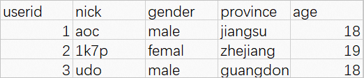

  For more information, see **Associate Log Service with external data sources** in **Log Service User Guide**.

  </li>

  <li>

  Use the default account to associate Log Service with the oss-store-demo external store

  </li>

  </ol>

  as an external data source.

  - Command

    ```text
    aliyunlog log create_external_store --project_name="ali-test-project" --config="file://./external_store_config.json"
    ```

  - Output If the command is successfully run, no responses are returned. You can run the

    ```text
     aliyunlog log get_external_store --project_name="ali-test-project" --
    ```

    `store_name="oss-store-demo" --format-output=json`  command to query the details about the associated external data source.

    ```json
    {
        "externalStoreName": "oss-store-demo",
        "parameter": {
            "accessid": "your_accesskey_id",
            "accesskey": "your_accesskey_secret",
            "bucket": "doc-test",
            "columns": [{
                    "name": "userid",
                    "type": "bigint"
                },
                {
                    "name": "nick",
                    "type": "varchar"
                },
                {
                    "name": "gender",
                    "type": "varchar"
                },
                {
                    "name": "province",
                    "type": "varchar"
                },
                {
                    "name": "age",
                    "type": "bigint"
                }
            ],
            "endpoint": "oss-cn-hangzhou.aliyuncs.com",
            "objects": [
                "external-store-test/user.csv"
            ]
        },
        "storeType": "oss"
    }
    ```

    After the external data source is associated, you can execute the  `*|select * from oss-store-demo`  query statement in the Log Service console to query data in the data source.

    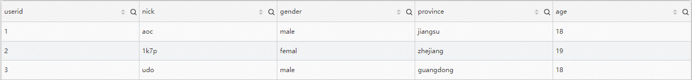

- **Associate Log Service with a database that is created on an ApsaraDB RDS for MySQL instance as an external data source**

  <ol type="i">

  <li>

  Create a file named rds-mysql-external-store.json to specify the database that you want to associate. Example:

  ```json
  {
      "externalStoreName": "rds-vpc-mysql-store",
      "storeType": "rds-vpc",
      "parameter": {
          "region": "cn-hangzhou",
          "vpc-id": "vpc-bp1c******p6kgvv",
          "instance-id": "rm-bp1t4******rm76",
          "host": "rm-bp1******rm76.mysql.rds.aliyuncs.com",
          "port": "3306",
          "username": "testuser",
          "password": "******",
          "db": "dbtest",
          "table": "chiji_user"
      }
  }
  ```

  The following figure shows an example of a table.

  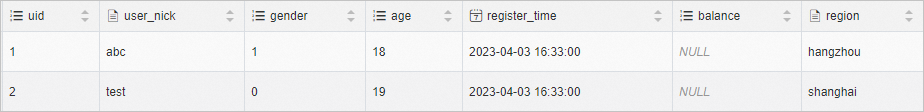

  For more information, see **Associate Log Service with external data sources** in **Log Service User Guide**.

  </li>

  <li>

  Use the default account to associate Log Service with the rds-vpc-mysql-store external

  </li>

  </ol>

  store as an external data source.

  - Command

    ```text
    aliyunlog log create_external_store --project_name="ali-test-project" --config="file://./rds-mysql-external-store.json"
    ```

  - Output If the command is successfully run, no responses are returned. You can run the

    ```text
     aliyunlog log get_external_store --project_name="ali-test-project" --
    ```

    `store_name="rds-vpc-mysql-store" --format-output=json`  command to query the details about the associated external data source.

    ```json
    {
        "externalStoreName": "rds-vpc-mysql-store",
        "parameter": {
            "db": "dbtest",
            "host": "rm-bp1******rm76.mysql.rds.aliyuncs.com",
            "instance-id": "rm-bp1t4******rm76",
            "port": "3306",
            "region": "cn-hangzhou",
            "table": "chiji_user",
            "timezone": "",
            "username": "testuser",
            "vpc-id": "vpc-bp1c******p6kgvv"
        },
        "storeType": "rds-vpc"
    }
    ```

    After the external data source is associated, you can execute the  `*|select * from rds-vpc-mysql-store`  query statement in the Log Service console to query data in the data source.

    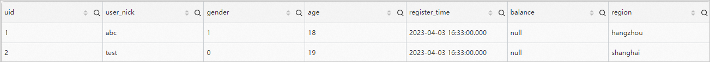

- **Associate Log Service with a local CSV file as an external data source**

  <ol type="i">

  <li>

  Create a file named external_store_config_local.json to specify the CSV file that you want to associate. Example:

  ```json
  {
      "externalStoreName": "doctest-local-csvfile",
      "storeType": "csv",
      "parameter": {
          "endpoint": "cn-hangzhou.aliyuncs.com",
          "externalStoreCsvFile": "./user2.csv",
          "columns": [
              {"name": "userid", "type" : "bigint"},
              {"name": "nick", "type" : "varchar"},
              {"name": "gender", "type" : "varchar"},
              {"name": "province", "type" : "varchar"},
              {"name": "age", "type" : "bigint"}],
          "objects": "./user2.csv"
      }
  }
  ```

  The following figure shows an example of a CSV file.

  

  For more information, see **Associate Log Service with external data sources** in **Log Service User Guide**.

  </li>

  <li>

  Use the default account to associate Log Service with the doctest-local-csvfile external

  </li>

  </ol>

  store as an external data source.

  - Command

    ```text
    aliyunlog log create_external_store --project_name="ali-test-project" --config="file://./external_store_config_local.json"
    ```

  - Output If the command is successfully run, no responses are returned. You can run the

    ```text
     aliyunlog log get_external_store --project_name="ali-test-project" --
    ```

    `store_name="doctest-local-csvfile" --format-output=json`  command to query the details about the associated external data source.

    ```json
    {
      "externalStoreName": "doctest-local-csvfile",
      "parameter": {
        "accessid": "",
        "accesskey": "",
        "bucket": "",
        "columns": [
          {
            "name": "userid",
            "type": "bigint"
          },
          {
            "name": "nick",
            "type": "varchar"
          },
          {
            "name": "gender",
            "type": "varchar"
          },
          {
            "name": "province",
            "type": "varchar"
          },
          {
            "name": "age",
            "type": "bigint"
          }
        ],
        "endpoint": "",
        "objects": [
          "table.csv"
        ]
      },
      "storeType": "csv"
    }
    ```

    After the external data source is associated, you can execute the  `*|select * from doctest-local-csvfile`  query statement in the Log Service console to query data in the data source.

    

**References**

- If the response that is returned by Log Service contains error information after you call an API operation, the call fails. You can handle errors based on the error codes that are returned when API calls fail. For more information, see Common error codes.

- For more information about the API operation that corresponds to this command, see CreateExternalStore.

- For more information, see **Associate Log Service with external data sources** in **Log Service User Guide**.

<a id="section-4-6-11-2"></a>

#### 4.6.11.2. delete_external_store

Disassociates Log Service from an external data source.

**Command syntax**

> **Important**
>
> After you disassociate Log Service from an external data source, you
>
> can no longer use the external data source for queries. Proceed with caution. The following data sources are supported: ApsaraDB RDS for MySQL, Object Storage Service (OSS), and local CSV files.

```text
aliyunlog log delete_external_store --project_name=<value> --store_name=<value> [--access-id=<value>] [--access-key=<value>] [--sts-token=<value>] [--region-endpoint=<value>] 
[--client-name=<value>] [--jmes-filter=<value>] [--format-output=<value>] [--decode-output=<value>] [--profile=<value>]
```

**Command parameters**

The following table describes the required parameters of this command and the parameters that are specific to this command.

| Parameter | Type | Required | Example | Description |
| --- | --- | --- | --- | --- |
| --project_name | String | Yes | ali-test-project | The name of the project. |
| --store_name | String | Yes | oss-store-demo | The name of the external data source. The name is the same as the name of your virtual external table. Example: <strong>user_meta1</strong>.<br>You can run the <code>aliyunlog log</code><br><code>list_external_s</code><br><code>tore --</code><br><code>project_name="a</code><br><code>li-test-</code><br><code>project" --</code><br><code>format-</code><br><code>output=json</code> command to query the names of all external data sources that are associated with Log Service. |

For more information about the global parameters of this command, see Global parameters.

**Command examples**

Disassociate Log Service from an external data source named oss-store-demo. Set the project name to ali-test-project.

- Command

  ```text
  aliyunlog log delete_external_store --project_name="ali-test-project" --
  store_name="oss-store-demo"
  ```

- Output If the command is successfully run, no responses are returned. You can run the  `aliyunlog`

  ```text
  log list_external_store --project_name="ali-test-project" --format-output=json 
  ```

  command to query a list of external data sources that are associated with Log Service.

  ```json
  {
    "count": 4,
    "externalstores": [
      "doctest",
      "oss_external",
      "rds-vpc-mysql-store",
      "user_meta1"
    ],
    "total": 4
  }
  ```

**References**

- If the response that is returned by Log Service contains error information after you call an API operation, the call fails. You can fix the error based on the error code description of the related API operation. For more information, see Common error codes.

- For more information about the API operation that corresponds to this command, see DeleteExternalStore.

- For more information, see **Associate Log Service with external data sources** in **Log Service User Guide** .

<a id="section-4-6-11-3"></a>

#### 4.6.11.3. get_external_store

Queries the detailed configuration of an external data source.

**Command syntax**

```text
aliyunlog log get_external_store --project_name=<value> --store_name=<value> [--access-id=<value>] [--access-key=<value>] [--sts-token=<value>] [--region-endpoint=<value>] [--client-name=<value>] [--jmes-filter=<value>] [--format-output=<value>] [--decode-output=<value>] [--profile=<value>]
```

**Command parameters**

The following table describes the required parameters of this command and the parameters that are specific to this command.

| Parameter | Type | Required | Example | Description |
| --- | --- | --- | --- | --- |
| --project_name | String | Yes | ali-test-project | The name of the project. |
| --store_name | String | Yes | oss-store-demo | The name of the external data source. The name is the same as the name of your virtual external table. Example: <strong>user_meta1</strong>.<br>You can run the <code>aliyunlog log</code><br><code>list_external_s</code><br><code>tore --</code><br><code>project_name="a</code><br><code>li-test-</code><br><code>project" --</code><br><code>format-</code><br><code>output=json</code> command to query the names of all external data sources that are associated with Log Service. |

For more information about the global parameters of this command, see Global parameters.

**Command examples**

Query the detailed configuration of an external data source named oss-store-demo. Set the project name to ali-test-project.

- Command

  ```text
  aliyunlog log get_external_store --project_name="ali-test-project" --store_name="oss-store-demo" --format-output=json
  ```

- Output

  ```json
  {
    "externalStoreName": "oss-store-demo",
    "parameter": {
      "accessid": "your_accesskey_id",
      "accesskey": "your_accesskey_secret",
      "bucket": "doc-test",
      "columns": [
        {
          "name": "userid",
          "type": "bigint"
        },
        {
          "name": "nick",
          "type": "varchar"
        },
        {
          "name": "gender",
          "type": "varchar"
        },
        {
          "name": "province",
          "type": "varchar"
        },
        {
          "name": "age",
          "type": "bigint"
        }
      ],
      "endpoint": "oss-cn-hangzhou.aliyuncs.com",
      "objects": [
        "external-store-test/user.csv"
      ]
    },
    "storeType": "oss"
  }
  ```

**References**

- If the response that is returned by Log Service contains error information after you call an API operation, the call fails. You can handle errors based on the error codes that are returned when API calls fail. For more information, see Common error codes.

- For more information about the API operation that corresponds to this command, see GetExternalStore.

- For more information, see **Associate Log Service with external data sources** in **Log Service User Guide**.

<a id="section-4-6-11-4"></a>

#### 4.6.11.4. list_external_store

Queries a list of external data sources that are associated with Log Service.

**Command syntax**

```text
aliyunlog log list_external_store --project_name=<value> [--
external_store_name_pattern=<value>] [--offset=<value>] [--size=<value>] [--access-id=<value>] [--access-key=<value>] [--sts-token=<value>] [--region-endpoint=<value>] [--client-name=<value>] [--jmes-filter=<value>] [--format-output=<value>] [--decode-output=<value>] [--profile=<value>]
```

**Command parameters**

The following table describes the required parameters of this command and the parameters that are specific to this command.

| Parameter | Type | Required | Example | Description |
| --- | --- | --- | --- | --- |
| --project_name | String | Yes | ali-test-project | The name of the project. |

For more information about the global parameters of this command, see Global parameters.

**Command examples**

Query a list of external data sources that are associated with Log Service. Set the project name to ali-test-project.

- Command

  ```text
  aliyunlog log list_external_store --project_name="ali-test-project" --format-output=json
  ```

- Output

  ```json
  {
    "count": 4,
    "externalstores": [
      "doctest",
      "oss_external",
      "rds-vpc-mysql-store",
      "user_meta1"
    ],
    "total": 4
  }
  ```

**References**

- If the response that is returned by Log Service contains error information after you call an API operation, the call fails. You can handle errors based on the error codes that are returned when API calls fail. For more information, see Common error codes.

- For more information about the API operation that corresponds to this command, see ListExternalStore.

- For more information, see **Associate Log Service with external data sources** in **Log Service User Guide**.

<a id="section-4-6-11-5"></a>

#### 4.6.11.5. update_external_store

Modifies the configuration of an external data source that is associated with Log Service.

**Command syntax**

```text
aliyunlog log update_external_store --project_name=<value> --config=<value> [--access-id=<value>] [--access-key=<value>] [--sts-token=<value>] [--region-endpoint=<value>] [--client-name=<value>] [--jmes-filter=<value>] [--format-output=<value>] [--decode-output=<value>] [--profile=<value>]
```

**Command parameters**

The following table describes the required parameters of this command and the parameters that are specific to this command.

| Parameter | Type | Required | Example | Description |
| --- | --- | --- | --- | --- |
| --project_name | String | Yes | ali-test-project | The name of the project. |
| --config | String | Yes | file://./external_st ore_config.json | The path to the new configuration file of the external data source.Before you run this command, you must create the configuration file. To create the file, you must specify the external store name, table schema, and information to access an OSS bucket or an ApsaraDB RDS for MySQL instance.<br>You can also follow the instructions provided in the "Command examples" section of the create_external_s tore topic to create the file. |

For more information about the global parameters of this command, see Global parameters.

**Command examples**

1. Create a file named external_store_config_update.json. Example:

   ```json
   {
       "externalStoreName": "oss-store-demo",
       "storeType": "oss",
       "parameter": {
           "endpoint": "oss-cn-hangzhou.aliyuncs.com",
           "accessid": "your_accesskey_id",
           "accesskey": "your_accesskey_secret",
           "bucket": "doc-test",
           "objects": ["external-store-test/user.csv"],
           "columns": [{"name": "userid", "type": "bigint"}, {"name": "nick", "type": 
   "varchar"}, {"name": "gender", "type": "varchar"}, {"name": "province", "type": "varchar"}]
       }
   }
   ```

   The following figure shows an example of a CSV file.

   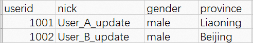

   For more information, see **Associate Log Service with external data sources** in **Log Service User Guide**.

2. Use the default account to modify the configuration of the oss-store-demo external data source.

   - Command

     ```text
     aliyunlog log update_external_store --project_name="ali-test-project" --config="file://./external_store_config_update.json"
     ```

   - Output If the command is successfully run, no responses are returned. You can run the

     ```text
      aliyunlog log get_external_store --project_name="ali-test-project" --
     ```

     `store_name="oss-store-demo" --format-output=json`  command to query the details about the associated external data source.

     ```json
     {
         "externalStoreName": "oss-store-demo",
         "parameter": {
             "accessid": "your_accesskey_id",
             "accesskey": "your_accesskey_secret",
             "bucket": "doc-test",
             "columns": [{
                     "name": "userid",
                     "type": "bigint"
                 },
                 {
                     "name": "nick",
                     "type": "varchar"
                 },
                 {
                     "name": "gender",
                     "type": "varchar"
                 },
                 {
                     "name": "province",
                     "type": "varchar"
                 }
             ],
             "endpoint": "oss-cn-hangzhou.aliyuncs.com",
             "objects": [
                 "external-store-test/user.csv"
             ]
         },
         "storeType": "oss"
     }
     ```

     After the external data source is modified, you can execute the  `*|select * from oss-store-demo`  query statement in the Log Service console to query data in the data source.

     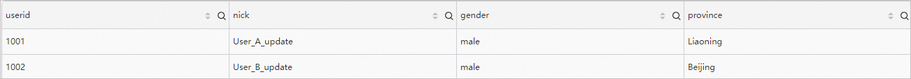

**References**

- If the response that is returned by Log Service contains error information after you call an API operation, the call fails. You can handle errors based on the error codes that are returned when API calls fail. For more information, see Common error codes.

- For more information about the API operation that corresponds to this command, see UpdateExternalStore.

- For more information, see **Associate Log Service with external data sources** in **Log Service User Guide**.

<a id="section-4-7"></a>

## 4.7. Best practices

This topic describes the best practices of Log Service CLI.

- View the usage of the basic resources in Log Service

- Split shards

- Configure multiple accounts to use Log Service CLI

- Create a Logtail configuration

- Replicate the configurations of a project across regions

- Pull logs

- Query logs

- Replicate logs, reindex historical data, and ship data to a data warehouse

- Migrate data from a self-managed ELK stack to Log Service

<a id="section-4-8"></a>

## 4.8. FAQ

This topic provides answers to some frequently asked questions about Log Service CLI.

**What do I do if the TLSV1_ALERT_PROTOCOL_VERSION error occurs when I install Log Service CLI?**

Run the following command to upgrade pip and reinstall Log Service CLI:

```bash
pip3 install pip -U
```

**How do I view the logs of Log Service CLI?**

By default, the alerts and error messages of Log Service CLI are saved in the ~/aliyunlogcli.log file. You can view the logs in this file.

**What do I do if the aliyunlog command cannot be found?**

The link to the aliyunlog script file failed to be created in Linux or macOS. In Linux, you can perform the following operations to create a link to the aliyunlog script file:

1. Run the following command to verify the installation path to Python.

   ```text
   which python
   ```

   The following result is returned by Linux:

   ```text
   /usr/bin/python
   ```

2. In the /usr/bin directory, create a file named aliyunlog and enter the following code:

   ```python
   #!/usr/bin/python
   import re
   import sys
   from pkg_resources import load_entry_point

   if __name__ == '__main__':
       sys.argv[0] = re.sub(r'(-script\.pyw?|\.exe)?$', '', sys.argv[0])
       sys.exit(
           load_entry_point('aliyun-log-cli', 'console_scripts', 'aliyunlog')()
       )
   ```

3. Run the  `aliyunlog --version`  command. If the following information is returned, the link to the aliyunlog script file is created.

   ```text
   log-cli-v-0.1.17, log-python-sdk-v-0.6.53, sys.version_info(major=3, minor=6, micro=8, releaselevel='final', serial=0), linux
   ```

**The returned data is displayed in different formats. How do I format the data?**

Log Service CLI provides the global parameter **--format-output** to format the returned data. For example, if you specify **--format-output=json**, the data is returned in the JSON format. For more information, see Global parameters.
